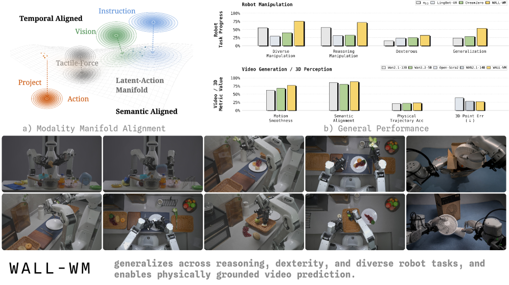
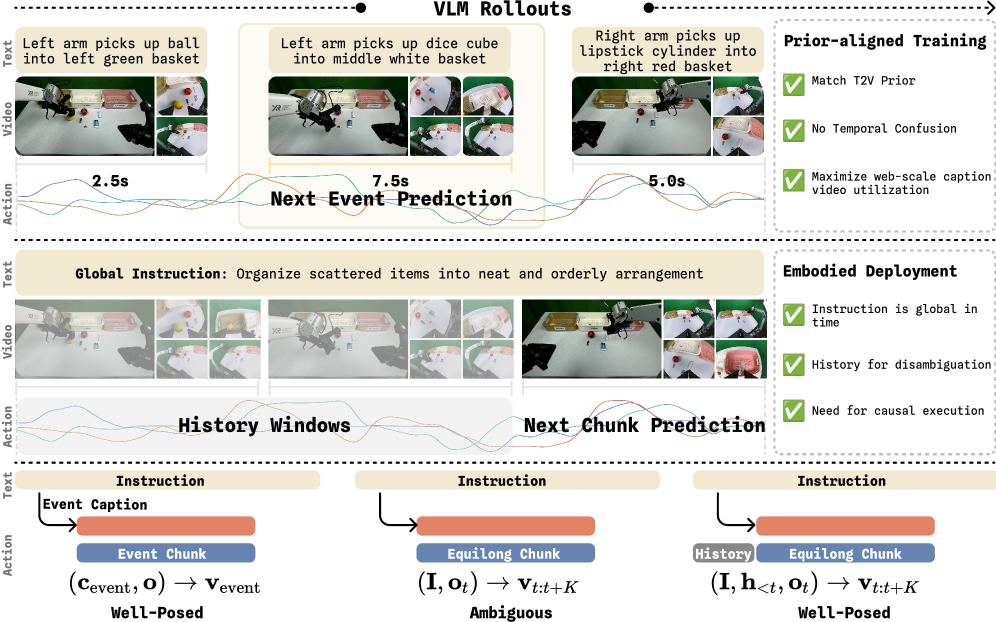
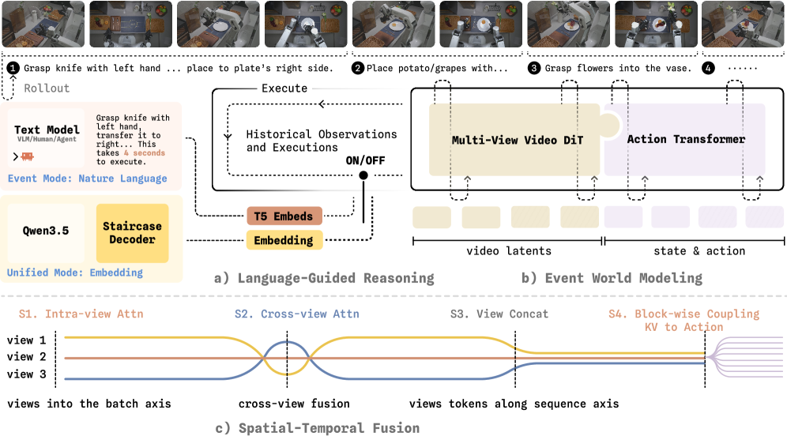
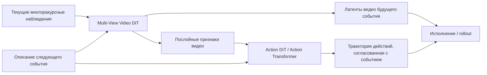
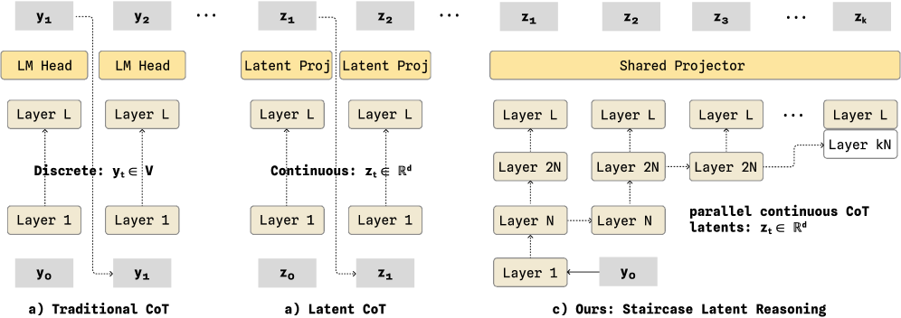
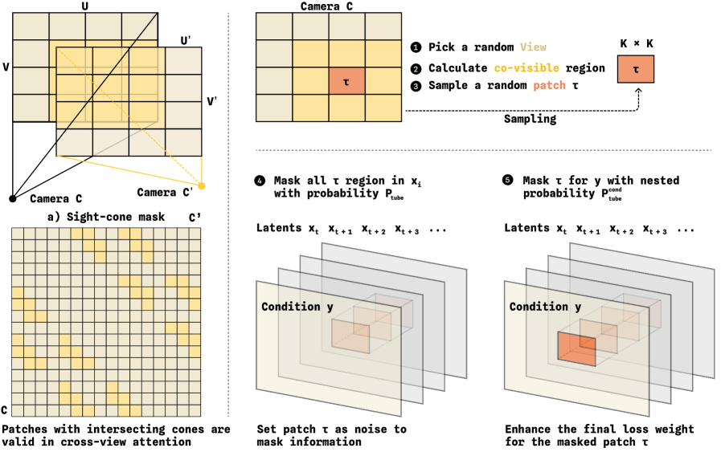
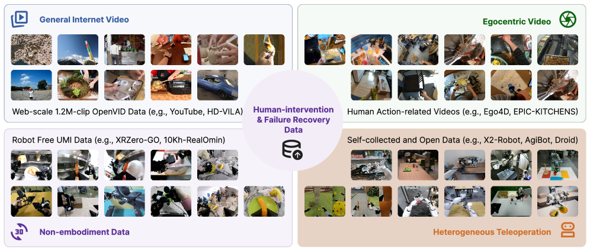
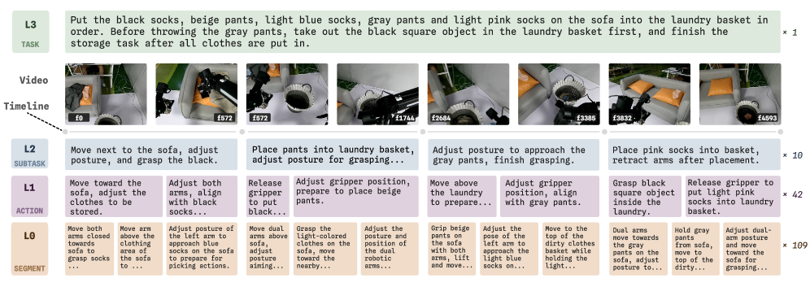

# WALL-WM: предварение и исполнение по границам событий в модели мира с действиями

Статья WALL-WM называется **WALL-WM: Carving World Action Modeling at the Event Joints**. Она относится к направлению embodied world model / World Action Model, но это не латентная модель перехода в духе Dreamer. Её суть: **предсказание будущего видео и предсказание действий связаны вместе, а обучение и исполнение строятся по семантическим событиям действия, а не по фиксированному action chunk.**

После этого раздела стоит запомнить одну фразу:

> WALL-WM — это не VLA, которая выдаёт действия по текущему изображению, а модель, которая по текущим многоракурсным наблюдениям и описанию следующего события предсказывает, как мир будет меняться в ходе этого события, и одновременно генерирует соответствующий сегмент действий.

## 1. Статья и статус открытого кода

| Пункт | Текущее состояние |
| :--- | :--- |
| Статья | [arXiv:2606.01955](https://arxiv.org/abs/2606.01955) |
| PDF статьи | ссылка на `WALL-WM.pdf` есть в README проекта WALL-X |
| Связанная экосистема кода | [X-Square-Robot/wall-x](https://github.com/X-Square-Robot/wall-x) |
| Связанная страница организации моделей | [Hugging Face: x-square-robot](https://huggingface.co/x-square-robot) |
| Границы открытости | код и модели WALL-X / WALL-OSS доступны; отдельного чекпоинта WALL-WM, экосистемы событийных данных и полного рецепта обучения пока не видно в открытом доступе |
| Рекомендуемый подход | использовать как методологический обзор, а не как пошаговое руководство по воспроизведению |

Здесь важно сказать прямо: статья, PDF и инженерные входы серии WALL открыты, но с точки зрения практического воспроизведения нельзя просто написать, что WALL-WM полностью открыт и читатели могут повторить результаты статьи. В учебном материале её лучше всего представить как методологическое введение и точку отслеживания.

## 2. Почему это World Action Model

<p align="center">
  
</p>

**Рис. 1. Место WALL-WM в моделировании мира и действий.** В статье язык, зрение и действия находятся на разных уровнях абстракции и пространственно-временной точности: язык семантичен, но груб; зрение имеет пространственно-временную структуру; действия требуют точности на уровне контакта. Цель WALL-WM — связать моделирование видеомира с генерацией действий.

Источник: [HTML-версия WALL-WM на arXiv](https://arxiv.org/html/2606.01955v1).

Типичная традиционная VLA работает так:

```text
текущее наблюдение + инструкция -> action chunk фиксированной длины
```

А WALL-WM ближе к такой схеме:

```text
текущие многоракурсные наблюдения + описание следующего события
-> латенты видео будущего события + траектория действий для этого события
-> исполнение этого сегмента
-> новое наблюдение
-> переход к следующему событию
```

Название World Action Model отражает то, что модель не просто выдаёт действия, а явно моделирует: «если сейчас выполнить это семантическое событие, как изменится визуальный мир?» Генерация действий и предсказание будущих наблюдений не являются двумя отдельными модулями; они связаны в одной процедуре denoising.

## 3. Ключевая новизна: от фиксированного chunk к семантическому событию

<p align="center">
  
</p>

**Рис. 2. Обучение next-event и сравнение с равными по длине chunk.** Этот рисунок — ключ к пониманию WALL-WM. Описание события, видео события и действие события относятся к одному и тому же семантическому интервалу, тогда как chunk фиксированной длины часто разрезает одно действие на части или смешивает несколько событий.

Источник: [HTML-версия WALL-WM на arXiv](https://arxiv.org/html/2606.01955v1).

Проблема фиксированного chunk хорошо знакома по длинным задачам робота. Событие «взять чашку» может занимать 18 шагов, а может 70; chunk из 32 шагов может охватывать только вторую половину приближения и первую половину закрытия захвата. Возникает несогласование грануляции:

| Модальность | Естественная гранулярность | Проблема фиксированного chunk |
| :--- | :--- | :--- |
| Язык | семантические цели и события | одна глобальная инструкция не может точно описать текущий chunk |
| Зрение | непрерывные изменения мира | изменения видео часто выходят за рамки событий разной длины |
| Действия | высокочастотные управляющие траектории | фиксированное временное окно может разрезать контакт или переход между фазами |

Ответ WALL-WM — использовать в качестве единицы обучения **action-grounded semantic event** (семантическое событие, привязанное к действию). Такое событие должно одновременно:

- описываться языком, например «lift the cup»;
- быть видно на видео: чашка покидает стол;
- быть исполнимо как действие: траектория концевого эффектора от захвата к подъёму.

Это главная идея статьи, которую стоит перенять: она спрашивает не только «модель мира должна предсказывать будущее», но и «в каких единицах должно предсказываться будущее».

## 4. Общая архитектура: слои видеобашни и башни действий связаны между собой

<p align="center">
  
</p>

**Рис. 3. Общая схема WALL-WM.** Слева — вход инструкции, в центре — модель мира, ориентированная на событие, справа — унифицированный режим. При изучении схемы обратите внимание: Multi-View Video DiT отвечает за латенты будущего видео, Action Transformer / Action DiT — за траекторию действий, а обмен информацией между ними происходит через послойную связь.

Источник: [HTML-версия WALL-WM на arXiv](https://arxiv.org/html/2606.01955v1).

Архитектуру статьи можно разделить на три уровня:

| Уровень | Модуль | Роль |
| :--- | :--- | :--- |
| Вход событий и языка | описание следующего события, текстовый кондиционер T5, декодер Staircase | задаёт условие «какое событие будет следующим» для текущего rollout |
| Визуальная модель мира | Multi-View Video DiT, унаследованный от семейства видеомоделей Wan | предсказывает латенты многоракурсного видео на время события |
| Модель действий | Action Transformer / Action DiT | предсказывает соответствующую траекторию концевого эффектора |

Основа метода не в отдельной генерации видео и не в отдельной регрессии действий, а в **послойно связанном шумоподавлении видео и действий (layer-coupled video-action denoising)**:



Башня действий на нескольких слоях читает признаки башни видео, поэтому действие не выводится только из текущего изображения и языка, а находится под влиянием «предсказанного изменения мира». Такой дизайн ближе к схеме «сначала предварительный прогон, потом исполнение», чем обычная VLA.

## 5. Режим Event и режим Unified

WALL-WM поддерживает два режима вывода.

### 5.1 Режим Event

Режим Event ближе всего к схеме «сначала предварительный прогон, потом исполнение»:

```text
текущее наблюдение + описание следующего события
-> генерация видео/действий события переменной длины
-> исполнение
-> новое наблюдение
-> генерация следующего события
```

Описание следующего события может поступать от человека, от верхнего агента или от VLM, которая дообучена в статье. Это значит, что WALL-WM не полностью сама планирует всю длинную задачу: ей нужен верхний модуль, который скажет, какое семантическое событие делать сейчас.

Преимущество режима Event в том, что он естественно поддерживает сегменты действий переменной длины и не разрезается жёсткой границей action horizon. Но есть и цена: нужны инструкции следующего события. Если верхний уровень неверно разобьёт задачу на события, нижняя модель мира с действиями тоже уведёт выполнение в сторону.

### 5.2 Режим Unified

Режим Unified больше похож на традиционное исполнение фиксированными chunk в VLA. Он по-прежнему выдаёт chunk фиксированной длины, но опирается не только на глобальную инструкцию задачи: через декодирование Staircase VLM порождаются непрерывные латентные рассуждения, которые направляют действия.

<p align="center">
  
</p>

**Рис. 4. Staircase latent reasoning.** По сравнению с CoT, который генерирует токены по одному, Staircase передаёт рассуждения между уровнями через непрерывные латенты. Цель — сохранить сигнал рассуждения и снизить накладные расходы на последовательную генерацию.

Источник: [HTML-версия WALL-WM на arXiv](https://arxiv.org/html/2606.01955v1).

Смысл режима Unified в совместимости с уже существующими интерфейсами управления. Многие роботизированные системы построены вокруг фиксированной частоты и фиксированного горизонта action chunk, и переход на режим Event полностью потребовал бы больших затрат. Unified даёт компромисс: интерфейс управления по-прежнему chunk, но внутренний управляющий сигнал ближе к событийной структуре.

## 6. Многоракурсное слияние: Camera RoPE и геометрические маски

<p align="center">
  
</p>

**Рис. 5. Cross-view masking в WALL-WM.** Маска sight-cone позволяет взаимодействовать между видами только тем токенам, у которых физически может быть общая видимая область; tube mask скрывает временную трубку в одном виде, заставляя модель восстанавливать информацию по другим видам.

Источник: [HTML-версия WALL-WM на arXiv](https://arxiv.org/html/2606.01955v1).

Манипуляция роботов часто использует несколько видов: головную камеру, боковую камеру, камеру на запястье и т. д. Простая конкатенация токенов разных видов создаёт две проблемы:

- токены разных видов не знают, с какой камеры они пришли;
- токены, которые физически не могут относиться к одной и той же области, всё равно внимают друг другу и создают шум.

WALL-WM добавляет два типа решений:

| Решение | Назначение |
| :--- | :--- |
| Camera RoPE | вносит в токены вращательное позиционное кодирование, связанное с видом камеры |
| Sight-cone mask | разрешает межвидовое внимание только тем токенам, чьи видимые конусы физически пересекаются |
| Tube patch masking | закрывает пространственно-временную трубку в одном виде, чтобы модель восстанавливала её по другим видам |

Это показывает, что WALL-WM — не просто перенос видеомодели в робототехнику, а структурная адаптация под многоракурсное зрение робота.

## 7. Система данных: событийные подписи и выборка с длинным хвостом

<p align="center">
  
</p>

**Рис. 6. Карта источников данных WALL-WM.** Данные взяты из интернет-видео, видео от первого лица, записей без воплощения (non-embodied), гетерогенного телеуправления и открытых данных роботов; отдельно выделены данные вмешательства человека и восстановления после сбоя.

Источник: [HTML-версия WALL-WM на arXiv](https://arxiv.org/html/2606.01955v1).

В этой статье важна не только архитектура, но и система данных. WALL-WM стремится учить не только «успешные траектории», но и:

- восстановление (recovery);
- повторный захват (re-grasp);
- повторную попытку (retry);
- коррекцию контакта (contact correction);
- вмешательство при сбое (failure intervention).

Такие короткие события легко теряются в общей глобальной подписи, но в подписи на уровне событий их можно отметить явно.

<p align="center">
  
</p>

**Рис. 7. Четыре уровня подписей.** Уровни Task, Subtask, Action и Segment выровнены по одной временной шкале видео, поэтому один и тот же эпизод можно обучать и выбирать в разных семантических гранулярностях.

Источник: [HTML-версия WALL-WM на arXiv](https://arxiv.org/html/2606.01955v1).

Эту систему можно понимать как четырёхуровневую разметку:

| Уровень | Пример | Роль |
| :--- | :--- | :--- |
| Task | убрать стол | глобальная цель задачи |
| Subtask | положить чашку в корзину | подзадача среднего уровня |
| Action | взять чашку | событие действия |
| Segment | закрытие захвата и контакт с чашкой | более мелкий фрагмент |

Благодаря такой разметке обучение больше не опирается только на временные окна фиксированной длины, а может выбирать примеры по семантическим границам.

## 8. Сильные стороны и границы

Сильные стороны WALL-WM — в трёх местах:

1. **Правильная гранулярность событий.** Замена единицы из фиксированного chunk на семантическое событие хорошо подходит для длинных задач манипуляции.
2. **Связь видео и действий.** Башня действий читает признаки башни видео послойно, поэтому предсказание видео и предсказание действий не полностью расходятся.
3. **Полноценная система данных и обучения.** Событийные подписи, выборка с длинным хвостом, структура для многоракурсности, рассуждения Staircase и инфраструктура оптимизатора Muon вместе составляют рецепт масштабирования.

Но есть и границы:

- Модель не планирует длинную задачу полностью самостоятельно: режиму Event нужна инструкция о следующем событии.
- Эффект, скорее всего, зависит от крупномасштабных событийных данных и системы разметки, которые трудно повторить в обычной лаборатории с нуля.
- Тонкий контакт, вставку и операции с узким допуском нельзя решить только декомпозицией на события.
- Текущее открытое состояние больше подходит для отслеживания метода, чем для написания полного руководства по воспроизведению.

## 9. Сравнение с RAW-Dream, WoG и EventVLA

| Метод | Основной вопрос | Предсказывает ли будущее | Ключевое представление |
| :--- | :--- | :--- | :--- |
| RAW-Dream | усиление VLA в модели мира, не зависящей от задачи | предсказывает воображаемый видео rollout | видеомодель мира с условием по действию + награда VLM |
| WoG | как превратить будущие наблюдения в условие, полезное для действий | не генерирует явно будущее видео | руководство в пространстве условий (condition-space future guidance) |
| WALL-WM | в каких единицах организовывать обучение мира и действий | предсказывает латенты видео события и траекторию действий | WAM, выровненная по семантическим событиям |
| EventVLA | как не терять промежуточные визуальные данные | не предсказывает будущее | память сырых ключевых кадров |

Эта таблица помогает сузить слово «модель мира». WALL-WM ближе всего к настоящей World Action Model; WoG — это моделирование в пространстве условий (condition-space world modeling); EventVLA же не модель мира, а память визуальных свидетельств.

## 10. Как следить за воспроизведением

Сейчас стоит следить за развитием так:

1. Прочитать [arXiv:2606.01955](https://arxiv.org/abs/2606.01955), особенно рисунки 2, 3, 6, 8 и 12.
2. Следить за README, релизами и issues в [X-Square-Robot/wall-x](https://github.com/X-Square-Robot/wall-x).
3. Следить за тем, появятся ли новые чекпоинты WALL-WM в [HF x-square-robot](https://huggingface.co/x-square-robot).
4. Если нужно просто запустить код серии WALL, сначала изучить [инженерный фреймворк WALL-X](../../06-manipulation-and-vla/large-model-control-vla-vlm/08-wall-x-open-source-engineering-framework-navigation/README.md) и [открытую VLA WALL-OSS](../../06-manipulation-and-vla/large-model-control-vla-vlm/07-wall-oss-open-source-vla-model-introduction/README.md).
5. Если в будущем появятся событийные данные и рецепт обучения, тогда отдельно написать `wall-wm-reproduction.md`, а не превращать этот обзор в набор команд.

## 11. Источники

- Статья WALL-WM: [WALL-WM: Carving World Action Modeling at the Event Joints](https://arxiv.org/abs/2606.01955)
- HTML-версия статьи WALL-WM с иллюстрациями на arXiv: [2606.01955v1 HTML](https://arxiv.org/html/2606.01955v1)
- Код WALL-X: [X-Square-Robot/wall-x](https://github.com/X-Square-Robot/wall-x)
- Страница исследований X Square Robot: [https://x2robot.com/en/research](https://x2robot.com/en/research)
- Страница организации на Hugging Face: [x-square-robot](https://huggingface.co/x-square-robot)
