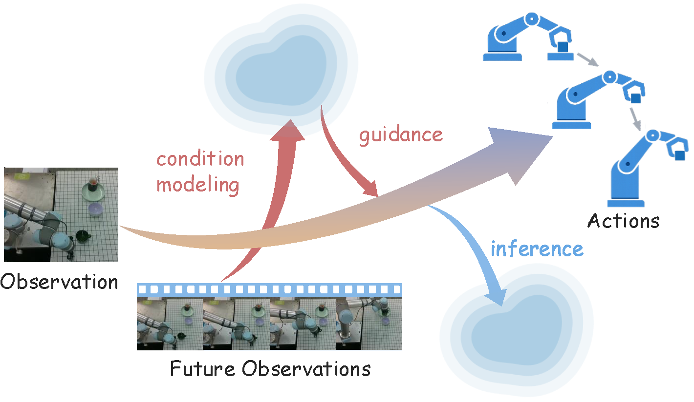
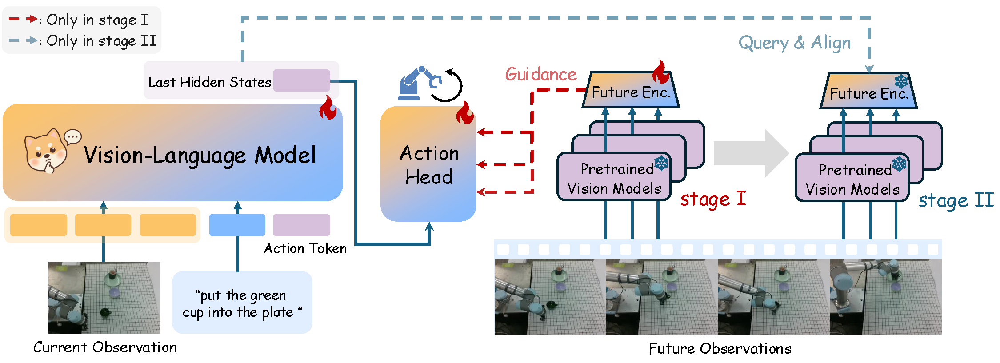
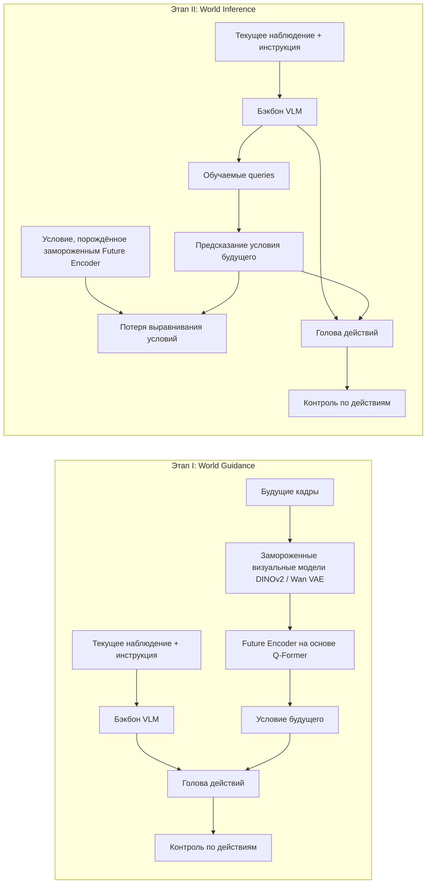
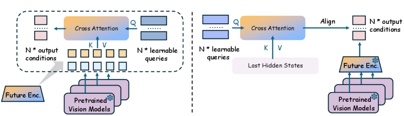
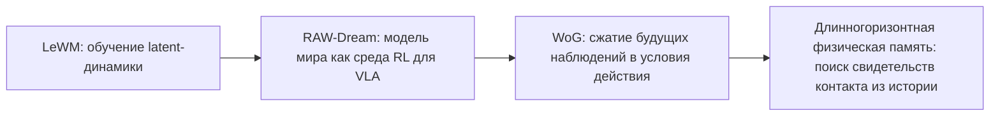
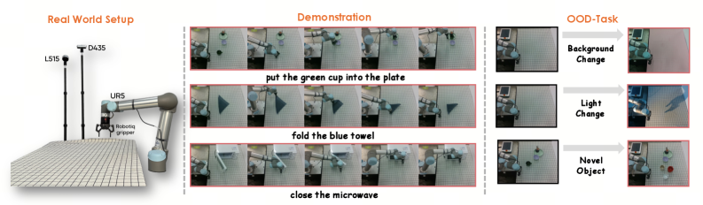
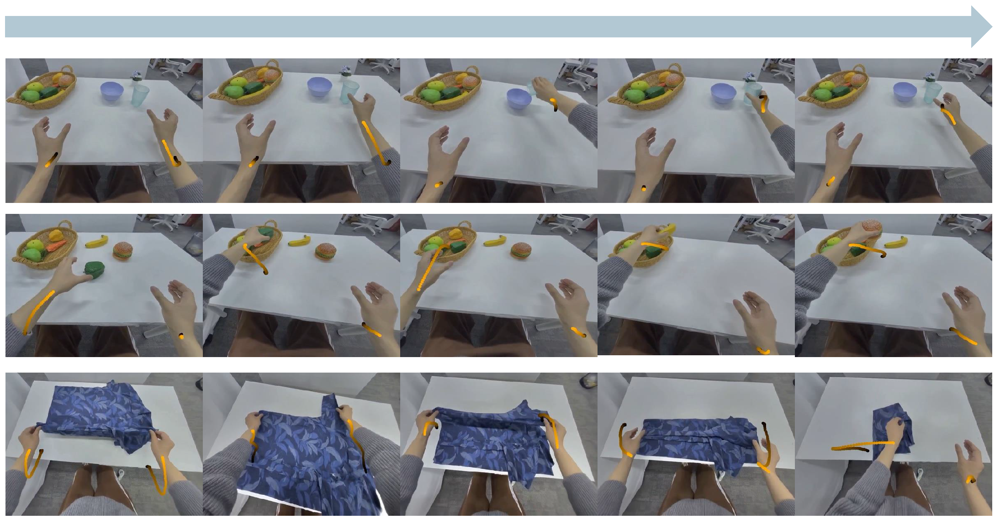

# WoG: руководство по модели мира в пространстве условий

Этот раздел разбирает статью **World Guidance: World Modeling in Condition Space for Action Generation**; метод называется **WoG / World Guidance**. Работа выполнена командой ByteDance Seed и Гонконгского университета, препринт на arXiv опубликован 25.02.2026. Раздел уместно ставить в главу `17-world-models` как дополнение к LeWM и RAW-Dream: LeWM объясняет, как латентная модель мира предсказывает будущие состояния, RAW-Dream — как модель мира служит средой для посттренировки VLA, а WoG задаёт другой путь: **не предсказывать полное будущее изображение, а предсказывать вектор условий будущего, полезный для действий**.

После этого раздела нужно усвоить главный вывод: WoG очень умён и практически ценен, но он не является «симулятором мира, в котором робот может проигрывать интерактивный rollout». Точнее, это метод **дистилляции будущих наблюдений для генерации действий (future observation distillation for action generation)**: при обучении модель видит будущие кадры и сжимает их в латентное условие, связанное с действием; на тесте будущих кадров нет, и VLA предсказывает это условие по текущему наблюдению, а затем использует его для генерации действий.

## 1. Статья, страница проекта и статус кода

| Пункт | Текущее состояние |
| :--- | :--- |
| Статья | [arXiv:2602.22010](https://arxiv.org/abs/2602.22010), отправлена 25.02.2026 |
| Страница проекта | [WoG project page](https://selen-suyue.github.io/WoGNet/) |
| Код | [Selen-Suyue/WoG](https://github.com/Selen-Suyue/WoG) |
| Веса | README в GitHub ведёт на [Hugging Face: selensu/WoG](https://huggingface.co/selensu/WoG) |
| Примечание к коду | на странице проекта есть кнопка Code; в README репозитория написано «unofficial implementation», поэтому в учебном материале его стоит считать открытой реализацией, а не строгим воспроизведением экспериментов |

Не стоит сразу пытаться полностью воспроизвести эту статью. Лучше сначала хорошо разобраться в архитектурной схеме и двухэтапном обучении, а затем решить, стоит ли тратить вычислительные ресурсы на SIMPLER или развёртывание на реальном роботе.

## 2. Что делает WoG, в одном предложении

<p align="center">
  
</p>

**Рис. 1. Основная идея WoG.** Будущие кадры наблюдений не используются для прямого восстановления видео: они сжимаются в пространство условий (condition space), и это условие направляет генерацию действий. При обучении можно «подсматривать в будущее», а на тесте можно только предсказать будущее условие по текущему наблюдению.

Источник: [страница проекта WoG](https://selen-suyue.github.io/WoGNet/).

Суть WoG можно выразить простой фразой:

> При обучении сжимаем несколько будущих кадров в маленькую шпаргалку, полезную для действий; на тесте будущих кадров нет, и VLA сама угадывает эту шпаргалку по текущему изображению и языку.

Традиционные модели мира обычно предсказывают будущее изображение, будущее состояние, будущее видео или переход латентного состояния. WoG идёт другим путём. Он считает, что полный будущий кадр содержит много информации, не относящейся к управлению: текстуру фона, изменения освещения, детали скатерти. Роботу же нужно знать, куда двигаться дальше, как объект и захват будут контактировать и какова связь между целевым объектом и контейнером. Поэтому WoG не предсказывает полное будущее, а учит **пространство условий действия (action condition space)**.

В этом и состоит главная путаница. Название содержит слово world modeling, но «мир» здесь не полный визуальный мир, а сжатая информация о будущем, которая служит генерации действий.

## 3. Почему это всё же модель мира

В самом строгом определении модель мира должна выучить:

```text
p(s_{t+1} | s_t, a_t)
```

или хотя бы

```text
p(o_{t+k} | o_{<=t}, a_{<=t+k})
```

То есть по текущему состоянию и действию она должна уметь выполнить rollout следующего состояния или будущего наблюдения. WoG этому строгому определению не соответствует: он не планирует в латентной динамике, как Dreamer, и не генерирует проверяемые будущие видео, как видеомодели мира.

WoG соответствует более слабому и инженерному определению:

```text
текущее наблюдение + язык -> предсказанное условие, сжатое из будущих наблюдений -> вспомогательная генерация действий
```

Поэтому более точные названия здесь такие:

| Название | Насколько подходит |
| :--- | :--- |
| Динамическая модель мира в классическом смысле | не очень |
| Видеомодель мира | не подходит |
| модель мира в пространстве условий (condition-space world model) | подходит |
| представление действий, обусловленное будущим (future-conditioned action representation) | подходит |
| дистилляция будущих наблюдений для вспомогательной генерации действий | очень подходит |

Это не умаляет ценности WoG. Его сила как раз в том, что **управлению роботом не обязательно предсказывать весь мир, достаточно предсказать будущую информацию, нужную для действий**.

## 4. Общая схема: двухэтапное обучение

<p align="center">
  
</p>

**Рис. 2. Двухэтапный конвейер обучения WoG.** Красная пунктирная линия обозначает руководство будущими наблюдениями, которое используется только на этапе I; синяя пунктирная линия — это query & align на этапе II. При чтении этой схемы не стоит ограничиваться взглядом слева направо: важно смотреть, как роль Future Encoder справа меняется между этапами.

Источник: [страница проекта WoG](https://selen-suyue.github.io/WoGNet/).

Схему удобно разбить на четыре блока:

| Модуль | Вход | Выход | Роль |
| :--- | :--- | :--- | :--- |
| Бэкбон VLM | текущее RGB-изображение + инструкция | скрытые состояния последнего слоя | даёт семантическое представление текущего наблюдения и языка |
| Замороженные визуальные модели | несколько будущих кадров | визуальные признаки будущего: DINOv2 / Wan VAE и др. | дают информацию о будущем, видимую на этапе обучения |
| Future Encoder на основе Q-Former | визуальные признаки будущего | низкоразмерное условие будущего | извлекает из будущих кадров информацию, связанную с действиями |
| Голова действий (action head) | текущее представление + условие будущего | последовательность будущих действий | учится использовать условие будущего для предсказания действий |

### Этап I: World Guidance

Этап I — «учительский». На обучении модель видит будущие кадры. WoG сначала кодирует их замороженными визуальными моделями, затем обучаемый Future Encoder на основе Q-Former сжимает визуальные признаки будущего в низкоразмерное условие, и это условие подаётся в голову действий. Голова действий учится предсказывать действия, когда есть «шпаргалка» о будущем.

Главная задача этого этапа — не научить модель предсказывать будущее, а научить Future Encoder сжимать будущие кадры в **пространство, полезное для предсказания действий**. Если такой латент не улучшает предсказание действий, он не является хорошим условием.

### Этап II: World Inference

Этап II — «ученический». Future Encoder заморожен, и выученное на этапе I пространство условий становится целевой разметкой. Теперь модель не может опираться на будущие кадры: она должна по текущему наблюдению и языку предсказать такое же условие и одновременно продолжать предсказывать действия.

На тесте работает именно путь этапа II: текущее RGB-изображение и язык поступают в VLM, модель внутренне предсказывает условие будущего, а голова действий выдаёт действия. Будущих кадров на тесте нет.



## 5. Что именно сжимает Future Encoder

<p align="center">
  
</p>

**Рис. 3. Future Encoder и механизм выравнивания на этапе II.** Слева — Future Encoder: обучаемые queries через cross-attention извлекают из признаков предобученных визуальных моделей информацию, связанную с действиями. Справа — этап II: скрытые состояния VLM тоже через набор queries предсказывают то же условие и выравниваются с целью от замороженного Future Encoder.

Источник: [WoG на arXiv, HTML](https://arxiv.org/html/2602.22010v1).

В приложении к статье указаны несколько ключевых решений:

- горизонт действий по умолчанию равен 16 шагам;
- будущие наблюдения берутся с частотой одной четверти от частоты последовательности действий, поэтому по умолчанию используется только 4 будущих кадра;
- Future Encoder использует `N=16` обучаемых query-токенов;
- размерность пространства условий по умолчанию `D=32`;
- визуальное кодирование будущего берётся из замороженных визуальных моделей, а в статье в основном рассматривается сочетание DINOv2, SigLIP и Wan VAE.

Эти решения показывают, в каком направлении идёт WoG: это не высококачественное предсказание видео, а сжатие нескольких будущих кадров в очень маленький латентный сигнал-подсказку. Такой латент может кодировать тенденцию движения объекта, момент контакта, относительное положение захвата и цели, грубое направление следующего сегмента действий. Но он не скажет явно, что координаты кружки такие-то, какова сила контакта или как будет выглядеть будущий кадр.

Поэтому у этого латента три свойства:

| Свойство | Значение |
| :--- | :--- |
| Связан с действиями | выучен для улучшения предсказания действий |
| Непосредственно не интерпретируем | это не RGB, не глубина, не оптический поток и не явная переменная состояния |
| Непригоден для прямого планирования | на нём нельзя выполнять многошаговый поиск rollout, как в динамической модели |

Именно эту границу важно понимать при оценке WoG: это хорошее вспомогательное представление для действий, но не явный планируемый симулятор мира.

## 6. Ключевая новизна: от «предсказания мира» к «предсказанию условий, нужных действию»

Новизна WoG делится на три уровня.

Первый уровень — **смена целевого пространства**. Многие методы предсказывают RGB-видео, глубину, поток, признаки DINO/SAM или латентные действия. Проблема в том, что эти пространства либо слишком тяжёлые, либо содержат много информации, не связанной с действием. Целевое пространство WoG не задаётся вручную как визуальная модальность, а определяется обратным отбором: пространство условий, которое **реально улучшает предсказание действий**.

Второй уровень — **дизайн учебного курса**. На этапе I модель видит будущее и сначала вкладывает в голову действий то, что для неё полезно. На этапе II будущие кадры убираются, и ветка текущего наблюдения учится предсказывать это условие. По сути, это дистилляция той части будущих наблюдений, которая важна для действий, обратно во внутреннюю часть VLA.

Третий уровень — **масштабируемость на видео людей**. Поскольку предсказание условий на этапе II не обязательно требует разметки действий, видео с людьми без разметки действий тоже могут участвовать в обучении условному контролю. Это преимущество перед чисто действенными целями: такие видео легче масштабировать.

## 7. Чем это отличается от традиционных моделей мира

| Тип метода | Что предсказывает | Можно ли явно выполнять rollout | Насколько близко к действию | Место WoG |
| :--- | :--- | :--- | :--- | :--- |
| Латентные модели мира в духе Dreamer | переход латентного состояния | да | средне — сильно | не относится |
| Видеомодели мира | будущее RGB / видео | да, хотя бы визуально | не обязательно сильно | не относится |
| World Action Model | будущие модальности или семантические признаки, помогающие действиям | частично | сильно | соседнее направление |
| WoG | условие действия, сжатое из будущих кадров | в основном нет | очень сильно | модель мира в пространстве условий |

Поэтому если говорить, что WoG «решил проблему моделей мира», это явное преувеличение. Но если сказать, что он **дистиллирует будущие наблюдения в связанные с действием условия и тем самым улучшает предсказание действий VLA**, это будет точным описанием.

В курсе WoG можно разместить так:



WoG работает с задачей **будущее наблюдение -> условие действия**, а работы по длинногоризонтной физической памяти — с **история / свидетельства контакта -> компенсация действия**. Оба подхода выступают против «предсказания ради предсказания» и подчёркивают, что представление должно служить действию.

## 8. Насколько сильны эксперименты

### Симуляция SIMPLER

В статье WoG оценивается на SIMPLER для двух классов задач: Google Robot и WidowX. Вот самые показательные цифры:

| Сценарий | WoG | Сильный базовый метод | Примечание |
| :--- | ---: | ---: | :--- |
| Google Robot, общий показатель | 69.4% | pi0-FAST 60.5% | WoG лучше в большинстве подзадач Pick Coke, Move Near, Drawer |
| WidowX, общий показатель успеха | 63.5% | ViPRA 62.5% | общий успех немного выше, но средний показатель захвата 85.4% заметно выше |
| Google Robot, абляция энкодера | 70.9% | dino-siglip 69.4% | конфигурация dino-vae — наивысшая |

Эти результаты показывают, что метод работает не только на игрушечных задачах. В сравнении с pi0, pi0-FAST, OpenVLA, GR00T-N1, UniVLA, ViPRA, DeFI и другими методами на наборе SIMPLER, который служит прокси реального-в-симуляцию (real-to-sim proxy), WoG выглядит очень конкурентоспособно.

### Реальный робот

<p align="center">
  
</p>

**Рис. 4. Схема экспериментов на реальном роботе.** Авторы используют UR5, захват Robotiq и RealSense D435; задачи — микроволновка, перенос объекта (pick-and-place), складывание полотенца; также задаются OOD-сцены с изменением фона, освещения и новыми объектами.

Источник: [WoG на arXiv, HTML](https://arxiv.org/html/2602.22010v1).

Эксперименты на реальном роботе лучше рассматривать как указание тенденции, а не как доказательство широкой универсальности. В статье на каждый метод и каждую задачу приходится 20 попыток, основные результаты такие:

| Метод | Микроволновка (ID) | Перенос (ID) | Складывание (ID) |
| :--- | ---: | ---: | ---: |
| UniVLA | 80% | 25% | 20% |
| VPP | 90% | 55% | 45% |
| WoG | 100% | 60% | 60% |

В OOD-условиях WoG тоже устойчивее. Например, в задаче переноса при изменении фона результат падает с 60% до 55%, при новых объектах — с 60% до 40%; в задаче складывания при изменении освещения — с 60% до 35%, при новых объектах — с 60% до 50%. Эти данные подтверждают тезис, что пространство условий ближе к действию, чем полное предсказание видео, но масштаб экспериментов всё же небольшой или средний.

### Видео людей и данные UMI

<p align="center">
  
</p>

**Рис. 5. Данные видео человеческих манипуляций.** На странице проекта показаны операции человека, записанные устройством PICO. В приложении к статье сказано, что данных около 1920 часов, из них 220 часов с разметкой действий, остальные в основном используются для контроля предсказания условий.

Источник: [страница проекта WoG](https://selen-suyue.github.io/WoGNet/).

Эксперименты с видео людей интересны, но к ним тоже стоит относиться трезво:

- при добавлении только видео людей без разметки действий в задаче переноса есть прирост, но в задаче складывания (деформируемый объект) результат падает;
- при добавлении подмножества с разметкой действий (220 часов) и перенос, и складывание становятся стабильнее;
- после двухэтапного дообучения на данных UMI задача переноса выросла с 60% до 85%, складывание — с 60% до 80%.

Это показывает, что предсказание условий в WoG действительно открывает путь к использованию видео без разметки действий, но разрыв между человеком и роботом, между разными воплощениями и между жёсткими и деформируемыми объектами по-прежнему существует.

## 9. Насколько это серьёзный результат

Моя оценка: **WoG — серьёзная инженерная статья, которую стоит внимательно прочитать, но это не финальная точка в моделях мира.**

Его сильные стороны в трёх вещах:

1. Удачное целевое пространство: не предсказывается полное будущее, предсказываются условия, нужные для действий.
2. Ясный двухэтапный конвейер обучения: сначала будущие кадры учат голову действий, затем текущее наблюдение учится предсказывать будущее условие.
3. Достаточно полный состав экспериментов: есть результаты по SIMPLER, реальному роботу, видео людей и данным UMI.

Но есть и вещи, которые нужно учитывать:

1. Это не динамическая модель с интерактивным rollout.
2. Латентное условие неинтерпретируемо и не подходит для прямого явного планирования.
3. Эксперименты на реальном роботе небольшие: по 20 попыток на задачу.
4. В задачах с сильными пространственными ограничениями есть слабые места; в самой статье отмечено, что в будущем нужно учитывать строгие пространственные ограничения и ограничения действий.
5. Видео людей дают не везде выигрыш: деформируемые объекты и переход между воплощениями остаются сложными.

Поэтому наиболее точная оценка такая:

> WoG — это не «робот по-настоящему научился симулировать мир», а «будущие наблюдения дистиллированы в связанное с действием латентное условие, и VLA учится предсказывать и использовать это условие». Такой подход практичен и полезен для того, чтобы придумывать представления будущего, представления памяти и цели предсказания, связанные с действиями, для VLA.

## 10. Связь с другими статьями этой главы

| Статья | Основной вопрос | Что она даёт читателю |
| :--- | :--- | :--- |
| LeWM | как латентная модель мира стабильно учится предсказывать | сама модель мира, коллапс представлений, латентная динамика |
| RAW-Dream | как VLA делает RL-посттренировку в модели мира, не зависящей от задачи | модель мира как виртуальная среда, VLM-награда, DNV |
| WoG | как предсказывать связанное с действием будущее условие | не восстанавливать полное будущее, а дистиллировать информацию, полезную для действий |

Если вы работаете над длинногоризонтными VLA, контактной памятью или восстановлением скрытого физического состояния, можно позаимствовать язык WoG, но не стоит говорить «мы тоже используем пространство условий». Точнее разделить так:

- WoG: будущее наблюдение -> низкоразмерное будущее условие -> предсказание текущего действия;
- длинногоризонтная физическая память: историческое контактное событие -> поиск физических свидетельств -> компенсация текущего действия.

Такое разделение делает позиционирование статьи надёжнее: WoG решает задачу короткого и среднего горизонта, где будущее в значительной степени выводится из текущего наблюдения, а физическая память — задачу, где текущий кадр не содержит нужной информации о прошлых контактах.

## 11. Как читать и с чего начать

Если вы хотите просто понять метод, рекомендуется такой порядок:

1. Сначала общая схема на странице проекта и `pipe.png`.
2. Затем Раздел 3 статьи: Этап I и Этап II.
3. Далее приложение с детальной архитектурой, особенно `N=16` query и `D=32` для условия.
4. Наконец, три группы экспериментов: SIMPLER, реальный робот, видео людей.

Если вы хотите попробовать код, лучше начать с оценки на SIMPLER, а не с полного обучения. В README репозитория есть входы для обучения, SIMPLER, RealWorld и CALVIN, но полное обучение требует данных OXE, весов OpenVLA, весов визуальных моделей и многокарточных ресурсов, так что порог входа высок.

## 12. Источники

- Статья WoG: [World Guidance: World Modeling in Condition Space for Action Generation](https://arxiv.org/abs/2602.22010)
- HTML-версия статьи с иллюстрациями на arXiv: [2602.22010v1 HTML](https://arxiv.org/html/2602.22010v1)
- Страница проекта: [WoG project page](https://selen-suyue.github.io/WoGNet/)
- Открытая реализация: [Selen-Suyue/WoG](https://github.com/Selen-Suyue/WoG)
- Веса модели: [selensu/WoG на Hugging Face](https://huggingface.co/selensu/WoG)
- SIMPLER: [страница проекта](https://simpler-env.github.io/) / [код](https://github.com/simpler-env/SimplerEnv)
- Open X-Embodiment: [страница проекта](https://robotics-transformer-x.github.io/)
- OpenVLA: [страница проекта](https://openvla.github.io/) / [код](https://github.com/openvla/openvla)
