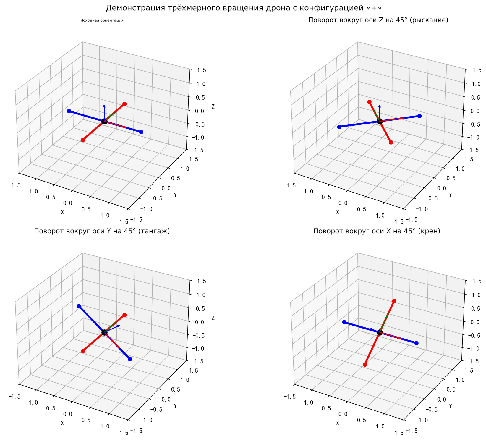
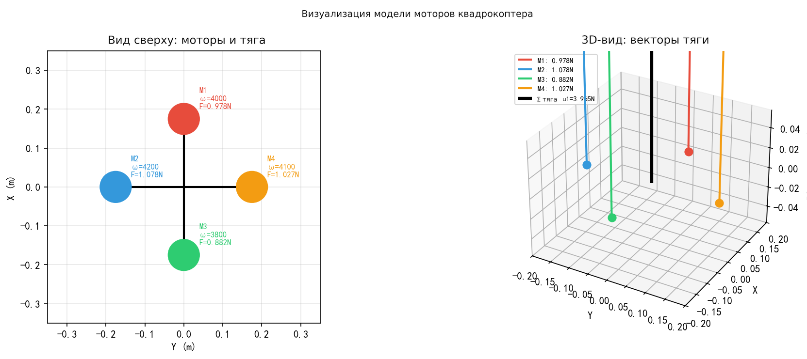
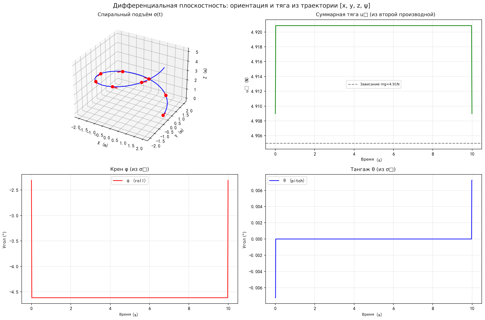
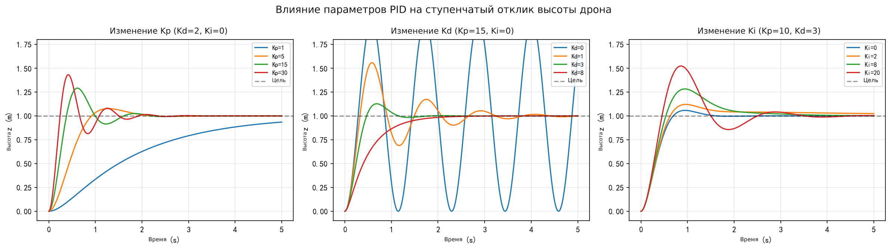
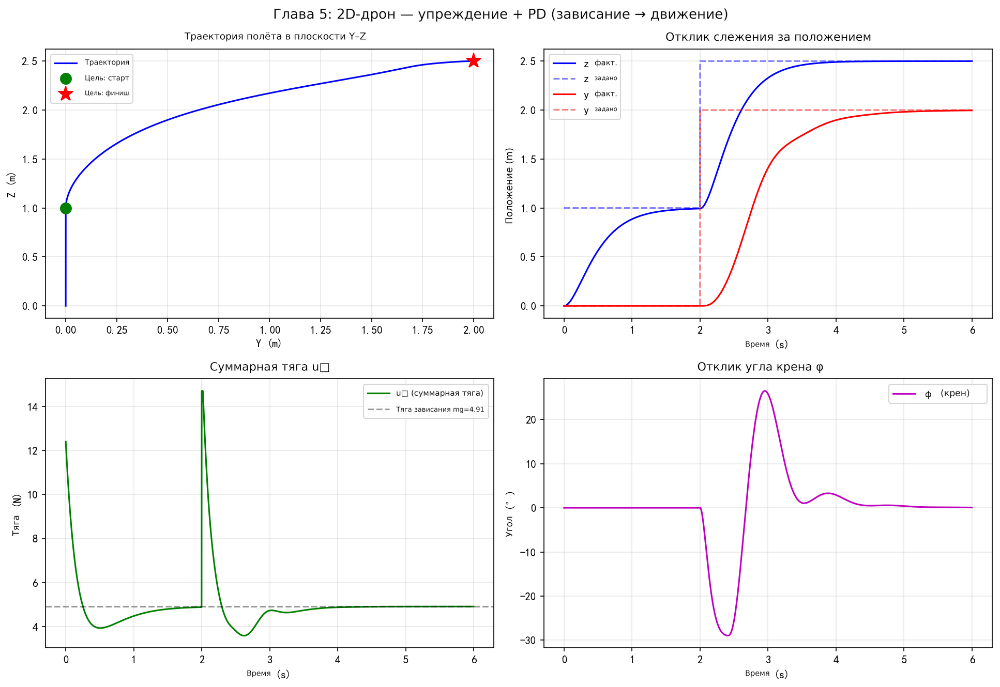
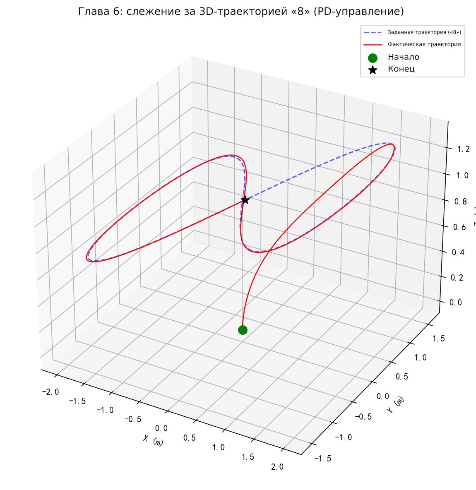
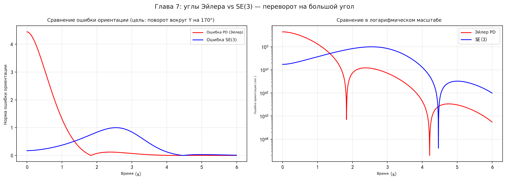
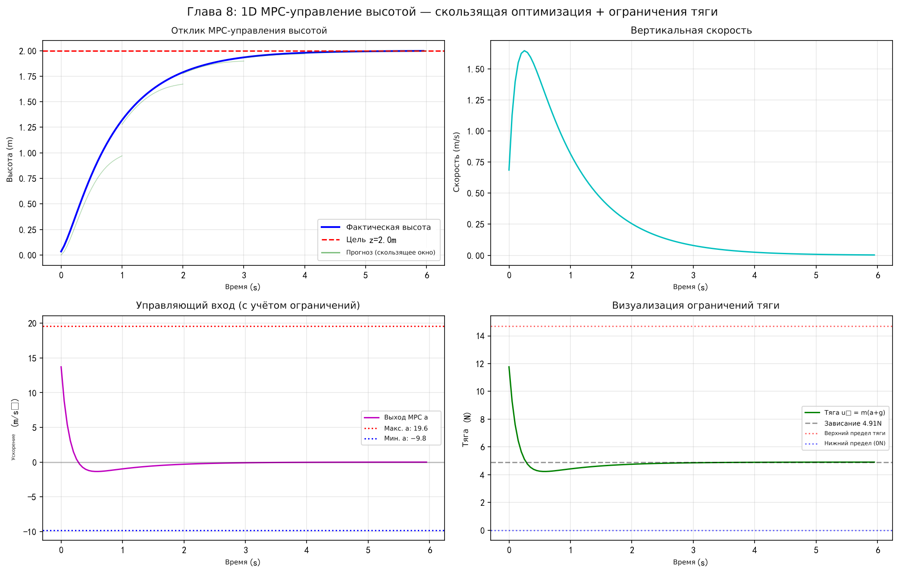

# Руководство по управлению квадрокоптером

## Введение

Это руководство от математических основ шаг за шагом строит полную систему управления квадрокоптером. Вот основные задачи глав и их взаимосвязь:

| Глава | Основная задача | Связь с другими главами |
|------|-------------|----------------|
| **1. Системы координат и основы вращения** | Как описать ориентацию дрона в трёхмерном пространстве? | Математическая база, нужна всем следующим главам |
| **2. Динамическое моделирование** | Как силы и моменты приводят дрон в движение? Каковы уравнения движения? | Опирается на главу 1 (матрицу вращения); даёт модель объекта управления для всех регуляторов |
| **3. Дифференциальная плоскостность** | Можно ли спланировать только траекторию $[x,y,z,\psi]$ и вывести по ней все состояния и входы? | Опирается на главу 2 (уравнения Ньютона); мост между «планированием траектории» и «управлением» |
| **4. Основы PID-управления** | Как параметры регулятора влияют на отклик системы? | Введение в теорию управления; отправная точка всех последующих методов |
| **5. Управление на основе модели** | Как использовать информацию о модели для улучшения управления? (2D) | Опирается на главу 2 (линеаризованную модель) и главу 4 (PID); добавляет структуру «прямая связь + обратная связь» |
| **6. Отслеживание трёхмерной траектории** | Как обобщить 2D-управление на полноценный 3D-полёт? | Трёхмерное расширение главы 5; добавлена обработка связи через угол рыскания |
| **7. Управление на SE(3)** | Как при больших углах манёвра избежать карданного замка эйлеровых углов? | Опирается на главу 3 (построение матрицы ориентации); нелинейная альтернатива главе 6 |
| **8. MPC-управление** | Как одновременно выполнять локальное планирование и управление при наличии ограничений? | Объединяет планирование и управление; опирается на главу 2 (прогнозную модель) |

**Рекомендации по чтению**:
- **Быстрое знакомство** (понять базовое управление): 1 → 2 → 4 → 5
- **Полное изучение**: по порядку 1 → 8
- **Тематическое чтение**: глава 3 (дифференциальная плоскостность) — необходимая предпосылка для руководства по планированию траекторий

Руководство по управлению (8 блоков кода):

1. Системы координат и вращение — визуализация трёхмерного вращения: «крест» дрона вокруг осей Z/Y/X
2. Динамика — по заданным частотам вращения четырёх моторов вычисляются тяга и момент, визуализируется направление тяги
3. Дифференциальная плоскостность — спиральная траектория → вывод углов ориентации и тяги по плоскому выходу
4. PID-управление — сравнение влияния $K_p$, $K_d$, $K_i$ на ступенчатый отклик системы второго порядка
5. Управление на основе модели — моделирование в плоскости Y-Z двумерного дрона: прямая связь + PD-управление
6. Трёхмерное отслеживание траектории — отслеживание траектории в форме восьмёрки, сравнение ожидаемого и фактического
7. Управление на SE(3) — большой переворот: сравнение ошибок управления по эйлеровым углам и на SE(3)
8. MPC-управление — MPC по высоте (1D), показаны прогнозный горизонт и обработка ограничений

---

## 1. Системы координат и основы вращения

Прежде чем изучать квадрокоптер, нужно разобраться в преобразованиях систем координат и матрицах вращения — это математическая основа описания ориентации дрона.

### 1.1 Геометрический вывод поворота двумерных координат

Рассмотрим точку на плоскости $A(x, y)$. Когда система координат поворачивается на угол $\theta$, координаты точки в новой системе равны $A'(x', y')$.

#### Способ 1: геометрическая проекция

Пусть исходная система координат — $OXY$, новая — $OX'Y'$ (поворот против часовой стрелки на $\theta$). Из геометрических соотношений проекций:

$$
x' = OB + BC = OD\cos\theta + AD\sin\theta = x\cos\theta + y\sin\theta
$$

$$
y' = AE - CE = AP\cos\theta - OD\sin\theta = y\cos\theta - x\sin\theta
$$

В матричной форме:

$$
\begin{bmatrix} x' \\ y' \end{bmatrix} = \begin{bmatrix} \cos\theta & \sin\theta \\ -\sin\theta & \cos\theta \end{bmatrix} \begin{bmatrix} x \\ y \end{bmatrix}
$$

#### Способ 2: полярные координаты

Пусть расстояние от точки $A$ до начала координат равно $r$, а угол с осью $X$ равен $\alpha$. После поворота:

$$
x' = r\cos(\alpha + \theta) = r\cos\alpha\cos\theta - r\sin\alpha\sin\theta = x\cos\theta - y\sin\theta
$$

$$
y' = r\sin(\alpha + \theta) = r\sin\alpha\cos\theta + r\cos\alpha\sin\theta = y\cos\theta + x\sin\theta
$$

В матричной форме:

$$
\begin{bmatrix} x' \\ y' \end{bmatrix} = \begin{bmatrix} \cos\theta & -\sin\theta \\ \sin\theta & \cos\theta \end{bmatrix} \begin{bmatrix} x \\ y \end{bmatrix}
$$

> **Пояснение:** Способ 2 — это поворот точки вокруг начала координат против часовой стрелки на угол $\theta$, поэтому матрица поворота здесь транспонирована по отношению к способу 1 (поворот системы координат).

### 1.2 Два режима поворота: отличия

**Режим 1: поворот осей координат (точка неподвижна, система координат поворачивается)**

Когда исходная система координат неподвижна, а её оси поворачиваются, находим координаты точки в новой системе:

$$
\begin{bmatrix} x' \\ y' \end{bmatrix} = \begin{bmatrix} \cos\theta & \sin\theta \\ -\sin\theta & \cos\theta \end{bmatrix} \begin{bmatrix} x \\ y \end{bmatrix}
$$

**Режим 2: поворот точки (система координат неподвижна, точка поворачивается)**

$$
\begin{bmatrix} x' \\ y' \end{bmatrix} = \begin{bmatrix} \cos\theta & -\sin\theta \\ \sin\theta & \cos\theta \end{bmatrix} \begin{bmatrix} x \\ y \end{bmatrix}
$$

> **Пояснение:** Координаты точки в новой системе равны тому, что оси координат повернуты по часовой стрелке на $\theta$. Представьте, что вы стоите на оси координат и вращаетесь вместе с ней: точки вокруг меняют положение относительно вас.

> **Пояснение:** Матрицы двух режимов транспонированы друг другу. Режим 1 можно понимать как «активный поворот системы координат», режим 2 — как «активный поворот точки». В задачах дрона обычно используется режим 1: известно, насколько повернулся корпус, и нужно выразить ту же точку в новой системе.

### 1.3 Трёхмерные матрицы вращения

Обобщим двумерный случай на три измерения: вращение вокруг каждой из трёх осей.

**Вращение вокруг оси $Z$ (рыскание, угол $\psi$):**

$$
R(\psi) = \begin{bmatrix} \cos\psi & -\sin\psi & 0 \\ \sin\psi & \cos\psi & 0 \\ 0 & 0 & 1 \end{bmatrix}
$$

**Вращение вокруг оси $Y$ (тангаж, угол $\theta$):**

$$
R(\theta) = \begin{bmatrix} \cos\theta & 0 & \sin\theta \\ 0 & 1 & 0 \\ -\sin\theta & 0 & \cos\theta \end{bmatrix}
$$

**Вращение вокруг оси $X$ (крен, угол $\phi$):**

$$
R(\phi) = \begin{bmatrix} 1 & 0 & 0 \\ 0 & \cos\phi & -\sin\phi \\ 0 & \sin\phi & \cos\phi \end{bmatrix}
$$

### 1.4 Преобразования систем координат дрона

> **Пояснение:** Для дрона применим «поворот системы координат»: система координат корпуса повёрнута относительно мировой, и нужно выразить вектор из системы корпуса в мировой системе.

Таким образом, поворот собственной системы координат задаётся как $R_c = R_o^T \cdot R_r$.

Если известна $R_o$ относительно $R_c$, то $R_o$ можно найти обратным расчётом из $R_c$. Но в этом случае поворот относительно мировой системы.

> **Пояснение:** В приложениях к дронам матрица вращения $R$ обычно описывает преобразование из системы корпуса (Body Frame) в мировую (World Frame): $\mathbf{p}_W = R \cdot \mathbf{p}_B$. Обратное преобразование (мир → корпус) равно $R^T$, потому что матрица вращения ортогональна: $R^{-1} = R^T$.

### Проверка в Python

```python
import numpy as np
import matplotlib.pyplot as plt
from mpl_toolkits.mplot3d import Axes3D

# ========== Визуализация вращения «крестообразного» дрона вокруг осей Z / Y / X ==========

# --- Строим «крест» дрона (4 конца луча + центр) ---
L = 1.0  # длина луча
drone = np.array([
    [ L, 0, 0],  # правый конец
    [-L, 0, 0],  # левый конец
    [ 0, L, 0],  # передний конец
    [ 0,-L, 0],  # задний конец
    [ 0, 0, 0],  # центр
]).T  # матрица 3×5, каждый столбец — одна точка

# --- Трёхмерные матрицы вращения ---
def Rz(psi):
    """Вращение вокруг оси Z (угол рыскания ψ)"""
    c, s = np.cos(psi), np.sin(psi)
    return np.array([[c, -s, 0], [s, c, 0], [0, 0, 1]])

def Ry(theta):
    """Вращение вокруг оси Y (угол тангажа θ)"""
    c, s = np.cos(theta), np.sin(theta)
    return np.array([[c, 0, s], [0, 1, 0], [-s, 0, c]])

def Rx(phi):
    """Вращение вокруг оси X (угол крена φ)"""
    c, s = np.cos(phi), np.sin(phi)
    return np.array([[1, 0, 0], [0, c, -s], [0, s, c]])

angle = np.radians(45)  # поворот на 45°

# --- Рисуем 4 подграфика: исходное положение + 3 поворота ---
titles = ['Исходная ориентация', f'Поворот вокруг Z на {int(np.degrees(angle))}° (рыскание)',
          f'Поворот вокруг Y на {int(np.degrees(angle))}° (тангаж)',
          f'Поворот вокруг X на {int(np.degrees(angle))}° (крен)']
rotations = [np.eye(3), Rz(angle), Ry(angle), Rx(angle)]

fig = plt.figure(figsize=(14, 10))
for i, (R, title) in enumerate(zip(rotations, titles)):
    ax = fig.add_subplot(2, 2, i + 1, projection='3d')
    pts = R @ drone  # координаты точек после поворота

    # Рисуем два луча (крест)
    ax.plot([pts[0,0], pts[0,1]], [pts[1,0], pts[1,1]],
            [pts[2,0], pts[2,1]], 'b-o', lw=3, label='Луч 1')
    ax.plot([pts[0,2], pts[0,3]], [pts[1,2], pts[1,3]],
            [pts[2,2], pts[2,3]], 'r-o', lw=3, label='Луч 2')
    # Отмечаем центр
    ax.scatter(*pts[:, 4], color='k', s=80, zorder=5)

    # Рисуем повёрнутые оси системы корпуса
    axis_len = 0.6
    for j, (color, lbl) in enumerate(zip(['r','g','b'], ['Xb','Yb','Zb'])):
        axis_vec = R @ (axis_len * np.eye(3)[:, j])
        ax.quiver(0, 0, 0, *axis_vec, color=color, arrow_length_ratio=0.15)

    ax.set_xlim(-1.5, 1.5); ax.set_ylim(-1.5, 1.5); ax.set_zlim(-1.5, 1.5)
    ax.set_xlabel('X'); ax.set_ylabel('Y'); ax.set_zlabel('Z')
    ax.set_title(title)

plt.suptitle('Трёхмерный поворот «крестообразного» дрона', fontsize=14)
plt.tight_layout()
import os; os.makedirs('assets', exist_ok=True)
plt.savefig('assets/control1.png', dpi=150, bbox_inches='tight')
plt.show()
```

Результат выполнения:



---

## 2. Динамическое моделирование квадрокоптера

### 2.1 Модель мотора

Тяга квадрокоптера создаётся четырьмя моторами. Их модель такая:

**Модель частоты вращения мотора (инерционное звено первого порядка):**

$$
\dot{\omega}_i = k_m(\omega_i^{des} - \omega_i)
$$

> **Пояснение:** Модель частоты вращения мотора предоставляется производителем: внутри уже есть замкнутый контур управления, поэтому при моделировании его внутреннее устройство можно не учитывать и использовать модель напрямую. Коэффициент $k_m$ можно определить по измерениям.

**Тяга одного мотора:**

$$
F_i = k_F \omega_i^2 \quad
$$

**Реактивный момент одного мотора:**

$$
M_i = k_M \omega_i^2
$$

Здесь $k_m$ — постоянная отклика мотора, $k_F$ — коэффициент тяги, $k_M$ — коэффициент момента.

> **Пояснение:** Тяга и момент пропорциональны квадрату частоты вращения — это базовый результат аэродинамики. В реальных системах $k_F$ и $k_M$ определяются стендовыми испытаниями. Модель мотора — инерционное звено первого порядка: чем больше $k_m$, тем быстрее отклик мотора; при проектировании регулятора обычно предполагают, что отклик достаточно быстрый, и эту динамику можно не учитывать.

### 2.2 Эйлеровы углы в порядке Z-X-Y и матрица вращения

Вращение описывается эйлеровыми углами в порядке Z-X-Y (сначала рыскание $\psi$, затем крен $\phi$, затем тангаж $\theta$):

$$
R_{ab} = R_z(\psi) \cdot R_x(\phi) \cdot R_y(\theta)
$$

Раскрывая (обозначим $c = \cos$, $s = \sin$):

$$
R_{ab} = \begin{bmatrix} c\psi c\theta - s\phi s\psi s\theta & -c\phi s\psi & c\psi s\theta + c\theta s\phi s\psi \\ c\theta s\psi + c\psi s\phi s\theta & c\phi c\psi & s\psi s\theta - c\psi c\theta s\phi \\ -c\phi s\theta & s\phi & c\phi c\theta \end{bmatrix} \quad
$$

### 2.3 Связь угловой скорости и производных эйлеровых углов

Связь угловой скорости корпуса $[\omega_x, \omega_y, \omega_z]^T$ и производных эйлеровых углов $[\dot{\phi}, \dot{\theta}, \dot{\psi}]^T$:

$$
\begin{bmatrix} \omega_x \\ \omega_y \\ \omega_z \end{bmatrix} = \begin{bmatrix} c\theta & 0 & -c\phi s\theta \\ 0 & 1 & s\phi \\ s\theta & 0 & c\phi c\theta \end{bmatrix} \begin{bmatrix} \dot{\phi} \\ \dot{\theta} \\ \dot{\psi} \end{bmatrix} \quad
$$

> **Пояснение:** Эта матрица преобразования вырождается при $\phi = \pm 90°$ (карданный замок) — это внутренний недостаток представления эйлеровыми углами. Для малых углов (например, около зависания) матрица близка к единичной, то есть угловая скорость примерно равна производным эйлеровых углов.

### 2.4 Уравнение Ньютона (динамика поступательного движения)

> **Пояснение:** Уравнения Ньютона — Эйлера записываются в инерциальной системе координат и описывают движение дрона под действием суммарной силы и момента.

Уравнение Ньютона описывает поступательное движение центра масс:

$$
m\ddot{\mathbf{p}} = \begin{bmatrix} 0 \\ 0 \\ -mg \end{bmatrix} + R \begin{bmatrix} 0 \\ 0 \\ F_1 + F_2 + F_3 + F_4 \end{bmatrix} \quad
$$

> **Пояснение:** Левая часть $m\ddot{\mathbf{p}}$ — масса, умноженная на ускорение центра масс. Первое слагаемое справа — сила тяжести (вертикально вниз), второе — суммарная тяга, которую матрица $R$ переводит из системы корпуса в мировую (тяга всегда направлена вдоль оси $z$ корпуса). Сопротивление воздуха не учитывается.

Обозначим суммарную тягу $u_1 = F_1 + F_2 + F_3 + F_4$. Раскрывая по компонентам:

$$
m\ddot{x} = u_1(c\psi s\theta c\phi + s\psi s\phi)
$$

$$
m\ddot{y} = u_1(s\psi s\theta c\phi - c\psi s\phi)
$$

$$
m\ddot{z} = -mg + u_1 c\phi c\theta
$$

### 2.5 Уравнения Эйлера (динамика вращения)

$$
I \begin{bmatrix} \dot{\omega}_x \\ \dot{\omega}_y \\ \dot{\omega}_z \end{bmatrix} + \begin{bmatrix} \omega_x \\ \omega_y \\ \omega_z \end{bmatrix} \times I \begin{bmatrix} \omega_x \\ \omega_y \\ \omega_z \end{bmatrix} = \begin{bmatrix} l(F_2 - F_4) \\ l(F_3 - F_1) \\ M_1 - M_2 + M_3 - M_4 \end{bmatrix} \quad
$$

Правые части задают входы управляющего момента:

$$
u_2 = l(F_2 - F_4), \quad u_3 = l(F_3 - F_1), \quad u_4 = M_1 - M_2 + M_3 - M_4
$$

> **Пояснение:** Уравнения Эйлера записываются в системе корпуса, потому что тензор инерции $I$ в системе корпуса — постоянная диагональная матрица. Так избегается сложность, связанная с изменением ориентации.

> **Пояснение:** Член $\omega \times I\omega$ — момент Кориолиса / гироскопический эффект. Вблизи зависания (малые угловые скорости) им можно пренебречь, что и служит основой для последующей линеаризации. $u_2$ и $u_3$ создают моменты крена и тангажа через разность тяги, а $u_4$ создаёт момент рыскания через разность реактивных моментов.

### 2.6 Сводка модели динамики

| Номер | Название | Описание |
|------|------|------|
| ① | Модель мотора | $F_i = k_F \omega_i^2$ |
| ② | Уравнения Эйлера | Динамика вращения |
| ③ | Преобразование угловых скоростей | Связь угловой скорости и производных эйлеровых углов |
| ④ | Матрица вращения | Представление эйлеровыми углами Z-X-Y |
| ⑤ | Уравнения Ньютона | Динамика поступательного движения |

### 2.7 Пример уравнения состояния для плоскости

Рассмотрим движение в плоскости (Y-Z). Вектор состояния $\mathbf{x} = [y, z, \phi, \dot{y}, \dot{z}, \dot{\phi}]^T$, вход $\mathbf{u} = [u_1, u_2]^T$:

$$
\begin{bmatrix} \ddot{y} \\ \ddot{z} \\ \ddot{\phi} \end{bmatrix} = \begin{bmatrix} -\frac{u_1}{m}\sin\phi \\ \frac{u_1}{m}\cos\phi - g \\ \frac{u_2}{I_{xx}} \end{bmatrix}
$$

> **Пояснение:** Это нелинейное уравнение состояния для двумерного случая. Видно, что ускорение по $y$ зависит от $\sin\phi$ (сначала нужно наклониться, чтобы двигаться горизонтально), ускорение по $z$ — от $\cos\phi$ (вертикальная составляющая тяги), а $\phi$ напрямую управляется моментом $u_2$. Это проявление «недоактуированности» квадрокоптера: четыре входа, а управлять приходится шестью степенями свободы.

### Проверка в Python

```python
import numpy as np
import matplotlib.pyplot as plt
from mpl_toolkits.mplot3d import Axes3D

# ========== Модель тяги и момента квадрокоптера: расчёт и визуализация ==========

# --- Параметры моторов ---
kF = 6.11e-8   # коэффициент тяги (Н/(рад/с)^2)
kM = 1.5e-9    # коэффициент момента (Н·м/(рад/с)^2)
L  = 0.175     # длина луча (м)

# --- Частоты вращения четырёх моторов (рад/с), имитация асимметричного полёта ---
omega = np.array([4000, 4200, 3800, 4100])  # ω1, ω2, ω3, ω4

# --- Тяга и реактивный момент каждого мотора ---
F = kF * omega**2     # тяга каждого мотора
M = kM * omega**2     # реактивный момент каждого мотора

# --- Суммарная тяга и управляющие моменты ---
u1 = np.sum(F)                       # суммарная тяга
u2 = L * (F[1] - F[3])              # момент крена
u3 = L * (F[2] - F[0])              # момент тангажа
u4 = M[0] - M[1] + M[2] - M[3]     # момент рыскания

print(f"Тяга моторов: F = {F} Н")
print(f"Суммарная тяга u1 = {u1:.4f} Н")
print(f"Момент крена u2 = {u2:.6f} Н·м")
print(f"Момент тангажа u3 = {u3:.6f} Н·м")
print(f"Момент рыскания u4 = {u4:.8f} Н·м")

# --- Визуализация: вид сверху (положения моторов и тяга) и 3D-векторы тяги ---
fig = plt.figure(figsize=(14, 5))

# Подграф 1: вид сверху, положения моторов и величина тяги
ax1 = fig.add_subplot(1, 2, 1)
motor_pos = np.array([[0, L], [-L, 0], [0, -L], [L, 0]])  # мотор 1 спереди, 2 слева, 3 сзади, 4 справа
colors = ['#e74c3c', '#3498db', '#2ecc71', '#f39c12']
for i in range(4):
    circle = plt.Circle(motor_pos[i], 0.04, color=colors[i], zorder=5)
    ax1.add_patch(circle)
    ax1.annotate(f'M{i+1}\nω={omega[i]}\nF={F[i]:.3f}Н',
                 motor_pos[i], textcoords="offset points",
                 xytext=(15, 10), fontsize=8, color=colors[i])
# Рисуем корпус-крест
ax1.plot([motor_pos[1,0], motor_pos[3,0]],
         [motor_pos[1,1], motor_pos[3,1]], 'k-', lw=2)
ax1.plot([motor_pos[0,0], motor_pos[2,0]],
         [motor_pos[0,1], motor_pos[2,1]], 'k-', lw=2)
ax1.set_xlim(-0.35, 0.35); ax1.set_ylim(-0.35, 0.35)
ax1.set_aspect('equal'); ax1.grid(True, alpha=0.3)
ax1.set_title('Вид сверху: расположение моторов и тяга'); ax1.set_xlabel('Y (м)'); ax1.set_ylabel('X (м)')

# Подграф 2: 3D-вид, стрелки тяги
ax2 = fig.add_subplot(1, 2, 2, projection='3d')
for i in range(4):
    x, y = motor_pos[i]
    # Стрелки тяги каждого мотора (вдоль оси Z вверх)
    scale = F[i] / np.max(F) * 0.3  # нормировка для отображения
    ax2.quiver(x, y, 0, 0, 0, scale, color=colors[i],
               arrow_length_ratio=0.2, lw=2, label=f'M{i+1}: {F[i]:.3f}Н')
    ax2.scatter(x, y, 0, color=colors[i], s=60)
# Стрелка суммарной тяги (из центра)
ax2.quiver(0, 0, 0, 0, 0, 0.4, color='k', arrow_length_ratio=0.15,
           lw=3, label=f'Суммарная тяга u1={u1:.3f}Н')
ax2.set_xlabel('Y'); ax2.set_ylabel('X'); ax2.set_zlabel('Z (направление тяги)')
ax2.set_title('3D-вид: векторы тяги'); ax2.legend(fontsize=7, loc='upper left')

plt.suptitle('Визуализация модели мотора квадрокоптера', fontsize=14)
plt.tight_layout()
import os; os.makedirs('assets', exist_ok=True)
plt.savefig('assets/control2.png', dpi=150, bbox_inches='tight')
plt.show()
```

Результат выполнения:



---

## 3. Дифференциальная плоскостность

### 3.1 Определение и смысл дифференциальной плоскостности

> **Пояснение:** Дифференциальная плоскостность — мост между планированием траектории и управлением. Если система плоская, планировщику достаточно задать траекторию плоского выхода, а все состояния и входы выводятся автоматически. В сочетании с управлением на SE(3) это позволяет очень точно отслеживать положение и ориентацию.

Дифференциальная плоскостность (Differential Flatness) означает: если все состояния и входы системы выражаются через набор **плоских выходов (Flat Output)** и их конечное число производных, то система дифференциально плоская.

> **Пояснение:** У квадрокоптера 12 переменных состояния и 4 входа, но плоский выход имеет только 4 компонента ($x, y, z, \psi$). Смысл плоскостности в том, что если все состояния и входы выражаются через плоский выход и его конечные производные, то задачу управления высокой размерности можно свести к проектированию траектории для четырёх плоских выходов.

### 3.2 Выбор плоского выхода

Для квадрокоптера плоский выход выбирается так:

$$
\sigma = [x, y, z, \psi]^T
$$

Он задаёт достаточно широкое множество траекторий:

$$
G(t) = [T_i, T_f] \rightarrow \mathbb{R}^3 \times SO(3)
$$

> **Пояснение:** Плоский выход $\sigma$ задаёт траекторию на $SE(3)$, то есть полное движение твёрдого тела, включающее и положение ($\mathbb{R}^3$), и ориентацию ($SO(3)$). Преобразование из мировой системы координат в систему корпуса полностью определяется $\sigma$ и его производными.

Полный вектор состояния:

$$
X = [x, y, z, \dot{x}, \dot{y}, \dot{z}, \phi, \theta, \psi, \omega_x, \omega_y, \omega_z]^T
$$

> **Пояснение:** Если задать $\sigma = [x, y, z]^T$ и $\dot{\sigma} = [\dot{x}, \dot{y}, \dot{z}]^T$, можно аналитически получить углы крена, тангажа, рыскания и угловые скорости.

### 3.3 Вывод всех состояний по плоскому выходу

Главная ценность дифференциальной плоскостности: зная $\sigma(t) = [x(t), y(t), z(t), \psi(t)]$ и его производные, можно вывести все 12 состояний и 4 входа. Путь вывода:

| Известная величина | Выводимая величина | Требуемый порядок производной |
|-------|-------|-----------|
| $\sigma$ | Положение $x, y, z$ | 0-го порядка |
| $\dot{\sigma}$ | Скорость $\dot{x}, \dot{y}, \dot{z}$ | 1-го порядка |
| $\ddot{\sigma}$ | Суммарная тяга $u_1$; углы ориентации $\phi, \theta$ | 2-го порядка |
| $\sigma^{(3)}$ | Угловые скорости $p, q$ | 3-го порядка |
| $\sigma^{(4)}$ | Угловые ускорения $\dot{p}, \dot{q}$; моменты $u_2, u_3$ | 4-го порядка (snap) |

> **Пояснение:** Поэтому при планировании траектории минимизируют **snap** (четвёртую производную): он напрямую связан с величиной управляющего момента. Если snap велик, требуются большие моменты, и моторы могут выйти на насыщение.

### 3.4 Вывод углов ориентации

Исходим из уравнения Ньютона:

$$
m\ddot{\mathbf{p}} = -mg\hat{z}_W + u_1 \hat{z}_B
$$

#### Вывод суммарной тяги $u_1$

$$
u_1 \hat{z}_B = m\ddot{\mathbf{r}} + mg\hat{z}_W
$$

> **Пояснение:** Суммарная тяга $u_1$ равна модулю равнодействующей: $u_1 = m\sqrt{\ddot{x}^2 + \ddot{y}^2 + (\ddot{z}+g)^2}$. Физический смысл: тяга должна одновременно компенсировать силу тяжести и создавать требуемое ускорение.

Отсюда направление оси $z$ корпуса:

$$
\hat{z}_B = \frac{m[\ddot{x}, \ddot{y}, \ddot{z}+g]^T}{\|m[\ddot{x}, \ddot{y}, \ddot{z}+g]^T\|} = \mathbf{t}
$$

где $\mathbf{t}$ — единичный вектор направления тяги.

#### Построение желаемой матрицы вращения

Через промежуточный вектор $\hat{x}_C$ (направление которого задаётся углом рыскания $\psi$):

$$
\hat{x}_C = [\cos\psi, \sin\psi, 0]^T
$$

$$
\hat{y}_B = \frac{\hat{z}_B \times \hat{x}_C}{\|\hat{z}_B \times \hat{x}_C\|}
$$

> **Пояснение:** Идея построения матрицы вращения: сначала из направления тяги определяем $\hat{z}_B$, затем из угла рыскания — вспомогательное направление $\hat{x}_C$. $\hat{y}_B$ получаем векторным произведением $\hat{z}_B \times \hat{x}_C$: он перпендикулярен плоскости, образованной $\hat{z}_B$ и $\hat{x}_C$. Наконец, $\hat{x}_B = \hat{y}_B \times \hat{z}_B$ дополняет правую систему координат.

$$
\hat{x}_B = \hat{y}_B \times \hat{z}_B
$$

$$
R_{ab} = [\hat{x}_B, \hat{y}_B, \hat{z}_B]
$$

#### Извлечение эйлеровых углов

Из матрицы вращения извлекаем эйлеровы углы:

$$
\psi = \arctan\frac{r_{21}}{r_{11}}, \quad \theta = \arcsin(-r_{31}), \quad \phi = \arcsin\frac{r_{32}}{r_{33}}
$$

> **Пояснение:** Поэтому $\phi$ и $\theta$ полностью определяются второй производной плоского выхода $[x, y, z, \psi]$ (то есть ускорением); более высокие производные не нужны.

### 3.5 Вывод угловых скоростей $p, q, r$

> **Пояснение:** Далее выводим угловые скорости $p, q, r$. Для этого нужно ещё раз взять производную уравнения Ньютона по времени (от ускорения к рывку, jerk).

Производная уравнения Ньютона по времени (рывок):

$$
m\mathbf{p}^{(3)} = \frac{d}{dt}(-mg\hat{z}_W) + \frac{d}{dt}(u_1\hat{z}_B)
$$

> **Пояснение:** $\hat{z}_W$ — постоянный единичный вектор мировой системы, не меняющийся во времени, поэтому $\frac{d}{dt}(-mg\hat{z}_W) = 0$.

Так как $\hat{z}_W$ — постоянный вектор, его производная равна нулю, и:

$$
m\mathbf{p}^{(3)} = \dot{u}_1 \hat{z}_B + u_1 \dot{\hat{z}}_B
$$

> **Пояснение:** При дифференцировании $u_1\hat{z}_B$ используем правило произведения: $\dot{u}_1$ — скорость изменения величины тяги, $\dot{\hat{z}}_B$ — скорость изменения направления тяги. По кинематике твёрдого тела производная направляющего вектора выражается через векторное произведение с угловой скоростью: $\dot{\hat{z}}_B = \omega_{BW} \times \hat{z}_B$.

С учётом кинематического соотношения $\dot{\hat{z}}_B = \omega_{BW} \times \hat{z}_B$:

$$
m\mathbf{p}^{(3)} = \dot{u}_1 \hat{z}_B + \omega_{BW} \times u_1 \hat{z}_B
$$

Исключаем составляющую вдоль $\hat{z}_B$ (умножаем скалярно на $\hat{z}_B$ и вычитаем):

$$
m\mathbf{p}^{(3)} - (\hat{z}_B \cdot m\mathbf{p}^{(3)})\hat{z}_B = \omega_{BW} \times u_1\hat{z}_B
$$

Введём вспомогательный вектор:

$$
h_W = \frac{\omega_{BW} \times \hat{z}_B}{u_1} = \frac{m}{u_1}\left(\mathbf{p}^{(3)} - (\hat{z}_B \cdot \mathbf{p}^{(3)})\hat{z}_B\right)
$$

> **Пояснение:** $h_W$ — вспомогательный вектор: он вычисляется по известным рывку и тяге и содержит информацию о составляющих $\omega_{BW}$ в плоскости, перпендикулярной $\hat{z}_B$, из которой можно извлечь $p$ и $q$.

#### Извлечение компонент $p, q, r$

Угловая скорость в системе корпуса:

$$
\omega_{BW} = p\hat{x}_B + q\hat{y}_B + r\hat{z}_B
$$

> **Пояснение:** $\omega_{BW} = p\hat{x}_B + q\hat{y}_B + r\hat{z}_B$ — разложение вектора по базису. Благодаря ортогональности $\hat{x}_B, \hat{y}_B, \hat{z}_B$ компоненты выделяются скалярными произведениями.

Поскольку $\hat{x}_B \cdot \hat{y}_B = 0$ (ортогональные базисные векторы), скалярное произведение ортогональных векторов равно нулю.

Используя $h_W = \omega_{BW} \times \hat{z}_B / u_1$ и скалярно умножая на единичные векторы осей:

$$
p = -h_W \cdot \hat{y}_B
$$

$$
q = h_W \cdot \hat{x}_B
$$

Для компоненты $r$ — угловая скорость $\omega_{BW}$ вдоль $\hat{z}_B$:

$$
r = \omega_{BW} \cdot \hat{z}_B = p(\hat{x}_B \cdot \hat{z}_B) + q(\hat{y}_B \cdot \hat{z}_B) + r(\hat{z}_B \cdot \hat{z}_B)
$$

> **Пояснение:** По ортогональности $\hat{x}_B \perp \hat{z}_B$ и $\hat{y}_B \perp \hat{z}_B$, поэтому составляющая $r$ вдоль $\hat{z}_B$ не может быть получена из $h_W$ (он перпендикулярен $\hat{z}_B$); её находят через скорость рыскания $\dot{\psi}$.

$$
r = \omega_{BW} \cdot \hat{z}_B = (\omega_{BL} + \omega_{CW}) \cdot \hat{z}_B = \omega_{CW} \cdot \hat{z}_B = \dot{\psi} \hat{z}_W \cdot \hat{z}_B
$$

> **Пояснение:** Компонента $r$ напрямую связана со скоростью рыскания $\dot{\psi}$ — это отражает, что угол рыскания — самостоятельный плоский выход. Компоненты $p, q$ требуют рывка (третьей производной), а $r$ достаточно $\dot{\psi}$ — в этом проявляется развязка канала рыскания.

### Проверка в Python

```python
import numpy as np
import matplotlib.pyplot as plt
# ========== Проверка дифференциальной плоскостности: вывод углов ориентации и тяги по круговой траектории ==========

# --- Физические параметры ---
m = 0.5    # масса дрона (кг)
g = 9.81   # ускорение свободного падения (м/с²)

# --- Круговая траектория (плоский выход σ = [x, y, z, ψ]) ---
T_total = 10.0              # полное время (с)
dt = 0.01
t = np.arange(0, T_total, dt)
omega_c = 2 * np.pi / T_total  # угловая частота круговой траектории

# Траектория положения: горизонтальный круг + медленный подъём + рыскание по направлению скорости
radius = 2.0
x = radius * np.cos(omega_c * t)
y = radius * np.sin(omega_c * t)
z = 0.5 * t                                # спиральный подъём
psi = np.arctan2(np.gradient(y, dt), np.gradient(x, dt))  # угол рыскания следует направлению скорости

# --- Вычисление производных ---
ddx = np.gradient(np.gradient(x, dt), dt)  # вторая производная x (ускорение)
ddy = np.gradient(np.gradient(y, dt), dt)  # вторая производная y
ddz = np.gradient(np.gradient(z, dt), dt)  # вторая производная z

# --- Суммарная тяга u1 из дифференциальной плоскостности ---
u1 = m * np.sqrt(ddx**2 + ddy**2 + (ddz + g)**2)

# --- Углы крена φ и тангажа θ по ускорениям ---
# Направление оси z корпуса (единичный вектор тяги)
tx = ddx / (ddz + g + 1e-10)
ty = ddy / (ddz + g + 1e-10)

# Эйлеровы углы через связь с матрицей вращения
phi   = np.arcsin(np.clip(tx * np.sin(psi) - ty * np.cos(psi), -1, 1))  # угол крена
theta = np.arctan2(tx * np.cos(psi) + ty * np.sin(psi),
                   1 + ddz / g)  # угол тангажа

# --- Построение результатов ---
fig = plt.figure(figsize=(15, 10))

# Подграф 1: трёхмерная траектория
ax1 = fig.add_subplot(2, 2, 1, projection='3d')
ax1.plot(x, y, z, 'b-', lw=1.5)
# Через равные интервалы отмечаем положение дрона и направление
step = len(t) // 8
for i in range(0, len(t), step):
    ax1.scatter(x[i], y[i], z[i], c='r', s=40, zorder=5)
    dx_arrow = 0.3 * np.cos(psi[i])
    dy_arrow = 0.3 * np.sin(psi[i])
    ax1.quiver(x[i], y[i], z[i], dx_arrow, dy_arrow, 0,
               color='r', arrow_length_ratio=0.3)
ax1.set_xlabel('X (м)'); ax1.set_ylabel('Y (м)'); ax1.set_zlabel('Z (м)')
ax1.set_title('Спиральная траектория σ(t)')

# Подграф 2: суммарная тяга u1
ax2 = fig.add_subplot(2, 2, 2)
ax2.plot(t, u1, 'g-', lw=1.5)
ax2.axhline(y=m*g, color='k', ls='--', alpha=0.5, label=f'Тяга зависания mg={m*g:.2f}Н')
ax2.set_xlabel('Время (с)'); ax2.set_ylabel('u₁ (Н)')
ax2.set_title('Суммарная тяга u₁ (выведена из вторых производных)'); ax2.legend(); ax2.grid(True, alpha=0.3)

# Подграф 3: угол крена φ
ax3 = fig.add_subplot(2, 2, 3)
ax3.plot(t, np.degrees(phi), 'r-', lw=1.5, label='φ (крен)')
ax3.set_xlabel('Время (с)'); ax3.set_ylabel('Угол (°)')
ax3.set_title('Угол крена φ (выведен из σ̈)'); ax3.legend(); ax3.grid(True, alpha=0.3)

# Подграф 4: угол тангажа θ
ax4 = fig.add_subplot(2, 2, 4)
ax4.plot(t, np.degrees(theta), 'b-', lw=1.5, label='θ (тангаж)')
ax4.set_xlabel('Время (с)'); ax4.set_ylabel('Угол (°)')
ax4.set_title('Угол тангажа θ (выведен из σ̈)'); ax4.legend(); ax4.grid(True, alpha=0.3)

plt.suptitle('Проверка дифференциальной плоскостности: ориентация и тяга из траектории [x,y,z,ψ]', fontsize=14)
plt.tight_layout()
import os; os.makedirs('assets', exist_ok=True)
plt.savefig('assets/control3.png', dpi=150, bbox_inches='tight')
plt.show()
```

Результат выполнения:



---

## 4. Основы PID-управления

### 4.1 Влияние параметров PID на отклик системы

Три параметра PID-регулятора $K_p$, $K_d$, $K_i$ по-разному влияют на характеристики отклика:

| Параметр | Время нарастания (Rise Time) | Перерегулирование (Overshoot) | Время установления (Settling Time) | Установившаяся ошибка (Steady-state Error) |
|------|----------------------|---------------------|--------------------------|-------------------------------|
| $K_p \uparrow$ | уменьшается | увеличивается | уменьшается | уменьшается |
| $K_d \uparrow$ | — | уменьшается | уменьшается | — |
| $K_i \uparrow$ | увеличивается | увеличивается | увеличивается | — |

### 4.2 Характеристики ступенчатого отклика

Ключевые показатели ступенчатого отклика:

- **Время нарастания (Rise Time)**: время, за которое отклик поднимается от начального значения до установившегося
- **Перерегулирование (Overshoot)**: максимальное превышение отклика над установившимся значением
- **Время установления (Settling Time)**: время, за которое отклик входит и остаётся в пределах $\pm 1\%$ (или $\pm 5\%$) от установившегося значения
- **Установившаяся ошибка (Steady-state Error)**: разность между установившимся значением отклика и ожидаемым

> **Пояснение:** Для времени установления часто используют два стандарта: вход в зону $\pm 5\%$ или $\pm 1\%$. В инженерной практике чаще применяют $\pm 2\%$.

> **Пояснение:** $K_p$ уменьшает время нарастания, но увеличивает перерегулирование; $K_d$ добавляет демпфирование и снижает перерегулирование; $K_i$ устраняет установившуюся ошибку, но может вызвать колебания. При управлении квадрокоптером разумная настройка этих трёх параметров критически важна: обычно сначала подбирают $K_p$ для скорости отклика, затем $K_d$ для подавления перерегулирования, и наконец добавляют умеренный $K_i$ для устранения установившейся ошибки.

### Проверка в Python

```python
import numpy as np
import matplotlib.pyplot as plt
# ========== Влияние настроек PID на ступенчатый отклик системы второго порядка ==========
# Объект управления: упрощённая модель высоты дрона  m * z̈ = u - mg
# Эквивалентная система второго порядка: ë + (Kd/m)*ė + (Kp/m)*e = -(Ki/m)*∫e dt

def simulate_pid(Kp, Kd, Ki, dt=0.001, T=5.0):
    """Моделирование ступенчатого отклика системы с PID-управлением"""
    steps = int(T / dt)
    z = 0.0       # текущая позиция (высота)
    dz = 0.0      # текущая скорость
    z_des = 1.0   # заданная высота (ступенчатый вход)
    m = 0.5       # масса дрона
    g = 9.81      # ускорение свободного падения
    integral = 0.0  # интегральная составляющая

    z_hist = np.zeros(steps)
    for i in range(steps):
        e = z_des - z           # ошибка положения
        de = -dz                # ошибка скорости (ожидаемая скорость 0)
        integral += e * dt      # интеграл ошибки

        # Закон PID-управления: u = mg + Kp*e + Kd*ė + Ki*∫e
        u = m * g + Kp * e + Kd * de + Ki * integral

        # Динамика: m * z̈ = u - mg
        ddz = (u - m * g) / m
        dz += ddz * dt
        z += dz * dt
        z_hist[i] = z
    return z_hist

dt = 0.001; T = 5.0
t = np.arange(0, T, dt)

# --- Подграф 1: меняем Kp (Kd=2, Ki=0 фиксированы) ---
fig, axes = plt.subplots(1, 3, figsize=(16, 4.5))

ax = axes[0]
for Kp in [1, 5, 15, 30]:
    z_hist = simulate_pid(Kp=Kp, Kd=2.0, Ki=0.0, dt=dt, T=T)
    ax.plot(t, z_hist, label=f'Kp={Kp}')
ax.axhline(y=1.0, color='k', ls='--', alpha=0.4, label='Цель')
ax.set_title('Изменение Kp (Kd=2, Ki=0)')
ax.set_xlabel('Время (с)'); ax.set_ylabel('Высота z (м)')
ax.legend(fontsize=8); ax.grid(True, alpha=0.3)
ax.set_ylim(-0.1, 1.8)

# --- Подграф 2: меняем Kd (Kp=15, Ki=0 фиксированы) ---
ax = axes[1]
for Kd in [0, 1, 3, 8]:
    z_hist = simulate_pid(Kp=15.0, Kd=Kd, Ki=0.0, dt=dt, T=T)
    ax.plot(t, z_hist, label=f'Kd={Kd}')
ax.axhline(y=1.0, color='k', ls='--', alpha=0.4, label='Цель')
ax.set_title('Изменение Kd (Kp=15, Ki=0)')
ax.set_xlabel('Время (с)'); ax.set_ylabel('Высота z (м)')
ax.legend(fontsize=8); ax.grid(True, alpha=0.3)
ax.set_ylim(-0.1, 1.8)

# --- Подграф 3: меняем Ki (Kp=10, Kd=3 фиксированы) ---
ax = axes[2]
for Ki in [0, 2, 8, 20]:
    z_hist = simulate_pid(Kp=10.0, Kd=3.0, Ki=Ki, dt=dt, T=T)
    ax.plot(t, z_hist, label=f'Ki={Ki}')
ax.axhline(y=1.0, color='k', ls='--', alpha=0.4, label='Цель')
ax.set_title('Изменение Ki (Kp=10, Kd=3)')
ax.set_xlabel('Время (с)'); ax.set_ylabel('Высота z (м)')
ax.legend(fontsize=8); ax.grid(True, alpha=0.3)
ax.set_ylim(-0.1, 1.8)

plt.suptitle('Влияние параметров PID на ступенчатый отклик высоты дрона', fontsize=14)
plt.tight_layout()
import os; os.makedirs('assets', exist_ok=True)
plt.savefig('assets/control4.png', dpi=150, bbox_inches='tight')
plt.show()
```

Результат выполнения:



---

## 5. Управление на основе модели

### 5.1 Модель второго порядка

Типичная модель второго порядка:

$$
m\ddot{x}(t) + b\dot{x}(t) + kx(t) = u(t)
$$

где $m$ — масса, $b$ — коэффициент демпфирования, $k$ — жёсткость пружины, $u(t)$ — управляющий вход.

### 5.2 PD-управление

Закон PD-управления:

$$
u(t) = \ddot{x}^{des}(t) + k_d \dot{e}(t) + k_p e(t)
$$

где $e(t) = x^{des}(t) - x(t)$ — ошибка отслеживания.

> **Пояснение:** Чистое PD-управление не использует информацию о модели: оно не может полностью компенсировать динамику системы, а при наличии шума датчиков и ошибок модели ошибка отслеживания неизбежна. Именно поэтому вводят управление на основе модели с прямой связью.

### 5.3 Закон управления на основе модели (прямая связь + PD-обратная связь)

$$
u(t) = \hat{m}(\ddot{x}^{des}(t) + k_d\dot{e}(t) + k_pe(t)) + \hat{b}\dot{x}(t) + \hat{k}x(t)
$$

> **Пояснение:** Структура закона: прямая связь ($\hat{m}\ddot{x}^{des} + \hat{b}\dot{x} + \hat{k}x$ — модель компенсирует известную динамику) + PD-обратная связь ($k_d\dot{e} + k_pe$ — исправляет ошибки модели и возмущения).

> **Пояснение:** По сравнению с чистым PD-управлением закон на основе модели содержит дополнительные члены прямой связи $\hat{b}\dot{x}$ и $\hat{k}x$. Прямая связь заранее компенсирует известную динамику, а PD-обратная связь исправляет ошибки модели. $\hat{m}, \hat{b}, \hat{k}$ — оценки параметров модели: чем точнее оценка, тем меньше нагрузка на обратную связь.

### 5.4 Этапы управления на основе модели

1. **Получить динамику объекта управления**
2. **Выделить подмодели**

Сервоуправление:
- использовать PID или PD-регулятор с дифференцированием, чтобы свести ошибку к нулю
- независимые подсистемы

> **Пояснение:** Для PID и LQR необходима линеаризованная модель. Нелинейную систему линеаризуют в рабочей точке (например, в точке зависания), а затем проектируют регуляторы для каждой линеаризованной подсистемы отдельно.

### 5.5 Блок-схема управления (2D)

```
ydes, zdes    ┌──────────┐     ┌──────┐     ┌──────────┐   u₂   ┌─────┐
ẏdes, żdes ──>│ Управление│────>│ φ_c  │────>│ Управление│──────>│ БПЛА│
              │ положением│     └──────┘     │ ориентацией│      └─────┘
              └──────────┘        u₁       └──────────┘          │
                   ↑                                             │
                   └──── y, z, ẏ, ż ──────── φ, φ̇ ──────────────┘
```

### 5.6 Условие равновесия и линеаризация

**Условие равновесия (зависание):**

$$
y_0 = 0, \quad z_0 = 0, \quad \dot{\phi}_0 = 0, \quad u_{1,0} = mg, \quad u_{2,0} = 0
$$

**Линеаризованная динамика модели (вблизи точки зависания):**

$$
\ddot{y} = -g\phi
$$

$$
\ddot{z} = -g + \frac{u_1}{m}
$$

$$
\ddot{\phi} = \frac{u_2}{I_{xx}}
$$

> **Пояснение:** После линеаризации $y$ и $\phi$ связаны напрямую ($\ddot{y} = -g\phi$), $z$ управляется независимо через $u_1$, а $\phi$ — независимо через $u_2$. Исходная нелинейная система из 6 переменных распадается на две независимые линейные подсистемы: (1) управление высотой по оси Z и (2) управление положением по Y с углом крена $\phi$.

### 5.7 Управление положением по оси Z

Закон PD-управления:

$$
\ddot{z}_c = \ddot{z}^{des} + k_{d,z}(\dot{z}^{des} - \dot{z}) + k_{p,z}(z^{des} - z)
$$

Подставляя модель $\ddot{z} = -g + \frac{u_1}{m}$:

$$
\boxed{u_1 = m\left(g + \ddot{z}^{des} + k_{d,z}(\dot{z}^{des} - \dot{z}) + k_{p,z}(z^{des} - z)\right)}
$$

### 5.8 Управление положением по оси Y

**Внешний контур** — PD-закон управления положением:

$$
\ddot{y}_c = \ddot{y}^{des} + k_{d,y}(\dot{y}^{des} - \dot{y}) + k_{p,y}(y^{des} - y)
$$

Из модели $\ddot{y} = -g\phi$ получаем желаемый угол крена (**выход внешнего контура**):

$$
\phi_c = -\frac{1}{g}\left(\ddot{y}^{des} + k_{d,y}(\dot{y}^{des} - \dot{y}) + k_{p,y}(y^{des} - y)\right)
$$

**Внутренний контур** — PD-управление ориентацией:

$$
\ddot{\phi}_c = k_{d,\phi}(\dot{\phi}_c - \dot{\phi}) + k_{p,\phi}(\phi_c - \phi)
$$

$$
\boxed{u_2 = I_{xx}\left(k_{d,\phi}(\dot{\phi}_c - \dot{\phi}) + k_{p,\phi}(\phi_c - \phi)\right)}
$$

> **Пояснение:** Управление положением по Y — типичная **каскадная** структура: внешний регулятор положения выдаёт желаемый угол крена $\phi_c$, а внутренний регулятор ориентации отслеживает этот угол. Частота внутреннего контура должна быть выше внешнего (обычно в 5–10 раз), чтобы обеспечить разделение временных масштабов.

### Проверка в Python

```python
import numpy as np
import matplotlib.pyplot as plt
# ========== Моделирование 2D-дрона (плоскость Y-Z): прямая связь + PD-управление ==========

# --- Физические параметры ---
m = 0.5          # масса (кг)
g = 9.81         # ускорение свободного падения (м/с²)
Ixx = 0.002      # момент инерции вокруг оси x (кг·м²)
dt = 0.002       # шаг моделирования (с)
T_sim = 6.0      # полное время моделирования
N = int(T_sim / dt)

# --- Коэффициенты PD ---
kp_z, kd_z = 15.0, 8.0       # PD по оси Z
kp_y, kd_y = 8.0, 6.0        # PD по оси Y
kp_phi, kd_phi = 150.0, 20.0 # PD по углу ориентации

# --- Желаемая траектория: зависание 2 с, затем переход в целевую точку ---
y_des = np.where(np.arange(N) * dt < 2.0, 0.0, 2.0)
z_des = np.where(np.arange(N) * dt < 2.0, 1.0, 2.5)

# --- Инициализация состояния [y, z, phi, dy, dz, dphi] ---
state = np.array([0.0, 0.0, 0.0, 0.0, 0.0, 0.0])
hist_y, hist_z, hist_u1, hist_u2, hist_phi = [], [], [], [], []

for i in range(N):
    y, z, phi, dy, dz, dphi = state

    # Внешний контур: PD по Z + прямая связь по силе тяжести
    ddz_c = kp_z * (z_des[i] - z) + kd_z * (0 - dz)
    u1 = m * (g + ddz_c) / (np.cos(phi) + 1e-6)  # прямая связь: mg/cos(φ)
    u1 = np.clip(u1, 0, 3 * m * g)  # ограничение тяги

    # Внешний контур: PD по Y → желаемый угол крена
    ddy_c = kp_y * (y_des[i] - y) + kd_y * (0 - dy)
    phi_c = -ddy_c / g  # из линеаризации ÿ = -g·φ
    phi_c = np.clip(phi_c, -0.5, 0.5)  # ограничение желаемого угла

    # Внутренний контур: PD ориентации
    u2 = Ixx * (kp_phi * (phi_c - phi) + kd_phi * (0 - dphi))

    # Обновление нелинейной динамики
    ddy = -(u1 / m) * np.sin(phi)
    ddz = (u1 / m) * np.cos(phi) - g
    ddphi = u2 / Ixx

    state += np.array([dy, dz, dphi, ddy, ddz, ddphi]) * dt

    hist_y.append(y); hist_z.append(z)
    hist_u1.append(u1); hist_u2.append(u2); hist_phi.append(phi)

t_arr = np.arange(N) * dt

# --- Построение: 2 строки × 2 столбца ---
fig, axes = plt.subplots(2, 2, figsize=(13, 9))

# Траектория в плоскости Y-Z
axes[0, 0].plot(hist_y, hist_z, 'b-', lw=1.5, label='Фактическая траектория')
axes[0, 0].plot(y_des[0], z_des[0], 'go', ms=10, label='Начальная цель')
axes[0, 0].plot(y_des[-1], z_des[-1], 'r*', ms=14, label='Конечная цель')
axes[0, 0].set_xlabel('Y (м)'); axes[0, 0].set_ylabel('Z (м)')
axes[0, 0].set_title('Траектория полёта в плоскости Y-Z'); axes[0, 0].legend(); axes[0, 0].grid(True, alpha=0.3)

# Отклик по высоте и горизонтальному положению
axes[0, 1].plot(t_arr, hist_z, 'b-', label='z фактическое')
axes[0, 1].plot(t_arr, z_des, 'b--', alpha=0.5, label='z желаемое')
axes[0, 1].plot(t_arr, hist_y, 'r-', label='y фактическое')
axes[0, 1].plot(t_arr, y_des, 'r--', alpha=0.5, label='y желаемое')
axes[0, 1].set_xlabel('Время (с)'); axes[0, 1].set_ylabel('Положение (м)')
axes[0, 1].set_title('Отклик отслеживания положения'); axes[0, 1].legend(); axes[0, 1].grid(True, alpha=0.3)

# Управляющие входы
axes[1, 0].plot(t_arr, hist_u1, 'g-', label='u₁ (суммарная тяга)')
axes[1, 0].axhline(y=m * g, color='k', ls='--', alpha=0.4, label=f'Тяга зависания mg={m*g:.2f}')
axes[1, 0].set_xlabel('Время (с)'); axes[1, 0].set_ylabel('Тяга (Н)')
axes[1, 0].set_title('Суммарная тяга u₁'); axes[1, 0].legend(); axes[1, 0].grid(True, alpha=0.3)

# Угол крена
axes[1, 1].plot(t_arr, np.degrees(hist_phi), 'm-', label='φ (угол крена)')
axes[1, 1].set_xlabel('Время (с)'); axes[1, 1].set_ylabel('Угол (°)')
axes[1, 1].set_title('Отклик угла крена φ'); axes[1, 1].legend(); axes[1, 1].grid(True, alpha=0.3)

plt.suptitle('Глава 5: моделирование 2D-дрона с прямой связью и PD-управлением (зависание → перемещение)', fontsize=14)
plt.tight_layout()
import os; os.makedirs('assets', exist_ok=True)
plt.savefig('assets/control5.png', dpi=150, bbox_inches='tight')
plt.show()
```

Результат выполнения:



---

## 6. Управление отслеживанием трёхмерной траектории

### 6.1 Общая схема отслеживания траектории

Задана желаемая траектория $\mathbf{x}^{des}(t)$, $\dot{\mathbf{x}}^{des}(t)$, $\ddot{\mathbf{x}}^{des}(t)$; требуется отслеживать её на интервале $t \in [t_0, T]$.

Определим ошибки:

$$
e_p = \mathbf{x}^{des} - \mathbf{x}, \quad e_v = \dot{\mathbf{x}}^{des} - \dot{\mathbf{x}}
$$

Закон управления:

$$
\ddot{\mathbf{x}} = \ddot{\mathbf{x}}^{des} + k_d e_v + k_p e_p
$$

### 6.2 Блок-схема трёхмерного управления

```
p_des  ┌────────────┐   ┌──────────┐        ┌──────────┐  u₂,u₃,u₄  ┌─────┐
ṗ_des ─>│Отслеживание│──>│ Управление│──u₁──>│ Управление│──────────>│ БПЛА│
       │ траекторией │   │ положением│ φc,θc  │ ориентацией│           └─────┘
       └────────────┘   └──────────┘        └──────────┘                │
            ↑                                                          │
            └─── p, ṗ ──────────────── φ,θ,ψ, ωx,ωy,ωz ───────────────┘
```

### 6.3 Уравнения динамики в системе корпуса

**Уравнение Ньютона:**

$$
m\ddot{\mathbf{p}} = \begin{bmatrix} 0 \\ 0 \\ -mg \end{bmatrix} + R \begin{bmatrix} 0 \\ 0 \\ F_1 + F_2 + F_3 + F_4 \end{bmatrix}
$$

**Уравнения Эйлера:**

$$
I\begin{bmatrix} \dot{\omega}_x \\ \dot{\omega}_y \\ \dot{\omega}_z \end{bmatrix} + \begin{bmatrix} \omega_x \\ \omega_y \\ \omega_z \end{bmatrix} \times I\begin{bmatrix} \omega_x \\ \omega_y \\ \omega_z \end{bmatrix} = \begin{bmatrix} l(F_2 - F_4) \\ l(F_3 - F_1) \\ M_1 - M_2 + M_3 - M_4 \end{bmatrix}
$$

Восстановление угловой скорости: $\omega_b = R^T \dot{R}$

### 6.4 Раскрытие эйлеровых углов в порядке ZXY

$$
\omega_b = \begin{bmatrix} p \\ q \\ r \end{bmatrix} = \begin{bmatrix} c\theta & 0 & -c\phi s\theta \\ 0 & 1 & s\phi \\ s\theta & 0 & c\phi c\theta \end{bmatrix} \begin{bmatrix} \dot{\phi} \\ \dot{\theta} \\ \dot{\psi} \end{bmatrix}
$$

где $p$ — угловая скорость крена, $q$ — угловая скорость тангажа, $r$ — угловая скорость рыскания.

> **Пояснение:** Эта матрица преобразования переводит производные эйлеровых углов (заданные в промежуточных системах вращения) в компоненты угловой скорости в системе корпуса.

### 6.5 Дифференциальные уравнения эйлеровых углов

Обратное соотношение (найти $\dot{\phi}, \dot{\theta}, \dot{\psi}$):

$$
\begin{bmatrix} \dot{\phi} \\ \dot{\theta} \\ \dot{\psi} \end{bmatrix} = \begin{bmatrix} c\theta & 0 & -c\phi s\theta \\ 0 & 1 & s\phi \\ s\theta & 0 & c\phi c\theta \end{bmatrix}^{-1} \begin{bmatrix} \omega_x \\ \omega_y \\ \omega_z \end{bmatrix}
$$

### 6.6 Линеаризация в точке зависания

Линеаризация вблизи точки зависания ($\psi_0 = 0$, $\theta_0 = 0$, $u_{1,0} = mg$):

$$
\ddot{p}_x = \ddot{x} = g(\theta\cos\psi + \phi\sin\psi)
$$

$$
\ddot{p}_y = \ddot{y} = g(\theta\sin\psi - \phi\cos\psi)
$$

$$
\ddot{p}_z = \ddot{z} = -g + \frac{u_1}{m}
$$

> **Пояснение:** Заметьте, что при ненулевом угле рыскания ($\psi \neq 0$) ускорения по $x$ и $y$ одновременно зависят от $\phi$ и $\theta$: это и есть связь через угол рыскания. При $\psi = 0$ получаем $\ddot{x} = g\theta$, $\ddot{y} = -g\phi$, что совпадает с двумерным случаем главы 5.

### 6.7 Регулятор положения (PID)

$$
\ddot{p}_{i,c} = \ddot{p}_i^{des} + k_{d,i}(\dot{p}_i^{des} - \dot{p}_i) + k_{p,i}(p_i^{des} - p_i)
$$

**Суммарная тяга:**

$$
u_1 = m(g + \ddot{p}_{z,c})
$$

**Желаемые углы ориентации (с учётом угла рыскания $\psi$):**

$$
\phi_c = \frac{1}{g}(\ddot{p}_{x,c}\sin\psi - \ddot{p}_{y,c}\cos\psi)
$$

$$
\theta_c = \frac{1}{g}(\ddot{p}_{x,c}\cos\psi + \ddot{p}_{y,c}\sin\psi)
$$

> **Пояснение:** Регулятор положения выдаёт только желаемые $\phi_c, \theta_c$ и тягу $u_1$; угол рыскания $\psi$ отслеживается отдельным регулятором рыскания по желаемому $\psi^{des}$ и во внешний контур положения не входит.

### 6.8 Регулятор ориентации (PID)

$$
\begin{bmatrix} \ddot{\phi}_c \\ \ddot{\theta}_c \\ \ddot{\psi}_c \end{bmatrix} = \begin{bmatrix} k_{p,\phi}(\phi_c - \phi) + k_{d,\phi}(\dot{\phi}_c - \dot{\phi}) \\ k_{p,\theta}(\theta_c - \theta) + k_{d,\theta}(\dot{\theta}_c - \dot{\theta}) \\ k_{p,\psi}(\psi_c - \psi) + k_{d,\psi}(\dot{\psi}_c - \dot{\psi}) \end{bmatrix}
$$

**Управляющие моменты:**

$$
\mathbf{u}_\alpha = I \begin{bmatrix} \ddot{\phi}_c \\ \ddot{\theta}_c \\ \ddot{\psi}_c \end{bmatrix} + \begin{bmatrix} \omega_x \\ \omega_y \\ \omega_z \end{bmatrix} \times I \begin{bmatrix} \omega_x \\ \omega_y \\ \omega_z \end{bmatrix}
$$

> **Пояснение:** Второе слагаемое закона управления моментом, $\omega \times I\omega$, — компенсация прямой связью, которая нейтрализует гироскопический эффект. Вблизи зависания им можно пренебречь, но при быстрых манёврах его необходимо учитывать.

### Проверка в Python

```python
import numpy as np
import matplotlib.pyplot as plt
from mpl_toolkits.mplot3d import Axes3D
# ========== Моделирование отслеживания трёхмерной траектории «восьмёрка» ==========

# --- Физические параметры ---
m = 0.5; g = 9.81; dt = 0.005; T_sim = 12.0
N = int(T_sim / dt)
t = np.arange(N) * dt
Kp = np.diag([6.0, 6.0, 10.0])    # коэффициенты PD по положению
Kd = np.diag([4.0, 4.0, 6.0])
kp_att, kd_att = 80.0, 15.0       # коэффициенты PD по ориентации
Ixx = Iyy = 0.002; Izz = 0.004

# --- Желаемая траектория «восьмёрка» ---
omega_t = 2 * np.pi / T_sim
x_des = 2.0 * np.sin(omega_t * t)
y_des = 1.5 * np.sin(2 * omega_t * t)
z_des = 1.0 + 0.3 * np.sin(omega_t * t)

# Желаемые скорость и ускорение (аналитическое дифференцирование)
dx_des = 2.0 * omega_t * np.cos(omega_t * t)
dy_des = 1.5 * 2 * omega_t * np.cos(2 * omega_t * t)
dz_des = 0.3 * omega_t * np.cos(omega_t * t)
ddx_des = -2.0 * omega_t**2 * np.sin(omega_t * t)
ddy_des = -1.5 * (2*omega_t)**2 * np.sin(2 * omega_t * t)
ddz_des = -0.3 * omega_t**2 * np.sin(omega_t * t)

# --- Инициализация состояния ---
pos = np.array([0.0, 0.0, 0.0])   # положение
vel = np.array([0.0, 0.0, 0.0])   # скорость
phi, theta, psi = 0.0, 0.0, 0.0   # эйлеровы углы
dphi, dtheta, dpsi = 0.0, 0.0, 0.0

hist_pos = np.zeros((N, 3))
for i in range(N):
    p_des = np.array([x_des[i], y_des[i], z_des[i]])
    v_des = np.array([dx_des[i], dy_des[i], dz_des[i]])
    a_des = np.array([ddx_des[i], ddy_des[i], ddz_des[i]])

    # PD-управление положением → желаемое ускорение
    ep = p_des - pos; ev = v_des - vel
    acc_cmd = a_des + Kp @ ep + Kd @ ev

    # Суммарная тяга (прямая связь + PD)
    u1 = m * np.sqrt(acc_cmd[0]**2 + acc_cmd[1]**2 + (acc_cmd[2] + g)**2)
    u1 = np.clip(u1, 0.1, 4 * m * g)

    # Желаемые углы ориентации (упрощение ψ≈0)
    phi_c = np.clip((acc_cmd[0]*np.sin(psi) - acc_cmd[1]*np.cos(psi)) / g, -0.5, 0.5)
    theta_c = np.clip((acc_cmd[0]*np.cos(psi) + acc_cmd[1]*np.sin(psi)) / g, -0.5, 0.5)

    # PD-управление ориентацией
    u2 = Ixx * (kp_att * (phi_c - phi) + kd_att * (0 - dphi))
    u3 = Iyy * (kp_att * (theta_c - theta) + kd_att * (0 - dtheta))

    # Упрощённое обновление трёхмерной динамики
    cphi, sphi = np.cos(phi), np.sin(phi)
    cth, sth = np.cos(theta), np.sin(theta)
    cpsi, spsi = np.cos(psi), np.sin(psi)
    ax = (u1/m) * (cpsi*sth*cphi + spsi*sphi)
    ay = (u1/m) * (spsi*sth*cphi - cpsi*sphi)
    az = (u1/m) * cphi*cth - g

    vel += np.array([ax, ay, az]) * dt
    pos += vel * dt
    dphi += (u2 / Ixx) * dt; phi += dphi * dt
    dtheta += (u3 / Iyy) * dt; theta += dtheta * dt

    hist_pos[i] = pos

# --- Построение: сравнение 3D-траекторий ---
fig = plt.figure(figsize=(12, 8))
ax3d = fig.add_subplot(1, 1, 1, projection='3d')
ax3d.plot(x_des, y_des, z_des, 'b--', lw=1.5, alpha=0.6, label='Желаемая траектория («восьмёрка»)')
ax3d.plot(hist_pos[:, 0], hist_pos[:, 1], hist_pos[:, 2],
          'r-', lw=1.2, label='Фактическая траектория')

# Отмечаем начало и конец
ax3d.scatter(*hist_pos[0], c='g', s=100, marker='o', zorder=5, label='Начало')
ax3d.scatter(*hist_pos[-1], c='k', s=100, marker='*', zorder=5, label='Конец')

# Через равные интервалы рисуем соединители ошибки
step = N // 10
for j in range(0, N, step):
    ax3d.plot([x_des[j], hist_pos[j, 0]], [y_des[j], hist_pos[j, 1]],
              [z_des[j], hist_pos[j, 2]], 'k-', alpha=0.2, lw=0.8)

ax3d.set_xlabel('X (м)'); ax3d.set_ylabel('Y (м)'); ax3d.set_zlabel('Z (м)')
ax3d.set_title('Глава 6: отслеживание трёхмерной траектории «восьмёрка» (PD-управление)', fontsize=14)
ax3d.legend(fontsize=10)
plt.tight_layout()
import os; os.makedirs('assets', exist_ok=True)
plt.savefig('assets/control6.png', dpi=150, bbox_inches='tight')
plt.show()
```

Результат выполнения:



---

## 7. Управление на SE(3)

> **Пояснение:** Когда ошибка линеаризации эйлеровых углов недопустима (например, при больших углах манёвра), используют управление на SE(3): оно задаёт ошибку непосредственно на матрице вращения и не делает линеаризации, поэтому не теряет точности.

### 7.1 Управление отслеживанием на группе SE(3)

Управление на SE(3) задаёт ошибку непосредственно на специальной евклидовой группе $SE(3)$, что позволяет избежать проблемы карданного замка (Gimbal Lock) эйлеровых углов.

Представление состояния:

$$
G(t) = \begin{bmatrix} R(t) & \mathbf{p}(t) \\ 0 & 1 \end{bmatrix} \in SE(3)
$$

где $R \in SO(3)$ — матрица вращения, $\mathbf{p} \in \mathbb{R}^3$ — положение.

### 7.2 Определение ошибок

**Ошибка положения:**

$$
e_p = \mathbf{p} - \mathbf{p}^{des}
$$

**Ошибка скорости:**

$$
e_v = \dot{\mathbf{p}} - \dot{\mathbf{p}}^{des}
$$

### 7.3 Расчёт желаемой силы

$$
\mathbf{f}_{des} = -(-k_p e_p - k_d e_v + mg\hat{z}_W + m\ddot{\mathbf{x}}^{des})
$$

> **Пояснение:** Проецируя желаемую силу на ось $z$ корпуса, получаем скалярную суммарную тягу $u_1$; остаток — направление силы, из которого строится желаемая ориентация. Так контуры положения и ориентации остаются развязанными: контур положения выдаёт желаемую силу, контур ориентации отслеживает желаемую ориентацию.

Суммарная тяга (проекция на ось $z$ корпуса):

$$
u_1 = \mathbf{f}_{des} \cdot \hat{z}_B
$$

### 7.4 Построение желаемой матрицы ориентации

Из направления желаемой силы строится желаемая матрица вращения:

$$
\hat{z}_{B,des} = \frac{\mathbf{f}_{des}}{\|\mathbf{f}_{des}\|}
$$

> **Пояснение:** Из направления желаемой силы строим полную матрицу вращения $R_{des}$. Обратите внимание: при резких манёврах с большим snap направление силы может стать почти горизонтальным, и тогда $\hat{z}_{B,des}$ почти параллелен $\hat{x}_C$; векторное произведение вырождается, поэтому нужна защита от сингулярности.

Из желаемого угла рыскания $\psi^{des}$ строим полную матрицу вращения:

$$
\hat{x}_C = [\cos(\psi^{des}), \sin(\psi^{des}), 0]^T
$$

$$
\hat{y}_{B,des} = \frac{\hat{z}_{B,des} \times \hat{x}_C}{\|\hat{z}_{B,des} \times \hat{x}_C\|}
$$

$$
\hat{x}_{B,des} = \hat{y}_{B,des} \times \hat{z}_{B,des}
$$

$$
R_{des} = [\hat{x}_{B,des}, \hat{y}_{B,des}, \hat{z}_{B,des}]
$$

### 7.5 Ошибка ориентации и ошибка угловой скорости

**Ошибка ориентации** (используется отображение Vee $\vee$ из $\mathfrak{so}(3)$ в $\mathbb{R}^3$):

$$
e_R = \frac{1}{2}(R_{des}^T R - R^T R_{des})^\vee
$$

**Ошибка угловой скорости:**

$$
e_\omega = \omega_{BW} - R^T R_{des} \omega_{BW,T}
$$

### 7.6 Управляющие моменты

$$
\boxed{[u_2, u_3, u_4]^T = -k_R e_R - k_\omega e_\omega}
$$

> **Пояснение:** Преимущества управления на SE(3): (1) нет карданного замка, подходит для больших углов манёвра; (2) ошибка ориентации определена на $SO(3)$, что даёт глобальную сходимость. Цена — более сложная реализация: нужно работать непосредственно с матрицами вращения. Метод построения желаемой матрицы ориентации полностью совпадает с выводом из главы 3 (дифференциальная плоскостность).

### Проверка в Python

```python
import numpy as np
import matplotlib.pyplot as plt
# ========== Сравнение управления по эйлеровым углам и на SE(3) при большом перевороте ==========

def vee(M):
    """Кососимметричная матрица → вектор"""
    return np.array([M[2,1], M[0,2], M[1,0]])

def Ry(a):
    """Матрица вращения вокруг оси Y"""
    c, s = np.cos(a), np.sin(a)
    return np.array([[c,0,s],[0,1,0],[-s,0,c]])

# --- Параметры моделирования (единичный момент инерции — акцент на различиях управления) ---
dt = 0.005; T_sim = 6.0; N = int(T_sim / dt)
t = np.arange(N) * dt
I_mat = np.diag([1.0, 1.0, 1.0])  # единичный момент инерции

# Цель: переворот на 170° вокруг оси Y (близко к области карданного замка по тангажу ±90°)
flip_angle = np.deg2rad(170)
R_des = Ry(flip_angle)

# --- Метод 1: PD-управление по эйлеровым углам ---
euler = np.zeros(3)   # [phi, theta, psi]
deuler = np.zeros(3)
kp_e, kd_e = 4.0, 3.0

# Извлекаем целевые эйлеровы углы из R_des (порядок ZYX)
theta_des = np.arctan2(-R_des[2,0], np.sqrt(R_des[0,0]**2 + R_des[1,0]**2))
phi_des = np.arctan2(R_des[2,1], R_des[2,2])
psi_des = np.arctan2(R_des[1,0], R_des[0,0])
euler_des = np.array([phi_des, theta_des, psi_des])

err_euler = np.zeros(N)
for i in range(N):
    e_ang = euler_des - euler
    err_euler[i] = np.linalg.norm(e_ang)
    tau = kp_e * e_ang + kd_e * (-deuler)
    deuler += tau * dt
    euler += deuler * dt

# --- Метод 2: управление на SE(3) ---
R_cur = np.eye(3)
omega = np.zeros(3)
kR, kw = 4.0, 3.0
err_se3 = np.zeros(N)
for i in range(N):
    eR_mat = R_des.T @ R_cur - R_cur.T @ R_des
    eR = 0.5 * vee(eR_mat)
    err_se3[i] = np.linalg.norm(eR)
    tau_se3 = -kR * eR - kw * omega
    omega += tau_se3 * dt
    # Обновление матрицы вращения по формуле Родрига
    wx = omega * dt
    ang = np.linalg.norm(wx)
    if ang > 1e-12:
        K = np.array([[0,-wx[2],wx[1]],[wx[2],0,-wx[0]],[-wx[1],wx[0],0]]) / ang
        dR = np.eye(3) + np.sin(ang)*K + (1-np.cos(ang))*(K@K)
    else:
        dR = np.eye(3)
    R_cur = R_cur @ dR

# --- Сравнительные графики ---
fig, axes = plt.subplots(1, 2, figsize=(14, 5))
axes[0].plot(t, err_euler, 'r-', lw=1.5, label='Ошибка PD по эйлеровым углам')
axes[0].plot(t, err_se3, 'b-', lw=1.5, label='Ошибка ориентации SE(3)')
axes[0].set_xlabel('Время (с)'); axes[0].set_ylabel('Норма ошибки ориентации')
axes[0].set_title('Сравнение ошибки ориентации (цель: переворот вокруг Y на 170°)')
axes[0].legend(); axes[0].grid(True, alpha=0.3)

axes[1].semilogy(t, np.clip(err_euler, 1e-10, None), 'r-', lw=1.5, label='PD по эйлеровым углам')
axes[1].semilogy(t, np.clip(err_se3, 1e-10, None), 'b-', lw=1.5, label='SE(3)')
axes[1].set_xlabel('Время (с)'); axes[1].set_ylabel('Ошибка ориентации (логарифм)')
axes[1].set_title('Сравнение в логарифмическом масштабе'); axes[1].legend(); axes[1].grid(True, alpha=0.3)

plt.suptitle('Глава 7: эйлеровы углы и SE(3) — большой переворот', fontsize=14)
plt.tight_layout()
import os; os.makedirs('assets', exist_ok=True)
plt.savefig('assets/control7.png', dpi=150, bbox_inches='tight')
plt.show()
```

Результат выполнения:



---

## 8. Управление MPC

### 8.1 Связь планирования и управления

> **Пояснение:** Планирование — это внешний контур управления, а управление — внутренний контур планирования.

> **Пояснение:** Планирование опирается на модель, предсказывающую реакцию системы на входы, и заранее строит последовательность действий; управление компенсирует расхождение модели и реальности (ошибки моделирования, возмущения). Эти две задачи не противоречат друг другу: MPC объединяет планирование и управление, выполняя в скользящем окне времени и планирование, и управление одновременно.

> **Пояснение:** MPC включает и планирование траектории, и управление: ему нужна полная траектория на горизонте прогноза. Если требуется лишь отслеживать готовую опорную траекторию (положение, скорость, ускорение), её можно передать напрямую регулятору SE(3), и MPC не нужен. Ценность MPC в том, что он умеет учитывать нелинейные ограничения и перепланировать в реальном времени, но за это приходится платить высокой вычислительной сложностью.

### 8.2 Модель пространства состояний CMPC

**Вектор состояния:**

$$
\mathbf{x}^{(k)} = [x, y, V_x, a_x, V_y, a_y, z, V_z, \theta_{des}, \theta, V_\phi, \theta_\phi]^T
$$

**Вектор входа:**

$$
\mathbf{u}^{(k)} = [j_x, j_y, j_z, \ddot{\alpha}]^T
$$

### 8.3 Задача оптимизации

$$
\min J = \sum_{k=1}^{N} \left(\|\mathbf{x}^{(k)} - \mathbf{x}_{ref}^{(k)}\|^2 + q \cdot V_\alpha^{(k)}\right)
$$

**Ограничения:**

$$
\text{s.t.} \quad \mathbf{x}^{(k+1)} = A\mathbf{x}^{(k)} + B\mathbf{u}^{(k)}, \quad k = 1, 2, \ldots, N
$$

$$
\mathbf{x}_l \leq \mathbf{x}^{(k)} \leq \mathbf{x}_u, \quad k = 1, 2, \ldots, N-1
$$

$$
\mathbf{u}_l \leq \mathbf{u}^{(k)} \leq \mathbf{u}_u, \quad k = 1, 2, \ldots, N-1
$$

$$
C^k: [x^k, y^k, z^k]^T \in \delta^k, \quad k = 1, 2, \ldots, N-1
$$

> **Пояснение:** Смысл ограничений: ограничения состояния задают пределы скорости (например, $|V_x^{(k)}| \leq V_{max}$), ограничения входа задают диапазон рывка, а $C^k$ требует, чтобы на каждом шаге позиция $[x^k, y^k, z^k]$ находилась внутри безопасной области $\delta^k$ (ограничение на избегание столкновений).

> **Пояснение:** В CMPC линеаризованная модель выражает динамику между состояниями через дискретную рекуррентную зависимость ($\mathbf{x}^{(k+1)} = A\mathbf{x}^{(k)} + B\mathbf{u}^{(k)}$), включающую интегрирование между положением, скоростью и ускорением, а также динамику ориентации. Цели отслеживания траектории и ограничения безопасности обрабатываются в едином оптимизационном каркасе CMPC.

> **Пояснение:** Основная идея MPC — на каждом шаге решать задачу оптимизации на конечном горизонте, применять только первый управляющий вход и затем повторять процесс (скользящий горизонт, Receding Horizon). Преимущество — возможность явно учитывать ограничения (пределы скорости, ограничения положения, ограничения на столкновения), но вычисления тяжелее и задачу приходится решать в реальном времени. MPC стирает границу между управлением и планированием: в каждом цикле управления он одновременно выполняет локальное планирование траектории и управление.

### Проверка в Python

```python
import numpy as np
import matplotlib.pyplot as plt

# ========== Упрощённое 1D MPC-управление высотой (скользящая оптимизация + ограничения тяги) ==========
plt.rcParams['font.sans-serif'] = ['DejaVu Sans']
plt.rcParams['axes.unicode_minus'] = False    # Исправляет отображение знака минус
# --- Параметры системы ---
m = 0.5; g = 9.81; dt_ctrl = 0.05  # период управления 50 мс
N_horizon = 20                       # длина прогноза (шагов)
T_sim = 6.0; N_sim = int(T_sim / dt_ctrl)
z_target = 2.0                       # целевая высота

# Ограничения тяги (физические пределы)
a_min = -g          # минимальное ускорение (свободное падение, тяга = 0)
a_max = 2.0 * g     # максимальное ускорение (предел тяги)

# Веса стоимости MPC
Q_z, Q_v, R_a = 10.0, 5.0, 0.1  # стоимость положения, скорости и управления

def solve_mpc(z0, v0, z_ref, N_h):
    """
    Решаем 1D MPC: вручную строим квадратичную задачу и решаем её через numpy.
    Состояние: [z, v], вход: a (ускорение), дискретная модель: z+=v*dt, v+=a*dt
    """
    # Строим матрицы предсказания: X = Sx*x0 + Su*U
    Sx = np.zeros((2 * N_h, 2))  # матрица распространения состояния
    Su = np.zeros((2 * N_h, N_h))  # матрица влияния входа

    A = np.array([[1, dt_ctrl], [0, 1]])
    B = np.array([[0.5 * dt_ctrl**2], [dt_ctrl]])

    # Пошагово строим матрицы предсказания
    A_pow = np.eye(2)
    for k in range(N_h):
        A_pow = A_pow @ A
        Sx[2*k:2*k+2, :] = A_pow
        for j in range(k + 1):
            A_mid = np.linalg.matrix_power(A, k - j)
            Su[2*k:2*k+2, j] = (A_mid @ B).flatten()

    # Матрицы стоимости Q_bar, R_bar
    Q_bar = np.zeros((2 * N_h, 2 * N_h))
    for k in range(N_h):
        Q_bar[2*k, 2*k] = Q_z      # вес положения
        Q_bar[2*k+1, 2*k+1] = Q_v  # вес скорости
    R_bar = R_a * np.eye(N_h)

    # Вектор опорной траектории
    X_ref = np.zeros(2 * N_h)
    for k in range(N_h):
        X_ref[2*k] = z_ref
        X_ref[2*k+1] = 0.0  # ожидаемая скорость 0

    x0 = np.array([z0, v0])

    # Оптимальное решение без ограничений: U* = (Su'QSu + R)^{-1} Su'Q(Xref - Sx*x0)
    H = Su.T @ Q_bar @ Su + R_bar
    f = Su.T @ Q_bar @ (X_ref - Sx @ x0)
    U_star = np.linalg.solve(H, f)

    # Применяем ограничения (простое отсечение)
    U_star = np.clip(U_star, a_min, a_max)
    return U_star

# --- Основной цикл симуляции ---
z, v = 0.0, 0.0  # начальное состояние: на земле, покой
hist_z, hist_v, hist_a = [], [], []
hist_pred_z = []  # предсказанные траектории на каждом шаге (для визуализации)

for i in range(N_sim):
    U_opt = solve_mpc(z, v, z_target, N_horizon)
    a_cmd = U_opt[0]  # выполняем только первый шаг (скользящая оптимизация)

    # Записываем предсказанную траекторию
    if i % 20 == 0:
        pred_z = [z]
        pz, pv = z, v
        for k in range(N_horizon):
            ak = np.clip(U_opt[k], a_min, a_max)
            pv += ak * dt_ctrl
            pz += pv * dt_ctrl
            pred_z.append(pz)
        hist_pred_z.append((i * dt_ctrl, pred_z))

    # Обновление состояния
    v += a_cmd * dt_ctrl
    z += v * dt_ctrl
    hist_z.append(z); hist_v.append(v); hist_a.append(a_cmd)

t_arr = np.arange(N_sim) * dt_ctrl

# --- Построение ---
fig, axes = plt.subplots(2, 2, figsize=(14, 9))

# Отклик по высоте + предсказанные траектории
ax = axes[0, 0]
ax.plot(t_arr, hist_z, 'b-', lw=2, label='Фактическая высота')
ax.axhline(y=z_target, color='r', ls='--', lw=1.5, label=f'Цель z={z_target} м')
for (t0, pred) in hist_pred_z:
    t_pred = t0 + np.arange(len(pred)) * dt_ctrl
    ax.plot(t_pred, pred, 'g-', alpha=0.3, lw=0.8)
ax.plot([], [], 'g-', alpha=0.5, label='Предсказанная траектория (скользящее окно)')
ax.set_xlabel('Время (с)'); ax.set_ylabel('Высота (м)')
ax.set_title('Отклик MPC по высоте'); ax.legend(); ax.grid(True, alpha=0.3)

# Скорость
ax = axes[0, 1]
ax.plot(t_arr, hist_v, 'c-', lw=1.5)
ax.set_xlabel('Время (с)'); ax.set_ylabel('Скорость (м/с)')
ax.set_title('Вертикальная скорость'); ax.grid(True, alpha=0.3)

# Управляющий вход (ускорение/тяга)
ax = axes[1, 0]
ax.plot(t_arr, hist_a, 'm-', lw=1.5, label='Выход MPC a')
ax.axhline(y=a_max, color='r', ls=':', label=f'Макс. ускорение {a_max:.1f}')
ax.axhline(y=a_min, color='b', ls=':', label=f'Мин. ускорение {a_min:.1f}')
ax.axhline(y=0, color='k', ls='-', alpha=0.2)
ax.set_xlabel('Время (с)'); ax.set_ylabel('Ускорение (м/с²)')
ax.set_title('Управляющий вход (с учётом отсечения ограничений)'); ax.legend(fontsize=8); ax.grid(True, alpha=0.3)

# Соответствующая тяга
ax = axes[1, 1]
thrust = [m * (a + g) for a in hist_a]
ax.plot(t_arr, thrust, 'g-', lw=1.5, label='Тяга u₁ = m(a+g)')
ax.axhline(y=m * g, color='k', ls='--', alpha=0.4, label=f'Тяга зависания {m*g:.2f} Н')
ax.axhline(y=m * (a_max + g), color='r', ls=':', alpha=0.6, label='Верхний предел тяги')
ax.axhline(y=0, color='b', ls=':', alpha=0.6, label='Нижний предел тяги (0 Н)')
ax.set_xlabel('Время (с)'); ax.set_ylabel('Тяга (Н)')
ax.set_title('Визуализация ограничений тяги'); ax.legend(fontsize=8); ax.grid(True, alpha=0.3)

plt.suptitle('Глава 8: MPC-управление высотой в 1D — скользящая оптимизация и ограничения тяги', fontsize=14)
plt.tight_layout()
import os; os.makedirs('assets', exist_ok=True)
plt.savefig('assets/control8.png', dpi=150, bbox_inches='tight')
plt.show()
```

Результат выполнения:



---

## Приложение: таблица обозначений для раздела управления

| Обозначение | Смысл |
|------|------|
| $m$ | Масса дрона |
| $g$ | Ускорение свободного падения |
| $I$ | Тензор момента инерции |
| $I_{xx}$ | Момент инерции вокруг оси $x$ |
| $R$ | Матрица вращения (корпус → мир) |
| $\phi, \theta, \psi$ | Углы крена, тангажа и рыскания |
| $\omega_x, \omega_y, \omega_z$ | Компоненты угловой скорости корпуса |
| $p, q, r$ | Угловые скорости крена, тангажа и рыскания |
| $F_i$ | Тяга $i$-го мотора |
| $M_i$ | Реактивный момент $i$-го мотора |
| $u_1$ | Суммарная тяга |
| $u_2, u_3, u_4$ | Управляющие моменты |
| $l$ | Расстояние от мотора до центра масс |
| $k_F, k_M$ | Коэффициенты тяги и момента |
| $k_p, k_d, k_i$ | Коэффициенты PID |
| $\hat{z}_B, \hat{z}_W$ | Единичные векторы оси $Z$ корпуса и мировой системы |
| $e_p, e_v$ | Ошибки отслеживания положения и скорости |
| $e_R, e_\omega$ | Ошибки ориентации и угловой скорости (SE(3)) |
| $SE(3)$ | Специальная евклидова группа |
| $SO(3)$ | Специальная ортогональная группа |
| $\sigma$ | Плоский выход $[x, y, z, \psi]^T$ |
