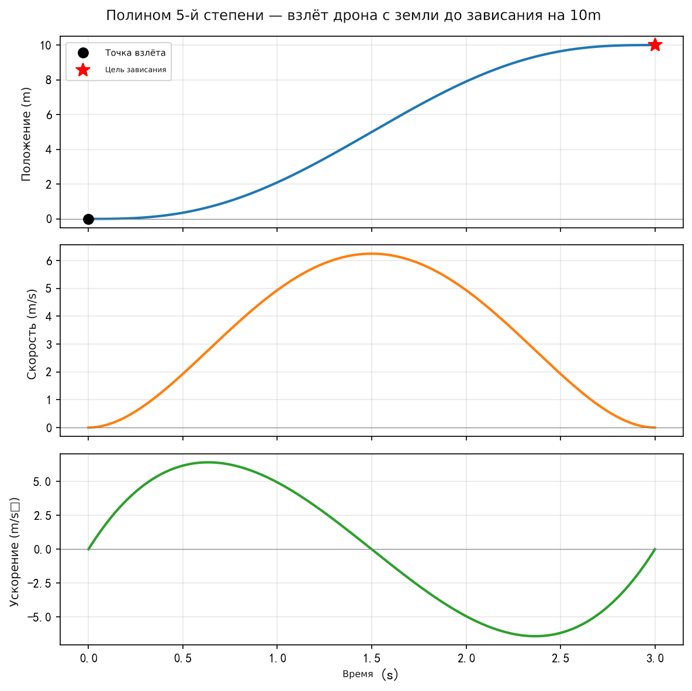
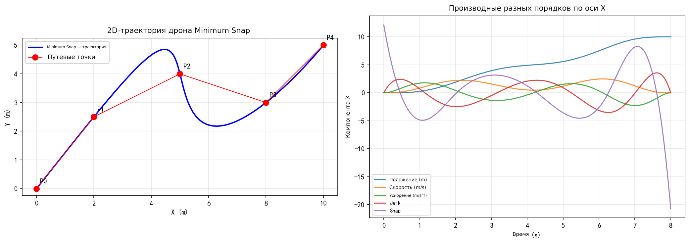
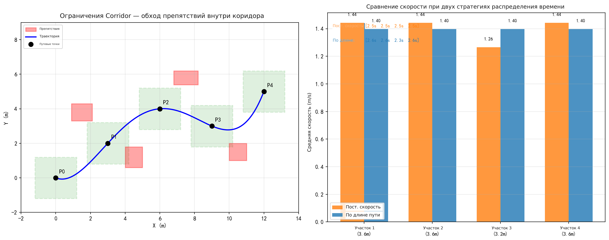
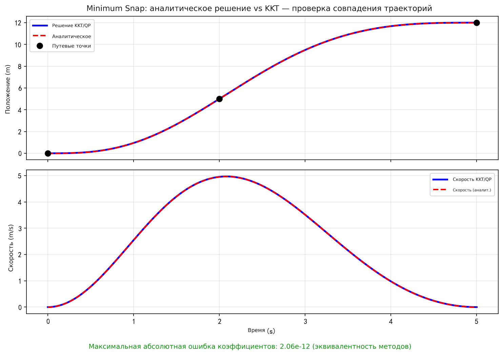

# Руководство по планированию траекторий квадрокоптера

## Введение

Это руководство решает одну основную задачу: **как по заданному набору путевых точек (Waypoints) построить гладкую, безопасную и выполнимую траекторию полёта?** Главы идут последовательно, каждая опирается на предыдущую:

| Глава | Основная задача | Связь с другими главами |
|------|-------------|----------------|
| **1. Основы генерации гладких траекторий** | Что такое «гладкость»? Каким математическим инструментом описывать траекторию? | Задаёт постановку задачи, вводит полиномиальные траектории и систему ограничений |
| **2. Оптимизация траектории по минимуму рывка и snap (Minimum Snap)** | Как превратить «самую гладкую траекторию» в решаемую математическую задачу оптимизации? | Опирается на главу 1 (систему ограничений), строит задачу QP |
| **3. Коридорные ограничения и распределение времени** | Как гарантировать, что траектория не заденет препятствие? Сколько времени занимает каждый участок? | Опирается на главу 2 (каркас QP), добавляет неравенственные ограничения и инженерные детали |
| **4. Замкнутое решение Minimum Snap** | Можно ли без итеративного решателя сразу вычислить оптимальное решение? | Опирается на главу 2 (задачу QP), даёт эффективный аналитический метод |

**Связь с руководством по управлению**:
- **Предпосылка** руководства — глава «Дифференциальная плоскостность» из руководства по управлению: она объясняет, почему минимизация snap (четвёртой производной) имеет физический смысл (snap соответствует управляющему моменту)
- **Выход** этого руководства (опорные траектории положения, скорости и ускорения) является **входом** регуляторов из руководства по управлению (PID, SE(3), MPC)

**Рекомендации по чтению**: читайте по порядку с главы 1 по главу 4. Если интересует только принцип, а не детали инженерной реализации, можно пропустить разделы о распределении времени и нормировке в главе 3.

Руководство по планированию (4 блока кода):

1. Гладкие траектории — полиномиальная интерполяция пятой степени, кривые P/V/A
2. Minimum Snap — минимальная по snap траектория через несколько путевых точек, решение через KKT
3. Коридорные ограничения — безопасный коридор, препятствия, визуализация стратегий распределения времени
4. Замкнутое решение — сравнение замкнутого решения с результатом QP

---

## 1. Основы генерации гладких траекторий

### 1.1 Условия генерации траектории

Генерация траектории должна удовлетворять следующим условиям:

**Граничные условия:**
- начальная позиция (задана)
- конечная позиция (задана)

**Промежуточные условия:**
- точные позиции (заданы, т. е. путевые точки Waypoints)

> **Пояснение:** Путевые точки (Waypoints) задаются алгоритмами планирования маршрута верхнего уровня (например, $A^*$, $RRT$, $RRT^*$). Генерация траектории строит на этих дискретных точках гладкую параметризованную по времени кривую.

> **Пояснение:** Планирование траектории — шаг, который идёт после планирования маршрута (алгоритмы $A^*$, $RRT$ и т. п. дают дискретные путевые точки). Планирование маршрута отвечает на вопрос «куда лететь», а планирование траектории — «как лететь»: соединяет дискретные точки гладкой кривой, параметризованной по времени и удовлетворяющей ограничениям динамики.

### 1.2 Критерии гладкости

> **Пояснение:** Мера гладкости обычно задаётся минимизацией квадрата интеграла производной определённого порядка (то есть скорости изменения «входа»). Чем выше порядок, тем глаже траектория, но тем выше степень полинома.

Для квадрокоптера ключевые наблюдения такие:

- вторая производная положения (ускорение) соответствует направлению тяги
- третья производная положения (рывок, jerk) соответствует угловой скорости
- четвёртая производная положения (snap) соответствует управляющему моменту

Поэтому минимизация snap эквивалентна минимизации изменения управляющего момента, что обеспечивает плавность работы исполнительных механизмов.

> **Пояснение:** Основная идея оптимальной траектории — минимизация квадрата интеграла старшей производной траектории (чем меньше скорость её изменения, тем глаже траектория). Ключевые соотношения:
> - если минимизируется производная порядка $K_r$, то каждый полином сегмента имеет степень не ниже $2K_r - 1$ (то есть $2K_r$ коэффициентов);
> - на стыках соседних сегментов производные до порядка $K_r - 1$ должны быть непрерывны;
> - например, для minimum snap ($K_r = 4$): каждый сегмент — полином степени не ниже 7, и производные 0–3 порядка непрерывны.

> **Пояснение:** Почему степень $2K_r$? Минимизируется квадрат интеграла $K_r$-й производной, в качестве оптимизируемых переменных выступают коэффициенты полинома. На каждом сегменте есть $2K_r$ граничных условий (по $K_r$ на каждом конце), поэтому полином должен иметь не менее $2K_r$ коэффициентов, то есть степень не ниже $2K_r - 1$. Для minimum snap ($K_r = 4$) каждый сегмент — полином степени не ниже 7 (8 коэффициентов); на практике часто берут степень 5 или 7.

### 1.3 Ключевые моменты генерации траектории с минимизацией snap

- **Ограничения траектории** (ограничения высокого порядка): ограничения состояния
- **Непрерывность траектории в стыках**: в конечных точках соседних сегментов все производные должны совпадать
- **Четыре производные траектории**: матрица коэффициентов и ограничения
- **Критерий оптимизации**: интеграл квадрата четвёртой производной траектории

**Особая обработка прямолинейных участков:**

> **Пояснение:** На прямолинейных участках направление скорости не меняется, а ускорение равно нулю. Но гладкая траектория на концах прямолинейного участка (в точках поворота) должна плавно менять направление скорости и не допускать разрывов скорости и ускорения, поэтому стыковка прямолинейных и криволинейных участков требует особой обработки.

### 1.4 Система ограничений

#### Граничные условия

Непрерывность производных порядка $k$ в конечных точках сегментов ($k = 0, 1, 2, \ldots$):

$$
f_j^{(k)}(T_i) = X_0^{(k)}, \quad f_j^{(k)}(T_i) = X_j^{(k)}
$$

#### Условия непрерывности высокого порядка

На стыке соседних сегментов все производные должны совпадать:

$$
f_j^{(k)}(T_i) = f_{j+1}^{(k)}(T_i), \quad k = 0, 1, 2, \ldots, K_r - 1
$$

> **Пояснение:** Для minimum snap требуется непрерывность производных с 0-го по 3-й порядок (положение, скорость, ускорение, рывок) — всего 4 условия непрерывности. Они гарантируют, что при прохождении путевых точек аппарат не испытывает скачков силы или момента.

### 1.5 Пример траектории пятой степени

Для minimum jerk ($K_r = 3$) каждый сегмент описывается полиномом пятой степени (6 параметров):

$$
X(t) = p_5 t^5 + p_4 t^4 + p_3 t^3 + p_2 t^2 + p_1 t + p_0
$$

**Граничные условия (6 уравнений для 6 параметров):**

- $t = 0$: положение $a$, скорость $\dot{a}$, ускорение $\ddot{a}$
- $t = T$: положение $b$, скорость $\dot{b}$, ускорение $\ddot{b}$

Матричная форма решения:

$$
\begin{bmatrix} 1 & 0 & 0 & 0 & 0 & 0 \\ 0 & 1 & 0 & 0 & 0 & 0 \\ 0 & 0 & 2 & 0 & 0 & 0 \\ 1 & T & T^2 & T^3 & T^4 & T^5 \\ 0 & 1 & 2T & 3T^2 & 4T^3 & 5T^4 \\ 0 & 0 & 2 & 6T & 12T^2 & 20T^3 \end{bmatrix} \begin{bmatrix} p_0 \\ p_1 \\ p_2 \\ p_3 \\ p_4 \\ p_5 \end{bmatrix} = \begin{bmatrix} a \\ \dot{a} \\ \ddot{a} \\ b \\ \dot{b} \\ \ddot{b} \end{bmatrix}
$$

### 1.6 Сравнение схем параметризации по времени

**Схема 1: относительное время (каждый сегмент начинается с $t=0$)**

- Преимущество: выше численная устойчивость

**Схема 2: абсолютное время (используется глобальное время $T_i$)**

- Преимущество: математическая запись понятна

> **Пояснение:** Главный недостаток схемы 2: при абсолютном времени, например $t = 1000$ с, $t^7 = 10^{21}$ — это далеко за пределами точности чисел с плавающей точкой, и вычисления «взрываются». Схема 1 начинает каждый сегмент с $t = 0$, так что значения $t$ остаются в пределах длительности сегмента, и численные ошибки контролируются.

> **Пояснение:** На практике обычно используют схему 1 (относительное время), потому что важнее численная устойчивость. Абсолютное время при больших $t$ приводит к взрыву $t^N$: например, при $t = 100$ с $t^7 = 10^{14}$, что сильно превышает точность float.

### Проверка в Python

```python
import numpy as np
import matplotlib.pyplot as plt
plt.rcParams['font.sans-serif'] = ['DejaVu Sans']  # Поддержка кириллицы
plt.rcParams['axes.unicode_minus'] = False    # Исправляет отображение знака минус
# ============================================================
# Пятиполиномиальная интерполяция двух точек — дрон взлетает из состояния покоя
# По заданным положению, скорости и ускорению на концах решаем матричное уравнение 6×6 для коэффициентов полинома
# ============================================================

# --- Граничные условия (моделируем вертикальный взлёт) ---
T = 3.0          # время полёта 3 с
# t=0: дрон на земле в покое
pos0, vel0, acc0 = 0.0, 0.0, 0.0
# t=T: высота 10 м, зависание (скорость и ускорение равны нулю)
posT, velT, accT = 10.0, 0.0, 0.0

# --- Строим матрицу ограничений 6×6 ---
# X(t) = p0 + p1*t + p2*t^2 + p3*t^3 + p4*t^4 + p5*t^5
A = np.array([
    [1, 0,   0,       0,         0,          0        ],   # X(0)   = pos0
    [0, 1,   0,       0,         0,          0        ],   # X'(0)  = vel0
    [0, 0,   2,       0,         0,          0        ],   # X''(0) = acc0
    [1, T,   T**2,    T**3,      T**4,       T**5     ],   # X(T)   = posT
    [0, 1,   2*T,     3*T**2,    4*T**3,     5*T**4   ],   # X'(T)  = velT
    [0, 0,   2,       6*T,       12*T**2,    20*T**3  ],   # X''(T) = accT
])
b = np.array([pos0, vel0, acc0, posT, velT, accT])

# --- Решаем для коэффициентов полинома ---
coeffs = np.linalg.solve(A, b)
print("Коэффициенты полинома [p0, p1, p2, p3, p4, p5]:", np.round(coeffs, 4))

# --- Дискретизация по времени и вычисление положения/скорости/ускорения ---
t = np.linspace(0, T, 200)
pos = sum(coeffs[i] * t**i for i in range(6))
vel = sum(i * coeffs[i] * t**(i-1) for i in range(1, 6))
acc = sum(i * (i-1) * coeffs[i] * t**(i-2) for i in range(2, 6))

# --- Построение ---
fig, axes = plt.subplots(3, 1, figsize=(8, 8), sharex=True)
titles = ["Положение (м)", "Скорость (м/с)", "Ускорение (м/с²)"]
data = [pos, vel, acc]
colors = ["#1f77b4", "#ff7f0e", "#2ca02c"]

for ax, title, y, c in zip(axes, titles, data, colors):
    ax.plot(t, y, color=c, linewidth=2)
    ax.set_ylabel(title, fontsize=12)
    ax.grid(True, alpha=0.3)
    ax.axhline(0, color='gray', linewidth=0.5)

# Отмечаем начало и конец
axes[0].plot(0, pos0, 'ko', markersize=8, label='Точка взлёта')
axes[0].plot(T, posT, 'r*', markersize=12, label='Точка зависания')
axes[0].legend(fontsize=10)

axes[-1].set_xlabel("Время (с)", fontsize=12)
fig.suptitle("Пятиполиномиальная траектория — дрон взлетает с земли и зависает на высоте 10 м", fontsize=13)
plt.tight_layout()
import os; os.makedirs('assets', exist_ok=True)
plt.savefig('assets/planning1.png', dpi=150, bbox_inches='tight')
plt.show()
```

Результат выполнения:



---

## 2. Оптимизация траектории по минимуму snap (Minimum Snap)

### 2.1 Математическое описание полиномиальной траектории

Один сегмент траектории степени $N$:

$$
p(t) = p_0 + p_1 t + p_2 t^2 + \cdots + p_N t^N = \sum_{i=0}^{N} p_i t^i
$$

Всего $N+1$ параметров; в векторной форме $\mathbf{p} = [p_0, p_1, \ldots, p_N]^T$.

**Положение (0-го порядка):**

$$
p(t) = [1, t, t^2, \ldots, t^N] \cdot \mathbf{p}
$$

**Скорость (1-го порядка):**

$$
v(t) = \dot{p}(t) = [0, 1, 2t, \ldots, Nt^{N-1}] \cdot \mathbf{p}
$$

**Ускорение (2-го порядка):**

$$
a(t) = \ddot{p}(t) = [0, 0, 2, 6t, \ldots, N(N-1)t^{N-2}] \cdot \mathbf{p}
$$

**Рывок (jerk, 3-го порядка):**

$$
j(t) = p^{(3)}(t) = \left[0, 0, 0, 6, 24t, \ldots, \frac{N!}{(N-3)!}t^{N-3}\right] \cdot \mathbf{p}
$$

**Snap (4-го порядка):**

$$
s(t) = p^{(4)}(t) = \left[0, 0, 0, 0, 24, \ldots, \frac{N!}{(N-4)!}t^{N-4}\right] \cdot \mathbf{p}
$$

> **Пояснение:** Производную порядка $k$ можно единообразно записать как $p^{(k)}(t) = \mathbf{c}_k(t)^T \mathbf{p}$, где $i$-й элемент $\mathbf{c}_k(t)$ равен $\frac{i!}{(i-k)!} t^{i-k}$ при $i \geq k$ и нулю в остальных случаях.

### 2.2 Описание многосегментной траектории

Для $M$ сегментов (проходящих через $M+1$ путевых точек) у каждого сегмента свой вектор параметров:

$$
p_a(t) = \begin{cases} [1, t, t^2, \ldots, t^N]^T \mathbf{p}_1, & t_0 \leq t \leq t_1 \\ [1, t, t^2, \ldots, t^N]^T \mathbf{p}_2, & t_1 \leq t \leq t_2 \\ \vdots \\ [1, t, t^2, \ldots, t^N]^T \mathbf{p}_M, & t_{M-1} \leq t \leq t_M \end{cases}
$$

Параметры $i$-го сегмента $\mathbf{p}_i = [p_{i0}, p_{i1}, \ldots, p_{iN}]^T$ — это $N+1$ коэффициентов этого сегмента.

Все параметры сегментов объединяются в один большой вектор:

$$
P = [\mathbf{p}_1^T, \mathbf{p}_2^T, \ldots, \mathbf{p}_M^T]^T \in \mathbb{R}^{M(N+1)}
$$

### 2.3 Выбор критерия оптимизации

Разные критерии оптимизации соответствуют разным мерам гладкости:

| Критерий | Выражение | Смысл | Минимальная степень полинома |
|---------|--------|------|-------------|
| Minimum Snap | $\min \int (p^{(4)}(t))^2 dt$ | Минимизация изменения момента | 7 |
| Minimum Jerk | $\min \int (p^{(3)}(t))^2 dt$ | Минимизация изменения угловой скорости | 5 |
| Minimum Acceleration | $\min \int (p^{(2)}(t))^2 dt$ | Минимизация ускорения | 3 |

> **Пояснение:** Обычно не минимизируют скорость или положение: минимизация низких производных делает траекторию «ленивой» (стремящейся к неподвижности) и лишённой практического смысла. Физический смысл имеет минимизация производных от ускорения и выше (энергия, сила, момент).

> **Пояснение:** Для квадрокоптера чаще всего используют minimum snap, потому что snap напрямую связан с входом управляющего момента: минимизация snap равносильна минимизации энергопотребления и износа исполнительных механизмов. Minimum jerk применяют там, где важна чувствительность к угловой скорости (например, аэросъёмка с камерой).

### 2.4 Аналитический вывод целевой функции

Четвёртая производная целевой функции $f(t) = \sum p_i t^i$:

$$
f^{(4)}(t) = \sum_{i \geq 4} i(i-1)(i-2)(i-3) \cdot t^{i-4} \cdot p_i
$$

Её квадрат:

$$
(f^{(4)}(t))^2 = \sum_{i \geq 4} \sum_{j \geq 4} i(i-1)(i-2)(i-3) \cdot j(j-1)(j-2)(j-3) \cdot t^{i+j-8} \cdot p_i p_j
$$

Интегрируем по $k$-му сегменту (от $T_{k-1}$ до $T_k$):

$$
J_k(T) = \int_{T_{k-1}}^{T_k} (f^{(4)})^2 dt = \sum_{i \geq 4, j \geq 4} \frac{i(i-1)(i-2)(i-3) \cdot j(j-1)(j-2)(j-3)}{i+j-7} (T_k^{i+j-7} - T_{k-1}^{i+j-7}) \cdot p_i p_j
$$

В виде квадратичной формы:

$$
J_k(T) = \mathbf{p}_k^T Q_k \mathbf{p}_k \quad \rightarrow \text{положительно полуопределённая квадратичная форма}
$$

Элемент $(i, j)$ матрицы $Q_k$ (при $i, j \geq 4$):

$$
(Q_k)_{ij} = \frac{i(i-1)(i-2)(i-3) \cdot j(j-1)(j-2)(j-3)}{i+j-7} (T_k^{i+j-7} - T_{k-1}^{i+j-7})
$$

> **Пояснение:** Иерархия ограничений: сначала обеспечивается непрерывность нулевой производной (положения) в стыках — траектория проходит через путевую точку, затем последовательно добавляются ограничения непрерывности производных высокого порядка (скорости, ускорения, рывка), чтобы соседние сегменты плавно переходили друг в друга.

### 2.5 Суммарная целевая функция

$$
J = \sum_{k=1}^{M} \mathbf{p}_k^T Q_k \mathbf{p}_k = P^T \begin{bmatrix} Q_1 & & \\ & \ddots & \\ & & Q_M \end{bmatrix} P = P^T \mathbf{Q} P
$$

### 2.6 Построение матрицы ограничений

Ограничения делятся на следующие группы:

**① Ограничения начальной точки** (равенства для положения, скорости, ускорения и т. д.):

> **Пояснение:** Если используется относительное время (каждый сегмент начинается с $t=0$), то ограничения начальной точки подставляются в $t_0 = 0$; коэффициенты низших степеней напрямую соответствуют начальным значениям положения, скорости и ускорения, и запись получается очень простой.

$$
[1, t_0, t_0^2, \ldots, t_0^N] \mathbf{p}_1 = X_0^{(0)} \quad \text{(положение)}
$$

$$
[0, 1, 2t_0, \ldots, Nt_0^{N-1}] \mathbf{p}_1 = X_0^{(1)} \quad \text{(скорость)}
$$

$$
[0, 0, 2, \ldots, N(N-1)t_0^{N-2}] \mathbf{p}_1 = X_0^{(2)} \quad \text{(ускорение)}
$$

**② Ограничение положения в середине — $i$-й сегмент:**

$$
p_i(t_i) = p_{i+1}(t_i) = X_i
$$

**③ Конечные ограничения** (равенства для положения, скорости, ускорения):

$$
[1, t_M, t_M^2, \ldots, t_M^N] \mathbf{p}_M = X_M^{(0)}
$$

**④ Ограничения непрерывности** (на стыках соседних сегментов все производные совпадают):

$$
\mathbf{p}_i^{(k)}(t_i) = \mathbf{p}_{i+1}^{(k)}(t_i), \quad k = 0, 1, \ldots, K_r - 1
$$

**Подсчёт числа ограничений:**

> **Пояснение:** Подсчёт для minimum snap с $M$ сегментами: начальные PVA — 3 ограничения, конечные PVA — 3, положения промежуточных путевых точек — $(M-1)$, непрерывность (P, V, A на каждом из $(M-1)$ стыков) — $3(M-1)$. Итого $= 6 + 4(M-1)$. Когда число ограничений меньше числа неизвестных, оставшиеся степени свободы используются для минимизации целевой функции.

| Тип ограничения | Количество |
|---------|-----|
| Начальные PVA | 3 |
| Конечные PVA | 3 |
| Положения промежуточных точек ($M-1$ точек) | $M - 1$ |
| Непрерывность в промежуточных точках ($K_r$ порядков $\times$ $(M-1)$ стыков) | $K_r(M-1)$ |
| **Итого** | $6 + (K_r + 1)(M - 1)$ |

### 2.7 Стандартная форма задачи QP

В итоге задача сводится к квадратичному программированию (QP) с линейными ограничениями-равенствами:

$$
\min_{P} \quad P^T \mathbf{Q} P
$$

$$
\text{s.t.} \quad A_{eq} P = d_{eq}
$$

> **Пояснение:** Это выпуклая задача квадратичного программирования ($\mathbf{Q}$ положительно полуопределена), поэтому существует глобальное оптимальное решение. Её эффективно решают стандартные QP-решатели (OSQP, qpOASES).

### Проверка в Python

```python
import numpy as np
import matplotlib.pyplot as plt
plt.rcParams['font.sans-serif'] = ['DejaVu Sans']  # Поддержка кириллицы
plt.rcParams['axes.unicode_minus'] = False    # Исправляет отображение знака минус
# ============================================================
# Генерация траектории Minimum Snap — дрон последовательно пролетает несколько путевых точек
# Замкнутая форма через систему KKT (метод множителей Лагранжа) для задачи QP с ограничениями-равенствами
# ============================================================

# --- Путевые точки (двумерные: x, y) ---
waypoints = np.array([
    [0.0, 0.0],   # старт
    [2.0, 2.5],   # промежуточная точка 1
    [5.0, 4.0],   # промежуточная точка 2
    [8.0, 3.0],   # промежуточная точка 3
    [10.0, 5.0],  # финиш
])
M = len(waypoints) - 1  # 4 сегмента
N = 7                    # полином 7-й степени (8 коэффициентов, minimum snap)

# --- Распределение времени (пропорционально длине сегмента, всего 8 с) ---
dists = np.linalg.norm(np.diff(waypoints, axis=0), axis=1)
T_total = 8.0
T_seg = T_total * dists / dists.sum()  # время каждого сегмента

def build_Q_seg(n, T, kr=4):
    """Строим матрицу стоимости snap для одного сегмента Q (относительное время, t in [0, T])"""
    Q = np.zeros((n+1, n+1))
    for i in range(kr, n+1):
        for j in range(kr, n+1):
            ci = np.prod(range(i, i-kr, -1))   # i!/(i-kr)!
            cj = np.prod(range(j, j-kr, -1))
            Q[i, j] = ci * cj * T**(i+j-2*kr+1) / (i+j-2*kr+1)
    return Q

def poly_coeff_vec(n, t, deriv=0):
    """Возвращает строку коэффициентов производной порядка deriv полинома степени n в точке t"""
    c = np.zeros(n+1)
    for i in range(deriv, n+1):
        c[i] = np.prod(range(i, i-deriv, -1)) * t**(i-deriv)
    return c

# --- Строим полную матрицу Q (блочно-диагональная) ---
dim_total = M * (N+1)
Q_all = np.zeros((dim_total, dim_total))
for k in range(M):
    idx = k * (N+1)
    Q_all[idx:idx+N+1, idx:idx+N+1] = build_Q_seg(N, T_seg[k])

# --- Строим матрицу равенств Aeq @ P = beq ---
constraints_rows = []
constraints_rhs_x = []
constraints_rhs_y = []

def add_constraint(row_vec, rhs_x, rhs_y):
    constraints_rows.append(row_vec)
    constraints_rhs_x.append(rhs_x)
    constraints_rhs_y.append(rhs_y)

# Ограничения начальной точки: положение, скорость, ускорение, рывок (сегмент 0, t=0)
for d in range(4):
    row = np.zeros(dim_total)
    row[0:N+1] = poly_coeff_vec(N, 0, d)
    val = waypoints[0] if d == 0 else np.array([0.0, 0.0])
    add_constraint(row, val[0], val[1])

# Конечные ограничения: положение, скорость, ускорение, рывок (последний сегмент, t=T_M)
for d in range(4):
    row = np.zeros(dim_total)
    idx = (M-1)*(N+1)
    row[idx:idx+N+1] = poly_coeff_vec(N, T_seg[-1], d)
    val = waypoints[-1] if d == 0 else np.array([0.0, 0.0])
    add_constraint(row, val[0], val[1])

# Ограничения положения промежуточных путевых точек + ограничения непрерывности
for k in range(M-1):
    # Конечное положение k-го сегмента = waypoints[k+1]
    row = np.zeros(dim_total)
    idx = k * (N+1)
    row[idx:idx+N+1] = poly_coeff_vec(N, T_seg[k], 0)
    add_constraint(row, waypoints[k+1, 0], waypoints[k+1, 1])
    # Непрерывность: конец k-го сегмента = начало (k+1)-го сегмента (производные 0~3 порядка)
    for d in range(4):
        row = np.zeros(dim_total)
        row[idx:idx+N+1] = poly_coeff_vec(N, T_seg[k], d)
        idx2 = (k+1) * (N+1)
        row[idx2:idx2+N+1] = -poly_coeff_vec(N, 0, d)
        add_constraint(row, 0.0, 0.0)

Aeq = np.array(constraints_rows)
beq_x = np.array(constraints_rhs_x)
beq_y = np.array(constraints_rhs_y)

# --- Решаем систему KKT: [2Q, A^T; A, 0] [P; lam] = [0; b] ---
n_eq = Aeq.shape[0]
KKT = np.zeros((dim_total + n_eq, dim_total + n_eq))
KKT[:dim_total, :dim_total] = 2 * Q_all
KKT[:dim_total, dim_total:] = Aeq.T
KKT[dim_total:, :dim_total] = Aeq

def solve_axis(beq):
    rhs = np.zeros(dim_total + n_eq)
    rhs[dim_total:] = beq
    sol = np.linalg.solve(KKT, rhs)
    return sol[:dim_total]

Px = solve_axis(beq_x)
Py = solve_axis(beq_y)

# --- Дискретизация траектории и вычисление производных ---
t_all, x_all, y_all = [], [], []
derivs = {d: ([], []) for d in range(5)}  # производные 0~4 порядка
t_cum = 0.0
for k in range(M):
    ts = np.linspace(0, T_seg[k], 100)
    idx = k * (N+1)
    px, py = Px[idx:idx+N+1], Py[idx:idx+N+1]
    for d in range(5):
        cx = np.array([poly_coeff_vec(N, t, d) @ px for t in ts])
        cy = np.array([poly_coeff_vec(N, t, d) @ py for t in ts])
        derivs[d][0].extend(cx)
        derivs[d][1].extend(cy)
    t_all.extend(ts + t_cum)
    t_cum += T_seg[k]

# --- Построение ---
fig, axes = plt.subplots(1, 2, figsize=(14, 5))

# Левый график: двумерная траектория
ax = axes[0]
ax.plot(derivs[0][0], derivs[0][1], 'b-', linewidth=2, label='Траектория Minimum Snap')
ax.plot(waypoints[:, 0], waypoints[:, 1], 'ro-', markersize=8, linewidth=1, label='Путевые точки')
for i, wp in enumerate(waypoints):
    ax.annotate(f'P{i}', wp, textcoords="offset points", xytext=(5, 8), fontsize=10)
ax.set_xlabel('X (м)'); ax.set_ylabel('Y (м)')
ax.set_title('Двумерная траектория дрона Minimum Snap'); ax.legend(); ax.grid(True, alpha=0.3)
ax.set_aspect('equal')

# Правый график: производные по времени (только компонента x)
ax2 = axes[1]
labels = ['Положение (м)', 'Скорость (м/с)', 'Ускорение (м/с²)', 'Рывок', 'Snap']
for d in range(5):
    ax2.plot(t_all, derivs[d][0], label=labels[d], alpha=0.85)
ax2.set_xlabel('Время (с)'); ax2.set_ylabel('Компонента X')
ax2.set_title('Производные по времени для оси X'); ax2.legend(fontsize=8); ax2.grid(True, alpha=0.3)

plt.tight_layout()
import os; os.makedirs('assets', exist_ok=True)
plt.savefig('assets/planning2.png', dpi=150, bbox_inches='tight')
plt.show()
```

Результат выполнения:



---

## 3. Коридорные ограничения и распределение времени

### 3.1 Матричная форма оптимизации Minimum Snap

$$
J = \min P^T R P
$$

где $R$ — блочно-диагональная матрица:

$$
R = \begin{bmatrix} Q_1 & 0 & \cdots & 0 \\ 0 & Q_2 & \cdots & 0 \\ \vdots & & \ddots & \vdots \\ 0 & 0 & \cdots & Q_M \end{bmatrix}
$$

> **Пояснение:** Члены $(t_i - t_{i-1})^{r+c-7}$ в матрицах $Q_k$ зависят только от длительности сегмента $\Delta T_k = t_k - t_{k-1}$. Поэтому удобно использовать относительное время (каждый сегмент начинается с 0): достаточно подставить $T_k$.

### 3.2 Параметризация по времени

> **Пояснение:** На практике решение ведётся в относительном времени: начальный момент каждого сегмента принимается за 0, и важна только длительность $\Delta T_k$ прохождения сегмента. Это позволяет избежать численных проблем, связанных с абсолютным временем.

> **Пояснение:** После решения необходима проверка выполнимости (Feasibility Check) всей траектории: по каждому сегменту проверяются P.V.A. на соответствие физическим ограничениям (максимальная скорость, максимальное ускорение, максимальная тяга и т. д.). Если какой-либо сегмент выходит за пределы, нужно скорректировать распределение времени для него.

### 3.3 Коридорные ограничения

В базовой задаче QP с равенствами траектория должна лишь проходить через заданные путевые точки. Но при реальном полёте между путевыми точками она может сильно отклониться и войти в зону препятствий. **Коридорные ограничения** вводят неравенства, которые гарантируют, что траектория всегда остаётся в безопасном коридоре.

> **Пояснение:** Ограничения-равенства требовали, чтобы траектория точно проходила через каждую путевую точку. Но после введения коридора ограничения для промежуточных точек можно ослабить до неравенств: траектории не обязательно проходить точно через точку, достаточно оставаться внутри коридора. Это даёт оптимизатору больше свободы, и траектория получается более гладкой.

Для каждой ключевой путевой точки $P_k$ строится прямоугольный коридор:

$$
X_{min} \leq P_k \leq X_{max}, \quad Y_{min} \leq P_k \leq Y_{max}
$$

> **Пояснение:** Коридор обычно прямоугольный (выровненный по осям «короб»): вокруг каждой путевой точки строится безопасный проход с полушириной $r$. Траектория должна лишь оставаться внутри коридора, а не точно проходить через точку. По каждой оси коридор даёт два неравенства (верхнюю и нижнюю границу).

Форма неравенств:

$$
[1, t_i, t_i^2, \ldots, t_i^N] \mathbf{p} \leq P(t_i) + r
$$

$$
[1, t_i, t_i^2, \ldots, t_i^N] \mathbf{p} \geq P(t_i) - r
$$

> **Пояснение:** Ширина коридора $2r$ обычно определяется зазорами между препятствиями, найденными на этапе планирования маршрута. Чем больше $r$, тем свободнее траектория (глаже), но меньше запас безопасности; чем меньше $r$, тем сильнее траектория вынуждена прижиматься к путевым точкам, что может привести к большому snap.

### 3.4 Сводка ограничений

| Тип | Содержание ограничения | Количество |
|------|---------|------|
| Равенство | Начальные PVA | 3 |
| Равенство | Конечные PVA | 3 |
| Равенство | Непрерывность PVA в промежуточных точках | $3 \times (N_{poly} - 1)$ |
| **Неравенство** | **Коридор положения промежуточных точек** | $2 \times (N_{poly} - 1)$ |

> **Пояснение:** После введения неравенств задача из QP с равенствами превращается в общую QP. Она по-прежнему выпуклая, но замкнутого решения у неё нет, поэтому требуется итеративный решатель.

### 3.5 Дискретизация траектории и коридоры

> **Пояснение:** Чтобы траектория не выходила из коридора между путевыми точками, на каждом сегменте добавляют дискретные точки выборки и проверяют в них ограничения. Чем плотнее выборка, тем выше безопасность, но и больше число ограничений. Число сегментов траектории = число путевых точек − 1.

> **Пояснение:** Практическая итеративная стратегия: ① сначала решить задачу без коридорных ограничений и получить начальную траекторию; ② проверить, не выходит ли траектория за пределы коридора (максимальные отклонения чаще всего возникают на пиках и впадинах); ③ добавить коридорные неравенства в местах выхода и заново решить задачу; ④ повторять, пока все точки не окажутся внутри ограничений.

> **Пояснение:** На практике на каждом сегменте берут несколько промежуточных моментов времени и проверяют, находятся ли они внутри коридора. Если какие-то точки выходят за пределы коридора, есть два варианта:
> 1. **Добавить точки ограничений**: добавить новые неравенства в местах выхода и решить заново
> 2. **Добавить путевую точку**: разбить сегмент в месте выхода и вставить новую путевую точку

### 3.6 Стратегии распределения времени

> **Пояснение:** Когда общее время полёта определено (например, оценено по общему пути и желаемой средней скорости), его нужно разумно распределить по сегментам. Если времена сегментов назначены неудачно (слишком длинные или слишком короткие сегменты), качество траектории заметно ухудшается.

**Стандарты распределения времени по сегментам:**

**Метод 1: равномерная скорость**

Предполагается постоянная скорость на каждом сегменте; общее время делится пропорционально длине сегментов:

$$
t_i' = T_{total} \cdot \frac{\|P_{i+1} - P_i\|}{\sum_j \|P_{j+1} - P_j\|}
$$

**Метод 2: трапециевидный профиль скорости**

Предполагается трапециевидный профиль скорости на каждом сегменте (разгон → равномерное движение → торможение): разгон до $V_{max}$ с ускорением $a_{max}$, затем торможение до нуля с тем же замедлением; так получают необходимое время на сегмент.

Пусть времена сегментов равны $t_1', t_2', \ldots, t_N'$, тогда накопленное время:

$$
t_0 = 0, \quad t_1 = t_1', \quad t_2 = t_1 + t_2', \quad \ldots, \quad t_N = t_{N-1} + t_N'
$$

> **Пояснение:** Если после распределения времени скорость или ускорение какого-то сегмента превышает физические пределы, значит, времени на этот сегмент выделено недостаточно. Решение: увеличить время сегмента, заново решить траекторию и снова проверить выполнимость (feasibility). Итерировать до тех пор, пока все сегменты не удовлетворят динамическим ограничениям. Также можно применить масштабирование времени (time scaling) и скорректировать все сегменты одновременно.

> **Пояснение:** Распределение времени — один из самых важных шагов в планировании траектории. Неверное распределение приводит к:
> - **слишком короткому времени**: большие ускорение, рывок и snap, которые превышают возможности исполнительных механизмов;
> - **слишком долгому времени**: низкая эффективность полёта, потеря общего времени.
>
> Типичная итеративная стратегия: сначала назначить время равномерно или по трапеции → решить траекторию → проверить, не превышены ли максимальная скорость и ускорение → увеличить время проблемных сегментов → заново решить, пока ограничения не выполнятся.

### 3.7 Нормировка траектории

> **Пояснение:** Если сегмент очень короткий, коэффициенты полинома $p_i$ могут быть очень большими (нужно за короткое время пройти большое перемещение), и $p_i \cdot T^N$ может выйти за пределы точности float. Поэтому обычно используют double и нормировку времени, чтобы контролировать диапазон значений.

Чтобы избежать численных проблем, вводится **нормировка времени траектории**. Для каждого сегмента определяем нормированное время:

$$
\xi = \frac{t - t_{i-1}}{T_i}, \quad \xi \in [0, 1]
$$

где $T_i = t_i - t_{i-1}$ — длительность $i$-го сегмента.

Исходный полином переходит в нормированный:

$$
\hat{p}(\xi) = p(\xi T) = p_0 + p_1 T\xi + p_2 T^2 \xi^2 + \cdots = \sum \hat{p}_i \xi^i
$$

где нормированный коэффициент $\hat{p}_i = p_i \times T^i$.

**Связь PVA после нормировки:**

$$
p(t) = \hat{p}(\xi) = \sum \hat{p}_i \xi^i
$$

$$
V(t) = \frac{\hat{p}'(\xi)}{T}
$$

$$
a(t) = \frac{\hat{p}''(\xi)}{T^2}
$$

> **Пояснение:** Порядок работы: сначала нормировать время в $[0, 1]$, решить для коэффициентов $\hat{p}_i$ в нормированной области, затем вернуться к реальным коэффициентам $p_i = \hat{p}_i / T^i$.

> **Пояснение:** Нормировка переводит все временные сегменты в $[0, 1]$, что делает диапазон коэффициентов полинома контролируемым. После решения необходима денормировка: $p_i = \hat{p}_i / T^i$. Обратите внимание, что при денормировке производные тоже требуют соответствующего масштабирования.

### Проверка в Python

```python
import numpy as np
import matplotlib.pyplot as plt
from matplotlib.patches import Rectangle
plt.rcParams['font.sans-serif'] = ['DejaVu Sans']  # Поддержка кириллицы
plt.rcParams['axes.unicode_minus'] = False    # Исправляет отображение знака минус
# ============================================================
# Визуализация коридорных ограничений + сравнение стратегий распределения времени
# Показываем путевые точки, безопасные коридоры, препятствия и различия скорости для двух стратегий времени
# ============================================================

np.random.seed(42)

# --- Определение путевых точек и препятствий ---
waypoints = np.array([[0, 0], [3, 2], [6, 4], [9, 3], [12, 5]])
obstacles = [
    {"center": [1.5, 3.8], "w": 1.2, "h": 1.0},  # Препятствие 1: над коридором
    {"center": [4.5, 1.2], "w": 1.0, "h": 1.2},  # Препятствие 2: под коридором
    {"center": [7.5, 5.8], "w": 1.4, "h": 0.8},  # Препятствие 3: над коридором
    {"center": [10.5, 1.5], "w": 1.0, "h": 1.0}, # Препятствие 4: под коридором
]
corridor_half = 1.2  # полуширина коридора

# --- Строим гладкую кривую через коридор (имитация сплайновой интерполяцией) ---
from numpy.polynomial import polynomial as P_mod
t_wp = np.linspace(0, 1, len(waypoints))
t_dense = np.linspace(0, 1, 300)
# Простая параметризованная интерполяция
degree = min(4, len(waypoints) - 1)
cx = np.polyfit(t_wp, waypoints[:, 0], degree)
cy = np.polyfit(t_wp, waypoints[:, 1], degree)
traj_x = np.polyval(cx, t_dense)
traj_y = np.polyval(cy, t_dense)

# ==================== График 1: визуализация коридора ====================
fig, axes = plt.subplots(1, 2, figsize=(15, 6))
ax1 = axes[0]

# Рисуем прямоугольники коридоров
for wp in waypoints:
    rect = Rectangle(
        (wp[0] - corridor_half, wp[1] - corridor_half),
        2 * corridor_half, 2 * corridor_half,
        linewidth=1.5, edgecolor='#2ca02c', facecolor='#2ca02c',
        alpha=0.15, linestyle='--', label='Безопасный коридор' if wp is waypoints[0] else ''
    )
    ax1.add_patch(rect)

# Рисуем препятствия
for i, obs in enumerate(obstacles):
    rect = Rectangle(
        (obs["center"][0] - obs["w"]/2, obs["center"][1] - obs["h"]/2),
        obs["w"], obs["h"],
        linewidth=1.5, edgecolor='red', facecolor='red', alpha=0.35,
        label='Препятствие' if i == 0 else ''
    )
    ax1.add_patch(rect)

# Рисуем траекторию и путевые точки
ax1.plot(traj_x, traj_y, 'b-', linewidth=2, label='Запланированная траектория')
ax1.plot(waypoints[:, 0], waypoints[:, 1], 'ko', markersize=8, zorder=5, label='Путевые точки')
for i, wp in enumerate(waypoints):
    ax1.annotate(f'P{i}', wp, textcoords="offset points", xytext=(6, 8), fontsize=10)

ax1.set_xlabel('X (м)'); ax1.set_ylabel('Y (м)')
ax1.set_title('Коридорные ограничения — траектория обходит препятствия внутри коридора')
ax1.legend(loc='upper left', fontsize=9); ax1.grid(True, alpha=0.3)
ax1.set_aspect('equal'); ax1.set_xlim(-2, 14); ax1.set_ylim(-2, 9)

# ==================== График 2: сравнение скоростей при двух стратегиях времени ====================
ax2 = axes[1]
seg_lengths = np.linalg.norm(np.diff(waypoints, axis=0), axis=1)
T_total = 10.0  # общее время полёта

# Метод 1: равномерное распределение (все сегменты одинаковой длительности)
T_uniform = np.full(len(seg_lengths), T_total / len(seg_lengths))
# Метод 2: пропорционально длине сегмента
T_prop = T_total * seg_lengths / seg_lengths.sum()

# Средние скорости по сегментам
v_uniform = seg_lengths / T_uniform
v_prop = seg_lengths / T_prop

# Столбчатая диаграмма скоростей
seg_labels = [f'Сегмент {i+1}\n({seg_lengths[i]:.1f} м)' for i in range(len(seg_lengths))]
x_pos = np.arange(len(seg_lengths))
width = 0.35
bars1 = ax2.bar(x_pos - width/2, v_uniform, width, color='#ff7f0e', alpha=0.8, label='Равномерное распределение времени')
bars2 = ax2.bar(x_pos + width/2, v_prop, width, color='#1f77b4', alpha=0.8, label='Распределение пропорционально длине')

# Подписываем значения
for bar, v in zip(bars1, v_uniform):
    ax2.text(bar.get_x() + bar.get_width()/2, bar.get_height() + 0.05,
             f'{v:.2f}', ha='center', fontsize=8)
for bar, v in zip(bars2, v_prop):
    ax2.text(bar.get_x() + bar.get_width()/2, bar.get_height() + 0.05,
             f'{v:.2f}', ha='center', fontsize=8)

ax2.set_xticks(x_pos); ax2.set_xticklabels(seg_labels, fontsize=9)
ax2.set_ylabel('Средняя скорость (м/с)'); ax2.set_title('Сравнение скоростей для двух стратегий распределения времени')
ax2.legend(fontsize=9); ax2.grid(True, alpha=0.3, axis='y')

# Добавляем информацию о времени на график
info_uniform = '  '.join([f'{t:.1f}с' for t in T_uniform])
info_prop = '  '.join([f'{t:.1f}с' for t in T_prop])
ax2.text(0.02, 0.95, f'Время при равномерном распределении: [{info_uniform}]', transform=ax2.transAxes,
         fontsize=8, verticalalignment='top', color='#ff7f0e')
ax2.text(0.02, 0.88, f'Время при распределении пропорционально: [{info_prop}]', transform=ax2.transAxes,
         fontsize=8, verticalalignment='top', color='#1f77b4')

plt.tight_layout()
import os; os.makedirs('assets', exist_ok=True)
plt.savefig('assets/planning3.png', dpi=150, bbox_inches='tight')
plt.show()
```

Результат выполнения:



---

## 4. Замкнутое решение Minimum Snap

### 4.1 Повторная постановка задачи

Напомним задачу QP:

$$
\min_P \quad P^T \mathbf{Q} P \quad \text{s.t.} \quad A_{eq} P = d_{eq}
$$

Разделим ограничения на известные (Fixed) и неизвестные (Free):

$$
A_i \mathbf{p}_i = \mathbf{d}_i, \quad A = [A_0, A_E]^T, \quad \mathbf{d}_i = [\mathbf{d}_0, \mathbf{d}_F]^T
$$

где $\mathbf{d}_0 = [P_0, V_0, A_0]^T$ — начальные условия.

### 4.2 Структура матриц

Полная матрица ограничений $A_{total}$ имеет размер $6k \times 6k$ (для полинома 7-й степени на каждом сегменте 8 параметров) и включает ограничения всех сегментов.

$$
\mathbf{p} = A^{-1}\mathbf{d}_\alpha
$$

> **Пояснение:** Основная вычислительная нагрузка замкнутого решения приходится на обращение матрицы $A$ и обращение $R_{PP}$; остальное — матричные умножения, то есть метод очень эффективен. Но замкнутое решение справляется только с ограничениями-равенствами: коридорные неравенства напрямую в него не включить, их можно лишь приблизить равенствами (траектория должна точно проходить через центр коридора).

> **Пояснение:** Замкнутое решение подходит для задач с высокими требованиями к скорости вычислений — когда нет неравенственных ограничений (коридоров) и не хочется подключать QP-решатель с его вычислительными затратами. В таком случае замкнутое решение — лучший выбор.

### 4.3 Разделение переменных Fixed/Free

**Основная идея**: все значения производных в конечных точках рассматриваются как переменные решения, которые делятся на два класса:

- **Fixed ($\mathbf{d}_F$)**: известные значения ограничений (начальные PVA, конечные PVA, положения промежуточных точек и т. п.)
- **Free ($\mathbf{d}_P$)**: свободные переменные для оптимизации (скорости, ускорения и т. п. в промежуточных точках)

$$
\mathbf{d}' = \begin{bmatrix} \mathbf{d}_F \\ \mathbf{d}_P \end{bmatrix}
$$

Структурированный вектор — все значения производных в конечных точках в порядке времени:

$$
\mathbf{d} = \begin{bmatrix} p(t_0), v(t_0), a(t_0), p(t_1), v(t_1), a(t_1), \ldots, p(t_N), v(t_N), a(t_N) \end{bmatrix}^T
$$

Размерность $3(M+1) \times 1$ ($M$ сегментов, $M+1$ конечных точек, в каждой 3 величины PVA).

### 4.4 Замена переменных

Поскольку порядок элементов $\mathbf{d}$ (по времени) и порядок в $\mathbf{d}'$ (Fixed и Free раздельно) различаются, нужна **матрица перестановки** $C$:

$$
\mathbf{d} = M\mathbf{d}', \quad \mathbf{d}' = C\begin{bmatrix} \mathbf{d}_F \\ \mathbf{d}_P \end{bmatrix}
$$

Поэтому вектор параметров полинома выражается как:

$$
P = A^{-1}\mathbf{d} = A^{-1}MC\begin{bmatrix} \mathbf{d}_F \\ \mathbf{d}_P \end{bmatrix} = K\begin{bmatrix} \mathbf{d}_F \\ \mathbf{d}_P \end{bmatrix}
$$

где $K = A^{-1}MC$.

> **Пояснение:** Матрица $M$ учитывает ограничения непрерывности (объединяет значения конечных точек, общие для соседних сегментов), матрица $C$ переставляет объединённые переменные в порядке Fixed/Free. Матрица $K$ задаёт линейное отображение от «значений производных в конечных точках» к «коэффициентам полинома».

### 4.5 Вывод замкнутого решения

Подставляем в целевую функцию:

$$
\min J = P^T \mathbf{Q} P
$$

$$
J = \begin{bmatrix} \mathbf{d}_F \\ \mathbf{d}_P \end{bmatrix}^T K^T \mathbf{Q} K \begin{bmatrix} \mathbf{d}_F \\ \mathbf{d}_P \end{bmatrix}
$$

Разбиваем $K^T \mathbf{Q} K$ на блочную матрицу $2 \times 2$:

$$
J = \begin{bmatrix} \mathbf{d}_F^T & \mathbf{d}_P^T \end{bmatrix} \begin{bmatrix} R_{FF} & R_{FP} \\ R_{PF} & R_{PP} \end{bmatrix} \begin{bmatrix} \mathbf{d}_F \\ \mathbf{d}_P \end{bmatrix}
$$

Раскрываем скалярное выражение:

$$
J = \mathbf{d}_F^T R_{FF} \mathbf{d}_F + \mathbf{d}_F^T R_{FP} \mathbf{d}_P + \mathbf{d}_P^T R_{PF} \mathbf{d}_F + \mathbf{d}_P^T R_{PP} \mathbf{d}_P
$$

Берём производную по свободным переменным $\mathbf{d}_P$ и приравниваем нулю (учитывая $R_{PF} = R_{FP}^T$):

$$
\frac{\partial J}{\partial \mathbf{d}_P} = 2 R_{FP}^T \mathbf{d}_F + 2 R_{PP} \mathbf{d}_P = 0
$$

### 4.6 Замкнутое решение

$$
\boxed{\mathbf{d}_P = -R_{PP}^{-1} R_{FP}^T \mathbf{d}_F}
$$

Найдя $\mathbf{d}_P$, подставляем обратно и получаем полные коэффициенты полинома:

$$
P = K \begin{bmatrix} \mathbf{d}_F \\ \mathbf{d}_P \end{bmatrix}
$$

### 4.7 Замкнутое решение и решатель QP

| Критерий | Замкнутое решение | Решатель QP |
|-------|--------|----------|
| Скорость вычислений | Высокая (обращение матриц + умножения) | Низкая (итеративное решение) |
| Ограничения-равенства | Поддерживаются | Поддерживаются |
| Ограничения-неравенства | **Не поддерживаются** | Поддерживаются |
| Коридорные ограничения | Приближаются ограничениями-равенствами | Поддерживаются напрямую |
| Область применения | Высокие требования к скорости, нет коридоров | Есть коридоры / динамические ограничения |

> **Пояснение:** Главное преимущество замкнутого решения — скорость: нужны только обращение матриц и умножения, итерации не требуются. Основные вычислительные затраты приходятся на обращение матрицы $A$ и обращение $R_{PP}$. При большом числе сегментов $M$ матрица $A$ — разреженная ленточная, и её можно решать с учётом разреженной структуры. На практике, если среда полёта простая (без коридоров), замкнутое решение — предпочтительный выбор; если нужно учитывать препятствия, обязательно использовать решатель QP.

### Проверка в Python

```python
import numpy as np
import matplotlib.pyplot as plt
from scipy.linalg import block_diag
plt.rcParams['font.sans-serif'] = ['DejaVu Sans']  # Поддержка кириллицы
plt.rcParams['axes.unicode_minus'] = False    # Исправляет отображение знака минус
# ============================================================
# Замкнутое решение Minimum Snap и решение через KKT/QP — сравнение на примере из 3 путевых точек (2 сегмента)
# Замкнутое решение: d_P = -R_PP^{-1} R_FP^T d_F
# Решение KKT: квадратичная задача с равенствами через метод множителей Лагранжа
# ============================================================

N = 7   # полином 7-й степени
M = 2   # 2 сегмента (3 путевые точки)
n_c = N + 1  # число коэффициентов на сегмент = 8

# --- Путевые точки (одномерная ось x, упрощённая демонстрация) ---
waypoints = np.array([0.0, 5.0, 12.0])  # старт, промежуточная точка, финиш
T_seg = np.array([2.0, 3.0])            # время каждого сегмента

def poly_coeff_vec(n, t, deriv=0):
    """Строка коэффициентов производной порядка deriv полинома степени n в точке t"""
    c = np.zeros(n + 1)
    for i in range(deriv, n + 1):
        c[i] = np.prod(range(i, i - deriv, -1)) * t ** (i - deriv)
    return c

def build_Q_seg(n, T, kr=4):
    """Строим матрицу стоимости snap для одного сегмента"""
    Q = np.zeros((n + 1, n + 1))
    for i in range(kr, n + 1):
        for j in range(kr, n + 1):
            ci = np.prod(range(i, i - kr, -1))
            cj = np.prod(range(j, j - kr, -1))
            Q[i, j] = ci * cj * T ** (i + j - 2*kr + 1) / (i + j - 2*kr + 1)
    return Q

# ===================== Метод 1: решение KKT =====================
Q_all = block_diag(*[build_Q_seg(N, T) for T in T_seg])
dim = M * n_c

rows, rhs = [], []
def add_eq(row, val):
    rows.append(row); rhs.append(val)

# Ограничения начальной точки: p=0, v=0, a=0
for d in range(3):
    r = np.zeros(dim); r[:n_c] = poly_coeff_vec(N, 0, d)
    add_eq(r, waypoints[0] if d == 0 else 0.0)
# Ограничения конечной точки: p=12, v=0, a=0
for d in range(3):
    r = np.zeros(dim); r[n_c:] = poly_coeff_vec(N, T_seg[1], d)
    add_eq(r, waypoints[2] if d == 0 else 0.0)
# Ограничение положения промежуточной путевой точки (конец сегмента 0)
r = np.zeros(dim); r[:n_c] = poly_coeff_vec(N, T_seg[0], 0)
add_eq(r, waypoints[1])
# Ограничения непрерывности (производные 0~3 порядка)
for d in range(4):
    r = np.zeros(dim)
    r[:n_c] = poly_coeff_vec(N, T_seg[0], d)
    r[n_c:] = -poly_coeff_vec(N, 0, d)
    add_eq(r, 0.0)

Aeq = np.array(rows); beq = np.array(rhs)
n_eq = len(beq)
KKT = np.zeros((dim + n_eq, dim + n_eq))
KKT[:dim, :dim] = 2 * Q_all
KKT[:dim, dim:] = Aeq.T
KKT[dim:, :dim] = Aeq
rhs_kkt = np.zeros(dim + n_eq); rhs_kkt[dim:] = beq
P_kkt = np.linalg.solve(KKT, rhs_kkt)[:dim]

# ===================== Метод 2: замкнутое решение =====================
# Строим отображение A_map: значения производных в конечных точках сегмента -> коэффициенты полинома
# Для каждого сегмента 8 коэффициентов, в конечных точках производные 0~3 порядка (4+4=8 уравнений)
def build_A_seg(n, T):
    """Строим матрицу ограничений конечных точек для одного сегмента (8x8)"""
    A = np.zeros((2*4, n+1))
    for d in range(4):
        A[d, :] = poly_coeff_vec(n, 0, d)       # производная d-го порядка в начале сегмента
        A[4+d, :] = poly_coeff_vec(n, T, d)     # производная d-го порядка в конце сегмента
    return A

A_map = block_diag(*[build_A_seg(N, T) for T in T_seg])  # 16x16
# d_alpha: значения производных по сегментам [сегмент0 начало (p,v,a,j), сегмент0 конец(...), сегмент1 начало(...), сегмент1 конец(...)]
# Матрица M: объединяем непрерывность (конец seg0 = начало seg1) и получаем 12 независимых переменных d
# Независимые конечные точки: начало seg0 (4), промежуточная точка (4, общая), конец seg1 (4) = 12 переменных
M_mat = np.zeros((16, 12))
M_mat[0:4, 0:4] = np.eye(4)     # начало seg0 -> независимые переменные 0~3
M_mat[4:8, 4:8] = np.eye(4)     # конец seg0 -> переменные промежуточной точки 4~7
M_mat[8:12, 4:8] = np.eye(4)    # начало seg1 -> переменные промежуточной точки 4~7 (непрерывность)
M_mat[12:16, 8:12] = np.eye(4)  # конец seg1 -> независимые переменные 8~11

# Матрица C: переставляем независимые переменные в порядок [Fixed; Free]
# Fixed: p начала seg0(0), v начала seg0(0), a начала seg0(0), p промежуточной(5), p конца seg1(12), v конца seg1(0), a конца seg1(0) = 7
# Free:  j начала seg0, v промежуточной, a промежуточной, j промежуточной, j конца seg1 = 5
fixed_idx = [0, 1, 2, 4, 8, 9, 10]  # индексы в 12-мерном векторе независимых переменных
free_idx  = [3, 5, 6, 7, 11]
d_F = np.array([waypoints[0], 0, 0, waypoints[1], waypoints[2], 0, 0])
n_fixed, n_free = len(fixed_idx), len(free_idx)

C_mat = np.zeros((12, 12))
for i, fi in enumerate(fixed_idx):
    C_mat[fi, i] = 1.0
for i, fi in enumerate(free_idx):
    C_mat[fi, n_fixed + i] = 1.0

# K = A_map^{-1} @ M @ C
K = np.linalg.solve(A_map, M_mat @ C_mat)

# R = K^T Q K, разбиваем на R_FF, R_FP, R_PF, R_PP
R_full = K.T @ Q_all @ K
R_FF = R_full[:n_fixed, :n_fixed]
R_FP = R_full[:n_fixed, n_fixed:]
R_PP = R_full[n_fixed:, n_fixed:]

# Основная формула замкнутого решения
d_P = -np.linalg.solve(R_PP, R_FP.T @ d_F)
d_prime = np.concatenate([d_F, d_P])
P_closed = K @ d_prime

# ===================== Выборка траектории и сравнительные графики =====================
def sample_traj(P_vec, T_seg, N):
    t_all, pos_kkt, vel_kkt = [], [], []
    t_offset = 0.0
    for k in range(len(T_seg)):
        ts = np.linspace(0, T_seg[k], 150)
        p = P_vec[k*n_c:(k+1)*n_c]
        pos_kkt.extend([poly_coeff_vec(N, t, 0) @ p for t in ts])
        vel_kkt.extend([poly_coeff_vec(N, t, 1) @ p for t in ts])
        t_all.extend(ts + t_offset)
        t_offset += T_seg[k]
    return np.array(t_all), np.array(pos_kkt), np.array(vel_kkt)

t1, pos1, vel1 = sample_traj(P_kkt, T_seg, N)
t2, pos2, vel2 = sample_traj(P_closed, T_seg, N)

fig, axes = plt.subplots(2, 1, figsize=(10, 7), sharex=True)
# Сравнение положения
axes[0].plot(t1, pos1, 'b-', linewidth=2.5, label='Решение KKT/QP')
axes[0].plot(t2, pos2, 'r--', linewidth=2, label='Замкнутое решение')
t_wp = [0, T_seg[0], T_seg[0]+T_seg[1]]
axes[0].plot(t_wp, waypoints, 'ko', markersize=8, zorder=5, label='Путевые точки')
axes[0].set_ylabel('Положение (м)'); axes[0].legend(); axes[0].grid(True, alpha=0.3)
axes[0].set_title('Замкнутое решение Minimum Snap и решение KKT — траектории полностью совпадают')

# Сравнение скорости
axes[1].plot(t1, vel1, 'b-', linewidth=2.5, label='Скорость KKT/QP')
axes[1].plot(t2, vel2, 'r--', linewidth=2, label='Скорость замкнутого решения')
axes[1].set_ylabel('Скорость (м/с)'); axes[1].set_xlabel('Время (с)')
axes[1].legend(); axes[1].grid(True, alpha=0.3)

# Выводим ошибку
err = np.max(np.abs(P_kkt - P_closed))
print(f"Максимальная абсолютная ошибка коэффициентов двух методов: {err:.2e}")
fig.text(0.5, 0.01, f'Максимальная абсолютная ошибка коэффициентов: {err:.2e} (подтверждает эквивалентность методов)',
         ha='center', fontsize=11, color='green')
plt.tight_layout(rect=[0, 0.03, 1, 1])
import os; os.makedirs('assets', exist_ok=True)
plt.savefig('assets/planning4.png', dpi=150, bbox_inches='tight')
plt.show()
```

Результат выполнения:



---

## Приложение: таблица обозначений для раздела планирования

| Обозначение | Смысл |
|------|------|
| $p(t)$ | Траектория положения (скаляр, одна ось) |
| $\mathbf{p}_i$ | Вектор коэффициентов полинома $i$-го сегмента |
| $P$ | Сложенный вектор коэффициентов всех сегментов |
| $N$ | Степень полинома |
| $M$ | Число сегментов траектории |
| $T_i$ | Длительность $i$-го сегмента |
| $t_i$ | Время $i$-й путевой точки |
| $Q_k$ | Матрица Гессе $k$-го сегмента |
| $\mathbf{Q}$ | Полная матрица Гессе (блочно-диагональная) |
| $A_{eq}$ | Матрица ограничений-равенств |
| $d_{eq}$ | Правая часть ограничений-равенств |
| $\mathbf{d}_F$ | Значения ограничений Fixed |
| $\mathbf{d}_P$ | Переменные Free (подлежат оптимизации) |
| $K$ | Матрица отображения значений конечных точек в коэффициенты |
| $R_{FF}, R_{FP}, R_{PP}$ | Блоки матрицы Гессе |
| $K_r$ | Порядок оптимизируемой производной (для snap $K_r=4$) |
| $\xi$ | Нормированное время $\in [0, 1]$ |
| $r$ | Полуширина коридора |
