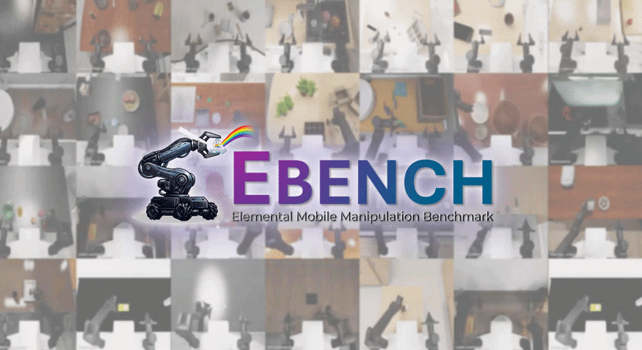
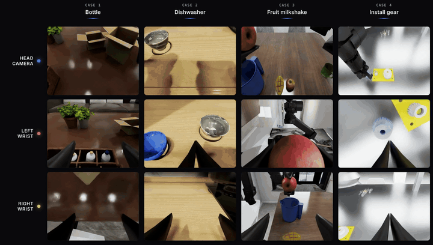
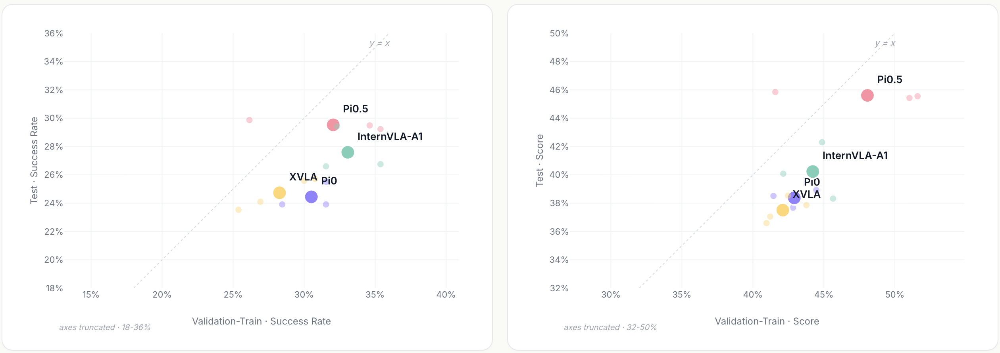
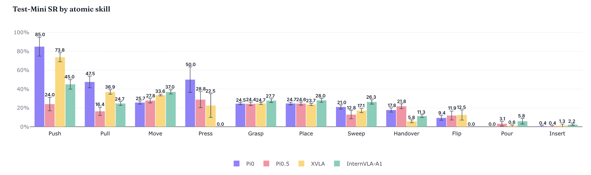
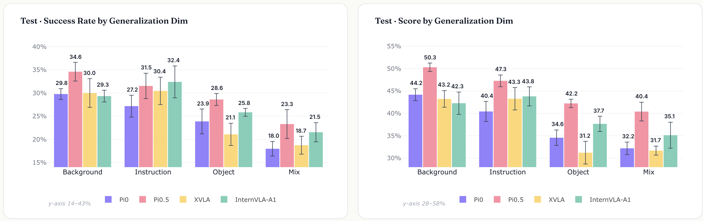
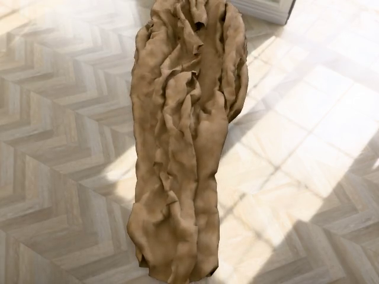
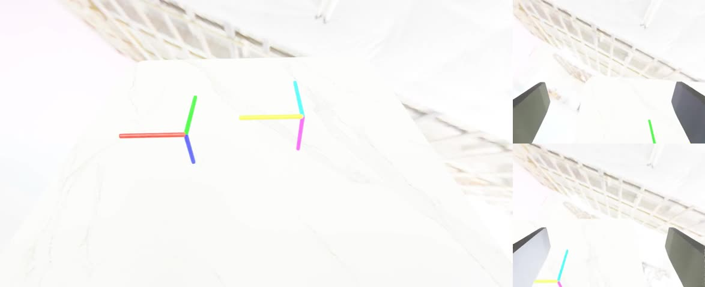

# От «может запуститься» к «может диагностировать»: EBench, базовая платформа оценки для симуляции манипуляций от Шанхайской лаборатории ИИ

После того как большие модели постоянно поднимают планку когнитивного интеллекта, воплощённый ИИ всё больше переносит фокус в реальный физический мир. Главный вопрос здесь уже не в том, «понимает ли модель», а в том, может ли робот действительно выполнить сложные манипуляции и сохранить устойчивость в новой среде, с новыми объектами и в новых условиях задачи.

Ответ на этот вопрос всё чаще зависит от системы оценки, которая становится необходимой базовой инфраструктурой.

Сегодня в области воплощённого ИИ нет нехватки моделей и нет нехватки очередных бенчмарков с растущими цифрами. Настоящего дефицита требует другой тип оценки: такой, который помогает исследователям ответить на вопросы «в чём сильна модель, в чём слаба и может ли эта способность переноситься на другие условия».

Иначе говоря, отрасли сейчас нужна не только таблица лидеров, но и базовая платформа оценки, которая разбивает общий результат на части, делает способности видимыми и точно измеряет обобщение.

Именно в этом контексте Физический центр искусственного интеллекта Шанхайской лаборатории ИИ выпустил EBench. Это не просто новая таблица, которая выдаёт итоговый балл. Это базовая платформа оценки симуляции манипуляций воплощённого ИИ, построенная вокруг анализа способностей, реального обобщения и эффективной итерации.

Сейчас EBench включает 26 типов задач. Каждая задача размечена по пяти измерениям: сцена (Scene), атомарный навык (Atomic Skill), длительность (Horizon), точность (Precision) и режим операции (Operating Mode). Кроме того, покрываются четыре вида обобщения: обобщение на объекты (Object), на фон (Background), на инструкции (Instruction) и смешанные возмущения (Mixed perturbation). В итоге создано 794 тестовых задания. Цель — перейти от простой «выдачи баллов» к «объяснению способностей».



Ссылки:

Открытый исходный код проекта: https://github.com/InternRobotics/EBench

Набор для оценки на Hugging Face: https://huggingface.co/datasets/InternRobotics/EBench-Dataset

Набор для оценки на ModelScope: https://modelscope.cn/datasets/InternRobotics/EBench-Dataset

Онлайн-платформа оценки в симуляции: https://internrobotics.shlab.org.cn/eval

## От «захвата и укладки» к сложным манипуляциям: задачи ближе к реальным сценариям

Чтобы оценка действительно позволяла ставить диагноз, сами задачи должны быть достаточно близки к реальным сценариям. В реальности манипуляции робота редко сводятся к «взял и положил» на одном столе. Обычно они включают понимание пространства, тонкое управление, долгосрочное планирование и согласованную работу руки, двух рук и мобильной платформы.

Поэтому EBench выходит за рамки традиционного цикла «захват — укладка» и охватывает такие формы задач, как одиночный захват и укладка, точная сборка, мобильные манипуляции и долгосрочная координация.

По пространству задачи переходят с двумерного стола в трёхмерную среду с высотой, глубиной и иерархией. По точности — от вопроса «смогли ли положить» к вопросу «смогли ли выровнять и точно совместить». По времени — от одиночного действия к многошаговому планированию с исправлением ошибок по ходу. По исполнителю — от одной руки к двум рукам и согласованной работе с мобильной платформой.

Эти задачи объединяют такие примитивные действия, как захват (Grasp), укладка (Place), вставка (Insert), переливание (Pour), переворот (Flip), подметание (Sweep) и передача (Handover), в реальный смысл операций. Поэтому EBench не только фиксирует, «получилось или нет», но и помогает понять, в чём модель сильна, а в чём слаба.



## От общего балла к профилю способностей: почему результаты модели можно разложить по частям

Первая задача EBench — перевести вопрос «выполнена ли задача» в вопрос «почему она выполнена успешно».

Раньше многие бенчмарки давали один общий процент успеха. Такая цифра понятна, но плохо объясняет причины. Даже если результат модели вырос, исследователь по-прежнему не может понять: улучшилась ли подвижность, точность управления или стабильность в длинных задачах, или же изменение связано просто с долей лёгких задач.

Поэтому EBench задаёт для каждого задания систему из пяти измерений и сопоставляет результаты с конкретными способностями.

Измерение сцены позволяет увидеть различия в работе модели в разных визуальных средах. Измерение атомарных навыков раскладывает способности по базовым операциям. Измерение длительности описывает длину цепочки задач и помогает отличать стабильность в коротких и длинных задачах. Измерение точности показывает, как модель справляется с разными требованиями к точности. Измерение режима операции отделяет ловкие манипуляции от мобильных и позволяет понять, есть ли заметная разница между ними.

Таким образом, на выходе EBench получается не просто «процент успеха», а профиль способностей, который можно анализировать дальше. Исследователь видит не только факт улучшения, но и то, где именно оно произошло, где находятся слабые места и какие способности стоит улучшать в первую очередь.

Для моделей воплощённых манипуляций это означает, что симуляционная оценка перестаёт быть только проверкой «выполнилась задача или нет» и начинает работать как инструмент для разбора структуры способностей.

## От выполнения задач к реальному обобщению: различать «умеет решать знакомое» и «умеет переносить»

Чтобы модель в ходе постоянной итерации не подстраивалась под сам бенчмарк, EBench использует стандартный механизм разделения на валидационный и тестовый наборы.

Валидационный набор включает уже знакомые задачи (Validation-Train) и незнакомые задачи (Validation-Unseen). Он используется для ежедневной настройки параметров и быстрой итерации. Изолированный тестовый набор (Test) проверяет, как модель справляется с новыми задачами, новыми объектами и новыми комбинациями вне распределения, а не просто запоминает обучающие данные.

На этой основе EBench дополнительно задаёт четыре вида тестов на обобщение: обобщение на объекты (Object), на фон (Background), на инструкции (Instruction) и смешанные возмущения (Mixed perturbation).

Здесь важно не просто «проверить больше случаев», а разделить факторы обобщения так, чтобы их можно было наблюдать по отдельности. Тогда, если результат модели на тестовом наборе падает, исследователь может понять, связано ли это с новыми объектами или новым фоном, с изменением формулировки инструкции или с совместным действием нескольких факторов.

Иначе говоря, EBench говорит не только «модель потеряла баллы на новом наборе», но и помогает найти, **почему** модель их потеряла.

Кроме того, поскольку разные воплощённые модели охватывают разный круг способностей, EBench предлагает два пути оценки: Specialist и Generalist. Specialist предназначен для оценки узкоспециализированных способностей, например Dexterous и Mobile Manip. Generalist предназначен для моделей, которые одновременно умеют выполнять несколько типов манипуляций, и проводит более единую комплексную проверку. Такая схема учитывает разные стадии развития моделей и даёт базу для сравнения более универсальных моделей воплощённых манипуляций в будущем.

## От цикла разработки к диагностике способностей: оценка не ограничивается страницей с результатами

Для моделей воплощённых манипуляций сама оценка — дорогостоящий этап. Длинная цепочка, тяжёлые ресурсы и медленная обратная связь мешают тому, чтобы бенчмарк действительно встроился в процесс разработки. Поэтому EBench предоставляет инфраструктуру в двух формах: во-первых, открытый инструмент распределённой оценки, который на конфигурации из 8 видеокарт 4090 позволяет завершить оценку валидационного набора примерно за 30 минут и быстро выполнять локальную регрессию; во-вторых, круглосуточный онлайн-сервис оценки, в котором пользователи могут запускать стандартизированные тесты по единому протоколу.

На этой основе анализ результатов EBench не сводится к вопросу «у кого выше балл». Сейчас EBench уже прошёл первичную проверку на таких репрезентативных моделях, как π0, π0.5, XVLA и InternVLA-A1. Результаты показывают: близкие итоговые показатели не означают одинаковую структуру способностей.



При переходе с валидационного набора на изолированный тестовый набор колебания результатов разных моделей различаются. Падение InternVLA-A1 и π0 относительно невелико, а падение π0.5 заметнее. Это говорит о том, что в оценке без механизма изоляции преимущество на валидационном наборе может отражать подстройку под распределение обучения, а не реальную способность к обобщению.

Если сравнивать задачи с мобильными и ловкими манипуляциями, то InternVLA-A1 заметно сильнее в мобильных манипуляциях, но заметно уступает в ловкой работе; π0, напротив, выглядит более сбалансированно в обоих режимах.

По измерению точности низкоточные задачи дают между моделями лишь небольшую разницу. Но при переходе к высокоточным операциям π0 сохраняет относительное преимущество, тогда как XVLA и π0.5 заметно теряют. Это показывает, что стабильность модели на низкоточных задачах не равна способности к высокоточным операциям.

Атомарные навыки тоже дают взаимодополняющую картину: π0 показывает лучшие результаты в вытягивании (Pull), XVLA сильнее в толкании (Push), но заметно слабее в передаче и доставке (Handover).



*Сравнение успешности разных моделей по измерению атомарных навыков*

Тесты на обобщение дополнительно показывают, что изменения фона и инструкций модели переносят относительно легко. Но как только появляются новые объекты, результаты заметно падают, а когда одновременно меняется несколько факторов, то есть в сценарии смешанных возмущений (Mixed perturbation), падение становится ещё сильнее. В целом обобщение на объекты (Object) и смешанные возмущения (Mixed perturbation) — два наиболее уязвимых места современных моделей. В обобщении π0.5 тоже находится в лидерах: по трём измерениям обобщения — фон, объекты и комбинированные возмущения — он опережает остальные модели, а преимущество на фоне и на переднем плане объектов выражено особенно заметно. Это частично объясняет, почему сообщество обычно отмечает, что предобучение π0.5 «хорошо работает»: даже после последующей донастройки модель сохраняет сильную способность к обобщению.

Эти результаты показывают, что для моделей воплощённых манипуляций высокий балл не означает автоматически высокого обобщения. Главная ценность EBench в том, что он помогает увидеть, за счёт какой способности получен результат, сможет ли модель переносить навыки на задачи вне распределения и каковы её реальные слабые места.



## Быстрый старт: сначала пройти минимальный замкнутый цикл

Если вы хотите быстро попробовать EBench, не стоит сразу скачивать полный набор данных, разворачивать большую модель policy или запускать полный валидационный набор. Надёжнее сначала выполнить smoke test и убедиться, что работают Isaac Sim, GenManip, планирование cuRobo, сохранение траекторий и рендеринг видео.

В этот раз мы воспроизводим задачу `Minimal_Banana` из GenManip: Franka должна положить банан на сковороду. Это не полный результат EBench, но хорошая проверка того, что среда работает.

### 1. Рекомендуемое оборудование и версии

Для минимального smoke test требования к видеопамяти невысоки: одной видеокарты RTX 4090 или L40 с 24 ГБ достаточно. Для крупных валидационных оценок, параллельной генерации данных или развёртывания модели policy нужны несколько карт и больше дискового пространства.

Ключевые версии, на которых проверялось:

| Компонент | Версия при проверке |
| --- | --- |
| Система | Ubuntu 22.04 |
| Python | 3.10 |
| Isaac Sim | 4.1.0.0 |
| PyTorch | 2.4.0+cu121 |
| NumPy | 1.26.4 |
| cuRobo | v0.7.8 |

Обратите внимание: пакеты Isaac Sim 4.x в PyPI обычно требуют Python 3.10. Если установить Isaac Sim 4.1 под Python 3.11, появится ошибка версии вида `Requires-Python ==3.10.*`.

### 2. Подготовка окружения

Рекомендуется размещать виртуальное окружение Python на диске данных, а не на общем диске, чтобы уменьшить нагрузку на ввод-вывод при установке и распаковке. Перед запуском Isaac Sim нужно принять лицензионное соглашение Omniverse EULA:

```bash
export OMNI_KIT_ACCEPT_EULA=YES
export HF_HOME=/path/to/data/hf_home
export TMPDIR=/path/to/data/tmp
```

Версию cuRobo рекомендуется зафиксировать на `v0.7.8`. Текущий код GenManip использует старый путь импорта:

```python
from curobo.geom.sdf.world import CollisionCheckerType
```

Если установить последнюю основную ветку cuRobo, может появиться ошибка `No module named 'curobo.geom'`. Зафиксировать версию можно так:

```bash
cd saved/envs/curobo
git checkout v0.7.8
pip install -e . --no-build-isolation
```

### 3. Генерация минимальной задачи

Перейдите в корневой каталог GenManip и выполните:

```bash
python demogen.py \
  --config configs/tasks/minimal.yml \
  --record minimal_planning
```

Если добавить только `--without_planning`, программа сохранит сцену и небольшой объём данных о траектории, но `render.py` не сможет создать полное видео действий. Поэтому для визуализации сначала нужно запустить `demogen.py` с планированием.

После успешного запуска данные траектории появятся в каталоге примерно такого вида:

```text
saved/demonstrations/Minimal_Banana/trajectory/
```

### 4. Рендеринг и экспорт видео

По умолчанию конфигурация камеры включает глубину, семантическую сегментацию, 2D- и 3D-рамки (bbox) и векторы движения (motion vector). При работе на двух картах 4090 мы сталкивались с ошибками CUDA interop в Isaac/Hydra, например:

```text
CUDA error 700: an illegal memory access was encountered
HydraEngine::render failed
Rendering failed
```

Для быстрого smoke test можно сначала отключить несколько GPU и перевести конфигурацию камеры в режим только RGB. Так можно убедиться, что основной путь «планирование задачи → воспроизведение траектории → RGB-рендеринг → экспорт видео» работает.

Основная правка выглядит так:

```python
simulation_app = SimulationApp(
    {
        "headless": True,
        "active_gpu": 0,
        "physics_gpu": 0,
        "multi_gpu": False,
        "max_gpu_count": 1,
    }
)
```

В конфигурации камеры отключаются все аннотаторы, кроме RGB:

```yaml
with_distance: false
with_semantic: false
with_bbox2d: false
with_bbox3d: false
with_motion_vector: false
```

Затем запускается рендеринг только RGB:

```bash
python render_single_gpu.py \
  --config configs/tasks/minimal_rgb_only.yml \
  --without_depth \
  --record rgb_only_single_gpu_full
```

В этом smoke test отрисовано 316 кадров, которые из LMDB декодированы в видео с трёх камер.

### 5. Результаты локальной визуализации

Ниже видео RGB-рендеринга минимальной задачи. Это продукт smoke test: он подтверждает, что цепочка работает, но не является официальным видео оценки EBench.

<video controls muted preload="metadata" width="100%">
  <source src="./assets/ebench/ebench_minimal_banana_obs_camera.mp4" type="video/mp4">
</video>

[Открыть видео: assets/ebench/ebench_minimal_banana_obs_camera.mp4](./assets/ebench/ebench_minimal_banana_obs_camera.mp4)

<video controls muted preload="metadata" width="100%">
  <source src="./assets/ebench/ebench_minimal_banana_obs_camera_2.mp4" type="video/mp4">
</video>

[Открыть видео: assets/ebench/ebench_minimal_banana_obs_camera_2.mp4](./assets/ebench/ebench_minimal_banana_obs_camera_2.mp4)

<video controls muted preload="metadata" width="100%">
  <source src="./assets/ebench/ebench_minimal_banana_realsense.mp4" type="video/mp4">
</video>

[Открыть видео: assets/ebench/ebench_minimal_banana_realsense.mp4](./assets/ebench/ebench_minimal_banana_realsense.mp4)

Вид сверху:


### 6. Порядок поиска неисправностей

Если воспроизведение не удалось, проверяйте в таком порядке:

1. Убедитесь, что задано `OMNI_KIT_ACCEPT_EULA=YES`, чтобы Isaac Sim не зависал на вводе EULA.
2. Проверьте, что Python 3.10: Isaac Sim 4.1 не совместим с Python 3.11.
3. Проверьте, что cuRobo имеет версию `v0.7.8`, иначе может не найтись `curobo.geom`.
4. Сначала запустите `demogen.py`, а не только `--without_planning`.
5. Если при стандартном рендеринге возникают ошибки CUDA/Hydra, переключитесь на RGB-only и один GPU.
6. Только после успешного smoke test имеет смысл вернуть глубину, семантику, рамки и другие полные аннотации.

## Не только EBench: три пути симуляции и генерации данных

EBench решает задачу: как оценивать стратегии воплощённых манипуляций. Вокруг него в экосистеме InternRobotics есть ещё два важных направления: SIM1 для генерации данных о мягких телах (деформируемых объектах) и InternVerse / InternDataEngine как универсальный движок синтетических данных. Они не заменяют EBench, а покрывают другие участки замкнутого цикла разработки воплощённого ИИ.

### SIM1: генератор данных для мира деформируемых тел

SIM1 — это **Physics-Aligned Simulator as Zero-Shot Data Scaler in Deformable Worlds**. Его главная задача — не жёсткие операции «взял — положил», а манипуляции с мягкими телами, например двуручная работа с тканью. Он предоставляет цепочку генерации данных: от телеуправления и траекторий, порождаемых диффузионной политикой, через физическое воспроизведение (replay) и фильтрацию по качеству, до рендеринга высокой точности и преобразования в данные LeRobot.

В минимальном воспроизведении SIM1 можно сначала проверить цепочку на очень коротком образце replay. Видео ниже получено из smoke replay на 8 кадрах и в основном подтверждает, что replay, запись USD и сохранение видео работают.


<video controls muted preload="metadata" width="100%">
  <source src="./assets/sim1/sim1-replay-smoke.mp4" type="video/mp4">
</video>

[Открыть видео: assets/sim1/sim1-replay-smoke.mp4](./assets/sim1/sim1-replay-smoke.mp4)

Цепочка рендеринга высокой точности дополнительно преобразует результаты replay в многокамерный RGB, LMDB и данные LeRobot. Ниже показан результат рендеринга с головной камеры для того же smoke-образца.



<video controls muted preload="metadata" width="100%">
  <source src="./assets/sim1/sim1-render-head.mp4" type="video/mp4">
</video>

[Открыть видео: assets/sim1/sim1-render-head.mp4](./assets/sim1/sim1-render-head.mp4)

Ключевая ценность SIM1 в том, что траектории мягких тел нельзя использовать сразу после генерации: их нужно пропустить через физическое воспроизведение и фильтрацию по качеству. Низкий процент прохождения не обязательно означает, что окружение установлено неверно: он может быть результатом совместного действия контакта с мягким телом, замыкания захвата, позы ткани и стабильности решателя.

### InternVerse / InternDataEngine: мини-пространство для синтетических данных

InternDataEngine — движок синтеза данных в платформе воплощённых данных InternVerse. Полный пакет ресурсов очень большой, но если нужно только познакомиться с функциями, не обязательно сразу скачивать полный набор ресурсов примерно на 200 ГБ. Путь «малого пространства» использует ресурсы, поставляемые с репозиторием, нужные зависимости cuRobo и Drake, а также небольшой набор дополнительных ресурсов. Этого достаточно, чтобы проверить workflow, робота, контроллер, навыки, объекты, камеры, рандомизацию и вывод данных.

Видео ниже получено в задаче малого пространства: с помощью Split ALOHA показаны workflow, контроллер и вывод с трёх камер.



<video controls muted preload="metadata" width="100%">
  <source src="./assets/internverse/track_three_views.mp4" type="video/mp4">
</video>

[Открыть видео: assets/internverse/track_three_views.mp4](./assets/internverse/track_three_views.mp4)

Задача с объектами и доменной рандомизацией (Domain Randomization) показывает категории объектов, позы, освещение и возмущения камеры.


<video controls muted preload="metadata" width="100%">
  <source src="./assets/internverse/object_dr_three_views.mp4" type="video/mp4">
</video>

[Открыть видео: assets/internverse/object_dr_three_views.mp4](./assets/internverse/object_dr_three_views.mp4)

Демонстрация шарнирных объектов используется для проверки загрузки `ArticulatedObject` и рендеринга с нескольких ракурсов.


<video controls muted preload="metadata" width="100%">
  <source src="./assets/internverse/articulation_three_views.mp4" type="video/mp4">
</video>

[Открыть видео: assets/internverse/articulation_three_views.mp4](./assets/internverse/articulation_three_views.mp4)

Смысл этого пути в том, что даже без полного набора ресурсов можно сразу проверить основные модули платформы синтетических данных: workflow `simbox_plan_and_render`, Split ALOHA, цепочку управления cuRobo, три камеры, вывод LMDB и MP4. Для учебных демонстраций, коротких статей и знакомства с функциями такое «функциональное знакомство в малом пространстве» гораздо легче, чем полная библиотека задач.

### Как понимать три инструмента вместе

Эти три инструмента можно рассматривать как части одного цикла разработки:

| Инструмент | Основная роль | С чего начать |
| --- | --- | --- |
| EBench | Оценивает способности стратегии и раскладывает успешность на структуру способностей | smoke test `Minimal_Banana` |
| SIM1 | Генерирует и фильтрует данные о манипуляциях с мягкими телами | replay на 8 кадров и smoke рендеринга высокой точности |
| InternDataEngine | Универсальный движок синтетических данных, охватывает навыки, объекты, камеры и рандомизацию | трёхракурсная демонстрация малого пространства |

EBench больше похож на «экзаменационный зал», а SIM1 и InternDataEngine — на «фабрику учебных данных» и «движок синтетических данных». Когда оценка показывает, что у модели есть слабые места в обобщении на объекты, высокоточных операциях или длинных задачах, два последних инструмента могут дополнить данные и визуальные примеры именно для этих способностей.

## Хотите продолжить практику? Открытый учебник Every-Embodied уже готов

Если вы дочитали до этого места, вас, возможно, интересует уже не только то, что оценивает EBench, но и другие вопросы: как запустить всё самостоятельно, как изменить код и как подключить это к научному проекту.

Китайский открытый учебник **every-embodied** от Datawhale как раз создан для такой задачи. В нём обучение воплощённому ИИ разбито на главы с практикой: базовые понятия, навигация и VLN, симуляционные среды, обучение политик, VLA / VLM, наборы данных и бенчмарки, соревновательная практика и тематические групповые курсы. Цель — сократить разрыв между «понять статью» и «реально запустить код».

Ссылка на полный открытый проект:

https://github.com/datawhalechina/every-embodied

Онлайн-чтение:

https://datawhalechina.github.io/every-embodied/zh-cn/

Записи о воспроизведении EBench, SIM1 и InternVerse / InternDataEngine также включены в китайское издание этого проекта. Они построены не как краткий обзор концепций, а по принципу «сначала запустить минимальный рабочий путь»: сначала описываются требования к окружению и ключевые настройки, затем приводится видео smoke test, и наконец подробно разбираются типичные ошибки и порядок их поиска.

Если вы только начинаете, можно идти по главам о навигации, симуляции и базовых манипуляциях. Если вы уже работаете с моделями воплощённых манипуляций, можно использовать EBench как вход в оценку, а SIM1 и InternDataEngine как вход в генерацию данных. Так одна и та же открытая учебная программа объединяет полный путь «учиться — воспроизводить — оценивать — итерировать».

## Заключение

Сегодня у воплощённого ИИ нет нехватки новых моделей и новых таблиц лидеров. Настоящий дефицит — в системе оценки, которая помогает исследователям последовательно понимать способности моделей.

Именно это и хочет сказать EBench. Это не просто новый симуляционный бенчмарк и не просто новая таблица лидеров. Это попытка перевести оценку манипуляций от «пассивного подсчёта баллов» к «активной диагностике», а симуляционную оценку — от «проверки выполнения задач» к «анализу способностей».

Когда исследователь видит не один общий балл, а может разглядеть структуру способностей модели, границы её обобщения и настоящие слабые места, оценка перестаёт быть цифрой на странице результатов. Она становится инфраструктурой, которая помогает двигать итерации моделей и методы.


(Приглашаем присоединиться к пользовательской группе: QR-код находится в исходном материале.)

Добро пожаловать на онлайн-платформу оценки в симуляции:

https://internrobotics.shlab.org.cn/eval
