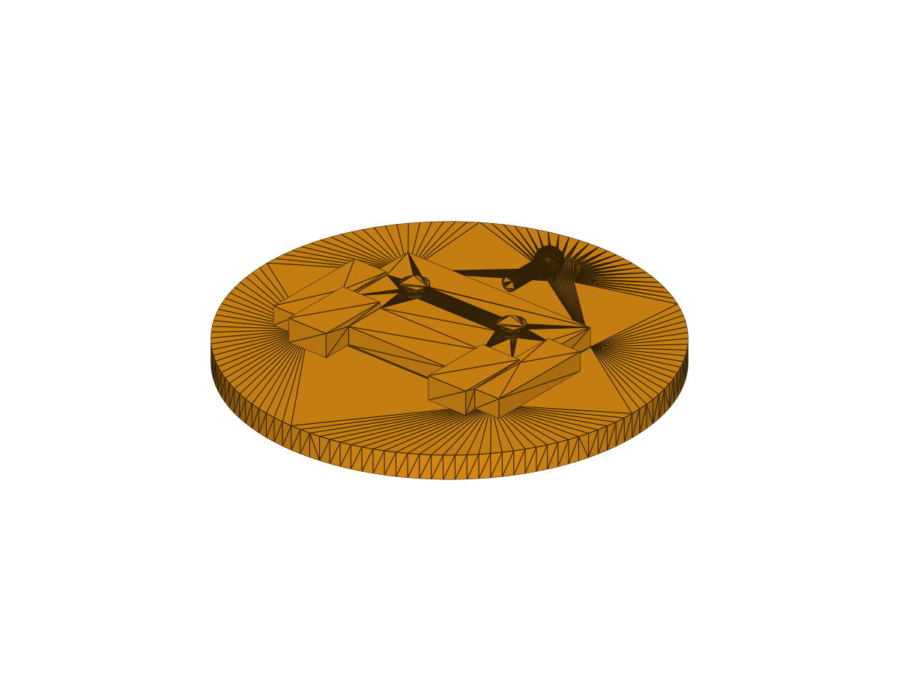
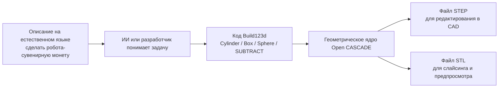
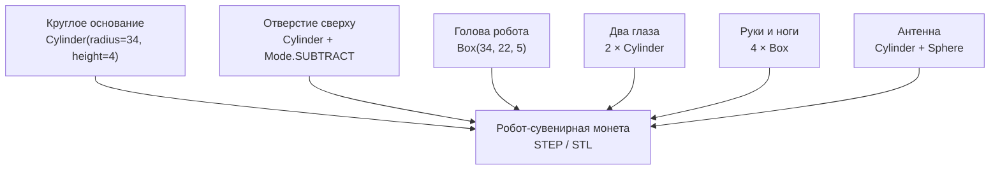
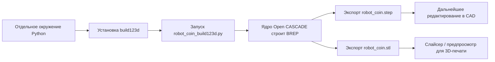
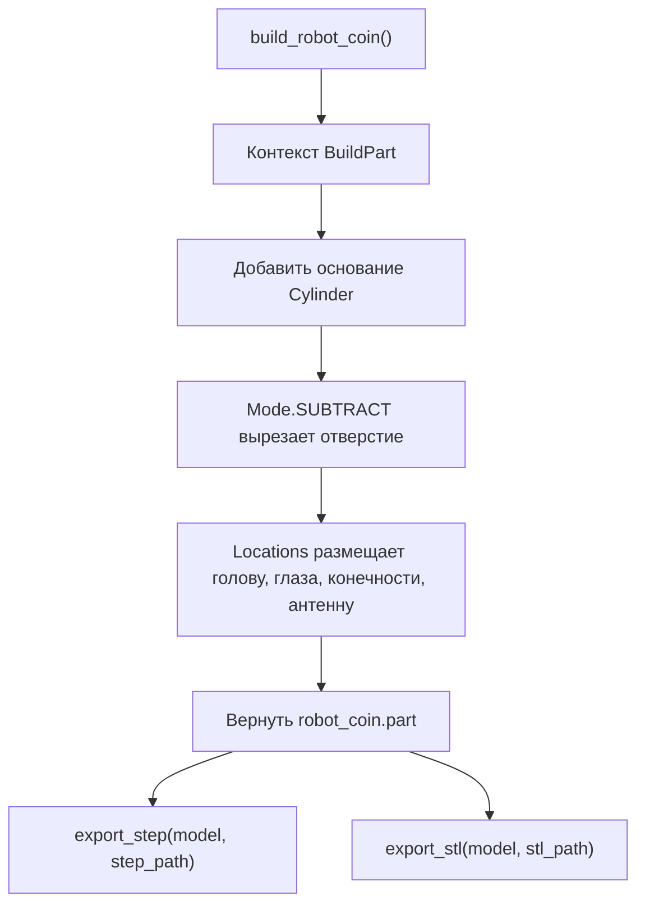

# Введение в код-моделирование с Build123d: воспроизводим робота-сувенирную монету

Build123d — параметрическая библиотека CAD на Python, которая подходит для создания механических деталей, конструкционных элементов роботов и моделей для 3D-печати через код, которые легко повторно менять и запускать. В этой главе мы не будем сразу собирать сложный манипулятор. Вместо этого пройдём полный путь на маленькой модели «робот-сувенирная монета»: поймём замысел, создадим изолированное окружение, построим модель на Python, экспортируем STEP/STL и объясним, почему геометрический код даёт именно такую форму.

Важный момент, который часто путают: сам Build123d не превращает естественный язык напрямую в STL. Он выполняет Python-код, описывающий геометрию. Естественное описание, например «сделай робота-сувенирную монету с отверстием для брелока», может быть техническим заданием, по которому ИИ или разработчик пишет код с `Cylinder`, `Box`, `Sphere` и `Mode.SUBTRACT`. После запуска скрипта Build123d вызывает геометрическое ядро Open CASCADE, создаёт твёрдое тело и экспортирует STEP/STL.

Поэтому «робот-сувенирная монета» — не модель, которая появляется из одной подсказки. Естественный язык можно понимать как задание для моделирования: «круглое основание, на нём выпуклое изображение робота, сверху отверстие для кольца, экспорт в STL и STEP». Эту фразу сама программа не выполнит. Сначала её нужно перевести в код `robot_coin_build123d.py`. Именно скрипт является воспроизводимым результатом, а STEP/STL — результатом его запуска.

Главная идея главы — путь от замысла к файлу, пригодному для производства:

```text
Описание задачи на естественном языке
→ Python-код Build123d
→ Твёрдое тело в ядре Open CASCADE
→ Файлы STEP / STL
→ Редактирование в CAD или слайсинг для 3D-печати
```

После этой главы читатель должен получить три воспроизводимых результата:

```text
outputs/robot_coin.step
outputs/robot_coin.stl
assets/robot_coin_preview.png
```

В этом репозитории готовые файлы результатов не включены: они генерируются скриптом. Если хотите сначала посмотреть итог, запустите скрипт из раздела «Шаг 2» или откройте изображение предварительного просмотра. Чтобы понять процесс CAD-as-code, рекомендуем пройти установку и запуск скрипта от начала до конца.

<p align="center">
  
</p>

Рисунок 1. Предварительный вид робота-сувенирной монеты, отрисованный вне экрана на локальной машине. Изображение создано автоматически из `outputs/robot_coin.stl` и не требует ручного скриншота в CAD-программе.

## Почему для первого примера выбрана сувенирная монета

Первый пример Build123d не стоит начинать с полного манипулятора. В манипуляторе есть звенья, шарниры, сборочные ограничения, места под двигатели, посадочные отверстия для подшипников, допуски и диапазоны движения. Для новичка плотность понятий слишком высока: трудно отделить синтаксис кода от инженерных задач. Поэтому здесь выбрана сувенирная монета: она достаточно проста, но покрывает основные операции код-моделирования.

Круглое основание соответствует простейшему созданию тела. Голова и конечности робота соответствуют размещению прямоугольных тел. Глаза и антенна — цилиндрам и сферам. Отверстие сверху — булевой операции вычитания. Так маленькая модель, хоть и не является сложным механизмом, уже содержит основную идею параметрического CAD: сначала разбить форму на описываемые геометрические элементы, затем создавать, размещать, объединять или вычитать их по коду.

Почему модель имеет вид «круглое основание + выпуклое изображение робота + отверстие сверху»? Чтобы в одной детали увидеть три типа результатов. Первый — добавление тел: основание, голова, глаза, конечности и антенна. Второй — вычитание одного тела из другого: отверстие. Третий — разницу форматов экспорта: STEP подходит для дальнейшего редактирования в CAD, STL — для слайсинга и предварительного просмотра. Поняв эту модель, вы сможете перейти к держателям захвата, креплениям датчиков, монтажным пластинам для плат или переходникам для концевого эффектора манипулятора: отличие будет лишь в геометрических элементах и размерах.

## Что будет сделано в этой главе

Проверка выполнена в Windows PowerShell с Python 3.12. Сначала создаётся отдельное окружение Python, чтобы зависимости Build123d не повлияли на уже установленные инструменты роботизированной симуляции. Затем запускается `robot_coin_build123d.py`, который создаёт твёрдое тело и экспортирует `.step` и `.stl`. Наконец, `render_robot_coin_preview.py` автоматически создаёт PNG-превью. В конце главы код разбирается построчно: каждая геометрическая операция сопоставляется с видимым элементом модели.

## Официальные рисунки и схемы этой главы

В соответствии с принципами оформления технических руководств сначала ищутся официальные страницы проекта, документация или рисунки архитектуры из статьи. Были проверены официальная документация Build123d и официальный репозиторий GitHub. Там есть галерея примеров моделей и описание API, но нет схемы архитектуры, которую можно было бы напрямую перенести в эту главу. Поэтому мы не переносим скриншоты из соцсетей и не используем неофициальные перепечатки. Вместо этого применяются схемы Mermaid, которые легко поддерживать и редактировать.

Рисунок 2 показывает связь между естественным языком, кодом и файлами CAD. Обратите внимание: Build123d выполняет промежуточный Python-код, а не самую левую строку с естественным языком.



Рисунок 2. Естественное описание не превращается в STL напрямую. Сначала оно переводится в Python-скрипт Build123d, и только после его запуска создаются файлы CAD.

Рисунок 3 показывает разложение модели, которую мы воспроизводим. Итоговая деталь получена не ручным перетаскиванием, а сочетанием базовых тел и одной булевой операции.



Рисунок 3. Состав геометрии робота-сувенирной монеты. Пример специально использует мало базовых тел, чтобы сначала разобраться в контексте построения, позиционировании и булевых операциях Build123d.

Рисунок 4 показывает путь от Python-скрипта к файлам CAD. Если что-то пошло не так, можно по этой цепочке определить, на каком шаге возникла проблема: установка окружения, построение модели, экспорт геометрии или просмотр в CAD.



Рисунок 4. Процесс код-моделирования в Build123d. Build123d превращает Python-описание в геометрические тела; STEP удобен для дальнейшего редактирования в CAD, STL — для слайсинга и 3D-печати.

## Проверенное окружение

| Параметр | Конфигурация при проверке |
|---|---|
| Система | Windows PowerShell |
| Python | 3.12.3 |
| Build123d | 0.10.0 |
| Способ проверки | Отдельное виртуальное окружение |
| Форматы вывода | STEP, STL, PNG |
| Размеры модели | около `68 mm × 68 mm × 9.4 mm` |

Окружение для робототехнической симуляции часто уже содержит ManiSkill, пакеты для робототехники и глубокого обучения. Установка Build123d прямо в такое окружение может затронуть версии `numpy`, `scipy`, `vtk` и других пакетов и вызвать конфликты. Поэтому в этой главе всегда используется отдельное виртуальное окружение.

## Структура каталога

Файлы главы находятся в следующем каталоге репозитория:

```text
books/embodied-ai/src/21-robot-design/01-build123d-code-modeling-introduction/
├── README.md
├── requirements.txt
├── robot_coin_build123d.py
├── render_robot_coin_preview.py
├── assets/
│   └── robot_coin_preview.png
└── outputs/            # создаётся после запуска скриптов
    ├── robot_coin.step
    └── robot_coin.stl
```

Таблица 1. Файлы главы. `robot_coin_build123d.py` — воспроизводимый скрипт построения модели; `render_robot_coin_preview.py` автоматически отрисовывает STL в PNG для изображения в книге; `outputs/` создаётся при запуске скриптов и содержит результаты CAD.

## Шаг 1. Создание изолированного окружения

Команды ниже предполагают, что вы находитесь в корне репозитория. Не записывайте в команды абсолютные пути к домашнему каталогу, используйте относительные.

```powershell
py -3.12 -m venv .venv-build123d
.\.venv-build123d\Scripts\python.exe -m pip install --upgrade pip
.\.venv-build123d\Scripts\python.exe -m pip install -r .\books\embodied-ai\src\21-robot-design\01-build123d-code-modeling-introduction\requirements.txt
```

Если Python 3.12 не установлен, можно попробовать Python 3.11:

```powershell
python -m venv .venv-build123d
.\.venv-build123d\Scripts\python.exe -m pip install --upgrade pip
.\.venv-build123d\Scripts\python.exe -m pip install build123d==0.10.0
```

Каталог `.venv-build123d/` не нужно добавлять в репозиторий: это локальное окружение для запуска.

Проверка 1. Убедитесь, что Build123d импортируется:

```powershell
.\.venv-build123d\Scripts\python.exe -c "import build123d; print(build123d.__version__)"
```

Ожидаемый вывод:

```text
0.10.0
```

Эта проверка подтверждает только то, что Python может импортировать Build123d. Она ещё не доказывает, что ядро геометрии и экспорт файлов работают. Настоящее построение модели проверяется на следующем шаге.

## Шаг 2. Запуск скрипта построения

Из корня репозитория выполните:

```powershell
.\.venv-build123d\Scripts\python.exe .\books\embodied-ai\src\21-robot-design\01-build123d-code-modeling-introduction\robot_coin_build123d.py
```

Успешный запуск выводит примерно следующее:

```text
Build123d robot coin generated.
Bounding box: bbox: -34.0 <= x <= 34.0, -34.0 <= y <= 34.0, -2.0 <= z <= 7.4
STEP: ...\outputs\robot_coin.step
STL:  ...\outputs\robot_coin.stl
```

Ограничивающий параллелепипед (bounding box) — первая линейка для понимания формы модели. Координаты `x` и `y` от `-34` до `34` означают, что радиус круглого основания равен 34 мм. Координата `z` от `-2.0` до `7.4` показывает, что поверх 4-миллиметровой монеты добавлены выступы робота и антенна. Иначе говоря, вывод в консоли — не случайный журнал: он подтверждает, что создано трёхмерное тело с толщиной, выступами и отверстием.

Проверка 2. Если видите такой ограничивающий параллелепипед, значит Build123d создал твёрдое тело. Этот smoke test подтверждает три вещи: окружение Python работает, геометрическое ядро Open CASCADE работает, экспорт в STEP/STL работает. Это не доказывает, что модель готова к массовому производству или печати. Перед печатью всё же проверьте толщину стенок, нависания и результат слайсинга.

Проверка 3. Убедитесь, что файлы результата созданы:

```powershell
Get-ChildItem .\books\embodied-ai\src\21-robot-design\01-build123d-code-modeling-introduction\outputs
```

Должны появиться как минимум:

```text
robot_coin.step
robot_coin.stl
```

## Шаг 3. Автоматический рендеринг предпросмотра

Если для текста нужно показать результат, не обязательно делать скриншот вручную в CAD-программе. В главе есть скрипт офлайн-рендеринга, который читает `outputs/robot_coin.stl`, настраивает камеру и освещение через VTK и сохраняет PNG:

```powershell
.\.venv-build123d\Scripts\python.exe .\books\embodied-ai\src\21-robot-design\01-build123d-code-modeling-introduction\render_robot_coin_preview.py
```

После успешного запуска создаётся файл:

```text
books/embodied-ai/src/21-robot-design/01-build123d-code-modeling-introduction/assets/robot_coin_preview.png
```

Проверка 4. Если файл `assets/robot_coin_preview.png` открывается, предпросмотр создан автоматически. Его можно использовать в тексте главы; но если нужна проверка инженерных размеров, откройте STEP-файл или импортируйте его в CAD-программу.

## Шаг 4. Просмотр результата

`robot_coin.step` удобен для дальнейшего редактирования в CAD-программах: FreeCAD, SolidWorks, Fusion, Onshape. `robot_coin.stl` подходит для импорта в слайсеры, например Bambu Studio, PrusaSlicer или Cura, для предварительного просмотра печати.

Рекомендуется сначала открыть STEP и проверить структуру, потому что STEP сохраняет более полное граничное представление. Когда модель признана корректной, STL можно использовать для слайсинга. Если нужно только проверить, что скрипт создаёт модель, достаточно выполнить Шаг 2 и открыть созданный `robot_coin.step`.

## Разбор кода: почему форма получилась такой

Основной код находится в файле:

```text
books/embodied-ai/src/21-robot-design/01-build123d-code-modeling-introduction/robot_coin_build123d.py
```

Скрипт не загружает внешнюю модель и не вызывает генератор по естественному языку. Все формы создаются геометрическими командами в функции `build_robot_coin()`. Удобно представлять этот код как сборку из кубиков: сначала кладём круглое основание, затем вырезаем из него отверстие, после этого добавляем на поверхность элементы робота.

Первый шаг — монета. `Cylinder(radius=34, height=4)` создаёт цилиндр радиусом 34 мм и высотой 4 мм. Build123d по умолчанию располагает цилиндр симметрично относительно начала координат, поэтому его высота идёт от `-2` до `2`. Именно поэтому минимальное значение `z` в ограничивающем параллелепипеде равно `-2.0`. Этот цилиндр не является телом робота, он выполняет роль подложки, на которой крепятся все выступы — как основа значка или брелока.

Второй шаг — отверстие. Скрипт помещает в точку `(0, 25, 0)` цилиндр радиусом 3,2 мм и высотой 8 мм и использует `mode=Mode.SUBTRACT`. Важно не то, что добавляется ещё один цилиндр, а то, что этот цилиндр вычитает материал из уже существующего тела. Поэтому на предварительном виде появляется сквозное отверстие сверху. В реальном производстве такое отверстие нужно для шнурка или кольца для брелока — именно поэтому сувенирная монета имеет практическое назначение.

Третий шаг — элементы робота. `Box(34, 22, 5)` создаёт параллелепипед над основанием, который обозначает голову или корпус робота. Два маленьких цилиндра над головой образуют глаза; четыре параллелепипеда — руки и ноги; поперечный цилиндр с шариком — антенну. Ни один из них не существует отдельно: все они позиционируются через `Locations(...)` и добавляются в один контекст `BuildPart()`, поэтому при экспорте получается одна целая деталь.

Рисунок 5 описывает эту же последовательность в виде потока данных функции. Каждый видимый выступ на превью можно сопоставить с конкретной строкой кода.



Рисунок 5. Поток данных функции `robot_coin_build123d.py`. Входом служат параметры размеров в коде, выходом — два файла CAD. Естественное описание задачи участвует только в постановке задачи и не участвует в геометрическом расчёте.

Такой способ код-моделирования удобен тем, что его можно объяснить и изменить. Если нужна большая монета, меняем радиус основания `Cylinder(radius=34, height=4)`. Если голову нужно сделать шире, меняем первый параметр `Box(34, 22, 5)`. Если отверстие нужно сдвинуть ближе к краю, меняем вторую координату в `Locations((0, 25, 0))`. Модель — не разовое изображение, а программа проектирования, которую можно многократно запускать с новыми параметрами.

## Часто меняемые параметры

В таблице перечислены только самые частые изменения. Новичкам рекомендуется менять один параметр за раз, заново запускать скрипт и сравнивать STEP/STL и PNG. Так легче понять связь «параметр кода — геометрический результат».

| Цель | Место в коде | Рекомендация |
|---|---|---|
| Изменить размер монеты | `Cylinder(radius=34, height=4)` | Радиус задаёт внешний диаметр, высота — толщину |
| Сдвинуть отверстие | `Locations((0, 25, 0))` | Чем больше второе значение, тем ближе отверстие к верхнему краю |
| Изменить голову робота | `Box(34, 22, 5)` | Три параметра — длина, ширина и высота |
| Изменить размер глаз | `Cylinder(radius=2.2, height=1.4)` | Чем больше радиус, тем заметнее глаза |
| Изменить высоту антенны | `Cylinder(radius=1.2, height=8, rotation=(90, 0, 0))` | `height` задаёт длину антенны |

Таблица 2. Частые места для изменения параметров. После правки достаточно снова запустить скрипт, чтобы перегенерировать STEP, STL и PNG.

## Частые вопросы

### 1. Не стоит ставить Build123d в уже существующее окружение робота

Build123d устанавливает Open CASCADE, VTK, NumPy, SciPy и другие зависимости. При проверке установка в уже существующее окружение робототехники вызывала предупреждения о конфликтах зависимостей. Всегда используйте отдельное виртуальное окружение.

### 2. Что делать с предупреждением о шрифте

При импорте Build123d на Windows может появиться предупреждение:

```text
cannot open font 'C:\WINDOWS\Fonts\mstmc.ttf': Not a TrueType or OpenType font
```

В этой главе текст не моделируется, поэтому предупреждение не влияет на экспорт STEP/STL. Если позже понадобится объёмный текст или барельеф, укажите явно рабочий файл шрифта.

### 3. Что выбрать: STEP или STL

STEP удобнее для дальнейшего редактирования в CAD, STL — для слайсинга и печати. При сопровождении главы лучше сохранять скрипт и STEP; если хотите уменьшить размер репозитория, можно не коммитить STL и оставить генерацию читателю.

### 4. Обязательно ли делать скриншот в CAD вручную

Нет. Скрипт `render_robot_coin_preview.py` уже автоматизирует открытие STL, настройку камеры, освещения и экспорт PNG. Открывать CAD или слайсер вручную нужно только для проверки инженерных размеров, сборочных ограничений или поддержек при печати.

### 5. Когда нужны иллюстрации, а когда схемы

Если цель — объяснить процесс и связь параметров, лучше использовать Mermaid или SVG: их можно поддерживать, искать и они не теряют качество при масштабировании. Для обложки или рекламной картинки можно использовать инструменты генерации изображений, но они не должны заменять воспроизводимый CAD-скрипт и результаты STEP/STL.

## Источники

- Официальная инструкция по установке Build123d: https://build123d.readthedocs.io/en/latest/installation.html
- Официальные примеры Build123d: https://build123d.readthedocs.io/en/latest/examples_1.html
- Репозиторий Build123d на GitHub: https://github.com/gumyr/build123d
