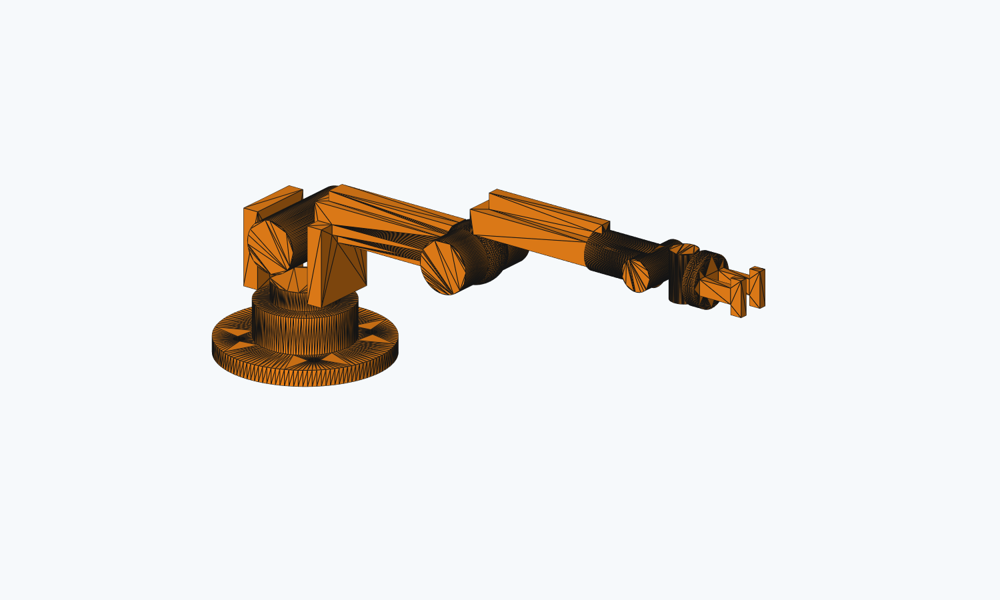
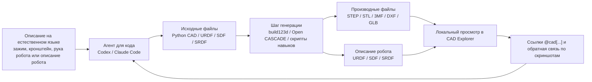
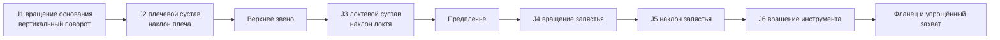
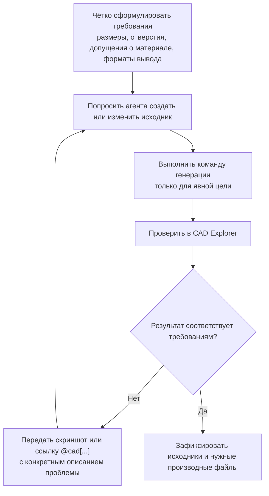

# Инженерное моделирование Text-to-CAD: воспроизводимый CAD с помощью агента для кода

Text-to-CAD — не волшебный инструмент, который превращает одну фразу в идеальную 3D-модель. Точнее сказать, это инженерный процесс, который связывает описание задачи на естественном языке, агента для кода, параметрический CAD-скрипт, экспорт геометрии и локальный предпросмотр. Сначала вы описываете нужную деталь, зажим, структуру робота или структуру URDF на естественном языке. Затем агент для кода, например Codex или Claude Code, меняет Python-исходники в репозитории. Наконец, CAD-инструментарий экспортирует STEP, STL, 3MF, DXF, GLB, URDF, SDF или SRDF.

Эта глава основана на открытом проекте [earthtojake/text-to-cad](https://github.com/earthtojake/text-to-cad). Официальный репозиторий описывает себя как «Open Source CAD Skills And Harnesses». Его главная ценность — не замена всех CAD-программ, а перевод работы с CAD в более привычный для программистов процесс: исходный код читаем, версии контролируются, результаты воспроизводимы, а каждая итерация имеет явные входы и выходы.

После этой главы читатель должен понимать три вещи. Во-первых, «текст» в Text-to-CAD — это прежде всего описание требований и указания для итераций, а не промпт, который напрямую подаётся геометрическому ядру. Во-вторых, воспроизводимыми активами являются исходные файлы CAD, URDF, SDF, SRDF и скрипты генерации, а не история чата. В-третьих, инженерный цикл обязательно включает предпросмотр, ссылки, проверку и фиксацию изменений; без этого легко остаться на уровне демонстрации «похоже на правду».

<p align="center">
  
</p>

Рисунок 1. Предварительный просмотр оригинальной учебной 6-DOF руки, созданной локально. Изображение отрисовано вне экрана из `outputs/every_embodied_6dof_arm.stl`. Изображения из статей в соцсетях здесь не используются.

## Почему Text-to-CAD рассматривается в главе о роботах

Конструирование роботов по своей природе охватывает три типа файлов: файлы механических конструкций, файлы описания робота и файлы симуляции и планирования движений. Традиционные CAD-программы хорошо подходят для тонкого моделирования, но когда нужно часто менять одно отверстие крепления, длину звена, синхронизировать пути к сеткам в URDF и экспортировать детали в среду симуляции, ручная работа быстро становится трудно поддерживаемой.

Text-to-CAD рассматривает такие объекты как инженерный проект. Деталь может создаваться параметрическим Python-скриптом, робот может описываться файлами URDF/SDF/SRDF, а CAD Explorer позволяет локально просматривать STEP, STL, URDF и другие файлы. Преимущество такого подхода в том, что каждое изменение оставляет след в виде различий в коде. Если модель сломалась, можно вернуться к предыдущей рабочей версии, а не искать ошибку в сложной истории операций CAD.

Здесь же проявляется связь с предыдущей главой о Build123d. Build123d — это базовая возможность код-моделирования: вы пишете Python, который создаёт геометрию. Text-to-CAD добавляет поверх неё навыки агентов (agent skills), CAD Explorer, стабильные геометрические ссылки и проектные ограничения, чтобы агент для кода мог надёжнее участвовать в итерациях.

## Общий обзор рабочего процесса

Рисунок 2 показывает базовую цепочку Text-to-CAD. Обратите внимание: естественный язык слева — это лишь техническое задание. В репозиторий записываются исходные файлы в середине, а справа находятся производные файлы, которые можно открыть и изготовить.



Рисунок 2. Инженерный замкнутый цикл Text-to-CAD. Естественный язык описывает намерение, агент для кода изменяет исходники, инструментарий CAD создаёт геометрию, а локальный предпросмотр проверяет, соответствует ли результат ожиданиям.

Ключевая идея здесь не в том, чтобы «заставить ИИ сразу выдать окончательный ответ», а в том, чтобы создать цикл, который можно многократно проверять. Модель, созданная при первой генерации, может иметь смещение отверстий, неправильные пропорции или пересечение деталей при сборке. Тогда нужно открыть её в CAD Explorer и передать агенту конкретную проблему. В официальном проекте используются стабильные геометрические ссылки вида `@cad[...]`, чтобы следующая итерация могла указывать на конкретную грань, ребро или объект, а не на нечёткое «вот там слева».

## Что будет сделано в этой главе

В этой главе не воспроизводится изображение механической руки из сетевой публикации: это позволяет избежать неясностей с авторскими правами и происхождением дизайна. Вместо этого предлагается оригинальная упрощённая учебная модель 6-DOF настольной руки, с помощью которой проверяется инженерная цепочка Text-to-CAD. Вращение основания, плечевой сустав, локтевой сустав и три оси запястья выражены видимой геометрией, но это всё ещё учебная модель, а не реальная рука, которую можно изготовить и нагрузить.

Читатель выполнит следующие проверки: клонирует официальный репозиторий, создаст отдельное окружение Python, установит зависимости CAD runtime, сгенерирует STEP, STL, 3MF и GLB для оригинальной учебной руки, установит зависимости CAD Explorer, запустит локальный Explorer и убедится, что проект находится в рабочем состоянии: «изменение исходника → генерация результата → открытие предпросмотра». Этот smoke test подтверждает работоспособность инструментов, но не доказывает, что сложная модель робота готова к производству или симуляции.

## Проверенные варианты окружения

Официальный репозиторий указывает Python 3.11+ и использует `python3.11 -m venv .venv` в инструкциях для локальной разработки. Пользователям Windows обычно доступны два варианта: обычный venv и micromamba. Здесь рекомендуется venv, так как он ближе к официальной документации и не требует дополнительной установки conda/mamba. Если вы уже используете micromamba для окружений робототехники, его тоже можно применять.

| Вариант | Для кого подходит | Преимущества | Что учесть |
|---|---|---|---|
| venv | Большинство новичков на Windows, macOS и Linux | Ближе к официальной документации, меньше зависимостей, легко удалить и пересоздать | Нужен установленный Python 3.11 или новее |
| micromamba | Те, кто уже использует conda/mamba для окружений робототехники | Версия Python и зависимости изолированы явно | Сначала нужно установить micromamba |

Таблица 1. Выбор варианта окружения для Text-to-CAD. Основная линия главы использует venv, micromamba — запасной путь.

## Шаг 1. Клонирование официального репозитория

Не рекомендуется клонировать `text-to-cad` внутрь репозитория Every-Embodied. Это самостоятельный инструмент с собственными навыками, CAD Explorer и сгенерированными активами. Лучше держать его в соседнем или отдельном экспериментальном каталоге, чтобы не добавлять большие производные файлы в учебный репозиторий по ошибке.

```powershell
git clone https://github.com/earthtojake/text-to-cad.git # Для других примеров см. также этот репозиторий
cd text-to-cad
```

Проверка 1. Убедитесь, что структура репозитория на месте:

```powershell
Get-ChildItem
```

Должны появиться примерно такие каталоги:

```text
skills/
harness/
scripts/
README.md
INSTALLATION.md
```

Если нужно только прочитать учебник, Git LFS устанавливать не обязательно. В официальном репозитории некоторые GIF и эталонные активы хранятся через Git LFS, и при «лёгком» клонировании они могут оказаться текстовыми указателями. Это не мешает читать исходный код и установить базовые инструменты.

## Шаг 2. Настройка окружения CAD через venv

Команды ниже предполагают, что вы находитесь в корне репозитория `text-to-cad`. В Windows PowerShell окружение создаётся так:

```powershell
py -3.11 -m venv .venv
.\.venv\Scripts\python.exe -m pip install --upgrade pip
.\.venv\Scripts\python.exe -m pip install -r .\skills\cad\requirements.txt
```

Если `py -3.11` недоступен, сначала проверьте установленную версию Python:

```powershell
python --version
```

Если версия 3.11 или выше, обычно можно использовать:

```powershell
python -m venv .venv
.\.venv\Scripts\python.exe -m pip install --upgrade pip
.\.venv\Scripts\python.exe -m pip install -r .\skills\cad\requirements.txt
```

Проверка 2. Убедитесь, что среда выполнения CAD импортируется:

```powershell
.\.venv\Scripts\python.exe -c "import build123d, vtk, trimesh, ezdxf; print('CAD runtime OK')"
```

Если команда выводит `CAD runtime OK`, значит на стороне Python как минимум доступны build123d, VTK, trimesh и библиотека DXF. Но эта проверка лишь подтверждает импорт зависимостей, а не корректность генерации произвольной CAD-модели.

## Запасной вариант: настройка окружения через micromamba

Если micromamba уже установлен, отдельное окружение можно создать так:

```powershell
micromamba create -n text2cad python=3.11 -y
micromamba activate text2cad
python -m pip install --upgrade pip
python -m pip install -r .\skills\cad\requirements.txt
```

Проверка аналогична варианту venv:

```powershell
python -c "import build123d, vtk, trimesh, ezdxf; print('CAD runtime OK')"
```

Если `pip install` в окружении micromamba падает, лучше вернуться к venv. Text-to-CAD не является проектом глубокого обучения и не требует тесной интеграции с экосистемой conda, поэтому venv обычно проще.

## Шаг 3. Генерация оригинальной учебной 6-DOF руки

В этой главе есть оригинальный исходный файл примера:

```text
books/embodied-ai/src/21-robot-design/02-text-to-cad-engineering-modeling-introduction/examples/every_embodied_6dof_arm.py
```

Он нужен, чтобы дать читателю тестовый объект, более близкий к теме роботов, чем простой кубик. Модель состоит из основания, опоры плеча, верхнего звена, локтевого сустава, предплечья, трёхосевого запястья, инструментального фланца и упрощённого захвата. Она намеренно построена из базовых цилиндров, параллелепипедов, сфер и булевых отверстий. Цель — проверить генерационный конвейер Text-to-CAD, а не продемонстрировать сложное криволинейное моделирование.

Здесь важно правильно понимать, как «Codex вызывает CAD-навык». В идеальном сценарии после установки и перезапуска Codex вы можете дать такую задачу:

```text
Используй навык cad и в text-to-cad/examples/ создай оригинальную 6-DOF учебную настольную руку.
Требования:
1. Используй исходный файл build123d и определи gen_step().
2. Рука включает вращение основания J1, плечевой сустав J2, локтевой сустав J3, трёхосевое запястье J4-J6, инструментальный фланец и упрощённый захват.
3. STEP — основной результат; дополнительно создай STL, 3MF и GLB.
4. Выполни inspect refs --facts --planes --positioning для проверки размеров и геометрического разбора.
5. Не копируй изображения из сети; это оригинальная учебная модель, и нужно указать, что она не является готовым изделием.
```

Получив такую задачу, Codex не должен вручную править STEP или STL. Правильный порядок работы навыка CAD такой: сначала агент создаёт исходный файл вроде `examples/every_embodied_6dof_arm.py`, затем вызывает официальную точку входа генерации `skills/cad/scripts/step`, и наконец проверяет геометрию через `skills/cad/scripts/inspect`. В этой главе локальная проверка выполнена по той же схеме; разница лишь в том, что исходный файл уже сохранён в учебнике, и читателю не нужно заново просить агента сгенерировать его, чтобы проверить результат.

```text
задание на естественном языке
→ Codex / навык CAD создаёт исходный файл build123d
→ gen_step() возвращает замкнутое тело
→ scripts/step создаёт STEP и вспомогательные файлы
→ scripts/inspect проверяет геометрические факты
→ предпросмотр в CAD Explorer или на скриншоте
```

Это важно: если вы просто вручную копируете фрагмент Python и запускаете его, это уже учебник по Build123d. Но когда Codex по заданию создаёт исходный файл, использует инструменты генерации и проверки навыка CAD и корректирует исходный файл по результатам проверки, это уже инженерный процесс Text-to-CAD.

Рисунок 3 показывает структуру кинематики учебной руки. J1 — вращение основания вокруг вертикальной оси Z. J2 и J3 — наклон плеча и локтя. J4, J5 и J6 — три ортогональных цилиндра, которые представляют ориентацию запястья. Настоящей 6-DOF руке нужны также двигатели, редукторы, подшипники, кабели, ограничители, инерциальные параметры и интерфейсы управления. В этом примере оставлен только наиболее наглядный геометрический скелет.



Рисунок 3. Схема степеней свободы оригинальной учебной руки 6-DOF. Рисунок объясняет, почему модель состоит из «основания, звеньев и трёхосевого запястья», а не является механической копией сетевой картинки.

В корне клонированного репозитория `text-to-cad` создайте каталог `examples/` и скопируйте туда учебный файл `every_embodied_6dof_arm.py`:

```powershell
New-Item -ItemType Directory -Force .\examples
Copy-Item <путь-к-репозиторию-Every-Embodied>\books\embodied-ai\src\21-robot-design\02-text-to-cad-engineering-modeling-introduction\examples\every_embodied_6dof_arm.py .\examples\
```

Замените `<путь-к-репозиторию-Every-Embodied>` на фактический путь к вашей копии репозитория. Важно только одно: файл `examples/every_embodied_6dof_arm.py` должен оказаться в `text-to-cad/examples/`.

Затем запустите официальный инструмент генерации STEP навыка CAD. Обратите внимание: пути вывода `--stl`, `--3mf` и `--glb` нужно писать через `/`, а не через обратную косую черту `\`. При локальной проверке запись вида `outputs\xxx.stl` приводила к ошибке `stl must use POSIX '/' separators`.

```powershell
.\.venv\Scripts\python.exe skills\cad\scripts\step examples/every_embodied_6dof_arm.py --stl outputs/every_embodied_6dof_arm.stl --3mf outputs/every_embodied_6dof_arm.3mf --glb outputs/every_embodied_6dof_arm.glb
```

Успешный вывод при локальной проверке:

```text
[scripts/step] generated part STEP: examples/every_embodied_6dof_arm.step
```

Здесь есть правило относительных путей, которое легко пропустить: `outputs/every_embodied_6dof_arm.stl` интерпретируется относительно каталога вывода STEP. Поскольку STEP записывается в `examples/every_embodied_6dof_arm.step`, файлы STL, 3MF и GLB фактически окажутся в `examples/outputs/`.

Проверка 3. Убедитесь, что выходные файлы созданы:

```powershell
Get-ChildItem .\examples, .\examples\outputs
```

При локальной проверке получены следующие файлы:

```text
examples/every_embodied_6dof_arm.py
examples/every_embodied_6dof_arm.step
examples/.every_embodied_6dof_arm.step.glb
examples/outputs/every_embodied_6dof_arm.stl
examples/outputs/every_embodied_6dof_arm.3mf
examples/outputs/every_embodied_6dof_arm.glb
```

Файл `every_embodied_6dof_arm.step` — основной CAD-файл. Файлы `stl`, `3mf` и `glb` — дополнительные результаты, запрошенные явно. Скрытый файл `.every_embodied_6dof_arm.step.glb` — вспомогательный sidecar с топологией и предпросмотром, который использует CAD Explorer.

Чтобы читатель мог посмотреть результат без повторного запуска, в главе также сохранён локальный результат:

```text
outputs/every_embodied_6dof_arm.step
outputs/every_embodied_6dof_arm.stl
outputs/every_embodied_6dof_arm.3mf
outputs/every_embodied_6dof_arm.glb
outputs/.every_embodied_6dof_arm.step.glb
assets/every_embodied_6dof_arm_preview.png
```

Файл `assets/every_embodied_6dof_arm_preview.png` — скриншот, отрисованный вне экрана из STL. Он нужен, чтобы страница учебника могла сразу показать внешний вид руки. Это визуальная проверка, а геометрические факты всё равно определяются STEP и выводом `inspect refs`.

Проверка 4. Выполните геометрическую проверку:

```powershell
.\.venv\Scripts\python.exe skills\cad\scripts\inspect refs examples/every_embodied_6dof_arm.step --facts --planes --positioning
```

При локальной проверке результат `ok: true`. Ключевые геометрические данные:

```text
kind: part
shapeCount: 4
faceCount: 96
edgeCount: 249
bounds min: [-42.0, -41.986946, -4.0]
bounds max: [253.0, 41.986946, 100.0]
size: [295.0, 83.973892, 104.0]
extentAxis: x
center: [105.5, 0.0, 48.0]
```

Эти числа показывают, что модель действительно представляет собой настольную руку, вытянутую вдоль оси X: общая длина около 295 мм, высота около 104 мм, ширина основания около 84 мм. Проверка доказывает, что файл геометрии может быть разобран инструментом и что размеры совпадают с намерением скрипта. Но она не доказывает, что рука имеет реальную кинематику, прочность или пригодность к производству.

## Шаг 4. Установка и запуск CAD Explorer

Важная часть Text-to-CAD — CAD Explorer. Это не геометрическое ядро CAD, а локальный веб-просмотрщик, который показывает созданные STEP, STL, 3MF, DXF, URDF, SDF, SRDF и другие файлы. Он помогает превратить фразу «код создал файлы» в «я вижу модель и могу её проверить».

Сначала установите зависимости фронтенда:

```powershell
npm --prefix .\skills\cad-explorer\scripts\explorer install
```

При локальной проверке на Windows PowerShell такая команда `npm --prefix ... install` не разрешила путь ожидаемым образом: npm искал `package.json` в корне репозитория и выдавал ошибку. Более надёжный путь — перейти в каталог фронтенда Explorer и выполнить `npm install` там:

```powershell
Set-Location .\skills\cad-explorer\scripts\explorer
npm install
Set-Location ..\..\..\..
```

Затем запустите или используйте уже работающий CAD Explorer из корня репозитория `text-to-cad`. Команда из официального README:

```powershell
npm --prefix .\skills\cad-explorer\scripts\explorer run dev:ensure -- --workspace-root . --root-dir .
```

Если на Windows параметры npm передаются неправильно, можно перейти прямо в каталог фронтенда и запустить Vite:

```powershell
Set-Location .\skills\cad-explorer\scripts\explorer
npm run dev -- --host 127.0.0.1 --port 4178
```

При локальной проверке адрес `http://127.0.0.1:4178/?file=examples/every_embodied_6dof_arm.step` вернул HTTP 200, то есть страница CAD Explorer доступна. Важен не номер порта, а то, что локальный просмотрщик запускается и видит текущий репозиторий как рабочее пространство.

Проверка 5. Страница CAD Explorer открывается. Эта проверка подтверждает, что зависимости Node.js и фронтенд-просмотрщик работают. Правильность отображения модели нужно проверить в браузере, открыв сам файл STEP.

Чтобы открыть конкретный файл, добавьте параметр `--file`. Например, для созданного STEP можно использовать:

```powershell
npm --prefix .\skills\cad-explorer\scripts\explorer run dev:ensure -- --workspace-root . --root-dir . --file path\to\model.step
```

Для учебной руки из этой главы адрес в браузере будет таким:

```text
http://127.0.0.1:4178/?file=examples/every_embodied_6dof_arm.step
```

При локальной проверке также был опробован рендеринг предпросмотра через `skills/cad/scripts/render`. В Windows по умолчанию скрипт пытается использовать демон на основе Unix domain socket, и при прямом запуске может появиться ошибка `render daemon requires Unix domain socket support`. С параметром `--no-daemon` требуется дополнительная зависимость `skills/cad/explorer/node_modules/three`. Поскольку CAD Explorer уже открывает STEP, эта глава не делает render-скрипт обязательным шагом, чтобы новички не застревали на побочной зависимости.

## Шаг 5. Установка и использование навыков проекта

Официальный репозиторий содержит несколько наборов навыков: CAD, CAD Explorer, URDF, SDF, SRDF/MoveIt2 и SendCutSend. Они не являются файлами модели. Их задача — дать агенту для кода стабильные правила работы. Например, навык CAD отвечает за генерацию STEP/STL/3MF/DXF/GLB и геометрические ссылки; навык URDF — за звенья, сочленения, пределы и ссылки на сетки робота; навык SRDF — за семантическую конфигурацию MoveIt2 и связанные с планированием проверки.

Если вы читаете главу только для ознакомления, навыки можно пока не устанавливать. Если же хотите использовать рабочий процесс Text-to-CAD в Codex или Claude Code, навыки нужно поместить туда, где агент сможет их прочитать. Официальный способ установки для Codex:

```bash
./scripts/codex-install.sh
```

В Windows, если нет подходящего Bash, можно вызвать Python-скрипт установки, на котором основана эта команда. При локальной проверке путь Bash приводил к ошибке службы Windows/WSL, но Python-скрипт установился нормально:

```powershell
python .\scripts\install-skills.py --agent codex --dry-run
python .\scripts\install-skills.py --agent codex
```

`--dry-run` сначала выводит, куда будут скопированы файлы. Когда всё понятно, запускайте установку без этого параметра. В локальной проверке установились навыки `cad`, `cad-explorer`, `urdf`, `sdf`, `srdf` и `sendcutsend`. После установки нужно перезапустить Codex: список навыков загружается при старте сессии, и текущая сессия не подхватит новые навыки «на лету».

Правила размещения для разных агентов различаются. Лучше ориентироваться на официальный файл [INSTALLATION.md](https://github.com/earthtojake/text-to-cad/blob/main/INSTALLATION.md).

Проверка 6. После установки перезапустите соответствующего агента и убедитесь, что он видит навык CAD или URDF. Эта проверка зависит от среды агента, поэтому в главе она не является обязательным пунктом.

## Как выполнить одну минимальную итерацию Text-to-CAD

Рисунок 4 показывает одну минимальную итерацию. Она выглядит как разговор, но по сути является циклом инженерной работы: изменить исходник, сгенерировать производные файлы, проверить их и снова изменить исходник.



Рисунок 4. Одна минимальная итерация Text-to-CAD. Не следует вручную править производные файлы вроде STEP или STL: лучше изменять исходники и заново генерировать результат.

Самая частая ошибка — воспринимать Text-to-CAD как генератор картинок. Запрос «сделай робота-манипулятора» слишком расплывчат: модель может выглядеть как манипулятор, но не подходить для сборки, симуляции или производства. Более хорошее требование содержит конструкцию, размеры, координаты, формат вывода и критерии проверки, например:

```text
Создай монтажный блок размером 100 мм × 60 мм × 20 мм.
В центре оставь сквозное отверстие диаметром 20 мм.
В каждом углу сделай вертикальное отверстие диаметром 6 мм; центр отверстия удалён от внешнего края на 12 мм.
По внешнему контуру верхней поверхности сделай фаску 2 мм.
Экспортируй STEP и STL и создай один файл предпросмотра.
```

Такое описание похоже на техническое задание. Агент для кода может перевести его в скрипт build123d, а после генерации вы сможете проверить соответствие по размерам.

## Почему такой метод полезен для роботов

Проблема робототехнических проектов часто не в отсутствии модели, а в том, что модели, файлы описания и конфигурации симуляции плохо синхронизированы. Если крепление концевого эффектора сдвинуло отверстие, нужно изменить CAD-модель, возможно пути к сеткам в URDF, а также перепроверить инерцию и геометрию столкновений. В традиционном процессе эти изменения разбросаны по разным инструментам и файлам и поддерживаются вручную.

Ценность Text-to-CAD в том, что такие изменения становятся прослеживаемыми инженерными активами. Исходники CAD, URDF/SDF/SRDF, сгенерированные STEP/STL, предпросмотры и записи проверок могут храниться в едином процессе контроля версий. В учебном контексте это помогает понять более важную идею: проектирование робота — это не одна красивая модель, а система из геометрии, кинематики, симуляции и ограничений производства.

Однако у метода есть границы. Сложные поверхности, реальная прочность материалов, допуски сборки, конечно-элементный анализ, долговременная усталость, технологичность обработки и сертификация безопасности по-прежнему требуют профессиональных CAD/CAE-инструментов и инженерного опыта. Text-to-CAD лучше использовать как начальную точку для концептуального проектирования, черновых приспособлений, учебных воспроизведений, параметрических шаблонов и генерации описаний роботов, но не как замену инженерной экспертизы.

## Частые вопросы

### 1. Чем Text-to-CAD отличается от Build123d

Build123d — параметрическая библиотека CAD на Python, которая описывает и создаёт геометрические тела. Text-to-CAD — более высокий уровень: это набор инструментов и навыков, который может использовать build123d и другие инструменты генерации, а также предоставляет CAD Explorer и рабочие процессы URDF/SDF/SRDF для проектов роботов.

### 2. Генерирует ли он STL напрямую из естественного языка

Нет. Естественный язык обычно сначала превращается агентом для кода в исходный файл, а затем исходный файл через среду выполнения CAD создаёт STEP/STL и другие результаты. Версионировать и воспроизводить нужно исходники и команды генерации, а не разовый ответ чата.

### 3. Почему для начала лучше взять мелкую деталь, а не руку целиком

Небольшая деталь позволяет быстро проверить, работают ли окружение, генерация геометрии, экспорт и предпросмотр. Манипулятор включает множество звеньев, сочленений, пределов, сеток, систем координат и планирования движения, поэтому отлаживать его сложнее. Для первых шагов лучше использовать монтажный блок, кронштейн, фланец или зажим.

### 4. CAD Explorer не открывается: что делать

Сначала проверьте версии Node.js и npm:

```powershell
node --version
npm --version
```

Затем заново установите зависимости фронтенда:

```powershell
npm --prefix .\skills\cad-explorer\scripts\explorer install
```

Если порт занят, терминал обычно выводит новый локальный адрес или сообщение об ошибке. Сначала ориентируйтесь на вывод терминала и не запускайте несколько экземпляров Explorer, которые занимают порты.

### 5. Какие файлы стоит коммитить

В учебном проекте рекомендуется фиксировать исходные файлы, README, небольшие примеры STEP/STL и изображения предпросмотра. Не стоит коммитить большие эталонные активы, кэш, виртуальные окружения, node_modules, временные скриншоты и тяжёлые повторно генерируемые файлы. В официальном репозитории также отмечено, что выходные файлы CAD и эталонные активы могут управляться через Git LFS, поэтому объём файлов следует планировать заранее.

## Источники

- Официальный репозиторий Text-to-CAD: https://github.com/earthtojake/text-to-cad
- Инструкция по установке Text-to-CAD: https://github.com/earthtojake/text-to-cad/blob/main/INSTALLATION.md
- Официальная документация Build123d: https://build123d.readthedocs.io/
- Open CASCADE Technology: https://dev.opencascade.org/
