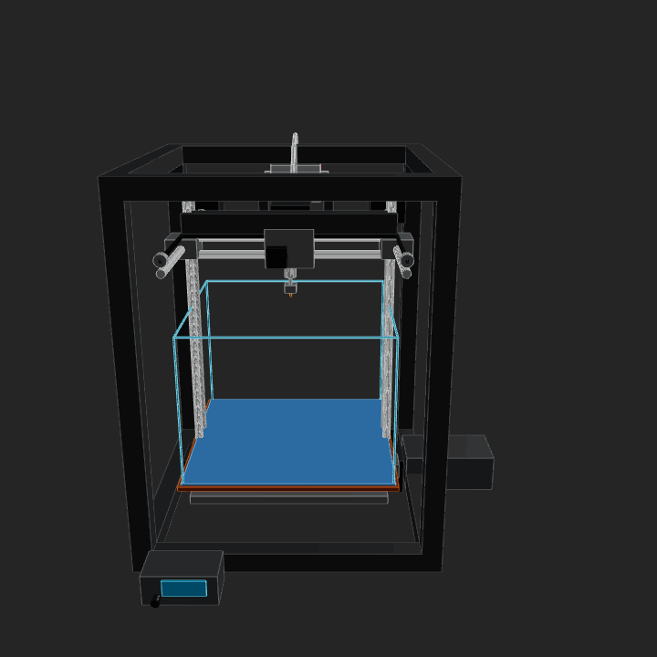
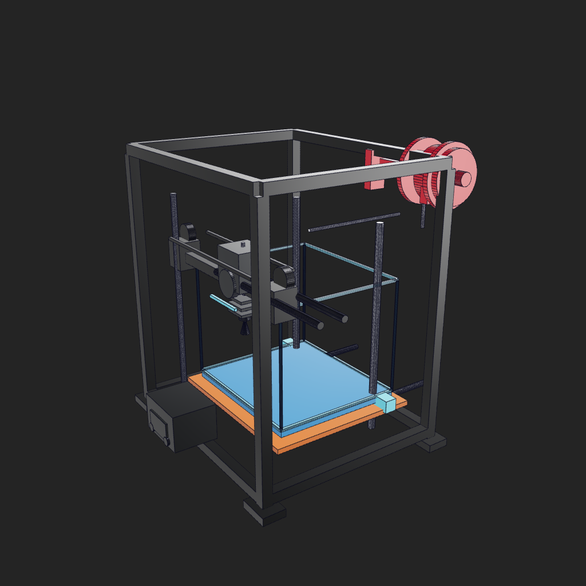
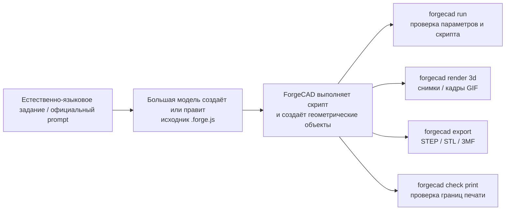
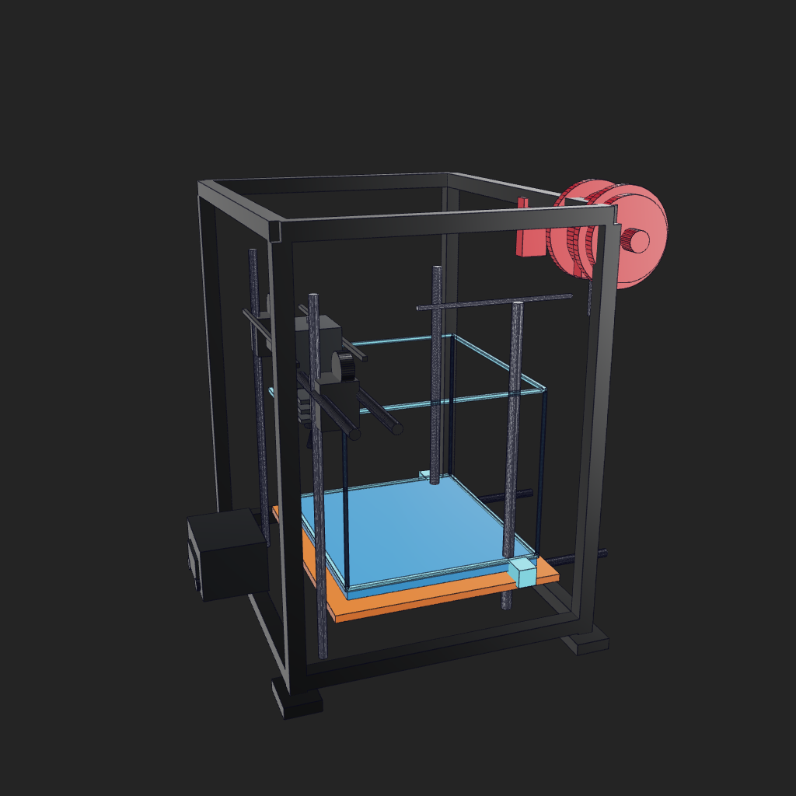
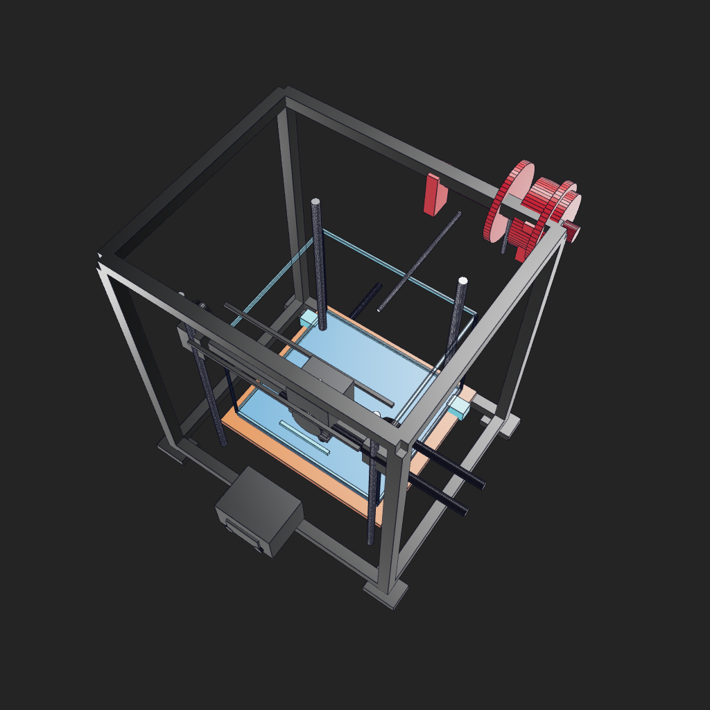
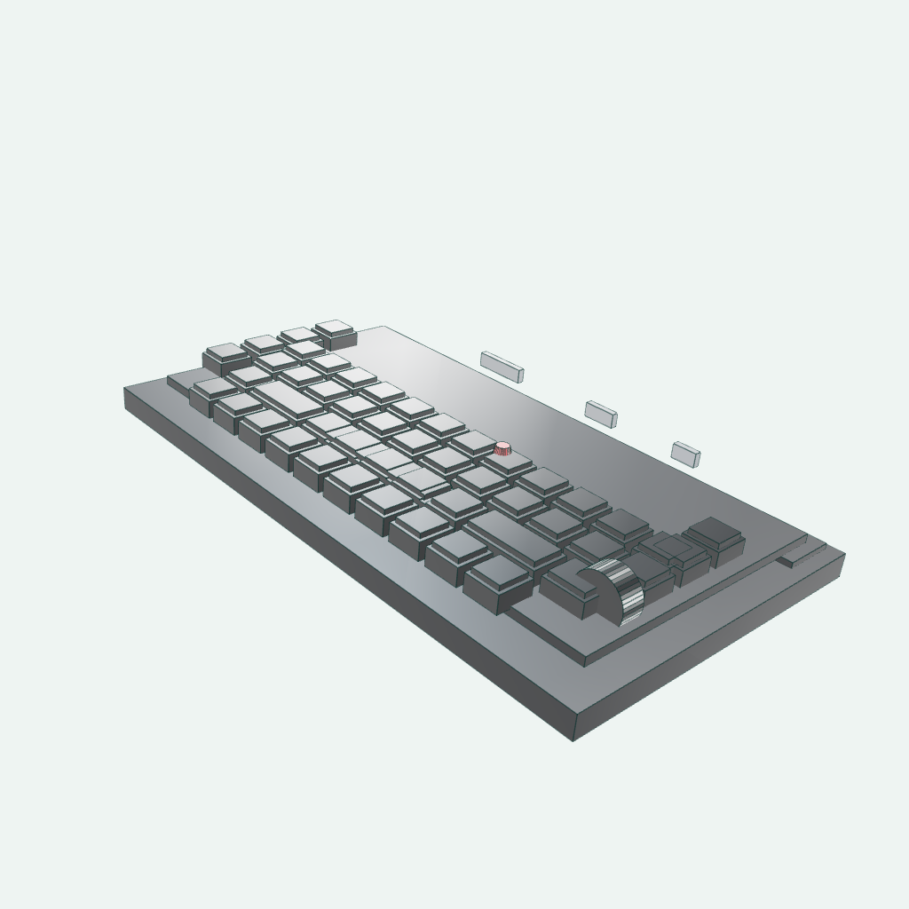
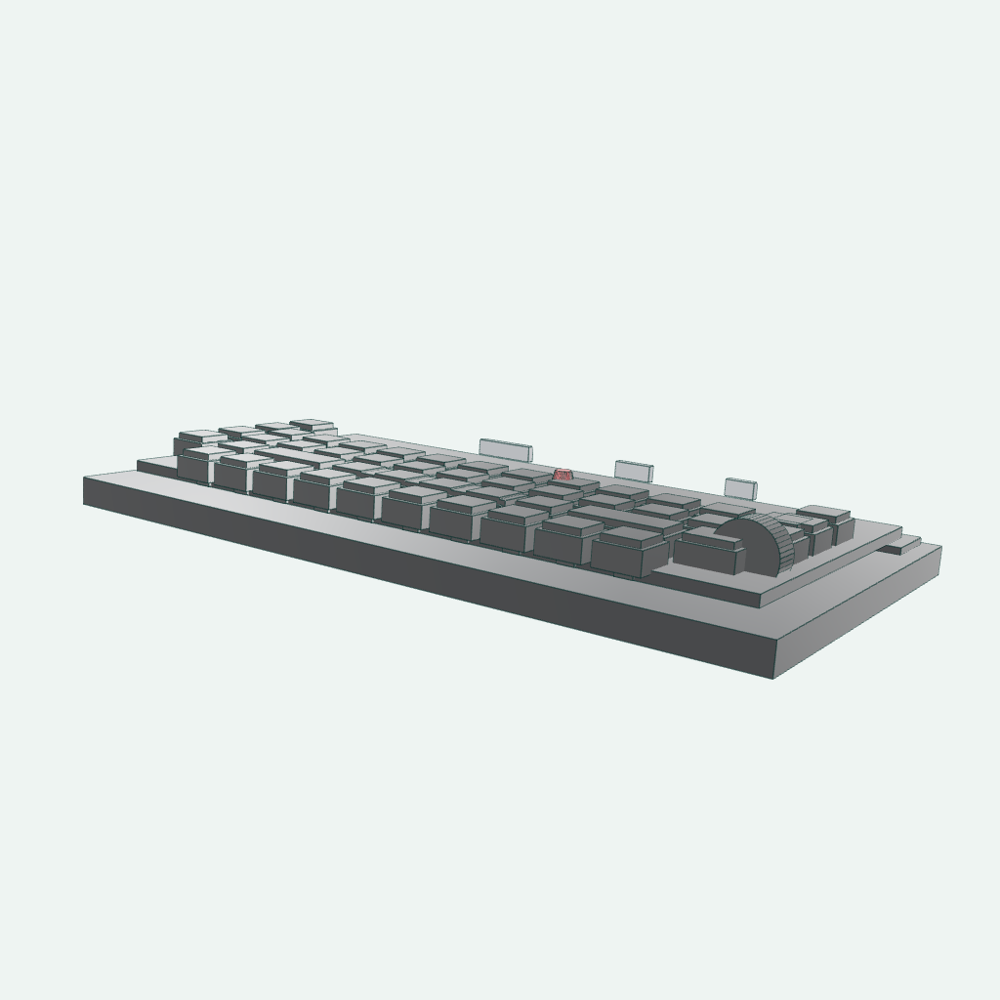
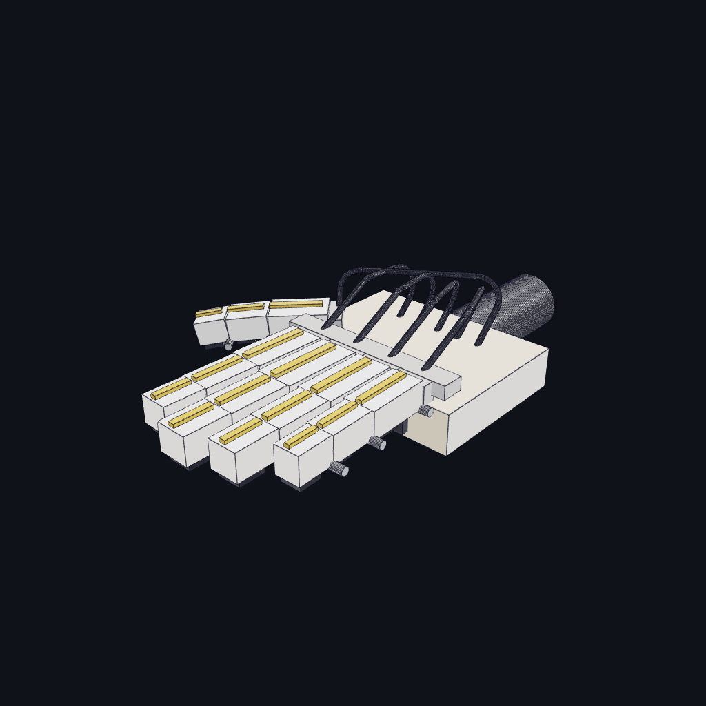
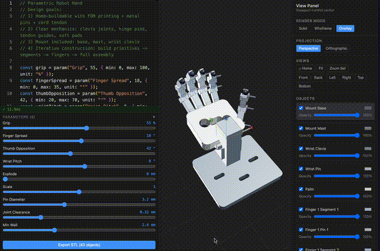

# Воспроизведение официальных примеров ForgeCAD: 3D-принтер, клавиатура и кисть-манипулятор — от GIF бенчмарка до параметрической сборки

В этой главе воспроизводится официальная запись бенчмарка `3dprinter-gpt52codex` из публичного набора ForgeCAD, а также две заметные демонстрации из видео: клавиатуру и официальную подвижную кисть-манипулятор. В публичном наборе ForgeCAD есть README-таблица, prompt и GIF с результатами для 3D-принтера, но исходного `.forge.js` для него в наборе и в репозитории ресурсов нет. Для кисти есть рабочий пример `examples/mechanical/5-finger-robot-hand.forge.js`. В этой главе официальные анимации, локальный рендеринг и исполняемые скрипты собраны в одну цепочку воспроизведения.



Рисунок 1. Официальный ресурс бенчмарка `3dprinter-gpt52codex-2026-02-13-14-36-06-v2.gif`. Источник — таблица LLM Benchmarks в README [KoStard/forgecad-public-kit](https://github.com/KoStard/forgecad-public-kit), сам GIF размещён в [KoStard/ForgeCAD-assets](https://github.com/KoStard/ForgeCAD-assets).

## Почему простой CAD-кронштейн заменён этим примером

Предыдущий маленький кронштейн показывал базовые команды ForgeCAD, но визуально сильно уступал «сложным сборкам» из официальных материалов. Пример с 3D-принтером лучше подходит для главного README: здесь есть портальная рама, нагреватель, оси X/Y/Z, печатающая головка, ремни, нить, катушка и блок управления. Читатель сразу видит полноценную электромеханическую сборку, а не отдельную деталь. Видеоклавиатура — второй пример: это не робот, но она показывает, как ForgeCAD справляется с плотными повторяющимися структурами, массивами клавиш, наклоном корпуса и локальными акцентными цветами.

Это также ближе к тому, что важно в робототехнике: не просто нарисовать красивый корпус, а записать структурные связи в виде редактируемых параметров. Положение печатающей головки по X, положение стола по Y, высота портала по Z и размеры рабочего объёма записаны в параметрах скрипта. Позже один и тот же исходный код можно многократно менять и проверять.

## Сверка с официальной записью

| Поле | Содержание |
| --- | --- |
| Официальный репозиторий | `KoStard/forgecad-public-kit` |
| Название бенчмарка | `3dprinter-gpt52codex` |
| Время и версия | `2026-02-13 14-36-06 · v2` |
| Официальный prompt | `Make a detailed home 3D printer, showing the internal details of how it should work. Add some params for controlling positions, etc.` |
| Официальный GIF | `https://raw.githubusercontent.com/KoStard/ForgeCAD-assets/main/benchmarks/3dprinter-gpt52codex-2026-02-13-14-36-06-v2.gif` |
| Состояние исходника | В публичном наборе нет соответствующего `.forge.js`; в этой главе используется локальный воспроизводящий скрипт |

Команды для самостоятельной сверки:

```powershell
git clone https://github.com/KoStard/forgecad-public-kit.git ..\forgecad-public-kit
git clone https://github.com/KoStard/ForgeCAD-assets.git ..\ForgeCAD-assets

rg -n "3dprinter-gpt52codex|Make a detailed home 3D printer|ForgeCADBenchmark" ..\forgecad-public-kit\README.md
rg --files ..\forgecad-public-kit | rg -i "3dprinter|gpt52|version_2|forge\.js$"
rg --files ..\ForgeCAD-assets | rg -i "3dprinter|gpt52"
```

Результат проверки: в README публичного набора есть строка таблицы, в ресурсах ForgeCAD-assets есть GIF, а публичного файла `.forge.js` для 3D-принтера не найдено.

## Файлы воспроизведения

Файлы, сохранённые в этой главе:

| Файл | Назначение |
| --- | --- |
| [forgecad_3d_printer_demo.forge.js](forgecad_3d_printer_demo.forge.js) | Локально запускаемый скрипт воспроизведения 3D-принтера в ForgeCAD |
| [forgecad_keyboard_demo.forge.js](forgecad_keyboard_demo.forge.js) | Локально запускаемый скрипт воспроизведения клавиатуры в ForgeCAD |
| [forgecad_robot_hand_publickit.forge.js](forgecad_robot_hand_publickit.forge.js) | Официальный пример пятипалой кисти, скопированный из публичного набора |
| [assets/official_3dprinter_gpt52codex.gif](assets/official_3dprinter_gpt52codex.gif) | GIF бенчмарка, сохранённый из официального репозитория ресурсов |
| [assets/official_robot_hand_v2.gif](assets/official_robot_hand_v2.gif) | Официальный GIF подвижной кисти из верхней части README публичного набора ForgeCAD |
| [assets/official_robot_hand_gpt52codex.gif](assets/official_robot_hand_gpt52codex.gif) | GIF бенчмарка `robot-hand-gpt52codex` |
| [assets/official_3dprinter_gpt52codex_frame.png](assets/official_3dprinter_gpt52codex_frame.png) | Статичный кадр из официального GIF для README |
| [assets/forgecad_3d_printer_iso.png](assets/forgecad_3d_printer_iso.png) | Изометрический рендер локальной модели |
| [assets/forgecad_3d_printer_front.png](assets/forgecad_3d_printer_front.png) | Вид спереди локальной модели |
| [assets/forgecad_3d_printer_top.png](assets/forgecad_3d_printer_top.png) | Вид сверху локальной модели |
| [assets/forgecad_keyboard_iso.png](assets/forgecad_keyboard_iso.png) | Изометрический рендер клавиатуры |
| [assets/forgecad_keyboard_low_angle.png](assets/forgecad_keyboard_low_angle.png) | Рендер клавиатуры с низкого ракурса |
| [assets/forgecad_robot_hand_param_sweep.gif](assets/forgecad_robot_hand_param_sweep.gif) | GIF движения кисти, собранный из четырёх рендеров с разными параметрами |

Экспортируемые файлы (STEP, STL, 3MF) создаются командами ниже в каталоге `outputs/`; в репозиторий они не включены:

- `forgecad_3d_printer_demo.step`, `forgecad_3d_printer_demo.stl`, `forgecad_3d_printer_demo.3mf` — 3D-принтер;
- `forgecad_keyboard_demo.step`, `forgecad_keyboard_demo.stl`, `forgecad_keyboard_demo.3mf` — клавиатура;
- `forgecad_robot_hand_publickit.step`, `forgecad_robot_hand_publickit.stl`, `forgecad_robot_hand_publickit.3mf` — кисть.



Рисунок 2. Сборка 3D-принтера, которую создаёт скрипт главы. В текущей версии основные визуальные признаки совпадают с официальным GIF: тёмный фон, чёрная рама, серебристые направляющие, синяя платформа, оранжевая нагревательная пластина, голубая рамка рабочего объёма, красная катушка справа вверху и блок управления спереди. Это не построчная копия официального исходника, а работающая учебная версия на тот же prompt. Чтобы добиться пиксельного совпадения, нужны официальный `.forge.js`, камера и конфигурация сцены.

## Среда выполнения

Этому примеру не нужна отдельная среда micromamba. ForgeCAD работает через CLI на Node.js/npm, а для рендеринга PNG используется локальный Chrome. Здесь нет PyTorch, CUDA или зависимостей робототехнического симулятора, и видеопамять не расходуется.

Конфигурация, на которой проверялась глава:

| Параметр | Значение при проверке |
| --- | --- |
| Система | Windows PowerShell |
| Node.js | `22.16.0` |
| npm | `10.9.2` |
| ForgeCAD | `npx --yes forgecad@0.9.14` |
| Chrome | `C:\Program Files\Google\Chrome\Application\chrome.exe` |
| GPU | Не требуется: моделирование и экспорт выполняются на CPU, рендеринг — через Chrome/WebGL |

Проверка установки:

```powershell
node --version
npm --version
npx --yes forgecad@0.9.14 --version
```

## Разбор моделирования

Этот пример по сути относится к AI-assisted CAD, а не к «изображение сразу превращается в CAD». Большая языковая модель создаёт или правит исходник `.forge.js` по естественно-языковому заданию, наблюдениям за референсным изображением и инженерной декомпозиции. ForgeCAD CLI выполняет этот JavaScript/TypeScript-скрипт и вызывает свои возможности: геометрическое моделирование, булевы операции, сборку, рендеринг и экспорт. Значит, `.forge.js` — исходный код CAD, а не конечный CAD-файл. Обмениваемый результат геометрии — это STEP, STL, 3MF и другие форматы.

Более точная схема процесса:



Локальный скрипт делит 3D-принтер на модули реальных функций. Здесь не все детали объединяются в один большой `union`, потому что на официальном GIF читаемость зависит от локальных цветов: чёрная рама, серебристые направляющие, синяя платформа, оранжевая пластина, голубой рабочий объём и красная катушка должны сохранять собственные материалы.

| Модуль | Объект в скрипте | Описание |
| --- | --- | --- |
| Портальная рама | `frame` | Стойки, верхняя и нижняя перекладины, опоры; показывает контур рамы типа CoreXY/коробчатой |
| Нагрев и платформа | `orange heater plate` / `blue print bed` / `bed carriage and rails` | Синяя рабочая платформа, оранжевая нагревательная пластина и направляющие Y с кареткой стола |
| Ось Z | `z motion system` | Вертикальные направляющие и ходовой винт по Z |
| Рабочий объём | `cyan build volume cage` | Тонкая голубая рамка, имитирующая прозрачный объём печати на официальном изображении |
| Ось X и головка | `x gantry` / `print head` / `belts` | Поперечина X, направляющие, шкивы, вентилятор, горячий конец, сопло, радиатор |
| Катушка и нить | `red spool` / `filament` | Красная катушка в правом верхнем углу, её держатель и упрощённый путь нити |
| Управление и мелочи | `front electronics` / `small details` | Блок управления спереди, дисплей, ручки и мелкие направляющие элементы |

Ключевые параметры собраны в начале файла:

```javascript
const headX = Param.number("Print Head X", 22, { min: -70, max: 70, unit: "mm" });
const bedY = Param.number("Print Bed Y", 12, { min: -45, max: 45, unit: "mm" });
const gantryZ = Param.number("Gantry Z", 128, { min: 70, max: 175, unit: "mm" });
const buildVolumeW = Param.number("Build Volume Width", 118, { min: 80, max: 150, unit: "mm" });
const buildVolumeD = Param.number("Build Volume Depth", 105, { min: 80, max: 135, unit: "mm" });
```

Эти параметры соответствуют фразе «params for controlling positions» из официального prompt. Для первого знакомства читателю достаточно поменять только их и посмотреть, как меняются головка, стол и рабочий объём.

## Запуск скрипта

Перейдите в каталог главы:

```powershell
cd books\embodied-ai\src\21-robot-design\03-forgecad-visual-reverse-engineering-introduction
```

Запустите скрипт ForgeCAD:

```powershell
npx --yes forgecad@0.9.14 run forgecad_3d_printer_demo.forge.js
```

Результат при проверке:

```text
Objects: 13
Verifications: 5 pass, 0 fail
Params: Frame Width=180, Frame Depth=150, Frame Height=210,
        Print Head X=22, Print Bed Y=12, Gantry Z=128,
        Build Volume Width=118, Build Volume Depth=105
Time: 563ms
```

Пять проверок включают контроль общей ширины, глубины и высоты, высоты портала и того, что головка остаётся внутри рамы. Это не расчёт прочности механизма, а защита от случайных изменений параметров, которые сильно искажают модель.

## Многоракурсный рендеринг

Для рендеринга нужен путь к Chrome. Команды при проверке:

```powershell
$chrome = "C:\Program Files\Google\Chrome\Application\chrome.exe"

npx --yes forgecad@0.9.14 render 3d forgecad_3d_printer_demo.forge.js `
  --output assets/forgecad_3d_printer_iso.png `
  --camera 55:20 `
  --background "#242424" `
  --edges thin `
  --render-style classic `
  --chrome-path $chrome `
  --fresh-server `
  --port 5180

npx --yes forgecad@0.9.14 render 3d forgecad_3d_printer_demo.forge.js `
  --output assets/forgecad_3d_printer_front.png `
  --camera 70:18 `
  --background "#242424" `
  --edges thin `
  --render-style classic `
  --chrome-path $chrome `
  --fresh-server `
  --port 5181

npx --yes forgecad@0.9.14 render 3d forgecad_3d_printer_demo.forge.js `
  --output assets/forgecad_3d_printer_top.png `
  --camera 35:58 `
  --background "#242424" `
  --edges thin `
  --render-style classic `
  --chrome-path $chrome `
  --fresh-server `
  --port 5182
```

Чтобы получить визуальное впечатление, близкое к официальному GIF, важны три момента: тёмный фон `--background "#242424"`, `--render-style classic` для более жёсткого CAD-вида и `--camera 55:20`, при котором красная катушка справа вверху и блок управления спереди попадают в кадр одновременно. Официальный исходный `.forge.js`, JSON камеры и состояние сцены не опубликованы, поэтому пиксельно идентичного результата получить нельзя. Для полного совпадения нужны исходный скрипт бенчмарка и его конфигурация viewport.



Рисунок 3. На виде спереди лучше видны головка, нагревательная платформа, оптическая ось Z и блок управления.



Рисунок 4. Вид сверху позволяет проверить взаимное расположение рамы, катушки, ремней и платформы.

Все три рендера при проверке сообщали одинаковые геометрические границы:

```text
Size:   224.0 x 224.0 x 229.0 mm
Volume: 449408.0 mm3
Bounds: [-102.0,-108.0,-3.0] -> [122.0,116.0,226.0]
```

## Второй пример: клавиатура из видео

Клавиатура из видео хорошо дополняет главу. Её учебная задача отличается от 3D-принтера: принтер показывает сложную сборку и подвижные части, а клавиатура — регулярные массивы, наклон корпуса, локальные акценты и организацию большого числа повторяющихся деталей. Её можно рассматривать как упражнение на «внешний вид продукта + параметрические массивы» в ForgeCAD.

В основе примера лежит воспроизводимый скрипт [forgecad_keyboard_demo.forge.js](forgecad_keyboard_demo.forge.js). Видео помогает наблюдать за внешними признаками, а результаты в главе получены локальным скриптом. В скрипте есть такие настраиваемые параметры:

```javascript
const cols = Param.number("Columns", 12, { min: 8, max: 14, unit: "keys" });
const keyPitch = Param.number("Key Pitch", 15, { min: 12, max: 18, unit: "mm" });
const caseAngle = Param.number("Case Angle", 6, { min: 0, max: 12, unit: "deg" });
const knobOffset = Param.number("Knob Offset", 0, { min: -18, max: 18, unit: "mm" });
const accentKeyX = Param.number("Accent Key X", 2, { min: -4, max: 4, unit: "keys" });
```

Запуск модели клавиатуры:

```powershell
npx --yes forgecad@0.9.14 run forgecad_keyboard_demo.forge.js
```

Результат при проверке:

```text
Objects: 5
Verifications: 4 pass, 0 fail
Params: Columns=12, Key Pitch=15, Case Angle=6, Knob Offset=0, Accent Key X=2
Time: 3127ms
```

Команды рендеринга:

```powershell
$chrome = "C:\Program Files\Google\Chrome\Application\chrome.exe"

npx --yes forgecad@0.9.14 render 3d forgecad_keyboard_demo.forge.js `
  --output assets/forgecad_keyboard_iso.png `
  --camera 48:31 `
  --edges thin `
  --render-style studio `
  --chrome-path $chrome `
  --fresh-server `
  --port 5184

npx --yes forgecad@0.9.14 render 3d forgecad_keyboard_demo.forge.js `
  --output assets/forgecad_keyboard_low_angle.png `
  --camera 35:16 `
  --edges thin `
  --render-style studio `
  --chrome-path $chrome `
  --fresh-server `
  --port 5185
```



Рисунок 5. Изометрический вид клавиатуры. Обратите внимание на массив клавиш, правую ручку, тёмную зону функциональных клавиш и красные клавиши.



Рисунок 6. Низкий ракурс лучше показывает толщину корпуса и слегка приподнятый угол клавиатуры.

Габариты, полученные при рендеринге клавиатуры:

```text
Size:   214.0 x 119.9 x 33.9 mm
Volume: 327930.0 mm3
Bounds: [-107.0,-58.2,-6.1] -> [107.0,61.7,27.8]
```

## Третий пример: официальная подвижная кисть

В верхней части README публичного набора ForgeCAD есть подвижная кисть. Этот пример особенно интересен для робототехники, поскольку параметры, звенья, шарниры, сухожилия или кабели и сборка описаны в одном `.forge.js`. Здесь мы используем официальный пример напрямую:

```powershell
Copy-Item ..\forgecad-public-kit\examples\mechanical\5-finger-robot-hand.forge.js `
  .\forgecad_robot_hand_publickit.forge.js
npx --yes forgecad@0.9.14 run forgecad_robot_hand_publickit.forge.js
```

Результат при проверке:

```text
Objects: 76
Params: Scale=1, Finger Curl=40, Thumb Curl=35, Finger Spread=8
Time: 530ms
```

«Подвижность» здесь достигается не воспроизведением видео, а управлением позой через параметры. Ниже четыре кадра, в которых меняются `Finger Curl`, `Thumb Curl` и `Finger Spread`; затем эти кадры объединяются в локальный GIF:

```powershell
npx --yes forgecad@0.9.14 render 3d forgecad_robot_hand_publickit.forge.js `
  --param "Finger Curl=45" `
  --param "Thumb Curl=38" `
  --param "Finger Spread=12" `
  --output assets/forgecad_robot_hand_02.png `
  --camera 42:28 `
  --background "#101318" `
  --edges thin `
  --render-style classic `
  --chrome-path $chrome
```



Рисунок 7. Движение, полученное из официального примера кисти при разных параметрах. Это низкобюджетная анимация: каждый кадр — настоящий рендер одного и того же CAD-скрипта с другими параметрами, а не монтаж видео вручную.

Официальный GIF также сохранён в главе для сравнения:



## Экспорт CAD и файлов для печати

Экспорт STEP:

```powershell
npx --yes forgecad@0.9.14 export step forgecad_3d_printer_demo.forge.js `
  --output outputs/forgecad_3d_printer_demo.step
```

Экспорт STL:

```powershell
npx --yes forgecad@0.9.14 export stl forgecad_3d_printer_demo.forge.js `
  --output outputs/forgecad_3d_printer_demo.stl
```

Экспорт 3MF:

```powershell
npx --yes forgecad@0.9.14 export 3mf forgecad_3d_printer_demo.forge.js `
  --output outputs/forgecad_3d_printer_demo.3mf
```

Для клавиатуры команды такие же, только имена скрипта и выходных файлов меняются на `forgecad_keyboard_demo`:

```powershell
npx --yes forgecad@0.9.14 export step forgecad_keyboard_demo.forge.js `
  --output outputs/forgecad_keyboard_demo.step

npx --yes forgecad@0.9.14 export stl forgecad_keyboard_demo.forge.js `
  --output outputs/forgecad_keyboard_demo.stl

npx --yes forgecad@0.9.14 export 3mf forgecad_keyboard_demo.forge.js `
  --output outputs/forgecad_keyboard_demo.3mf
```

Кисть экспортируется так же:

```powershell
npx --yes forgecad@0.9.14 export step forgecad_robot_hand_publickit.forge.js `
  --output outputs/forgecad_robot_hand_publickit.step
npx --yes forgecad@0.9.14 export stl forgecad_robot_hand_publickit.forge.js `
  --output outputs/forgecad_robot_hand_publickit.stl
npx --yes forgecad@0.9.14 export 3mf forgecad_robot_hand_publickit.forge.js `
  --output outputs/forgecad_robot_hand_publickit.3mf
```

Размеры файлов при проверке:

| Файл | Размер |
| --- | ---: |
| `forgecad_3d_printer_demo.step` | 1.1 MB |
| `forgecad_3d_printer_demo.stl` | 256 KB |
| `forgecad_3d_printer_demo.3mf` | 54 KB |
| `forgecad_keyboard_demo.step` | 3.2 MB |
| `forgecad_keyboard_demo.stl` | 153 KB |
| `forgecad_keyboard_demo.3mf` | 39 KB |
| `forgecad_robot_hand_publickit.step` | 3.7 MB |
| `forgecad_robot_hand_publickit.stl` | 717 KB |
| `forgecad_robot_hand_publickit.3mf` | 261 KB |

STEP удобнее для дальнейшего редактирования в CAD-программе. STL и 3MF — для предварительного просмотра в слайсерах. Эта модель — учебная сборка, а не деталь, которую можно сразу напечатать целиком.

## Что означает результат проверки печати

Команда:

```powershell
npx --yes forgecad@0.9.14 check print forgecad_3d_printer_demo.forge.js
```

При проверке получен `FAIL`. Это не ошибка выполнения скрипта: проверка показывает, что модель-сборка не подходит для прямой печати как единой детали по технологии FDM:

```text
Scene: 13 shape(s), 5128 triangle(s), bbox 224.0 x 224.0 x 229.0mm
PASS print.script.verifications: 5 script verification(s) passed.
FAIL print.geometry.collisions: 14 positive-volume collision(s) found.
FAIL print.fdm.wall-thickness: 1 object(s) have sampled wall area below 1.2mm.
WARN print.fdm.overhangs: 8 object(s) exceed 45deg unsupported overhang budget.
PASS print.mesh.validity: Meshes are closed and manifold at the sampled tolerance.
```

Это хороший учебный пример: официальный GIF демонстрирует возможности сборки, но из этого не следует, что весь принтер можно напечатать одним куском. Для реального производства нужно разделить раму, платформу, опоры направляющих, корпус печатающей головки и т. д. на отдельные детали, затем добавить толщину стенок, фаски, резьбовые отверстия, допуски и стратегию поддержек.

У клавиатуры при проверке также найдены похожие замечания:

```text
Scene: 5 shape(s), 3056 triangle(s), bbox 214.0 x 119.9 x 33.9mm
PASS print.script.verifications: 4 script verification(s) passed.
FAIL print.geometry.collisions: 4 positive-volume collision(s) found.
PASS print.mesh.validity: Meshes are closed and manifold at the sampled tolerance.
FAIL print.fdm.wall-thickness: 1 object(s) have sampled wall area below 1.2mm.
```

Коллизии возникают в основном потому, что клавишные колпачки, корпус и функциональные зоны проверяются как одна демонстрационная сборка. Если корпус клавиатуры предполагается печатать, колпачки, нижний корпус, верхняя крышка, ручка и заглушки разъёмов нужно разделить на отдельные детали.

## Использование ресурсов и время

При проверке через PowerShell были измерены процессы `cmd -> npm/npx -> node/chrome`. Примерные значения:

| Шаг | Время | Пиковая память | Комментарий |
| --- | ---: | ---: | --- |
| `forgecad run` | 4.67 с | 262 МБ | Полное холодное время CLI; ForgeCAD сообщает о времени моделирования около 0.5 с |
| Один `render 3d` | 7.77 с | 826 МБ | Включает холодный запуск сервиса рендеринга Chrome |
| `export stl` | 5.07 с | не измерялась отдельно | Вывод: STL 256 КБ |
| `export 3mf` | 5.10 с | не измерялась отдельно | Вывод: 3MF 54 КБ |
| `export step` | 19.41 с | не измерялась отдельно | Точный STEP экспортируется дольше; вывод 1.1 МБ |
| `check print` | 5.53 с | не измерялась отдельно | Проверка сетки примерно из 5128 треугольников |
| `run` клавиатуры | около 9.8 с | не измерялась отдельно | ForgeCAD сообщает о времени моделирования около 3.1 с |
| Один `render 3d` клавиатуры | около 15 с | не измерялась отдельно | Больше клавиш — дольше холодный запуск рендеринга |
| `export stl` клавиатуры | 10.14 с | не измерялась отдельно | Вывод: STL 153 КБ |
| `export 3mf` клавиатуры | 8.13 с | не измерялась отдельно | Вывод: 3MF 39 КБ |
| `export step` клавиатуры | 30.81 с | не измерялась отдельно | Точный STEP 3.2 МБ |
| `export stl` кисти | 3.94 с | не измерялась отдельно | Вывод: STL 717 КБ |
| `export 3mf` кисти | 4.23 с | не измерялась отдельно | Вывод: 3MF 261 КБ |
| `export step` кисти | 32.36 с | не измерялась отдельно | Точный STEP 3.7 МБ |

Такая нагрузка для обычного ноутбука невелика, видеокарта с 6 ГБ не нужна. Реально ресурсоёмкими могут стать более сложные поверхности, булевы операции, сверхвысокоточные сетки или анимация в браузере.

## Границы воспроизведения

### 1. Соотношение официальных ресурсов и локальной копии

В главе использованы два типа материалов. Первый — официальные публичные ресурсы: GIF бенчмарка `3dprinter-gpt52codex`, GIF `Robot Hand V2` и исходник кисти из публичного набора. Они помогают сравнить результат с официальным видом. Второй — локальные учебные скрипты, например `forgecad_3d_printer_demo.forge.js` и `forgecad_keyboard_demo.forge.js`. Они нужны, чтобы читатель действительно прошёл путь «задание → исходник → геометрия CAD → рендеринг и экспорт».

Для 3D-принтера в публичном доступе есть GIF и prompt, но нет `.forge.js`. Поэтому здесь предлагается учебная версия, которая повторяет визуальные признаки официального результата. Кисть же берётся напрямую из официального исходника публичного набора.

### 2. Как просить большую модель создать похожий CAD

Лучше формулировать задачу как структурированное инженерное задание, а не как «сделай красивый 3D-принтер». Например:

```text
Напиши параметрический .forge.js для ForgeCAD в стиле CoreXY-принтера.
Нужно: чёрная коробчатая рама, синяя платформа, оранжевая нагревательная пластина,
серебристые направляющие оси Z, поперечина оси X, печатающая головка, ремни,
красная катушка справа вверху, блок управления спереди и голубой рамка рабочего объёма.
Параметры: Print Head X, Print Bed Y, Gantry Z, Build Volume Width, Build Volume Depth.
Объекты назови по модулям, чтобы при рендеринге сохранялись цвета.
В конце добавь bounding box и проверку допустимых диапазонов параметров.
```

Черновик от большой модели не следует считать окончательным CAD. Правильный цикл такой: `forgecad run` проверяет, выполняется ли скрипт; рендер PNG показывает пропорции и ракурс; экспорт STEP, STL и 3MF проверяет файлы обмена; при необходимости текст ошибки или скриншот возвращаются большой модели для исправления `.forge.js`.

### 3. Нужен ли здесь micromamba

В основной линии главы — нет. ForgeCAD опирается на Node.js/npm и Chrome. Здесь нет PyTorch, CUDA или симуляторов робототехники. Окружения micromamba или conda понадобятся лишь тогда, когда ForgeCAD будет встроен в один эксперимент с Python-CAD, обучением в симуляции или алгоритмами робототехнического обучения.

### 4. Пригодны ли эти модели для реального производства

Нет. Это учебные параметрические сборки, демонстрирующие AI-assisted CAD, code-first CAD, декомпозицию сложных конструкций, проверку через CLI и экспорт файлов. Для реальной механики нужно продолжить проверку прочности, жёсткости, передач, допусков, покупных компонентов, сборки, материалов и безопасности.

## Источники

- Публичный набор ForgeCAD: https://github.com/KoStard/forgecad-public-kit
- Ресурсы ForgeCAD: https://github.com/KoStard/ForgeCAD-assets
- Документация ForgeCAD: https://forgecad.io/docs
- Пакет ForgeCAD в npm: https://www.npmjs.com/package/forgecad
