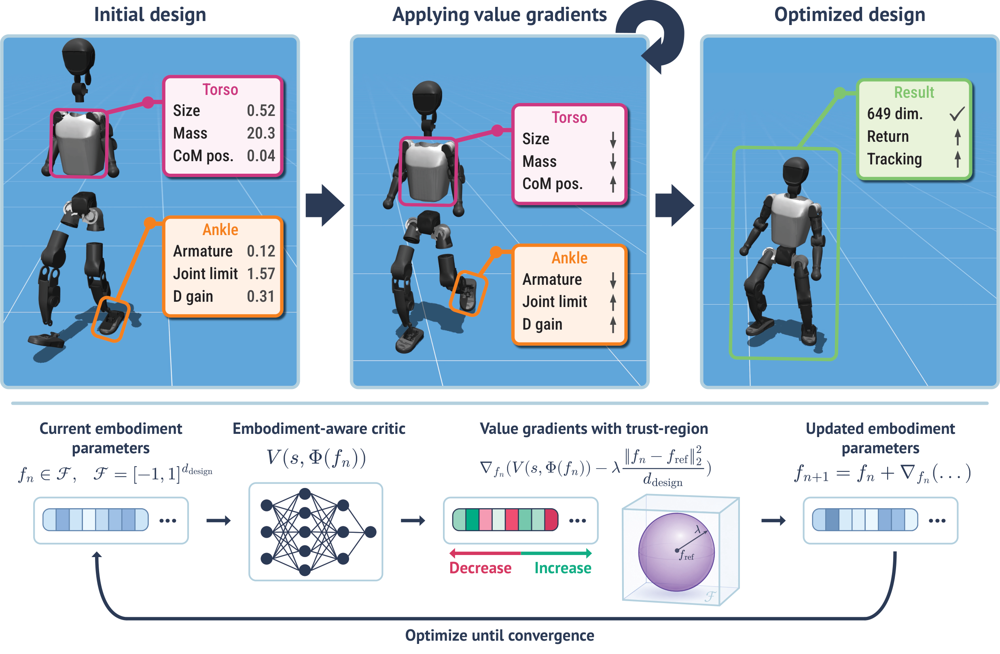
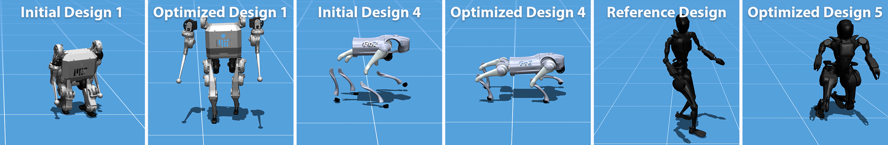
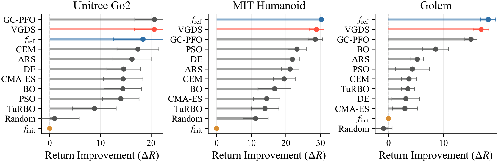
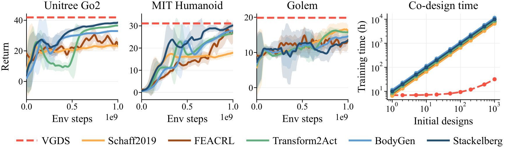
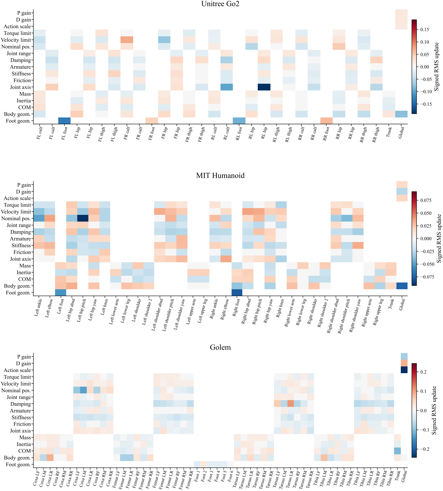

# Shape Your Body: оптимизация конструкции робота с помощью градиентов ценности

> В этом обзоре рассматривается статья **Shape Your Body: Value Gradients for Multi-Embodiment Robot Design**. Работа выполнена в Техническом университете Дармштадта, Robotics Institute Germany, DFKI и hessian.AI; авторы — Nico Bohlinger и Jan Peters. Номер arXiv: `2606.00702v1`, дата подачи — 30 мая 2026 г. Страница проекта: [nico-bohlinger.github.io/shape-your-body](https://nico-bohlinger.github.io/shape-your-body/).

## 1. Главный вывод: почему это стоит включить в главу о проектировании роботов

Shape Your Body изучает интересную и практичную задачу:

```text
Можно ли оптимизировать параметры тела робота градиентным методом, так же как оптимизируют параметры нейронной сети?
```

Традиционно конструкцию робота проектируют вручную, а затем обучают для неё стратегию управления. Совместное проектирование на основе обучения (learning-based co-design) оптимизирует тело и контроллер вместе, но обычно это дорого: внешний цикл перебирает варианты тела, а внутренний для каждого кандидата заново обучает или адаптирует контроллер. Даже при умеренном пространстве параметров, когда меняются масса, инерция, геометрия, пределы суставов, момент приводов, ограничения скорости и коэффициенты PD-регулятора, такой цикл становится очень медленным.

Shape Your Body снижает эту стоимость за счёт амортизации:

```text
Сначала обучаем мультимодальную политику (multi-embodiment policy) и функцию ценности
    ↓
Замораживаем политику и критика
    ↓
Используем критика как дифференцируемую суррогатную модель для проектирования
    ↓
Вычисляем градиент ценности по параметрам тела
    ↓
Обновляем конструкцию робота по этому градиенту
```

В статье этот метод поиска конструкции назван **Value-Gradient Design Search (VGDS)**. Коротко: сначала с помощью многоробототного обучения с подкреплением выясняется, какие тела лучше поддаются управлению текущей политикой, а затем градиент функции ценности по параметрам тела используется для улучшения новой конструкции.

Этот материал следует размещать в разделе `21-robot-design`, а не в главах про VLA или модели мира. Причина в том, что предмет статьи — не восприятие, генерация действий или предсказание видео, а **воплощение робота, морфологию и непрерывные параметры конструкции**. По отношению к Build123d, Text-to-CAD и ForgeCAD разница такая: первые три в основном отвечают на вопрос «как создать или редактировать геометрию», а Shape Your Body — «как через выученную ценность управления направлять изменения параметров тела».

## 2. Статья, страница проекта и статус открытого кода

| Пункт | Ссылка | Состояние |
| :--- | :--- | :--- |
| Статья | [arXiv:2606.00702](https://arxiv.org/abs/2606.00702) / [HTML](https://arxiv.org/html/2606.00702v1) | Подана 30 мая 2026 г. |
| Страница проекта | [Shape Your Body](https://nico-bohlinger.github.io/shape-your-body/) | Официальная страница с интерактивными демо, схемой метода, набором роботов и результатами |
| PDF | [PDF TU Darmstadt](https://www.ias.informatik.tu-darmstadt.de/uploads/Team/NicoBohlinger/shape_your_body.pdf) | Официальный PDF, на который ведёт кнопка Paper на странице проекта |
| Видео | [YouTube](https://www.youtube.com/watch?v=_SHSWUSQZvg) | Видео, на которое ведёт кнопка Video на странице проекта |
| Код | На странице проекта указано `Code (soon)` | Официальный публичный репозиторий пока не найден |

По состоянию на 18 июля 2026 г. страница проекта и статья были доступны, интерактивная веб-демонстрация позволяла посмотреть разных роботов и траектории поиска конструкции, но код оставался помечен как `Code (soon)`. Поэтому эта глава не является пошаговым руководством по воспроизведению обучения, а представляет собой обзор метода, схемы и подготовку к будущему воспроизведению. Если код будет опубликован, можно добавить раздел с настройкой окружения и минимальным экспериментом.

## 3. Общая схема: сначала обучаем функцию ценности, затем формируем тело по её градиенту



**Рисунок 1. Общая схема Shape Your Body.** Сначала обучаются политика с учётом воплощения и функция ценности на большом наборе вариантов тела. После обучения сети замораживаются, для непрерывного вектора конструкции вычисляется градиент ценности, и параметры тела обновляются в доверительной области.
Источник: [официальная страница проекта Shape Your Body](https://nico-bohlinger.github.io/shape-your-body/).

На этой схеме можно выделить два этапа.

Первый этап — **многоробототное обучение с подкреплением (multi-embodiment RL training)**. В каждой среде при сбросе эпизода выбирается конструкция робота, которая сохраняется на протяжении всего эпизода. Политика управления должна научиться выполнять задачу отслеживания скорости при разных параметрах тела, а критик — оценивать, какое вознаграждение можно получить в будущем для пары «состояние + конструкция тела».

Второй этап — **поиск конструкции (design search)**. После обучения политика и критик замораживаются, и новую обучать не требуется. Конструкция задаётся нормированным вектором `f`, который дифференцируемым отображением `Φ(f)` переводится в физические параметры тела. Затем вычисляется градиент замороженного критика по вектору конструкции:

```text
вектор конструкции f
    -> физическое воплощение Φ(f)
    -> ценность критика V(s, Φ(f))
    -> ∇f V
    -> обновление f
```

Именно здесь заключена идея «проектирования робота градиентом». Градиент берётся не из реального оборудования и не из функции потерь CAD-программы, а из обученной функции ценности. Он показывает оптимизатору, какие изменения параметров тела, по прогнозу, повысят вознаграждение при текущем распределении состояний и текущей замороженной политике.

## 4. Обучающий набор: 50 роботов и до 1177 непрерывных параметров конструкции



**Рисунок 2. Набор роботов для многоробототного обучения.** На странице проекта показан самый большой обучающий набор: 50 роботов — 15 четвероногих, 31 двуногий и гуманоидный, 4 шестиногих. У каждого робота от 190 до 1177 непрерывных параметров конструкции.
Источник: [официальная страница проекта Shape Your Body](https://nico-bohlinger.github.io/shape-your-body/).

Обучение в статье проводится не на одном игрушечном роботе, где меняется только длина ноги. Наибольший набор включает:

- `15` четвероногих;
- `31` двуногих и гуманоидных роботов;
- `4` шестиногих;
- от `190` до `1177` непрерывных параметров конструкции у каждого робота.

Эти параметры относятся не только к геометрии, но и к физическим и управляющим свойствам, которые сильнее влияют на управление:

| Категория параметров | Примеры | Почему влияет на управление |
| :--- | :--- | :--- |
| Геометрические | геометрия звеньев, размер стопы, положение сочленений | Меняют центр масс, опорную поверхность, размах движения ноги и взаимное расположение элементов при столкновении |
| Масса и инерция | масса звена, инерция, смещение центра масс | Влияют на динамическую устойчивость, ответ на ускорение и энергозатраты |
| Свойства суставов | ось сустава, диапазон движения, демпфирование, трение | Определяют степени свободы, демпфирование и доступные позы |
| Свойства приводов | пределы момента, пределы скорости | Задают максимальную выдаваемую силу и скорость |
| Параметры управления | коэффициенты PD-регулятора, масштаб действия | Влияют на низкоуровневое отслеживание, устойчивость и усиление действий |

Именно поэтому материал хорошо сочетается с главой о проектировании роботов. CAD описывает, **как выглядит** форма; URDF/MJCF сообщают симулятору, **какие параметры тела** заданы; Shape Your Body пытается выяснить, **как эти параметры влияют на долгосрочный выигрыш** уже обученной политики.

## 5. Политика URMA и критик с прямым учётом конструкции

Shape Your Body строится на архитектуре URMA для политик с несколькими воплощениями. URMA решает задачу разных топологий роботов: у одного 12 суставов, у другого больше 20, один четвероногий, другой гуманоидный, третий шестиногий. Простое объединение всех состояний суставов в фиксированный вектор здесь не работает.

URMA разделяет наблюдение на части:

```text
общие наблюдения
    + наблюдения для каждого сустава
    + описательные векторы каждого сустава
```

Описание каждого сустава содержит статические сведения о теле: ось сустава, относительное положение, пределы движения, коэффициенты PD-регулятора, массу и инерцию соседних звеньев, геометрические параметры. Сеть кодирует каждый сустав отдельно, а затем с помощью внимания (attention) или агрегации собирает переменное число латентных представлений суставов в вектор фиксированной размерности.

Ключевое изменение Shape Your Body касается критика. Авторы переделали стандартный критик URMA в **критика с прямым учётом конструкции (direct-design URMA critic)**, чтобы параметры конструкции сильнее влияли на предсказание ценности. Интуитивно:

```text
Обычный критик с учётом воплощения:
    описание тела участвует главным образом как ключ внимания,
    поэтому влияние параметров конструкции недостаточно прямое.

Критик с прямым учётом конструкции:
    наблюдения и описания вместе входят в энкодер ветви ценности,
    поэтому критик чувствительнее к параметрам конструкции
    и даёт более полезный градиент ∇design V.
```

Этот шаг очень важен. VGDS опирается на градиент критика по параметрам конструкции. Если критик грубо различает только тип робота и не реагирует на небольшие изменения размера стопы, пределов суставов, ограничений приводов и коэффициентов PD-регулятора, градиент ценности будет очень шумным, и поиск конструкции окажется неэффективным.

В статье также используются ансамбли голов ценности: оптимизация опирается на среднее значение ценности нескольких голов. Это снижает риск катастрофических обновлений конструкции из-за ошибки аппроксимации одной головы.

## 6. VGDS: поиск по градиенту ценности с мягкой доверительной областью

Цель VGDS, как она записана на странице проекта, выглядит так:

```text
J_hat_lambda(f)
  = mean_m V_bar(s_m, Phi(f))
    - lambda * ||f - f_ref||^2 / d_design
```

Здесь:

- `f` — нормированный вектор конструкции;
- `Φ(f)` — отображение, которое переводит нормированный вектор в физические параметры тела;
- `s_m` — состояния из фиксированного банка состояний (state bank);
- `V_bar` — среднее предсказание ансамбля замороженных критиков;
- `f_ref` — опорная конструкция, которой может быть номинальный URDF или начальная конструкция;
- `lambda` — коэффициент, определяющий, насколько далеко можно отойти от опорной конструкции;
- `d_design` — нормировка, которая позволяет сравнивать штраф для пространств разных размерностей.

Зачем нужна доверительная область? Критик — не физическая истина, он достаточно надёжен только вблизи обучающего распределения. Если оптимизировать ценность без ограничений, оптимизатор может увести конструкцию к границам: например, к экстремальной массе, экстремальной геометрии или экстремальным ограничениям привода. Критику такая конструкция может показаться очень выгодной, но при реальном прогоне робот упадёт. Статья также отмечает, что неограниченная максимизация ценности критика действительно приводит к границам пространства конструкции и снижает реальные показатели.

Поэтому VGDS на каждом шаге делает три действия:

1. На мини-батче из банка состояний вычисляет среднюю ценность критика.
2. Вычисляет градиент по `f`, добавив мягкий штраф доверительной области относительно опорной конструкции.
3. Делает шаг Adam вверх по градиенту, ограничивая величину шага и итоговый диапазон конструкции.

Псевдокод:

```text
инициализировать f из опорной или возмущённой конструкции
для iter в 1..N:
    выбрать состояния из банка состояний
    цель = критик(состояния, Phi(f)) - штраф_доверительной_области(f, f_ref)
    grad = d цель / d f
    f = f + ограниченный_шаг_adam(grad)
    f = clip(f, допустимые_границы_конструкции)
вернуть f
```

Именно это отличает VGDS от методов чёрного ящика (CMA-ES, PSO, Bayesian Optimization). Чёрные методы знают только, насколько хорош данный вариант конструкции, а VGDS знает ещё и направление, в котором стоит двигаться. В пространствах большой размерности это даёт заметное преимущество.

## 7. Проектирование одного робота: сравнение с сильными методами чёрного ящика



**Рисунок 3. Результаты проектирования одного робота.** Для целевых роботов Unitree Go2, MIT Humanoid и Golem VGDS стартует от возмущённой конструкции, и улучшение вознаграждения сравнивается с BO, CMA-ES, PSO, CEM, DE, ARS, TuRBO и GC-PFO.
Источник: [официальная страница проекта Shape Your Body](https://nico-bohlinger.github.io/shape-your-body/).

Первый эксперимент — проектирование одного робота. Сначала для конкретного целевого робота обучаются политика и критик, затем из возмущённой конструкции этого робота разными оптимизаторами восстанавливается или улучшается конструкция. Номинальный URDF здесь служит лишь опорной точкой доверительной области, а не обязательной конечной точкой.

Сравниваются не слабые базовые методы, а набор известных методов многомерной оптимизации:

- байесовская оптимизация (Bayesian Optimization);
- CMA-ES;
- оптимизация роем частиц (Particle Swarm Optimization);
- метод перекрёстной энтропии (Cross-Entropy Method);
- дифференциальная эволюция (Differential Evolution);
- улучшенный случайный поиск (Augmented Random Search);
- TuRBO;
- фильтрация частиц с оптимизацией по ковариации градиента (Gradient-Covariance Particle Filter Optimization).

Итог страницы проекта: VGDS не уступает сильным методам суррогатного поиска и часто превосходит их. Это не означает, что градиентный подход всегда лучше эволюционных алгоритмов. Скорее, для такой задачи обученный критик даёт аналитическое направление поиска, которое полезно в высокоразмерном пространстве параметров робота.

## 8. Сравнение с RL-совместным проектированием по стоимости



**Рисунок 4. VGDS и базовые методы RL-совместного проектирования.** Базовые методы RL должны заново обучать или адаптировать политику для каждой начальной конструкции; VGDS после одного обучения продолжительностью 7–9 часов тратит примерно 1–2 минуты на поиск для каждой новой конструкции.
Источник: [официальная страница проекта Shape Your Body](https://nico-bohlinger.github.io/shape-your-body/).

Это самый важный практический вывод статьи. Многие методы совместного проектирования могут найти хорошие конструкции, но им нужно заново обучать политику для каждого стартового варианта. Если нужно рассмотреть десятки или сотни вариантов робота, такая стоимость неприемлема.

VGDS устроен иначе:

```text
одно многоробототное обучение: 7–9 часов
    ↓
замороженные политика и критик
    ↓
поиск для каждой новой конструкции: 1–2 минуты
```

Это и есть **амортизированное проектирование робота**: обучение дорогое, но обученную функцию ценности можно многократно использовать. Такой подход удобен для исследования множества кандидатов, пакетных возмущений конструкции и анализа чувствительности к параметрам.

Однако стоимость обучения никуда не исчезает. Она просто переносится: вместо того чтобы платить за каждую конструкцию, мы сначала платим один раз за большой объём обучения и затем распределяем эту стоимость по многим конструкциям. Если целевой робот сильно отличается от обучающего распределения, замороженный критик может давать ненадёжные градиенты, и тогда снова нужны переобучение или расширение обучающего набора.

## 9. Перенос на других роботов: held-out-робот и обучение на 50 роботах

Shape Your Body также проверяет более сложную ситуацию: целевой робот не участвовал в обучении (held-out), и требуется выяснить, может ли многоробототный критик направить оптимизацию его конструкции.

По итогам страницы проекта, модель, обученная на полном наборе из 50 роботов, позволяет улучшить номинальный URDF для Unitree Go2, MIT Humanoid и Golem. Но для шестиногого Golem лучше всего себя показала модель, обученная только на шестиногих: вероятно, полный набор из 50 роботов в основном состоит из четвероногих и двуногих и содержит мало шестиногих примеров.

Этот результат показывает: переносимость ценности не безусловна. Многоробототная функция ценности должна покрывать морфологию целевого робота. Если обучающий набор состоит в основном из четвероногих и гуманоидов, применять его к шестиногим, змееподобным, колёсно-ножным или манипуляционным структурам рискованно: критик будет экстраполировать слишком далеко. На практике стоит спросить:

- находится ли топология целевого робота вблизи обучающего распределения?
- покрыт ли диапазон параметров конструкции учебным планом (curriculum)?
- проверяются ли конструкции с высокой ценностью на реальных прогонах в среде?
- достаточно ли ограничивает доверительная область недостоверную экстраполяцию?

## 10. Градиенты ценности полезны и для диагностики конструкции



**Рисунок 5. Анализ конструкции по градиенту ценности.** В статье отличия оптимизированной конструкции от опорной сгруппированы по частям тела и типам параметров; тепловые карты помогают инженеру определить, какие параметры сильнее всего влияют на вознаграждение.
Источник: [официальная страница проекта Shape Your Body](https://nico-bohlinger.github.io/shape-your-body/).

Одно из практичных следствий метода — градиенты ценности можно использовать не только для получения новой конструкции, но и для объяснения, какие параметры важнее всего. Этот побочный результат полезен инженерам.

Страница проекта приводит примеры:

- у MIT Humanoid наибольшие изменения касаются номинальных положений суставов, коэффициентов PD-регулятора и уменьшенного размера стопы;
- у Golem изменения сосредоточены на уменьшенном масштабе действия, более низком коэффициенте P и более высоком коэффициенте D;
- у Unitree Go2 изменения более физические: оси суставов задних ног, геометрия стопы, пределы скорости приводов передних бедёр и голеней.

Такой анализ важен, потому что итоговая конструкция, полученная высокоразмерным оптимизатором, может включать тысячи изменённых параметров, и инженеру трудно понять её напрямую. Если разложить разницу `f* - f_ref` по частям тела и типам параметров, можно вернуться от «результата оптимизации» к «инженерной интуиции»:

```text
не только: какой окончательный вид у конструкции?
но и: какую часть тела и какой класс параметров оптимизатор считает ограничивающими для производительности?
```

Так VGDS становится не только инструментом автоматического поиска, но и средством диагностики для механического проектирования и настройки управления.

## 11. Границы воспроизведения: что можно сделать сейчас, а что пока нельзя

Страница проекта не публикует репозиторий с кодом, поэтому в учебнике не предлагается «скачать код и воспроизвести результаты статьи». Реалистичный путь обучения делится на три уровня.

Первый уровень — **чтение метода и интерактивная демонстрация**. Страница проекта содержит браузерную демонстрацию, в которой можно выбрать Unitree Go2, MIT Humanoid, Golem, ANYmal C, Booster T1, Mini PI, Fourier GR1-T2, переключаться между исходной конструкцией и совместным проектированием, смотреть, как итерации VGDS меняют тело, и управлять политикой скоростными командами. Эта демонстрация помогает понять, что оптимизированная конструкция — не статичная картинка: она всё ещё должна работать с замороженной политикой в движении.

Второй уровень — **продумывание воспроизведения**. Пока код не опубликован, можно построить уменьшенную версию на основе MJX, MuJoCo или Isaac Lab:

```text
выбрать одного робота
определить несколько непрерывных параметров конструкции: длина ног, размер стопы, масса, коэффициенты PD, пределы приводов
обучить политику и критика с учётом воплощения при случайных параметрах
заморозить критика
вычислить ∇design V по параметрам конструкции
проверить rollout: действительно ли рекомендованная конструкция лучше?
```

Эта упрощённая версия не докажет обобщение на 50 роботов, но поможет понять базовый замкнутый цикл градиентного проектирования.

Третий уровень — **полное воспроизведение**. Когда код будет опубликован, особое внимание стоит уделить следующим модулям:

- набор моделей роботов и определения параметров конструкции;
- дифференцируемое отображение от нормированного вектора к параметрам MJCF/URDF/MJX;
- реализация политики URMA и критика с прямым учётом конструкции;
- учебный план многоробототного обучения PPO;
- способ сбора банка состояний;
- шаг оптимизатора VGDS: штраф доверительной области, шаг Adam, стратегия клиппирования;
- согласование проверки rollout и базовых методов чёрного ящика.

Самые коварные места — дифференцируемое отображение конструкции. Геометрия, масса, инерция, пределы суставов, ограничения приводов и коэффициенты PD-регулятора должны стабильно переводиться из нормированного вектора в параметры, которые примет симулятор. При этом нужно избегать отрицательной массы, нереализуемых размеров, пересечения тел и бессмысленных пределов суставов.

## 12. Связь с другими главами по проектированию роботов

| Глава | На что обращает внимание | Что добавляет Shape Your Body |
| :--- | :--- | :--- |
| Build123d | Параметрическая генерация геометрии CAD через Python | Показывает, как записать форму в виде параметрического кода |
| Text-to-CAD | Работа агента для кода с CAD и описаниями роботов | Показывает, как естественно-языковое и визуальное задание превращается в инженерный процесс CAD |
| ForgeCAD | Код-ориентированный CAD для сложных сборок и кистей | Показывает, как сложные сборки визуализируются, экспортируются и проверяются |
| Shape Your Body | Оптимизация параметров тела по градиенту ценности | Объясняет, какие параметры тела улучшают способность политики к управлению |

Если выстроить эти разделы в цепочку, получится такая картина:

```text
CAD / описание робота задают кандидатов конструкции
    -> симулятор и контроллер оценивают, как тело двигается
    -> многоробототный критик учится оценивать ценность конструкции
    -> градиент ценности показывает, как изменить тело
    -> инженер переносит допустимую конструкцию обратно в CAD / URDF / MJCF
```

Shape Your Body не заменяет механика и не создаёт готовый к производству робот автоматически. Скорее, это обучаемый советник по проектированию: он показывает, в каком направлении для текущей задачи, текущей политики управления и текущего распределения симуляции имеет смысл изменять непрерывные параметры тела.

## 13. Рекомендованное задание для групповой работы

В групповом обучении эту статью можно использовать в блоке «восприятие и картография / проектирование роботов» как задание Task04:

> Сравните Text-to-CAD, ForgeCAD и Shape Your Body: первые два решают задачу, как создавать и редактировать геометрию, а Shape Your Body — как использовать ценность управления для направления изменения параметров тела. Объясните связь между параметрами CAD, параметрами URDF/MJCF, параметрами управления в симуляции и параметром проектирования, получаемым через градиент ценности.

Для сдачи не обязательно проводить эксперимент, но нужно ответить на вопросы:

- Почему традиционное совместное проектирование роботов обычно дорого?
- Какую роль играют мультимодальная политика и функция ценности?
- Почему для вычисления градиента конструкции лучше подходит критик с прямым учётом конструкции?
- Зачем VGDS нужна мягкая доверительная область?
- Как перевести изменения конструкции, полученные по градиенту ценности, в диагностику, понятную инженеру, в терминах частей тела и типов параметров?
- Если код пока не опубликован, с каких модулей стоит начать воспроизведение?

## 14. Источники

Изображения из статьи взяты с [официальной страницы проекта Shape Your Body](https://nico-bohlinger.github.io/shape-your-body/) и сохранены локально в `assets/` для стабильного доступа. Текст опирается на [arXiv:2606.00702](https://arxiv.org/abs/2606.00702), [HTML-версию arXiv](https://arxiv.org/html/2606.00702v1), [официальный PDF](https://www.ias.informatik.tu-darmstadt.de/uploads/Team/NicoBohlinger/shape_your_body.pdf) и страницу проекта.
