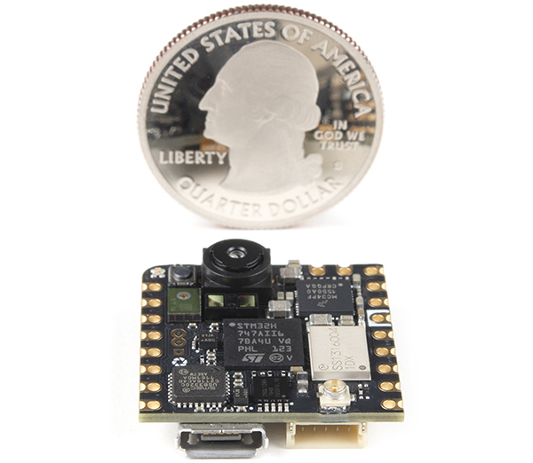

# Обзор

Эти лабораторные работы дают уникальную возможность получить практический опыт работы с системами машинного обучения (ML). В отличие от работы с большими моделями, которым нужны ресурсы уровня дата-центра, эти упражнения позволяют напрямую работать с оборудованием и программным обеспечением с помощью TinyML. Такой практический подход даёт осязаемое понимание проблем и возможностей развёртывания ИИ, пусть и в крошечном масштабе. При этом принципы в целом те же, что и при работе с более крупными системами.

   
  <em>Nicla Vision. Источник: Arduino.</em>

## Где купить

Arduino Nicla Vision можно купить в официальном магазине Arduino:

- [Arduino Store](https://store.arduino.cc/products/nicla-vision) (\~\$95)

## Предварительные требования

- **Плата Nicla Vision:** убедитесь, что плата у вас есть.
- **USB-кабель:** для подключения платы к компьютеру.
- **Сеть:** доступ в интернет для загрузки необходимого программного обеспечения.

## Настройка

- [Настройка Nicla Vision](setup/README.md)

## Упражнения

| Модальность | Задача | Описание | Ссылка |
|---|---|---|---|
| Зрение | Классификация изображений | Научитесь классифицировать изображения | [Открыть](image_classification/README.md) |
| Зрение | Обнаружение объектов | Реализуйте обнаружение объектов | [Открыть](object_detection/README.md) |
| Звук | Распознавание ключевых слов | Изучите системы распознавания голоса | [Открыть](kws/README.md) |
| IMU | Классификация движения и обнаружение аномалий | Классифицируйте данные движения и находите аномалии | [Открыть](motion_classification/README.md) |
