# Классификация изображений

<p align="center">
  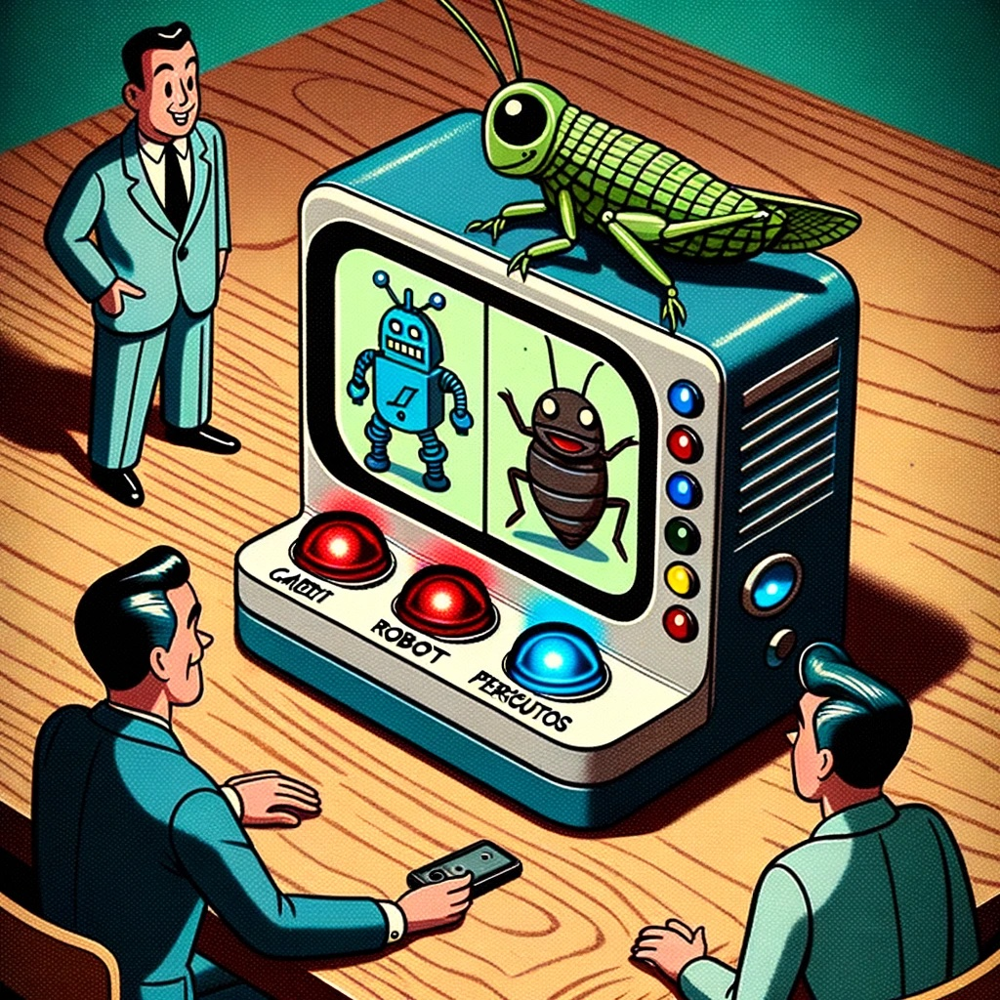<br>
  <em>*Промпт DALL·E 3: мультфильм в стиле 1950-х с компактным электронным устройством и модулем камеры на деревянном столе. На экране слева синие роботы, справа зелёные периквито. Светодиоды на устройстве показывают классы, а персонажи в ретро-одежде с интересом наблюдают.*</em>
</p>

## Обзор

Начиная изучение встраиваемого машинного обучения, или TinyML, невозможно не заметить, как сильно компьютерное зрение (CV) и искусственный интеллект (ИИ) меняют нашу жизнь. Эти две взаимосвязанные дисциплины переопределяют то, что машины способны воспринимать и делать: от автономных автомобилей и робототехники до здравоохранения и систем наблюдения.

Всё чаще мы сталкиваемся с революцией в области искусственного интеллекта, где, как отмечает Gartner, **Edge AI** имеет очень большой потенциал влияния, и **это уже сейчас**!

<p align="center">
  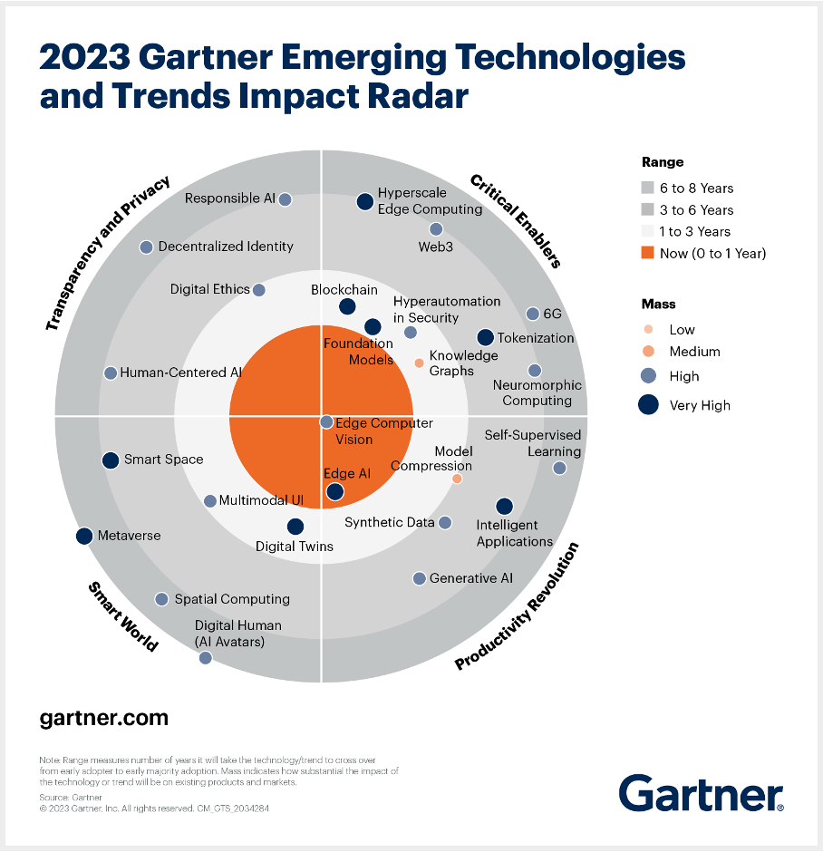
</p>

В «яблочке» радара находится *периферийное компьютерное зрение* (Edge Computer Vision). Когда речь заходит о машинном обучении (ML) применительно к зрению, в первую очередь приходит на ум **классификация изображений** — своего рода «Hello World» для ML!

В этой лабораторной работе мы разберём проект компьютерного зрения, который использует сверточные нейронные сети (CNN) для классификации изображений в реальном времени. Опираясь на экосистему TensorFlow, мы возьмём предобученную модель MobileNet и адаптируем её для развёртывания на периферийном устройстве. Основное внимание будет уделено оптимизации модели, чтобы она эффективно работала на аппаратном обеспечении с ограниченными ресурсами и при этом не теряла точности.

Мы применим такие приёмы, как квантизация и прунинг (удаление избыточных весов), чтобы снизить вычислительную нагрузку. К концу руководства у вас будет работающий прототип, который классифицирует изображения в реальном времени и работает на маломощной встраиваемой системе на базе платы Arduino Nicla Vision.

## Компьютерное зрение

По своей сути компьютерное зрение позволяет машинам интерпретировать визуальные данные из окружающего мира и принимать решения на их основе, по сути повторяя возможности человеческой оптической системы. ИИ, в свою очередь, — более широкая область, которая включает машинное обучение, обработку естественного языка, робототехнику и другие технологии. Когда вы добавляете алгоритмы ИИ в проекты компьютерного зрения, возможности системы по пониманию и интерпретации визуальных стимулов и реакции на них заметно возрастают.

Когда речь заходит о проектах компьютерного зрения для встраиваемых устройств, на ум прежде всего приходят две задачи: *классификация изображений* и *обнаружение объектов*.

<p align="center">
  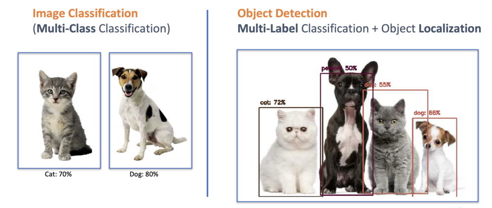
</p>

Обе модели можно реализовать на крошечных устройствах вроде Arduino Nicla Vision и использовать в реальных проектах. В этой главе мы разберём классификацию изображений.

## Цель проекта классификации изображений

Первый шаг любого проекта ML — определить цель. В данном случае цель — обнаружить и классифицировать два конкретных объекта, присутствующих на одном изображении. Для проекта мы возьмём две небольшие игрушки: робота и маленького бразильского попугая (по имени Periquito). Также мы соберём изображения *фона*, на которых этих двух объектов нет.

<p align="center">
  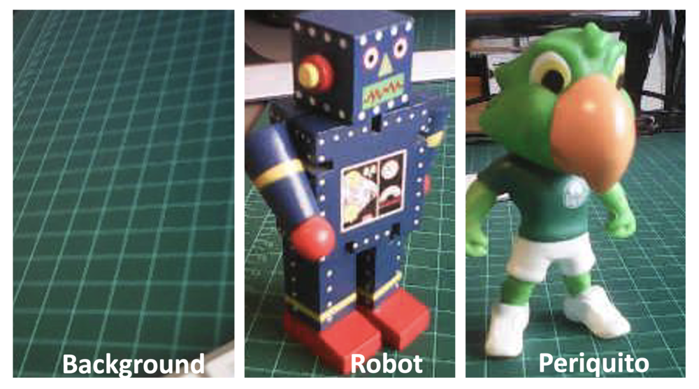
</p>

## Сбор данных

Как только мы определили цель проекта ML, следующий и самый важный шаг — сбор набора данных. Для съёмки изображений можно использовать:

- инструмент Web Serial Camera;
- Edge Impulse Studio;
- OpenMV IDE;
- смартфон.

Здесь мы будем использовать **OpenMV IDE**.

### Сбор набора данных в OpenMV IDE

Сначала создадим на компьютере папку, в которую будут сохраняться данные, например «data». Затем в OpenMV IDE откроем `Tools > Dataset Editor` и выберем `New Dataset`, чтобы начать сбор набора данных:

<p align="center">
  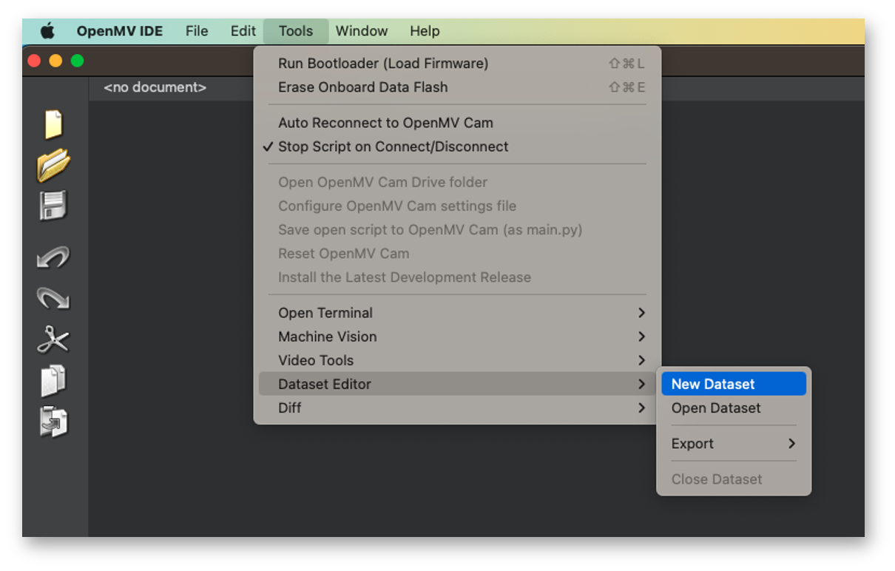
</p>

IDE попросит открыть файл, в который будут сохраняться данные. Выберите созданную папку «data». Обратите внимание: на левой панели появятся новые значки.

<p align="center">
  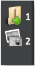
</p>

Используя верхний значок (1), введите имя первого класса, например «periquito»:

<p align="center">
  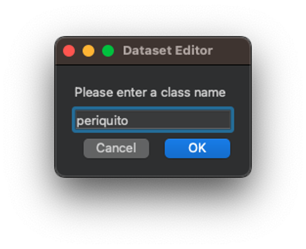
</p>

Запустите скрипт `dataset_capture_script.py` и нажмите значок камеры (2), чтобы начать съёмку изображений:

<p align="center">
  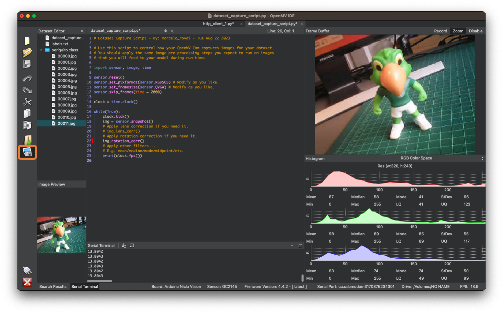
</p>

Повторите ту же процедуру для остальных классов.

<p align="center">
  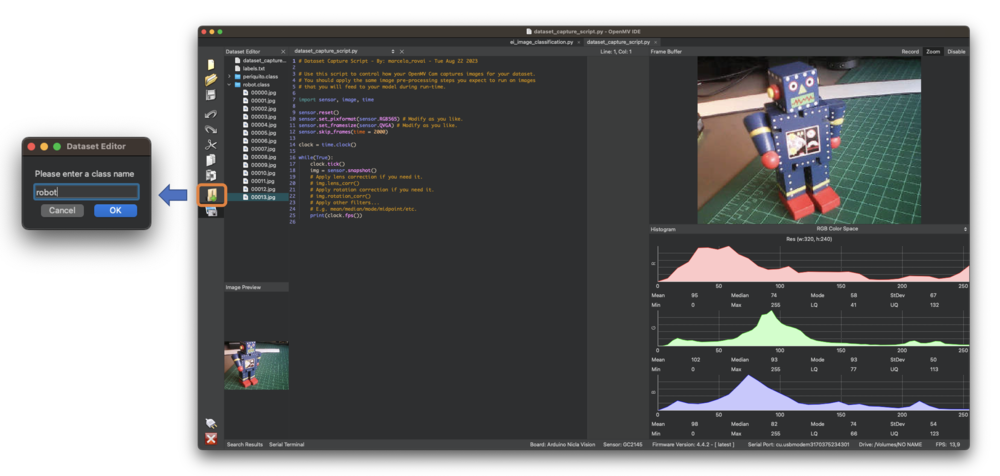
</p>

> Рекомендуем около 50–60 изображений для каждой категории. Старайтесь снимать с разных ракурсов, на разном фоне и при разном освещении.

Сохраняемые изображения имеют размер кадра QVGA $320\times 240$ и формат цвета RGB565 (формат цветных пикселей).

Когда набор данных собран, закройте инструмент Dataset Editor через `Tools > Dataset Editor`.

В итоге на компьютере появится набор данных с тремя классами: *periquito*, *robot* и *background*.

<p align="center">
  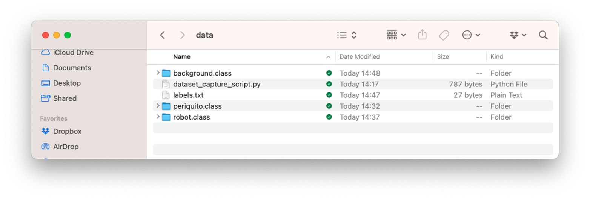
</p>

Теперь вернитесь в *Edge Impulse Studio* и загрузите набор данных в созданный проект.

## Обучение модели в Edge Impulse Studio

Для обучения модели мы воспользуемся Edge Impulse Studio. Войдите в аккаунт и создайте новый проект:

<p align="center">
  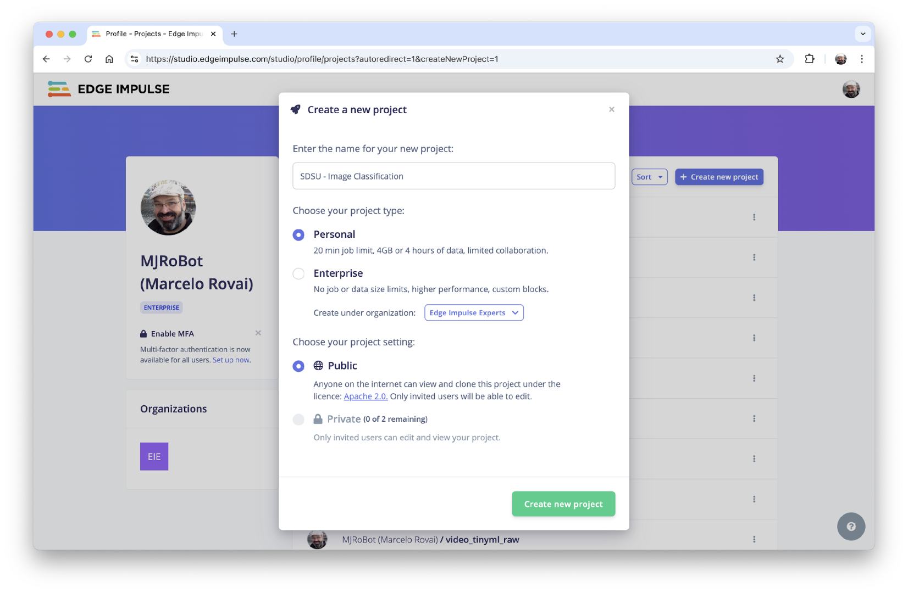
</p>

> Здесь можно клонировать похожий проект: [NICLA-Vision_Image_Classification](https://studio.edgeimpulse.com/public/273858/latest).

## Набор данных

Работая в EI Studio (или просто *Studio*), мы пройдём четыре основных шага, чтобы подготовить модель к использованию на плате Nicla Vision: Dataset (набор данных), Impulse (конвейер), Tests (тесты) и Deploy (развёртывание на периферийном устройстве, в данном случае на NiclaV).

<p align="center">
  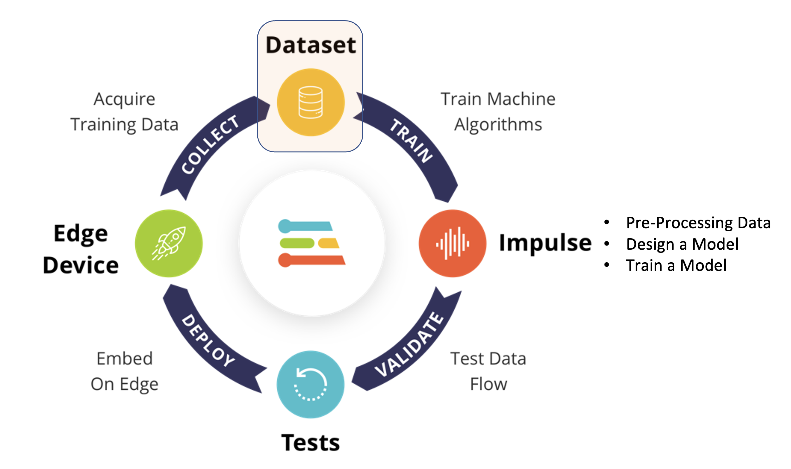
</p>

Что касается набора данных, важно отметить: исходный набор, собранный в OpenMV IDE, будет разделён на *обучающую*, *валидационную* и *тестовую* выборки. Тестовая выборка с самого начала откладывается и используется только на этапе тестирования после обучения. Валидационная выборка применяется во время обучения.

> EI Studio сам отберёт часть обучающих данных для валидации.

<p align="center">
  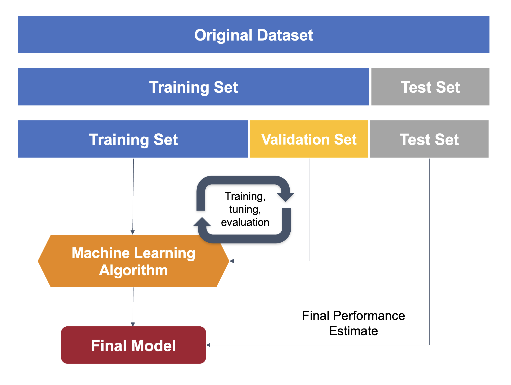
</p>

В Studio откройте вкладку `Data acquisition`, а в разделе UPLOAD DATA загрузите файлы выбранных категорий с компьютера:

<p align="center">
  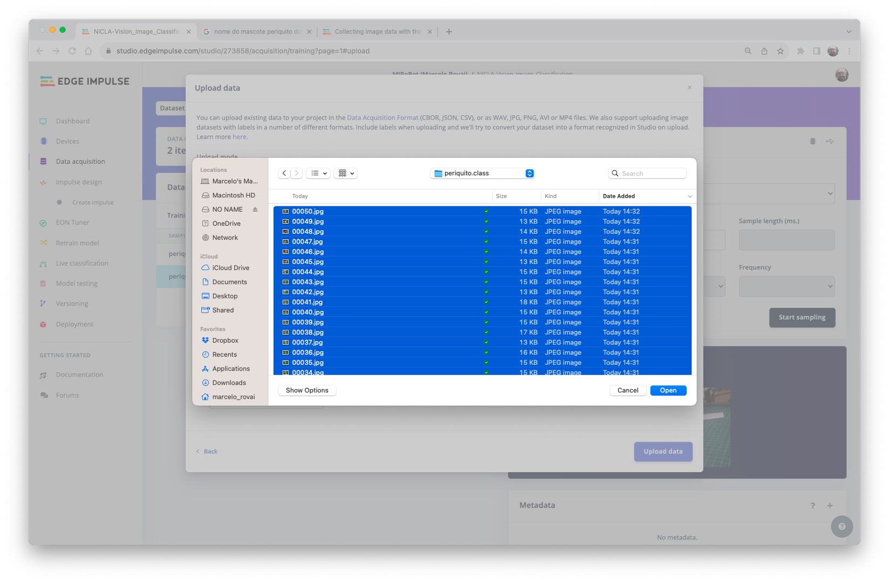
</p>

Разделение исходного набора на обучающую и тестовую выборки оставьте Studio и выберите метку для этих данных:

<p align="center">
  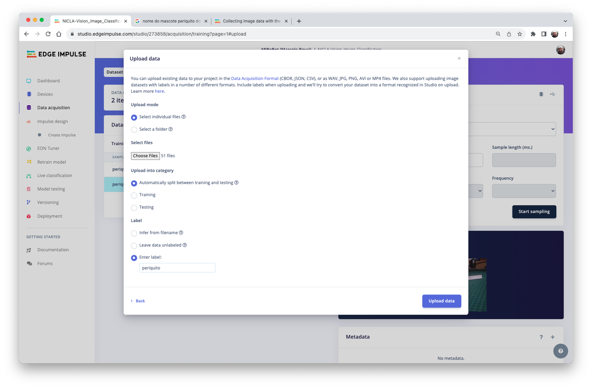
</p>

Повторите процедуру для всех трёх классов.

> Можно выбрать папку и загрузить все файлы сразу.

В итоге в Studio должны появиться ваши «сырые данные» (raw data):

<p align="center">
  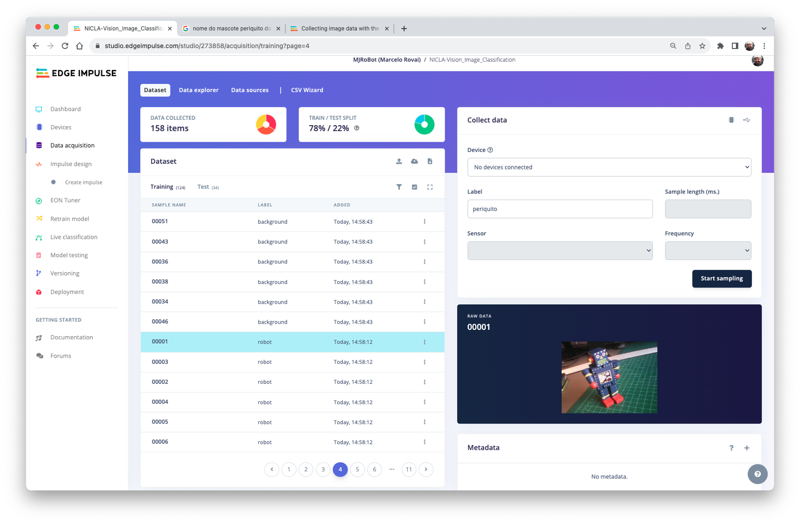
</p>

Обратите внимание: при начале загрузки может появиться всплывающее окно с вопросом, создаёте ли вы проект обнаружения объектов (Object Detection). Выберите `[NO]`.

<p align="center">
  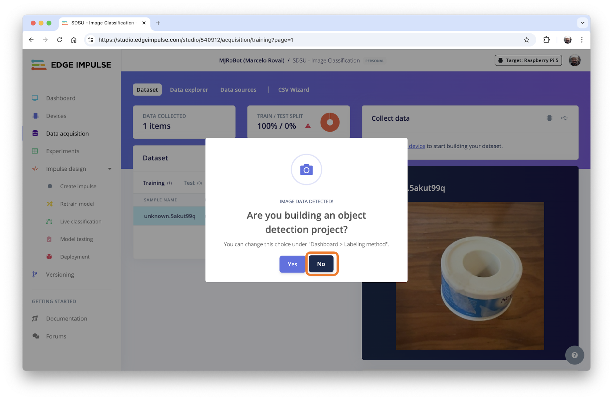
</p>

Тип проекта всегда можно изменить в разделе Dashboard: `One label per data item` (классификация изображений):

<p align="center">
  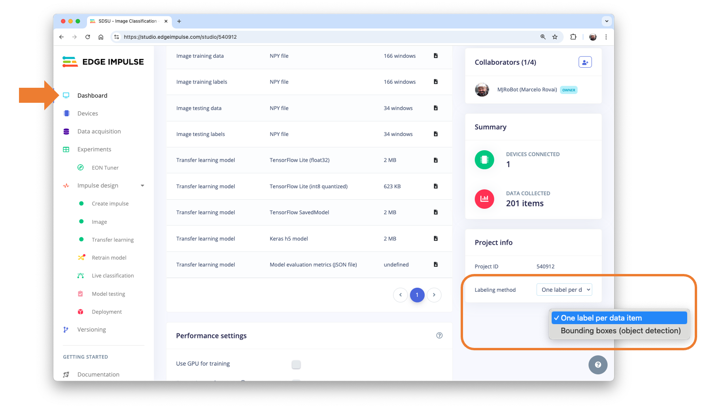
</p>

При желании Studio позволяет просмотреть данные целиком: показать все данные проекта. Можно очищать, проверять или менять метки, щёлкая по отдельным элементам. В нашем случае данные выглядят корректно.

<p align="center">
  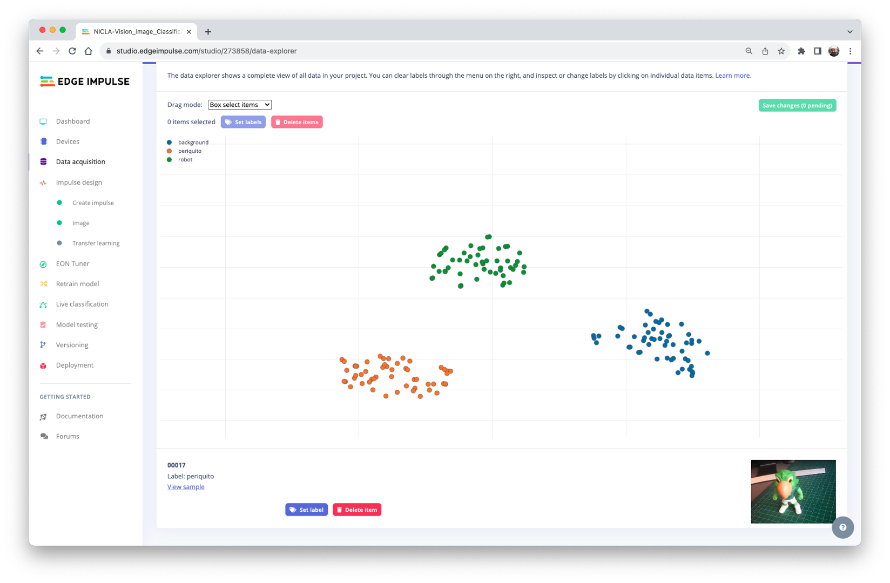
</p>

## Проектирование Impulse

На этом этапе нужно определить, как:

- предобработать данные: изменить размер отдельных изображений и выбрать `color depth` (RGB или оттенки серого);
- задать модель: в данном случае это `Transfer Learning (Images)` — дообучение предобученной модели классификации изображений MobileNet V2 на наших данных. Этот метод хорошо работает даже с небольшими наборами изображений (в нашем случае около 150 изображений).

<p align="center">
  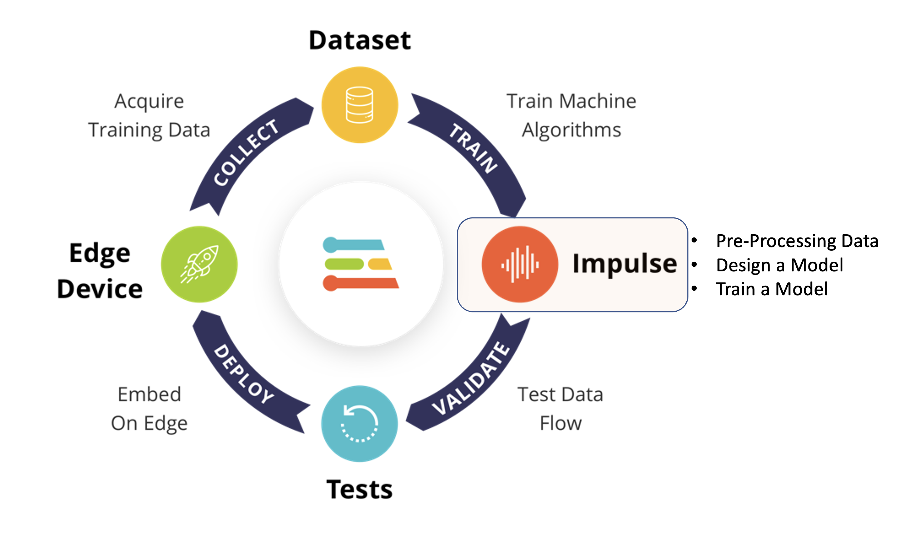
</p>

Перенос обучения (Transfer Learning) с MobileNet упрощает обучение модели. Это особенно полезно в условиях ограниченных ресурсов и при малом количестве размеченных данных. MobileNet, известная своей лёгкой архитектурой, — предобученная модель, которая уже выучила полезные признаки на большом наборе данных (ImageNet).

<p align="center">
  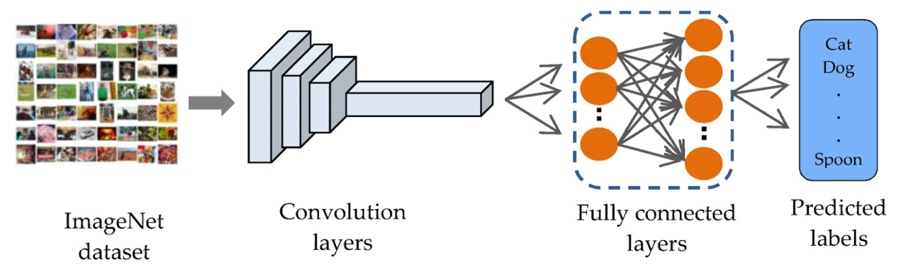
</p>

Используя уже выученные признаки, можно обучить новую модель для своей задачи меньшим количеством данных и вычислительных ресурсов, при этом получив конкурентную точность.

<p align="center">
  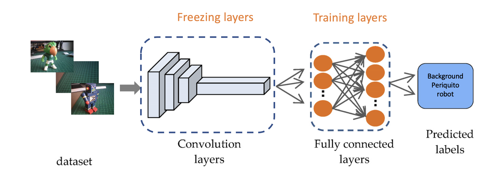
</p>

Такой подход заметно сокращает время обучения и вычислительные затраты, поэтому он идеален для быстрого прототипирования и развёртывания на встраиваемых устройствах, где важна эффективность.

Перейдите на вкладку Impulse Design и создайте *impulse*, задав размер изображения $96{\times}96$ и сжатие к квадратной форме (без обрезки). Выберите блоки Image и Transfer Learning. Сохраните Impulse.

<p align="center">
  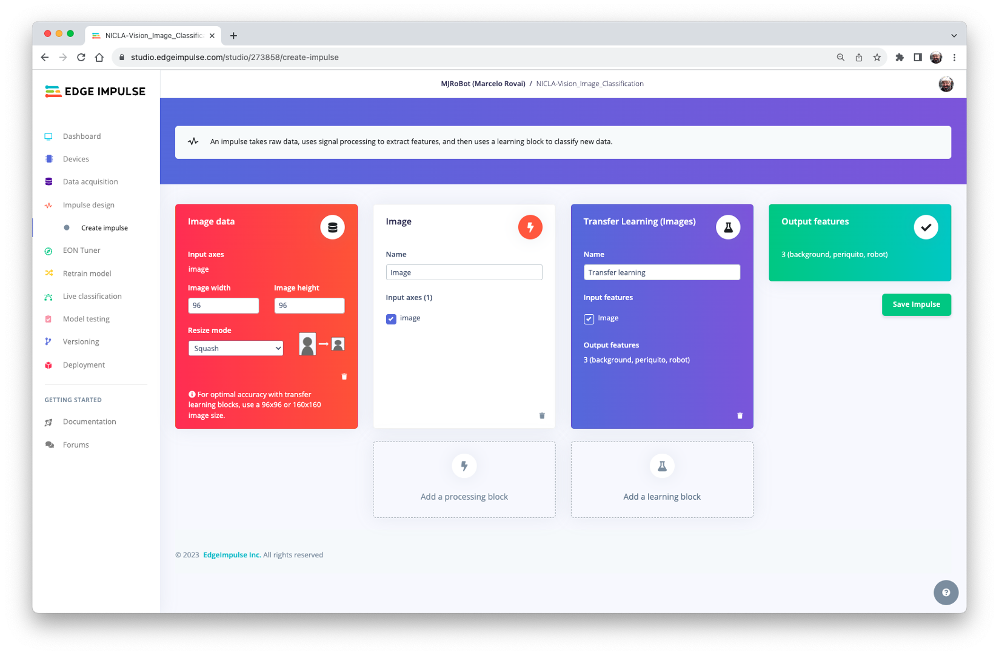
</p>

### Предобработка изображений

Все входные изображения QVGA/RGB565 будут преобразованы в 27 640 признаков ($96{\times}96{\times}3$).

<p align="center">
  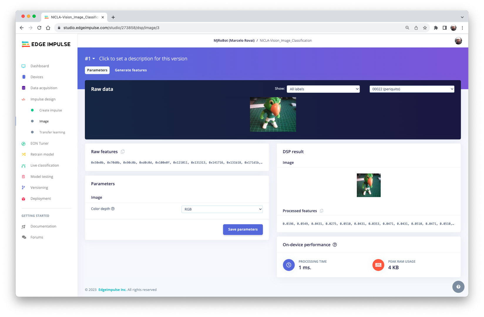
</p>

Нажмите `[Save parameters]` и сгенерируйте все признаки:

<p align="center">
  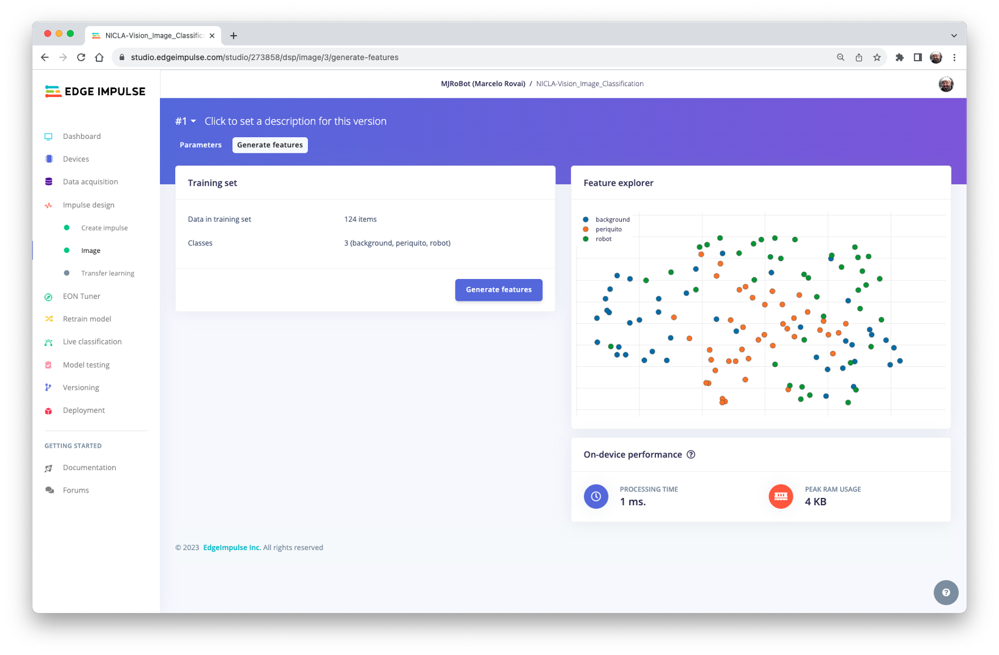
</p>

### Проектирование модели

В 2017 году Google представил [MobileNetV1](https://research.googleblog.com/2017/06/mobilenets-open-source-models-for.html) — семейство универсальных нейронных сетей для компьютерного зрения, созданных с расчётом на мобильные устройства и поддерживающих классификацию, обнаружение и другие задачи. MobileNet — компактные модели с малой задержкой и низким энергопотреблением, параметры которых подобраны под ресурсные ограничения разных сценариев. В 2018 году Google выпустил [MobileNetV2: Inverted Residuals and Linear Bottlenecks](https://arxiv.org/abs/1801.04381).

MobileNet V1 и MobileNet V2 ориентированы на эффективность в мобильных устройствах и во встраиваемом зрении, но различаются по сложности архитектуры и производительности. Обе используют разделяемые по глубине свёртки (depthwise separable convolutions), чтобы снизить вычислительные затраты, однако MobileNet V2 вводит инвертированные остаточные блоки (Inverted Residual Blocks) и линейные бутылочные горлышки (Linear Bottlenecks), чтобы повысить производительность. Эти новшества позволяют V2 выделять более сложные признаки меньшим количеством параметров, поэтому она вычислительно эффективнее и, как правило, точнее предшественницы. Кроме того, V2 использует нелинейную активацию в промежуточном слое расширения, а для слоя бутылочного горлышка по-прежнему применяет линейную активацию: такое решение, как показали исследования, помогает сохранять важную информацию по всей сети. MobileNet V2 предлагает оптимизированную архитектуру с более высокой точностью и эффективностью, её мы и будем использовать в проекте.

Хотя базовая архитектура MobileNet уже компактна и быстра, в некоторых задачах модель должна быть ещё меньше и быстрее. MobileNet вводит простой параметр $\alpha$ (альфа) — множитель ширины (width multiplier), с помощью которого строятся меньшие и менее требовательные к вычислениям модели. Множитель ширины $\alpha$ равномерно «утоньшает» сеть на каждом слое.

Edge Impulse Studio может использовать как MobileNetV1 (изображения $96\times 96$), так и V2 (изображения $96\times 96$ или $160\times 160$) с несколькими значениями **$\alpha$** (от 0.05 до 1.0). Например, наибольшая точность достигается у V2 с изображениями $160\times 160$ и $\alpha=1.0$. Однако есть компромисс: чем выше точность, тем больше памяти (около 1.3 МБ ОЗУ и 2.6 МБ ПЗУ) нужно для работы модели и тем выше задержка. Наименьший объём обеспечивает MobileNetV1 с $\alpha=0.10$ (около 53.2 КБ ОЗУ и 101 КБ ПЗУ).

<p align="center">
  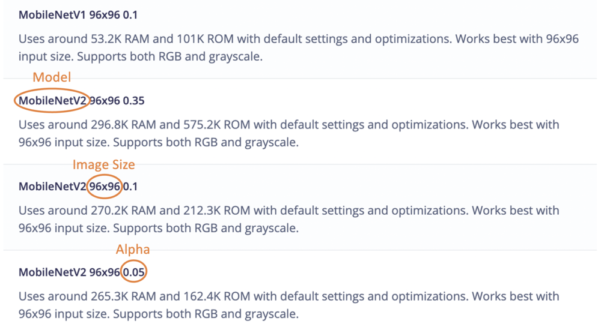
</p>

Для этого проекта мы используем **MobileNetV2 96x96 0.1** (**или 0.05**) с ожидаемым расходом памяти 265.3 КБ ОЗУ. Этой модели должно хватить для Nicla Vision со 1 МБ SRAM. На вкладке Transfer Learning выберите эту модель:

<p align="center">
  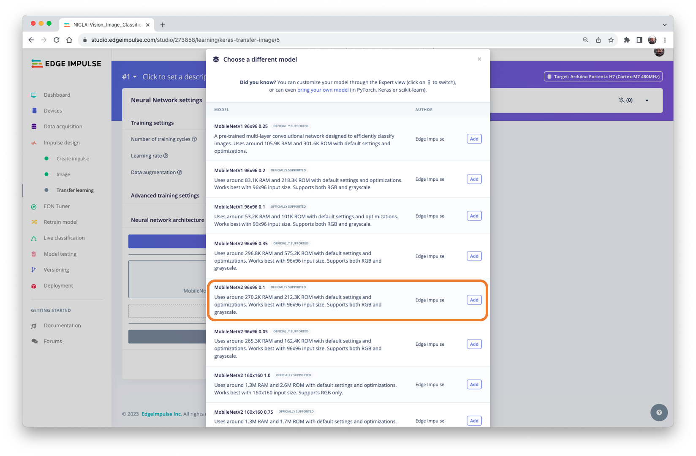
</p>

## Обучение модели

Ещё одна полезная техника в глубоком обучении — **аугментация данных** (Data Augmentation). Это метод повышения точности моделей машинного обучения за счёт создания дополнительных искусственных данных. Система аугментации вносит небольшие случайные изменения в обучающие данные в процессе обучения (например, отражает, обрезает или поворачивает изображения).

Заглянем «под капот» и посмотрим, как Edge Impulse реализует политику аугментации данных:

``` python
# Реализация политики аугментации данных
def augment_image(image, label):
    # Случайно отражаем изображение по горизонтали
    image = tf.image.random_flip_left_right(image)

    # Увеличиваем размер изображения, затем случайно обрезаем его до
    # исходных размеров
    resize_factor = random.uniform(1, 1.2)
    new_height = math.floor(resize_factor * INPUT_SHAPE[0])
    new_width = math.floor(resize_factor * INPUT_SHAPE[1])
    image = tf.image.resize_with_crop_or_pad(image, new_height,
                                             new_width)
    image = tf.image.random_crop(image, size=INPUT_SHAPE)

    # Меняем яркость изображения
    image = tf.image.random_brightness(image, max_delta=0.2)

    return image, label
```

Такие вариации во время обучения помогают модели не срезать углы, «запоминая» поверхностные признаки в обучающих данных. Благодаря этому она лучше отражает глубинные закономерности набора данных.

Последний слой модели будет содержать 12 нейронов с dropout 15 % для предотвращения переобучения. Вот результат обучения:

<p align="center">
  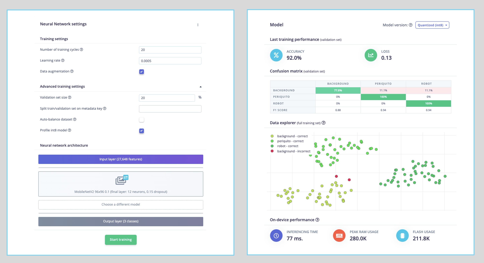
</p>

Результат отличный: оценочная задержка составляет 77 мс, что должно обеспечить около 13 кадров в секунду (FPS) при инференсе.

## Тестирование модели

<p align="center">
  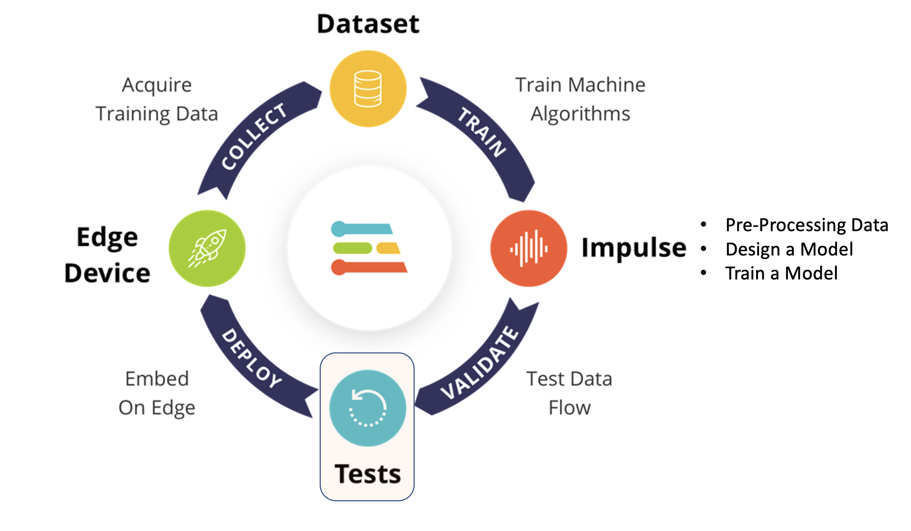
</p>

Теперь возьмём набор данных, отложенный в начале проекта, и подадим его на вход обученной модели:

<p align="center">
  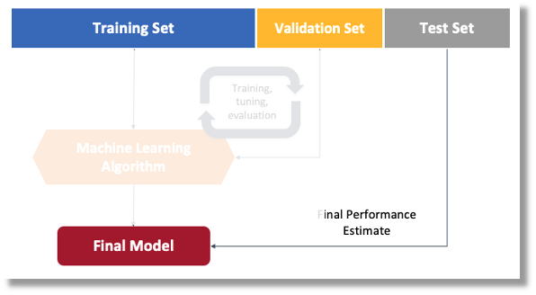
</p>

Результат снова отличный.

<p align="center">
  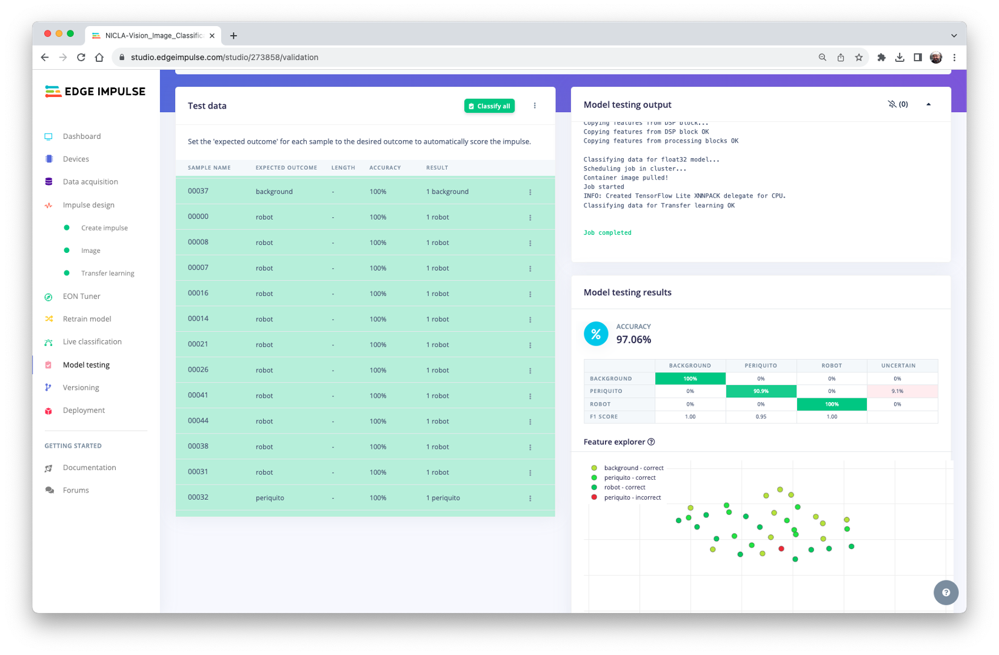
</p>

## Развёртывание модели

Теперь обученную модель можно развернуть как прошивку (FW) и запустить через OpenMV IDE на MicroPython, либо развернуть как библиотеку C/C++ или Arduino.

<p align="center">
  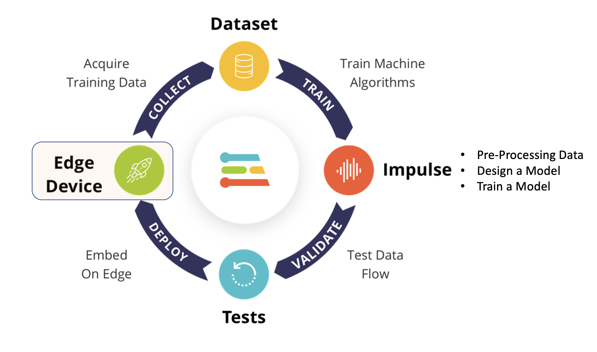
</p>

### Библиотека Arduino

Сначала развернём модель как библиотеку Arduino:

<p align="center">
  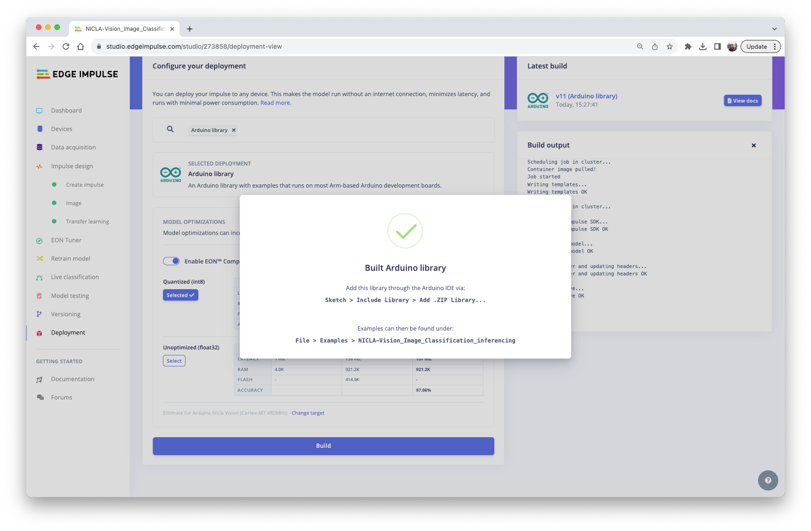
</p>

Библиотеку нужно установить в Arduino IDE как архив .zip, а затем запустить скетч *nicla_vision_camera.ino*, который находится в разделе Examples под именем библиотеки.

> По умолчанию Arduino Nicla Vision выделяет 512 КБ ОЗУ для ядра M7 и ещё 244 КБ в адресном пространстве M4. В коде это выделение изменено на 288 КБ, чтобы модель гарантированно работала на устройстве (`malloc_addblock((void*)0x30000000, 288 * 1024);`).

Результат хороший: измеренная задержка составила 86 мс.

<p align="center">
  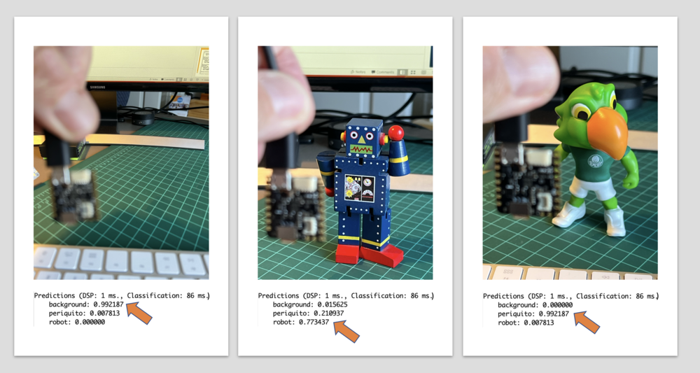
</p>

Короткое видео с результатами инференса:

<p align="center">
  <iframe width="560" height="315" src="https://www.youtube.com/embed/bZPZZJblU-o" title="Результаты инференса на Nicla Vision" frameborder="0" allowfullscreen></iframe>
</p>

### OpenMV

Обученную модель можно использовать с OpenMV двумя способами: как библиотеку и как прошивку (FW). При выборе прошивки Edge Impulse Studio генерирует оптимизированные модели, библиотеки и фреймворки, которые нужны для инференса. Рассмотрим этот вариант.

На вкладке `Deploy` выберите `OpenMV Firmware` и нажмите `[Build]`.

<p align="center">
  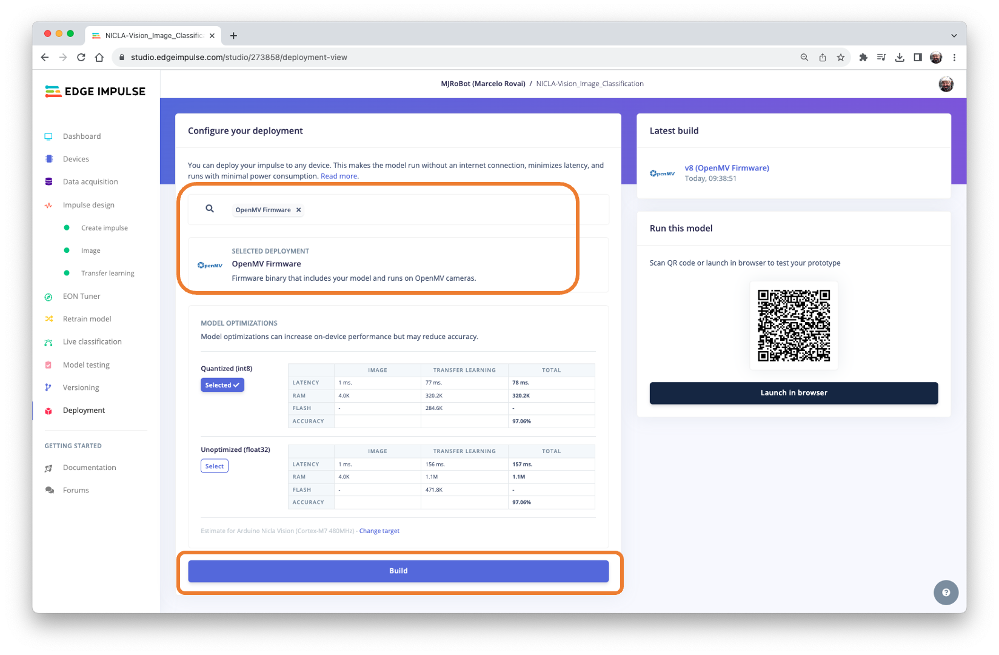
</p>

На компьютере появится ZIP-файл. Откройте его:

<p align="center">
  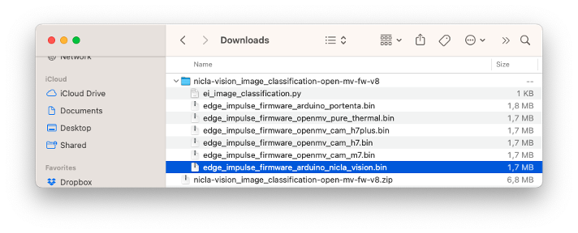
</p>

Используйте инструмент Bootloader в OpenMV IDE, чтобы загрузить прошивку на плату (1):

<p align="center">
  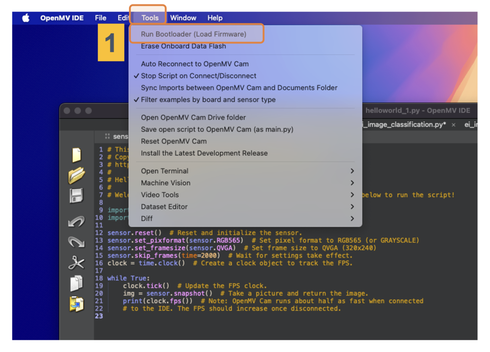
</p>

Выберите нужный файл (.bin для Nicla-Vision):

<p align="center">
  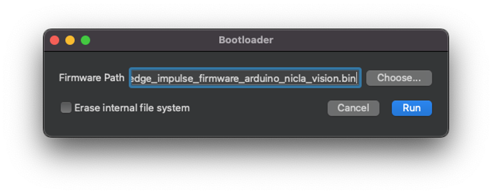
</p>

Когда загрузка завершится, нажмите OK:

<p align="center">
  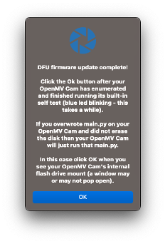
</p>

Если появится сообщение, что прошивка устарела, **НЕ ОБНОВЛЯЙТЕ** её. Выберите `[NO]`.

<p align="center">
  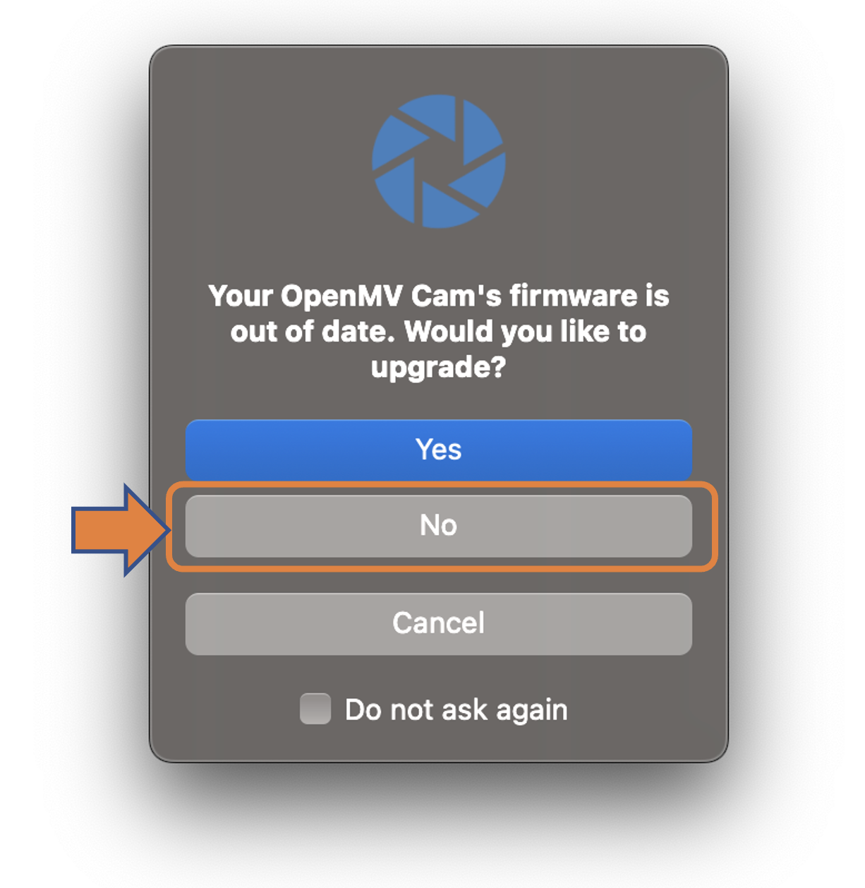
</p>

Теперь откройте скрипт **ei_image_classification.py**, скачанный из Studio, и файл .bin для Nicla.

<p align="center">
  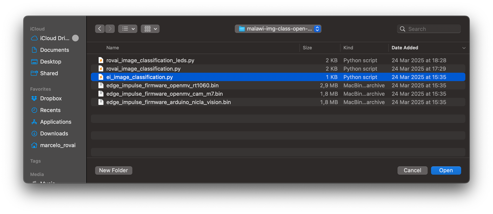
</p>

Запустите его. Направляя камеру на объекты, которые нужно классифицировать, вы увидите результат инференса в Serial Terminal.

<p align="center">
  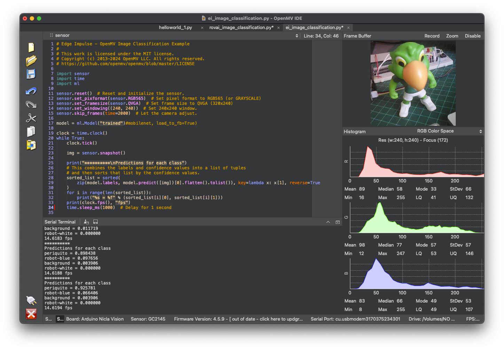
</p>

Результат классификации появляется в Serial Terminal. Если результат трудно читать, добавьте в код новую строку с задержкой:

```python
import time
While True:
...
	time.sleep_ms(200)  # Задержка 0.2 секунды
```

#### Изменение кода для вывода меток

Код от Edge Impulse можно изменить так, чтобы для проверки видеть результат инференса прямо на изображении в OpenMV IDE.

[Загрузите код с GitHub](https://github.com/Mjrovai/Arduino_Nicla_Vision/blob/main/Micropython/nicla_image_classification.py) или измените его, как показано ниже:

``` python
# Marcelo Rovai — NICLA Vision — классификация изображений
# Адаптировано из примера Edge Impulse — OpenMV Image Classification
# @24March25

import sensor
import time
import ml

sensor.reset()  # Сброс и инициализация датчика.
# Формат пикселей RGB565 (или GRAYSCALE)
sensor.set_pixformat(sensor.RGB565)
# Размер кадра QVGA (320x240)
sensor.set_framesize(sensor.QVGA)
sensor.set_windowing((240, 240))  # Окно 240x240.
sensor.skip_frames(time=2000)  # Даём камере настроиться.

model = ml.Model("trained")#mobilenet, load_to_fb=True)

clock = time.clock()

while True:
    clock.tick()
    img = sensor.snapshot()

    fps = clock.fps()
    lat = clock.avg()
    print("**********\nPrediction:")
    # Объединяем метки и уверенность в список кортежей и сортируем его
    # по значениям уверенности.
    sorted_list = sorted(
        zip(model.labels, model.predict([img])[0].flatten().tolist()),
      key=lambda x: x[1], reverse=True
    )

    # Выводим только класс с наибольшей вероятностью
    max_val = sorted_list[0][1]
    max_lbl = sorted_list[0][0]

    if max_val < 0.5:
        max_lbl = 'uncertain'

    print("{} with a prob of {:.2f}".format(max_lbl, max_val))
    print("FPS: {:.2f} fps ==> latency: {:.0f} ms".format(fps, lat))

    # Выводим метку с наибольшей вероятностью на просмотрщике изображения
    img.draw_string(
    10, 10,
    max_lbl + "\n{:.2f}".format(max_val),
    mono_space = False,
    scale=3
    )

    time.sleep_ms(500)  # Пауза 0.5 секунды
```

Вот результат:

<p align="center">
  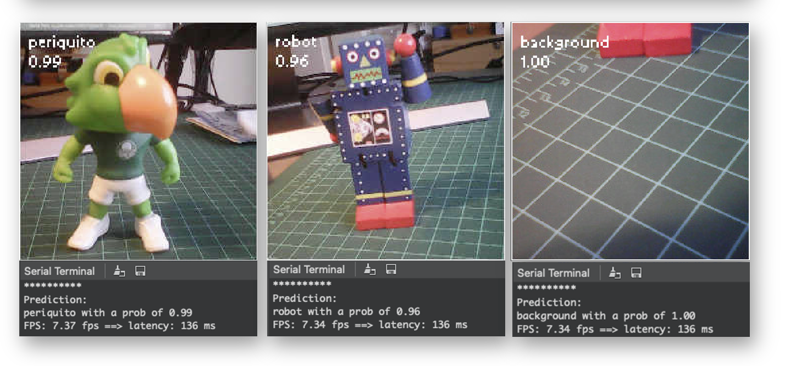
</p>

Обратите внимание: задержка (136 мс) почти вдвое больше, чем при работе напрямую через Arduino IDE. Это происходит потому, что мы используем IDE как интерфейс, а также из-за времени ожидания готовности камеры. Если запустить таймер непосредственно перед инференсом, задержка должна снизиться примерно до 70 мс.

> При подключении к IDE NiclaV работает примерно вдвое медленнее. После отключения FPS должен вырасти.

#### Пост-обработка со светодиодами

Работая со встраиваемым машинным обучением, мы ищем устройства, которые могут непрерывно выполнять инференс и выдавать результат, действуя непосредственно в физическом мире, а не выводя результат на подключённый компьютер. Чтобы это смоделировать, мы будем зажигать разный светодиод для каждого возможного результата инференса.

<p align="center">
  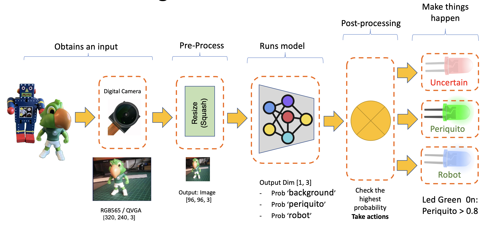
</p>

Чтобы это сделать, [загрузите код с GitHub](https://github.com/Mjrovai/Arduino_Nicla_Vision/blob/main/Micropython/nicla_image_classification_LED.py) или дополните предыдущий код светодиодами:

``` python
# Marcelo Rovai — NICLA Vision — классификация изображений со светодиодами
# Адаптировано из примера Edge Impulse — OpenMV Image Classification
# @24Aug23

import sensor, time, ml
from machine import LED

ledRed = LED("LED_RED")
ledGre = LED("LED_GREEN")
ledBlu = LED("LED_BLUE")

sensor.reset()  # Сброс и инициализация датчика.
# Формат пикселей RGB565 (или GRAYSCALE)
sensor.set_pixformat(sensor.RGB565)
# Размер кадра QVGA (320x240)
sensor.set_framesize(sensor.QVGA)
sensor.set_windowing((240, 240))  # Окно 240x240.
sensor.skip_frames(time=2000)  # Даём камере настроиться.

model = ml.Model("trained")#mobilenet, load_to_fb=True)

ledRed.off()
ledGre.off()
ledBlu.off()

clock = time.clock()

def setLEDs(max_lbl):
	if max_lbl == 'uncertain’:
		ledRed.on()
		ledGre.off()
		ledBlu.off()

	if max_lbl == 'periquito’:
		ledRed.off()
		ledGre.on()
		ledBlu.off()

	if max_lbl == 'robot’:
		ledRed.off()
		ledGre.off()
		ledBlu.on()

	if max_lbl == 'background’:
		ledRed.off()
		ledGre.off()
		ledBlu.off()

  while True:
    img = sensor.snapshot()

    clock.tick()
    fps = clock.fps()
    lat = clock.avg()
    print("**********\nPrediction:")
    sorted_list = sorted(
        zip(model.labels, model.predict([img])[0].flatten().tolist()),
      key=lambda x: x[1], reverse=True
    )

    # Выводим только класс с наибольшей вероятностью
    max_val = sorted_list[0][1]
    max_lbl = sorted_list[0][0]

    if max_val < 0.5:
        max_lbl = 'uncertain'

    print("{} with a prob of {:.2f}".format(max_lbl, max_val))
    print("FPS: {:.2f} fps ==> latency: {:.0f} ms".format(fps, lat))

    # Выводим метку с наибольшей вероятностью на просмотрщике изображения
    img.draw_string(
    10, 10,
    max_lbl + "\n{:.2f}".format(max_val),
    mono_space = False,
    scale=3
    )

    setLEDs(max_lbl)
    time.sleep_ms(200)  # Пауза 0.2 секунды
```

Теперь каждый раз, когда какой-либо класс получает результат выше 0.8, загорается соответствующий светодиод:

- Красный светодиод горит: Uncertain (ни один класс не выше 0.8);
- Зелёный светодиод горит: Periquito > 0.8;
- Синий светодиод горит: Robot > 0.8;
- Все светодиоды выключены: Background > 0.8.

Вот результат:

<p align="center">
  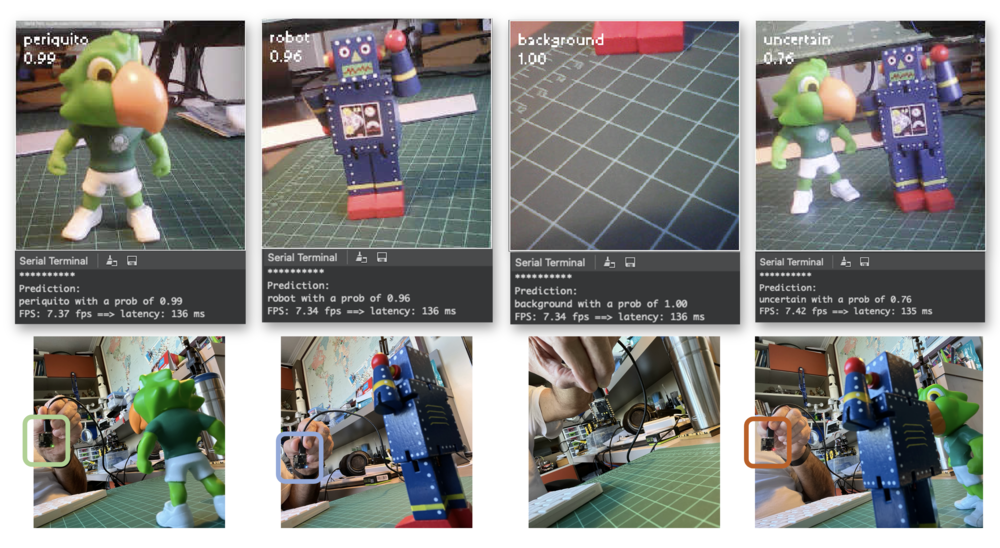
</p>

Подробнее:

<p align="center">
  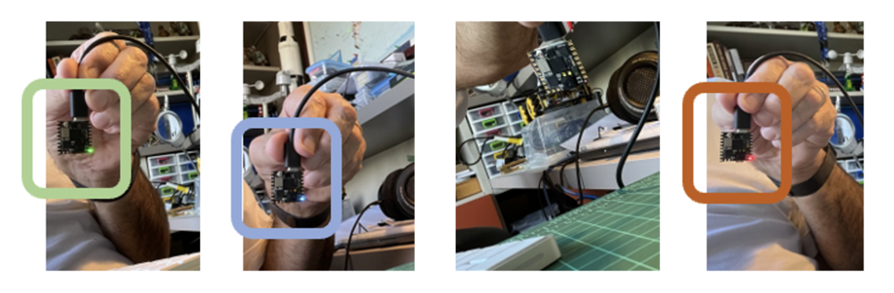
</p>

## Неофициальный сравнительный тест классификации изображений

Для встраиваемого машинного обучения (TinyML) можно использовать несколько отладочных плат. Чаще всего для задач компьютерного зрения с малым энергопотреблением применяют ESP32-CAM, Seeed XIAO ESP32S3 Sense, Arduino Nicla Vision и Arduino Portenta.

<p align="center">
  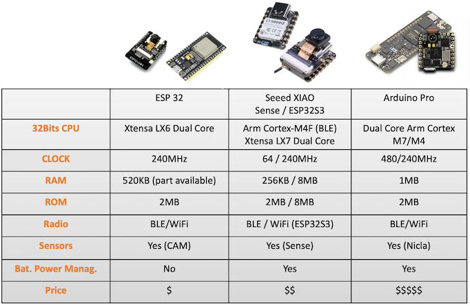
</p>

Воспользовавшись возможностью, мы развернули одну и ту же обученную модель на ESP-CAM, XIAO и Portenta (для последней модель обучили заново на изображениях в оттенках серого, чтобы она подходила к её камере). Вот результат, когда модели развёрнуты как библиотеки Arduino:

<p align="center">
  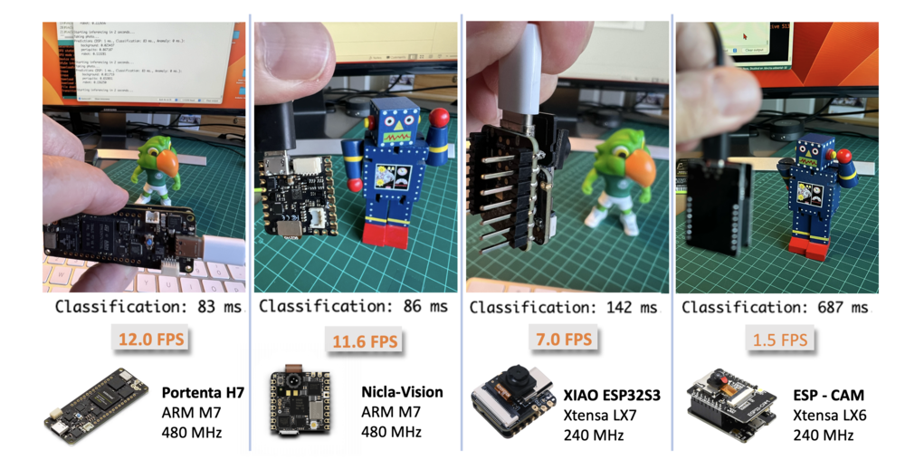
</p>

## Итоги

Прежде чем завершить, учтите: компьютерное зрение — это больше, чем классификация изображений. Например, на основе зрения можно разрабатывать проекты периферийного машинного обучения во многих областях:

- **Автономный транспорт:** слияние датчиков, данные лидара и алгоритмы компьютерного зрения для навигации и принятия решений.
- **Здравоохранение:** автоматическая диагностика заболеваний по снимкам МРТ, рентгена и КТ.
- **Розничная торговля:** автоматические кассовые системы, которые распознают товары при проезде через сканер.
- **Безопасность и наблюдение:** распознавание лиц, обнаружение аномалий и отслеживание объектов в видеопотоке в реальном времени.
- **Дополненная реальность:** обнаружение и классификация объектов для наложения цифровой информации на реальный мир.
- **Промышленная автоматизация:** визуальный контроль продукции, предиктивное обслуживание, наведение роботов и дронов.
- **Сельское хозяйство:** мониторинг посевов с дронов и автоматизированная уборка урожая.
- **Обработка естественного языка:** создание подписей к изображениям и визуальные вопросно-ответные системы.
- **Распознавание жестов:** для игр, перевода жестового языка и взаимодействия человека с машиной.
- **Рекомендательные системы:** рекомендации товаров на основе изображений в электронной коммерции.

## Ресурсы

- [Коды на MicroPython](https://github.com/Mjrovai/Arduino_Nicla_Vision/tree/main/Micropython)

- [Набор данных](https://github.com/Mjrovai/Arduino_Nicla_Vision/tree/main/data)

- [Проект Edge Impulse](https://studio.edgeimpulse.com/public/273858/latest)
