# Распознавание ключевых слов (KWS)

<p align="center">
  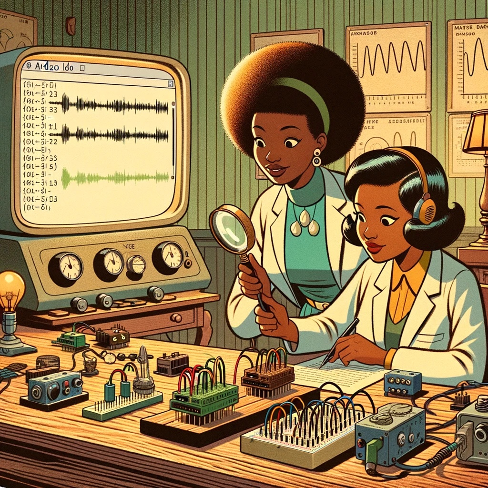<br>
  <em>Промпт DALL·E 3: мультфильм в стиле 1950-х в старинной лаборатории аудиоисследований. В центре две учёные-женщины. Одна держит увеличительное стекло и внимательно рассматривает старую схему, другая делает записи. На деревянном столе несколько плат с датчиками, в том числе с микрофоном. За платами стоит компьютер с округлой задней панелью, на экране которого открыта Arduino IDE. В IDE видны код назначения выводов светодиодов и инференс модели машинного обучения для распознавания голосовых команд. В окне Serial Monitor выводятся распознанные команды «yes» и «no». Атмосфера комнаты ностальгическая: старинные лампы, классические инструменты анализа звука и графики БПФ и временных кривых.</em>
</p>

## Обзор

Мы уже исследовали плату Nicla Vision в приложениях *классификации изображений* и *обнаружения объектов*. Теперь переходим к голосовым приложениям: проект распознавания ключевых слов (Keyword Spotting, KWS).

Как рассказано в практическом руководстве [«Инженерия признаков для KWS»](../../06-shared/kws_feature_eng/README.md), распознавание ключевых слов (KWS) используется во многих системах распознавания речи и позволяет устройствам реагировать на определённые слова или фразы. Хотя эта технология лежит в основе популярных устройств вроде Google Assistant или Amazon Alexa, её можно реализовать и на маленьких маломощных устройствах. Это руководство проведёт вас через реализацию системы KWS с помощью TinyML на отладочной плате Nicla Vision с цифровым микрофоном.

Наша модель будет распознавать ключевые слова, которые могут будить устройство или запускать определённые действия, тем самым оживляя голосовое управление.

## Как работает голосовой помощник?

Как уже говорилось, *голосовые помощники* на рынке, например Google Home или Amazon Echo Dot, реагируют на человека, только когда их «будят» определённые ключевые слова: «Hey Google» в первом случае и «Alexa» во втором.

<p align="center">
  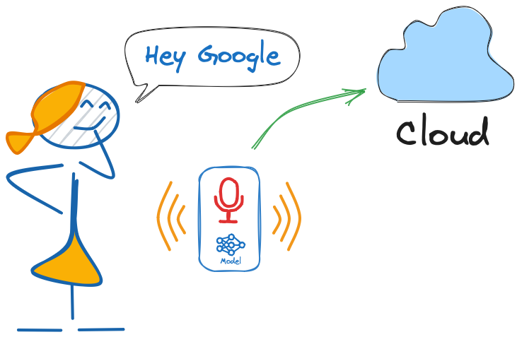
</p>

Иначе говоря, распознавание голосовых команд основано на многоступенчатой модели, или каскадном обнаружении (Cascade Detection).

<p align="center">
  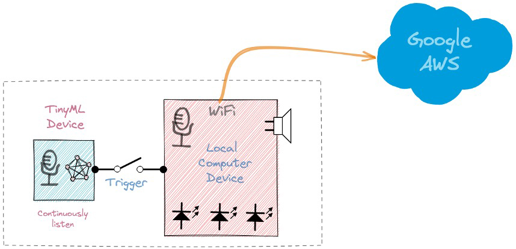
</p>

**Этап 1:** маленький микропроцессор внутри Echo Dot или Google Home постоянно слушает, ожидая, когда будет распознано ключевое слово, с помощью модели TinyML на периферии (приложение KWS).

**Этап 2:** данные отправляются в облако и обрабатываются более крупной моделью, только если приложение KWS на этапе 1 сработало.

Видео ниже показывает пример программирования Google Assistant на Raspberry Pi (этап 2) с устройством TinyML Arduino Nano 33 BLE (этап 1).

<p align="center">
  <iframe width="560" height="315" src="https://www.youtube.com/embed/e_OPgcnsyvM" title="Пример Google Assistant на Raspberry Pi с TinyML-устройством" frameborder="0" allowfullscreen></iframe>
</p>

> Чтобы изучить описанный проект Google Assistant, см. руководство: [Building an Intelligent Voice Assistant From Scratch](https://www.hackster.io/mjrobot/building-an-intelligent-voice-assistant-from-scratch-2199c3).

В этом проекте KWS мы сосредоточимся на этапе 1 (KWS, или Keyword Spotting): здесь мы используем Nicla Vision, у которой есть цифровой микрофон для распознавания ключевого слова.

## Практический проект KWS

Схема ниже показывает, как должно работать итоговое приложение KWS (во время инференса):

<p align="center">
  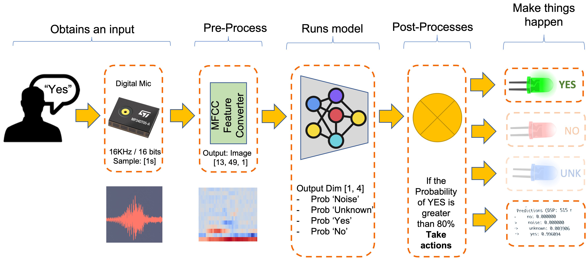
</p>

Наше приложение KWS будет распознавать четыре класса звуков:

- **YES** (ключевое слово 1);
- **NO** (ключевое слово 2);
- **NOISE** (слов нет, есть только фоновый шум);
- **UNKNOWN** (смесь слов, отличных от YES и NO).

> Для реальных проектов всегда полезно включать в набор, помимо ключевых слов, и другие звуки, например «Noise» (фон) и «Unknown» (неизвестные слова).

### Рабочий процесс машинного обучения

Главный компонент приложения KWS — его модель. Поэтому нужно обучить модель на наших ключевых словах, шуме и других словах («unknown»):

<p align="center">
  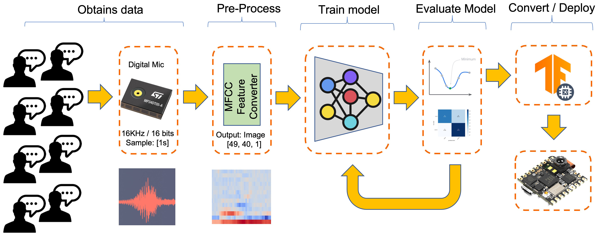
</p>

## Набор данных

Важнейший компонент любого рабочего процесса машинного обучения — **набор данных**. Выбрав конкретные ключевые слова (в нашем случае *YES* и *NO*), мы можем воспользоваться набором данных, который разработал Пит Уорден (Pete Warden): [«Speech Commands: A Dataset for Limited-Vocabulary Speech Recognition»](https://arxiv.org/pdf/1804.03209.pdf). В этом наборе 35 ключевых слов (по более чем 1000 образцов каждого), например yes, no, stop и go. Для таких слов, как *yes* и *no*, можно получить по 1500 образцов.

Небольшую часть набора данных можно скачать из Edge Impulse Studio ([готовый набор данных для распознавания ключевых слов](https://docs.edgeimpulse.com/docs/pre-built-datasets/keyword-spotting)). Он включает образцы четырёх классов, которые мы будем использовать в этом проекте: yes, no, noise и background. Для этого выполните следующие шаги:

- Скачайте [набор ключевых слов](https://cdn.edgeimpulse.com/datasets/keywords2.zip).
- Распакуйте файл в удобное место.

### Загрузка набора данных в Edge Impulse Studio

Создайте новый проект в Edge Impulse Studio (EIS) и выберите инструмент `Upload Existing Data` в разделе `Data Acquisition`. Выберите файлы для загрузки:

<p align="center">
  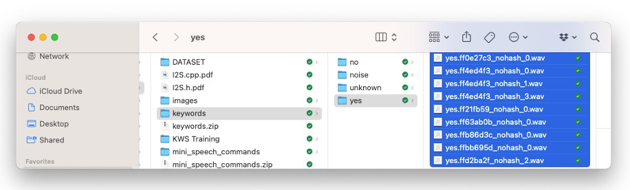
</p>

Задайте метку, выберите `Automatically split between train and test` и нажмите `Upload data`, чтобы загрузить данные в EIS. Повторите для всех классов.

<p align="center">
  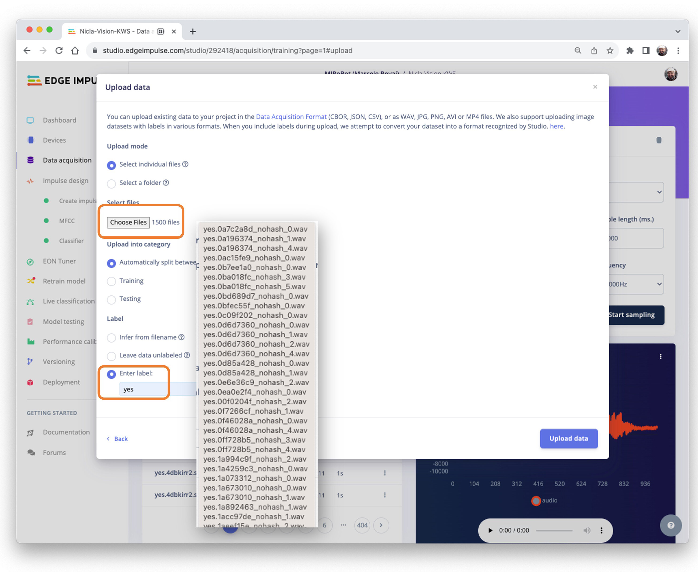
</p>

Теперь набор данных появится в разделе `Data acquisition`. Обратите внимание: примерно 6000 образцов (по 1500 на каждый класс) разделены на обучающую (4800) и тестовую (1200) выборки.

<p align="center">
  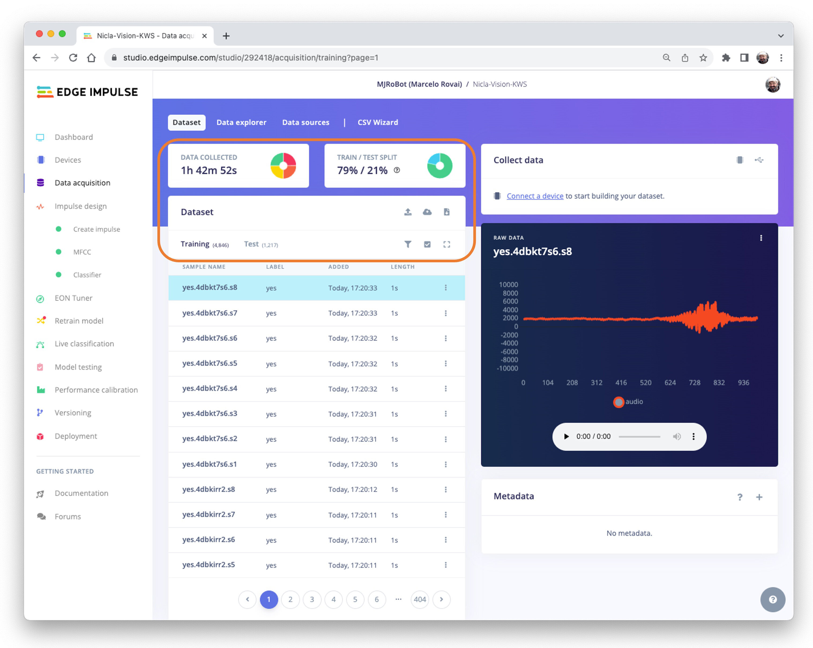
</p>

### Сбор дополнительных аудиоданных

Хотя у нас много данных из набора Пита, рекомендуется записать и слова, произнесённые нами. При работе с акселерометрами важно, чтобы набор данных был снят датчиком того же типа. Для *звука* это необязательно, потому что мы классифицируем, по сути, *аудиоданные*.

> Ключевое различие между звуком и аудио — в типе энергии. Звук — механическое возмущение (продольные звуковые волны), которое распространяется в среде и вызывает колебания давления. Аудио — электрический (аналоговый или цифровой) сигнал, представляющий звук.

Когда мы произносим ключевое слово, звуковые волны нужно преобразовать в аудиоданные. Преобразование выполняется дискретизацией сигнала с микрофона с частотой 16 кГц и разрядностью 16 бит на отсчёт.

Поэтому подойдёт любое устройство, которое может создавать аудиоданные с такими базовыми параметрами (16 кГц / 16 бит). В качестве устройства можно использовать NiclaV, компьютер или даже телефон.

<p align="center">
  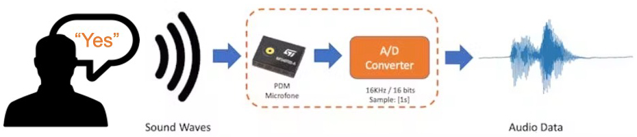
</p>

#### Использование NiclaV и Edge Impulse Studio

Как мы узнали в главе [«Настройка Nicla Vision»](../setup/README.md), EIS официально поддерживает Nicla Vision, что упрощает сбор данных с её датчиков, в том числе с микрофона. Поэтому создайте новый проект в EIS и подключите к нему Nicla, выполнив следующие шаги:

- Скачайте последнюю версию [прошивки EIS](https://cdn.edgeimpulse.com/firmware/arduino-nicla-vision.zip) и распакуйте её.

- Откройте ZIP-архив на компьютере и выберите загрузчик, соответствующий вашей ОС:

<p align="center">
  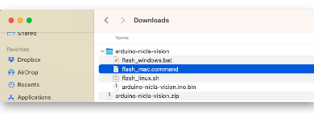
</p>

- Переведите NiclaV в режим загрузки, дважды нажав кнопку reset.

- Загрузите двоичный файл *arduino-nicla-vision.bin* на плату, запустив пакетный файл для своей ОС.

Откройте свой проект в EIS и на вкладке `Data Acquisition` выберите `WebUSB`. Откроется окно; выберите вариант, в котором видно, что `Nicla is paired`, и нажмите `[Connect]`.

В разделе `Collect Data` на вкладке `Data Acquisition` можно выбрать, данные какого датчика собирать. Выберите `Built-in microphone`, задайте `label` (например, *yes*), частоту дискретизации `Frequency` [16000 Гц] и длительность образца `Sample length (in milliseconds)`, например [10 с]. Нажмите `Start sampling`.

<p align="center">
  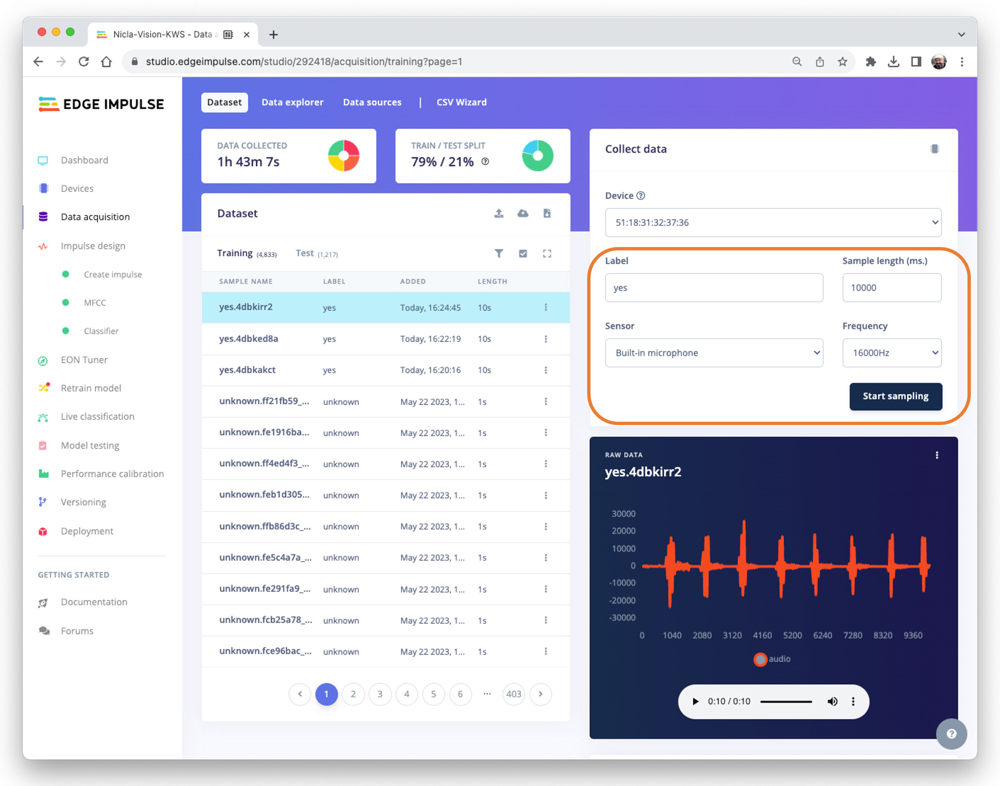
</p>

Данные набора Пита имеют длительность 1 с, а записанные образцы — по 10 с, и их нужно разбить на отрезки по 1 с. Нажмите `три точки` после названия образца и выберите `Split sample`.

Откроется окно инструмента разбиения (Split).

<p align="center">
  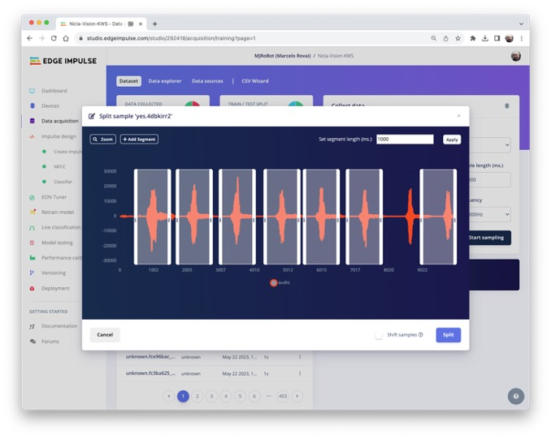
</p>

В инструменте разбейте данные на записи по 1 секунде (1000 мс). При необходимости добавьте или удалите сегменты. Эту процедуру нужно повторить для всех новых образцов.

#### Использование смартфона и EI Studio

Аудиоданные можно также записывать на ПК или смартфон с частотой дискретизации 16 кГц и разрядностью 16 бит.

Откройте `Devices`, отсканируйте `QR Code` телефоном и перейдите по ссылке. В браузере откроется приложение для сбора данных. Выберите `Collecting Audio`, затем задайте `Label`, длительность записи `Length` и `Category`.

<p align="center">
  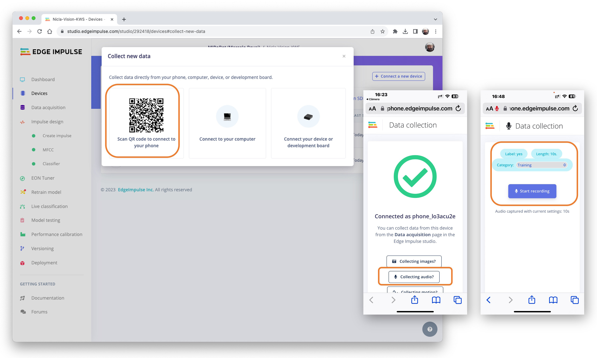
</p>

Повторите ту же процедуру, что и с NiclaV.

> Для записи звука можно использовать любое приложение, например [Audacity](https://www.audacityteam.org/), при условии что образцы записаны с частотой 16 кГц и разрядностью 16 бит.

## Создание Impulse (предобработка и определение модели)

*Impulse* получает сырые данные, с помощью обработки сигнала извлекает признаки, а затем использует блок обучения для классификации новых данных.

### Проектирование Impulse

<p align="center">
  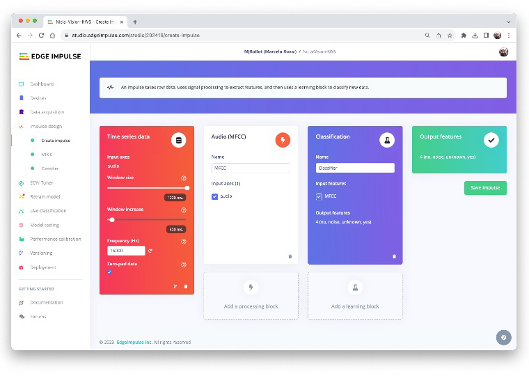
</p>

Сначала мы возьмём точки данных с окном в 1 секунду, применим аугментацию и будем сдвигать окно с интервалом 500 мс. Обратите внимание, что включён параметр zero-pad data (дополнение нулями). Он важен: образцы короче 1 секунды дополняются «нулями» (в некоторых случаях образцы могут быть короче окна 1000 мс в инструменте разбиения — чтобы избежать шумов и выбросов).

Каждый образец аудио длиной 1 секунда предобрабатывается и преобразуется в изображение (например, $13\times 49\times 1$). Как обсуждалось в практическом руководстве [«Инженерия признаков для KWS»](../../06-shared/kws_feature_eng/README.md), мы будем использовать `Audio (MFCC)`, который извлекает признаки из аудиосигналов с помощью [мел-частотных кепстральных коэффициентов](https://en.wikipedia.org/wiki/Mel-frequency_cepstrum), хорошо подходящих для человеческого голоса, то есть для нашей задачи.

Затем выберем блок `Classification`, чтобы построить модель с нуля на основе свёрточной нейронной сети (CNN).

> Вместо этого можно использовать блок `Transfer Learning (Keyword Spotting)`, который дообучает предобученную модель распознавания ключевых слов на ваших данных. Такой подход хорошо работает с относительно небольшими наборами ключевых слов.

### Предобработка (MFCC)

Следующий шаг — создать признаки для обучения на следующем этапе.

Можно оставить значения параметров по умолчанию, но мы воспользуемся опцией DSP `Autotune parameters`.

<p align="center">
  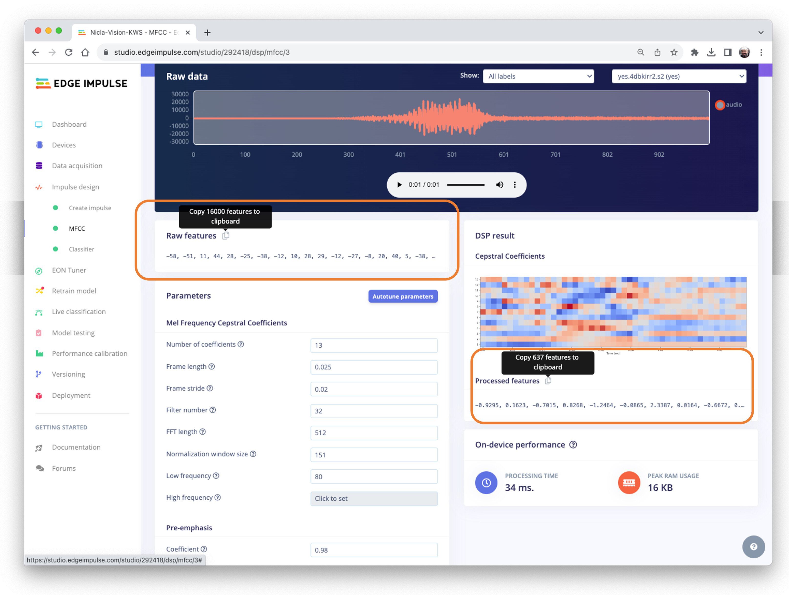
</p>

Мы возьмём `Raw features` (наши аудиоданные длительностью 1 секунда с частотой 16 кГц) и с помощью блока обработки MFCC вычислим `Processed features`. На каждые 16 000 сырых признаков (16 000 $\times$ 1 секунда) мы получим 637 обработанных признаков $(13\times 49)$.

<p align="center">
  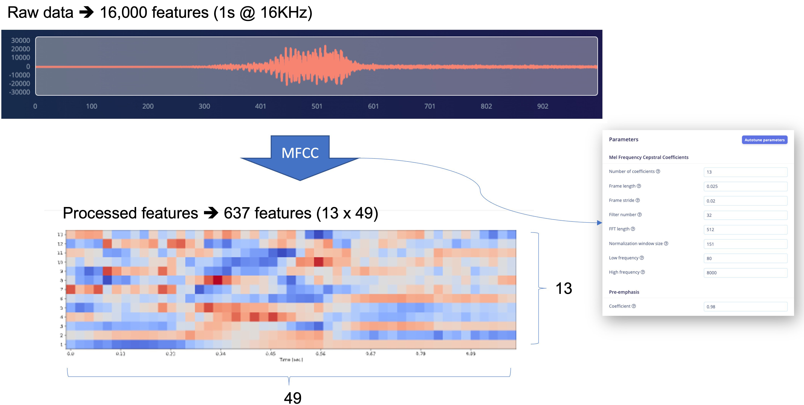
</p>

Результат показывает, что предобработка данных потребовала мало памяти (16 КБ) и имеет задержку 34 мс, что отлично. Например, на Arduino Nano (Cortex-M4f @ 64 МГц) та же предобработка займёт около 480 мс. Выбранные параметры, например `FFT length` [512], существенно влияют на задержку.

Теперь нажмём `Save parameters` и перейдём на вкладку `Generated features`, где будут созданы реальные признаки. Используя [UMAP](https://umap-learn.readthedocs.io/en/latest/), метод снижения размерности, `Feature explorer` показывает, как признаки распределены на двумерном графике.

<p align="center">
  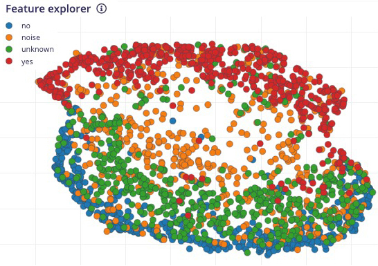
</p>

Результат выглядит хорошо: признаки *yes* (красные) и *no* (синие) визуально чётко разделены. Признаки *unknown* расположены ближе к области *no*, чем к *yes*. Это говорит о том, что ключевое слово *no* склонно давать больше ложных срабатываний.

### Заглядываем под капот

Чтобы лучше понять, как обрабатывается сырой звук, изучите главу [«Инженерия признаков для KWS»](../../06-shared/kws_feature_eng/README.md). Поэкспериментировать с генерацией признаков MFCC можно, скачав [блокнот](https://github.com/Mjrovai/Arduino_Nicla_Vision/blob/main/KWS/KWS_MFCC_Analysis.ipynb) с GitHub или [открыв его в Colab](https://colab.research.google.com/github/Mjrovai/Arduino_Nicla_Vision/blob/main/KWS/KWS_MFCC_Analysis.ipynb).

## Проектирование модели и обучение

Мы используем простую свёрточную нейронную сеть (CNN), протестированную с одномерными (1D) и двумерными (2D) свёртками. Базовая архитектура содержит два блока «свёртка + MaxPooling» (с \[8\] и \[16\] фильтрами соответственно) и Dropout \[0,25\] для 1D и \[0,5\] для 2D. Последний слой после Flatten содержит \[4\] нейрона — по одному на каждый класс:

<p align="center">
  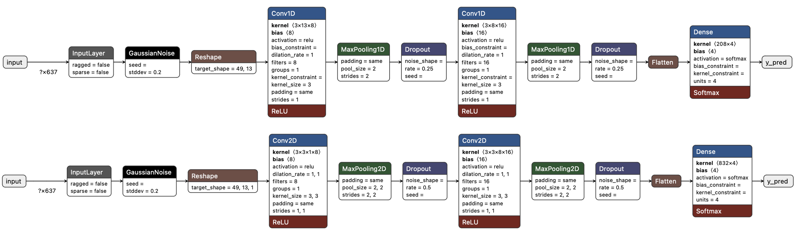
</p>

Гиперпараметры: `Learning Rate` — \[0,005\], модель обучается за \[100\] эпох. Также включим метод аугментации данных на основе [SpecAugment](https://arxiv.org/abs/1904.08779). Модели 1D и 2D обучались с одинаковыми гиперпараметрами. Архитектура 1D дала лучший общий результат (точность 90,5 % против 88 % у 2D), поэтому мы используем 1D.

<p align="center">
  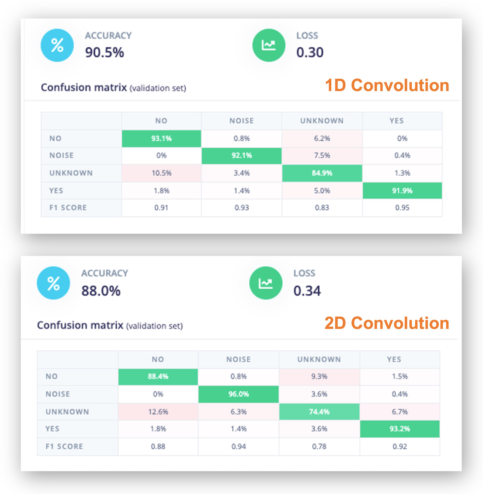
</p>

> Свёртки 1D эффективнее, потому что требуют меньше параметров, чем 2D, и поэтому лучше подходят для сред с ограниченными ресурсами.

Также стоит посмотреть на матрицу ошибок для 1D. F1-мера для `yes` составляет 95 %, для `no` — 91 %. Этого и следовало ожидать по результатам Feature Explorer (`no` и `unknown` находятся на близком расстоянии). Чтобы улучшить результат, можно внимательно изучить образцы с ошибками.

<p align="center">
  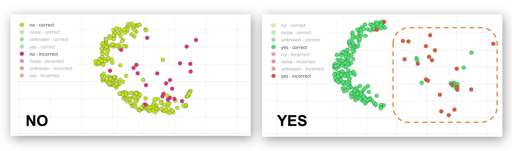
</p>

Послушайте образцы, которые распознаны неверно. Например, для `yes` большинство ошибок связано с тем, что yes произносилось как «yeh». Вы можете записать дополнительные образцы и переобучить модель.

### Заглядываем под капот

Если вы хотите понять, что происходит «под капотом», можно скачать предобработанный набор данных (`MFCC training data`) на вкладке `Dashboard` и запустить этот [блокнот Jupyter](https://github.com/Mjrovai/Arduino_Nicla_Vision/blob/main/KWS/KWS_CNN_training.ipynb) — можно экспериментировать с кодом или [открыть его в Colab](https://colab.research.google.com/github/Mjrovai/Arduino_Nicla_Vision/blob/main/KWS/KWS_CNN_training.ipynb). Например, можно проанализировать точность по эпохам:

<p align="center">
  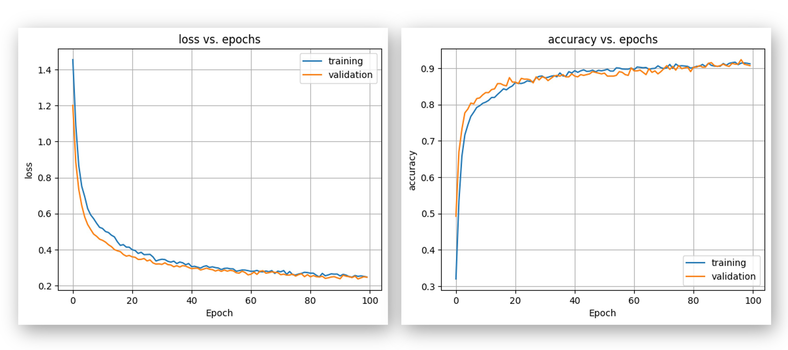
</p>

## Тестирование

Тестирование модели на данных, отложенных для проверки (тестовых данных), дало точность примерно 76 %.

<p align="center">
  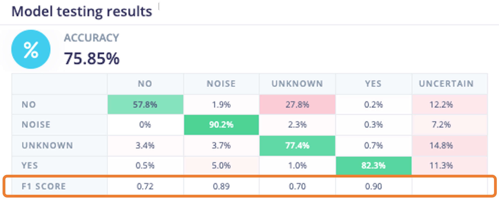
</p>

Если посмотреть F1-меру, для YES получилось 0,90 — отличный результат, ведь мы ожидаем использовать это слово как основной «триггер» в проекте KWS. Худший результат (0,70) — у UNKNOWN, и это нормально.

Для NO получилось 0,72. Этого и следовало ожидать, но чтобы улучшить результат, можно перенести неверно классифицированные образцы в обучающий набор и повторить обучение.

### Классификация в реальном времени

Можно перейти к следующему шагу проекта, но учтите, что возможна классификация `Live Classification` с помощью NiclaV или смартфона: она позволяет захватывать образцы в реальном времени и тестировать обученную модель до её развёртывания на устройстве.

## Развёртывание и инференс

EIS упакует все нужные библиотеки, функции предобработки и обученные модели и загрузит их на ваш компьютер. Перейдите в раздел `Deployment`, выберите `Arduino Library`, внизу выберите `Quantized (Int8)` и нажмите `Build`.

<p align="center">
  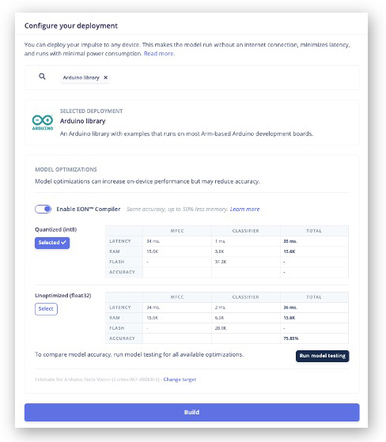
</p>

Когда вы нажмёте `Build`, будет создан ZIP-файл и скачан на компьютер. В Arduino IDE откройте вкладку `Sketch`, выберите `Add .ZIP Library` и укажите ZIP-файл, скачанный из EIS:

<p align="center">
  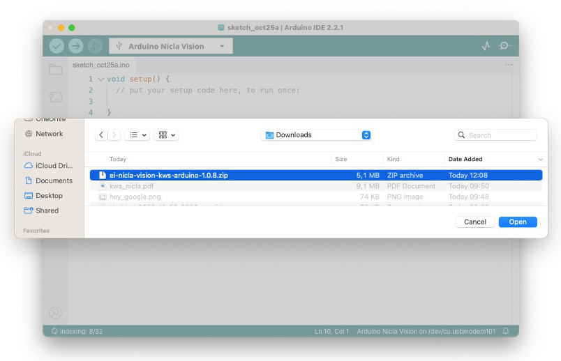
</p>

Теперь пора провести настоящий тест. Мы будем делать инференс, полностью отключившись от EIS. Используем пример кода NiclaV, созданный при развёртывании библиотеки Arduino.

В Arduino IDE откройте вкладку `File/Examples`, найдите свой проект и выберите `nicla-vision/nicla-vision_microphone` (или `nicla-vision_microphone_continuous`):

<p align="center">
  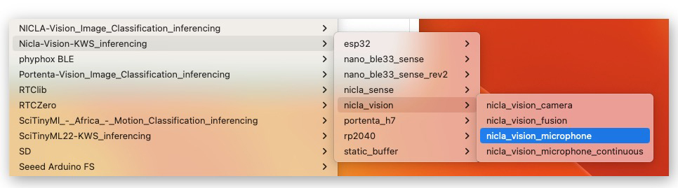
</p>

Дважды нажмите кнопку reset, чтобы перевести NiclaV в режим загрузки, загрузите скетч на плату и протестируйте реальный инференс:

<p align="center">
  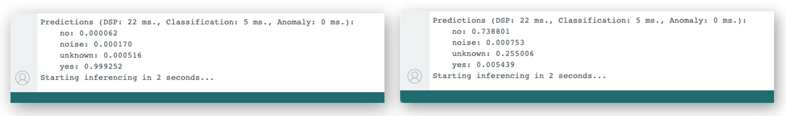
</p>

## Постобработка

Теперь, когда мы знаем, что модель работает и распознаёт наши ключевые слова, изменим код, чтобы увидеть результат на NiclaV полностью автономно — без подключения к ПК, от батареи, пауэрбанка или отдельного источника 5 В.

Идея такая: когда распознано ключевое слово YES, загорается зелёный светодиод; при NO — красный; если звучит UNKNOWN — синий; при наличии шума (без ключевого слова) все светодиоды выключены.

Изменим один из примеров кода. Сделаем это на примере `nicla-vision_microphone_continuous`.

Начнём с инициализации светодиодов:

``` cpp
...
void setup()
{
        // Когда отладка кода завершена, можно закомментировать или удалить
        // часть кода, связанную с Serial
    Serial.begin(115200);
    while (!Serial);
    Serial.println("Inferencing - Nicla Vision KWS with LEDs");

    // Выводы встроенных RGB-светодиодов Arduino NiclaV
    pinMode(LEDR, OUTPUT);
    pinMode(LEDG, OUTPUT);
    pinMode(LEDB, OUTPUT);

    // По умолчанию светодиоды выключены.
    // Примечание: RGB-светодиоды Arduino Nicla Vision
    // горят, когда вывод в состоянии LOW, и гаснут, когда в HIGH.
    digitalWrite(LEDR, HIGH);
    digitalWrite(LEDG, HIGH);
    digitalWrite(LEDB, HIGH);
...
}
```

Создайте две функции. Первая, `turn_off_leds()`, выключает все RGB-светодиоды:

``` cpp
/*
 * @brief      Функция turn_off_leds — выключает все RGB-светодиоды
 */
void turn_off_leds(){
    digitalWrite(LEDR, HIGH);
    digitalWrite(LEDG, HIGH);
    digitalWrite(LEDB, HIGH);
}
```

Вторая функция, `turn_on_led()`, включает RGB-светодиоды в соответствии с наиболее вероятным результатом классификатора:

``` cpp
/*
 * @brief     Функция turn_on_leds — включает RGB-светодиоды
 * @param[in] pred_index
 *            no:       [0] ==> горит красный
 *            noise:    [1] ==> все выключены
 *            unknown:  [2] ==> горит синий
 *            yes:      [3] ==> горит зелёный
 */
void turn_on_leds(int pred_index) {
  switch (pred_index)
  {
    case 0:
      turn_off_leds();
      digitalWrite(LEDR, LOW);
      break;

    case 1:
      turn_off_leds();
      break;

    case 2:
      turn_off_leds();
      digitalWrite(LEDB, LOW);
      break;

    case 3:
      turn_off_leds();
      digitalWrite(LEDG, LOW);
      break;
  }
}
```

И измените фрагмент `// print the predictions` в функции `loop()`:

``` cpp
...

 if (++print_results >= (EI_CLASSIFIER_SLICES_PER_MODEL_WINDOW)) {
     // вывод предсказаний
     ei_printf("Predictions ");
     ei_printf("(DSP: %d ms., Classification: %d ms., "
               "Anomaly: %d ms.)",
         result.timing.dsp, result.timing.classification,
         result.timing.anomaly);
     ei_printf(": \n");
     int pred_index = 0;     // Инициализация pred_index
     float pred_value = 0;   // Инициализация pred_value
     for (size_t ix = 0; ix < EI_CLASSIFIER_LABEL_COUNT; ix++) {
         if (result.classification[ix].value > pred_value){
             pred_index = ix;
             pred_value = result.classification[ix].value;
         }
         // ei_printf("    %s: ",
         // result.classification[ix].label);
         // ei_printf_float(result.classification[ix].value);
         // ei_printf("\n");
     }
     ei_printf("  PREDICTION: ==> %s with probability %.2f\n",
               result.classification[pred_index].label,
               pred_value);
     turn_on_leds (pred_index);

#if EI_CLASSIFIER_HAS_ANOMALY == 1
        ei_printf("    anomaly score: ");
        ei_printf_float(result.anomaly);
        ei_printf("\n");
#endif

        print_results = 0;
    }
}

...
```

Полный код можно найти в [репозитории проекта на GitHub](https://github.com/Mjrovai/Arduino_Nicla_Vision/tree/main/KWS/nicla_vision_microphone_continuous_LED).

Загрузите скетч на плату и протестируйте реальный инференс. Идея такая: зелёный светодиод горит при распознавании ключевого слова YES, красный — при NO, а любое другое слово включает синий. Все светодиоды должны быть выключены при тишине или фоновом шуме. Учтите, что тот же приём может «запускать» внешнее устройство для выполнения нужного действия вместо включения светодиода, как мы видели во введении.

<p align="center">
  <iframe width="560" height="315" src="https://www.youtube.com/embed/25Rd76OTXLY" title="Постобработка KWS: светодиоды на Nicla Vision" frameborder="0" allowfullscreen></iframe>
</p>

## Итоги

> Блокноты и код, использованные в этой практической работе, вы найдёте в [репозитории GitHub](https://github.com/Mjrovai/Arduino_Nicla_Vision/tree/main/KWS).

Прежде чем завершить, учтите: классификация звуков — это больше, чем голос. Например, проекты TinyML со звуком можно развивать в самых разных областях:

- **Безопасность** (обнаружение битого стекла, выстрелов);
- **Промышленность** (обнаружение аномалий);
- **Медицина** (храп, кашель, заболевания лёгких);
- **Природа** (контроль ульев, звуки насекомых, борьба с браконьерством).

## Ресурсы

- [Подмножество набора Google Speech Commands](https://cdn.edgeimpulse.com/datasets/keywords2.zip)

- [Блокнот Colab: KWS MFCC Analysis](https://colab.research.google.com/github/Mjrovai/Arduino_Nicla_Vision/blob/main/KWS/KWS_MFCC_Analysis.ipynb)

- [Блокнот Colab: KWS_CNN_training](https://colab.research.google.com/github/Mjrovai/Arduino_Nicla_Vision/blob/main/KWS/KWS_CNN_training.ipynb)

- [Код постобработки для Arduino](https://github.com/Mjrovai/Arduino_Nicla_Vision/tree/main/KWS/nicla_vision_microphone_continuous_LED)

- [Проект Edge Impulse](https://studio.edgeimpulse.com/public/292418/latest)
