# Классификация движения и обнаружение аномалий

<p align="center">
  <br>
  <em>Промпт DALL·E 3: мультфильм в стиле 1950-х, изображающий лабораторию исследования движения. В центре комнаты стоит имитация контейнера для перевозки грузов на грузовиках, лодках и погрузчиках. Контейнер детализирован заклёпками и маркировкой, характерной для промышленных грузовых ящиков. Вокруг него — старинное оборудование: осциллограф, различные массивы датчиков и большие бумажные рулоны с записанными данными. На стенах висят учебные плакаты о безопасности перевозок и логистике. Общая атмосфера комнаты ностальгическая и научная, с оттенком промышленного стиля.</em>
</p>

## Обзор

Транспорт — основа мировой торговли. Миллионы контейнеров ежедневно перевозятся кораблями, грузовиками и поездами в города по всему миру. Обеспечить безопасную и эффективную перевозку этих контейнеров — громадная задача, которая требует современных технологий, и TinyML — одна из них.

В этой практической работе мы решим реальные задачи, связанные с транспортом. Мы создадим систему классификации движения и обнаружения аномалий на базе платы Arduino Nicla Vision, Arduino IDE и Edge Impulse Studio. Этот проект поможет понять, как контейнеры испытывают различные силы и движения на разных этапах перевозки: наземная и морская перевозка, вертикальное перемещение погрузчиком и периоды простоя на складе.

> **Цели обучения**
>
> - Настройка платы Arduino Nicla Vision
> - Сбор и предобработка данных
> - Построение модели классификации движения
> - Реализация обнаружения аномалий
> - Тестирование и анализ в реальных условиях

К концу этого руководства у вас будет работающий прототип, который классифицирует разные виды движения и обнаруживает аномалии при перевозке контейнеров. Этот опыт станет ступенькой к более сложным проектам быстро развивающейся области TinyML, связанным с вибрацией.

## Установка и проверка IMU

В этом проекте мы будем использовать акселерометр. Как обсуждалось в практической работе «Настройка Nicla Vision», на плате Nicla Vision есть встроенный **6-осевой IMU**: 3D-гироскоп и 3D-акселерометр [LSM6DSOX](https://www.st.com/en/mems-and-sensors/lsm6dsox.html). Проверьте, установлена ли [библиотека IMU LSM6DSOX](https://github.com/arduino-libraries/Arduino_LSM6DSOX). Если нет, установите её.

<p align="center">
  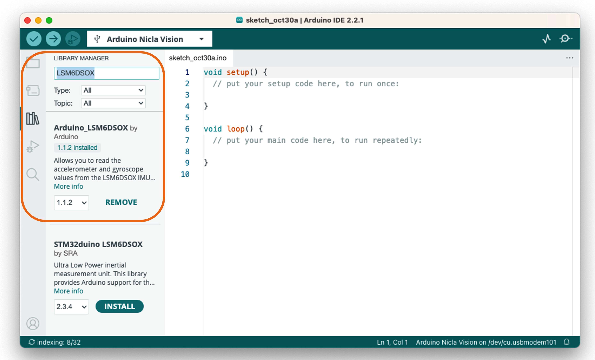
</p>

Затем откройте `Examples > Arduino_LSM6DSOX > SimpleAccelerometer` и запустите тест акселерометра. Работоспособность можно проверить через Serial Monitor или Plotter в IDE. Значения выражены в g (земное ускорение) с диапазоном по умолчанию ±4 g:

<p align="center">
  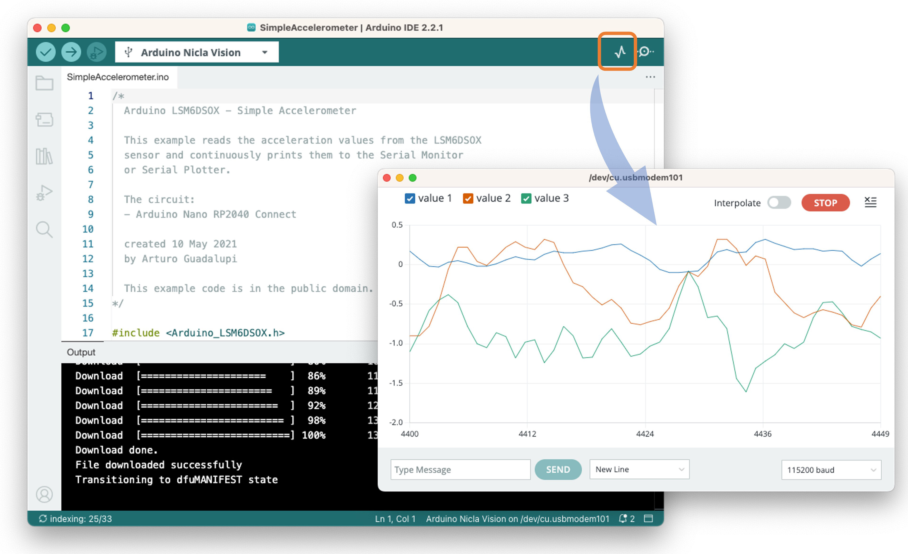
</p>

### Определение частоты дискретизации

Выбор подходящей частоты дискретизации важен для того, чтобы зафиксировать характеристики движения, которые мы изучаем. Теорема Найквиста — Шеннона утверждает, что частота дискретизации должна как минимум вдвое превышать самую высокую частотную составляющую сигнала, чтобы его можно было правильно восстановить. В контексте классификации движения и обнаружения аномалий при перевозке выбор частоты дискретизации зависит от нескольких факторов:

1. **Характер движения.** Разные виды транспорта (наземный, морской и т. д.) могут включать разные диапазоны частот движения. Более быстрые движения могут требовать более высокой частоты дискретизации.

2. **Аппаратные ограничения.** Плата Arduino Nicla Vision и связанные с ней датчики могут ограничивать скорость дискретизации данных.

3. **Вычислительные ресурсы.** Более высокая частота дискретизации создаёт больше данных, что может быть ресурсоёмко, особенно в среде TinyML.

4. **Время работы от батареи.** Более высокая частота дискретизации потребляет больше энергии. Если система питается от батареи, это важный фактор.

5. **Хранение данных.** Более частая дискретизация требует больше места для хранения — ещё одно важное соображение для встраиваемых систем с ограниченной памятью.

Во многих задачах распознавания физической активности человека обычно используют **частоты дискретизации около 50–100 Гц**. Поскольку мы моделируем сценарии перевозки, которые обычно не являются высокочастотными событиями, диапазон 50–100 Гц может быть разумной отправной точкой.

Определим скетч, который позволит собирать данные с заданной частотой дискретизации (например, 50 Гц):

``` cpp
/*
 * Основано на примере Edge Impulse Data Forwarder (Arduino)
  - https://docs.edgeimpulse.com/docs/cli-data-forwarder
 * Разработано M.Rovai @11May23
 */

/* Подключение библиотек ----------------------------- */
#include <Arduino_LSM6DSOX.h>

/* Константы ----------------------------------------- */
#define CONVERT_G_TO_MS2 9.80665f
#define FREQUENCY_HZ        50
#define INTERVAL_MS         (1000 / (FREQUENCY_HZ + 1))

static unsigned long last_interval_ms = 0;
float x, y, z;

void setup() {
  Serial.begin(9600);
  while (!Serial);

  if (!IMU.begin()) {
    Serial.println("Failed to initialize IMU!");
    while (1);
  }
}

void loop() {
  if (millis() > last_interval_ms + INTERVAL_MS) {
    last_interval_ms = millis();

    if (IMU.accelerationAvailable()) {
      // Считываем сырые измерения ускорения с устройства
      IMU.readAcceleration(x, y, z);

      // переводим в м/с2
      float ax_m_s2 = x * CONVERT_G_TO_MS2;
      float ay_m_s2 = y * CONVERT_G_TO_MS2;
      float az_m_s2 = z * CONVERT_G_TO_MS2;

      Serial.print(ax_m_s2);
      Serial.print("\t");
      Serial.print(ay_m_s2);
      Serial.print("\t");
      Serial.println(az_m_s2);
    }
  }
}
```

Загрузите скетч и посмотрите Serial Monitor: мы видим, что собираем 50 отсчётов в секунду.

<p align="center">
  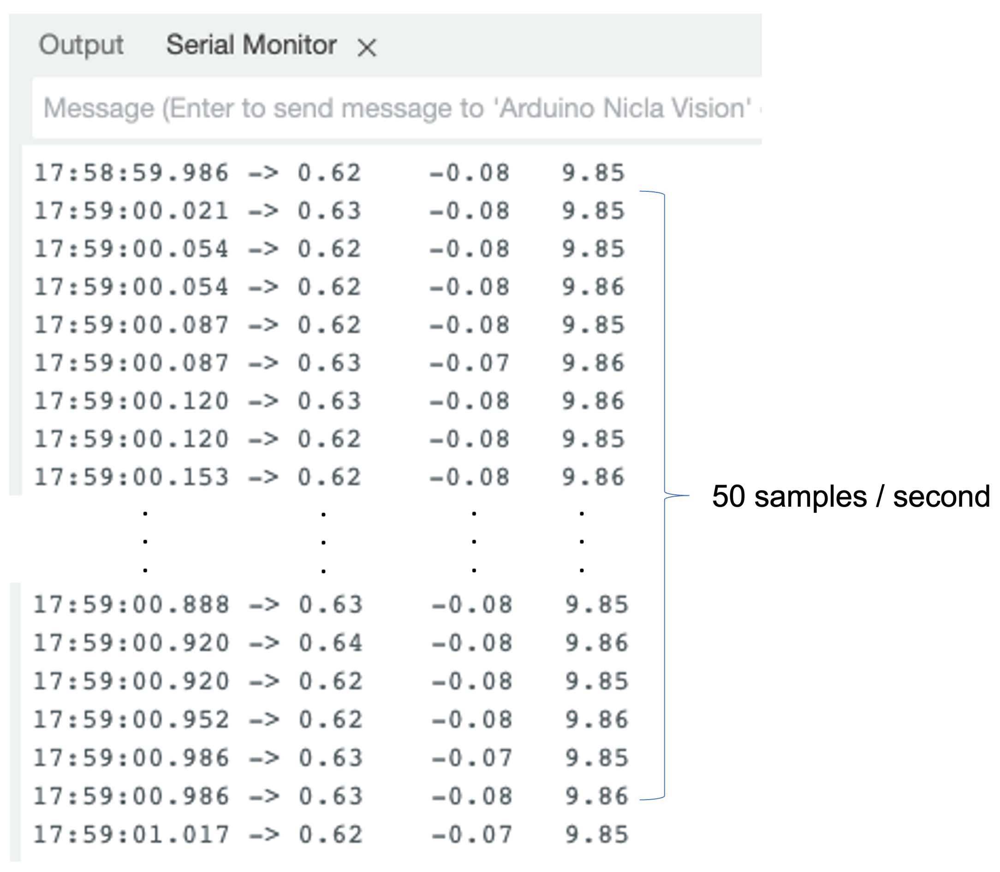
</p>

> Обратите внимание: когда плата Nicla лежит на столе (камерой вниз), ось $z$ показывает около 9,8 м/с$^2$ — ожидаемое ускорение свободного падения.

## Кейс: имитация перевозки контейнера

Чтобы сделать руководство понятнее и ближе к практике, мы смоделируем перевозку контейнера (точнее, пакета) в разных сценариях. С помощью встроенного акселерометра платы Arduino Nicla Vision мы будем записывать данные о движении, вручную имитируя условия:

1. **Наземная** перевозка (автомобилем или поездом);
2. **Морская** перевозка;
3. Вертикальное перемещение **погрузчиком** (fork-lift);
4. Стационарный период **простоя** на складе.

<p align="center">
  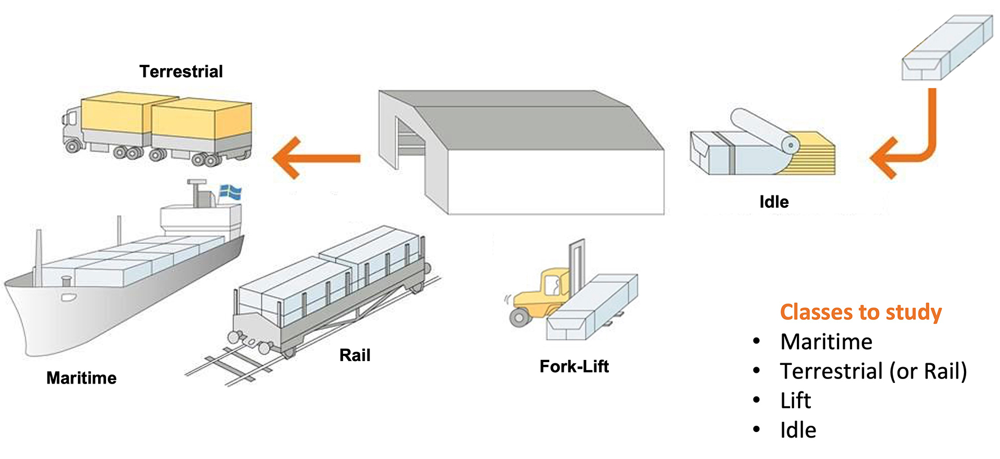
</p>

Из приведённых изображений для нашей симуляции следует, что преимущественно горизонтальные движения (по осям $x$ или $y$) относятся к классу «Наземный» (Terrestrial), вертикальные движения (по оси $z$) — к классу «Погрузчик» (Lift), отсутствие движения — к классу «Простой» (Idle), а движение по всем трём осям — к классу [«Морской»](https://www.containerhandbuch.de/chb_e/stra/index.html?/chb_e/stra/stra_02_03_03.htm) (Maritime).

<p align="center">
  
</p>

## Сбор данных

Для сбора данных есть несколько вариантов. В реальной ситуации устройство можно подключить непосредственно к одному контейнеру, а данные записывать в файл (например, .CSV) на SD-карту (через SPI) или в офлайн-хранилище на компьютере. Данные также можно передавать удалённо на ближайшее устройство, например на телефон, по Bluetooth (как сделано в этом проекте: [Sensor DataLogger](https://www.hackster.io/mjrobot/sensor-datalogger-50e44d)). Когда набор данных собран и сохранён в файле .CSV, его можно загрузить в Studio с помощью [CSV Wizard](https://docs.edgeimpulse.com/docs/edge-impulse-studio/data-acquisition/csv-wizard).

> В [этом видео](https://youtu.be/2KBPq_826WM) вы можете узнать о других способах отправки данных в Edge Impulse Studio.

### Подключение устройства к Edge Impulse

Мы подключим Nicla непосредственно к Edge Impulse Studio, которая также будет использоваться для предобработки данных, обучения модели, тестирования и развёртывания. Для этого есть два варианта:

1. Скачать последнюю прошивку и подключить её напрямую в разделе `Data Collection`.
2. Использовать [CLI Data Forwarder](https://docs.edgeimpulse.com/docs/edge-impulse-cli/cli-data-forwarder), чтобы собирать данные датчика и отправлять их в Studio.

Первый вариант проще, как мы видели в практической работе «Настройка Nicla Vision», но второй даёт больше гибкости при сборе данных, например при задании частоты дискретизации. Выберем второй вариант.

Создайте новый проект в Edge Impulse Studio (EIS) и подключите к нему Nicla, выполнив следующие шаги:

1. Установите [Edge Impulse CLI](https://docs.edgeimpulse.com/docs/edge-impulse-cli/cli-installation) и [Node.js](https://nodejs.org/en/) на компьютер.
2. Загрузите скетч для сбора данных (тот, что обсуждался выше в этом руководстве).
3. Используйте [CLI Data Forwarder](https://docs.edgeimpulse.com/docs/edge-impulse-cli/cli-data-forwarder), чтобы собирать данные акселерометра Nicla и отправлять их в Studio, как показано на схеме:

<p align="center">
  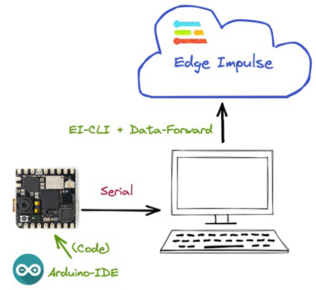
</p>

Запустите [CLI Data Forwarder](https://docs.edgeimpulse.com/docs/edge-impulse-cli/cli-data-forwarder) в терминале. Если делаете это впервые, введите команду:

```
$ edge-impulse-data-forwarder --clean
```

Затем введите учётные данные EI, выберите проект, переменные (например, *accX*, *accY* и *accZ*) и имя устройства (например, *NiclaV*):

<p align="center">
  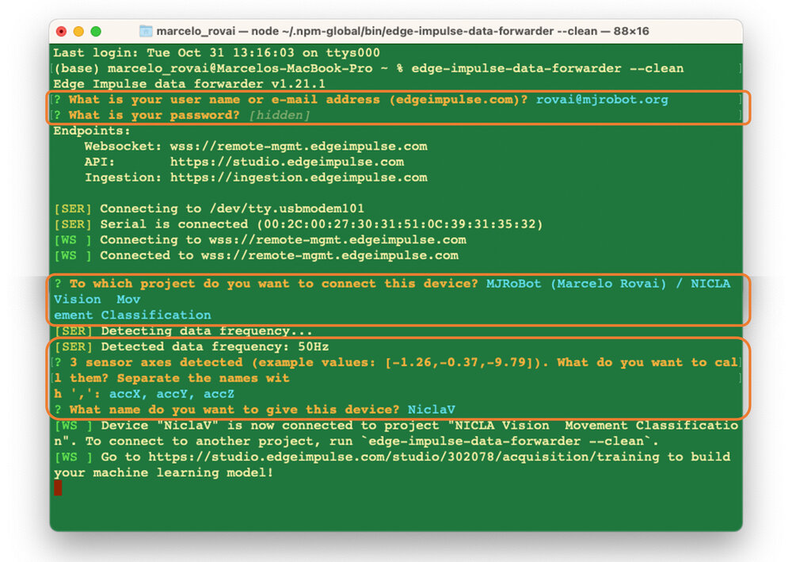
</p>

Откройте раздел `Devices` в своём проекте EI и проверьте, что устройство подключено (точка должна быть зелёной):

<p align="center">
  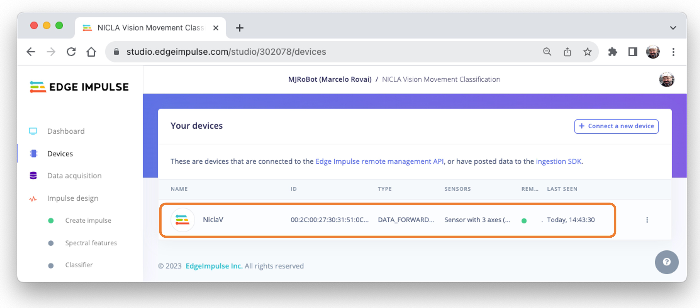
</p>

> Вы можете клонировать проект, созданный для этой практической работы: [NICLA Vision Movement Classification](https://studio.edgeimpulse.com/public/302078/latest).

### Сбор данных в Studio

В разделе `Data Acquisition` вы должны увидеть, что ваша плата `[NiclaV]` подключена. Датчик доступен: `[sensor with 3 axes (accX, accY, accZ)]`, с частотой дискретизации `[50 Hz]`. Studio предлагает длительность образца `[10000]` мс (10 с). Осталось задать метку образца. Начнём с `[terrestrial]`:

<p align="center">
  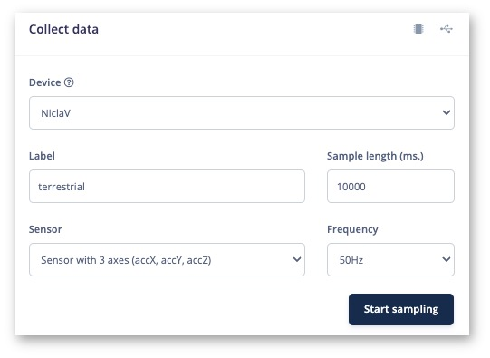
</p>

**Наземная** перевозка (паллеты в грузовике или поезде): движение по горизонтали. Нажмите `[Start Sample]` и перемещайте устройство горизонтально, сохраняя одно направление над столом. Через 10 с данные загрузятся в Studio. Вот как выглядит записанный образец:

<p align="center">
  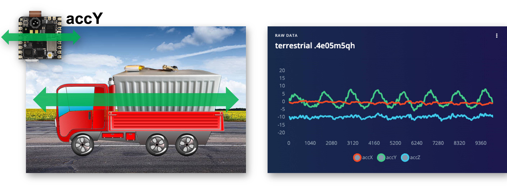
</p>

Как и ожидалось, движение зафиксировано в основном по оси $Y$ (зелёная). Синяя линия — ось $Z$, около −10 м/с$^2$ (камера Nicla смотрит вверх).

Как обсуждалось выше, нужно собрать данные для всех четырёх классов перевозки. Представьте, что у вас есть контейнер со встроенным акселерометром, который оказывается в следующих ситуациях:

**Морская** перевозка (паллеты на лодках в бушующем океане). Движение фиксируется по всем трём осям:

<p align="center">
  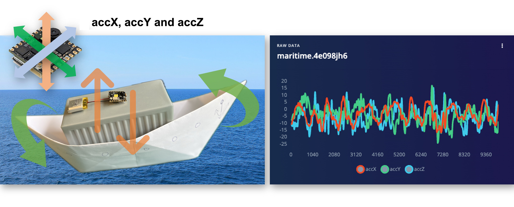
</p>

**Погрузчик** (паллеты, которые вертикально поднимает погрузчик). Движение фиксируется только по оси $Z$:

<p align="center">
  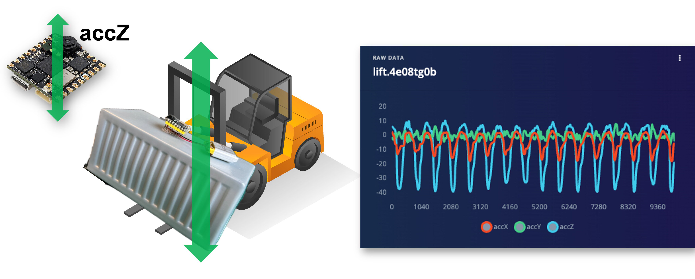
</p>

**Простой** (паллеты на складе). Акселерометр не фиксирует движения:

<p align="center">
  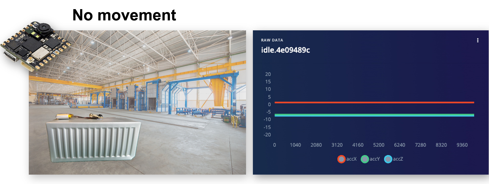
</p>

Например, можно записать по 2 минуты (двенадцать образцов по 10 секунд) для каждого из четырёх классов — всего 8 минут данных. Через меню `three dots` после каждого образца выберите 2 из них и отложите для тестовой выборки. Или можно воспользоваться автоматическим инструментом `Train/Test Split` в разделе `Danger Zone` на вкладке `Dashboard`. Ниже показан итоговый набор данных:

<p align="center">
  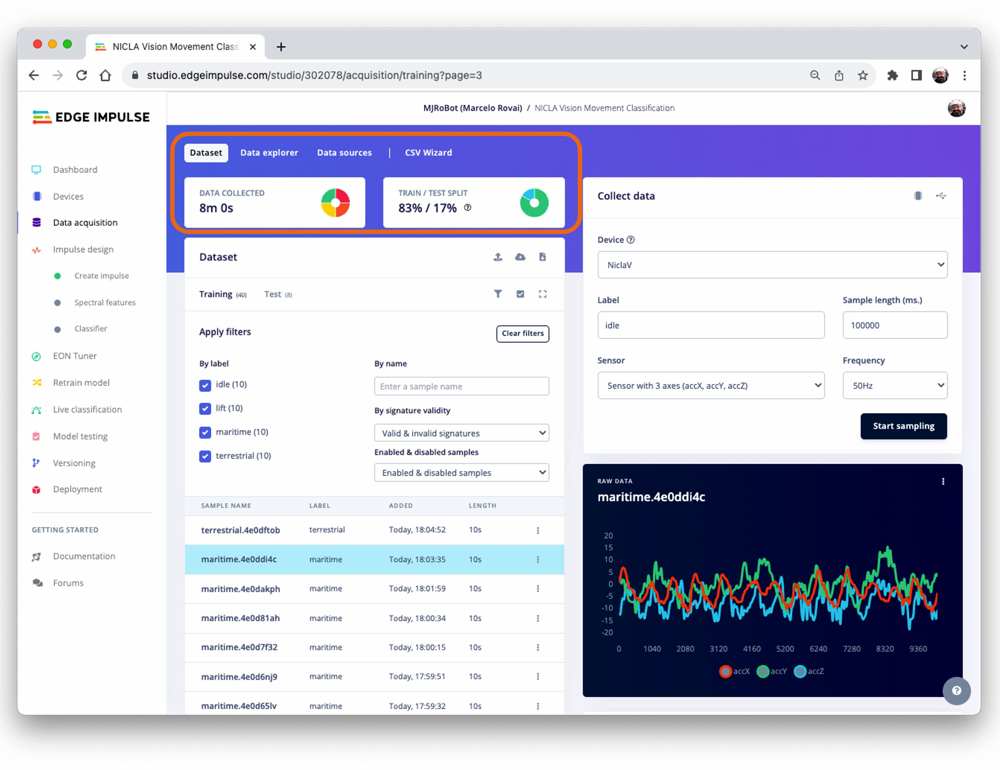
</p>

Когда набор данных собран, его можно детальнее изучить с помощью [Data Explorer](https://docs.edgeimpulse.com/docs/edge-impulse-studio/data-acquisition/data-explorer) — визуального инструмента для поиска выбросов и неверно размеченных данных (с его помощью их можно исправить). Data Explorer сначала извлекает осмысленные признаки из данных (применяя обработку сигналов и встраивания нейронной сети), а затем использует алгоритм снижения размерности, например [PCA](https://en.wikipedia.org/wiki/Principal_component_analysis) или [t-SNE](https://en.wikipedia.org/wiki/T-distributed_stochastic_neighbor_embedding), чтобы отобразить эти признаки в двумерное пространство. Так вы получаете обзор всего набора данных одним взглядом.

<p align="center">
  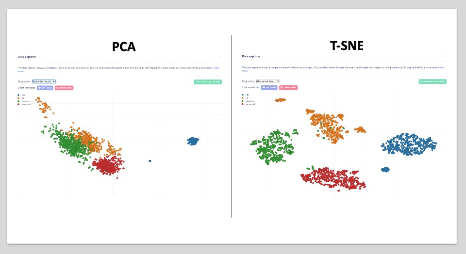
</p>

В нашем случае набор данных выглядит корректно (хорошее разделение классов). Однако PCA показывает возможные проблемы между классами «морской» (зелёный) и «погрузчик» (оранжевый). Это ожидаемо: на лодке движение иногда может быть только «вертикальным».

## Проектирование Impulse

Следующий шаг — определение нашего Impulse. Он получает сырые данные, с помощью обработки сигналов извлекает признаки и передаёт их как входной тензор в *блок обучения* для классификации новых данных. Перейдите в `Impulse Design` и выберите `Create Impulse`. Studio предложит базовую конструкцию. Добавим также второй *блок обучения* для `Anomaly Detection`.

<p align="center">
  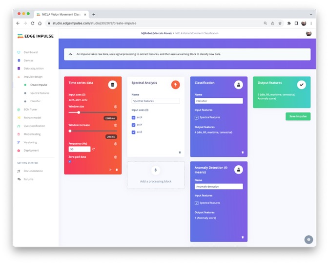
</p>

Эта вторая модель использует K-means. Если представить, что известные классы — это кластеры, то любой образец, который не вписывается ни в один из них, может быть выбросом, аномалией: например, контейнер, упавший с корабля в океан или сорвавшийся с погрузчика.

<p align="center">
  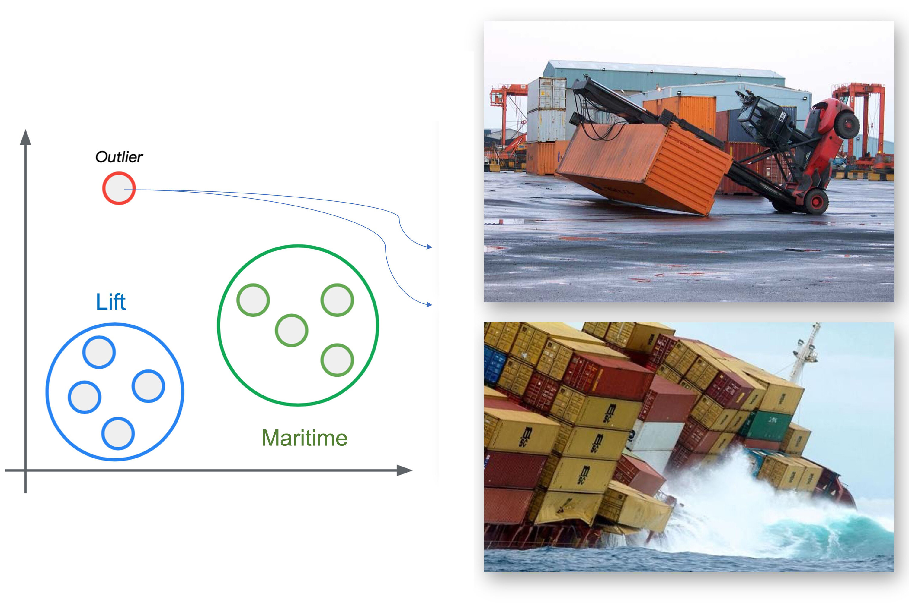
</p>

Частота дискретизации должна определиться автоматически; если нет — введите её: `[50]` Гц. Studio предлагает *размер окна* 2 секунды (`[2000]` мс) со *скользящим окном* шагом `[20]` мс. На этом шаге мы предобрабатываем захваченные данные (временные ряды), создавая табличный набор признаков, который будет входом для нейронной сети-классификатора (DNN) и модели обнаружения аномалий (K-Means), как показано ниже:

<p align="center">
  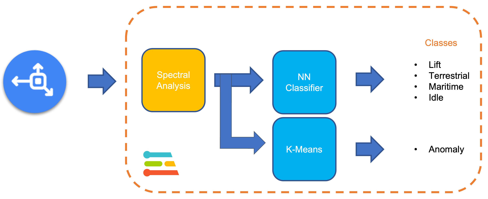
</p>

Разберём эти шаги и параметры подробнее, чтобы понять, что мы делаем.

### Обзор предобработки данных

Предобработка данных — это извлечение признаков из набора данных, снятого акселерометром: обработка и анализ сырых данных. Акселерометры измеряют ускорение объекта по одной или нескольким осям (обычно по трём, обозначаемым $X$, $Y$ и $Z$). Эти измерения позволяют понять различные аспекты движения объекта: характер перемещений и вибрации.

Сырые данные акселерометра могут быть зашумлёнными и содержать ошибки или лишнюю информацию. Шаги предобработки, например фильтрация и нормализация, очищают и стандартизируют данные, делая их более подходящими для извлечения признаков. В нашем случае данные нужно разбить на небольшие сегменты, или **окна**. Это помогает сосредоточиться на конкретных событиях или активности в наборе данных, делая извлечение признаков более управляемым и содержательным. Выбор **размера окна** и перекрытия (**шага окна**) зависит от приложения и частоты интересующих событий. Как правило, стоит стремиться захватить пару «циклов данных».

> При частоте дискретизации (SR) 50 Гц и размере окна 2 секунды мы получим 100 отсчётов на ось, или 300 всего (3 оси $\times$ 2 секунды $\times$ 50 отсчётов). Окно будем сдвигать каждые 200 мс, создавая более крупный набор данных, где каждый экземпляр содержит 300 сырых признаков.

<p align="center">
  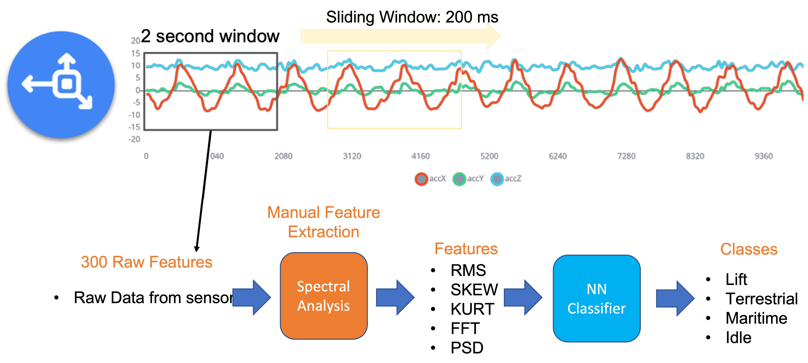
</p>

После предобработки и сегментации данных можно извлекать признаки, описывающие характеристики движения. Типичные признаки, извлекаемые из данных акселерометра:

- **Признаки временной области** описывают статистические свойства данных внутри каждого сегмента: среднее, медиану, стандартное отклонение, асимметрию (skewness), эксцесс (kurtosis) и частоту переходов через ноль (zero-crossing rate).
- **Признаки частотной области** получают, преобразуя данные в частотную область с помощью таких методов, как быстрое преобразование Фурье (FFT). К типичным признакам частотной области относятся спектр мощности, спектральная энергия, доминирующие частоты (амплитуда и частота) и спектральная энтропия.
- **Признаки временно-частотной области** объединяют информацию о времени и частоте, например кратковременное преобразование Фурье (STFT) или дискретное вейвлет-преобразование (DWT). Они дают более детальное представление о том, как частотное содержание сигнала меняется во времени.

Во многих случаях количество извлечённых признаков может быть большим, что приводит к переобучению или увеличению вычислительной сложности. Методы отбора признаков, такие как взаимная информация, корреляционные методы или метод главных компонент (PCA), помогают выявить наиболее значимые признаки для конкретного приложения и уменьшить размерность набора данных. Studio может помочь с расчётом важности признаков.

### Спектральные признаки в EI Studio

Предобработка данных — сложная область для встраиваемого машинного обучения, но Edge Impulse помогает справиться с ней благодаря шагу цифровой обработки сигналов (DSP) и, в частности, [блоку спектральных признаков](https://docs.edgeimpulse.com/docs/edge-impulse-studio/processing-blocks/spectral-features) (Spectral Features Block).

В Studio собранный сырой набор данных становится входом блока спектрального анализа, который отлично подходит для анализа повторяющихся движений, например данных акселерометров. Этот блок выполняет DSP (цифровую обработку сигналов) и извлекает признаки, такие как [FFT](https://en.wikipedia.org/wiki/Fast_Fourier_transform) или [вейвлеты](https://en.wikipedia.org/wiki/Digital_signal_processing#Wavelet).

Для нашего проекта, поскольку временной сигнал непрерывен, стоит использовать FFT с длиной, например, `[32]`.

Статистические признаки временной области для каждой оси (канала):

- [RMS](https://en.wikipedia.org/wiki/Root_mean_square) (среднеквадратичное значение): 1 признак;
- [Skewness](https://en.wikipedia.org/wiki/Skewness) (асимметрия): 1 признак;
- [Kurtosis](https://en.wikipedia.org/wiki/Kurtosis) (эксцесс): 1 признак.

Спектральные признаки частотной области для каждой оси (канала):

- [Spectral Power](https://en.wikipedia.org/wiki/Spectral_density) (спектральная мощность): 16 признаков (длина FFT / 2);
- Skewness (асимметрия): 1 признак;
- Kurtosis (эксцесс): 1 признак.

Таким образом, для длины FFT 32 точки блок спектрального анализа выдаёт 21 признак на ось (всего 63 признака).

> Подробнее о том, как вычисляется каждый признак, можно узнать из блокнота [Edge Impulse — Spectral Features Block Analysis](https://github.com/Mjrovai/Arduino_Nicla_Vision/blob/main/Motion_Classification/Edge_Impulse_Spectral_Features_Block.ipynb), из статьи [TinyML under the hood: Spectral Analysis](https://www.hackster.io/mjrobot/tinyml-under-the-hood-spectral-analysis-94676c) или [открыв блокнот прямо в Google Colab](https://colab.research.google.com/github/Mjrovai/Arduino_Nicla_Vision/blob/main/Motion_Classification/Edge_Impulse_Spectral_Features_Block.ipynb).

### Генерация признаков

Когда мы поняли, что делает предобработка, пора довести дело до конца. Возьмём сырые данные (временные ряды) и преобразуем их в табличные данные. Для этого перейдите в раздел `Spectral Features` на вкладке `Parameters`, задайте основные параметры, как обсуждалось в предыдущем разделе (`[FFT]` с `[32]` точками), и выберите `[Save Parameters]`:

<p align="center">
  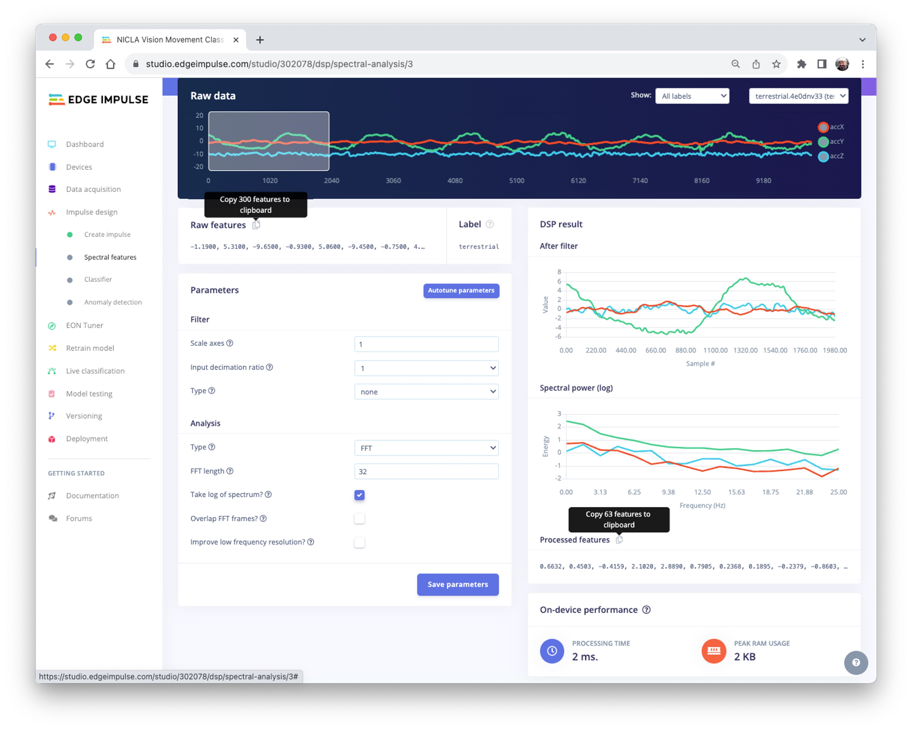
</p>

В верхнем меню выберите опцию `Generate Features` и кнопку `Generate Features`. Каждое окно данных длительностью 2 секунды будет преобразовано в одну точку данных из 63 признаков.

> Feature Explorer покажет эти данные в двумерном виде с помощью [UMAP](https://umap-learn.readthedocs.io/en/latest/). Uniform Manifold Approximation and Projection (UMAP) — метод снижения размерности, который используется для визуализации, как и t-SNE, но применим и для общего нелинейного снижения размерности.

Визуализация позволяет убедиться, что после генерации признаков классы остаются хорошо разделимыми, что говорит о том, что классификатор должен работать хорошо. При желании можно проанализировать, насколько важен каждый признак для одного класса по сравнению с другими.

<p align="center">
  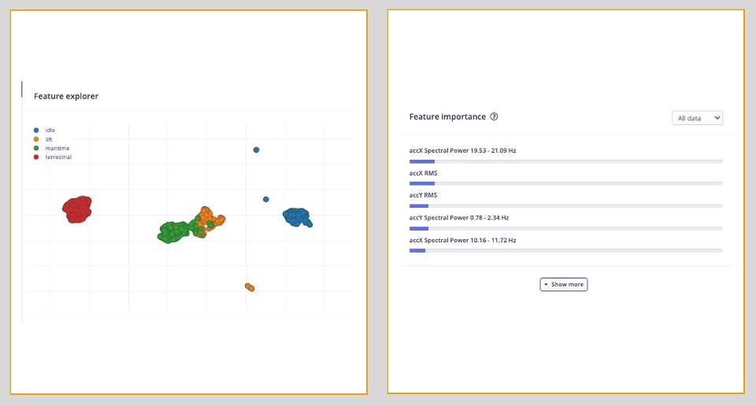
</p>

## Обучение моделей

Наш классификатор будет полносвязной нейронной сетью (DNN): входной слой из 63 нейронов, два скрытых слоя с 20 и 10 нейронами и выходной слой из четырёх нейронов (по одному на каждый класс), как показано здесь:

<p align="center">
  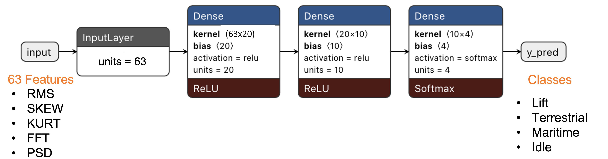
</p>

Гиперпараметры: скорость обучения (Learning Rate) `[0.005]`, размер батча (Batch size) `[32]`, доля данных для валидации `[20]` % и `[30]` эпох. После обучения точность составляет 98,5 %. Затраты памяти и задержка при этом незначительны.

<p align="center">
  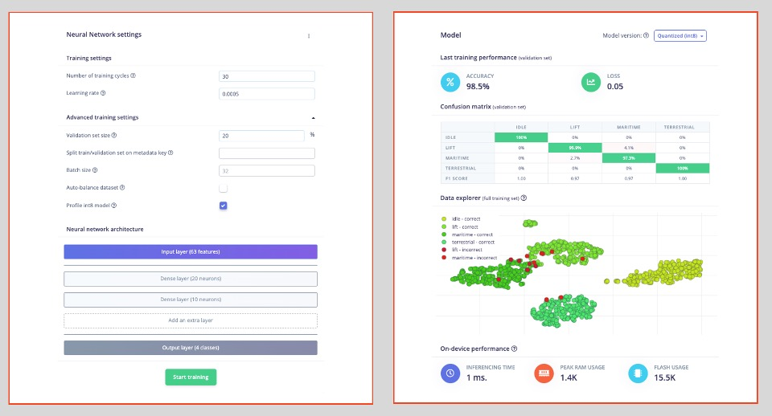
</p>

Для обнаружения аномалий мы выберем предложенные признаки — те самые наиболее важные признаки, отобранные при извлечении, плюс RMS по оси accZ. Количество кластеров составит `[32]`, как предлагает Studio:

<p align="center">
  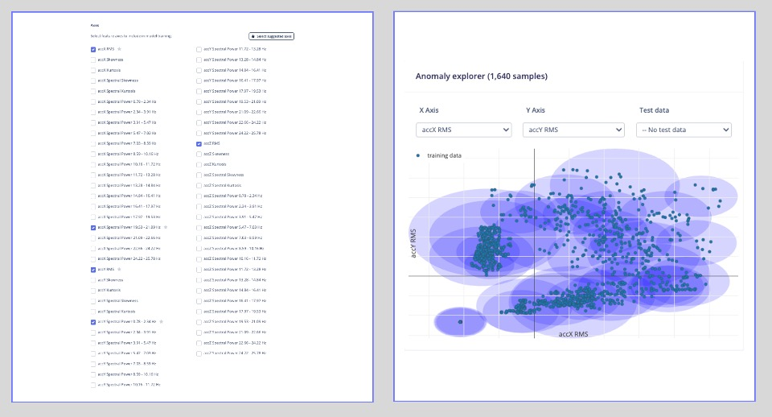
</p>

## Тестирование

Проверить поведение модели на неизвестных данных можно, используя 20 % данных, отложенных при сборе. Результат составил почти 95 %, что хорошо. Результаты всегда можно улучшить, например разобравшись, что пошло не так в одном из неверных ответов. Если это уникальная ситуация, её можно добавить в обучающий набор и повторить обучение.

По умолчанию минимальный порог для неопределённого результата — `[0.6]` для классификации и `[0.3]` для аномалий. Поскольку классов четыре (их сумма должна быть равна 1,0), можно также задать более низкий порог, при котором класс считается допустимым (например, 0,4). Пороги уверенности можно задать через пункт `Set confidence thresholds` в меню `three dots` рядом с кнопкой `Classify all`.

<p align="center">
  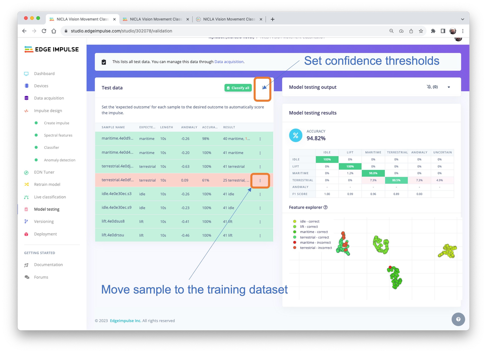
</p>

Также можно выполнить классификацию в реальном времени с помощью вашего устройства (оно должно оставаться подключённым к Studio).

> Учтите, что в этом случае вы будете записывать реальные данные с устройства и загружать их в Studio, где инференс выполняется с помощью обученной модели (но **модель НЕ находится на вашем устройстве**).

## Развёртывание

Настало время развернуть блок предобработки и обученную модель на Nicla. Studio упакует все нужные библиотеки, функции предобработки и обученные модели и загрузит их на компьютер. Выберите опцию `Arduino Library`, внизу выберите `Quantized (Int8)` или `Unoptimized (float32)` и нажмите `[Build]`. Будет создан ZIP-файл, который скачается на компьютер.

<p align="center">
  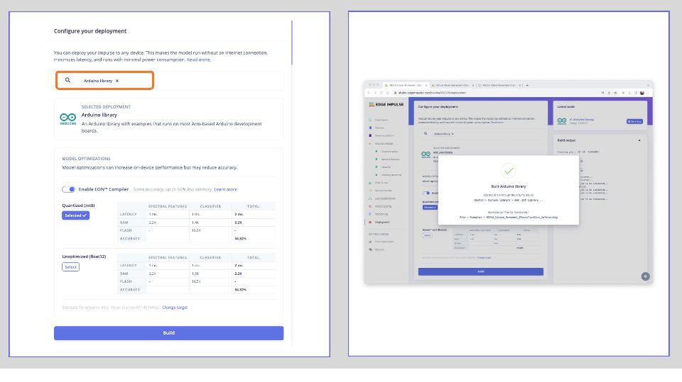
</p>

В Arduino IDE откройте вкладку `Sketch`, выберите `Add.ZIP Library` и укажите ZIP-файл, скачанный из Studio. В терминале IDE появится сообщение: `Library installed` (библиотека установлена).

### Инференс

Теперь пора провести настоящий тест. Инференс будем выполнять, полностью отключившись от Studio. Изменим один из примеров кода, созданных при развёртывании библиотеки Arduino.

В Arduino IDE откройте вкладку `File/Examples`, найдите свой проект и в примерах выберите `Nicla_vision_fusion`:

<p align="center">
  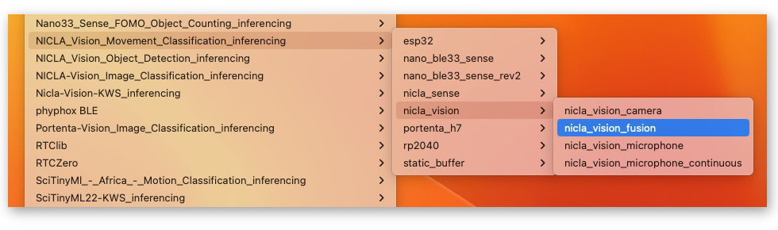
</p>

Обратите внимание: код, созданный Edge Impulse, использует подход *слияния данных датчиков* (sensor fusion), где применяются IMU (акселерометр и гироскоп) и ToF-датчик. В начале кода находятся библиотеки, связанные с нашим проектом: IMU и ToF:

``` cpp
/* Подключение библиотек ---------------------------------- */
#include <NICLA_Vision_Movement_Classification_inferencing.h>
#include <Arduino_LSM6DSOX.h> // IMU
#include "VL53L1X.h" // ToF
```

> Для тестирования код можно оставить как есть, потому что обученная модель использует только признаки, предобработанные с акселерометра. Но в реальном проекте стоит оставить только те библиотеки, которые нужны.

Вот и всё!

Теперь можно загрузить код на устройство и проводить инференс. Нажмите кнопку `[RESET]` на Nicla дважды, чтобы перевести её в режим загрузки (если она всё ещё подключена к Studio, отключите её), и загрузите скетч на плату.

Теперь попробуйте разные движения с платой (похожие на те, что вы записывали при сборе данных), наблюдая результат инференса каждого класса в Serial Monitor:

- **Простой и погрузчик:**

<p align="center">
  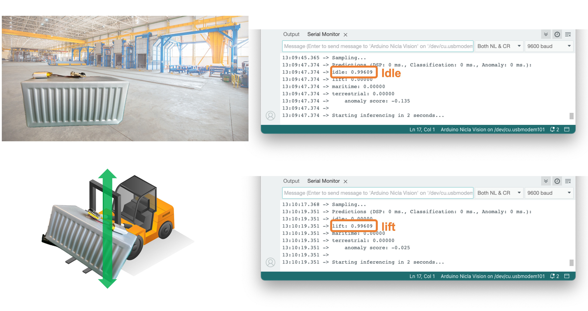
</p>

- **Морская и наземная перевозка:**

<p align="center">
  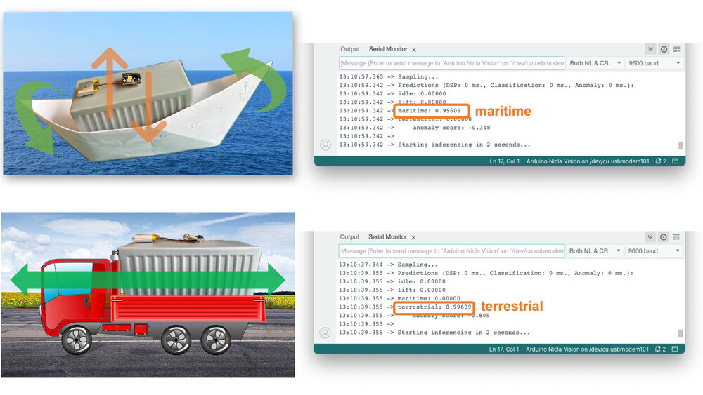
</p>

Обратите внимание, что во всех описанных ситуациях значение `anomaly score` было меньше 0,0. Попробуйте новое движение, которого не было в исходном наборе данных: например, «перекатывание» Nicla, когда камера направлена вниз — как контейнер, упавший с лодки, или даже авария на лодке:

- **Обнаружение аномалии:**

<p align="center">
  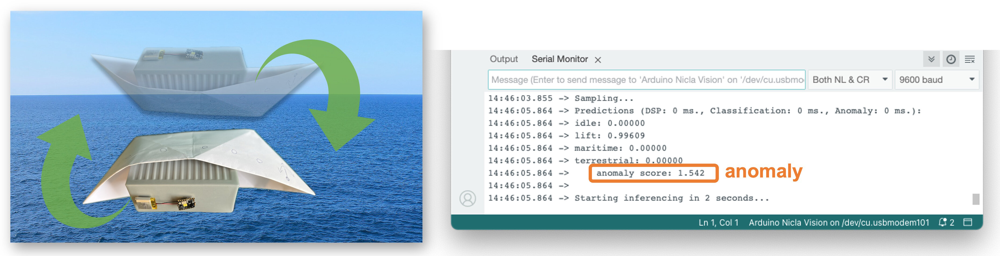
</p>

В этом случае аномалия гораздо больше — свыше 1,00.

### Постобработка

Теперь, когда мы знаем, что модель работает и распознаёт движения, предлагаем изменить код, чтобы увидеть результат на NiclaV полностью автономно — отключённой от ПК и питающейся от батареи, пауэрбанка или отдельного источника питания 5 В.

Идея та же, что и в проекте KWS: при распознавании определённого движения зажигается определённый светодиод. Например, для *наземной* перевозки загорится зелёный светодиод, для *морской* — красный, для *погрузчика* — синий, а если движения нет (*простой*), все светодиоды выключены. Можно также добавить условие для обнаружения аномалии: например, использовать белый цвет (все светодиоды горят одновременно).

## Итоги

> Блокноты и код, использованные в этой практической работе, можно найти в [репозитории GitHub](https://github.com/Mjrovai/Arduino_Nicla_Vision/tree/main/Motion_Classification).

Прежде чем завершить, учтите: классификация движения и обнаружение аномалий могут применяться во многих областях. Вот некоторые потенциальные приложения:

### Примеры применения

#### Промышленность и производство

- **Предиктивное обслуживание:** обнаружение аномалий в движении механизмов, чтобы предсказать поломки до их возникновения.
- **Контроль качества:** мониторинг движения сборочных линий или роботизированных манипуляторов для оценки точности и обнаружения отклонений от стандартного паттерна движения.
- **Складская логистика:** управление перемещением товаров и их отслеживание автоматизированными системами, которые классифицируют разные виды движения и обнаруживают аномалии при обращении с грузом.

#### Здравоохранение

- **Мониторинг пациентов:** обнаружение падений и ненормальных движений у пожилых людей или людей с нарушениями подвижности.
- **Реабилитация:** мониторинг прогресса пациентов, восстанавливающихся после травм, с помощью классификации паттернов движения во время сеансов физиотерапии.
- **Распознавание активности:** классификация видов физической активности для фитнес-приложений или наблюдения за пациентами.

#### Бытовая электроника

- **Управление жестами:** распознавание определённых движений для управления устройствами, например включение света взмахом руки.
- **Игры:** улучшение игрового опыта за счёт ввода, управляемого движениями.

#### Транспорт и логистика

- **Телематика транспортных средств:** мониторинг движения автомобиля для выявления необычного поведения, например резкого торможения, резких поворотов или аварий.
- **Мониторинг груза:** обеспечение сохранности товаров при перевозке путём обнаружения необычных движений, которые могут указывать на вмешательство или неправильное обращение.

#### Умные города и инфраструктура

- **Мониторинг состояния конструкций:** обнаружение вибраций или перемещений внутри сооружений, которые могут указывать на потенциальные неисправности или необходимость обслуживания.
- **Управление дорожным движением:** анализ потока пешеходов или транспорта для повышения мобильности и безопасности в городе.

#### Безопасность и наблюдение

- **Обнаружение вторжений:** распознавание паттернов движения, типичных для несанкционированного доступа или других нарушений безопасности.
- **Мониторинг дикой природы:** обнаружение браконьеров или необычного поведения животных на охраняемых территориях.

#### Сельское хозяйство

- **Мониторинг техники:** отслеживание производительности и использования сельскохозяйственной техники.
- **Анализ поведения животных:** мониторинг движения скота для выявления признаков проблем со здоровьем или стресса.

#### Экологический мониторинг

- **Сейсмическая активность:** обнаружение нерегулярных паттернов движения, которые предшествуют землетрясениям или другим геологически значимым событиям.
- **Океанография:** изучение волновых паттернов и морских движений для исследований и обеспечения безопасности.

### Трёхмерный корпус для Nicla

Для реальных приложений, как было сказано выше, к устройству можно добавить корпус. Eoin Jordan из Edge Impulse разработал отличный носимый корпус для контроля здоровья человека и механизмов для семейства плат Nicla. Он работает с магнитом 10 мм, винтами M2 и ремешком 16 мм для сценариев использования, связанных со здоровьем человека и машин. Ссылка: [Arduino Nicla Voice and Vision Wearable Case](https://www.thingiverse.com/thing:5923305).

<p align="center">
  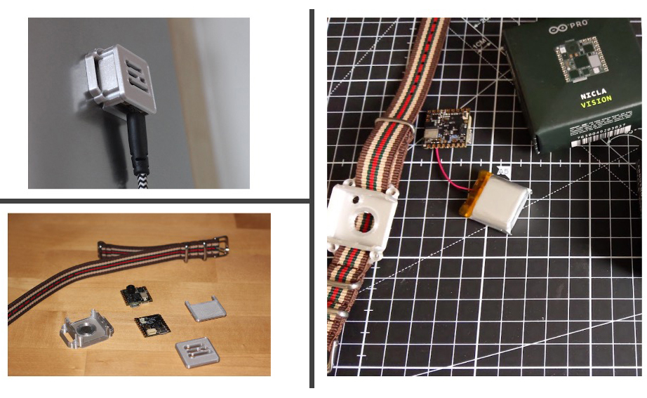
</p>

Применения классификации движения и обнаружения аномалий очень разнообразны, а Arduino Nicla Vision хорошо подходит для сценариев, где важны низкое энергопотребление и обработка на периферии. Компактный форм-фактор и эффективность обработки делают её идеальным выбором для портативных и удалённых приложений, где важна обработка в реальном времени, а связь может быть ограничена.

## Ресурсы

* [Код для Arduino](https://github.com/Mjrovai/Arduino_Nicla_Vision/tree/main/Motion_Classification/Niclav_Acc_Data_Capture)

* [Блокнот Google Colab: Edge Impulse Spectral Features Block](https://colab.research.google.com/github/Mjrovai/Arduino_Nicla_Vision/blob/main/Motion_Classification/Edge_Impulse_Spectral_Features_Block.ipynb)

* [Проект Edge Impulse](https://studio.edgeimpulse.com/public/302078/latest)
