# Обнаружение объектов

<p align="center">
  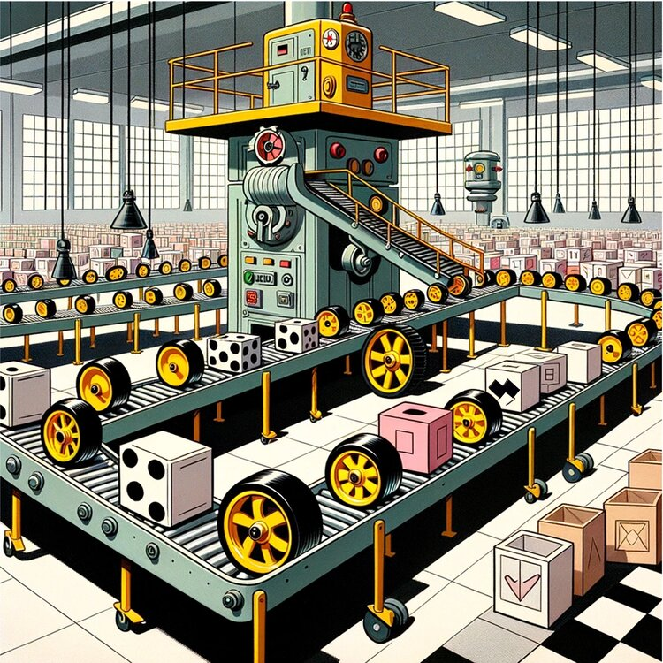<br>
  <em>Промпт DALL·E 3: мультфильм в стиле 1940–1950-х: просторный промышленный склад. На первом плане конвейер с игрушечными колёсами и коробками. У колёс яркие жёлтые центры и чёрные шины, коробки — белые кубики с чередующимся чёрно-белым узором. В конце движущегося конвейера стоит ретро-робот с инструментами и датчиками, который старательно классифицирует и пересчитывает прибывающие колёса и коробки. Общая эстетика напоминает анимацию середины века с чёткими линиями и классической палитрой.</em>
</p>

## Обзор

Это продолжение работы с классификацией изображений на Nicla Vision: теперь мы изучаем **обнаружение объектов** (Object Detection).

<p align="center">
  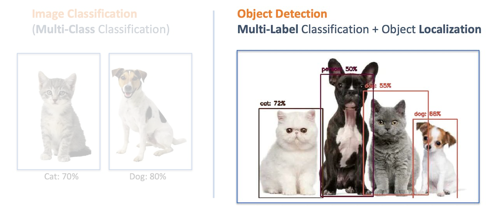
</p>

### Обнаружение объектов и классификация изображений

Основная задача моделей классификации изображений — выдать список наиболее вероятных категорий объектов, присутствующих на изображении. Например, распознать полосатого кота сразу после ужина:

<p align="center">
  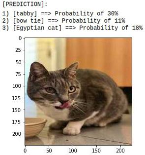
</p>

Но что будет, если кот прыгнет рядом с бокалом вина? Модель по-прежнему распознаёт только преобладающую категорию на изображении — полосатого кота:

<p align="center">
  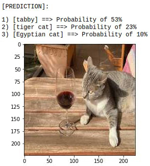
</p>

А что, если на изображении нет доминирующей категории?

<p align="center">
  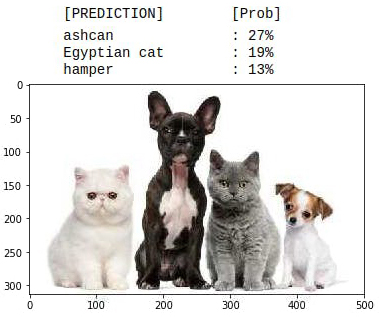
</p>

Модель совершенно неверно определяет это изображение как «ashcan» (мусорный ящик), возможно из-за цветовых оттенков.

> Модель, которая использовалась во всех предыдущих примерах, — MobileNet, обученная на большом наборе данных *ImageNet*.

Чтобы решить эту проблему, нужен другой тип моделей, которые находят не только **несколько категорий** (или меток), но и **где** на изображении расположены объекты.

Такие модели гораздо сложнее и крупнее, например **MobileNetV2 SSD FPN-Lite 320x320**, обученная на наборе COCO. Эта предобученная модель обнаружения объектов умеет находить до 10 объектов на изображении и выдаёт ограничивающий прямоугольник (bounding box) для каждого обнаруженного объекта. Изображение ниже — результат работы такой модели на Raspberry Pi:

<p align="center">
  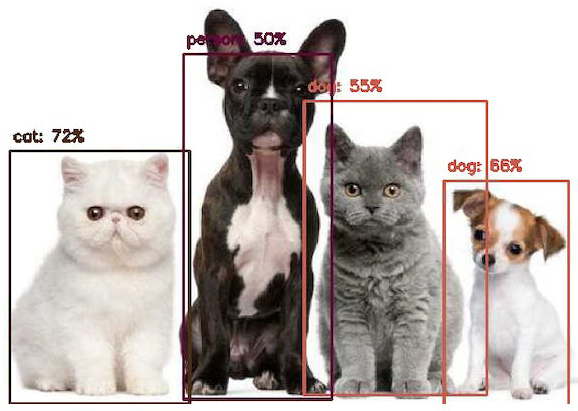
</p>

Модели для обнаружения объектов (такие как MobileNet SSD или YOLO) обычно занимают несколько мегабайт. Для Raspberry Pi это нормально, но для встраиваемых устройств, где ОЗУ обычно меньше 1 МБ, такие модели не подходят.

### Инновационное решение для обнаружения объектов: FOMO

[Edge Impulse представила в 2022 году **FOMO** (Faster Objects, More Objects)](https://docs.edgeimpulse.com/docs/edge-impulse-studio/learning-blocks/object-detection/fomo-object-detection-for-constrained-devices) — новое решение для обнаружения объектов на встраиваемых устройствах. Оно работает не только на Nicla Vision (Cortex M7), но и на процессорах Cortex M4F (Arduino Nano33 и серии OpenMV M4), а также на устройствах Espressif ESP32 (ESP-CAM и XIAO ESP32S3 Sense).

В этой практической работе мы будем использовать FOMO для обнаружения объектов и не станем вдаваться в подробности самой модели. Чтобы больше узнать о её работе, можно прочитать [официальное объявление FOMO](https://www.edgeimpulse.com/blog/announcing-fomo-faster-objects-more-objects) от Edge Impulse, где Louis Moreau и Mat Kelcey подробно объясняют принцип работы.

## Цель проекта обнаружения объектов

Любой проект машинного обучения должен начинаться с подробно сформулированной цели. Допустим, мы работаем на промышленном предприятии и должны сортировать и считать **колёса** и специальные **коробки**.

<p align="center">
  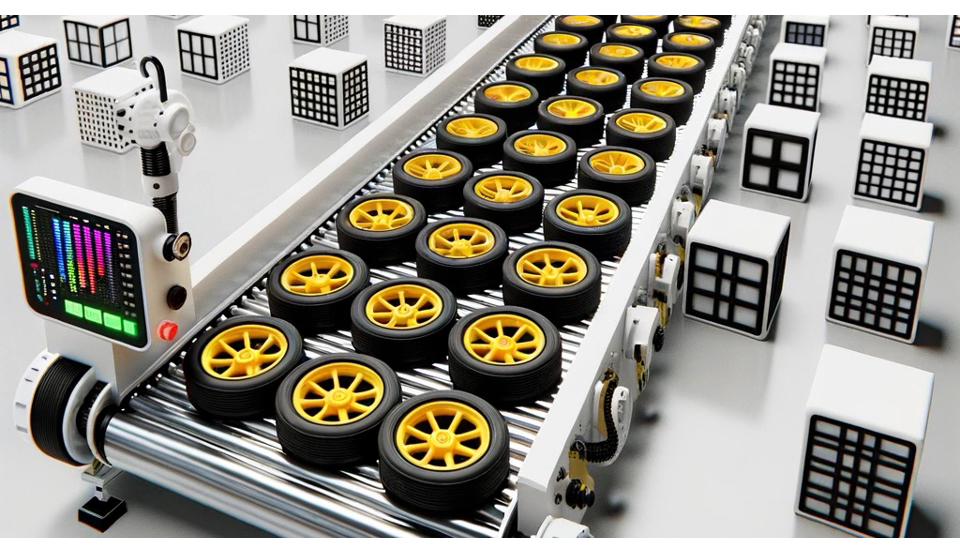
</p>

Иначе говоря, нам нужна многоклассовая классификация, где каждое изображение может относиться к трём классам:

- фон (объектов нет);
- коробка (Box);
- колесо (Wheel).

Вот несколько неразмеченных примеров изображений, по которым мы будем обнаруживать объекты (колёса и коробки):

<p align="center">
  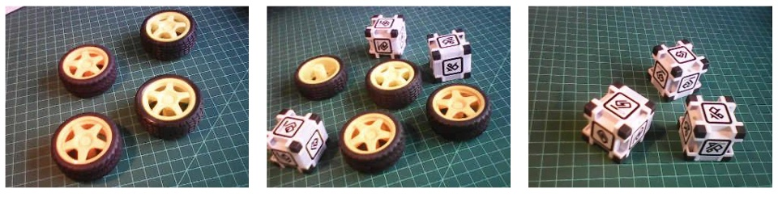
</p>

Нас интересует, какой объект есть на изображении, его положение (центроид) и сколько таких объектов на нём присутствует. Размер объекта FOMO не определяет — в отличие от MobileNet SSD или YOLO, где ограничивающий прямоугольник является одним из выходных данных модели.

Проект мы будем разрабатывать с Nicla Vision для захвата изображений и инференса, а для машинного обучения использовать Edge Impulse Studio. Но прежде чем начинать проект обнаружения объектов в Studio, создадим *сырой набор данных* (без разметки) с изображениями, на которых есть объекты для обнаружения.

## Сбор данных

Для съёмки изображений можно использовать:

- инструмент Web Serial Camera;
- Edge Impulse Studio;
- OpenMV IDE;
- смартфон.

Здесь мы будем использовать **OpenMV IDE**.

### Сбор набора данных в OpenMV IDE

Сначала создаём на компьютере папку, в которую будут сохраняться данные, например «data». Затем в OpenMV IDE открываем `Tools > Dataset Editor` и выбираем `New Dataset`, чтобы начать сбор набора данных:

<p align="center">
  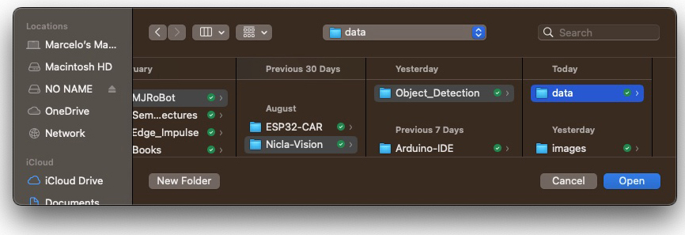
</p>

Edge Impulse рекомендует, чтобы объекты были похожего размера и не перекрывали друг друга, — так модель работает лучше. На промышленном предприятии это нормально: камера закреплена неподвижно и находится на одном расстоянии от объектов. Тем не менее мы попробуем и смешанные размеры и положения, чтобы посмотреть на результат.

> Отдельные папки для изображений создавать не будем, потому что каждое изображение содержит несколько меток.

Подключите Nicla Vision к OpenMV IDE и запустите `dataset_capture_script.py`. Нажатие кнопки Capture Image начнёт съёмку изображений:

<p align="center">
  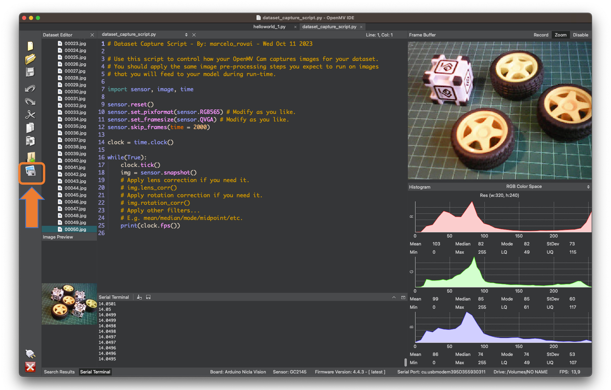
</p>

Рекомендуем около 50 изображений, с разным сочетанием объектов и разным их количеством в кадре. Старайтесь снимать с разных углов, на разном фоне и при разном освещении.

> Сохраняемые изображения имеют размер кадра QVGA $320\times 240$ и формат RGB565 (формат цветных пикселей).

Когда набор данных собран, закройте инструмент Dataset Editor через `Tools > Dataset Editor`.

## Edge Impulse Studio

### Настройка проекта

Откройте [Edge Impulse Studio](https://www.edgeimpulse.com/), войдите в систему по кнопке **Login** (или создайте аккаунт) и начните новый проект.

> Здесь можно клонировать проект, созданный для этой практической работы: [NICLA_Vision_Object_Detection](https://studio.edgeimpulse.com/public/292737/latest).

На панели проекта `Dashboard` откройте **Project info** и выберите **Bounding boxes (object detection)**, а в правом верхнем углу страницы выберите `Target` — **Arduino Nicla Vision (Cortex-M7)**.

<p align="center">
  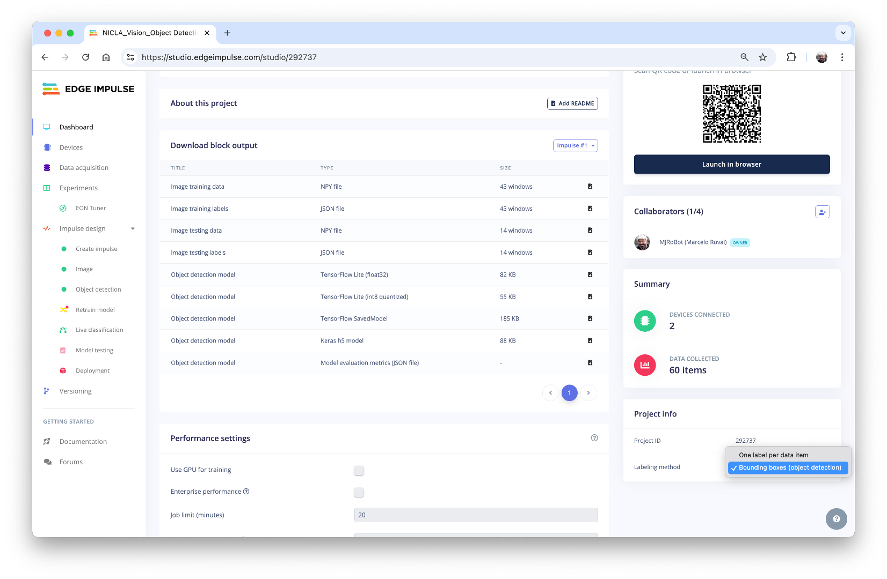
</p>

### Загрузка неразмеченных данных

В Studio откройте вкладку `Data acquisition` и в разделе `UPLOAD DATA` загрузите с компьютера снятые файлы.

<p align="center">
  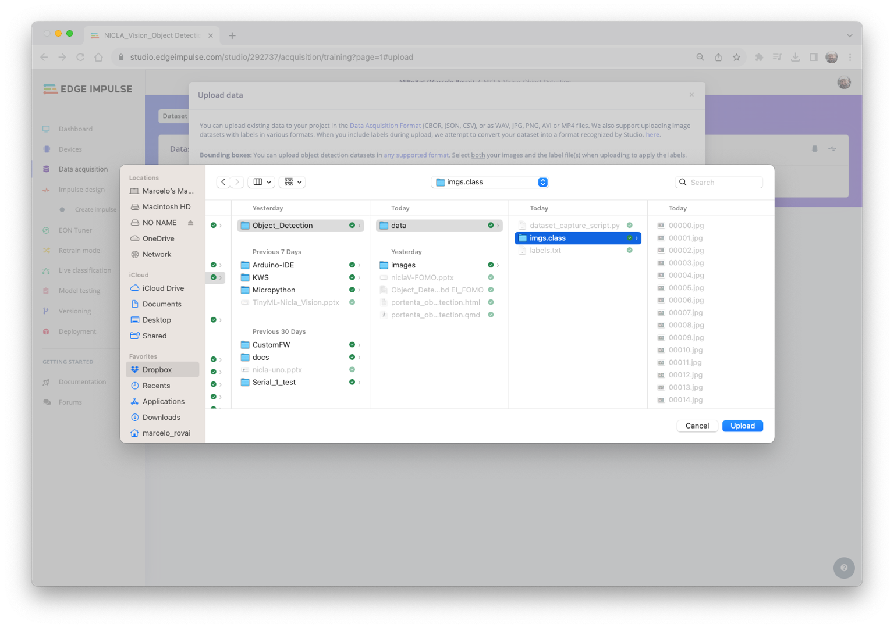
</p>

> Можно поручить Studio автоматически разделить данные на обучающую и тестовую выборки или сделать это вручную.

<p align="center">
  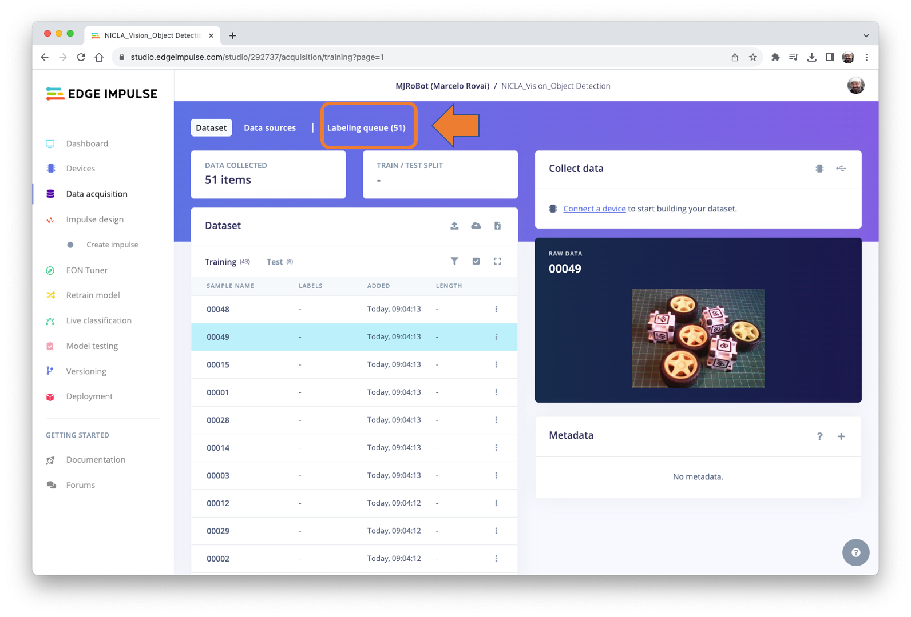
</p>

Все неразмеченные изображения (51) загружены, но перед использованием в наборе данных их нужно правильно разметить. Для этого в Studio есть инструмент, который открывается по ссылке `Labeling queue (51)`.

В бесплатной версии Edge Impulse Studio доступны два способа разметки с помощью ИИ:

- с использованием YOLOv5;
- отслеживанием объектов между кадрами.

> Для клиентов Enterprise Edge Impulse запустила [функцию автоматической разметки](https://docs.edgeimpulse.com/docs/edge-impulse-studio/data-acquisition/auto-labeler), которая упрощает разметку в проектах обнаружения объектов.

Обычные объекты можно быстро распознать и разметить с помощью готовой библиотеки предобученных моделей обнаружения YOLOv5 (обученных на наборе COCO). Но в нашем случае объектов нет в наборах COCO, поэтому выберем опцию `tracking objects`. С ней, как только вы нарисуете рамки и разметите изображения в одном кадре, объекты будут автоматически отслеживаться от кадра к кадру, и новые объекты будут *частично* размечены (не все — корректно).

> Если у вас уже есть размеченный набор данных с ограничивающими рамками, импортируйте его через загрузчик EI.

### Разметка набора данных

Начните с первого изображения из неразмеченных данных: с помощью мыши обведите объект рамкой, чтобы добавить метку. Затем нажмите **Save labels**, чтобы перейти к следующему элементу.

<p align="center">
  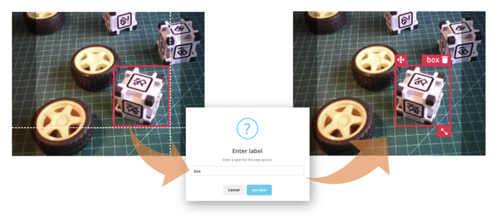
</p>

Продолжайте, пока очередь не опустеет. В конце все изображения должны быть размечены так же, как примеры ниже:

<p align="center">
  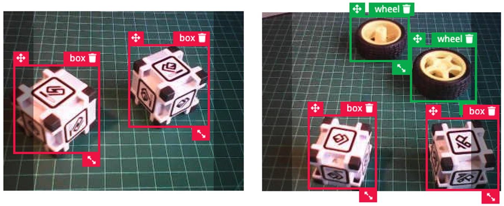
</p>

Затем просмотрите размеченные примеры на вкладке `Data acquisition`. Если какая-то метка неверна, её можно отредактировать через меню `три точки` после названия образца:

<p align="center">
  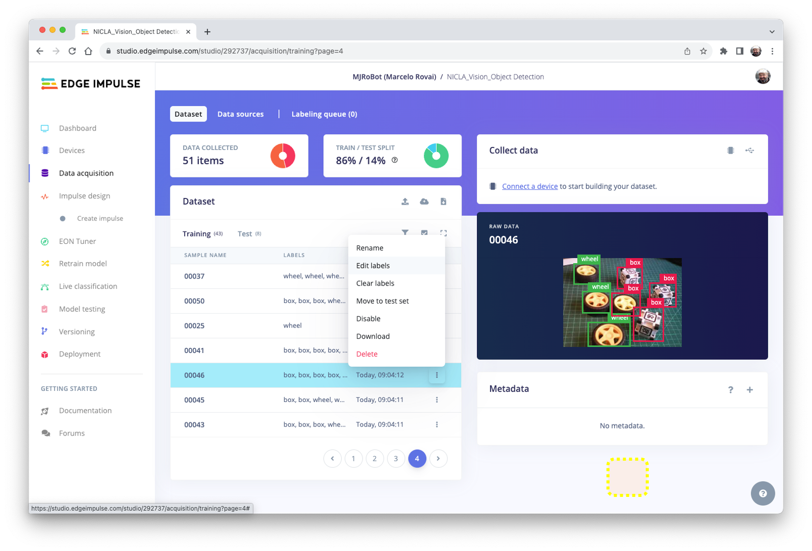
</p>

Studio подскажет, как заменить неверную метку и исправить набор данных.

<p align="center">
  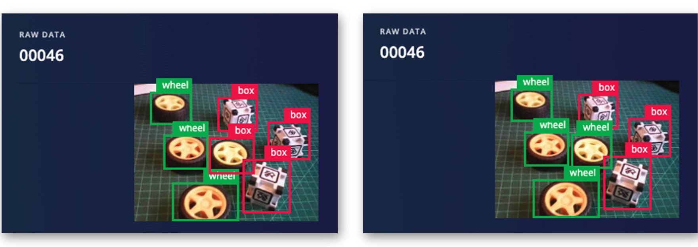
</p>

## Проектирование Impulse

На этом этапе нужно определить, как:

- **Предобработка:** изменить размер отдельных изображений с $320{\times}240$ до $96{\times}96$, сжав их к квадратной форме (без обрезки). Затем изображения переводятся из RGB в оттенки серого (Grayscale).

- **Проектирование модели:** в данном случае «Object Detection» (обнаружение объектов).

<p align="center">
  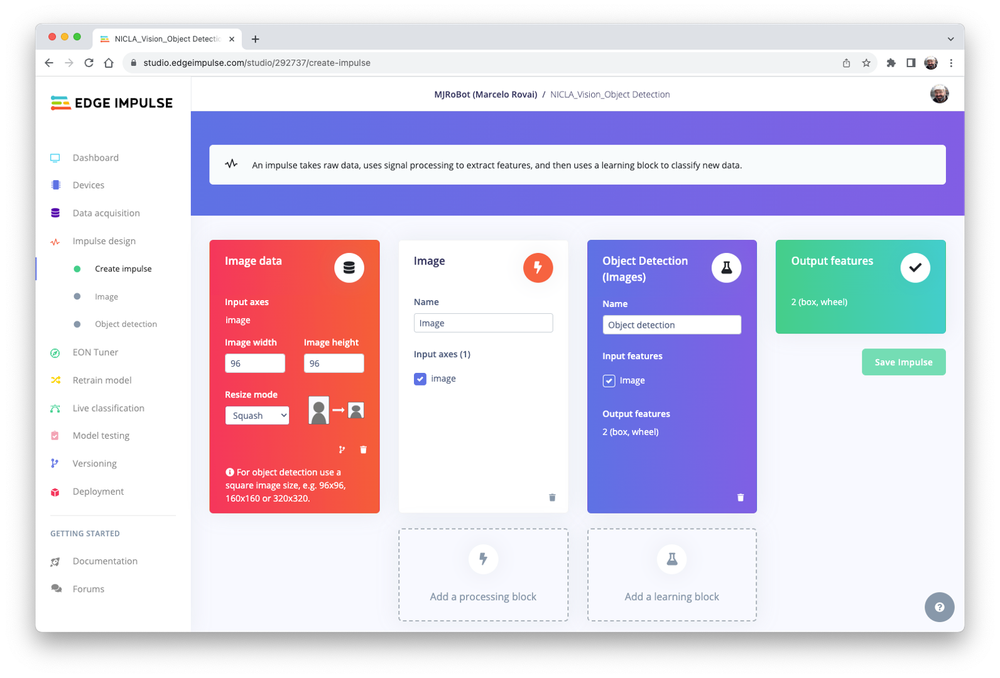
</p>

### Предобработка всего набора данных

В этом разделе выберите **Color depth** — `Grayscale`, подходящий для моделей FOMO, и сохраните `parameters`.

<p align="center">
  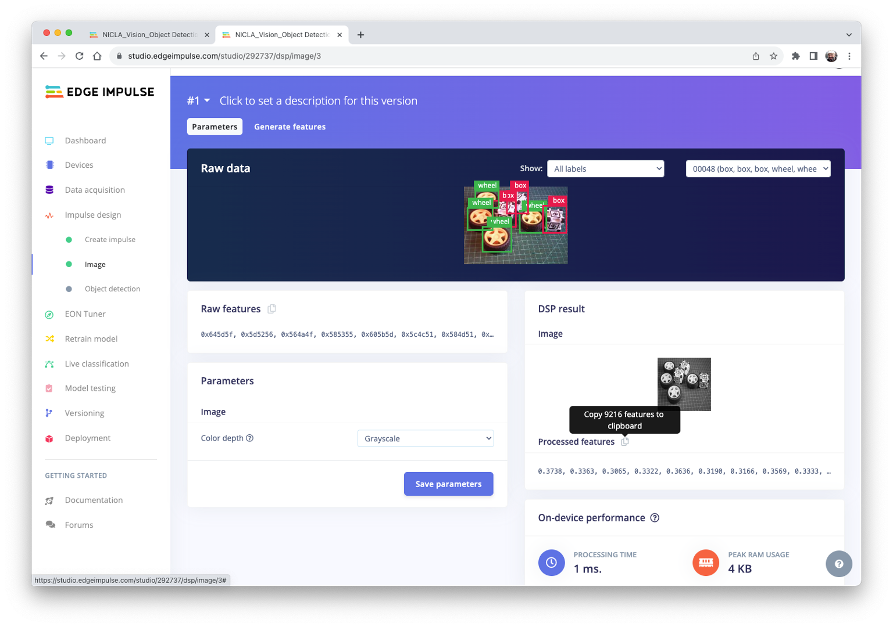
</p>

Studio автоматически переходит к следующему разделу `Generate features`, где обрабатываются все образцы. В результате получается набор данных из отдельных изображений $96\times 96\times 1$, или 9 216 признаков.

<p align="center">
  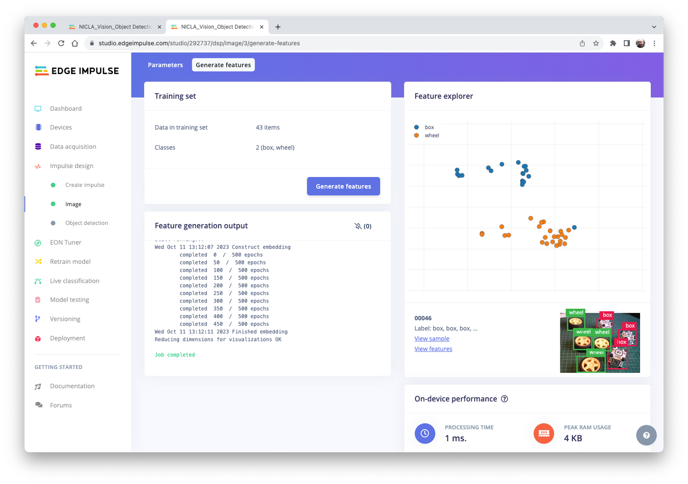
</p>

Просмотр признаков показывает, что после генерации все образцы хорошо разделяются.

> Один из образцов (№ 46), судя по всему, находится не в том месте, но щелчок по нему подтверждает, что разметка верна.

## Проектирование модели, обучение и тестирование

Мы будем использовать FOMO — модель обнаружения объектов на основе MobileNetV2 (альфа 0,35), которая грубо сегментирует изображение на сетку: **фон** и **интересующие объекты** (здесь *коробки* и *колёса*).

FOMO — инновационная модель машинного обучения для обнаружения объектов, которая может использовать в 30 раз меньше энергии и памяти, чем традиционные модели вроде Mobilenet SSD и YOLOv5. FOMO способна работать на микроконтроллерах с ОЗУ менее 200 КБ. Главная причина в том, что другие модели вычисляют размер объекта, рисуя вокруг него квадрат (ограничивающий прямоугольник), а FOMO не учитывает размер и выдаёт только информацию о том, где объект находится на изображении, — в виде координат его центроида.

### Как работает FOMO

FOMO берёт изображение в оттенках серого и делит его на блоки пикселей с коэффициентом 8. Для входного изображения $96{\times}96$ сетка будет $12\times 12$ $(96/8=12)$. Затем FOMO запускает классификатор для каждого блока пикселей, чтобы вычислить вероятность того, что в нём есть коробка или колесо, и определяет области с наибольшей вероятностью наличия объекта (если в блоке пикселей объектов нет, он классифицируется как *background*). По перекрытию итоговой области FOMO выдаёт координаты (относительно размеров изображения) центроида этой области.

<p align="center">
  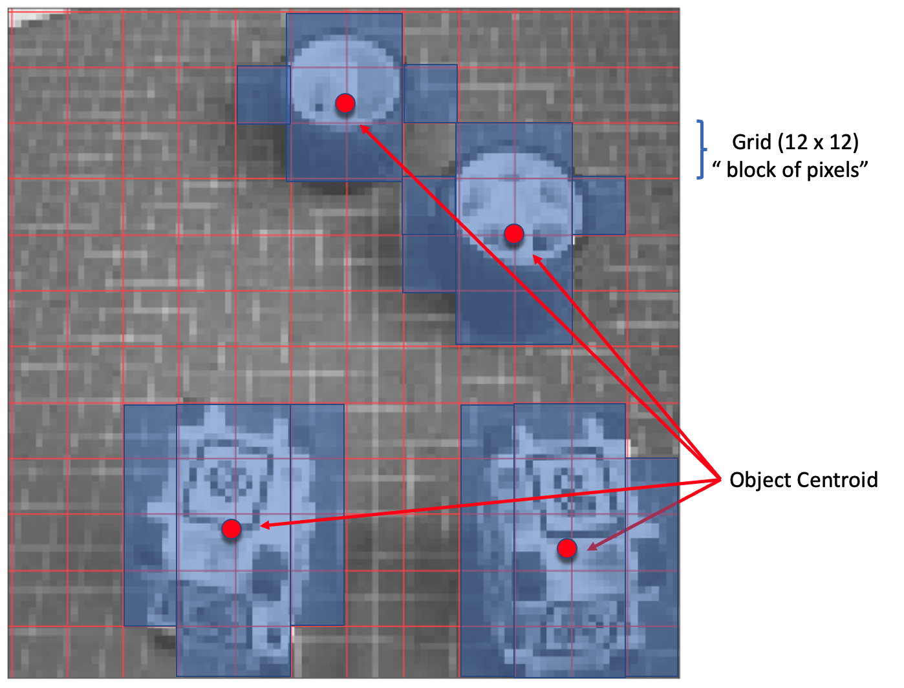
</p>

Для обучения нужно выбрать предобученную модель. Используем **`FOMO (Faster Objects, More Objects) MobileNetV2 0.35`**. Эта модель занимает около 250 КБ ОЗУ и 80 КБ ПЗУ (флеш-памяти), что хорошо подходит для нашей платы, у которой 1 МБ ОЗУ и ПЗУ.

<p align="center">
  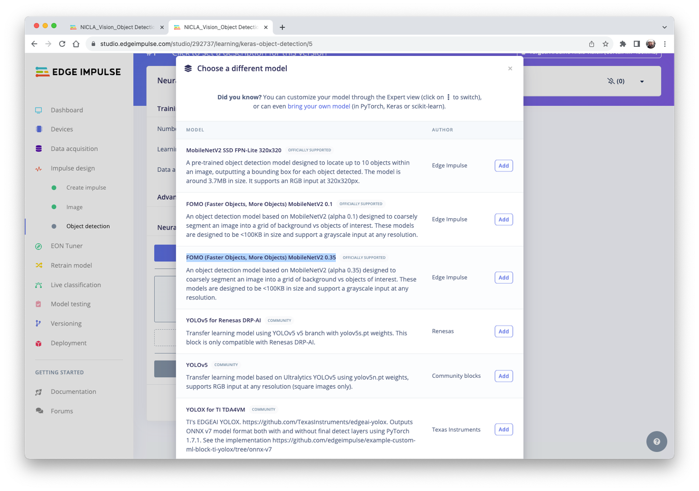
</p>

Гиперпараметры обучения такие:

- эпох: 60;
- размер батча (batch size): 32;
- скорость обучения (learning rate): 0,001.

Для проверки во время обучения будут отложены 20 % набора данных (*validation_dataset*). Для оставшихся 80 % (*train_dataset*) применим аугментацию данных: случайно отразим, изменим размер и яркость изображений и обрежем их, искусственно увеличивая количество образцов для обучения.

В итоге модель получает F1-меру около 91 % (валидация) и 93 % (тестовые данные).

> Обратите внимание: FOMO автоматически добавил третью метку background к двум заданным ранее (*box* и *wheel*).

<p align="center">
  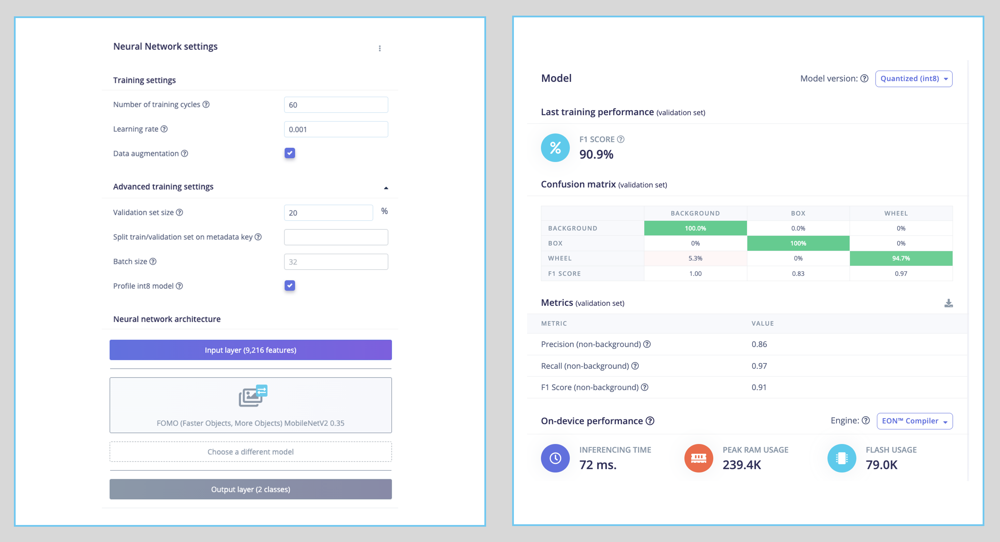
</p>

> В задачах обнаружения объектов точность, как правило, не является основной [метрикой оценки](https://learnopencv.com/mean-average-precision-map-object-detection-model-evaluation-metric/). Обнаружение объектов включает их классификацию и ограничивающие рамки вокруг них, то есть это более сложная задача, чем простая классификация. Проблема в том, что у нас нет ограничивающих рамок, только центроиды. Коротко говоря, использование точности как метрики может вводить в заблуждение и не даёт полной картины того, насколько хорошо работает модель. Поэтому мы используем F1-меру.

### Проверка модели в режиме «Live Classification»

Поскольку Edge Impulse официально поддерживает Nicla Vision, подключим её к Studio. Для этого выполните шаги:

- Скачайте [последнюю прошивку EI](https://cdn.edgeimpulse.com/firmware/arduino-nicla-vision.zip) и распакуйте её.

- Откройте ZIP-архив на компьютере и выберите загрузчик для своей ОС.

- Переведите Nicla Vision в режим загрузки, дважды нажав кнопку reset.

- Запустите пакетный файл для своей ОС, чтобы загрузить двоичный файл (`arduino-nicla-vision.bin`) на плату.

Откройте раздел `Live classification` в EI Studio и с помощью *webUSB* подключите Nicla Vision:

<p align="center">
  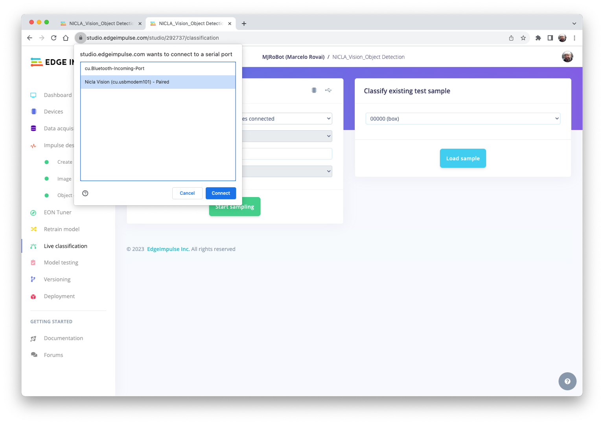
</p>

Когда подключение установлено, Nicla может снимать реальные изображения, которые обученная модель в Edge Impulse Studio будет тестировать.

<p align="center">
  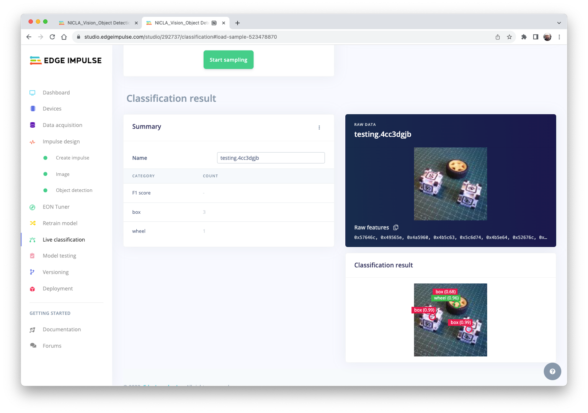
</p>

Учтите, что модель может давать ложные срабатывания и пропуски. Это можно уменьшить, задав подходящий `Confidence Threshold` (порог уверенности; настройка через меню `три точки`). Попробуйте значение 0,8 и выше.

## Развёртывание модели

На вкладке Deploy выберите `OpenMV Firmware` и нажмите `[Build]`.

<p align="center">
  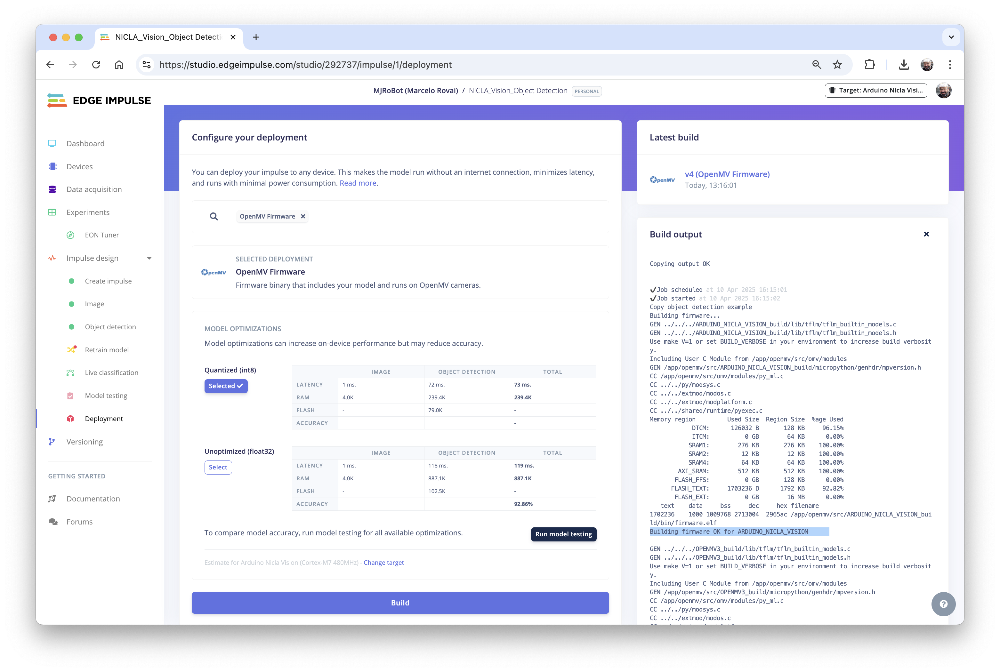
</p>

При повторном подключении Nicla к OpenMV IDE она попытается обновить свою прошивку. Вместо этого выберите опцию `Load a specific firmware`. Либо откройте меню `Tools > Run Bootloader (Load Firmware)`.

<p align="center">
  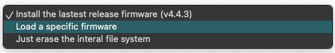
</p>

На компьютере появится ZIP-файл из Studio. Откройте его:

<p align="center">
  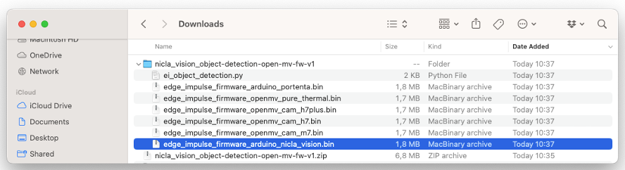
</p>

Загрузите файл .bin на плату:

<p align="center">
  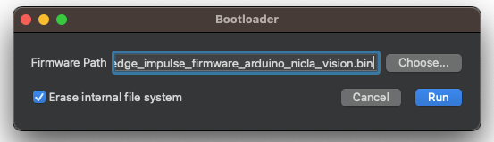
</p>

Когда загрузка завершится, появится всплывающее сообщение. Нажмите `Press OK` и откройте скрипт **ei_object_detection.py**, скачанный из Studio.

> Примечание: если появится всплывающее окно с сообщением, что прошивка устарела, нажмите `[NO]`, чтобы не обновлять её.

Перед запуском скрипта изменим несколько строк. Обратите внимание, что определение окна можно оставить как $240\times 240$, а камера может снимать изображения в формате QVGA/RGB. Снимок будет предобработан прошивкой, развёрнутой из Edge Impulse.

``` python
import sensor
import time
import ml
from ml.utils import NMS
import math
import image

sensor.reset()  # Сброс и инициализация датчика.
# Формат пикселей (RGB565 или GRAYSCALE)
sensor.set_pixformat(sensor.RGB565)
# Размер кадра QVGA (320x240)
sensor.set_framesize(sensor.QVGA)
sensor.skip_frames(time=2000)  # Даём камере настроиться.
```

Задайте минимальную уверенность, например 0,8, чтобы уменьшить количество ложных срабатываний и пропусков.

``` python
min_confidence = 0.8
```

При необходимости измените цвет кругов, которыми отмечаются центроиды обнаруженных объектов, — для лучшего контраста.

``` python
threshold_list = [(math.ceil(min_confidence * 255), 255)]

# Загрузка встроенной модели
model = ml.Model("trained")
print(model)

# Вместо этого модели можно загрузить из
# файловой системы.
# model = ml.Model(
#     '<object_detection_modelwork>.tflite',
#     load_to_fb=True)
# labels = [line.rstrip('\n') for line in open("labels.txt")]

colors = [ # Добавьте цвета, если одновременно обнаруживаете более
           # 7 классов.
    (255, 255,   0), # background: жёлтый (не используется)
    (  0, 255,   0), # cube (коробка): зелёный
    (255,   0,   0), # wheel (колесо): красный
    (  0,   0, 255), # не используется
    (255,   0, 255), # не используется
    (  0, 255, 255), # не используется
    (255, 255, 255), # не используется
]
```

Остальной код оставьте без изменений:

```python
# FOMO выдаёт изображение для каждого класса, где каждый пиксель —
# центроид обученного объекта. Поэтому мы получаем эти выходные
# изображения и запускаем на них find_blobs(), чтобы извлечь
# центроиды. Также запускаем get_stats() для найденных блобов,
# чтобы определить их оценку. Объект Non-Max-Suppression (NMS)
# затем отфильтровывает перекрывающиеся обнаружения и переносит
# их положение из выходного изображения обратно на исходное
# входное изображение. Функция возвращает список для каждого
# класса, в котором содержится список кортежей (rect, score),
# описывающих обнаруженные объекты.


def fomo_post_process(model, inputs, outputs):
    n, oh, ow, oc = model.output_shape[0]
    nms = NMS(ow, oh, inputs[0].roi)
    for i in range(oc):
        img = image.Image(outputs[0][0, :, :, i] * 255)
        blobs = img.find_blobs(
            threshold_list,
            x_stride=1,
            area_threshold=1,
            pixels_threshold=1,
        )
        for b in blobs:
            rect = b.rect()
            x, y, w, h = rect
            score = (
                img.get_statistics(
                    thresholds=threshold_list, roi=rect
                ).l_mean()
                / 255.0
            )
            nms.add_bounding_box(x, y, x + w, y + h, score, i)
    return nms.get_bounding_boxes()


clock = time.clock()
while True:
    clock.tick()

    img = sensor.snapshot()

    for i, detection_list in enumerate(
        model.predict([img], callback=fomo_post_process)
    ):
        if i == 0:
            continue  # класс background
        if len(detection_list) == 0:
            continue  # для этого класса нет обнаружений?

        print("********** %s **********" % model.labels[i])
        for (x, y, w, h), score in detection_list:
            center_x = math.floor(x + (w / 2))
            center_y = math.floor(y + (h / 2))
            print(f"x {center_x}\ty {center_y}\tscore {score}")
            img.draw_circle((center_x, center_y, 12), color=colors[i])

    print(clock.fps(), "fps", end="\n")
```

Затем нажмите `зелёную кнопку Play`, чтобы запустить код:

<p align="center">
  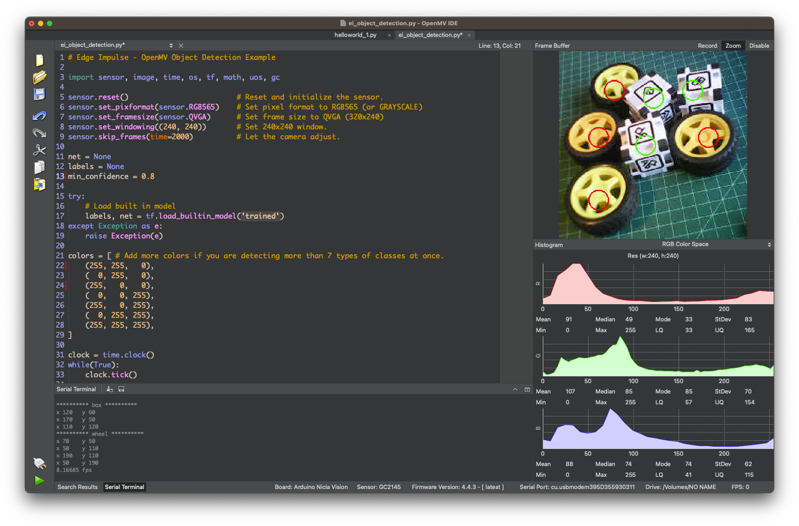
</p>

В поле зрения камеры видны объекты, центроиды которых отмечены кругами фиксированного размера 12 пикселей (каждый круг имеет свой цвет в зависимости от класса). В Serial Terminal модель выводит обнаруженные метки и их положение в окне изображения $(240\times 240)$.

> Учтите, что начало координат находится в левом верхнем углу.

<p align="center">
  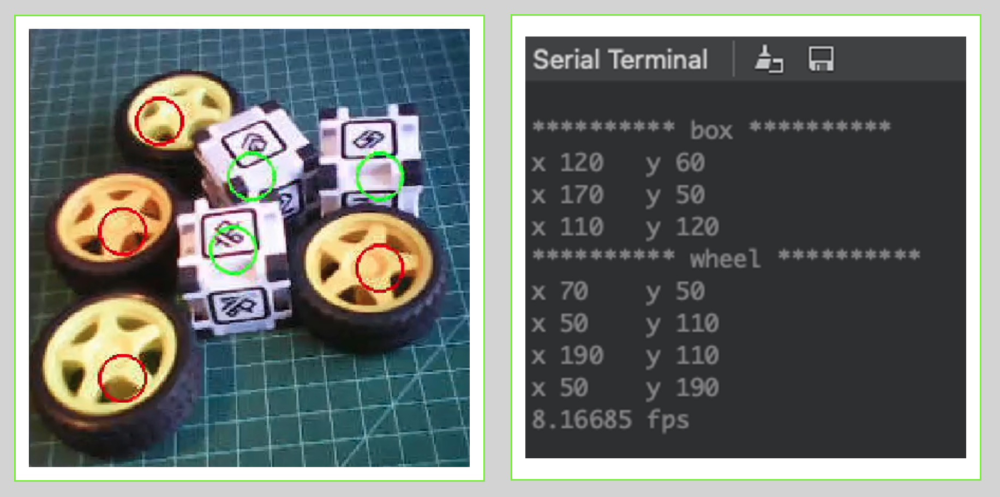
</p>

Частота кадров составляет около 8 кадров в секунду (примерно как в проекте классификации изображений). Это объясняется тем, что FOMO искусно построена на основе CNN-модели, а не модели обнаружения вроде SSD MobileNet или YOLO. Например, при запуске модели MobileNetV2 SSD FPN-Lite $320\times 320$ на Raspberry Pi 4 задержка примерно в 5 раз выше (около 1,5 кадра в секунду).

Короткое видео с результатами инференса:

<p align="center">
  <iframe width="560" height="315" src="https://www.youtube.com/embed/JbpoqRp3BbM" title="Обнаружение объектов с FOMO на Nicla Vision" frameborder="0" allowfullscreen></iframe>
</p>

## Итоги

FOMO — важный скачок в области обработки изображений, как сказали Louis Moreau и Mat Kelcey при её запуске в 2022 году:

> FOMO — революционный алгоритм, который впервые приносит обнаружение, отслеживание и подсчёт объектов в реальном времени на микроконтроллеры.

Существует множество возможностей для обнаружения объектов (а точнее, их подсчёта) на встраиваемых устройствах. Это может быть очень полезно, например, в проектах по подсчёту пчёл.

<p align="center">
  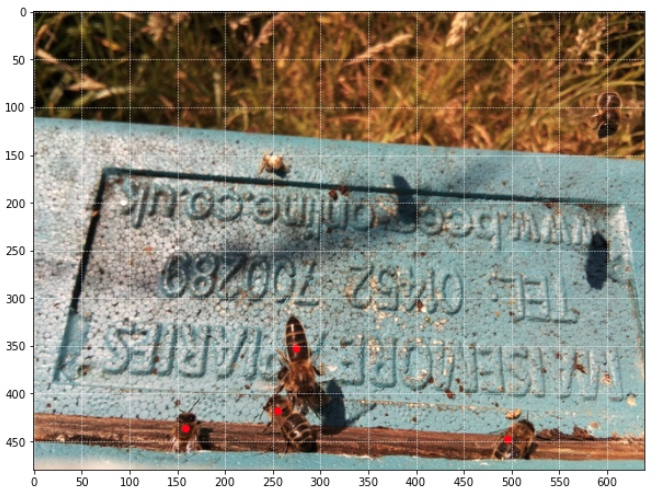
</p>

## Ресурсы

- [Проект Edge Impulse](https://studio.edgeimpulse.com/public/292737/latest)
