# Настройка

<p align="center">
  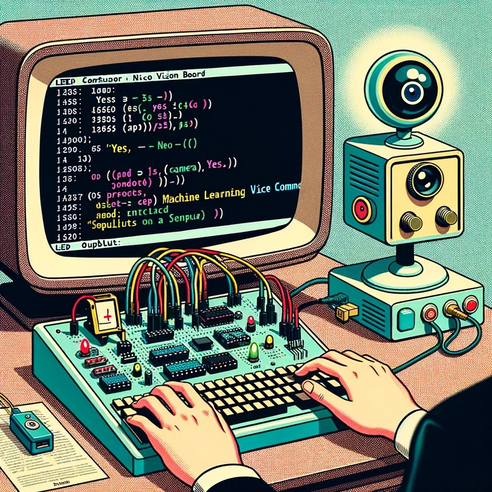<br>
  <em>*Промпт DALL·E 3: иллюстрация в духе мультфильма 1950-х годов, где плата Arduino NICLA VISION с камерой и другими датчиками стоит в центре старомодного стола. На экране компьютера со скруглёнными углами открыта Arduino IDE. Код связан с настройкой светодиодов и распознаванием голосовых команд. В Serial Monitor явно выводятся слова «yes» и «no».</em>
</p>

## Обзор

[Arduino Nicla Vision](https://docs.arduino.cc/hardware/nicla-vision) (иногда её называют *NiclaV*) — отладочная плата с двумя процессорами, которые могут выполнять задачи параллельно. Она входит в семейство плат с тем же форм-фактором, но рассчитанных на конкретные задачи, например [Nicla Sense ME](https://www.bosch-sensortec.com/software-tools/tools/arduino-nicla-sense-me/) и [Nicla Voice](https://store-usa.arduino.cc/products/nicla-voice). Платы Nicla эффективно выполняют процессы, созданные с помощью TensorFlow Lite. Например, одно ядро NiclaV на лету выполняет алгоритм компьютерного зрения (инференс), а другое решает низкоуровневые задачи: управляет мотором, обменивается данными или работает как пользовательский интерфейс. Встроенный беспроводной модуль позволяет одновременно использовать Wi-Fi и Bluetooth Low Energy (BLE).

<p align="center">
  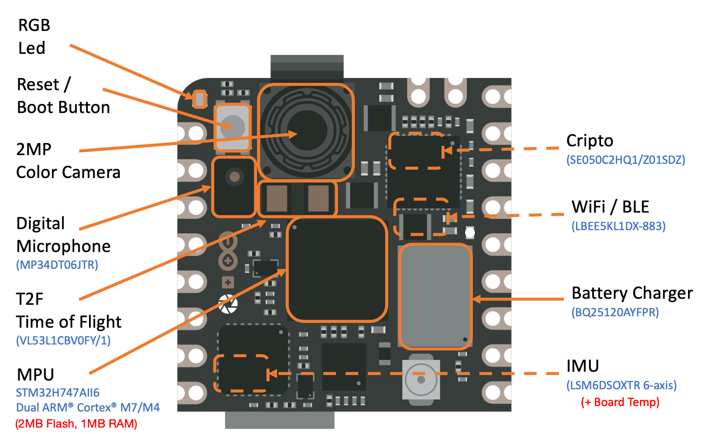
</p>

## Аппаратная часть

### Два параллельных ядра

Центральный процессор — двухъядерный [STM32H747](https://content.arduino.cc/assets/Arduino-Portenta-H7_Datasheet_stm32h747xi.pdf): ядро Cortex-M7 работает на частоте 480 МГц, ядро Cortex-M4 — на 240 МГц. Два ядра обмениваются данными через механизм удалённого вызова процедур (RPC), который позволяет без затруднений вызывать функции на другом процессоре. Оба процессора используют общие периферийные устройства кристалла и могут работать с:

- скетчами Arduino поверх Arm Mbed OS;
- нативными приложениями Mbed;
- MicroPython и JavaScript через интерпретатор;
- TensorFlow Lite.

<p align="center">
  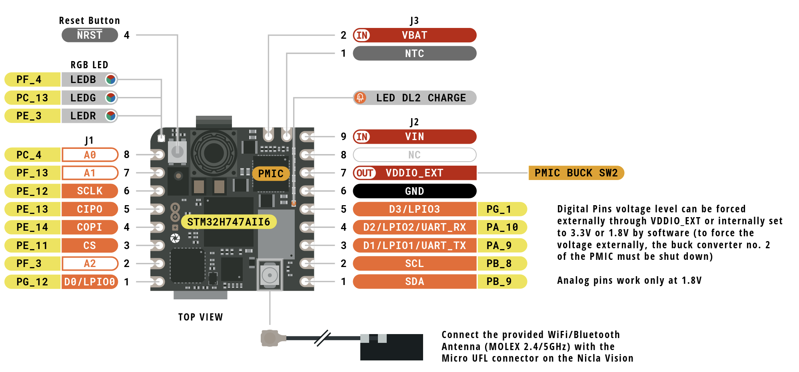
</p>

### Память

Память важна для проектов встраиваемого машинного обучения. На плате NiclaV можно разместить до 16 МБ флеш-памяти QSPI для хранения данных. Но для инференса ML используется именно SRAM микроконтроллера: в STM32H747 её всего 1 МБ, и её делят оба процессора. Кроме того, в микроконтроллер встроено 2 МБ флеш-памяти, в основном для хранения кода.

### Датчики

- **Камера:** цветная CMOS-камера GC2145 с разрешением 2 Мп.
- **Микрофон:** `MP34DT05` — сверхкомпактный маломощный всенаправленный цифровой MEMS-микрофон с ёмкостным чувствительным элементом и интерфейсом.
- **6-осевой IMU:** данные 3D-гироскопа и 3D-акселерометра от 6-осевого IMU `LSM6DSOX`.
- **Датчик времени полёта (ToF):** `VL53L1CBV0FY` добавляет точное измерение расстояния с малым энергопотреблением. Невидимый ближний инфракрасный лазер VCSEL (вместе с аналоговым драйвером) и приёмная оптика собраны в компактный модуль под камерой.

## Установка Arduino IDE

Сначала подключите плату (*micro USB*) к компьютеру:

<p align="center">
  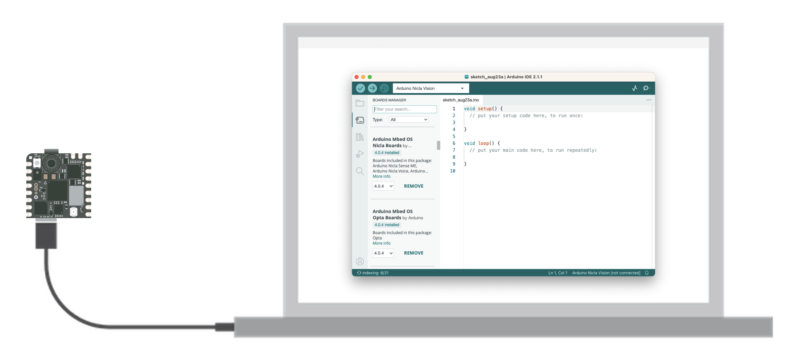
</p>

Установите ядро Mbed OS для плат Nicla в Arduino IDE. При открытой IDE перейдите в `Tools > Board > Board Manager`, найдите в поиске Arduino Nicla Vision и установите плату.

<p align="center">
  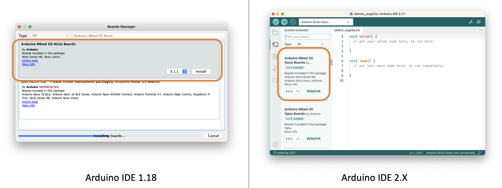
</p>

Затем откройте `Tools > Board > Arduino Mbed OS Nicla Boards` и выберите `Arduino Nicla Vision`. Когда плата подключена по USB, в списке портов появится Nicla — выберите её.

> Откройте скетч Blink в разделе Examples/Basic и запустите его кнопкой Upload в IDE. Должен замигать встроенный светодиод (зелёный RGB). Это значит, что плата Nicla установлена правильно и работает!

### Проверка микрофона

В Arduino IDE перейдите в `Examples > PDM > PDMSerialPlotter`, откройте скетч и запустите его. Откройте Plotter и посмотрите аудиосигнал с микрофона:

<p align="center">
  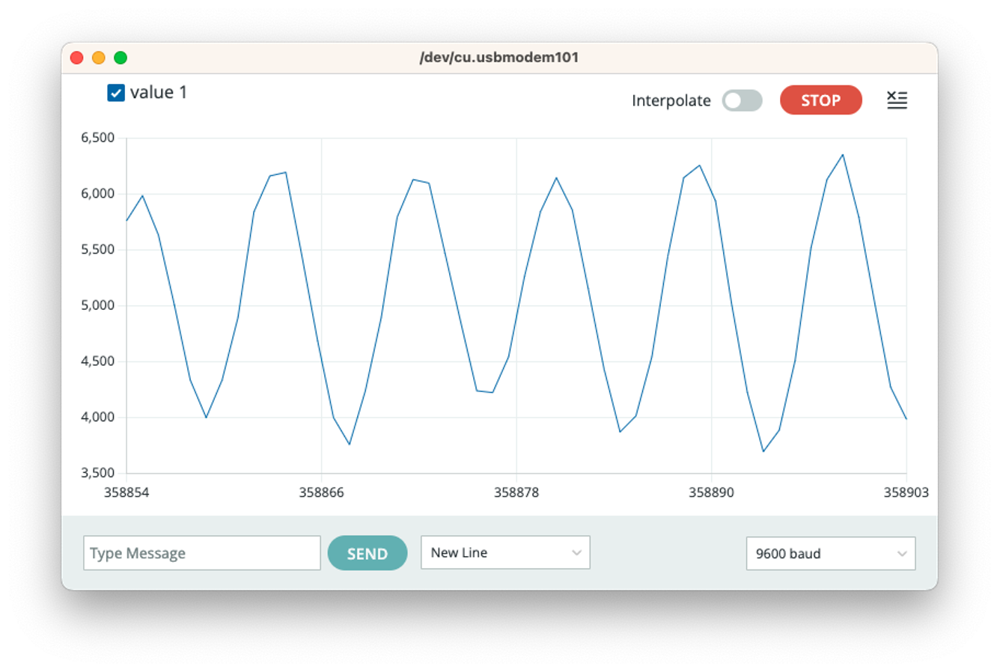
</p>

> Меняйте частоту звука, который вы создаёте, и убедитесь, что микрофон работает правильно.

### Проверка IMU

Перед проверкой IMU нужно установить библиотеку LSM6DSOX. Для этого откройте Library Manager и найдите LSM6DSOX. Установите библиотеку от Arduino:

<p align="center">
  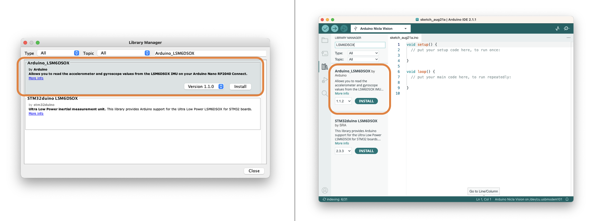
</p>

Затем откройте `Examples > Arduino_LSM6DSOX > SimpleAccelerometer` и запустите тест акселерометра (можно также запустить тест гироскопа и температуры платы):

<p align="center">
  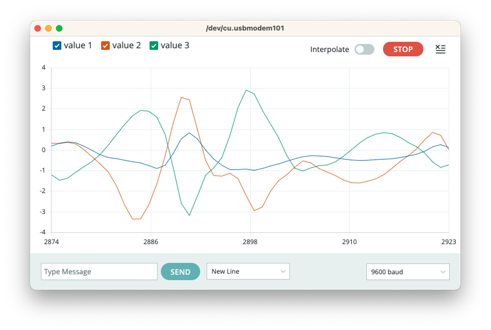
</p>

### Проверка датчика ToF (времени полёта)

Как и в случае с IMU, нужно установить библиотеку VL53L1X ToF. Для этого откройте Library Manager и найдите VL53L1X. Установите библиотеку от Pololu:

<p align="center">
  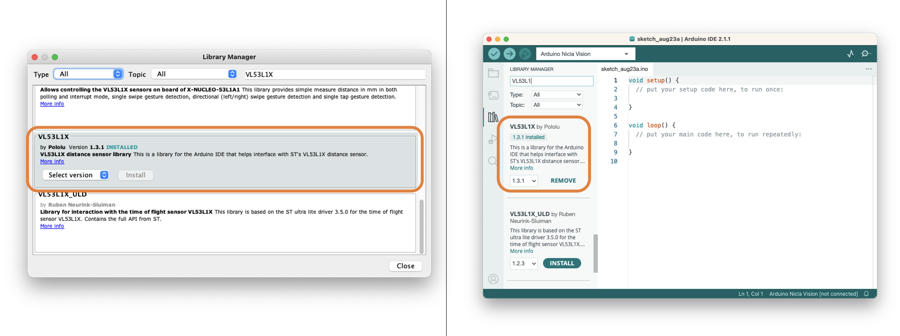
</p>

Затем запустите скетч [proximity_detection.ino](https://github.com/Mjrovai/Arduino_Nicla_Vision/blob/main/Arduino-IDE/proximity_detection/proximity_detection.ino):

<p align="center">
  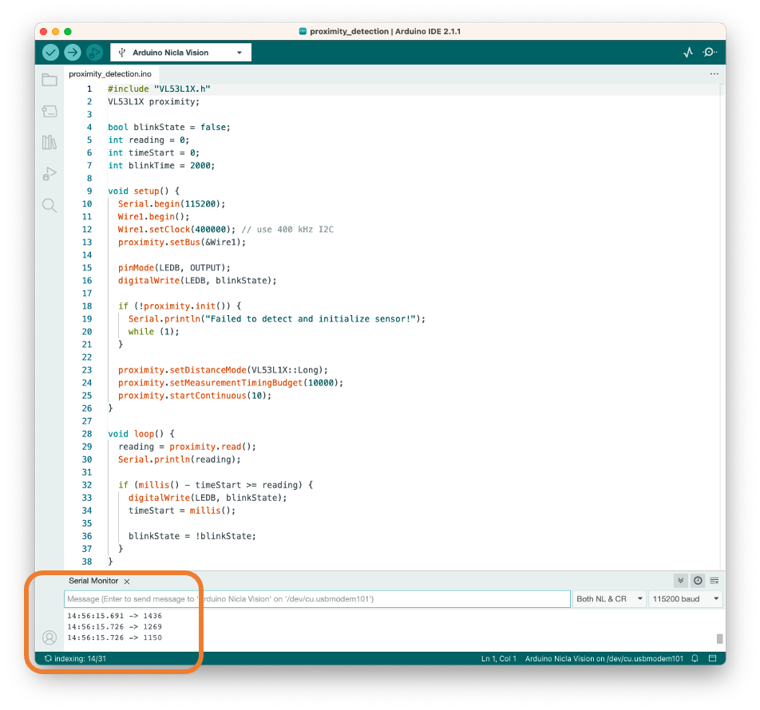
</p>

В Serial Monitor вы увидите расстояние от камеры до объекта перед ней (максимум 4 м).

<p align="center">
  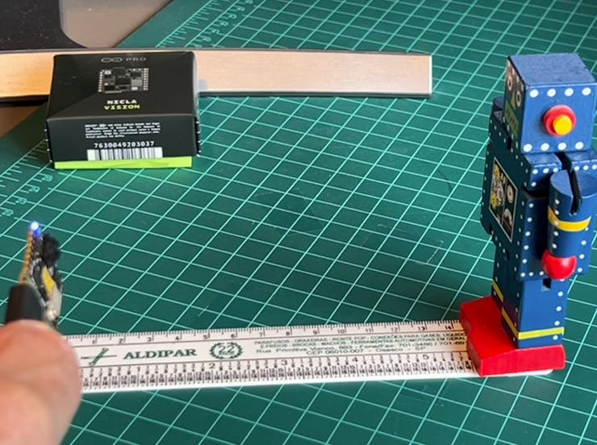
</p>

### Проверка камеры

Камеру можно проверить, например, с помощью кода из раздела `Examples > Camera > CameraCaptureRawBytes`. Изображение мы напрямую не увидим, но сможем получить необработанные данные, которые формирует камера.

Чтобы увидеть изображение с камеры, можно воспользоваться [Web Serial Camera](https://labs.arduino.cc/en/labs/web-serial-camera) ([API](https://developer.mozilla.org/en-US/docs/Web/API/Web_Serial_API)). Это веб-приложение передаёт изображение с камеры по Web Serial с плат Arduino, оснащённых камерой.

Пример Web Serial Camera показывает, как передать данные изображения с платы Arduino и как распаковать их в JavaScript для отображения. Кроме того, в [исходном коде](https://github.com/arduino/ArduinoCore-mbed/tree/main/libraries/Camera/extras/WebSerialCamera) веб-приложения есть примеры фильтров изображения, которые показывают, как изменять пиксельные данные для получения визуальных эффектов.

**Скетч Arduino** (CameraCaptureWebSerial) для передачи данных изображения находится [здесь](https://github.com/arduino/ArduinoCore-mbed/tree/main/libraries/Camera/examples/CameraCaptureWebSerial). Его также можно открыть в меню «`Examples→Camera`» Arduino IDE, если выбрана плата Nicla.

**Веб-приложение** для отображения изображения с камеры доступно [здесь](https://arduino.github.io/labs-pages/web-serial-camera/). Также можно изучить урок, в котором подробнее описана настройка.

<p align="center">
  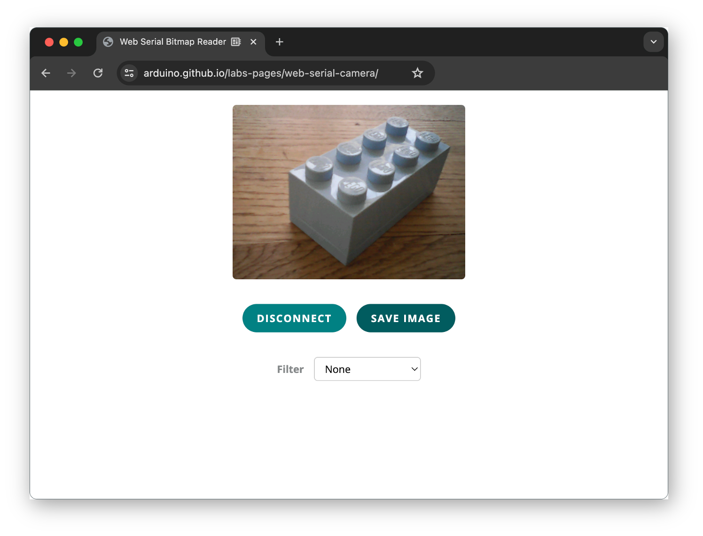
</p>

## Установка OpenMV IDE

OpenMV IDE — ведущая интегрированная среда разработки для камер OpenMV, в том числе похожих на Nicla Vision. В ней есть мощный текстовый редактор, терминал для отладки и просмотрщик кадров с гистограммой. Камеру мы будем программировать на MicroPython.

Откройте [страницу загрузки OpenMV IDE](https://openmv.io/pages/download), скачайте версию для вашей операционной системы и установите её, следуя инструкциям.

<p align="center">
  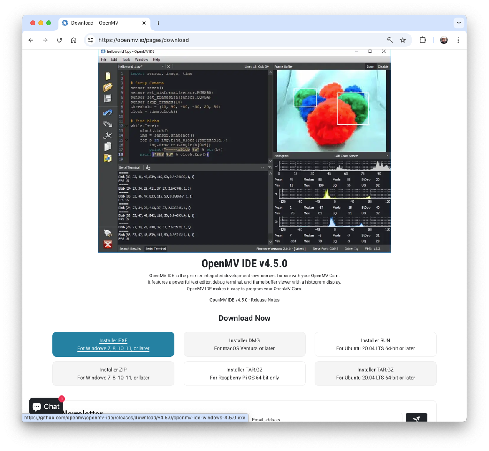
</p>

IDE должна открыться с кодом helloworld_1.py в области редактирования. Если этого не произошло, откройте его через `Files > Examples > HelloWord > helloword.py`.

<p align="center">
  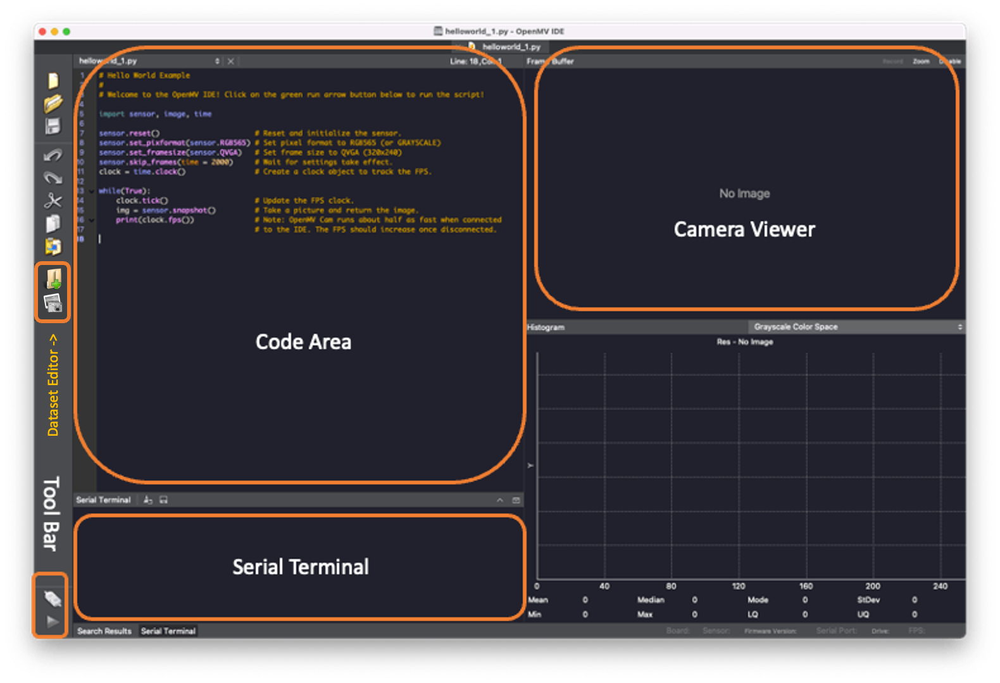
</p>

Все сообщения, которые отправляются по последовательному соединению (через `print()` или сообщения об ошибках), во время работы отображаются в **Serial Terminal**. Изображение с камеры выводится в области **Camera Viewer** (или Frame Buffer), а гистограмма — сразу под ним, в области Histogram.

#### Обновление загрузчика

Прежде чем подключать Nicla к OpenMV IDE, убедитесь, что установлена последняя версия загрузчика. Откройте Arduino IDE, выберите плату Nicla и откройте скетч `Examples > STM_32H747_System STM32H747_manageBootloader`. Загрузите код на плату. Serial Monitor подскажет дальнейшие действия.

#### Установка прошивки

**После обновления загрузчика** переведите Nicla Vision в режим загрузчика, дважды нажав кнопку reset на плате. Встроенный зелёный светодиод начнёт плавно гаснуть и загораться. Теперь вернитесь в OpenMV IDE и нажмите значок подключения (левая панель инструментов):

<p align="center">
  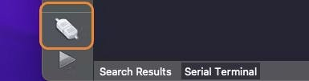
</p>

Появится всплывающее окно, которое сообщит, что обнаружена плата в режиме DFU, и предложит выбрать дальнейшее действие. Сначала выберите `Install the latest release firmware (vX.Y.Z)`. Это установит на Nicla Vision последнюю версию прошивки OpenMV.

<p align="center">
  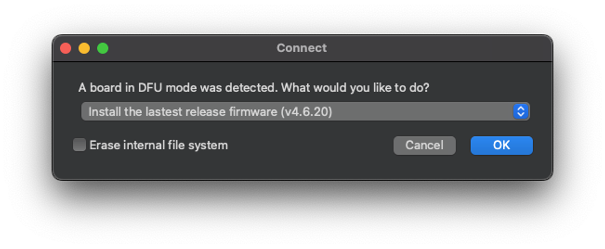
</p>

Опцию `Erase internal file system` можно не выбирать, затем нажмите `[OK]`.

Зелёный светодиод Nicla начнёт мигать, пока прошивка OpenMV загружается на плату. Затем откроется окно терминала с ходом прошивки.

<p align="center">
  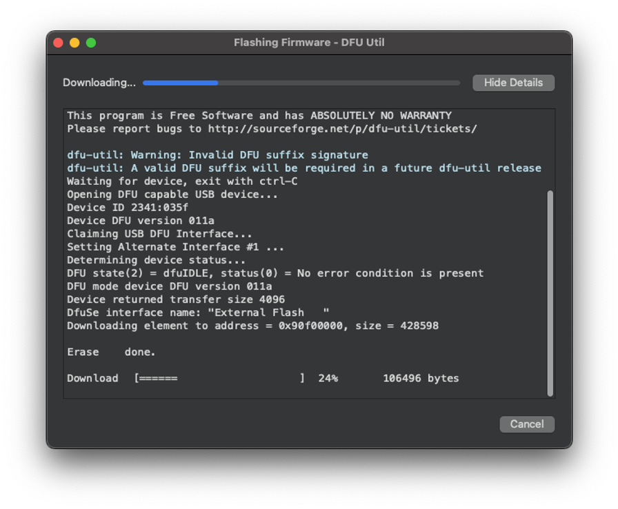
</p>

Дождитесь, пока зелёный светодиод перестанет мигать и гаснуть. По окончании процесса появится сообщение «DFU firmware update complete!». Нажмите `[OK]`.

<p align="center">
  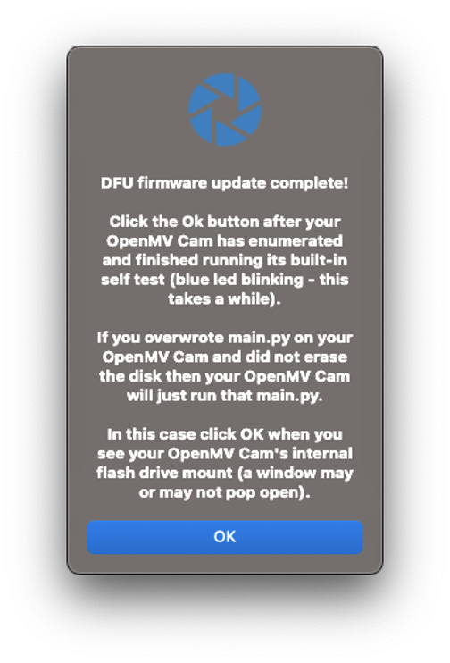
</p>

Когда Nicla Vision подключается к панели инструментов, появляется зелёная кнопка «Play».

<p align="center">
  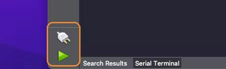
</p>

Кроме того, на компьютере появится диск с именем «NO NAME».

<p align="center">
  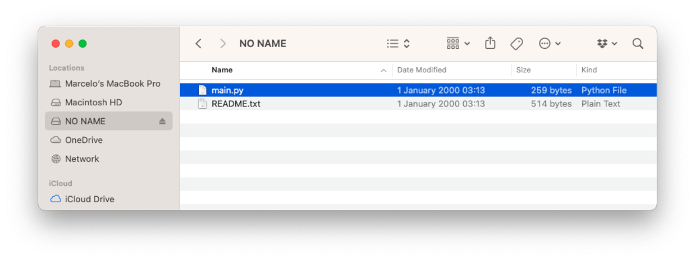
</p>

Каждый раз, когда вы нажимаете кнопку `[RESET]` на плате, автоматически запускается сохранённый на ней скрипт main.py. Вы можете загрузить код [main.py](https://github.com/Mjrovai/Arduino_Nicla_Vision/blob/main/Micropython/main.py) в IDE (`File > Open File...`).

<p align="center">
  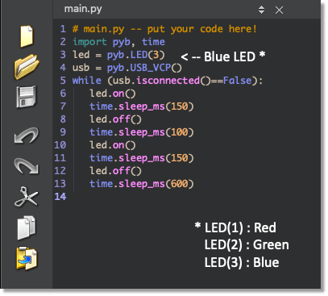
</p>

> Это код «Blink», он подтверждает, что аппаратная часть исправна.

#### Проверка камеры

Чтобы проверить камеру, запустим helloword_1.py. Для этого выберите скрипт в `File > Examples > HelloWorld > helloword.py`.

Когда вы нажмёте зелёную кнопку «Play», скрипт MicroPython (helloworld.py) из области редактирования загрузится и запустится на Nicla Vision. В области Camera Viewer начнётся потоковая передача видео. В Serial Monitor будет выводиться FPS (кадров в секунду): примерно 27 кадров/с.

<p align="center">
  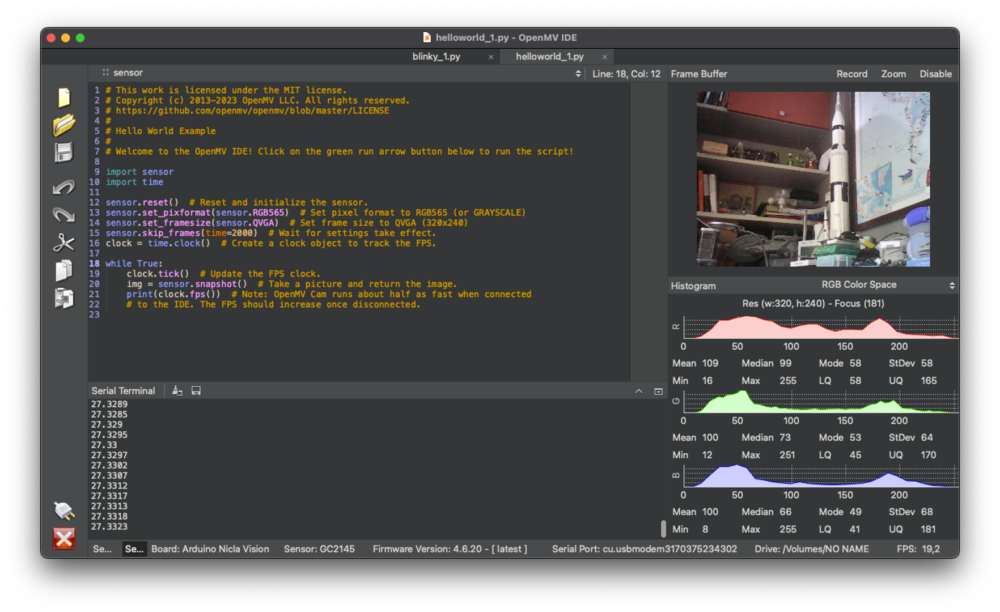
</p>

Вот скрипт `helloworld.py`:

``` python
import sensor, time

sensor.reset()                      # Сброс и инициализация
                                    # датчика.
sensor.set_pixformat(sensor.RGB565) # Формат пикселей RGB565
                                    # (или GRAYSCALE)
sensor.set_framesize(sensor.QVGA)   # Размер кадра
                                    # QVGA (320x240)
sensor.skip_frames(time = 2000)     # Ожидание, пока
                                    # настройки вступят в силу.
clock = time.clock()                # Создание объекта часов
                                    # для отслеживания FPS.

while(True):
    clock.tick()                    # Обновление счётчика FPS.
    img = sensor.snapshot()         # Снимок и возврат
                                    # изображения.
    print(clock.fps())
```

Скрипты на Python, которые использовались здесь, можно найти на [GitHub](https://github.com/Mjrovai/Arduino_Nicla_Vision).

Код можно разделить на две части:

- **Настройка:** подключаются и инициализируются библиотеки, определяются и задаются переменные.

- **Цикл:** часть кода (цикл while), которая выполняется непрерывно. Снимается изображение (переменная *img*), то есть один кадр. Каждый кадр можно использовать для инференса в приложениях машинного обучения.

Чтобы остановить программу, нажмите красную кнопку `[X]`.

> Примечание: при подключении к IDE OpenMV Cam работает примерно вдвое медленнее. После отключения FPS должен вырасти.

Другие скрипты на Python можно найти в [репозитории GitHub](https://github.com/Mjrovai/Arduino_Nicla_Vision/tree/main/Micropython). Попробуйте проверить встроенные датчики.

## Подключение Nicla Vision к Edge Impulse Studio

Edge Impulse Studio понадобится в других лабораторных работах. [Edge Impulse](https://www.edgeimpulse.com/) — ведущая платформа для разработки машинного обучения на периферийных устройствах.

Edge Impulse официально поддерживает Nicla Vision. Поэтому сначала создайте новый проект в Studio и подключите Nicla к нему. Для этого выполните шаги:

- Скачайте [Arduino CLI](https://arduino.github.io/arduino-cli/1.2/installation/) для вашей архитектуры компьютера (ОС).
- Скачайте самую свежую [прошивку EI](https://cdn.edgeimpulse.com/firmware/arduino-nicla-vision.zip).
- Распакуйте оба архива и поместите все файлы в одну папку.
- Переведите Nicla Vision в режим загрузки, дважды нажав кнопку reset.
- Запустите загрузчик (прошивку EI), соответствующий вашей ОС:

<p align="center">
  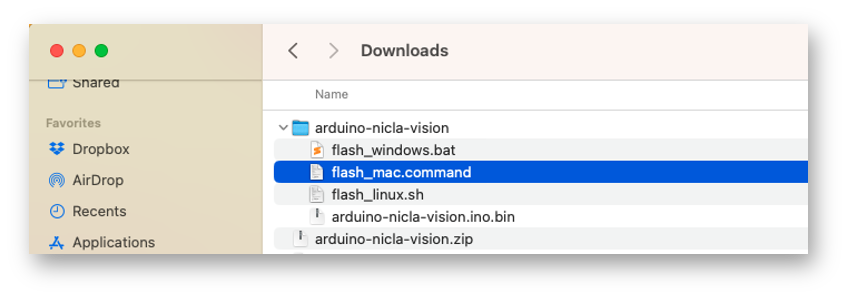
</p>

- Пакетный скрипт для вашей ОС загрузит двоичный файл *arduino-nicla-vision.bin* на плату.

> В `Chrome` для подключения Nicla к EI Studio можно использовать WebUSB. **EI CLI не нужен.**

Откройте свой проект в Studio, на вкладке `Data Acquisition` выберите `WebUSB` (1). Откроется окно; выберите вариант, в котором видно, что `Nicla is paired` (2), и нажмите `[Connect]` (3).

<p align="center">
  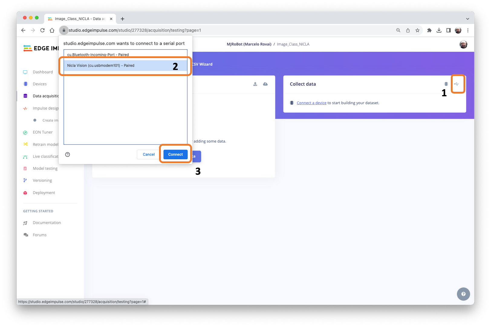
</p>

Какие данные датчика собирать, можно выбрать в разделе Collect Data на вкладке Data Acquisition.

<p align="center">
  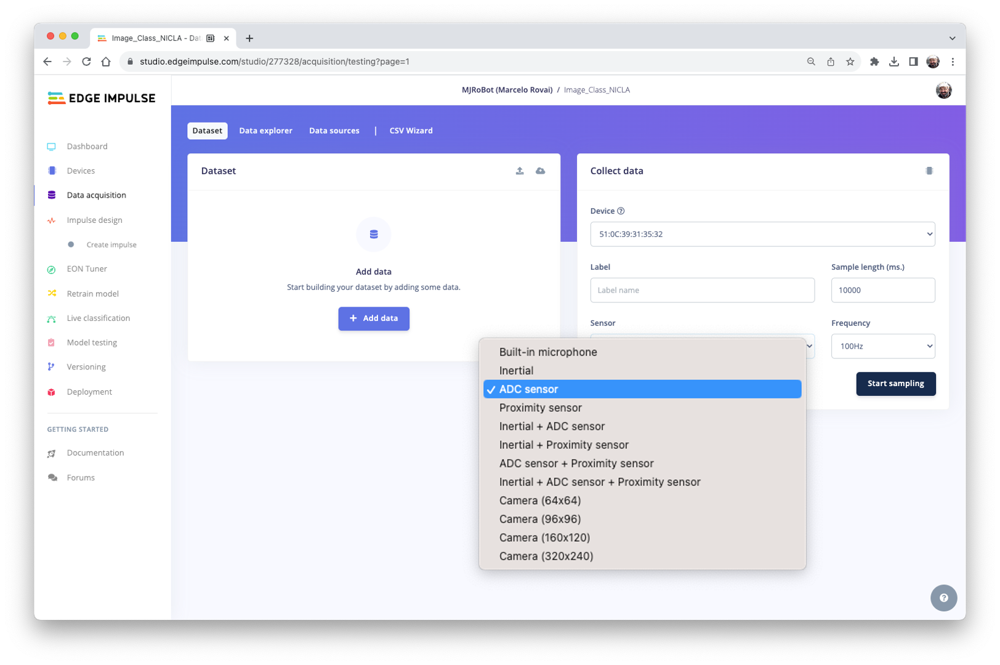
</p>

Например, `IMU data (inertial)`:

<p align="center">
  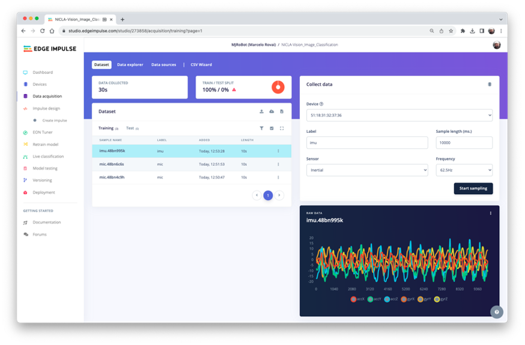
</p>

Или изображение (`Camera`):

<p align="center">
  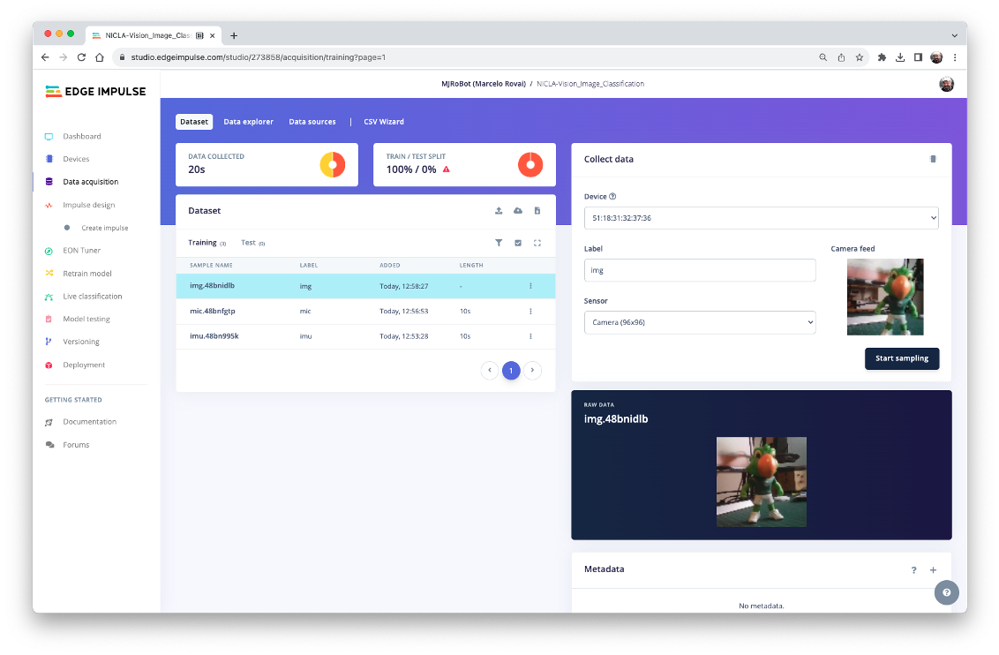
</p>

Также можно проверить внешний датчик, подключённый к `ADC` (вывод 0 Nicla), и другие встроенные датчики: например, `built-in microphone`, `ToF (Proximity)` или комбинацию датчиков (`fusion`).

## Расширение платы Nicla Vision (необязательно)

Иногда при прототипировании нужно поэкспериментировать с внешними датчиками и устройствами. Хорошее расширение для Nicla — [Arduino MKR Connector Carrier (Grove compatible)](https://store-usa.arduino.cc/products/arduino-mkr-connector-carrier-grove-compatible).

На плате 14 разъёмов Grove: пять одиночных аналоговых входов (A0–A5), один двойной аналоговый вход (A5/A6), пять одиночных цифровых входов/выходов (D0–D4), один двойной цифровой вход/выход (D5/D6), один I2C (TWI) и один UART (Serial). Все разъёмы совместимы с напряжением 5 В.

> Учтите, что все 17 выводов Nicla Vision подключаются к разъёмам Grove расширения, но некоторые соединения Grove остаются неподключёнными.

<p align="center">
  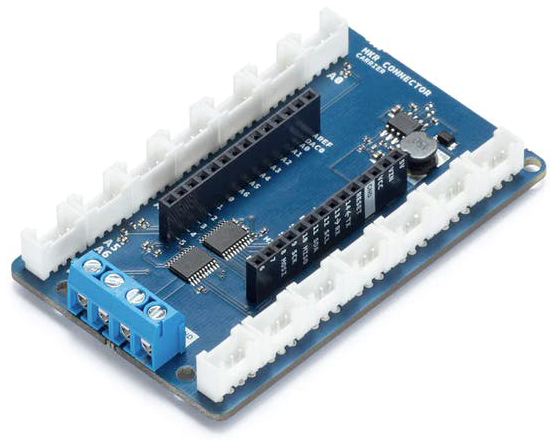
</p>

Эта плата расширения совместима с MKR и может использоваться с Nicla Vision и Portenta.

<p align="center">
  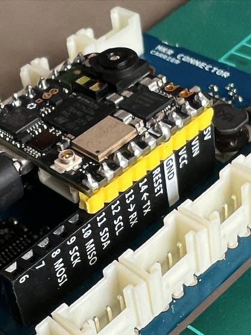
</p>

Например, предположим, что в проекте TinyML нужно отправлять результаты инференса через устройство LoRaWAN и добавлять данные о локальной освещённости. При автономной работе часто рекомендуется локальный маломощный дисплей, например OLED. Такая схема показана ниже:

<p align="center">
  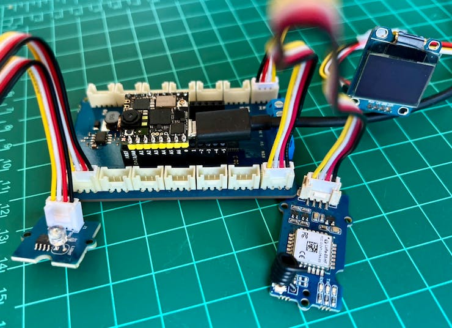
</p>

[Датчик освещённости Grove](https://wiki.seeedstudio.com/Grove-Light_Sensor/) подключается к одному из одиночных аналоговых выводов (A0/PC4), [устройство LoRaWAN](https://wiki.seeedstudio.com/Grove_LoRa_E5_New_Version/) — к UART, а [OLED-дисплей](https://wiki.seeedstudio.com/Grove-OLED-Display-0.96-SSD1315/) — к разъёму I2C.

Выводы Nicla 3 (Tx) и 4 (Rx) подключаются к разъёму Serial Shield. Обмен по UART используется для устройства LoRaWan. Вот простой код для работы с UART:

``` python
# Тест UART — By: marcelo_rovai — Sat Sep 23 2023

import time
from pyb import UART
from pyb import LED

redLED = LED(1) # встроенный красный светодиод

# Инициализация объекта UART.
# UART Nicla Vision (выводы TX/RX) находится на «LP1»
uart = UART("LP1", 9600)

while(True):
    uart.write("Hello World!\r\n")
    redLED.toggle()
    time.sleep_ms(1000)
```

Чтобы проверить работу UART, подключите другое устройство, например Arduino UNO, которое выводит «Hello Word» в Serial Monitor. Вот [код](https://github.com/Mjrovai/Arduino_Nicla_Vision/blob/main/Arduino-IDE/teste_uart_UNO/teste_uart_UNO.ino).

<p align="center">
  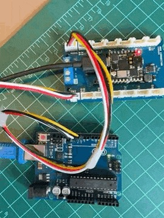
</p>

Ниже приведён код «Hello World» для OLED с интерфейсом I2C. Драйвер OLED SSD1306 для MicroPython (ssd1306.py), созданный Adafruit, тоже нужно загрузить на Nicla (скрипт ssd1306.py можно найти на [GitHub](https://github.com/Mjrovai/Arduino_Nicla_Vision/blob/main/Micropython/ssd1306.py)).

``` python
# Nicla_OLED_Hello_World — By: marcelo_rovai — Sat Sep 30 2023

# Сохраните на устройство драйвер OLED SSD1306 для MicroPython,
# интерфейсы I2C и SPI от Adafruit
import ssd1306

from machine import I2C
i2c = I2C(1)

oled_width = 128
oled_height = 64
oled = ssd1306.SSD1306_I2C(oled_width, oled_height, i2c)

oled.text('Hello, World', 10, 10)
oled.show()
```

Наконец, простой скрипт для чтения значения ADC на выводе «PC4» (вывод A0 Nicla):

``` python

# Датчик освещённости (A0) — By: marcelo_rovai — Wed Oct 4 2023

import pyb
from time import sleep

adc = pyb.ADC(pyb.Pin("PC4"))   # создание аналогового объекта
                                # из вывода
val = adc.read()                # чтение аналогового значения

while (True):

    val = adc.read()
    print ("Light={}".format (val))
    sleep (1)
```

Тот же ADC можно использовать и для других величин, например [температуры](https://wiki.seeedstudio.com/Grove-Temperature_Sensor_V1.2/).

> Обратите внимание: приведённые выше скрипты ([скачаны с GitHub](https://github.com/Mjrovai/Arduino_Nicla_Vision/tree/main/Micropython)) лишь показывают, как подключать внешние устройства к Nicla Vision с помощью MicroPython.

## Итоги

Arduino Nicla Vision — отличное *миниатюрное устройство* для промышленного и профессионального применения! Оно мощное, надёжное, маломощное и имеет подходящие датчики для самых распространённых задач встраиваемого машинного обучения: зрения, движения, слияния датчиков и звука.

> В [репозитории GitHub](https://github.com/Mjrovai/Arduino_Nicla_Vision/tree/main) вы найдёте самые свежие версии всех кодов, которые использовались или комментировались в этой практической лабораторной работе.

## Ресурсы

- [Коды на MicroPython](https://github.com/Mjrovai/Arduino_Nicla_Vision/tree/main/Micropython)

- [Коды для Arduino](https://github.com/Mjrovai/Arduino_Nicla_Vision/tree/main/Arduino-IDE)
