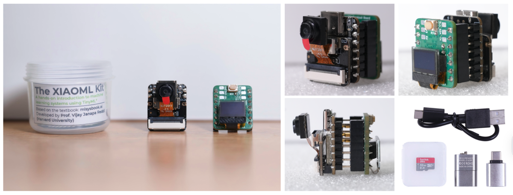

# Обзор

Эти лабораторные работы дают уникальную возможность получить практический опыт работы с системами машинного обучения (ML). В отличие от работы с большими моделями, которым нужны ресурсы уровня дата-центра, эти упражнения позволяют напрямую работать с оборудованием и программным обеспечением с помощью TinyML. Такой практический подход даёт осязаемое понимание проблем и возможностей развёртывания ИИ, пусть и в небольшом масштабе. При этом принципы в целом те же, что и при работе с более крупными системами.

  

## Где купить

Комплект XIAOML Kit включает плату XIAO ESP32S3 Sense, плату расширения с IMU, OLED-дисплеем и набором для работы с SD-картой:

- [XIAOML Kit (Seeed Studio)](https://www.seeedstudio.com/The-XIAOML-Kit.html) (\~\$40)

Отдельные компоненты также доступны у Seeed Studio.

## Предварительные требования

- **Комплект XIAOML Kit:**
    - плата **XIAO ESP32S3 Sense**;
    - **плата расширения** с 6-осевым IMU и 0,42-дюймовым OLED-дисплеем;
    - **набор для работы с SD-картой:**
        - SD-карта и адаптер USB для хранения данных;
        - кабель USB-C для подключения платы к компьютеру.

- **Сеть:** доступ в интернет для загрузки необходимого программного обеспечения.

## Настройка

- [Настройка комплекта XIAOML Kit](setup/README.md)

## Упражнения

| Модальность | Задача | Описание | Ссылка |
|---|---|---|---|
| **Зрение** | Классификация изображений | Научитесь классифицировать изображения | [Открыть](image_classification/README.md) |
| **Зрение** | Обнаружение объектов | Реализуйте обнаружение объектов | [Открыть](object_detection/README.md) |
| **Звук** | Распознавание ключевых слов | Изучите системы распознавания голоса | [Открыть](kws/README.md) |
| **IMU** | Классификация движения и обнаружение аномалий | Классифицируйте данные движения и находите аномалии | [Открыть](motion_classification/README.md) |
