# Классификация изображений

<p align="center">
  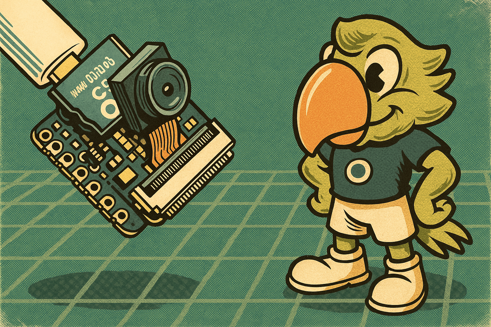<br>
  <em>Промпт DALL·E: иллюстрация в стиле мультфильма 1950-х, основанная на реальном изображении Marcelo Rovai</em>
</p>

## Обзор

Мы всё чаще сталкиваемся с революцией искусственного интеллекта (ИИ), и, как утверждает [Gartner](https://www.researchgate.net/figure/Gartner-2023-Artificial-intelligence-emerging-technologies-impact-radar-T-Nguyen-2023_fig1_372048156), **Edge AI и компьютерное зрение** обладают очень высоким потенциалом влияния, и **это уже сейчас**!

Когда мы смотрим на машинное обучение (ML) применительно к зрению, первое понятие, с которым мы сталкиваемся, — **классификация изображений**, своего рода «Hello World» для ML: простая и вместе с тем глубокая задача!

XIAOML Kit от Seeed Studio — комплексное аппаратное решение на основе [XIAO ESP32-S3 Sense](https://www.seeedstudio.com/xiao-series-page) со встроенной камерой **OV3660** и поддержкой SD-карт. Эти возможности делают XIAO ESP32S3 Sense отличной отправной точкой для знакомства с компьютерным зрением на базе TinyML.

В этой лабораторной работе мы разберём классификацию изображений с помощью инструмента **SenseCraft AI**, не требующего написания кода, а затем более подробно рассмотрим разработку с **Edge Impulse Studio** и **Arduino IDE**.

> **Цели обучения**
>
> - **Развёртывание предобученных моделей** с помощью SenseCraft AI Studio для быстрых приложений компьютерного зрения;
> - **Сбор и управление наборами изображений** для собственных задач классификации с правильной организацией данных;
> - **Обучение собственных моделей классификации изображений** методом переноса обучения (transfer learning) с архитектурой MobileNet V2;
> - **Оптимизация моделей для развёртывания на периферии** с помощью квантизации и экономной по памяти предобработки;
> - **Реализация конвейеров постобработки**, включая управление GPIO и интеграцию инференса в реальном времени;
> - **Сравнение подходов к разработке** без кода и с помощью продвинутых платформ ML для встраиваемых приложений.

## Классификация изображений

Классификация изображений — фундаментальная задача компьютерного зрения, которая состоит в отнесении целых изображений к одному из нескольких заранее заданных классов. Для этого анализируется визуальное содержание изображения и ему присваивается метка из фиксированного набора категорий в зависимости от доминирующего объекта или сцены.

Классификация изображений важна во многих областях: от организации и поиска по большим базам изображений в цифровых библиотеках и социальных сетях до помощи автономным системам в понимании окружения. Среди архитектур, которые существенно продвинули эту область, — свёрточные нейронные сети (CNN), например AlexNet, VGGNet и ResNet. Эти модели показали впечатляющую точность на сложных наборах данных, таких как [ImageNet](https://www.image-net.org/index.php), выучивая иерархические представления визуальных данных.

Классификация изображений — основа многих систем компьютерного зрения: она открывает путь к более сложным задачам, таким как обнаружение объектов и сегментация изображений, и помогает глубже понимать визуальные данные в разных отраслях. Начнём знакомство с моделью [Person Classification](https://sensecraft.seeed.cc/ai/view-model/60768-person-classification?tab=public) («Person — No Person», то есть «человек — не человек»), готовым приложением компьютерного зрения в **[SenseCraft AI](https://sensecraft.seeed.cc/ai/device/local/32)**.

<p align="center">
  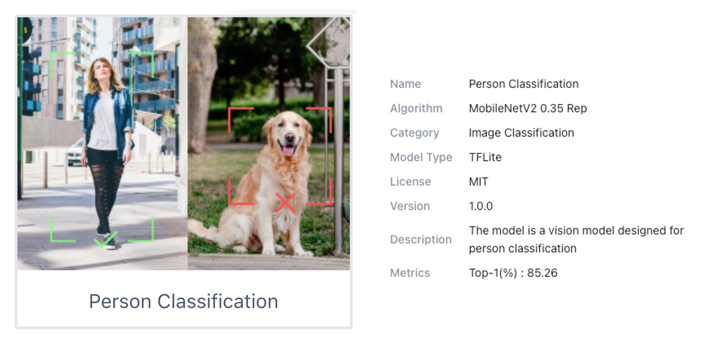
</p>

### Классификация изображений в рабочем пространстве SenseCraft AI

Сначала подключите XIAOML Kit (или только XIAO ESP32S3 Sense, отсоединённую от платы расширения) к компьютеру через USB-C, затем откройте [рабочее пространство SenseCraft AI](https://sensecraft.seeed.cc/ai/device/local/32) и подключите устройство.

<p align="center">
  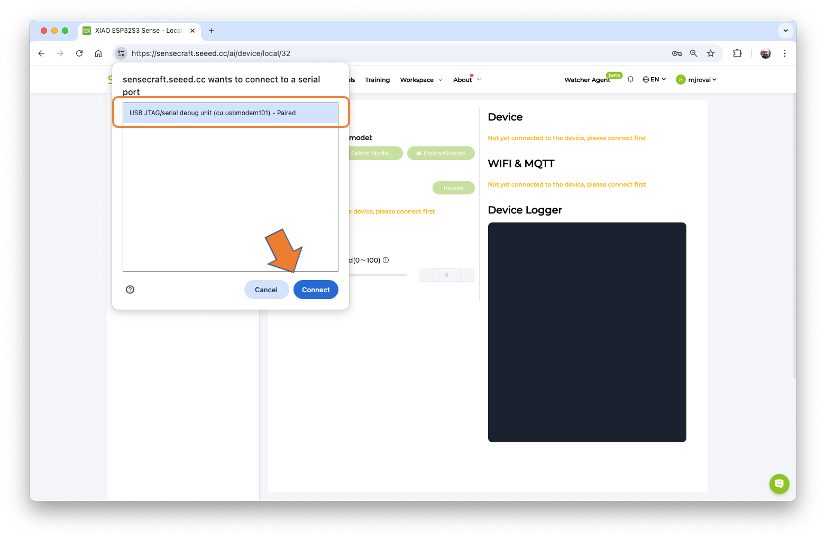
</p>

После подключения выберите опцию `[Select Model...]` и введите в строке поиска: «*Person Classification*». Из доступных вариантов выберите модель, обученную на MobileNet V2 (при наведении курсора на модели открывается всплывающее окно с их основными характеристиками).

<p align="center">
  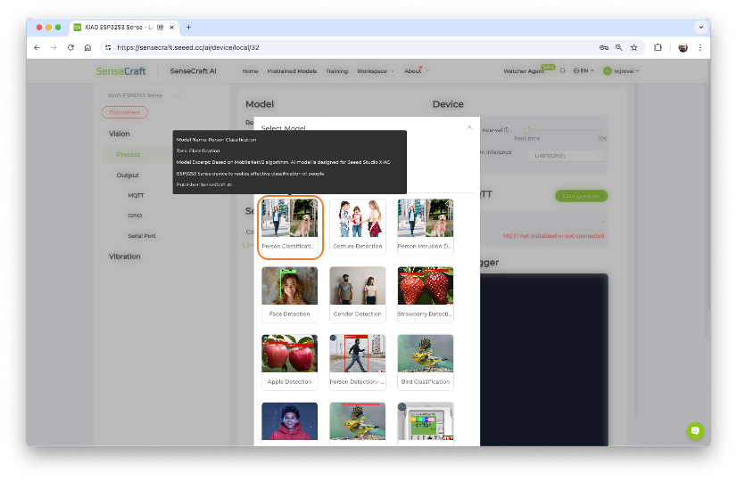
</p>

Нажмите на выбранную модель и подтвердите развёртывание. Прошивка с моделью начнёт загружаться на устройство.

> Процент загруженной модели и прошивки будет отображаться на экране. Если этого не происходит, попробуйте отключить устройство, затем подключить его снова и нажать кнопку boot.

После успешной загрузки модели в области **Preview** мы увидим видеопоток с камеры XIAO и результат классификации (`Person` или `Not a Person`), а в **Device Logger** — подробности инференса.

> Также можно выбрать **интервал кадров инференса** — от «Real-Time» (по умолчанию) до 10 секунд, а также **режим** передачи данных (UART, I2C и др.) — данные передаются устройством (по умолчанию UART через USB).

<p align="center">
  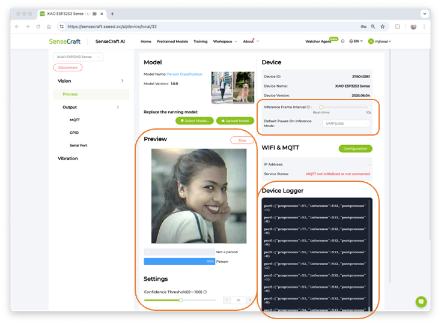
</p>

В Device Logger видно, что задержка модели составляет от 52 до 78 мс на предобработку и около 532 мс на инференс. Итого выходит чуть меньше 600 мс, или примерно **1,7 кадра в секунду (FPS)**.

> Для работы MobileNet V2 0.35 XIAO потребляла пиковый ток 160 мА при напряжении 5,23 В, что даёт **энергопотребление 830 мВт**.

### Постобработка

Важный этап в конвейере проекта классификации изображений — решить, что делать с результатом инференса. Представим, что мы используем XIAO, чтобы автоматически включать свет в комнате, когда обнаружен человек.

<p align="center">
  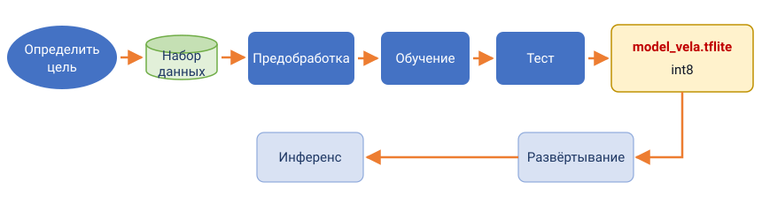
</p>

В SenseCraft AI это делается в разделе `Output -> GPIO`. Нажмите значок «Add», чтобы запускать действие при выполнении условий события. Откроется всплывающее окно, где можно задать нужное действие. Например, если человек обнаружен с уверенностью более 60 %, внутренний светодиод `LED` должен включаться. В реальном сценарии для запуска реле, которое включит свет, использовали бы GPIO, например `D0`, `D1`, `D2`, `D11` или `D12`.

<p align="center">
  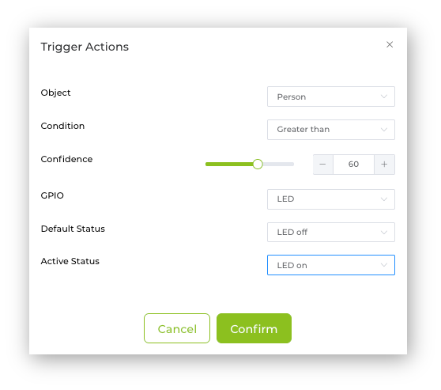
</p>

После подтверждения появится созданное **Trigger Action** (триггерное действие). Нажмите `Send`, чтобы отправить команду на XIAO.

<p align="center">
  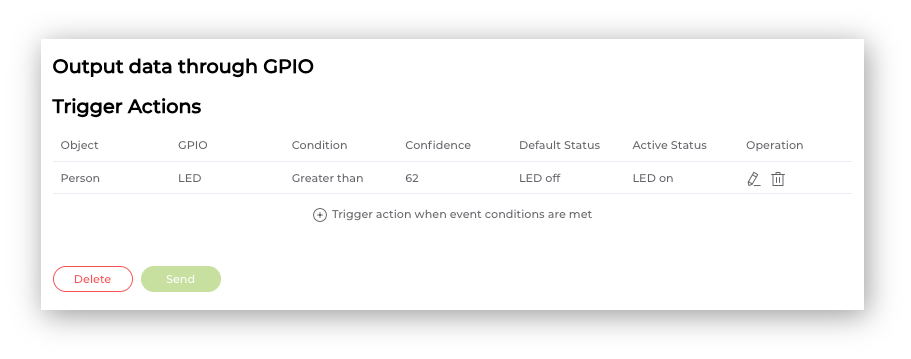
</p>

Теперь, если направить XIAO на человека, внутренний светодиод загорится.

<p align="center">
  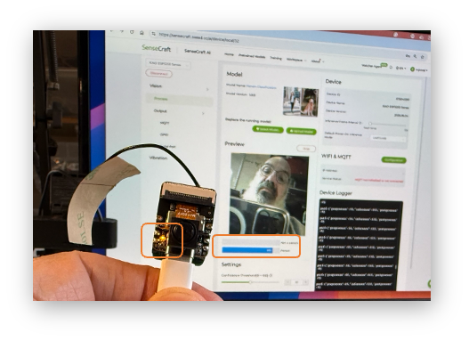
</p>

> Другие триггерные действия и методы постобработки мы рассмотрим дальше в этой лабораторной работе.

## Проект классификации изображений

Создадим простой проект классификации изображений с помощью SenseCraft AI Studio. Ниже показан типичный конвейер машинного обучения, который мы используем в проекте.

<p align="center">
  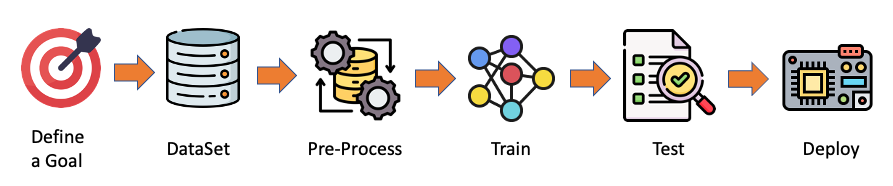
</p>

В SenseCraft AI Studio откройте вкладку [Training](https://sensecraft.seeed.cc/ai/training):

<p align="center">
  
</p>

По умолчанию обучается модель `Classification` с веб-камерой, если она доступна. Выберем вместо этого `XIAOESP32S3 Sense`. Нажатие зелёной кнопки `[Connect]` откроет всплывающее окно. Выберите соответствующий порт и нажмите синюю кнопку `[Connect]`.

<p align="center">
  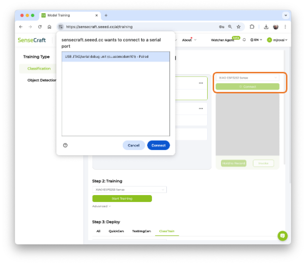
</p>

Изображение с камеры отобразится в области предпросмотра.

### Цель

Первый шаг, как видно из конвейера машинного обучения, — определить цель. Представим, что у нас есть промышленная установка, которая должна автоматически сортировать колёса и коробки.

<p align="center">
  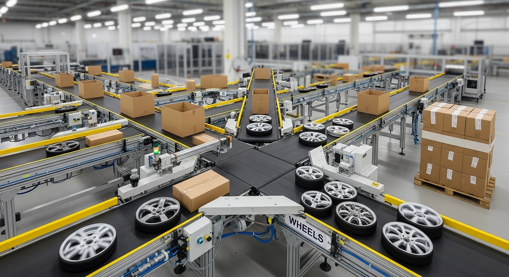
</p>

Смоделируем эту задачу: будем классифицировать игрушечную `коробку` (box) и игрушечное `колесо` (wheel). Также добавим третий класс изображений — `фон` (background), на котором в кадре нет объектов.

<p align="center">
  
</p>

### Сбор данных

Создадим классы, например в алфавитном порядке:

- Класс 1: background (фон);
- Класс 2: box (коробка);
- Класс 3: wheel (колесо).

<p align="center">
  
</p>

Выберите один из классов и удерживайте зелёную кнопку (`Hold to Record`) под областью предпросмотра. Собранные изображения (и их количество) появятся на экране образцов. Аккуратно и медленно перемещайте камеру, чтобы снять объект с разных ракурсов. Чтобы поменять положение объекта или помешать съёмке, отпустите зелёную кнопку, переставьте объект и снова удерживайте её, чтобы продолжить съёмку.

<p align="center">
  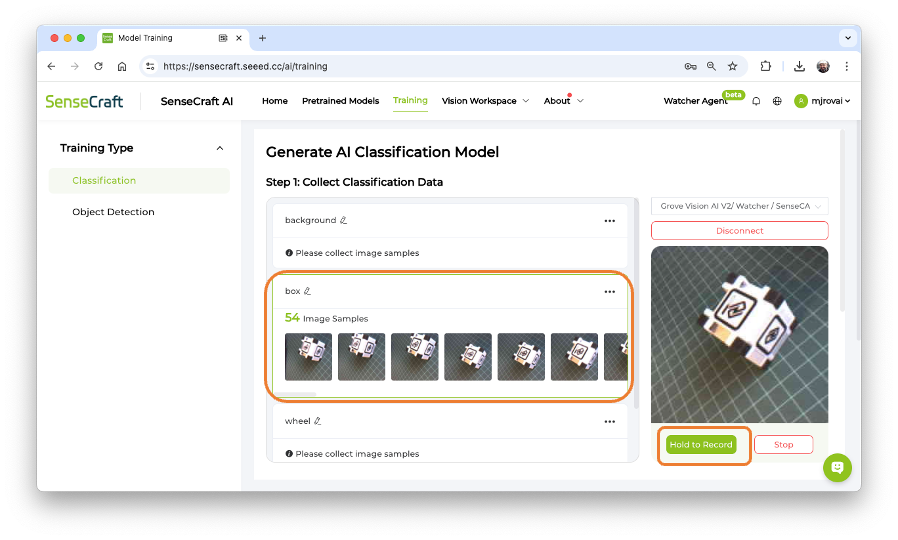
</p>

После съёмки просмотрите изображения и удалите неверные.

<p align="center">
  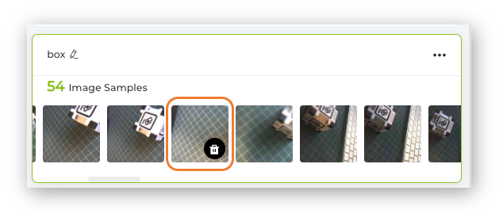
</p>

Соберите около **50 изображений** из каждого класса и переходите к этапу обучения.

> Собранные изображения можно скачать и использовать в другом приложении, например в Edge Impulse Studio.

### Обучение

Убедитесь, что выбрано правильное устройство (`XIAO ESP32S3 Sense`), и нажмите `[Start Training]`.

<p align="center">
  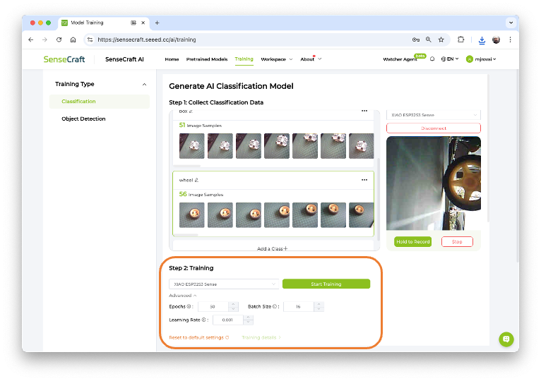
</p>

### Тест

После обучения можно просмотреть результат инференса.

> Учтите, что модель не работает на устройстве. Мы лишь снимаем изображения устройством и выполняем **предварительный просмотр в реальном времени**, используя обучаемую модель, которая работает в Studio.

<p align="center">
  
</p>

Теперь пора по-настоящему развернуть модель на устройстве.

### Развёртывание

В окне `Supported Devices` выберите обученную модель и `XIAO ESP32S3 Sense`, затем нажмите `[Deploy to device]`.

<p align="center">
  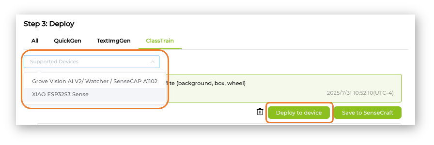
</p>

SenseCraft AI перенаправит нас на вкладку **Vision Workplace**. Подтвердите развёртывание (`Confirm`), выберите порт и подключите устройство (`Connect`).

<p align="center">
  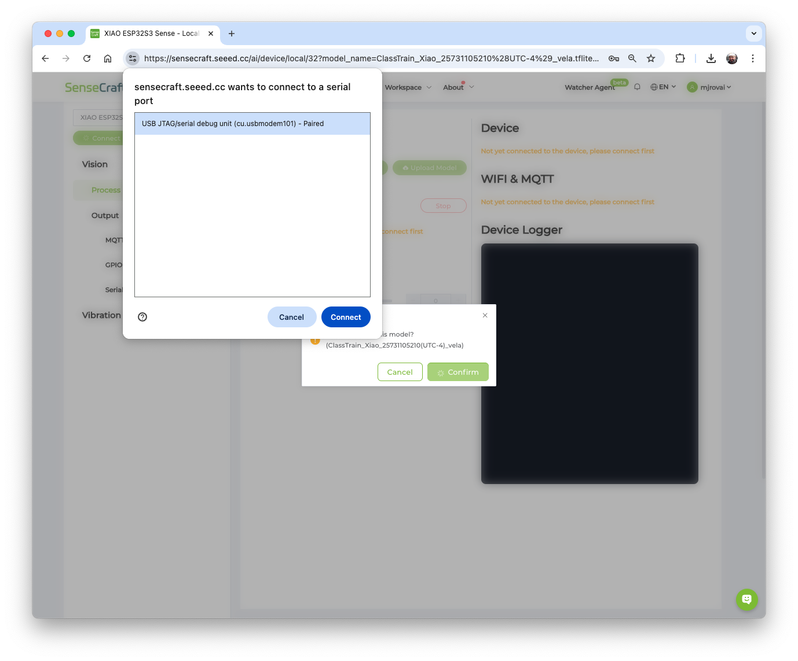
</p>

Модель будет записана в устройство. После автоматической перезагрузки модель начнёт работать на устройстве. В Device Logger видно, что задержка инференса составляет примерно **426 мс**, плюс **около 110 мс** на предобработку, что соответствует **частоте кадров 1,8 кадра в секунду (FPS)**.

Также в **Settings** можно настроить уверенность модели.

<p align="center">
  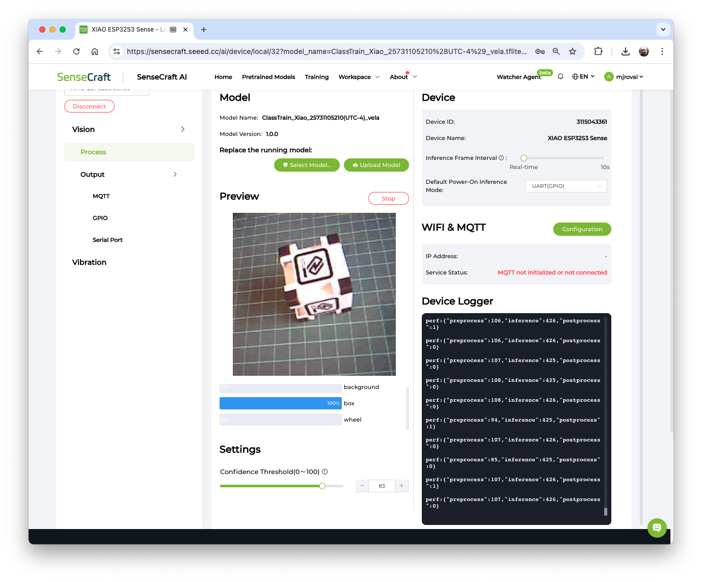
</p>

> Для работы модели классификации изображений XIAO ESP32S3 потребляла пиковый ток 140 мА при напряжении 5,23 В, что даёт **энергопотребление 730 мВт**.

Как и раньше, в разделе **Output --> GPIO** можно включать GPIO или внутренний светодиод в зависимости от обнаруженного класса. Например, светодиод загорится, когда обнаружено колесо.

<p align="center">
  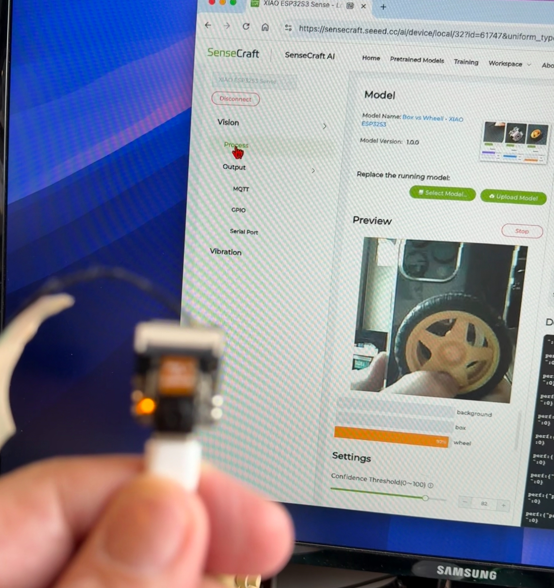
</p>

### Сохранение модели

Модель можно сохранить в SenseCraft AI Studio. Studio сохранит все наши модели для последующего развёртывания. Для этого вернитесь на вкладку `Training` и нажмите кнопку `[Save to SenseCraft]`:

<p align="center">
  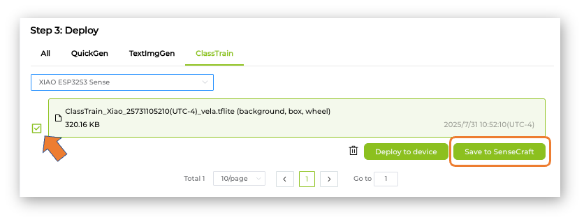
</p>

Следуйте инструкциям, чтобы ввести название модели, описание, изображение и другие детали.

<p align="center">
  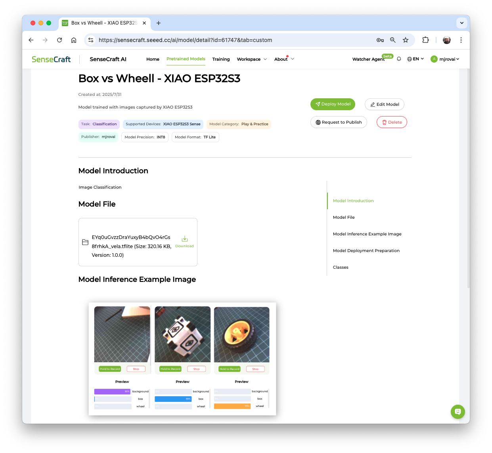
</p>

Обратите внимание: обученную модель (Int8 MobileNet V2 размером 320 КБ) можно скачать для дальнейшего использования или анализа, например с помощью [Netron](https://github.com/lutzroeder/netron). Модель использует изображения размером $224{\times}224{\times}3$ в качестве входного тензора. На следующем шаге мы применим другие гиперпараметры в Edge Impulse Studio.

<p align="center">
  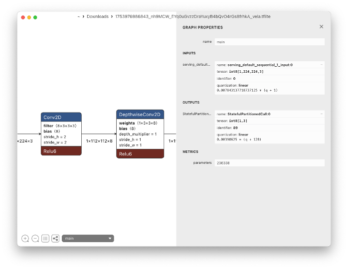
</p>

Модель также можно развернуть на устройстве повторно в любой момент. Рабочее пространство **Workspace** откроется в SenseCraft AI автоматически.

## Проект классификации изображений на основе набора данных

Основная цель нашего проекта — обучить модель и выполнить инференс на XIAO ESP32S3 Sense. Для обучения нужно найти данные **(на самом деле огромное количество данных!)**.

*Но, как мы уже знаем, прежде всего нужна цель! Что мы хотим классифицировать?*

С TinyML — набором методов, связанных с инференсом моделей машинного обучения на встраиваемых устройствах, — классификацию следует ограничивать тремя-четырьмя категориями из-за ограничений, главным образом по памяти. Например, можно обучить модель на снятых изображениях «коробка против колеса»; их можно скачать из SenseCraft AI Studio.

> Также можно использовать совершенно новый набор данных, например с различением яблок, бананов и картофеля или других категорий. По возможности найдите специализированный набор данных с изображениями этих категорий. Хорошим началом будет [Kaggle fruit-and-vegetable-image-recognition](https://www.kaggle.com/kritikseth/fruit-and-vegetable-image-recognition).

Загрузим набор данных, собранный в предыдущем разделе. Откройте меню (три точки) для каждого снятого класса и выберите `Export Data`.

<p align="center">
  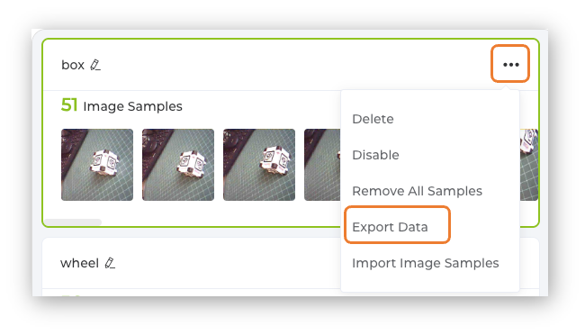
</p>

Набор данных будет загружен на компьютер в виде ZIP-файла: по одному файлу на каждый класс. Сохраните их в рабочую папку и распакуйте. У вас должны появиться три папки — по одной на каждый класс.

<p align="center">
  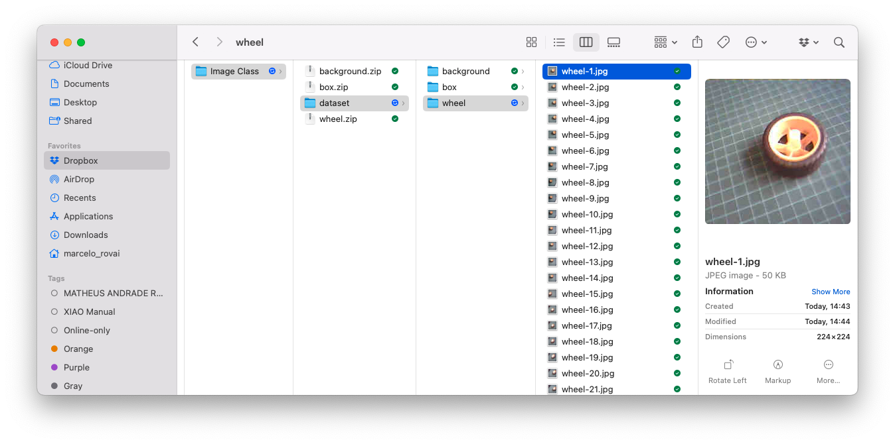
</p>

> При желании можно добавить свежие изображения, используя, например, код из лабораторной работы по настройке.

## Обучение модели в Edge Impulse Studio

Для обучения модели мы будем использовать Edge Impulse Studio. [Edge Impulse](https://www.edgeimpulse.com/) — ведущая платформа разработки машинного обучения для периферийных устройств.

Войдите в аккаунт Edge Impulse (или создайте бесплатный) и создайте новый проект.

### Сбор данных

Перейдите в раздел **Data acquisition** и выберите `+ Add data`. Появится всплывающее окно. Выберите `UPLOAD DATA`.

<p align="center">
  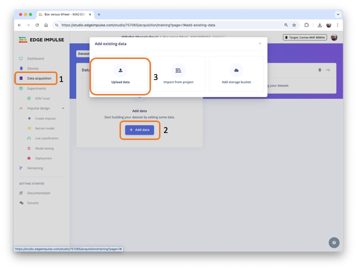
</p>

После выбора появится новое всплывающее окно с запросом на обновление данных.

- В режиме загрузки (Upload mode) выберите `select a folder` и нажмите `[Choose Files]`.
- Перейдите в папку, которая содержит один из классов, и нажмите `[Upload]`.

<p align="center">
  
</p>

- Вы автоматически вернётесь в окно Upload data.
- Выберите `Automatically split between training and testing`.
- Введите метку изображений, которые находятся в папке.
- Выберите `[Upload data]`.
- Файлы начнут загружаться. После этого появится другое всплывающее окно с вопросом, создаёте ли вы проект обнаружения объектов. Выберите `[no]`.

<p align="center">
  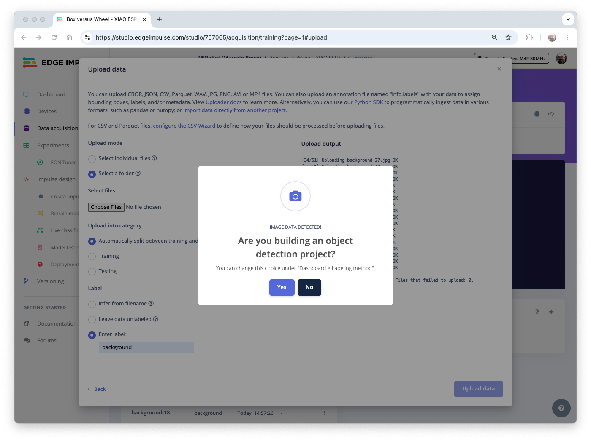
</p>

Повторите процедуру для всех классов. **Не забудьте изменить имя метки!** Если забыть и загрузить изображения, они будут перемешаны в Studio. Не беспокойтесь: данные можно вручную перенести между классами позже.

Закройте окно Upload Data и вернитесь на страницу **Data acquisition**. Мы видим, что весь набор загружен. На верхней панели видно 158 элементов, распределённых поровну. Также 19 % изображений оставлены для тестирования.

<p align="center">
  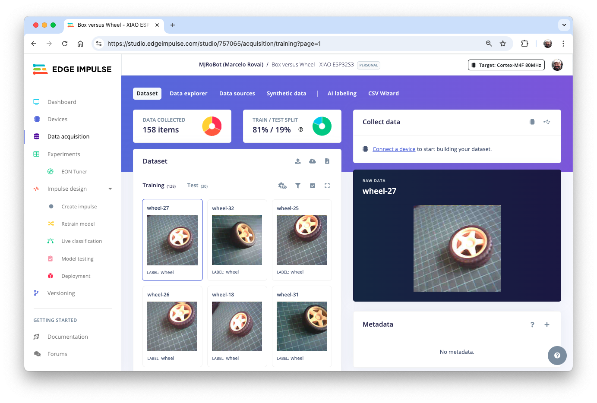
</p>

### Проектирование Impulse

> Impulse получает сырые данные (в данном случае изображения), извлекает признаки (меняет размер изображений) и затем использует блок обучения для классификации новых данных.

Классификация изображений — самое распространённое применение глубокого обучения, но для этой задачи нужен большой объём данных. У нас около 50 изображений на каждую категорию. Достаточно ли этого? Совсем нет! Чтобы «научить» модель различать каждый класс, нужны тысячи изображений. Однако эту проблему можно решить, дообучив уже обученную модель на наших данных. Этот приём называется **«переносом обучения» (Transfer Learning, TL)**. С TL можно дообучить предобученную модель классификации изображений на наших данных, добиваясь хорошей производительности даже на относительно небольших наборах изображений, как в нашем случае.

<p align="center">
  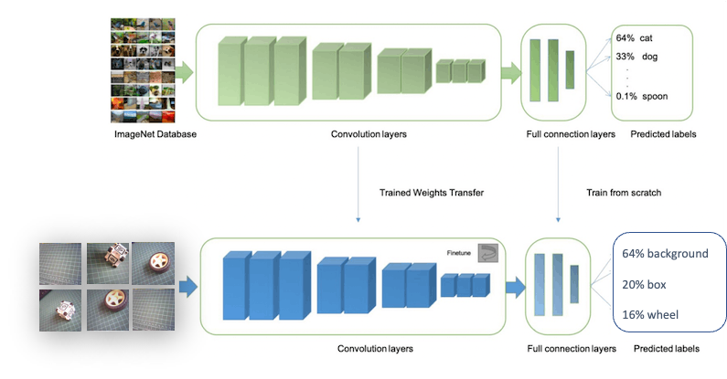
</p>

С помощью TL можно дообучить предобученную модель классификации изображений на наших данных, сохраняя хорошую производительность даже на относительно небольших наборах изображений (как в нашем случае).

Итак, начиная с сырых изображений, изменим их размер $(96\times 96)$ пикселей и передадим в блок Transfer Learning. Создадим Impulse.

> На этом этапе можно также задать целевое устройство, чтобы контролировать «бюджет» (память и задержку). XIAO ESP32S3 официально не поддерживается Edge Impulse, поэтому рассмотрим Espressif ESP-EYE: он похож, но медленнее.

<p align="center">
  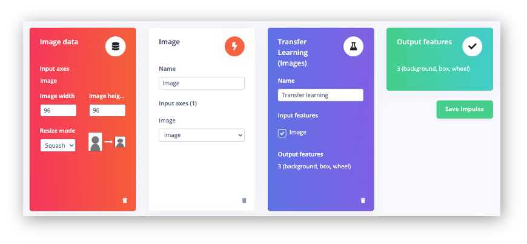
</p>

Сохраните Impulse, как показано выше, и перейдите в раздел **Image**.

### Предобработка (генерация признаков)

Помимо изменения размера изображений, их можно перевести в оттенки серого или сохранить исходную глубину цвета RGB. Выберем `[RGB]` в разделе `Image`. Тогда каждый образец будет иметь размерность 27 648 признаков ($96{\times}96{\times}3$). Нажатие `[Save Parameters]` откроет новую вкладку `Generate Features`. Нажмите кнопку `[Generate Features]`, чтобы создать признаки.

### Проектирование модели, обучение и тестирование

В 2017 году Google представил [MobileNetV1](https://research.googleblog.com/2017/06/mobilenets-open-source-models-for.html). В 2018 году вышла [MobileNetV2: Inverted Residuals and Linear Bottlenecks](https://arxiv.org/abs/1801.04381), а в 2019-м — V3. MobileNet — семейство универсальных нейронных сетей для компьютерного зрения, специально созданных для мобильных устройств и поддерживающих классификацию, обнаружение и другие задачи. MobileNet — компактные модели с малой задержкой и низким энергопотреблением, параметры которых подобраны под ограничения ресурсов разных сценариев.

Хотя базовая архитектура MobileNet уже компактна и быстра, конкретному приложению часто нужна ещё более маленькая и быстрая модель. MobileNet вводит простой параметр **α** (альфа), называемый множителем ширины (width multiplier), для построения меньших и менее требовательных к вычислениям моделей. Роль множителя ширины α — равномерно «утончить» сеть на каждом слое.

В Edge Impulse Studio доступны MobileNet V1 (изображения $96{\times}96$) и V2 (изображения $96{\times}96$ и $160{\times}160$) с несколькими значениями **α** (от 0,05 до 1,0). Например, наибольшая точность достигается у V2 с изображениями $160{\times}160$ и α=1,0. Конечно, есть компромисс: чем выше точность, тем больше памяти (около 1,3 МБ ОЗУ и 2,6 МБ ПЗУ) нужно для работы модели и тем выше задержка. Наименьший объём — у MobileNet V1 с α=0,10 (около 53,2 КБ ОЗУ и 101 КБ ПЗУ).

> Мы будем использовать **MobileNet V2 0.35** как базовую модель (но можно выбрать модель с большим α). Последний слой нашей модели, предшествующий выходному, будет содержать 16 нейронов с 10 %-ным dropout для предотвращения переобучения.

Ещё один обязательный приём в глубоком обучении — **аугментация данных** (data augmentation). Это метод, который помогает повысить точность моделей машинного обучения за счёт создания дополнительных искусственных данных. Система аугментации вносит небольшие случайные изменения в обучающие данные в процессе обучения (например, отражает, обрезает или поворачивает изображения).

Заглянем «под капот» и посмотрим, как Edge Impulse реализует политику аугментации данных:

```python
# Реализация политики аугментации данных
def augment_image(image, label):
    # Случайно отражаем изображение по горизонтали
    image = tf.image.random_flip_left_right(image)

    # Увеличиваем размер изображения, затем случайно обрезаем его до
    # исходных размеров
    resize_factor = random.uniform(1, 1.2)
    new_height = math.floor(resize_factor * INPUT_SHAPE[0])
    new_width = math.floor(resize_factor * INPUT_SHAPE[1])
    image = tf.image.resize_with_crop_or_pad(image, new_height,
                                             new_width)
    image = tf.image.random_crop(image, size=INPUT_SHAPE)

    # Меняем яркость изображения
    image = tf.image.random_brightness(image, max_delta=0.2)

    return image, label
```

Теперь определим гиперпараметры:

- эпох: 20;
- размер батча (batch size): 32;
- скорость обучения (learning rate): 0,0005;
- размер валидационной выборки: 20 %.

Результат обучения:

<p align="center">
  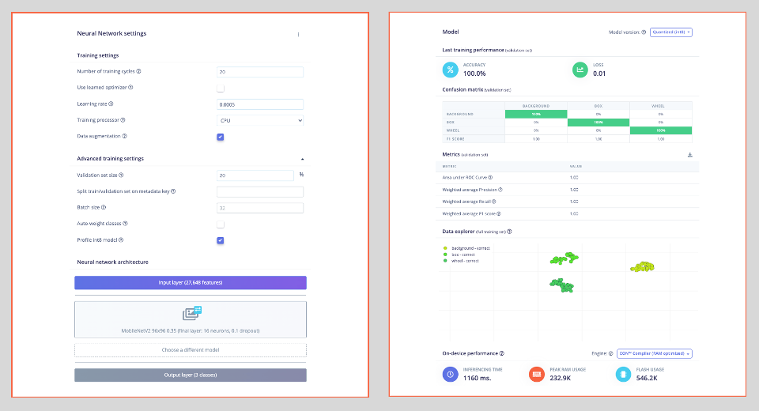
</p>

Профиль модели предсказывает **233 КБ ОЗУ и 546 КБ флеш-памяти**, что не создаёт проблем для XIAO ESP32S3, у которой 8 МБ PSRAM. Кроме того, Studio показывает **задержку около 1160 мс**, что очень много. Однако этого и следовало ожидать: мы используем ESP-EYE, у которого процессор Xtensa LX6, тогда как ESP32S3 использует более новый и мощный Xtensa LX7.

> На тестовых данных мы также получили 100 % точности, даже для квантованной модели INT8. В реальных проектах такой результат нехарактерен, но наш проект относительно прост: два объекта очень хорошо отличаются друг от друга.

## Развёртывание модели

Обученную модель можно развернуть:

- как `.TFLITE` для использования в **SenseCraft AI**;
- как `Arduino Library` в **Edge Impulse Studio**.

Начнём с SenseCraft, это проще и интуитивнее.

### Развёртывание модели в SenseCraft AI

На **Dashboard** можно скачать обученную модель в нескольких форматах. Скачаем `TensorFlow Lite (int8 quantized)` размером 623 КБ.

<p align="center">
  
</p>

В **SenseCraft AI Studio** откройте вкладку `Workspace`, выберите `XIAO ESP32S3`, соответствующий порт и подключите устройство.

Вы увидите последнюю модель, загруженную на устройство. Нажмите зелёную кнопку `[Upload Model]`. Появится всплывающее окно с запросом названия модели, файла модели и названий классов (**объектов**). Используем метки в алфавитном порядке: `0: background`, `1: box` и `2: wheel`, затем нажмите `[Send]`.

<p align="center">
  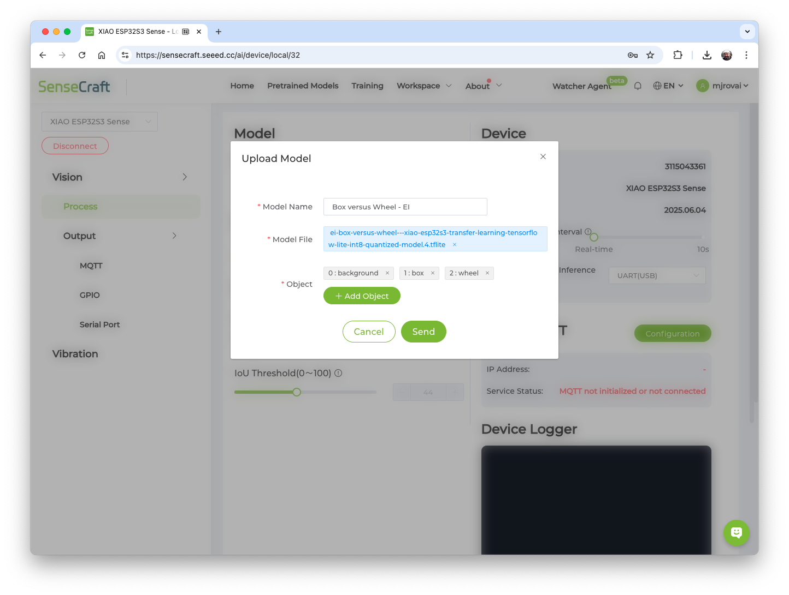
</p>

Через несколько секунд модель будет загружена («прошита») на устройство, и изображение с камеры появится в реальном времени в области **Preview**. Результат классификации будет показан под предпросмотром. В **Settings** с помощью курсора можно выбрать `Confidence Threshold` (порог уверенности) инференса.

В **Device Logger** в Serial Monitor видно задержку: около 81 мс на предобработку и 205 мс на инференс, **что соответствует 3,4 кадра в секунду (FPS)**. Это вдвое больше, чем мы получили при обучении модели в SenseCraft, потому что здесь используются изображения меньшего размера ($96{\times}96$ против $224{\times}224$).

> Общая задержка примерно **в 4 раза меньше**, чем оценка в Edge Impulse Studio для процессора Xtensa LX6; теперь инференс выполняется на процессоре Xtensa LX7.

<p align="center">
  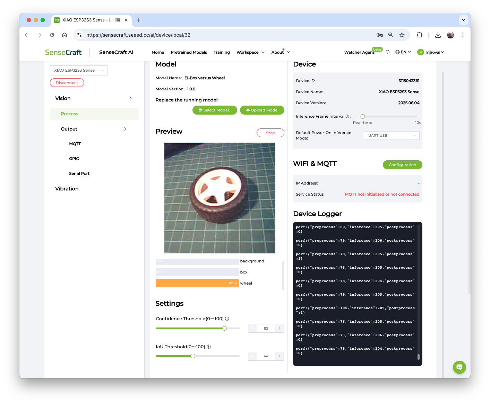
</p>

#### Постобработка

Результат инференса модели, включая задержку, ID класса и уверенность, можно получить, как показано в Device Logger в SenseCraft AI. Это позволяет использовать **XIAO ESP32S3 Sense как ИИ-датчик**. Иначе говоря, данные модели можно получать по разным протоколам связи, таким как MQTT, UART, I2C или SPI, в зависимости от требований проекта.

> Идея похожа на то, что мы делали в [лабораторной работе по классификации изображений для Seeed Grove Vision AI V2](../../04-grove-vision/image_classification/README.md) (раздел «Постобработка»).

Ниже пример подключения по шине I2C.

<p align="center">
  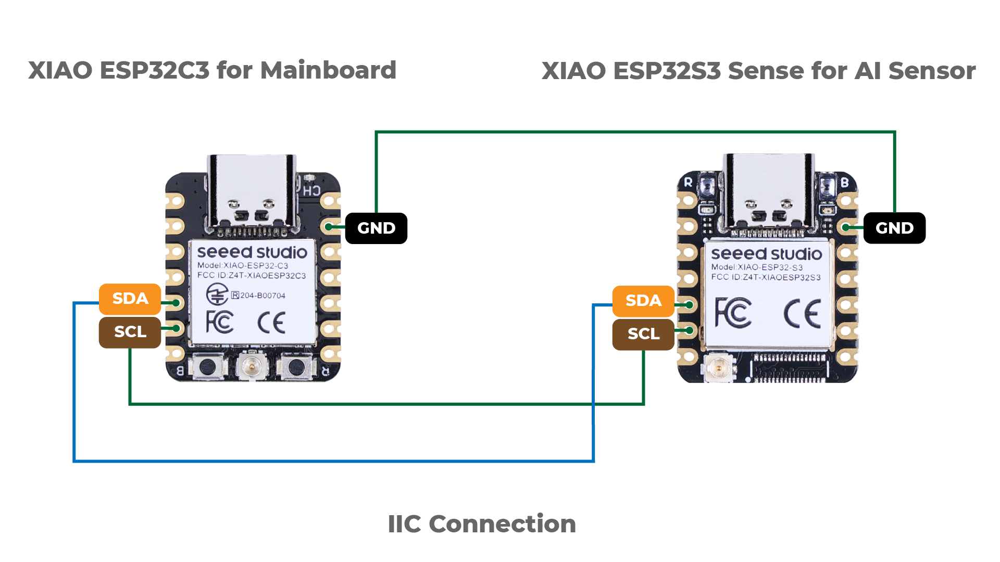
</p>

Подробнее см. [вики Seeed Studio](https://wiki.seeedstudio.com/sensecraft-ai/tutorials/sensecraft-ai-output-libraries-xiao/).

### Развёртывание как библиотеки Arduino в EI Studio

На вкладке **Deploy** в Edge Impulse Studio выберите `Arduino library`, `TensorFlow Lite`, `Quantized(int8)` и нажмите `[Build]`. Обученная модель будет скачана как ZIP-библиотека Arduino:

<p align="center">
  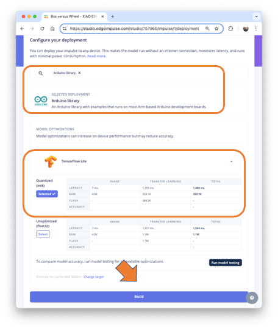
</p>

Откройте Arduino IDE, в меню **Sketch** выберите **Include Library** и **Add .ZIP Library**. Затем укажите файл, скачанный из Edge Impulse Studio, и нажмите `[Open]`.

<p align="center">
  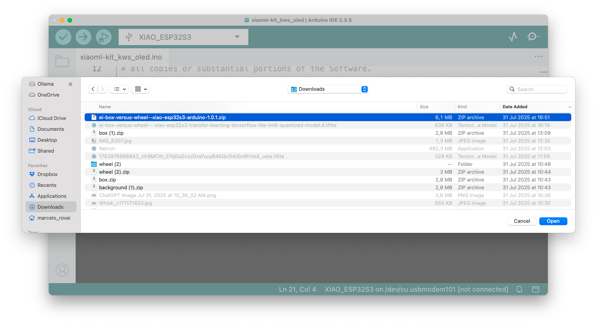
</p>

Перейдите в `Examples` в Arduino IDE и найдите проект по имени (в данном случае: «Box_versus_Wheel_...Interfering»). Откройте `esp32` → `esp32_camera`. Скетч `esp32_camera.ino` появится в IDE.

Этот скетч создан для обычной платы ESP32 и не будет работать с XIAO ESP32S3 Sense. Его нужно изменить. Скачайте изменённую версию из репозитория проекта на GitHub: [Image_class_XIAOML-Kit.ino](https://github.com/Mjrovai/XIAO-ESP32S3-Sense/blob/main/XIAOML_Kit_code/image_class_XIAOML-Kit/image_class_XIAOML-Kit.ino).

#### Разбор кода классификации изображений для XIAO ESP32S3

Код снимает изображения со встроенной камеры, обрабатывает их и классифицирует (в данном случае «Box», «Wheel» или «Background») с помощью модели, обученной в EI Studio. Он работает непрерывно и выполняет инференс в реальном времени на периферийном устройстве.

Коротко:

Камера → изображение JPEG → преобразование в RGB888 → изменение размера до $96{\times}96$ →
нейронная сеть → результаты классификации → вывод в последовательный порт

##### Основные компоненты

1. **Подключение библиотек и зависимостей**

```cpp
#include <Box_versus_Wheel_-_XIAO_ESP32S3_inferencing.h>
#include "edge-impulse-sdk/dsp/image/image.hpp"
#include "esp_camera.h"
```

- **Библиотека инференса Edge Impulse:** содержит нашу обученную модель и движок инференса;
- **Обработка изображений:** предоставляет функции для работы с изображениями;
- **ESP Camera:** аппаратный интерфейс модуля камеры.

2. **Конфигурации выводов камеры**

Плата XIAO ESP32S3 Sense может работать с разными сенсорами камеры (OV2640 или OV3660), у которых могут быть разные конфигурации выводов. Код задаёт три возможные конфигурации:

```cpp
// Конфигурация 1: наиболее распространённая конфигурация OV2640
#define CONFIG_1_XCLK_GPIO_NUM    10
#define CONFIG_1_SIOD_GPIO_NUM    40
#define CONFIG_1_SIOC_GPIO_NUM    39
// ... остальные выводы
```

Такая гибкость позволяет коду автоматически пробовать разные отображения выводов, если первое не сработало, и делает его устойчивее к разным ревизиям аппаратуры.

3. **Настройки управления памятью**

```cpp
#define EI_CAMERA_RAW_FRAME_BUFFER_COLS   320
#define EI_CAMERA_RAW_FRAME_BUFFER_ROWS   240
#define EI_CLASSIFIER_ALLOCATION_HEAP      1
```

- **Размер буфера кадра:** задаёт размер исходного изображения ($320{\times}240$ пикселей);
- **Выделение в куче (heap):** используется динамическое выделение памяти для гибкости;
- **Поддержка PSRAM:** у ESP32S3 есть 8 МБ PSRAM для хранения больших данных, например изображений.

##### `setup()` — инициализация

```cpp
void setup() {
    Serial.begin(115200);
    while (!Serial);

    if (ei_camera_init() == false) {
        ei_printf("Failed to initialize Camera!\r\n");
    } else {
        ei_printf("Camera initialized\r\n");
    }

    ei_sleep(2000);  // Ждём 2 секунды перед запуском
}
```

Эта функция:

1. Инициализирует последовательную связь для отладочного вывода;
2. Инициализирует камеру с автоматическим определением конфигурации;
3. Ждёт 2 секунды перед началом непрерывного инференса.

##### `loop()` — главный цикл обработки

Цикл выполняет следующие шаги непрерывно:

**Шаг 1. Выделение памяти**

```cpp
snapshot_buf = (uint8_t*)ps_malloc(EI_CAMERA_RAW_FRAME_BUFFER_COLS *
                                   EI_CAMERA_RAW_FRAME_BUFFER_ROWS *
                                   EI_CAMERA_FRAME_BYTE_SIZE);
```

Выделяет память под буфер изображения, предпочтительно в PSRAM (более быстрой внешней ОЗУ), а при необходимости — в обычной куче.

**Шаг 2. Захват изображения**

```cpp
if (ei_camera_capture((size_t)EI_CLASSIFIER_INPUT_WIDTH,
                     (size_t)EI_CLASSIFIER_INPUT_HEIGHT,
                     snapshot_buf) == false) {
    ei_printf("Failed to capture image\r\n");
    free(snapshot_buf);
    return;
}
```

Снимает изображение с камеры и сохраняет его в буфер.

**Шаг 3. Запуск инференса**

```cpp
ei_impulse_result_t result = { 0 };
EI_IMPULSE_ERROR err = run_classifier(&signal, &result, false);
```

Запускает модель машинного обучения на снятом изображении.

**Шаг 4. Вывод результатов**

```cpp
for (uint16_t i = 0; i < EI_CLASSIFIER_LABEL_COUNT; i++) {
    ei_printf("  %s: %.5f\r\n",
              ei_classifier_inferencing_categories[i],
              result.classification[i].value);
}
```

Выводит результаты классификации с оценками уверенности для каждой категории.

##### `ei_camera_init()` — интеллектуальная инициализация камеры

Эта функция реализует интеллектуальную последовательность инициализации:

```cpp
bool ei_camera_init(void) {
    // Пробуем конфигурацию 1 (распространённая для OV2640)
    update_camera_config(1);
    esp_err_t err = esp_camera_init(&camera_config);
    if (err == ESP_OK) goto camera_init_success;

    // Пробуем конфигурацию 2 (OV3660)
    esp_camera_deinit();
    update_camera_config(2);
    err = esp_camera_init(&camera_config);
    if (err == ESP_OK) goto camera_init_success;

    // Продолжаем пробовать другие конфигурации...
}
```

Функция:

1. Пробует несколько конфигураций выводов;
2. Проверяет разные тактовые частоты (10 МГц или 16 МГц);
3. Сначала пытается использовать PSRAM, затем переходит на DRAM;
4. Применяет настройки сенсора в зависимости от обнаруженного оборудования.

##### `ei_camera_capture()` — конвейер обработки изображений

```cpp
bool ei_camera_capture(uint32_t img_width, uint32_t img_height, uint8_t *out_buf) {
    // 1. Получаем кадр с камеры
    camera_fb_t *fb = esp_camera_fb_get();

    // 2. Преобразуем JPEG в формат RGB888
    bool converted = fmt2rgb888(fb->buf, fb->len, PIXFORMAT_JPEG, snapshot_buf);

    // 3. Возвращаем буфер кадра драйверу камеры
    esp_camera_fb_return(fb);

    // 4. При необходимости меняем размер
    if (do_resize) {
        ei::image::processing::crop_and_interpolate_rgb888(...);
    }
}
```

Функция:

1. Снимает JPEG-изображение с камеры;
2. Преобразует его в формат RGB888 (требуется моделью машинного обучения);
3. Изменяет размер изображения под входной размер модели ($96{\times}96$ пикселей).

### Инференс

- Загрузите код на XIAO ESP32S3 Sense.

> ⚠️ **Внимание**
>
> - На XIAO ESP32S3 **ОБЯЗАТЕЛЬНО** должна быть включена PSRAM. Проверить это можно в верхнем меню Arduino IDE: `Tools` → `PSRAM:OPI PSRAM`;
> - Пакет поддержки плат (`esp32 by Espressif Systems`) должен быть **версии 2.0.17**. Не обновляйте его.

<p align="center">
  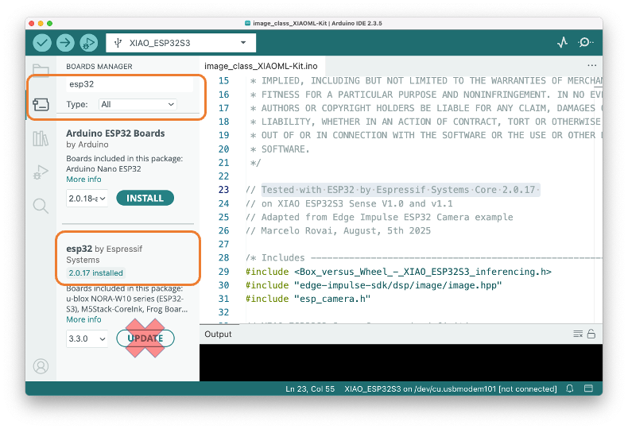
</p>

- Откройте Serial Monitor.
- Наведите камеру на объекты и проверьте результат в Serial Monitor.

<p align="center">
  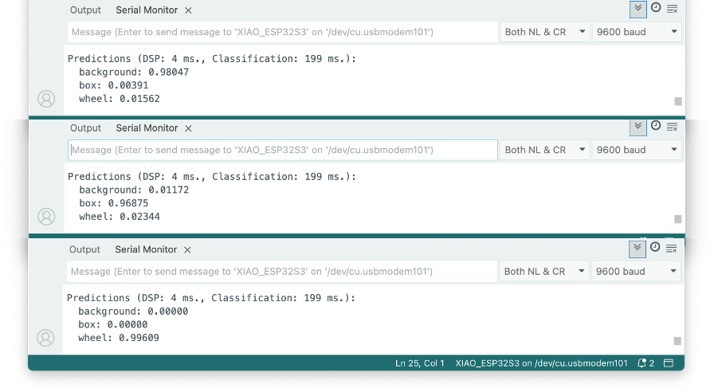
</p>

### Постобработка

В приложениях периферийного ИИ ценность результата инференса определяется тем, насколько мы можем на него отреагировать. Последовательный вывод даёт подробную информацию для отладки и разработки, однако в реальных развёртываниях нужна немедленная обратная связь, понятная человеку и не зависящая от внешних мониторов или соединений.

Маленький 0,42-дюймовый OLED-дисплей XIAOML Kit ($72{\times}40$ пикселей) становится важным компонентом постобработки: он превращает сырые результаты инференса в понятную человеку обратную связь — выводит названия классов и уровни уверенности прямо на устройстве. Это исключает необходимость во внешних мониторах и позволяет создавать по-настоящему автономные периферийные ИИ-системы в промышленности, сельском хозяйстве или розничной торговле, где мгновенное визуальное подтверждение предсказаний ИИ особенно важно.

Теперь изменим скетч так, чтобы он автоматически адаптировался к модели, обученной в Edge Impulse: он будет читать названия классов и их количество прямо из модели. На дисплее будут показываться сокращённые названия классов (по 3 буквы) крупным шрифтом для лучшей читаемости на маленьком дисплее $72{\times}40$ пикселей. Скачайте код с GitHub: [XIAOML-Kit-Img_Class_OLED_Gen](https://github.com/Mjrovai/XIAO-ESP32S3-Sense/tree/main/XIAOML_Kit_code/XIAOML-Kit-Img_Class_OLED_Gen).

Запустим код и посмотрим результат:

<p align="center">
  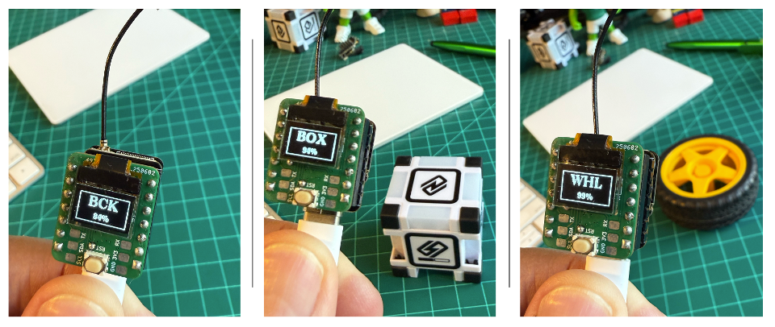
</p>

## Итоги

XIAO ESP32S3 Sense — очень способная и гибкая платформа для приложений классификации изображений. В ходе этой лабораторной работы мы изучили два разных подхода к разработке, которые подходят разному уровню подготовки и требованиям проекта.

- **SenseCraft AI Studio** даёт доступную отправную точку с **интерфейсом без кода**, позволяя быстро создавать прототипы и развёртывать предобученные модели, например для распознавания людей. С инференсом в реальном времени и встроенными средствами постобработки она показывает, как ИИ можно развернуть без глубоких знаний программирования или ML.

- Для более сложных приложений **Edge Impulse Studio** предлагает полноценные инструменты конвейера машинного обучения: управление собственными наборами данных, перенос обучения с несколькими предобученными моделями (например, MobileNet) и оптимизацию модели.

Ключевые выводы этой лабораторной работы: важность компромисса между разрешением изображения, эффективность переноса обучения для небольших наборов данных и практические соображения развёртывания периферийного ИИ — энергопотребление и ограничения памяти.

Работа демонстрирует фундаментальные принципы TinyML, которые выходят за рамки конкретного оборудования: инференс при ограниченных ресурсах, требования к обработке в реальном времени и полный путь от сбора данных через развёртывание модели до практических применений. Благодаря встроенным средствам постобработки, включая управление GPIO и протоколы связи, XIAO становится не просто движком инференса, а полноценной платформой ИИ-датчика.

Эта основа в классификации изображений подготовит вас к более сложным задачам компьютерного зрения и покажет, как современный периферийный ИИ делает продвинутое компьютерное зрение доступным, экономичным и применимым во встраиваемых системах реального мира — от промышленной автоматизации до систем «умного дома».

## Ресурсы

- [Начало работы с XIAO ESP32S3](https://wiki.seeedstudio.com/xiao_esp32s3_getting_started/)
- [SenseCraft AI Studio](https://sensecraft.seeed.cc/ai/home)
- [Рабочее пространство SenseCraft Vision](https://sensecraft.seeed.cc/ai/device/local/32)
- [Пример набора данных](https://www.kaggle.com/kritikseth/fruit-and-vegetable-image-recognition)
- [Проект Edge Impulse](https://studio.edgeimpulse.com/public/757065/live)
- [XIAO как ИИ-датчик](https://wiki.seeedstudio.com/sensecraft-ai/tutorials/sensecraft-ai-output-libraries-xiao/)
- [Библиотека Seeed Arduino SSCMA](https://github.com/Seeed-Studio/Seeed_Arduino_SSCMA)
- [Код XIAOML Kit](https://github.com/Mjrovai/XIAO-ESP32S3-Sense/tree/main/XIAOML_Kit_code)
