# Распознавание ключевых слов (KWS)

<p align="center">
  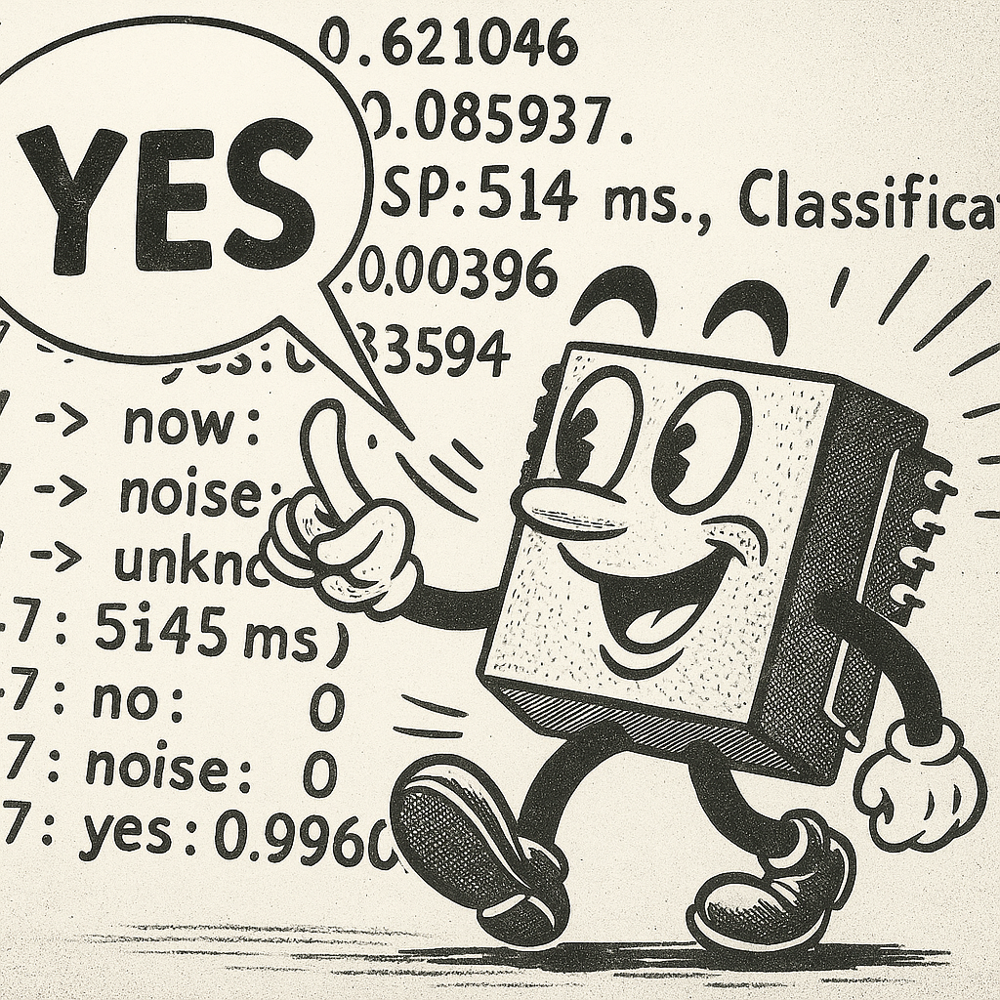<br>
  <em>Промпт DALL·E: иллюстрация в стиле мультфильма 1950-х на основе реального изображения Marcelo Rovai</em>
</p>

## Обзор

Распознавание ключевых слов (Keyword Spotting, KWS) — неотъемлемая часть многих систем распознавания речи: оно позволяет устройствам реагировать на определённые слова или фразы. Эта технология лежит в основе популярных устройств вроде Google Assistant или Amazon Alexa, но она в равной мере применима и достижима на небольших маломощных устройствах. Эта лабораторная работа проведёт вас через реализацию системы KWS с помощью TinyML на отладочной плате XIAO ESP32S3.

XIAO ESP32S3 с чипом ESP32-S3 от Espressif — компактный и мощный микроконтроллер с двухъядерным процессором Xtensa LX7, встроенными Wi-Fi и Bluetooth. Сочетание вычислительной мощности, энергоэффективности и гибкой связи делает его отличной платформой для приложений TinyML. Кроме того, благодаря плате расширения Sense у нас будет доступ к «sense»-части устройства, на которой есть камера, слот для SD-карты и **цифровой микрофон**. Встроенный микрофон и SD-карта будут ключевыми в этом проекте.

Мы будем использовать [Edge Impulse Studio](https://www.edgeimpulse.com/) — мощную и удобную платформу, которая упрощает создание моделей машинного обучения и их развёртывание на периферийных устройствах. Мы шаг за шагом обучим модель KWS, оптимизируем её и развернём на XIAO ESP32S3 Sense.

Наша модель будет распознавать ключевые слова, которые могут будить устройство или запускать определённые действия (в случае «YES»), и оживлять ваши проекты голосовым управлением.

Опираясь на опыт работы с TensorFlow Lite для микроконтроллеров (движок «под капотом» EI Studio), мы создадим систему KWS, способную выполнять машинное обучение в реальном времени прямо на устройстве.

По ходу работы мы разберём каждый этап — от сбора и подготовки данных до обучения модели и развёртывания, — чтобы дать полное представление о реализации системы KWS на микроконтроллере.

> **Цели обучения**
>
> - **Понять архитектуру голосового помощника**, включая каскадные системы обнаружения и роль распознавания ключевых слов на периферии как первого этапа конвейеров обработки голоса;
> - **Освоить методы сбора аудиоданных**: офлайн (микрофон XIAO ESP32S3 с записью на SD-карту) и онлайн (смартфон и Edge Impulse Studio);
> - **Реализовать цифровую обработку сигналов для аудио**: основы протокола I2S, дискретизацию аудио 16 кГц/16 бит и преобразование сигналов из временной области в признаки частотной области с помощью MFCC;
> - **Обучить свёрточные нейронные сети для классификации аудио** методом переноса обучения, с приёмами аугментации данных и оптимизацией модели для классификации по четырём классам (YES, NO, NOISE, UNKNOWN);
> - **Развернуть оптимизированные модели на микроконтроллерах** с квантизацией (INT8), управлением памятью через PSRAM и оптимизацией инференса в реальном времени для встраиваемых систем;
> - **Создать полные конвейеры постобработки**, включая пороги уверенности, управление GPIO для внешних устройств, интеграцию OLED-дисплея и создание автономных ИИ-датчиков;
> - **Сравнить способы разработки** на платформах без кода (Edge Impulse Studio) и в традиционном программировании встраиваемых систем (Arduino IDE) для приложений TinyML.

## Проект KWS

### Как работает голосовой помощник?

Распознавание ключевых слов (KWS) критически важно для многих голосовых помощников: оно позволяет устройствам реагировать на определённые слова или фразы. Для начала важно понять, что голосовые помощники на рынке, например Google Home или Amazon Echo Dot, реагируют на человека, только когда их «будят» определённые ключевые слова: «Hey Google» в первом случае и «Alexa» во втором.

<p align="center">
  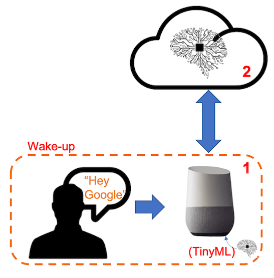
</p>

Иначе говоря, распознавание голосовых команд основано на многоступенчатой модели, или каскадном обнаружении (Cascade Detection).

<p align="center">
  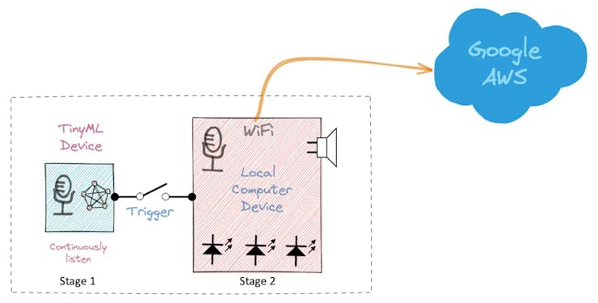
</p>

**Этап 1:** маленький микропроцессор внутри Echo Dot или Google Home **постоянно** слушает звук и ждёт, когда будет распознано ключевое слово. Для такого обнаружения на периферии используется модель TinyML (приложение KWS).

**Этап 2:** данные отправляются в облако и обрабатываются более крупной моделью, только если приложение KWS на этапе 1 сработало.

В видео ниже показан пример: я эмулирую Google Assistant на Raspberry Pi (этап 2), а в роли устройства TinyML (этап 1) используется Arduino Nano 33 BLE.

<p align="center">
  <iframe width="560" height="315" src="https://www.youtube.com/embed/e_OPgcnsyvM" title="Эмуляция Google Assistant на Raspberry Pi с устройством TinyML" frameborder="0" allowfullscreen></iframe>
</p>

> Если хотите глубже изучить весь проект, см. моё руководство: [Building an Intelligent Voice Assistant From Scratch](https://www.hackster.io/mjrobot/building-an-intelligent-voice-assistant-from-scratch-2199c3).

В этой лабораторной работе мы сосредоточимся на этапе 1 (KWS, или Keyword Spotting), где используем XIAO ESP32S3 Sense с цифровым микрофоном для распознавания ключевого слова.

### Конвейер инференса

Схема ниже показывает, как должно работать итоговое приложение KWS (во время инференса):

<p align="center">
  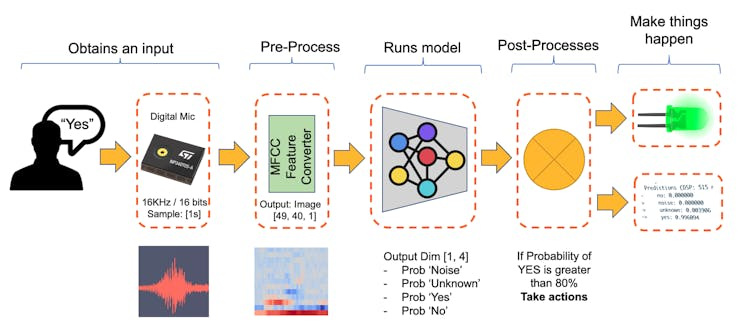
</p>

Наше приложение KWS будет распознавать четыре класса звуков:

- **YES** (ключевое слово 1);
- **NO** (ключевое слово 2);
- **NOISE** (ключевых слов нет, есть только фоновый шум);
- **UNKNOWN** (смесь слов, отличных от YES и NO).

> Для реальных проектов всегда рекомендуется включать в набор не только ключевые слова, но и другие слова и звуки, например «Noise» (шум или фон) и «Unknown» (неизвестные слова).

### Рабочий процесс машинного обучения

Главный компонент приложения KWS — его модель. Поэтому нужно обучить модель на наших ключевых словах, шуме и других словах («unknown»):

<p align="center">
  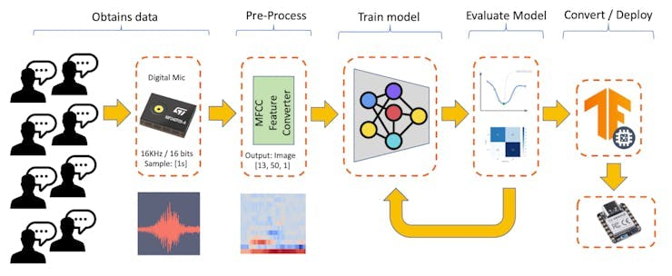
</p>

## Набор данных

Критически важный компонент рабочего процесса машинного обучения — **набор данных**. Выбрав конкретные ключевые слова (*YES* и NO), мы можем воспользоваться набором данных, который разработал Пит Уорден (Pete Warden): [«Speech Commands: A Dataset for Limited-Vocabulary Speech Recognition»](https://arxiv.org/pdf/1804.03209.pdf). В этом наборе 35 ключевых слов (по более чем 1000 образцов каждого), например yes, no, stop и go. То есть для *yes* и *no* можно получить по 1500 образцов.

Небольшую часть набора данных можно скачать из Edge Impulse Studio ([готовый набор данных для распознавания ключевых слов](https://docs.edgeimpulse.com/docs/pre-built-datasets/keyword-spotting)). Он включает образцы четырёх классов, которые мы будем использовать в проекте: yes, no, noise и background. Для этого выполните следующие шаги:

- Скачайте [набор ключевых слов](https://cdn.edgeimpulse.com/datasets/keywords2.zip).
- Распакуйте файл в удобное место.

Хотя данных из набора Пита много, рекомендуется записать и слова, которые произнесём сами. При работе с акселерометрами важно было собирать набор данных датчиком того же типа. Для *звука* ситуация иная, потому что на самом деле мы классифицируем *аудио*.

> Ключевое различие между звуком и аудио — в виде энергии. Звук — это энергия механических волн (продольных звуковых волн), которые распространяются в среде и вызывают колебания давления. Аудио — это электрическая энергия (аналоговые или цифровые сигналы), которая электрически представляет звук.

Когда мы произносим ключевое слово, звуковые волны нужно преобразовать в аудиоданные. Преобразование выполняется дискретизацией сигнала с микрофона с частотой 16 кГц и разрядностью 16 бит.

Поэтому подойдёт любое устройство, которое может создавать аудиоданные с такими базовыми параметрами (16 кГц/16 бит). В качестве устройства можно использовать XIAO ESP32S3 Sense, компьютер или даже смартфон.

<p align="center">
  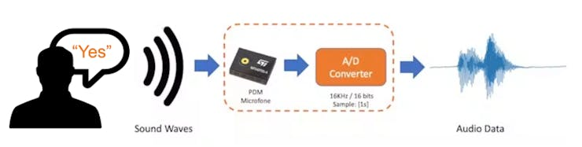
</p>

**Онлайн-запись аудиоданных с Edge Impulse и смартфона**

В лабораторной работе «Классификация движения и обнаружение аномалий» мы подключали устройство напрямую к Edge Impulse Studio для сбора данных (с частотой дискретизации 50–100 Гц). Для такой низкой частоты можно было использовать функцию CLI Data Forwarder, однако, по словам Jan Jongboom, CTO Edge Impulse, *аудио (16 кГц) передаётся слишком быстро для Data Forwarder*. Поэтому, получив цифровые данные с микрофона, мы можем *превратить их в файл WAV* и отправить в Studio через Data Uploader (так же, как мы поступим с набором Пита).

> Если хотите собирать аудио непосредственно в Studio, можно использовать любой смартфон, подключённый к Studio через интернет. Этот вариант мы здесь рассматривать не будем, но вы легко найдёте его описание в [документации EI](https://docs.edgeimpulse.com/docs/development-platforms/using-your-mobile-phone).

### Офлайн-запись аудиоданных с XIAO ESP32S3 Sense

Встроенный микрофон — [MSM261D3526H1CPM](https://files.seeedstudio.com/wiki/XIAO-BLE/mic-MSM261D3526H1CPM-ENG.pdf), MEMS-микрофон с PDM-выходом и несколькими режимами работы. Внутри он подключён к ESP32S3 через шину I2S: выводы IO42 (тактовый сигнал) и IO41 (данные).

<p align="center">
  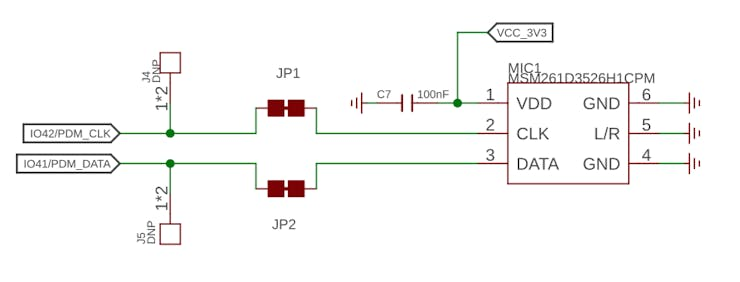
</p>

**Что такое I2S?**

I2S (Inter-IC Sound) — стандартный протокол для передачи цифрового аудио от одного устройства к другому. Его первоначально разработала Philips Semiconductor (ныне NXP Semiconductors). Он широко используется в аудиоустройствах, например в цифровых сигнальных процессорах, цифровых аудиопроцессорах и, всё чаще, в микроконтроллерах с поддержкой цифрового аудио (как в нашем случае).

Протокол I2S состоит как минимум из трёх линий:

<p align="center">
  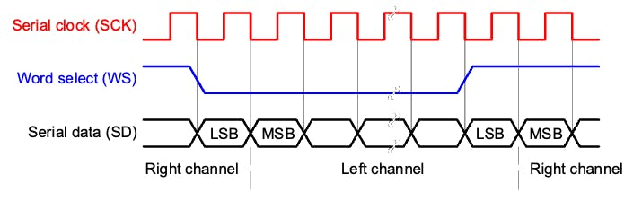
</p>

**1. Линия битового (или последовательного) тактового сигнала (BCLK или CLK):** переключается, чтобы обозначить начало нового бита данных (вывод IO42).

**2. Линия выбора слова (WS):** переключается, чтобы обозначить начало нового слова (левого или правого канала). Частота сигнала выбора слова (WS) задаёт частоту дискретизации. В нашем случае вывод L/R на микрофоне подключён к земле, поэтому используется только левый канал (моно).

**3. Линия данных (SD):** по ней передаются аудиоданные (вывод IO41).

В потоке данных I2S данные передаются последовательностью кадров, каждый из которых содержит слово левого канала и слово правого канала. Поэтому I2S особенно удобен для передачи стереоаудио, однако он может использоваться и для моно- или многоканального звука с дополнительными линиями данных.

Начнём с того, как записывать сырые данные с микрофона. Перейдите в [проект на GitHub](https://github.com/Mjrovai/XIAO-ESP32S3-Sense) и скачайте скетч [XIAOEsp2s3_Mic_Test](https://github.com/Mjrovai/XIAO-ESP32S3-Sense/tree/main/Mic_Test/XiaoEsp32s3_Mic_Test):

> ⚠️ **Внимание**
>
> - На XIAO ESP32S3 **ОБЯЗАТЕЛЬНО** должна быть включена PSRAM. Проверить это можно в верхнем меню Arduino IDE: `Tools` → `PSRAM:OPI PSRAM`;
> - Пакет поддержки плат (`esp32 by Espressif Systems`) должен быть **версии 2.0.17**. Пожалуйста, не обновляйте его.

```cpp
/*
  Простой тест микрофона XIAO ESP32S3
*/

#include <I2S.h>

void setup() {
  Serial.begin(115200);
  while (!Serial) {
  }

  // Запуск I2S с частотой 16 кГц и 16 битами на отсчёт
  I2S.setAllPins(-1, 42, 41, -1, -1);
  if (!I2S.begin(PDM_MONO_MODE, 16000, 16)) {
    Serial.println("Failed to initialize I2S!");
    while (1); // ничего не делать
  }
}

void loop() {
  // Считываем отсчёт
  int sample = I2S.read();

  if (sample && sample != -1 && sample != 1) {
    Serial.println(sample);
  }
}
```

Этот код — простой тест микрофона XIAO ESP32S3 с интерфейсом I2S (Inter-IC Sound). Он настраивает I2S на захват аудио с частотой дискретизации 16 кГц и 16 битами на отсчёт, затем непрерывно читает отсчёты с микрофона и выводит их в последовательный порт.

Разберём основные части кода:

- Подключение библиотеки I2S: она предоставляет функции для настройки и использования [интерфейса I2S](https://espressif-docs.readthedocs-hosted.com/projects/arduino-esp32/en/latest/api/i2s.html), который является стандартом для подключения цифровых аудиоустройств.
- `I2S.setAllPins(-1, 42, 41, -1, -1)`: настраивает выводы I2S. Параметры — (-1, 42, 41, -1, -1): второй параметр (42) — вывод тактового сигнала I2S (CLK), третий (41) — вывод данных I2S (DATA). Остальные параметры равны -1, то есть эти выводы не используются.
- `I2S.begin(PDM_MONO_MODE, 16000, 16)`: инициализирует I2S в режиме моно PDM (Pulse Density Modulation) с частотой дискретизации 16 кГц и 16 битами на отсчёт. Если инициализация не удалась, выводится сообщение об ошибке и программа останавливается.
- `int sample = I2S.read()`: считывает отсчёт аудио из интерфейса I2S.

Если отсчёт корректен, он выводится в Serial Monitor и Plotter.

Ниже показан тест: «шёпот» двумя разными тонами.

<p align="center">
  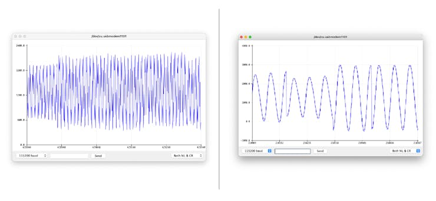
</p>

### Сохранение записанных звуковых образцов

Для записи аудиофайлов .wav на встроенный считыватель SD-карт нужно сначала включить PSRAM на XIAO.

> В ESP32-S3 на чипе микроконтроллера всего несколько сотен килобайт внутренней оперативной памяти. Этого может не хватить для некоторых задач, поэтому ESP32-S3 может использовать до 16 МБ внешней PSRAM (псевдостатического ОЗУ), подключённой параллельно к флеш-чипу SPI. Внешняя память включена в адресное пространство процессора и при определённых ограничениях может использоваться так же, как внутренняя оперативная память данных.

Для начала вставьте SD-карту в XIAO, как показано на фото ниже (SD-карта должна быть отформатирована в FAT32).

<p align="center">
  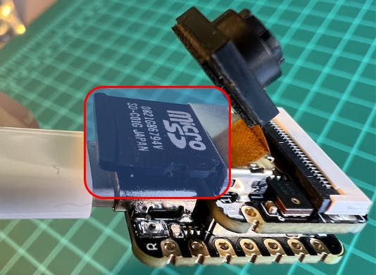
</p>

Включите функцию PSRAM микросхемы ESP-32 (Arduino IDE): `Tools > PSRAM: "OPI PSRAM" > OPI PSRAM`.

<p align="center">
  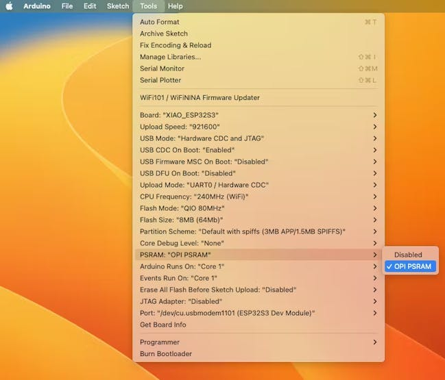
</p>

- Скачайте скетч [Wav_Record_dataset](https://github.com/Mjrovai/XIAO-ESP32S3-Sense/tree/main/Wav_Record_dataset) из репозитория проекта на GitHub.

Этот код записывает аудио через интерфейс I2S платы Seeed XIAO ESP32S3 Sense, сохраняет запись в виде файла .wav на SD-карту и позволяет управлять процессом записи командами, которые отправляются через Serial Monitor. Имя аудиофайла можно задать (оно должно совпадать с метками классов для обучения), и можно делать несколько записей, каждая из которых сохраняется в новый файл. Код также включает функцию увеличения громкости записей.

Разберём самые важные части кода:

```cpp
#include <I2S.h>
#include "FS.h"
#include "SD.h"
#include "SPI.h"
```

Это необходимые библиотеки для программы. I2S.h позволяет вводить аудио, FS.h предоставляет возможности работы с файловой системой, SD.h позволяет программе работать с SD-картой, а SPI.h отвечает за связь SPI с SD-картой.

```cpp
#define RECORD_TIME   10
#define SAMPLE_RATE 16000U
#define SAMPLE_BITS 16
#define WAV_HEADER_SIZE 44
#define VOLUME_GAIN 2
```

Здесь заданы различные константы программы.

- **RECORD_TIME** задаёт длительность записи аудио в секундах.
- **SAMPLE_RATE** и **SAMPLE_BITS** задают качество записи.
- **WAV_HEADER_SIZE** задаёт размер заголовка файла .wav.
- **VOLUME_GAIN** используется для увеличения громкости записи.

```cpp
int fileNumber = 1;
String baseFileName;
bool isRecording = false;
```

Эти переменные хранят номер текущего файла (для создания уникальных имён файлов), базовое имя файла и признак того, идёт ли сейчас запись.

```cpp
void setup() {
  Serial.begin(115200);
  while (!Serial);

  I2S.setAllPins(-1, 42, 41, -1, -1);
  if (!I2S.begin(PDM_MONO_MODE, SAMPLE_RATE, SAMPLE_BITS)) {
    Serial.println("Failed to initialize I2S!");
    while (1);
  }

  if(!SD.begin(21)){
    Serial.println("Failed to mount SD Card!");
    while (1);
  }
  Serial.printf("Enter with the label name\n");
}
```

Функция setup инициализирует последовательный порт, интерфейс I2S для аудиовхода и интерфейс SD-карты. Если I2S не инициализировался или SD-карта не смонтировалась, выводится сообщение об ошибке и выполнение останавливается.

```cpp
void loop() {
  if (Serial.available() > 0) {
    String command = Serial.readStringUntil('\n');
    command.trim();
    if (command == "rec") {
      isRecording = true;
    } else {
      baseFileName = command;
      fileNumber = 1; // сбрасываем номер файла при каждом
                        // задании нового базового имени
      Serial.printf("Send rec for starting recording label \n");
    }
  }
  if (isRecording && baseFileName != "") {
    String fileName = "/" + baseFileName + "."
                      + String(fileNumber) + ".wav";
    fileNumber++;
    record_wav(fileName);
    delay(1000); // задержка, чтобы не записать несколько файлов
                    // одновременно
    isRecording = false;
  }
}
```

В основном цикле программа ждёт команду из Serial Monitor. Если команда — `rec`, программа начинает запись. В противном случае команда считается базовым именем для файлов .wav. Если сейчас идёт запись и задано базовое имя, программа записывает аудио и сохраняет его в файл .wav. Имена файлов формируются добавлением номера файла к базовому имени.

```cpp
void record_wav(String fileName)
{
  ...

  File file = SD.open(fileName.c_str(), FILE_WRITE);
  ...
  rec_buffer = (uint8_t *)ps_malloc(record_size);
  ...

  esp_i2s::i2s_read(esp_i2s::I2S_NUM_0,
                    rec_buffer,
                    record_size,
                    &sample_size,
                    portMAX_DELAY);
  ...
}
```

Эта функция записывает аудио и сохраняет его в файл .wav с заданным именем. Сначала инициализируются переменные sample_size и record_size. Значение record_size вычисляется по частоте дискретизации, разрядности и желаемой длительности записи. Рассмотрим важные части:

```cpp
File file = SD.open(fileName.c_str(), FILE_WRITE);
// Записываем заголовок в файл WAV
uint8_t wav_header[WAV_HEADER_SIZE];
generate_wav_header(wav_header, record_size, SAMPLE_RATE);
file.write(wav_header, WAV_HEADER_SIZE);
```

Этот фрагмент открывает файл на SD-карте для записи, формирует заголовок .wav с помощью функции generate_wav_header и записывает его в файл.

```cpp
// Выделение памяти в PSRAM для записи
rec_buffer = (uint8_t *)ps_malloc(record_size);
if (rec_buffer == NULL) {
  Serial.printf("malloc failed!\n");
  while(1) ;
}
Serial.printf("Buffer: %d bytes\n", ESP.getPsramSize()
               - ESP.getFreePsram());
```

Функция ps_malloc выделяет память в PSRAM для записи. Если выделение не удалось (rec_buffer равен NULL), выводится сообщение об ошибке и выполнение останавливается.

```cpp
// Запуск записи
esp_i2s::i2s_read(esp_i2s::I2S_NUM_0,
         rec_buffer,
         record_size,
         &sample_size,
         portMAX_DELAY);
if (sample_size == 0) {
  Serial.printf("Record Failed!\n");
} else {
    Serial.printf("Record %d bytes\n", sample_size);
  }
```

Функция i2s_read считывает аудиоданные с микрофона в rec_buffer. Если данные не прочитаны (sample_size равен 0), выводится сообщение об ошибке.

```cpp
// Увеличиваем громкость
for (uint32_t i = 0; i < sample_size; i += SAMPLE_BITS/8) {
  (*(uint16_t *)(rec_buffer+i)) <<= VOLUME_GAIN;
}
```

Этот фрагмент увеличивает громкость записи, сдвигая значения отсчётов на VOLUME_GAIN.

```cpp
// Записываем данные в файл WAV
Serial.printf("Writing to the file ...\n");
if (file.write(rec_buffer, record_size) != record_size)
  Serial.printf("Write file Failed!\n");

free(rec_buffer);
file.close();
Serial.printf("Recording complete: \n");
Serial.printf("Send rec for a new sample or enter "
              "a new label\n\n");
```

Наконец, аудиоданные записываются в файл .wav. Если запись не удалась, выводится сообщение об ошибке. После записи память, выделенная под rec_buffer, освобождается и файл закрывается. Функция заканчивается сообщением о завершении и предложением отправить новую команду.

```cpp
void generate_wav_header(uint8_t *wav_header,
             uint32_t wav_size,
             uint32_t sample_rate)
{
  ...
  memcpy(wav_header, set_wav_header, sizeof(set_wav_header));
}
```

Функция generate_wav_header формирует заголовок файла .wav на основе параметров (wav_size и sample_rate). Она создаёт массив байтов по формату .wav: поля размера файла, аудиоформата, количества каналов, частоты дискретизации, битовой скорости, выравнивания блоков, разрядности и размера данных. Готовый заголовок копируется в массив wav_header, переданный в функцию.

Теперь загрузите код на XIAO и запишите образцы ключевых слов (yes и no). Также можно записать шум и другие слова.

Serial Monitor предложит получить метку, которую нужно записать:

<p align="center">
  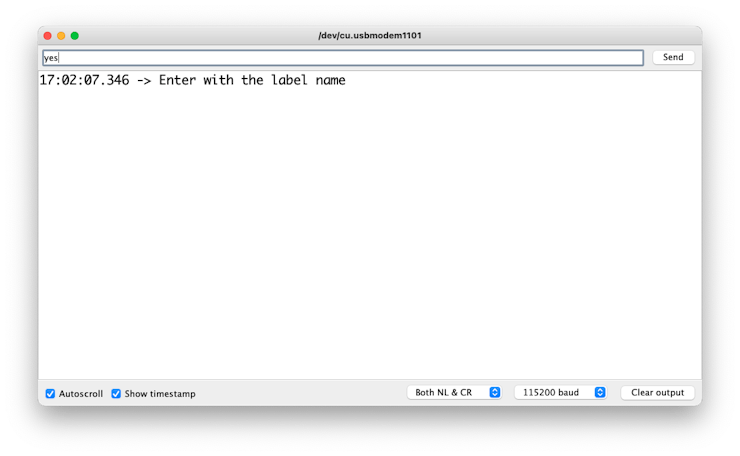
</p>

Отправьте метку (например, yes). Программа будет ждать следующую команду: rec.

<p align="center">
  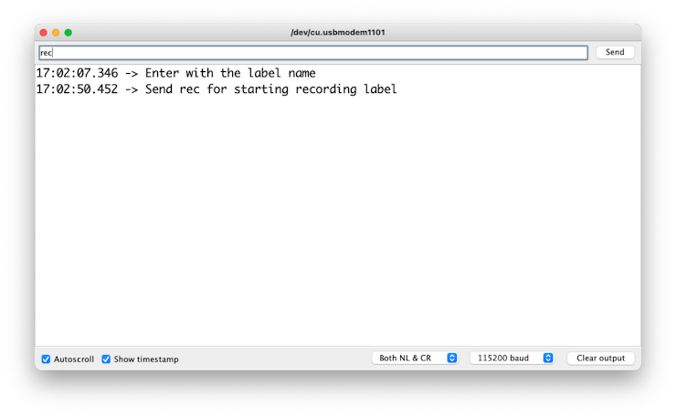
</p>

Программа будет записывать новые образцы каждый раз, когда получает команду rec. Файлы сохраняются как yes.1.wav, yes.2.wav, yes.3.wav и так далее, пока не будет отправлена новая метка (например, no). В этом случае для каждого нового образца нужно отправлять команду rec; файлы будут сохраняться как no.1.wav, no.2.wav, no.3.wav и так далее.

<p align="center">
  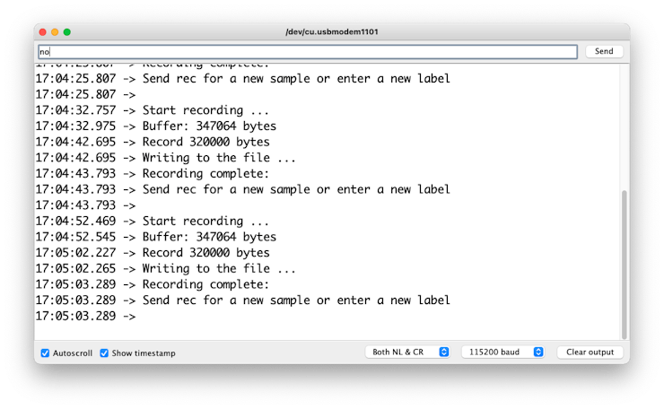
</p>

В итоге на SD-карте появятся сохранённые файлы.

<p align="center">
  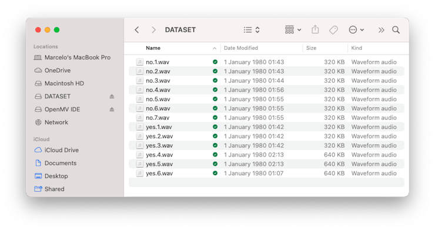
</p>

Файлы готовы к загрузке в Edge Impulse Studio.

### Приложения для офлайн-записи аудиоданных

Аудиоданные можно записывать разными способами. Самый простой — использовать смартфон или ПК как **подключённое устройство** в [Edge Impulse Studio](https://docs.edgeimpulse.com/docs/edge-ai-hardware/using-your-mobile-phone).

> ПК или смартфон должны записывать аудио с частотой дискретизации 16 кГц и разрядностью 16 бит.

Другой вариант — специализированные приложения. Хорошее приложение для этого — [*Voice Recorder Pro*](https://www.bejbej.ca/app/voicerecordpro) ([iOS](https://www.bejbej.ca/app/voicerecordpro)). Записи нужно сохранять как файлы .wav и отправлять на компьютер.

<p align="center">
  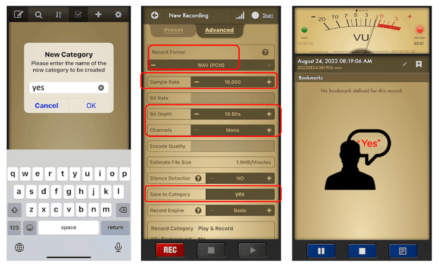
</p>

## Обучение модели в Edge Impulse Studio

### Загрузка данных

Когда сырой набор данных определён и собран (набор Пита и записанные ключевые слова), создадим новый проект в Edge Impulse Studio:

<p align="center">
  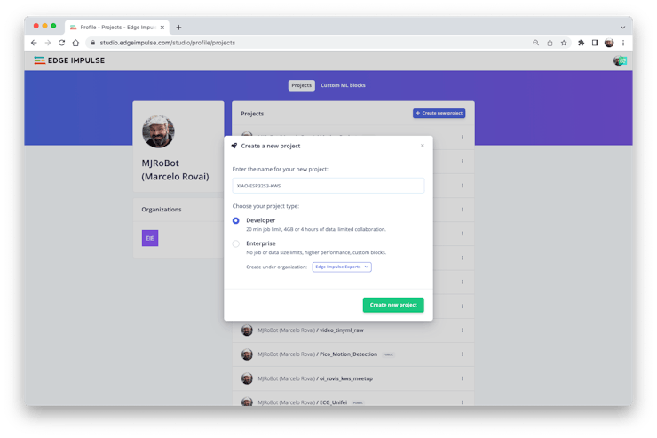
</p>

После создания проекта выберите инструмент Upload Existing Data в разделе Data Acquisition. Выберите файлы для загрузки:

<p align="center">
  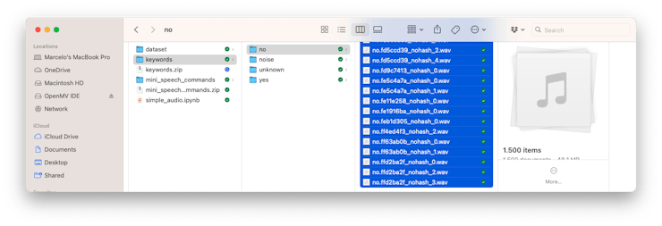
</p>

Загрузите их в Studio (можно автоматически разделить данные на обучающую и тестовую выборки). Повторите для всех классов и всех сырых данных.

<p align="center">
  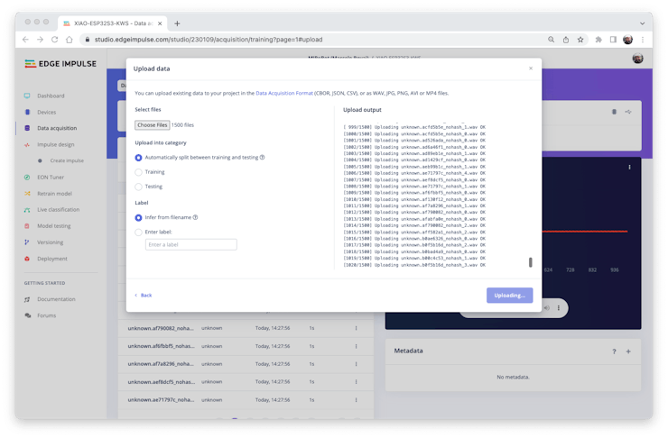
</p>

Образцы появятся в разделе Data acquisition.

<p align="center">
  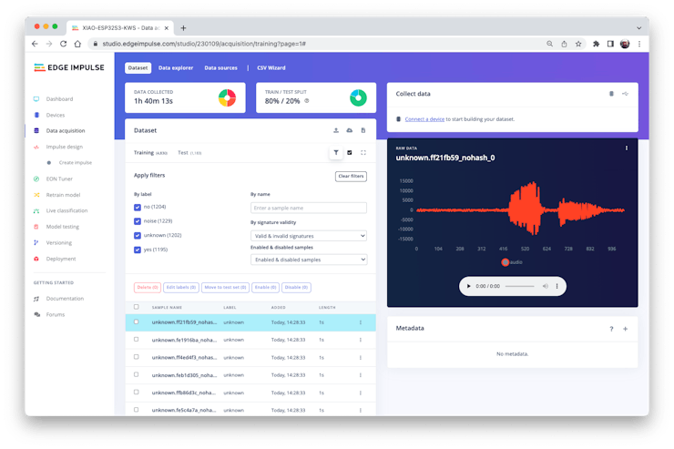
</p>

Все данные из набора Пита имеют длительность 1 с, а образцы, записанные в предыдущем разделе, длятся 10 с. Поэтому их нужно разбить на отрезки по 1 с, чтобы они были совместимы.

Нажмите «три точки» после названия образца и выберите Split sample.

<p align="center">
  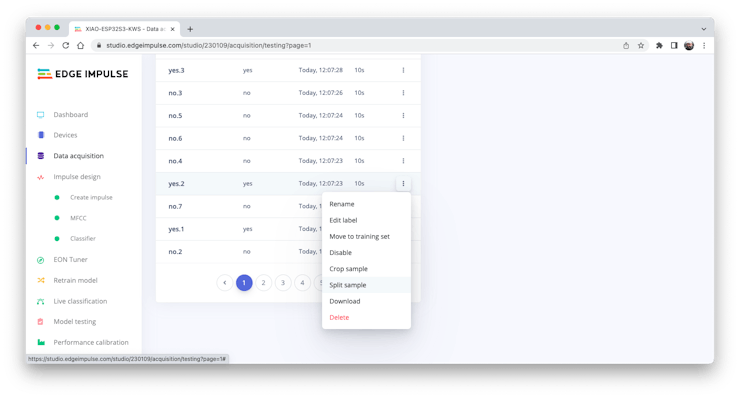
</p>

Внутри инструмента разбейте данные на записи по 1 секунде. При необходимости добавьте или удалите сегменты:

<p align="center">
  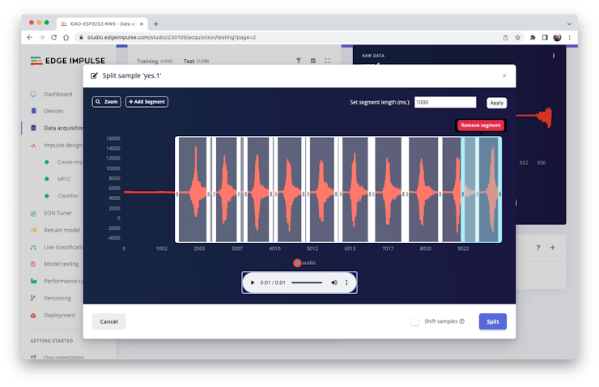
</p>

Эту процедуру нужно повторить для всех образцов.

> Примечание: для более длинных аудиофайлов (минуты) сначала разбейте их на сегменты по 10 секунд, а затем снова используйте инструмент, чтобы получить окончательные отрезки по 1 секунде.

Если при загрузке данные не разделялись автоматически на обучающую и тестовую выборки, это можно сделать вручную (через меню «три точки», перемещая образцы по одному) или с помощью Perform Train / Test Split на вкладке Dashboard в разделе Danger Zone.

> При желании все наборы данных можно проверить на вкладке Data Explorer.

### Создание Impulse (предобработка и определение модели)

*Impulse получает сырые данные, с помощью обработки сигналов извлекает признаки, а затем использует блок обучения для классификации новых данных.*

<p align="center">
  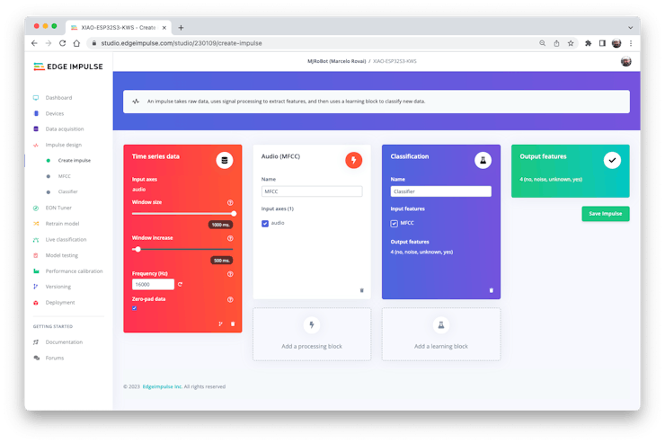
</p>

Сначала мы возьмём точки данных с окном в 1 секунду, применим аугментацию и будем сдвигать окно каждые 500 мс. Обратите внимание, что включён параметр zero-pad data (дополнение нулями). Он важен: образцы короче 1 секунды дополняются нулями (в некоторых случаях я уменьшал окно 1000 мс в инструменте разбиения, чтобы избежать шумов и выбросов).

Каждый образец аудио длиной 1 секунда предобрабатывается и преобразуется в изображение (например, $13\times 49\times 1$). Мы будем использовать MFCC — метод, который извлекает признаки из аудиосигналов с помощью [мел-частотных кепстральных коэффициентов](https://en.wikipedia.org/wiki/Mel-frequency_cepstrum), хорошо подходящих для человеческого голоса.

<p align="center">
  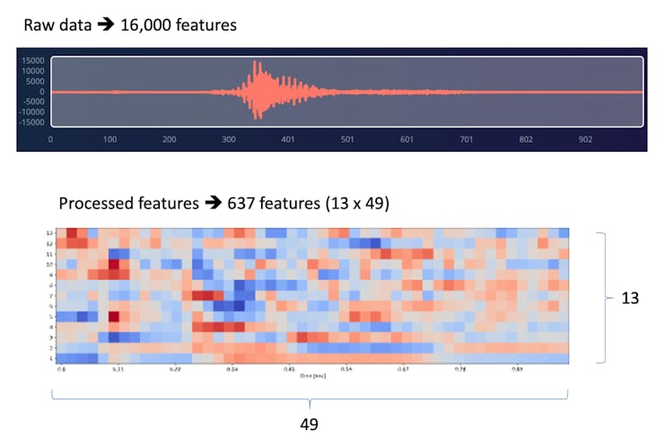
</p>

Далее мы выбираем Keras для классификации и строим модель с нуля, используя классификацию изображений с помощью свёрточной нейронной сети (CNN).

### Предобработка (MFCC)

Следующий шаг — создать изображения для обучения на следующем этапе:

Можно оставить значения параметров по умолчанию или воспользоваться опцией DSP Autotune parameters, что и сделаем.

<p align="center">
  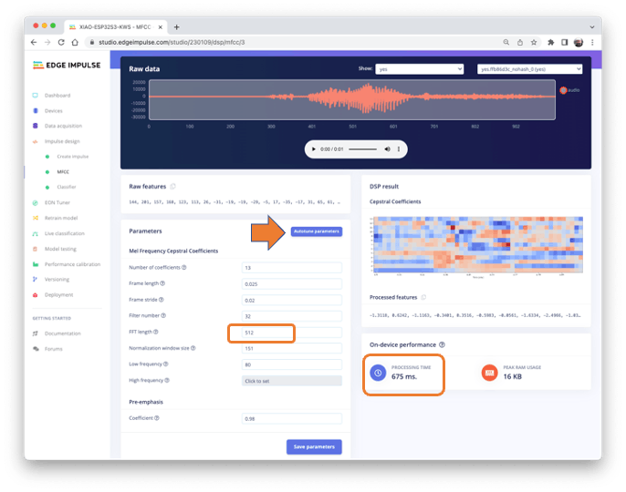
</p>

Предобработка почти не расходует памяти (всего 16 КБ), однако расчётное время обработки довольно велико: 675 мс для Espressif ESP-EYE (ближайший доступный эталон) при тактовой частоте 240 МГц (как у нашего устройства), но с более слабым процессором (Xtensa LX6 вместо LX7 у ESP32S3). Реальное время инференса должно быть меньше.

Если позже понадобится уменьшить время инференса, вернитесь к этапу предобработки и, например, уменьшите длину FFT до 256, измените количество коэффициентов или другой параметр.

Пока оставим параметры, заданные инструментом автонастройки. Сохраним параметры и сгенерируем признаки.

<p align="center">
  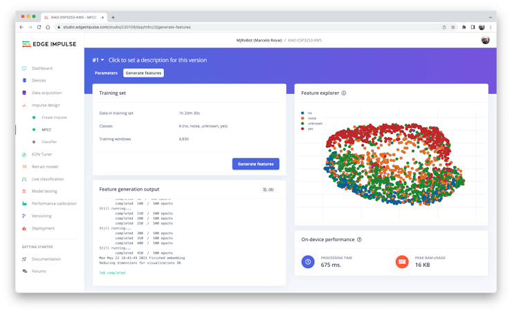
</p>

> Если хотите подробнее изучить преобразование временных последовательных данных в изображения с помощью FFT, спектрограммы и т. п., можете поэкспериментировать с этим блокнотом Colab: [Audio Raw Data Analysis](https://colab.research.google.com/github/Mjrovai/UNIFEI-IESTI01-TinyML-2022.1/blob/main/00_Curse_Folder/2_Applications_Deploy/Class_24/IESTI01_Audio_Raw_Data_Analisys.ipynb).

### Проектирование модели и обучение

Мы будем использовать свёрточную нейронную сеть (CNN). Базовая архитектура состоит из двух блоков Conv1D + MaxPooling (с 8 и 16 нейронами соответственно) и Dropout 0,25. На последнем слое, после Flatten, четыре нейрона — по одному на каждый класс:

<p align="center">
  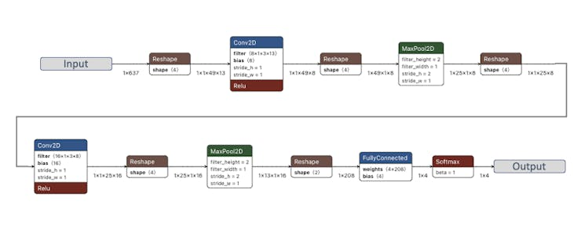
</p>

Гиперпараметры: скорость обучения (Learning Rate) 0,005, модель обучается за 100 эпох. Также добавим аугментацию данных, в том числе добавление шума. Результат выглядит хорошо:

<p align="center">
  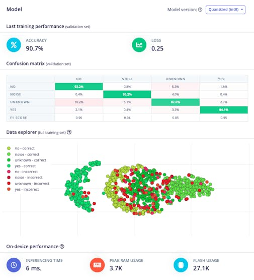
</p>

Если хотите понять, что происходит «под капотом», можно скачать набор данных и запустить блокнот Jupyter, поэкспериментировать с кодом. Например, можно проанализировать точность по каждой эпохе:

<p align="center">
  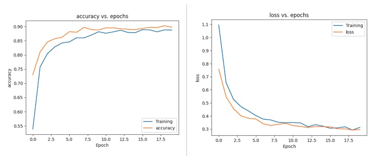
</p>

Этот блокнот Colab поможет узнать, как двигаться дальше: [KWS Classifier Project — Looking «Under the hood»](https://colab.research.google.com/github/Mjrovai/XIAO-ESP32S3-Sense/blob/main/KWS%20Training/xiao_esp32s3_keyword_spotting_project_nn_classifier.ipynb).

## Тестирование

Тестирование модели на данных, отложенных до обучения (тестовых данных), дало точность около 87 %.

<p align="center">
  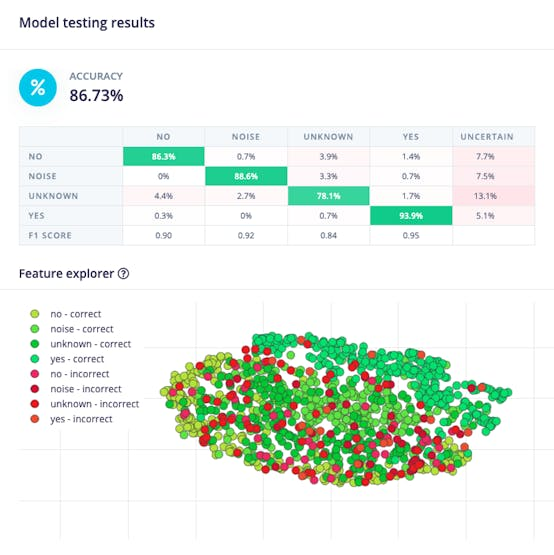
</p>

Если посмотреть F1-меру, для YES получилось 0,95 — отличный результат, поскольку именно это слово мы будем использовать как «триггер» для постобработки (включения встроенного светодиода). Даже для NO получилось 0,90. Худший результат — у unknown, и это нормально.

Можно переходить к проекту, но перед развёртыванием на устройстве полезно выполнить классификацию в реальном времени с помощью смартфона. Перейдите в раздел Live Classification и нажмите Connect a Development board:

<p align="center">
  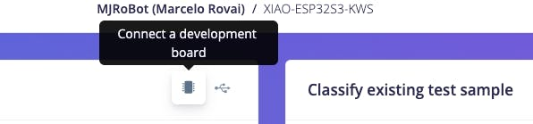
</p>

Наведите телефон на QR-код и выберите ссылку.

<p align="center">
  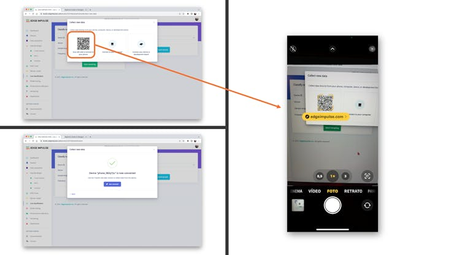
</p>

Телефон подключится к Studio. В приложении выберите опцию Classification и, когда она запустится, начните проверять свои ключевые слова, убедившись, что модель работает на реальных данных в реальном времени:

<p align="center">
  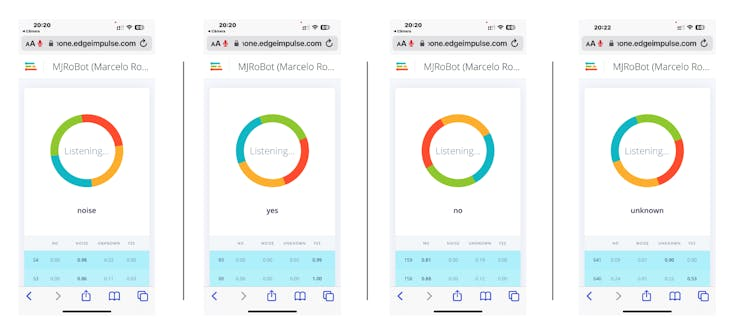
</p>

## Развёртывание и инференс

Studio упакует все нужные библиотеки, функции предобработки и обученные модели и загрузит их на компьютер. Выберите опцию Arduino Library, затем внизу выберите Quantized (Int8) и нажмите Build.

<p align="center">
  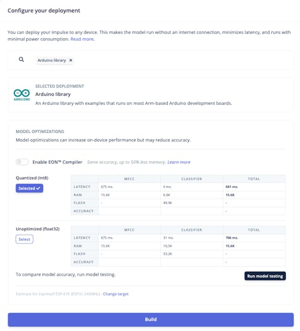
</p>

Теперь пора провести настоящий тест. Мы будем делать инференс, полностью отключившись от Studio. Изменим один из примеров кода для ESP32, созданных при развёртывании Arduino Library.

В Arduino IDE откройте вкладку File/Examples, найдите свой проект и выберите esp32/esp32_microphone:

<p align="center">
  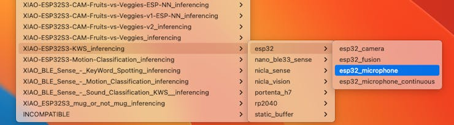
</p>

Этот код создан для встроенного микрофона ESP-EYE и его нужно адаптировать под наше устройство.

Начнём с замены библиотек для работы с шиной I2S:

<p align="center">
  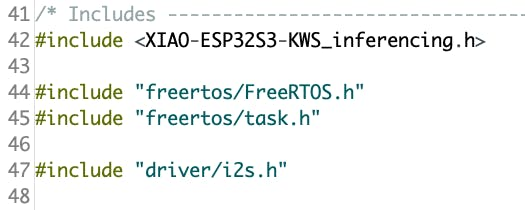
</p>

На:

```cpp
#include <I2S.h>
#define SAMPLE_RATE 16000U
#define SAMPLE_BITS 16
```

Инициализируйте микрофон I2S в функции setup(), добавив строки:

```cpp
void setup()
{
...
    I2S.setAllPins(-1, 42, 41, -1, -1);
    if (!I2S.begin(PDM_MONO_MODE, SAMPLE_RATE, SAMPLE_BITS)) {
      Serial.println("Failed to initialize I2S!");
    while (1) ;
...
}
```

В функции `static void capture_samples(void* arg)` замените строку 153, которая читает данные с микрофона I2S:

<p align="center">
  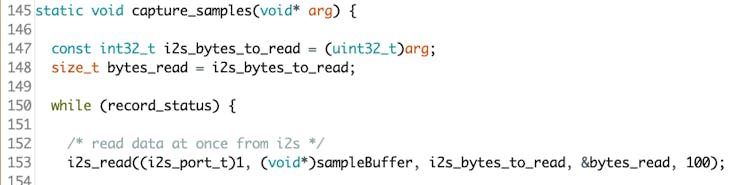
</p>

На:

```cpp
/* Чтение данных сразу из i2s */
esp_i2s::i2s_read(esp_i2s::I2S_NUM_0,
                 (void*)sampleBuffer,
                 i2s_bytes_to_read,
                 &bytes_read, 100);
```

В функции `static bool microphone_inference_start(uint32_t n_samples)` закомментируйте или удалите строки 198–200, где вызывается функция инициализации микрофона. Она больше не нужна, поскольку микрофон I2S уже инициализирован в setup().

<p align="center">
  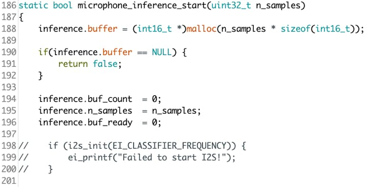
</p>

Наконец, в функции `static void microphone_inference_end(void)` замените строку 243:

<p align="center">
  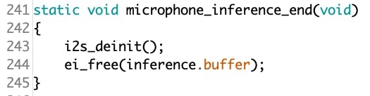
</p>

На:

```cpp
static void microphone_inference_end(void)
{
    free(sampleBuffer);
    ei_free(inference.buffer);
}
```

Полный код есть в [репозитории проекта на GitHub](https://github.com/Mjrovai/XIAO-ESP32S3-Sense/tree/main/xiao_esp32s3_microphone). Загрузите скетч на плату и проверьте реальный инференс:

> ⚠️ **Внимание**
>
> - На XIAO ESP32S3 **ОБЯЗАТЕЛЬНО** должна быть включена PSRAM. Проверить это можно в верхнем меню Arduino IDE: `Tools` → `PSRAM:OPI PSRAM`;
> - Пакет поддержки плат (`esp32 by Espressif Systems`) должен быть **версии 2.0.17**. Пожалуйста, не обновляйте его.

<p align="center">
  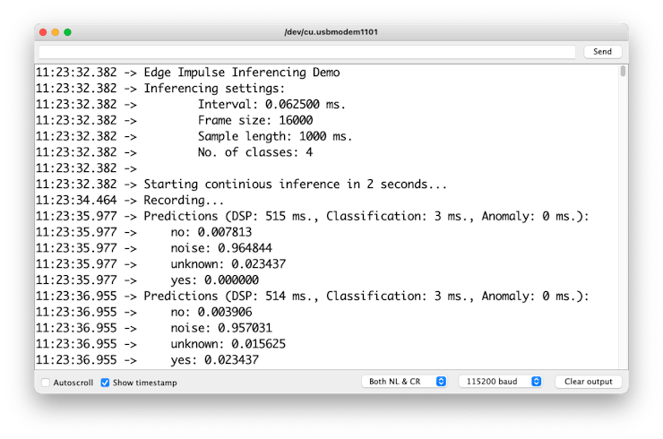
</p>

## Постобработка

В приложениях периферийного ИИ ценность результата инференса определяется тем, насколько мы можем на него отреагировать. Последовательный вывод даёт подробную информацию для отладки и разработки, однако реальным развёртываниям нужна немедленная обратная связь, понятная человеку и не зависящая от внешних мониторов или соединений.

Рассмотрим два подхода к постобработке: использование встроенного светодиода XIAO и OLED-дисплея в XIAOML Kit.

### Светодиод

Теперь, когда мы знаем, что модель работает и распознаёт ключевые слова, изменим код так, чтобы встроенный светодиод загорался каждый раз, когда распознано YES.

Нужно инициализировать светодиод:

```cpp
#define LED_BUILT_IN 21
...
void setup()
{
...
  pinMode(LED_BUILT_IN, OUTPUT); // Настраиваем вывод на выход
  digitalWrite(LED_BUILT_IN, HIGH); // Выключить
...
}
```

Затем замените фрагмент `// print the predictions` в предыдущем коде (в функции loop()):

```cpp
int pred_index = 0;     // Инициализация pred_index
float pred_value = 0;   // Инициализация pred_value

// вывод предсказаний
ei_printf("Predictions ");
ei_printf("(DSP: %d ms., Classification: %d ms., Anomaly: %d ms.)",
     result.timing.dsp, result.timing.classification,
     result.timing.anomaly);
ei_printf(": \n");
for (size_t ix = 0; ix < EI_CLASSIFIER_LABEL_COUNT; ix++) {
      ei_printf("    %s: ", result.classification[ix].label);
      ei_printf_float(result.classification[ix].value);
      ei_printf("\n");

      if (result.classification[ix].value > pred_value){
         pred_index = ix;
         pred_value = result.classification[ix].value;
      }
}

// показываем результат инференса светодиодом
if (pred_index == 3){
    digitalWrite(LED_BUILT_IN, LOW); // Включить
}
else{
   digitalWrite(LED_BUILT_IN, HIGH); // Выключить
}
```

Полный код есть в [репозитории проекта на GitHub](https://github.com/Mjrovai/XIAO-ESP32S3-Sense/tree/main/xiao_esp32s3_microphone_led). Загрузите скетч на плату и проверьте реальный инференс:

<p align="center">
  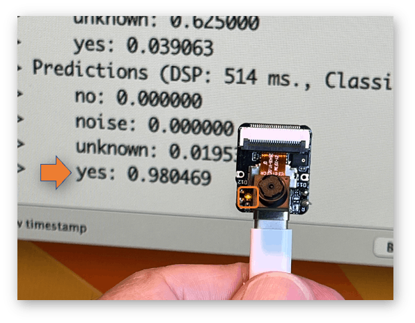
</p>

Идея в том, что светодиод будет гореть всякий раз, когда распознано ключевое слово YES. Также вместо светодиода можно запускать внешнее устройство, как мы видели во введении.

<p align="center">
  <iframe width="560" height="315" src="https://www.youtube.com/embed/wjhtEzXt60Q" title="Постобработка KWS: светодиод на XIAO ESP32S3" frameborder="0" allowfullscreen></iframe>
</p>

### OLED-дисплей

Маленький 0,42-дюймовый OLED-дисплей XIAOML Kit ($72{\times}40$ пикселей) — важный компонент постобработки: он превращает сырые результаты инференса в немедленную, понятную человеку обратную связь, показывая названия классов и уровни уверенности прямо на устройстве. Это исключает необходимость во внешних мониторах и позволяет создавать по-настоящему автономные периферийные ИИ-системы в промышленности, сельском хозяйстве или розничной торговле, где мгновенное визуальное подтверждение предсказаний ИИ особенно важно.

Теперь изменим скетч так, чтобы он автоматически адаптировался к модели, обученной в Edge Impulse: он будет читать названия классов и их количество прямо из модели. Скачайте код с GitHub: [xiaoml-kit_kws_oled](https://github.com/Mjrovai/XIAO-ESP32S3-Sense/tree/main/XIAOML_Kit_code/xiaoml-kit_kws_oled).

Запустим код и посмотрим результат:

<p align="center">
  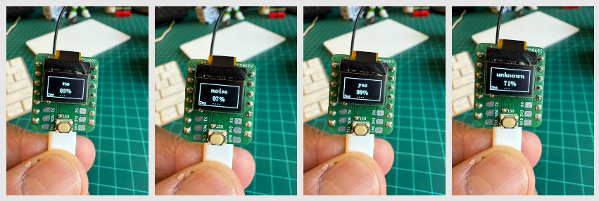
</p>

## Итоги

Эта лабораторная работа продемонстрировала полный цикл разработки системы распознавания ключевых слов на XIAOML Kit и показала, как современные платформы TinyML делают сложный аудио-ИИ доступным на устройствах с ограниченными ресурсами. В ходе практической реализации мы соединили теоретические концепции машинного обучения с практическим развёртыванием встраиваемого ИИ.

**Технические достижения.** Проект реализует полный конвейер обработки аудио: от захвата сырого звука до инференса в реальном времени. Используя встроенный цифровой микрофон XIAO ESP32S3, мы записали аудио профессионального качества (16 кГц/16 бит) и обработали его с помощью мел-частотных кепстральных коэффициентов (MFCC) для извлечения признаков. Развёрнутая CNN-модель достигла высокой точности в различении целевых ключевых слов («YES», «NO») и фоновых условий («NOISE», «UNKNOWN»), а время инференса подходит для приложений реального времени.

**Интеграция с платформой.** Edge Impulse Studio оказалась незаменимой комплексной MLOps-платформой для встраиваемых систем: она охватывает всё — от сбора и разметки данных до обучения, оптимизации и развёртывания моделей. Бесшовная интеграция облачного обучения и развёртывания на периферии характерна для современных рабочих процессов TinyML, а Arduino IDE обеспечила гибкость, нужную для собственной постобработки.

**Практические применения.** Освоенные приёмы выходят далеко за рамки простого распознавания ключевых слов. Системы голосового управления, промышленный мониторинг безопасности с классификацией звуков, медицинские приложения для анализа дыхания и экологический мониторинг по звукам животных или оборудования используют похожие подходы к обработке аудио. Каскадная архитектура обнаружения, показанная здесь — когда KWS на периферии запускает более сложную обработку в облаке, — лежит в основе современных систем голосовых помощников.

**Принципы встраиваемого ИИ.** Проект подчеркнул важные соображения TinyML: управление энергопотреблением, оптимизацию памяти за счёт использования PSRAM и компромиссы между сложностью модели и скоростью инференса. Успешное развёртывание нейронной сети, выполняющей анализ аудио в реальном времени на микроконтроллере, показывает, как возможности ИИ, раньше требовавшие мощных настольных компьютеров, теперь работают на устройствах с батарейным питанием.

**Методология разработки.** Мы рассмотрели несколько путей разработки: от стратегий сбора данных (офлайн-запись на SD-карту или онлайн-потоковая передача) до вариантов развёртывания (автоматическая генерация библиотеки в Edge Impulse или собственная реализация на Arduino). Такая гибкость важна для адаптации к разным требованиям и ограничениям проектов.

**Дальнейшее развитие.** Основа, заложенная здесь, открывает путь к более продвинутым приложениям аудио-ИИ. Распознавание нескольких ключевых слов, идентификация говорящего, определение эмоций по голосу и классификация звуков окружающей среды опираются на те же базовые методы. Возможности интеграции, продемонстрированные с OLED-дисплеем и управлением GPIO, показывают, как KWS может служить интеллектуальным интерфейсом для более широких IoT-систем.

Классификация звуков охватывает гораздо больше, чем распознавание речи. Методы этого проекта применяются во многих областях:

- **Безопасность:** обнаружение битого стекла, мониторинг вторжений, распознавание выстрелов;
- **Промышленный IoT:** мониторинг состояния оборудования, обнаружение аномалий в производственном оборудовании;
- **Здравоохранение:** мониторинг нарушений сна, оценка состояния дыхательной системы, системы ухода за пожилыми людьми;
- **Экологический мониторинг:** отслеживание дикой природы, анализ городского шума, акустическое управление «умными» зданиями;
- **Интеграция с умным домом:** голосовое управление в нескольких комнатах, контроль состояния бытовой техники по звуковым признакам.

**Ключевые выводы.** XIAOML Kit доказывает, что разработка ИИ профессионального уровня достижима с помощью доступных инструментов и при скромном бюджете. Сочетание мощного оборудования (ESP32S3 с PSRAM и встроенными датчиками), зрелых платформ разработки (Edge Impulse Studio) и полноценных программных библиотек создаёт среду, в которой сложные концепции ИИ превращаются в осязаемые работающие системы.

Эта лабораторная работа показывает, что будущее ИИ — не только в огромных дата-центрах, но и в интеллектуальных периферийных устройствах, которые могут обрабатывать, понимать и реагировать на окружающую среду в реальном времени. Это открывает возможности для повсеместного, сохраняющего приватность и отзывчивого искусственного интеллекта.

## Ресурсы

- [Код XIAO ESP32S3](https://github.com/Mjrovai/XIAO-ESP32S3-Sense)

- [Код XIAOML Kit](https://github.com/Mjrovai/XIAO-ESP32S3-Sense/tree/main/XIAOML_Kit_code)

- [Подмножество набора Google Speech Commands](https://cdn.edgeimpulse.com/datasets/keywords2.zip)

- [Блокнот Colab: KWS MFCC Analysis](https://colab.research.google.com/github/Mjrovai/Arduino_Nicla_Vision/blob/main/KWS/KWS_MFCC_Analysis.ipynb)

- [Блокнот Colab: KWS CNN training](https://colab.research.google.com/github/Mjrovai/Arduino_Nicla_Vision/blob/main/KWS/KWS_CNN_training.ipynb)

- [Код постобработки для XIAO ESP32S3](https://github.com/Mjrovai/XIAO-ESP32S3-Sense/tree/main/xiao_esp32s3_microphone_led)

- [Проект Edge Impulse](https://studio.edgeimpulse.com/public/230109/live)
