# Классификация движения и обнаружение аномалий

<p align="center">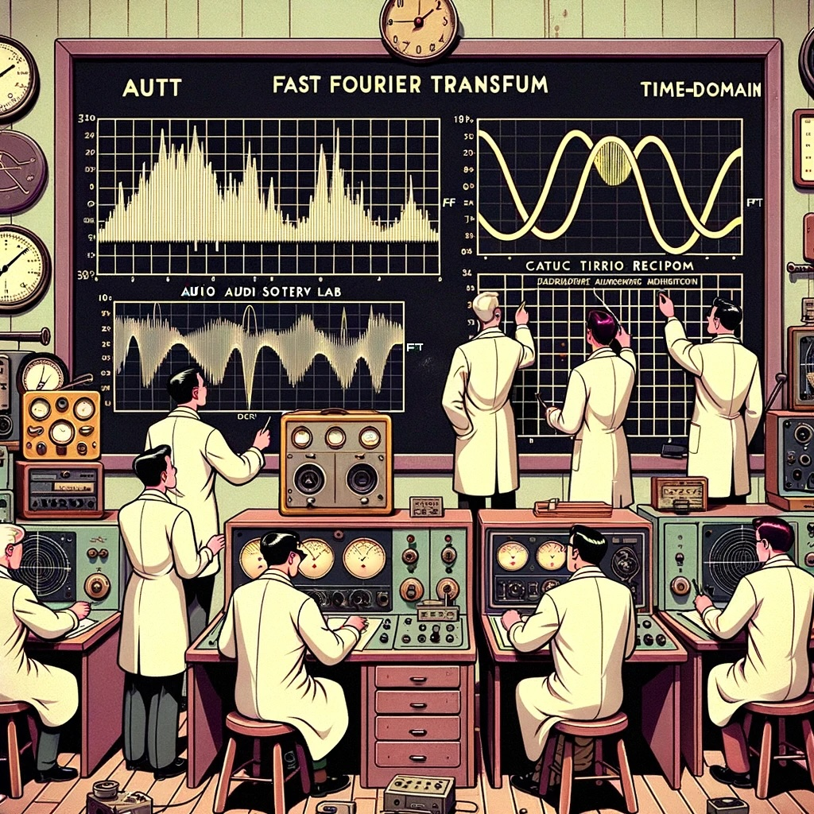<br>
<em>Промпт DALL·E: мультяшная иллюстрация в стиле 1950-х в винтажной аудиолаборатории. Учёные в классических белых халатах внимательно анализируют аудиоданные на больших досках. На досках — графики БПФ (быстрого преобразования Фурье) и кривые во временной области. Вокруг разбросано старинное аудиооборудование, но графики данных ясные и подробные, что подчёркивает внимание к анализу звука.</em></p>

## Обзор

Транспорт — основа мировой торговли. Миллионы контейнеров ежедневно перевозятся морем, автомобилями и поездами в разные уголки мира. Безопасная и эффективная перевозка контейнеров — огромная задача, которая требует современных технологий, и TinyML, без сомнения, — одно из ключевых решений.

В этой практической работе мы будем решать реальные задачи транспортной логистики. Мы разработаем систему классификации движения и обнаружения аномалий на основе XIAOML Kit, Arduino IDE и Edge Impulse Studio. Проект поможет понять, какие силы и движения испытывает контейнер на разных этапах перевозки: при наземной и морской транспортировке, при вертикальном перемещении вилочным погрузчиком и при хранении на складе.

> **Цели обучения**
>
> - настройка XIAOML Kit;
> - сбор и предобработка данных;
> - создание модели классификации движения;
> - реализация обнаружения аномалий;
> - тестирование и анализ в реальных условиях.

К концу этой лабораторной работы у вас будет рабочий прототип, который умеет классифицировать разные типы движения и обнаруживать аномалии во время перевозки контейнеров. Эти знания станут ступенькой к более сложным проектам в быстро развивающейся области TinyML, особенно к тем, что связаны с вибрацией.

## Установка IMU

В комплект XIAOML Kit на плате расширения уже встроен 6-осевой датчик IMU LSM6DS3TR-C, поэтому внешние датчики подключать не нужно. Такое встроенное решение даёт чистую и надёжную платформу для приложений машинного обучения на основе движения.

LSM6DS3TR-C объединяет в одном корпусе 3-осевой акселерометр и 3-осевой гироскоп. Он подключён по шине I2C к XIAO ESP32S3 по адресу 0x6A и обеспечивает:

- **диапазоны акселерометра:** ±2/±4/±8/±16 g (по умолчанию используем ±2 g);
- **диапазоны гироскопа:** ±125/±250/±500/±1000/±2000 dps (по умолчанию используем ±250 dps);
- **разрешение:** 16-битный АЦП;
- **интерфейс связи:** I2C, адрес 0x6A;
- **энергопотребление:** сверхнизкое.

<p align="center">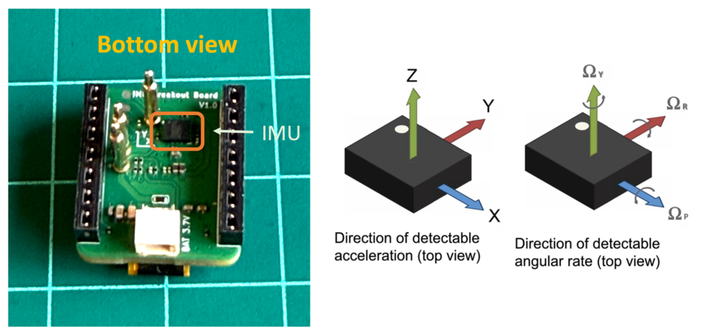</p>

**Система координат.** Датчик работает в правосторонней системе координат. Если смотреть на плату расширения снизу (там, где виден датчик IMU с меткой-точкой):

- **ось X** направлена вправо;
- **ось Y** направлена вперёд (от вас);
- **ось Z** направлена вверх (из платы).

### Настройка аппаратной части

Поскольку XIAOML Kit поставляется собранным с платой расширения, дополнительных аппаратных соединений не требуется. Датчик LSM6DS3TR-C уже правильно подключён по I2C.

**Что уже подключено:**

- IMU LSM6DS3TR-C → I2C (SDA/SCL) → XIAO ESP32S3;
- адрес I2C: 0x6A;
- питание: 3,3 В от XIAO ESP32S3.

**Необходимая библиотека.** Библиотека должна была быть установлена во время настройки. Если это не так, установите библиотеку Seeed Arduino LSM6DS3, выполнив такие шаги:

1. Откройте Library Manager в Arduino IDE.
2. Найдите «LSM6DS3».
3. Установите **«Seeed Arduino LSM6DS3»** от Seeed Studio.
4. **Важно:** НЕ устанавливайте «Arduino_LSM6DS3 by Arduino» — она предназначена для других плат!

### Проверка датчика IMU

Начнём с простого теста, чтобы убедиться, что IMU работает правильно. Загрузите этот код для проверки датчика:

```cpp
#include <LSM6DS3.h>
#include <Wire.h>

// Создаём объект IMU через интерфейс I2C
LSM6DS3 myIMU(I2C_MODE, 0x6A);

float accelX, accelY, accelZ;
float gyroX, gyroY, gyroZ;

void setup() {
  Serial.begin(115200);
  while (!Serial) delay(10);

  Serial.println("Тест IMU XIAOML Kit");
  Serial.println("6-осевой IMU LSM6DS3TR-C");
  Serial.println("====================");

  // Инициализируем IMU
  if (myIMU.begin() != 0) {
      Serial.println("ОШИБКА: не удалось инициализировать IMU!");
      while(1) delay(1000);
  } else {
      Serial.println("✓ IMU успешно инициализирован");
      Serial.println("Формат данных: AccelX,AccelY,AccelZ,"
                    "GyroX,GyroY,GyroZ");
      Serial.println("Единицы: g (ускорение свободного падения), градусы/с");
      Serial.println();
  }
}

void loop() {
  // Читаем данные акселерометра (в g)
  accelX = myIMU.readFloatAccelX();
  accelY = myIMU.readFloatAccelY();
  accelZ = myIMU.readFloatAccelZ();

  // Читаем данные гироскопа (в градусах в секунду)
  gyroX = myIMU.readFloatGyroX();
  gyroY = myIMU.readFloatGyroY();
  gyroZ = myIMU.readFloatGyroZ();

  // Выводим в удобном для чтения формате
  Serial.print("Акселерометр (g): X="); Serial.print(accelX, 3);
  Serial.print(" Y="); Serial.print(accelY, 3);
  Serial.print(" Z="); Serial.print(accelZ, 3);
  Serial.print(" | Гироскоп (°/с): X="); Serial.print(gyroX, 2);
  Serial.print(" Y="); Serial.print(gyroY, 2);
  Serial.print(" Z="); Serial.println(gyroZ, 2);

  delay(100); // частота обновления 10 Гц
}
```

Когда комплект лежит ровно на столе, вы должны увидеть:

- ускорение по оси Z около +1,0 g (гравитация);
- ускорение по осям X и Y близко к 0,0 g;
- все значения гироскопа близки к 0,0 °/с.

Пошевелите комплект, чтобы увидеть, как меняются значения.

## Проект классификации движения TinyML

Мы смоделируем перевозку контейнеров (точнее, упаковок) в разных сценариях, чтобы сделать руководство более наглядным и практичным.

<p align="center"></p>

С помощью акселерометра XIAOML Kit мы будем записывать данные о движении, вручную имитируя условия:

- **морская перевозка** (паллеты на лодках) — движение по всем осям с волнообразными колебаниями;
- **наземная перевозка** (паллеты на грузовиках или поездах) — преимущественно горизонтальное движение;
- **подъём** (паллеты, которые перемещает вилочный погрузчик) — преимущественно вертикальное движение;
- **простой** (паллеты на складе) — минимальное движение.

По изображению выше мы определим для нашей симуляции: преимущественно горизонтальные движения (по осям $x$ или $y$) соответствуют классу «Наземная перевозка», вертикальные движения (ось $z$) — классу «Подъём», отсутствие активности — классу «Простой», а движение по всем трём осям — классу [«Морская перевозка»](https://www.containerhandbuch.de/chb_e/stra/index.html?/chb_e/stra/stra_02_03_03.htm).

<p align="center">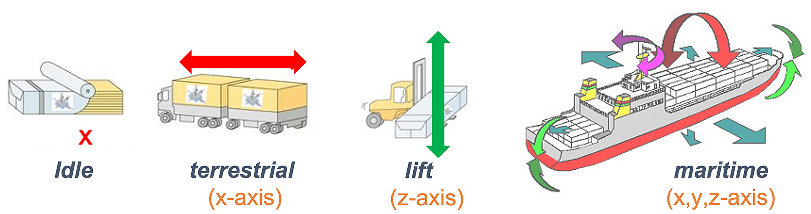</p>

## Сбор данных

Для сбора данных есть несколько вариантов. В реальном сценарии устройство можно подключить непосредственно к контейнеру, а собранные данные сохранять в файл (например, CSV) на SD-карте. Данные можно также передавать удалённо на ближайший накопитель, например на телефон, по Wi-Fi или Bluetooth (как в проекте [Sensor DataLogger](https://www.hackster.io/mjrobot/sensor-datalogger-50e44d)). Когда набор данных собран и сохранён как файл .CSV, его можно загрузить в Studio с помощью [инструмента CSV Wizard](https://docs.edgeimpulse.com/docs/edge-impulse-studio/data-acquisition/csv-wizard).

> В [этом видео](https://youtu.be/2KBPq_826WM) вы узнаете о других способах отправки данных в Edge Impulse Studio.

### Подготовка кода для сбора данных

В этой работе мы подключим комплект напрямую к Edge Impulse Studio, которая будет также использоваться для предобработки данных, обучения модели, тестирования и развёртывания.

Для сбора данных сначала подключите комплект к Edge Impulse Studio, которая будет также использоваться для предобработки данных, обучения модели, тестирования и развёртывания.

> Следуйте [инструкциям](https://docs.edgeimpulse.com/docs/edge-impulse-cli/cli-installation), чтобы установить [Node.js](https://nodejs.org/en/) и Edge Impulse CLI на ваш компьютер.

Поскольку XIAOML Kit не является полностью поддерживаемой отладочной платой Edge Impulse, для захвата данных с датчика и отправки их в Studio используем [CLI Data Forwarder](https://docs.edgeimpulse.com/docs/edge-impulse-cli/cli-data-forwarder), как показано на схеме:

<p align="center">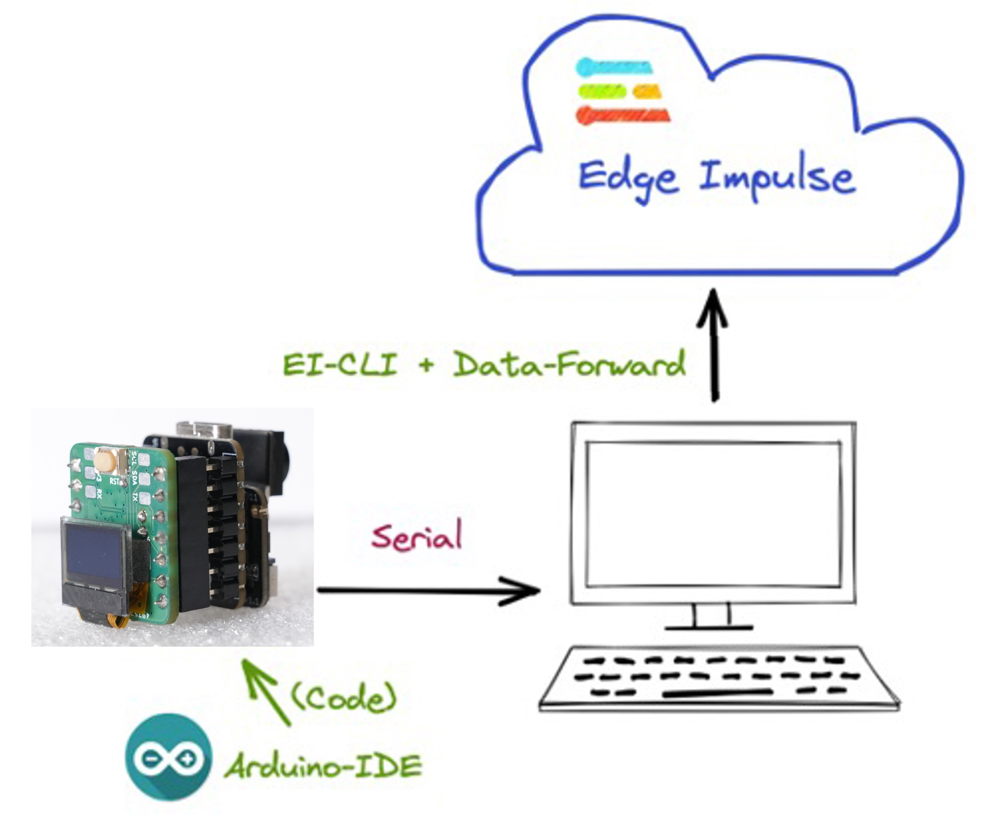</p>

Изменим тестовый код так, чтобы он выводил данные в формате, подходящем для Edge Impulse:

```cpp
#include <LSM6DS3.h>
#include <Wire.h>

#define FREQUENCY_HZ        50
#define INTERVAL_MS         (1000 / (FREQUENCY_HZ + 1))

LSM6DS3 myIMU(I2C_MODE, 0x6A);
static unsigned long last_interval_ms = 0;

void setup() {
  Serial.begin(115200);
  while (!Serial) delay(10);

  Serial.println("XIAOML Kit — сбор данных о движении");
  Serial.println("Датчик IMU LSM6DS3TR-C");

  // Инициализируем IMU
  if (myIMU.begin() != 0) {
      Serial.println("ОШИБКА: не удалось инициализировать IMU!");
      while(1) delay(1000);
  }
  delay(2000);
  Serial.println("Начало сбора данных через 3 секунды...");
  delay(3000);
}

void loop() {
  if (millis() > last_interval_ms + INTERVAL_MS) {
      last_interval_ms = millis();

      // Читаем данные акселерометра
      float ax = myIMU.readFloatAccelX();
      float ay = myIMU.readFloatAccelY();
      float az = myIMU.readFloatAccelZ();

      // Переводим в м/с² (умножаем на 9,81)
      float ax_ms2 = ax * 9.81;
      float ay_ms2 = ay * 9.81;
      float az_ms2 = az * 9.81;

      // Выводим в формате Edge Impulse
      Serial.print(ax_ms2);
      Serial.print("\t");
      Serial.print(ay_ms2);
      Serial.print("\t");
      Serial.println(az_ms2);
  }
}
```

Загрузите код в Arduino IDE. В Serial Monitor должны появиться значения акселерометра (переведённые в м/с²):

<p align="center">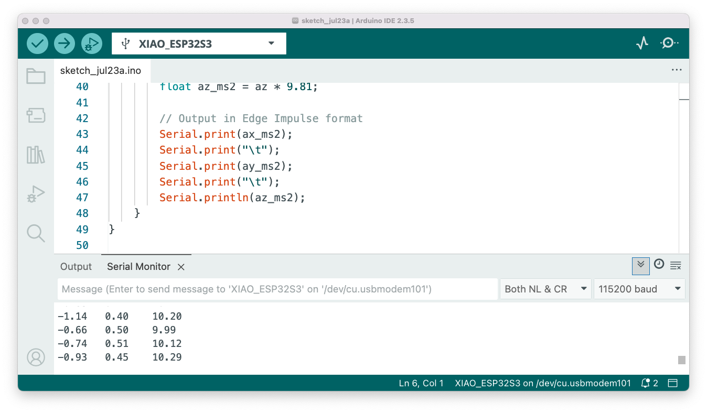</p>

> Оставьте код запущенным, но **выключите Serial Monitor**. Данные с комплекта будут отправлены в Edge Impulse Studio по последовательному соединению.

### Подключение к Edge Impulse для сбора данных

**Создайте проект Edge Impulse**

- Перейдите в Edge Impulse Studio и создайте новый проект.
- Выберите понятное название (не длиннее 63 символов для совместимости с библиотеками Arduino).

<p align="center"></p>

**Настройте CLI Data Forwarder**

- Установите Edge Impulse CLI на компьютер.
- Убедитесь, что XIAOML Kit подключён к компьютеру, **код запущен, а Serial Monitor выключен**, иначе может возникнуть ошибка.
- В терминале компьютера выполните: `edge-impulse-data-forwarder --clean`.
- Введите учётные данные Edge Impulse.
- Выберите проект и настройте параметры устройства.

<p align="center">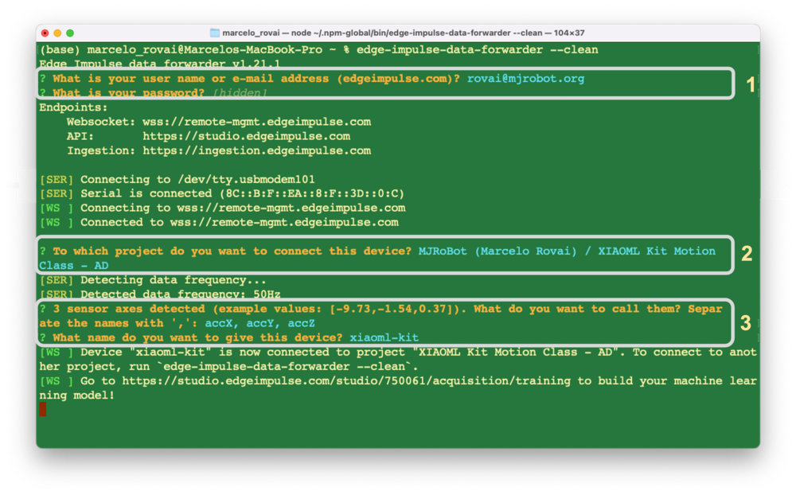</p>

- Откройте проект в Edge Impulse Studio. В разделе `Device` можно проверить, правильно ли подключён комплект (точка должна быть зелёной).

<p align="center">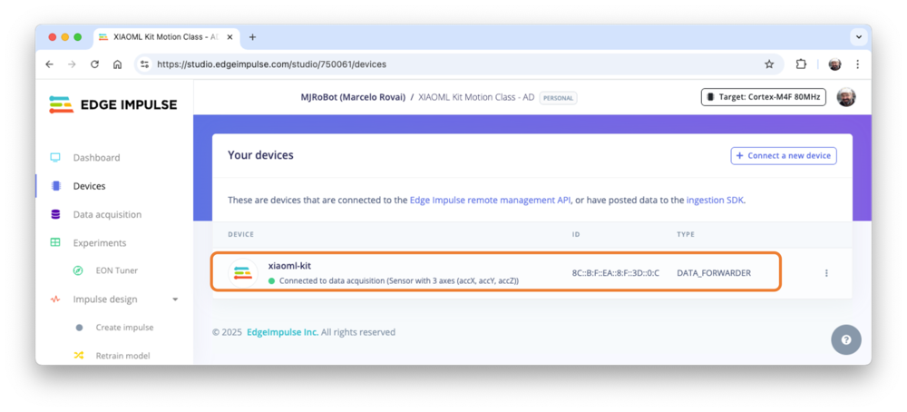</p>

## Сбор данных в Studio

Как обсуждалось ранее, нужно собрать данные для всех четырёх **классов перевозки**. Представьте, что у вас есть контейнер со встроенным акселерометром (в нашем случае это XIAOML Kit). Теперь представьте, что контейнер стоит на корабле в бушующем океане:

<p align="center">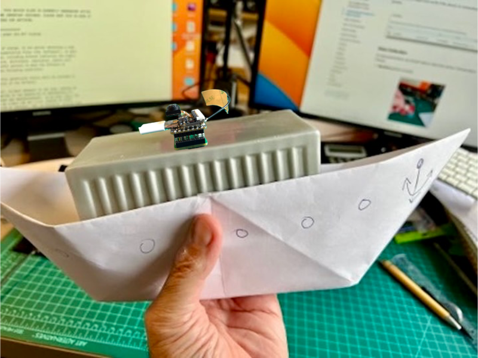</p>

Или в грузовике, который едет по дороге, или его перемещает вилочный погрузчик и т. д.

### Имитация движения

**Класс «Морская перевозка»:**

- держите комплект и имитируйте движение лодки;
- двигайте его по всем трём осям волнообразными, колебательными движениями;
- добавьте плавные покачивания с крена на дифферент.

**Класс «Наземная перевозка»:**

- двигайте комплект горизонтально по прямым линиям (слева направо и обратно);
- имитируйте вибрации грузовика или поезда небольшими горизонтальными встряхиваниями;
- иногда делайте плавные толчки и повороты.

**Класс «Подъём»:**

- двигайте комплект преимущественно по вертикали (вверх и вниз);
- имитируйте работу погрузчика: подъём, пауза, опускание;
- добавьте несколько коротких горизонтальных перемещений для позиционирования.

**Класс «Простой»:**

- поставьте комплект на устойчивую поверхность;
- минимальное движение или его отсутствие;
- фиксируйте окружающие вибрации и шум датчика.

### Получение данных

В разделе `Data Acquisition` вы должны увидеть, что ваша плата `[xiaoml-kit]` подключена. Датчик доступен: `[sensor with 3 axes (accX, accY, accZ)]`, с частотой дискретизации `[50 Hz]`. Studio предлагает длину образца `[10000]` мс (10 с). Осталось задать метку образца. Начнём, например, с `[terrestrial]`.

Нажмите `[Start Sample]` и двигайте комплект горизонтально (слева направо), сохраняя одно направление. Через 10 секунд данные загрузятся в Studio.

Ниже показан один образец (сырые данные) длиной 10 секунд. Видно, что волнообразное движение происходит преимущественно по оси Y (слева направо). Остальные оси почти неподвижны: ось X колеблется около нуля, а ось Z — около 9,8 м/с² из-за гравитации.

<p align="center">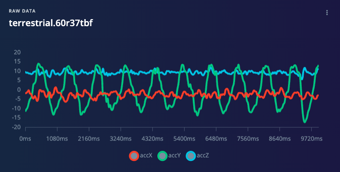</p>

Для каждого из четырёх классов соберите, например, около 2 минут данных (десять–двенадцать образцов по 10 секунд). С помощью значка `3 dots` после каждого образца выберите два и перенесите их в **Test set** (тестовую выборку). Либо используйте автоматический инструмент `Train/Test Split` в разделе **Danger Zone** вкладки `Dashboard`. Ниже видны наборы данных:

<p align="center">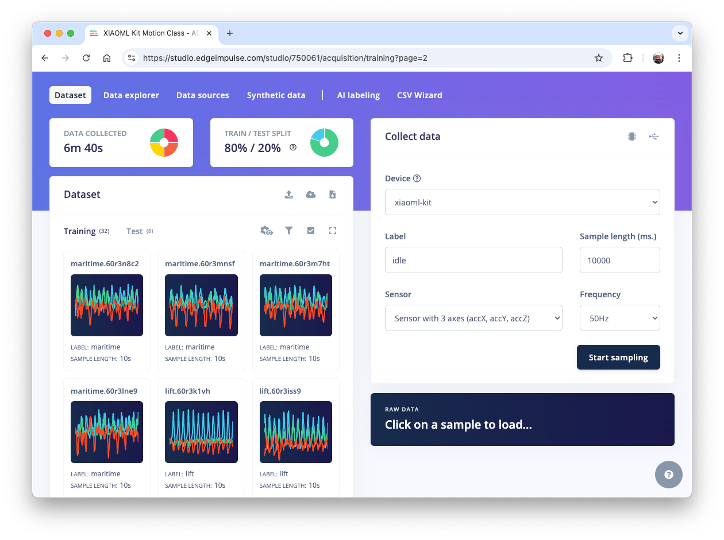</p>

## Предобработка данных

Сырые данные акселерометра представляют собой «временной ряд», который нужно преобразовать в «табличные данные». Такое преобразование выполняется с помощью скользящего окна по образцам. Например, на рисунке ниже

<p align="center">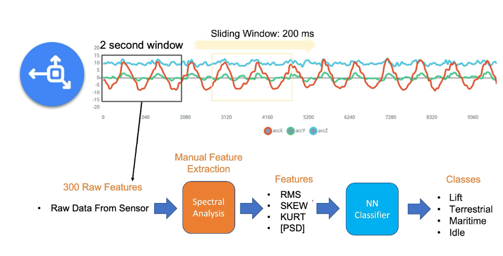</p>

видно 10 секунд данных акселерометра, записанных с частотой дискретизации (SR) 50 Гц. Окно длиной 2 секунды захватывает 300 точек данных (3 оси × 2 секунды × 50 отсчётов). Мы будем сдвигать это окно каждые 200 мс, создавая набор большего размера, где каждый экземпляр содержит 300 сырых признаков.

> Выбирайте оптимальную частоту дискретизации для своей задачи, учитывая теорему Найквиста: периодический сигнал нужно дискретизировать с частотой, более чем вдвое превышающей его наибольшую частотную составляющую.

Предобработка данных — непростая задача для встраиваемого машинного обучения. Тем не менее Edge Impulse помогает справиться с ней благодаря шагу цифровой обработки сигналов (DSP), а точнее — спектральным признакам.

В Studio этот набор данных поступит на вход блока спектрального анализа (Spectral Analysis), который отлично подходит для анализа повторяющихся движений, например данных акселерометров. Блок выполняет DSP (цифровую обработку сигналов) и извлекает такие признаки, как «FFT» или «вейвлеты». В самом распространённом случае, при FFT, **статистические признаки временной области** для каждой оси/канала таковы:

- RMS;
- асимметрия (Skewness);
- эксцесс (Kurtosis).

<p align="center">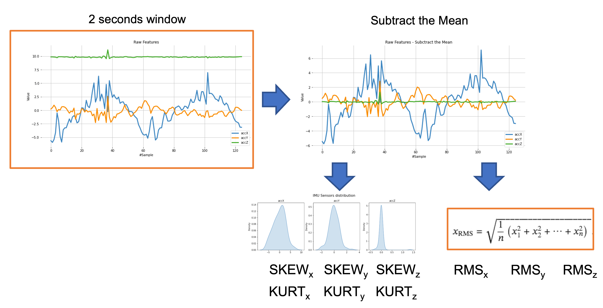</p>

А **спектральные признаки частотной области** для каждой оси/канала:

- спектральная мощность (Spectral Power);
- асимметрия (Skewness);
- эксцесс (Kurtosis).

<p align="center">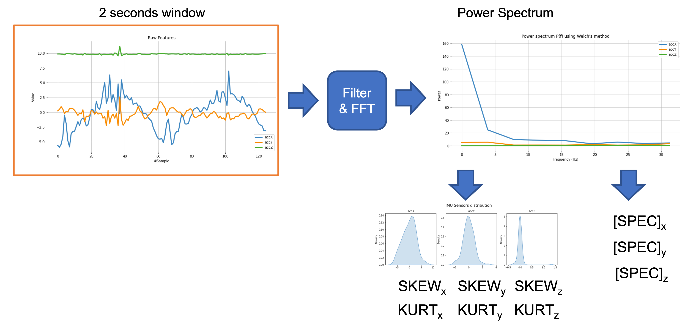</p>

Например, при длине FFT 32 точки на выходе блока спектрального анализа будет 21 признак на каждую ось (всего 63 признака).

Эти 63 признака станут входным тензором для нейросетевого классификатора и для модели обнаружения аномалий (K-Means).

> Подробнее можно узнать из лабораторной работы [Спектральные признаки DSP](../../06-shared/dsp_spectral_features_block/README.md).

## Проектирование модели

Наш классификатор будет полносвязной нейронной сетью (Dense Neural Network, DNN). У неё будет 63 нейрона на входном слое, два скрытых слоя с 20 и 10 нейронами и выходной слой с четырьмя нейронами (по одному на каждый класс), как показано здесь:

<p align="center">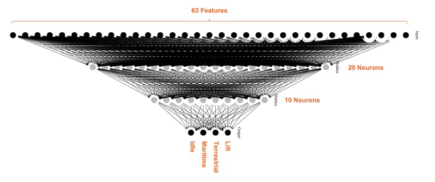</p>

## Проектирование Impulse

Impulse принимает сырые данные, с помощью обработки сигналов извлекает признаки, а затем использует блок обучения (**Dense model**), чтобы классифицировать новые данные.

Мы также используем вторую модель — **K-means**, которая применяется для обнаружения аномалий. Представим, что известные классы — это кластеры. Любой образец, который не попадает ни в один из этих кластеров, может оказаться выбросом, аномалией (например, контейнер, сорвавшийся с корабля в океан, или лежащий вверх дном на полу).

<p align="center">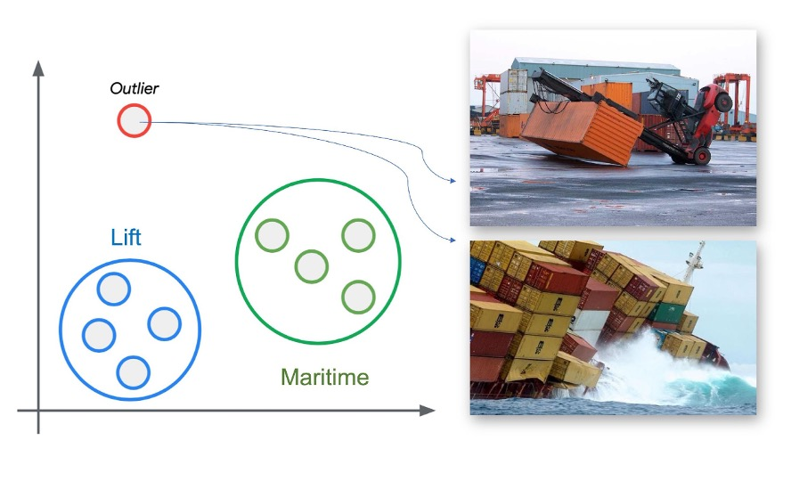</p>

> Представьте, что наш XIAOML Kit катится или движется вверх дном, с движением, которого не было в обучающей выборке.

<p align="center">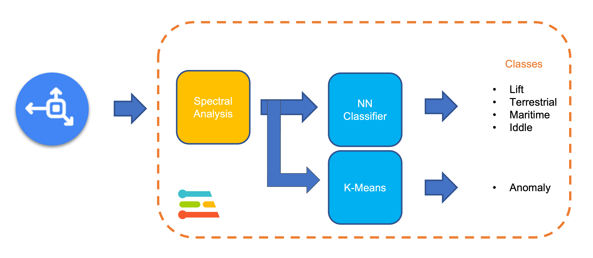</p>

Итоговый дизайн Impulse:

<p align="center">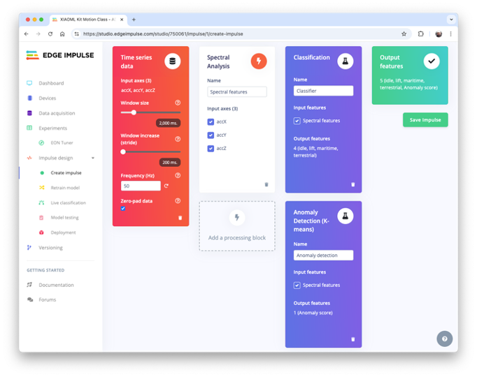</p>

## Генерация признаков

На этом этапе проекта мы определили метод предобработки, и модель спроектирована. Теперь пора выполнить работу. Сначала преобразуем сырые данные (временной ряд) в табличные. Перейдите на вкладку `Spectral Features` и нажмите `[Save Parameters]`. Либо вместо значений по умолчанию нажмите кнопку `[Autotune parameters]`. В этом случае Studio сама подберёт гиперпараметры, например конструкцию фильтра и длину FFT, на основе сырых данных.

<p align="center">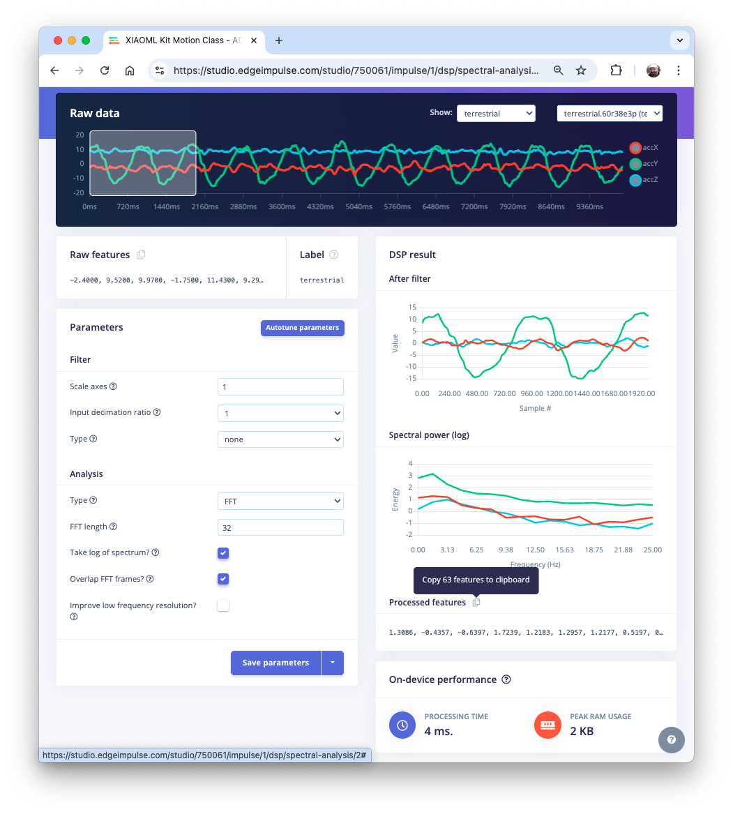</p>

В верхнем меню выберите вкладку `Generate features`, отметьте опции `Calculate feature importance` и `Normalize features` и нажмите `[Generate features]`. Каждое двухсекундное окно данных (300 точек) будет преобразовано в одну табличную точку с 63 признаками.

> Feature Explorer отобразит эти данные в 2D с помощью [UMAP](https://umap-learn.readthedocs.io/en/latest/). Uniform Manifold Approximation and Projection (UMAP) — метод снижения размерности, который используется для визуализации, похоже на t-SNE, но также и для общего нелинейного снижения размерности.

Визуализация показывает, что классы хорошо разделяются, а значит, классификатор должен работать хорошо.

<p align="center">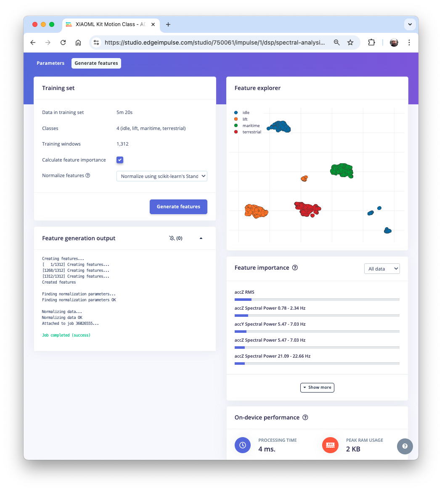</p>

По желанию можно проанализировать относительную важность каждого признака для одного класса по сравнению с другими классами.

## Обучение

Наш классификатор — полносвязная нейронная сеть (DNN) со 63 нейронами на входном слое, двумя скрытыми слоями с 20 и 10 нейронами и выходным слоем из четырёх нейронов (по одному на класс), как показано здесь:

<p align="center">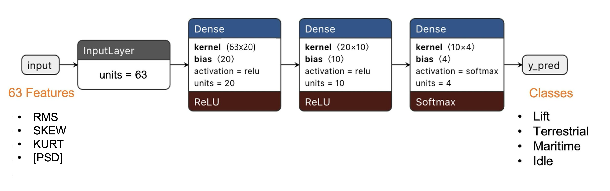</p>

В качестве гиперпараметров используем скорость обучения (Learning Rate) 0,005 и 20 % данных для валидации, 30 эпох. После обучения точность составляет 100 %.

<p align="center">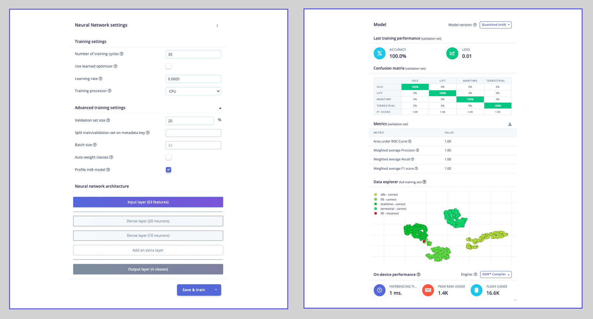</p>

Для обнаружения аномалий выберем предложенные признаки, которые как раз и являются наиболее важными в извлечении признаков. Количество кластеров будет 32, как предлагает Studio. После обучения можно выбрать часть данных для проверки, например данные морской перевозки. Полученный показатель аномалий: `min: -0.1642, max: 0.0738, avg: -0.0867`.

Если менять данные, можно заметить, что малые или отрицательные значения показателя аномалий означают, что данные нормальные.

<p align="center">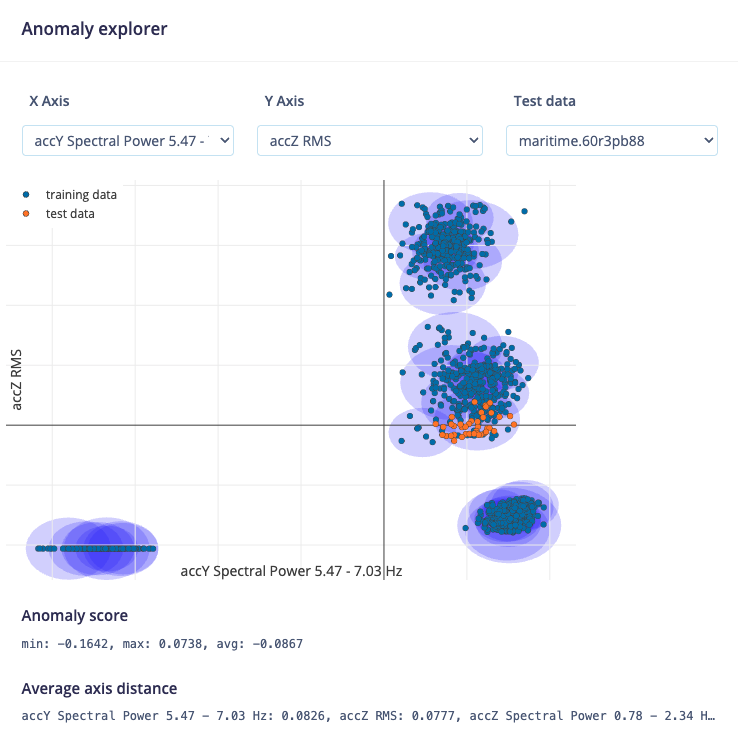</p>

## Тестирование

С помощью 20 % данных, оставшихся после этапа сбора, можно проверить, как модель поведёт себя на неизвестных данных. Ожидается 100 %, но результат оказался очень хорошим — 8 % ошибок.

<p align="center">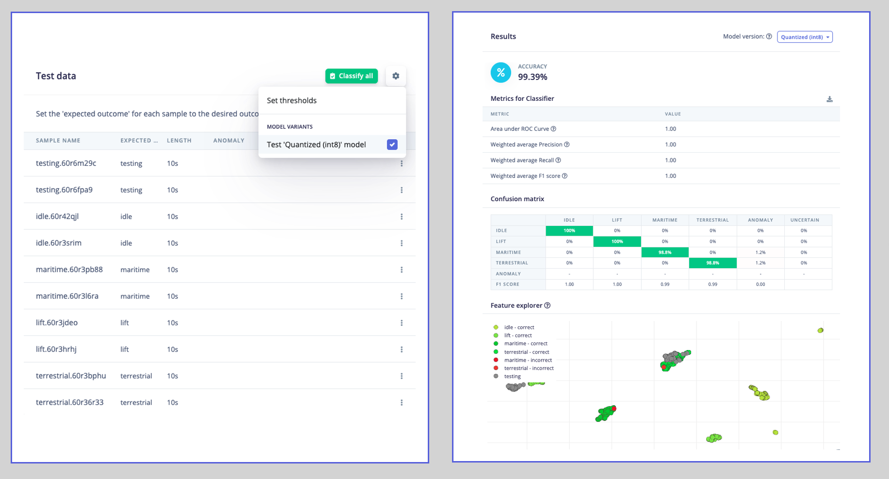</p>

Также используйте свой комплект (он всё ещё подключён к Studio) и проведите живую классификацию. Например, проверим движение «наземной перевозки»:

<p align="center">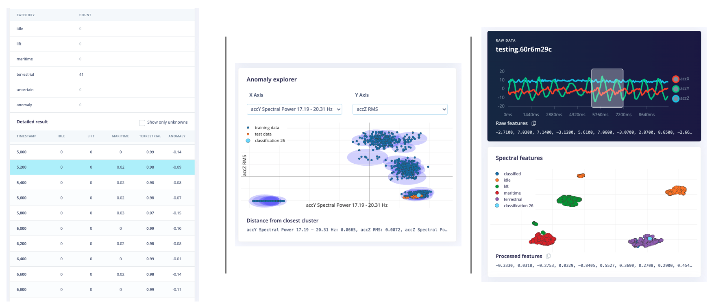</p>

> Учтите, что здесь вы захватываете реальные данные с устройства и загружаете их в Studio, где выполняется инференс с помощью обученной модели (модель при этом не находится на вашем устройстве).

## Развёртывание

Пришло время для волшебства! Studio упакует все нужные библиотеки, функции предобработки и обученные модели и загрузит их на ваш компьютер. Выберите вариант Arduino Library, затем внизу выберите Quantized (Int8) и нажмите `[Build]`. ZIP-файл будет создан и загружен на компьютер.

<p align="center">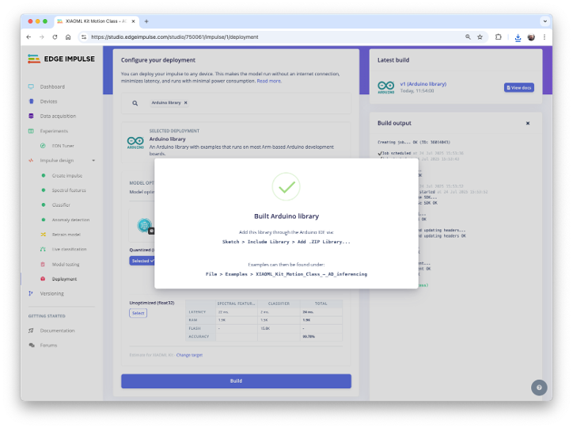</p>

В Arduino IDE откройте вкладку Sketch, выберите пункт Add .ZIP Library и укажите ZIP-файл, который скачала Studio:

<p align="center">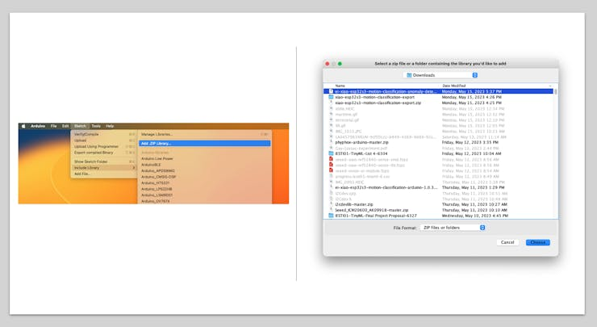</p>

## Инференс

Теперь пора провести настоящий тест. Мы будем делать инференс полностью независимо от Studio. Изменим один из примеров кода, который создала Studio при развёртывании библиотеки Arduino.

В Arduino IDE откройте вкладку `File/Examples`, найдите свой проект и в примерах выберите `nano_ble_sense_accelerometer`:

Конечно, это не ваша плата, но код можно адаптировать, внеся всего несколько изменений.

Например, в начале кода подключается библиотека для IMU Arduino Sense:

```cpp
/* Подключение библиотек -------------------------------- */
#include <XIAOML_Kit_Motion_Class_-_AD_inferencing.h>
#include <Arduino_LSM9DS1.h>
```

Замените блок подключений на код для IMU:

```cpp
#include <XIAOML_Kit_Motion_Class_-_AD_inferencing.h>
#include <LSM6DS3.h>
#include <Wire.h>
```

Измените константы:

```cpp
// Настройка IMU
LSM6DS3 myIMU(I2C_MODE, 0x6A);

// Настройки инференса
#define CONVERT_G_TO_MS2    9.81f
#define MAX_ACCEPTED_RANGE  2.0f * CONVERT_G_TO_MS2
```

В функции setup инициализируйте IMU:

```cpp
   // Инициализация IMU
    if (myIMU.begin() != 0) {
        Serial.println("ОШИБКА: не удалось инициализировать IMU!");
        return;
    }
```

В функции loop буферы `buffer[ix]`, `buffer[ix + 1]` и `buffer[ix + 2]` получают данные трёхосного акселерометра. В исходном коде есть строка:

```cpp
IMU.readAcceleration(buffer[ix], buffer[ix + 1], buffer[ix + 2]);
```

Замените её на такой блок кода:

```cpp
// Читаем данные IMU
float x = myIMU.readFloatAccelX();
float y = myIMU.readFloatAccelY();
float z = myIMU.readFloatAccelZ();
```

Два блока кода нужно поменять местами. Сначала выполняется перевод в «метры на секунду в квадрате» (м/с²), затем проверка максимально допустимого диапазона (здесь он задан в м/с², а в примере для Arduino — в g):

```cpp
  // Переводим в м/с²
  buffer[i + 0] = x * CONVERT_G_TO_MS2;
  buffer[i + 1] = y * CONVERT_G_TO_MS2;
  buffer[i + 2] = z * CONVERT_G_TO_MS2;

  // Ограничиваем диапазон
  for (int j = 0; j < 3; j++) {
      if (fabs(buffer[i + j]) > MAX_ACCEPTED_RANGE) {
          buffer[i + j] = copysign(MAX_ACCEPTED_RANGE, buffer[i + j]);
      }
  }
```

На этом изменения заканчиваются. Вывод инференса в Serial Monitor тоже можно настроить. Теперь загрузите полный код ниже на плату и переходите к инференсу.

```cpp
// Классификация движения с датчиком LSM6DS3TR-C
#include <XIAOML_Kit_Motion_Class_-_AD_inferencing.h>
#include <LSM6DS3.h>
#include <Wire.h>

// Настройка IMU
LSM6DS3 myIMU(I2C_MODE, 0x6A);

// Настройки инференса
#define CONVERT_G_TO_MS2    9.81f
#define MAX_ACCEPTED_RANGE  2.0f * CONVERT_G_TO_MS2

static bool debug_nn = false;
static float buffer[EI_CLASSIFIER_DSP_INPUT_FRAME_SIZE] = { 0 };
static float inference_buffer[EI_CLASSIFIER_DSP_INPUT_FRAME_SIZE];

void setup() {
    Serial.begin(115200);
    while (!Serial) delay(10);

    Serial.println("XIAOML Kit — классификация движения");
    Serial.println("Инференс с датчиком LSM6DS3TR-C");

    // Инициализация IMU
    if (myIMU.begin() != 0) {
        Serial.println("ОШИБКА: не удалось инициализировать IMU!");
        return;
    }

    Serial.println("✓ IMU инициализирован");

    if (EI_CLASSIFIER_RAW_SAMPLES_PER_FRAME != 3) {
        Serial.println("ОШИБКА: EI_CLASSIFIER_RAW_SAMPLES_PER_FRAME "
                       "должен быть равен 3");
        return;
    }

    Serial.println("✓ Модель загружена");
    Serial.println("Запуск классификации движения...");
}

void loop() {
    ei_printf("\nЗапуск инференса через 2 секунды...\n");
    delay(2000);

    ei_printf("Сбор данных...\n");

    // Очищаем буфер
    for (size_t i = 0; i < EI_CLASSIFIER_DSP_INPUT_FRAME_SIZE; i++) {
        buffer[i] = 0.0f;
    }

    // Собираем данные акселерометра
    for (int i = 0; i < EI_CLASSIFIER_DSP_INPUT_FRAME_SIZE; i += 3) {
        uint64_t next_tick = micros() +
          (EI_CLASSIFIER_INTERVAL_MS * 1000);

        // Читаем данные IMU
        float x = myIMU.readFloatAccelX();
        float y = myIMU.readFloatAccelY();
        float z = myIMU.readFloatAccelZ();

        // Переводим в м/с²
        buffer[i + 0] = x * CONVERT_G_TO_MS2;
        buffer[i + 1] = y * CONVERT_G_TO_MS2;
        buffer[i + 2] = z * CONVERT_G_TO_MS2;

        // Ограничиваем диапазон
        for (int j = 0; j < 3; j++) {
            if (fabs(buffer[i + j]) > MAX_ACCEPTED_RANGE) {
                buffer[i + j] = copysign(MAX_ACCEPTED_RANGE,
                                         buffer[i + j]);
            }
        }

        delayMicroseconds(next_tick - micros());
    }

    // Копируем во входной буфер инференса
    for (int i = 0; i < EI_CLASSIFIER_DSP_INPUT_FRAME_SIZE; i++) {
        inference_buffer[i] = buffer[i];
    }

    // Создаём сигнал из буфера
    signal_t signal;
    int err = numpy::signal_from_buffer(inference_buffer,
              EI_CLASSIFIER_DSP_INPUT_FRAME_SIZE, &signal);
    if (err != 0) {
        ei_printf("ОШИБКА: не удалось создать сигнал из буфера (%d)\n",
                  err);
        return;
    }

    // Запускаем классификатор
    ei_impulse_result_t result = { 0 };
    err = run_classifier(&signal, &result, debug_nn);
    if (err != EI_IMPULSE_OK) {
        ei_printf("ОШИБКА: не удалось запустить классификатор (%d)\n", err);
        return;
    }

    // Выводим предсказания
    ei_printf("Предсказания (DSP: %d мс, классификация: %d мс, "
              "аномалии: %d мс):\n",
        result.timing.dsp, result.timing.classification, result.timing.anomaly);

    for (size_t ix = 0; ix < EI_CLASSIFIER_LABEL_COUNT; ix++) {
        ei_printf("    %s: %.5f\n", result.classification[ix].label,
                  result.classification[ix].value);
    }

    // Выводим показатель аномалии
#if EI_CLASSIFIER_HAS_ANOMALY == 1
    ei_printf("Показатель аномалии: %.3f\n", result.anomaly);
#endif

    // Определяем предсказание
    float max_confidence = 0.0;
    String predicted_class = "unknown";

    for (size_t ix = 0; ix < EI_CLASSIFIER_LABEL_COUNT; ix++) {
        if (result.classification[ix].value > max_confidence) {
            max_confidence = result.classification[ix].value;
            predicted_class = String(result.classification[ix].label);
        }
    }

    // Выводим результат с порогом уверенности
    if (max_confidence > 0.6) {
        ei_printf("\n🎯 ПРЕДСКАЗАНИЕ: %s (уверенность %.1f%%)\n",
                 predicted_class.c_str(), max_confidence * 100);
    } else {
        ei_printf("\n❓ НЕОПРЕДЕЛЁННО: наибольшая уверенность у %s (%.1f%%)\n",
                 predicted_class.c_str(), max_confidence * 100);
    }

    // Проверяем аномалию
#if EI_CLASSIFIER_HAS_ANOMALY == 1
    if (result.anomaly > 0.5) {
        ei_printf("⚠️ ОБНАРУЖЕНА АНОМАЛИЯ! Показатель: %.3f\n", result.anomaly);
    }
#endif

    delay(1000);
}

void ei_printf(const char *format, ...) {
    static char print_buf[1024] = { 0 };
    va_list args;
    va_start(args, format);
    int r = vsnprintf(print_buf, sizeof(print_buf), format, args);
    va_end(args);
    if (r > 0) {
        Serial.write(print_buf);
    }
}
```

> Полный код доступен на [странице лабораторной работы на GitHub](https://github.com/Mjrovai/XIAO-ESP32S3-Sense/tree/main/XIAOML_Kit_code/motion_class_ad_inference).

Теперь попробуйте свои движения и посмотрите результат инференса для каждого класса на изображениях:

<p align="center">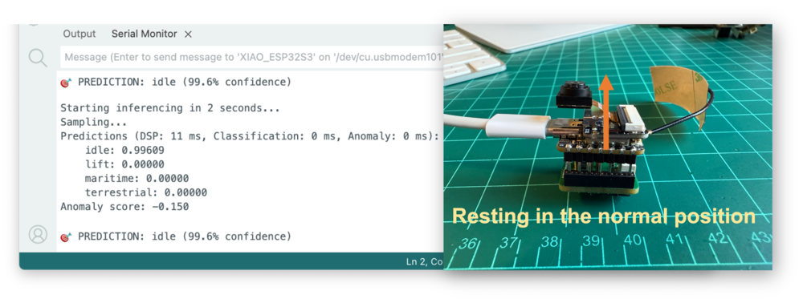</p>

<p align="center">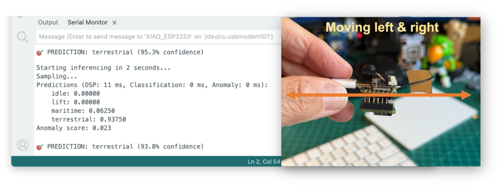</p>

<p align="center"></p>

<p align="center">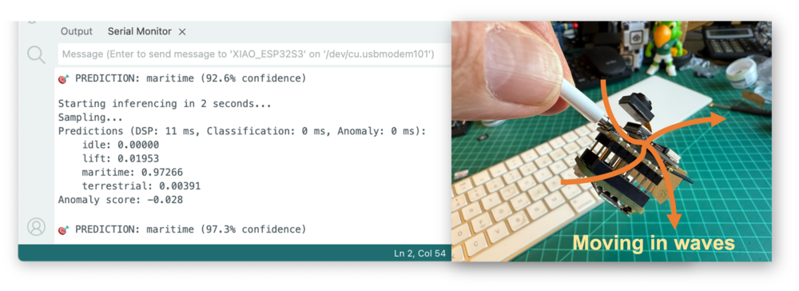</p>

И, конечно, попробуйте «аномалию», например переверните XIAO вверх дном. Показатель аномалии превысит 0,5:

<p align="center">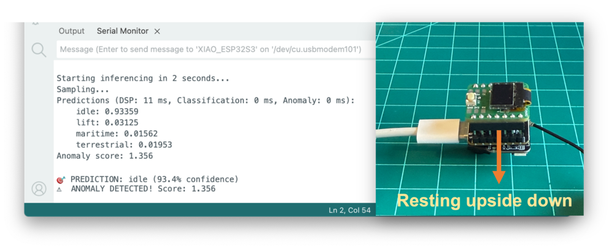</p>

## Постобработка

Теперь, когда мы убедились, что модель работает, предлагаем изменить код так, чтобы результат выводился полностью офлайн: без подключения к ПК и с питанием от аккумулятора, пауэрбанка или отдельного источника на 5 В.

Идея в том, что при обнаружении определённого движения на OLED-дисплее появляется соответствующее сообщение.

<p align="center">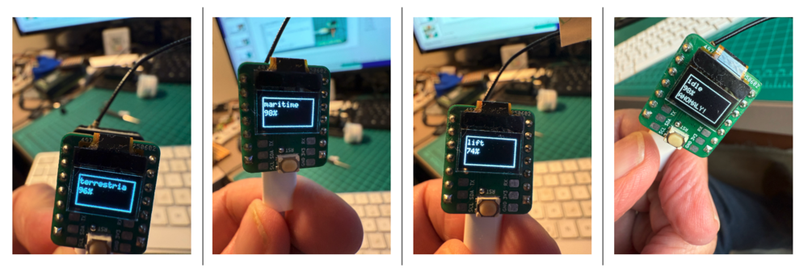</p>

Изменённый код инференса с выводом на OLED-дисплей доступен на [странице лабораторной работы на GitHub](https://github.com/Mjrovai/XIAO-ESP32S3-Sense/tree/main/XIAOML_Kit_code/motion_class_ad_inference_oled).

## Итоги

В этой работе мы показали, как построить полную систему классификации движения на основе встроенного 6-осевого датчика IMU LSM6DS3TR-C из XIAOML Kit. Основные достижения:

**Техническая реализация:**

- использован встроенный 6-осевой IMU для регистрации движения;
- собраны размеченные обучающие данные для четырёх сценариев транспортировки;
- реализовано извлечение спектральных признаков для анализа временных рядов;
- развёрнут нейросетевой классификатор, оптимизированный для инференса на микроконтроллере;
- добавлено обнаружение аномалий для выявления необычных движений.

**Конвейер машинного обучения:**

- сбор данных напрямую со встраиваемых датчиков;
- инженерия признаков с помощью анализа в частотной области;
- обучение и оптимизация модели в Edge Impulse;
- инференс в реальном времени на аппаратуре с ограниченными ресурсами;
- контроль производительности и валидация.

**Практические применения:** изученные методы напрямую применяются в реальных сценариях, включая:

- отслеживание активов и мониторинг логистики;
- предиктивное обслуживание оборудования;
- распознавание человеческой активности;
- мониторинг транспортных средств и оборудования;
- сети IoT-датчиков для «умных городов».

**Ключевые выводы:**

- работа с системами координат IMU и слиянием данных датчиков;
- баланс между точностью модели и скоростью инференса на периферийных устройствах;
- построение надёжных конвейеров сбора и предобработки данных;
- развёртывание моделей машинного обучения во встраиваемых системах;
- объединение нескольких датчиков (IMU + дисплей) в полноценные решения.

Интеграция классификации движения с XIAOML Kit показывает, как современные встраиваемые системы могут решать сложные задачи ИИ локально и принимать решения в реальном времени без облака. Такой подход лежит в основе будущего периферийного ИИ в промышленном IoT, автономных системах и умных устройствах.

## Ресурсы

- [Код XIAOML KIT](https://github.com/Mjrovai/XIAO-ESP32S3-Sense/tree/main/XIAOML_Kit_code)
- [Спектральные признаки DSP](../../06-shared/dsp_spectral_features_block/README.md)
- [Проект Edge Impulse](https://studio.edgeimpulse.com/public/750061/live)
- [Блокнот Colab с блоком спектральных признаков Edge Impulse](https://colab.research.google.com/github/Mjrovai/Arduino_Nicla_Vision/blob/main/Motion_Classification/Edge_Impulse_Spectral_Features_Block.ipynb)
- [Документация Edge Impulse](https://docs.edgeimpulse.com/)
- [Спектральные признаки Edge Impulse](https://docs.edgeimpulse.com/docs/edge-impulse-studio/processing-blocks/spectral-features)
- [Библиотека LSM6DS3 от Seeed Studio](https://github.com/Seeed-Studio/Seeed_Arduino_LSM6DS3)
