# Обнаружение объектов

<p align="center">
  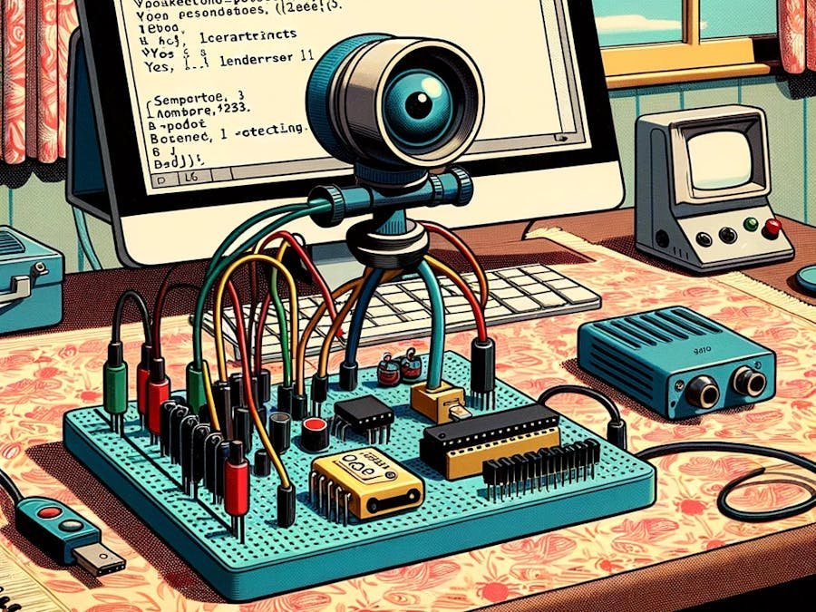<br>
  <em>Промпт DALL·E: мультфильм в стиле анимации 1950-х с подробной платой, на которой видны датчики, в первую очередь камера, на столе с узорчатой скатертью. За платой стоит компьютер с большой задней панелью, на котором открыта Arduino IDE. Содержимое IDE намекает на назначение выводов светодиодов и инференс модели машинного обучения для распознавания голосовых команд. Serial Monitor в отдельном окне показывает результаты для команд «yes» и «no».</em>
</p>

## Обзор

В предыдущем разделе о компьютерном зрении (CV) и XIAO ESP32S3, посвящённом *классификации изображений*, мы научились настраивать эту замечательную отладочную плату и классифицировать изображения. Продолжая знакомство с компьютерным зрением, мы изучим **обнаружение объектов** на микроконтроллерах.

### Обнаружение объектов и классификация изображений

Основная задача моделей классификации изображений — определить наиболее вероятную категорию объекта, присутствующего на изображении, например отличить кота от собаки, то есть доминирующий «объект» на изображении:

<p align="center">
  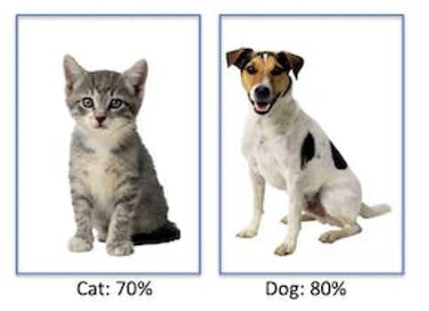
</p>

Но что будет, если на изображении нет доминирующей категории?

<p align="center">
  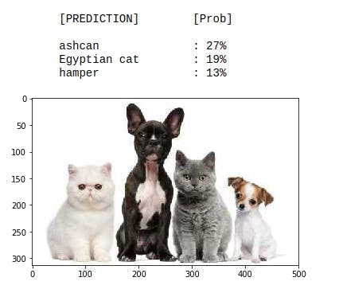
</p>

Модель классификации изображений совершенно неверно определяет это изображение как «ashcan» (мусорный ящик), возможно из-за цветовых оттенков.

> Модель, которая использовалась на предыдущих изображениях, — MobileNet, обученная на большом наборе данных *ImageNet*, работающая на Raspberry Pi.

Чтобы решить эту проблему, нужен другой тип моделей, которые находят не только **несколько категорий** (или меток), но и **где** на изображении расположены объекты.

Такие модели гораздо сложнее и крупнее, например **MobileNetV2 SSD FPN-Lite 320x320**, обученная на наборе COCO. Эта предобученная модель обнаружения объектов умеет находить до 10 объектов на изображении и выдаёт ограничивающий прямоугольник (bounding box) для каждого обнаруженного объекта. Изображение ниже — результат работы такой модели на Raspberry Pi:

<p align="center">
  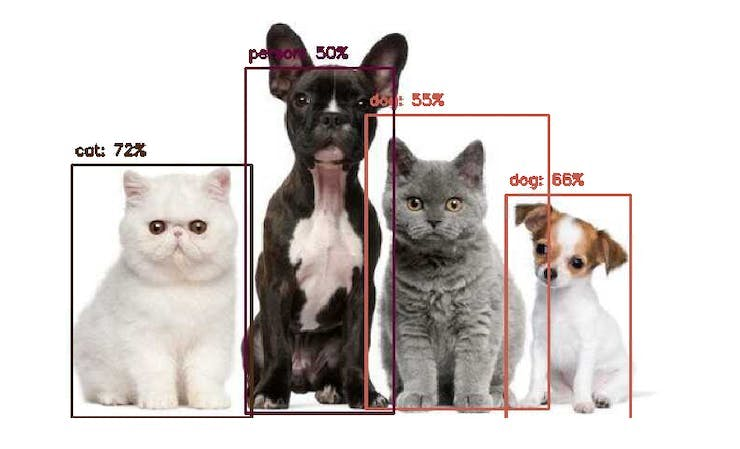
</p>

Модели для обнаружения объектов (такие как MobileNet SSD или YOLO) обычно занимают несколько мегабайт. Для Raspberry Pi это нормально, но для встраиваемых устройств, где ОЗУ обычно составляет в лучшем случае несколько мегабайт, как у XIAO ESP32S3, такие модели не подходят.

### Инновационное решение для обнаружения объектов: FOMO

[Edge Impulse представила в 2022 году **FOMO** (Faster Objects, More Objects)](https://docs.edgeimpulse.com/docs/edge-impulse-studio/learning-blocks/object-detection/fomo-object-detection-for-constrained-devices) — новое решение для обнаружения объектов на встраиваемых устройствах, таких как Nicla Vision и Portenta (Cortex M7), процессорах Cortex M4F (Arduino Nano33 и серии OpenMV M4), а также устройствах Espressif ESP32 (ESP-CAM, ESP-EYE и XIAO ESP32S3 Sense).

В этом практическом проекте мы будем обнаруживать объекты с помощью FOMO.

> Чтобы больше узнать о FOMO, прочитайте [официальное объявление FOMO](https://www.edgeimpulse.com/blog/announcing-fomo-faster-objects-more-objects) от Edge Impulse, где Louis Moreau и Mat Kelcey подробно объясняют принцип работы.

## Цель проекта обнаружения объектов

Любой проект машинного обучения должен начинаться с подробно сформулированной цели. Допустим, мы работаем на промышленном или сельском предприятии и должны сортировать и считать **апельсины (фрукты)** и определённых **лягушек (жуки)**.

<p align="center">
  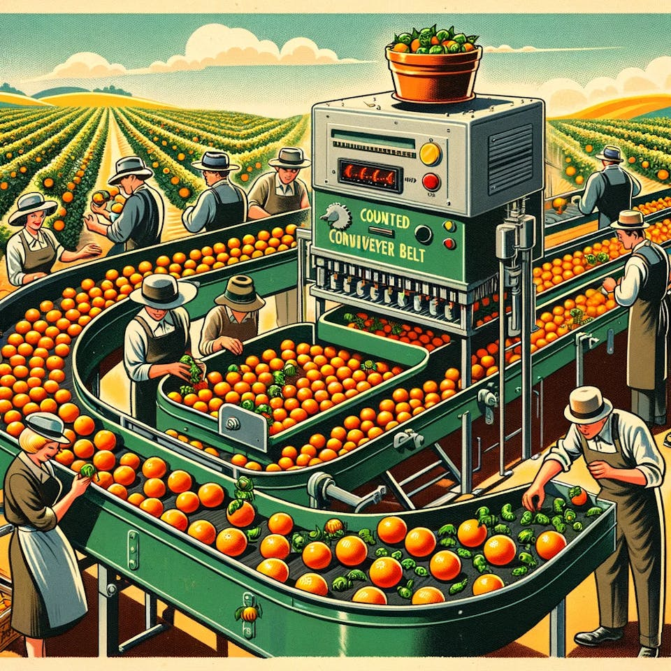
</p>

Иначе говоря, нам нужна многоклассовая классификация, где каждое изображение может относиться к трём классам:

- фон (объектов нет);
- фрукт (Fruit);
- жук (Bug).

Вот несколько неразмеченных примеров изображений, по которым мы будем обнаруживать объекты (фрукты и жуков):

<p align="center">
  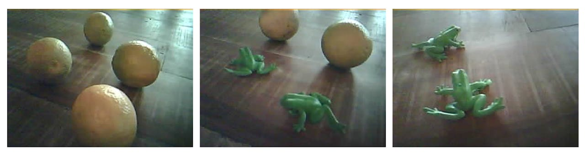
</p>

Нас интересует, какой объект есть на изображении, его положение (центроид) и сколько таких объектов на нём присутствует. Размер объекта FOMO не определяет — в отличие от MobileNet SSD или YOLO, где ограничивающий прямоугольник является одним из выходных данных модели.

Проект мы будем разрабатывать с использованием XIAO ESP32S3 для захвата изображений и инференса. Проект машинного обучения будет создан в Edge Impulse Studio. Но прежде чем начинать проект обнаружения объектов в Studio, создадим *сырой набор данных* (без разметки) с изображениями, на которых есть объекты для обнаружения.

## Сбор данных

Изображения можно снимать с помощью XIAO, телефона или других устройств. Здесь мы будем использовать XIAO с кодом из библиотеки ESP32 для Arduino IDE.

### Сбор набора данных с XIAO ESP32S3

Откройте Arduino IDE и выберите плату XIAO_ESP32S3 (и порт, к которому она подключена). В меню `File > Examples > ESP32 > Camera` выберите `CameraWebServer`.

На панели BOARDS MANAGER (менеджер плат) убедитесь, что установлен последний стабильный (`stable`) пакет.

> ⚠️ **Внимание**
>
> Альфа-версии (например, 3.x-alpha) некорректно работают с XIAO и Edge Impulse. Используйте последнюю стабильную версию (например, 2.0.11).

Также закомментируйте все модели камер, кроме выводов модели XIAO:

`#define CAMERA_MODEL_XIAO_ESP32S3 // Есть PSRAM`

И включите PSRAM в меню `Tools`. Введите данные Wi-Fi и загрузите код на устройство:

<p align="center">
  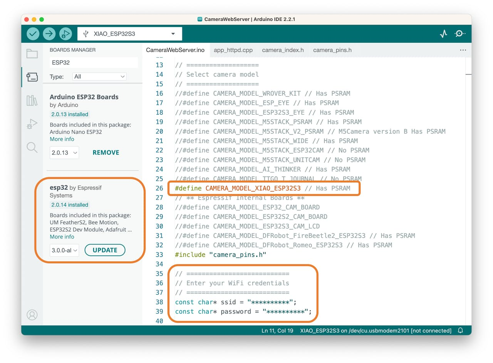
</p>

Если код выполнился правильно, в Serial Monitor появится адрес:

<p align="center">
  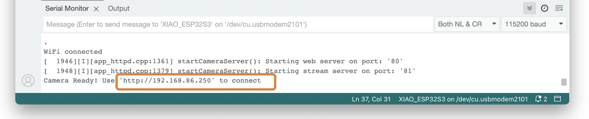
</p>

Скопируйте адрес в браузер и дождитесь загрузки страницы. Выберите разрешение камеры (например, QVGA) и нажмите `[START STREAM]`. Подождите несколько секунд или минут в зависимости от качества соединения. Кнопкой `[Save]` можно сохранить изображение в папку загрузок на компьютере.

<p align="center">
  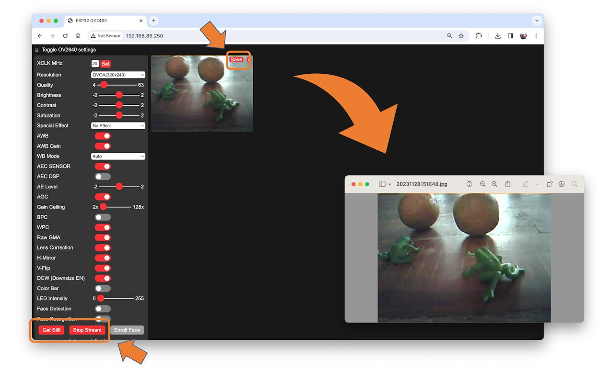
</p>

Edge Impulse рекомендует, чтобы объекты были похожего размера и не перекрывали друг друга, — так модель работает лучше. На промышленном предприятии это нормально: камера закреплена неподвижно и находится на одном расстоянии от объектов. Тем не менее мы попробуем и смешанные размеры и положения, чтобы посмотреть на результат.

> Отдельные папки для изображений создавать не нужно, потому что каждое изображение содержит несколько меток.

Рекомендуем около 50 изображений, с разным сочетанием объектов и разным их количеством в кадре. Старайтесь снимать с разных углов, на разном фоне и при разном освещении.

> Сохраняемые изображения имеют размер кадра QVGA $320\times 240$ и формат RGB565 (формат цветных пикселей).

Когда набор данных собран, нажмите `[Stop Stream]` и переместите изображения в папку.

## Edge Impulse Studio

### Настройка проекта

Откройте [Edge Impulse Studio](https://www.edgeimpulse.com/), войдите в систему по кнопке **Login** (или создайте аккаунт) и начните новый проект.

<p align="center">
  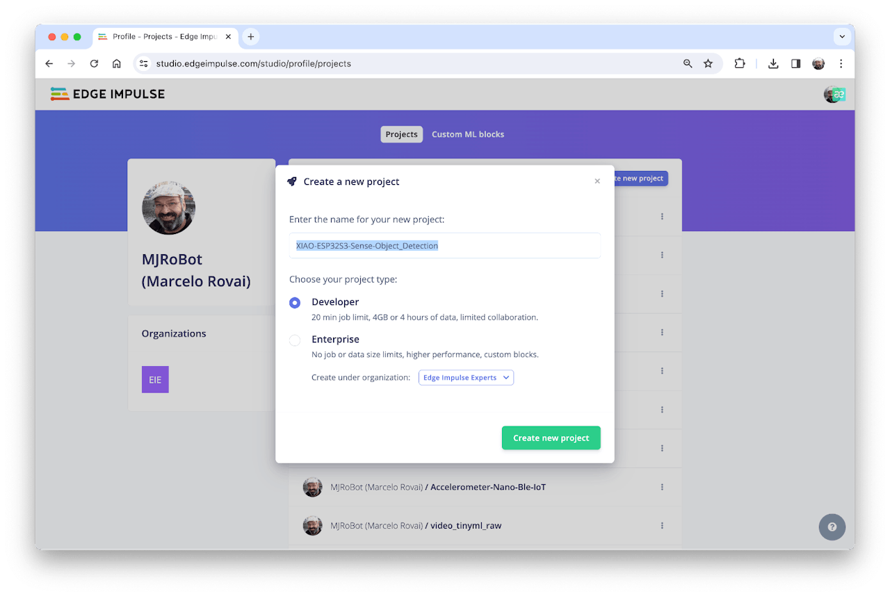
</p>

> Здесь можно клонировать проект, созданный для этой практической работы: [XIAO-ESP32S3-Sense-Object_Detection](https://studio.edgeimpulse.com/public/315759/latest).

На панели проекта Dashboard прокрутите вниз до **Project info**, выберите **Bounding boxes (object detection)** и **Espressif ESP-EYE** (наиболее похожее на нашу плату) в качестве целевого устройства:

<p align="center">
  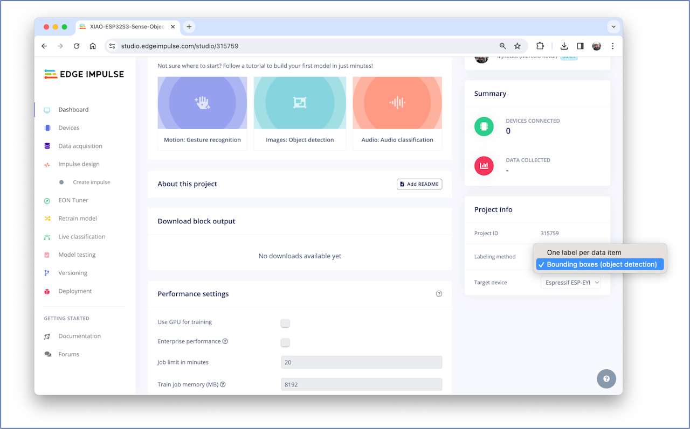
</p>

### Загрузка неразмеченных данных

В Studio откройте вкладку `Data acquisition` и в разделе `UPLOAD DATA` загрузите снятые изображения из папки на компьютере.

<p align="center">
  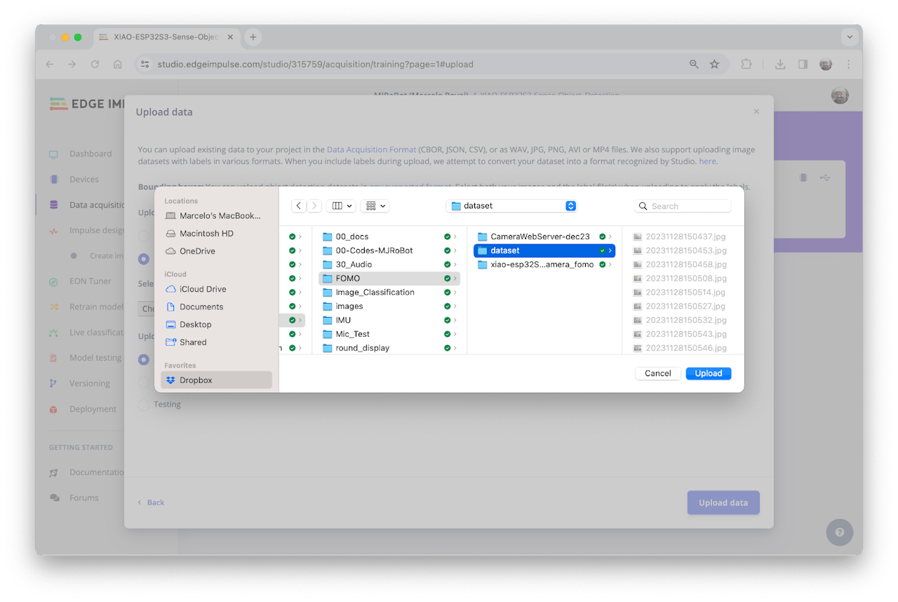
</p>

> Можно поручить Studio автоматически разделить данные на обучающую и тестовую выборки или сделать это вручную. Мы загрузим все изображения как обучающие.

<p align="center">
  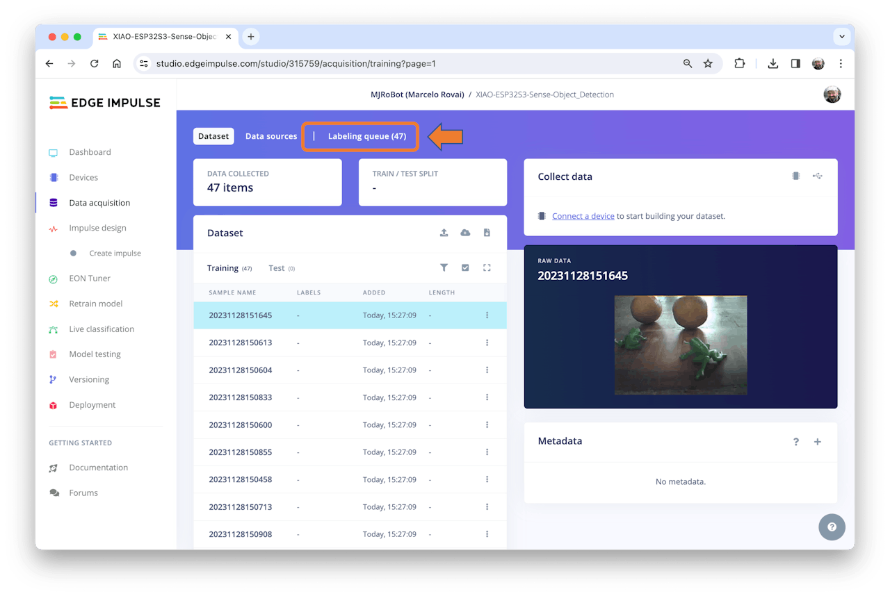
</p>

Все неразмеченные изображения (47) загружены, но перед использованием в наборе данных их нужно правильно разметить. Для этого в Studio есть инструмент, который открывается по ссылке Labeling queue (47).

В бесплатной версии Edge Impulse Studio доступны два способа разметки с помощью ИИ:

- с использованием YOLOv5;
- отслеживанием объектов между кадрами.

> Для клиентов Enterprise Edge Impulse запустила [функцию автоматической разметки](https://docs.edgeimpulse.com/docs/edge-impulse-studio/data-acquisition/auto-labeler), которая упрощает разметку в проектах обнаружения объектов.

Обычные объекты можно быстро распознать и разметить с помощью готовой библиотеки предобученных моделей обнаружения YOLOv5 (обученных на наборе COCO). Но в нашем случае объектов нет в наборах COCO, поэтому выберем опцию tracking objects (отслеживание объектов). С ней, как только вы нарисуете рамки и разметите изображения в одном кадре, объекты будут автоматически отслеживаться от кадра к кадру, и новые объекты будут *частично* размечены (не все — корректно).

> Если у вас уже есть размеченный набор данных с ограничивающими рамками, импортируйте его через [загрузчик EI](https://docs.edgeimpulse.com/docs/tools/edge-impulse-cli/cli-uploader#bounding-boxes).

### Разметка набора данных

Начните с первого неразмеченного изображения: с помощью мыши обведите объект рамкой, чтобы добавить метку. Затем нажмите **Save labels**, чтобы перейти к следующему элементу.

<p align="center">
  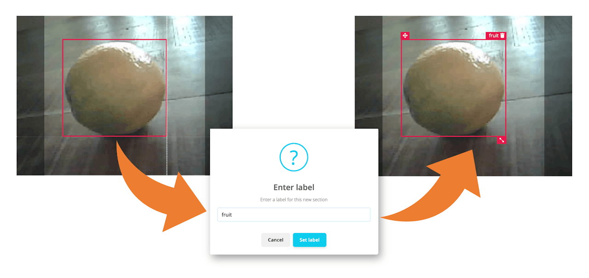
</p>

Продолжайте, пока очередь не опустеет. В конце все изображения должны быть размечены так же, как примеры ниже:

<p align="center">
  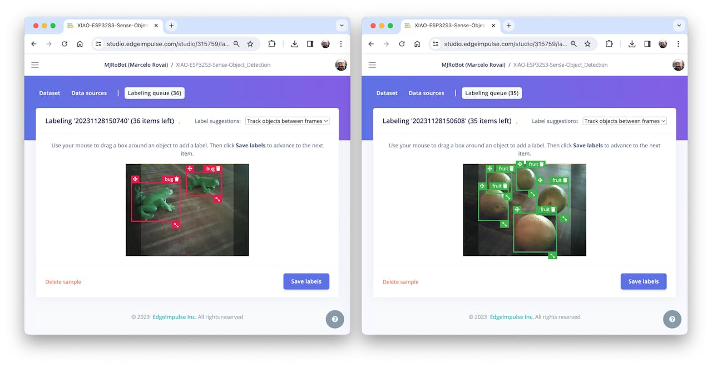
</p>

Затем просмотрите размеченные примеры на вкладке `Data acquisition`. Если какая-то метка неверна, её можно отредактировать через меню «три точки» после названия образца:

<p align="center">
  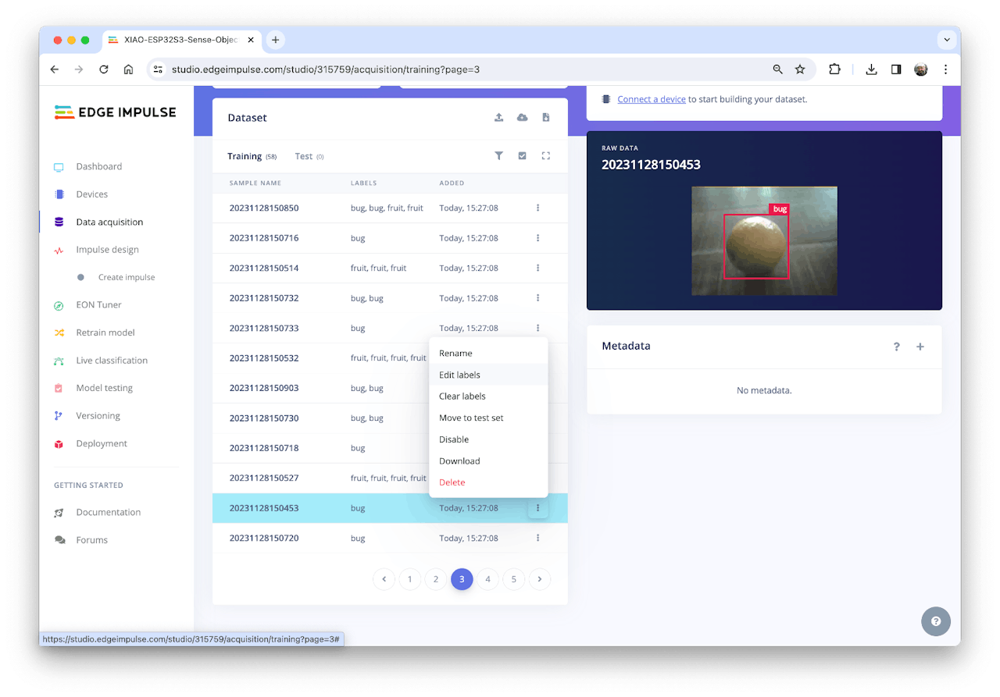
</p>

Studio подскажет, как заменить неверную метку и исправить набор данных.

<p align="center">
  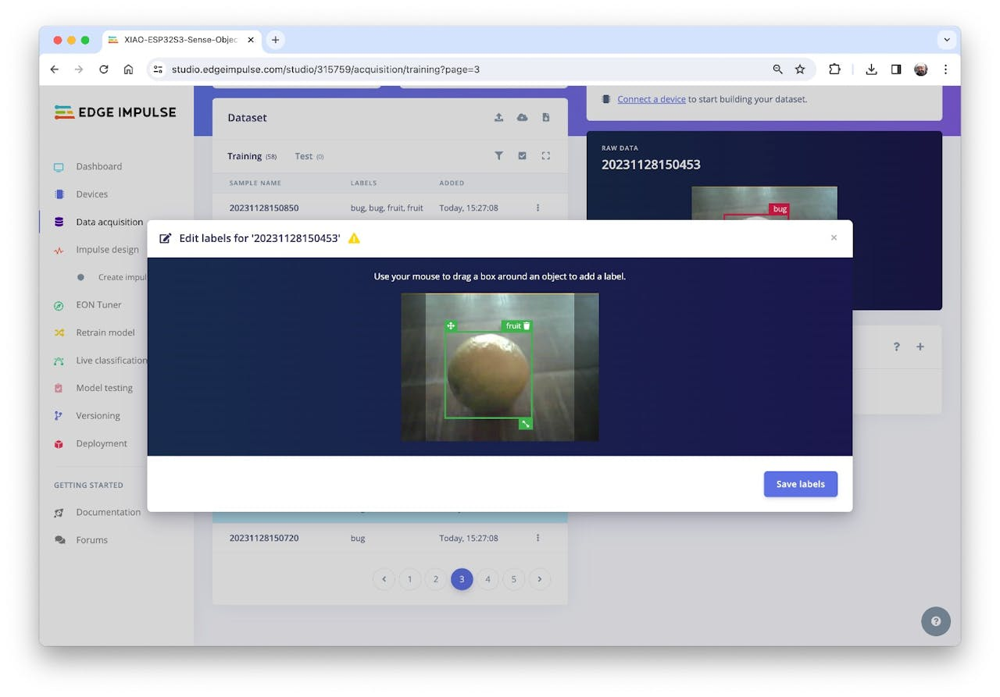
</p>

### Балансировка набора данных и разделение на обучающую и тестовую выборки

После разметки всех данных стало очевидно, что класса «фрукт» гораздо больше, чем «жука». Поэтому собрали 11 дополнительных изображений жуков (всего стало 58). После их разметки нужно отобрать часть изображений в тестовую выборку. Это делается через меню «три точки» после названия изображения. Я отобрал шесть изображений, что составляет 13 % от общего набора данных.

<p align="center">
  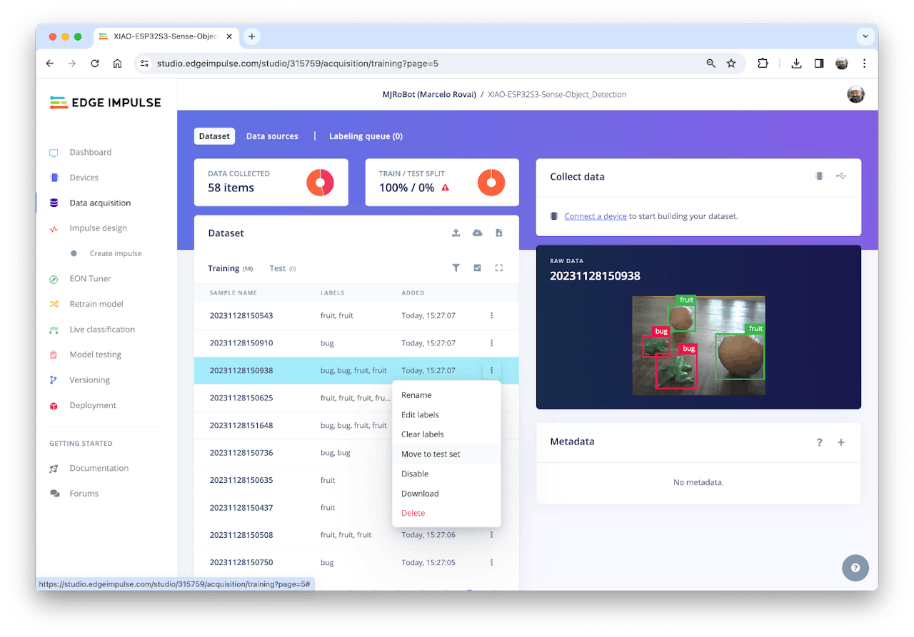
</p>

## Проектирование Impulse

На этом этапе нужно определить, как:

- **Предобработка:** изменить размер отдельных изображений с $320\times 240$ до $96\times 96$, сжав их к квадратной форме (без обрезки). Затем изображения переводятся из RGB в оттенки серого (Grayscale).
- **Проектирование модели:** в данном случае «Object Detection» (обнаружение объектов).

<p align="center">
  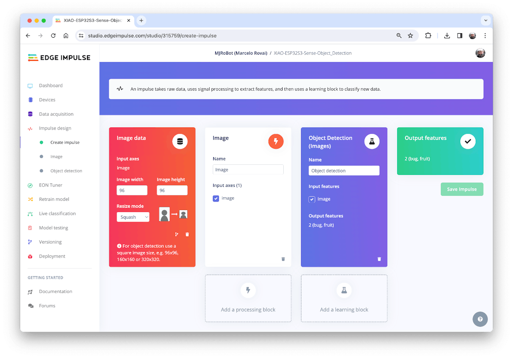
</p>

### Предобработка всего набора данных

В этом разделе выберите **Color depth** — Grayscale, подходящий для моделей FOMO, и сохраните параметры (Save parameters).

<p align="center">
  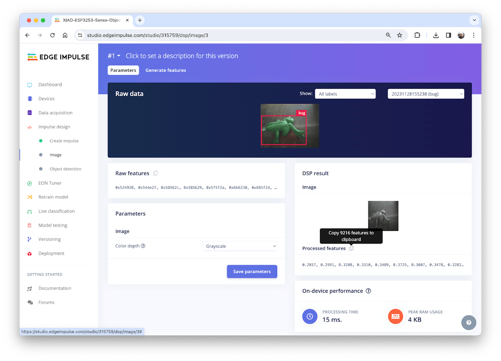
</p>

Studio автоматически переходит к разделу Generate features, где обрабатываются все образцы. В результате получается набор данных из отдельных изображений $96\times 96\times 1$, или 9 216 признаков.

<p align="center">
  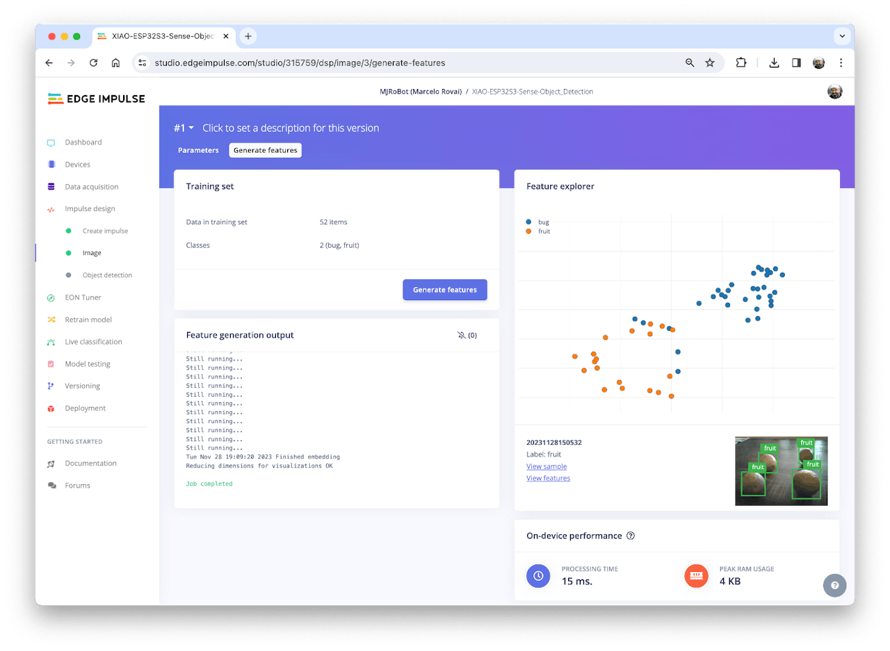
</p>

Просмотр признаков показывает, что после генерации все образцы хорошо разделяются.

> Некоторые образцы, судя по всему, находятся не в том месте, но щелчок по ним подтверждает правильность разметки.

## Проектирование модели, обучение и тестирование

Мы будем использовать FOMO — модель обнаружения объектов на основе MobileNetV2 (альфа 0,35), которая грубо сегментирует изображение на сетку: **фон** и **интересующие объекты** (здесь *фрукты* и *жуки*).

FOMO — инновационная модель машинного обучения для обнаружения объектов, которая может использовать в 30 раз меньше энергии и памяти, чем традиционные модели вроде Mobilenet SSD и YOLOv5. FOMO способна работать на микроконтроллерах с ОЗУ менее 200 КБ. Главная причина в том, что другие модели вычисляют размер объекта, рисуя вокруг него квадрат (ограничивающий прямоугольник), а FOMO не учитывает размер и выдаёт только информацию о том, где объект находится на изображении, — в виде координат его центроида.

### Как работает FOMO

FOMO берёт изображение в оттенках серого и делит его на блоки пикселей с коэффициентом 8. Для входного изображения $96\times 96$ сетка будет $12\times 12$ $(96/8=12)$. Затем FOMO запускает классификатор для каждого блока пикселей, чтобы вычислить вероятность того, что в нём есть фрукт или жук, и определяет области с наибольшей вероятностью наличия объекта (если в блоке пикселей объектов нет, он классифицируется как *background*). По перекрытию итоговой области FOMO выдаёт координаты (относительно размеров изображения) центроида этой области.

<p align="center">
  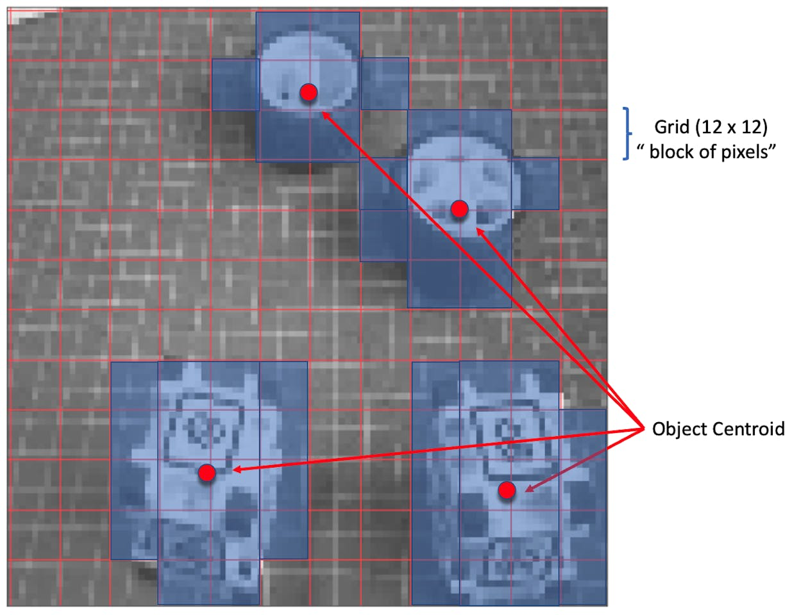
</p>

Для обучения нужно выбрать предобученную модель. Используем **FOMO (Faster Objects, More Objects) MobileNetV2 0.35**. Эта модель занимает около 250 КБ ОЗУ и 80 КБ ПЗУ (флеш-памяти), что хорошо подходит для нашей платы.

<p align="center">
  
</p>

Гиперпараметры обучения такие:

- эпох: 60;
- размер батча (batch size): 32;
- скорость обучения (learning rate): 0,001.

Для валидации во время обучения будут отложены 20 % набора данных (*validation_dataset*). Для оставшихся 80 % (*train_dataset*) применим аугментацию данных: случайно отразим, изменим размер и яркость изображений и обрежем их, искусственно увеличивая количество образцов для обучения.

В итоге модель получает общую F1-меру 85 %, что близко к результату на тестовых данных (83 %).

> FOMO автоматически добавил третью метку background к двум заданным ранее (*fruit* и *bug*).

<p align="center">
  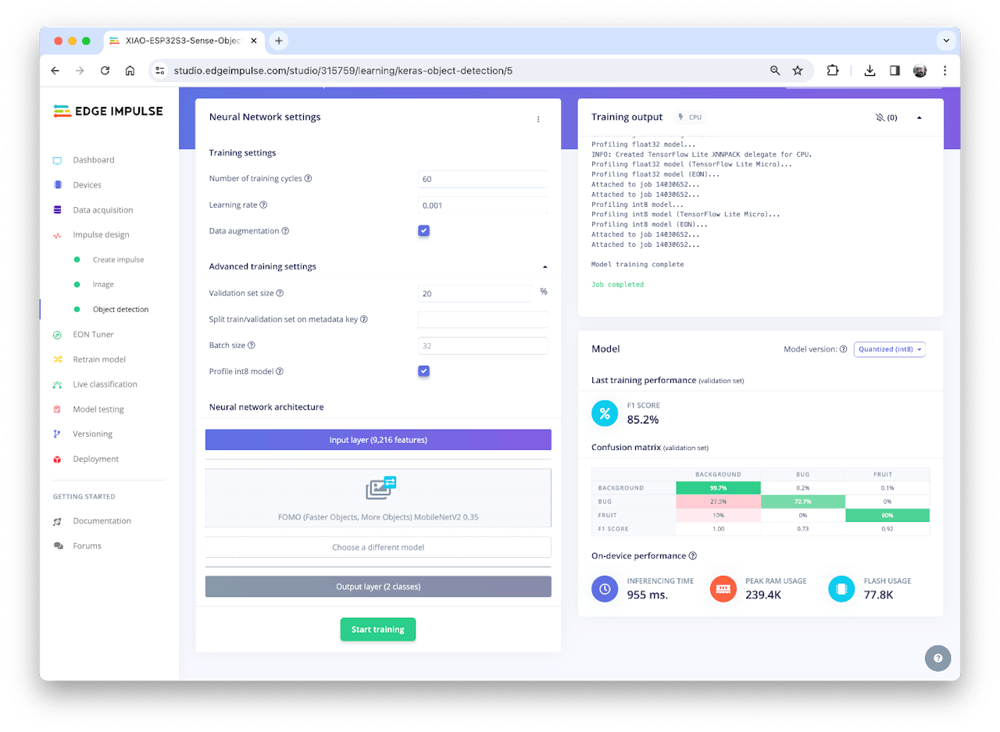
</p>

> В задачах обнаружения объектов точность, как правило, не является основной [метрикой оценки](https://learnopencv.com/mean-average-precision-map-object-detection-model-evaluation-metric/). Обнаружение объектов включает их классификацию и ограничивающие рамки вокруг них, то есть это более сложная задача, чем простая классификация. Проблема в том, что у нас нет ограничивающих рамок, только центроиды. Коротко говоря, использование точности как метрики может вводить в заблуждение и не даёт полной картины того, насколько хорошо работает модель. Поэтому мы используем F1-меру.

### Проверка модели в режиме «Live Classification»

После обучения модели её можно проверить с помощью инструмента Live Classification. В соответствующем разделе нажмите значок подключения платы разработки (небольшой микроконтроллер) и отсканируйте QR-код телефоном.

<p align="center">
  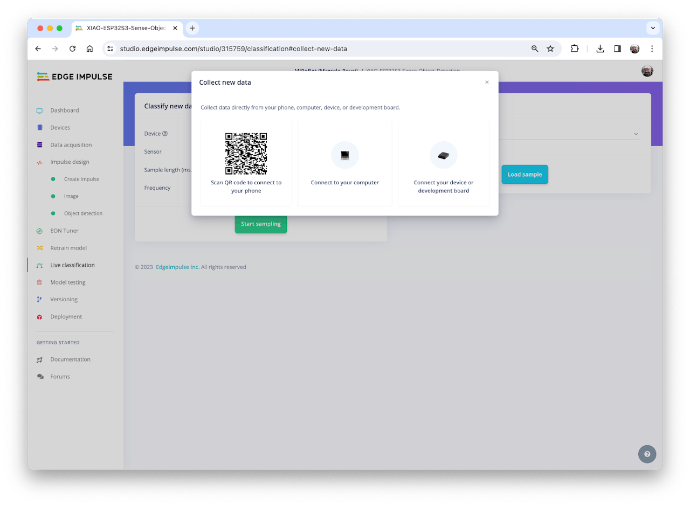
</p>

После подключения телефон можно использовать для съёмки реальных изображений, которые будет тестировать обученная модель в Edge Impulse Studio.

<p align="center">
  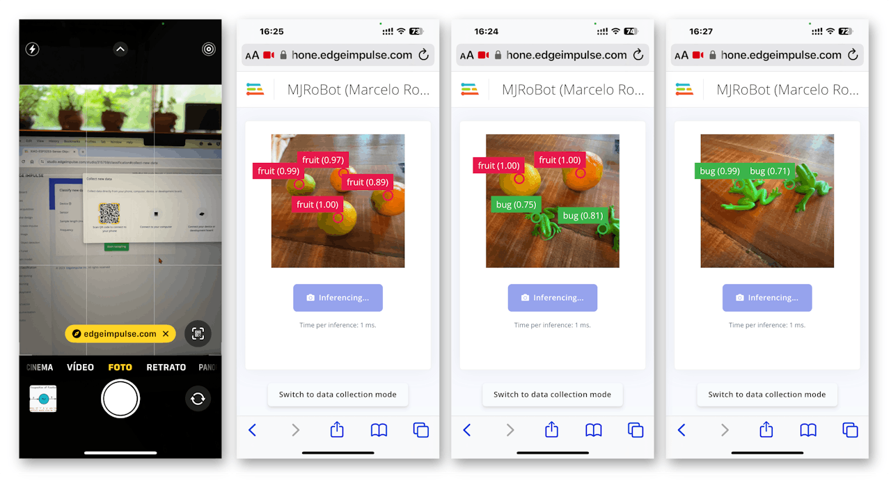
</p>

Учтите, что модель может давать ложные срабатывания и пропуски. Это можно уменьшить, задав подходящий Confidence Threshold (порог уверенности; настройка через меню «три точки»). Попробуйте значение 0,8 и выше.

## Развёртывание модели (Arduino IDE)

Выберите Arduino Library и модель Quantized (int8), включите компилятор EON на вкладке Deploy и нажмите \[Build\].

<p align="center">
  
</p>

Откройте Arduino IDE, в меню Sketch выберите Include Library и Add .ZIP Library. Выберите файл, скачанный из Edge Impulse Studio, — и готово!

<p align="center">
  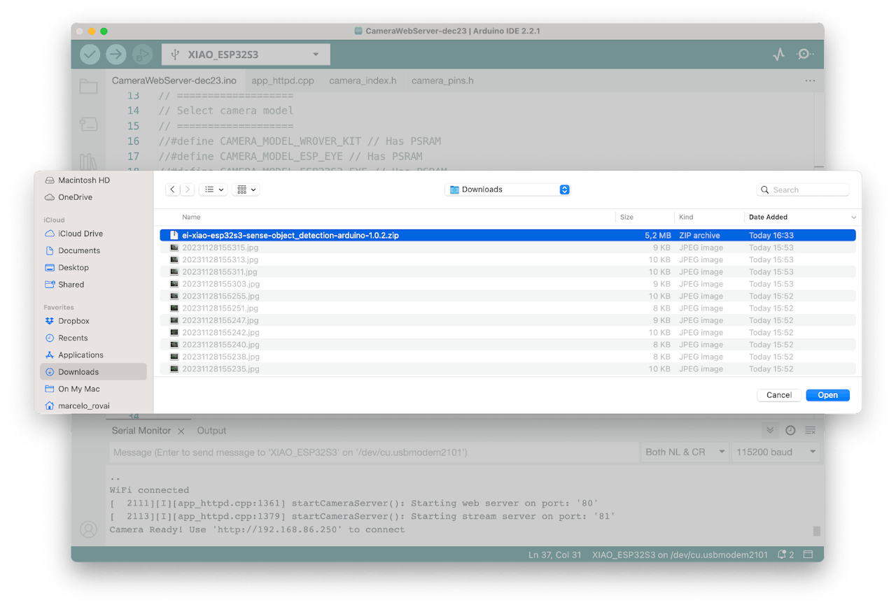
</p>

На вкладке Examples в Arduino IDE под именем вашего проекта вы найдёте скетч (`esp32 > esp32_camera`).

<p align="center">
  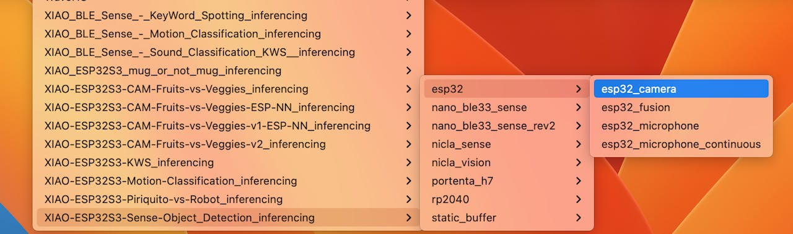
</p>

Нужно изменить строки с 32 по 75, которые задают модель камеры и выводы, используя данные нашей модели. Скопируйте приведённые ниже строки и замените ими строки 32–75:

```cpp
#define PWDN_GPIO_NUM     -1
#define RESET_GPIO_NUM    -1
#define XCLK_GPIO_NUM     10
#define SIOD_GPIO_NUM     40
#define SIOC_GPIO_NUM     39
#define Y9_GPIO_NUM       48
#define Y8_GPIO_NUM       11
#define Y7_GPIO_NUM       12
#define Y6_GPIO_NUM       14
#define Y5_GPIO_NUM       16
#define Y4_GPIO_NUM       18
#define Y3_GPIO_NUM       17
#define Y2_GPIO_NUM       15
#define VSYNC_GPIO_NUM    38
#define HREF_GPIO_NUM     47
#define PCLK_GPIO_NUM     13
```

Вот получившийся код:

<p align="center">
  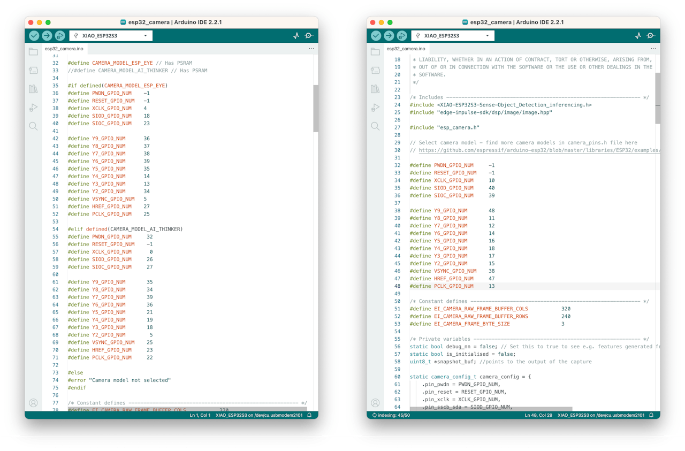
</p>

Загрузите код на XIAO ESP32S3 Sense — и можно начинать обнаруживать фрукты и жуков. Результат можно проверить в Serial Monitor.

### Фон

<p align="center">
  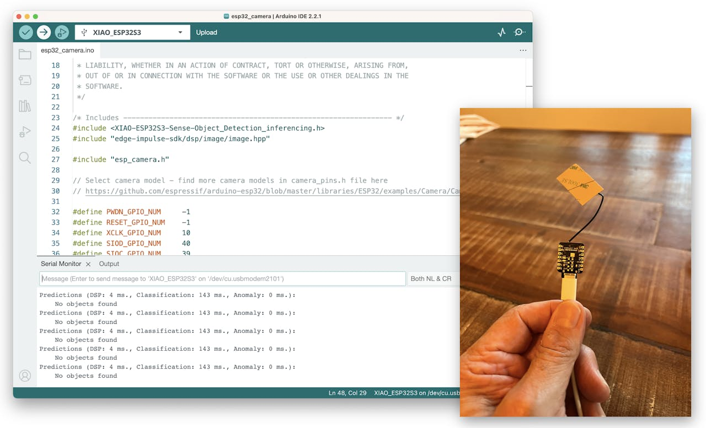
</p>

### Фрукты

<p align="center">
  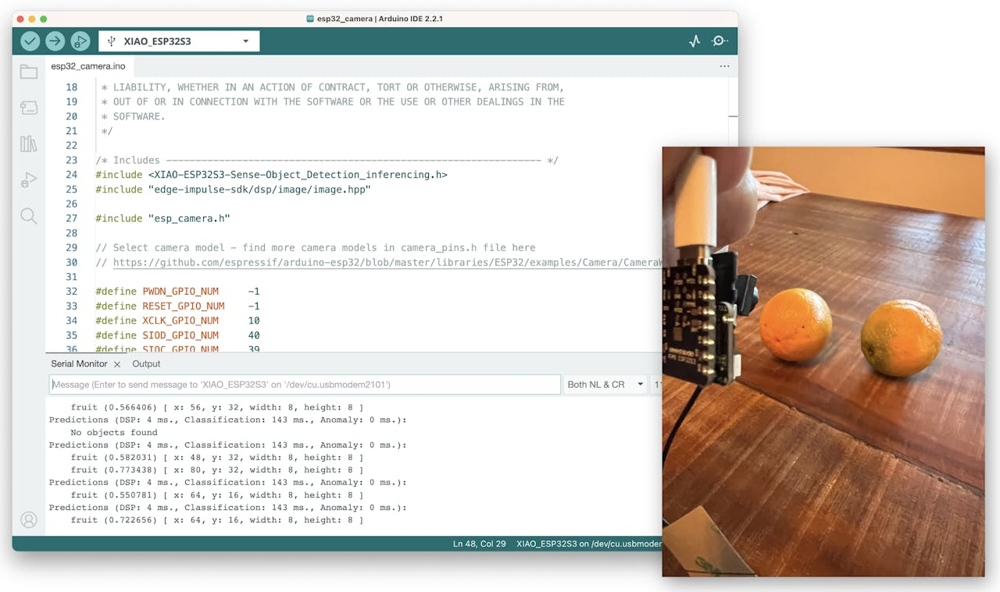
</p>

### Жуки

<p align="center">
  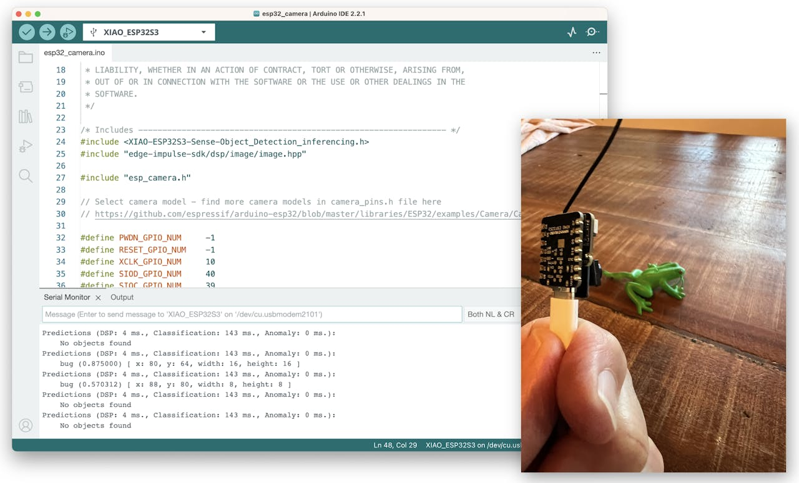
</p>

Обратите внимание: задержка модели составляет 143 мс, а частота кадров — около 7 кадров в секунду (примерно как в проекте классификации изображений). Это объясняется тем, что FOMO искусно построена на основе CNN-модели, а не модели обнаружения вроде SSD MobileNet. Например, при запуске модели MobileNetV2 SSD FPN-Lite $320\times 320$ на Raspberry Pi 4 задержка примерно в пять раз выше (около 1,5 кадра в секунду).

## Развёртывание модели (SenseCraft Web Toolkit)

Как обсуждалось в главе о классификации изображений, проверка инференса моделей для изображений в Arduino IDE очень затруднительна, потому что мы не видим, на что направлена камера. Поэтому воспользуемся **SenseCraft Web Toolkit**.

Чтобы запустить SenseCraft Web Toolkit, выполните следующие шаги:

1. Откройте [сайт SenseCraft Web Toolkit](https://seeed-studio.github.io/SenseCraft-Web-Toolkit/#/setup/process).
2. Подключите XIAO к компьютеру:

- При подключённом XIAO выберите его, как показано ниже:

<p align="center">
  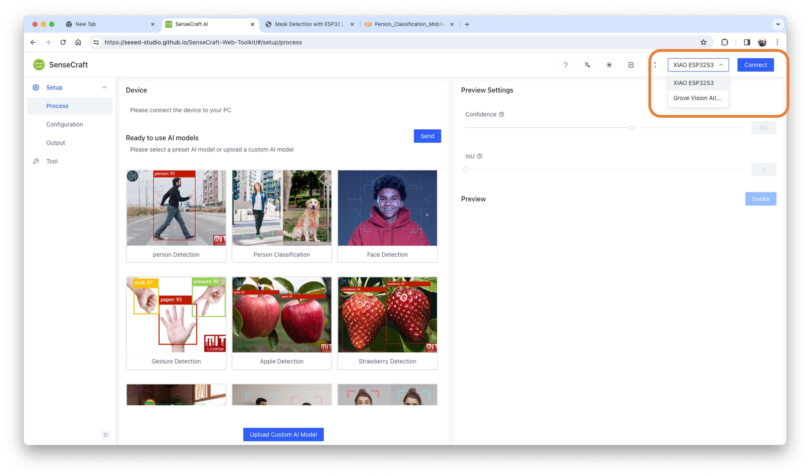
</p>

- Выберите устройство и порт, затем нажмите `[Connect]`:

<p align="center">
  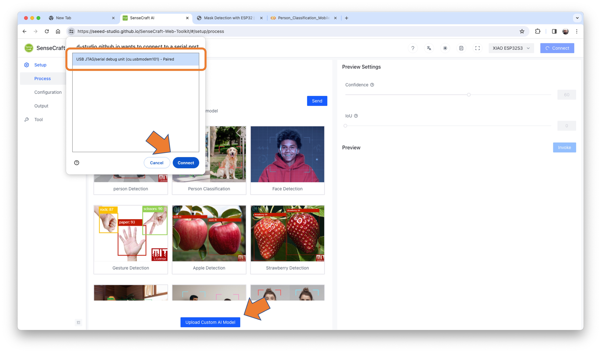
</p>

> Можно попробовать несколько моделей компьютерного зрения, заранее загруженных Seeed Studio. Экспериментируйте!

В нашем случае мы используем синюю кнопку внизу страницы: `[Upload Custom AI Model]`.

Но сначала нужно скачать из Edge Impulse Studio нашу **квантованную модель .tflite**.

3. Перейдите в свой проект в Edge Impulse Studio или клонируйте этот:

- [XIAO-ESP32S3-CAM-Fruits-vs-Veggies-v1-ESP-NN](https://studio.edgeimpulse.com/public/228516/live)

4. На вкладке `Dashboard` скачайте модель («block output»): `Object Detection model — TensorFlow Lite (int8 quantized)`.

<p align="center">
  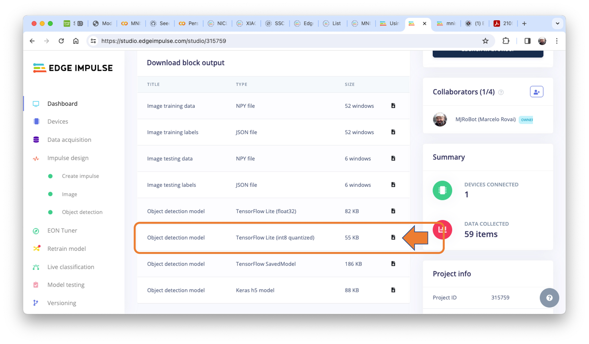
</p>

5. В SenseCraft Web Toolkit нажмите синюю кнопку внизу страницы: `[Upload Custom AI Model]`. Откроется окно. Укажите файл модели, скачанный из Edge Impulse Studio, выберите имя модели и введите метки (ID: Object):

<p align="center">
  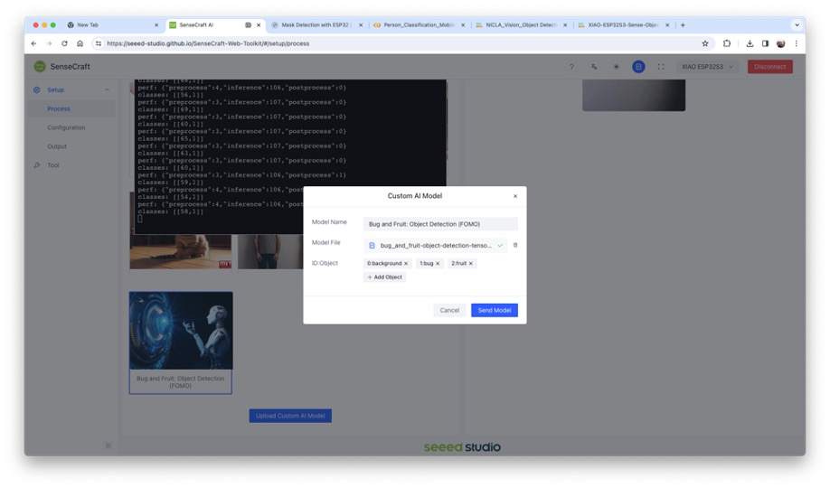
</p>

> Учтите, что нужно использовать метки, заданные в EI Studio, и вводить их в алфавитном порядке (в нашем случае: background, bug, fruit).

Через несколько секунд (или минут) модель загрузится на устройство, и изображение с камеры появится в реальном времени в области предпросмотра (Preview):

<p align="center">
  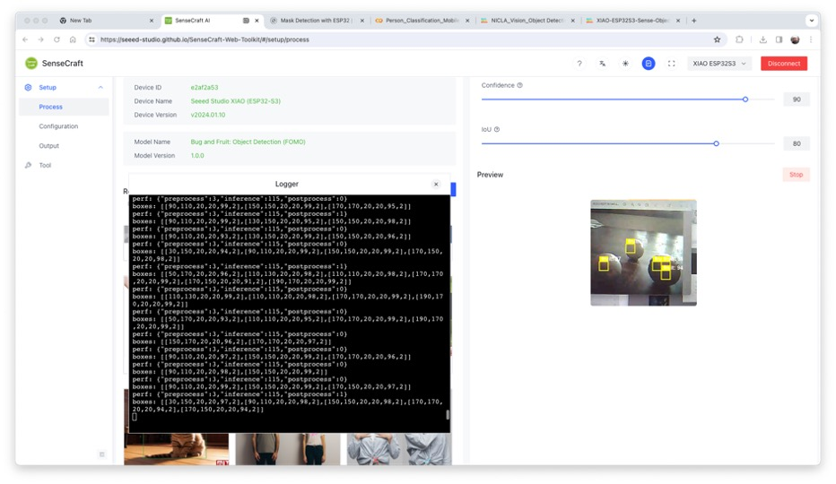
</p>

Обнаруженные объекты будут отмечены (центроиды). Можно выбрать уверенность инференса курсором `Confidence` и `IoU` — меру, которая оценивает точность предсказанных ограничивающих рамок по сравнению с истинными.

Нажав верхнюю кнопку (Device Log), можно открыть Serial Monitor и следить за инференсом, как мы делали в Arduino IDE.

<p align="center">
  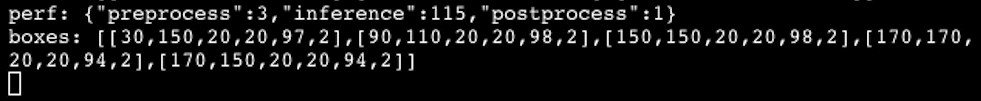
</p>

В Device Log вы получите такие данные:

- время предобработки (захват и обрезка изображения): 3 мс;
- время инференса (задержка модели): 115 мс;
- время постобработки (вывод изображения и отметка объектов): 1 мс;
- выходной тензор (рамки), например одна из рамок: [[30, 150, 20, 20, 97, 2]]. Здесь 30, 150, 20, 20 — координаты рамки (вокруг центроида); 97 — результат инференса, а 2 — класс (в данном случае 2: fruit, фрукт).

> В приведённом примере получилось 5 рамок, поскольку ни один фрукт не получил по 3 центроида. Одно из решений — постобработка, при которой близкие центроиды объединяются в один.

Ещё несколько снимков экрана:

<p align="center">
  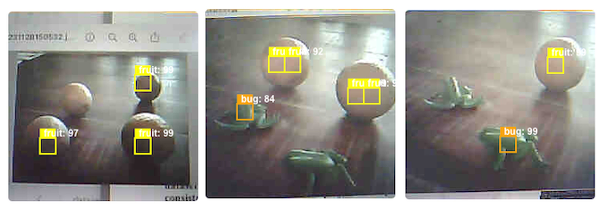
</p>

## Итоги

FOMO — важный скачок в области обработки изображений, как сказали Louis Moreau и Mat Kelcey при её запуске в 2022 году:

> FOMO — революционный алгоритм, который впервые приносит обнаружение, отслеживание и подсчёт объектов в реальном времени на микроконтроллеры.

Для исследования обнаружения объектов (и, точнее, их подсчёта) на встраиваемых устройствах есть множество возможностей.

## Ресурсы

- [Проект Edge Impulse](https://studio.edgeimpulse.com/public/315759/latest)
