# Настройка

<p align="center">
  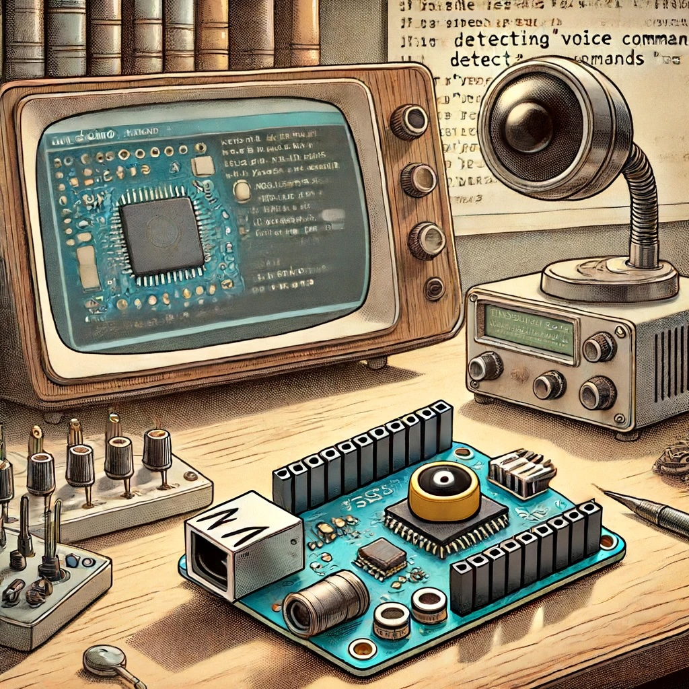<br>
  <em>Промпт DALL·E: рисунок в стиле мультфильма 1950-х с платой XIAO ESP32S3 с характерным модулем камеры, как на предоставленном изображении. Плата стоит на классическом лабораторном столе среди различных датчиков, включая микрофон. За платой — старинный экран компьютера с Arduino IDE в приглушённых цветах; код посвящён настройке выводов светодиодов и инференсу модели машинного обучения для голосовых команд. Serial Monitor в IDE показывает распознанные команды «yes» и «no». Сцена сочетает ретро-шарм лабораторий середины века с современной электроникой.</em>
</p>

## Обзор

[XIAOML Kit](https://www.seeedstudio.com/The-XIAOML-Kit.html) предназначен для практического знакомства с приложениями TinyML. В комплект входят мощная отладочная плата [XIAO ESP32S3 Sense](https://www.seeedstudio.com/XIAO-ESP32S3-Sense-p-5639.html) и плата расширения, которая добавляет датчики, необходимые для проектов машинного обучения.

**Состав комплекта XIAOML Kit:**

- **XIAO ESP32S3 Sense:** основная отладочная плата со встроенной камерой, цифровым микрофоном и поддержкой SD-карт;
- **Плата расширения:** содержит 6-осевой IMU (LSM6DS3TR-C) и 0,42-дюймовый OLED-дисплей для регистрации движения и визуализации данных;
- **Набор для работы с SD-картой:** включает SD-карту и адаптер USB для хранения данных и развёртывания моделей;
- **Кабель USB-C:** для подключения платы к компьютеру;
- **Антенна и радиаторы.**

> ⚠️ **Внимание**
>
> **Не устанавливайте радиаторы** на плату XIAO ESP32S3 (или снимите их аккуратно), если хотите использовать плату расширения XIAO ML Kit. Подробнее см. в приложении.

<p align="center">
  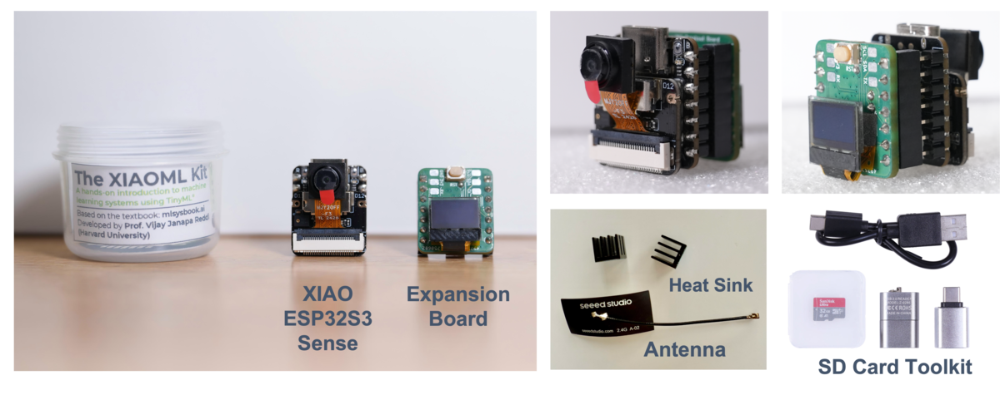
</p>

### Основные особенности платы XIAO ESP32S3 Sense

[XIAO ESP32S3 Sense](https://www.seeedstudio.com/XIAO-ESP32S3-Sense-p-5639.html) — сердце комплекта XIAOML Kit. Она объединяет вычислительные возможности для ML с фото- и аудиофункциями и подходит для проектов TinyML в области интеллектуального голосового и визуального ИИ.

<p align="center">
  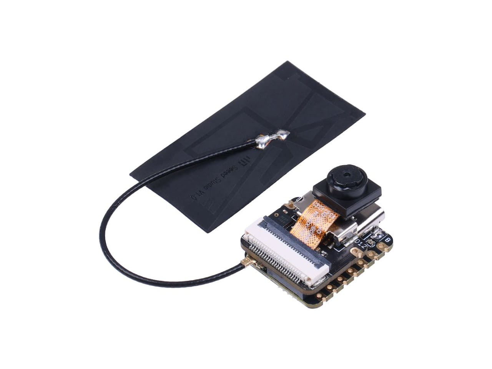
</p>

**Ключевые особенности**

- **Мощный микроконтроллер:** 32-разрядный двухъядерный процессор ESP32S3 с архитектурой Xtensa, работающий на частоте до 240 МГц, с поддержкой Arduino и MicroPython;
- **Расширенные функции:** съёмная камера OV2640 с разрешением $1600{\times}1200$, совместимая с камерой OV5640, а также встроенный цифровой микрофон;
- **Продуманное питание:** управление зарядом литиевой батареи, четыре режима энергопотребления, режим глубокого сна с потреблением всего 14 мкА;
- **Достаточно памяти:** 8 МБ PSRAM и 8 МБ флеш-памяти, слот для SD-карты до 32 ГБ (FAT);
- **Отличные радиохарактеристики:** двойная беспроводная связь Wi-Fi 2,4 ГГц и BLE, дальность связи более 100 м при использовании антенны с разъёмом U.FL;
- **Компактный корпус:** $21{\times}17{,}5$ мм, классический форм-фактор XIAO, удобный для проектов с ограниченным местом.

<p align="center">
  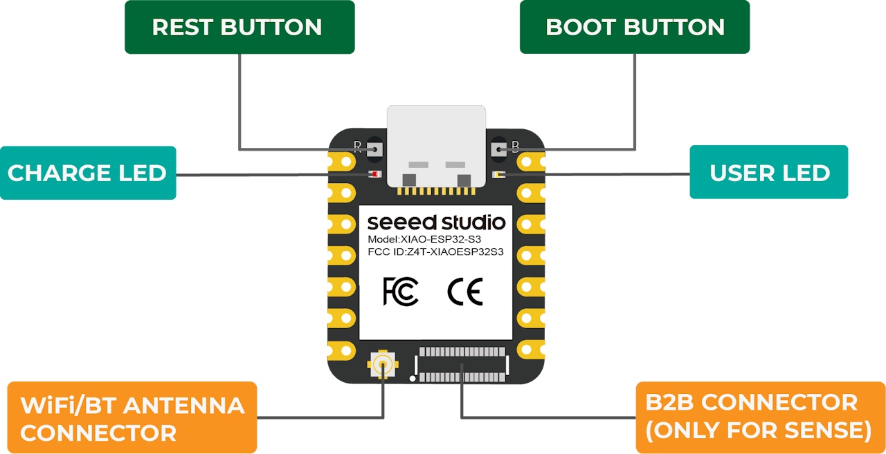
</p>

Ниже показана общая распиновка платы:

<p align="center">
  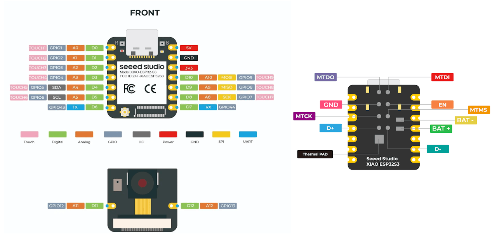
</p>

> Подробности см. на [вики Seeed Studio](https://wiki.seeedstudio.com/xiao_esp32s3_getting_started/).

### Особенности платы расширения

Плата расширения дополняет XIAOML Kit возможностями для приложений машинного обучения, основанных на движении:

<p align="center">
  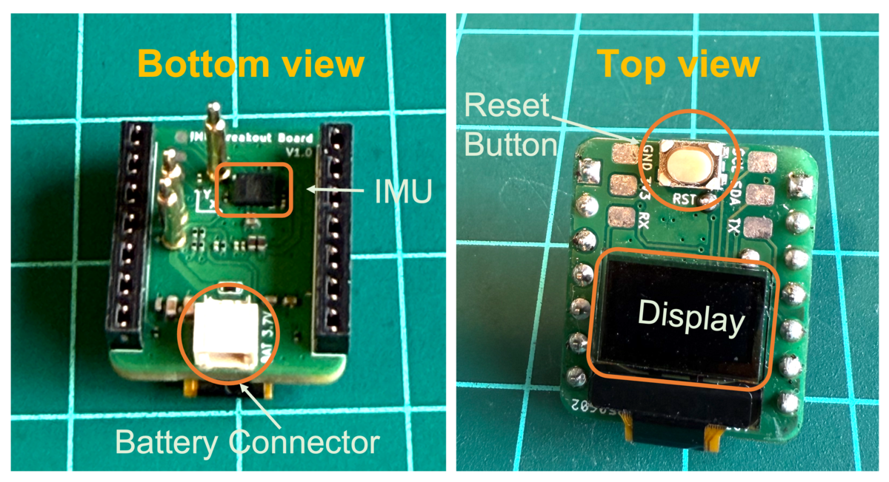
</p>

**Компоненты:**

- 6-осевой IMU (LSM6DS3TR-C):
    - 3-осевой акселерометр и 3-осевой гироскоп для обнаружения и классификации движения;
        - диапазон акселерометра: ±2/±4/±8/±16 g;
        - диапазон гироскопа: ±125/±250/±500/±1000/±2000 dps;
        - интерфейс I2C (адрес: 0x6A).

- 0,42-дюймовый OLED-дисплей:
    - монохромный дисплей (разрешение $72{\times}40$) для визуализации данных в реальном времени;
        - контроллер: SSD1306;
        - интерфейс I2C (адрес: 0x3C).

- Кнопка перезапуска (EN);

- Разъём аккумулятора (BAT+, BAT−).

### Сборка комплекта

Плата расширения легко подключается к XIAO ESP32S3 Sense, образуя универсальную платформу для мультимодальных экспериментов с машинным обучением: зрение, звук и движение.

<p align="center">
  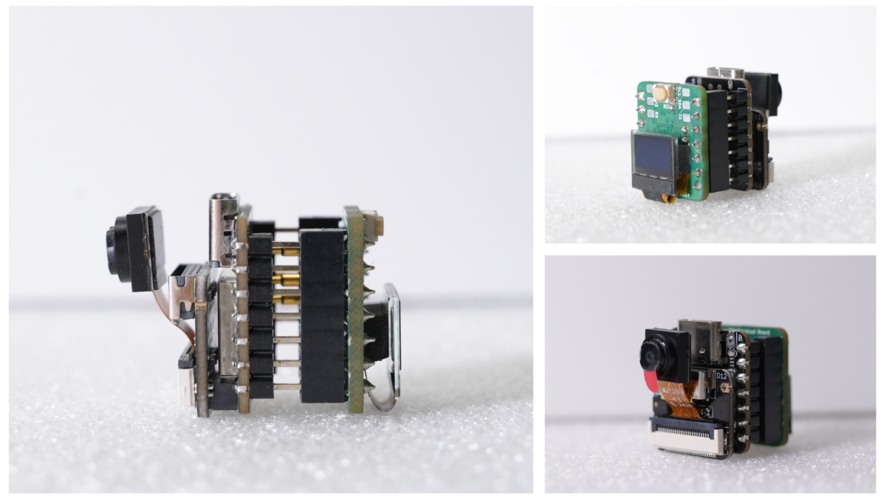
</p>

Обратите внимание на ориентацию установки модуля:

<p align="center">
  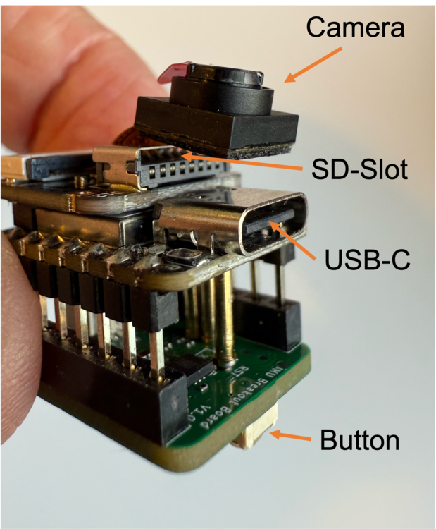
</p>

Обратите внимание:

- соединение `EN`, которое находится внизу ESP32S3 Sense, доступно на плате расширения через кнопку `RST`;
- соединения `BAT+` и `BAT-` также доступны через белый разъём `BAT3.7V`.

**Применения XIAOML Kit:**

- **Зрение:** классификация изображений и обнаружение объектов с помощью встроенной камеры;
- **Звук:** распознавание ключевых слов и голосовых команд со встроенным микрофоном;
- **Движение:** распознавание активности и обнаружение аномалий с помощью датчиков IMU;
- **Мультимодальность:** комплексное слияние данных датчиков для сложных приложений ML.

## Установка XIAO ESP32S3 Sense в Arduino IDE

1. Подключите XIAOML Kit к компьютеру через порт USB-C.

<p align="center">
  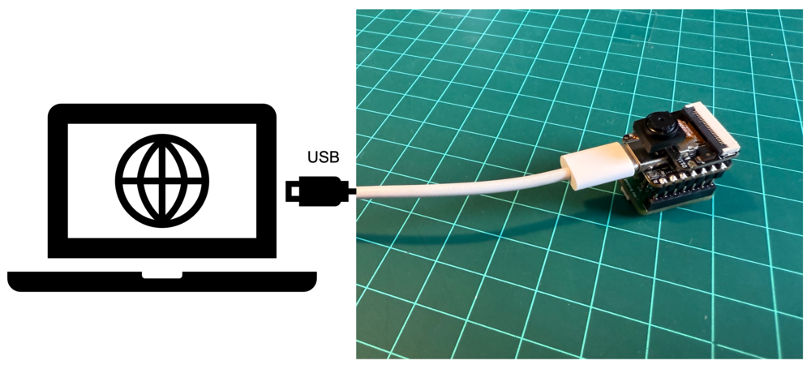
</p>

2. Скачайте и установите стабильную версию Arduino IDE для вашей операционной системы.

    [**[Скачать Arduino IDE]**](https://www.arduino.cc/en/software)

3. Откройте **Arduino IDE** и выберите Boards Manager (менеджер плат), который обозначен значком `UNO`.

4. Введите «*ESP32*» и выберите «**esp32 by Espressif Systems**». Можно `установить` или `обновить` пакеты поддержки плат.

> Не выбирайте «**Arduino ESP32 Boards** by Arduino»: это пакет поддержки Arduino Nano ESP32, а не нашей платы.

<p align="center">
  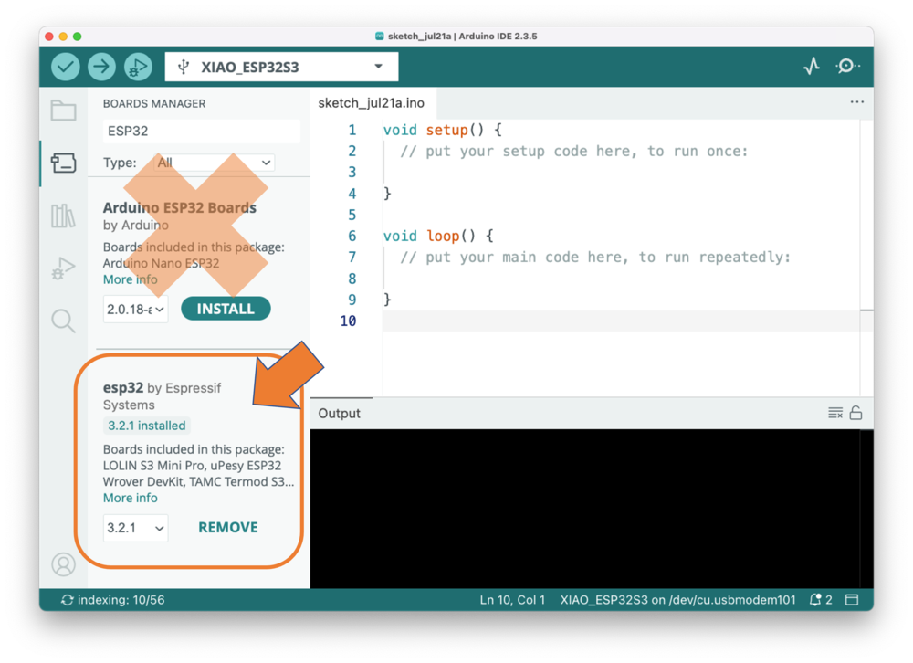
</p>

> ⚠️ **Внимание**
>
> Версии 3.x могут создавать проблемы при использовании XIAO ESP32S3 Sense с кодом развёртывания Edge Impulse. Если это так, используйте последнюю стабильную версию 2.0.x (например, 2.0.17).

5. Нажмите `Select Board`, введите *xiao* или *esp32s3*, выберите `XIAO_ESP32S3` в менеджере плат и соответствующий порт PORT, к которому подключена ESP32S3.

<p align="center">
  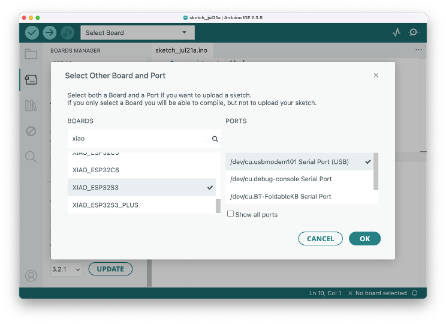
</p>

Готово! Плата должна работать. Проведём несколько тестов.

## Проверка платы: мигание светодиодом (Blink)

На плате XIAO ESP32S3 Sense есть встроенный светодиод, подключённый к GPIO21. Поэтому можно запустить скетч Blink, который находится в `File/Examples/Basics/Blink`. Скетч использует константу Arduino `LED_BUILTIN`, которая внутри соответствует светодиоду на выводе 21. Или можно изменить скетч Blink вручную:

```cpp
#define LED_BUILT_IN 21 // Эта строка необязательна

void setup() {
  pinMode(LED_BUILT_IN, OUTPUT); // Настраиваем вывод на выход
}

// Помните, что выводы работают с инверсной логикой:
// LOW — включить, HIGH — выключить
void loop() {
  digitalWrite(LED_BUILT_IN, LOW); // Включить
  delay (1000); // Ждать 1 секунду
  digitalWrite(LED_BUILT_IN, HIGH); // Выключить
  delay (1000); // Ждать 1 секунду
}
```

> Обратите внимание: выводы работают с инверсной логикой — LOW включает светодиод, HIGH выключает.

<p align="center">
  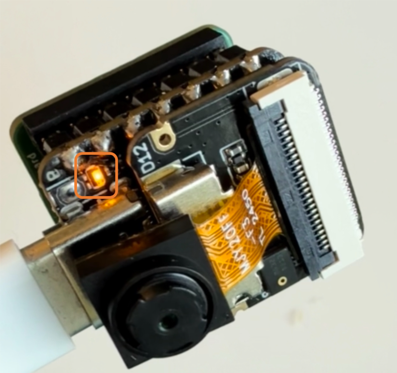
</p>

## Проверка микрофона

Начнём с обнаружения звука. Введите код ниже или перейдите в [проект на GitHub](https://github.com/Mjrovai/XIAO-ESP32S3-Sense) и скачайте скетч [XIAOML_Kit_Mic_Test](https://github.com/Mjrovai/XIAO-ESP32S3-Sense/tree/main/Mic_Test/XiaoEsp32s3_Mic_Test), затем запустите его в Arduino IDE:

```cpp
/*
  Простой тест микрофона XIAO ESP32S3
  (для библиотеки ESP32 версии 3.0.x и новее)
*/

#include <ESP_I2S.h>
I2SClass I2S;

void setup() {
  Serial.begin(115200);
  while (!Serial) {
    }

  // Настройка тактового сигнала PDM на выводе 42 и данных PDM на выводе 41
  I2S.setPinsPdmRx(42, 41);

  // Запуск I2S с частотой 16 кГц и 16 битами на отсчёт
  if (!I2S.begin(I2S_MODE_PDM_RX,
                 16000,
                 I2S_DATA_BIT_WIDTH_16BIT,
                 I2S_SLOT_MODE_MONO)) {
    Serial.println("Failed to initialize I2S!");
    while (1); // ничего не делать
  }
}

void loop() {
  // Считываем отсчёт
  int sample = I2S.read();

  if (sample && sample != -1 && sample != 1) {
    Serial.println(sample);
  }
}
```

Откройте **Serial Plotter** — вы увидите кривую изменения громкости звука.

<p align="center">
  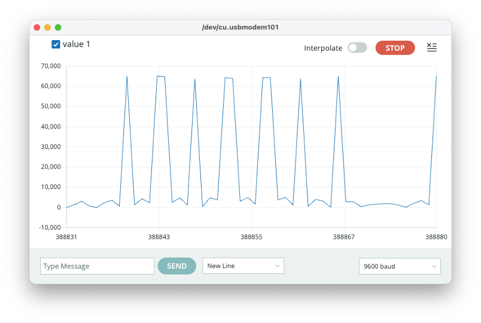
</p>

Когда вы издаёте звуки, изменения сигнала видны в Serial Plotter.

**Сохранение записанного звука (аудиофайлы .wav) на microSD-карту.**

Теперь с помощью встроенного считывателя SD-карт можно сохранять аудиофайлы .wav. Для этого сначала нужно включить PSRAM на XIAO.

> У ESP32-S3 на чипе микроконтроллера всего несколько сотен килобайт внутренней оперативной памяти. Этого может не хватить для некоторых задач, поэтому к флеш-чипу SPI можно подключить до 16 МБ внешней PSRAM (псевдостатического ОЗУ). На XIAO установлено 8 МБ PSRAM. Внешняя память включена в адресное пространство процессора и при определённых ограничениях может использоваться так же, как внутренняя оперативная память данных.

- Чтобы её включить, откройте `Tools->PSRAM:"OPI PSRAM"->OPI PSRAM`.

<p align="center">
  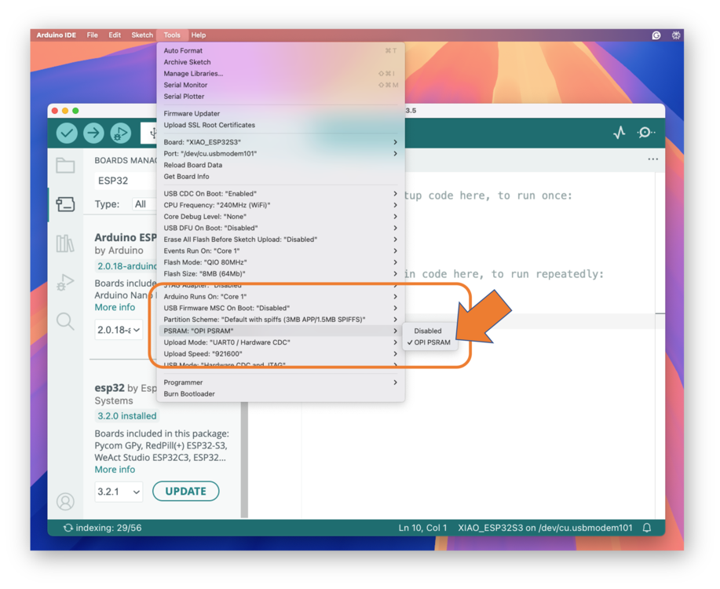
</p>

> XIAO ESP32S3 Sense поддерживает microSD-карты объёмом до **32 ГБ**. Если вы собираетесь купить microSD-карту для XIAO, выбирайте карту объёмом не более 32 ГБ. Перед использованием отформатируйте microSD-карту в **FAT32**.

Теперь вставьте отформатированную в FAT32 SD-карту в XIAO, как показано на фото:

<p align="center">
  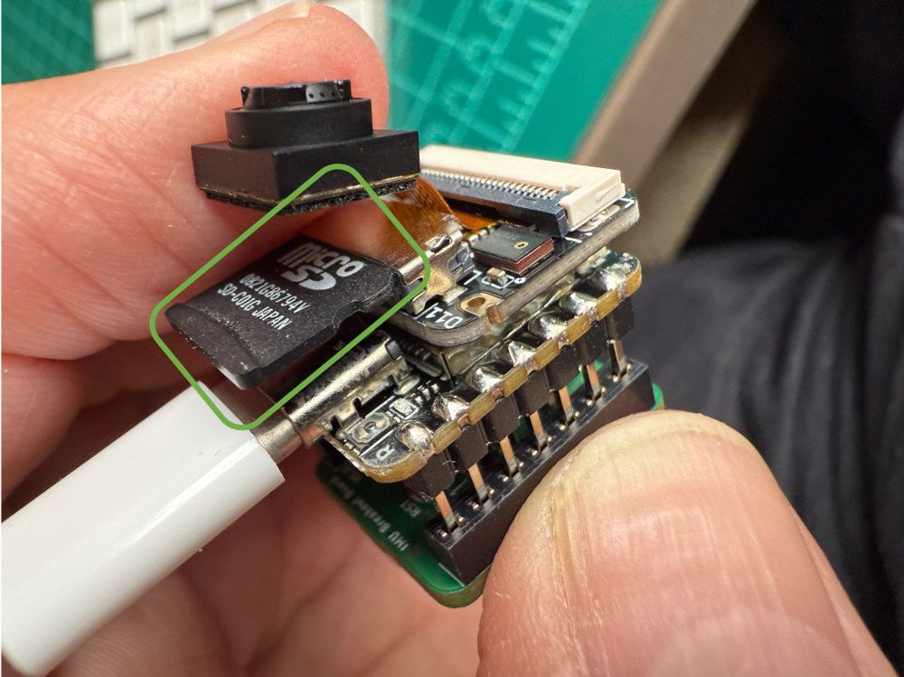
</p>

```cpp
/*
 * Диктофон WAV для Seeed XIAO ESP32S3 Sense
 * (для библиотеки ESP32 версии 3.0.x и новее)
*/

#include "ESP_I2S.h"
#include "FS.h"
#include "SD.h"

void setup() {
  // Создаём экземпляр I2SClass
  I2SClass i2s;

  // Переменные для хранения аудиоданных
  uint8_t *wav_buffer;
  size_t wav_size;

  // Инициализация последовательного порта
  Serial.begin(115200);
  while (!Serial) {
    delay(10);
  }

  Serial.println("Initializing I2S bus...");

  // Настройка выводов для аудиовхода
  i2s.setPinsPdmRx(42, 41);

  // Запуск I2S с частотой 16 кГц и 16 битами на отсчёт
  if (!i2s.begin(I2S_MODE_PDM_RX,
                 16000,
                 I2S_DATA_BIT_WIDTH_16BIT,
                 I2S_SLOT_MODE_MONO)) {
    Serial.println("Failed to initialize I2S!");
    while (1); // ничего не делать
  }

  Serial.println("I2S bus initialized.");
  Serial.println("Initializing SD card...");

  // Настройка выводов для доступа к SD-карте
  if(!SD.begin(21)){
    Serial.println("Failed to mount SD Card!");
    while (1) ;
  }
  Serial.println("SD card initialized.");
  Serial.println("Recording 20 seconds of audio data...");

  // Запись 20 секунд аудиоданных
  wav_buffer = i2s.recordWAV(20, &wav_size);

  // Создаём файл на SD-карте
  File file = SD.open("/arduino_rec.wav", FILE_WRITE);
  if (!file) {
    Serial.println("Failed to open file for writing!");
    return;
  }

  Serial.println("Writing audio data to file...");

  // Записываем аудиоданные в файл
  if (file.write(wav_buffer, wav_size) != wav_size) {
    Serial.println("Failed to write audio data to file!");
    return;
  }

  // Закрываем файл
  file.close();

  Serial.println("Application complete.");
}

void loop() {
  delay(1000);
  Serial.printf(".");
}
```

- Сохраните код, например, как `Wav_Record.ino`, и запустите его в Arduino IDE.
- Эта программа выполняется только один раз после того, как пользователь откроет Serial Monitor (или нажмёт кнопку `RESET`). Она записывает 20 секунд и сохраняет файл на microSD-карту под именем «arduino_rec.wav».
- Когда в Serial Monitor каждую секунду появляется «.», выполнение программы завершено, и записанный звуковой файл можно воспроизвести, подключив карту через считыватель.

<p align="center">
  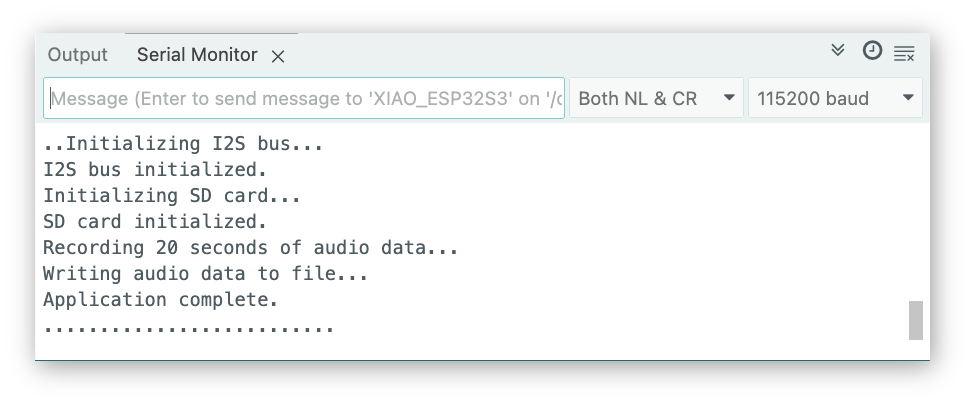
</p>

Качество звука отличное!

> Принцип работы кода выходит за рамки этой лабораторной работы, но подробное описание есть на [вики](https://wiki.seeedstudio.com/xiao_esp32s3_sense_mic/).

Подробнее о файловой системе XIAO ESP32S3 Sense — по [этой ссылке](https://wiki.seeedstudio.com/xiao_esp32s3_sense_filesystem/).

## Проверка камеры

Для проверки и использования камеры можно применять несколько способов:

- SenseCraft AI Studio;
- приложение CameraWebServer в Arduino IDE (см. следующий раздел);
- захват изображений и [сохранение их на SD-карту](https://github.com/limengdu/SeeedStudio-XIAO-ESP32S3-Sense-camera/tree/main) (аналогично тому, что мы делали со звуком).

### Проверка камеры в SenseCraft AI Studio

Самый простой способ увидеть работу камеры — использовать [SenseCraft AI](https://sensecraft.seeed.cc/ai/home) Studio, надёжную платформу, которая предлагает широкий набор моделей ИИ для разных устройств, включая **XIAO ESP32S3 Sense** и Grove Vision AI V2.

> Также можно воспользоваться [**SenseCraft Web Toolkit**](https://seeed-studio.github.io/SenseCraft-Web-Toolkit/#/setup/process) — упрощённой версией SenseCraft AI Studio.

Чтобы запустить **SenseCraft AI**, выполните следующие шаги:

- Откройте [рабочее пространство SenseCraft AI Vision](https://sensecraft.seeed.cc/ai/device/local/32) в веб-браузере, например **Chrome**, и войдите в систему (или создайте аккаунт).

<p align="center">
  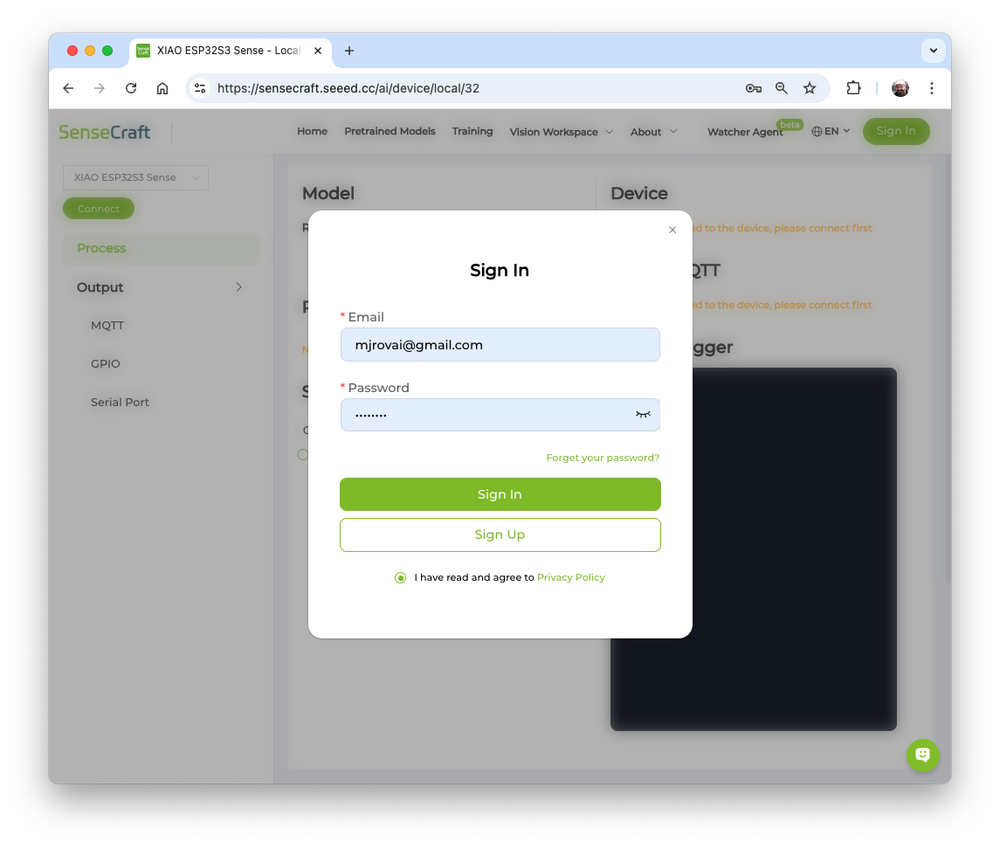
</p>

- Подключите XIAOML Kit к ноутбуку и выберите его, как показано ниже:

<p align="center">
  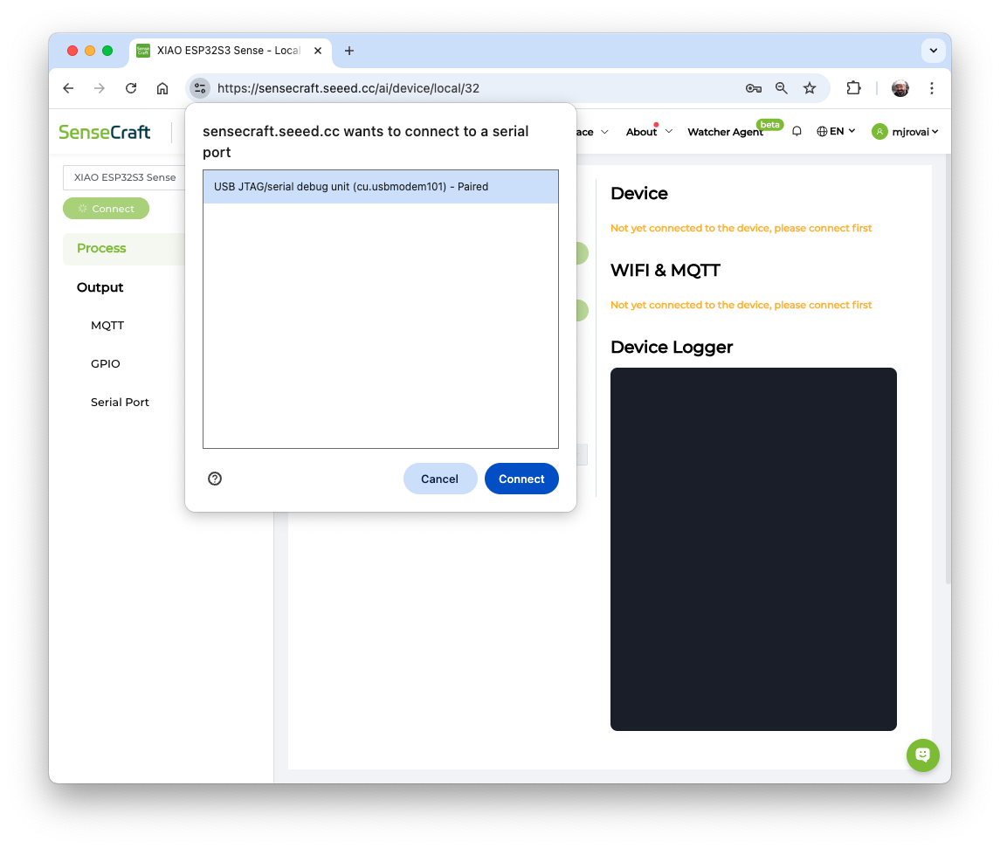
</p>

> Примечание: инструмент **WebUSB** может работать некорректно в некоторых браузерах, например в Safari. Используйте Chrome. Также убедитесь, что Arduino IDE или любое другое последовательное устройство не подключено к XIAO.

Чтобы увидеть работу камеры, нужно загрузить модель. Можно попробовать несколько моделей компьютерного зрения, заранее загруженных Seeed Studio. Нажмите кнопку `[Select Model]` и выберите одну из доступных моделей.

<p align="center">
  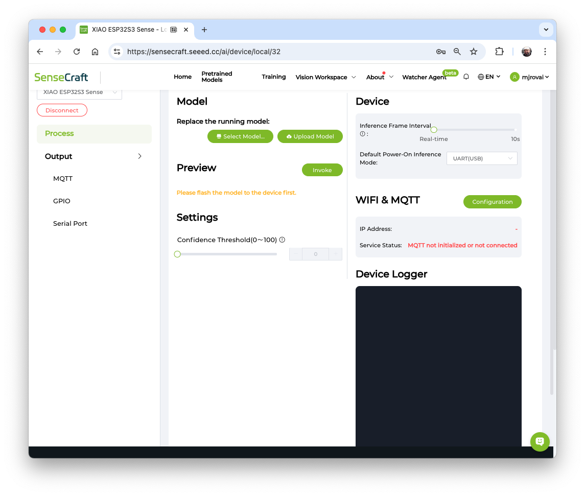
</p>

Наведя курсор на модели ИИ, можно увидеть их название, описание, **категорию** или **задачу** (классификация изображений, обнаружение объектов или определение позы/ключевых точек), **алгоритм** (например, YOLO V5 или V8, FOMO, MobileNet V2 и т. д.), а в некоторых случаях и **метрики** (точность или mAP).

<p align="center">
  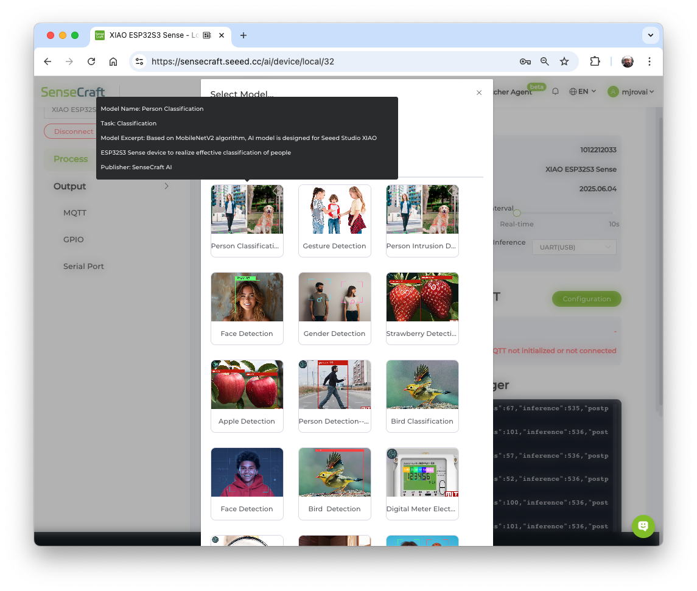
</p>

Можно выбрать одну из готовых моделей, например «Person Classification», нажав на неё и затем кнопку [Confirm], или загрузить собственную модель.

<p align="center">
  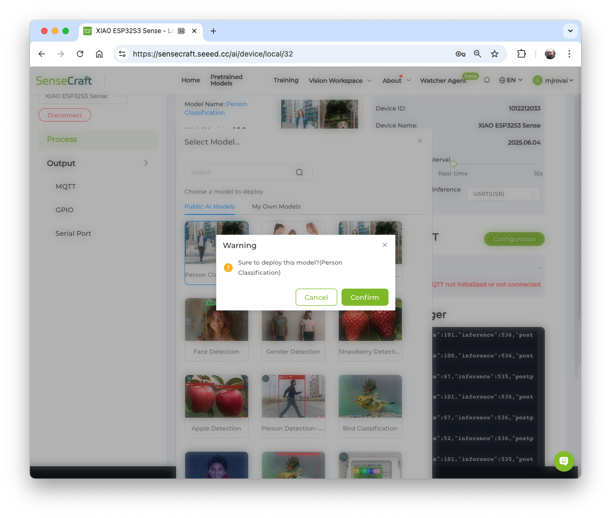
</p>

В области **Preview** мы видим видеопоток с камеры.

<p align="center">
  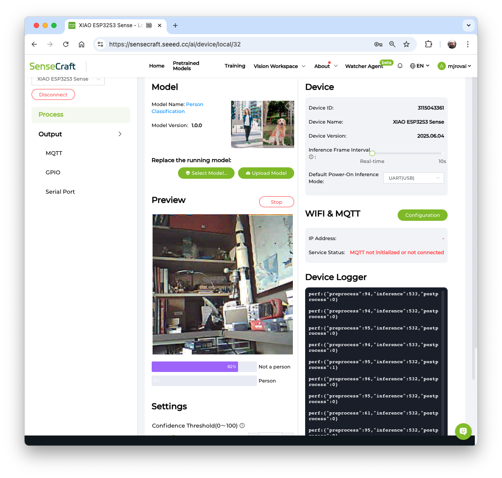
</p>

> Мы подробнее вернёмся к SenseCraft AI Studio в лабораторных работах по компьютерному зрению.

## Проверка Wi-Fi

### Установка антенны

Комплект XIAOML Kit приходит полностью собранным. Сначала снимите плату расширения Sense (на ней камера, микрофон и считыватель SD-карт) с XIAO.

В левом нижнем углу передней стороны XIAO ESP32S3 есть отдельный разъём «WiFi/BT Antenna Connector». Чтобы улучшить сигнал Wi-Fi и Bluetooth, достаньте антенну из упаковки и прикрепите её к разъёму.

Есть небольшой приём при установке антенны. Если давить на неё прямо и сильно, она будет поддаваться с трудом, и пальцы заболят! Правильный способ: сначала вставить один край антенного разъёма в гнездо, а затем аккуратно прижать другой край, чтобы антенна надёжно закрепилась.

Снимается антенна так же: не тяните её силой напрямую, а поднимите с одной стороны, и тогда её будет легко снять.

<p align="center">
  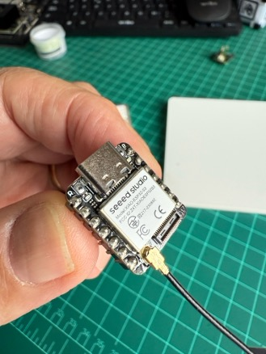
</p>

Установить плату расширения обратно очень просто: совместите разъём платы расширения с разъёмом B2B на XIAO ESP32S3, сильно надавите и услышите «щелчок». Установка завершена.

Одна из отличительных черт XIAO ESP32S3 — возможности Wi-Fi. Проверим радиомодуль, сканируя окружающие сети Wi-Fi. Для этого запустите один из примеров кода на плате.

Откройте Arduino IDE, выберите нашу плату и порт. Перейдите в Examples и найдите **WiFi > WiFiScan** в разделе «Examples for the XIAO ESP32S3». Загрузите скетч на плату.

В Serial Monitor вы должны увидеть сети Wi-Fi (SSID и RSSI) в радиусе действия вашего устройства. Вот что получилось у нас в лаборатории:

<p align="center">
  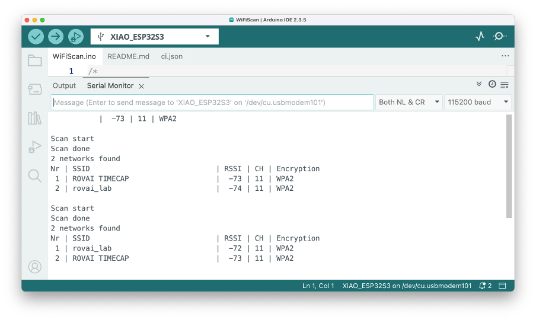
</p>

### Простой Wi-Fi-сервер (включение и выключение светодиода)

Проверим способность устройства работать как Wi-Fi-сервер. Мы разместим на устройстве простую страницу, которая отправляет команды для включения и выключения встроенного светодиода XIAO.

Перейдите в Examples и найдите **WiFi > SimpleWiFiServer** в разделе «Examples for the XIAO ESP32S3».

Перед запуском скетча введите данные своей сети:

```cpp
const char* ssid     = "Your credentials here";
const char* password = "Your credentials here";
```

Затем измените **вывод 5** на **вывод 21**, к которому подключён встроенный светодиод. Также измените веб-страницу (строки 85 и 86), чтобы отразить правильный вывод светодиода и то, что он включается сигналом LOW:

```cpp
client.print("Click <a href=\"/H\">here</a> to turn the LED on pin 21 OFF.<br>");
client.print("Click <a href=\"/L\">here</a> to turn the LED on pin 21 ON.<br>");
```

Работу сервера можно отслеживать через Serial Monitor.

<p align="center">
  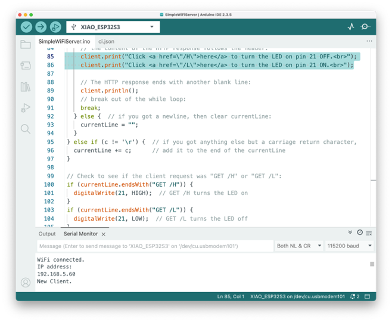
</p>

Возьмите IP-адрес из Serial Monitor и введите его в браузере. Откроется страница со ссылками, которые включают и выключают встроенный светодиод XIAO.

<p align="center">
  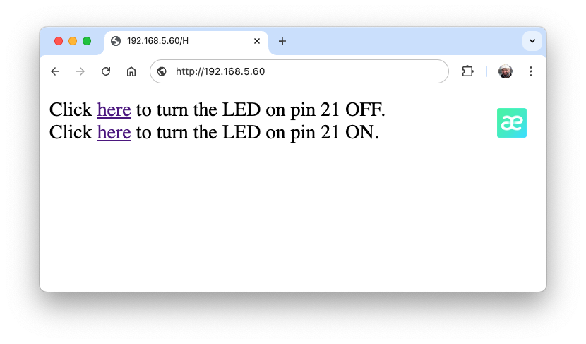
</p>

### Использование CameraWebServer

В Arduino IDE откройте `File > Examples > ESP32 > Camera` и выберите `CameraWebServer`.

На вкладке `board_config.h` закомментируйте все модели камер, кроме выводов модели XIAO:

`#define CAMERA_MODEL_XIAO_ESP32S3 // Есть PSRAM`

> Не забудьте проверить в меню `Tools`, включена ли PSRAM.

<p align="center">
  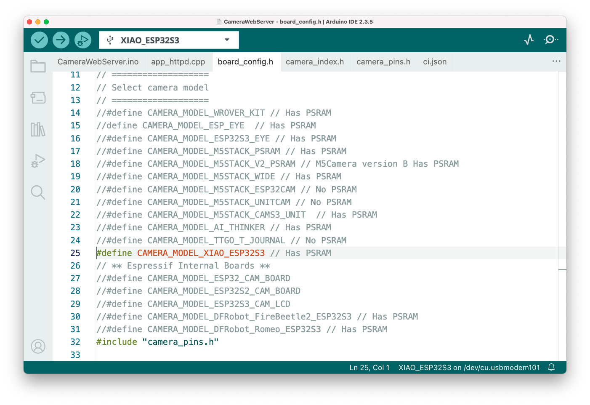
</p>

Как и раньше, на вкладке `CameraWebServer.ino` введите данные Wi-Fi и загрузите код на устройство.

Если код выполнился правильно, в Serial Monitor появится адрес:

```
WiFi connecting....
WiFi connected
Camera Ready! Use 'http://192.168.5.60' to connect
```

Скопируйте адрес в браузер и дождитесь загрузки страницы. Выберите разрешение камеры (например, QVGA) и нажмите `[START STREAM]`. Подождите несколько секунд в зависимости от качества соединения. Кнопкой `[Save]` можно сохранить изображение в папку загрузок на компьютере.

<p align="center">
  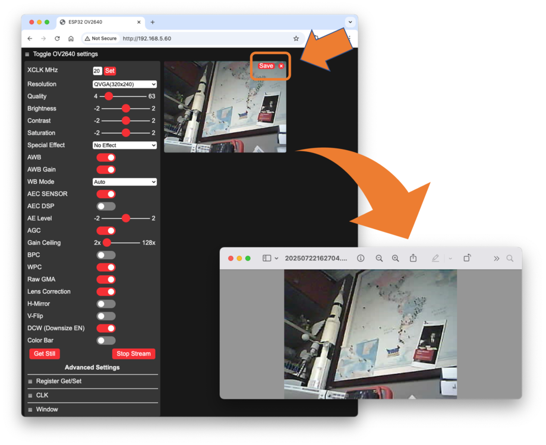
</p>

Вот и всё! Изображения можно сохранить прямо на компьютер и использовать в проектах.

## Проверка датчика IMU (LSM6DS3TR-C)

**Инерциальный измерительный блок (IMU)** — датчик, который измеряет движение и ориентацию. LSM6DS3TR-C на вашем XIAOML Kit — это **6-осевой IMU**, то есть он объединяет:

- **3-осевой акселерометр:** измеряет линейное ускорение (включая силу тяжести) по осям X, Y и Z;
- **3-осевой гироскоп:** измеряет угловую скорость (скорость вращения) вокруг осей X, Y и Z.

### Технические характеристики

- **Связь:** интерфейс I2C, адрес `0x6A`;
- **Диапазон акселерометра:** ±2/±4/±8/±16 g (по умолчанию используем ±2 g);
- **Диапазон гироскопа:** ±125/±250/±500/±1000/±2000 dps (по умолчанию используем ±250 dps);
- **Разрешение:** 16-битный АЦП;
- **Энергопотребление:** сверхнизкое.

### Система координат

Датчик использует правостороннюю систему координат. Если смотреть на датчик IMU с видимой меткой (вид платы расширения снизу):

<p align="center">
  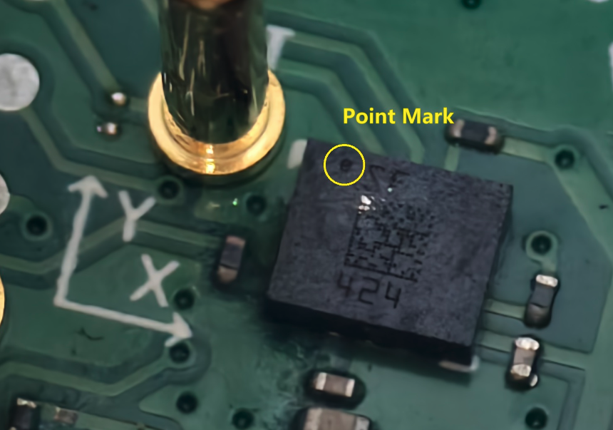
</p>

- **Ось X:** направлена вправо;
- **Ось Y:** направлена вперёд (от вас);
- **Ось Z:** направлена вверх (из платы).

<p align="center">
  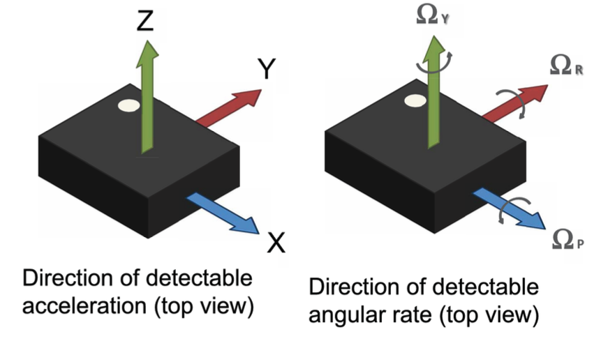
</p>

### Необходимые библиотеки

Перед загрузкой кода установите нужную библиотеку:

1. Откройте **Arduino IDE** и выберите **Manage Libraries** (менеджер библиотек), который обозначен значком `Books Icon`.

2. Для библиотеки IMU введите «*LSM6DS3*» и выберите «**Seeed Arduino LSM6DS3 by Seeed**». Можно `INSTALL` (установить) или `UPDATE` (обновить).

<p align="center">
  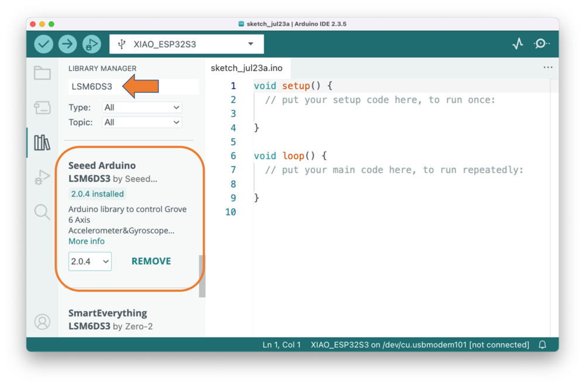
</p>

⚠️ **Важно:** НЕ устанавливайте «Arduino_LSM6DS3 by Arduino» — она предназначена для других плат!

### Тестовый код

Введите приведённый ниже код в Arduino IDE и загрузите его в комплект:

```cpp
#include <LSM6DS3.h>
#include <Wire.h>

// Создаём объект IMU через интерфейс I2C
// Датчик LSM6DS3TR-C находится по адресу I2C 0x6A
LSM6DS3 myIMU(I2C_MODE, 0x6A);

// Переменные для хранения показаний датчика
float accelX, accelY, accelZ;  // Значения акселерометра (перегрузка в g)
float gyroX, gyroY, gyroZ;     // Значения гироскопа (градусы в секунду)

void setup() {
  // Инициализация последовательной связи со скоростью 115200 бод
  Serial.begin(115200);

  // Ждём подключения последовательного порта (полезно для отладки)
  while (!Serial) {
    delay(10);
  }

  Serial.println("XIAOML Kit IMU Test");
  Serial.println("LSM6DS3TR-C 6-Axis IMU Sensor");
  Serial.println("=============================");

  // Инициализация датчика IMU
  if (myIMU.begin() != 0) {
    Serial.println("ERROR: IMU initialization failed!");
    Serial.println("Check connections and I2C address");
    while(1) {
      delay(1000); // Останавливаем выполнение, если IMU не инициализировался
    }
  } else {
    Serial.println("✓ IMU initialized successfully");
    Serial.println();

    // Вывод информации о датчике
    Serial.println("Sensor Information:");
    Serial.println("- Accelerometer range: ±2g");
    Serial.println("- Gyroscope range: ±250 dps");
    Serial.println("- Communication: I2C at address 0x6A");
    Serial.println();

    // Вывод описания формата данных
    Serial.println("Data Format:");
    Serial.println("AccelX,AccelY,AccelZ,GyroX,GyroY,GyroZ");
    Serial.println("Units: g-force (m/s²), degrees/second");
    Serial.println();

    delay(2000); // Короткая пауза перед началом измерений
  }
}

void loop() {
  // Считываем данные акселерометра (в единицах g)
  accelX = myIMU.readFloatAccelX();
  accelY = myIMU.readFloatAccelY();
  accelZ = myIMU.readFloatAccelZ();

  // Считываем данные гироскопа (в градусах в секунду)
  gyroX = myIMU.readFloatGyroX();
  gyroY = myIMU.readFloatGyroY();
  gyroZ = myIMU.readFloatGyroZ();

  // Вывод в удобном формате в Serial Monitor
  Serial.print("Accelerometer (g): ");
  Serial.print("X="); Serial.print(accelX, 3);
  Serial.print(" Y="); Serial.print(accelY, 3);
  Serial.print(" Z="); Serial.print(accelZ, 3);

  Serial.print(" | Gyroscope (°/s): ");
  Serial.print("X="); Serial.print(gyroX, 2);
  Serial.print(" Y="); Serial.print(gyroY, 2);
  Serial.print(" Z="); Serial.print(gyroZ, 2);
  Serial.println();

  // Вывод в формате CSV для Serial Plotter
  Serial.println(String(accelX) + "," + String(accelY) + "," +
                 String(accelZ) + "," + String(gyroX) + "," +
                 String(gyroY) + "," + String(gyroZ));

  // Частота обновления: 10 Гц (задержка 100 мс)
  delay(100);
}
```

Serial Monitor покажет значения, а Plotter — их изменение во времени. Например, если перемещать комплект по **оси Y**, будет меняться значение 2 (красная линия). Ось **Z** представлена значением 3 (зелёная линия), которое близко к 1,0 g. Синяя линия (значение 1) относится к **оси X**.

<p align="center">
  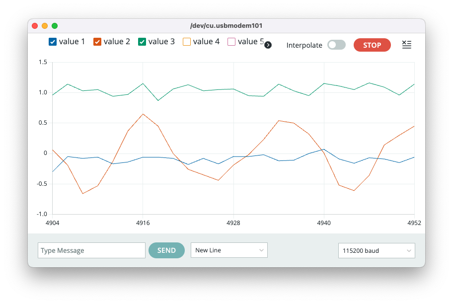
</p>

Значения с 4 по 6 можно выбрать, чтобы увидеть поведение гироскопа.

## Проверка OLED-дисплея (SSD1306)

OLED-дисплеи (Organic Light-Emitting Diode) — экраны с самосвечением, где каждый пиксель излучает собственный свет. Компактный 0,42-дюймовый монохромный OLED-дисплей XIAO ML kit подходит для вывода данных датчиков, информации о состоянии и простой графики.

### Технические характеристики

- **Размер:** 0,42 дюйма по диагонали;
- **Разрешение:** $72{\times}40$ пикселей;
- **Контроллер:** SSD1306;
- **Интерфейс:** I2C, адрес `0x3C`;
- **Цвет:** монохромный (чёрные пиксели на белом фоне или наоборот);
- **Читаемость:** высокий контраст, видно даже при ярком освещении;
- **Питание:** низкое энергопотребление, подсветка не нужна.

### Характеристики дисплея

- **Точность пикселей:** каждым из 2 880 пикселей ($72{\times}40$) можно управлять отдельно;
- **Быстрое обновление:** подходит для анимации и данных в реальном времени;
- **Без послесвечения:** мгновенный отклик пикселей;
- **Широкий угол обзора:** изображение читается с разных позиций.

### Необходимые библиотеки

Перед загрузкой кода установите нужную библиотеку:

1. Откройте **Arduino IDE** и выберите «Manage Libraries» (менеджер библиотек), который обозначен значком `Books Icon`.

2. Введите *u8g2* и выберите **U8g2 by oliver**. Можно `install` (установить) или `update` (обновить) пакеты.

    ℹ️ **Примечание:** U8g2 — мощная графическая библиотека, которая поддерживает множество типов дисплеев.

<p align="center">
  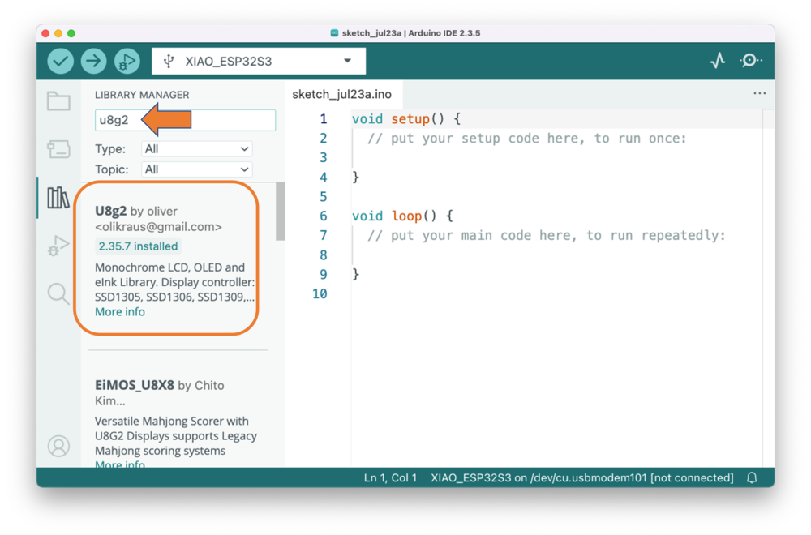
</p>

Библиотека **U8g2** — монохромная графическая библиотека со следующими возможностями:

- поддержка множества контроллеров дисплеев (включая SSD1306);
- вывод текста различными шрифтами;
- графические примитивы (линии, прямоугольники, окружности);
- экономичный постраничный рендеринг;
- аппаратная и программная поддержка I2C.

### Тестовый код

Введите приведённый ниже код в Arduino IDE и загрузите его в комплект:

```cpp
#include <U8g2lib.h>
#include <Wire.h>

// Инициализация OLED-дисплея
// Контроллер SSD1306, разрешение 72x40, интерфейс I2C
U8G2_SSD1306_72X40_ER_1_HW_I2C u8g2(U8G2_R2, U8X8_PIN_NONE);

void setup() {
  Serial.begin(115200);

  Serial.println("XIAOML Kit - Hello World");
  Serial.println("==========================");

  // Инициализация дисплея
  u8g2.begin();

  Serial.println("✓ Display initialized");
  Serial.println("Showing Hello World message...");

  // Очистка дисплея
  u8g2.clearDisplay();
}

void loop() {
  // Начало последовательности рисования
  u8g2.firstPage();
  do {
    // Выбор шрифта
    u8g2.setFont(u8g2_font_ncenB08_tr);

    // Вывод «Hello World» по центру
    u8g2.setCursor(8, 15);
    u8g2.print("Hello");

    u8g2.setCursor(12, 30);
    u8g2.print("World!");

    // Простое оформление — рамка вокруг текста
    u8g2.drawFrame(2, 2, 68, 36);

  } while (u8g2.nextPage());

  // Задержка не нужна — дисплей будет показывать изображение постоянно
}

```

Если всё работает правильно, на дисплее вы увидите надпись «Hello World» внутри прямоугольника.

<p align="center">
  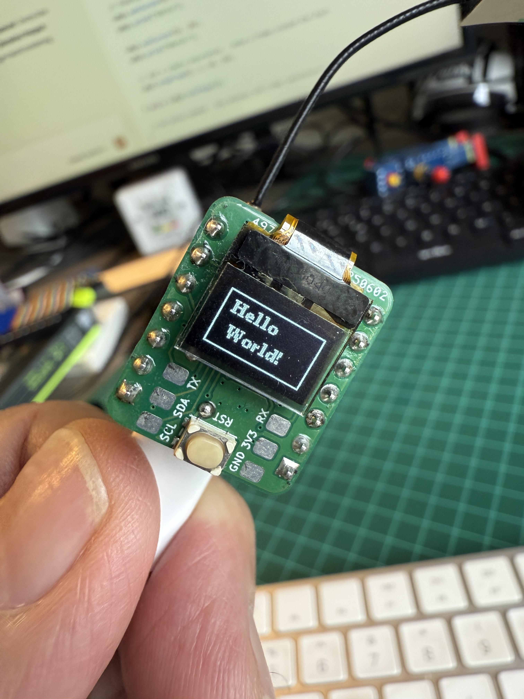
</p>

### Размеры и позиционирование текста на OLED

- Текст позиционируется функцией `setCursor(x, y)`, в данном случае по центру:

    ```cpp
    u8g2.setCursor(8, 15);
    ```

- В коде используется шрифт среднего размера:

    ```cpp
    u8g2.setFont(u8g2_font_ncenB08_tr);
    ```

    Но доступны и другие размеры шрифта:

    - `u8g2_font_4x6_tr`: очень маленький шрифт ($4{\times}6$ пикселей);
    - `u8g2_font_6x10_tr`: маленький шрифт ($6{\times}10$ пикселей);
    - `u8g2_font_ncenB08_tr`: средний полужирный шрифт;
    - `u8g2_font_ncenB14_tr`: крупный полужирный шрифт.

### Фигуры

В коде добавлено простое оформление: рамка вокруг текста.

```cpp
u8g2.drawFrame(2, 2, 68, 36);
```

Доступны и другие фигуры:

- **Контур прямоугольника:** `drawFrame(x, y, width, height)`;
- **Закрашенный прямоугольник:** `drawBox(x, y, width, height)`;
- **Окружность:** `drawCircle(x, y, radius)`;
- **Линия:** `drawLine(x1, y1, x2, y2)`;
- **Отдельные пиксели:** `drawPixel(x, y)`.

### Координаты

Дисплей использует систему координат, где:

- **начало координат (0,0):** верхний левый угол;
- **ось X:** возрастает слева направо (от 0 до 71);
- **ось Y:** возрастает сверху вниз (от 0 до 39);
- **позиционирование текста:** `setCursor(x, y)`, где y — базовая линия текста.

### Поворот дисплея

Параметр поворота можно изменить:

- `U8G2_R0`: обычная ориентация;
- `U8G2_R1`: поворот на 90° по часовой стрелке;
- `U8G2_R2`: 180° (перевёрнуто);
- `U8G2_R3`: поворот на 270° по часовой стрелке.

### Собственные символы

```cpp
// Рисуем собственное растровое изображение
static const unsigned char myBitmap[] = {0x00, 0x3c, 0x42, 0x42, 0x3c, 0x00};
u8g2.drawBitmap(x, y, 1, 6, myBitmap);
```

### Измерение текста

```cpp
int width = u8g2.getStrWidth("Hello");  // Ширина текста
int height = u8g2.getAscent();         // Высота шрифта
```

OLED-дисплей готов показывать данные датчиков, состояние системы или любую графику, которую вы создадите для своих проектов ML!

## Итоги

XIAOML Kit с ESP32S3 Sense — мощная и доступная отправная точка в мир TinyML и встраиваемого машинного обучения. В ходе настройки мы последовательно проверили каждый компонент XIAOML Kit и убедились, что все датчики и периферийные устройства работают правильно. Двухъядерный процессор ESP32S3 и 8 МБ PSRAM обеспечивают достаточную вычислительную мощность для инференса в реальном времени, а камера OV2640, цифровой микрофон, IMU LSM6DS3TR-C и 0,42-дюймовый OLED-дисплей составляют полноценную мультимодальную платформу для сбора данных. Возможности Wi-Fi открывают путь к рабочим процессам ML от периферии к облаку, а среда разработки Arduino IDE теперь настроена со всеми необходимыми библиотеками.

Помимо проверки функций, мы получили практические знания о системах координат, форматах данных и рабочих характеристиках каждого датчика. Эти знания пригодятся при проектировании конвейеров сбора и предобработки данных ML в предстоящих проектах.

Этот процесс настройки демонстрирует ключевые принципы, которые выходят далеко за рамки этого конкретного комплекта. Работа с ограничениями памяти и возможностями обработки ESP32S3 даёт реальный опыт работы с ресурсными ограничениями периферийного ИИ — теми же, что возникают при развёртывании моделей на смартфонах, устройствах IoT или автономных системах. Наличие нескольких модальностей (зрение, звук, движение) на одной платформе позволяет исследовать мультимодальные подходы к машинному обучению, которые всё важнее в реальных приложениях ИИ.

Главное: от сырых данных датчиков до инференса модели и обратной связи через OLED-дисплей комплект воплощает полный цикл развёртывания ML в миниатюре, повторяя трудности, с которыми сталкиваются промышленные системы ИИ.

С этой основой вы готовы решать основные задачи TinyML в следующих главах:

- **Проекты по зрению:** использование камеры для классификации изображений и обнаружения объектов;
- **Звуковые проекты:** обработка аудиопотоков для распознавания ключевых слов и голосовых команд;
- **Проекты по движению:** использование данных IMU для распознавания активности и обнаружения аномалий.

Каждое приложение будет опираться на аппаратное понимание и программную инфраструктуру, которые мы уже построили, и покажет, как ИИ применяется не только в дата-центрах, но и в устройствах с ограниченными ресурсами, которые напрямую взаимодействуют с физическим миром.

Принципы, с которыми мы познакомились в этом комплекте — обработка в реальном времени, слияние данных датчиков и инференс на периферии, — те же, что определяют будущее развёртывания ИИ в автономных автомобилях, умных городах, медицинских устройствах и промышленной автоматизации. Успешно завершив настройку, вы готовы исследовать этот захватывающий рубеж встраиваемого машинного обучения.

## Ресурсы

- [Код XIAOML Kit](https://github.com/Mjrovai/XIAO-ESP32S3-Sense/tree/main/XIAOML_Kit_code)
- [Руководство и примеры кода для XIAO ESP32S3 Sense](https://wiki.seeedstudio.com/xiao_esp32s3_getting_started/)
- [Использование микрофона Seeed Studio XIAO ESP32S3](https://wiki.seeedstudio.com/xiao_esp32s3_sense_mic/)
- [Файловая система и XIAO ESP32S3 Sense](https://wiki.seeedstudio.com/xiao_esp32s3_sense_filesystem/)
- [Использование камеры в Seeed Studio XIAO ESP32S3 Sense](https://wiki.seeedstudio.com/xiao_esp32s3_camera_usage/)

## Приложение: радиаторы

### Соображения о радиаторах

Если вам нужно использовать XIAO ESP32S3 Sense для задач с камерой БЕЗ платы расширения, можно установить радиатор.

Учтите: если радиатор установлен, подключить XIAO ESP32S3 Sense к плате расширения будет невозможно.

<p align="center">
  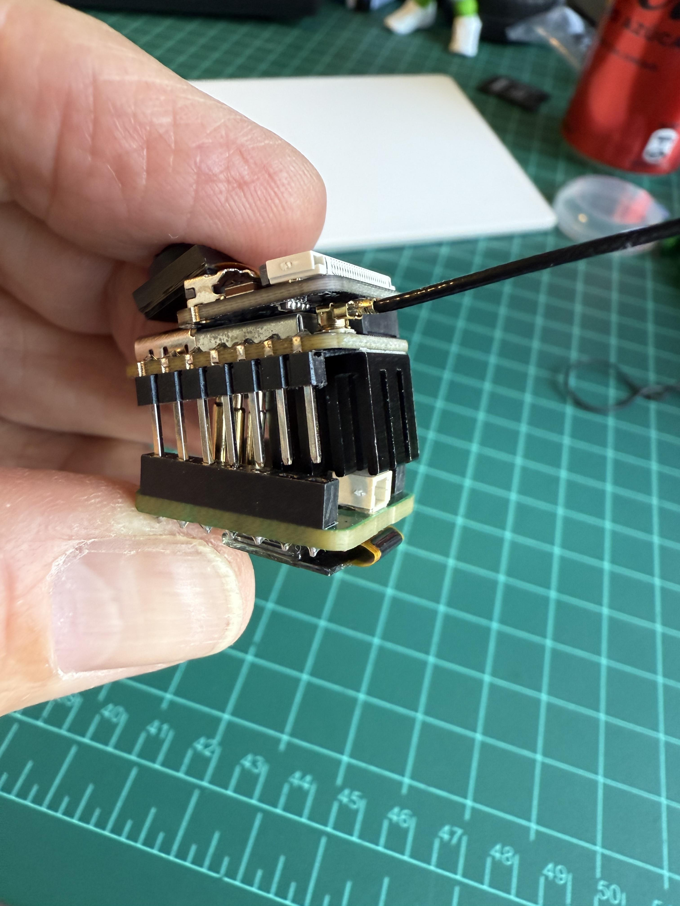
</p>

### Установка радиатора

Чтобы обеспечить оптимальное охлаждение XIAO ESP32S3 Sense, во время работы с камерой следует установить входящий в комплект радиатор. Его конструкция специально рассчитана на охлаждение, особенно при интенсивных операциях, таких как работа с камерой.

> В комплекте два радиатора, но можно использовать только один, чтобы сохранить доступ к контактам аккумулятора.

**Установка:**

- Перед началом убедитесь, что устройство выключено и отключено от любого источника питания.
- В первую очередь закройте радиатором термопрокладку (THERMAL PAD), которая находится прямо над чипом ESP32S3 — главным источником тепла. Правильное выравнивание обеспечивает оптимальный отвод тепла, и **важно, чтобы контакты BAT оставались максимально свободными**.

Теперь начнём установку:

**Шаг 1. Подготовьте радиатор:** снимите защитную плёнку с радиатора, чтобы открыть термоклей. Это подготовит радиатор к надёжному креплению на чипе ESP32S3.

**Шаг 2. Соберите радиатор:**

<p align="center">
  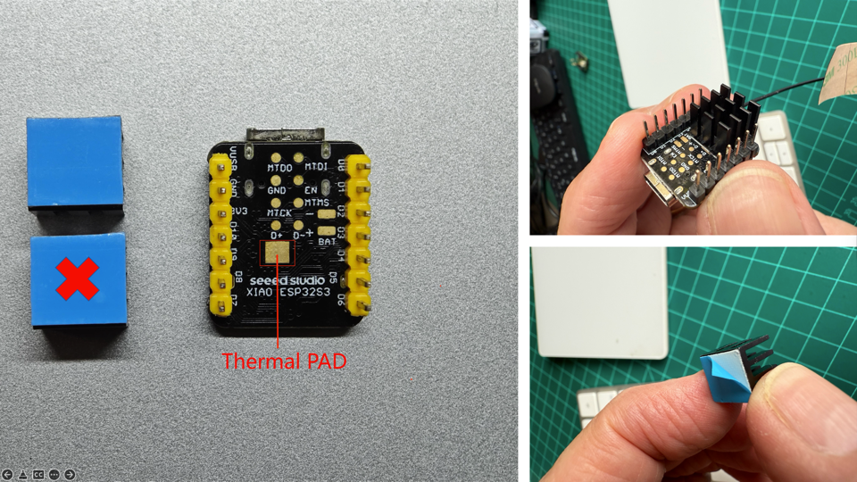
</p>

> После установки убедитесь, что всё надёжно закреплено и нет риска короткого замыкания. Проверьте, что радиатор правильно выровнен и надёжно прикреплён.

Если одного радиатора недостаточно, можно установить второй, оба будут использовать одну термопрокладку. Но в этом случае учтите, что все контакты станут недоступны.

> ⚠️ **Внимание**
>
> Аккуратно снимите радиаторы перед тем, как снова использовать плату расширения IMU.
