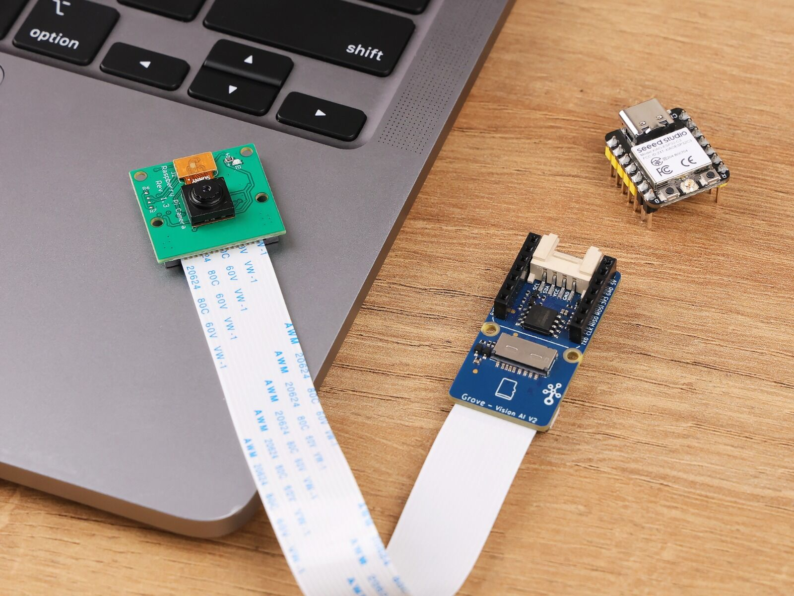

# Обзор

Эти лабораторные работы дают возможность получить практический опыт работы с системами машинного обучения (ML) на мощном, но компактном встраиваемом устройстве — Seeed Studio Grove Vision AI V2. В отличие от работы с большими моделями, которым нужны ресурсы уровня дата-центра, эти упражнения позволяют напрямую работать с оборудованием и программным обеспечением с помощью TinyML. Такой практический подход даёт осязаемое понимание проблем и возможностей развёртывания ИИ, пусть и в небольшом масштабе. При этом принципы в целом те же, что и при работе с более крупными или, наоборот, ещё более мелкими системами.

Grove Vision AI V2 занимает особое место в мире встраиваемого ИИ: он заполняет разрыв между простыми решениями на микроконтроллерах, такими как Seeed XIAO ESP32S3 Sense или Arduino Nicla Vision, и более мощными одноплатными компьютерами, например Raspberry Pi. В основе платы лежит процессор Himax WiseEye2 HX6538 с **двухъядерным Arm Cortex-M55 и встроенным блоком нейронных сетей Arm Ethos-U55**.

Arm Ethos-U55 — это специализированный процессор для машинного обучения, класса микро-NPU, который ускоряет инференс ML во встраиваемых и IoT-устройствах с ограниченной площадью кристалла. Сочетание Ethos-U55 с процессором Cortex-M55, рассчитанным на ИИ, даёт прирост производительности ML в 480 раз по сравнению с существующими системами на базе Cortex-M. Работая на частоте 400 МГц с настраиваемой внутренней системной памятью (SRAM) объёмом до 2,4 МБ, Grove Vision AI V2 предлагает возможности компьютерного зрения профессионального уровня и при этом сохраняет энергоэффективность и компактность, необходимые для периферийных приложений.

Такое место на рынке делает плату идеальной платформой для изучения продвинутых концепций TinyML: она сочетает простоту и низкое энергопотребление небольших систем с возможностями, которые намного превосходят традиционные решения на основе микроконтроллеров.

   
  <em>Grove - Vision AI Module V2. Источник: SEEED Studio.</em>

## Где купить

Grove Vision AI V2 продаётся в Seeed Studio:

- [Grove Vision AI V2 (Seeed Studio)](https://www.seeedstudio.com/Grove-Vision-AI-Module-V2-p-5851.html) (\~\$25)

Вам также понадобятся совместимый модуль камеры (Raspberry Pi OV5647) и, при желании, управляющая плата, например XIAO ESP32S3.

## Предварительные требования

- **Плата Grove Vision AI V2:** убедитесь, что плата у вас есть.
- **Модуль камеры Raspberry Pi OV5647:** камера должна быть подключена к плате Grove Vision AI V2 для захвата изображений.
- **Управляющий контроллер:** может быть Seeed XIAO ESP32S3, XIAO ESP32C6 или другое устройство.
- **Кабель USB-C:** для подключения платы к компьютеру.
- **Сеть:** доступ в интернет для загрузки необходимого программного обеспечения.
- **Базовая плата расширения XIAO:** помогает подключить управляющее устройство к физическому миру (необязательно).

## Настройка и приложения без кода

- [Настройка и приложения без кода](setup_and_no_code_apps/README.md)

## Упражнения

| Модальность | Задача | Описание | Ссылка |
|---|---|---|---|
| **Зрение** | Классификация изображений | Научитесь классифицировать изображения | [Открыть](image_classification/README.md) |
| **Зрение** | Обнаружение объектов | Реализуйте обнаружение объектов | Уточняется |
