# Классификация изображений

**С использованием Seeed Studio Grove Vision AI Module V2 (Himax WiseEye2)**

<p align="center"></p>

В этой лабораторной работе мы исследуем классификацию изображений с помощью [*Grove Vision AI Module V2*](https://wiki.seeedstudio.com/grove_vision_ai_v2/) от Seeed Studio — мощного, но компактного устройства, созданного специально для приложений встраиваемого машинного обучения. Модуль построен на микросхеме **Himax WiseEye2** и предназначен для работы ИИ на периферийных устройствах, поэтому он идеально подходит для задач периферийного машинного обучения (Edge ML).

## Введение

До сих пор мы исследовали несколько моделей компьютерного зрения, которые Seeed Studio загрузила заранее, либо использовали SenseCraft AI Studio для классификации изображений, не выбирая конкретную модель. Теперь создадим проект классификации изображений с нуля: сами выберем данные и модель.

Ниже показаны основные шаги проекта и то, где мы будем работать на каждом из них:

<p align="center">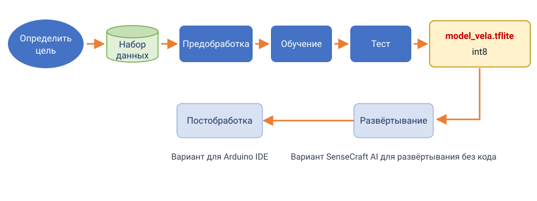</p>

### Цель проекта

Первый шаг любого проекта машинного обучения (ML) — определить цель. В данном случае нужно обнаружить и классифицировать два конкретных объекта, присутствующих на одном изображении. Для проекта мы возьмём две небольшие игрушки: робота и маленького бразильского попугайчика (по имени *Periquito*). Также соберём изображения фона, на котором этих двух объектов нет.

<p align="center">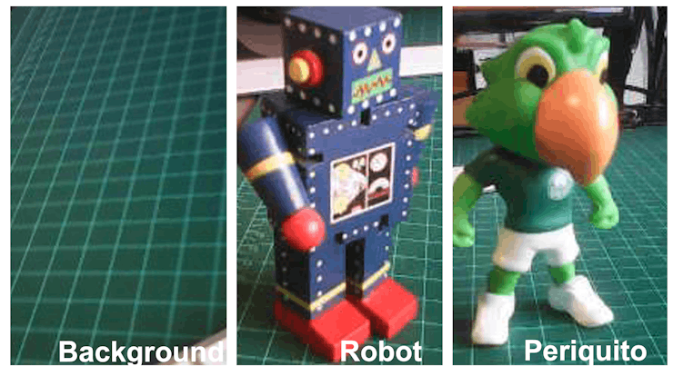</p>

### Сбор данных

Когда цель проекта машинного обучения определена, следующий и самый важный шаг — сбор набора данных. Если вашему проекту нужны изображения, которые уже публично доступны в наборах данных, например для проекта **Person Detection** (обнаружение людей), можно скачать набор [Wake Vision](https://edgeai.modelnova.ai/datasets/details/wake-vision) и использовать его.

Но в нашем случае изображения не существуют в открытом доступе, поэтому их нужно создать. Фотографии можно сделать телефоном, веб-камерой компьютера или другим устройством — офлайн или с подключением к Edge Impulse Studio.

Если вы хотите использовать Grove Vision AI V2 для съёмки набора данных, можно воспользоваться SenseCraft AI Studio, как в предыдущей лабораторной работе, или скетчем `camera_web_server`, который мы опишем позже в разделе **«Постобработка / Получение видеопотока»** этой работы.

<p align="center">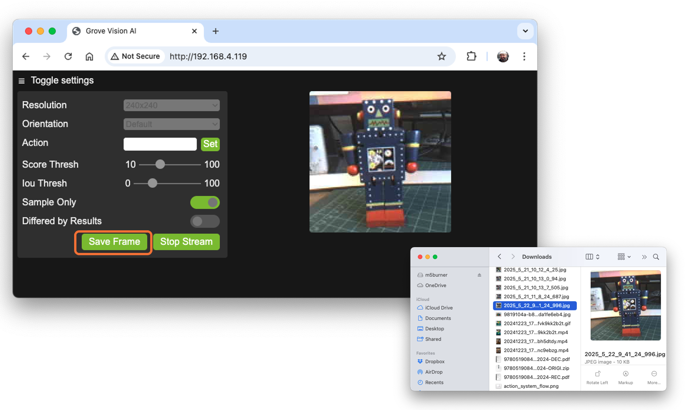</p>

В этой лабораторной работе для сбора набора данных мы будем использовать SenseCraft AI Studio.

### Сбор данных в SenseCraft AI Studio

В SenseCraft AI Studio откройте вкладку [Training](https://sensecraft.seeed.cc/ai/training).

По умолчанию обучается модель `Classification` с веб-камерой, если она доступна. Выберем вместо неё `Grove Vision AI V2`. Нажмите зелёную кнопку `[Connect]` **(1)** — появится всплывающее окно. Выберите нужный порт **(2)** и нажмите синюю кнопку `[Connect]` **(3)**.

<p align="center">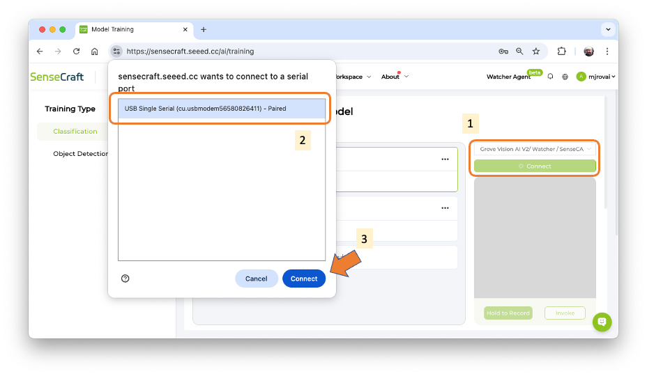</p>

На экране появится изображение, которое передаёт Grove Vision AI V2.

#### Сбор изображений

Создадим классы, например, в алфавитном порядке:

- Класс 1: `background` (фон)
- Класс 2: `periquito` (попугайчик)
- Класс 3: `robot` (робот)

<p align="center">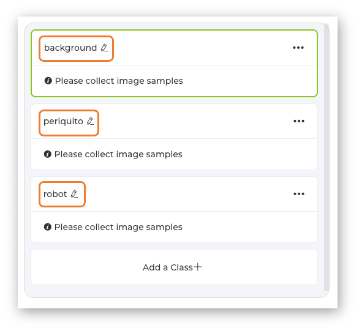</p>

Выберите один из классов (вокруг окна появится зелёная рамка) и удерживайте зелёную кнопку под областью предпросмотра. Собранные изображения появятся на экране выборки (Image Samples).

<p align="center">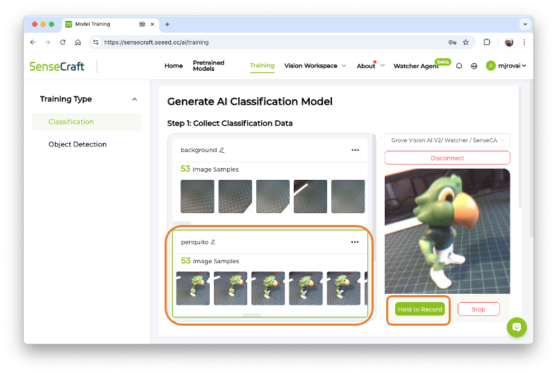</p>

После сбора изображений просмотрите их и при необходимости удалите некорректные.

<p align="center">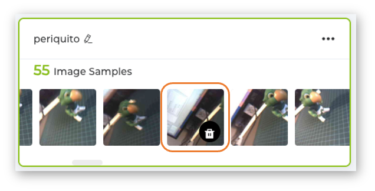</p>

Соберите примерно по 50 изображений для каждого класса. Когда все три класса готовы, откройте меню каждого из них и выберите `Export Data`.

<p align="center">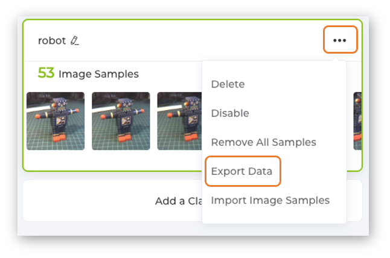</p>

В папке загрузок компьютера появятся три ZIP-архива — по одному на каждый класс. Каждый архив содержит папку с изображениями.

### Загрузка набора данных в Edge Impulse Studio

Для обучения модели мы будем использовать Edge Impulse Studio. [Edge Impulse](https://www.edgeimpulse.com/) — ведущая платформа для разработки моделей машинного обучения на периферийных устройствах.

- Войдите в Edge Impulse с вашими учётными данными (или создайте бесплатный аккаунт).
- Затем создайте новый проект:

<p align="center"></p>

> Набор данных содержит примерно по 50 изображений на метку: 40 для обучения и 10 для тестирования.

### Дизайн импульса и предобработка

**Дизайн импульса**

Импульс (impulse) принимает сырые данные (в нашем случае изображения), извлекает признаки (уменьшает размер изображений), а затем использует блок обучения, чтобы классифицировать новые данные.

Классификация изображений — самое распространённое применение глубокого обучения, но для неё нужен большой объём данных. У нас около 50 изображений на каждую категорию. Достаточно ли этого? Совсем нет! Чтобы «научить» модель различать каждый класс, нужны тысячи изображений. Однако эту проблему можно решить, дообучив уже обученную модель на небольшом наборе данных. Такой приём называется «переносом обучения» (Transfer Learning, TL). С TL можно донастроить предобученную модель классификации изображений на наших данных и добиться хорошего качества даже на относительно небольших наборах, как в нашем случае.

<p align="center">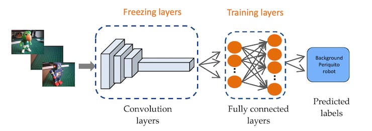</p>

Итак, начиная с исходных изображений, уменьшим их до $96{\times}96$ пикселей и передадим в блок переносного обучения:

<p align="center">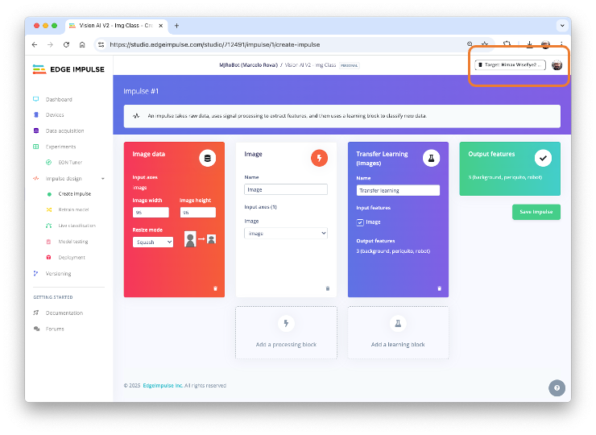</p>

> Для сравнения оставим размер изображений $96{\times}96$. Однако учтите: с Grove Vision AI Module V2 и его внутренней SRAM объёмом 2,4 МБ можно использовать и более крупные изображения (например, $160{\times}160$).

Также в правом верхнем углу выберите устройство `Target` (`Himax WiseEye2 (M55 400 MHz + U55)`).

### Предобработка (генерация признаков)

Помимо изменения размера, изображения можно перевести в оттенки серого или сохранить исходную цветовую глубину RGB. Выберем `[RGB]` в разделе `Image`. Тогда каждый образец данных будет иметь размерность 27 648 признаков ($96{\times}96{\times}3$). Нажатие `[Save Parameters]` откроет новую вкладку `Generate Features`. Нажмите кнопку `[Generate Features]`, чтобы сгенерировать признаки.

### Проектирование модели, обучение и тестирование

В 2007 году Google представила [MobileNetV1](https://research.googleblog.com/2017/06/mobilenets-open-source-models-for.html). В 2018 году вышла [MobileNetV2: Inverted Residuals and Linear Bottlenecks](https://arxiv.org/abs/1801.04381), а в 2019 году — V3. MobileNet — это семейство universal-нейросетей компьютерного зрения, специально созданных для мобильных устройств, для классификации, обнаружения и других задач. MobileNet — компактные модели с малой задержкой и низким энергопотреблением, параметризованные так, чтобы соответствовать ограничениям ресурсов разных сценариев.

Хотя базовая архитектура MobileNet уже компактна и быстра, конкретному сценарию часто нужна модель ещё меньше и быстрее. Для этого в MobileNet есть простой параметр **α** (альфа), называемый множителем ширины (width multiplier), с помощью которого строятся меньшие и менее требовательные к вычислениям модели. Множитель ширины α равномерно «утончает» сеть на каждом слое.

В Edge Impulse Studio доступны MobileNet V1 (изображения $96{\times}96$) и V2 (изображения $96{\times}96$ и $160{\times}160$) с несколькими значениями **α** (от 0,05 до 1,0). Например, наибольшая точность достигается у V2 с изображениями $160{\times}160$ и α=1,0. Конечно, здесь есть компромисс: чем выше точность, тем больше памяти (примерно 1,3 МБ RAM и 2,6 МБ ROM) нужно для запуска модели и тем выше задержка. Самый маленький объём получится на другом полюсе — у MobileNet V1 с α=0,10 (примерно 53,2 КБ RAM и 101 КБ ROM).

> Для сравнения мы возьмём **MobileNet V2 0.1** в качестве базовой модели (но можно использовать и модель с большим α). Последний слой модели, перед выходным слоем, будет содержать 8 нейронов с dropout-регуляризацией 10 % для предотвращения переобучения.

Ещё один обязательный приём в глубоком обучении — **аугментация данных**. Это метод, который помогает повысить точность моделей машинного обучения за счёт создания дополнительных искусственных данных. Система аугментации вносит небольшие случайные изменения в обучающие данные в процессе обучения (например, отражает, обрезает или поворачивает изображения).

Задайте гиперпараметры:

- Эпохи (Epochs): 20;
- Размер батча (Batch Size): 32;
- Скорость обучения (Learning Rate): 0,0005;
- Размер валидационной выборки (Validation size): 20 %.

Результат обучения:

<p align="center">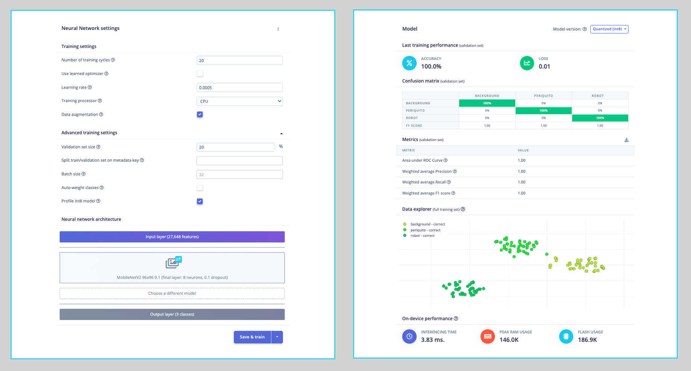</p>

Профиль модели предсказывает **146 КБ RAM и 187 КБ флеш-памяти**, что не создаёт проблем для Grove AI Vision (V2), у которого почти 2,5 МБ внутренней SRAM. Кроме того, Studio показывает **задержку около 4 мс**.

> Тем не менее, при точности 100 % на валидационной выборке и при тестировании на отложенных данных мы получили точность 81 % для квантованной (Int8) обученной модели. Однако для наших целей этого достаточно.

### Развёртывание модели

На вкладке Deployment выберите `Seeed Grove Vision AI Module V2 (Himax WiseEye2)` и нажмите `[Build]`. На компьютер загрузится ZIP-файл.

ZIP-архив содержит файл `model_vela.tflite` — модель TensorFlow Lite (TFLite), оптимизированную для нейронных процессоров (NPU) с помощью компилятора Vela, инструмента от Arm для адаптации моделей TFLite под NPU Ethos-U.

<p align="center">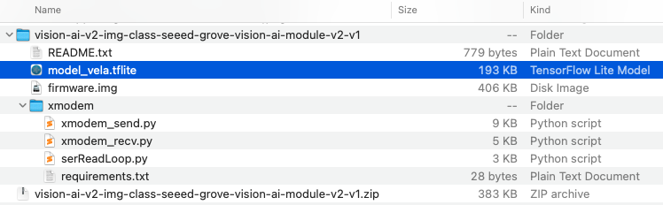</p>

Модель можно прошить, следуя инструкциям в `README.txt`, или через SenseCraft AI Studio. Мы воспользуемся вторым способом.

### Развёртывание модели в SenseCraft AI Studio

В SenseCraft AI Studio перейдите на вкладку `Vision Workspace` и подключите устройство:

<p align="center">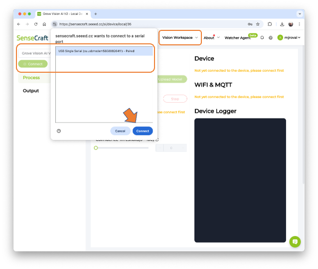</p>

Вы увидите последнюю модель, загруженную на устройство. Нажмите зелёную кнопку `[Upload Model]`. Во всплывающем окне нужно указать **имя модели**, **файл модели** и ввести названия классов (**объектов**). Используйте метки в алфавитном порядке: `0: background`, `1: periquito` и `2: robot`, затем нажмите `[Send]`.

<p align="center">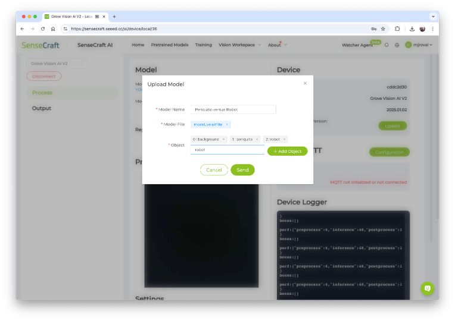</p>

Через несколько секунд модель будет загружена («прошита») в устройство, а изображение с камеры появится в реальном времени в секции **Preview**. Результат классификации отображается под предпросмотром изображения. Также можно выбрать порог уверенности инференса (`Confidence Threshold`), передвинув ползунок в разделе **Settings**.

В **Device Logger** можно посмотреть Serial Monitor, где видна задержка: около 1–2 мс на предобработку и 4–5 мс на инференс, что совпадает с оценками в Edge Impulse Studio.

<p align="center">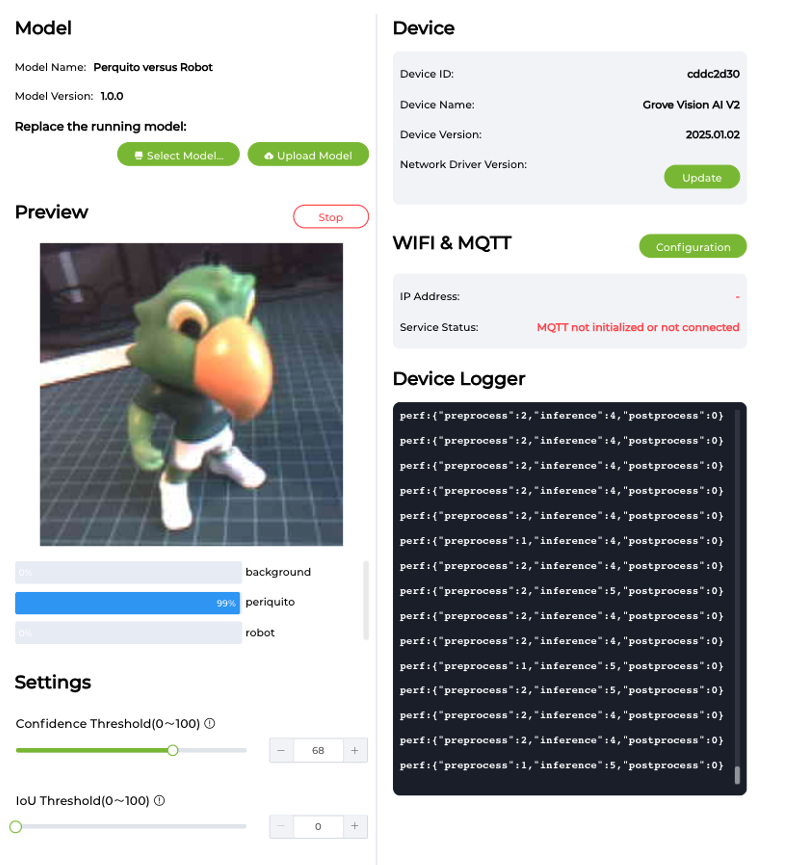</p>

Вот другие снимки экрана:

<p align="center">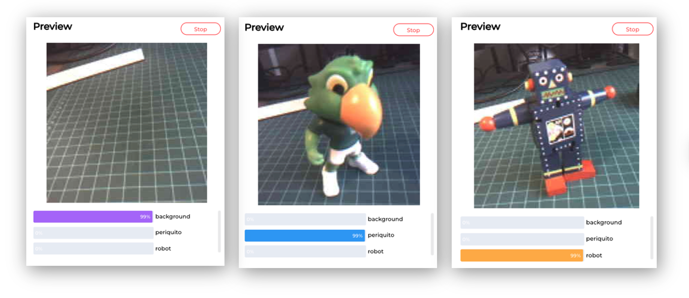</p>

Энергопотребление этой модели составляет около 70 мА, или 0,4 Вт.

### Неофициальный бенчмарк классификации изображений

Для встраиваемого машинного обучения (tinyML) можно использовать несколько отладочных плат. Наиболее распространённые на сегодня для задач компьютерного зрения с низким энергопотреблением — **ESP32 CAM**, **Seeed XIAO ESP32S3 Sense** и **Arduino Nicla Vision**.

Мы воспользовались возможностью и развернули аналогичную модель, обученную похожим образом — MobileNetV2 $96{\times}96$ с α=0,1 — также на ESP-CAM, XIAO и Raspberry Pi Zero W2. Вот результат:

<p align="center">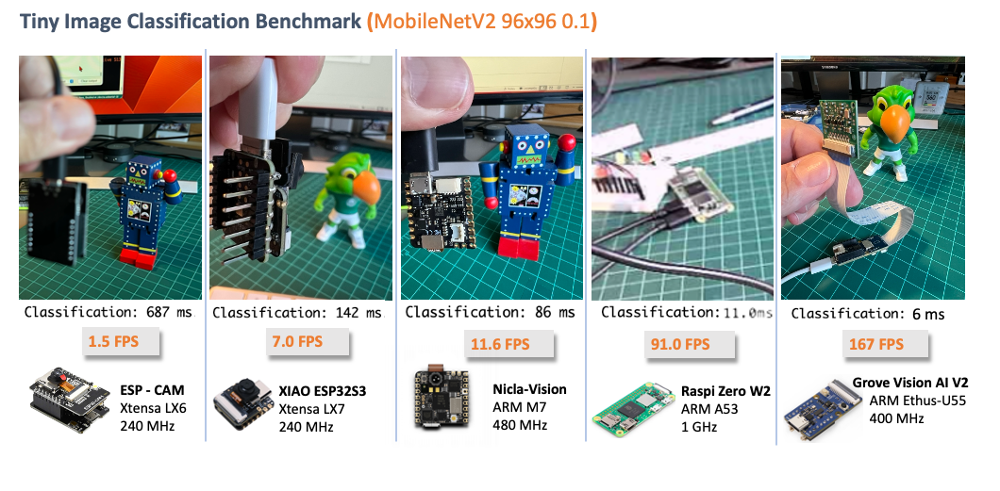</p>

> Grove Vision AI V2 с **ARM Ethos-U55** работает примерно в 14 раз быстрее устройств с ARM-M7 и более чем в 100 раз быстрее Xtensa LX6 (ESP-CAM). Даже по сравнению с Raspberry Pi, у которой гораздо более мощный процессор, U55 почти вдвое снижает задержку. Кроме того, энергопотребление ниже, чем у других устройств (сравнение энергопотребления см. в [полной статье](https://www.hackster.io/limengdu0117/2024-mcu-ai-vision-boards-performance-comparison-998505)).

### Постобработка

Теперь, когда модель загружена на плату и корректно классифицирует наши изображения, подключим управляющее устройство, которое получит результаты инференса, и посмотрим результат полностью офлайн — без подключения к ПК и, например, от батареи.

> Учтите, что в качестве управляющего контроллера можно использовать любой микроконтроллер, например XIAO, Arduino или Raspberry Pi.

#### Получение видеопотока

Обработка изображений и инференс модели выполняются локально в Grove Vision AI (V2), а результат мы хотим передать на XIAO (управляющий контроллер) по шине IIC. Для этого используем **библиотеку Arduino SSMA**. Её основная задача — обрабатывать поток данных Grove Vision AI, но не сам инференс модели.

> Grove Vision AI (V2) передаёт результаты инференса на XIAO по IIC; адрес устройства на шине IIC — 0x62. Передача изображения осуществляется через последовательный порт USB.

**Шаг 1.** Скачайте [библиотеку Arduino SSMA](https://github.com/Seeed-Studio/Seeed_Arduino_SSCMA/) в виде ZIP-архива с её страницы на GitHub:

<p align="center">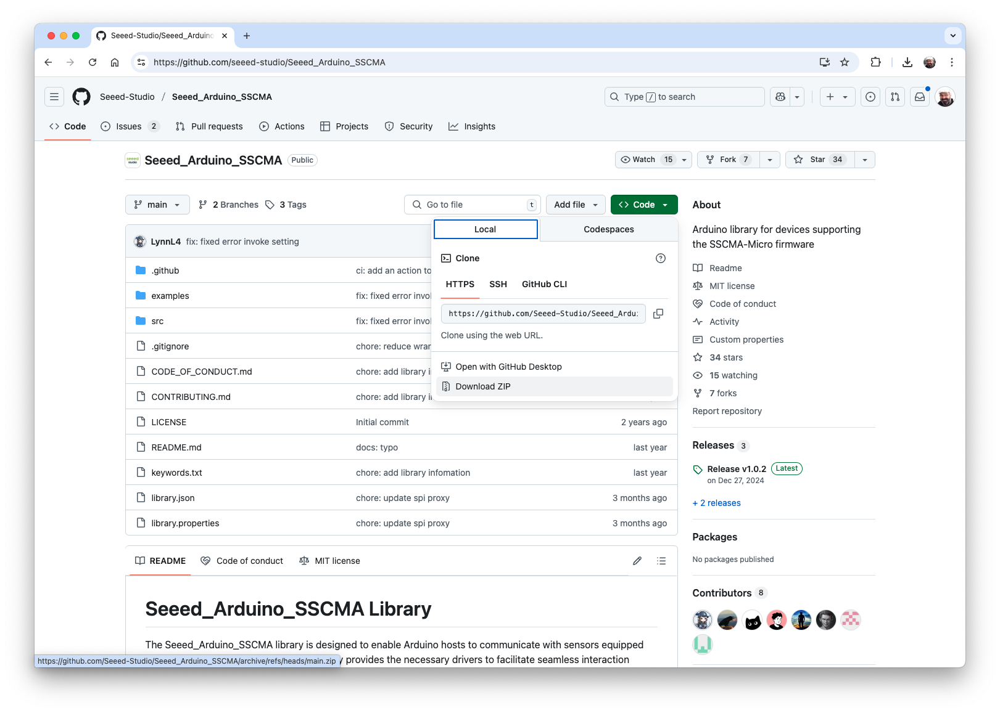</p>

**Шаг 2.** Установите её в Arduino IDE (`sketch > Include Library > Add .Zip Library`).

**Шаг 3.** Установите библиотеку **ArduinoJSON**.

<p align="center">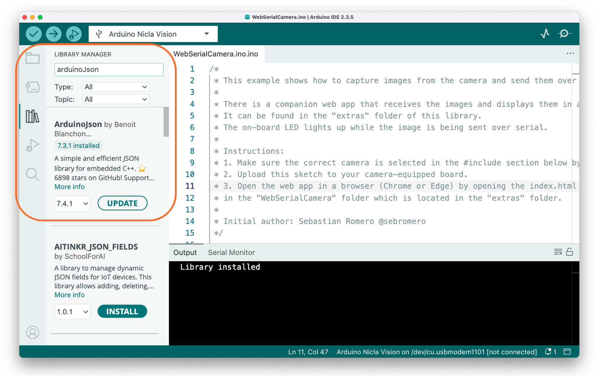</p>

**Шаг 4.** Установите библиотеку **Eigen**.

<p align="center">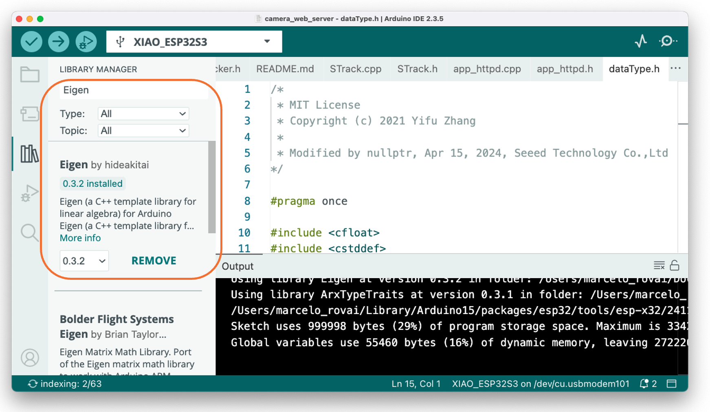</p>

**Шаг 3.** Теперь подключите XIAO и Grove Vision AI (V2) через разъём (ряд контактов), расположенный на задней стороне устройства.

<p align="center">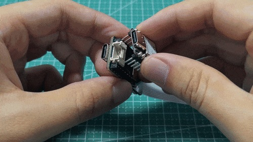</p>

> **ВНИМАНИЕ:** соблюдайте направление соединения: Type-C разъём Grove Vision AI должен быть направлен в ту же сторону, что и Type-C разъём XIAO.

**Шаг 5.** Подключите порт **XIAO USB-C** к компьютеру.

<p align="center">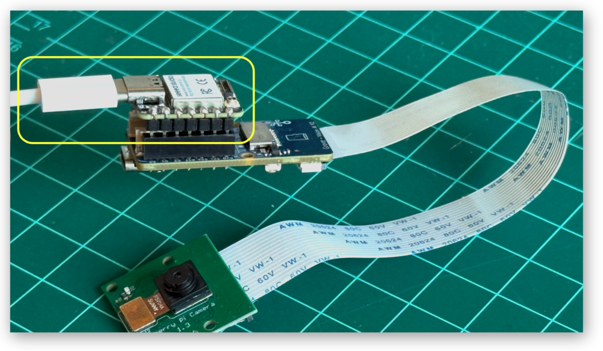</p>

**Шаг 6.** В Arduino IDE выберите плату Xiao и соответствующий порт USB.

Когда мы захотим передавать видео на веб-страницу, понадобится **XIAO ESP32S3**: у неё есть Wi-Fi и достаточно памяти для обработки изображений. Выберите `XIAO_ESP32S3` и нужный порт USB:

<p align="center">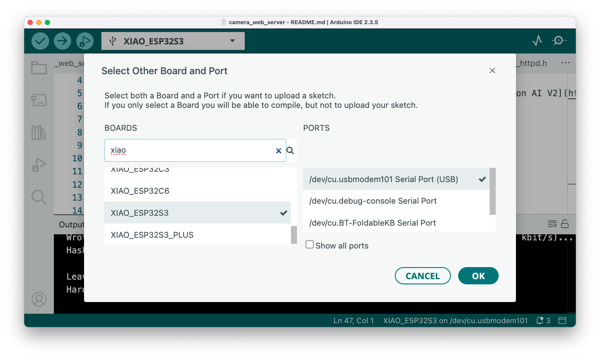</p>

По умолчанию PSRAM отключена. Откройте меню `Tools` и в пункте PSRAM выберите `"OPI PSRAM"`.

<p align="center">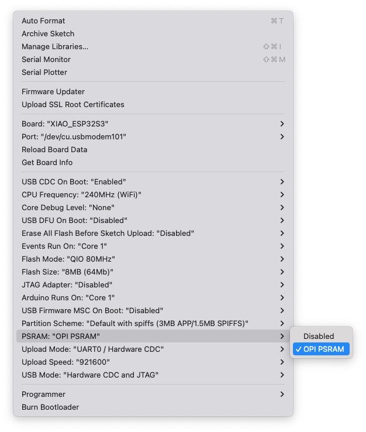</p>

**Шаг 7.** Откройте пример в Arduino IDE:

`File` → `Examples` → `Seeed_Arduino_SSCMA` → `camera_web_server`.

Затем измените `ssid` и `password` в скетче `camera_web_server.ino`, чтобы они совпадали с вашей сетью Wi-Fi.

**Шаг 8.** Загрузите скетч на плату и откройте Serial Monitor. Когда плата подключится к сети Wi-Fi, в мониторе отобразится её IP-адрес.

<p align="center">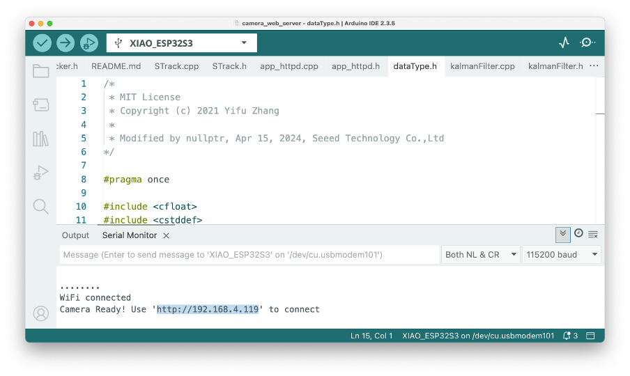</p>

Откройте этот адрес в веб-браузере. Станет доступно видеоприложение (Video App). Чтобы видеть **только** видеопоток с Grove Vision AI V2, нажмите `[Sample Only]` и `[Start Stream]`.

<p align="center">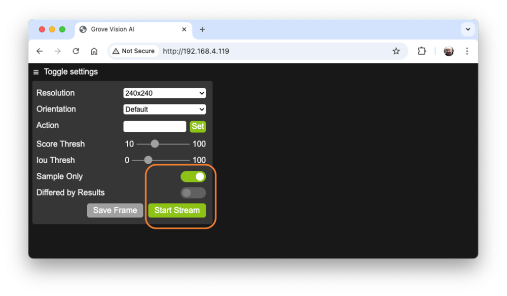</p>

Если хотите создать набор изображений, это приложение можно использовать, сохраняя кадры видео с устройства. Нажмите `[Save Frame]` — изображение сохранится в папку загрузок на компьютере.

<p align="center"></p>

Если открыть приложение **без** выбора `[Sample Only]`, результат инференса должен появиться на видеоэкране. Для классификации изображений этого не происходит, а вот для обнаружения объектов или оценки позы результат встраивается в видеопоток.

Например, если модель — Person Detection на основе YOLOv8:

<p align="center">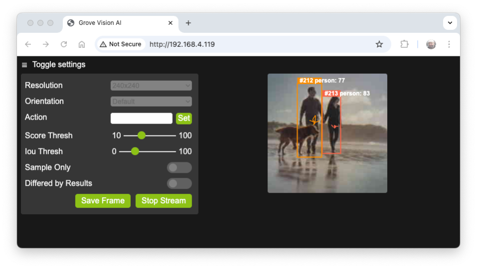</p>

#### Получение результата инференса

- Перейдите в `File` → `Examples` → `Seeed_Arduino_SSCMA` → `inference_class`.

- Загрузите скетч на плату и откройте Serial Monitor.
- Направьте камеру на один из наших объектов — результат инференса появится в последовательном терминале.

<p align="center">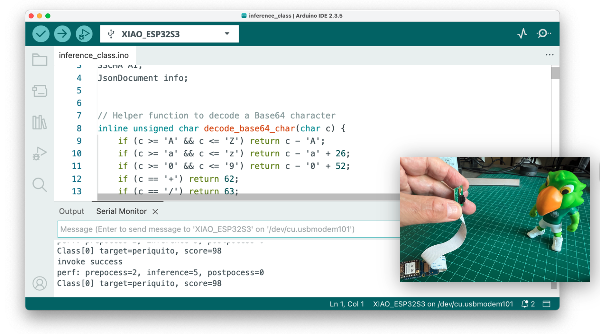</p>

> Инференс в Arduino IDE потреблял в среднем 160 мА, или 800 мВт, с пиком 330 мА (1,65 Вт) при передаче изображения в приложение.

#### Постобработка со светодиодом

Идея постобработки такая: когда распознан определённый объект (например, попугайчик — метка 1), пользовательский светодиод включается. Если обнаружены робот или фон, светодиод выключен.

Скопируйте код ниже и вставьте его в IDE:

```cpp
#include <Seeed_Arduino_SSCMA.h>
SSCMA AI;

void setup()
{
    AI.begin();

    Serial.begin(115200);
    while (!Serial);
    Serial.println("Инференс — Grove AI V2 / XIAO ESP32S3");

    // Пины встроенного светодиода
    pinMode(LED_BUILTIN, OUTPUT);
    // Убедитесь, что светодиод выключен по умолчанию.
    // Примечание: светодиод горит, когда пин в состоянии LOW, и гаснет при HIGH.
    digitalWrite(LED_BUILTIN, HIGH);
}

void loop()
{
    if (!AI.invoke()){
        Serial.println("\nВызов выполнен успешно");
        Serial.print("Задержка [мс]: предобработка=");
        Serial.print(AI.perf().prepocess);
        Serial.print(", инференс=");
        Serial.print(AI.perf().inference);
        Serial.print(", постобработка=");
        Serial.println(AI.perf().postprocess);
        int pred_index = AI.classes()[0].target;
        Serial.print("Результат= метка: ");
        Serial.print(pred_index);
        Serial.print(", оценка=");
        Serial.println(AI.classes()[0].score);
        turn_on_led(pred_index);
    }
}

/**
* @brief      Функция turn_off_led — выключает пользовательский светодиод
*/
void turn_off_led(){
    digitalWrite(LED_BUILTIN, HIGH);
}

/**
* @brief      Функция turn_on_led — включает пользовательский светодиод
* @param[in]  pred_index
*             метка 0: [0] ==> все выключены
*             метка 1: [1] ==> светодиод включён
*             метка 2: [2] ==> все выключены
*             метка 3: [3] ==> все выключены
*/
void turn_on_led(int pred_index) {
    switch (pred_index)
    {
        case 0:
            turn_off_led();
            break;
        case 1:
            turn_off_led();
            digitalWrite(LED_BUILTIN, LOW);
            break;
        case 2:
            turn_off_led();
            break;
        case 3:
            turn_off_led();
            break;
    }
}

```

Этот скетч использует библиотеку Seeed_Arduino_SSCMA.h для связи с модулем Grove Vision AI Module V2. Модуль ИИ и светодиод инициализируются в функции `setup()`, и запускается последовательная связь.

Функция `loop()` многократно вызывает метод `invoke()`, чтобы выполнить инференс с помощью встроенных алгоритмов модуля Grove Vision AI Module V2. При успешном инференсе скетч выводит в монитор порта метрики производительности: время предобработки, инференса и постобработки.

Скетч обрабатывает и выводит подробную информацию о результатах инференса:

- (`AI.classes()[0]`) определяет класс изображения (`.target`) и его оценку уверенности (`.score`);
- результат инференса (класс) сохраняется в целочисленной переменной `pred_index`, которая передаётся в функцию `turn_on_led()`. В результате светодиод включается или выключается в зависимости от результата классификации.

Вот результат:

Если распознан попугайчик (метка 1), светодиод горит:

<p align="center">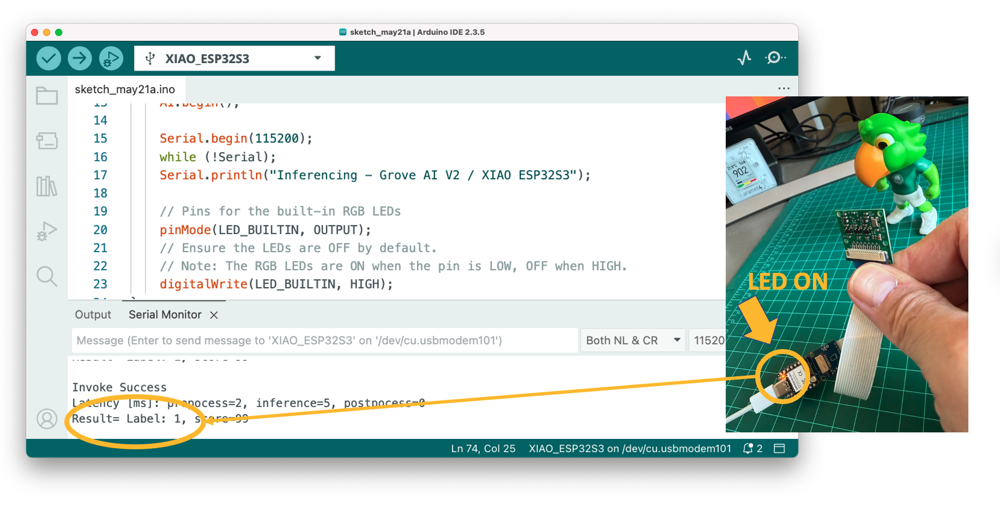</p>

Если распознан робот (метка 2), светодиод не горит (то же самое для фона, метка 0):

<p align="center">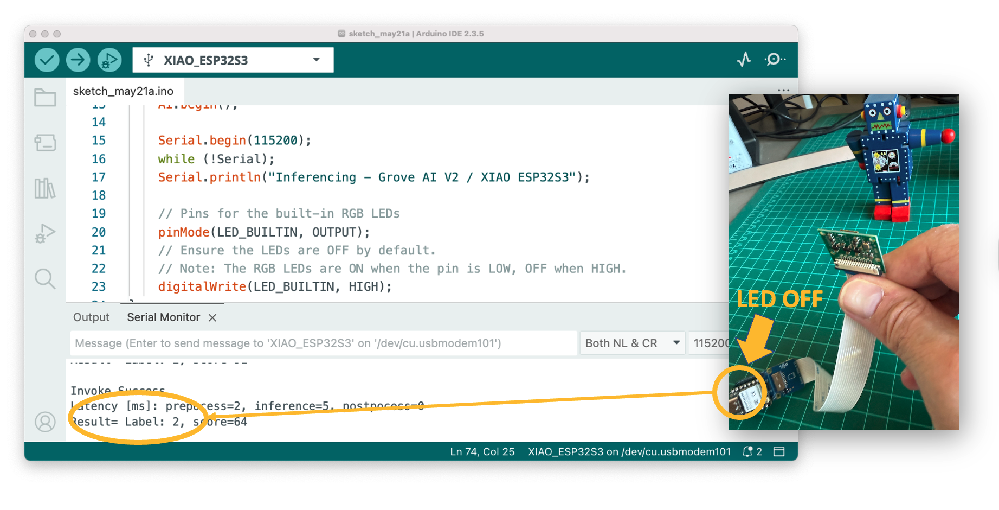</p>

Поэтому теперь мы можем питать Grove Vision AI V2 + Xiao ESP32S3 от внешней батареи, а результат инференса будет отображаться светодиодом полностью офлайн. Потребление составляет примерно 165 мА, или 825 мВт.

> Результат также можно передавать по Wi-Fi, BLE или другим протоколам связи, доступным на используемом управляющем устройстве.

### Дополнительно: постобработка на внешних устройствах

Одно из важных преимуществ работы с EdgeAI — устройства могут работать полностью без облака, обеспечивая непосредственное **взаимодействие с реальным миром**. В предыдущем разделе мы делали это со встроенным светодиодом XIAO. Теперь подключим внешние светодиоды (это может быть любое исполнительное устройство).

<p align="center">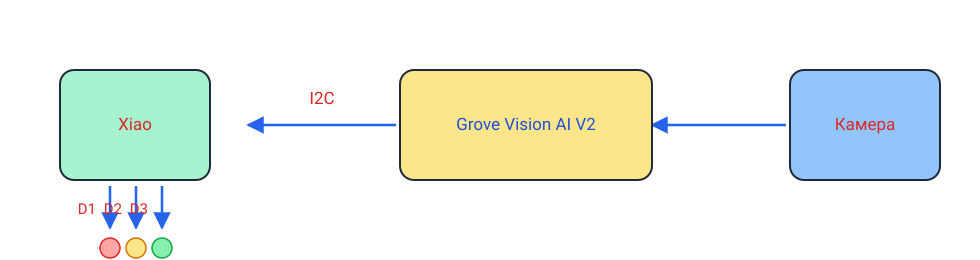</p>

> Светодиоды следует подключать к земле XIAO через резистор 220 Ом.

<p align="center">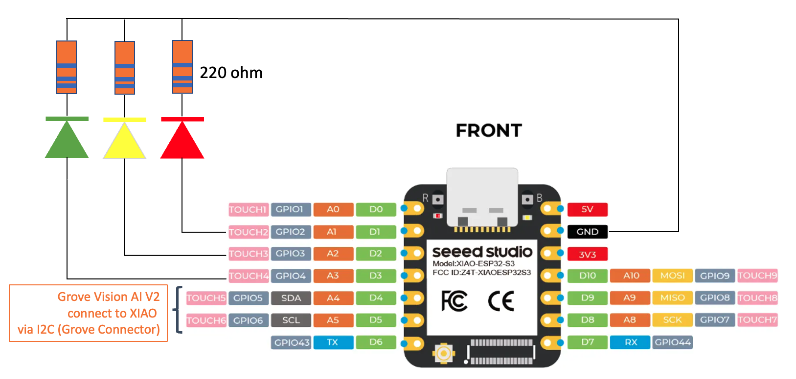</p>

Идея в том, чтобы изменить предыдущий скетч так, чтобы он управлял тремя внешними светодиодами.

**ЦЕЛЬ:** при распознавании изображения **попугайчика** включается **зелёный** светодиод; если это **робот**, включается **жёлтый** светодиод; если это **фон**, включается **красный** светодиод.

Обработка изображений и инференс модели выполняются локально в Grove Vision AI (V2), а результат мы хотим передать на XIAO по IIC. Для этого снова используем библиотеку Arduino SSMA.

Вот скетч, который будем использовать:

```cpp
#include <Seeed_Arduino_SSCMA.h>
SSCMA AI;

// Определите пины светодиодов согласно схеме выводов
// Отрицательный вывод светодиодов следует подключить к земле XIAO
// через резистор 220 Ом.
int LEDR = D1; # Пин 1 XIAO ESP32S3
int LEDY = D2; # Пин 2 XIAO ESP32S3
int LEDG = D3; # Пин 3 XIAO ESP32S3

  void setup()
{
    AI.begin();

    Serial.begin(115200);
    while (!Serial);
    Serial.println("Инференс — Grove AI V2 / XIAO ESP32S3");

// Инициализация внешних светодиодов
    pinMode(LEDR, OUTPUT);
    pinMode(LEDY, OUTPUT);
    pinMode(LEDG, OUTPUT);
    // Убедитесь, что светодиоды выключены по умолчанию.
    // Примечание: светодиоды горят, когда пин в состоянии HIGH, и гаснут при LOW.
    digitalWrite(LEDR, LOW);
    digitalWrite(LEDY, LOW);
    digitalWrite(LEDG, LOW);
}

void loop()
{
    if (!AI.invoke()){
        Serial.println("\nВызов выполнен успешно");
        Serial.print("Задержка [мс]: предобработка=");
        Serial.print(AI.perf().prepocess);
        Serial.print(", инференс=");
        Serial.print(AI.perf().inference);
        Serial.print(", постобработка=");
        Serial.println(AI.perf().postprocess);
        int pred_index = AI.classes()[0].target;
        Serial.print("Результат= метка: ");
        Serial.print(pred_index);
        Serial.print(", оценка=");
        Serial.println(AI.classes()[0].score);
        turn_on_leds(pred_index);
    }
}

/**
* @brief turn_off_leds — выключает все светодиоды
*/
void turn_off_leds(){
    digitalWrite(LEDR, LOW);
    digitalWrite(LEDY, LOW);
    digitalWrite(LEDG, LOW);
}

/**
* @brief turn_on_leds — включает определённый светодиод
* @param[in]  pred_index
*             метка 0: [0] ==> горит красный
*             метка 1: [1] ==> горит зелёный
*             метка 2: [2] ==> горит жёлтый
*/
void turn_on_leds(int pred_index) {
    switch (pred_index)
    {
        case 0:
            turn_off_leds();
            digitalWrite(LEDR, HIGH);
            break;
        case 1:
            turn_off_leds();
            digitalWrite(LEDG, HIGH);
            break;
        case 2:
            turn_off_leds();
            digitalWrite(LEDY, HIGH);
            break;
        case 3:
            turn_off_leds();
            break;
    }
}
```

Grove Vision AI V2 нужно подключить к XIAO через разъём I2C Grove. Для XIAO мы используем [плату расширения](https://wiki.seeedstudio.com/Seeeduino-XIAO-Expansion-Board/) (хотя IIC можно подключить и напрямую к контактам XIAO). Питание плат можно подать через разъём USB-C, но можно использовать и батарею.

<p align="center"></p>

Вот результат:

<p align="center">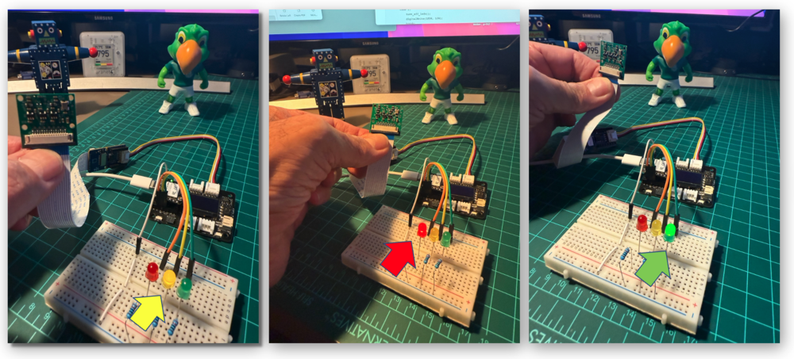</p>

> Пиковое энергопотребление составило 240 мА (зелёный светодиод), или 1,2 Вт. Питание жёлтого и красного светодиодов потребляет 14 мА, или 0,7 Вт. Вывод информации в терминал через последовательный порт не влияет на энергопотребление.

## Итоги

В этой лабораторной работе мы полностью прошли процесс разработки системы классификации изображений на модуле Seeed Studio Grove Vision AI Module V2 с чипом Himax WiseEye2. Мы прошли все этапы рабочего процесса машинного обучения: от определения целей проекта до развёртывания рабочей модели с взаимодействием с реальным миром.

Grove Vision AI V2 показал впечатляющую производительность: время инференса составляет всего 4–5 мс, что намного превосходит другие распространённые платформы tinyML. По результатам нашего бенчмарка он примерно в 14 раз быстрее устройств на ARM-M7 и более чем в 100 раз быстрее Xtensa LX6 (ESP-CAM). Даже по сравнению с Raspberry Pi Zero W2 архитектура Edge TPU обеспечила почти двукратный прирост скорости при меньшем энергопотреблении.

В этом проекте мы увидели, как перенос обучения позволяет получить хорошие результаты классификации на относительно небольшом наборе собственных изображений. Модель MobileNetV2 с α=0,1 обеспечила отличный баланс точности и эффективности для нашей задачи с тремя классами: ей нужно всего 146 КБ RAM и 187 КБ флеш-памяти, что легко укладывается в 2,4 МБ внутренней SRAM модуля Grove Vision AI Module V2.

Мы также рассмотрели несколько вариантов развёртывания: от просмотра результатов инференса в SenseCraft AI Studio до автономной системы с визуальной индикацией на светодиодах. Возможность передавать видео в веб-браузер и обрабатывать результаты инференса локально демонстрирует универсальность систем периферийного ИИ для реальных задач.

Потребление энергии итоговой системы оставалось очень низким — примерно от 70 мА (0,4 Вт) при базовом инференсе до 240 мА (1,2 Вт) при управлении внешними компонентами. Благодаря этой эффективности Grove Vision AI Module V2 — отличный выбор для устройств с батарейным питанием, где энергопотребление критично.

Эта работа показала, что сложные задачи компьютерного зрения теперь можно выполнять полностью на периферии, без облачных сервисов и мощных компьютеров. Благодаря таким инструментам, как Edge Impulse Studio и SenseCraft AI Studio, процесс разработки стал доступен даже тем, у кого нет серьёзного опыта в машинном обучении.

По мере развития технологий периферийного ИИ компактные и энергоэффективные устройства, такие как Grove Vision AI Module V2, будут становиться всё мощнее, открывая новые возможности для умных датчиков, IoT-приложений и встроенного интеллекта в повседневных предметах.

## Ресурсы

- [Сбор изображений в SenseCraft AI Studio](https://sensecraft.seeed.cc/ai/training)
- [Проект в Edge Impulse Studio](https://studio.edgeimpulse.com/public/712491/live)
- [SenseCraft AI Studio — Vision Workplace (развёртывание моделей)](https://sensecraft.seeed.cc/ai/device/local/36)
- [Другие примеры Himax](https://github.com/Seeed-Studio/wiki-documents/blob/docusaurus-version/docs/Sensor/Grove/Grove_Sensors/AI-powered/Grove-vision-ai-v2/Development/grove-vision-ai-v2-himax-sdk.md)
- [Скетчи для Arduino](https://github.com/Mjrovai/Seeed-Grove-Vision-AI-V2/tree/main/Arduino_Sketches)
