# Настройка и приложения без кода

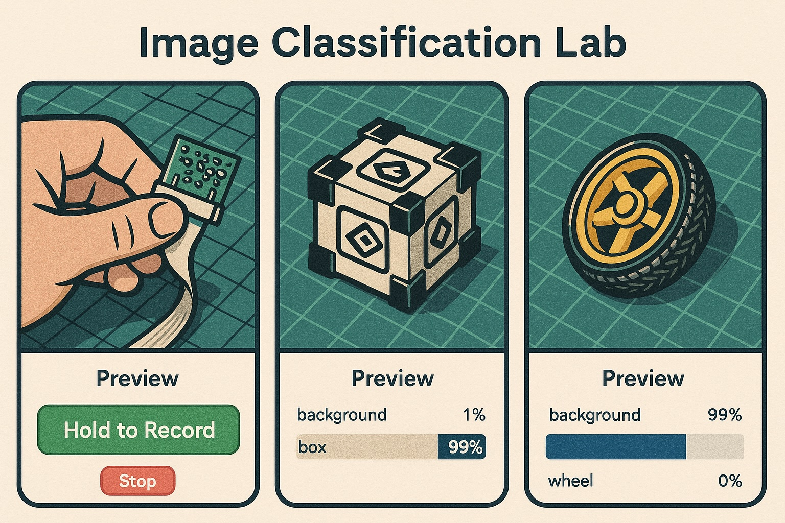

В этой лабораторной работе мы исследуем приложения компьютерного зрения (CV) с помощью модуля [*Grove Vision AI Module V2*](https://wiki.seeedstudio.com/grove_vision_ai_v2/) от Seeed Studio — мощного, но компактного устройства, созданного специально для приложений встраиваемого машинного обучения. Модуль построен на микросхеме **Himax WiseEye2** и предназначен для работы ИИ на периферийных устройствах, поэтому он идеально подходит для задач периферийного машинного обучения (Edge ML).

## Введение

### Обзор модуля Grove Vision AI (V2)

Grove Vision AI (V2) — модуль компьютерного зрения на базе микроконтроллера. В нём используется процессор [Himax WiseEye2 HX6538](https://www.himax.com.tw/products/intelligent-sensing/always-on-smart-sensing/wiseeye2-ai-processor/) с **двухъядерным Arm Cortex-M55 и встроенным блоком нейронных сетей Arm Ethos-U55**. [Arm Ethos-U55](https://www.arm.com/products/silicon-ip-cpu/ethos/ethos-u55) — это класс процессоров для машинного обучения (ML), созданный специально как микро-NPU для ускорения инференса ML во встраиваемых и IoT-устройствах с ограниченной площадью кристалла. В сочетании с процессором Cortex-M55, рассчитанным на ИИ, Ethos-U55 обеспечивает прирост производительности ML в 480 раз по сравнению с существующими системами на базе Cortex-M. Тактовая частота составляет 400 МГц, а внутренняя системная память (SRAM) конфигурируется и имеет максимальный объём 2,4 МБ.

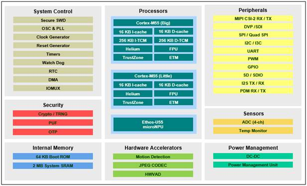

> Примечание: по данным документации Seeed Studio, помимо внутренней памяти Himax объёмом 2,5 МБ (2,4 МБ SRAM и 64 КБ ПЗУ), Grove Vision AI (V2) оснащён внешней флеш-памятью 16 МБ / 133 МГц.

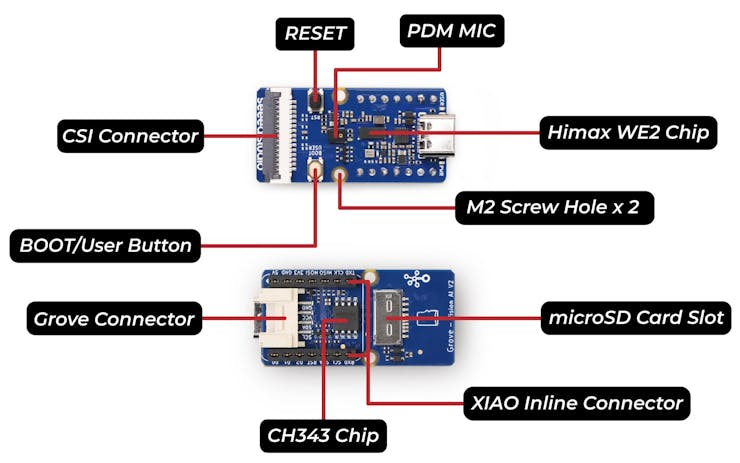

Ниже приведена блок-схема системы Grove Vision AI (V2), включающей камеру и управляющий контроллер.

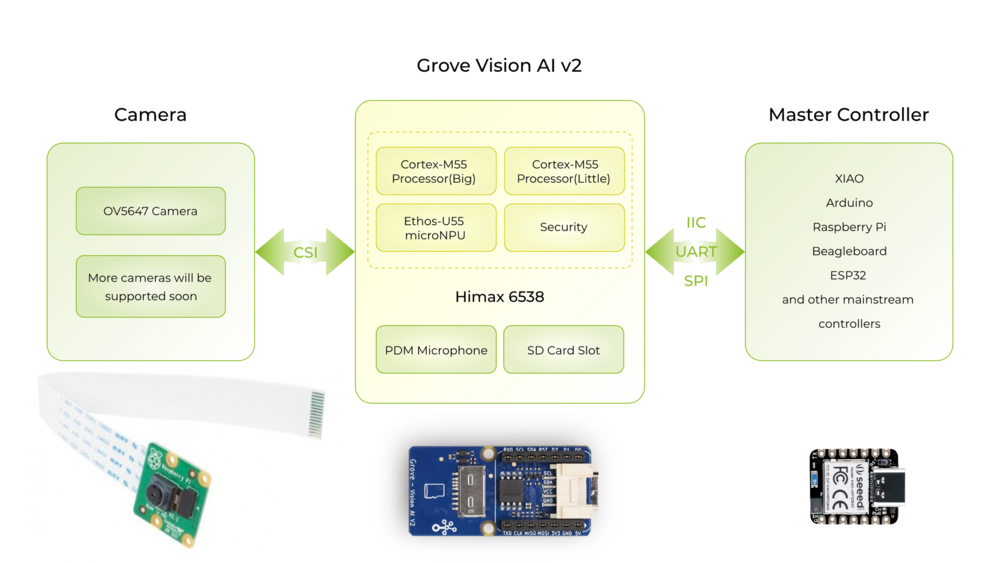

Благодаря интерфейсам **IIC, UART, SPI и Type-C** Grove Vision AI (V2) легко подключается к устройствам вроде **XIAO, Raspberry Pi, BeagleBoard** и **плат на базе ESP** для дальнейшей разработки. Например, интеграция Grove Vision AI V2 с одним из устройств семейства XIAO упрощает доступ к результатам инференса через Arduino IDE или MicroPython и подключение к облаку или выделенным серверам, например к Home Assistant.

> С помощью разъёма **I2C Grove** Grove Vision AI V2 легко подключается к любому управляющему устройству.

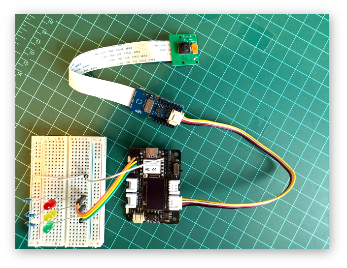

Помимо производительности, стоит отметить **энергопотребление**. Например, в сравнительном тесте с XIAO ESP32S3 Sense при запуске модели Swift-YOLO Tiny 96×96 Grove Vision AI V2 показал более высокую производительность (30 FPS против 5,5 FPS) и при этом меньшее энергопотребление (0,35 Вт против 0,45 Вт).

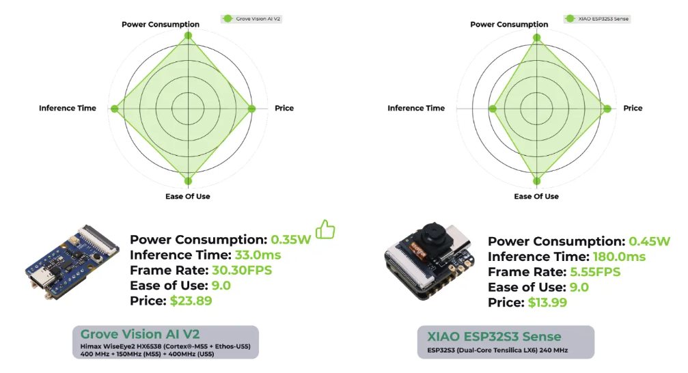

> Сравнение (и с другими устройствами) можно найти в статье [2024 MCU AI Vision Boards: Performance Comparison](https://www.hackster.io/limengdu0117/2024-mcu-ai-vision-boards-performance-comparison-998505) — она подтверждает высокую производительность Grove Vision AI (V2).

### Установка камеры

Когда Grove Vision AI (V2) и камера готовы, можно подключить, например, модуль **Raspberry Pi OV5647 Camera Module** через шлейф CSI.

> При подключении обратите внимание на направление ряда контактов и убедитесь, что шлейф вставлен правильно, а не в обратную сторону.

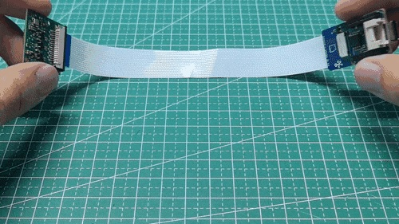

## SenseCraft AI Studio

[SenseCraft AI](https://sensecraft.seeed.cc/ai/home) Studio — надёжная платформа, которая предлагает широкий набор моделей ИИ для разных устройств, включая XIAO ESP32S3 Sense и **Grove Vision AI V2**. В этой работе мы пройдём процесс использования модели ИИ с Grove Vision AI V2 и посмотрим результат её работы. Также мы разберём ключевые понятия и настройки и научимся оптимизировать производительность модели.

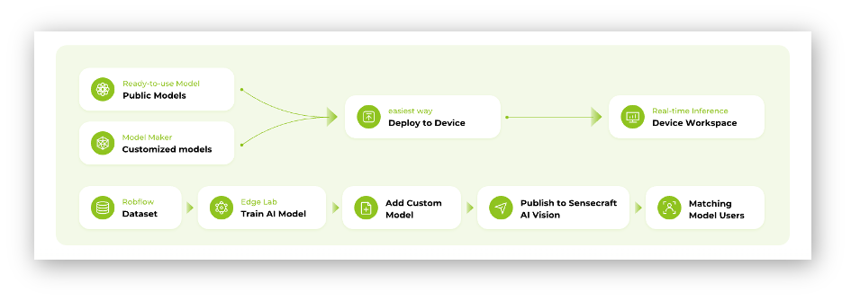

Модели также можно развернуть с помощью [**SenseCraft Web Toolkit**](https://seeed-studio.github.io/SenseCraft-Web-Toolkit/#/setup/process) — упрощённой версии SenseCraft AI Studio.

> Для простоты можно начать с SenseCraft Web Toolkit, а можно сразу перейти в [SenseCraft AI Studio](https://sensecraft.seeed.cc/ai/model), где больше ресурсов.

### SenseCraft Web Toolkit

SenseCraft Web Toolkit — это визуальный инструмент развёртывания моделей, входящий в состав [SSCMA](https://sensecraftma.seeed.cc/) (Seeed SenseCraft Model Assistant). Он позволяет просто и быстро развёртывать модели на разных платформах. У инструмента удобный интерфейс, и для работы не нужно писать код.

SenseCraft Web Toolkit основан на Himax AI Web Toolkit, который при желании (**необязательно**) можно скачать [по ссылке](https://github.com/HimaxWiseEyePlus/Seeed_Grove_Vision_AI_Module_V2/releases/download/v1.1/Himax_AI_web_toolkit.zip). После загрузки и распаковки на локальный компьютер дважды щёлкните `index.html`, чтобы запустить его локально.

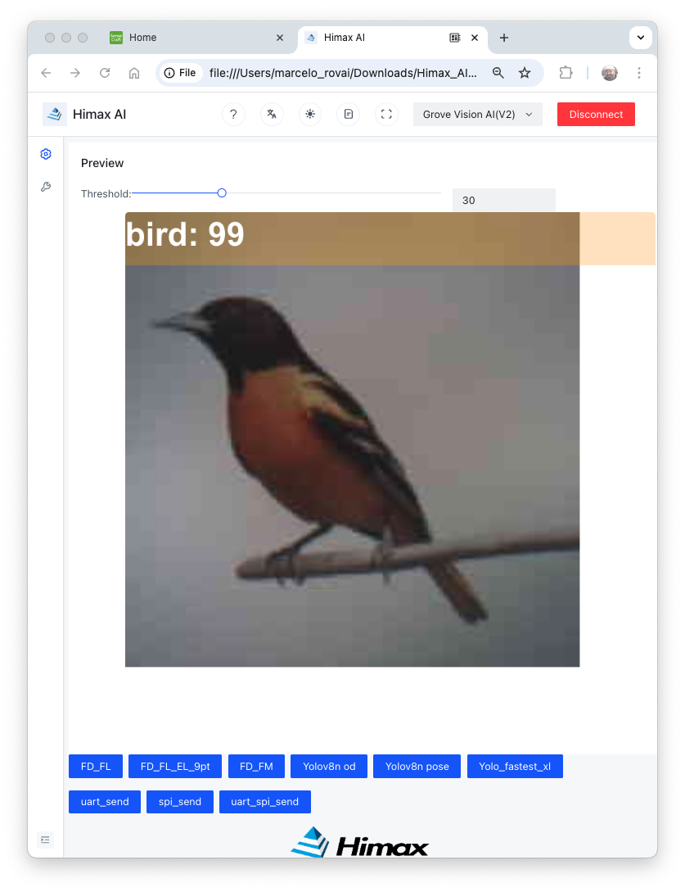

В нашем случае выполним следующие шаги, чтобы запустить **SenseCraft-Web-Toolkit**:

- Откройте [сайт SenseCraft-Web-Toolkit](https://seeed-studio.github.io/SenseCraft-Web-Toolkit/#/setup/process) в браузере **Chrome**.
- Подключите Grove Vision AI (V2) к компьютеру кабелем Type-C.
- Когда Grove Vision AI (V2) подключён, выберите его, как показано ниже:

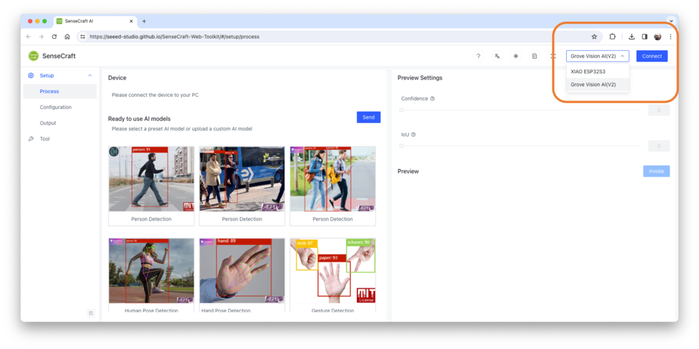

- Выберите устройство и порт и нажмите `[Connect]`:

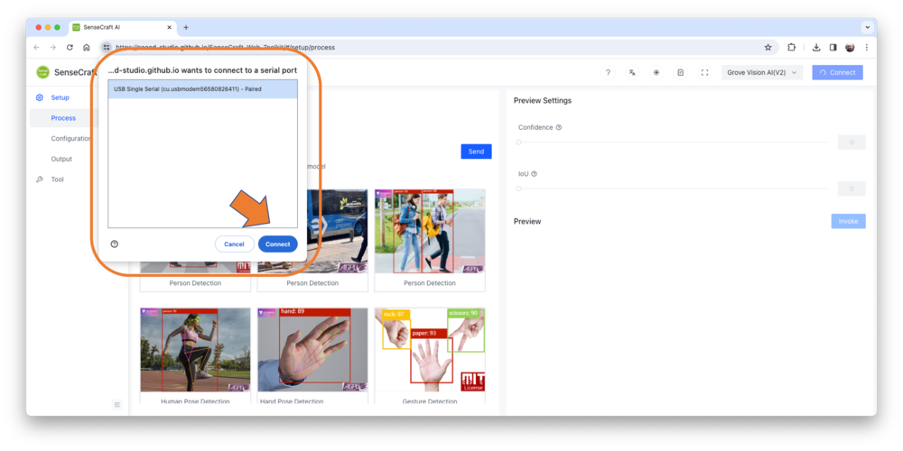

> Примечание: инструмент **WebUSB** может работать некорректно в некоторых браузерах, например в Safari. Используйте Chrome.

Можно попробовать несколько базовых моделей компьютерного зрения, заранее загруженных Seeed Studio. Если навести курсор на модель ИИ, станут видны её название, описание, **категория** (классификация изображений, обнаружение объектов или детекция позы и ключевых точек), **алгоритм** (например, YOLO V5 или V8, FOMO, MobileNet V2 и т. д.) и **метрики** (точность Accuracy или mAP).

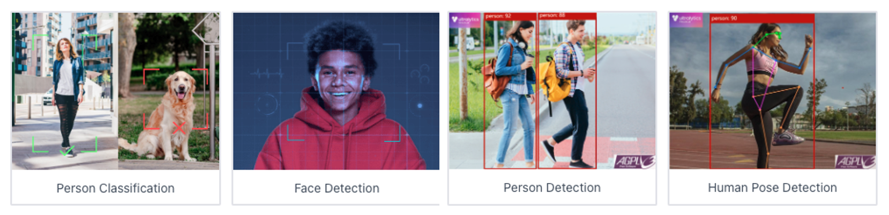

Чтобы использовать одну из готовых моделей, нажмите на неё и затем на кнопку `[Send]`, либо загрузите собственную модель.

Для платформы **SenseCraft AI** следуйте инструкциям [по ссылке](https://wiki.seeedstudio.com/sensecraft_ai_pretrained_models_for_grove_visionai_v2/).

## Изучение моделей компьютерного зрения

### Обнаружение объектов

Обнаружение объектов — ключевая технология компьютерного зрения, которая занимается поиском и локализацией объектов на цифровых изображениях или кадрах видео. В отличие от классификации изображений, которая относит всё изображение к одной метке, обнаружение объектов находит на изображении несколько объектов и определяет их точное положение, обычно заданное ограничивающими рамками. Эта возможность важна во многих приложениях — автономных автомобилях, системах безопасности и видеонаблюдения, дополненной реальности, — где нужно понимать контекст и содержимое визуальной среды.

К архитектурам, которые задали эталон в обнаружении объектов, относятся модели YOLO (You Only Look Once), SSD (Single Shot MultiBox Detector), FOMO (Faster Objects, More Objects) и Faster R-CNN (Region-based Convolutional Neural Networks).

Выберем одну из готовых моделей ИИ, например **Person Detection** (обнаружение людей), которая обучена с помощью алгоритма Swift-YOLO.

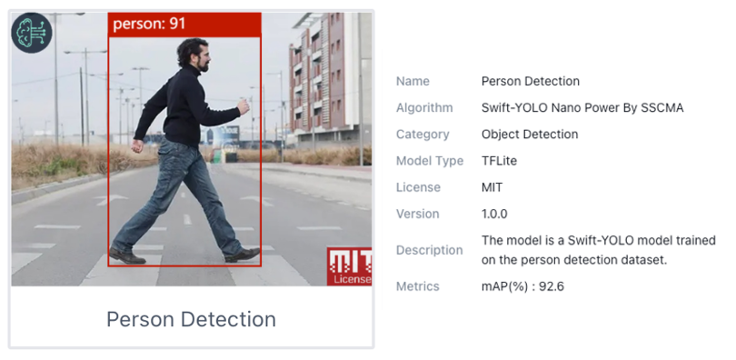

После успешной загрузки модели в области предпросмотра справа появится видеопоток с камеры Grove Vision AI (V2). Подробности инференса можно вывести в Serial Monitor, нажав кнопку `[Device Log]` вверху.

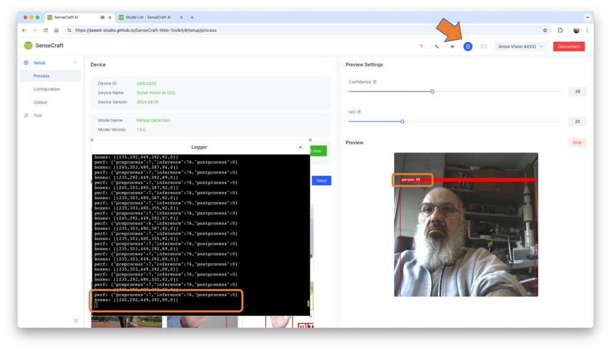

> В SenseCraft AI Studio журнал устройства (Device Logger) всегда отображается на экране.

Я направил камеру на себя, поэтому модель нашла только одного человека и выдала одну рамку (box). Если присмотреться, модуль непрерывно передаёт две строки данных:

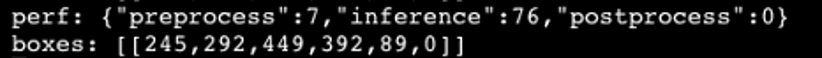

**perf** (производительность) — задержки в миллисекундах:

- время предобработки (захват изображения и обрезка): **7 мс**;
- время инференса (задержка модели): **76 мс (13 fps)**;
- время постобработки (вывод изображения и добавление данных): меньше 1 мс (в журнале — 0 мс).

**boxes** — объекты, найденные на изображении. В данном случае — один.

- У рамки координаты x, y, w и h равны (**245**, **292**, **449**, **392**), а объект (человек, метка **0**) распознан с уверенностью **0,89**.

Если направить камеру на изображение с несколькими людьми, для каждого человека (объекта) будет своя рамка:

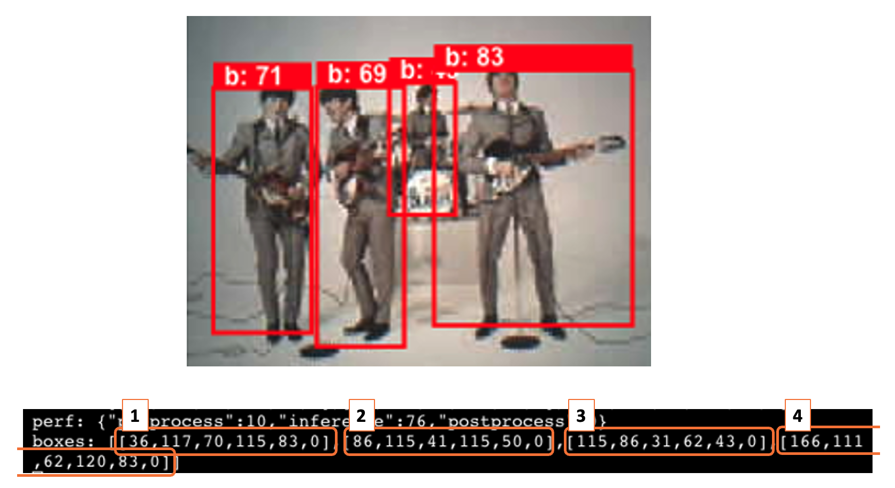

> В SenseCraft AI Studio задержка инференса (48 мс) меньше, чем в SenseCraft ToolKit (76 мс), благодаря другой реализации развёртывания.

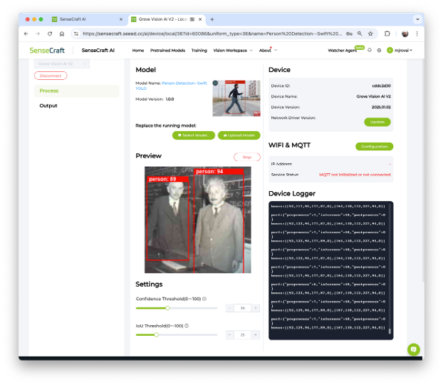

**Энергопотребление**

Пиковое энергопотребление при работе этой модели Swift-YOLO составило 410 милливатт.

**Настройки предпросмотра**

В настройках можно изменить два параметра, чтобы повысить точность распознавания модели:

- **Confidence (уверенность):** уровень достоверности, который модель присваивает своим предсказаниям. Этот параметр задаёт минимальный уровень уверенности, при котором детекция считается верной. При более высоком пороге детекций будет меньше, но они будут надёжнее; при более низком — детекций будет больше, однако среди них могут оказаться ложные срабатывания.

- **IoU:** метрика, которая оценивает точность предсказанных ограничивающих рамок по сравнению с эталонными (ground truth). IoU измеряет степень перекрытия предсказанной рамки и эталонной и используется для оценки точности обнаружения объектов. Порог IoU задаёт минимальное значение, при котором детекция считается истинно положительной. Изменение этого порога помогает тонко настроить точность (precision) и полноту (recall) модели.

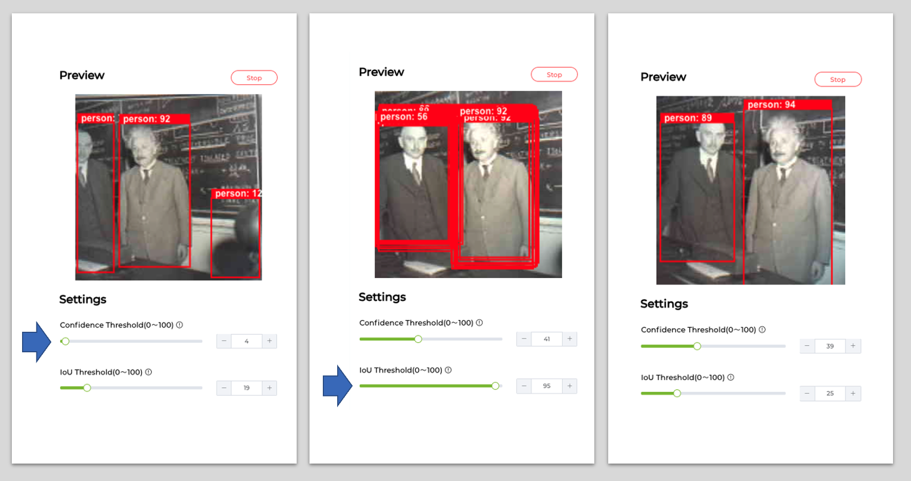

> Поэкспериментируйте со значениями порогов Confidence и IoU, чтобы найти оптимальный баланс между точным обнаружением людей и минимизацией ложных срабатываний. Лучшие настройки могут отличаться в зависимости от конкретного приложения и характеристик изображений или видеопотока.

### Детекция позы и ключевых точек

Детекция позы, или ключевых точек, — продвинутая область компьютерного зрения, которая находит на изображении или кадре видео определённые точки интереса, чаще всего относящиеся к телам людей, лицам или другим объектам. Эта технология обнаруживает и отображает ключевые точки объекта, например **суставы человеческого тела** или черты лица, что позволяет анализировать позы, движения и жесты. Это важно для дополненной реальности, взаимодействия человека с компьютером, спортивной аналитики и мониторинга здоровья, где нужно понимать движения и активность человека.

В отличие от общего обнаружения объектов, которое находит и локализует объекты, детекция позы работает на более тонком уровне и фиксирует положение и ориентацию отдельных частей. Ведущие архитектуры в этой области — OpenPose, AlphaPose и PoseNet, каждая из которых решает задачи оценки позы со своей степенью сложности и точности. Благодаря развитию глубокого обучения и нейронных сетей детекция позы становится всё точнее и эффективнее и даёт данные о динамике объектов на видео в реальном времени.

Давайте исследуем это популярное приложение компьютерного зрения — *детекцию позы и ключевых точек*.

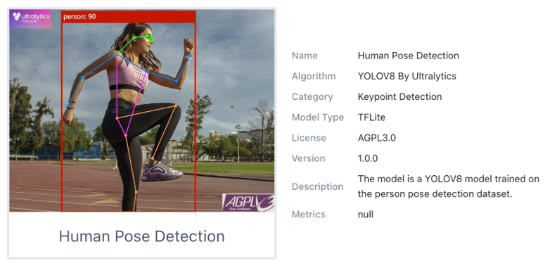

Остановите текущий инференс кнопкой `[Stop]` в области предпросмотра. Выберите модель и нажмите `[Send]`. После успешной загрузки модели вы увидите видеопоток с камеры Grove Vision AI (V2) в области предпросмотра справа и данные инференса в Serial Monitor (кнопка `[Device Log]` вверху).

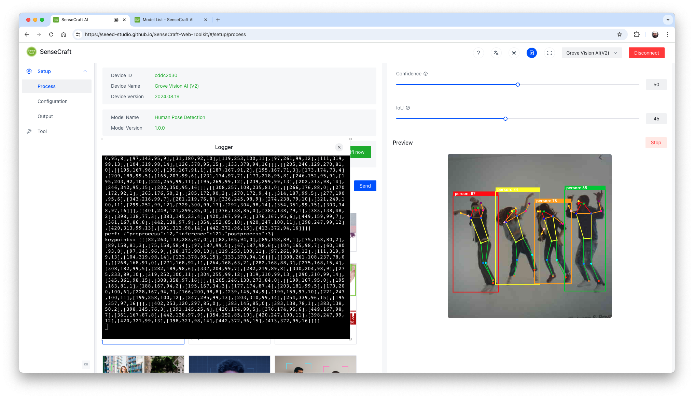

Модель YOLOv8 Pose обучена на [наборе данных COCO-Pose](https://docs.ultralytics.com/datasets/pose/coco/), который содержит 200 тысяч изображений с разметкой из **17** ключевых точек для задач оценки позы.

Рассмотрим один кадр инференса (для простоты возьмём изображение с одним человеком). Видны две строки: одна — с **производительностью** инференса в миллисекундах (121 мс), вторая — с **ключевыми точками**:

- 1 блок информации, такой же, как в примере с обнаружением объектов: координаты рамки (113, 119, 67, 208), результат инференса (90) и метка (0);
- 17 групп по 4 числа — это 17 «суставов» тела, где «0» — нос, «1» и «2» — глаза, «15» и «16» — стопы и так далее.

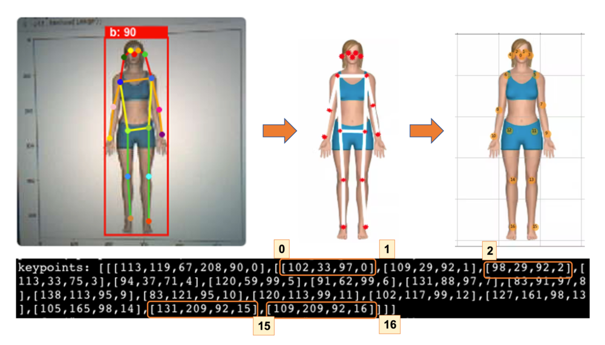

> Чтобы глубже разобраться в проекте оценки позы, см. руководство [Exploring AI at the Edge! — Pose Estimation](https://www.hackster.io/mjrobot/exploring-ai-at-the-edge-97588d#toc-pose-estimation-10).

### Классификация изображений

Классификация изображений — базовая задача компьютерного зрения: она относит **всё изображение** к одному из нескольких заранее заданных классов. Для этого анализируется визуальное содержимое изображения и назначается метка из фиксированного набора категорий в зависимости от основного объекта или сцены.

Классификация изображений важна во многих приложениях — от организации и поиска в больших базах изображений в цифровых библиотеках и соцсетях до помощи автономным системам в понимании окружающего мира. Среди архитектур, которые заметно продвинули классификацию изображений, — свёрточные нейронные сети (CNN), например AlexNet, VGGNet и ResNet. Эти модели показали высокую точность на сложных наборах данных, таких как **ImageNet**, обучаясь иерархическим представлениям визуальных данных.

Классификация изображений лежит в основе многих систем компьютерного зрения: она закладывает фундамент для более сложных задач, например обнаружения объектов и сегментации изображений, и помогает глубже понимать визуальные данные в самых разных отраслях. Давайте исследуем и это приложение компьютерного зрения.

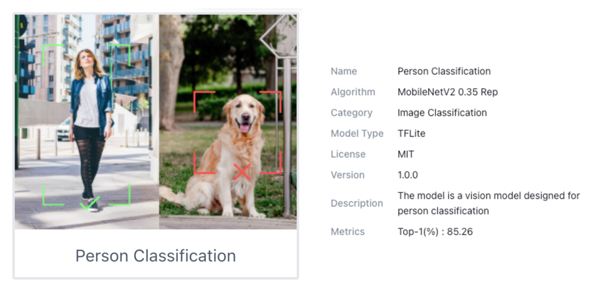

> Этот пример доступен в SenseCraft ToolKit, но не в SenseCraft AI Studio. В последнем можно найти и другие примеры классификации изображений.

После успешной загрузки модели можно посмотреть видеопоток с камеры Grove Vision AI (V2) в области предпросмотра справа и данные инференса в Serial Monitor (кнопка `[Device Log]` вверху).

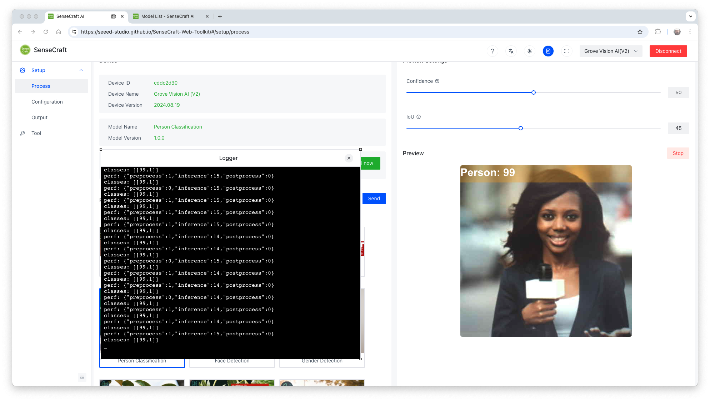

В результате мы получаем оценку и класс.

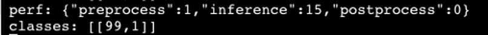

Например, **[99, 1]** означает класс 1 (человек) с оценкой 0,99. Поскольку эта модель бинарная, класс 0 будет «Нет человека» (или фон). Задержка инференса — **15 мс**, то есть около 70 кадров в секунду.

#### Энергопотребление

Для запуска MobileNet V2 0.35 Grove Vision AI V2 потреблял пиковый ток 80 мА при напряжении 5,24 В, что соответствует **энергопотреблению 420 мВт**.

При запуске той же модели на XIAO ESP32S3 Sense **энергопотребление составило 523 мВт** при задержке 291 мс.

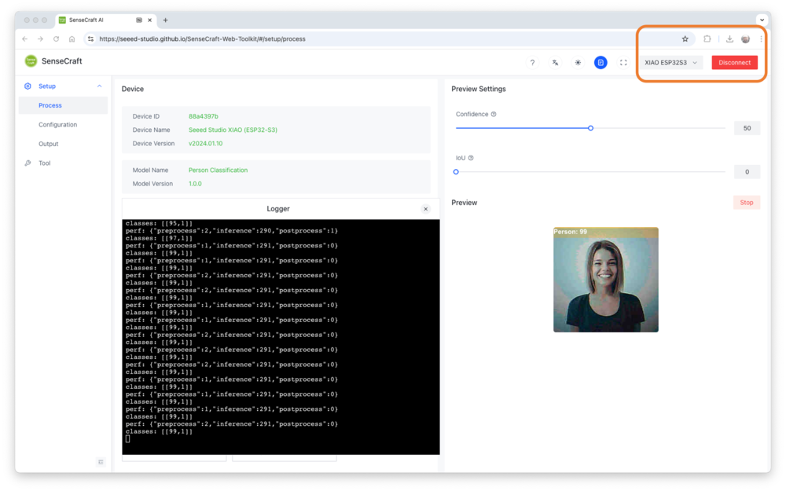

### Другие модели в SenseCraft AI Studio

Несколько публичных моделей ИИ можно скачать на [веб-странице SenseCraft AI](https://sensecraft.seeed.cc/ai/model). Например, можно запустить модель Swift-YOLO, [распознающую светофоры](https://sensecraft.seeed.cc/ai/view-model/60281-traffic-light-detection?tab=public), как показано ниже:

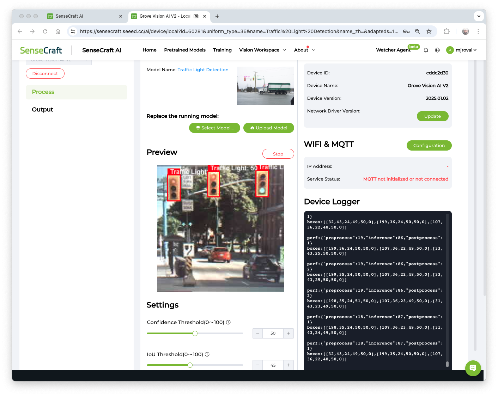

Задержка этой модели составляет около 86 мс, среднее энергопотребление — 420 мВт.

## Проект классификации изображений

Создадим полноценный проект классификации изображений в SenseCraft AI Studio.

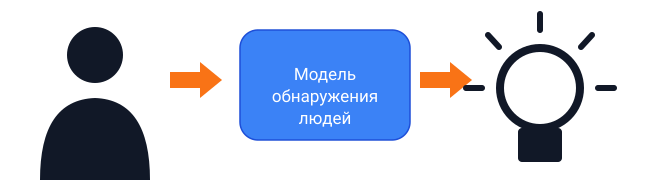

В SenseCraft AI Studio откройте вкладку [Training](https://sensecraft.seeed.cc/ai/training):

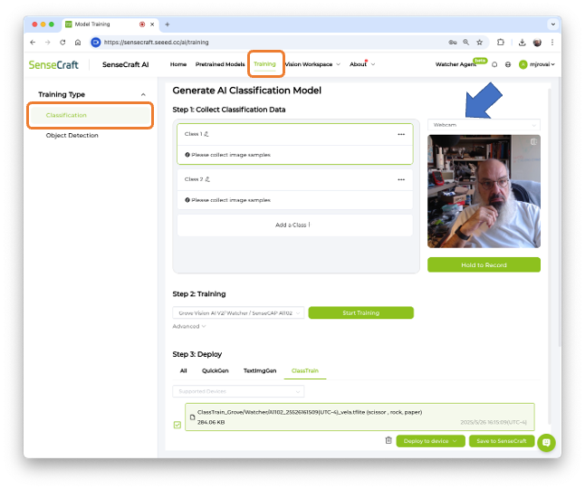

По умолчанию обучается модель `Classification` с веб-камерой, если она доступна. Выберем вместо неё Grove Vision AI V2. Нажмите зелёную кнопку `[Connect]` — появится всплывающее окно. Выберите нужный порт и нажмите синюю кнопку `[Connect]`.

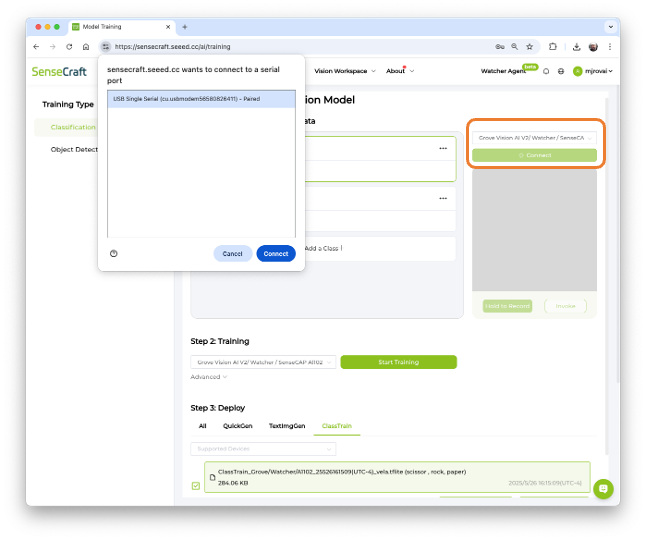

На экране появится изображение, которое передаёт Grove Vision AI V2.

### Цель

Первый шаг — всегда определить цель. Классифицируем, например, два простых предмета — игрушечную коробку и игрушечное колесо. Также нужен третий класс изображений — фон, где в кадре нет объектов.

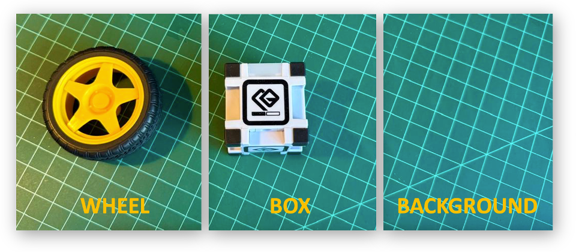

### Сбор данных

Создадим классы, например, в алфавитном порядке:

- Класс 1: `background` (фон)
- Класс 2: `box` (коробка)
- Класс 3: `wheel` (колесо)

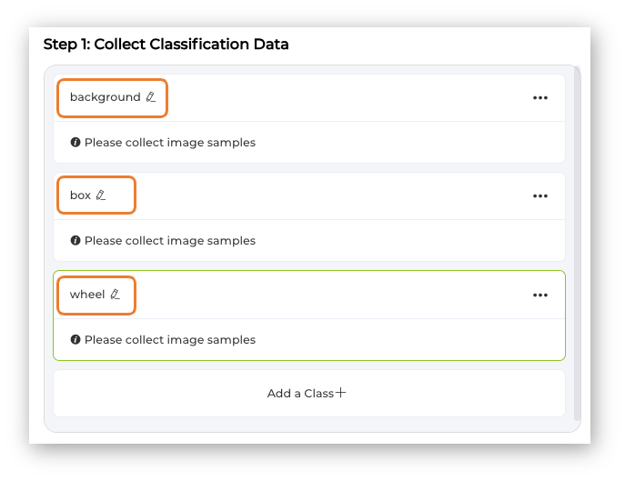

Выберите один из классов и удерживайте зелёную кнопку под областью предпросмотра. Собранные изображения появятся на экране выборки (Image Samples).

После сбора изображений просмотрите их и удалите некорректные.

Соберите примерно по 50 изображений для каждого класса и перейдите к этапу обучения.

### Обучение

Убедитесь, что выбрано правильное устройство (`Grove Vision AI V2`), и нажмите `[Start Training]`.

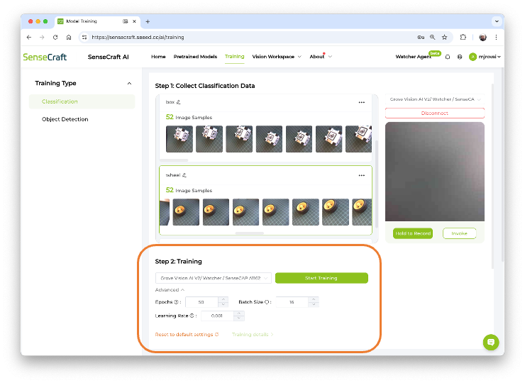

### Тестирование

После обучения можно посмотреть результат инференса.

> Обратите внимание: модель при этом не работает на самом устройстве. Устройство только захватывает изображения, а предпросмотр выполняет обучаемая модель, которая запущена в Studio.

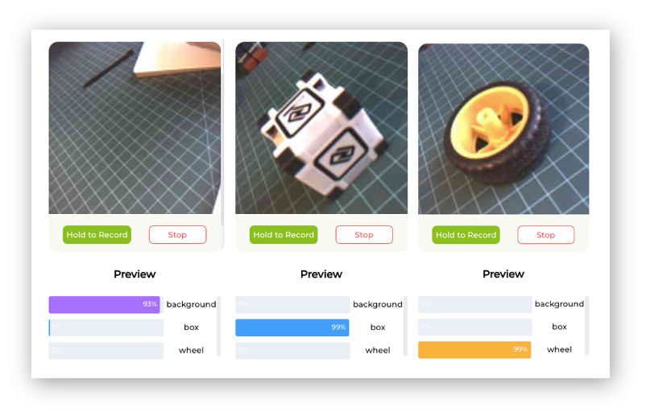

Теперь пора по-настоящему развернуть модель на устройстве.

### Развёртывание

Выберите обученную модель и нажмите `[Deploy to device]`, затем выберите Grove Vision AI V2:

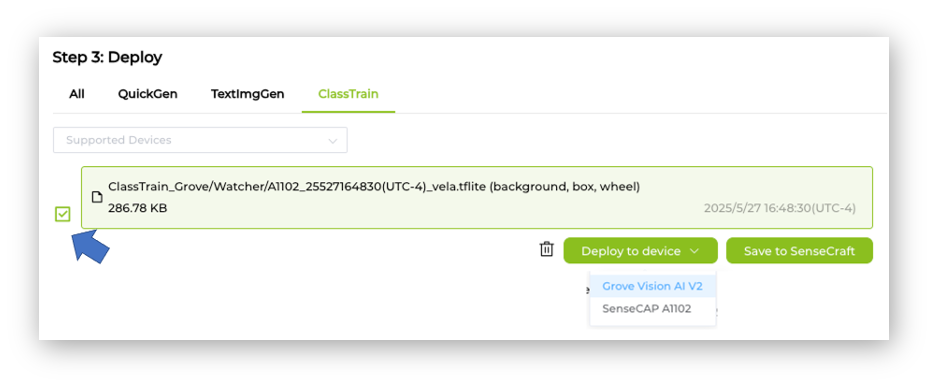

Studio перенаправит нас на вкладку `Vision Workplace`. Подтвердите развёртывание, выберите подходящий порт и подключитесь к нему:

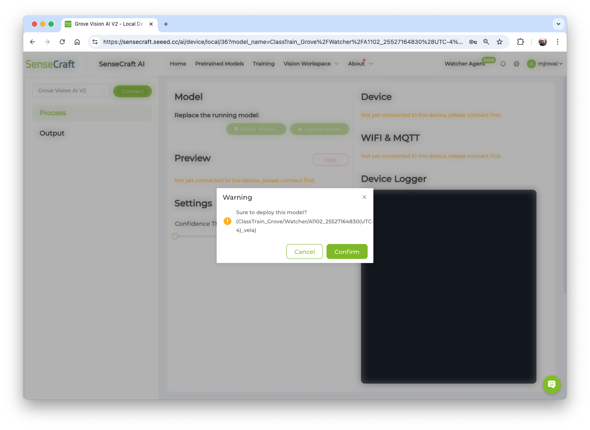

Модель будет записана («прошита») в устройство. После автоматической перезагрузки модель начнёт работать на устройстве. В журнале устройства (Device Logger) видно, что задержка инференса составляет **около 8 мс**, что соответствует **частоте кадров 125 кадров в секунду (FPS)**.

Также можно настроить уверенность модели (confidence).

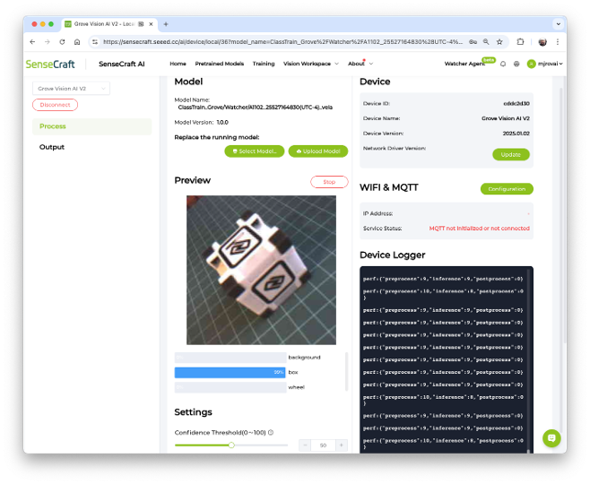

> Для работы модели классификации изображений Grove Vision AI V2 потреблял пиковый ток 80 мА при 5,24 В, что соответствует **энергопотреблению 420 мВт**.

### Сохранение модели

Модель можно сохранить в SenseCraft AI Studio. Studio хранит все наши модели, и их можно развернуть позже. Для этого вернитесь на вкладку `Training` и нажмите кнопку `[Save to SenseCraft]`:

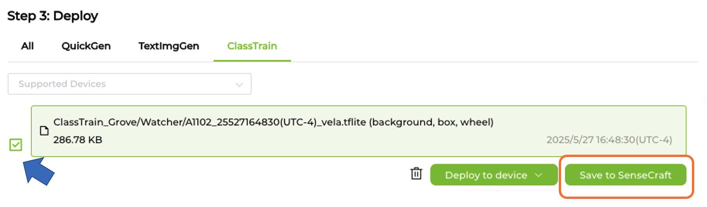

## Итоги

В этой лабораторной работе мы исследовали несколько приложений компьютерного зрения (CV) с помощью [модуля Seeed Studio Grove Vision AI Module V2](https://wiki.seeedstudio.com/grove_vision_ai_v2/). Модуль показал себя как мощное, но компактное устройство, созданное специально для приложений встраиваемого машинного обучения.

**Производительность.** Grove Vision AI V2 показал отличные результаты в нескольких задачах компьютерного зрения. Благодаря чипу **Himax WiseEye2** с **двухъядерным Arm Cortex-M55 и встроенным блоком нейронных сетей Arm Ethos-U55** устройство обеспечило:

- **Классификация изображений:** время инференса **15 мс** (67 FPS);
- **Обнаружение объектов (человек):** время инференса **от 48 до 76 мс** (от 21 до 13 FPS);
- **Детекция позы:** **121 мс** на обнаружение ключевых точек в реальном времени с отслеживанием 17 суставов (8 FPS).

**Лидерство в энергоэффективности.** Одно из самых убедительных преимуществ Grove Vision AI V2 — высокая энергоэффективность. Сравнительные тесты показали заметное превосходство над традиционными встраиваемыми платформами:

- **Grove Vision AI V2:** пиковое потребление 80 мА (**410 мВт**) при более чем 60 FPS;
- **XIAO ESP32S3:** при похожей задаче классификации изображений — **523 мВт** при более чем 3 FPS.

**Практическая реализация.** Возможности устройства продемонстрированы в полном сквозном проекте: создание набора данных, обучение модели, развёртывание и автономный инференс.

**Удобная экосистема для разработчиков.** SenseCraft AI Studio с возможностями развёртывания без кода и интеграции в пользовательские приложения делает Grove Vision AI V2 доступным как новичкам, так и опытным разработчикам. Обширная библиотека предобученных моделей и поддержка собственных моделей обеспечивают гибкость для разных приложений.

Grove Vision AI V2 — заметный шаг вперёд в аппаратном обеспечении периферийного ИИ: он предлагает профессиональные возможности компьютерного зрения в компактном энергоэффективном корпусе, который делает развёртывание ИИ во встраиваемых приложениях доступным в промышленности, IoT и образовании.

**Главные выводы**

Эта лабораторная работа показывает, что сложные приложения компьютерного зрения не ограничены облачными решениями или энергоёмким оборудованием, таким как Raspberry Pi или Jetson Nano: сегодня их можно эффективно развернуть на периферии с впечатляющими эффективностью и производительностью.

При желании можно использовать [XIAO Vision AI Camera](https://www.seeedstudio.com/XIAO-Vision-AI-Camera-p-6450.html). Это решение объединяет модуль Grove Vision AI V2, контроллер XIAO ESP32-C3 и камеру OV5647 в корпусе, напечатанном на 3D-принтере:

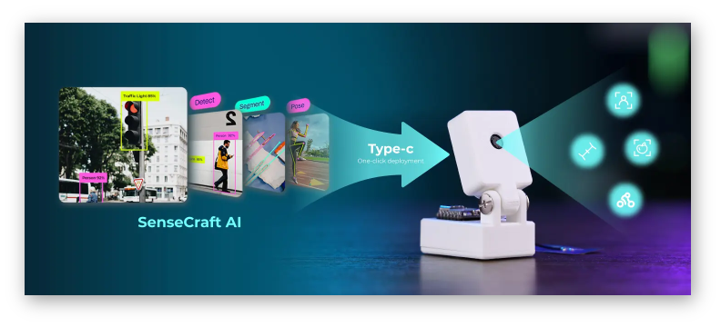

## Ресурсы

- [Инструкции SenseCraft AI Studio](https://wiki.seeedstudio.com/sensecraft_ai_pretrained_models_for_grove_visionai_v2/)
- [Сайт SenseCraft-Web-Toolkit](https://seeed-studio.github.io/SenseCraft-Web-Toolkit/#/setup/process)
- [SenseCraft AI Studio](https://sensecraft.seeed.cc/ai/model)
- [Himax AI Web Toolkit](https://github.com/HimaxWiseEyePlus/Seeed_Grove_Vision_AI_Module_V2/releases/download/v1.1/Himax_AI_web_toolkit.zip)
- [Примеры Himax](https://github.com/Seeed-Studio/wiki-documents/blob/docusaurus-version/docs/Sensor/Grove/Grove_Sensors/AI-powered/Grove-vision-ai-v2/Development/grove-vision-ai-v2-himax-sdk.md)
