# Классификация изображений

<p align="center">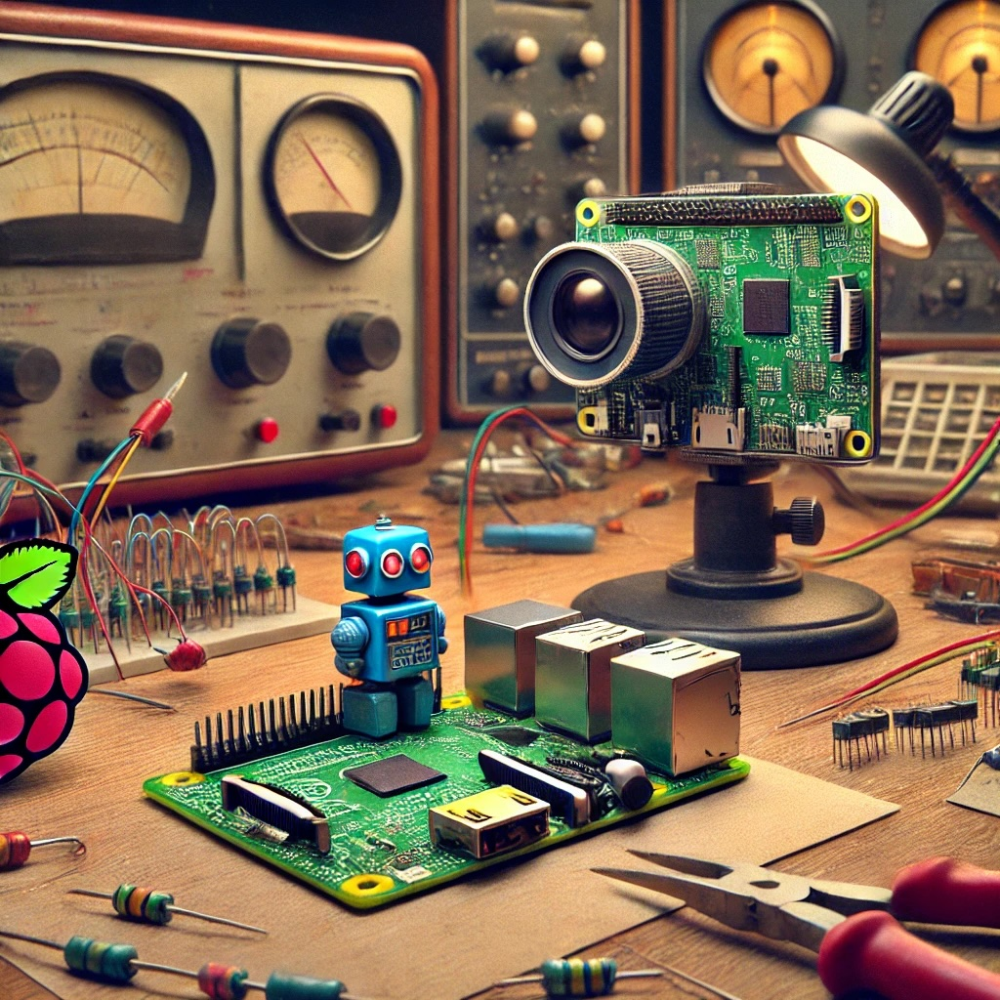<br>
<em>Промпт DALL·E: обложка для главы «Классификация изображений» руководства по Raspberry Pi, выполненная в том же винтажном стиле лаборатории электроники 1950-х, что и предыдущие обложки. На сцене — Raspberry Pi, подключённая к модулю камеры, которая снимает фотографию маленького синего робота, предоставленного пользователем. Робот стоит на верстаке, вокруг — классические лабораторные инструменты: паяльники, резисторы и провода. На фоне — старинное оборудование: осциллографы и ламповые радиоприёмники, сохраняющие детальное и ностальгическое ощущение эпохи. Логотипов и текста быть не должно.</em></p>

## Обзор

Классификация изображений — фундаментальная задача компьютерного зрения, которая заключается в отнесении изображения к одному из нескольких заранее заданных классов. Это краеугольный камень искусственного интеллекта: она позволяет машинам интерпретировать и понимать визуальную информацию так, как это делает человеческое восприятие.

Классификация изображений — это присвоение метки или категории всему изображению на основе его визуального содержания. Эта задача важна в компьютерном зрении и имеет множество применений в самых разных отраслях. Её ценность в том, что она автоматизирует задачи визуального понимания, которые иначе потребовали бы участия человека.

### Применение в реальных сценариях

Классификация изображений нашла применение во многих реальных областях и меняет целые сектора:

- **Здравоохранение:** помощь в анализе медицинских изображений, например в выявлении отклонений на рентгеновских снимках или МРТ.
- **Сельское хозяйство:** контроль состояния посевов и выявление болезней растений по снимкам с воздуха.
- **Автомобилестроение:** системы помощи водителю и беспилотные автомобили распознают дорожные знаки, пешеходов и другие автомобили.
- **Розничная торговля:** визуальный поиск товаров и автоматизированное управление складскими запасами.
- **Безопасность и наблюдение:** повышение эффективности обнаружения угроз и систем распознавания лиц.
- **Мониторинг окружающей среды:** анализ спутниковых снимков для изучения вырубки лесов, городского планирования и исследований изменения климата.

### Преимущества классификации на периферийных устройствах, таких как Raspberry Pi

Реализация классификации изображений на периферийных устройствах, таких как Raspberry Pi, даёт несколько весомых преимуществ:

1. **Низкая задержка.** Локальная обработка изображений исключает передачу данных на облачные серверы и существенно сокращает время отклика.

2. **Работа без сети.** Классификация выполняется без подключения к интернету, что удобно в удалённых местах или там, где связь ненадёжна.

3. **Приватность и безопасность.** Чувствительные данные изображений остаются на локальном устройстве, что решает задачи защиты персональных данных и требования соответствия нормативам.

4. **Экономичность.** Не нужны дорогие облачные вычислительные ресурсы, особенно для непрерывной или большой по объёму классификации.

5. **Масштабируемость.** Возможны распределённые архитектуры, в которых несколько устройств работают независимо или в составе сети.

6. **Энергоэффективность.** Оптимизированные модели на специализированном оборудовании могут быть энергоэффективнее облачных решений, что важно для устройств с батарейным питанием и удалённых применений.

7. **Настраиваемость.** Развёртывать специализированные или часто обновляемые модели, подогнанные под конкретные задачи, проще.

Используя возможности периферийных устройств, таких как Raspberry Pi, для классификации изображений, мы можем создавать более отзывчивые, безопасные и эффективные решения компьютерного зрения. Такой подход открывает новые возможности для встраивания интеллектуальной визуальной обработки в самые разные приложения и среды.

В следующих разделах мы разберём, как реализовать и оптимизировать классификацию изображений на Raspberry Pi, используя эти преимущества для создания мощных и эффективных систем компьютерного зрения.

## Настройка окружения

### Обновление Raspberry Pi

Сначала убедитесь, что Raspberry Pi обновлён:

```bash
sudo apt update
sudo apt upgrade -y
```

### Установка необходимых библиотек

Установите библиотеки, необходимые для обработки изображений и машинного обучения:

```bash
sudo apt install python3-pip
sudo rm /usr/lib/python3.11/EXTERNALLY-MANAGED
pip3 install --upgrade pip
```

### Настройка виртуального окружения (необязательно, но рекомендуется)

Создайте виртуальное окружение для управления зависимостями:

```bash
python3 -m venv ~/tflite
source ~/tflite/bin/activate
```

### Установка TensorFlow Lite

Нас интересует **инференс** — выполнение модели TensorFlow Lite на устройстве для получения предсказаний по входным данным. Чтобы выполнить инференс с моделью TensorFlow Lite, её нужно запустить через **интерпретатор**. Интерпретатор TensorFlow Lite спроектирован лёгким и быстрым. Он использует статический порядок вычислений графа и собственный (менее динамичный) распределитель памяти, чтобы минимизировать задержки загрузки, инициализации и выполнения.

Мы будем использовать [среду выполнения TensorFlow Lite](https://pypi.org/project/tflite-runtime/) для Raspberry Pi — упрощённую библиотеку для запуска моделей машинного обучения на мобильных и встраиваемых устройствах без установки всех пакетов TensorFlow.

```bash
pip install tflite_runtime --no-deps
```

> Установлено колесо (wheel): `tflite_runtime-2.14.0-cp311-cp311-manylinux_2_34_aarch64.whl`

### Установка дополнительных библиотек Python

Установите библиотеки Python, необходимые для классификации изображений:

Если у вас установлена другая версия NumPy, сначала удалите её.

```bash
pip3 uninstall numpy
```

Установите `версию 1.23.2`, которая совместима с tflite_runtime.

```bash
 pip3 install numpy==1.23.2
```

```bash
pip3 install Pillow matplotlib
```

### Создание рабочего каталога

Если вы работаете на Raspi-Zero с минимальной ОС (без рабочего стола), у вас может не быть заранее созданной структуры каталогов пользователя (проверить её можно командой `ls`). Поэтому создадим её:

```bash
mkdir Documents
cd Documents/
mkdir TFLITE
cd TFLITE/
mkdir IMG_CLASS
cd IMG_CLASS
mkdir models
cd models
```

> На Raspi-5 каталог /Documents должен уже существовать.

**Получите предобученную модель классификации изображений**:

Подходящая предобученная модель — ключ к успешной классификации изображений на ресурсоограниченных устройствах, таких как Raspberry Pi. **MobileNet** создана для мобильного и встраиваемого зрения и хорошо балансирует точность и скорость. Существуют версии MobileNetV1, MobileNetV2 и MobileNetV3. Загрузим версию V2:

```bash
# Одна длинная строка, разбитая обратным слешем \
wget https://storage.googleapis.com/download.tensorflow.org/\
models/tflite_11_05_08/mobilenet_v2_1.0_224_quant.tgz

tar xzf mobilenet_v2_1.0_224_quant.tgz
```

Получите также её [метки классов](https://github.com/Mjrovai/EdgeML-with-Raspberry-Pi/blob/main/IMG_CLASS/models/labels.txt):

```bash
wget https://raw.githubusercontent.com/Mjrovai/EdgeML-with-Raspberry-Pi/refs/heads/\
main/IMG_CLASS/models/labels.txt
```

В итоге в каталоге с моделями должны появиться файлы:

<p align="center">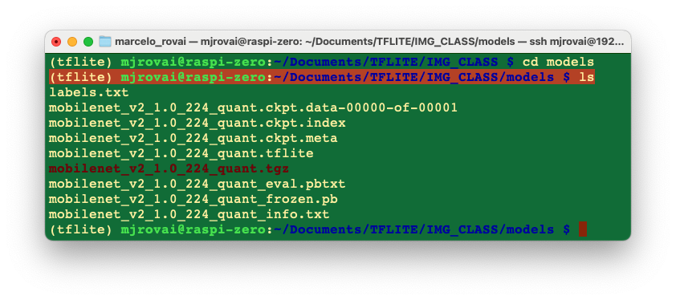</p>

> Нам понадобятся только файл `mobilenet_v2_1.0_224_quant.tflite` и `labels.txt`. Остальные файлы можно удалить.

### Настройка Jupyter Notebook (необязательно)

Если вы предпочитаете разрабатывать в Jupyter Notebook:

```bash
pip3 install jupyter
jupyter notebook --generate-config
```

Чтобы запустить Jupyter Notebook, выполните команду (замените IP-адрес на свой):

```bash
jupyter notebook --ip=192.168.4.210 --no-browser
```

В терминале появится локальный URL-адрес, по которому можно открыть блокнот:

<p align="center">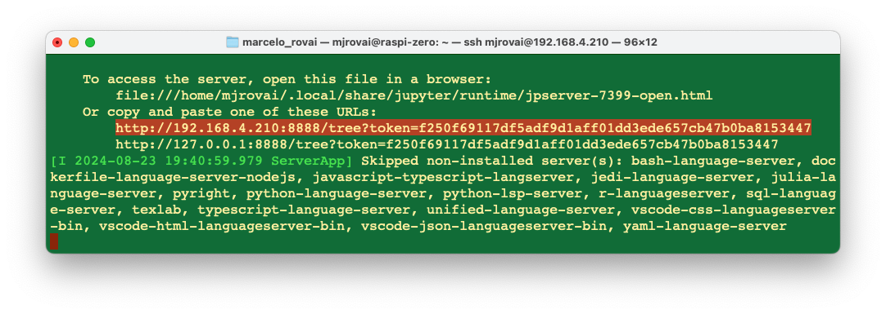</p>

К нему можно обратиться с другого устройства, введя в веб-браузере IP-адрес Raspberry Pi и токен из терминала (токен можно скопировать из терминала).

<p align="center">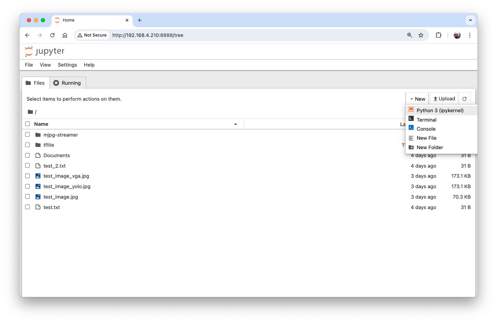</p>

Определите рабочий каталог на Raspi и создайте новый блокнот Python 3.

### Проверка установки

Проверьте установку, запустив простой скрипт Python:

```python
import tflite_runtime.interpreter as tflite
import numpy as np
from PIL import Image

print("NumPy:", np.__version__)
print("Pillow:", Image.__version__)

# Пробуем создать интерпретатор TFLite
model_path = "./models/mobilenet_v2_1.0_224_quant.tflite"
interpreter = tflite.Interpreter(model_path=model_path)
interpreter.allocate_tensors()
print("TFLite Interpreter created successfully!")
```

Скрипт можно создать в nano прямо в терминале и сохранить комбинацией `CTRL+O`, `ENTER`, затем `CTRL+X`:

<p align="center">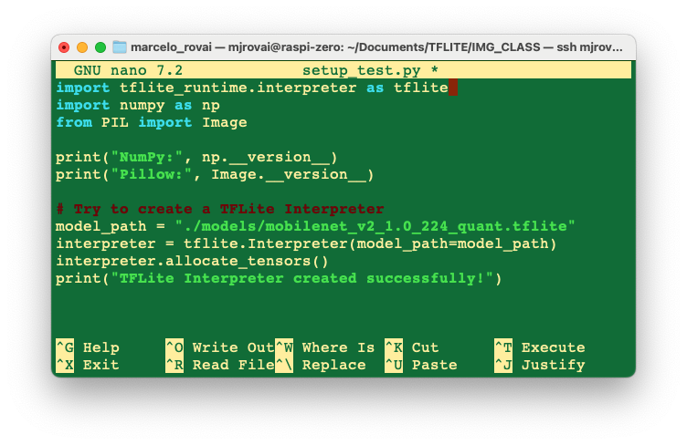</p>

И запустить командой:

<p align="center">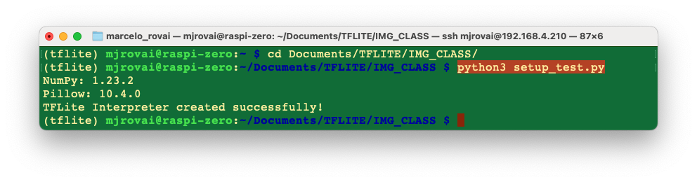</p>

Или запустите его прямо в [блокноте](https://github.com/Mjrovai/EdgeML-with-Raspberry-Pi/blob/main/IMG_CLASS/notebooks/setup_test.ipynb):

<p align="center">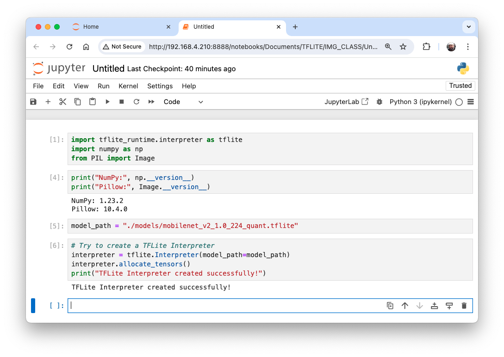</p>

## Инференс с MobileNet V2

В предыдущем разделе мы настроили окружение, в том числе загрузили популярную предобученную модель MobileNet V2. Она обучена на изображениях ImageNet размером $224\times 224$ (1,2 миллиона) для 1 001 класса (1 000 категорий объектов и 1 фоновый класс). Модель преобразована в компактный формат TensorFlow Lite размером 3,5 МБ, что делает её подходящей для ограниченных объёма памяти и накопителя Raspberry Pi.

<p align="center">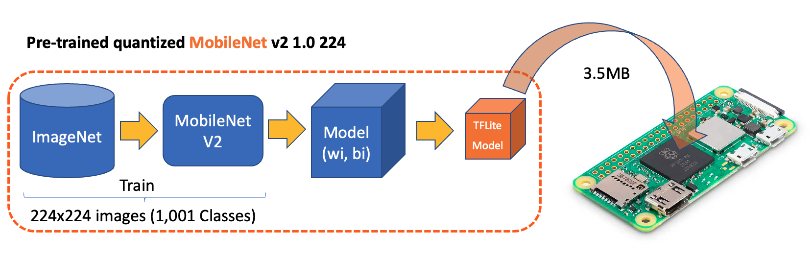</p>

Начнём новый [блокнот](https://github.com/Mjrovai/EdgeML-with-Raspberry-Pi/blob/main/IMG_CLASS/notebooks/10_Image_Classification.ipynb), чтобы пройти все шаги классификации одного изображения.

Импортируйте нужные библиотеки:

```python
import time
import numpy as np
import matplotlib.pyplot as plt
from PIL import Image
import tflite_runtime.interpreter as tflite
```

Загрузите модель TFLite и выделите тензоры:

```python
model_path = "./models/mobilenet_v2_1.0_224_quant.tflite"
interpreter = tflite.Interpreter(model_path=model_path)
interpreter.allocate_tensors()
```

Получите входные и выходные тензоры.

```python
input_details = interpreter.get_input_details()
output_details = interpreter.get_output_details()
```

**Входные данные** (input details) сообщают, как модели нужно подавать изображение. Форма (1, 224, 224, 3) означает, что изображение размером $(224\times 224\times 3)$ подаётся по одному (размерность батча: 1).

<p align="center">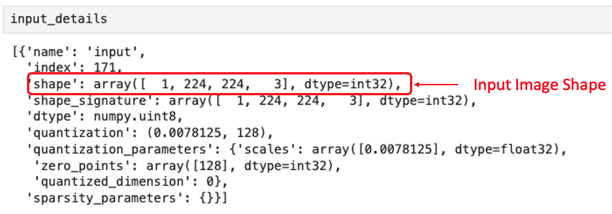</p>

**Выходные данные** (output details) показывают, что инференс даст массив из 1 001 целого значения. Каждое значение — вероятность того, что соответствующая метка относится к изображению.

<p align="center">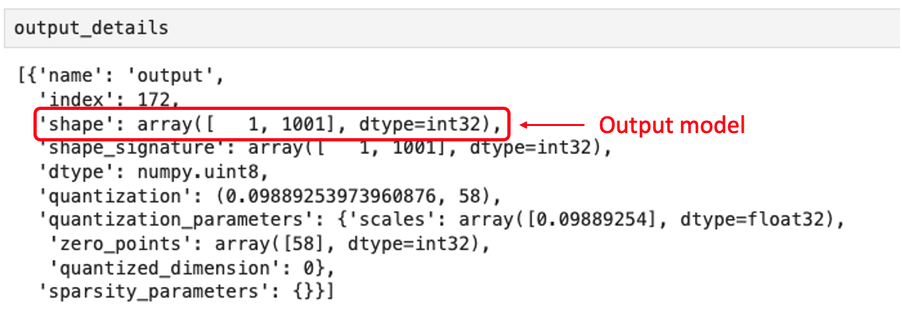</p>

Проверим тип данных (dtype) входных данных модели:

```python
input_dtype = input_details[0]["dtype"]
input_dtype
```

```
dtype('uint8')
```

Это означает, что на вход должны подаваться сырые пиксели (0–255).

Получим тестовое изображение. Его можно перенести с вашего компьютера или скачать для проверки. Сначала создадим папку в рабочем каталоге:

```bash
mkdir images
cd images
wget https://upload.wikimedia.org/wikipedia/commons/3/3a/Cat03.jpg
```

Загрузим и выведем изображение:

```python
# Загружаем изображение
img_path = "./images/Cat03.jpg"
img = Image.open(img_path)

# Выводим изображение
plt.figure(figsize=(8, 8))
plt.imshow(img)
plt.title("Original Image")
plt.show()
```

<p align="center">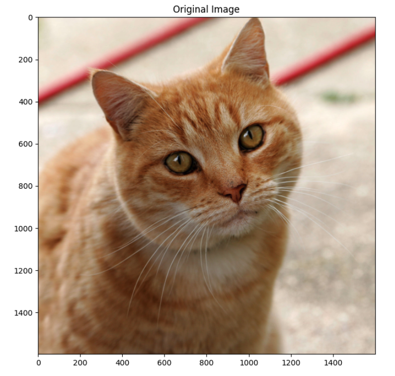</p>

Размер изображения можно узнать командой:

```python
width, height = img.size
```

Видно, что это RGB-изображение шириной 1600 и высотой 1600 пикселей. Чтобы использовать модель, его нужно привести к размеру (224, 224, 3) и добавить размерность батча 1, как указано во входных данных: (1, 224, 224, 3). Результатом инференса, как показано в выходных данных, будет массив размером 1001, как видно ниже:

<p align="center">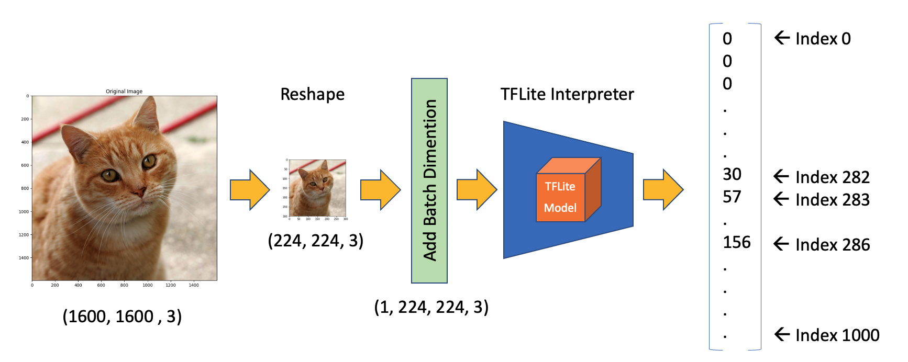</p>

Изменим размер изображения, добавим размерность батча и посмотрим результат:

```python
img = img.resize(
    (input_details[0]["shape"][1], input_details[0]["shape"][2])
)
input_data = np.expand_dims(img, axis=0)
input_data.shape
```

Форма `input_data` соответствует ожидаемой: (1, 224, 224, 3).

Проверим тип данных входного массива:

```python
input_data.dtype
```

```
dtype('uint8')
```

Тип данных `uint8` совпадает с типом, который ожидает модель.

Используем `input_data`, запустим интерпретатор и получим предсказания (выход):

```python
interpreter.set_tensor(input_details[0]["index"], input_data)
interpreter.invoke()
predictions = interpreter.get_tensor(output_details[0]["index"])[0]
```

Предсказание — это массив из 1001 элемента. Получим Top-5 индексов с наибольшими значениями:

```python
top_k_results = 5
top_k_indices = np.argsort(predictions)[::-1][:top_k_results]
top_k_indices
```

`top_k_indices` — массив из 5 элементов: `array([283, 286, 282])`

Итак, 283, 286, 282, 288 и 479 — наиболее вероятные классы изображения. Зная индекс, нужно понять, какому классу он соответствует (например, автомобиль, кошка или собака). Текстовый файл, загруженный вместе с моделью, содержит метку для каждого индекса от 0 до 1000. Используем функцию, чтобы загрузить `.txt`-файл как список:

```python
def load_labels(filename):
    with open(filename, "r") as f:
        return [line.strip() for line in f.readlines()]
```

Получим список и выведем метки, соответствующие индексам:

```python
labels_path = "./models/labels.txt"
labels = load_labels(labels_path)

print(labels[286])
print(labels[283])
print(labels[282])
print(labels[288])
print(labels[479])
```

В результате получаем:

```bash
Egyptian cat
tiger cat
tabby
lynx
carton
```

Как минимум четыре верхних индекса относятся к кошачьим. **Предсказание** — это вероятность, связанная с каждой из меток. Как мы видели в выходных данных, эти значения квантованы, поэтому их нужно деквантовать и применить softmax:
```python
scale, zero_point = output_details[0]["quantization"]
dequantized_output = (
    predictions.astype(np.float32) - zero_point
) * scale
exp_output = np.exp(dequantized_output - np.max(dequantized_output))
probabilities = exp_output / np.sum(exp_output)
```

Выведем вероятности для топ-5:

```python
print(probabilities[286])
print(probabilities[283])
print(probabilities[282])
print(probabilities[288])
print(probabilities[479])
```

```bash
0.27741462
0.3732285
0.16919471
0.10319158
0.023410844
```

Для наглядности создадим функцию, которая сопоставляет метки с вероятностями:

```python
for i in range(top_k_results):
    print(
        "\t{:20}: {}%".format(
            labels[top_k_indices[i]],
            (int(probabilities[top_k_indices[i]] * 100)),
        )
    )
```

```bash
tiger cat           : 37%
Egyptian cat        : 27%
tabby               : 16%
lynx                : 10%
carton              : 2%
```

### Определение общей функции классификации изображений

Создадим общую функцию: на вход подаётся изображение, на выходе получаем Top-5 возможных классов:

```python
def image_classification(
    img_path, model_path, labels, top_k_results=5
):
    # Загружаем изображение
    img = Image.open(img_path)
    plt.figure(figsize=(4, 4))
    plt.imshow(img)
    plt.axis("off")

    # Загружаем модель TFLite
    interpreter = tflite.Interpreter(model_path=model_path)
    interpreter.allocate_tensors()

    # Получаем входные и выходные тензоры
    input_details = interpreter.get_input_details()
    output_details = interpreter.get_output_details()

    # Предобработка
    img = img.resize(
        (input_details[0]["shape"][1], input_details[0]["shape"][2])
    )
    input_data = np.expand_dims(img, axis=0)

    # Инференс на Raspi-Zero
    interpreter.set_tensor(input_details[0]["index"], input_data)
    interpreter.invoke()

    # Получаем результаты и сопоставляем их с классами
    predictions = interpreter.get_tensor(output_details[0]["index"])[
        0
    ]

    # Получаем индексы top-k результатов
    top_k_indices = np.argsort(predictions)[::-1][:top_k_results]

    # Получаем параметры квантования
    scale, zero_point = output_details[0]["quantization"]

    # Деквантуем выход и применяем softmax
    dequantized_output = (
        predictions.astype(np.float32) - zero_point
    ) * scale
    exp_output = np.exp(
        dequantized_output - np.max(dequantized_output)
    )
    probabilities = exp_output / np.sum(exp_output)

    print("\n\t[PREDICTION]        [Prob]\n")
    for i in range(top_k_results):
        print(
            "\t{:20}: {}%".format(
                labels[top_k_indices[i]],
                (int(probabilities[top_k_indices[i]] * 100)),
            )
        )
```

Загрузив несколько изображений для проверки, получим:

<p align="center">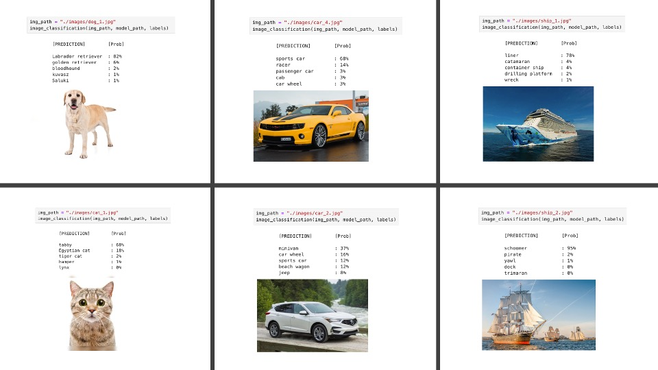</p>

### Тестирование модели, обученной с нуля

Получим модель TFLite, обученную с нуля. Для этого следуйте блокноту:

[CNN для классификации набора данных Cifar-10](https://colab.research.google.com/github/Mjrovai/UNIFEI-IESTI01-TinyML-2022.1/blob/main/00_Curse_Folder/2_Applications_Deploy/Class_16/cifar_10/CNN_Cifar_10_TFLite.ipynb#scrollTo=iiVBUpuHXEtw)

В блокноте мы обучили модель на наборе данных CIFAR-10, который содержит 60 000 изображений 10 классов CIFAR (*самолёт, автомобиль, птица, кошка, олень, собака, лягушка, лошадь, корабль и грузовик*). Изображения CIFAR — цветные, размером $32\times 32$ (3 цветовых канала). Объекты на них не центрированы и могут находиться на фоне: например, самолёты могут быть на фоне облачного неба! Короче говоря, это маленькие, но настоящие изображения.

Обученная CNN-модель (*cifar10_model.keras*) занимала 2,0 МБ. С помощью *TFLite Converter* модель *cifar10.tflite* уменьшилась до 674 КБ (около трети исходного размера).

<p align="center">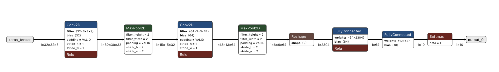</p>

В блокноте [Cifar 10 — классификация изображений на Raspi с TFLite](https://github.com/Mjrovai/EdgeML-with-Raspberry-Pi/blob/main/IMG_CLASS/notebooks/20_Cifar_10_Image_Classification.ipynb), который можно запустить на Raspi, мы повторим те же шаги, что и с `mobilenet_v2_1.0_224_quant.tflite`. Ниже приведены примеры классификации изображений с помощью *общей функции классификации* на Raspi-Zero, как в предыдущем разделе.

<p align="center">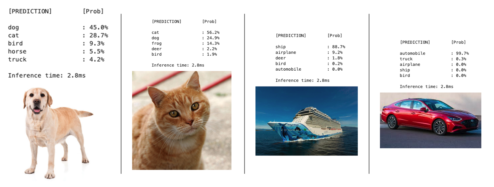</p>

### Установка Picamera2

[Picamera2](https://github.com/raspberrypi/picamera2) — библиотека Python для работы с камерой Raspberry Pi. Она основана на стеке камер *libcamera* и поддерживается фондом Raspberry Pi. Picamera2 работает на всех моделях Raspberry Pi — от Pi Zero до RPi 5. На Raspi она уже установлена в системе, но её нужно сделать доступной внутри виртуального окружения.

1. Сначала активируйте виртуальное окружение, если оно ещё не активировано:

    ```bash
    source ~/tflite/bin/activate
    ```

2. Теперь создайте файл `.pth` в виртуальном окружении, чтобы добавить путь к системным site-packages:

    ```bash
    echo "/usr/lib/python3/dist-packages" > \
      $VIRTUAL_ENV/lib/python3.11/site-packages/system_site_packages.pth
    ```

    > Примечание: если у вас другая версия Python, замените `python3.11` на нужную версию.

3. После создания файла попробуйте импортировать picamera2 в Python:

    ```bash
    python3
    >>> import picamera2
    >>> print(picamera2.__file__)
    ```

Этот код покажет путь к файлу самого модуля `picamera2`, что подтверждает доступность библиотеки из окружения.

```python
/home/mjrovai/tflite/lib/python3.11/site-packages/\
picamera2/__init__.py
```

Также можно вывести список доступных в системе камер:

```python
>>> print(Picamera2.global_camera_info())
```

В моём случае, с подключённой USB-камерой, получилось:

<p align="center">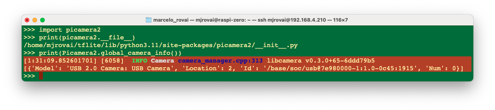</p>

Теперь, когда мы убедились, что picamera2 работает в окружении с `index 0`, попробуем простой скрипт Python, который захватывает изображение с USB-камеры:

```python
from picamera2 import Picamera2
import time

# Инициализируем камеру
picam2 = Picamera2()  # по умолчанию индекс 0

# Настраиваем камеру
config = picam2.create_still_configuration(main={"size": (640, 480)})
picam2.configure(config)

# Запускаем камеру
picam2.start()

# Даём камере прогреться
time.sleep(2)

# Делаем снимок
picam2.capture_file("usb_camera_image.jpg")
print("Image captured and saved as 'usb_camera_image.jpg'")

# Останавливаем камеру
picam2.stop()
```

Используйте редактор Nano, Jupyter Notebook или любой другой редактор. Сохраните код как Python-скрипт (например, `capture_image.py`) и запустите его. Скрипт захватит изображение с камеры и сохранит его как «usb_camera_image.jpg» в том же каталоге, где находится скрипт.

<p align="center">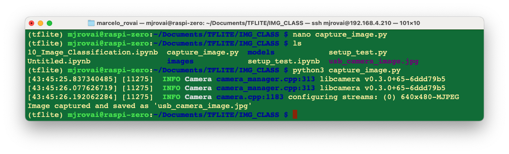</p>

Если Jupyter открыт, захваченное изображение можно увидеть прямо на своём компьютере. Иначе перенесите файл с Raspi на компьютер.

<p align="center">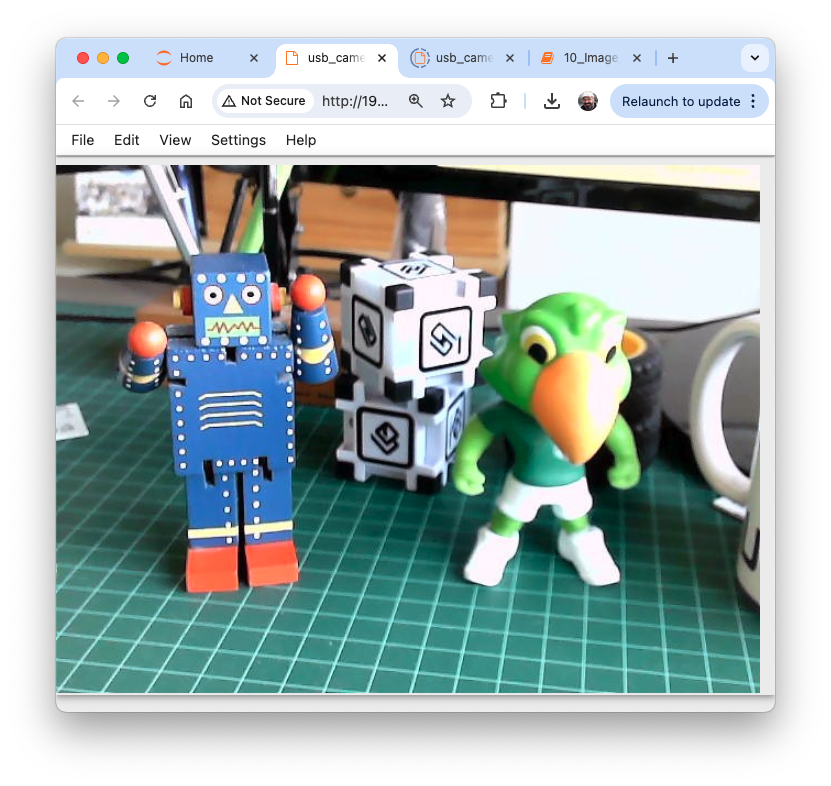</p>
> Если вы работаете с Raspi-5 и у вас полноценный рабочий стол, можно открыть файл прямо на устройстве.

## Проект классификации изображений

Теперь разработаем полноценный проект классификации изображений с использованием Edge Impulse Studio. Как и в случае с MobileNet V2, для инференса будет использоваться обученная и сконвертированная модель TFLite.

### Цель

Первый шаг в любом проекте машинного обучения — определить цель. В данном случае нужно обнаружить и классифицировать два конкретных объекта на одном изображении. Для проекта мы возьмём две небольших игрушки: робота и маленького бразильского попугая (по имени Periquito). Также соберём изображения *фона*, на котором этих двух объектов нет.

<p align="center">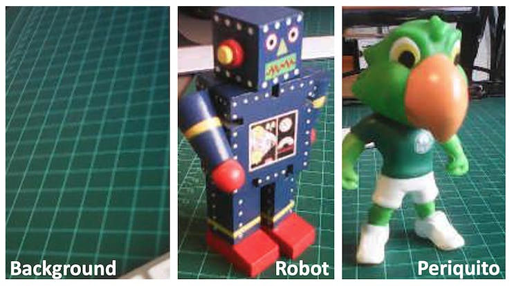</p>

### Сбор данных

Определив цель проекта машинного обучения, мы переходим к следующему, самому важному шагу — сбору набора данных. Снимки можно делать с телефона, но здесь мы будем использовать Raspi. Настроим простой веб-сервер на Raspberry Pi, чтобы просматривать в браузере снимки в формате `QVGA (320 x 240)`.

1. Сначала установите Flask, лёгкий веб-фреймворк для Python:

    ```bash
    pip3 install flask
    ```

2. Создадим новый скрипт Python, который объединяет захват изображений и веб-сервер. Назовём его `get_img_data.py`:

```python
from flask import (Flask, Response, render_template_string,
                   request, redirect, url_for)
from picamera2 import Picamera2
import io
import threading
import time
import os
import signal

app = Flask(__name__)

# Глобальные переменные
base_dir = "dataset"
picam2 = None
frame = None
frame_lock = threading.Lock()
capture_counts = {}
current_label = None
shutdown_event = threading.Event()

def initialize_camera():
    global picam2
    picam2 = Picamera2()
    config = picam2.create_preview_configuration(
             main={"size": (320, 240)}
    )
    picam2.configure(config)
    picam2.start()
    time.sleep(2)  # Ждём, пока камера прогреется

def get_frame():
    global frame
    while not shutdown_event.is_set():
        stream = io.BytesIO()
        picam2.capture_file(stream, format='jpeg')
        with frame_lock:
            frame = stream.getvalue()
        time.sleep(0.1)  # При необходимости измените для плавного предпросмотра

def generate_frames():
    while not shutdown_event.is_set():
        with frame_lock:
            if frame is not None:
                yield (b'--frame\r\n'
                       b'Content-Type: image/jpeg\r\n\r\n' +
                                       frame + b'\r\n')
        time.sleep(0.1)  # При необходимости измените для плавной передачи видео

def shutdown_server():
    shutdown_event.set()
    if picam2:
        picam2.stop()
    # Даём время остальным потокам завершиться
    time.sleep(2)
    # Отправляем SIGINT основному процессу
    os.kill(os.getpid(), signal.SIGINT)

@app.route('/', methods=['GET', 'POST'])
def index():
    global current_label
    if request.method == 'POST':
        current_label = request.form['label']
        if current_label not in capture_counts:
            capture_counts[current_label] = 0
        os.makedirs(os.path.join(base_dir, current_label),
                                 exist_ok=True)
        return redirect(url_for('capture_page'))
    return render_template_string('''
        <!DOCTYPE html>
        <html>
        <head>
            <title>Dataset Capture - Label Entry</title>
        </head>
        <body>
            <h1>Enter Label for Dataset</h1>
            <form method="post">
                <input type="text" name="label" required>
                <input type="submit" value="Start Capture">
            </form>
        </body>
        </html>
    ''')

@app.route('/capture')
def capture_page():
    return render_template_string('''
        <!DOCTYPE html>
        <html>
        <head>
            <title>Dataset Capture</title>
            <script>
                var shutdownInitiated = false;
                function checkShutdown() {
                    if (!shutdownInitiated) {
                        fetch('/check_shutdown')
                            .then(response => response.json())
                            .then(data => {
                                if (data.shutdown) {
                                    shutdownInitiated = true;
                                    document.getElementById(
                                          'video-feed').src = '';
                                    document.getElementById(
                                          'shutdown-message')
                                    .style.display = 'block';
                                }
                            });
                    }
                }
                setInterval(checkShutdown, 1000); // Проверка каждую секунду
            </script>
        </head>
        <body>
            <h1>Dataset Capture</h1>
            <p>Current Label: {{ label }}</p>
            <p>Images captured for this label: {{ capture_count
                                                  }}</p>
            
            <div id="shutdown-message" style="display: none;
                                              color: red;">
                Capture process has been stopped.
                You can close this window.
            </div>
            <form action="/capture_image" method="post">
                <input type="submit" value="Capture Image">
            </form>
            <form action="/stop" method="post">
                <input type="submit" value="Stop Capture"
                style="background-color: #ff6666;">
            </form>
            <form action="/" method="get">
                <input type="submit" value="Change Label"
                style="background-color: #ffff66;">
            </form>
        </body>
        </html>
    ''', label=current_label, capture_count=capture_counts.get(
                                            current_label, 0))

@app.route('/video_feed')
def video_feed():
    return Response(generate_frames(),
                    mimetype='multipart/x-mixed-replace; boundary=frame')

@app.route('/capture_image', methods=['POST'])
def capture_image():
    global capture_counts
    if current_label and not shutdown_event.is_set():
        capture_counts[current_label] += 1
        timestamp = time.strftime("%Y%m%d-%H%M%S")
        filename = f"image_{timestamp}.jpg"
        full_path = os.path.join(base_dir, current_label,
                                 filename)

        picam2.capture_file(full_path)

    return redirect(url_for('capture_page'))

@app.route('/stop', methods=['POST'])
def stop():
    summary = render_template_string('''
        <!DOCTYPE html>
        <html>
        <head>
            <title>Dataset Capture - Stopped</title>
        </head>
        <body>
            <h1>Dataset Capture Stopped</h1>
            <p>The capture process has been stopped.
               You can close this window.</p>
            <p>Summary of captures:</p>
            <ul>
            
                <li>{{ label }}: {{ count }} images</li>
            
            </ul>
        </body>
        </html>
    ''', capture_counts=capture_counts)

    # Запускаем новый поток для остановки сервера
    threading.Thread(target=shutdown_server).start()

    return summary

@app.route('/check_shutdown')
def check_shutdown():
    return {'shutdown': shutdown_event.is_set()}

if __name__ == '__main__':
    initialize_camera()
    threading.Thread(target=get_frame, daemon=True).start()
    app.run(host='0.0.0.0', port=5000, threaded=True)
```

3. Запустите скрипт:

```bash
python3 get_img_data.py
```

4. Откройте веб-интерфейс:

    - На самой Raspberry Pi (если есть графический интерфейс): откройте веб-браузер и перейдите по адресу `http://localhost:5000`.
    - С другого устройства в той же сети: откройте веб-браузер и перейдите по адресу `http://<raspberry_pi_ip>:5000` (замените `<raspberry_pi_ip>` на IP-адрес вашей Raspberry Pi). Например: `http://192.168.4.210:5000/`

Этот скрипт Python создаёт веб-интерфейс для захвата и организации наборов изображений с помощью Raspberry Pi и её камеры. Он удобен для проектов машинного обучения, которым нужны размеченные изображения.

#### Основные возможности

1. **Веб-интерфейс:** доступ с любого устройства в той же сети, что и Raspberry Pi.
2. **Живой предпросмотр с камеры:** показывает видео с камеры в реальном времени.
3. **Система меток:** позволяет вводить метки для разных категорий изображений.
4. **Организованное хранение:** автоматически сохраняет изображения в подкаталогах по меткам.
5. **Счётчики по меткам:** ведут учёт количества снимков для каждой метки.
6. **Итоговая статистика:** выводит сводку по снимкам при остановке захвата.

#### Основные компоненты

1. **Веб-приложение Flask:** обрабатывает маршруты и отдаёт веб-интерфейс.
2. **Интеграция с Picamera2:** управляет камерой Raspberry Pi.
3. **Потоковый захват кадров:** обеспечивает плавный предпросмотр.
4. **Управление файлами:** раскладывает снимки по каталогам с метками.

#### Ключевые функции

- `initialize_camera()`: настраивает экземпляр Picamera2.
- `get_frame()`: непрерывно захватывает кадры для предпросмотра.
- `generate_frames()`: отдаёт кадры для живой видеотрансляции.
- `shutdown_server()`: устанавливает событие остановки, останавливает камеру и выключает сервер Flask.
- `index()`: обрабатывает страницу ввода метки.
- `capture_page()`: выводит основной интерфейс захвата.
- `video_feed()`: показывает живой предпросмотр для наведения камеры.
- `capture_image()`: сохраняет изображение с текущей меткой.
- `stop()`: останавливает процесс захвата и выводит сводку.

#### Порядок работы

1. Запустите скрипт на Raspberry Pi.
2. Откройте веб-интерфейс в браузере.
3. Введите метку для изображений, которые хотите снять, и нажмите `Start Capture`.

<p align="center">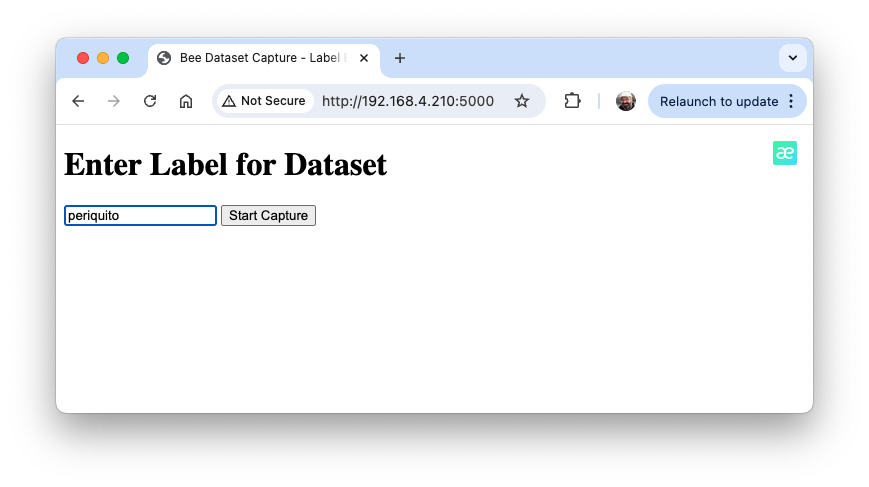</p>

4. Используйте живой предпросмотр, чтобы навести камеру.
5. Нажмите `Capture Image`, чтобы сохранить изображения под текущей меткой.

<p align="center">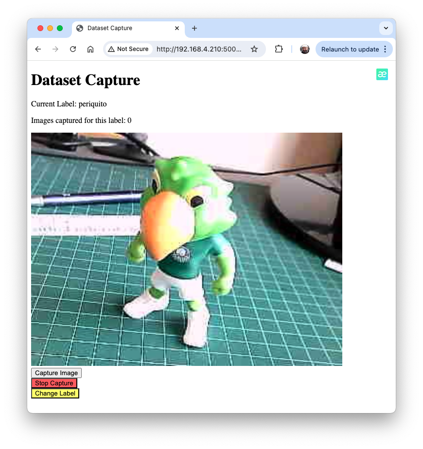</p>

6. При необходимости меняйте метки для разных категорий, выбирая `Change Label`.
7. Нажмите `Stop Capture`, когда закончите, чтобы увидеть сводку.

<p align="center">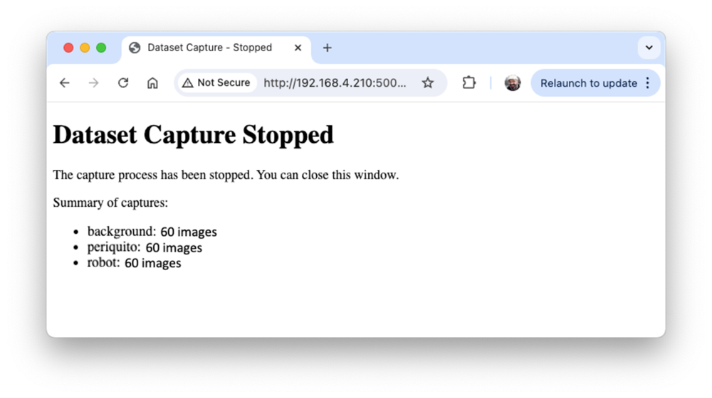</p>

#### Технические заметки

- Скрипт использует потоки (threading), чтобы одновременно захватывать кадры и обслуживать веб-страницы.
- Имена файлов содержат временную метку, чтобы каждое имя было уникальным.
- Веб-интерфейс адаптивен и доступен с мобильных устройств.

#### Возможности настройки

- Измените разрешение изображения в функции `initialize_camera()`. Здесь мы использовали QVGA $(320\times 240)$.
- Измените HTML-шаблоны, чтобы поменять внешний вид.
- Добавьте дополнительные шаги обработки или анализа изображений в функции `capture_image()`.

#### Количество образцов в наборе данных

Снимите около 60 изображений для каждой категории (`periquito`, `robot` и `background`). Старайтесь снимать с разных ракурсов, на разных фонах и при разном освещении. На Raspi в итоге появится папка `dataset`, которая содержит 3 подпапки: *periquito*, *robot* и *background* — по одной для каждого класса изображений.

Для переноса созданного набора данных на основной компьютер можно использовать `Filezilla`.

## Обучение модели в Edge Impulse Studio

Для обучения модели мы будем использовать Edge Impulse Studio. Перейдите на [страницу Edge Impulse](https://edgeimpulse.com/), войдите в свой аккаунт и создайте новый проект:

<p align="center">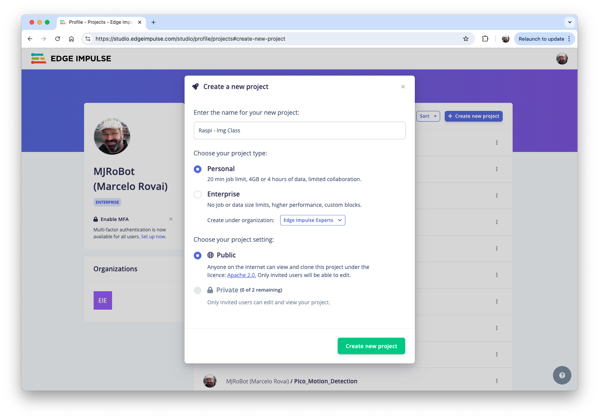</p>

> Здесь можно клонировать похожий проект: [Raspi - Img Class](https://studio.edgeimpulse.com/public/510251/live).

### Набор данных

В Studio (EI Studio) мы пройдём четыре основных шага: Dataset (набор данных), Impulse, Tests (тесты) и Deploy (развёртывание на периферийном устройстве, в нашем случае на Raspi). Эти шаги помогают подготовить модель к работе на Raspi.

> Важно понимать, что исходный набор данных, снятый с помощью Raspi, будет разделён на *обучающую*, *валидационную* и *тестовую* выборки. Тестовая выборка отделяется с самого начала и используется только на этапе тестирования после обучения. Валидационная выборка используется во время обучения.

В Studio загрузите снятые данные, выполнив шаги:

1. Откройте вкладку `Data acquisition` и в разделе `UPLOAD DATA` загрузите файлы с компьютера в выбранные категории.
2. Оставьте разбиение исходного набора данных на *обучающую и тестовую* выборки за Studio и выберите метку (label) для каждой категории.
3. Повторите процедуру для всех трёх классов. В итоге в Studio должны появиться ваши «сырые данные»:

<p align="center">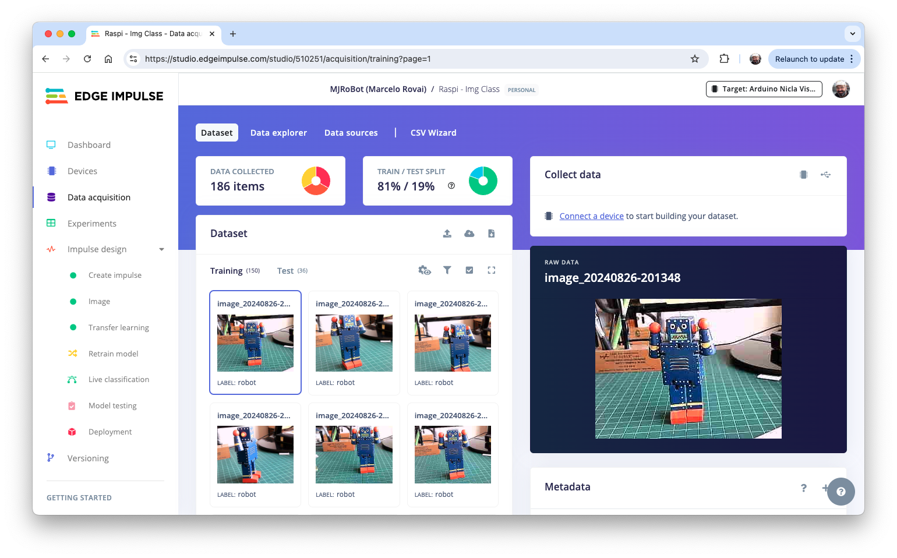</p>

Studio позволяет изучать данные, показывая полную картину всех данных проекта. Можно очищать, проверять и менять метки, нажимая на отдельные элементы данных. В нашем простом проекте данные выглядят корректными.

<p align="center">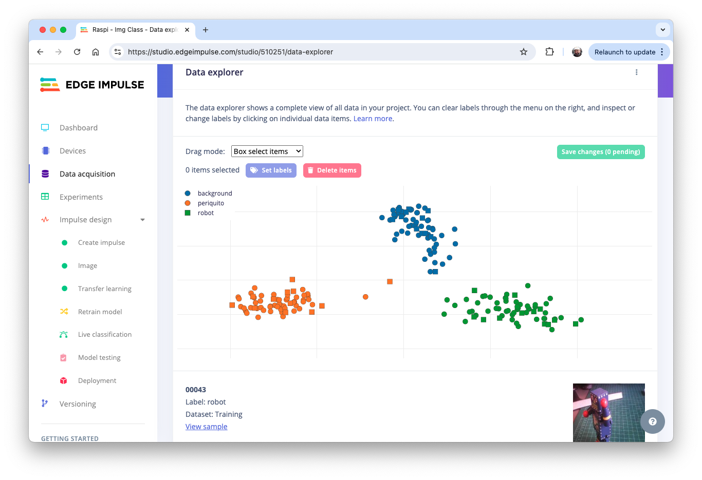</p>

## Проектирование Impulse

На этом этапе нужно определить, как:

- предобработать данные: изменить размер отдельных изображений и выбрать `глубину цвета` (RGB или оттенки серого);
- задать модель. В нашем случае это `Transfer Learning (Images)`: дообучение предобученной модели классификации изображений MobileNet V2 на наших данных. Этот метод хорошо работает даже с относительно небольшими наборами изображений (около 180 изображений в нашем случае).

Перенос обучения (transfer learning) с MobileNet упрощает обучение модели, что особенно полезно в условиях ограниченных ресурсов и для проектов с небольшим числом размеченных данных. MobileNet, известная своей лёгкой архитектурой, — это предобученная модель, которая уже выучила полезные признаки на большом наборе данных (ImageNet).

<p align="center">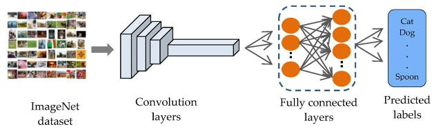</p>

Используя эти выученные признаки, мы можем обучить новую модель под вашу задачу, потратив меньше данных и вычислительных ресурсов и достигнув конкурентной точности.

<p align="center"></p>

Такой подход заметно сокращает время обучения и вычислительные затраты, что делает его идеальным для быстрого прототипирования и развёртывания на встраиваемых устройствах, где эффективность важнее всего.

Перейдите на вкладку Impulse Design и создайте *impulse*, задав размер изображения $160\times 160$ и сжатие (квадратная форма без обрезки). Выберите блоки Image и Transfer Learning. Сохраните Impulse.

<p align="center">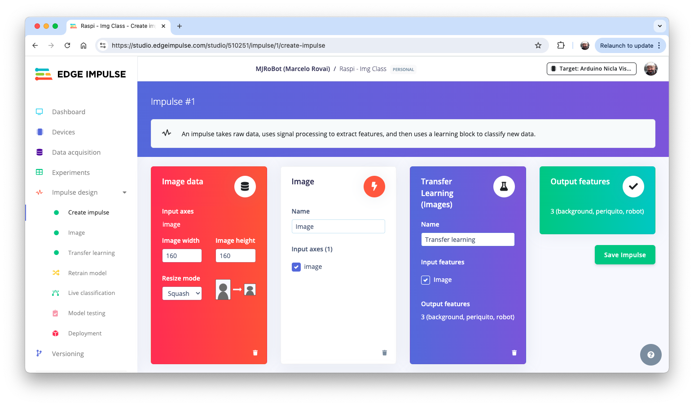</p>

### Предобработка изображений

Все входные изображения QVGA/RGB565 будут преобразованы в 76 800 признаков $(160\times 160\times 3)$.

<p align="center">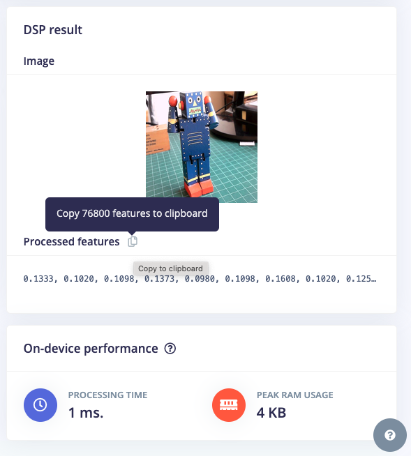</p>

Нажмите `Save parameters` и на следующей вкладке выберите `Generate features`.
### Модель

MobileNet — семейство эффективных свёрточных нейронных сетей, созданных для мобильного и встраиваемого зрения. Ключевые особенности MobileNet:

1. **Лёгкость:** оптимизирована для мобильных устройств и встраиваемых систем с ограниченными вычислительными ресурсами.
2. **Скорость:** быстрый инференс, подходящий для приложений реального времени.
3. **Точность:** сохраняет хорошую точность, несмотря на компактный размер.

[MobileNetV2](https://arxiv.org/abs/1801.04381), представленная в 2018 году, улучшает исходную архитектуру MobileNet. Её ключевые особенности:

1. **Инвертированные остаточные блоки (Inverted Residuals):** используются инвертированные остаточные структуры, в которых соединения-шорткаты связывают тонкие «бутылочные» слои (bottleneck).
2. **Линейные бутылочные слои (Linear Bottlenecks):** в узких слоях удаляются нелинейности, чтобы не разрушать информацию.
3. **Depth-wise separable convolutions (разделимые по глубине свёртки):** сохраняется эта эффективная операция из MobileNetV1.

В нашем проекте мы выполним `Transfer Learning` с моделью `MobileNetV2 160x160 1.0`. Это значит, что изображения для обучения (и для будущего инференса) должны иметь *входной размер* $160{\times}160$ пикселей и *множитель ширины* (Width Multiplier) 1.0 (полная ширина, без уменьшения). Эта конфигурация сбалансирована по размеру модели, скорости и точности.

### Обучение модели

Ещё одна полезная методика глубокого обучения — **аугментация данных** (Data Augmentation). Она повышает точность моделей машинного обучения за счёт создания дополнительных искусственных данных: система аугментации вносит небольшие случайные изменения в обучающие данные во время обучения (например, отражает, обрезает или поворачивает изображения).

Заглянем «под капот» и посмотрим, как Edge Impulse реализует политику аугментации данных:

```python
# Реализует политику аугментации данных
def augment_image(image, label):
    # Случайно отражаем изображение
    image = tf.image.random_flip_left_right(image)

    # Увеличиваем изображение, затем случайно обрезаем его до
    # исходных размеров
    resize_factor = random.uniform(1, 1.2)
    new_height = math.floor(resize_factor * INPUT_SHAPE[0])
    new_width = math.floor(resize_factor * INPUT_SHAPE[1])
    image = tf.image.resize_with_crop_or_pad(
        image, new_height, new_width
    )
    image = tf.image.random_crop(image, size=INPUT_SHAPE)

    # Меняем яркость изображения
    image = tf.image.random_brightness(image, max_delta=0.2)

    return image, label
```

Такие вариации во время обучения помогают модели не срезать углы, «запоминая» поверхностные признаки в обучающих данных. Благодаря этому модель лучше отражает глубинные закономерности набора данных.

Последний полносвязный слой нашей модели будет содержать 0 нейронов с dropout 10% для предотвращения переобучения. Вот результат обучения:

<p align="center">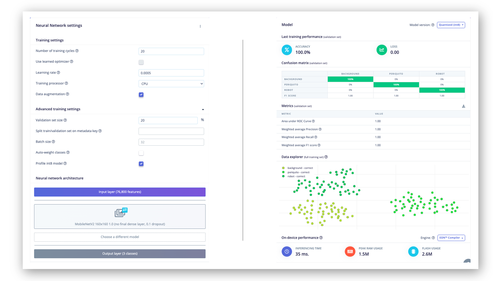</p>

Результат отличный: задержка около 35 мс (для Raspi-4), что должно дать около 30 кадров в секунду (fps) при инференсе. Raspi-Zero будет медленнее, а Raspi-5 — быстрее.

### Компромисс между точностью и скоростью

Если нужен более быстрый инференс, модель следует обучать с меньшими значениями альфа (0.35, 0.5 и 0.75) или даже уменьшить размер входного изображения, пожертвовав частью точности. Однако уменьшение размера входного изображения и снижение альфа (множителя ширины) могут ускорить инференс MobileNet V2, и у них разные компромиссы. Сравним:

1. Уменьшение размера входного изображения:

Плюсы:

- Существенно снижает вычислительные затраты во всех слоях.
- Уменьшает использование памяти.
- Часто даёт заметный прирост скорости.

Минусы:

- Может ухудшить способность модели обнаруживать мелкие признаки и детали.
- Может заметно повлиять на точность, особенно в задачах, требующих тонкого распознавания.

2. Уменьшение альфа (множителя ширины):

Плюсы:

- Уменьшает количество параметров и вычислений в модели.
- Сохраняет исходное разрешение входа, что потенциально позволяет сохранить больше деталей.
- Может обеспечить хороший баланс между скоростью и точностью.

Минусы:

- Может не ускорить инференс так существенно, как уменьшение входного размера.
- Может снизить способность модели выучивать сложные признаки.

Сравнение:

1. Влияние на скорость:
    - Уменьшение входного размера часто даёт более заметный прирост скорости, поскольку снижает вычисления квадратично (уменьшение ширины и высоты вдвое сокращает вычисления примерно на 75%).
    - Уменьшение альфа даёт более линейное снижение вычислений.

2. Влияние на точность:
    - Уменьшение входного размера может сильно повлиять на точность, особенно при обнаружении мелких объектов или деталей.
    - Уменьшение альфа обычно влияет на точность более плавно.

3. Архитектура модели:
    - Изменение входного размера не меняет архитектуру модели.
    - Изменение альфа меняет структуру модели, уменьшая количество каналов в каждом слое.

Рекомендации:

1. Если приложению не нужно обнаруживать мелкие детали и оно может мириться с небольшой потерей точности, уменьшение входного размера — часто самый эффективный способ ускорить инференс.
2. Уменьшение альфа предпочтительнее, если важно сохранить способность обнаруживать мелкие детали или нужен более сбалансированный компромисс между скоростью и точностью.
3. Для лучшего результата поэкспериментируйте с обоими способами:
    - Попробуйте MobileNet V2 с входными размерами, например $160\times 160$ или $92\times 92$;
    - Поэкспериментируйте со значениями альфа 1.0, 0.75, 0.5 или 0.35.
4. Всегда проверяйте разные конфигурации на своём оборудовании и на своём наборе данных, чтобы найти оптимальный баланс для вашей задачи.

> Помните: лучший выбор зависит от ваших требований к точности и скорости и от характера изображений, с которыми вы работаете. Часто стоит поэкспериментировать с комбинациями, чтобы найти оптимальную конфигурацию для своего случая.

### Тестирование модели

Теперь возьмите набор данных, отложенный в начале проекта, и запустите на нём обученную модель. Результат снова отличный: 92,22%.

### Развёртывание модели

Как и в предыдущем разделе, модель можно развернуть в формате `.tflite` и запустить на Raspi с помощью Python.

На вкладке `Dashboard` перейдите к модели Transfer learning (int8 quantized) и нажмите значок загрузки:

<p align="center">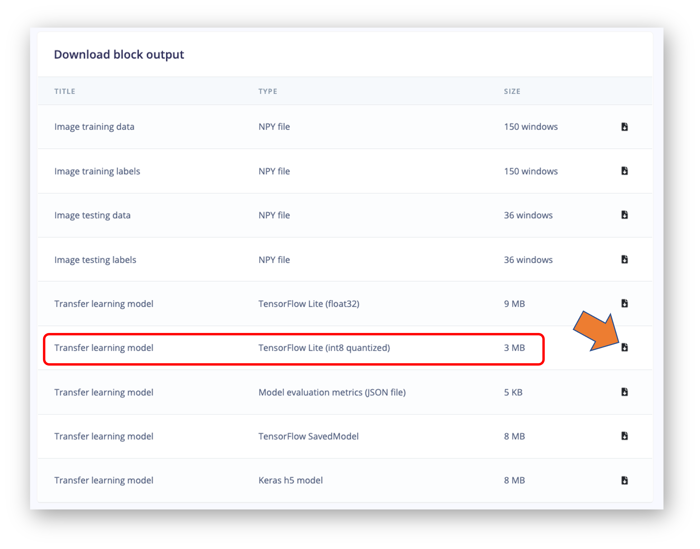</p>

> Для сравнения скачайте также версию float32.

Перенесите модель с компьютера на Raspi (в `./models`), например с помощью FileZilla. Также сделайте несколько снимков для инференса (в `./images`).

Импортируйте нужные библиотеки:

```python
import time
import numpy as np
import matplotlib.pyplot as plt
from PIL import Image
import tflite_runtime.interpreter as tflite
```

Укажите пути и метки:

```python
img_path = "./images/robot.jpg"
model_path = "./models/ei-raspi-img-class-int8-quantized-model.tflite"
labels = ["background", "periquito", "robot"]
```

> Обратите внимание: модели, обученные в Edge Impulse Studio, выдают значения с индексами 0, 1, 2 и т. д., а метки следуют в алфавитном порядке.

Загрузите модель, выделите тензоры и получите информацию о входных и выходных тензорах:

```python
# Загружаем модель TFLite
interpreter = tflite.Interpreter(model_path=model_path)
interpreter.allocate_tensors()

# Получаем входные и выходные тензоры
input_details = interpreter.get_input_details()
output_details = interpreter.get_output_details()
```

Важное отличие: `dtype` входных данных модели теперь `int8`, то есть входные значения лежат в диапазоне от –128 до +127, тогда как каждый пиксель нашего изображения — от 0 до 255. Поэтому изображение нужно предобработать. Проверим:

```python
input_dtype = input_details[0]["dtype"]
input_dtype
```

```
numpy.int8
```

Откроем изображение и выведем его:

```python
img = Image.open(img_path)
plt.figure(figsize=(4, 4))
plt.imshow(img)
plt.axis("off")
plt.show()
```
<p align="center">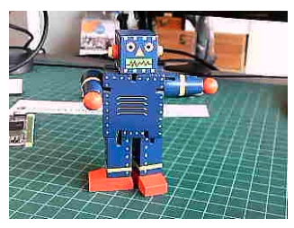</p>

Выполним предобработку:

```python
scale, zero_point = input_details[0]["quantization"]
img = img.resize(
    (input_details[0]["shape"][1], input_details[0]["shape"][2])
)
img_array = np.array(img, dtype=np.float32) / 255.0
img_array = (
    (img_array / scale + zero_point).clip(-128, 127).astype(np.int8)
)
input_data = np.expand_dims(img_array, axis=0)
```

Проверим входные данные, чтобы убедиться, что входной тензор соответствует ожиданиям модели:

```python
input_data.shape, input_data.dtype
```

```
((1, 160, 160, 3), dtype('int8'))
```

Теперь выполним инференс. Также вычислим задержку модели:

```python
# Инференс на Raspi-Zero
start_time = time.time()
interpreter.set_tensor(input_details[0]["index"], input_data)
interpreter.invoke()
end_time = time.time()
inference_time = (end_time - start_time) * 1000  # Переводим в миллисекунды
print("Inference time: {:.1f}ms".format(inference_time))
```

На инференс модель затратит около 125 мс на Raspi-Zero, то есть в 3–4 раза дольше, чем на Raspi-5.

Теперь получим метки и вероятности на выходе. Важно отметить, что модель, обученная в Edge Impulse Studio, имеет softmax на выходе (в отличие от исходной MobileNet V2), поэтому в качестве «вероятностей» нужно использовать сырой выход модели.

```python
# Получаем результаты и сопоставляем их с классами
predictions = interpreter.get_tensor(output_details[0]["index"])[0]

# Получаем индексы top-k результатов
top_k_results = 3
top_k_indices = np.argsort(predictions)[::-1][:top_k_results]

# Получаем параметры квантования
scale, zero_point = output_details[0]["quantization"]

# Деквантуем выход
dequantized_output = (
    predictions.astype(np.float32) - zero_point
) * scale
probabilities = dequantized_output

print("\n\t[PREDICTION]        [Prob]\n")
for i in range(top_k_results):
    print(
        "\t{:20}: {:.2f}%".format(
            labels[top_k_indices[i]],
            probabilities[top_k_indices[i]] * 100,
        )
    )
```

<p align="center">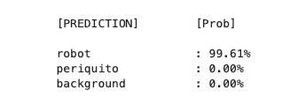</p>

Изменим ранее созданную функцию так, чтобы она работала с моделями разных типов:

```python
def image_classification(
    img_path, model_path, labels, top_k_results=3, apply_softmax=False
):
    # Загружаем изображение
    img = Image.open(img_path)
    plt.figure(figsize=(4, 4))
    plt.imshow(img)
    plt.axis("off")

    # Загружаем модель TFLite
    interpreter = tflite.Interpreter(model_path=model_path)
    interpreter.allocate_tensors()

    # Получаем входные и выходные тензоры
    input_details = interpreter.get_input_details()
    output_details = interpreter.get_output_details()

    # Предобработка
    img = img.resize(
        (input_details[0]["shape"][1], input_details[0]["shape"][2])
    )

    input_dtype = input_details[0]["dtype"]

    if input_dtype == np.uint8:
        input_data = np.expand_dims(np.array(img), axis=0)
    elif input_dtype == np.int8:
        scale, zero_point = input_details[0]["quantization"]
        img_array = np.array(img, dtype=np.float32) / 255.0
        img_array = (
            (img_array / scale + zero_point)
            .clip(-128, 127)
            .astype(np.int8)
        )
        input_data = np.expand_dims(img_array, axis=0)
    else:  # float32
        input_data = (
            np.expand_dims(np.array(img, dtype=np.float32), axis=0)
            / 255.0
        )

    # Инференс на Raspi-Zero
    start_time = time.time()
    interpreter.set_tensor(input_details[0]["index"], input_data)
    interpreter.invoke()
    end_time = time.time()
    inference_time = (end_time - start_time) * 1000  # Переводим в миллисекунды

    # Получаем результаты
    predictions = interpreter.get_tensor(output_details[0]["index"])[0]

    # Получаем индексы top-k результатов
    top_k_indices = np.argsort(predictions)[::-1][:top_k_results]

    # Обрабатываем выход в зависимости от его типа
    output_dtype = output_details[0]["dtype"]
    if output_dtype in [np.int8, np.uint8]:
        # Деквантуем выход
        scale, zero_point = output_details[0]["quantization"]
        predictions = (
            predictions.astype(np.float32) - zero_point
        ) * scale

    if apply_softmax:
        # Применяем softmax
        exp_preds = np.exp(predictions - np.max(predictions))
        probabilities = exp_preds / np.sum(exp_preds)
    else:
        probabilities = predictions

    print("\n\t[PREDICTION]        [Prob]\n")
    for i in range(top_k_results):
        print(
            "\t{:20}: {:.1f}%".format(
                labels[top_k_indices[i]],
                probabilities[top_k_indices[i]] * 100,
            )
        )
    print("\n\tInference time: {:.1f}ms".format(inference_time))
```

Протестируем её на разных изображениях с int8-квантованной моделью (**160x160, alpha = 1.0**):

<p align="center">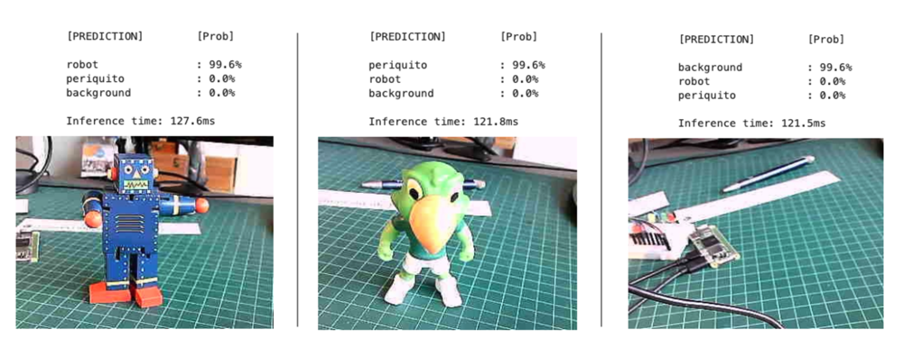</p>

Для проверки скачаем модель меньшего размера, например обученную для [Nicla Vision Lab](https://studio.edgeimpulse.com/public/353482/live) (int8-квантованная модель, $96{\times}96$, alpha = 0.1). Можно использовать ту же функцию:

<p align="center">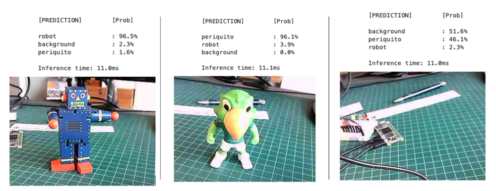</p>

Точность модели немного снизилась, но результат всё ещё приемлем, поскольку наша модель не ищет много деталей. По задержке на Raspi-Zero модель работает примерно **в десять раз быстрее**.

## Классификация изображений в реальном времени

Создадим приложение, которое в реальном времени снимает изображения USB-камерой и показывает результат классификации.

Через nano в терминале сохраните приведённый ниже код, например как `img_class_live_infer.py`.
```python
from flask import (Flask, Response, render_template_string,
                   request, jsonify)
from picamera2 import Picamera2
import io
import threading
import time
import numpy as np
from PIL import Image
import tflite_runtime.interpreter as tflite
from queue import Queue, Empty

app = Flask(__name__)

# Глобальные переменные
picam2 = None
frame = None
frame_lock = threading.Lock()
is_classifying = False
confidence_threshold = 0.8
model_path = "./models/ei-raspi-img-class-int8-quantized-model.tflite"
labels = ['background', 'periquito', 'robot']
interpreter = None
classification_queue = Queue(maxsize=1)

def initialize_camera():
    global picam2
    picam2 = Picamera2()
    config = picam2.create_preview_configuration(
        main={"size": (320, 240)}
    )
    picam2.configure(config)
    picam2.start()
    time.sleep(2)  # Ждём, пока камера прогреется

def get_frame():
    global frame
    while True:
        stream = io.BytesIO()
        picam2.capture_file(stream, format='jpeg')
        with frame_lock:
            frame = stream.getvalue()
        time.sleep(0.1)  # Захватываем кадры чаще

def generate_frames():
    while True:
        with frame_lock:
            if frame is not None:
                yield (
                   b'--frame\r\n'
                   b'Content-Type: image/jpeg\r\n\r\n'
                   + frame + b'\r\n'
                )
        time.sleep(0.1)

def load_model():
    global interpreter
    if interpreter is None:
        interpreter = tflite.Interpreter(model_path=model_path)
        interpreter.allocate_tensors()
    return interpreter

def classify_image(img, interpreter):
    input_details = interpreter.get_input_details()
    output_details = interpreter.get_output_details()

    img = img.resize((input_details[0]['shape'][1],
                      input_details[0]['shape'][2]))
    input_data = np.expand_dims(np.array(img), axis=0).astype(input_details[0]['dtype'])

    interpreter.set_tensor(input_details[0]['index'], input_data)
    interpreter.invoke()

    predictions = interpreter.get_tensor(output_details[0]
                                         ['index'])[0]
    # Обрабатываем выход в зависимости от его типа
    output_dtype = output_details[0]['dtype']
    if output_dtype in [np.int8, np.uint8]:
        # Деквантуем выход
        scale, zero_point = output_details[0]['quantization']
        predictions = (predictions.astype(np.float32) -
                       zero_point) * scale
    return predictions

def classification_worker():
    interpreter = load_model()
    while True:
        if is_classifying:
            with frame_lock:
                if frame is not None:
                    img = Image.open(io.BytesIO(frame))
            predictions = classify_image(img, interpreter)
            max_prob = np.max(predictions)
            if max_prob >= confidence_threshold:
                label = labels[np.argmax(predictions)]
            else:
                label = 'Uncertain'
            classification_queue.put({
                 'label': label,
                 'probability': float(max_prob)
            })
        time.sleep(0.1)  # При необходимости настройте

@app.route('/')
def index():
   return render_template_string('''
      <!DOCTYPE html>
      <html>
      <head>
          <title>Image Classification</title>
          <script
          	src="https://code.jquery.com/jquery-3.6.0.min.js">
          </script>
          <script>
              function startClassification() {
                  $.post('/start');
                  $('#startBtn').prop('disabled', true);
                  $('#stopBtn').prop('disabled', false);
              }
              function stopClassification() {
                  $.post('/stop');
                  $('#startBtn').prop('disabled', false);
                  $('#stopBtn').prop('disabled', true);
              }
              function updateConfidence() {
                  var confidence = $('#confidence').val();
                  $.post('/update_confidence',
                         {confidence: confidence}
                        );
              }
              function updateClassification() {
                  $.get('/get_classification', function(data) {
                    $('#classification').text(data.label + ': '
                    + data.probability.toFixed(2));
                  });
              }
              $(document).ready(function() {
                  setInterval(updateClassification, 100);
                  // Обновляем каждые 100 мс
              });
          </script>
      </head>
      <body>
          <h1>Image Classification</h1>
          

          <br>
          <button id="startBtn"
                  onclick="startClassification()">
            Start Classification
          </button>

          <button id="stopBtn"
                  onclick="stopClassification()"
                  disabled>
            Stop Classification
          </button>

          <br>
          <label for="confidence">Confidence Threshold:</label>
          <input type="number"
                 id="confidence"
                 name="confidence"
                 min="0" max="1"
                 step="0.1"
                 value="0.8"
                 onchange="updateConfidence()" />

          <br>
          <div id="classification">
             Waiting for classification...
          </div>

      </body>
      </html>
   ''')

@app.route('/video_feed')
def video_feed():
    return Response(
       generate_frames(),
       mimetype='multipart/x-mixed-replace; boundary=frame'
    )

@app.route('/start', methods=['POST'])
def start_classification():
    global is_classifying
    is_classifying = True
    return '', 204

@app.route('/stop', methods=['POST'])
def stop_classification():
    global is_classifying
    is_classifying = False
    return '', 204

@app.route('/update_confidence', methods=['POST'])
def update_confidence():
    global confidence_threshold
    confidence_threshold = float(request.form['confidence'])
    return '', 204

@app.route('/get_classification')
def get_classification():
    if not is_classifying:
        return jsonify({'label': 'Not classifying',
                       'probability': 0})
    try:
        result = classification_queue.get_nowait()
    except Empty:
        result = {'label': 'Processing', 'probability': 0}
    return jsonify(result)

if __name__ == '__main__':
    initialize_camera()
    threading.Thread(target=get_frame, daemon=True).start()
    threading.Thread(target=classification_worker,
                     daemon=True).start()
    app.run(host='0.0.0.0', port=5000, threaded=True)
```

В терминале выполните:

```bash
python3 img_class_live_infer.py
```

И откройте веб-интерфейс:

- На самой Raspberry Pi (если есть графический интерфейс): откройте веб-браузер и перейдите по адресу `http://localhost:5000`.
- С другого устройства в той же сети: откройте веб-браузер и перейдите по адресу `http://<raspberry_pi_ip>:5000` (замените `<raspberry_pi_ip>` на IP-адрес вашей Raspberry Pi). Например: `http://192.168.4.210:5000/`

Вот несколько скриншотов приложения, запущенного на внешнем компьютере:

<p align="center">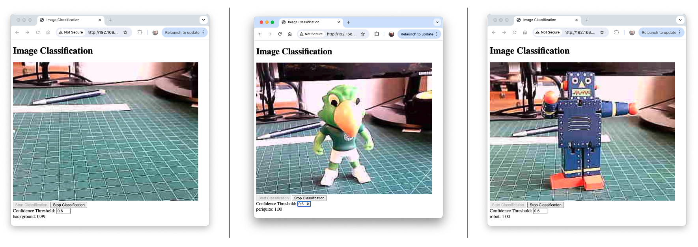</p>

Видео работы приложения можно посмотреть на YouTube: [ссылка на видео](https://www.youtube.com/watch?v=o1QsQrpCMw4).

Код создаёт веб-приложение для классификации изображений в реальном времени на Raspberry Pi с модулем камеры и моделью TensorFlow Lite. Приложение использует Flask для веб-интерфейса, где можно видеть изображение с камеры и результаты классификации в реальном времени.

#### Ключевые компоненты

1. **Веб-приложение Flask:** отдаёт пользовательский интерфейс и обрабатывает запросы.
2. **PiCamera2:** захватывает изображения с модуля камеры Raspberry Pi.
3. **TensorFlow Lite:** запускает модель классификации изображений.
4. **Потоки (Threading):** управляют параллельными операциями для плавной работы.

#### Основные возможности

- Вывод изображения с камеры в реальном времени
- Классификация изображений в реальном времени
- Настраиваемый порог уверенности
- Запуск и остановка классификации по требованию

#### Структура кода

1. **Импорты и настройка:**
    - Flask для веб-приложения
    - PiCamera2 для управления камерой
    - TensorFlow Lite для инференса
    - Threading и Queue для параллельных операций

2. **Глобальные переменные:**
    - Управление камерой и кадрами
    - Управление классификацией
    - Информация о модели и метках

3. **Функции камеры:**
    - `initialize_camera()`: настраивает PiCamera2
    - `get_frame()`: непрерывно захватывает кадры
    - `generate_frames()`: отдаёт кадры для веб-трансляции

4. **Функции модели:**
    - `load_model()`: загружает модель TFLite
    - `classify_image()`: выполняет инференс для одного изображения

5. **Рабочий поток классификации:**
    - Работает в отдельном потоке
    - Непрерывно классифицирует кадры, пока включена классификация
    - Обновляет очередь последними результатами

6. **Маршруты Flask:**
    - `/`: отдаёт главную HTML-страницу
    - `/video_feed`: передаёт видеопоток с камеры
    - `/start` и `/stop`: управляют классификацией
    - `/update_confidence`: меняет порог уверенности
    - `/get_classification`: возвращает последний результат классификации

7. **HTML-шаблон:**
    - Показывает изображение с камеры и результаты классификации
    - Содержит элементы управления запуском, остановкой и настройками

8. **Главный блок выполнения:**
    - Инициализирует камеру и запускает нужные потоки
    - Запускает приложение Flask

#### Ключевые понятия

1. **Параллельные операции:** потоки обрабатывают захват с камеры и классификацию отдельно от веб-сервера.
2. **Обновления в реальном времени:** результаты классификации обновляются часто, без перезагрузки страницы.
3. **Повторное использование модели:** модель TFLite загружается один раз и используется повторно, что эффективно.
4. **Гибкая настройка:** пользователь может менять порог уверенности на лету.

#### Использование

1. Убедитесь, что все зависимости установлены.
2. Запустите скрипт на Raspberry Pi с модулем камеры.
3. Откройте веб-интерфейс в браузере, используя IP-адрес Raspberry Pi.
4. Запустите классификацию и при необходимости настройте параметры.

## Итоги

Классификация изображений стала мощным и универсальным применением машинного обучения с важными последствиями для самых разных областей — от здравоохранения до мониторинга окружающей среды. В этой главе показано, как реализовать надёжную систему классификации изображений на периферийных устройствах, таких как Raspi-Zero и Raspi-5. Это демонстрирует потенциал интеллекта в реальном времени прямо на устройстве.

Мы прошли весь конвейер проекта классификации изображений: от сбора данных и обучения модели в Edge Impulse Studio до развёртывания и запуска инференса на Raspi. В процессе выделилось несколько ключевых моментов:

1. Важность правильного сбора данных и предобработки для обучения эффективных моделей.
2. Сила переноса обучения: можно использовать предобученные модели, такие как MobileNet V2, для эффективного обучения на ограниченных данных.
3. Компромиссы между точностью модели и скоростью инференса, особенно важные для периферийных устройств.
4. Реализация классификации в реальном времени через веб-интерфейс, что демонстрирует практическое применение.

Возможность запускать такие модели на периферийных устройствах, таких как Raspi, открывает множество возможностей для IoT-приложений, автономных систем и решений для мониторинга в реальном времени. Это снижает задержки, повышает приватность и позволяет работать в условиях ограниченной связи.

Как мы видели, даже при вычислительных ограничениях периферийных устройств можно добиться впечатляющих результатов и по точности, и по скорости. Возможность менять параметры модели, например размер входа и значения альфа, позволяет тонко настраивать систему под требования конкретного проекта.

Направление периферийного ИИ и классификации изображений быстро развивается. Улучшения в сжатии моделей, аппаратном ускорении и более эффективных архитектурах нейронных сетей обещают дальше расширить возможности периферийных устройств в задачах компьютерного зрения.

Этот проект служит основой для более сложных приложений компьютерного зрения и побуждает к дальнейшему изучению периферийного ИИ и IoT. Будь то промышленная автоматизация, «умный дом» или мониторинг окружающей среды, навыки и концепции, рассмотренные здесь, дают надёжную отправную точку для широкого круга проектов.

## Ресурсы

- [Набор данных (пример)](https://github.com/Mjrovai/EdgeML-with-Raspberry-Pi/tree/main/IMG_CLASS/dataset)
- [Тестовый блокнот настройки на Raspi](https://github.com/Mjrovai/EdgeML-with-Raspberry-Pi/blob/main/IMG_CLASS/notebooks/setup_test.ipynb)
- [Блокнот классификации изображений на Raspi](https://github.com/Mjrovai/EdgeML-with-Raspberry-Pi/blob/main/IMG_CLASS/notebooks/10_Image_Classification.ipynb)
- [CNN для классификации набора данных Cifar-10 в CoLab](https://colab.research.google.com/github/Mjrovai/UNIFEI-IESTI01-TinyML-2022.1/blob/main/00_Curse_Folder/2_Applications_Deploy/Class_16/cifar_10/CNN_Cifar_10_TFLite.ipynb#scrollTo=iiVBUpuHXEtw)
- [Cifar 10 — классификация изображений на Raspi](https://github.com/Mjrovai/EdgeML-with-Raspberry-Pi/blob/main/IMG_CLASS/notebooks/20_Cifar_10_Image_Classification.ipynb)
- [Python-скрипты](https://github.com/Mjrovai/EdgeML-with-Raspberry-Pi/tree/main/IMG_CLASS/python_scripts)
- [Проект Edge Impulse](https://studio.edgeimpulse.com/public/510251/live)
