# Малые языковые модели (SLM)

<p align="center">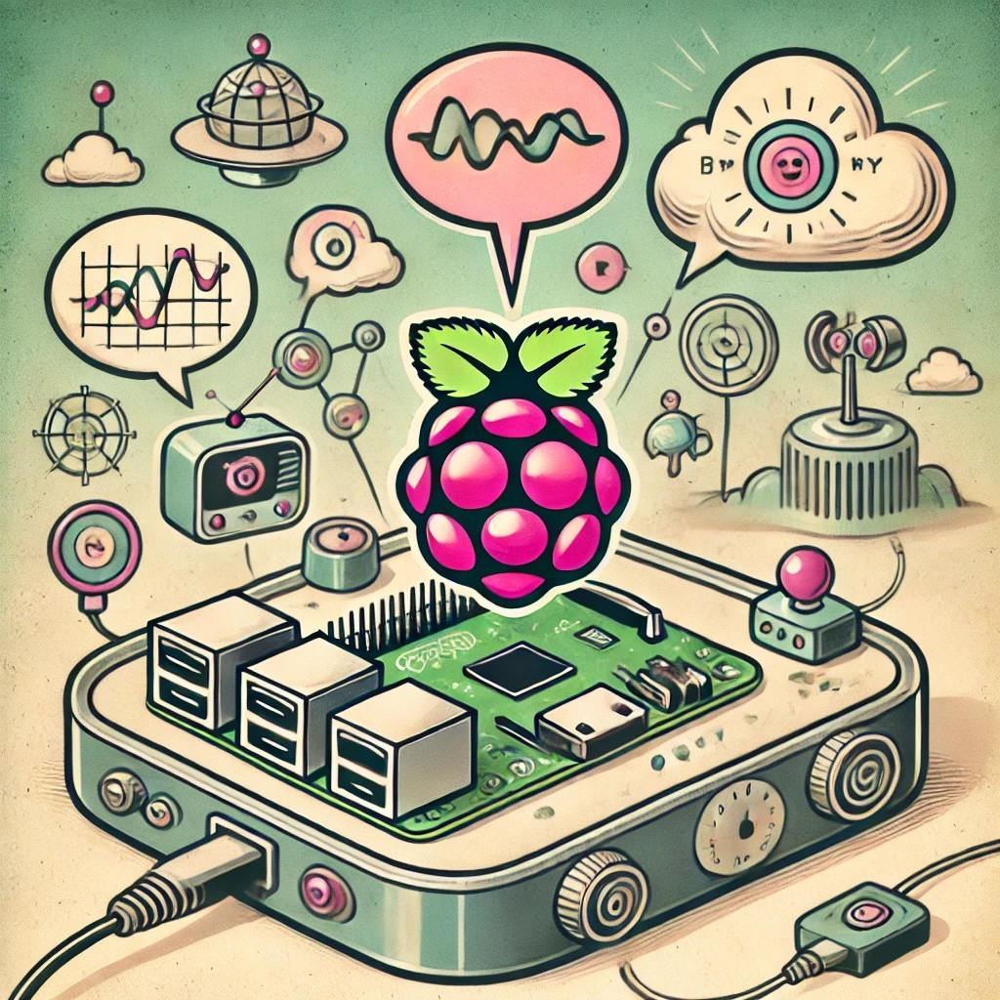<br>
<em>Промпт DALL·E: иллюстрация в стиле мультфильма 1950-х, на которой Raspberry Pi запускает малую языковую модель на периферийном устройстве. Raspberry Pi оформлена в ретрофутуристическом стиле, с закруглёнными краями и хромированными деталями, и подключена к игривым мультяшным датчикам и устройствам. Вокруг плывут речевые пузыри, символизирующие обработку языка, а фон представляет собой причудливый пейзаж из связанных между собой устройств, проводов и маленьких гаджетов, нарисованных в винтажном мультяшном стиле. Цветовая палитра использует мягкие пастельные тона и жирные контуры, типичные для мультфильмов 1950-х, что придаёт сцене весёлую и ностальгическую атмосферу.</em></p>

## Обзор

В быстро развивающейся области искусственного интеллекта периферийные вычисления открывают возможность перенести функции, которые традиционно доступны только мощным централизованным серверам, ближе к источнику данных. Эта лабораторная работа посвящена практической интеграции небольших версий традиционных больших языковых моделей (LLM) в Raspberry Pi 5. Так это периферийное устройство превращается в ИИ-узел, способный обрабатывать данные на месте в реальном времени.

По мере того как большие языковые модели растут в размере и сложности, малые языковые модели (SLM) становятся привлекательной альтернативой для периферийных устройств: они обеспечивают баланс между производительностью и эффективным использованием ресурсов. Запуская такие модели непосредственно на Raspberry Pi, мы можем создавать отзывчивые приложения с защитой приватности, которые работают даже там, где интернет ограничен или отсутствует.

Эта лабораторная работа проведёт вас через установку, оптимизацию и использование SLM на Raspberry Pi. Мы изучим установку и применение [Ollama](https://ollama.com/) — открытой платформы, которая позволяет запускать LLM локально на наших машинах: настольных компьютерах или периферийных устройствах, таких как Raspberry Pi или NVIDIA Jetson. Ollama спроектирована эффективной, масштабируемой и простой в использовании, поэтому подходит для развёртывания моделей ИИ, например Microsoft Phi, Google Gemma, Meta Llama и LLaVA (мультимодальная модель). Мы интегрируем некоторые из этих моделей в проекты с помощью экосистемы Python и изучим их потенциал в реальных сценариях (или хотя бы наметим такое направление).

<p align="center">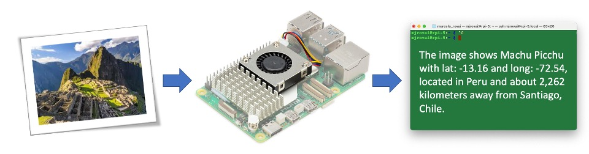</p>

## Настройка

В предыдущих лабораторных работах можно было использовать любую модель Raspi, но здесь выбор — Raspberry Pi 5 (Raspi-5). Это надёжная платформа, которая заметно превосходит предыдущую версию 4. Она оснащена процессором Broadcom BCM2712 — 64-битным четырёхъядерным Arm Cortex-A76 с частотой 2,4 ГГц, с криптографическим расширением и улучшенным кэшированием. В ней есть GPU VideoCore VII, два выхода HDMI® с разрешением 4Kp60 с поддержкой HDR и декодер HEVC 4Kp60. Доступны варианты памяти 4 ГБ и 8 ГБ высокоскоростной LPDDR4X SDRAM; для запуска SLM мы выбираем 8 ГБ. Также есть расширяемое хранилище через слот microSD и интерфейс PCIe 2.0 для быстрой периферии, например твердотельных накопителей M.2 SSD.

> Для реальных приложений SLM SSD — лучший выбор, чем SD-карты.

Кстати, как рассказал [Alasdair Allan](https://www.hackster.io/aallan), инференс непосредственно на CPU Raspberry Pi 5 — без ускорения на GPU — сейчас сопоставим по производительности с Coral TPU.

<p align="center">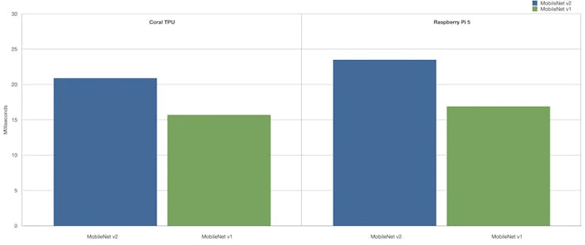</p>

Подробнее см. полную статью: [Benchmarking TensorFlow and TensorFlow Lite on Raspberry Pi 5](https://www.hackster.io/news/benchmarking-tensorflow-and-tensorflow-lite-on-raspberry-pi-5-b9156d58a6a2?mc_cid=0cab3d08f4&mc_eid=e96256ccba).

### Активный кулер Raspberry Pi

Для этой лабораторной работы мы рекомендуем установить Active Cooler — навесное охлаждающее решение для Raspberry Pi 5 (Raspi-5). Оно сочетает алюминиевый радиатор с вентилятором, управляемым температурой, чтобы Raspi-5 комфортно работал под высокой нагрузкой, например при запуске SLM.

<p align="center">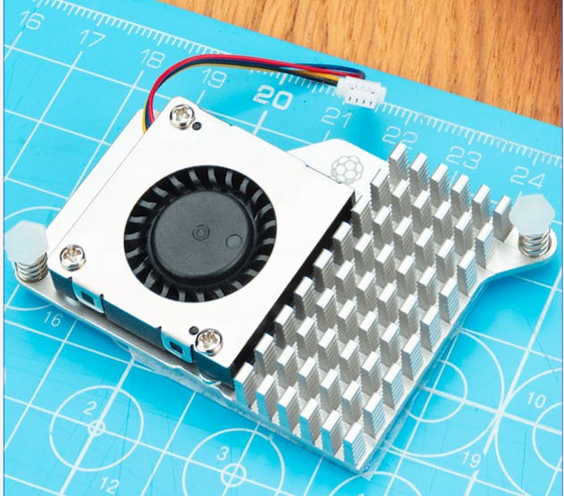</p>

Active Cooler имеет предустановленные термопрокладки для теплопередачи и крепится непосредственно к плате Raspberry Pi 5 пружинными фиксаторами. Прошивка Raspberry Pi управляет им автоматически: при 60 °C включается вентилятор, при 67,5 °C его скорость увеличивается, а при 75 °C он работает на полной скорости. Когда температура опускается ниже этих порогов, вентилятор автоматически замедляется.

<p align="center">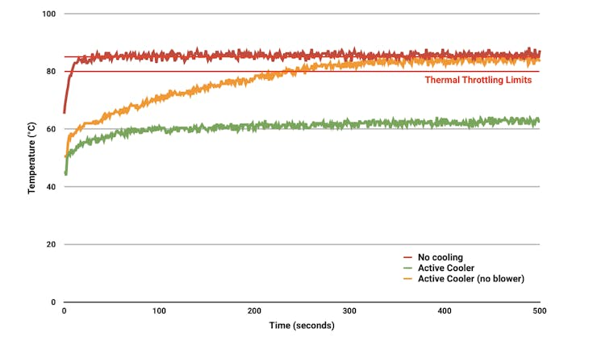</p>

> Чтобы предотвратить перегрев, все платы Raspberry Pi начинают снижать частоту процессора (троттлинг) при температуре 80 °C, а при достижении максимальной температуры 85 °C троттлинг усиливается (подробнее [здесь](https://www.raspberrypi.com/news/heating-and-cooling-raspberry-pi-5/)).

## Генеративный ИИ (GenAI)

Генеративный ИИ — это система искусственного интеллекта, способная создавать новый, оригинальный контент в разных форматах: **текст, изображения, аудио и видео**. Такие системы изучают закономерности в существующих данных и используют их, чтобы генерировать новые результаты, которых раньше не было. **Большие языковые модели (LLM)**, **малые языковые модели (SLM)** и **мультимодальные модели** можно считать видами GenAI, если они используются для генеративных задач.

GenAI задаёт концептуальную основу для создания контента с помощью ИИ: LLM служат мощными универсальными генераторами текста. SLM адаптируют эту технологию для периферийных вычислений, а мультимодальные модели расширяют возможности GenAI на разные типы данных. Вместе они образуют спектр технологий генеративного ИИ, каждая из которых имеет свои сильные стороны и области применения, а вместе они обеспечивают создание и понимание контента на основе ИИ.

### Большие языковые модели (LLM)

Большие языковые модели (LLM) — это продвинутые системы искусственного интеллекта, которые понимают, обрабатывают и генерируют человекоподобный текст. Такие модели характеризуются огромным масштабом: объёмом данных, на которых они обучаются, и количеством параметров. Ключевые аспекты LLM:

1. **Размер**: LLM обычно содержат миллиарды параметров. Например, у GPT-3 175 миллиардов параметров, а некоторые новые модели превышают триллион.

2. **Обучающие данные**: их обучают на огромных объёмах текста, часто включающих книги, веб-сайты и другие разнообразные источники; это сотни гигабайт или даже терабайты текста.

3. **Архитектура**: большинство LLM используют [архитектуры на основе трансформеров](https://en.wikipedia.org/wiki/Transformer_(deep_learning_architecture)), которые позволяют обрабатывать и генерировать текст, одновременно «обращая внимание» на разные части входных данных.

4. **Возможности**: LLM могут выполнять широкий круг языковых задач без специального дообучения, включая:
   - генерацию текста;
   - перевод;
   - суммаризацию;
   - ответы на вопросы;
   - генерацию кода;
   - логические рассуждения.

5. **Обучение на нескольких примерах (few-shot learning)**: они часто могут понять и выполнить новую задачу по нескольким примерам или инструкциям.

6. **Ресурсоёмкость**: из-за своего размера LLM обычно требуют значительных вычислительных ресурсов и часто нуждаются в мощных GPU или TPU.

7. **Непрерывное развитие**: область LLM быстро развивается, постоянно появляются новые модели и методы.

8. **Этические аспекты**: использование LLM поднимает важные вопросы о предвзятости, дезинформации и экологическом воздействии обучения таких больших моделей.

9. **Применения**: LLM используются во многих областях, включая создание контента, обслуживание клиентов, помощь в исследованиях и разработку программного обеспечения.

10. **Ограничения**: несмотря на свою мощь, LLM могут выдавать неверную или предвзятую информацию и не обладают подлинным пониманием или способностью к рассуждению.

Стоит отметить, что крупные модели мы используем не только для текста: их называют *мультимодальными моделями*. Такие модели одновременно интегрируют и обрабатывают информацию из нескольких типов входных данных. Они спроектированы для понимания и генерации контента в разных формах: текст, изображения, аудио и видео.

### Закрытые и открытые модели

**Закрытые модели**, также называемые проприетарными, — это модели ИИ, внутренняя работа, код и обучающие данные которых не раскрываются публично. Примеры: GPT-4 (OpenAI), Claude (Anthropic), Gemini (Google).

**Открытые модели**, также известные как модели с открытым исходным кодом, — это модели ИИ, базовый код, архитектура и часто обучающие данные которых публично доступны. Примеры: Gemma (Google), LLaMA (Meta) и Phi (Microsoft).

Открытые модели особенно важны для запуска на периферийных устройствах, таких как Raspberry Pi, поскольку их легче адаптировать, оптимизировать и развернуть в условиях ограниченных ресурсов. Тем не менее важно проверять их лицензии: открытые модели распространяются по разным лицензиям с открытым исходным кодом, которые могут влиять на использование в коммерческих приложениях. У закрытых моделей условия использования чёткие, хотя и ограничительные.

<p align="center">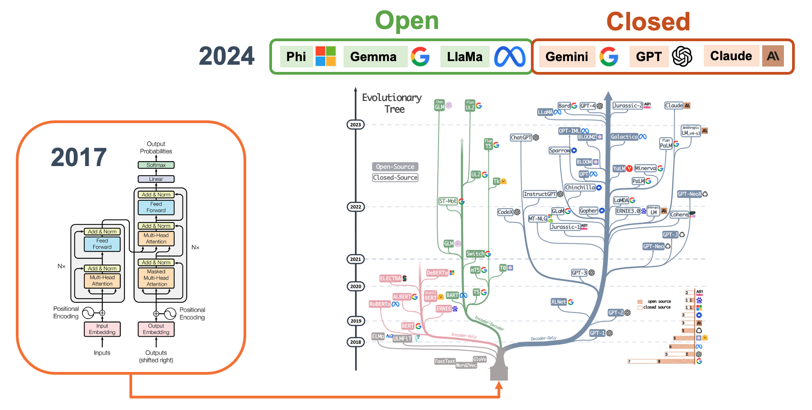<br>
<em>Адаптировано по [arXiv 2304.13712](https://arxiv.org/abs/2304.13712)</em></p>

### Малые языковые модели (SLM)

В контексте периферийных вычислений на таких устройствах, как Raspberry Pi, полномасштабные LLM обычно слишком велики и ресурсоёмки, чтобы работать на них напрямую. Это ограничение стимулировало разработку более компактных и эффективных моделей — малых языковых моделей (SLM).

SLM — это компактные версии LLM, созданные для эффективной работы на устройствах с ограниченными ресурсами: смартфонах, IoT-устройствах и одноплатных компьютерах вроде Raspberry Pi. Эти модели значительно меньше по размеру и требованиям к вычислениям, чем их крупные аналоги, и при этом сохраняют впечатляющие возможности понимания и генерации языка.

Ключевые характеристики SLM:

1. **Меньшее число параметров**: обычно от нескольких сотен миллионов до нескольких миллиардов параметров, против двузначного числа миллиардов у крупных моделей.

2. **Меньший объём памяти**: требуется не больше нескольких гигабайт памяти, а не десятки или сотни гигабайт.

3. **Более быстрый инференс**: могут генерировать ответы за миллисекунды или секунды на периферийных устройствах.

4. **Энергоэффективность**: потребляют меньше энергии, что делает их подходящими для устройств с батарейным питанием.

5. **Сохранение приватности**: обработка выполняется на устройстве, без отправки данных на облачные серверы.

6. **Работа без подключения**: могут работать без подключения к интернету.

SLM достигают компактности благодаря разным методам: дистилляции знаний (knowledge distillation), обрезке (pruning) и квантованию. Хотя SLM могут не сравниться с крупными моделями по широте возможностей, они превосходно справляются с конкретными задачами и предметными областями, что делает их идеальными для целевых приложений на периферийных устройствах.

> Далее мы будем называть SLM языковые модели с числом параметров менее 5 миллиардов, квантованные до 4 бит.

Примеры SLM включают сжатые версии моделей вроде Meta Llama, Microsoft PHI и Google Gemma. Эти модели позволяют решать широкий круг задач обработки естественного языка прямо на периферийных устройствах: от классификации текста и анализа тональности до ответов на вопросы и ограниченной генерации текста.

Подробнее о SLM: статья [LLM Pruning and Distillation in Practice: The Minitron Approach](https://arxiv.org/pdf/2408.11796) описывает подход, который применяет обрезку и дистилляцию, чтобы получить SLM из LLM. А работа [SMALL LANGUAGE MODELS: SURVEY, MEASUREMENTS, AND INSIGHTS](https://arxiv.org/pdf/2409.15790) представляет всесторонний обзор и анализ малых языковых моделей (SLM) — языковых моделей со 100 миллионами — 5 миллиардами параметров, предназначенных для устройств с ограниченными ресурсами.

## Ollama

<p align="center"></p>

[Ollama](https://ollama.com/) — это открытая платформа, которая позволяет запускать языковые модели (LM), большие или малые, локально на наших машинах. Вот ключевые моменты об Ollama:

1. **Локальный запуск моделей**: Ollama позволяет запускать LM на персональных компьютерах или периферийных устройствах, таких как Raspi-5, без облачных API-вызовов.

2. **Простота использования**: предоставляет простой интерфейс командной строки для загрузки, запуска и управления разными языковыми моделями.

3. **Разнообразие моделей**: Ollama поддерживает различные LLM, включая Phi, Gemma, Llama, Mistral и другие открытые модели.

4. **Настройка**: пользователи могут создавать и делиться собственными моделями, адаптированными под конкретные задачи или области.

5. **Лёгкость**: спроектирована эффективно и работает на доступном аппаратном обеспечении.

6. **Интеграция через API**: предлагает API для интеграции с другими приложениями и сервисами.

7. **Фокус на приватности**: запуск моделей локально решает проблемы конфиденциальности, связанные с отправкой данных на внешние серверы.

8. **Кроссплатформенность**: доступна для macOS, Windows и Linux (наш случай).

9. **Активная разработка**: регулярно обновляется новыми функциями и поддержкой моделей.

10. **Развитие сообществом**: выигрывает от вкладов сообщества и обмена моделями.

Чтобы узнать больше о том, что такое Ollama и как она работает, посмотрите короткое видео от [Matt Williams](https://www.youtube.com/@technovangelist), одного из основателей Ollama: [смотреть на YouTube](https://www.youtube.com/watch?v=90ozfdsQOKo).

> Matt также ведёт полностью бесплатный курс об Ollama, который мы рекомендуем: [смотреть на YouTube](https://youtu.be/9KEUFe4KQAI?si=D_-q3CMbHiT-twuy).

### Установка Ollama

Создадим и активируем виртуальное окружение для работы с Ollama:
```bash
python3 -m venv ~/ollama
source ~/ollama/bin/activate
```

Теперь выполним команду установки Ollama:

```bash
curl -fsSL https://ollama.com/install.sh | sh
```

В результате API будет работать в фоновом режиме по адресу `127.0.0.1:11434`. Теперь мы можем запускать Ollama из терминала. Для начала проверим версию Ollama — это также подтвердит, что установка прошла успешно:

```bash
ollama -v
```

<p align="center">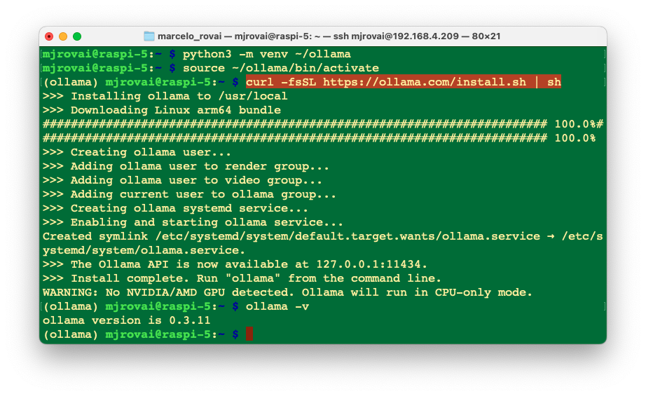</p>

На [странице библиотеки Ollama](https://ollama.com/library) можно найти модели, которые поддерживает Ollama. Например, если отфильтровать по `Most popular` (самые популярные), увидим Meta Llama, Google Gemma, Microsoft Phi, LLaVa и другие модели.

### Meta Llama 3.2 1B/3B

<p align="center"></p>

Установим и запустим нашу первую малую языковую модель, [Llama 3.2](https://ai.meta.com/blog/llama-3-2-connect-2024-vision-edge-mobile-devices/) 1B (и 3B). Серия Meta Llama 3.2 — это набор многоязычных генеративных языковых моделей размером 1 и 3 миллиарда параметров. Эти модели предназначены для обработки текстового ввода и генерации текстового вывода. Инструктивные варианты этой серии специально оптимизированы для многоязычных диалоговых приложений, включая задачи поиска информации и суммаризации с агентным подходом. По сравнению со многими существующими чат-моделями с открытым исходным кодом и проприетарными моделями инструктивные версии Llama 3.2 демонстрируют превосходные результаты в широко используемых отраслевых тестах.

Модели 1B и 3B были обрезаны (pruned) из Llama 8B, а затем в качестве целевых значений на уровне токенов использовались логиты моделей 8B и 70B (дистилляция на уровне токенов). Для восстановления качества применялась дистилляция знаний: обучение проводилось на 9 триллионах токенов. Модель 1B содержит 1,24 млрд параметров с квантованием в целые числа (Q8_0), а модель 3B — 3,12 млрд параметров с квантованием Q4_0. Их размеры составляют 1,3 ГБ и 2 ГБ соответственно. Окно контекста — 131 072 токена.

<p align="center">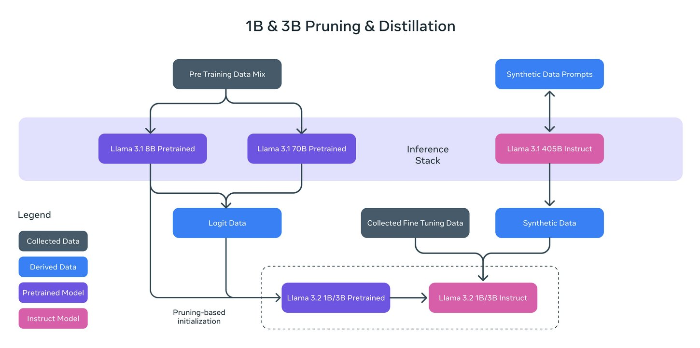</p>

**Установка и запуск модели**

```bash
ollama run llama3.2:1b
```

После запуска модели этой командой появится приглашение Ollama, в котором можно ввести вопрос и начать диалог с LLM, например:

`>>> What is the capital of France?`

Почти мгновенно мы получаем правильный ответ:

`The capital of France is Paris.`

Если при вызове модели использовать параметр `--verbose`, будет выведена статистика о её работе (модель загружается только при первом запуске команды).

<p align="center">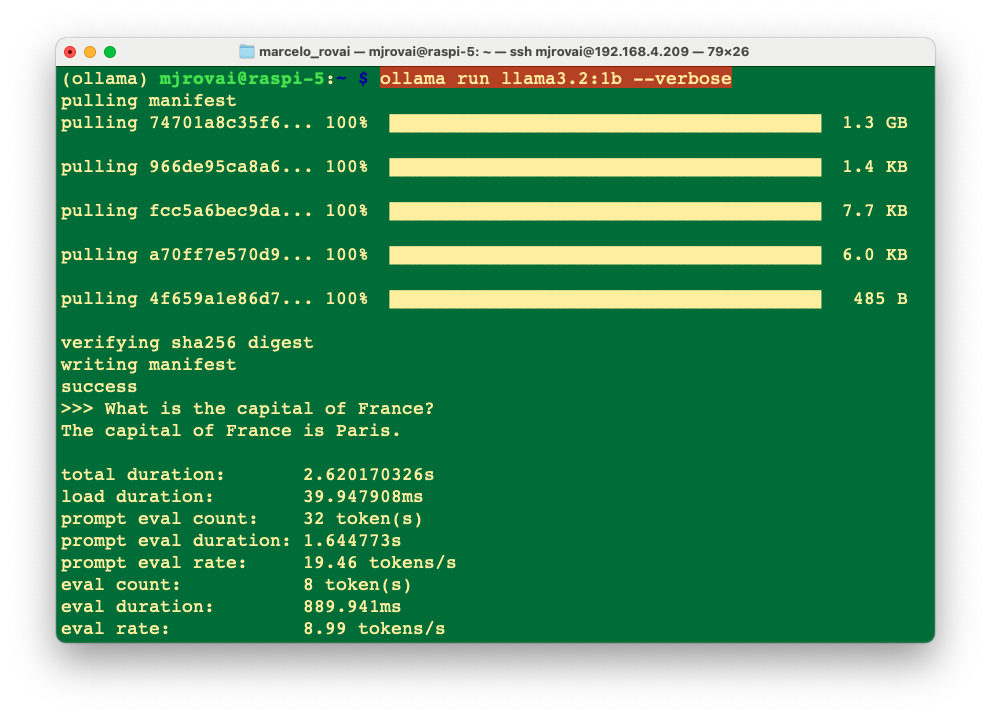</p>

Каждый показатель даёт представление о том, как модель обрабатывает входные данные и генерирует ответы. Вот расшифровка метрик:

- **Total Duration (2,620170326 с)**: полное время от начала выполнения команды до завершения ответа. Оно включает загрузку модели, обработку входного запроса и генерацию ответа.
- **Load Duration (39,947908 мс)**: время загрузки модели или необходимых компонентов в память. Если значение мало, возможно, модель была предзагружена или требовалась лишь минимальная настройка.
- **Prompt Eval Count (32 токена)**: количество токенов во входном запросе. В NLP токены обычно являются словами или их частями, поэтому здесь учитываются все токены, которые модель обработала, чтобы понять запрос и ответить на него.
- **Prompt Eval Duration (1,644773 с)**: время, которое модель тратит на обработку входного запроса. Оно составляет основную часть общего времени, то есть понимание запроса и подготовка ответа — самая трудоёмкая часть процесса.
- **Prompt Eval Rate (19,46 токенов/с)**: скорость обработки токенов входного запроса. Она отражает быстродействие модели при понимании естественного языка.
- **Eval Count (8 токенов)**: количество токенов в ответе модели; в данном случае это фраза «The capital of France is Paris.»
- **Eval Duration (889,941 мс)**: время генерации ответа на основе обработанного входа. Оно заметно короче времени обработки запроса, а значит, генерация ответа менее сложна и вычислительно менее затратна, чем понимание запроса.
- **Eval Rate (8,99 токена/с)**: аналогично скорости обработки запроса, показывает скорость генерации выходных токенов. Это важный показатель эффективности модели при генерации ответа.

Такой подробный разбор помогает понять вычислительные требования и характеристики производительности SLM, например Llama, на периферийных устройствах вроде Raspberry Pi 5. Видно, что обработка запроса занимает больше времени, тогда как сама генерация ответа проходит относительно быстрее. Этот анализ важен для оптимизации производительности и поиска узких мест в приложениях реального времени.

Загрузим и запустим модель 3B и сравним производительность на том же запросе:

<p align="center">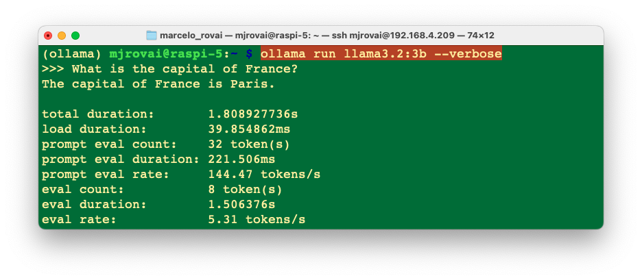</p>

Скорость генерации ниже: 5,3 токена/с против 9 токенов/с у меньшей модели.

На вопрос

`>>> What is the distance between Paris and Santiago, Chile?`

модель 1B ответила `9,841 kilometers (6,093 miles)` — это неточно, а модель 3B ответила `7,300 miles (11,700 km)` — это близко к правильному значению (11 642 км).

Спросим координаты Парижа:

`>>> what is the latitude and longitude of Paris?`

```bash
The latitude and longitude of Paris are 48.8567° N (48°55'
42" N) and 2.3510° E (2°22' 8" E), respectively.
```

<p align="center">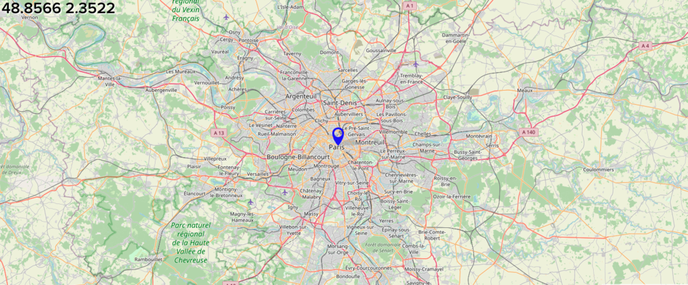</p>

Обе модели — 1B и 3B — дали правильные ответы.

### Google Gemma 2 2B

Установим [Gemma 2](https://ollama.com/library/gemma2:2b) — высокопроизводительную и эффективную модель, доступную в трёх размерах: 2B, 9B и 27B. Мы установим [**Gemma 2 2B**](https://huggingface.co/collections/google/gemma-2-2b-release-66a20f3796a2ff2a7c76f98f) — лёгкую модель, обученную на 2 триллионах токенов, которая даёт выдающиеся результаты, перенимая знания у более крупных моделей через дистилляцию. В модели 2,6 млрд параметров и квантование Q4_0, её размер — 1,6 ГБ. Окно контекста — 8192 токена.

<p align="center"></p>

**Установка и запуск модели**

```bash
ollama run gemma2:2b --verbose
```

После запуска команды появится приглашение Ollama, и можно задать вопрос, например:

`>>> What is the capital of France?`

Почти сразу получаем правильный ответ:

`The capital of France is **Paris**. 🗼`

И её статистика:

<p align="center">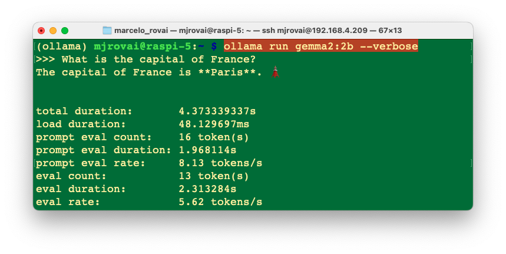</p>

Видим, что Gemma 2:2B работает примерно так же быстро, как Llama 3.2:3B, но при меньшем числе параметров.

**Другие примеры**:

```bash
>>> What is the distance between Paris and Santiago, Chile?

The distance between Paris, France and Santiago, Chile is
approximately **7,000 miles (11,267 kilometers)**.

Keep in mind that this is a straight-line distance, and actual
travel distance can vary depending on the chosen routes and any
stops along the way. ✈️
```

Ответ тоже хороший, но менее точный, чем у Llama3.2:3B.

```bash
>>> what is the latitude and longitude of Paris?

You got it! Here are the latitudes and longitudes of Paris,
France:

* **Latitude**: 48.8566° N (north)
* **Longitude**: 2.3522° E (east)

Let me know if you'd like to explore more about Paris or its
location! 🗼🇫🇷
```

Хороший и точный ответ (немного многословнее, чем ответы Llama).

### Microsoft Phi3.5 3.8B

Загрузим модель побольше, но всё ещё компактную: [PHI3.5](https://ollama.com/library/phi3.5) — лёгкую современную открытую модель с 3,8 млрд параметров от Microsoft. Модель относится к семейству Phi-3, поддерживает контекст `128K токенов` и языки: арабский, китайский, чешский, датский, нидерландский, английский, финский, французский, немецкий, иврит, венгерский, итальянский, японский, корейский, норвежский, польский, португальский, русский, испанский, шведский, тайский, турецкий и украинский.

Размер модели в байтах зависит от выбранного формата квантования. Он может варьироваться от квантования 2 бита (`q2_k`) размером 1,4 ГБ (выше производительность, ниже качество) до 16-битного (fp-16) размером 7,6 ГБ (ниже производительность, выше качество).

Запустим 4-битное квантование (`Q4_0`), которому нужно 2,2 ГБ оперативной памяти. Это компромисс между качеством ответов и производительностью.

```bash
ollama run phi3.5:3.8b --verbose
```

> Загрузить модель можно и командой `run`, и командой `pull`. Ollama запоминает загруженные модели: если Phi3 ещё нет на устройстве, Ollama скачает её перед запуском.

Введём тот же запрос, что и раньше:

```bash
>>> What is the capital of France?

The capital of France is Paris. It' extradites significant
historical, cultural, and political importance to the country as
well as being a major European city known for its art, fashion,
gastronomy, and culture. Its influence extends beyond national
borders, with millions of tourists visiting each year from around
the globe. The Seine River flows through Paris before it reaches
the broader English Channel at Le Havre. Moreover, France is one
of Europe's leading economies with its capital playing a key role

...
```
Ответ получился очень «многословным», поэтому зададим более удачный запрос:

<p align="center">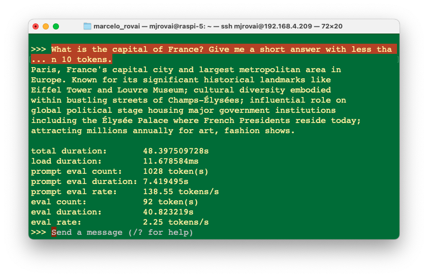</p>

В этом случае ответ всё равно был длиннее, чем мы ожидали, со скоростью генерации 2,25 токена/с, то есть более чем вдвое медленнее, чем у Gemma и Llama.

> Выбор наиболее подходящего запроса (prompt) — один из самых важных навыков при работе с LLM, независимо от их размера.

Когда мы задали те же вопросы о расстоянии и координатах, ответ о расстоянии `13,507 kilometers (8,429 miles)` оказался неверным, а координаты — приемлемыми. Ответы снова могли бы быть менее многословными (более 200 токенов на каждый ответ).

Любую модель можно использовать как ассистента, поскольку её скорость вполне приемлема. Однако по состоянию на 24 сентября 2023 года для такой задачи лучше подходит Llama2:3B. Стоит попробовать и другие модели в зависимости от ваших потребностей. [🤗 Open LLM Leaderboard](https://huggingface.co/spaces/open-llm-leaderboard/open_llm_leaderboard) поможет оценить лучшие модели по размеру, результатам тестов, лицензии и т. д.

> Лучшая модель — та, которая подходит для вашей конкретной задачи. Учтите также, что эта область развивается и новые модели появляются каждый день.

### Мультимодальные модели

Мультимодальные модели — это системы искусственного интеллекта (ИИ), которые могут обрабатывать и понимать информацию из нескольких источников: изображений, текста, аудио и видео. В нашем контексте мультимодальные LLM могут принимать в качестве запросов разные входные данные, включая текст, изображения и аудио, и преобразовывать их в выходные данные разных типов, а не только того же типа.

Мы будем работать с [LLaVA-Phi-3](https://ollama.com/library/llava-phi3:3.8b) — доработанной моделью LLaVA на основе Phi 3 Mini 4k. По результатам тестов она сопоставима с исходной моделью [LLaVA](https://llava-vl.github.io/) (Large Language and Vision Assistant).

LLaVA-Phi-3 — это крупная мультимодальная модель, обученная сквозным образом, которая понимает визуальные данные (изображения) и текстовые инструкции и генерирует контент на их основе. Она сочетает возможности визуального энкодера и языковой модели, чтобы обрабатывать мультимодальные входные данные и отвечать на них.

Установим модель:

```bash
ollama run llava-phi3:3.8b --verbose
```

Начнём с текстового ввода:

```bash
>>> You are a helpful AI assistant.
    What is the capital of France?

As an AI language model, I can tell you that the capital of
France is Paris. It's not only the largest city in the country
but also serves as its political and administrative center.
Paris is known for its iconic landmarks such as the Eiffel
Tower, Notre-Dame Cathedral, and the Louvre Museum. The city
has a rich history, beautiful architecture, and is widely
considered to be one of the most romantic cities in the world.
```

Ответ занял около 30 секунд, скорость генерации — 3,93 токена/с. Неплохо!

Теперь передадим модели изображение. Для этого создадим рабочую папку:

```bash
cd Documents/
mkdir OLLAMA
cd OLLAMA
```

Скачаем изображение размером $640\times 320$, например из Википедии: [Paris, France](https://upload.wikimedia.org/wikipedia/commons/thumb/4/4b/La_Tour_Eiffel_vue_de_la_Tour_Saint-Jacques%2C_Paris_ao%C3%BBt_2014_%282%29.jpg/640px-La_Tour_Eiffel_vue_de_la_Tour_Saint-Jacques%2C_Paris_ao%C3%BBt_2014_%282%29.jpg):

<p align="center"></p>

С помощью FileZilla, например, загрузим изображение в папку OLLAMA на Raspi-5 и назовём его `image_test_1.jpg`. Нам понадобится полный путь к изображению (его можно узнать командой `pwd`):

`/home/username/Documents/OLLAMA/image_test_1.jpg`

Если вы используете рабочий стол, путь к изображению можно скопировать, щёлкнув по изображению правой кнопкой мыши.

<p align="center">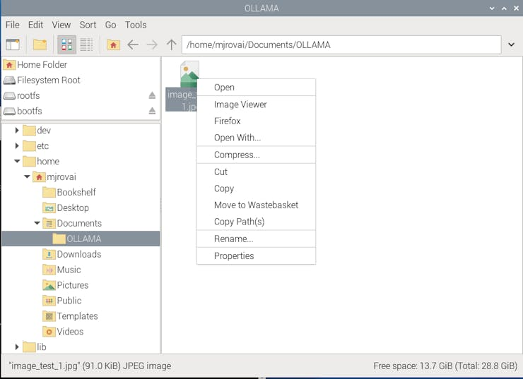</p>

Введём такой запрос:

```bash
>>> Describe the image /home/username/Documents/OLLAMA/\
                        image_test_1.jpg
```

Результат получился хорошим, но общая задержка оказалась значительной: почти 4 минуты на инференс.

<p align="center">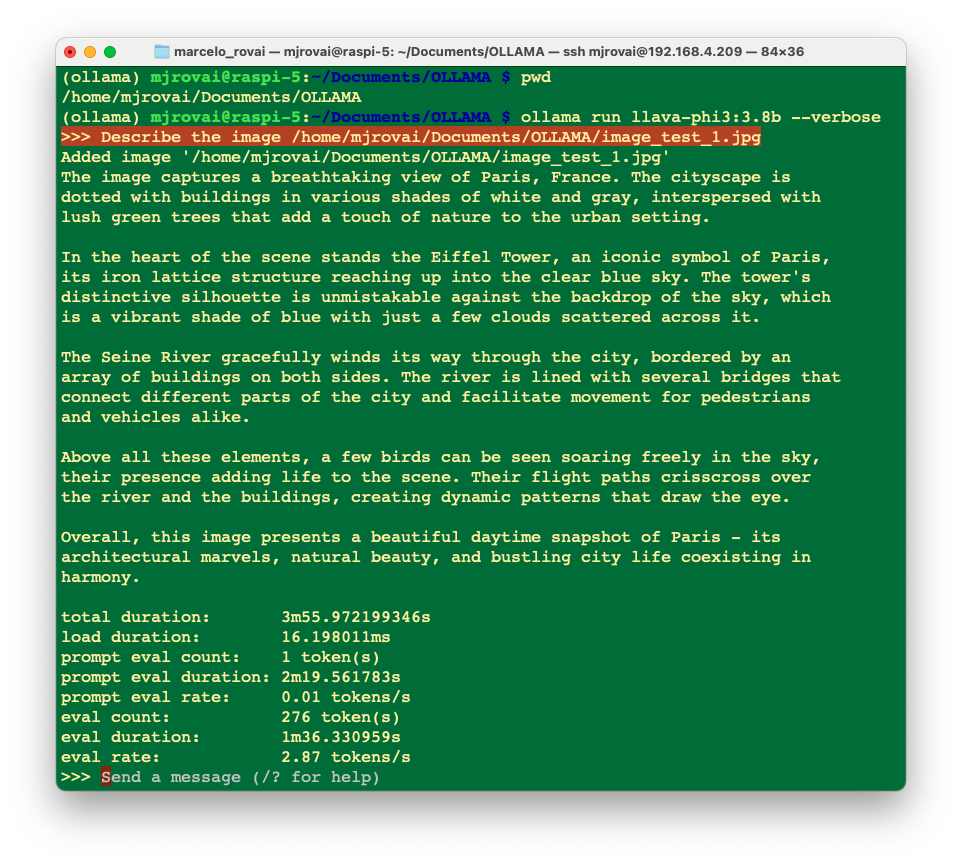</p>

### Проверка локальных ресурсов

С помощью htop можно отслеживать ресурсы, используемые устройством:

```bash
htop
```

Пока модель работает, можно проверять ресурсы:

<p align="center">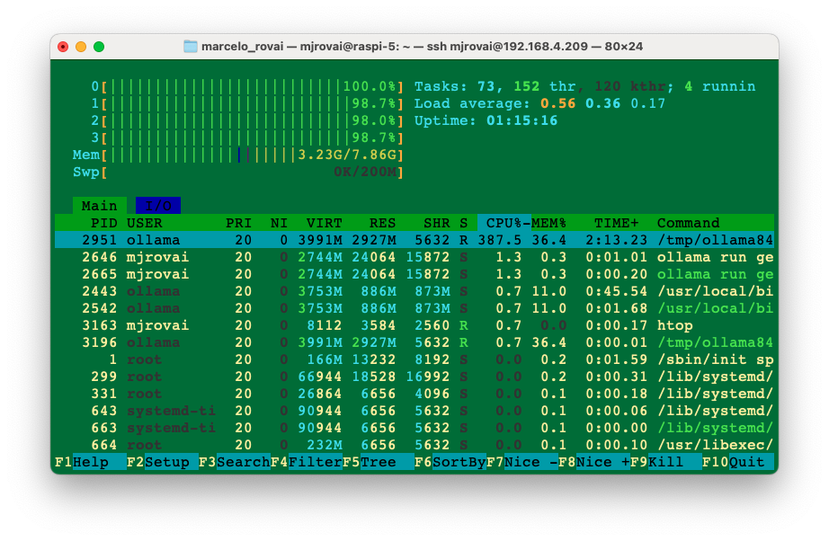</p>

Все четыре ядра CPU работают почти на 100 % своей мощности, а объём памяти с загруженной моделью составляет `3.24 GB`. После выхода из Ollama память снижается примерно до `377 MB` (без рабочего стола).

Также важно следить за температурой. При работе Raspberry с рабочим столом температуру можно видеть на панели задач:

<p align="center">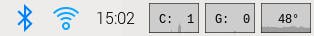</p>

Если Raspi работает без монитора (headless), температуру можно проверить командой:

```bash
vcgencmd measure_temp
```

Если устройство простаивает, температура составляет около `50 °C` при загрузке CPU 1 %. Во время инференса, когда CPU загружены на 100 %, температура может подняться почти до `70 °C`. Это нормально: значит, активный кулер работает и удерживает температуру ниже предела 80/85 °C.

## Библиотека Ollama для Python

До сих пор мы изучали возможности диалога с SLM через командную строку в терминале. Однако мы хотим интегрировать эти модели в наши проекты, поэтому логичнее использовать Python. Хорошая новость: у Ollama есть такая библиотека.

[Библиотека Ollama для Python](https://github.com/ollama/ollama-python) упрощает взаимодействие с продвинутыми LLM, позволяя получать более сложные ответы и реализовывать дополнительные возможности. Она также даёт самый простой способ интегрировать проекты на Python 3.8+ с [Ollama](https://github.com/ollama/ollama).

Чтобы лучше понять, как создавать приложения с Ollama на Python, можно посмотреть видео [Matt Williams](https://www.youtube.com/@technovangelist), например это: [смотреть на YouTube](https://www.youtube.com/watch?v=_4K20tOsXK8).

**Установка**:

В терминале выполните команду:

```bash
pip install ollama
```

Для создания Python-скрипта понадобится текстовый редактор или IDE. Если вы работаете с Raspberry Pi OS на рабочем столе, по умолчанию уже установлено несколько вариантов, например Thonny и Geany (открываются через `[Menu][Programming]`). Другие IDE, например Visual Studio Code, можно загрузить через `[Menu][Recommended Software]`. Когда откроется окно, перейдите в `[Programming]`, выберите нужный вариант и нажмите `[Apply]`.

<p align="center"></p>

Если вы предпочитаете разрабатывать в Jupyter Notebook:

```bash
pip install jupyter
jupyter notebook --generate-config
```

Чтобы запустить Jupyter Notebook, выполните команду (замените IP-адрес на свой):

```bash
jupyter notebook --ip=192.168.4.209 --no-browser
```

В терминале появится локальный URL-адрес, по которому можно открыть блокнот:

<p align="center">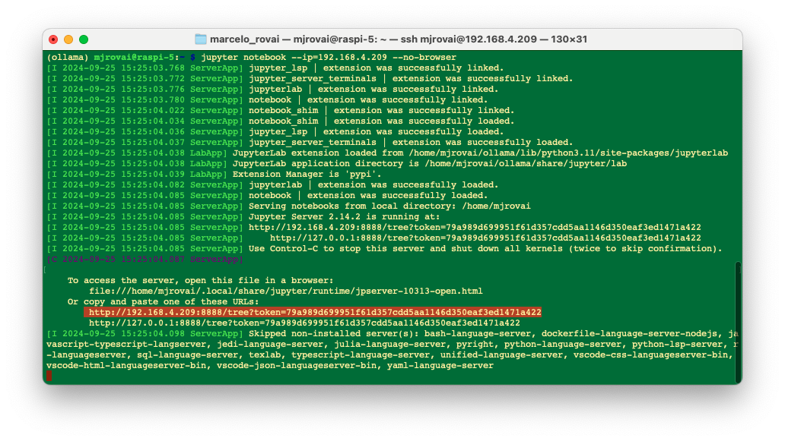</p>

Получить доступ к блокноту можно с другого компьютера: введите в веб-браузере IP-адрес Raspberry Pi и токен из терминала (скопируйте его оттуда).

В рабочем каталоге Raspi создадим новый блокнот Python 3.

Запустим очень простой скрипт, чтобы проверить установленные модели:

```python
import ollama

ollama.list()
```

Все модели будут выведены в виде словаря, например:

```python
  {'name': 'gemma2:2b',
   'model': 'gemma2:2b',
   'modified_at': '2024-09-24T19:30:40.053898094+01:00',
   'size': 1629518495,
   'digest': (
     '8ccf136fdd5298f3ffe2d69862750ea7fb56555fa4d5b18c0'
     '4e3fa4d82ee09d7'
    ),

   'details': {'parent_model': '',
    'format': 'gguf',
    'family': 'gemma2',
    'families': ['gemma2'],
    'parameter_size': '2.6B',
    'quantization_level': 'Q4_0'}}]}
```
Повторим один из вопросов, которые мы задавали раньше, но теперь с помощью `ollama.generate()` из библиотеки Ollama для Python. Этот API генерирует ответ на заданный запрос с помощью указанной модели. Это потоковая конечная точка, поэтому ответ приходит серией фрагментов. Итоговый объект ответа содержит статистику и дополнительные данные о запросе.

```python
MODEL = "gemma2:2b"
PROMPT = "What is the capital of France?"

res = ollama.generate(model=MODEL, prompt=PROMPT)
print(res)
```

Если запускаете код как Python-скрипт, сохраните его, например, как `test_ollama.py`. Запустить его можно в IDE или прямо в терминале. Помните, что при запуске отдельного скрипта модель всегда нужно указывать явно.

```bash
python test_ollama.py
```

В результате мы получим ответ модели в формате JSON:

```json
{
  'model': 'gemma2:2b',
  'created_at': '2024-09-25T14:43:31.869633807Z',
  'response': 'The capital of France is **Paris**.\n',
  'done': True,
  'done_reason': 'stop',
  'context': [
      106, 1645, 108, 1841, 603, 573, 6037, 576, 6081, 235336,
      107, 108, 106, 2516, 108, 651, 6037, 576, 6081, 603, 5231,
      29437, 168428, 235248, 244304, 241035, 235248, 108
  ],
  'total_duration': 24259469458,
  'load_duration': 19830013859,
  'prompt_eval_count': 16,
  'prompt_eval_duration': 1908757000,
  'eval_count': 14,
  'eval_duration': 2475410000
}
```

Как видно, генерируется несколько видов информации, например:

- **response**: основной текст, который модель сгенерировала в ответ на наш запрос:
    - `The capital of France is **Paris**. 🇫🇷`

- **context**: идентификаторы токенов, представляющие входные данные и контекст, которые использовала модель. Токены — это числовые представления текста, которые языковая модель использует для обработки:

    ```text
    [106, 1645, 108, 1841, 603, 573, 6037, 576, 6081, 235336,
     107, 108, 106, 2516, 108, 651, 6037, 576, 6081, 603,
     5231, 29437, 168428, 235248, 244304, 241035, 235248, 108]
    ```

Показатели производительности:

- **total_duration**: общее время выполнения операции в наносекундах. В данном случае примерно 24,26 секунды.
- **load_duration**: время загрузки модели или её компонентов в наносекундах. Около 19,83 секунды.
- **prompt_eval_duration**: время обработки запроса в наносекундах. Около 1,9 секунды.
- **eval_count**: количество токенов, обработанных при генерации. Здесь 14 токенов.
- **eval_duration**: время, за которое модель сгенерировала ответ, в наносекундах. Примерно 2,5 секунды.

Но нам нужен только текст ответа (`response`) и, возможно, для анализа общее время инференса. Поэтому изменим код так, чтобы извлекать их из словаря:

```python
print(f"\n{res['response']}")
print(
    f"\n [INFO] Total Duration: "
    f"{res['total_duration']/1e9:.2f} seconds"
)
```

Теперь получаем:

```bash
The capital of France is **Paris**. 🇫🇷

 [INFO] Total Duration: 24.26 seconds
```

**Использование Ollama.chat()**

Другой способ получить ответ — `ollama.chat()`, который генерирует следующее сообщение в диалоге с указанной моделью. Это тоже потоковая конечная точка, поэтому ответ приходит серией фрагментов. Потоковую передачу можно отключить, указав `"stream": false`. Итоговый объект ответа также содержит статистику и дополнительные данные о запросе.

```python
PROMPT_1 = "What is the capital of France?"

response = ollama.chat(
    model=MODEL,
    messages=[
        {
            "role": "user",
            "content": PROMPT_1,
        },
    ],
)
resp_1 = response["message"]["content"]
print(f"\n{resp_1}")
print(
    f"\n [INFO] Total Duration: "
    f"{(response['total_duration']/1e9):.2f} seconds"
)
```

Ответ такой же, как и раньше.

Важный момент: при использовании `ollama.generate()` ответ «забывается» моделью после завершения инференса (запрос используется только один раз). Если же мы хотим сохранить диалог, нужно использовать `ollama.chat()`. Посмотрим, как это работает:

```python
PROMPT_1 = "What is the capital of France?"
response = ollama.chat(
    model=MODEL,
    messages=[
        {
            "role": "user",
            "content": PROMPT_1,
        },
    ],
)
resp_1 = response["message"]["content"]
print(f"\n{resp_1}")
print(
    f"\n [INFO] Total Duration: "
    f"{(response['total_duration']/1e9):.2f} seconds"
)

PROMPT_2 = "and of Italy?"
response = ollama.chat(
    model=MODEL,
    messages=[
        {
            "role": "user",
            "content": PROMPT_1,
        },
        {
            "role": "assistant",
            "content": resp_1,
        },
        {
            "role": "user",
            "content": PROMPT_2,
        },
    ],
)
resp_2 = response["message"]["content"]
print(f"\n{resp_2}")
print(
    f"\n [INFO] Total Duration: "
    f"{(response['total_duration']/1e9):.2f} seconds"
)
```

В приведённом коде мы выполняем два запроса, и второй учитывает результат первого.

Вот как ответила модель:

```bash
The capital of France is **Paris**. 🇫🇷

 [INFO] Total Duration: 2.82 seconds

The capital of Italy is **Rome**. 🇮🇹

 [INFO] Total Duration: 4.46 seconds
```

**Получение описания изображения**:

Так же, как мы использовали модель `LlaVa-PHI-3` в командной строке для анализа изображения, это можно сделать и в Python. Используем то же изображение Парижа, но теперь с `ollama.generate()`:

```python
MODEL = "llava-phi3:3.8b"
PROMPT = "Describe this picture"

with open("image_test_1.jpg", "rb") as image_file:
    img = image_file.read()

response = ollama.generate(model=MODEL, prompt=PROMPT, images=[img])
print(f"\n{response['response']}")
print(
    f"\n [INFO] Total Duration: "
    f"{(response['total_duration']/1e9):.2f} seconds"
)
```

Вот результат:

```bash
This image captures the iconic cityscape of Paris, France. The
vantage point is high, providing a panoramic view of the Seine
River that meanders through the heart of the city. Several
bridges arch gracefully over the river, connecting different
parts of the city. The Eiffel Tower, an iron lattice structure
with a pointed top and two antennas on its summit, stands
tall in the background, piercing the sky. It is painted in a
light gray color, contrasting against the blue sky speckled
with white clouds.

The buildings that line the river are predominantly white or
beige, their uniform color palette broken occasionally by red
roofs peeking through. The Seine River itself appears calm
and wide, reflecting the city's architectural beauty in its
surface. On either side of the river, trees add a touch of
green to the urban landscape.

The image is taken from an elevated perspective, looking down
on the city. This viewpoint allows for a comprehensive view of
Paris's beautiful architecture and layout. The relative
positions of the buildings, bridges, and other structures
create a harmonious composition that showcases the city's charm.

In summary, this image presents a serene day in Paris, with its
architectural marvels - from the Eiffel Tower to the river-side
buildings - all bathed in soft colors under a clear sky.

 [INFO] Total Duration: 256.45 seconds
```

Модели потребовалось около 4 минут (256,45 с), чтобы вернуть подробное описание изображения.

> В блокноте [10-Ollama_Python_Library](https://github.com/Mjrovai/EdgeML-with-Raspberry-Pi/blob/main/OLLAMA_SLMs/10-Ollama_Python_Library.ipynb) можно найти эксперименты с библиотекой Ollama для Python.

### Вызов функций

До сих пор мы видели, что, помещая ответ модели в переменную, его можно эффективно использовать в реальных проектах. Однако возникает серьёзная проблема: модель может давать разные ответы на один и тот же вход. Например, предположим, что в предыдущих примерах нам нужны только название столицы страны и её координаты, без дополнительной информации, даже при использовании многословных моделей вроде Microsoft Phi. Чтобы обеспечить стабильные ответы, можно использовать «вызов функций Ollama» (Ollama function call), который полностью совместим с API OpenAI.

#### Что такое «вызов функций»?

В современном искусственном интеллекте вызов функций с большими языковыми моделями (LLM) позволяет этим моделям выполнять действия, выходящие за рамки генерации текста. Интегрируясь с внешними функциями или API, LLM могут получать данные в реальном времени, автоматизировать задачи и взаимодействовать с различными системами.

Например, вместо простого ответа на вопрос о погоде LLM может вызвать API погоды, чтобы получить текущие условия и дать точную и актуальную информацию. Эта возможность повышает релевантность и точность ответов модели и делает её мощным инструментом для управления рабочими процессами и автоматизации, превращая модель в активного участника реальных приложений.

Подробнее о вызове функций см. видео, сделанное [Mervin Praison](https://www.youtube.com/@MervinPraison): [смотреть на YouTube](https://www.youtube.com/watch?v=eHfMCtlsb1o).

#### Создадим проект

Мы хотим создать *приложение*, в котором пользователь вводит название страны и получает на выходе расстояние в километрах от столицы этой страны до места расположения приложения (для простоты местоположение приложения — Сантьяго, Чили).

<p align="center">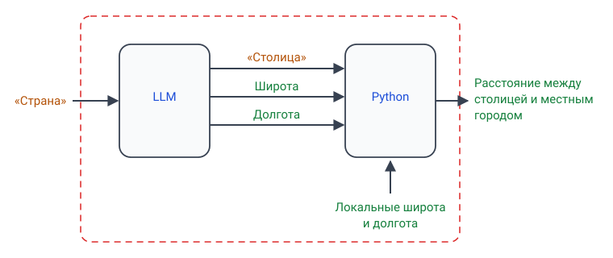</p>

Когда пользователь вводит название страны, модель возвращает название её столицы (строка), а также широту и долготу этого города (числа с плавающей точкой). Используя эти координаты, мы можем с помощью простой библиотеки Python ([haversine](https://pypi.org/project/haversine/)) вычислить расстояние между двумя точками.

Идея проекта — продемонстрировать сочетание взаимодействия с языковой моделью, обработки структурированных данных с помощью Pydantic и геопространственных вычислений по формуле гаверсинусов (традиционные вычисления).

Сначала установим несколько библиотек. Помимо *Haversine*, главная из них — [библиотека OpenAI для Python](https://github.com/openai/openai-python), которая обеспечивает удобный доступ к REST API OpenAI из любого приложения на Python 3.7+. Вторая — [Pydantic](https://docs.pydantic.dev/latest/) (и instructor), надёжная библиотека проверки данных и управления настройками, созданная для повышения устойчивости и надёжности кода. Коротко говоря, *Pydantic* поможет гарантировать, что ответ модели всегда будет согласованным.

```bash
pip install haversine
pip install openai
pip install pydantic
pip install instructor
```

Теперь создадим Python-скрипт, который взаимодействует с нашей моделью (LLM), чтобы определить координаты столицы страны и вычислить расстояние от Сантьяго-де-Чили до этой столицы.

Разберём код по шагам.

### 1. Импорт библиотек

```python
import sys
from haversine import haversine
from openai import OpenAI
from pydantic import BaseModel, Field
import instructor
```

- **sys**: предоставляет доступ к системным параметрам и функциям. Используется для получения аргументов командной строки.
- **haversine**: функция из библиотеки haversine, которая вычисляет расстояние между двумя географическими точками по формуле гаверсинусов.
- **openAI**: модуль для взаимодействия с API OpenAI (здесь он используется вместе с локальной установкой Ollama). Всё работает офлайн.
- **pydantic**: обеспечивает проверку данных и управление настройками с помощью аннотаций типов Python. Используется для описания структуры ожидаемых данных ответа.
- **instructor**: модуль, который «патчит» клиента OpenAI, чтобы он работал в определённом режиме (вероятно, связанном с обработкой структурированных данных).

### 2. Определение входных данных и модели

```python
country = sys.argv[1]  # Получаем страну из
# аргументов командной строки
MODEL = "phi3.5:3.8b"  # Название модели для использования
mylat = -33.33  # Широта Сантьяго-де-Чили
mylon = -70.51  # Долгота Сантьяго-де-Чили
```

- **country**: в Python-скрипте название страны можно получить из аргументов командной строки. В Jupyter Notebook его можно задать вручную, например:
    - `country = "France"`
- **MODEL**: указывает используемую модель, в данном примере phi3.5.
- **mylat** и **mylon**: координаты Сантьяго-де-Чили, которые служат отправной точкой для расчёта расстояния.

### 3. Определение структуры данных ответа

```python
class CityCoord(BaseModel):
    city: str = Field(..., description="Name of the city")
    lat: float = Field(
        ..., description="Decimal Latitude of the city"
    )
    lon: float = Field(
        ..., description="Decimal Longitude of the city"
    )
```

- **CityCoord**: модель Pydantic, которая определяет ожидаемую структуру ответа LLM. Она ожидает три поля: city (название города), lat (широта) и lon (долгота).

### 4. Настройка клиента OpenAI

```python
client = instructor.patch(
    OpenAI(
        base_url="http://localhost:11434/v1",  # Базовый URL локального API
        # (Ollama)
        api_key="ollama",  # Ключ API
        # (не используется)
    ),
    mode=instructor.Mode.JSON,  # Режим для
    # структурированного вывода JSON
)
```

- **OpenAI**: эта настройка создаёт клиента OpenAI с локальным базовым URL и ключом API (ollama). Используется локальный сервер.
- **instructor.patch**: «патчит» клиента OpenAI, переводя его в режим JSON, что позволяет получать структурированный вывод, соответствующий модели Pydantic.

### 5. Генерация ответа

```python
resp = client.chat.completions.create(
    model=MODEL,
    messages=[
        {
            "role": "user",
            "content": f"return the decimal latitude and \
            decimal longitude of the capital of the {country}.",
        }
    ],
    response_model=CityCoord,
    max_retries=10,
)
```
- **client.chat.completions.create**: вызывает LLM для генерации ответа.
- **model**: указывает модель, которую нужно использовать (в нашем коде это phi3.5).
- **messages**: содержит запрос к LLM с просьбой вернуть широту и долготу столицы заданной страны.
- **response_model**: указывает, что ответ должен соответствовать модели `CityCoord`.
- **max_retries**: максимальное число повторных попыток, если запрос не удался.

### 6. Вычисление расстояния

```python
distance = haversine((mylat, mylon), (resp.lat, resp.lon), unit="km")

print(
    f"Santiago de Chile is about {int(round(distance, -1))} "
    f"kilometers away from {resp.city}."
)
```

- **haversine**: вычисляет расстояние между Сантьяго-де-Чили и столицей, которую вернула LLM, по их координатам.
- **(mylat, mylon)**: координаты Сантьяго-де-Чили.
- **resp.city**: название столицы страны.
- **(resp.lat, resp.lon)**: координаты столицы, которые предоставил ответ LLM.
- **unit = 'km'**: расстояние вычисляется в километрах.
- **print**: выводит расстояние, округлённое до ближайших 10 километров, с разделителями тысяч для удобства чтения.

**Запуск кода**

Если указать разные страны, например Францию, Колумбию и США, мы видим, что каждый раз получаем одну и ту же структурированную информацию:

```bash
Santiago de Chile is about 8,060 kilometers away from
    Washington, D.C..
Santiago de Chile is about 4,250 kilometers away from Bogotá.
Santiago de Chile is about 11,630 kilometers away from Paris.
```

Если запустить код как скрипт, результат будет выведен в терминале:

<p align="center">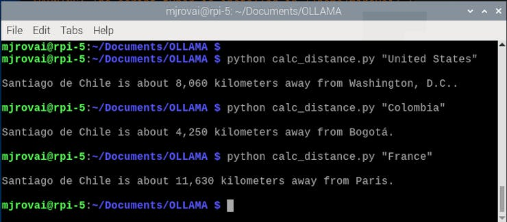</p>

И расчёты довольно точны!

<p align="center">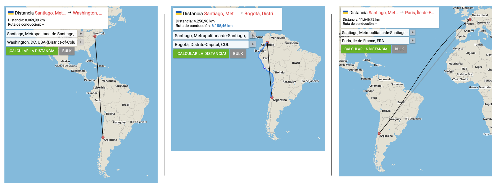</p>

> В блокноте [20-Ollama_Function_Calling](https://github.com/Mjrovai/EdgeML-with-Raspberry-Pi/blob/main/OLLAMA_SLMs/20-Ollama_Function_Calling.ipynb) можно найти эксперименты со всеми установленными моделями.

### Добавление изображений

Пора собрать всё вместе! Изменим скрипт так, чтобы вместо названия страны (текстом) пользователь вводил изображение, а приложение на основе SLM возвращало город, изображённый на нём, и его географическое положение. Имея эти данные, мы можем вычислить расстояние, как и раньше.

<p align="center">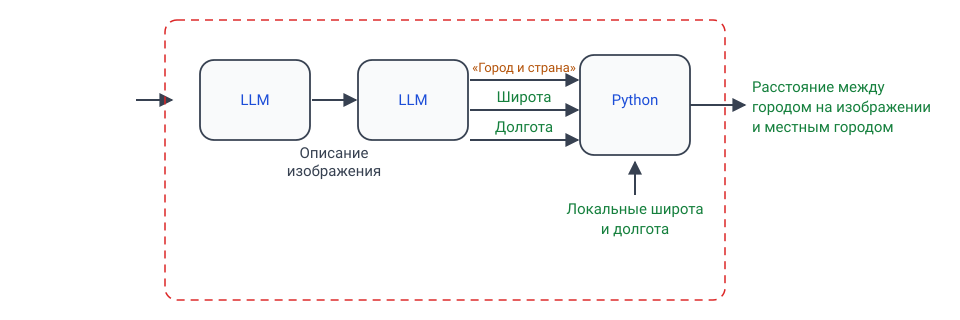</p>

Для простоты реализуем новый код в два шага. Сначала LLM проанализирует изображение и создаст его описание (текст). Этот текст передаётся другому экземпляру модели, которая извлечёт из него нужную информацию.

Начнём с импорта библиотек:

```python
import sys
import time
from haversine import haversine
import ollama
from openai import OpenAI
from pydantic import BaseModel, Field
import instructor
```

Чтобы видеть изображение при запуске кода в Jupyter Notebook, также импортируем:

```python
import matplotlib.pyplot as plt
from PIL import Image
```

> Эти библиотеки не нужны, если код запускается как скрипт.

Теперь определим модель и локальные координаты:

```python
MODEL = "llava-phi3:3.8b"
mylat = -33.33
mylon = -70.51
```

Можно скачать новое изображение, например Мачу-Пикчу из Википедии, и посмотреть его в блокноте:

```python
# Загружаем изображение
img_path = "image_test_3.jpg"
img = Image.open(img_path)

# Выводим изображение
plt.figure(figsize=(8, 8))
plt.imshow(img)
plt.axis("off")
# plt.title("Image")
plt.show()
```

<p align="center"></p>

Теперь определим функцию, которая получает изображение и возвращает `широту и долготу города на изображении, его название и страну, в которой он находится`:

```python
def image_description(img_path):
    with open(img_path, "rb") as file:
        response = ollama.chat(
            model=MODEL,
            messages=[
                {
                    "role": "user",
                    "content": """return the decimal latitude and \
                 decimal longitude of the city in the image, \
                 its name, and what country it is located""",
                    "images": [file.read()],
                },
            ],
            options={
                "temperature": 0,
            },
        )
    # print(response['message']['content'])
    return response["message"]["content"]
```

> Для отладки можно вывести весь ответ целиком.

Описание изображения, сгенерированное функцией, будет передано модели снова в качестве запроса.

```python
start_time = time.perf_counter()  # Запускаем таймер


class CityCoord(BaseModel):
    city: str = Field(
        ..., description="Name of the city in the image"
    )
    country: str = Field(
        ...,
        description=(
            "Name of the country where "
            "the city in the image is located"
        ),
    )
    lat: float = Field(
        ...,
        description=("Decimal latitude of the city in " "the image"),
    )
    lon: float = Field(
        ...,
        description=("Decimal longitude of the city in " "the image"),
    )


# Включает `response_model` в вызове create
client = instructor.patch(
    OpenAI(base_url="http://localhost:11434/v1", api_key="ollama"),
    mode=instructor.Mode.JSON,
)

image_description = image_description(img_path)
# Отправляем это описание модели
resp = client.chat.completions.create(
    model=MODEL,
    messages=[
        {
            "role": "user",
            "content": image_description,
        }
    ],
    response_model=CityCoord,
    max_retries=10,
    temperature=0,
)
```

Если вывести описание изображения, получим:

```bash
The image shows the ancient city of Machu Picchu, located in
Peru. The city is perched on a steep hillside and consists of
various structures made of stone. It is surrounded by lush
greenery and towering mountains. The sky above is blue with
scattered clouds.

Machu Picchu's latitude is approximately 13.5086° S, and its
longitude is around 72.5494° W.
```

А вторым ответом модели (`resp`) будет:

```bash
CityCoord(city='Machu Picchu', country='Peru', lat=-13.5086,
                lon=-72.5494)
```

Теперь можно выполнить «постобработку»: вычислить расстояние и подготовить итоговый ответ:

```python
distance = haversine((mylat, mylon), (resp.lat, resp.lon), unit="km")

print(
    (
        f"\nThe image shows {resp.city}, with lat: "
        f"{round(resp.lat, 2)} and long: "
        f"{round(resp.lon, 2)}, located in "
        f"{resp.country} and about "
        f"{int(round(distance, -1)):,} kilometers "
        f"away from Santiago, Chile.\n"
    )
)

end_time = time.perf_counter()  # Останавливаем таймер
elapsed_time = end_time - start_time  # Вычисляем затраченное время
print(
    f"[INFO] ==> The code (running {MODEL}), "
    f"took {elapsed_time:.1f} seconds to execute.\n"
)
```

И получим:

```bash
 The image shows Machu Picchu, with lat:-13.16 and long:
 -72.54, located in Peru  and about 2,250 kilometers away
 from Santiago, Chile.
```

В блокноте [30-Function_Calling_with_images](https://github.com/Mjrovai/EdgeML-with-Raspberry-Pi/blob/main/OLLAMA_SLMs/30-Function_Calling_with_images.ipynb) можно найти эксперименты с несколькими изображениями.

Теперь скачайте скрипт `calc_distance_image.py` из репозитория [EdgeML-with-Raspberry-Pi](https://github.com/Mjrovai/EdgeML-with-Raspberry-Pi) и запустите его в терминале командой:

```bash
python calc_distance_image.py \
  /home/username/Documents/OLLAMA/image_test_3.jpg
```

Укажите полный путь к изображению Мачу-Пикчу в качестве аргумента. Мы получим тот же результат, что и раньше.

<p align="center">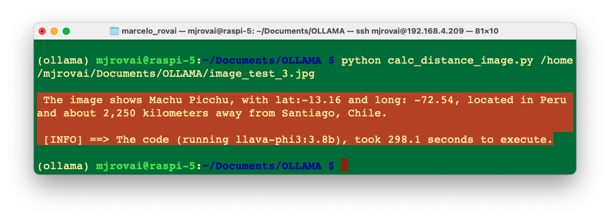</p>

А как насчёт Парижа?

<p align="center">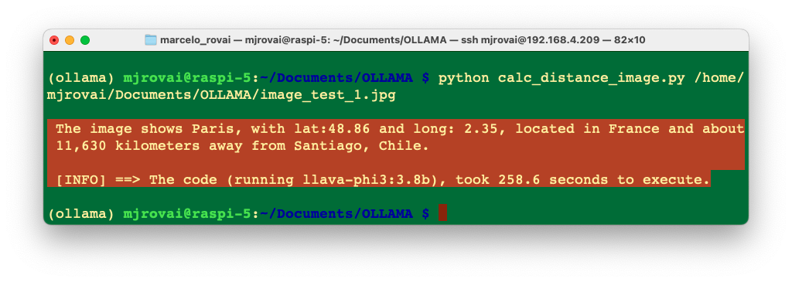</p>

Конечно, код можно оптимизировать многими способами. Однако идея в том, чтобы исследовать большой потенциал *вызова функций* с SLM на периферии: это позволяет моделям интегрироваться с внешними функциями и API. Выходя за рамки генерации текста, SLM могут получать данные в реальном времени, автоматизировать задачи и взаимодействовать с различными системами.

## Методы оптимизации SLM

Большие языковые модели (LLM) произвели революцию в обработке естественного языка, но их развёртывание и оптимизация связаны с особыми сложностями. Одна из существенных проблем — склонность LLM (и тем более SLM) генерировать правдоподобно звучащую, но фактически неверную информацию. Это явление известно как **галлюцинации**: модель выдаёт содержимое, которое выглядит связным, но не опирается на истину или реальные факты.

Другие сложности включают огромные вычислительные ресурсы, необходимые для обучения и запуска таких моделей, трудность поддержания актуальности знаний внутри модели и необходимость адаптации к предметной области. Вопросы приватности возникают и при работе с чувствительными данными во время обучения или инференса. Кроме того, постоянными вызовами остаются стабильное качество в разных задачах и этичное использование таких мощных инструментов. Их решение критически важно для эффективного и ответственного развёртывания LLM в реальных приложениях.

Основные методы повышения производительности и эффективности LLM (и SLM): дообучение (fine-tuning), инженерия запросов (prompt engineering) и генерация с дополнением поиском (Retrieval-Augmented Generation, RAG).

- **Дообучение (fine-tuning)** требует больше ресурсов, но позволяет специализировать LLM для конкретных областей или задач. Процесс заключается в дополнительном обучении модели на тщательно отобранных наборах данных, что позволяет адаптировать её обширные общие знания к конкретным приложениям. Дообучение может существенно улучшить производительность, особенно в узких областях или для особых сценариев.

- **Инженерия запросов (prompt engineering)** стоит на переднем крае оптимизации LLM. Тщательно составляя входные запросы, мы можем направить модель на более точные и релевантные ответы. Этот метод предполагает формулировку запросов, которые используют предобученные знания и возможности модели, часто включая примеры или конкретные инструкции, задающие нужный ответ.

- **Генерация с дополнением поиском (Retrieval-Augmented Generation, RAG)** — ещё один мощный подход к повышению производительности LLM. Метод сочетает обширные знания, заложенные в предобученной модели, со способностью получать и использовать внешнюю, актуальную информацию. Извлекая релевантные данные для поддержки процесса принятия решений моделью, RAG может существенно повысить точность и снизить вероятность генерации устаревших или ложных сведений.

Для периферийных приложений полезнее сосредоточиться на таких методах, как RAG, которые повышают качество модели без дообучения на самом устройстве. Разберёмся с этим подробнее.

## Реализация RAG

В базовом взаимодействии пользователя с языковой моделью пользователь задаёт вопрос, который отправляется модели в виде запроса. Модель генерирует ответ, опираясь исключительно на предобученные знания. В процессе RAG между вопросом пользователя и ответом модели появляется дополнительный шаг: вопрос запускает процесс поиска в базе знаний.

<p align="center">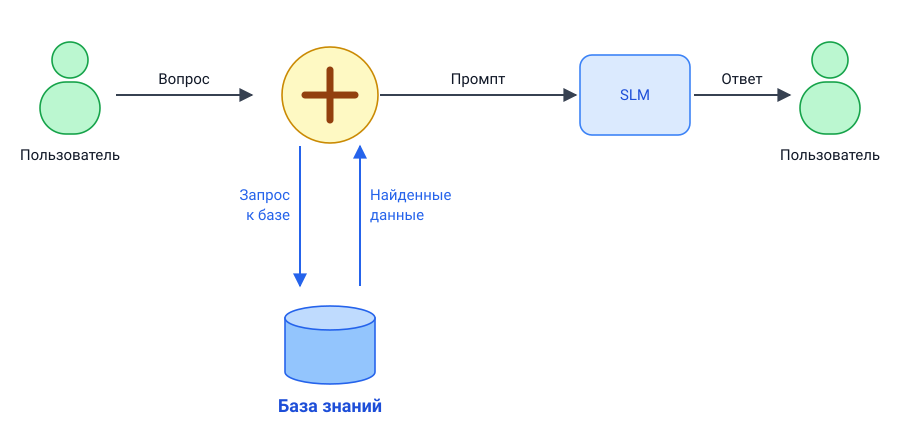</p>

### Простой RAG-проект

Вот шаги для реализации базовой генерации с дополнением поиском (Retrieval Augmented Generation, RAG):

- **Определите тип документов, которые будете использовать**: лучше всего подходят документы, из которых можно извлечь чистый и понятный текст. PDF-файлы могут создавать проблемы, поскольку они предназначены для печати, а не для извлечения осмысленного текста. Для работы с PDF лучше получить исходный документ или использовать специальные инструменты.

- **Разбейте текст на фрагменты (chunks)**: нельзя хранить текст как один длинный поток из-за ограничений размера контекста и риска путаницы. Разбиение (чанкинг) означает деление текста на более мелкие части. Текст можно разбивать разными способами: по количеству символов, токенов, слов, абзацев или разделов. Фрагменты также можно перекрывать.
- **Создайте эмбеддинги**: эмбеддинги — это числовые представления текста, которые отражают его смысл. Чтобы создать эмбеддинг, каждый фрагмент текста пропускается через определённую модель эмбеддингов. Модель выдаёт вектор, длина которого зависит от используемой модели. Для этой задачи нужно загрузить из Ollama одну (или несколько) [моделей эмбеддингов](https://ollama.com/blog/embedding-models). Ниже приведены примеры моделей эмбеддингов, доступных в Ollama:

| Модель | Размер параметров | Размер эмбеддинга |
|---|---|---|
| mxbai-embed-large | 334M | 1024 |
| nomic-embed-text | 137M | 768 |
| all-minilm | 23M | 384 |

    > Как правило, большие размеры эмбеддингов лучше передают тонкие нюансы входных данных. Однако их обработка требует больше вычислительных ресурсов, а большее число параметров должно увеличивать задержку (но и качество ответа).

- **Сохраните фрагменты и эмбеддинги в векторной базе данных**: нам нужен способ эффективно находить наиболее релевантные фрагменты текста для данного запроса, и здесь на помощь приходит векторная база данных. Мы будем использовать [Chromadb](https://www.trychroma.com/) — открытую векторную базу данных для задач ИИ, которая упрощает создание RAG, подключая знания, факты и навыки к LLM. Для каждого фрагмента хранятся и эмбеддинг, и исходный текст.

- **Соберите запрос (prompt)**: когда появляется вопрос, мы создаём для него эмбеддинг и запрашиваем у векторной базы данных наиболее похожие фрагменты. Затем выбираем несколько лучших результатов и включаем их текст в запрос.

Цель RAG — предоставить модели наиболее релевантную информацию из наших документов, чтобы она могла генерировать более точные и содержательные ответы. Поэтому реализуем простой пример SLM, который опирается на набор фактов о пчёлах («Bee Facts»).

В окружении `ollama` выполните в терминале команду установки Chromadb:

```bash
pip install ollama chromadb
```

Загрузим модель эмбеддингов среднего размера `nomic-embed-text`:

```bash
ollama pull nomic-embed-text
```

Создадим рабочий каталог:

```bash
cd Documents/OLLAMA/
mkdir RAG-simple-bee
cd RAG-simple-bee/
```

Создадим новый блокнот Jupyter [40-RAG-simple-bee](https://github.com/Mjrovai/EdgeML-with-Raspberry-Pi/blob/main/OLLAMA_SLMs/40-RAG-simple-bee.ipynb) для экспериментов.

Импортируем нужные библиотеки:

```python
import ollama
import chromadb
import time
```

Определим модели:

```python
EMB_MODEL = "nomic-embed-text"
MODEL = "llama3.2:3B"
```

Сначала нужно создать базу знаний о пчёлах. Для этого собираем релевантные документы и преобразуем их в векторные эмбеддинги. Эти эмбеддинги сохраняются в векторной базе данных, что позволяет быстро выполнять поиск по сходству в дальнейшем. Введём «документы» — базу «фактов о пчёлах» в виде списка:

```python
documents = [
    "Пчеловодство, также известное как апикультура, подразумевает \
    уход за пчелиными семьями, обычно в ульях, которым занимается человек.",
    "Самый распространённый вид пчёл, которых содержат люди, — \
    европейская медоносная пчела (Apis mellifera).",

    ...

    "В мире существует ещё около 20 000 видов пчёл.",
    "Только в Бразилии более 300 видов пчёл, и подавляющее большинство \
    из них, в отличие от западных медоносных пчёл, не жалит.",
    "В отчётах, написанных в 1577 году Гансом Стаденом, упоминаются три \
    местных вида пчёл, которых использовали коренные жители Бразилии.",
    "Коренные жители Бразилии использовали пчёл в медицинских и пищевых целях.",
    "Из отчёта Ганса Стадена: вероятные виды: mandaçaia (Melipona quadrifasciata), \
    mandaguari (Scaptotrigona postica) и jataí-amarela (Tetragonisca angustula)."
]
```

> Здесь не нужно «разбивать» документ на фрагменты, поскольку мы будем использовать каждый элемент списка как отдельный фрагмент.

Теперь создадим векторную базу эмбеддингов `bee_facts` и сохраним в ней документы:

```python
client = chromadb.Client()
collection = client.create_collection(name="bee_facts")

# Сохраняем каждый документ в векторной базе эмбеддингов
for i, d in enumerate(documents):
    response = ollama.embeddings(model=EMB_MODEL, prompt=d)
    embedding = response["embedding"]
    collection.add(
        ids=[str(i)], embeddings=[embedding], documents=[d]
    )
```

Теперь, когда «база знаний» создана, можно начинать запросы и извлекать из неё данные:

<p align="center">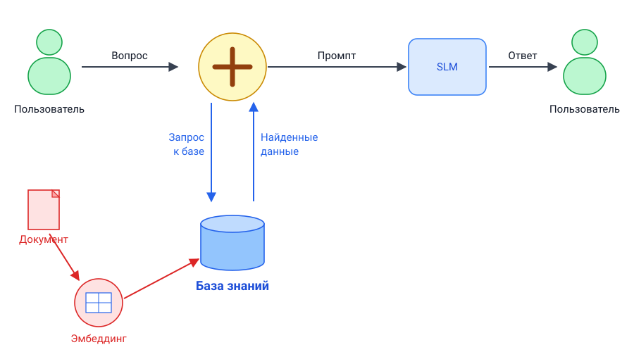</p>

**Запрос пользователя**: процесс начинается, когда пользователь задаёт вопрос, например: «Сколько пчёл в семье? Кто откладывает яйца и в каком количестве? А как насчёт распространённых вредителей и болезней?»

```python
prompt = "Сколько пчёл в семье? Кто откладывает яйца и в каком количестве? \
          А как насчёт распространённых вредителей и болезней?"
```

**Эмбеддинг запроса**: вопрос пользователя преобразуется в векторный эмбеддинг с помощью **той же модели эмбеддингов**, что использовалась для базы знаний.

```python
response = ollama.embeddings(prompt=prompt, model=EMB_MODEL)
```

**Поиск релевантных документов**: система ищет в базе знаний по эмбеддингу запроса наиболее релевантные документы (в данном случае 5 наиболее вероятных). Это делается поиском по сходству, который сравнивает эмбеддинг запроса с эмбеддингами документов в базе.

```python
results = collection.query(
    query_embeddings=[response["embedding"]], n_results=5
)
data = results["documents"]
```

**Дополнение запроса**: найденная релевантная информация объединяется с исходным запросом пользователя, и получается дополненный запрос. Теперь он содержит вопрос пользователя и важные факты из базы знаний.

```python
prompt = (
    f"Using this data: {data}. " f"Respond to this prompt: {prompt}"
)
```

**Генерация ответа**: дополненный запрос передаётся языковой модели, в данном случае `llama3.2:3b`. Модель использует этот обогащённый контекст, чтобы сформировать развёрнутый ответ. Параметры `temperature`, `top_k` и `top_p` задают степень случайности и качество генерируемого ответа.

```python
output = ollama.generate(
  model=MODEL,
  prompt = (
      f"Using this data: {data}. "
      f"Respond to this prompt: {prompt}"
  ),

  options={
    "temperature": 0.0,
    "top_k":10,
    "top_p":0.5
  }
)
```
**Передача ответа**: наконец, система возвращает пользователю сгенерированный ответ.

```python
print(output["response"])
```

```bash
Based on the provided data, here are the answers to your \
questions:

1. How many bees are in a colony?
A typical bee colony can contain between 20,000 and 80,000 bees.

2. Who lays eggs and how much?
The queen bee lays up to 2,000 eggs per day during peak seasons.

3. What about common pests and diseases?
Common pests and diseases that affect bees include varroa \
mites, hive beetles, and foulbrood.
```

Создадим функцию, которая поможет отвечать на новые вопросы:

```python
def rag_bees(prompt, n_results=5, temp=0.0, top_k=10, top_p=0.5):
    start_time = time.perf_counter()  # Запускаем таймер

    # Создаём эмбеддинг запроса и получаем релевантные данные
    response = ollama.embeddings(
      prompt=prompt,
      model=EMB_MODEL
    )

    results = collection.query(
      query_embeddings=[response["embedding"]],
      n_results=n_results
    )
    data = results['documents']

    # Генерируем ответ, объединяя запрос и полученные данные
    output = ollama.generate(
      model=MODEL,
      prompt = (
         f"Using this data: {data}. "
         f"Respond to this prompt: {prompt}"
      ),

      options={
        "temperature": temp,
        "top_k": top_k,
        "top_p": top_p
      }
    )

    print(output['response'])

    end_time = time.perf_counter()  # Останавливаем таймер
    elapsed_time = round(
       (end_time - start_time), 1
    )  # Вычисляем затраченное время

    print(
       f"\n[INFO] ==> The code for model: {MODEL}, "
       f"took {elapsed_time}s to generate the answer.\n"
    )
```

Теперь можно формулировать запросы и вызывать функцию:

```python
prompt = "Есть ли в Бразилии пчёлы?"
rag_bees(prompt)
```

```bash
Yes, bees are found in Brazil. According to the data, Brazil \
has more than 300 different bee species, and indigenous people \
in Brazil used bees for medicine and food purposes. \
Additionally, reports from 1577 mention three native bees \
used by indigenous people in Brazil.

 [INFO] ==> The code for model: llama3.2:3b, took 22.7s to \
 generate the answer.
```

Кстати, если модель поддерживает несколько языков, можно задавать вопросы и на другом языке (например, на португальском), даже если набор данных составлен на русском:

```python
prompt = "Existem abelhas no Brazil?"
rag_bees(prompt)
```

```bash
Sim, existem abelhas no Brasil! De acordo com o relato de Hans \
Staden, há três espécies de abelhas nativas do Brasil que \
foram mencionadas: mandaçaia (Melipona quadrifasciata), \
mandaguari (Scaptotrigona postica) e jataí-amarela \
(Tetragonisca angustula). Além disso, o Brasil é conhecido \
por ter mais de 300 espécies diferentes de abelhas, a \
maioria das quais não é agressiva e não põe veneno.

 [INFO] ==> The code for model: llama3.2:3b, took 54.6s to \
            generate the answer.
```

### Дальнейшие шаги

Протестированные небольшие языковые модели хорошо работают на периферии и с текстом, и с изображениями, однако при работе с изображениями задержка оказалась высокой. Сочетание специализированных моделей может дать лучшие результаты. Например, в реальных задачах модель обнаружения объектов (такая как YOLO) может получить общее описание и количество объектов на изображении. Затем это описание передаётся LLM, которая помогает извлечь ключевые выводы и определить действия.

Avi Baum, технический директор (CTO) Hailo, говорит:

> В обширном ландшафте искусственного интеллекта (ИИ) одним из самых интригующих путей стала эволюция ИИ на периферии. Этот путь привёл нас от классического машинного зрения к дискриминативному ИИ, усиливающему ИИ и теперь — к революционному рубежу генеративного ИИ. Каждый шаг приближал нас к будущему, в котором интеллектуальные системы органично встраиваются в нашу повседневную жизнь и предлагают опыт не только восприятия, но и создания — прямо на ладони.

<p align="center">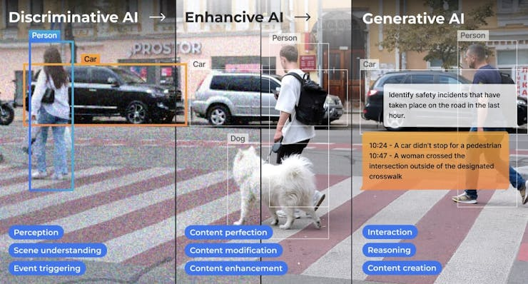</p>

## Итоги

Эта лабораторная работа показала, как Raspberry Pi 5 можно превратить в мощный ИИ-узел, способный запускать большие языковые модели (LLM) для анализа данных на месте и в реальном времени с помощью Ollama и Python. Универсальность и мощность Raspberry Pi в сочетании с возможностями лёгких LLM, таких как Llama 3.2 и LLaVa-Phi-3-mini, делают её отличной платформой для периферийных вычислений.

Потенциал запуска LLM на периферии выходит далеко за рамки простой обработки данных, как в примерах этой лабораторной работы. Вот несколько идей по использованию этого проекта:

**1. Умный дом**:

- Интегрируйте SLM, чтобы интерпретировать голосовые команды или анализировать данные датчиков для интеллектуальной автоматизации дома. Это может включать мониторинг и управление бытовыми устройствами в реальном времени, системами безопасности и управлением энергопотреблением, всё с локальной обработкой без облачных сервисов.

**2. Сбор и анализ данных в полевых условиях**:

- Развёртывайте SLM на Raspberry Pi в удалённых или мобильных установках для сбора и анализа данных в реальном времени. Это может применяться в сельском хозяйстве для мониторинга состояния посевов, в экологических исследованиях для отслеживания диких животных или при ликвидации последствий катастроф для оценки обстановки и управления ресурсами.

**3. Образовательные инструменты**:

- Создавайте интерактивные обучающие инструменты, которые используют SLM для мгновенной обратной связи, перевода и репетиторства. Это особенно полезно в регионах с ограниченным доступом к современным технологиям и интернету.

**4. Медицинские приложения**:

- Используйте SLM для медицинской диагностики и мониторинга пациентов. Они могут анализировать симптомы в реальном времени и предлагать возможные варианты лечения. Это можно интегрировать в платформы телемедицины или портативные медицинские устройства.

**5. Локальная бизнес-аналитика**:

- Внедряйте SLM в розничной торговле или малом бизнесе, чтобы анализировать поведение клиентов, управлять запасами и оптимизировать работу. Возможность обрабатывать данные локально обеспечивает конфиденциальность и снижает зависимость от внешних сервисов.

**6. Промышленный интернет вещей (IIoT)**:

- Интегрируйте SLM в промышленные системы IoT для предиктивного обслуживания, контроля качества и оптимизации процессов. Raspberry Pi может служить локальным блоком обработки данных, снижая задержки и повышая надёжность автоматизированных систем.

**7. Автономные транспортные средства**:

- Используйте SLM для обработки сенсорных данных автономных транспортных средств, обеспечивая принятие решений и навигацию в реальном времени. Это применимо к дронам, роботам и беспилотным автомобилям для повышения автономности и безопасности.

**8. Культурное наследие и туризм**:

- Внедряйте SLM для интерактивных и информативных экскурсий по объектам культурного наследия и музейным экспозициям. Посетители могут получать информацию в реальном времени, не имея доступа к интернету, что улучшает их впечатления.

**9. Художественные и творческие проекты**:

- Используйте SLM для анализа и генерации творческого контента: музыки, искусства и литературы. Это может стимулировать инновационные проекты в креативных индустриях и создавать уникальный интерактивный опыт на выставках и представлениях.

**10. Персонализированные вспомогательные технологии**:

- Разрабатывайте вспомогательные технологии для людей с инвалидностью, предоставляя персонализированную и адаптивную поддержку с помощью синтеза речи в реальном времени, перевода и других доступных инструментов.

## Ресурсы

- [Блокнот 10-Ollama_Python_Library](https://github.com/Mjrovai/EdgeML-with-Raspberry-Pi/blob/main/OLLAMA_SLMs/10-Ollama_Python_Library.ipynb)
- [Блокнот 20-Ollama_Function_Calling](https://github.com/Mjrovai/EdgeML-with-Raspberry-Pi/blob/main/OLLAMA_SLMs/20-Ollama_Function_Calling.ipynb)
- [Блокнот 30-Function_Calling_with_images](https://github.com/Mjrovai/EdgeML-with-Raspberry-Pi/blob/main/OLLAMA_SLMs/30-Function_Calling_with_images.ipynb)
- [Блокнот 40-RAG-simple-bee](https://github.com/Mjrovai/EdgeML-with-Raspberry-Pi/blob/main/OLLAMA_SLMs/40-RAG-simple-bee.ipynb)
- [Скрипт calc_distance_image на Python](https://github.com/Mjrovai/EdgeML-with-Raspberry-Pi/blob/main/OLLAMA_SLMs/calc_distance_image.py)
