# Обнаружение объектов

<p align="center">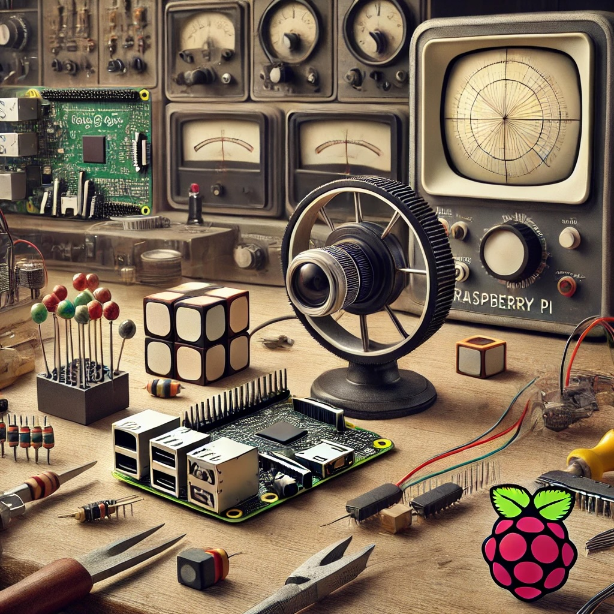<br>
<em>Промпт DALL·E: обложка для главы «Обнаружение объектов» руководства по Raspberry Pi, выполненная в том же винтажном стиле лаборатории электроники 1950-х, что и предыдущие обложки. На переднем плане на верстаке — колёса и кубики, похожие на предоставленные пользователем. Raspberry Pi с подключённым модулем камеры снимает эти объекты. Сцену окружают классические лабораторные инструменты: паяльники, резисторы и провода. На фоне лаборатории — старинное оборудование: осциллографы и ламповые радиоприёмники, сохраняющие детальное и ностальгическое ощущение эпохи. Логотипов и текста быть не должно.</em></p>

## Обзор

Продолжая разговор о классификации изображений, перейдём к более сложной задаче компьютерного зрения — обнаружению объектов. Классификация изображений присваивает одну метку всему изображению, а обнаружение объектов идёт дальше: оно находит и определяет положение нескольких объектов на одном изображении. Эта возможность открывает много новых применений и задач, особенно в периферийных вычислениях и IoT-устройствах вроде Raspberry Pi.

Обнаружение объектов объединяет задачи классификации и локализации. Оно не только определяет, какие объекты присутствуют на изображении, но и указывает их положение, например рисуя вокруг них ограничивающие рамки (bounding boxes). Эта дополнительная сложность делает обнаружение объектов более мощным инструментом для понимания визуальных сцен, но требует более сложных моделей и методов обучения.

В периферийном ИИ (edge AI), где мы работаем с ограниченными вычислительными ресурсами, эффективные модели обнаружения объектов становятся критически важными. Проблемы, с которыми мы столкнулись при классификации изображений — баланс между размером модели, скоростью инференса и точностью, — при обнаружении объектов усиливаются. Однако и отдача выше, поскольку обнаружение объектов позволяет гораздо более тонко и подробно анализировать визуальные данные.

Некоторые применения обнаружения объектов на периферийных устройствах:

1. Системы наблюдения и безопасности
2. Автономные автомобили и дроны
3. Контроль качества в промышленности
4. Мониторинг дикой природы
5. Приложения дополненной реальности

Приступая к обнаружению объектов, мы опираемся на концепции и методы, изученные в классификации изображений. Рассмотрим популярные архитектуры обнаружения, созданные для эффективности, например:

- одностадийные детекторы (Single Stage Detectors), такие как MobileNet и EfficientDet,
- FOMO (Faster Objects, More Objects) и
- YOLO (You Only Look Once — «ты смотришь только один раз»).

> Чтобы узнать больше о моделях обнаружения объектов, пройдите учебник «A Gentle Introduction to Object Recognition With Deep Learning» (на английском языке): [machinelearningmastery.com](https://machinelearningmastery.com/object-recognition-with-deep-learning/).

Мы будем исследовать эти модели обнаружения объектов с помощью:

- TensorFlow Lite Runtime (теперь переименован в [LiteRT](https://ai.google.dev/edge/litert)),
- Edge Impulse Linux Python SDK и
- Ultralytics

<p align="center">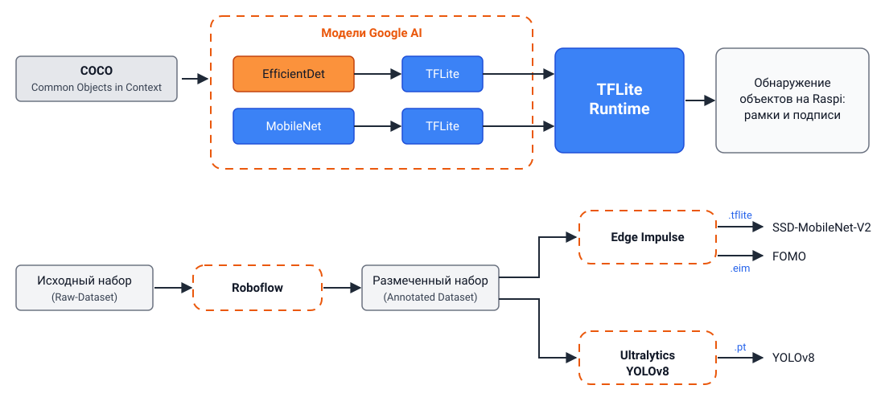</p>

На протяжении всей лабораторной работы мы разберём основы обнаружения объектов и то, чем оно отличается от классификации изображений. Также научимся обучать, дообучать, тестировать, оптимизировать и развёртывать популярные архитектуры обнаружения объектов на наборе данных, созданном с нуля.

### Основы обнаружения объектов

Обнаружение объектов опирается на основы классификации изображений, но значительно расширяет её возможности. Чтобы понять обнаружение объектов, сначала важно осознать ключевые различия с классификацией изображений:

#### Классификация изображений и обнаружение объектов

**Классификация изображений:**

- Присваивает одну метку всему изображению
- Отвечает на вопрос: «Какой основной объект или сцена на этом изображении?»
- Выдаёт одно предсказание класса для всего изображения

**Обнаружение объектов:**

- Находит и определяет положение нескольких объектов на изображении
- Отвечает на вопросы: «Какие объекты есть на этом изображении и где они находятся?»
- Выдаёт несколько предсказаний, каждое из которых состоит из метки класса и ограничивающей рамки

Чтобы наглядно показать эту разницу, рассмотрим пример:

<p align="center">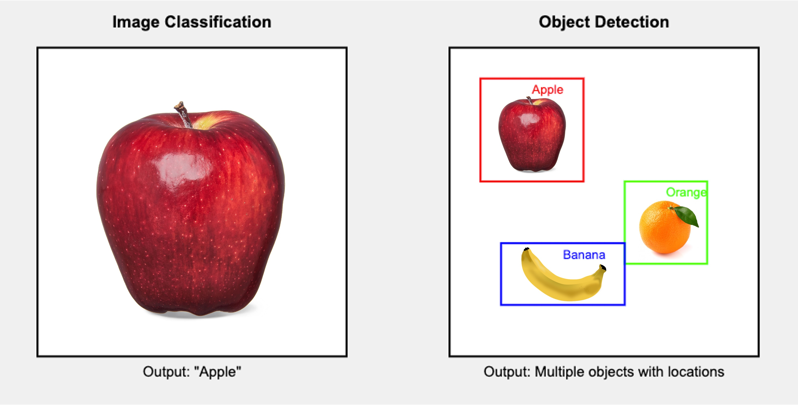</p>

Эта схема иллюстрирует ключевое различие: классификация изображений даёт одну метку для всего изображения, а обнаружение объектов определяет несколько объектов, их классы и их положение на изображении.

#### Ключевые компоненты обнаружения объектов

Системы обнаружения объектов обычно состоят из двух основных компонентов:

1. **Локализация объектов:** определяет, где на изображении находятся объекты. Обычно выдаёт ограничивающие рамки — прямоугольные области, охватывающие каждый найденный объект.

2. **Классификация объектов:** определяет класс или категорию каждого найденного объекта. Это похоже на классификацию изображений, но применяется к каждой локализованной области.

#### Проблемы обнаружения объектов

Обнаружение объектов сталкивается с рядом проблем, помимо тех, что есть у классификации изображений:

- Несколько объектов: на изображении может быть много объектов разных классов, размеров и положений.
- Разные масштабы: объекты могут выглядеть по-разному в зависимости от размера на изображении.
- Окклюзия: объекты могут быть частично скрыты или перекрывать друг друга.
- Загромождённый фон: отличить объекты от сложного фона может быть трудно.
- Работа в реальном времени: многие приложения требуют быстрого инференса, особенно на периферийных устройствах.

#### Подходы к обнаружению объектов

Есть два основных подхода к обнаружению объектов:

1. **Двухстадийные детекторы:** сначала предлагают интересующие области, а затем классифицируют каждую из них. Примеры: R-CNN и его варианты (Fast R-CNN, Faster R-CNN).

2. **Одностадийные детекторы:** предсказывают ограничивающие рамки (или центроиды) и вероятности классов за один проход сети. Примеры: YOLO (You Only Look Once), EfficientDet, SSD (Single Shot Detector) и FOMO (Faster Objects, More Objects). Они часто быстрее и лучше подходят для периферийных устройств вроде Raspberry Pi.

#### Метрики оценки

Обнаружение объектов использует метрики, отличные от метрик классификации изображений:

- **Intersection over Union (IoU):** измеряет перекрытие предсказанной и истинной ограничивающих рамок.
- **Mean Average Precision (mAP):** объединяет точность (precision) и полноту (recall) по всем классам и порогам IoU.
- **Кадры в секунду (FPS):** измеряют скорость обнаружения, что важно для приложений реального времени на периферийных устройствах.

## Обзор предобученных моделей обнаружения объектов

Как мы видели во введении, по изображению или видеопотоку модель обнаружения объектов может определить, какие объекты из известного набора могут присутствовать, и указать их положение на изображении.

> Некоторые распространённые модели можно протестировать онлайн на странице [Object Detection — MediaPipe Studio](https://mediapipe-studio.webapps.google.com/studio/demo/object_detector).

На [Kaggle](https://www.kaggle.com/models?id=298,130,299) можно найти наиболее распространённые предобученные модели TFLite для Raspi: [ssd_mobilenet_v1](https://www.kaggle.com/models/tensorflow/ssd-mobilenet-v1/tfLite) и [EfficientDet](https://www.kaggle.com/models/tensorflow/efficientdet/tfLite). Эти модели обучены на наборе данных COCO (Common Objects in Context), содержащем более 200 000 размеченных изображений в 91 категории. Скачайте модели и загрузите их в каталог `./models` на Raspi.

> Модели и метки COCO также можно найти на [GitHub](https://github.com/Mjrovai/EdgeML-with-Raspberry-Pi/tree/main/OBJ_DETEC/models).

В первой части лабораторной работы мы сосредоточимся на предобученной модели SSD-Mobilenet V1 размером $300\times 300$ и сравним её с EfficientDet-lite0 размером $320\times 320$, также обученной на наборе COCO 2017. Обе модели переведены в формат TensorFlow Lite (4,2 МБ для SSD Mobilenet и 4,6 МБ для EfficientDet).

> SSD-Mobilenet V2 или V3 рекомендуется для проектов с переносом обучения, но поскольку модель V1 в формате TFLite общедоступна, для этого обзора мы используем её.

<p align="center">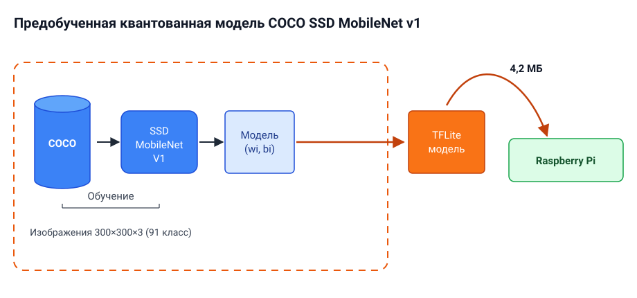</p>

### Настройка окружения TFLite

Повторим шаги, выполненные в предыдущей практической работе «Классификация изображений»:

- Обновление Raspberry Pi

- Установка необходимых библиотек

- Настройка виртуального окружения (необязательно, но рекомендуется)

```bash
source ~/tflite/bin/activate
```

- Установка среды выполнения TensorFlow Lite

- Установка дополнительных библиотек Python (внутри окружения)

### Создание рабочего каталога

Поскольку в прошлой лабораторной работе мы создали папку `Documents/TFLITE`, теперь создадим папки для этой лабораторной работы по обнаружению объектов:

```bash
cd Documents/TFLITE/
mkdir OBJ_DETECT
cd OBJ_DETECT
mkdir images
mkdir models
cd models
```

### Инференс и постобработка

Начнём новый [блокнот](https://github.com/Mjrovai/EdgeML-with-Raspberry-Pi/blob/main/OBJ_DETEC/notebooks/SSD_MobileNetV1.ipynb), чтобы пройти все шаги обнаружения объектов на изображении.

Импортируйте нужные библиотеки:

```python
import time
import numpy as np
import matplotlib.pyplot as plt
from PIL import Image
import tflite_runtime.interpreter as tflite
```

Загрузите модель TFLite и выделите тензоры:

```python
model_path = "./models/ssd-mobilenet-v1-tflite-default-v1.tflite"
interpreter = tflite.Interpreter(model_path=model_path)
interpreter.allocate_tensors()
```

Получите входные и выходные тензоры.

```python
input_details = interpreter.get_input_details()
output_details = interpreter.get_output_details()
```

**Входные данные** (input details) сообщают, как модели нужно подавать изображение. Форма `(1, 300, 300, 3)` с dtype `uint8` означает, что ненормализованное изображение (значения пикселей от 0 до 255) размером $(300\times 300\times 3)$ подаётся по одному (размерность батча: 1).

**Выходные данные** (output details) включают не только метки («classes») и вероятности («scores»), но и относительное положение ограничивающих рамок («boxes») — где на изображении находится объект, — а также количество найденных объектов («num_detections»). Выходные данные также показывают, что модель может обнаружить **не более 10 объектов** на изображении.

<p align="center"></p>

Итак, для приведённого примера — того же изображения кота, что и в лабораторной по классификации изображений, — мы получаем **вероятность 76 %** обнаружения объекта с **ID класса 16** в области, ограниченной **ограничивающей рамкой [0.028011084, 0.020121813, 0.9886069, 0.802299]**. Четыре числа соответствуют `ymin`, `xmin`, `ymax` и `xmax` — координатам рамки.

Учитывая, что **y** идёт сверху вниз (от `ymin` до `ymax`), а **x** — слева направо (от `xmin` до `xmax`), мы фактически получаем координаты левого верхнего и правого нижнего углов. Зная эти два угла и размер изображения, можно нарисовать прямоугольник вокруг объекта, как показано на рисунке ниже:

<p align="center">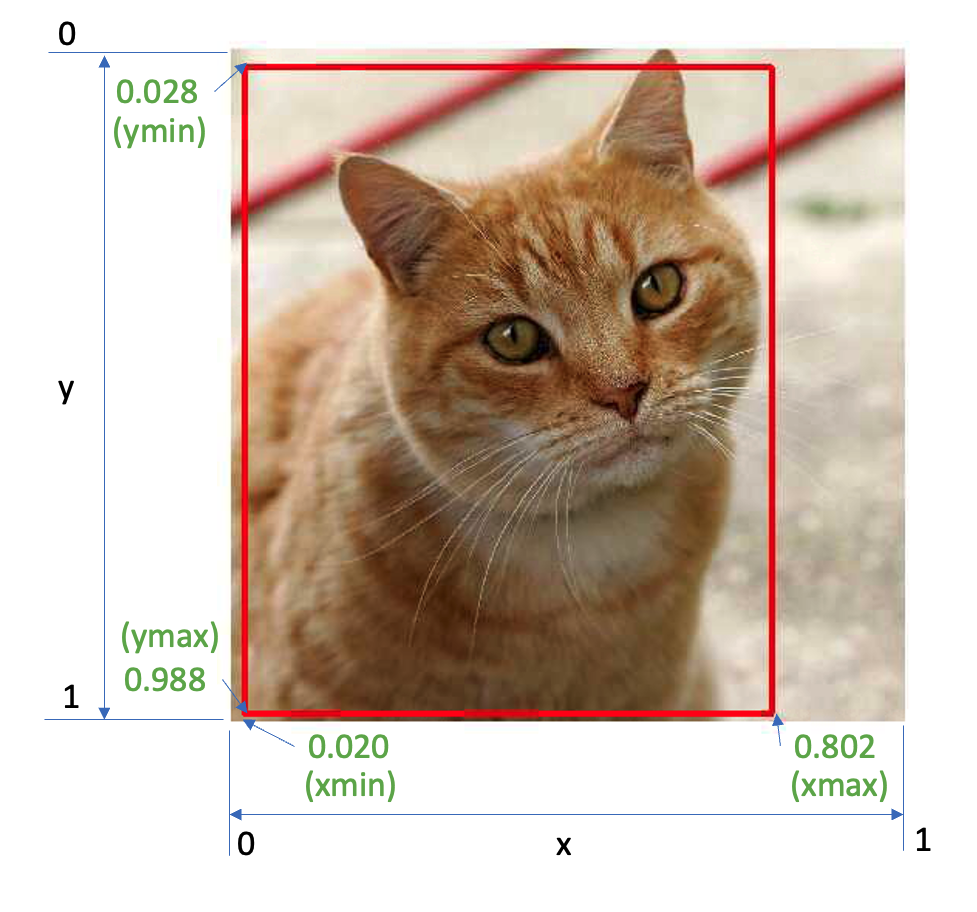</p>

Далее нужно определить, что означает ID класса 16. Открыв файл `coco_labels.txt` как список, видим, что каждый элемент имеет свой индекс; для индекса 16 получаем, как и ожидалось, `cat`. Вероятность — это значение, возвращаемое из score.

Теперь загрузим несколько изображений с несколькими объектами для проверки.

```python
img_path = "./images/cat_dog.jpeg"
orig_img = Image.open(img_path)

# Выводим изображение
plt.figure(figsize=(8, 8))
plt.imshow(orig_img)
plt.title("Original Image")
plt.show()
```

<p align="center">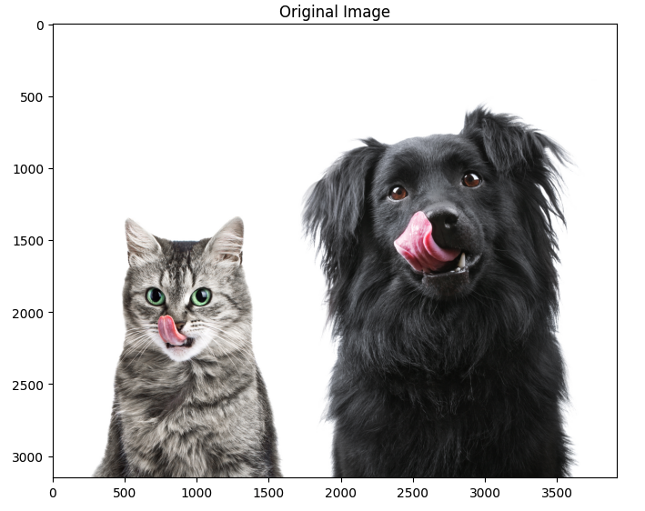</p>

На основе входных данных предобработаем изображение, изменив его форму и добавив размерность:

```python
img = orig_img.resize(
    (input_details[0]["shape"][1], input_details[0]["shape"][2])
)
input_data = np.expand_dims(img, axis=0)
input_data.shape, input_data.dtype
```

Новая форма `input_data` — `(1, 300, 300, 3)` с dtype `uint8`, что соответствует ожиданиям модели.

Используя `input_data`, запустим интерпретатор, измерим задержку и получим выход:

```python
start_time = time.time()
interpreter.set_tensor(input_details[0]["index"], input_data)
interpreter.invoke()
end_time = time.time()
inference_time = (
    end_time - start_time
) * 1000  # Переводим в миллисекунды
print("Inference time: {:.1f}ms".format(inference_time))
```

Задержка составляет около 800 мс, и мы получаем 4 отдельных выхода:

```python
boxes = interpreter.get_tensor(output_details[0]["index"])[0]
classes = interpreter.get_tensor(output_details[1]["index"])[0]
scores = interpreter.get_tensor(output_details[2]["index"])[0]
num_detections = int(
    interpreter.get_tensor(output_details[3]["index"])[0]
)
```

При беглом осмотре видно, что модель обнаружила 2 объекта с оценкой выше 0,5:

```python
for i in range(num_detections):
    if scores[i] > 0.5:  # Порог уверенности
        print(f"Object {i}:")
        print(f"  Bounding Box: {boxes[i]}")
        print(f"  Confidence: {scores[i]}")
        print(f"  Class: {classes[i]}")
```

<p align="center">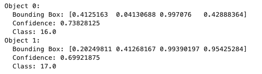</p>

И можно также визуализировать результаты:

```python
plt.figure(figsize=(12, 8))
plt.imshow(orig_img)
for i in range(num_detections):
    if scores[i] > 0.5:  # При необходимости настройте порог
        ymin, xmin, ymax, xmax = boxes[i]
        (left, right, top, bottom) = (
            xmin * orig_img.width,
            xmax * orig_img.width,
            ymin * orig_img.height,
            ymax * orig_img.height,
        )
        rect = plt.Rectangle(
            (left, top),
            right - left,
            bottom - top,
            fill=False,
            color="red",
            linewidth=2,
        )
        plt.gca().add_patch(rect)
        class_id = int(classes[i])
        class_name = labels[class_id]
        plt.text(
            left,
            top - 10,
            f"{class_name}: {scores[i]:.2f}",
            color="red",
            fontsize=12,
            backgroundcolor="white",
        )
```

<p align="center">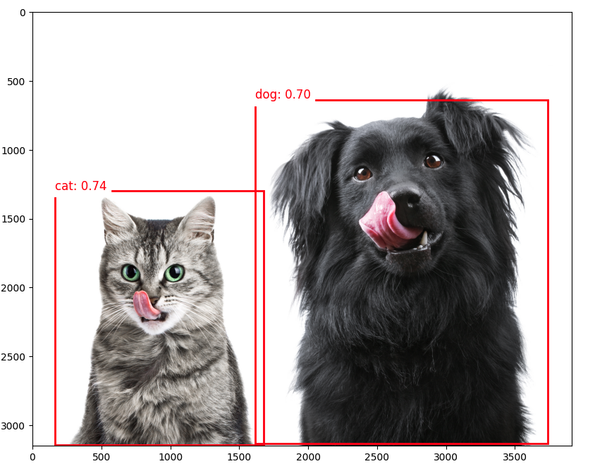</p>

### EfficientDet

EfficientDet технически не является моделью SSD (Single Shot Detector), однако имеет общие черты и опирается на те же идеи, что SSD и другие архитектуры обнаружения объектов:

1. EfficientDet:
    - Разработана исследователями Google в 2019 году
    - В качестве магистральной сети (backbone) использует EfficientNet
    - Применяет новую двунаправленную пирамиду признаков (BiFPN)
    - Использует составное масштабирование (compound scaling), чтобы эффективно масштабировать магистральную сеть и компоненты обнаружения

2. Сходство с SSD:
    - Оба являются одностадийными детекторами: локализация и классификация объектов выполняются за один проход сети
    - Оба используют карты признаков разного масштаба, чтобы обнаруживать объекты разных размеров

3. Ключевые различия:
    - Магистраль: SSD обычно использует VGG или MobileNet, а EfficientDet — EfficientNet
    - Слияние признаков: SSD использует простую пирамиду признаков, а EfficientDet — более продвинутую BiFPN
    - Метод масштабирования: EfficientDet вводит составное масштабирование для всех компонентов сети

4. Преимущества EfficientDet:
    - Как правило, обеспечивает лучший компромисс между точностью и эффективностью, чем SSD и многие другие модели обнаружения объектов
    - Более гибкое масштабирование позволяет получить семейство моделей с разными компромиссами между размером и производительностью

Хотя EfficientDet не является моделью SSD, её можно рассматривать как эволюцию одностадийных архитектур обнаружения: она использует более продвинутые методы для повышения эффективности и точности. При работе с EfficientDet можно ожидать выходную структуру, похожую на SSD (например, ограничивающие рамки и оценки классов).

> На GitHub можно найти ещё один [блокнот](https://github.com/Mjrovai/EdgeML-with-Raspberry-Pi/blob/main/OBJ_DETEC/notebooks/SSD_EfficientDet.ipynb), в котором исследуется модель EfficientDet — по аналогии с SSD MobileNet.

## Проект обнаружения объектов

Теперь разработаем полноценный проект обнаружения объектов — от сбора данных до обучения и развёртывания. Как и в проекте классификации изображений, обученная и сконвертированная модель будет использоваться для инференса.

Мы будем использовать один и тот же набор данных для обучения трёх моделей: SSD-MobileNet V2, FOMO и YOLO.

### Цель

Любой проект машинного обучения начинается с цели. Представим, что мы работаем на промышленном предприятии и должны сортировать и подсчитывать **колёса** и специальные **коробки**.

<p align="center">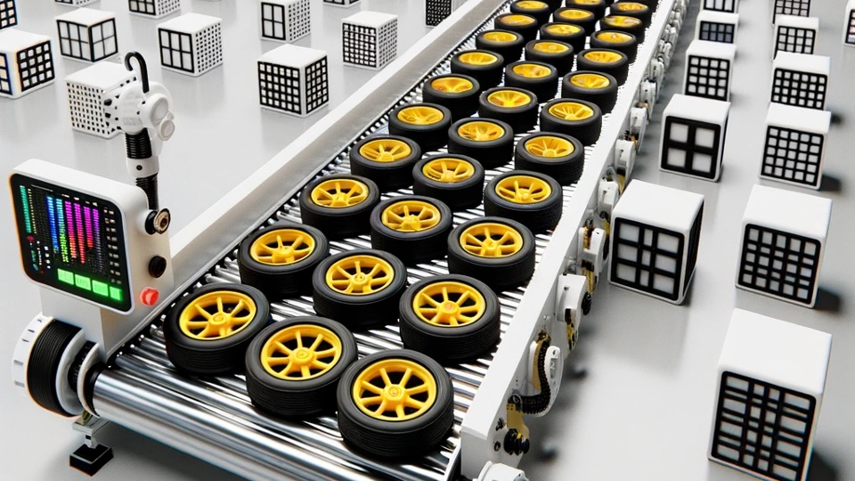</p>

Иными словами, нам нужна многометочная классификация (multi-label classification), где на каждом изображении может присутствовать три класса:

- Фон (нет объектов)
- Коробка
- Колесо

### Сбор исходных данных

Определив цель проекта машинного обучения, переходим к следующему, самому важному шагу — сбору набора данных. Исходный набор без меток можно создать с помощью телефона, Raspi или их комбинации. Воспользуемся простым веб-приложением на нашей Raspberry Pi, чтобы просматривать в браузере снимки в формате `QVGA (320 x 240)`.

Из репозитория на GitHub возьмите Python-скрипт [get_img_data.py](https://github.com/Mjrovai/EdgeML-with-Raspberry-Pi/blob/main/IMG_CLASS/python_scripts/get_img_data.py) и запустите его в терминале:

```bash
python3 get_img_data.py
```

Откройте веб-интерфейс:

- На самой Raspberry Pi (если есть графический интерфейс): откройте веб-браузер и перейдите по адресу `http://localhost:5000`
- С другого устройства в той же сети: откройте веб-браузер и перейдите по адресу `http://<raspberry_pi_ip>:5000` (замените `<raspberry_pi_ip>` на IP-адрес вашей Raspberry Pi). Например: `http://192.168.4.210:5000/`

<p align="center">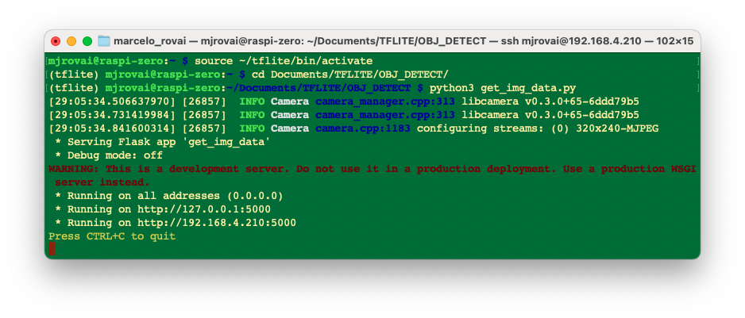</p>

Python-скрипт создаёт веб-интерфейс для захвата и организации наборов изображений с помощью Raspberry Pi и её камеры. Он удобен для проектов машинного обучения, которым нужны размеченные изображения, или, как в нашем случае, изображения без разметки.

Откройте веб-интерфейс в браузере, введите общую метку для изображений, которые хотите снять, и нажмите `Start Capture`.

<p align="center">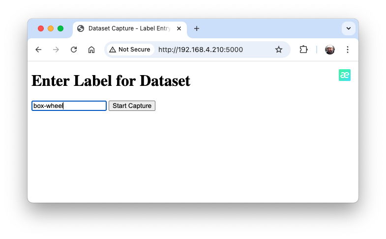</p>

> Обратите внимание: снятые изображения будут иметь несколько меток, которые определяются позже.

Используйте живой предпросмотр, чтобы навести камеру, и нажмите `Capture Image`, чтобы сохранить изображения под текущей меткой (в данном случае `box-wheel`).

<p align="center">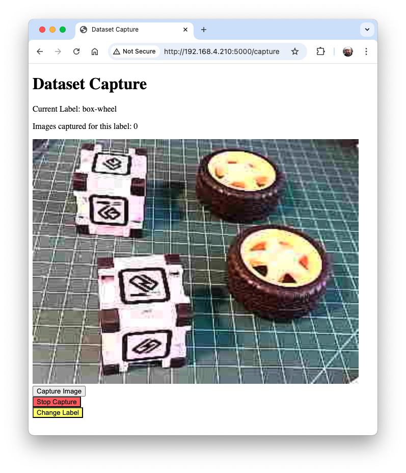</p>

Когда изображений станет достаточно, нажмите `Stop Capture`. Снятые изображения сохраняются в папку `dataset/box-wheel`:

<p align="center">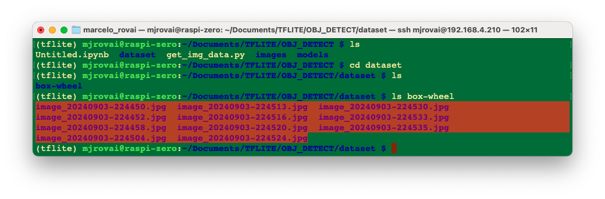</p>

> Снимите около 60 изображений. Старайтесь снимать с разных ракурсов, на разных фонах и при разном освещении. Для переноса созданного исходного набора на основной компьютер можно использовать Filezilla.

### Разметка данных

Следующий шаг проекта обнаружения объектов — создание размеченного набора данных. Нужно разметить исходные изображения, обведя рамками объекты на каждом снимке (коробку и колесо). Для разметки можно использовать инструменты вроде [LabelImg](https://pypi.org/project/labelImg/), [CVAT](https://www.cvat.ai/), [Roboflow](https://roboflow.com/annotate) или даже [Edge Impulse Studio](https://edgeimpulse.com/). Инструмент Edge Impulse мы уже изучили в других лабораторных, а здесь воспользуемся Roboflow.

> Мы используем бесплатную версию Roboflow по двум основным причинам. Во-первых, там есть автоматическая разметка (auto-labeler). Во-вторых, размеченный набор доступен во многих форматах и может использоваться как в Edge Impulse Studio (его мы применим для обучения MobileNet V2 и FOMO), так и в Colab (например, для обучения YOLOv8). Размеченный набор в Edge Impulse (с бесплатным аккаунтом) нельзя использовать для обучения на других платформах.

Загрузите исходный набор данных в [Roboflow](https://roboflow.com/). Создайте там бесплатный аккаунт и новый проект, например «box-versus-wheel».

<p align="center">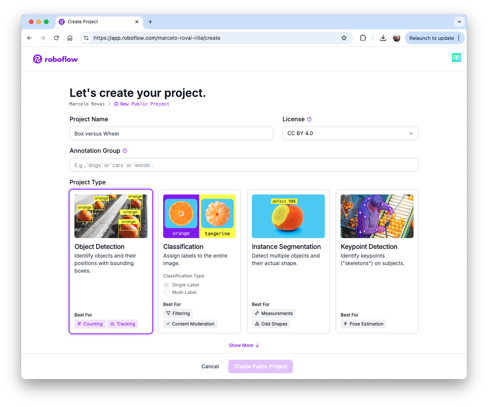</p>

> Подробно процесс работы в Roboflow описывать не будем, так как для него существует много обучающих материалов.

#### Разметка изображений

Когда проект создан и набор данных загружен, выполните разметку с помощью инструмента «Auto-Label». Можно также загружать изображения только с фоном: их нужно сохранить без разметки.

<p align="center">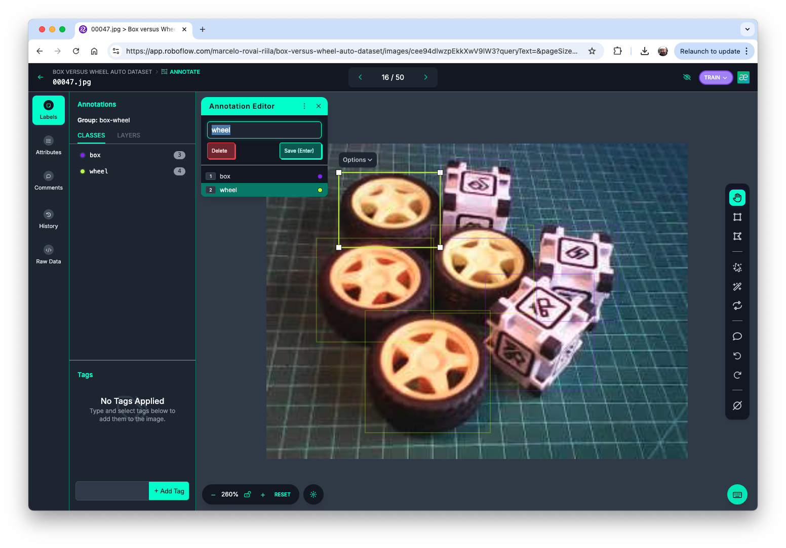</p>

После того как все изображения размечены, их нужно разделить на обучающую, валидационную и тестовую выборки.

<p align="center">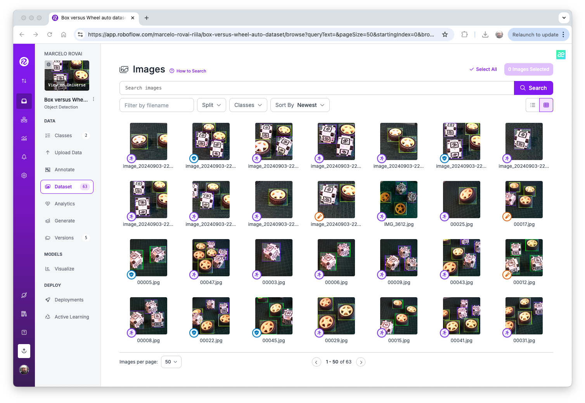</p>

#### Предобработка данных

Последний шаг с набором данных — предобработка для получения финальной версии для обучения. Изменим размер всех изображений до $320\times 320$ и создадим аугментированные версии каждого изображения (аугментация), чтобы получить новые обучающие примеры, на которых модель сможет учиться.

Для аугментации мы будем поворачивать изображения (на ±15°), обрезать их, а также менять яркость и экспозицию.

<p align="center">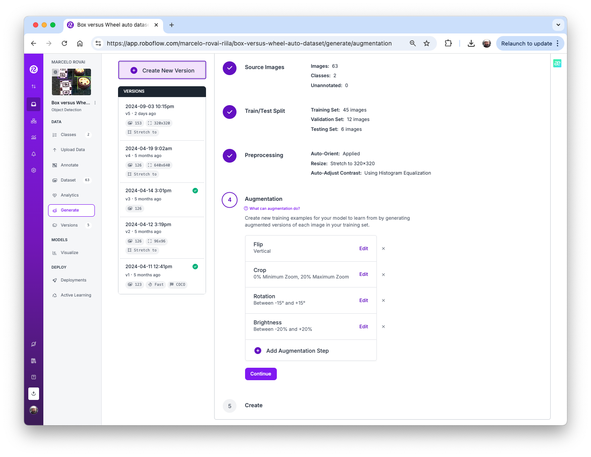</p>

В конце процесса у нас будет 153 изображения.

<p align="center">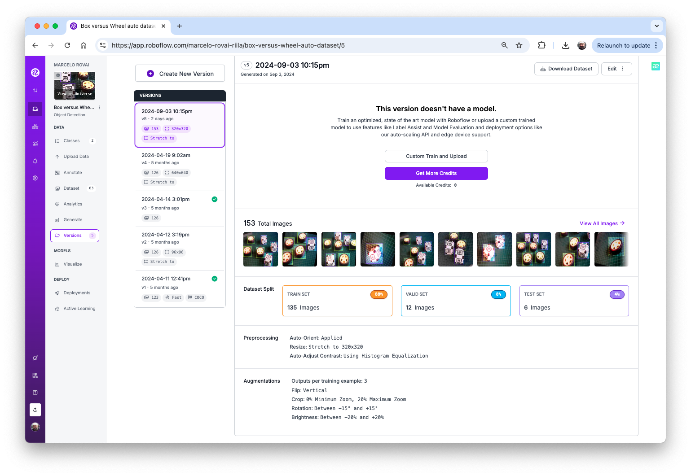</p>

Теперь экспортируем размеченный набор данных в формате, который понимают Edge Impulse, Ultralytics и другие фреймворки и инструменты, например `YOLOv8`. Скачаем архивную версию набора данных на рабочий стол.

<p align="center">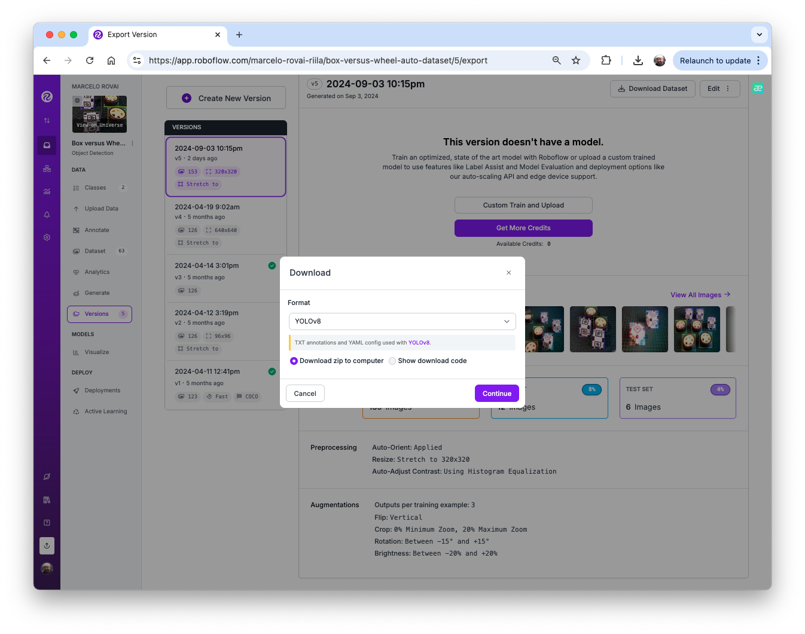</p>

Здесь можно посмотреть, как устроен набор данных:

<p align="center">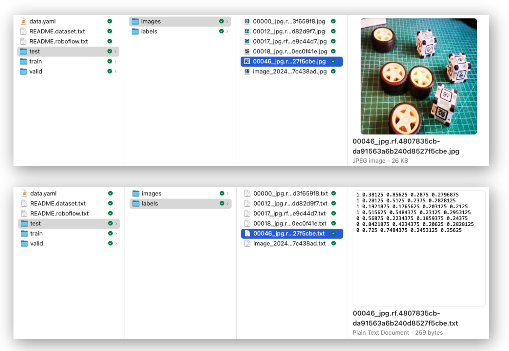</p>

Есть 3 отдельные папки — по одной на каждую выборку (`train`, `test`, `valid`). В каждой из них есть по 2 подпапки: `images` и `labels`. Изображения хранятся как **image_id.jpg**, а файлы разметки — как **image_id.txt**, где «image_id» уникален для каждого снимка.

Формат файла разметки: `class_id` и `координаты ограничивающей рамки`, где в нашем случае class_id равен `0` для `box` и `1` для `wheel`. Числовые идентификаторы (0, 1, 2...) следуют алфавитному порядку названий классов.

Файл `data.yaml` содержит информацию о наборе данных, в том числе названия классов (`names: ['box', 'wheel']`) в формате YOLO.

Вот и всё! Теперь можно начинать обучение в Edge Impulse Studio (как мы сделаем на следующем шаге), в Ultralytics (как будем делать, когда будем рассматривать YOLO) или даже обучить модель с нуля в Colab (как мы делали с набором Cifar-10 в лабораторной по классификации изображений).

> Предобработанный набор данных можно найти на [сайте Roboflow](https://universe.roboflow.com/marcelo-rovai-riila/box-versus-wheel-auto-dataset).

## Обучение модели SSD MobileNet в Edge Impulse Studio

Перейдите на [сайт Edge Impulse Studio](https://www.edgeimpulse.com/), войдите в систему (**Login**) или создайте аккаунт и начните новый проект.

> Можно клонировать проект, разработанный для этой лабораторной работы: [Raspi - Object Detection](https://studio.edgeimpulse.com/public/515477/live).

На вкладке проекта `Dashboard` прокрутите вниз до блока **Project info** и в поле Labeling method выберите `Bounding boxes (object detection)`.

### Загрузка размеченных данных

В Studio откройте вкладку `Data acquisition` и в разделе `UPLOAD DATA` загрузите исходный набор данных с компьютера.

Можно использовать опцию `Select a folder`, выбрав, например, папку `train` на компьютере, которая содержит две подпапки: `images` и `labels`. Выберите формат меток «YOLO TXT», загрузите данные в категорию `Training` и нажмите `Upload data`.

<p align="center">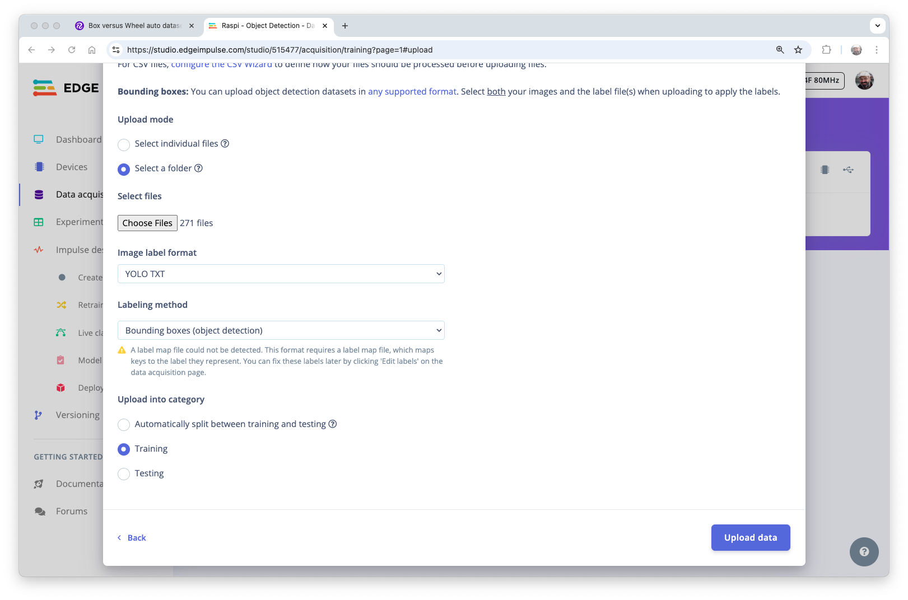</p>

Повторите процедуру для тестовых данных (загрузите обе папки: test и validation). По окончании загрузки у вас будет размеченный набор из 153 изображений, разделённый на обучающую и тестовую выборки (84 % и 16 %).

> Обратите внимание: метки будут храниться в файлах меток как `0` и `1`, которые соответствуют `box` и `wheel`.

<p align="center">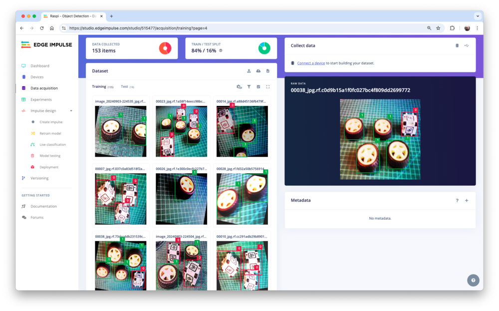</p>

### Проектирование Impulse

Первое, что нужно задать на шаге `Create impulse`, — целевое устройство для развёртывания. Появится всплывающее окно. Мы выберем Raspberry Pi 4 — промежуточное устройство между Raspi-Zero и Raspi-5.

> Этот выбор не влияет на обучение: он лишь даёт представление о задержке модели на этом конкретном устройстве.

<p align="center">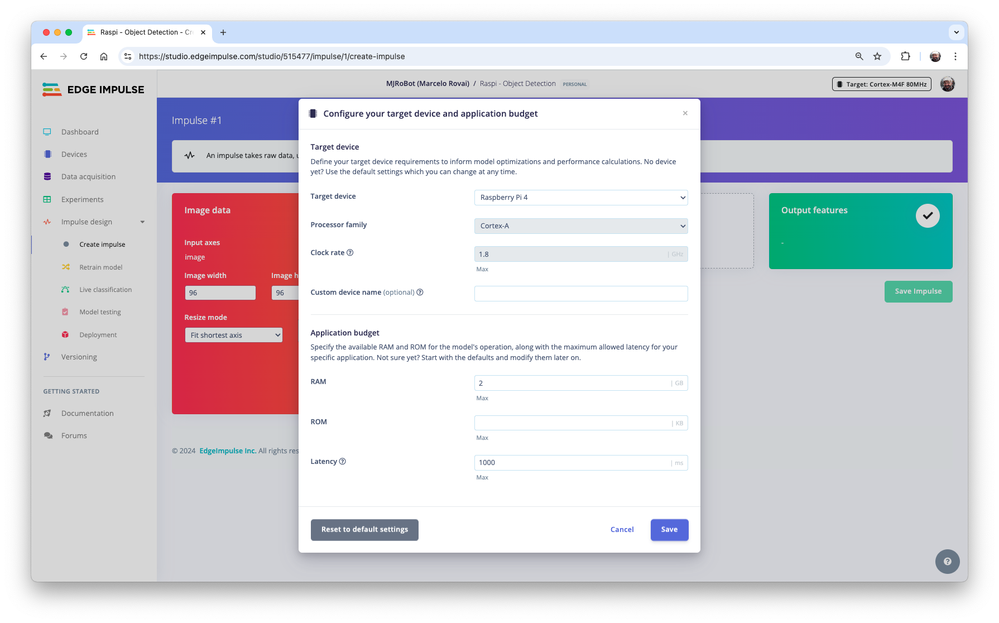</p>

На этом этапе нужно определить:

- **Предобработку**: изменение размера отдельных изображений. В нашем случае изображения уже были предобработаны в Roboflow до $320{\times}320$, поэтому оставим как есть. Изменение размера здесь не важно, поскольку изображения квадратные. Если вы загрузите прямоугольное изображение, его нужно сжать до квадрата (без обрезки). Затем можно определить, преобразовывать ли изображения из RGB в оттенки серого.
- **Проектирование модели**: в нашем случае «Object Detection» (обнаружение объектов).

<p align="center">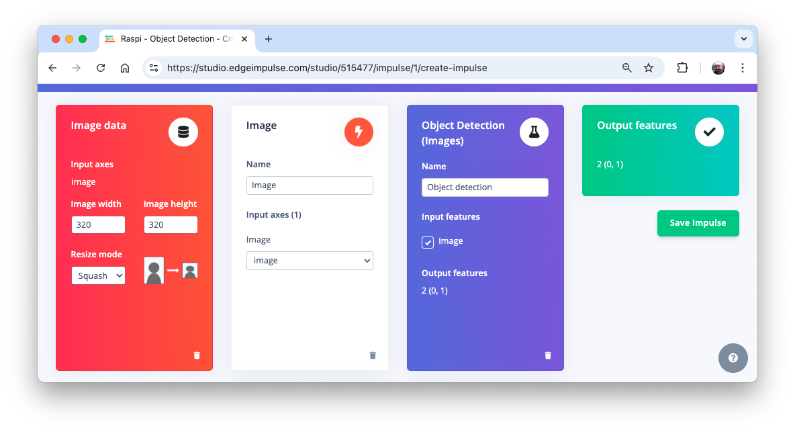</p>

### Предобработка всего набора данных

В разделе `Image` выберите **Color depth** как `RGB` и нажмите `Save parameters`.

<p align="center">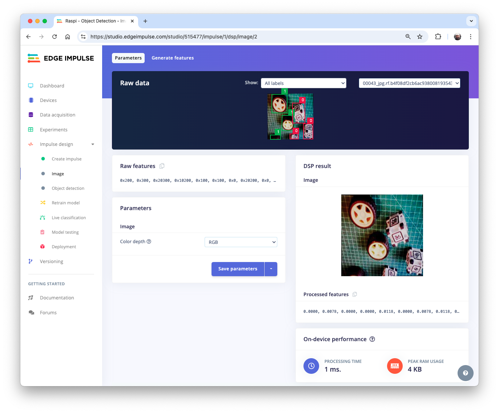</p>

Studio автоматически переходит к следующему разделу `Generate features`, где обрабатываются все образцы. В итоге получаем 480 объектов: 207 коробок и 273 колеса.

<p align="center">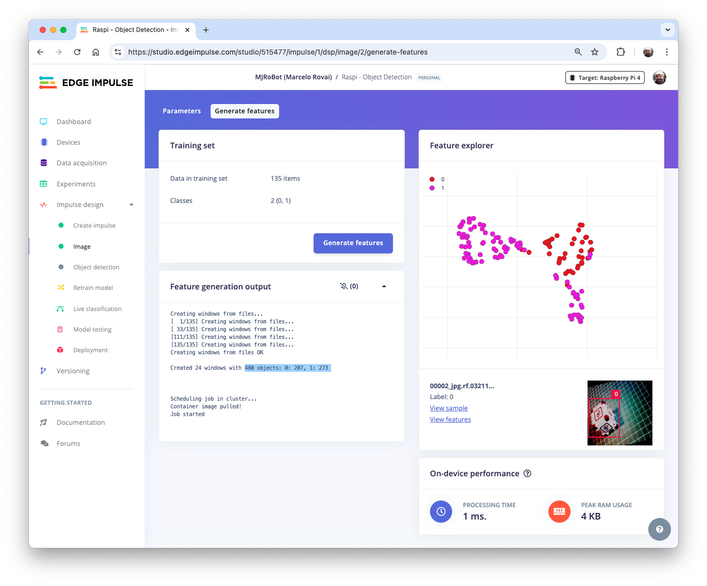</p>

Исследователь признаков (feature explorer) показывает, что после генерации признаков все образцы хорошо разделяются.

### Проектирование модели, обучение и тестирование

Для обучения нужно выбрать предобученную модель. Используем **MobileNetV2 SSD FPN-Lite (только 320x320)**. Это предобученная модель обнаружения объектов, которая находит до 10 объектов на изображении и выдаёт ограничивающую рамку для каждого из них. Размер модели — около 3,7 МБ. Она принимает RGB-вход размером $320{\times}320$ пикселей.

Гиперпараметры обучения:

- Эпохи: 25
- Размер батча: 32
- Скорость обучения (Learning Rate): 0,15

Для валидации во время обучения будет отложено 20 % набора данных (*validation_dataset*).

<p align="center">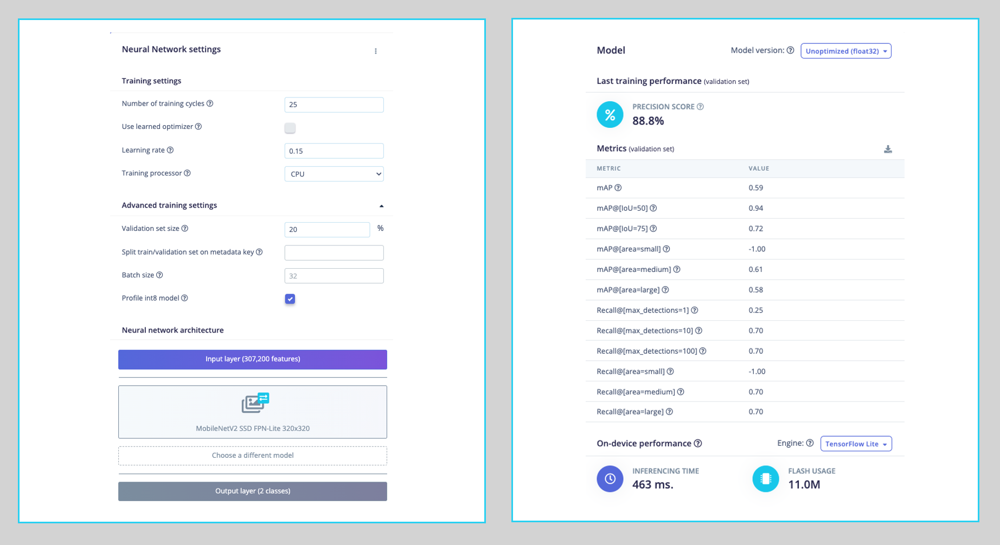</p>

В итоге модель получает общую точность (precision) по метрике COCO mAP 88,8 %, что выше результата на тестовых данных (83,3 %).

### Развёртывание модели

Есть два способа развернуть модель:

- **Модель TFLite**: позволяет развернуть обученную модель в формате `.tflite`, чтобы Raspi запускал её с помощью Python.
- **Linux (AARCH64)**: бинарный файл для Linux (AARCH64) реализует протокол Edge Impulse Linux, который позволяет запускать модели на любой плате разработки на базе Linux, с SDK, например для Python. Подробнее см. в [документации и инструкциях по установке](https://docs.edgeimpulse.com/docs/edge-impulse-for-linux).

Развернём **модель TFLite**. На вкладке `Dashboard` перейдите к модели Transfer learning (int8 quantized) и нажмите значок загрузки:

<p align="center">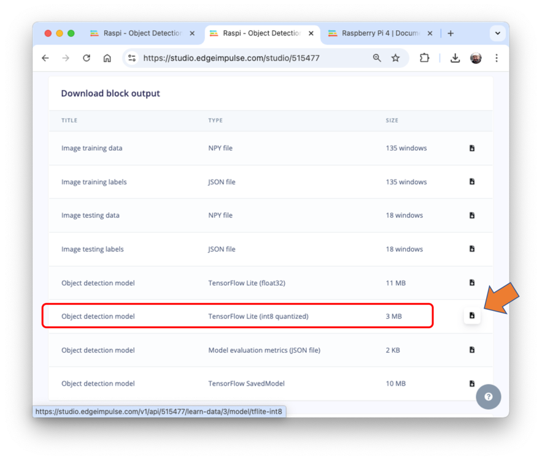</p>

Перенесите модель с компьютера в папку `./models` на Raspi, а также сделайте снимки или получите изображения для инференса и сохраните их в папку `./images`.

### Инференс и постобработка

Инференс можно выполнить так, как описано в разделе «Обзор предобученных моделей обнаружения объектов». Начнём новый [блокнот](https://github.com/Mjrovai/EdgeML-with-Raspberry-Pi/blob/main/OBJ_DETEC/notebooks/EI-SSD-MobileNetV2.ipynb), чтобы пройти все шаги по обнаружению кубиков и колёс на изображении.

Импортируйте нужные библиотеки:

```python
import time
import numpy as np
import matplotlib.pyplot as plt
import matplotlib.patches as patches
from PIL import Image
import tflite_runtime.interpreter as tflite
```

Укажите путь к модели и метки:

```python
model_path = "./models/ei-raspi-object-detection-SSD-MobileNetv2-320x0320-int8.lite"
labels = ["box", "wheel"]
```

> Помните, что модель будет выводить ID классов как значения (0 и 1), следуя алфавитному порядку названий классов.

Загрузите модель, выделите тензоры и получите информацию о входных и выходных тензорах:

```python
# Загружаем модель TFLite
interpreter = tflite.Interpreter(model_path=model_path)
interpreter.allocate_tensors()

# Получаем входные и выходные тензоры
input_details = interpreter.get_input_details()
output_details = interpreter.get_output_details()
```

Важное отличие: `dtype` входных данных модели теперь `int8`, то есть входные значения лежат в диапазоне от –128 до +127, тогда как каждый пиксель нашего исходного изображения — от 0 до 255. Поэтому изображение нужно предобработать. Проверим:

```python
input_dtype = input_details[0]["dtype"]
input_dtype
```

```
numpy.int8
```

Теперь откроем изображение и выведем его:

```python
# Загружаем изображение
img_path = "./images/box_2_wheel_2.jpg"
orig_img = Image.open(img_path)

# Выводим изображение
plt.figure(figsize=(6, 6))
plt.imshow(orig_img)
plt.title("Original Image")
plt.show()
```

<p align="center">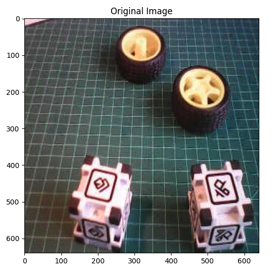</p>

И выполним предобработку:

```python
scale, zero_point = input_details[0]["quantization"]
img = orig_img.resize(
    (input_details[0]["shape"][1], input_details[0]["shape"][2])
)
img_array = np.array(img, dtype=np.float32) / 255.0
img_array = (
    (img_array / scale + zero_point).clip(-128, 127).astype(np.int8)
)
input_data = np.expand_dims(img_array, axis=0)
```

Проверим входные данные, чтобы убедиться, что входной тензор соответствует ожиданиям модели:

```python
input_data.shape, input_data.dtype
```

```
((1, 320, 320, 3), dtype('int8'))
```

Теперь выполним инференс. Также вычислим задержку модели:

```python
# Инференс на Raspi-Zero
start_time = time.time()
interpreter.set_tensor(input_details[0]["index"], input_data)
interpreter.invoke()
end_time = time.time()
inference_time = (
    end_time - start_time
) * 1000  # Переводим в миллисекунды
print("Inference time: {:.1f}ms".format(inference_time))
```

На инференс модель затратит около 600 мс на Raspi-Zero, то есть примерно в 5 раз дольше, чем на Raspi-5.

Теперь получим классы обнаруженных объектов, координаты их ограничивающих рамок и вероятности:

```python
boxes = interpreter.get_tensor(output_details[1]["index"])[0]
classes = interpreter.get_tensor(output_details[3]["index"])[0]
scores = interpreter.get_tensor(output_details[0]["index"])[0]
num_detections = int(
    interpreter.get_tensor(output_details[2]["index"])[0]
)
```

```python
for i in range(num_detections):
    if scores[i] > 0.5:  # Порог уверенности
        print(f"Object {i}:")
        print(f"  Bounding Box: {boxes[i]}")
        print(f"  Confidence: {scores[i]}")
        print(f"  Class: {classes[i]}")
```

<p align="center">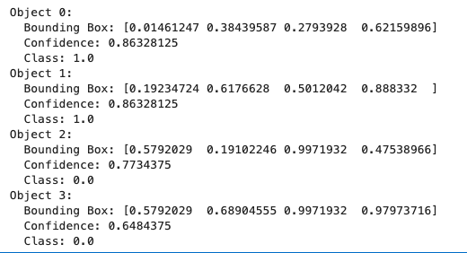</p>

По результатам видно, что обнаружено 4 объекта: два с ID класса 0 (`box`) и два с ID класса 1 (`wheel`). Это верно!

Визуализируем результат при пороге (`threshold`) 0,5:

```python
threshold = 0.5
plt.figure(figsize=(6, 6))
plt.imshow(orig_img)
for i in range(num_detections):
    if scores[i] > threshold:
        ymin, xmin, ymax, xmax = boxes[i]
        (left, right, top, bottom) = (
            xmin * orig_img.width,
            xmax * orig_img.width,
            ymin * orig_img.height,
            ymax * orig_img.height,
        )
        rect = plt.Rectangle(
            (left, top),
            right - left,
            bottom - top,
            fill=False,
            color="red",
            linewidth=2,
        )
        plt.gca().add_patch(rect)
        class_id = int(classes[i])
        class_name = labels[class_id]
        plt.text(
            left,
            top - 10,
            f"{class_name}: {scores[i]:.2f}",
            color="red",
            fontsize=12,
            backgroundcolor="white",
        )
```

<p align="center">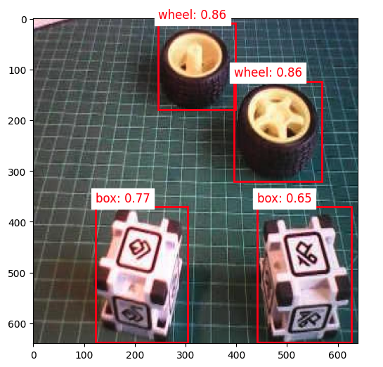</p>

Но что будет, если уменьшить порог, например до 0,3?

<p align="center">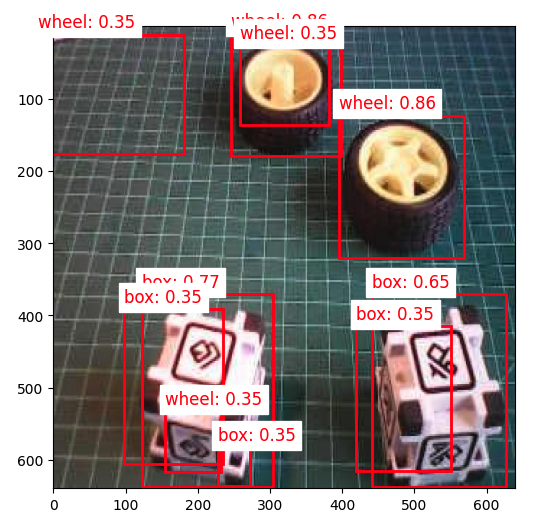</p>

Начинают появляться ложные срабатывания и **множественные обнаружения**: модель находит один и тот же объект несколько раз, с разными уровнями уверенности и немного разными рамками.

Порог иногда приходится снижать, чтобы поймать все объекты и избежать ложноотрицательных результатов, однако это приводит к множественным обнаружениям.

Чтобы улучшить результаты обнаружения, нужно применить **подавление не-максимумов (Non-Maximum Suppression, NMS)**. Оно убирает перекрывающиеся ограничивающие рамки и оставляет только самое уверенное обнаружение.

Для этого создадим общую функцию `non_max_suppression()`, которая уточняет результаты обнаружения, отбрасывая избыточные и перекрывающиеся рамки. Она итеративно выбирает обнаружение с наибольшей оценкой уверенности и удаляет другие существенно перекрывающиеся обнаружения по порогу Intersection over Union (IoU).

```python
def non_max_suppression(boxes, scores, threshold):
    # Переводим в координаты углов
    x1 = boxes[:, 0]
    y1 = boxes[:, 1]
    x2 = boxes[:, 2]
    y2 = boxes[:, 3]

    areas = (x2 - x1 + 1) * (y2 - y1 + 1)
    order = scores.argsort()[::-1]

    keep = []
    while order.size > 0:
        i = order[0]
        keep.append(i)
        xx1 = np.maximum(x1[i], x1[order[1:]])
        yy1 = np.maximum(y1[i], y1[order[1:]])
        xx2 = np.minimum(x2[i], x2[order[1:]])
        yy2 = np.minimum(y2[i], y2[order[1:]])

        w = np.maximum(0.0, xx2 - xx1 + 1)
        h = np.maximum(0.0, yy2 - yy1 + 1)
        inter = w * h
        ovr = inter / (areas[i] + areas[order[1:]] - inter)

        inds = np.where(ovr <= threshold)[0]
        order = order[inds + 1]

    return keep
```

Как это работает:

1. **Сортировка:** сначала все обнаружения сортируются по оценке уверенности от высокой к низкой.
2. **Выбор:** выбирается рамка с наибольшей оценкой и добавляется в итоговый список обнаружений.
3. **Сравнение:** выбранная рамка сравнивается со всеми оставшимися рамками с меньшими оценками.
4. **Удаление:** любая рамка, которая существенно перекрывается с выбранной (выше порога IoU), удаляется.
5. **Итерация:** процесс повторяется со следующей по оценке рамкой, пока не будут обработаны все рамки.

Теперь определим более точную функцию визуализации, которая учитывает порог IoU и выводит только объекты, отобранные функцией `non_max_suppression`:

```python
def visualize_detections(
    image, boxes, classes, scores, labels, threshold, iou_threshold
):
    if isinstance(image, Image.Image):
        image_np = np.array(image)
    else:
        image_np = image
    height, width = image_np.shape[:2]
    # Переводим нормализованные координаты в координаты пикселей
    boxes_pixel = boxes * np.array([height, width, height, width])
    # Применяем NMS
    keep = non_max_suppression(boxes_pixel, scores, iou_threshold)
    # Задаём размер фигуры 12x8 дюймов
    fig, ax = plt.subplots(1, figsize=(12, 8))
    ax.imshow(image_np)
    for i in keep:
        if scores[i] > threshold:
            ymin, xmin, ymax, xmax = boxes[i]
            rect = patches.Rectangle(
                (xmin * width, ymin * height),
                (xmax - xmin) * width,
                (ymax - ymin) * height,
                linewidth=2,
                edgecolor="r",
                facecolor="none",
            )

            ax.add_patch(rect)
            class_name = labels[int(classes[i])]
            ax.text(
                xmin * width,
                ymin * height - 10,
                f"{class_name}: {scores[i]:.2f}",
                color="red",
                fontsize=12,
                backgroundcolor="white",
            )
    plt.show()
```

Теперь создадим функцию, которая вызывает остальные и выполняет инференс для любого изображения:

```python
def detect_objects(img_path, conf=0.5, iou=0.5):
    orig_img = Image.open(img_path)
    scale, zero_point = input_details[0]["quantization"]
    img = orig_img.resize(
        (input_details[0]["shape"][1], input_details[0]["shape"][2])
    )
    img_array = np.array(img, dtype=np.float32) / 255.0
    img_array = (
        (img_array / scale + zero_point)
        .clip(-128, 127)
        .astype(np.int8)
    )
    input_data = np.expand_dims(img_array, axis=0)

    # Инференс на Raspi-Zero
    start_time = time.time()
    interpreter.set_tensor(input_details[0]["index"], input_data)
    interpreter.invoke()
    end_time = time.time()
    inference_time = (
        end_time - start_time
    ) * 1000  # Переводим в миллисекунды

    print("Inference time: {:.1f}ms".format(inference_time))

    # Извлекаем выходные данные
    boxes = interpreter.get_tensor(output_details[1]["index"])[0]
    classes = interpreter.get_tensor(output_details[3]["index"])[0]
    scores = interpreter.get_tensor(output_details[0]["index"])[0]
    num_detections = int(
        interpreter.get_tensor(output_details[2]["index"])[0]
    )

    visualize_detections(
        orig_img,
        boxes,
        classes,
        scores,
        labels,
        threshold=conf,
        iou_threshold=iou,
    )
```

Теперь запустим код с тем же изображением, с порогом уверенности 0,3, но с небольшим IoU:

```python
img_path = "./images/box_2_wheel_2.jpg"
detect_objects(img_path, conf=0.3, iou=0.05)
```

<p align="center">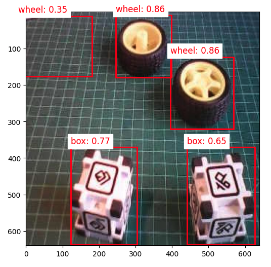</p>

## Обучение модели FOMO в Edge Impulse Studio

Инференс с моделью SSD MobileNet работает хорошо, но задержка оказалась существенной. Инференс занимал от 0,5 до 1,3 секунды на Raspi-Zero, то есть около 1 кадра в секунду (FPS) или меньше. Один из способов ускорить процесс — использовать FOMO (Faster Objects, More Objects).

Этот алгоритм машинного обучения позволяет подсчитывать несколько объектов и находить их положение на изображении в реальном времени, используя в 30 раз меньше вычислительной мощности и памяти, чем MobileNet SSD или YOLO. Главная причина в том, что другие модели вычисляют размер объекта, рисуя вокруг него квадрат (ограничивающую рамку), тогда как FOMO не учитывает размер и сообщает только, где находится объект, — через координаты его центроида.

### Как работает FOMO

В типичном конвейере обнаружения объектов первый этап — извлечение признаков из входного изображения. **FOMO использует MobileNetV2 для выполнения этой задачи**. MobileNetV2 обрабатывает входное изображение и создаёт карту признаков, которая вычислительно эффективно отражает ключевые характеристики: текстуры, формы и границы объектов.

<p align="center">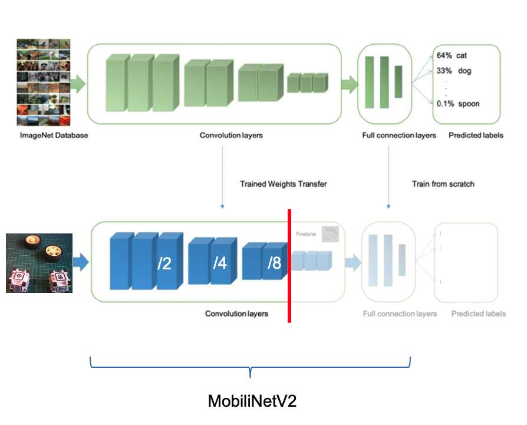</p>

Когда признаки извлечены, более простая архитектура FOMO, сфокусированная на обнаружении центральных точек, интерпретирует карту признаков, чтобы определить, где на изображении находятся объекты. На выходе получается сетка ячеек, где каждая ячейка показывает, обнаружен ли центр объекта. Для каждой ячейки модель выдаёт одну или несколько оценок уверенности, указывающих вероятность присутствия объекта.

Посмотрим, как это работает на изображении.

FOMO делит изображение на блоки пикселей с коэффициентом 8. Для входа $96\times 96$ сетка будет $12\times 12$ $(96/8=12)$, для $160\times 160$ — $20\times 20$ и так далее. Затем FOMO пропускает через каждый блок пикселей классификатор, чтобы вычислить вероятность того, что в нём есть коробка или колесо, и определить области с наибольшей вероятностью содержать объект (если блок пикселей не содержит объектов, он классифицируется как *background*, фон). По итоговой области FOMO определяет координаты центроида этой области (относительно размеров изображения).

<p align="center">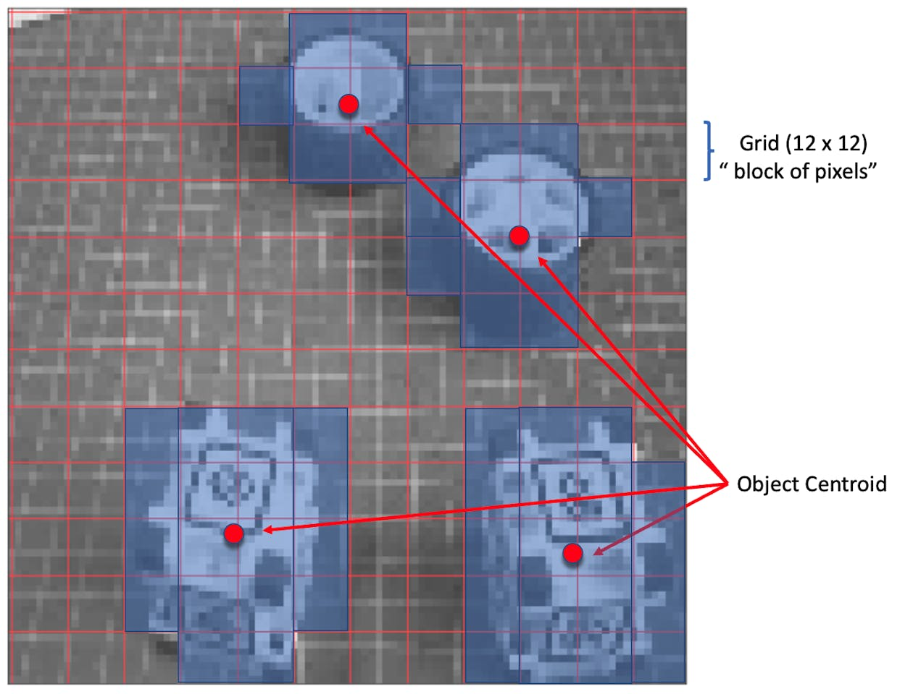</p>

**Компромисс между скоростью и точностью:**

- **Разрешение сетки:** FOMO использует сетку фиксированного разрешения, поэтому каждая ячейка определяет, есть ли объект в своей части изображения. Точность локализации при этом невысока, зато модель быстрая и вычислительно лёгкая, что критично для периферийных устройств.
- **Обнаружение нескольких объектов:** поскольку каждая ячейка независима, FOMO может одновременно обнаруживать несколько объектов, находя несколько центров.

### Новое проектирование Impulse, обучение и тестирование

Вернитесь в Edge Impulse Studio, на вкладке `Experiments` создайте новый impulse. Теперь входные изображения должны быть $160\times 160$ (это ожидаемый входной размер для MobileNetV2).

<p align="center">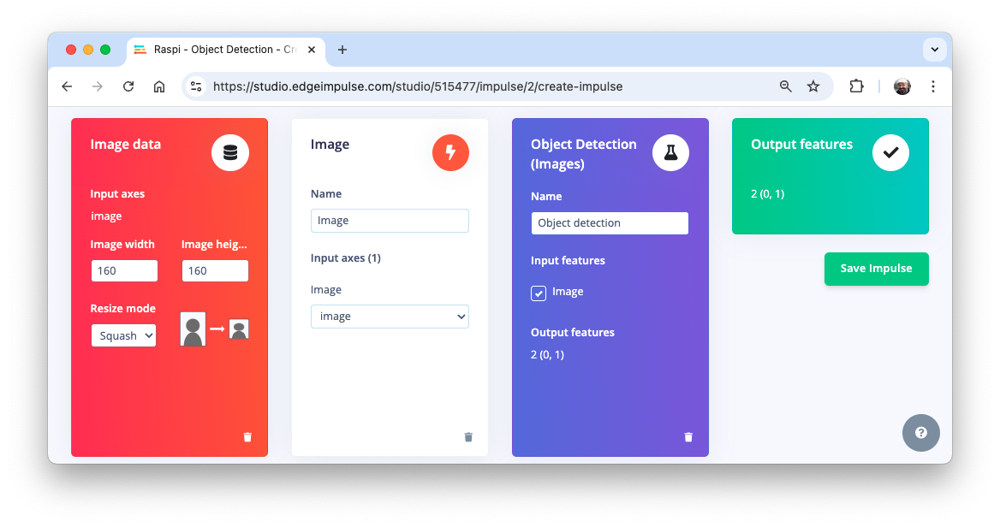</p>

На вкладке `Image` сгенерируйте признаки и перейдите на вкладку `Object detection`.

Для обучения нужно выбрать предобученную модель. Используем **FOMO (Faster Objects, More Objects) MobileNetV2 0.35.**

<p align="center"></p>

Гиперпараметры обучения:

- Эпохи: 30
- Размер батча: 32
- Скорость обучения (Learning Rate): 0,001

Для валидации во время обучения будет отложено 20 % набора данных (*validation_dataset*). Аугментацию для оставшихся 80 % (*train_dataset*) мы не применяем, поскольку набор уже был аугментирован на этапе разметки в Roboflow.

В итоге модель получает общую F1-меру 93,3 % при впечатляющей задержке 8 мс (Raspi-4), что примерно в 60 раз меньше, чем у SSD MobileNetV2.

<p align="center">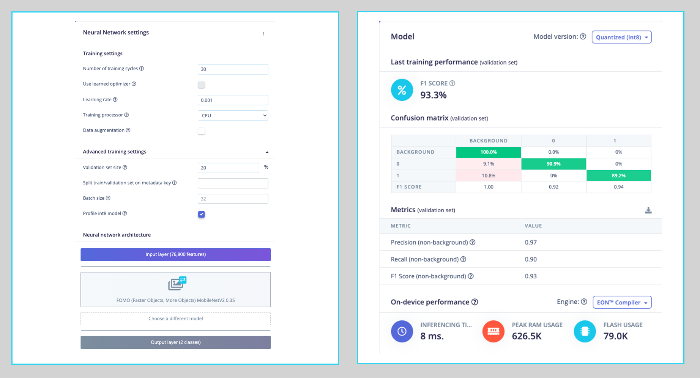</p>

> Обратите внимание: FOMO автоматически добавил третью метку background к двум ранее заданным классам *box* (0) и *wheel* (1).

На вкладке `Model testing` точность составила 94 %. Вот один из результатов на тестовом образце:

<p align="center">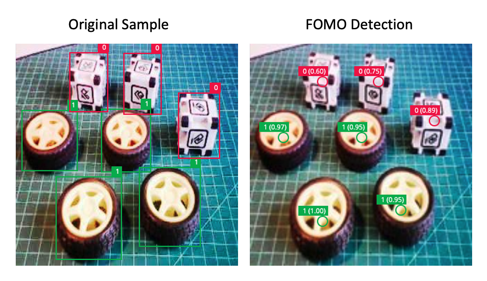</p>

> В задачах обнаружения объектов точность, как правило, не является основной [метрикой оценки](https://learnopencv.com/mean-average-precision-map-object-detection-model-evaluation-metric/). Обнаружение объектов предполагает не только классификацию, но и построение ограничивающих рамок вокруг объектов, поэтому это более сложная задача, чем простая классификация. Здесь проблема в том, что у нас нет ограничивающих рамок, а только центроиды. Короче говоря, использование точности как метрики может вводить в заблуждение и не даёт полного представления о качестве модели.

### Развёртывание модели

Как и в предыдущем разделе, обученную модель можно развернуть как TFLite или как Linux (AARCH64). Сейчас развернём её как **Linux (AARCH64)** — бинарный файл, реализующий протокол [Edge Impulse Linux](https://docs.edgeimpulse.com/docs/tools/edge-impulse-for-linux).

Модели Edge Impulse for Linux поставляются в формате `.eim`. Этот [исполняемый файл](https://docs.edgeimpulse.com/docs/run-inference/linux-eim-executable) содержит наш «полный impulse», созданный в Edge Impulse Studio. Impulse состоит из блоков обработки сигнала и блоков обучения и аномалий, которые мы добавили и обучили. Он скомпилирован с оптимизациями под наш процессор или GPU (например, инструкции NEON для ядер ARM) и содержит простой слой межпроцессного взаимодействия (IPC) поверх Unix-сокета.

На вкладке `Deploy` выберите опцию `Linux (AARCH64)`, модель `int8` и нажмите `Build`.

<p align="center">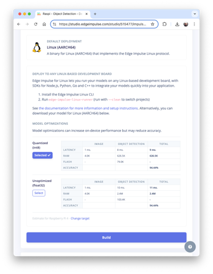</p>

Модель будет автоматически загружена на ваш компьютер.

На Raspi создайте новое рабочее место:

```bash
cd ~
cd Documents
mkdir EI_Linux
cd EI_Linux
mkdir models
mkdir images
```

Переименуйте модель для удобства, например в `raspi-object-detection-linux-aarch64-FOMO-int8.eim`, и перенесите её в новую папку `./models` на Raspi. Также сделайте снимки или получите изображения для инференса и сохраните их в папку `./images`.

### Инференс и постобработка

Инференс будет выполняться с помощью [Linux Python SDK](https://docs.edgeimpulse.com/docs/tools/edge-impulse-for-linux/linux-python-sdk). Эта библиотека позволяет запускать модели машинного обучения и собирать данные с датчиков на Linux-машинах с помощью Python. SDK имеет открытый исходный код и размещён на GitHub: [edgeimpulse/linux-sdk-python](https://github.com/edgeimpulse/linux-sdk-python).

Создадим виртуальное окружение для работы с Linux Python SDK:

```bash
python3 -m venv ~/eilinux
source ~/eilinux/bin/activate
```

Установим все необходимые библиотеки:

```bash
sudo apt-get update
sudo apt-get install libatlas-base-dev \
                     libportaudio0 libportaudio2
sudo apt-get install libportaudiocpp0 portaudio19-dev

pip3 install edge_impulse_linux -i https://pypi.python.org/simple
pip3 install Pillow matplotlib pyaudio opencv-contrib-python

sudo apt-get install portaudio19-dev
pip3 install pyaudio
pip3 install opencv-contrib-python
```

Сделайте модель исполняемой:

```bash
chmod +x raspi-object-detection-linux-aarch64-FOMO-int8.eim
```

Установите Jupyter Notebook в новом окружении:

```bash
pip3 install jupyter
```

Запустите блокнот локально (на Raspi-4 или 5 с рабочим столом):

```bash
jupyter notebook
```

или в браузере на вашем компьютере:

```bash
jupyter notebook --ip=192.168.4.210 --no-browser
```

Начнём новый [блокнот](https://github.com/Mjrovai/EdgeML-with-Raspberry-Pi/blob/main/OBJ_DETEC/notebooks/EI-Linux-FOMO.ipynb), выполнив все шаги по обнаружению кубиков и колёс на изображении с помощью модели FOMO и Edge Impulse Linux Python SDK.

Импортируйте нужные библиотеки:

```python
import sys, time
import numpy as np
import matplotlib.pyplot as plt
import matplotlib.patches as patches
from PIL import Image
import cv2
from edge_impulse_linux.image import ImageImpulseRunner
```

Укажите путь к модели и метки:

```python
model_file = "raspi-object-detection-linux-aarch64-FOMO-int8.eim"
model_path = "models/" + model_file  # Обученная ML-модель из Edge Impulse
labels = ["box", "wheel"]
```

> Помните, что модель будет выдавать ID классов как значения (0 и 1), следуя алфавитному порядку названий классов.

Загрузите и инициализируйте модель:

```python
# Загружаем файл модели
runner = ImageImpulseRunner(model_path)

# Инициализируем модель
model_info = runner.init()
```

Переменная `model_info` содержит важную информацию о модели. Однако в отличие от интерпретатора TFLite библиотека EI Linux Python SDK сама подготовит модель к инференсу.

Теперь откроем изображение и выведем его. Для совместимости используем OpenCV — библиотеку компьютерного зрения, которую EI применяет внутри. OpenCV читает изображения в формате BGR, поэтому его нужно преобразовать в RGB:

```python
# Загружаем изображение
img_path = "./images/1_box_1_wheel.jpg"
orig_img = cv2.imread(img_path)
img_rgb = cv2.cvtColor(orig_img, cv2.COLOR_BGR2RGB)

# Выводим изображение
plt.imshow(img_rgb)
plt.title("Original Image")
plt.show()
```

<p align="center">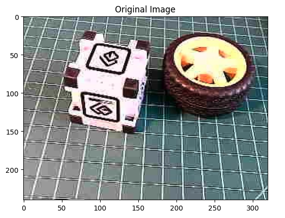</p>

Теперь получим признаки и предобработанное изображение (`cropped`) с помощью `runner`:

```python
features, cropped = (
    runner.get_features_from_image_auto_studio_settings(img_rgb)
)
```

Выполним инференс. Также вычислим задержку модели:

```python
res = runner.classify(features)
```

Получим выходные классы обнаруженных объектов, центроиды их ограничивающих рамок и вероятности:

```python
print(
    "Found %d bounding boxes (%d ms.)"
    % (
        len(res["result"]["bounding_boxes"]),
        res["timing"]["dsp"] + res["timing"]["classification"],
    )
)
for bb in res["result"]["bounding_boxes"]:
    print(
        "\t%s (%.2f): x=%d y=%d w=%d h=%d"
        % (
            bb["label"],
            bb["value"],
            bb["x"],
            bb["y"],
            bb["width"],
            bb["height"],
        )
    )
```

```
Found 2 bounding boxes (29 ms.)
	1 (0.91): x=112 y=40 w=16 h=16
	0 (0.75): x=48 y=56 w=8 h=8
```

Результаты показывают, что обнаружено два объекта: один с ID класса 0 (`box`) и один с ID класса 1 (`wheel`). Это верно!

Визуализируем результат (`threshold` равен 0,5 — это значение по умолчанию, заданное при тестировании модели в Edge Impulse Studio).

```python
print(
    "\tFound %d bounding boxes (latency: %d ms)"
    % (
        len(res["result"]["bounding_boxes"]),
        res["timing"]["dsp"] + res["timing"]["classification"],
    )
)
plt.figure(figsize=(5, 5))
plt.imshow(cropped)

# Перебираем каждую из возвращённых ограничивающих рамок
bboxes = res["result"]["bounding_boxes"]
for bbox in bboxes:

    # Получаем углы ограничивающей рамки
    left = bbox["x"]
    top = bbox["y"]
    width = bbox["width"]
    height = bbox["height"]

    # Рисуем кружок в центре обнаружения
    circ = plt.Circle(
        (left + width // 2, top + height // 2),
        5,
        fill=False,
        color="red",
        linewidth=3,
    )
    plt.gca().add_patch(circ)
    class_id = int(bbox["label"])
    class_name = labels[class_id]
    plt.text(
        left,
        top - 10,
        f'{class_name}: {bbox["value"]:.2f}',
        color="red",
        fontsize=12,
        backgroundcolor="white",
    )
plt.show()
```

<p align="center">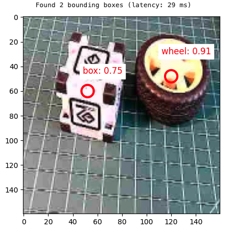</p>

## Исследуем модель YOLO с помощью Ultralytics

В этой лабораторной работе мы исследуем YOLOv8. [Ultralytics](https://ultralytics.com/) [YOLOv8](https://github.com/ultralytics/ultralytics) — версия известной модели для обнаружения объектов и сегментации изображений в реальном времени, YOLO. YOLOv8 построена на передовых достижениях глубокого обучения и компьютерного зрения и обеспечивает выдающуюся скорость и точность. Её упрощённая архитектура подходит для разных приложений и легко адаптируется к разным аппаратным платформам — от периферийных устройств до облачных API.

### Введение в модель YOLO

Модель YOLO (You Only Look Once) — высокоэффективный и широко используемый алгоритм обнаружения объектов, известный возможностями обработки в реальном времени. В отличие от традиционных систем обнаружения, которые адаптируют классификаторы или локализаторы для выполнения обнаружения, YOLO формулирует задачу обнаружения как единую задачу регрессии. Такой подход позволяет YOLO одновременно предсказывать несколько ограничивающих рамок и вероятности их классов по всему изображению за один проход, что заметно повышает скорость.

#### Ключевые особенности

1. **Единая архитектура сети:**

    - YOLO использует одну нейронную сеть для обработки всего изображения. Сеть делит изображение на сетку и для каждой ячейки сетки напрямую предсказывает ограничивающие рамки и связанные с ними вероятности классов. Такое сквозное обучение повышает скорость и упрощает архитектуру модели.

2. **Обработка в реальном времени:**

    - Одна из сильных сторон YOLO — возможность обнаруживать объекты в реальном времени. В зависимости от версии и оборудования YOLO может обрабатывать изображения с высокой частотой кадров (FPS). Это делает её идеальной для приложений, которым нужно быстрое и точное обнаружение объектов, например видеонаблюдения, автономного вождения и анализа спортивных трансляций.

3. **Эволюция версий:**

    - За годы YOLO значительно улучшилась: от YOLOv1 до новейшей YOLOv10. Каждая итерация приносила улучшения точности, скорости и эффективности. YOLOv8, например, включает улучшения архитектуры сети, усовершенствованные методики обучения и лучшую поддержку различного оборудования, что обеспечивает более надёжную работу.
    - Хотя YOLOv10 — новейший член семейства с многообещающими результатами, согласно её статье, она была выпущена только в мае 2024 года и пока не полностью интегрирована в библиотеку Ultralytics. При этом анализ кривых «точность — полнота» показывает, что YOLOv8 в целом превосходит YOLOv9: она захватывает большую долю истинно положительных результатов и эффективнее минимизирует ложноположительные (подробнее см. в этой [статье](https://encord.com/blog/performanceyolov9-vs-yolov8-custom-dataset/)). Поэтому эта лабораторная работа основана на YOLOv8n.

    <p align="center">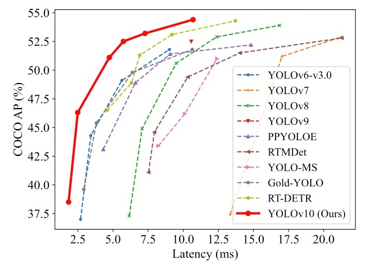</p>

4. **Точность и эффективность:**

    - Ранние версии YOLO жертвовали точностью ради скорости, но новые версии значительно продвинулись в балансе между ними. Новые модели быстрее и точнее: они обнаруживают мелкие объекты (например, пчёл) и хорошо справляются со сложными наборами данных.

5. **Широкий спектр применений:**

    - Универсальность YOLO привела к её использованию во многих областях. Её применяют в системах мониторинга дорожного движения для обнаружения и подсчёта автомобилей, в системах безопасности для выявления потенциальных угроз и в агротехнологиях для мониторинга посевов и скота. Она подходит для любой области, где нужно эффективное и точное обнаружение объектов.

6. **Сообщество и развитие:**

    - YOLO продолжает развиваться и поддерживается сильным сообществом разработчиков и исследователей (особенно YOLOv8). Открытые реализации и обширная документация сделали её доступной для настройки и интеграции в разные проекты. Популярные фреймворки глубокого обучения, включая Darknet, TensorFlow и PyTorch, поддерживают YOLO, что ещё больше расширяет её применимость.
    - [Ultralytics YOLOv8](https://github.com/ultralytics/ultralytics?tab=readme-ov-file) умеет не только [обнаруживать](https://docs.ultralytics.com/tasks/detect) объекты (наш случай), но и [сегментировать](https://docs.ultralytics.com/tasks/segment) и определять [позы](https://docs.ultralytics.com/tasks/pose) с моделями, предобученными на наборе [COCO](https://docs.ultralytics.com/datasets/detect/coco), а также выполнять [классификацию](https://docs.ultralytics.com/tasks/classify) с моделями YOLOv8, предобученными на наборе [ImageNet](https://docs.ultralytics.com/datasets/classify/imagenet). Режим [отслеживания](https://docs.ultralytics.com/modes/track) доступен для всех моделей обнаружения, сегментации и определения позы.

    <p align="center">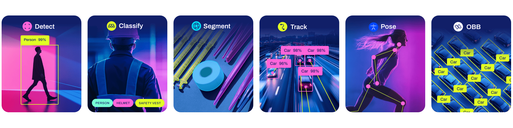</p>

### Установка

На Raspi деактивируем текущее окружение, чтобы создать новое рабочее место:

```bash
deactivate
cd ~
cd Documents/
mkdir YOLO
cd YOLO
mkdir models
mkdir images
```

Создадим виртуальное окружение для работы с Ultralytics YOLOv8:

```bash
python3 -m venv ~/yolo
source ~/yolo/bin/activate
```

И установим пакеты Ultralytics для локального инференса на Raspi:

1. Обновите список пакетов, установите pip и обновите его до последней версии:

```bash
sudo apt update
sudo apt install python3-pip -y
pip install -U pip
```

2. Установите pip-пакет `ultralytics` с дополнительными зависимостями:

```bash
pip install ultralytics[export]
```

3. Перезагрузите устройство:

```bash
sudo reboot
```

### Проверка YOLO

После загрузки Raspi-Zero активируйте окружение `yolo`, перейдите в рабочий каталог

```bash
source ~/yolo/bin/activate
cd ~/Documents/YOLO
```

и запустите инференс на изображении, которое будет загружено с сайта Ultralytics, с моделью YOLOv8n (самой маленькой в семействе) в терминале (CLI):

```bash
yolo predict model='yolov8n' \
     source='https://ultralytics.com/images/bus.jpg'
```

> Семейство моделей YOLO предобучено на наборе данных COCO.

Результат инференса появится в терминале. На изображении (bus.jpg) обнаружены 4 `persons` (человека), 1 `bus` (автобус) и 1 `stop signal` (знак «стоп»).

<p align="center">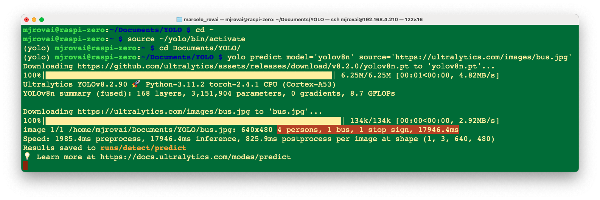</p>

Также мы получили сообщение `Results saved to runs/detect/predict`. В этой папке появилось новое сохранённое изображение (bus.jpg). Скачаем его с Raspi-Zero на рабочий стол для просмотра:

<p align="center">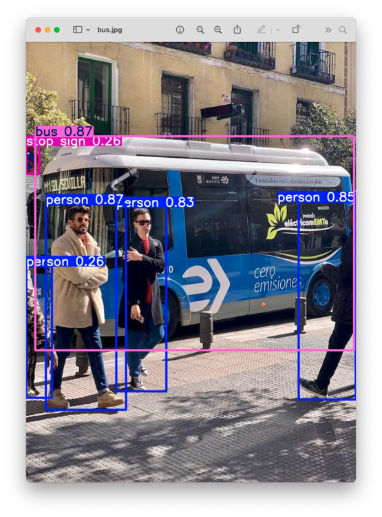</p>

Итак, Ultralytics YOLO корректно установлен на Raspi. Однако на Raspi-Zero проблема — высокая задержка инференса, около 18 секунд, даже для самой маленькой модели семейства (YOLOv8n).

### Экспорт модели в формат NCNN

Развёртывание моделей компьютерного зрения на периферийных устройствах с ограниченной вычислительной мощностью, таких как Raspi-Zero, может приводить к проблемам с задержкой. Один из вариантов — использовать формат, оптимизированный для производительности. Это гарантирует, что даже устройства с ограниченной вычислительной мощностью смогут справляться с продвинутыми задачами компьютерного зрения.

Среди всех форматов экспорта, поддерживаемых Ultralytics, [NCNN](https://docs.ultralytics.com/integrations/ncnn) — высокопроизводительный фреймворк для вычислений нейронных сетей, оптимизированный для мобильных платформ. С самого начала NCNN проектировался с учётом развёртывания на мобильных телефонах и не имеет сторонних зависимостей. Он кроссплатформенный и работает быстрее, чем известные открытые фреймворки (например, TFLite).

NCNN обеспечивает лучшую производительность инференса на устройствах Raspberry Pi. Он хорошо оптимизирован для мобильных встраиваемых платформ (например, на архитектуре ARM).

Итак, конвертируем нашу модель и повторим инференс:

1. Экспортируйте модель YOLOv8n PyTorch в формат NCNN. В результате будет создана папка `/yolov8n_ncnn_model`:

```bash
yolo export model=yolov8n.pt format=ncnn
```

2. Запустите инференс с экспортированной моделью (источником может быть изображение bus.jpg, которое было загружено с сайта в текущий каталог при последнем инференсе):

```bash
yolo predict model='./yolov8n_ncnn_model' source='bus.jpg'
```

> При первом инференсе, когда модель загружается, задержка обычно высокая (около 17 с), но начиная со второго инференса она снижается примерно до 2 с.

### Исследование YOLO с помощью Python

Для начала запустим интерпретатор Python, чтобы построчно разобрать, как работает модель YOLO:

```bash
python3
```

Теперь подключим библиотеку YOLO из Ultralytics и загрузим модель:

```python
from ultralytics import YOLO

model = YOLO("yolov8n_ncnn_model")
```

Далее выполним инференс на изображении (снова используем `bus.jpg`):

```python
img = "bus.jpg"
result = model.predict(img, save=True, imgsz=640, conf=0.5, iou=0.3)
```

<p align="center">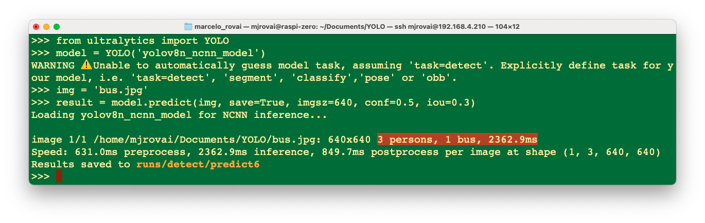</p>

Результат почти идентичен тому, что мы получили при инференсе в терминале (CLI). Исключение: знак остановки не был обнаружен уменьшенной моделью NCNN. Заметим, что задержка снизилась.

Разберём содержимое переменной `result`.

Например, `result[0].boxes.data` показывает основной результат инференса — тензор формы (4, 6). Каждая строка соответствует одному обнаруженному объекту: первые 4 столбца — координаты ограничивающей рамки, 5-й — уверенность, 6-й — класс (в данном случае `0: person` и `5: bus`):

<p align="center">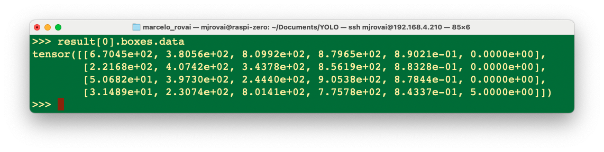</p>

Можно получить отдельные результаты инференса, например время инференса, и вывести его в удобном формате:

```python
inference_time = int(result[0].speed["inference"])
print(f"Inference Time: {inference_time} ms")
```

Или общее количество обнаруженных объектов:

```python
print(f"Number of objects: {len(result[0].boxes.cls)}")
```

<p align="center">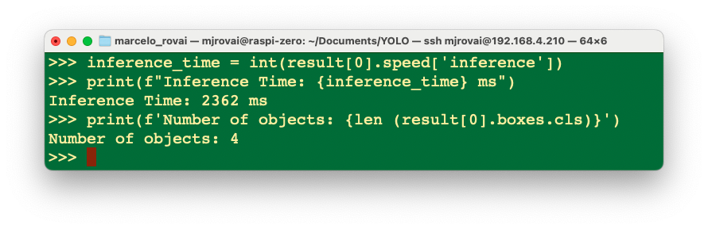</p>

С помощью Python можно создать подробный вывод, отвечающий нашим потребностям (подробнее см. [Model Prediction with Ultralytics YOLO](https://docs.ultralytics.com/modes/predict/)). Запустим не строку за строкой в интерпретаторе, а Python-скрипт. Для редактирования используем `nano`. Сначала создадим пустой Python-скрипт, например `yolov8_tests.py`:

```bash
nano yolov8_tests.py
```

Введите строки кода:

```python
from ultralytics import YOLO

# Загружаем модель YOLOv8
model = YOLO("yolov8n_ncnn_model")

# Выполняем инференс
img = "bus.jpg"
result = model.predict(img, save=False, imgsz=640, conf=0.5, iou=0.3)

# Выводим результаты
inference_time = int(result[0].speed["inference"])
print(f"Inference Time: {inference_time} ms")
print(f"Number of objects: {len(result[0].boxes.cls)}")
```

<p align="center">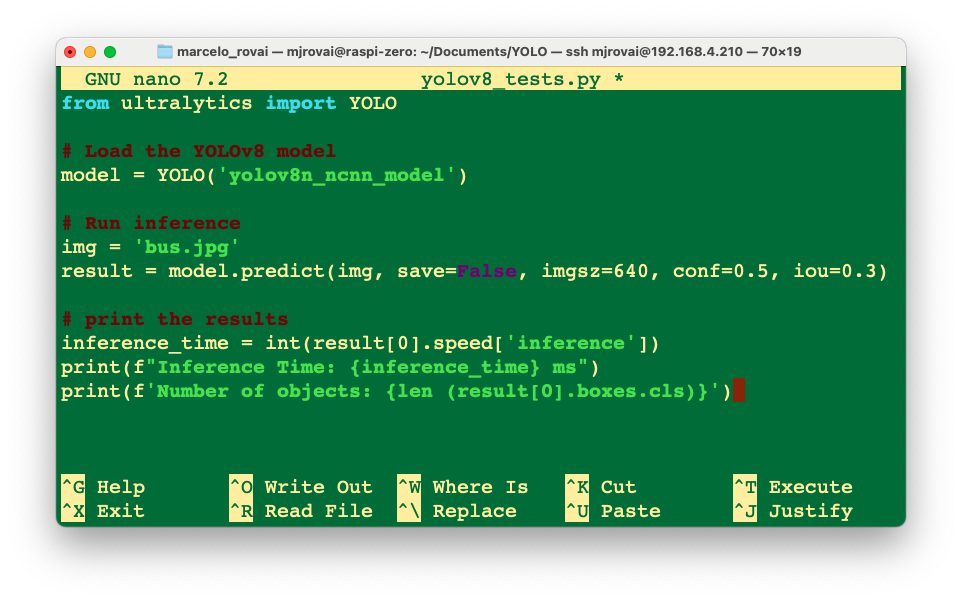</p>

Чтобы сохранить Python-скрипт, нажмите `[CTRL+O]`, затем `[ENTER]`, после чего `[CTRL+X]`.

Запустите скрипт:

```bash
python yolov8_tests.py
```

Результат будет таким же, как при инференсе в терминале (CLI) и во встроенном интерпретаторе Python.

> Первый вызов библиотеки YOLO и загрузка модели для инференса занимают много времени, но последующие инференсы будут гораздо быстрее. Например, первый инференс может занять несколько секунд, а после этого время инференса должно снизиться до менее чем 1 секунды.

### Обучение YOLOv8 на собственном наборе данных

Вернёмся к нашему набору данных «Box versus Wheel», размеченному на [Roboflow](https://universe.roboflow.com/marcelo-rovai-riila/box-versus-wheel-auto-dataset). На вкладке `Download Dataset`, вместо варианта `Download a zip to computer`, который мы использовали для обучения в Edge Impulse Studio, выберем `Show download code`. Этот вариант откроет всплывающее окно с фрагментом кода, который нужно вставить в наш блокнот для обучения.

<p align="center">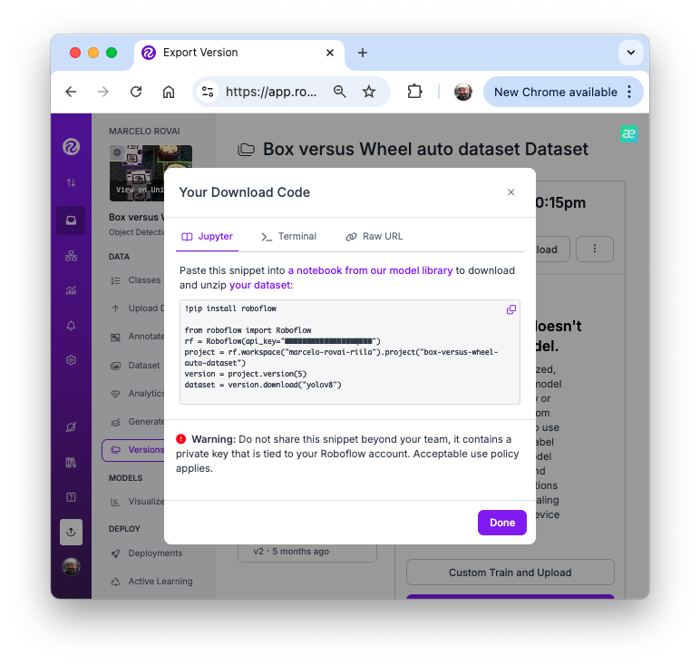</p>

Для обучения адаптируем один из публичных примеров Ultralytics и запустим его в Google Colab. Ниже — мой блокнот, который можно адаптировать для собственного проекта:

- Обучение YOLOv8 на наборе данных Box versus Wheel [[Open In Colab]](https://colab.research.google.com/github/Mjrovai/EdgeML-with-Raspberry-Pi/blob/main/OBJ_DETEC/notebooks/yolov8_box_vs_wheel.ipynb)

#### Ключевые моменты блокнота

1. Запускайте его с GPU (NVIDIA T4 доступна бесплатно).

2. Установите Ultralytics через PIP.

    <p align="center"></p>

3. Теперь можно импортировать YOLO и загрузить набор данных в Colab, вставив код загрузки, полученный из Roboflow. Обратите внимание: наш набор будет смонтирован в `/content/datasets/`:

<p align="center"></p>

4. Обязательно проверьте и исправьте файл `data.yaml`, указав правильные пути к изображениям (скопируйте путь к каждой папке `images`).

```bash
names:

- box
- wheel
nc: 2
roboflow:
  license: CC BY 4.0
  project: box-versus-wheel-auto-dataset
  url: https://universe.roboflow.com/marcelo-rovai-riila/ \
     box-versus-wheel-auto-dataset/dataset/5
  version: 5
  workspace: marcelo-rovai-riila
test: /content/datasets/Box-versus-Wheel-auto-dataset-5/ \
      test/images
train: /content/datasets/Box-versus-Wheel-auto-dataset-5/ \
       train/images
val: /content/datasets/Box-versus-Wheel-auto-dataset-5/ \
     valid/images
```

5. Задайте основные гиперпараметры, которые хотите изменить по сравнению со значениями по умолчанию, например:

    ```bash
    MODEL = 'yolov8n.pt'
    IMG_SIZE = 640
    EPOCHS = 25 # Для итогового проекта стоит рассмотреть
                # не менее 100 эпох
    ```

6. Запустите обучение (через CLI):

    ```bash
    !yolo task=detect mode=train model={MODEL} \
      data={dataset.location}/data.yaml \
      epochs={EPOCHS} \
      imgsz={IMG_SIZE} plots=True
    ```

<p align="center"></p>

Обучение заняло несколько минут и дало отличный результат (mAP50 = 0,995). По окончании все результаты сохраняются в указанной папке, например `/runs/detect/train/`. Там можно найти, например, матрицу ошибок (confusion matrix).

<p align="center"></p>

7. Обученная модель (`best.pt`) сохраняется в папке `/runs/detect/train/weights/`. Теперь проверьте обученную модель на изображениях из `valid/images`:

```bash
!yolo task=detect mode=val model={HOME}/runs/detect/train/\
       weights/best.pt data={dataset.location}/data.yaml
```

Результаты оказались похожими на результаты обучения.

8. Теперь выполните инференс на изображениях, отложенных для тестирования:

```bash
!yolo task=detect mode=predict model={HOME}/runs/detect/train/\
     weights/best.pt conf=0.25 source={dataset.location}/test/\
     images save=True
```

Результаты инференса сохраняются в папке `runs/detect/predict`. Посмотрим некоторые из них:

<p align="center"></p>

9. Рекомендуется экспортировать результаты обучения, валидации и тестирования на Google Drive. Для этого нужно подключить диск:

    ```python
    from google.colab import drive
    drive.mount('/content/gdrive')
    ```

    и скопировать содержимое папки `/runs` в папку на вашем Drive, например:

    ```bash
    !scp -r /content/runs '/content/gdrive/MyDrive/\
         10_UNIFEI/Box_vs_Wheel_Project'
    ```

### Инференс обученной моделью на Raspi

Скачайте обученную модель `/runs/detect/train/weights/best.pt` на свой компьютер. С помощью FTP-клиента FileZilla перенесите `best.pt` в папку моделей на Raspi (перед переносом модель можно переименовать, например в `box_wheel_320_yolo.pt`).

С помощью FileZilla перенесите несколько изображений из тестового набора в папку `./YOLO/images`:

Вернитесь в папку YOLO и запустите интерпретатор Python:

```bash
cd ..
python
```

Как и раньше, импортируем библиотеку YOLO и подключим нашу преобразованную модель для обнаружения коробок и колёс:

```python
from ultralytics import YOLO

model = YOLO("./models/box_wheel_320_yolo.pt")
```

Теперь определим изображение и вызовем инференс (на этот раз сохраним результат в виде изображения для внешней проверки):

```python
img = "./images/1_box_1_wheel.jpg"
result = model.predict(img, save=True, imgsz=320, conf=0.5, iou=0.3)
```

Повторите для нескольких изображений. Результат инференса сохраняется в переменной `result`, а обработанное изображение — в папке `runs/detect/predict8`.

<p align="center"></p>

С помощью FileZilla можно отправить результаты инференса на рабочий стол для проверки:

<p align="center"></p>

Результат инференса отличный! Модель обучена на базе меньшей модели семейства YOLOv8 (YOLOv8n). Проблема — задержка: около 1 секунды (или 1 FPS на Raspi-Zero). Конечно, эту задержку можно уменьшить, если конвертировать модель в TFLite или NCNN.

## Обнаружение объектов в видеопотоке

Все модели, рассмотренные в этой лабораторной работе, могут обнаруживать объекты в реальном времени с камеры. Захваченное изображение должно подаваться на вход обученной и сконвертированной модели. Для Raspi-4 или 5 с рабочим столом OpenCV может захватывать кадры и показывать результат инференса.

Однако создать видеопоток с веб-камеры для обнаружения объектов в реальном времени тоже возможно. Например, возьмём скрипт, разработанный для приложения классификации изображений, и адаптируем его под *веб-приложение обнаружения объектов в реальном времени на основе TensorFlow Lite и Flask*.

Эта версия приложения работает со всеми моделями TFLite. Убедитесь, что модель лежит в правильной папке, например:

```python
model_path = "./models/ssd-mobilenet-v1-tflite-default-v1.tflite"
```

Скачайте Python-скрипт `object_detection_app.py` с [GitHub](https://github.com/Mjrovai/EdgeML-with-Raspberry-Pi/blob/main/OBJ_DETEC/python_scripts/object_detection_app.py).

В терминале выполните:

```bash
python3 object_detection_app.py
```

И откройте веб-интерфейс:

- На самой Raspberry Pi (если есть графический интерфейс): откройте веб-браузер и перейдите по адресу `http://localhost:5000`.
- С другого устройства в той же сети: откройте веб-браузер и перейдите по адресу `http://<raspberry_pi_ip>:5000` (замените `<raspberry_pi_ip>` на IP-адрес вашей Raspberry Pi). Например: `http://192.168.4.210:5000/`

Вот несколько скриншотов приложения, запущенного на внешнем компьютере:

<p align="center"></p>

Рассмотрим техническое описание ключевых модулей, используемых в приложении обнаружения объектов:

1. **TensorFlow Lite (tflite_runtime)**:
    - Назначение: эффективный инференс моделей машинного обучения на периферийных устройствах.
    - Почему: TFLite даёт меньший размер модели и оптимизированную производительность по сравнению с полным TensorFlow, что критично для устройств с ограниченными ресурсами, таких как Raspberry Pi. Он поддерживает аппаратное ускорение и квантование, которые дополнительно повышают эффективность.
    - Ключевые функции: `Interpreter` для загрузки и запуска модели, `get_input_details()` и `get_output_details()` для взаимодействия с моделью.

2. **Flask**:
    - Назначение: лёгкий веб-фреймворк для создания серверной части.
    - Почему: простота и гибкость Flask делают его идеальным для быстрой разработки и развёртывания веб-приложений. Он менее требователен к ресурсам, чем крупные фреймворки, что важно для периферийных устройств.
    - Ключевые компоненты: декораторы маршрутов для определения конечных точек API, объекты `Response` для потоковой передачи видео, `render_template_string` для отдачи динамического HTML.

3. **Picamera2**:
    - Назначение: интерфейс к модулю камеры Raspberry Pi.
    - Почему: Picamera2 — современная библиотека для управления камерами Raspberry Pi, которая даёт лучшую производительность и возможности по сравнению с исходной библиотекой Picamera.
    - Ключевые функции: `create_preview_configuration()` для настройки камеры, `capture_file()` для захвата кадров.

4. **PIL (Python Imaging Library)**:
    - Назначение: обработка и редактирование изображений.
    - Почему: PIL даёт широкие возможности обработки изображений. Здесь он используется для изменения размера изображений, рисования ограничивающих рамок и преобразования между форматами.
    - Ключевые классы: `Image` для загрузки и обработки изображений, `ImageDraw` для рисования фигур и текста на изображениях.

5. **NumPy**:
    - Назначение: эффективные операции с массивами и численные вычисления.
    - Почему: операции с массивами NumPy намного быстрее обычных списков Python, что критично для обработки данных изображений и входов и выходов модели.
    - Ключевые функции: `array()` для создания массивов, `expand_dims()` для добавления размерностей.

6. **Threading (потоки)**:
    - Назначение: параллельное выполнение задач.
    - Почему: потоки позволяют одновременно захватывать кадры, выполнять обнаружение объектов и работать веб-серверу, что критично для работы в реальном времени.
    - Ключевые компоненты: класс `Thread` создаёт отдельные потоки выполнения, а `Lock` используется для синхронизации потоков.

7. **io.BytesIO**:
    - Назначение: двоичные потоки в памяти.
    - Почему: позволяет эффективно работать с данными изображений в памяти без временных файлов, что ускоряет работу и снижает число операций ввода-вывода.

8. **time**:
    - Назначение: функции, связанные со временем.
    - Почему: используются для задержек (`time.sleep()`), чтобы управлять частотой кадров, и для измерения производительности.

9. **jQuery (на стороне клиента)**:
    - Назначение: упрощённая работа с DOM и AJAX-запросы.
    - Почему: позволяет динамически обновлять веб-интерфейс и обмениваться данными с сервером без перезагрузки страницы.
    - Ключевые функции: `.get()` и `.post()` для AJAX-запросов, методы работы с DOM для обновления интерфейса.

Архитектура системы приложения:

1. **Главный поток**: запускает сервер Flask, обрабатывает HTTP-запросы и отдаёт веб-интерфейс.
2. **Поток камеры**: непрерывно захватывает кадры с камеры.
3. **Поток обнаружения**: пропускает кадры через модель TFLite для обнаружения объектов.
4. **Буфер кадров**: общая область памяти (защищённая блокировками), в которой хранятся последний кадр и результаты обнаружения.

Поток данных приложения кратко:

1. Камера захватывает кадр → буфер кадров.
2. Поток обнаружения читает кадр из буфера → обрабатывает его моделью TFLite → обновляет результаты обнаружения в буфере кадров.
3. Маршруты Flask обращаются к буферу кадров, чтобы отдать последний кадр и результаты обнаружения.
4. Веб-клиент получает обновления через AJAX и обновляет интерфейс.

Такая архитектура обеспечивает эффективное обнаружение объектов в реальном времени и сохраняет отзывчивый веб-интерфейс на периферийном устройстве с ограниченными ресурсами, таком как Raspberry Pi. Потоки и эффективные библиотеки вроде TFLite и PIL позволяют обрабатывать видеокадры в реальном времени, а Flask и jQuery дают удобный способ взаимодействия с ними.

Вы можете протестировать приложение с другой предобработанной моделью, например EfficientDet, изменив строку в приложении:

```python
model_path = "./models/lite-model_efficientdet_lite0_detection_metadata_1.tflite"
```

> Если нужно использовать приложение с моделью SSD-MobileNetV2, обученной в Edge Impulse Studio на наборе «Box versus Wheel», код также нужно адаптировать под входные данные модели, как мы разобрали в её [блокноте](https://github.com/Mjrovai/EdgeML-with-Raspberry-Pi/blob/main/OBJ_DETEC/notebooks/EI-SSD-MobileNetV2.ipynb).

## Итоги

В этой лабораторной работе мы разобрали реализацию обнаружения объектов на периферийных устройствах, таких как Raspberry Pi, и показали, какие возможности даёт запуск продвинутых задач компьютерного зрения на оборудовании с ограниченными ресурсами. Мы рассмотрели несколько важных аспектов:

1. **Сравнение моделей**: мы изучили разные модели обнаружения объектов, включая SSD-MobileNet, EfficientDet, FOMO и YOLO, и сравнили их производительность и компромиссы на периферийных устройствах.
2. **Обучение и развёртывание**: на собственном наборе данных с коробками и колёсами (размеченном в Roboflow) мы прошли процесс обучения моделей в Edge Impulse Studio и Ultralytics и развернули их на Raspberry Pi.
3. **Методы оптимизации**: для повышения скорости инференса на периферийных устройствах мы рассмотрели такие методы, как квантование модели (TFLite int8) и конвертация формата (например, в NCNN).
4. **Приложения реального времени**: лабораторная работа показала веб-приложение для обнаружения объектов в реальном времени, демонстрируя, как такие модели можно интегрировать в практические интерактивные системы.
5. **Соображения о производительности**: на протяжении работы мы обсуждали баланс между точностью модели и скоростью инференса — критически важный аспект для приложений периферийного ИИ.

Возможность выполнять обнаружение объектов на периферийных устройствах открывает множество перспектив в самых разных областях: от точного земледелия, промышленной автоматизации и контроля качества до «умного дома» и мониторинга окружающей среды. Обрабатывая данные локально, такие системы могут обеспечивать меньшую задержку, лучшую приватность и работу в условиях ограниченной связи.

В дальнейшем перспективными направлениями могут стать:

- реализация конвейеров из нескольких моделей для более сложных задач;
- изучение возможностей аппаратного ускорения для Raspberry Pi;
- интеграция обнаружения объектов с другими датчиками для более полных систем периферийного ИИ;
- разработка решений «периферия — облако», которые используют и локальную обработку, и облачные ресурсы.

Обнаружение объектов на периферийных устройствах позволяет создавать интеллектуальные и отзывчивые системы, которые приносят возможности ИИ прямо в физический мир и открывают новые горизонты в том, как мы взаимодействуем с окружающей средой и понимаем её.

## Ресурсы

- [Набор данных («Box versus Wheel»)](https://universe.roboflow.com/marcelo-rovai-riila/box-versus-wheel-auto-dataset)
- [Блокнот SSD-MobileNet на Raspi](https://github.com/Mjrovai/EdgeML-with-Raspberry-Pi/blob/main/OBJ_DETEC/notebooks/SSD_MobileNetV1.ipynb)
- [Блокнот EfficientDet на Raspi](https://github.com/Mjrovai/EdgeML-with-Raspberry-Pi/blob/main/OBJ_DETEC/notebooks/SSD_EfficientDet.ipynb)
- [Блокнот FOMO (EI Linux) на Raspi](https://github.com/Mjrovai/EdgeML-with-Raspberry-Pi/blob/main/OBJ_DETEC/notebooks/EI-Linux-FOMO.ipynb)
- [Обучение YOLOv8 на наборе Box versus Wheel в Colab](https://github.com/Mjrovai/EdgeML-with-Raspberry-Pi/blob/main/OBJ_DETEC/notebooks/yolov8_box_vs_wheel.ipynb)
- [Проект Edge Impulse: SSD MobileNet и FOMO](https://studio.edgeimpulse.com/public/515477/live)
- [Python-скрипты](https://github.com/Mjrovai/EdgeML-with-Raspberry-Pi/tree/main/OBJ_DETEC/python_scripts)
- [Модели](https://github.com/Mjrovai/EdgeML-with-Raspberry-Pi/tree/main/OBJ_DETEC/models)
