# Настройка

<p align="center">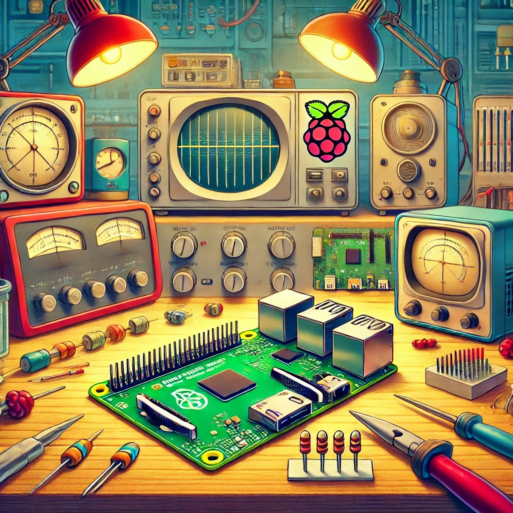<br>
<em>Промпт DALL·E: лаборатория электроники в мультяшном стиле 1950-х. Винтажное оборудование, большие осциллографы, старые ламповые радиоприёмники и громоздкие компьютеры. Плата Raspberry Pi 5 крупным планом, в реальном размере (примерно как банковская карта), лежит на верстаке. Вокруг — классические инструменты: паяльник, резисторы и провода. Сцена яркая, с утрированными цветами и игривыми деталями, характерными для мультфильма. Логотипов и текста нет.</em></p>

В этой главе описана настройка моделей Raspberry Pi Zero 2 W (*Raspi-Zero*) и Raspberry Pi 5 (*Raspi-5*). Мы рассмотрим настройку оборудования, установку операционной системы, первичную конфигурацию и проверки.

> Общие инструкции для *Raspi-5* применимы и к более старым версиям Raspberry Pi, например Raspi-3 и Raspi-4.

## Обзор

Raspberry Pi — мощный и универсальный одноплатный компьютер, который стал незаменимым инструментом инженеров самых разных специальностей. Эти компактные устройства, разработанные [Raspberry Pi Foundation](https://www.raspberrypi.org/), сочетают доступность, вычислительную мощность и широкие возможности GPIO (General Purpose Input/Output), что делает их идеальными для прототипирования, разработки встраиваемых систем и сложных инженерных проектов.

### Ключевые особенности

1. **Вычислительная мощность.** Несмотря на небольшой размер, Raspberry Pi обладает значительными возможностями: в новейших моделях — многоядерные процессоры ARM и до 8 ГБ оперативной памяти.

2. **Интерфейс GPIO.** 40-контактный разъём GPIO позволяет напрямую взаимодействовать с датчиками, исполнительными устройствами и другими электронными компонентами, что облегчает проекты интеграции аппаратной и программной частей.

3. **Широкие возможности подключения.** Встроенные Wi-Fi, Bluetooth, Ethernet и несколько портов USB позволяют реализовать разные коммуникационные и сетевые проекты.

4. **Низкоуровневый доступ к аппаратуре.** Raspberry Pi предоставляет доступ к интерфейсам I2C, SPI и UART, что позволяет детально управлять внешними устройствами и обмениваться с ними данными.

5. **Возможности работы в реальном времени.** При правильной настройке Raspberry Pi можно использовать для приложений мягкого реального времени, что делает его пригодным для систем управления и задач обработки сигналов.

6. **Энергоэффективность.** Низкое энергопотребление позволяет создавать устройства с батарейным питанием и энергоэффективные решения, особенно на моделях Pi Zero.

### Модели Raspberry Pi (рассматриваемые в этой книге)

1. **Raspberry Pi Zero 2 W** (*Raspi-Zero*):
   - подходит для: компактных встраиваемых систем;
   - ключевые характеристики: четырёхъядерный процессор ARM Cortex-A53 с частотой 1 ГГц, 512 МБ ОЗУ, минимальное энергопотребление.

2. **Raspberry Pi 5** (*Raspi-5*):
   - подходит для: более требовательных задач, таких как периферийные вычисления, компьютерное зрение и периферийный ИИ, включая LLM;
   - ключевые характеристики: четырёхъядерный процессор ARM Cortex-A76 с частотой 2,4 ГГц, до 8 ГБ ОЗУ, интерфейс PCIe для расширений.

### Инженерные применения

1. **Проектирование встраиваемых систем:** разработка и прототипирование встраиваемых систем для реальных задач.

2. **IoT и сетевые устройства:** создание взаимосвязанных устройств и изучение протоколов MQTT, CoAP и HTTP/HTTPS.

3. **Системы управления:** реализация контуров обратной связи, ПИД-регуляторов и взаимодействие с исполнительными устройствами.

4. **Компьютерное зрение и ИИ:** использование библиотек OpenCV и TensorFlow Lite для обработки изображений и машинного обучения на периферии.

5. **Сбор и анализ данных:** сбор данных с датчиков, анализ в реальном времени и создание систем журналирования данных.

6. **Робототехника:** создание контроллеров роботов, реализация алгоритмов планирования движения и взаимодействие с драйверами моторов.

7. **Обработка сигналов:** анализ сигналов в реальном времени, фильтрация и приложения DSP.

8. **Сетевая безопасность:** настройка VPN, межсетевых экранов и изучение тестирования на проникновение в сеть.

Это руководство поможет настроить самые распространённые модели Raspberry Pi, чтобы быстро приступить к проекту машинного обучения. Мы рассмотрим настройку оборудования, установку операционной системы и первичную конфигурацию, уделяя внимание подготовке Pi к задачам машинного обучения.

## Обзор оборудования

### Raspberry Pi Zero 2W

<p align="center">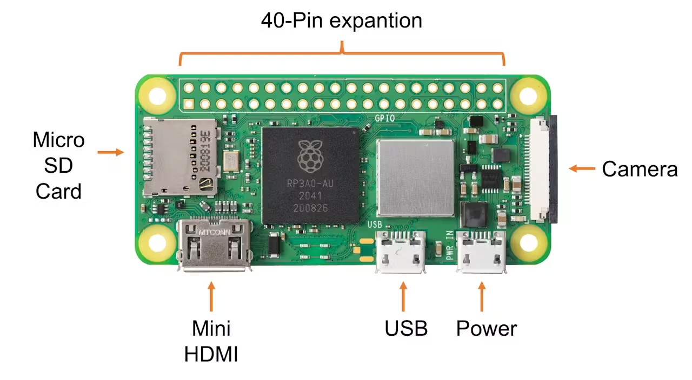</p>

- **Процессор:** 64-битный четырёхъядерный Arm Cortex-A53 с частотой 1 ГГц;
- **ОЗУ:** 512 МБ SDRAM;
- **Беспроводная связь:** 2,4 ГГц 802.11 b/g/n (Wi-Fi), Bluetooth 4.2, BLE;
- **Порты:** mini HDMI, micro USB OTG, разъём камеры CSI-2;
- **Питание:** 5 В через порт micro USB.

### Raspberry Pi 5

<p align="center">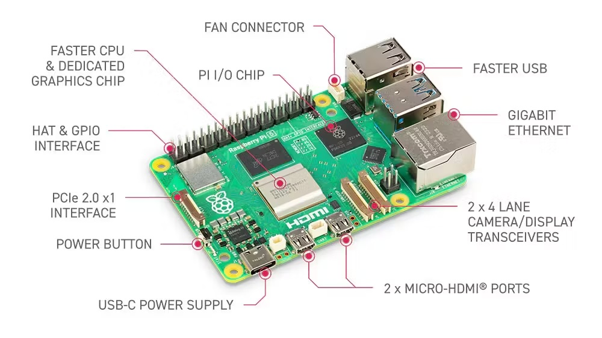</p>

- **Процессор:**
  - Pi 5: 64-битный четырёхъядерный Arm Cortex-A76 с частотой 2,4 ГГц;
  - Pi 4: 64-битная SoC с четырьмя ядрами Cortex-A72 (ARM v8) с частотой 1,5 ГГц;
- **ОЗУ:** варианты 2, 4 или 8 ГБ (для задач ИИ рекомендуется 8 ГБ);
- **Беспроводная связь:** двухдиапазонный 802.11ac, Bluetooth 5.0;
- **Порты:** 2 × micro HDMI, 2 × USB 3.0, 2 × USB 2.0, разъём камеры CSI, разъём дисплея DSI;
- **Питание:** 5 В постоянного тока через разъём USB-C (3 А).

> В лабораторных работах мы будем использовать разные имена для Raspberry Pi: `Raspi`, `Raspi-5`, `Raspi-Zero` и т. д. Обычно `Raspi` используется, когда инструкция или комментарий относится ко всем моделям.

## Установка операционной системы

### Операционная система (ОС)

Операционная система (ОС) — это базовое программное обеспечение, которое управляет аппаратными и программными ресурсами компьютера и предоставляет стандартные сервисы для программ. Это основной программный слой, который работает на компьютере и выступает посредником между аппаратурой и прикладным программным обеспечением. ОС управляет памятью компьютера, процессами, драйверами устройств, файлами и протоколами безопасности.

1. **Основные функции:**
   - управление процессами: выделение процессорного времени разным программам;
   - управление памятью: выделение и освобождение памяти по мере необходимости;
   - управление файловой системой: организация файлов и каталогов и учёт их расположения;
   - управление устройствами: взаимодействие с подключёнными аппаратными устройствами;
   - пользовательский интерфейс: предоставление способа взаимодействия пользователя с компьютером.
2. **Компоненты:**
   - ядро (kernel): центральная часть ОС, которая управляет аппаратными ресурсами;
   - оболочка (shell): пользовательский интерфейс для работы с ОС;
   - файловая система: организует и управляет хранением данных;
   - драйверы устройств: программное обеспечение, которое позволяет ОС взаимодействовать с аппаратурой.

Raspberry Pi работает под специальной версией Linux, созданной для встраиваемых систем. Эта операционная система, обычно представляющая собой вариант Debian под названием Raspberry Pi OS (раньше — Raspbian), оптимизирована для архитектуры ARM и ограниченных ресурсов Pi.

> Последняя версия Raspberry Pi OS основана на [Debian Bookworm](https://www.raspberrypi.com/news/bookworm-the-new-version-of-raspberry-pi-os/).

**Ключевые особенности:**

1. Легковесность: адаптирована для эффективной работы на аппаратуре Pi.
2. Универсальность: поддерживает широкий набор приложений и языков программирования.
3. Открытый исходный код: позволяет настраивать систему и получать улучшения от сообщества.
4. Поддержка GPIO: обеспечивает взаимодействие с датчиками и другой аппаратурой через контакты Pi.
5. Регулярные обновления: система постоянно совершенствуется в части производительности и безопасности.

Встраиваемый Linux на Raspberry Pi предоставляет полноценную операционную систему в компактном корпусе, что делает его идеальным для проектов — от простых IoT-устройств до более сложных приложений периферийного машинного обучения. Совместимость со стандартными инструментами и библиотеками Linux делает его мощной платформой для разработки и экспериментов.

### Установка

Чтобы использовать Raspberry Pi, нам понадобится операционная система. По умолчанию Raspberry Pi ищет операционную систему на любой SD-карте, вставленной в слот, поэтому установить систему мы будем с помощью [Raspberry Pi Imager](https://www.raspberrypi.com/software/).

*Raspberry Pi Imager* — инструмент для загрузки и записи образов в *macOS*, *Windows* и *Linux*. В нём есть множество популярных образов операционных систем для Raspberry Pi. Imager мы также используем для предварительной настройки учётных данных и параметров удалённого доступа.

Чтобы установить ОС на Raspi, выполните следующие шаги:

1. [Скачайте](https://www.raspberrypi.com/software/) и установите Raspberry Pi Imager на свой компьютер.
2. Вставьте microSD-карту в компьютер (рекомендуется SD-карта объёмом 32 ГБ).
3. Откройте Raspberry Pi Imager и выберите модель вашей Raspberry Pi.
4. Выберите подходящую операционную систему:
   - **Для Raspi-Zero:** например, можно выбрать `Raspberry Pi OS Lite (64-bit)`.

   <p align="center">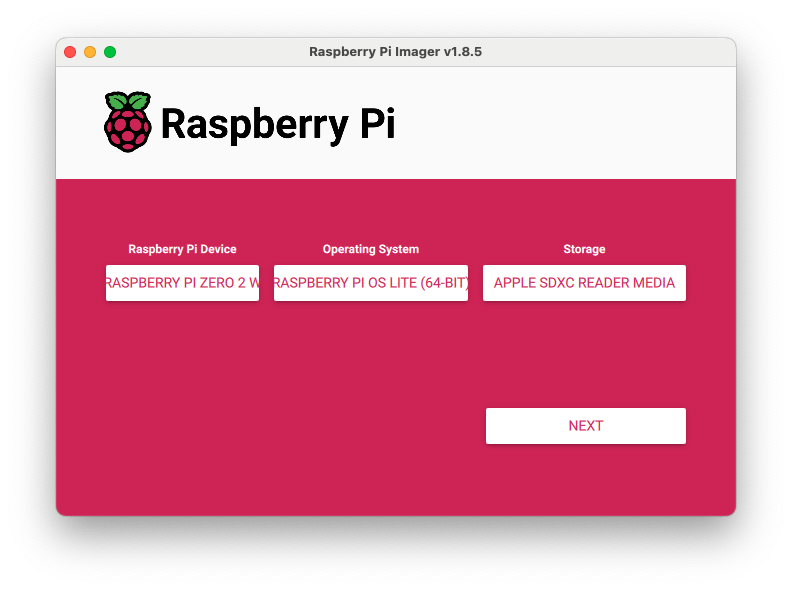</p>

   > Из-за небольшого объёма SDRAM (512 МБ) для Raspi-Zero рекомендуется 32-битная версия системы. Однако для запуска некоторых моделей машинного обучения, например YOLOv8 от Ultralytics, нужна 64-битная версия. Хотя на Raspi-Zero можно запустить рабочий стол, мы выберем версию LITE (без рабочего стола), чтобы уменьшить расход ОЗУ при обычной работе.

   - **Для Raspi-5:** можно выбрать полную 64-битную версию с рабочим столом:
     `Raspberry Pi OS (64-bit)`.

<p align="center">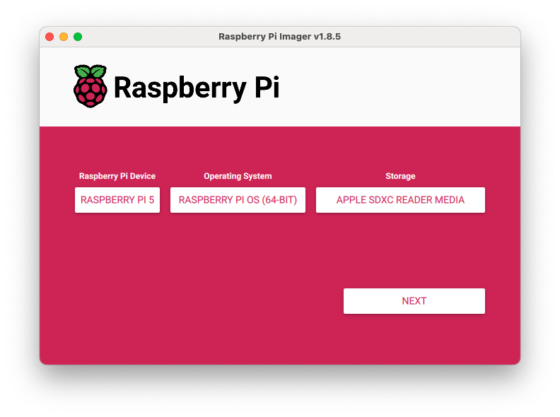</p>

5. Выберите microSD-карту в качестве устройства хранения.
6. Нажмите `Next`, затем значок «шестерёнки», чтобы открыть расширенные настройки.
7. Задайте *имя хоста (hostname)*, *имя пользователя и пароль* Raspi, настройте *Wi-Fi* и *включите SSH* (очень важно!).

<p align="center">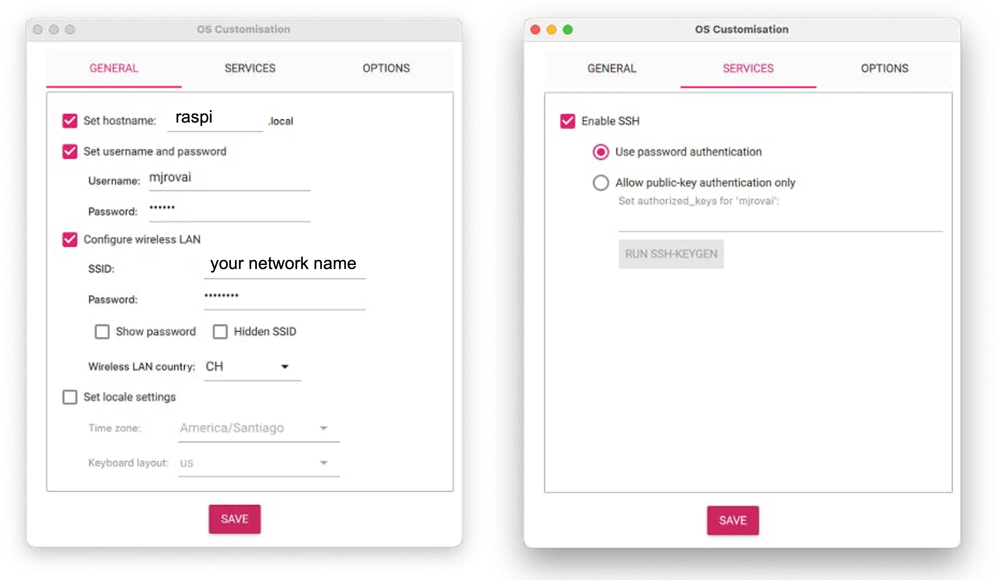</p>

8. Запишите образ на microSD-карту.

> В примерах здесь мы используем разные имена хостов в зависимости от устройства: raspi, raspi-5, raspi-zero и т. д. Замените их на те, которые используете вы.

### Первичная настройка

1. Вставьте microSD-карту в Raspberry Pi.
2. Подключите питание, чтобы загрузить Raspberry Pi.
3. Дождитесь завершения первоначальной загрузки (это может занять несколько минут).

> Самые распространённые команды Linux для работы с Raspi можно найти [здесь](https://www.jwdittrich.people.ysu.edu/raspberrypi/UsefulRaspberryPiCommands.pdf) или [здесь](https://www.codecademy.com/learn/learn-raspberry-pi/modules/raspberry-pi-command-line-module/cheatsheet).

## Удалённый доступ

### Доступ по SSH

Проще всего работать с Raspi-Zero через SSH («headless», то есть без монитора и клавиатуры). Для этого можно использовать Terminal (macOS/Linux), [PuTTY](https://www.putty.org/) (Windows) или любой другой клиент.

1. Узнайте IP-адрес вашей Raspberry Pi (например, в настройках роутера).

2. На компьютере откройте терминал и подключитесь по SSH:
   ```bash
   ssh username@<raspberry_pi_ip_address>
   ```
   Если IP-адрес неизвестен, можно попробовать так:
   ```bash
   ssh username@hostname.local
   ```
   например, `ssh username@rpi-5.local` или `ssh username@raspi.local`.

   <p align="center">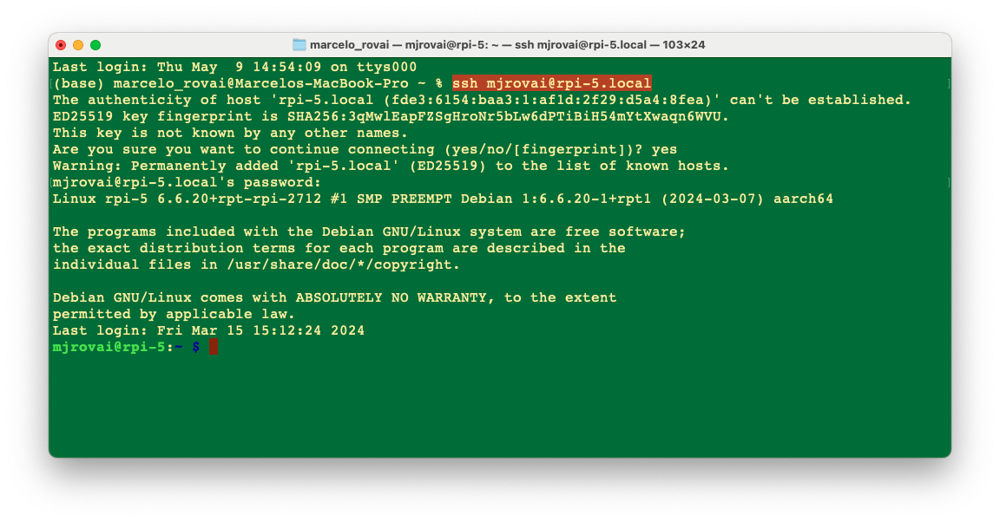</p>

   Когда вы увидите приглашение:

   ```bash
   username@rpi-5:~ $
   ```

   значит, вы работаете с Raspi удалённо.
   Полезно регулярно обновлять систему. Для этого выполните:

   ```bash
   sudo apt-get update
   sudo apt upgrade
   ```
   Также проверьте IP-адрес Raspi. В терминале это можно сделать так:
   ```bash
   hostname -I
   ```

<p align="center">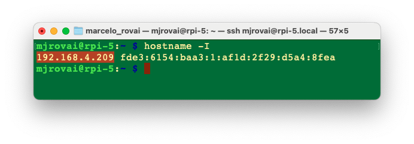</p>

### Выключение Raspi через терминал

Когда нужно выключить Raspberry Pi, лучше не просто выдёргивать шнур питания. Raspi может ещё записывать данные на SD-карту, и тогда простое отключение питания может привести к потере данных или, что хуже, к повреждению карты.

Для безопасного выключения используйте командную строку:

```bash
sudo shutdown -h now
```

> Чтобы избежать потери данных и повреждения SD-карты, перед отключением питания подождите несколько секунд после выключения, пока светодиод Raspberry Pi перестанет мигать и погаснет. Когда светодиод погаснет, питание можно безопасно отключить.

### Передача файлов между Raspi и компьютером

Передавать файлы между Raspi и основным компьютером можно с помощью флешки, напрямую в терминале (через scp) или по сети с помощью FTP-клиента.

#### Использование Secure Copy Protocol (`scp`)

##### Копирование файлов на Raspberry Pi

Создадим на компьютере текстовый файл, например `test.txt`.

<p align="center">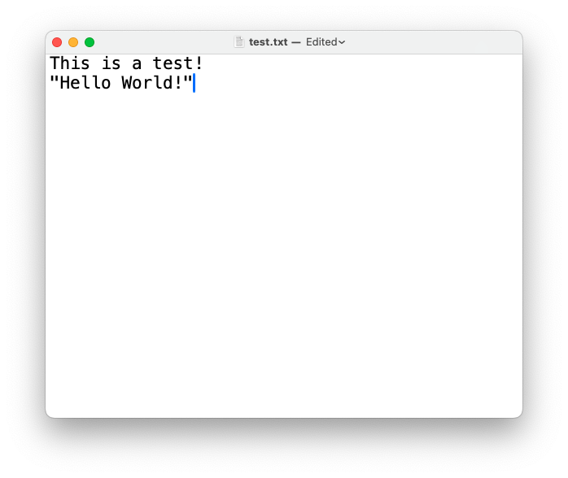</p>

> Можно использовать любой текстовый редактор. В том же терминале удобен `nano`.

Чтобы скопировать файл `test.txt` с личного компьютера в домашний каталог пользователя на Raspberry Pi, выполните следующую команду из каталога, где лежит `test.txt`, заменив `<username>` на имя пользователя, под которым вы входите в Raspberry Pi, и `<pi_ip_address>` на IP-адрес вашей Raspberry Pi:

```bash
$ scp test.txt <username>@<pi_ip_address>:~/
```

> Обратите внимание: `~/` означает, что файл будет перемещён в корневой домашний каталог Raspi. Можно выбрать любую папку на Raspi, но её нужно создать до запуска `scp`, так как `scp` не создаёт папки автоматически.

Например, перенесём файл `test.txt` в домашний каталог моей Raspi-Zero с IP-адресом `192.168.4.210`:

```bash
scp test.txt username@192.168.4.210:~/
```

<p align="center">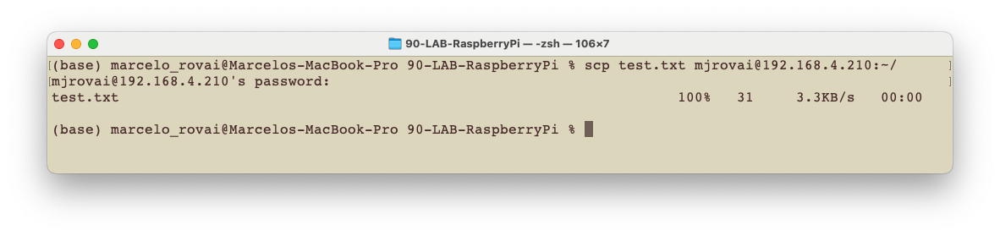</p>

Для различения терминалов я использую другой профиль. Описанное выше действие выполняется **на вашем компьютере**. Теперь подключимся к Raspi по SSH и проверим, что файл на месте:

<p align="center">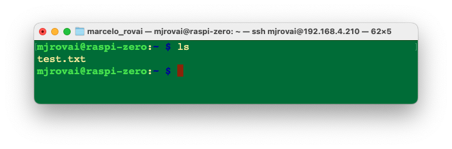</p>

##### Копирование файлов с Raspberry Pi

Чтобы скопировать файл `myfile.txt` из домашнего каталога пользователя на Raspberry Pi в текущий каталог другого компьютера, выполните следующую команду **на вашем компьютере-хосте**:

```bash
$ scp <username>@<pi_ip_address>:myfile.txt .
```

Например:

На Raspi создадим копию файла с другим именем:

```bash
cp test.txt test_2.txt
```

А на компьютере-хосте (в моём примере — Mac):

```bash
scp username@192.168.4.210:test_2.txt .
```

<p align="center">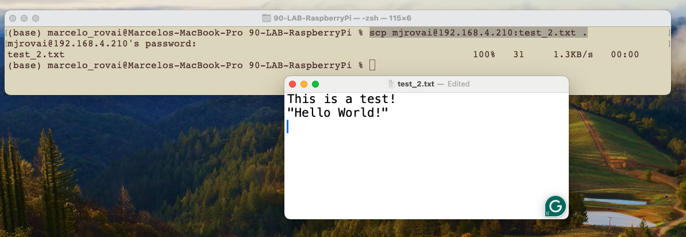</p>

#### Передача файлов по FTP

Передавать файлы можно и по FTP, например с помощью клиента [FileZilla](https://filezilla-project.org/download.php?type=client). Установите программу для операционной системы вашего компьютера и укажите IP-адрес Raspi в поле `Host`. Например:

```bash
sftp://192.168.4.210
```

Введите имя пользователя и пароль Raspi. Нажатие `Quickconnect` откроет два окна: одно для рабочего стола вашего компьютера (справа), другое для Raspi (слева).

<p align="center">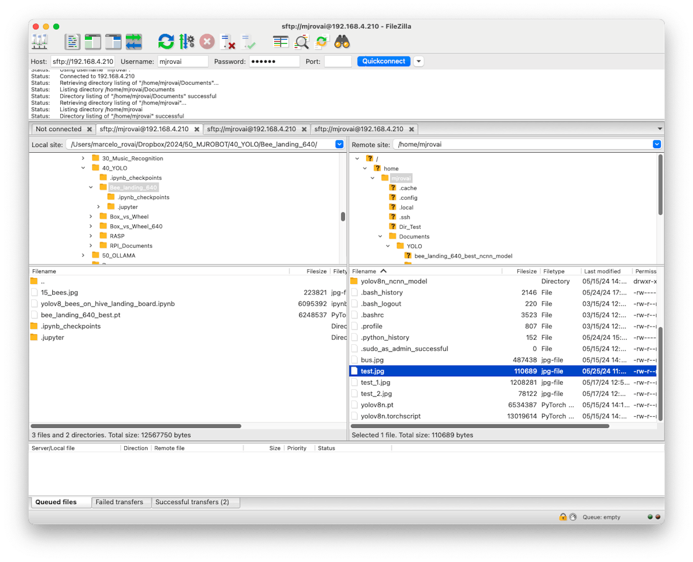</p>

## Увеличение памяти SWAP

С помощью `htop` — интерактивного монитора процессов, работающего на разных платформах, — можно удобно отслеживать ресурсы Raspi: список процессов, загрузку процессоров и используемую память в реальном времени. Чтобы запустить `htop`, введите в терминале:

```bash
htop
```

<p align="center">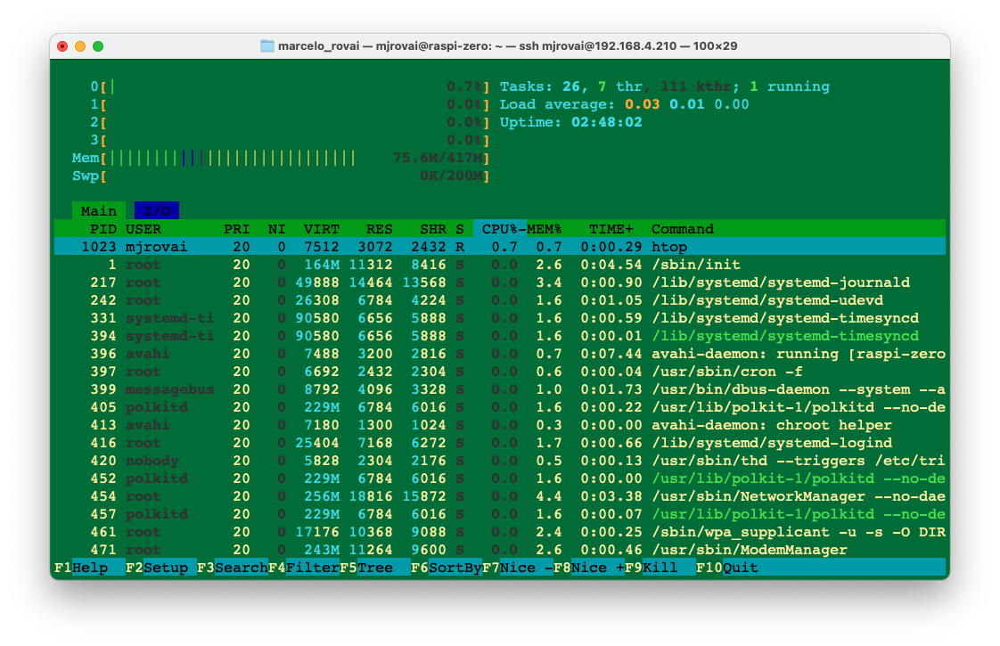</p>

Что касается памяти, среди устройств семейства Raspberry Pi у Raspi-Zero меньше всего ОЗУ (500 МБ), тогда как у Raspi 4 или 5 — от 2 до 8 ГБ. Для любой Raspi можно увеличить объём памяти, доступной системе, с помощью «swap». Swap-память, или область подкачки, — это приём, при котором операционная система временно сохраняет данные из ОЗУ (оперативной памяти) на SD-карту, когда физическая память полностью занята. Это позволяет ОС продолжать работу, когда ОЗУ заполнено, и предотвращает зависания и замедление системы.

Swap полезен устройствам с ограниченным объёмом ОЗУ, таким как Raspi-Zero. Увеличение swap помогает запускать более требовательные приложения и процессы, но нужно учитывать возможное снижение производительности из-за частого обращения к диску.

По умолчанию swap-память Raspi-Zero составляет всего 100 МБ, что очень мало для более сложных и требовательных приложений машинного обучения (например, YOLO). Увеличим её до 2 ГБ.

Сначала отключите файл подкачки:

```bash
sudo dphys-swapfile swapoff
```

Затем откройте и измените файл `/etc/dphys-swapfile`. Для этого используем nano:

```bash
sudo nano /etc/dphys-swapfile
```

Найдите переменную **CONF_SWAPSIZE** (по умолчанию 200) и измените её значение на **2000**:

```bash
CONF_SWAPSIZE=2000
```

Сохраните файл.

Далее снова включите файл подкачки и перезагрузите Raspi-Zero:

```bash
sudo dphys-swapfile setup
sudo dphys-swapfile swapon
sudo reboot
```

После перезагрузки (снова подключитесь по SSH) вы увидите, что максимальный объём swap в верхней части `htop` теперь составляет около 2 ГБ (в моём случае — 1,95 ГБ).

> Чтобы `htop` продолжал работать, откройте второе окно терминала и продолжайте взаимодействовать с Raspi в нём.

## Установка камеры

Raspi — отличное устройство для приложений компьютерного зрения, и для этого понадобится камера. Можно подключить стандартную USB-веб-камеру к micro-USB-порту через OTG-адаптер (Raspi-Zero и Raspi-5) или модуль камеры, подключённый к порту CSI (Camera Serial Interface) на Raspi.

> USB-веб-камеры обычно уступают по качеству модулям камер, которые подключаются к порту CSI. Кроме того, ими нельзя управлять командами `raspistill` и `raspivid` в терминале или пакетом записи `picamera` для Python. Тем не менее есть причины подключить USB-камеру к Raspberry Pi: например, так проще подключить несколько камер к одной плате, можно использовать длинные кабели или просто под рукой уже есть такая камера.

### Установка USB-веб-камеры

1. Выключите Raspi:

```bash
sudo shutdown -h now
```

2. Подключите USB-веб-камеру (USB Camera Module, 30 кадров/с, $1280{\times}720$) к Raspi. В этом примере используется Raspi-Zero, но инструкции подходят для всех моделей Raspi.

<p align="center">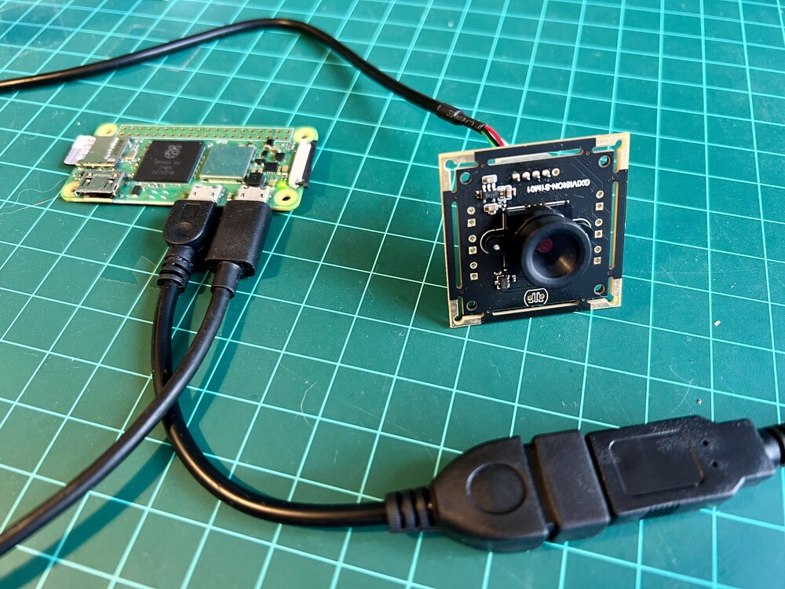</p>

3. Включите питание снова и подключитесь по SSH.
4. Чтобы проверить, распознана ли USB-камера, выполните:

```bash
lsusb
```

Камера должна появиться в выводе команды.

<p align="center">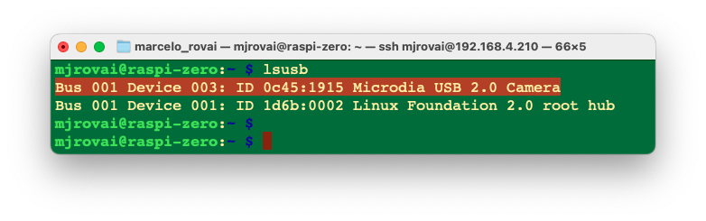</p>

5. Чтобы сделать тестовый снимок с USB-камеры, используйте:

```bash
fswebcam test_image.jpg
```

Эта команда сохранит изображение с именем «test_image.jpg» в текущем каталоге.

<p align="center">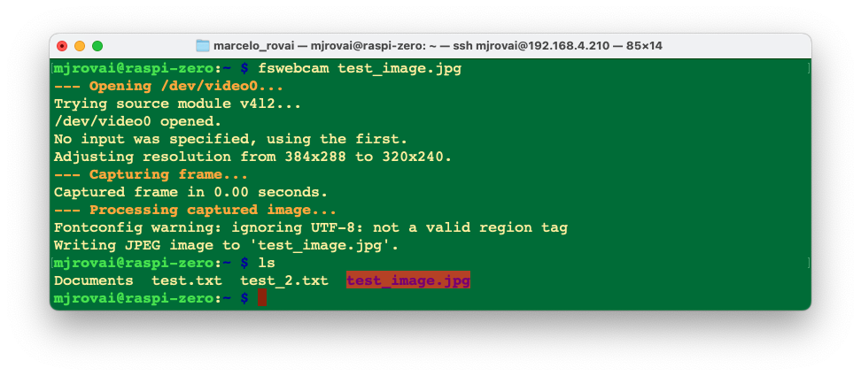</p>

6. Поскольку мы подключаемся к Raspi по SSH, снимок нужно перенести на основной компьютер, чтобы его просмотреть. Для этого можно использовать FileZilla или SCP:

Откройте терминал **на основном компьютере** и выполните:

```bash
scp username@raspi-zero.local:~/test_image.jpg .
```

> Замените «username» на своё имя пользователя, а «raspi-zero» — на имя хоста Raspi.

<p align="center">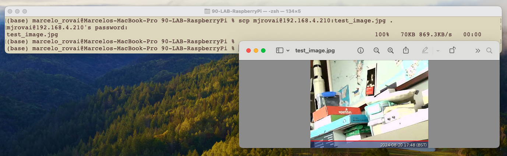</p>

7. Если качество изображения не устраивает, можно изменить настройки. Например, задайте разрешение, подходящее для YOLO ($640{\times}640$):

```bash
fswebcam -r 640x640 --no-banner test_image_yolo.jpg
```

Эта команда создаёт снимок с более высоким разрешением без стандартной подписи (баннера).

<p align="center">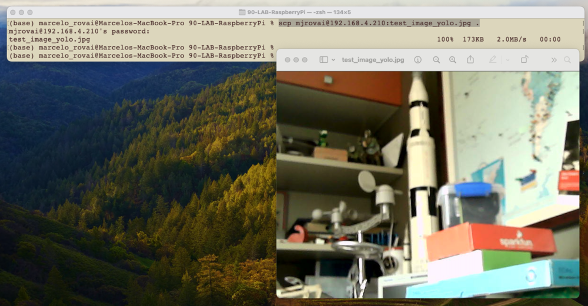</p>

Обычную USB-веб-камеру тоже можно использовать:

<p align="center">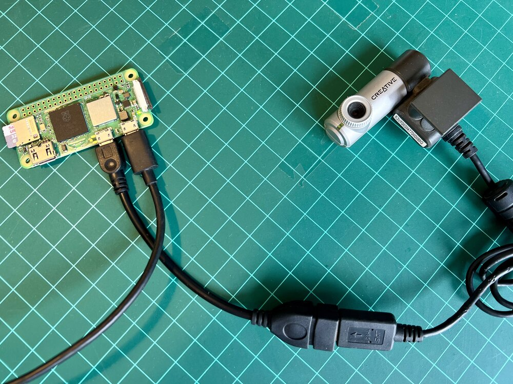</p>

И проверить её командой `lsusb`:

<p align="center">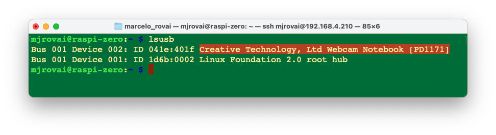</p>

#### Потоковое видео

Для потокового видео (это требует больше ресурсов) можно установить и использовать mjpg-streamer.

Сначала установите Git:

```bash
sudo apt install git
```

Теперь установите зависимости для mjpg-streamer, клонируйте репозиторий и выполните установку:

```bash
sudo apt install cmake libjpeg62-turbo-dev
git clone https://github.com/jacksonliam/mjpg-streamer.git
cd mjpg-streamer/mjpg-streamer-experimental
make
sudo make install
```

Затем запустите потоковую передачу:

```bash
mjpg_streamer -i "input_uvc.so" -o "output_http.so -w ./www"
```

Открыть поток можно в веб-браузере по адресу `http://<IP-адрес_вашего_Pi>:8080`. В моём случае это http://192.168.4.210:8080

Вы увидите страницу с вариантами просмотра. Нажмите на ссылку «Stream» или откройте адрес:

```bash
http://<raspberry_pi_ip_address>:8080/?action=stream
```

<p align="center">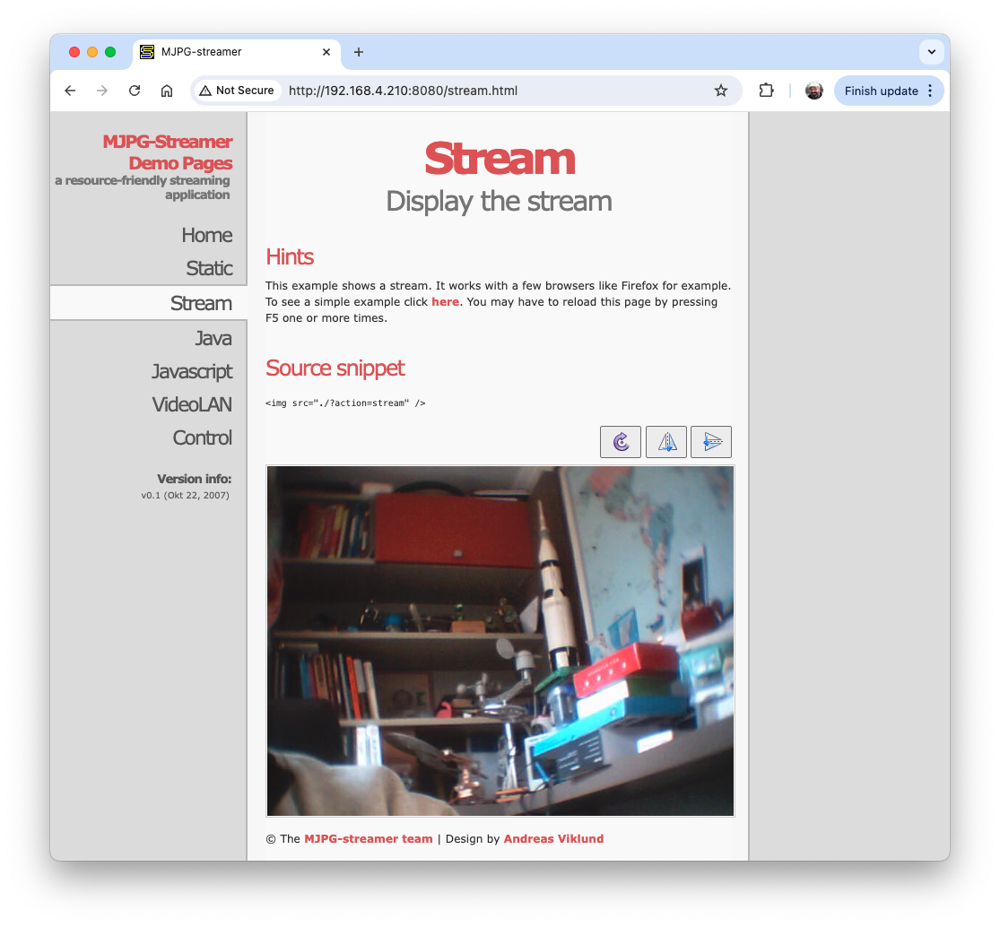</p>

### Установка модуля камеры в порт CSI

Существует несколько модулей камер Raspberry Pi. Первая камера, 5-мегапиксельная, была [выпущена](https://www.raspberrypi.com/news/camera-board-available-for-sale/) в 2013 году, затем в 2016 году появилась 8-мегапиксельная [Camera Module 2](https://www.raspberrypi.com/products/camera-module-v2/). Самая новая модель — 12-мегапиксельная [Camera Module 3](https://www.raspberrypi.com/documentation/accessories/camera.html), выпущенная в 2023 году.

Оригинальная 5-мегапиксельная камера (**Arducam OV5647**) больше не продаётся Raspberry Pi, но её можно найти у других поставщиков. Ниже показан пример такой камеры на Raspi-Zero.

<p align="center">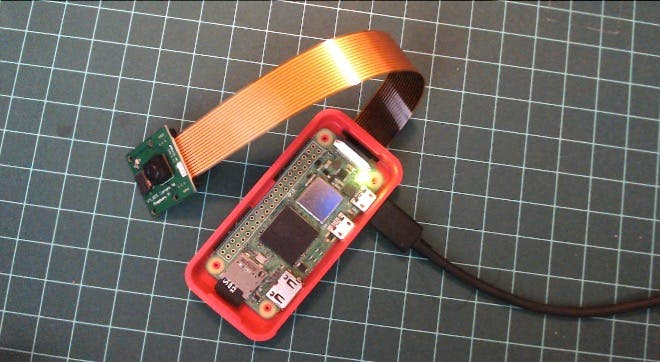</p>

Вот ещё один пример модуля камеры второй версии, в котором установлен 8-мегапиксельный сенсор **Sony IMX219**:

<p align="center">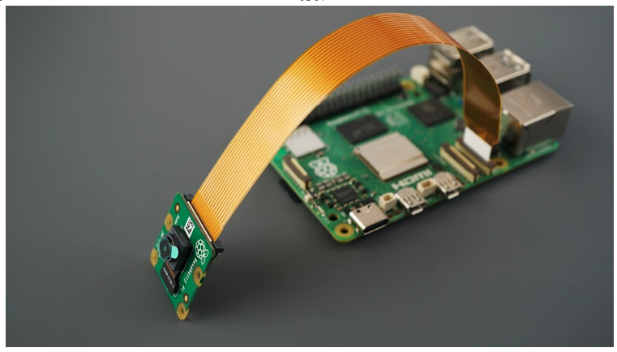</p>

Любой модуль камеры будет работать на Raspberry Pi, но для этого нужно обновить файл `config.txt`:

```bash
sudo nano /boot/firmware/config.txt
```

В конец файла, например для камеры 5 МП Arducam OV5647, добавьте строку:

```bash
dtoverlay=ov5647,cam0
```

Для модуля второй версии с 8-мегапиксельной камерой Sony IMX219 добавьте:

```bash
dtoverlay=imx219,cam0
```

Сохраните файл (CTRL+O, [ENTER], CTRL+X) и перезагрузите Raspi:

```bash
sudo reboot
```

После загрузки можно проверить, видна ли камера в системе:

```bash
libcamera-hello --list-cameras
```

<p align="center">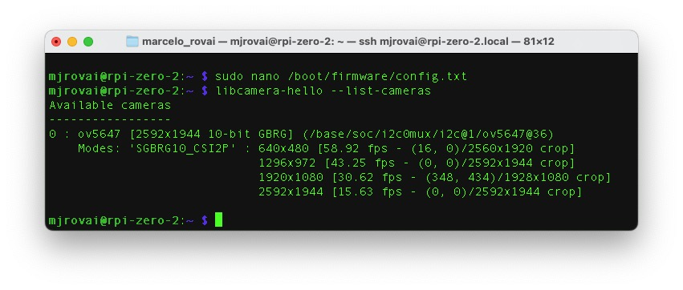</p>

<p align="center">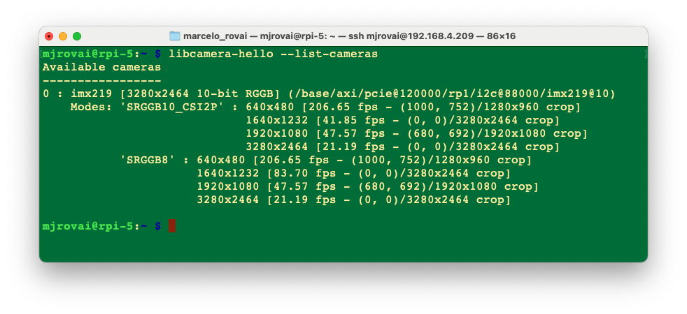</p>

> [libcamera](https://www.raspberrypi.com/documentation/computers/camera_software.html#libcamera) — это библиотека с открытым исходным кодом, которая напрямую поддерживает камерные системы в Linux на процессорах Arm. Она сводит к минимуму проприетарный код, работающий на GPU Broadcom.

Сделаем тестовый JPEG-снимок с разрешением $640{\times}480$ и сохраним его в файл `test_cli_camera.jpg`:

```bash
rpicam-jpeg --output test_cli_camera.jpg --width 640 --height 480
```

Чтобы убедиться, что файл сохранён, используйте `ls -l`: команда выводит содержимое текущего каталога в длинном формате. Как и раньше, для просмотра изображения можно использовать scp:

<p align="center">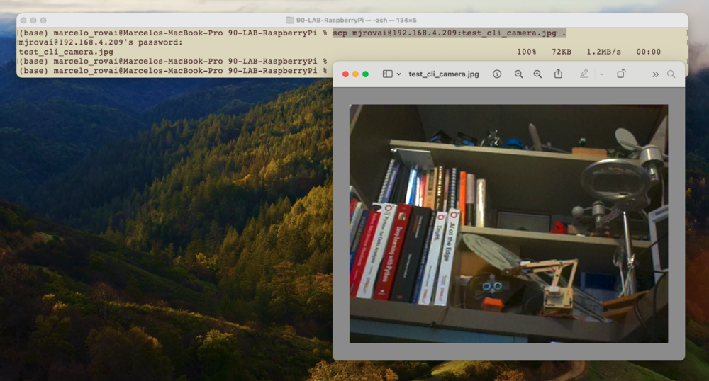</p>

## Удалённый запуск рабочего стола Raspi

Мы в основном работали с Raspberry Pi через терминал по SSH, но можно получить удалённый доступ ко всей графической среде рабочего стола, если установлена полная версия Raspberry Pi OS (например, `Raspberry Pi OS (64-bit)`). Это особенно полезно для задач, где нужен визуальный интерфейс. Чтобы включить такую возможность, нужно настроить сервер VNC (Virtual Network Computing) на Raspberry Pi. Вот как это сделать:

1. Включите сервер VNC:
   - Подключитесь к Raspberry Pi по SSH.
   - Запустите инструмент настройки Raspberry Pi, введя команду:
     ```bash
     sudo raspi-config
     ```
   - Перейдите к пункту `Interface Options`, используя стрелки.

   <p align="center">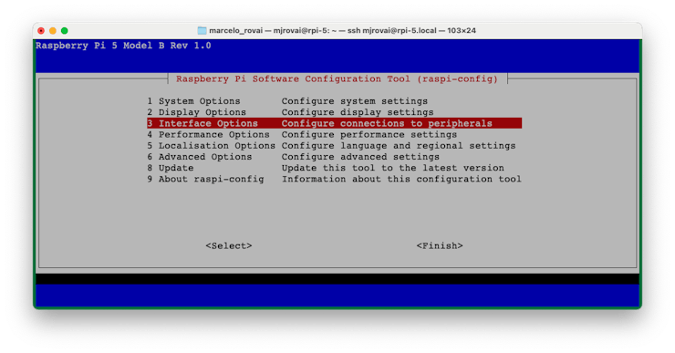</p>

   - Выберите `VNC` и `Yes`, чтобы включить сервер VNC.

   <p align="center">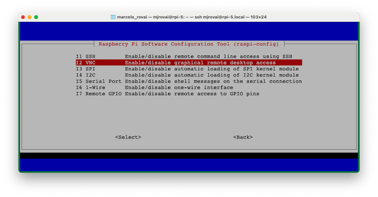</p>

   - Выйдите из инструмента настройки, сохранив изменения при запросе.

   <p align="center">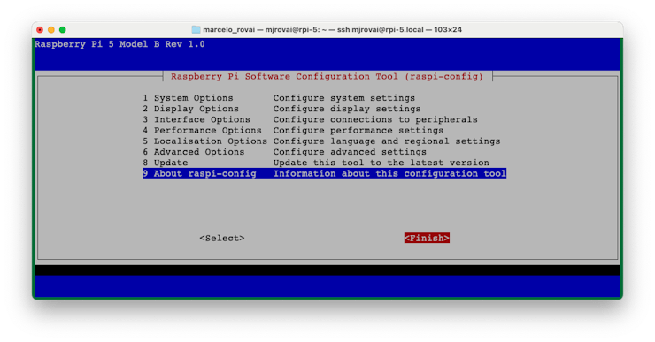</p>

2. Установите VNC Viewer на свой компьютер:
   - Скачайте и установите приложение VNC-клиента на основной компьютер. Популярные варианты: RealVNC Viewer, TightVNC или VNC Viewer от RealVNC. Мы будем использовать [VNC Viewer](https://www.realvnc.com/en/connect/download/viewer) от RealVNC.

3. Убедившись, что приложение установлено, уточните IP-адрес Raspi. Например, в терминале можно выполнить:

   ```bash
   hostname -I
   ```

   <p align="center"></p>

4. Подключитесь к Raspberry Pi:
   - Откройте приложение VNC Viewer.

   <p align="center">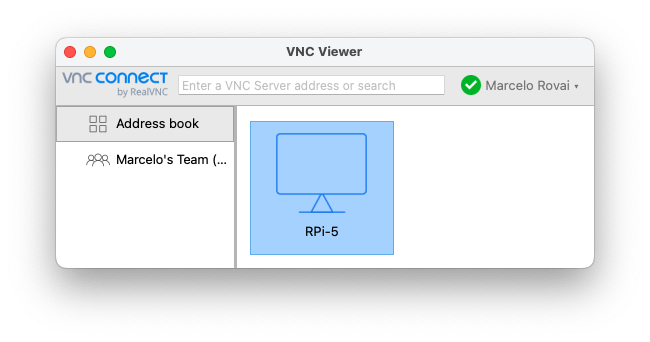</p>

   - Введите IP-адрес и имя хоста Raspberry Pi.
   - По запросу введите имя пользователя и пароль Raspberry Pi.

   <p align="center">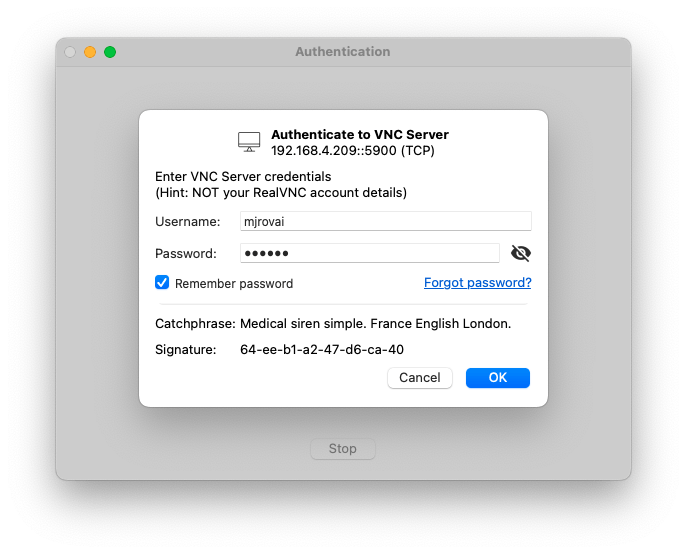</p>

5. Рабочий стол Raspberry Pi 5 должен появиться на мониторе вашего компьютера.

   <p align="center">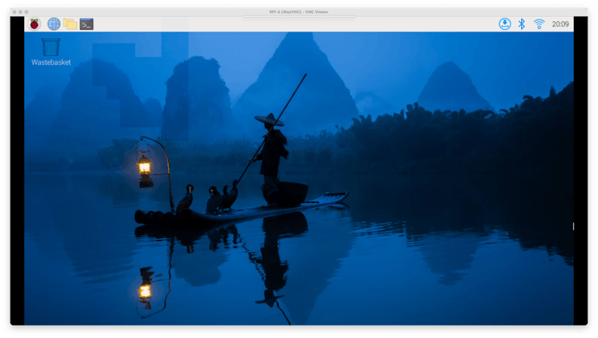</p>

6. При необходимости настройте экран:
   - После подключения настройте разрешение экрана для комфортной работы. Это можно сделать в настройках рабочего стола Raspberry Pi или изменив файл config.txt.
   - Сделаем это через настройки рабочего стола. Откройте меню (значок Raspberry в левом верхнем углу) и выберите наилучшее разрешение для вашего монитора:

   <p align="center">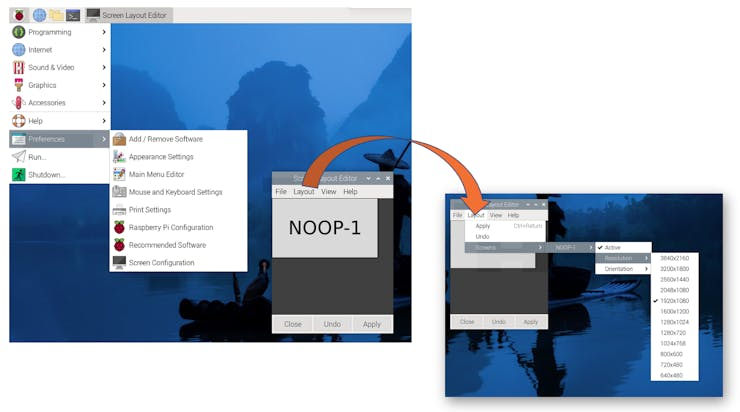</p>

## Обновление системы и установка программ

1. Обновите систему:

   ```bash
   sudo apt update && sudo apt upgrade -y
   ```

2. Установите необходимые программы:

   ```bash
   sudo apt install python3-pip -y
   ```

3. Включите pip для Python-проектов:

   ```bash
   sudo rm /usr/lib/python3.11/EXTERNALLY-MANAGED
   ```

## Особенности разных моделей

### Raspberry Pi Zero (Raspi-Zero)

- Ограниченная вычислительная мощность, лучше подходит для лёгких проектов.
- Лучше работать без монитора, через SSH, чтобы экономить ресурсы.
- Для задач с большим расходом памяти имеет смысл увеличить объём swap-памяти.
- Подходит для лабораторных работ по классификации изображений и обнаружению объектов, но не для LLM (SLM).

### Raspberry Pi 4 или 5 (Raspi-4 или Raspi-5)

- Подходят для более требовательных проектов, включая ИИ и машинное обучение.
- Могут плавно работать со всей графической средой рабочего стола.
- Raspi-4 подходит для лабораторных работ по классификации изображений и обнаружению объектов, но плохо работает с LLM (SLM).
- Для Raspi-5 при интенсивной нагрузке, например в лабораторной работе по LLM (SLM), стоит использовать активный кулер для контроля температуры.

Подбирайте требования проекта под конкретную модель Raspberry Pi. Raspi-Zero хорошо подходит для проектов с низким энергопотреблением и ограниченным местом, а Raspi-4 или 5 лучше подходят для более ресурсоёмких задач.
