# Модели «зрение — язык» (VLM)

<p align="center">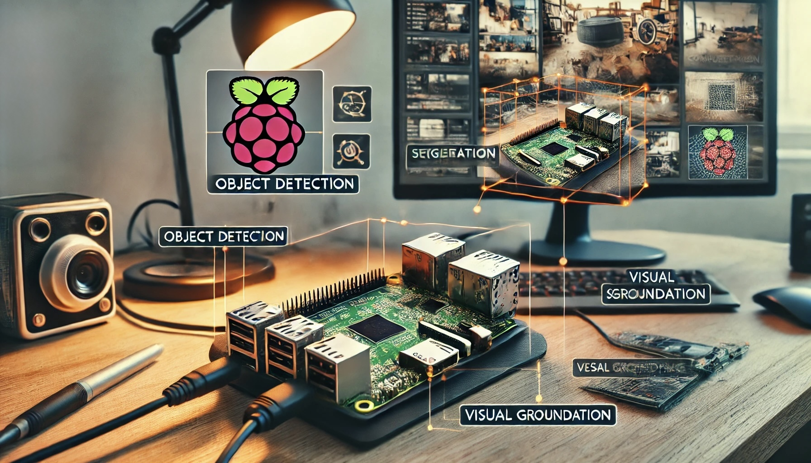<br>
<em>Промпт DALL·E: установка Raspberry Pi для задач компьютерного зрения. На изображении Raspberry Pi подключена к камере, а вокруг неё визуально представлены различные задачи: обнаружение объектов, описание изображений, сегментация и визуальная привязка (visual grounding). Raspberry Pi стоит на столе, на дисплее видны ограничивающие рамки и аннотации, связанные с этими задачами. Фон — домашняя мастерская с инструментами и устройствами, которыми обычно пользуются разработчики и энтузиасты.</em></p>

## Введение

В этой практической работе мы будем последовательно исследовать прикладной ИИ на периферии: от базовой настройки Florence-2, передовой базовой модели компьютерного зрения от Microsoft, до продвинутых реализаций на таких устройствах, как Raspberry Pi. Мы научимся использовать модели «зрение — язык» (Vision Language Models, VLM) для таких задач, как описание изображений (captioning), обнаружение объектов, визуальная привязка (grounding), сегментация и OCR на Raspberry Pi.

### Почему Florence-2 на периферии?

[Florence-2](https://arxiv.org/abs/2311.06242) — модель «зрение — язык», которую Microsoft выпустила с открытым исходным кодом по лицензии MIT. Она заметно продвигает такие модели, сочетая лёгкую архитектуру с надёжными возможностями. Благодаря обучению на огромном наборе данных FLD-5B, который содержит 126 миллионов изображений и 5,4 миллиарда визуальных аннотаций, модель достигает производительности, сопоставимой с более крупными моделями. Это делает Florence-2 идеальной для развёртывания на периферии, где питание и вычислительные ресурсы ограничены.

В этом руководстве мы разберём, как использовать Florence-2 для приложений компьютерного зрения в реальном времени, таких как:

- описание изображений (Image captioning);
- обнаружение объектов;
- сегментация;
- визуальная привязка (Visual grounding).

> **Визуальная привязка (visual grounding)** связывает текстовые описания с конкретными областями изображения. Это позволяет модели понять, где на изображении находятся объекты или сущности, описанные в запросе. Например, если запрос — «красная машина», модель найдёт и выделит область, где на изображении находится красная машина. Визуальная привязка полезна там, где нужно точное соответствие между текстом и визуальным содержимым, например во взаимодействии человека с компьютером, в аннотировании изображений и интерактивных системах ИИ.

В руководстве мы пройдём следующие этапы:

- настройка Florence-2 на Raspberry Pi;
- запуск задач инференса, таких как обнаружение объектов и описание изображений;
- оптимизация модели для максимальной производительности на периферийном устройстве;
- изучение практических приложений в реальных условиях с дообучением (fine-tuning).

### Архитектура модели Florence-2

Florence-2 использует унифицированное представление на основе запросов для решения различных задач «зрение — язык». Архитектура модели состоит из двух основных компонентов: **кодировщика изображений** и **мультимодального кодировщика-декодера на основе трансформера**.

<p align="center">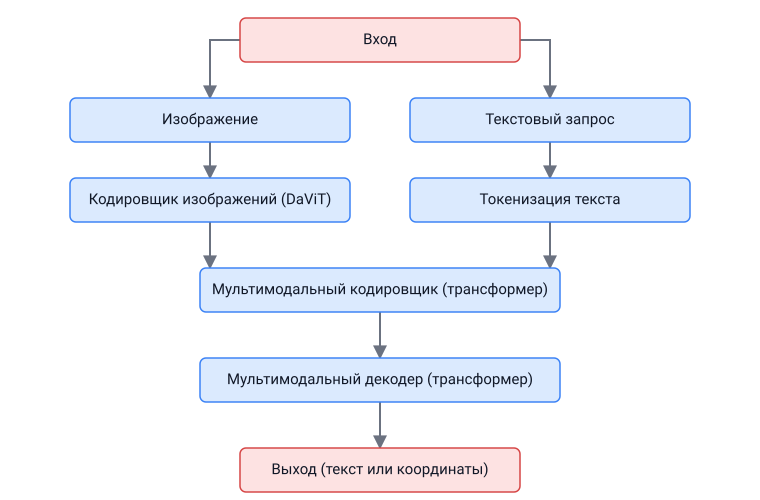</p>

- **Кодировщик изображений**: основан на [архитектуре DaViT (Dual Attention Vision Transformers)](https://arxiv.org/abs/2204.03645). Он преобразует входные изображения в последовательность эмбеддингов визуальных токенов. Эти эмбеддинги служат базовым представлением визуального содержимого и отражают как пространственную, так и контекстную информацию об изображении.

- **Мультимодальный кодировщик-декодер на основе трансформера**: ядро Florence-2 объединяет эмбеддинги визуальных токенов из кодировщика изображений с текстовыми эмбеддингами, которые создаёт модель, похожая на BERT. Такое объединение позволяет модели одновременно обрабатывать визуальные и текстовые входные данные, обеспечивая единый подход к таким задачам, как описание изображений, обнаружение объектов и сегментация.

Обучение на обширном наборе данных FLD-5B гарантирует, что модель эффективно справляется с разнообразными задачами зрения без модификаций под каждую задачу. Florence-2 использует текстовые запросы, чтобы активировать конкретные задачи, что делает её очень гибкой и способной к обобщению без дополнительного обучения (zero-shot). Для таких задач, как обнаружение объектов или визуальная привязка, модель использует дополнительные токены местоположения, чтобы обозначать области изображения, что обеспечивает точное понимание пространственных отношений.

> Компактная архитектура Florence-2 и инновационный подход к обучению позволяют ей точно выполнять задачи компьютерного зрения даже на устройствах с ограниченными ресурсами, таких как Raspberry Pi.

## Обзор технологии

Florence-2 содержит несколько инновационных особенностей, которые выделяют её среди других моделей:

### Архитектура

<p align="center">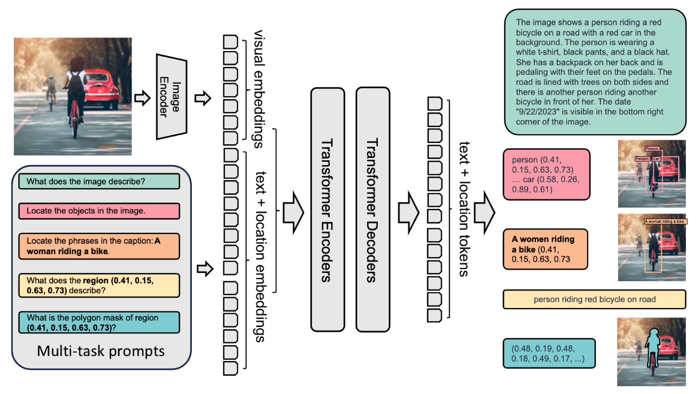</p>

- **Лёгкий дизайн**: доступны два варианта:
  - Florence-2-Base: 232 миллиона параметров;
  - Florence-2-Large: 771 миллион параметров.
- **Унифицированное представление**: решает несколько задач компьютерного зрения одной архитектурой.
- **Визуальный кодировщик DaViT**: преобразует изображения в эмбеддинги визуальных токенов.
- **Мультимодальный кодировщик-декодер на основе трансформера**: обрабатывает объединённые визуальные и текстовые эмбеддинги.

### Обучающий набор данных (FLD-5B)

<p align="center">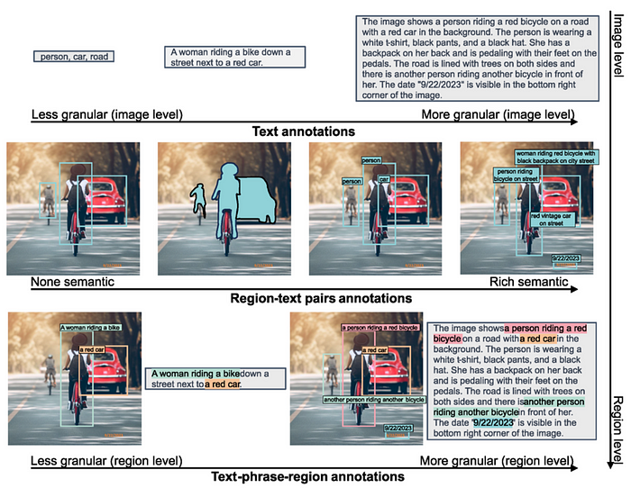</p>

- 126 миллионов уникальных изображений;
- 5,4 миллиарда комплексных аннотаций, включая:
  - 500 млн текстовых аннотаций;
  - 1,3 млрд аннотаций «регион — текст»;
  - 3,6 млрд аннотаций «текстовая фраза — регион»;
- автоматический конвейер аннотирования с использованием специализированных моделей;
- итеративный процесс уточнения для получения качественных меток.

### Ключевые возможности

Florence-2 показывает отличные результаты во множестве задач компьютерного зрения:

#### Работа без дообучения (zero-shot)

- Описание изображений: показатель CIDEr 135,6 на COCO;
- Визуальная привязка: 84,4% recall@1 на Flickr30k;
- Обнаружение объектов: 37,5 mAP на COCO val2017;
- Выражения-ссылки (referring expression): 67,0% точности на RefCOCO.

#### Работа после дообучения (fine-tuned)

- Конкурентоспособна со специализированными моделями, несмотря на меньший размер;
- Превосходит более крупные модели в отдельных тестах;
- Эффективно адаптируется к новым задачам.

### Практические применения

Florence-2 можно применять во многих областях:

1. **Работа с контентом**
   - Автоматическое описание изображений для доступности;
   - Модерация визуального контента;
   - Управление медиаактивами.
2. **Электронная коммерция**
   - Анализ изображений товаров;
   - Визуальный поиск;
   - Автоматическая разметка товаров тегами.
3. **Здравоохранение**
   - Анализ медицинских изображений;
   - Помощь в диагностике;
   - Обработка данных исследований.
4. **Безопасность и наблюдение**
   - Обнаружение объектов и отслеживание;
   - Обнаружение аномалий;
   - Понимание сцены.

### Сравнение Florence-2 с другими VLM

Florence-2 выделяется среди других моделей «зрение — язык» впечатляющими возможностями работы без дообучения (zero-shot). В отличие от моделей вроде [Google PaliGemma](https://huggingface.co/blog/paligemma), которые полагаются на обширное дообучение, чтобы адаптироваться к разным задачам, Florence-2 работает сразу после установки, как мы увидим в этой лабораторной работе. Она может конкурировать и с более крупными моделями, такими как GPT-4V и Flamingo, у которых гораздо больше параметров, но которые лишь иногда показывают результаты лучше, чем Florence-2. Например, Florence-2 достигает лучших результатов без дообучения, чем Kosmos-2, хотя у той более чем вдвое больше параметров.

В тестах Florence-2 показала выдающиеся результаты в таких задачах, как описание изображений COCO и понимание выражений-ссылок (referring expression comprehension). Она превзошла модели PolyFormer и UNINEXT в задачах обнаружения объектов и сегментации на [наборе данных COCO](https://docs.ultralytics.com/datasets/detect/coco/). Это высококонкурентный выбор для реальных приложений, где важны и производительность, и эффективность использования ресурсов.

## Настройка и установка

Наш выбор периферийного устройства — Raspberry Pi 5 (Raspi-5). Эта надёжная платформа оснащена процессором Broadcom BCM2712 — 64-битным четырёхъядерным Arm Cortex-A76 с частотой 2,4 ГГц, с криптографическим расширением и улучшенным кэшированием. В ней есть GPU VideoCore VII, два выхода HDMI® 4Kp60 с HDR и декодер HEVC 4Kp60. Варианты памяти — 4 ГБ и 8 ГБ высокоскоростной LPDDR4X SDRAM; для запуска Florence-2 мы выбираем 8 ГБ. Также есть расширяемое хранилище через слот microSD и интерфейс PCIe 2.0 для быстрой периферии, например твердотельных накопителей M.2 SSD.

> Для реальных приложений SSD — лучший выбор, чем SD-карты.

Для этой лабораторной работы мы рекомендуем установить Active Cooler — специальное навесное охлаждение для Raspberry Pi 5 (Raspi-5). Оно сочетает алюминиевый радиатор с вентилятором, управляемым температурой, чтобы Raspi-5 комфортно работал под высокой нагрузкой, например при запуске Florence-2.

<p align="center">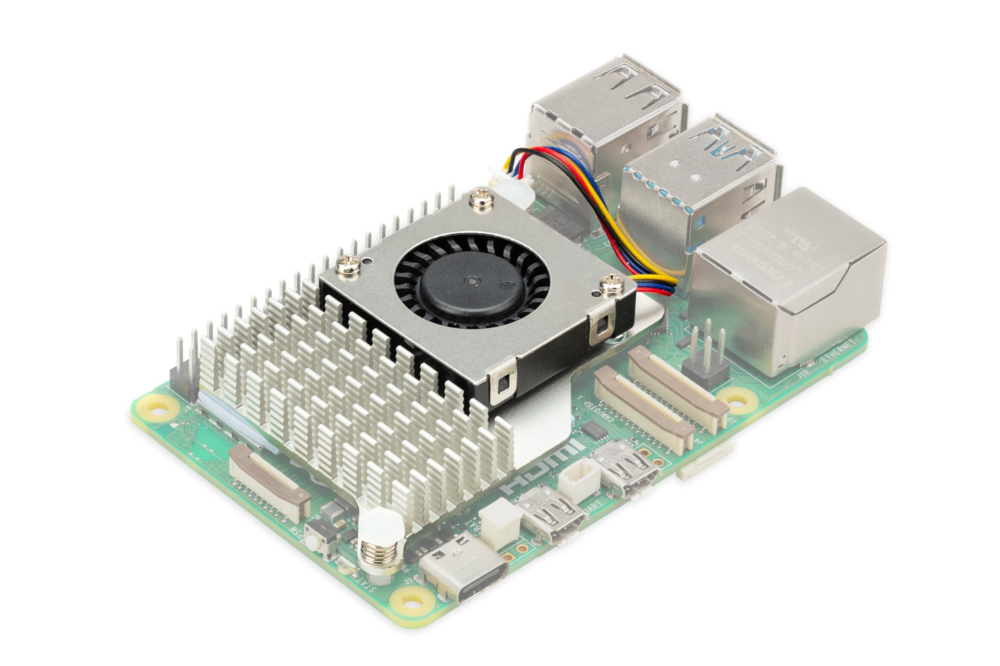</p>

### Настройка окружения

Чтобы запустить [Microsoft Florence-2](https://huggingface.co/microsoft/Florence-2-base) на Raspberry Pi 5, понадобится несколько библиотек:

1. **[Transformers](https://huggingface.co/docs/transformers/en/index)**:
   - Florence-2 использует библиотеку `transformers` из Hugging Face для загрузки модели и инференса. Она предоставляет архитектуру для работы с предобученными моделями «зрение — язык», что упрощает такие задачи, как описание изображений, обнаружение объектов и другие. По сути, `transformers` помогает взаимодействовать с моделью, обрабатывать входные запросы и получать результаты.

2. **PyTorch**:
   - PyTorch — фреймворк глубокого обучения, который предоставляет инфраструктуру для работы Florence-2: тензорные операции, ускорение на GPU (если он доступен), функции обучения и инференса моделей. Florence-2 обучена в PyTorch, и нам нужны её функции, слои и возможности вычислений, чтобы выполнять инференс на Raspberry Pi.

3. **Timm** (модели компьютерного зрения для PyTorch):
   - Florence-2 использует `timm` для доступа к эффективным реализациям моделей зрения и предобученным весам. В частности, библиотека `timm` применяется для **кодировщика изображений** Florence-2, в первую очередь для работы с архитектурой DaViT. Она предоставляет определения моделей и оптимизированный код для распространённых задач зрения и позволяет легко подключать различные лёгкие магистрали (backbone), подходящие для периферийных устройств.

4. **Einops**:
   - `Einops` — библиотека для гибких и мощных тензорных операций. Она упрощает изменение формы тензоров и работу с их размерностями, что особенно важно для мультимодальной обработки в Florence-2. Модели «зрение — язык», такие как Florence-2, часто должны переупорядочивать данные изображений, текстовые и визуальные эмбеддинги, чтобы корректно выровнять их для блоков трансформера, и `einops` упрощает эти сложные операции, делая код более читаемым и лаконичным.

Коротко, эти библиотеки обеспечивают различные ключевые компоненты Florence-2:

- **Transformers** и **PyTorch** нужны для загрузки модели и запуска инференса.
- **Timm** используется для доступа к кодировщику изображений и его эффективной реализации.
- **Einops** помогает изменять форму данных, упрощая объединение визуальных и текстовых признаков.

Все эти компоненты работают вместе, чтобы Florence-2 работала на нашем Raspberry Pi без сбоев и выполняла сложные задачи «зрения и языка» достаточно быстро.

Поскольку на Raspberry Pi уже установлена ОС, подключимся к ней с другого компьютера по `SSH`:

```bash
ssh mjrovai@raspi-5.local
```

И проверим назначенный ей IP-адрес:

```bash
hostname -I
```

`192.168.4.209 `

<p align="center">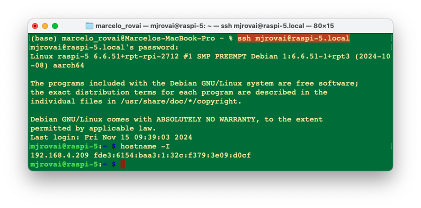</p>

**Обновление Raspberry Pi**

Сначала убедитесь, что Raspberry Pi обновлён:

```bash
sudo apt update
sudo apt upgrade -y
```

**Первоначальная настройка для работы с PIP**:

```bash
sudo apt install python3-pip
sudo rm /usr/lib/python3.11/EXTERNALLY-MANAGED
pip3 install --upgrade pip
```

**Установка зависимостей**

```bash
sudo apt-get install libjpeg-dev libopenblas-dev libopenmpi-dev \
    libomp-dev
```

Настроим и активируем **виртуальное окружение** для работы с Florence-2:

```bash
python3 -m venv ~/florence
source ~/florence/bin/activate
```

**Установка PyTorch**

```bash
pip3 install setuptools numpy Cython
pip3 install requests
pip3 install torch torchvision \
    --index-url https://download.pytorch.org/whl/cpu
pip3 install torchaudio \
    --index-url https://download.pytorch.org/whl/cpu
```

Проверим, что PyTorch установлен корректно:

<p align="center">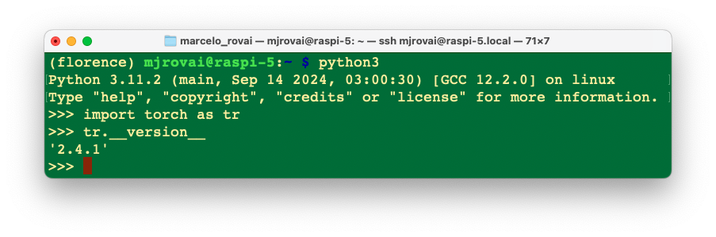</p>

**Установка Transformers, Timm и Einops**:

```bash
pip3 install transformers
pip3 install timm einops
```

**Установка модели**:

```bash
pip3 install autodistill-florence-2
```

**Jupyter Notebook и библиотеки Python**

Для запуска и тестирования наших Python-скриптов можно установить Jupyter Notebook.

```bash
pip3 install jupyter
pip3 install numpy Pillow matplotlib
jupyter notebook --generate-config
```

### Тестирование установки

Запустим Jupyter Notebook на удалённом компьютере:

```bash
jupyter notebook --ip=192.168.4.209 --no-browser
```

Выполнив эту команду в терминале SSH, мы увидим локальный URL-адрес, по которому можно открыть блокнот:

<p align="center">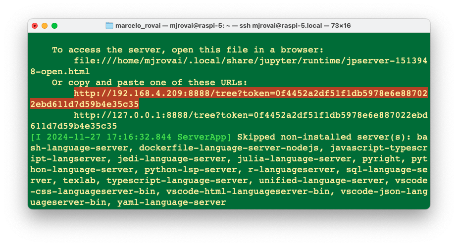</p>

Блокнот с кодом для этого первого теста можно найти в репозитории лабораторных работ на GitHub:

- [10-florence2_test.ipynb](https://github.com/Mjrovai/EdgeML-with-Raspberry-Pi/blob/main/FLORENCE-2/notebooks/10-florence2_test.ipynb)

Получить доступ к блокноту с удалённого компьютера можно, введя в веб-браузере IP-адрес Raspberry Pi и токен из терминала (скопируйте весь URL из терминала).

На домашней странице создайте новый блокнот `Python 3 (ipykernel)` и скопируйте и вставьте [пример кода](https://huggingface.co/microsoft/Florence-2-base#how-to-get-started-with-the-model) с Hugging Face Hub.

Код предназначен для запуска Florence-2 на заданном изображении для **обнаружения объектов**. Он загружает модель, обрабатывает изображение и запрос, а затем генерирует ответ, который находит и описывает объекты на изображении.

- **Процессор** помогает подготовить текстовые и графические входные данные.
- **Модель** принимает обработанные входные данные и генерирует осмысленный ответ.
- **Постобработка** приводит результат к более понятному виду, например к ограничивающим рамкам найденных объектов.

> Этот процесс использует универсальность Florence-2 для решения **задач «зрения и языка»** и эффективно реализован с помощью PyTorch, Transformers и связанных инструментов обработки изображений.

```python
import requests
from PIL import Image
import torch
from transformers import AutoProcessor, AutoModelForCausalLM

device = "cuda:0" if torch.cuda.is_available() else "cpu"
torch_dtype = (
    torch.float16 if torch.cuda.is_available() else torch.float32
)

model = AutoModelForCausalLM.from_pretrained(
    "microsoft/Florence-2-base",
    torch_dtype=torch_dtype,
    trust_remote_code=True,
).to(device)
processor = AutoProcessor.from_pretrained(
    "microsoft/Florence-2-base", trust_remote_code=True
)

prompt = "<OD>"
url = (
    "https://huggingface.co/datasets/huggingface/"
    "documentation-images/resolve/main/transformers/"
    "tasks/car.jpg?download=true"
)
image = Image.open(requests.get(url, stream=True).raw)

inputs = processor(text=prompt, images=image, return_tensors="pt").to(
    device, torch_dtype
)

generated_ids = model.generate(
    input_ids=inputs["input_ids"],
    pixel_values=inputs["pixel_values"],
    max_new_tokens=1024,
    do_sample=False,
    num_beams=3,
)
generated_text = processor.batch_decode(
    generated_ids, skip_special_tokens=False
)[0]

parsed_answer = processor.post_process_generation(
    generated_text,
    task="<OD>",
    image_size=(image.width, image.height),
)

print(parsed_answer)
```

Разберём приведённый код по шагам:

#### Импорт необходимых библиотек

```python
import requests
from PIL import Image
import torch
from transformers import AutoProcessor, AutoModelForCausalLM
```

- **requests**: используется для HTTP-запросов. В данном случае библиотека загружает изображение по URL.
- **PIL (Pillow)**: предоставляет инструменты для работы с изображениями. Здесь она используется для открытия загруженного изображения.
- **torch**: PyTorch импортируется для работы с тензорами и определения доступности оборудования (CPU или GPU).
- **transformers**: модуль даёт удобный доступ к Florence-2 через `AutoProcessor` и `AutoModelForCausalLM`, которые загружают предобученные модели и обрабатывают входные данные.

#### Определение устройства и типа данных

```python
device = "cuda:0" if torch.cuda.is_available() else "cpu"

torch_dtype = (
    torch.float16 if torch.cuda.is_available() else torch.float32
)
```

- **Настройка устройства**: код проверяет, доступен ли GPU с поддержкой CUDA (`torch.cuda.is_available()`). Если GPU есть, устройство задаётся как «cuda:0», иначе используется `"cpu"` (наш случай).
- **Тип данных**: если GPU доступен, выбирается `torch.float16` — половинная точность, которая ускоряет обработку и снижает расход памяти. На CPU по умолчанию используется `torch.float32` для совместимости.

#### Загрузка модели и процессора

```python
model = AutoModelForCausalLM.from_pretrained(
    "microsoft/Florence-2-base",
    torch_dtype=torch_dtype,
    trust_remote_code=True,
).to(device)

processor = AutoProcessor.from_pretrained(
    "microsoft/Florence-2-base", trust_remote_code=True
)
```

- **Инициализация модели**:
  - **`AutoModelForCausalLM.from_pretrained()`** загружает предобученную модель Florence-2 из репозитория Microsoft на Hugging Face. `torch_dtype` задаётся в соответствии с доступным оборудованием (GPU или CPU), а `trust_remote_code=True` разрешает использовать пользовательский код, который может поставляться вместе с моделью.
  - **`.to(device)`** переносит модель на нужное устройство (CPU или GPU). В нашем случае будет выбран `CPU`.

- **Инициализация процессора**:
  - **`AutoProcessor.from_pretrained()`** загружает процессор Florence-2. Процессор преобразует текстовые и графические входные данные в формат, с которым может работать модель (например, кодирует текст и нормализует изображения).

### Определение запроса

```python
prompt = "<OD>"
```

- **Запрос**: строка `"<OD>"` используется как запрос. Это обозначение задачи «Object Detection» (обнаружение объектов), которое указывает модели найти объекты на изображении.

#### Загрузка изображения

```python
url = (
    "https://huggingface.co/datasets/huggingface/"
    "documentation-images/resolve/main/transformers/"
    "tasks/car.jpg?download=true"
)
image = Image.open(requests.get(url, stream=True).raw)
```

- **Загрузка изображения**: функция **`requests.get()`** получает изображение по заданному URL. Параметр `stream=True` означает, что изображение загружается потоком, а не целиком сразу.
- **Открытие изображения**: **`Image.open()`** открывает изображение, чтобы модель могла его обработать.

#### Обработка входных данных

```python
inputs = processor(text=prompt, images=image, return_tensors="pt").to(
    device, torch_dtype
)
```

- **Обработка входных данных**: функция **`processor()`** обрабатывает текст (`prompt`) и изображение (`image`). Аргумент `return_tensors="pt"` преобразует результат в тензоры PyTorch, которые необходимы для подачи данных в модель.
- **Перенос входных данных на устройство**: **`.to(device, torch_dtype)`** переносит входные данные на нужное устройство (CPU или GPU) и задаёт соответствующий тип данных.

### Генерация результата

```python
generated_ids = model.generate(
    input_ids=inputs["input_ids"],
    pixel_values=inputs["pixel_values"],
    max_new_tokens=1024,
    do_sample=False,
    num_beams=3,
)
```

- **Генерация моделью**: **`model.generate()`** создаёт результат на основе входных данных.
  - **`input_ids`**: токенизированная форма запроса.
  - **`pixel_values`**: обработанные данные изображения.
  - **`max_new_tokens=1024`**: задаёт максимальное число новых токенов в ответе. Это ограничивает длину ответа.
  - **`do_sample=False`**: отключает семплирование; вместо него используются детерминированные методы (поиск лучом, beam search).
  - **`num_beams=3`**: включает поиск лучом с тремя лучами, что улучшает качество результата, рассматривая несколько вариантов во время генерации.

#### Декодирование сгенерированного текста

```python
generated_text = processor.batch_decode(
    generated_ids, skip_special_tokens=False
)[0]
```

- **Пакетное декодирование**: **`processor.batch_decode()`** декодирует сгенерированные ID (токены) в читаемый текст. Параметр `skip_special_tokens=False` означает, что результат будет включать специальные токены, если они являются частью ответа.

#### Постобработка результата

```python
parsed_answer = processor.post_process_generation(
    generated_text,
    task="<OD>",
    image_size=(image.width, image.height),
)
```
- **Постобработка**: **`processor.post_process_generation()`** дополнительно обрабатывает сгенерированный текст, интерпретируя его в соответствии с задачей (`"<OD>"` для обнаружения объектов) и размером изображения.
- Функция извлекает из текста конкретную информацию, например ограничивающие рамки обнаруженных объектов, что делает результат полезнее для задач зрения.

#### Вывод результата

```python
print(parsed_answer)
```

- Наконец, **`print(parsed_answer)`** выводит результат, который может включать данные обнаружения объектов: координаты ограничивающих рамок и метки найденных на изображении объектов.

#### Результат

Запустив код, получаем в качестве Parsed Answer:

```bash
[{'<OD>': {
   'bboxes': [
     [34.23999786376953, 160.0800018310547, 597.4400024414062],
     [371.7599792480469, 272.32000732421875, 241.67999267578125],
     [303.67999267578125, 247.4399871826172, 454.0799865722656],
     [276.7200012207031, 553.9199829101562, 370.79998779296875],
     [96.31999969482422, 280.55999755859375, 198.0800018310547],
     [371.2799987792969]
    ],
    'labels': ['car', 'door handle', 'wheel', 'wheel']
}}]

```

Сначала посмотрим на изображение:

```python
import matplotlib.pyplot as plt

plt.figure(figsize=(8, 8))
plt.imshow(image)
plt.axis("off")
plt.show()
```

<p align="center"></p>

По результату обнаружения объектов видим, что:

```bash
'labels': ['car', 'door handle', 'wheel', 'wheel']
```

Похоже, что обнаружено как минимум несколько объектов. Мы также можем написать код, который рисует ограничивающие рамки найденных объектов:

```python
def plot_bbox(image, data):
    # Создаём фигуру и оси
    fig, ax = plt.subplots()

    # Отображаем изображение
    ax.imshow(image)

    # Рисуем каждую ограничивающую рамку
    for bbox, label in zip(data["bboxes"], data["labels"]):
        # Распаковываем координаты рамки
        x1, y1, x2, y2 = bbox
        # Создаём прямоугольник
        rect = patches.Rectangle(
            (x1, y1),
            x2 - x1,
            y2 - y1,
            linewidth=1,
            edgecolor="r",
            facecolor="none",
        )
        # Добавляем прямоугольник на оси
        ax.add_patch(rect)
        # Подписываем метку
        plt.text(
            x1,
            y1,
            label,
            color="white",
            fontsize=8,
            bbox=dict(facecolor="red", alpha=0.5),
        )

    # Убираем деления и подписи осей
    ax.axis("off")

    # Показываем график
    plt.show()
```

> **Box (x0, y0, x1, y1)**: токены местоположения соответствуют левому верхнему и правому нижнему углам рамки.

Запустим:

```python
plot_bbox(image, parsed_answer['<OD>'])
```

Получаем:

<p align="center">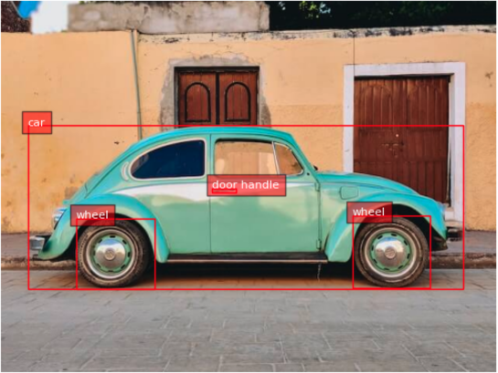</p>

## Задачи Florence-2

Florence-2 создана для выполнения множества задач компьютерного зрения и «зрения и языка» с помощью `запросов` (prompts). Эти задачи активируются заданием конкретного текстового запроса, как мы видели в случае `<OD>` (обнаружение объектов).

Универсальность Florence-2 основана на комбинировании таких запросов: меняя запрос, можно направлять поведение модели на выполнение конкретной задачи зрения. Смена запроса позволяет адаптировать Florence-2 к разным задачам без модификаций архитектуры. Эта возможность напрямую следует из унифицированной архитектуры модели и масштабного мультизадачного обучения на наборе данных FLD-5B.

Вот некоторые ключевые задачи, которые может решать Florence-2, с примерами запросов:

### Обнаружение объектов (OD)

   - **Запрос**: `"<OD>"`
   - **Описание**: находит объекты на изображении и выдаёт ограничивающую рамку для каждого из них. Эта задача полезна для визуального контроля, систем наблюдения и общего распознавания объектов.

### Описание изображения (Image Captioning)

   - **Запрос**: `"<CAPTION>"`
   - **Описание**: создаёт текстовое описание входного изображения. Эта задача помогает модели описать происходящее на изображении, давая понятную человеку подпись для понимания содержимого.

### Подробное описание (Detailed Captioning)

   - **Запрос**: `"<DETAILED_CAPTION>"`
   - **Описание**: создаёт более подробную подпись с более тонкой информацией о сцене, например о присутствующих объектах и их взаимосвязях.
### Визуальная привязка (Visual Grounding)

   - **Запрос**: `"<CAPTION_TO_PHRASE_GROUNDING>"`
   - **Описание**: связывает текстовое описание с конкретными областями изображения. Например, по запросу «a green car» (зелёная машина) модель выделяет, где на изображении находится зелёная машина. Это полезно для взаимодействия человека с компьютером, когда нужно найти конкретные объекты по тексту.

### Сегментация (Segmentation)

   - **Запрос**: `"<REFERRING_EXPRESSION_SEGMENTATION>"`
   - **Описание**: выполняет сегментацию по выражению-ссылке, например «the blue cup» (синяя чашка). Модель находит и выделяет область, содержащую объект, упомянутый в запросе (все относящиеся к нему пиксели).

### Плотное описание областей (Dense Region Captioning)

   - **Запрос**: `"<DENSE_REGION_CAPTION>"`
   - **Описание**: создаёт подписи для нескольких областей изображения и даёт подробный разбор всех видимых участков, включая разные объекты и их взаимосвязи.

### OCR с областями (OCR with Region)

   - **Запрос**: `"<OCR_WITH_REGION>"`
   - **Описание**: выполняет оптическое распознавание символов (OCR) на изображении и выдаёт ограничивающие рамки для найденного текста. Это полезно для извлечения текстовой информации и определения её положения на изображении, например для чтения надписей, этикеток или других текстовых элементов.

### Привязка фраз для конкретных выражений (Phrase Grounding for Specific Expressions)

   - **Запрос**: `"<CAPTION_TO_PHRASE_GROUNDING>"` вместе с конкретным выражением, например `"a wine glass"` (бокал вина).
   - **Описание**: находит на изображении область, соответствующую конкретной текстовой фразе. Эта задача позволяет выделять определённые объекты или элементы по слову или ключевому слову в запросе.

### Обнаружение объектов с открытым словарём (Open Vocabulary Object Detection)

   - **Запрос**: `"<OPEN_VOCABULARY_OD>"`
   - **Описание**: модель может обнаруживать объекты без ограничения заранее заданным списком классов, поэтому она помогает распознавать более широкий круг предметов на основе общего визуального понимания.

## Исследование задач компьютерного зрения и «зрения и языка»

Для исследования все примеры кода можно найти на GitHub:

- [20-florence_2.ipynb](https://github.com/Mjrovai/EdgeML-with-Raspberry-Pi/blob/main/FLORENCE-2/notebooks/20-florence_2.ipynb)

Загрузим несколько изображений, созданных в DALL·E, на Raspi-5 (для этого можно использовать FileZilla). Изображения сохраним в подкаталог `images`:

```python
dogs_cats = Image.open("./images/dogs-cats.jpg")
table = Image.open("./images/table.jpg")
```

<p align="center">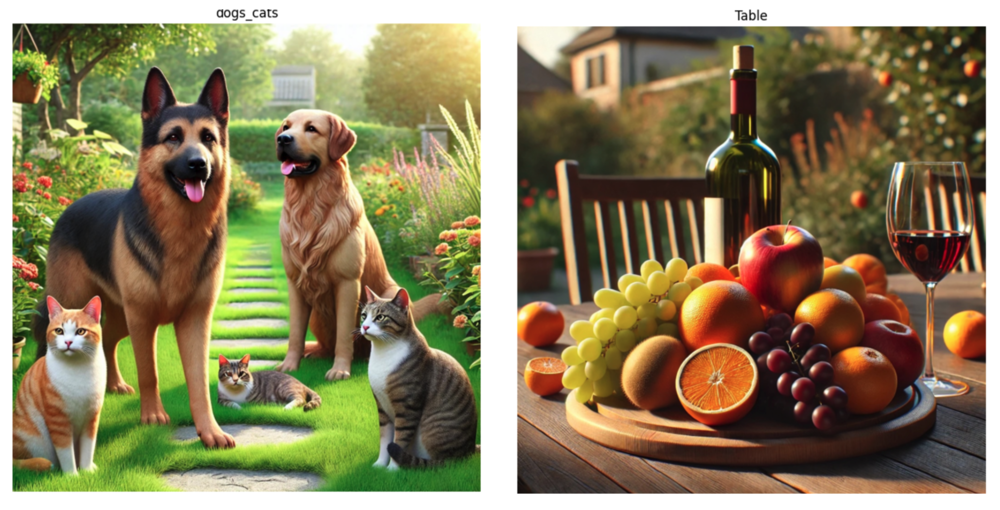</p>

Создадим функцию, которая облегчит исследование и позволит отслеживать задержку модели для разных задач:

```python
def run_example(task_prompt, text_input=None, image=None):
    start_time = time.perf_counter()  # Запускаем таймер
    if text_input is None:
        prompt = task_prompt
    else:
        prompt = task_prompt + text_input
    inputs = processor(
        text=prompt, images=image, return_tensors="pt"
    ).to(device)
    generated_ids = model.generate(
        input_ids=inputs["input_ids"],
        pixel_values=inputs["pixel_values"],
        max_new_tokens=1024,
        early_stopping=False,
        do_sample=False,
        num_beams=3,
    )
    generated_text = processor.batch_decode(
        generated_ids, skip_special_tokens=False
    )[0]
    parsed_answer = processor.post_process_generation(
        generated_text,
        task=task_prompt,
        image_size=(image.width, image.height),
    )

    end_time = time.perf_counter()  # Останавливаем таймер
    elapsed_time = end_time - start_time  # Вычисляем затраченное время
    print(
        f" \n[INFO] ==> Florence-2-base ({task_prompt}), \
          took {elapsed_time:.1f} seconds to execute.\n"
    )

    return parsed_answer
```

### Подпись (Caption)

**1. Собаки и кошки**

```python
run_example(task_prompt="<CAPTION>", image=dogs_cats)
```

```bash
[INFO] ==> Florence-2-base (<CAPTION>), \
took 16.1 seconds to execute.

{'<CAPTION>': 'A group of dogs and cats sitting in a garden.'}
```

**2. Стол**

```python
run_example(task_prompt="<CAPTION>", image=table)
```

```bash
[INFO] ==> Florence-2-base (<CAPTION>), \
took 16.5 seconds to execute.

{'<CAPTION>': 'A wooden table topped with a plate of fruit \
and a glass of wine.'}
```

### Подробная подпись (Detailed Caption)

**1. Собаки и кошки**

```python
run_example(task_prompt="<DETAILED_CAPTION>", image=dogs_cats)
```

```bash
[INFO] ==> Florence-2-base (<DETAILED_CAPTION>), \
took 25.5 seconds to execute.

{'<DETAILED_CAPTION>': 'The image shows a group of cats and \
dogs sitting on top of a lush green field, surrounded by plants \
with flowers, trees, and a house in the background. The sky is \
visible above them, creating a peaceful atmosphere.'}
```

**2. Стол**

```python
run_example(task_prompt="<DETAILED_CAPTION>", image=table)
```

```bash
[INFO] ==> Florence-2-base (<DETAILED_CAPTION>), \
took 26.8 seconds to execute.

{'<DETAILED_CAPTION>': 'The image shows a wooden table with \
a bottle of wine and a glass of wine on it, surrounded by \
a variety of fruits such as apples, oranges, and grapes. \
In the background, there are chairs, plants, trees, and \
a house, all slightly blurred.'}
```

### Более подробная подпись (More Detailed Caption)

**1. Собаки и кошки**

```python
run_example(task_prompt="<MORE_DETAILED_CAPTION>", image=dogs_cats)
```

```bash
[INFO] ==> Florence-2-base (<MORE_DETAILED_CAPTION>), \
took 49.8 seconds to execute.

{'<MORE_DETAILED_CAPTION>': 'The image shows a group of four \
cats and a dog in a garden. The garden is filled with colorful \
flowers and plants, and there is a pathway leading up to \
a house in the background. The main focus of the image is \
a large German Shepherd dog standing on the left side of \
the garden, with its tongue hanging out and its mouth open, \
as if it is panting. On the right side, there are \
two smaller cats, one orange and one gray, sitting on the \
grass. In the background, there is another golden retriever \
dog sitting and looking at the camera. The sky is blue and \
the sun is shining, creating a warm and inviting atmosphere.'}
```

**2. Стол**

```python
run_example(task_prompt="<MORE_DETAILED_CAPTION>", image=table)
```

```bash
[INFO] ==> Florence-2-base (<MORE_DETAILED_CAPTION>), \
took 32.4 seconds to execute.

{'<MORE_DETAILED_CAPTION>': 'The image shows a wooden table \
with a wooden tray on it. On the tray, there are various \
fruits such as grapes, oranges, apples, and grapes. There \
is also a bottle of red wine on the table. The background \
shows a garden with trees and a house. The overall mood \
of the image is peaceful and serene.'}
```

> Заметим, что чем подробнее задача описания, тем выше задержка и вероятность ошибок (например, в ответе «The image shows a group of four cats and a dog in a garden» модель называет четыре кошки и одну собаку, хотя на изображении было иначе).

### Обнаружение объектов (Object Detection)

Ту же функцию можно использовать для обнаружения объектов с запросом `<OD>`.

```python
task_prompt = "<OD>"
results = run_example(task_prompt, image=dogs_cats)
print(results)
```

Посмотрим результат:

```bash
[INFO] ==> Florence-2-base (<OD>), took 20.9 seconds to execute.

{'<OD>': {'bboxes': [
  [737.79, 571.90, 1022.46, 980.48],
  [0.51, 593.40, 211.45, 991.74],
  [445.95, 721.40, 680.44, 850.43],
  [39.42, 91.64, 491.00, 933.37],
  [570.88, 184.83, 974.33, 782.84]
  ],
  'labels': ['cat', 'cat', 'cat', 'dog', 'dog']
}}
```

По меткам `['cat', 'cat', 'cat', 'dog', 'dog']` видно, что основные объекты на изображении распознаны. Применим функцию, которую мы использовали ранее, чтобы нарисовать ограничивающие рамки:

```python
plot_bbox(dogs_cats, results["<OD>"])
```

<p align="center">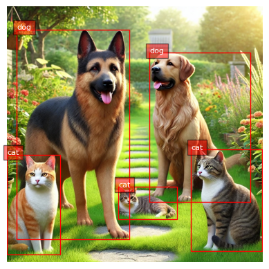</p>

Сделаем то же самое для изображения стола:

```python
task_prompt = "<OD>"
results = run_example(task_prompt, image=table)
plot_bbox(table, results["<OD>"])
```

```bash
[INFO] ==> Florence-2-base (<OD>), took 40.8 seconds to execute.
```

<p align="center">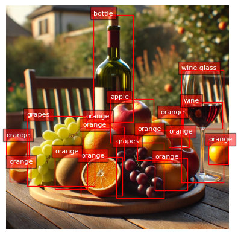</p>

### Плотное описание областей (Dense Region Caption)

Классическое обнаружение объектов можно сочетать с подписями для конкретных подобластей изображения:

```python
task_prompt = "<DENSE_REGION_CAPTION>"

results = run_example(task_prompt, image=dogs_cats)
plot_bbox(dogs_cats, results["<DENSE_REGION_CAPTION>"])

results = run_example(task_prompt, image=table)
plot_bbox(table, results["<DENSE_REGION_CAPTION>"])
```

<p align="center">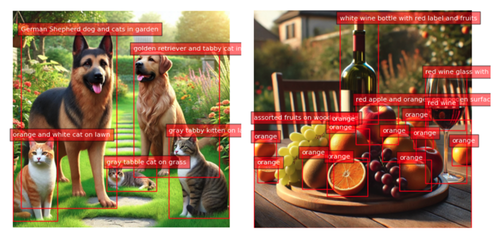</p>

### Привязка подписи к фразе (Caption to Phrase Grounding)

В этой задаче можно передать подпись, например «a wine glass» (бокал вина), «a wine bottle» (бутылка вина) или «a half orange» (половина апельсина), и Florence-2 найдёт объект на изображении:

```python
task_prompt = "<CAPTION_TO_PHRASE_GROUNDING>"

results = run_example(
    task_prompt, text_input="a wine bottle", image=table
)
plot_bbox(table, results["<CAPTION_TO_PHRASE_GROUNDING>"])

results = run_example(
    task_prompt, text_input="a wine glass", image=table
)
plot_bbox(table, results["<CAPTION_TO_PHRASE_GROUNDING>"])

results = run_example(
    task_prompt, text_input="a half orange", image=table
)
plot_bbox(table, results["<CAPTION_TO_PHRASE_GROUNDING>"])
```

<p align="center">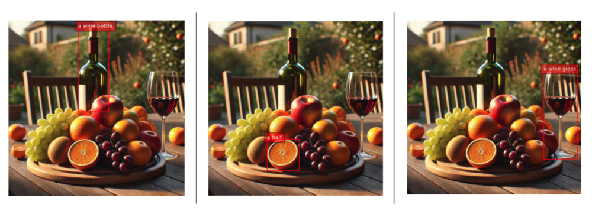</p>

```bash
[INFO] ==> Florence-2-base (<CAPTION_TO_PHRASE_GROUNDING>), \
took 15.7 seconds to execute
each task.
```

### Каскадные задачи (Cascade Tasks)

Также можно передать подпись изображения как входной текст, чтобы заставить Florence-2 найти больше объектов:
```python
task_prompt = "<CAPTION>"
results = run_example(task_prompt, image=dogs_cats)
text_input = results[task_prompt]
task_prompt = "<CAPTION_TO_PHRASE_GROUNDING>"
results = run_example(task_prompt, text_input, image=dogs_cats)
plot_bbox(dogs_cats, results["<CAPTION_TO_PHRASE_GROUNDING>"])
```

Меняя задачу (`task_prompt`) между `<CAPTION>`, `<DETAILED_CAPTION>` и `<MORE_DETAILED_CAPTION>`, мы получим больше объектов на изображении.

<p align="center">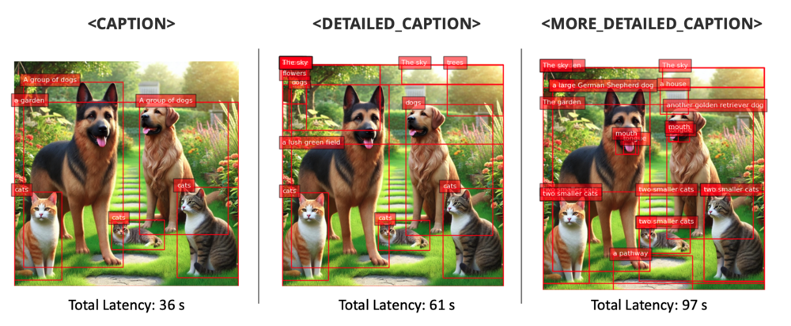</p>

### Обнаружение с открытым словарём (Open Vocabulary Detection)

`<OPEN_VOCABULARY_DETECTION>` позволяет Florence-2 находить распознаваемые объекты на изображении без опоры на заранее заданный список категорий. Это универсальный инструмент для поиска предметов, которые могли не быть явно размечены во время обучения. В отличие от `<CAPTION_TO_PHRASE_GROUNDING>`, которому нужна конкретная текстовая фраза, чтобы найти и выделить определённый объект, `<OPEN_VOCABULARY_DETECTION>` выполняет широкий просмотр и находит и классифицирует все присутствующие объекты.

Поэтому `<OPEN_VOCABULARY_DETECTION>` особенно полезен там, где нужен общий обзор всего, что есть на изображении, без предварительных знаний о том, что там может быть. Передайте текст с описанием конкретных объектов, которые ещё не были обнаружены, и модель их найдёт. Например:

```python
task_prompt = "<OPEN_VOCABULARY_DETECTION>"

# Описания оставлены на английском: модель обучена на английских запросах
text = [
    "a house",
    "a tree",
    "a standing cat at the left",
    "a sleeping cat on the ground",
    "a standing cat at the right",
    "a yellow cat",
]

for txt in text:
    results = run_example(
        task_prompt, text_input=txt, image=dogs_cats
    )

    bbox_results = convert_to_od_format(
        results["<OPEN_VOCABULARY_DETECTION>"]
    )

    plot_bbox(dogs_cats, bbox_results)
```

<p align="center">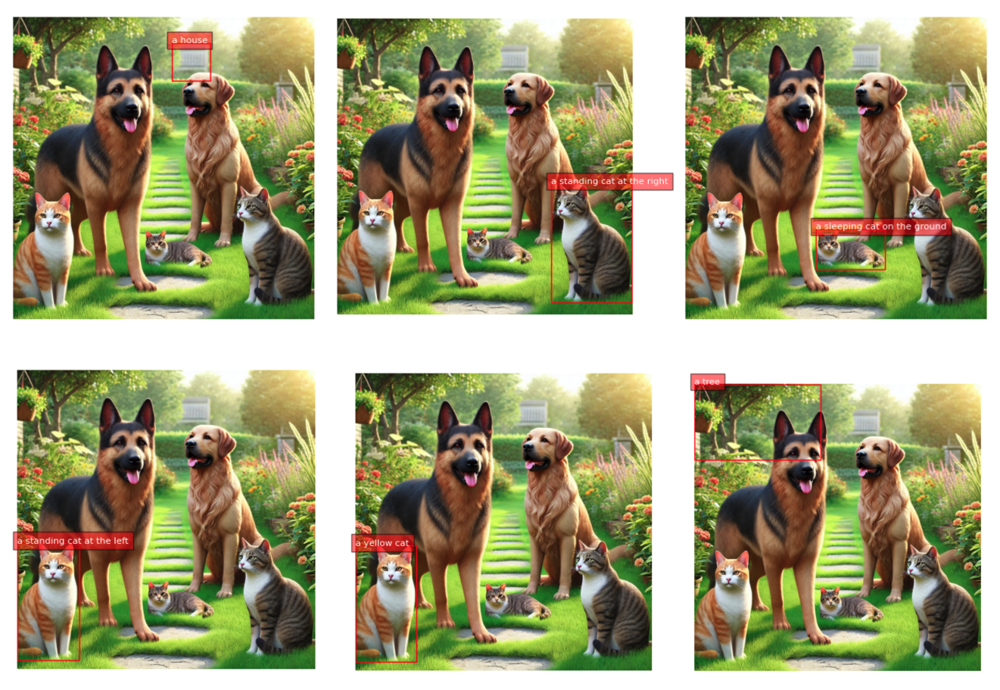</p>

```bash
[INFO] ==> Florence-2-base (<OPEN_VOCABULARY_DETECTION>), \
took 15.1 seconds to execute
each task.
```

> Примечание: попытка использовать Florence-2 для поиска объектов, которых на изображении нет, может приводить к ошибкам (примеры см. в блокноте).

### Сегментация по выражению-ссылке (Referring expression segmentation)

Также можно сегментировать конкретный объект на изображении и задать его описание (подпись), например «a wine bottle» (бутылка вина) на изображении со столом или «a German Sheppard» (немецкая овчарка) на изображении собак и кошек.

Результат сегментации по выражению-ссылке имеет формат: `{'<REFERRING_EXPRESSION_SEGMENTATION>': {'Polygons': [[[polygon]], ...], 'labels': ['', '', ...]}}`. Один объект представлен списком полигонов, каждый полигон — `[x1, y1, x2, y2, ..., xn, yn]`.

> **Полигон (x1, y1, …, xn, yn)**: токены местоположения представляют вершины полигона по часовой стрелке.

Сначала создадим функцию для отображения сегментации:

```python
from PIL import Image, ImageDraw, ImageFont
import copy
import random
import numpy as np

colormap = [
    "blue",
    "orange",
    "green",
    "purple",
    "brown",
    "pink",
    "gray",
    "olive",
    "cyan",
    "red",
    "lime",
    "indigo",
    "violet",
    "aqua",
    "magenta",
    "coral",
    "gold",
    "tan",
    "skyblue",
]


def draw_polygons(image, prediction, fill_mask=False):
    """
        Рисует маски сегментации с полигонами на изображении.

        Параметры:
          - image_path: путь к файлу изображения.
          - prediction: словарь с ключами 'polygons' и 'labels'.
                  'polygons' — список списков, каждый из которых
                  содержит вершины полигона. 'labels' — список меток,
                  соответствующих каждому полигону.
    - fill_mask: логическое значение, которое указывает, заливать ли
                 полигоны цветом.
    """
    # Загружаем изображение

    draw = ImageDraw.Draw(image)

    # Задаём коэффициент масштабирования при необходимости (1, если без масштабирования)
    scale = 1

    # Перебираем полигоны и метки
    for polygons, label in zip(
        prediction["polygons"], prediction["labels"]
    ):
        color = random.choice(colormap)
        fill_color = random.choice(colormap) if fill_mask else None

        for _polygon in polygons:
            _polygon = np.array(_polygon).reshape(-1, 2)
            if len(_polygon) < 3:
                print("Invalid polygon:", _polygon)
                continue

            _polygon = (_polygon * scale).reshape(-1).tolist()

            # Рисуем полигон
            if fill_mask:
                draw.polygon(_polygon, outline=color, fill=fill_color)
            else:
                draw.polygon(_polygon, outline=color)

            # Рисуем текст метки
            draw.text(
                (_polygon[0] + 8, _polygon[1] + 2), label, fill=color
            )

    # Сохраняем или выводим изображение
    # image.show()  # Показать изображение
    display(image)
```
Теперь можно запустить функции:

```python
task_prompt = "<REFERRING_EXPRESSION_SEGMENTATION>"

results = run_example(
    task_prompt, text_input="a wine bottle", image=table
)
output_image = copy.deepcopy(table)
draw_polygons(
    output_image,
    results["<REFERRING_EXPRESSION_SEGMENTATION>"],
    fill_mask=True,
)

results = run_example(
    task_prompt, text_input="a german sheppard", image=dogs_cats
)
output_image = copy.deepcopy(dogs_cats)
draw_polygons(
    output_image,
    results["<REFERRING_EXPRESSION_SEGMENTATION>"],
    fill_mask=True,
)
```

<p align="center">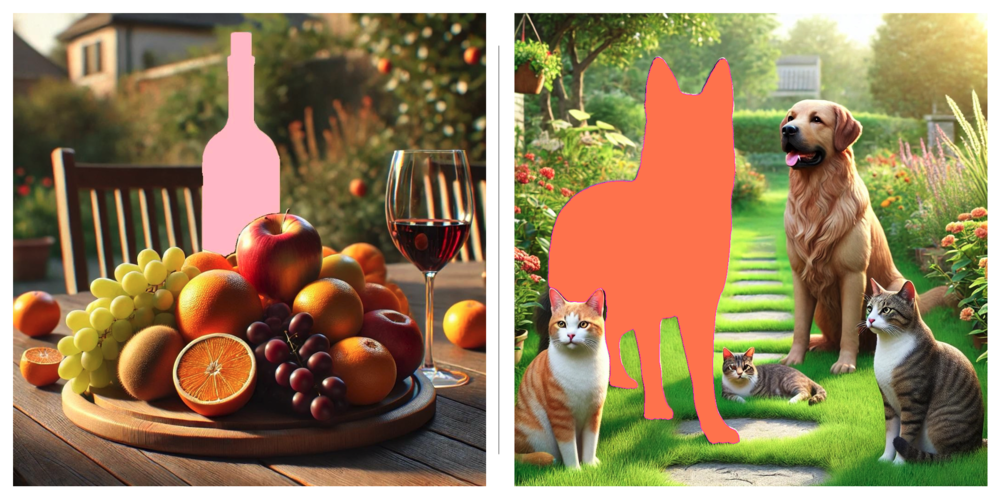</p>

```bash
[INFO] ==> Florence-2-base
(<REFERRING_EXPRESSION_SEGMENTATION>), took 207.0 seconds
to execute each task.
```

### Сегментация по области (Region to Segmentation)

С помощью этой задачи также можно задать координаты объекта на изображении, чтобы его сегментировать. Формат входных данных: `'<loc_x1><loc_y1><loc_x2><loc_y2>', [x1, y1, x2, y2]` — квантованные координаты в диапазоне [0, 999].

Например, при запуске кода:

```python
task_prompt = "<CAPTION_TO_PHRASE_GROUNDING>"
results = run_example(
    task_prompt, text_input="a half orange", image=table
)
results
```

Результат был таким:

```
{'<CAPTION_TO_PHRASE_GROUNDING>': {'bboxes': [[343.552001953125,
    689.6640625,
    530.9440307617188,
    873.9840698242188]],
  'labels': ['a half']}}
```

Используем округлённые координаты из `bboxes`:

```python
task_prompt = "<REGION_TO_SEGMENTATION>"
results = run_example(
    task_prompt,
    text_input=("<loc_343><loc_690>" "<loc_531><loc_874>"),
    image=table,
)
output_image = copy.deepcopy(table)
draw_polygons(
    output_image, results["<REGION_TO_SEGMENTATION>"], fill_mask=True
)
```

Мы получили сегментацию объекта по этим координатам (задержка: 83 секунды):

<p align="center">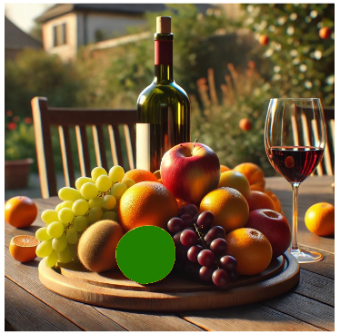</p>

### Регион в текст (Region to Texts)

Также можно передать регион (координаты) и запросить для него подпись:

```python
task_prompt = "<REGION_TO_CATEGORY>"
results = run_example(
    task_prompt,
    text_input=("<loc_343><loc_690>" "<loc_531><loc_874>"),
    image=table,
)
results
```

```bash
[INFO] ==> Florence-2-base (<REGION_TO_CATEGORY>), \
took 14.3 seconds to execute.

{{
  '<REGION_TO_CATEGORY>':
    'orange<loc_343><loc_690>'
    '<loc_531><loc_874>'
}
```

Модель распознала в этом регионе апельсин. Запросим описание:

```python
task_prompt = "<REGION_TO_DESCRIPTION>"
results = run_example(
    task_prompt,
    text_input=("<loc_343><loc_690>" "<loc_531><loc_874>"),
    image=table,
)
results
```

```bash
[INFO] ==> Florence-2-base (<REGION_TO_CATEGORY>), \
took 14.6 seconds to execute.

{
  '<REGION_TO_CATEGORY>':
    'orange<loc_343><loc_690>'
    '<loc_531><loc_874>'
}
```

В данном случае описание не дало больше подробностей, но в другой ситуации могло бы. Попробуйте другой пример.

### OCR

С помощью Florence-2 можно выполнить оптическое распознавание символов (OCR) на изображении и получить написанный на нём текст (`task_prompt = '<OCR>'`), а также ограничивающие рамки (положение) распознанного текста (`task_prompt = '<OCR_WITH_REGION>'`). Эти задачи помогают извлекать текстовую информацию и находить её на изображениях, например читать вывески, этикетки или другие текстовые элементы.

Загрузим на Raspi афишу доклада из Бразилии. Так мы проверим работу модели на другом языке, здесь на португальском:

```python
flayer = Image.open("./images/embarcados.jpg")
# Выводим изображение
plt.figure(figsize=(8, 8))
plt.imshow(flayer)
plt.axis("off")
# plt.title("Image")
plt.show()
```

<p align="center"></p>

Посмотрим, что модель видит на изображении, с задачей `'<MORE_DETAILED_CAPTION>'`:
```bash
[INFO] ==> Florence-2-base (<MORE_DETAILED_CAPTION>), \
took 85.2 seconds to execute.

{'<MORE_DETAILED_CAPTION>': 'The image is a promotional poster \
for an event called "Machine Learning Embarcados" hosted by \
Marcelo Roval. The poster has a black background with white \
text. On the left side of the poster, there is a logo of a \
coffee cup with the text "Café Com Embarcados" above it. \
Below the logo, it says "25 de Setembro as 17th" which \
translates to "25th of September as 17" in English. \n\nOn \
the right side, there are two smaller text boxes with the names \
of the participants and their names. The first text box reads \
"Democratizando a Inteligência Artificial para Paises em \
Desenvolvimento" and the second text box says "Toda \
quarta-feira" which is Portuguese for "Transmissão via in \
Portuguese".\n\nIn the center of the image, there has a photo \
of Marcelo, a man with a beard and glasses, smiling at the \
camera. He is wearing a white hard hat and a white shirt. \
The text boxes are in orange and yellow colors.'}
```

Описание очень точное. Перейдём к более важным словам с помощью задачи OCR:

```python
task_prompt = "<OCR>"
run_example(task_prompt, image=flayer)
```

```bash
[INFO] ==> Florence-2-base (<OCR>), took 37.7 seconds to execute.

{'<OCR>':
 'Machine Learning Café com Embarcado Embarcados '
 'Democratizando a Inteligência Artificial para Paises em '
 '25 de Setembro às 17h Desenvolvimento Toda quarta-feira '
 'Marcelo Roval Professor na UNIFIEI e Transmissão via in '
 'Co-Director do TinyML4D'}
```

Найдём слова на афише:

```python
task_prompt = "<OCR_WITH_REGION>"
results = run_example(task_prompt, image=flayer)
```

Создадим также функцию, которая рисует ограничивающие рамки вокруг найденных слов:

```python
def draw_ocr_bboxes(image, prediction):
    scale = 1
    draw = ImageDraw.Draw(image)
    bboxes = prediction["quad_boxes"]
    labels = prediction["labels"]
    for box, label in zip(bboxes, labels):
        color = random.choice(colormap)
        new_box = (np.array(box) * scale).tolist()
        draw.polygon(new_box, width=3, outline=color)
        draw.text(
            (new_box[0] + 8, new_box[1] + 2),
            "{}".format(label),
            align="right",
            fill=color,
        )
    display(image)
```

```python
output_image = copy.deepcopy(flayer)
draw_ocr_bboxes(output_image, results["<OCR_WITH_REGION>"])
```

<p align="center"></p>

Посмотрим найденные слова:

```python
results["<OCR_WITH_REGION>"]["labels"]
```

```bash
'</s>Machine Learning',
 'Café',
 'com',
 'Embarcado',
 'Embarcados',
 'Democratizando a Inteligência',
 'Artificial para Paises em',
 '25 de Setembro ás 17h',
 'Desenvolvimento',
 'Toda quarta-feira',
 'Marcelo Roval',
 'Professor na UNIFIEI e',
 'Transmissão via',
 'in',
 'Co-Director do TinyML4D']
```

## Сводка по задержкам

Задержка для разных задач Florence-2 на Raspberry Pi (Raspi-5) зависит от сложности задачи:

- **Описание изображения (Image Captioning)**: примерно 16–17 секунд на создание подписи.
- **Подробное описание (Detailed Captioning)**: задержка выросла до 25–27 секунд, так как модель генерирует более тонкие описания сцены.
- **Более подробное описание (More Detailed Captioning)**: около 32–50 секунд; задержка растёт по мере усложнения описания.
- **Обнаружение объектов (Object Detection)**: примерно 20–41 секунда в зависимости от сложности изображения и количества найденных объектов.
- **Визуальная привязка (Visual Grounding)**: около 15–16 секунд на определение местоположения конкретных объектов по текстовым запросам.
- **OCR (оптическое распознавание символов)**: извлечение текста с изображения заняло около 37–38 секунд.
- **Сегментация и сегментация по области (Region to Segmentation)**: эти задачи заметно дольше, около 83–207 секунд в зависимости от сложности и количества областей.

Эти задержки подчёркивают ограничения ресурсов периферийных устройств, таких как Raspberry Pi, и показывают, что модель и окружение нужно оптимизировать для работы в реальном времени.

<p align="center">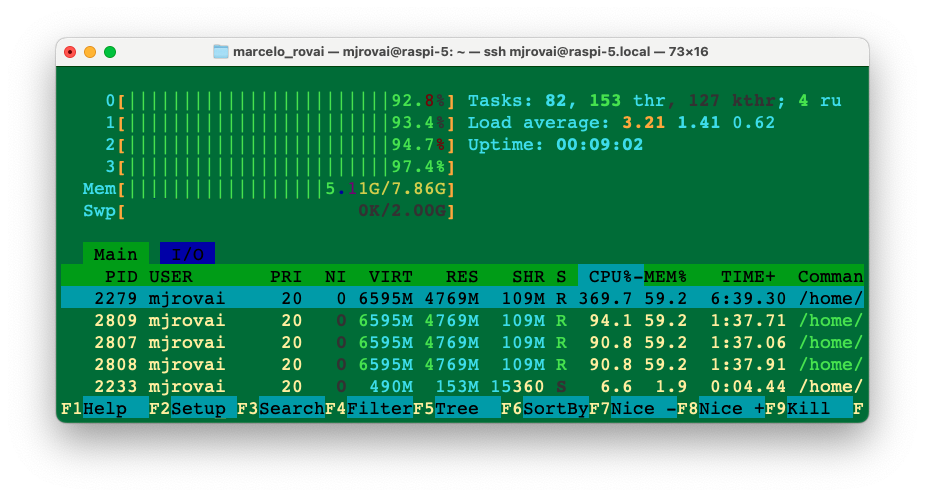</p>

> Сложные задачи могут использовать всю память Raspi-5 объёмом 8 ГБ. Например, на скриншоте выше, снятом во время задачи Florence OD, видно, что четыре ядра CPU работают на полной мощности, а используется более 5 ГБ памяти. Имеет смысл увеличить объём SWAP-памяти до 2 ГБ.

Проверка температуры процессора командой `vcgencmd measure_temp` показала, что температура может подниматься до +80 °C.

## Дообучение (Fine-Tuning)

Как мы видели в этой лабораторной работе, Florence поддерживает множество задач «из коробки», включая описание изображений, обнаружение объектов, OCR и другие. Однако, как и другие предобученные базовые модели, Florence-2 может потребовать знаний конкретной предметной области. Например, ей может понадобиться улучшение на медицинских или спутниковых снимках. В таких случаях необходимо **дообучение** (fine-tuning) на собственном наборе данных. Руководство Roboflow [How to Fine-tune Florence-2 for Object Detection Tasks](https://blog.roboflow.com/fine-tune-florence-2-object-detection/) показывает, как дообучить Florence-2 на наборах данных для обнаружения объектов, чтобы повысить качество модели для вашей задачи.

Следуя этому руководству, можно дообучить модель Florence-2 обнаруживать коробки и колёса, которые использовались в предыдущих лабораторных работах:

<p align="center">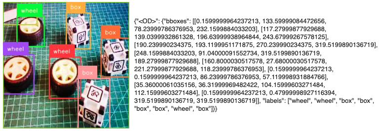</p>

Важно отметить, что после дообучения модель всё ещё может обнаруживать классы, которых нет в нашем наборе данных, например кошек, собак, винограда и т. д., как мы видели раньше.

Полный проект дообучения с набором данных, размеченным в Roboflow и выполненным в CoLab, можно найти в блокноте:

- [30-Finetune_florence_2_on_detection_dataset_box_vs_wheel.ipynb](https://github.com/Mjrovai/EdgeML-with-Raspberry-Pi/blob/main/FLORENCE-2/notebooks/30-Finetune_florence_2_on_detection_dataset_box_vs_wheel.ipynb)

В другом примере, в статье [Fine-tuning Florence-2 - Microsoft's Cutting-edge Vision Language Models](https://huggingface.co/blog/finetune-florence2), авторы показывают пример дообучения Florence на `DocVQA`. Авторы сообщают, что Florence 2 может выполнять визуальные вопросы и ответы (VQA), но опубликованные модели не включают эту возможность.

## Итоги

Florence-2 предлагает универсальный и мощный подход к задачам «зрения и языка» на периферии: по производительности она сопоставима с более крупными моделями, заточенными под конкретные задачи, такими как YOLO для обнаружения объектов, BERT/RoBERTa для анализа текста и специализированные модели OCR.

Благодаря мультимодальной архитектуре трансформера Florence-2 гибче YOLO с точки зрения решаемых задач. Сюда входят обнаружение объектов, описание изображений и визуальная привязка.

В отличие от **BERT**, который сосредоточен только на языке, Florence-2 объединяет зрение и язык, что позволяет ей хорошо справляться с приложениями, которым нужны обе модальности, например описание изображений и визуальная привязка.

Кроме того, традиционные **модели OCR**, такие как Tesseract и EasyOCR, предназначены только для распознавания и извлечения текста из изображений, тогда как возможности OCR у Florence-2 входят в более широкую систему, которая включает понимание контекста и согласование визуального и текстового содержимого. Это делает её особенно полезной в сценариях, где нужно и читать текст, и понимать его контекст на изображении.

В целом Florence-2 выделяется тем, что объединяет различные задачи «зрения и языка» в единой модели, которая достаточно эффективна, чтобы работать на периферийных устройствах вроде Raspberry Pi. Это делает её привлекательным выбором для разработчиков и исследователей, которые изучают приложения ИИ на периферии.

### Ключевые преимущества Florence-2

1. **Унифицированная архитектура**
   - Одна модель решает несколько задач зрения вместо специализированных моделей (YOLO, BERT, Tesseract);
   - Исключает необходимость развёртывания и интеграции нескольких моделей;
   - Единый API и интерфейс для всех задач.

2. **Сравнение производительности**
   - Обнаружение объектов: сопоставимо с YOLOv8 (~37,5 mAP на COCO против ~39,7 mAP у YOLOv8), несмотря на универсальность модели;
   - Распознавание текста: эффективно работает с несколькими языками, как специализированные модели OCR (Tesseract, EasyOCR);
   - Понимание языка: включает возможности, похожие на BERT, для обработки текста, добавляя визуальный контекст.

3. **Эффективность использования ресурсов**
   - Базовая модель (232 млн параметров) показывает хорошие результаты, несмотря на небольшой размер;
   - Эффективно работает на периферийных устройствах (Raspberry Pi);
   - Развёртывание одной модели вместо нескольких специализированных.

### Компромиссы

1. **Производительность и специализированные модели**
   - Серия YOLO может обеспечивать более быстрый инференс для чистого обнаружения объектов;
   - Специализированные модели OCR могут лучше справляться со сложной структурой документов;
   - BERT/RoBERTa обеспечивают более глубокое понимание языка для задач только с текстом.

2. **Требования к ресурсам**
   - Более высокая задержка на периферийных устройствах (15–200 с в зависимости от задачи);
   - Требуется аккуратное управление памятью на Raspberry Pi;
   - Может потребоваться оптимизация для приложений реального времени.

3. **Соображения по развёртыванию**
   - Первоначальная настройка сложнее, чем у моделей одного назначения;
   - Нужно понимать множество типов задач и запросов;
   - Освоение оптимальной инженерии запросов требует времени.

### Лучшие сценарии применения

1. **Среды с ограниченными ресурсами**
   - Периферийные устройства, которым нужны несколько возможностей зрения;
   - Системы с ограниченным объёмом хранения и развёртывания;
   - Приложения, которым нужна гибкая обработка изображений.

2. **Мультимодальные приложения**
   - Системы модерации контента;
   - Инструменты доступности;
   - Рабочие процессы анализа документов.

3. **Быстрое прототипирование**
   - Быстрое развёртывание возможностей зрения;
   - Проверка множества задач зрения без отдельных моделей;
   - Разработка концепции (proof of concept).

## Перспективы

Florence-2 знаменует переход к унифицированным моделям зрения, которые в перспективе могут заменить архитектуры, заточенные под конкретные задачи, во многих приложениях. Специализированные модели сохраняют преимущества в отдельных сценариях, но удобство и эффективность унифицированных моделей вроде Florence-2 делают их всё более привлекательными для реальных развёртываний.

Лабораторная работа демонстрирует, что Florence-2 пригодна для периферийных устройств, что открывает перспективы для IoT, мобильных вычислений и встраиваемых систем, где развёртывание нескольких специализированных моделей было бы непрактичным.

## Ресурсы

- [10-florence2_test.ipynb](https://github.com/Mjrovai/EdgeML-with-Raspberry-Pi/blob/main/FLORENCE-2/notebooks/10-florence2_test.ipynb)
- [20-florence_2.ipynb](https://github.com/Mjrovai/EdgeML-with-Raspberry-Pi/blob/main/FLORENCE-2/notebooks/20-florence_2.ipynb)
- [30-Finetune_florence_2_on_detection_dataset_box_vs_wheel.ipynb](https://github.com/Mjrovai/EdgeML-with-Raspberry-Pi/blob/main/FLORENCE-2/notebooks/30-Finetune_florence_2_on_detection_dataset_box_vs_wheel.ipynb)
