# Спектральные признаки DSP

<p align="center">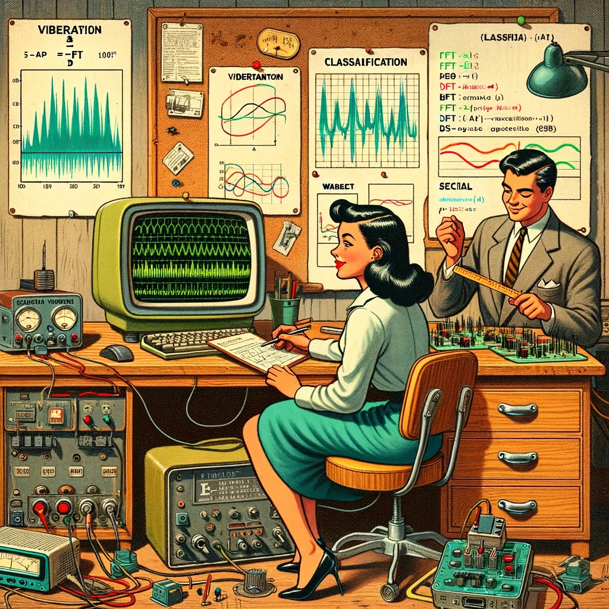<br>
<em>Промпт DALL·E 3: мультяшная иллюстрация в стиле 1950-х: учёные (мужчина и женщина) в лаборатории исследования вибраций. Мужчина изучает старую электронику с помощью линейки. Женщина работает за компьютером со сложными графиками вибрации. На деревянном столе лежат платы с датчиками, среди них — акселерометр. На классическом компьютере с округлым корпусом открыта Arduino IDE с кодом назначения пинов светодиодов и алгоритмами машинного обучения для обнаружения движения. Монитор порта показывает БПФ, классификацию, вейвлеты и DSP. Сцену дополняют винтажные лампы, инструменты и графики БПФ и вейвлетов.</em></p>

## Обзор

Проекты TinyML, связанные с движением (или вибрацией), работают с данными IMU — обычно **акселерометров** и **гироскопов**. Такие временные ряды нужно предварительно обработать перед обучением модели машинного обучения, и для встраиваемого машинного обучения это непростая задача. Тем не менее Edge Impulse упрощает её с помощью шага цифровой обработки сигналов (DSP) и, точнее, [блока спектральных признаков](https://docs.edgeimpulse.com/docs/edge-impulse-studio/processing-blocks/spectral-features) для инерциальных датчиков.

Но как это устроено внутри? Давайте разберёмся.

## Обзор извлечения признаков

Извлечение признаков из набора данных, записанных инерциальными датчиками, такими как акселерометры, включает обработку и анализ сырых данных. Акселерометры измеряют ускорение объекта по одной или нескольким осям (обычно трём: X, Y и Z). Эти измерения помогают понять различные аспекты движения объекта, например характер перемещений и вибрации. Ниже — общая схема процесса:

**Сбор данных.** Сначала нужно получить данные с акселерометров. В зависимости от задачи данные могут записываться с разной частотой дискретизации. Важно, чтобы частота была достаточно высокой для того, чтобы зафиксировать значимую динамику исследуемого движения (частота дискретизации должна быть не меньше чем вдвое выше максимальной значимой частоты в сигнале).

**Предобработка данных.** Сырые данные акселерометров могут быть зашумлёнными и содержать ошибки или нерелевантную информацию. Этапы предобработки, такие как фильтрация и нормализация, помогают очистить и стандартизировать данные, делая их более пригодными для извлечения признаков.

> Studio не выполняет нормализацию и стандартизацию, поэтому при работе с сенсорным слиянием (Sensor Fusion) этот шаг иногда нужно выполнить до загрузки данных в Studio. Это особенно важно в проектах со слиянием датчиков, как в этом руководстве: [Sensor Data Fusion with Spresense and CommonSense](https://docs.edgeimpulse.com/experts/air-quality-and-environmental-projects/environmental-sensor-fusion-commonsense).

**Сегментация.** В зависимости от природы данных и задачи может понадобиться разделить данные на более короткие сегменты, или **окна**. Это помогает сосредоточиться на конкретных событиях или активности в наборе данных и делает извлечение признаков более управляемым и содержательным. Выбор **размера окна** и перекрытия (**окна-диапазона**, window span) зависит от задачи и частоты интересующих событий. Как эмпирическое правило, стоит стараться захватить несколько «циклов данных».

**Извлечение признаков.** Когда данные предобработаны и разбиты на сегменты, можно извлечь признаки, которые описывают характеристики движения. Типичные признаки, извлекаемые из данных акселерометра:

- **Признаки временной области** описывают [статистические свойства](https://www.mdpi.com/1424-8220/22/5/2012) данных внутри каждого сегмента: среднее, медиану, стандартное отклонение, асимметрию (skewness), эксцесс (kurtosis) и частоту пересечения нуля.
- **Признаки частотной области** получают, преобразуя данные в частотную область с помощью таких методов, как [быстрое преобразование Фурье (FFT)](https://en.wikipedia.org/wiki/Fast_Fourier_transform). Типичные признаки этой группы — энергетический спектр, спектральная энергия, доминантные частоты (амплитуда и частота) и спектральная энтропия.
- **Признаки временно-частотной области** объединяют информацию о времени и частоте, например [кратковременное преобразование Фурье (STFT)](https://en.wikipedia.org/wiki/Short-time_Fourier_transform) или [дискретное вейвлет-преобразование (DWT)](https://en.wikipedia.org/wiki/Discrete_wavelet_transform). Они дают более подробное представление о том, как частотный состав сигнала меняется во времени.

Во многих случаях число извлечённых признаков может быть большим, что ведёт к переобучению или росту вычислительной сложности. Методы отбора признаков, такие как взаимная информация, корреляционные методы или метод главных компонент (PCA), помогают выявить наиболее значимые признаки для конкретного приложения и снизить размерность набора данных. Studio умеет выполнять такие вычисления для признаков.

Теперь подробнее рассмотрим типичный проект классификации движения TinyML из этой серии практических работ.

## Проект классификации движения TinyML

<p align="center"></p>

В практическом проекте *классификация движения и обнаружение аномалий* мы моделировали механические нагрузки при транспортировке. Задача состояла в том, чтобы классифицировать четыре класса движения:

- **Морская перевозка** (паллеты на кораблях);
- **Наземная перевозка** (паллеты в грузовике или поезде);
- **Подъём** (паллеты, которые перемещает погрузчик);
- **Простой** (паллеты на складе).

Акселерометры передавали данные о паллете (или контейнере).

<p align="center"></p>

Ниже показан один образец (сырые данные) длиной 10 секунд, записанный с частотой дискретизации 50 Гц:

<p align="center">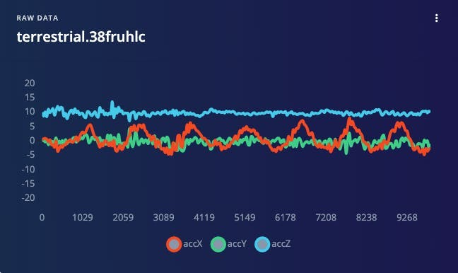</p>

> Результат похож, если тот же анализ провести для другого набора данных с тем же принципом, но с другой частотой дискретизации — 62,5&nbsp;Гц вместо 50 Гц.

## Предобработка данных

Сырые данные, полученные акселерометром (данные «временного ряда»), нужно преобразовать в «табличные данные» одним из типичных методов извлечения признаков, описанных в предыдущем разделе.

Для извлечения признаков данные нужно разбить на сегменты с помощью скользящего окна по образцам. В проекте акселерометр записывал данные каждые 10 секунд с частотой дискретизации 62,5 Гц. Окно длиной 2 секунды захватывает 375 точек данных (3 оси × 2 секунды × 62,5 отсчёта). Окно сдвигается каждые 80 мс, что создаёт набор данных большего размера, где каждый экземпляр содержит 375 «сырых признаков».

<p align="center">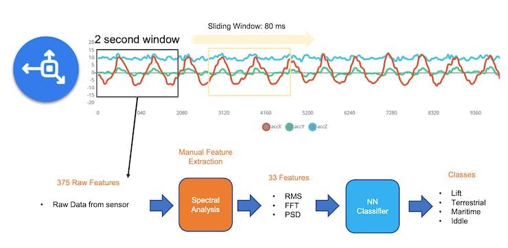</p>

В Studio предыдущая версия (V1) **блока спектрального анализа** извлекала из временной области только RMS, а из частотной области — пики и частоты (с помощью FFT) и мощностные характеристики (PSD) сигнала во времени. В результате получался фиксированный табличный набор из 33 признаков (по 11 на каждую ось).

<p align="center">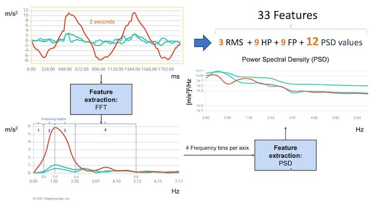</p>

Эти 33 признака были входным тензором нейросетевого классификатора.

В 2022 году Edge Impulse выпустила вторую версию блока спектрального анализа, которую мы и рассмотрим.

### Блок спектрального анализа Edge Impulse версии 2 изнутри

Во второй версии статистические признаки временной области для каждой оси/канала таковы:

- RMS;
- асимметрия (Skewness);
- эксцесс (Kurtosis).

А спектральные признаки частотной области для каждой оси/канала:

- спектральная мощность (Spectral Power);
- асимметрия (Skewness; в следующей версии);
- эксцесс (Kurtosis; в следующей версии).

Подробнее о извлечении признаков можно прочитать по [этой ссылке](https://docs.edgeimpulse.com/docs/edge-impulse-studio/processing-blocks/spectral-features).

> Склонируйте [публичный проект](https://studio.edgeimpulse.com/public/198358/latest). Также можно следовать объяснению и поэкспериментировать с кодом в моём блокноте Google Colab: [Edge Impulse Spectral Analysis Block Notebook](https://colab.research.google.com/github/Mjrovai/TinyML4D/blob/main/SciTinyM-2023/Edge_Impulse-Spectral_Analysis_Block/Edge_Impulse_Spectral_Analysis_Block_V3.ipynb).

Начнём с импорта библиотек:

```python
import numpy as np
import matplotlib.pyplot as plt
import seaborn as sns
import math
from scipy.stats import skew, kurtosis
from scipy import signal
from scipy.signal import welch
from scipy.stats import entropy
from sklearn import preprocessing
import pywt

plt.rcParams['figure.figsize'] = (12, 6)
plt.rcParams['lines.linewidth'] = 3
```

Из изучаемого проекта выберем образец данных акселерометра:

- Размер окна 2 секунды: `[2,000]` мс;
- Частота дискретизации: `[62.5]` Гц;
- Фильтр `[None]` (для простоты) и
- Длина FFT: `[16]`.

```python
f =  62.5 # Гц
wind_sec = 2 # секунды
FFT_Length = 16
axis = ['accX', 'accY', 'accZ']
n_sensors = len(axis)
```

<p align="center">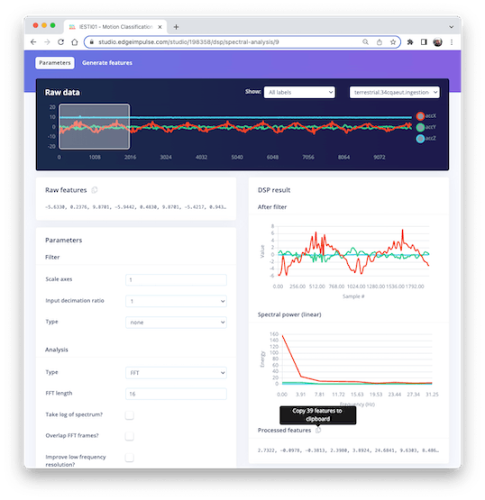</p>

Выбрав *Raw Features* на вкладке Spectral Analysis в Studio, можно скопировать в буфер обмена все 375 точек данных для конкретного двухсекундного окна.

<p align="center">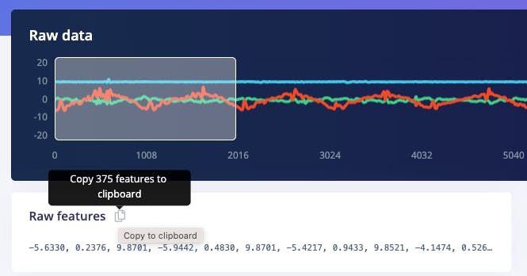</p>

Вставьте точки данных в новую переменную *data*:

```python
data = [
    -5.6330,  0.2376,  9.8701,
    -5.9442,  0.4830,  9.8701,
    -5.4217, ...
]
No_raw_features = len(data)
N = int(No_raw_features/n_sensors)
```

Всего сырых признаков 375, но мы будем работать с каждой осью отдельно, где $N= 125$ (число отсчётов на ось).

Наша цель — понять, как Edge Impulse получает обработанные признаки.

<p align="center">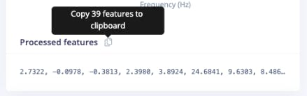</p>

Также вставьте обработанные признаки в переменную, чтобы сравнить рассчитанные в Python признаки с теми, что выдаёт Studio:

```python
features = [
    2.7322, -0.0978, -0.3813,
    2.3980, 3.8924, 24.6841,
    9.6303, ...
]
N_feat = len(features)
N_feat_axis = int(N_feat/n_sensors)
```

Всего обработанных признаков 39, то есть 13 признаков на ось.

Если внимательно посмотреть на эти 13 признаков, в них 3 признака временной области (RMS, Skewness и Kurtosis):

- `[rms] [skew] [kurtosis]`

и 10 признаков частотной области (вернёмся к ним позже):

- `[spectral skew][spectral kurtosis][Spectral Power 1] ... [Spectral Power 8]`

**Разделение сырых данных по датчикам**

Данные содержат отсчёты всех осей; разделим их и построим графики отдельно:

```python
def plot_data(sensors, axis, title):
    [plt.plot(x, label=y) for x,y in zip(sensors, axis)]
    plt.legend(loc='lower right')
    plt.title(title)
    plt.xlabel('Отсчёт')
    plt.ylabel('Значение')
    plt.box(False)
    plt.grid()
    plt.show()

accX = data[0::3]
accY = data[1::3]
accZ = data[2::3]
sensors = [accX, accY, accZ]
plot_data(sensors, axis, 'Сырые признаки')
```

<p align="center">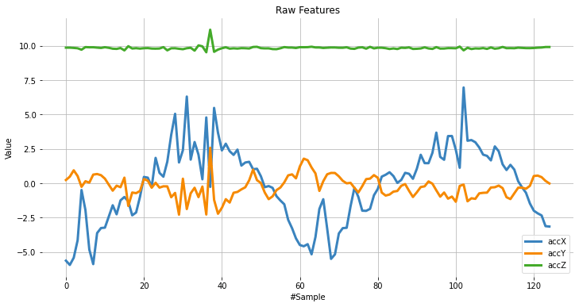</p>

**Вычитание среднего**

Далее вычтем среднее из *data*. Вычитание среднего — распространённый шаг предобработки в статистике и машинном обучении. Его цель — центрировать данные около нуля. Это важно, потому что центрирование может выявить закономерности и связи, которые скрыты, если данные не центрированы.

Вот несколько конкретных причин, почему вычитание среднего полезно:

- **Упрощает анализ:** после центрирования среднее становится нулём, что упрощает некоторые вычисления и их интерпретацию.
- **Убирает смещение:** если данные смещены, вычитание среднего устраняет смещение и позволяет провести более точный анализ.
- **Помогает выявить закономерности:** центрирование может помочь обнаружить закономерности, скрытые в нецентрированных данных. Например, при анализе временного ряда оно помогает увидеть тренды во времени.
- **Может улучшить качество:** в некоторых алгоритмах машинного обучения центрирование повышает качество, так как снижает влияние выбросов и делает данные лучше сопоставимыми. В целом вычитание среднего — простой, но мощный приём для улучшения анализа и интерпретации данных.

```python
dtmean = [
    (sum(x) / len(x))
    for x in sensors
]

[
    print('mean_' + x + ' =', round(y, 4))
    for x, y in zip(axis, dtmean)
][0]

accX = [(x - dtmean[0]) for x in accX]
accY = [(x - dtmean[1]) for x in accY]
accZ = [(x - dtmean[2]) for x in accZ]
sensors = [accX, accY, accZ]

plot_data(sensors, axis, 'Сырые признаки — вычитание среднего')
```

<p align="center">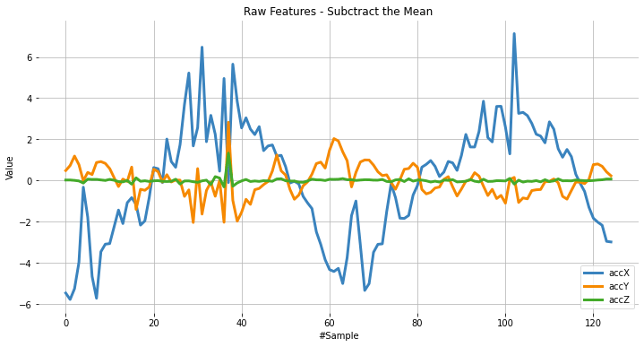</p>

## Статистические признаки временной области

**Вычисление RMS**

Среднеквадратичное значение (RMS) набора значений (или непрерывного сигнала) — это квадратный корень из среднего арифметического квадратов этих значений или квадрата функции, которая задаёт непрерывную форму сигнала. В физике RMS значения электрического тока определяется как «значение постоянного тока, который рассеивает ту же мощность в резисторе».

Для набора из $n$ значений ${𝑥_1, 𝑥_2, \ldots, 𝑥_𝑛}$ RMS вычисляется так:

$$
x_{\mathrm{RMS}} = \sqrt{\frac{1}{n} \left( x_1^2 + x_2^2 + \cdots + x_n^2 \right)}
$$

<!-- <p align="center">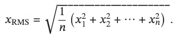</p> -->

> Обратите внимание: значение RMS различается для исходных сырых данных и для данных после вычитания среднего.

```python
# Используем numpy и стандартизованные данные (после вычитания среднего)
rms = [np.sqrt(np.mean(np.square(x))) for x in sensors]
```

Сравним рассчитанные значения RMS с теми, что показывает Edge Impulse:

```python
[print('rms_'+x+'= ', round(y, 4)) for x,y in zip(axis, rms)][0]
print("\nСравнение с признаками результата Edge Impulse")
print(features[0:N_feat:N_feat_axis])
```

`rms_accX=  2.7322`

`rms_accY=  0.7833`

`rms_accZ=  0.1383`

Сравнение с признаками из Edge Impulse:

`[2.7322, 0.7833, 0.1383]`

**Вычисление асимметрии и эксцесса**

В статистике асимметрия и эксцесс — два способа описать **форму распределения**.

Посмотрим на распределение значений датчиков:

```python
fig, axes = plt.subplots(nrows=1, ncols=3, figsize=(13, 4))
sns.kdeplot(accX, fill=True, ax=axes[0])
sns.kdeplot(accY, fill=True, ax=axes[1])
sns.kdeplot(accZ, fill=True, ax=axes[2])
axes[0].set_title('accX')
axes[1].set_title('accY')
axes[2].set_title('accZ')
plt.suptitle('Распределение значений IMU-датчиков', fontsize=16, y=1.02)
plt.show()
```

<p align="center">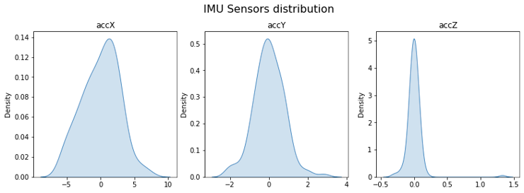</p>

[**Асимметрия (skewness)**](https://en.wikipedia.org/wiki/Skewness) — мера асимметрии распределения. Её значение может быть положительным или отрицательным.

<p align="center">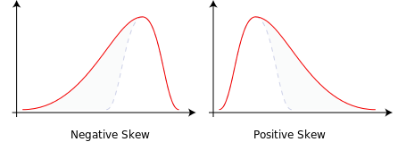</p>

- Отрицательная асимметрия означает, что «хвост» распределения находится слева и тянется в сторону более отрицательных значений.
- Положительная асимметрия означает, что «хвост» находится справа и тянется в сторону более положительных значений.
- Нулевое значение означает отсутствие асимметрии: распределение полностью симметрично.

```python
skew = [skew(x, bias=False) for x in sensors]
[print('skew_'+x+'= ', round(y, 4))
  for x,y in zip(axis, skew)][0]
print("\nСравнение с признаками результата Edge Impulse")
features[1:N_feat:N_feat_axis]
```

`skew_accX=  -0.099`

`skew_accY=  0.1756`

`skew_accZ=  6.9463`

Сравнение с признаками из Edge Impulse:

`[-0.0978, 0.1735, 6.8629]`

[**Эксцесс (kurtosis)**](https://en.wikipedia.org/wiki/Kurtosis) — мера того, является ли распределение «тяжёлохвостым» или «легкохвостым» по сравнению с нормальным распределением.

<p align="center">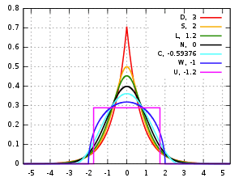</p>

- Эксцесс нормального распределения равен нулю.
- Если эксцесс распределения отрицательный, его называют платикуртическим: такое распределение даёт меньше и менее экстремальных выбросов, чем нормальное.
- Если эксцесс положительный, распределение называют лептокуртическим: оно даёт больше выбросов, чем нормальное.

```python
kurt = [kurtosis(x, bias=False) for x in sensors]
[print('kurt_'+x+'= ', round(y, 4))
  for x,y in zip(axis, kurt)][0]
print("\nСравнение с признаками результата Edge Impulse")
features[2:N_feat:N_feat_axis]
```

`kurt_accX=  -0.3475`

`kurt_accY=  1.2673`

`kurt_accZ=  68.1123`

Сравнение с признаками из Edge Impulse:

`[-0.3813, 1.1696, 65.3726]`

## Спектральные признаки

Отфильтрованный сигнал передаётся в раздел спектральной мощности (Spectral power), который вычисляет **FFT** для получения спектральных признаков.

Поскольку размер окна обычно больше размера FFT, окно разбивается на кадры («подокна»), и FFT вычисляется для каждого кадра.

**Длина FFT** — размер FFT. Он определяет количество бинов FFT и разрешение, с которым можно разделить пики частот. Малое значение означает, что в одном бине FFT усредняется больше сигналов, но при этом уменьшается количество признаков и размер модели. Большое значение разделяет сигналы по большему числу бинов и даёт более крупную модель.

- Общее количество признаков спектральной мощности зависит от настроек фильтра и параметров FFT. Без фильтрации количество признаков равно половине длины FFT.

**Спектральная мощность — метод Уэлча**

Для разбиения сигнала в частотной области на бины и вычисления энергетического спектра для каждого бина используем [метод Уэлча](https://docs.scipy.org/doc/scipy-0.14.0/reference/generated/scipy.signal.welch.html). Он делит сигнал на перекрывающиеся сегменты, применяет к каждому сегменту оконную функцию, вычисляет периодограмму каждого сегмента через DFT и усредняет их, чтобы получить более сглаженную оценку энергетического спектра.

```python
# Функция, которую использует Edge Impulse вместо scipy.signal.welch().
def welch_max_hold(fx, sampling_freq, nfft, n_overlap):
    n_overlap = int(n_overlap)
    spec_powers = [0 for _ in range(nfft//2+1)]
    ix = 0
    while ix <= len(fx):
        # Срез обрезается, если end_idx больше длины,
        # а rfft автоматически дополняет нулями
        fft_out = np.abs(np.fft.rfft(fx[ix:ix+nfft], nfft))
        spec_powers = np.maximum(spec_powers, fft_out**2/nfft)
        ix = ix + (nfft-n_overlap)
    return np.fft.rfftfreq(nfft, 1/sampling_freq), spec_powers
```

Применим эту функцию к трём сигналам:

```python
fax,Pax = welch_max_hold(accX, fs, FFT_Length, 0)
fay,Pay = welch_max_hold(accY, fs, FFT_Length, 0)
faz,Paz = welch_max_hold(accZ, fs, FFT_Length, 0)
specs = [Pax, Pay, Paz ]
```

Построим график энергетического спектра P(f):

```python
plt.plot(fax,Pax, label='accX')
plt.plot(fay,Pay, label='accY')
plt.plot(faz,Paz, label='accZ')
plt.legend(loc='upper right')
plt.xlabel('Частота (Гц)')
#plt.ylabel('PSD [V**2/Hz]')
plt.ylabel('Мощность')
plt.title('Энергетический спектр P(f) по методу Уэлча')
plt.grid()
plt.box(False)
plt.show()
```

<p align="center">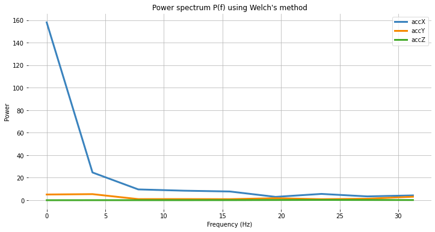</p>

Помимо энергетического спектра, в частотной области можно также учесть асимметрию и эксцесс признаков (в новой версии, которая будет доступна позже):

```python
spec_skew = [skew(x, bias=False) for x in specs]
spec_kurtosis = [kurtosis(x, bias=False) for x in specs]
```

Теперь выведем все спектральные признаки для каждой оси и сравним их с Edge Impulse:

```python
print("Обработанные спектральные признаки EI (accX): ")
print(features[3:N_feat_axis][0:])
print("\nРассчитанные признаки:")
print (round(spec_skew[0],4))
print (round(spec_kurtosis[0],4))
[print(round(x, 4)) for x in Pax[1:]][0]
```

Обработанные спектральные признаки EI (accX):

2.398, 3.8924, 24.6841, 9.6303, 8.4867, 7.7793, 2.9963, 5.6242, 3.4198, 4.2735

Рассчитанные признаки:

2.9069 8.5569 24.6844 9.6304 8.4865 7.7794 2.9964 5.6242 3.4198 4.2736

```python
print("Обработанные спектральные признаки EI (accY): ")
print(features[16:26][0:]) # 13: 3+N_feat_axis;
                           # 26 = 2x N_feat_axis
print("\nРассчитанные признаки:")
print (round(spec_skew[1],4))
print (round(spec_kurtosis[1],4))
[print(round(x, 4)) for x in Pay[1:]][0]
```

Обработанные спектральные признаки EI (accY):

0.9426, -0.8039, 5.429, 0.999, 1.0315, 0.9459, 1.8117, 0.9088, 1.3302, 3.112

Рассчитанные признаки:

1.1426 -0.3886 5.4289 0.999 1.0315 0.9458 1.8116 0.9088 1.3301 3.1121

```python
print("Обработанные спектральные признаки EI (accZ): ")
print(features[29:][0:]) #29: 3+(2*N_feat_axis);
print("\nРассчитанные признаки:")
print (round(spec_skew[2],4))
print (round(spec_kurtosis[2],4))
[print(round(x, 4)) for x in Paz[1:]][0]
```

Обработанные спектральные признаки EI (accZ):

0.3117, -1.3812, 0.0606, 0.057, 0.0567, 0.0976, 0.194, 0.2574, 0.2083, 0.166

Рассчитанные признаки:

0.3781 -1.4874 0.0606 0.057 0.0567 0.0976 0.194 0.2574 0.2083 0.166

## Временно-частотная область

### Вейвлеты

[Вейвлет](https://en.wikipedia.org/wiki/Wavelet) — мощный инструмент для анализа сигналов с кратковременными особенностями или резкими изменениями, такими как всплески или фронты, которые трудно интерпретировать традиционными методами на основе преобразования Фурье.

Вейвлет-преобразования работают, разлагая сигнал на различные частотные компоненты и анализируя каждую из них отдельно. Преобразование выполняется свёрткой сигнала с **вейвлет-функцией** — небольшой волной, сосредоточенной в определённый момент времени и на определённой частоте. Так сигнал раскладывается на разные частотные полосы, каждую из которых можно анализировать отдельно.

Одно из главных преимуществ вейвлет-преобразований в том, что они позволяют проводить временно-частотный анализ: видно, как частотный состав сигнала меняется во времени. Поэтому они особенно полезны для нестационарных сигналов, которые меняются со временем.

Вейвлеты имеют много практических применений: сжатие сигналов и изображений, подавление шума, извлечение признаков и обработка изображений.

Выберем вейвлет на блоке спектральных признаков в том же проекте:

- Тип: Wavelet;
- Уровень декомпозиции вейвлетом: 1;
- Вейвлет: bior1.3.

<p align="center">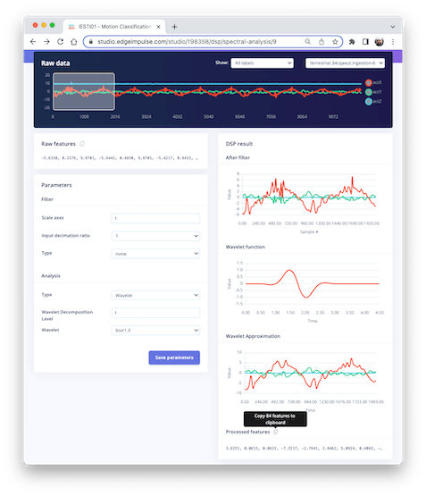</p>

**Вейвлет-функция**

```python
wavelet_name='bior1.3'
num_layer = 1

wavelet = pywt.Wavelet(wavelet_name)
[phi_d,psi_d,phi_r,psi_r,x] = wavelet.wavefun(level=5)
plt.plot(x, psi_d, color='red')
plt.title('Вейвлет-функция')
plt.ylabel('Значение')
plt.xlabel('Время')
plt.grid()
plt.box(False)
plt.show()
```

<p align="center">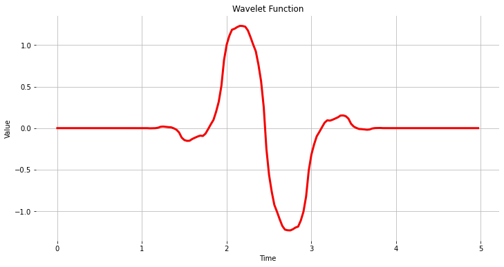</p>

Как и раньше, скопируем и вставим обработанные признаки:

<p align="center">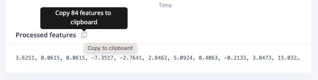</p>

```python
features = [
    3.6251, 0.0615, 0.0615,
    -7.3517, -2.7641, 2.8462,
    5.0924, ...
]
N_feat = len(features)
N_feat_axis = int(N_feat/n_sensors)
```

Edge Impulse вычисляет [дискретное вейвлет-преобразование (DWT)](https://pywavelets.readthedocs.io/en/latest/ref/dwt-discrete-wavelet-transform.html) для каждого выбранного уровня декомпозиции вейвлетом. После этого извлекаются признаки.

Для **вейвлетов** извлекаются *базовые статистические значения*, *значения пересечений* и *энтропия*. Всего на каждый уровень приходится 14 признаков:

- \[11\] статистических признаков: **n5, n25, n75, n95, mean, median**, стандартное отклонение **(std)**, дисперсия **(var)**, среднеквадратичное значение **(rms)**, **kurtosis** (эксцесс) и асимметрия **(skew)**;
- \[2\] признака пересечений: частота пересечения нуля **(zcross)** и частота пересечения среднего уровня **(mcross)** — то есть количество раз, когда сигнал пересекает базовую линию $(y = 0)$ и средний уровень (y = u), за единицу времени;
- \[1\] признак сложности: **энтропия (Entropy)** — характеристическая мера сложности сигнала.

Все 14 значений рассчитываются для каждого уровня (включая L0 — исходный сигнал).

- Общее количество признаков зависит от настроек фильтра и числа уровней. Например, при фильтрации \[None\] и уровне \[1\] количество признаков на ось составит $14\times 2$ (L0 и L1) = 28. Для трёх осей получится 84 признака.

### Анализ вейвлетами

Вейвлет-анализ раскладывает сигнал (**accX, accY** и **accZ**) на различные частотные компоненты с помощью набора фильтров. Эти фильтры разделяют компоненты на низкочастотные (медленно меняющиеся части сигнала, содержащие долгосрочные закономерности), такие как **accX_l1, accY_l1, accZ_l1**, и высокочастотные (быстро меняющиеся части, содержащие краткосрочные закономерности), такие как **accX_d1, accY_d1, accZ_d1**. Это позволяет извлекать признаки для дальнейшего анализа или классификации.

Используются только низкочастотные компоненты (коэффициенты аппроксимации, или cA). В этом примере предполагается один уровень (одноуровневое дискретное вейвлет-преобразование), когда функция возвращает кортеж. При многоуровневой декомпозиции («Multilevel 1D Discrete Wavelet Transform») результатом будет список (подробности см. в описании [дискретного вейвлет-преобразования (DWT)](https://pywavelets.readthedocs.io/en/latest/ref/dwt-discrete-wavelet-transform.html)).

```python
(accX_l1, accX_d1) = pywt.dwt(accX, wavelet_name)
(accY_l1, accY_d1) = pywt.dwt(accY, wavelet_name)
(accZ_l1, accZ_d1) = pywt.dwt(accZ, wavelet_name)
sensors_l1 = [accX_l1, accY_l1, accZ_l1]

# Строим график мощности спектра в зависимости от частоты
plt.plot(accX_l1, label='accX')
plt.plot(accY_l1, label='accY')
plt.plot(accZ_l1, label='accZ')
plt.legend(loc='lower right')
plt.xlabel('Время')
plt.ylabel('Значение')
plt.title('Аппроксимация вейвлетом')
plt.grid()
plt.box(False)
plt.show()
```

<p align="center">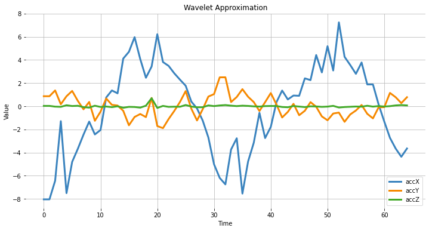</p>

### Извлечение признаков

Начнём с базовых статистических признаков. Обратите внимание: функцию применяем и к исходным сигналам, и к коэффициентам аппроксимации cA, полученным из DWT:

```python
def calculate_statistics(signal):
    n5 = np.percentile(signal, 5)
    n25 = np.percentile(signal, 25)
    n75 = np.percentile(signal, 75)
    n95 = np.percentile(signal, 95)
    median = np.percentile(signal, 50)
    mean = np.mean(signal)
    std = np.std(signal)
    var = np.var(signal)
    rms = np.sqrt(np.mean(np.square(signal)))
    return [n5, n25, n75, n95, median, mean, std, var, rms]

stat_feat_l0 = [calculate_statistics(x) for x in sensors]
stat_feat_l1 = [calculate_statistics(x) for x in sensors_l1]
```

Асимметрия и эксцесс:

```python
skew_l0 = [skew(x, bias=False) for x in sensors]
skew_l1 = [skew(x, bias=False) for x in sensors_l1]
kurtosis_l0 = [kurtosis(x, bias=False) for x in sensors]
kurtosis_l1 = [kurtosis(x, bias=False) for x in sensors_l1]
```

**Пересечение нуля (zcross)** — это количество раз, когда коэффициент вейвлета пересекает нулевую ось. Оно помогает оценить частотное содержание сигнала, так как высокочастотные сигналы обычно имеют больше пересечений нуля, чем низкочастотные.

**Пересечение среднего (mcross)**, в свою очередь, — это количество раз, когда коэффициент вейвлета пересекает среднее значение сигнала. Оно помогает оценить амплитуду, так как сигналы с большой амплитудой обычно имеют больше пересечений среднего, чем сигналы с малой амплитудой.

```python
def getZeroCrossingRate(arr):
    my_array = np.array(arr)
    zcross = float(
        "{:.2f}".format(
          (((my_array[:-1] * my_array[1:]) < 0).sum()) / len(arr)
        )
    )
    return zcross

def getMeanCrossingRate(arr):
    mcross = getZeroCrossingRate(np.array(arr) - np.mean(arr))
    return mcross

def calculate_crossings(list):
    zcross=[]
    mcross=[]
    for i in range(len(list)):
        zcross_i = getZeroCrossingRate(list[i])
        zcross.append(zcross_i)
        mcross_i = getMeanCrossingRate(list[i])
        mcross.append(mcross_i)
    return zcross, mcross

cross_l0 = calculate_crossings(sensors)
cross_l1 = calculate_crossings(sensors_l1)
```

В вейвлет-анализе **энтропия** означает степень беспорядка, или случайности, в распределении коэффициентов вейвлета. Здесь мы используем энтропию Шеннона, которая измеряет неопределённость, или случайность, сигнала. Она вычисляется как взятая с обратным знаком сумма вероятностей различных возможных исходов сигнала, умноженных на их логарифм по основанию 2. В контексте вейвлет-анализа энтропия Шеннона может использоваться для оценки сложности сигнала: чем выше значение, тем сложнее сигнал.

```python
def calculate_entropy(signal, base=None):
    value, counts = np.unique(signal, return_counts=True)
    return entropy(counts, base=base)

entropy_l0 = [calculate_entropy(x) for x in sensors]
entropy_l1 = [calculate_entropy(x) for x in sensors_l1]
```

Теперь перечислим все вейвлет-признаки и сгруппируем их по уровням.

```python
L1_features_names = [
    "L1-n5", "L1-n25", "L1-n75", "L1-n95", "L1-median",
    "L1-mean", "L1-std", "L1-var", "L1-rms", "L1-skew",
    "L1-Kurtosis", "L1-zcross", "L1-mcross", "L1-entropy"
]

L0_features_names = [
    "L0-n5", "L0-n25", "L0-n75", "L0-n95", "L0-median",
    "L0-mean", "L0-std", "L0-var", "L0-rms", "L0-skew",
    "L0-Kurtosis", "L0-zcross", "L0-mcross", "L0-entropy"
]

all_feat_l0 = []
for i in range(len(axis)):
    feat_l0 = (
        stat_feat_l0[i]
        + [skew_l0[i]]
        + [kurtosis_l0[i]]
        + [cross_l0[0][i]]
        + [cross_l0[1][i]]
        + [entropy_l0[i]]
    )
    [print(axis[i] + ' +x+= ', round(y, 4))
       for x, y in zip(L0_features_names, feat_l0)][0]
    all_feat_l0.append(feat_l0)

all_feat_l0 = [
    item
    for sublist in all_feat_l0
    for item in sublist
]
print(f"\nВсего признаков L0 = {len(all_feat_l0)}")

all_feat_l1 = []
for i in range(len(axis)):
    feat_l1 = (
        stat_feat_l1[i]
        + [skew_l1[i]]
        + [kurtosis_l1[i]]
        + [cross_l1[0][i]]
        + [cross_l1[1][i]]
        + [entropy_l1[i]]
    )
    [print(axis[i]+' '+x+'= ', round(y, 4))
       for x,y in zip(L1_features_names, feat_l1)][0]
    all_feat_l1.append(feat_l1)

all_feat_l1 = [
    item
    for sublist in all_feat_l1
    for item in sublist
]
print(f"\nВсего признаков L1 = {len(all_feat_l1)}")
```

<p align="center">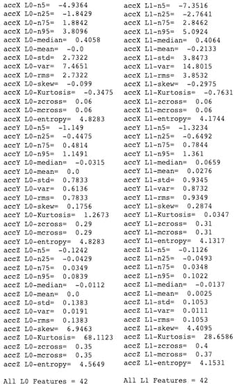</p>

## Итоги

Edge Impulse Studio — мощная онлайн-платформа, которая может взять на себя задачи предобработки. Тем не менее с инженерной точки зрения важно понимать, что происходит «под капотом». Эти знания помогут подобрать лучшие опции и гиперпараметры для настройки проектов.

Дэниел Ситунаяке (Daniel Situnayake) написал в своём [блоге](https://situnayake.com/): «Сырые данные датчиков многомерны и зашумлены. Алгоритмы цифровой обработки сигналов помогают отделить сигнал от шума. DSP — важная часть встраиваемой инженерии, и многие периферийные процессоры имеют аппаратное ускорение DSP. Как инженер по ML, освоив основы DSP, вы получаете суперсилу для работы с высокочастотными временными рядами в своих моделях». Рекомендую прочитать его замечательный пост целиком: [nn to cpp: What you need to know about porting deep learning models to the edge](https://situnayake.com/2023/03/21/nn-to-cpp.html).
