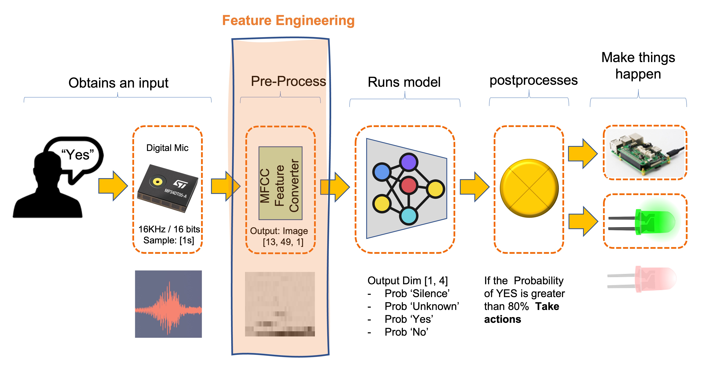
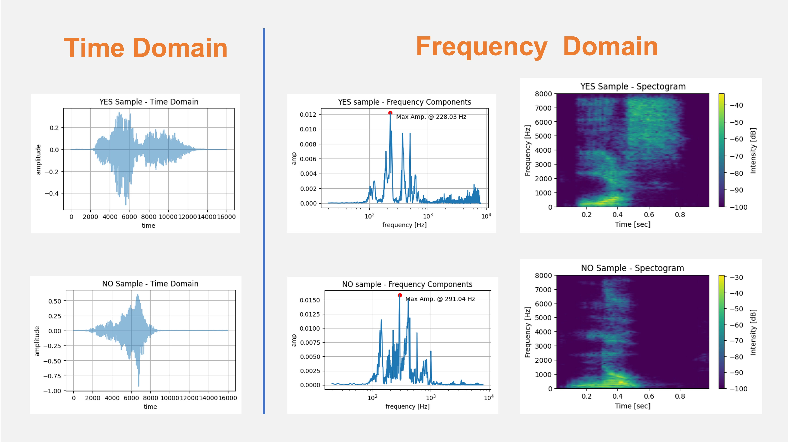
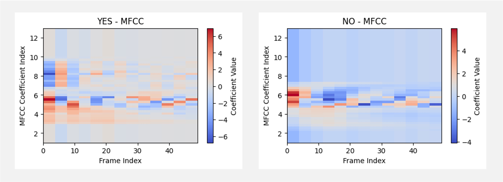
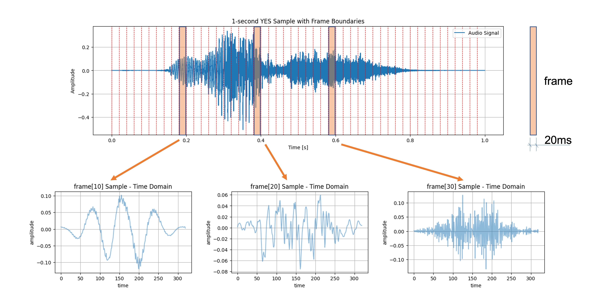
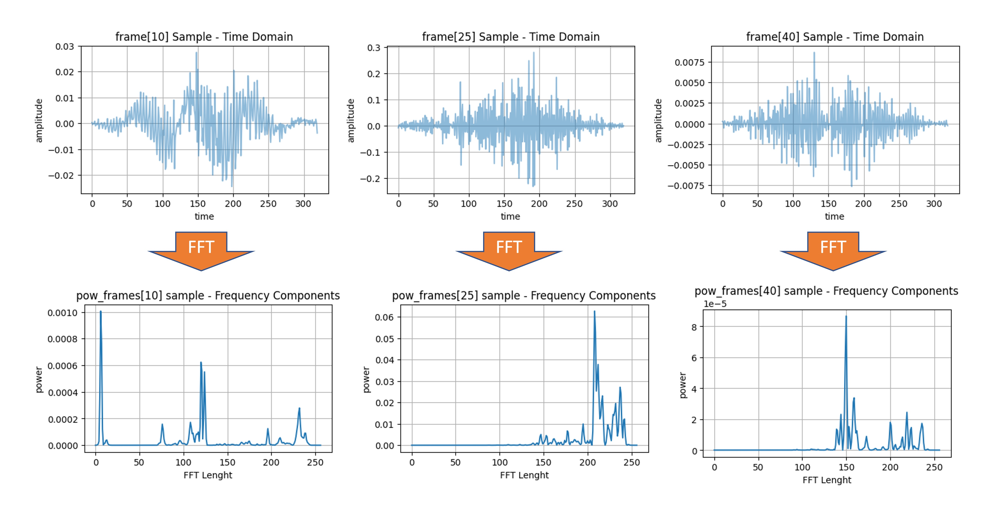
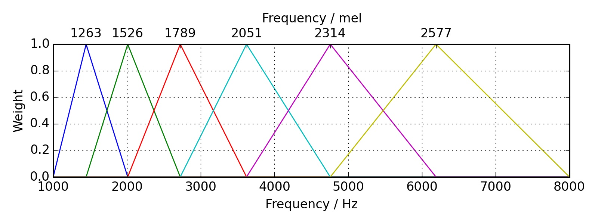
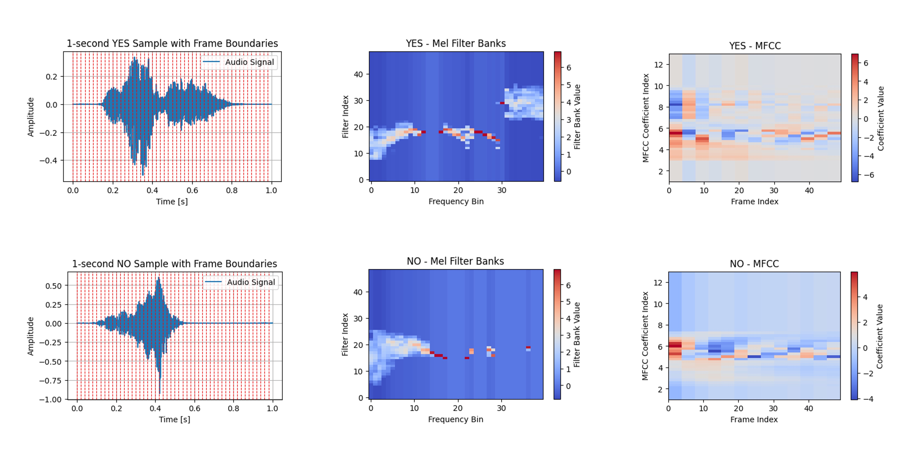

# Инженерия признаков для KWS

 
<em>Промпт DALL·E 3: мультяшная сцена в стиле 1950-х в аудиолаборатории. Два учёных, один с лупой, другой с записями, изучают большие графики, прикреплённые к стене. На графиках — спектры БПФ и временные кривые аудиоданных. Комната в ретро-стиле: деревянные столы, винтажные лампы и классические инструменты анализа звука.</em>

## Обзор

В этом практическом руководстве основное внимание уделяется той критической роли, которую инженерия признаков играет в повышении качества моделей машинного обучения для задач классификации звука, например для распознавания речи. Важно понимать, что качество любой модели машинного обучения во многом зависит от качества используемых признаков. Мы разберём «внутреннюю механику» извлечения признаков, в первую очередь кепстральные коэффициенты на мел-шкале (Mel-frequency Cepstral Coefficients, MFCC) — основу обработки аудиосигналов.

Модели машинного обучения, особенно классические алгоритмы, не понимают звуковых волн. Они работают с числами, организованными определённым образом, то есть с признаками. Признаки описывают характеристики аудиосигнала и помогают модели отличать одни звуки от других.

> В этом руководстве речь пойдёт о генерации признаков именно для классификации звука. Это может быть интересно для самых разных аудиоданных: распознавания речи, категоризации музыки, классификации насекомых по звукам крыльев или других задач анализа звука.

## KWS

Самое распространённое применение TinyML — распознавание ключевых слов (Keyword Spotting, KWS), которое является частью более широкой области распознавания речи. Общее распознавание речи переводит всю произнесённую речь в текст, а KWS сосредоточено на обнаружении определённых «ключевых слов» или «слов пробуждения» в непрерывном аудиопотоке. Система обучена распознавать эти ключевые слова как заранее заданные фразы или слова, например *yes* или *no*. Короче говоря, KWS — это специализированная форма распознавания речи со своими задачами и требованиями.

Типичный процесс KWS с преобразователем признаков MFCC выглядит так:

### Применения KWS

- **Голосовые помощники:** в устройствах вроде Amazon Alexa или Google Home KWS используется для обнаружения слова пробуждения («Alexa» или «Hey Google») и активации устройства.
- **Голосовое управление:** в автомобилях или на промышленных объектах KWS может запускать конкретные команды, например «Запустить двигатель» или «Выключить свет».
- **Системы безопасности:** системы безопасности с голосовым доступом могут использовать KWS для аутентификации пользователей по произнесённой парольной фразе.
- **Телекоммуникационные услуги:** линии службы поддержки могут использовать KWS для маршрутизации звонков по произнесённым ключевым словам.

### Отличия от общего распознавания речи

- **Вычислительная эффективность:** KWS обычно требует меньше вычислений, чем полное распознавание речи, поскольку нужно распознавать лишь небольшой набор фраз.
- **Обработка в реальном времени:** KWS часто работает в реальном времени и оптимизировано для обнаружения ключевых слов с малой задержкой.
- **Ограничения ресурсов:** модели KWS часто делают лёгкими, чтобы они могли работать на устройствах с ограниченными вычислительными ресурсами, например на микроконтроллерах или мобильных телефонах.
- **Узкая задача:** модели общего распознавания речи обучаются работать с широким словарём и разными акцентами, а модели KWS настраиваются на распознавание конкретных ключевых слов, часто точно и в шумной обстановке.

## Обзор аудиосигналов

Понимание основных свойств аудиосигналов необходимо для эффективного извлечения признаков и, в итоге, для успешного применения алгоритмов машинного обучения в задачах классификации звука. Аудиосигналы — это сложные волны, которые отражают колебания давления воздуха во времени. Их можно описать несколькими основными характеристиками: частотой дискретизации, частотой и амплитудой.

- **Частота и амплитуда:** [частота](https://en.wikipedia.org/wiki/Audio_frequency) — это количество колебаний волны за единицу времени, измеряется в герцах (Гц). Для аудиосигналов разные частоты соответствуют разной высоте тона. [Амплитуда](https://en.wikipedia.org/wiki/Amplitude), в свою очередь, измеряет величину колебаний и связана с громкостью звука. И частота, и амплитуда — важные признаки, которые отражают тональные и ритмические свойства звука.

- **Частота дискретизации:** [частота дискретизации](https://en.wikipedia.org/wiki/Sampling_(signal_processing)), которая обычно обозначается в герцах (Гц), определяет количество отсчётов, взятых за секунду при оцифровке аналогового сигнала. Чем выше частота дискретизации, тем точнее цифровое представление сигнала, но тем больше вычислительных ресурсов требуется для обработки. Типичные частоты дискретизации — 44,1 кГц для аудио в качестве CD и 16 кГц или 8 кГц для задач распознавания речи. Понимание компромиссов при выборе подходящей частоты дискретизации важно для баланса точности и вычислительной эффективности. В целом в проектах TinyML мы работаем с частотой 16 кГц. Хотя тоны музыки слышны на частотах до 20 кГц, голос ограничен 8 кГц. Традиционные телефонные системы используют частоту дискретизации 8 кГц.

> Для точного представления сигнала частота дискретизации должна быть как минимум вдвое больше самой высокой частоты, присутствующей в сигнале.

- **Временная и частотная области:** аудиосигналы можно анализировать во временной и в частотной областях. Во временной области сигнал представлен как волна, где амплитуда отложена по времени. Такое представление помогает увидеть временные признаки, например начало и длительность звука, но тональные характеристики в нём выражены слабо. Напротив, представление в частотной области показывает составляющие сигнала и их амплитуды, обычно получаемые с помощью преобразования Фурье. Это незаменимо для задач, где нужно понимать спектральное содержание сигнала, например для определения музыкальных нот или речевых фонем (как в нашем случае).

На изображении ниже показаны слова `YES` и `NO` с типичными представлениями во временной (исходное аудио) и частотной областях:

### Почему не сырое аудио?

Использование сырых аудиоданных напрямую в задачах машинного обучения может показаться заманчивым, но этот подход создаёт несколько проблем, из-за которых он хуже подходит для надёжных и эффективных моделей.

Применение сырого аудио для KWS, например на устройствах TinyML, сопряжено с трудностями: высокая размерность (при частоте дискретизации 16 кГц), вычислительная сложность при выделении временных признаков, чувствительность к шуму и отсутствие семантически осмысленных признаков. Поэтому для приложений с ограниченными ресурсами более практичным выбором становятся методы извлечения признаков, такие как MFCC.

Вот некоторые дополнительные подробности о ключевых проблемах, связанных с сырым аудио:

- **Высокая размерность:** аудиосигналы, особенно при высокой частоте дискретизации, дают большие объёмы данных. Например, односекундный фрагмент, записанный с частотой 16 кГц, содержит 16 000 отдельных точек данных. Высокая размерность увеличивает вычислительную сложность, время обучения и затраты на вычисления, что делает подход непрактичным в условиях ограниченных ресурсов. Кроме того, широкий динамический диапазон аудиосигналов требует много бит на отсчёт, при этом полезной информации передаётся мало.

- **Временные зависимости:** у сырых аудиосигналов есть временная структура, которую простым моделям машинного обучения бывает трудно уловить. Рекуррентные нейронные сети, например [LSTM](https://annals-csis.org/Volume_18/drp/pdf/185.pdf), способны моделировать такие зависимости, но они требовательны к вычислениям и трудны в обучении на крошечных устройствах.

- **Шум и вариативность:** сырые аудиосигналы часто содержат фоновый шум и другие второстепенные элементы, которые ухудшают работу модели. Кроме того, один и тот же звук может звучать по-разному в зависимости от расстояния до микрофона, ориентации источника звука и акустических свойств окружения, что усложняет данные.

- **Отсутствие семантического смысла:** сырое аудио по своей природе не содержит семантически осмысленных признаков для задач классификации. Такие признаки, как высота тона, темп и спектральные характеристики, которые важны для распознавания речи, нельзя напрямую получить из формы сигнала.

- **Избыточность сигнала:** аудиосигналы часто содержат избыточную информацию: отдельные участки сигнала почти не вносят вклад в решение задачи. Эта избыточность делает обучение неэффективным и может привести к переобучению.

Поэтому для преобразования сырых аудиоданных в более удобный и информативный формат обычно используют методы извлечения признаков: кепстральные коэффициенты на мел-шкале (MFCC), мел-энергии (Mel-Frequency Energies, MFE) и простые спектрограммы. Эти признаки сохраняют главные характеристики аудиосигнала, уменьшая размерность и шум, и делают машинное обучение эффективнее.

## Обзор MFCC

### Что такое MFCC?

[Кепстральные коэффициенты на мел-шкале (MFCC)](https://en.wikipedia.org/wiki/Mel-frequency_cepstrum) — набор признаков, которые вычисляются по спектральному содержанию аудиосигнала. Они основаны на особенностях человеческого слуха и часто используются для описания фонетических характеристик звука. MFCC вычисляются в несколько этапов: предыскажение (pre-emphasis), разбиение на кадры (framing), оконная функция (windowing), быстрое преобразование Фурье (FFT) для перехода в частотную область и, наконец, дискретное косинусное преобразование (DCT). В результате получается компактное представление спектральных характеристик исходного аудиосигнала.

На изображении ниже слова `YES` и `NO` показаны в виде MFCC:

> В [этом видео](https://youtu.be/SJo7vPgRlBQ?si=KSgzmDg8DtSVqzXp) объясняется, что такое кепстральные коэффициенты на мел-шкале (MFCC), и показано, как их вычислять.

### Зачем нужны MFCC?

MFCC важны по нескольким причинам, особенно в контексте распознавания ключевых слов (KWS) и TinyML:

- **Снижение размерности:** MFCC сохраняют важные спектральные характеристики сигнала и заметно уменьшают размерность данных, что делает их идеальными для приложений TinyML с ограниченными ресурсами.
- **Устойчивость:** MFCC меньше подвержены шуму и вариациям высоты тона и амплитуды, предоставляя более стабильный и надёжный набор признаков для задач классификации звука.
- **Моделирование слуха человека:** мел-шкала в MFCC приближает реакцию человеческого уха на разные частоты, что делает их практичными для распознавания речи, где желательно восприятие, близкое к человеческому.
- **Вычислительная эффективность:** расчёт MFCC эффективен с точки зрения вычислений, что делает их хорошо подходящими для работы в реальном времени на аппаратуре с ограниченными ресурсами.

Итак, MFCC сочетают информативность и вычислительную эффективность, поэтому они популярны в задачах классификации звука, особенно в условиях ограничений, как в TinyML.

### Вычисление MFCC

Вычисление кепстральных коэффициентов на мел-шкале (MFCC) включает несколько ключевых шагов. Разберём их, так как они особенно важны для задач распознавания ключевых слов (KWS) на устройствах TinyML.

- **Предыскажение (pre-emphasis):** первый шаг — предыскажение, которое усиливает высокочастотные составляющие аудиосигнала и выравнивает частотный спектр. Для этого применяется фильтр, усиливающий разницу между соседними отсчётами. Формула предыскажения: $y(t)=x(t)-\alpha x(t-1)$, где $\alpha$ — коэффициент предыскажения, обычно около 0,97.

- **Разбиение на кадры (framing):** аудиосигнал делится на короткие кадры (*длина кадра*), обычно 20–40 миллисекунд. Это основано на допущении, что частоты в сигнале стационарны на коротком промежутке времени. Разбиение на кадры позволяет анализировать сигнал в таких небольших временных интервалах. *Шаг кадра* (frame stride) определяет смещение от одного кадра к соседнему. Кадры могут идти последовательно или перекрываться.

- **Оконная функция (windowing):** каждый кадр затем умножается на оконную функцию, чтобы уменьшить разрывы на границах кадра. Часто используется окно Хэмминга. Оконная обработка готовит сигнал к преобразованию Фурье, уменьшая краевые эффекты. На изображении ниже показаны три кадра (10, 20 и 30) и отсчёты времени после оконной обработки (длина кадра и шаг кадра составляют 20 мс):

- **Быстрое преобразование Фурье (FFT):** к каждому кадру после оконной обработки применяется FFT, которое переводит его из временной области в частотную. FFT даёт комплексное представление, содержащее и амплитуду, и фазу. Однако для MFCC используется только амплитуда, чтобы рассчитать спектр мощности (power spectrum). Спектр мощности — это квадрат амплитудного спектра, он показывает энергию, присутствующую в каждой частотной составляющей.

> Спектр мощности $P(f)$ сигнала $x(t)$ определяется как $P(f)=|X(f)|^2$, где $X(f)$ — преобразование Фурье $x(t)$. Возведение модуля преобразования Фурье в квадрат усиливает *сильные* частоты по сравнению со *слабыми* и тем самым лучше передаёт значимые спектральные характеристики аудиосигнала. Это важно в таких задачах, как классификация звука, распознавание речи и KWS, где нужно выделять различимые частотные паттерны, которые отличают классы звуков или фонемы речи.

- **Банк мел-фильтров (Mel Filter Banks):** частотная область затем отображается на [мел-шкалу](https://en.wikipedia.org/wiki/Mel_scale), которая приближает реакцию человеческого уха на разные частоты. Идея в том, чтобы извлекать больше признаков (больше фильтров) на низких частотах и меньше на высоких. Поэтому метод хорошо работает со звуками, которые различает человеческое ухо. Обычно для вычисления мел-энергий используют от 20 до 40 треугольных фильтров. Затем эти энергии логарифмируются, чтобы превратить мультипликативные факторы в аддитивные, что удобнее для дальнейшей обработки.

- **Дискретное косинусное преобразование (DCT):** последний шаг — применить [дискретное косинусное преобразование (DCT)](https://en.wikipedia.org/wiki/Discrete_cosine_transform) к логарифмам мел-энергий. DCT помогает декоррелировать энергии, эффективно сжимая данные и оставляя только наиболее информативные признаки. Обычно сохраняют первые 12–13 коэффициентов DCT, которые образуют итоговый вектор признаков MFCC.

## Практика на Python

Применим рассмотренное на реальном аудиообразце. Откройте блокнот в Google Colab и извлеките признаки MFCC из ваших аудиофайлов: [Открыть в Colab](https://colab.research.google.com/github/Mjrovai/Arduino_Nicla_Vision/blob/main/KWS/Audio_Data_Analysis.ipynb)

## Итоги

*Какой метод извлечения признаков использовать?*

Кепстральные коэффициенты на мел-шкале (MFCC), мел-энергии (MFE) и спектрограммы — способы представления аудиоданных, которые часто полезны в разных контекстах.

В целом MFCC сосредоточены на том, чтобы передать огибающую спектра мощности. Поэтому они менее чувствительны к мелким деталям спектра, но устойчивее к шуму. Это часто желательно для задач, связанных с речью. С другой стороны, спектрограммы и MFE сохраняют более подробную информацию о частотах, что может быть полезно в задачах, где нужно различать звуки по тонкой спектральной структуре.

### MFCC особенно хороши для

1. **Распознавания речи:** MFCC отлично подходят для выявления фонетического содержания речевых сигналов.
2. **Идентификации диктора:** с их помощью можно отличать разных говорящих по особенностям голоса.
3. **Распознавания эмоций:** MFCC способны передавать тонкие изменения речи, которые указывают на эмоциональное состояние.
4. **Распознавания ключевых слов:** особенно в TinyML, где важны низкая вычислительная сложность и небольшой размер признаков.

### Спектрограммы или MFE чаще подходят для

1. **Анализа музыки:** спектрограммы передают гармоническую и тембровую структуру музыки, что важно для классификации жанров, распознавания инструментов или транскрипции музыки.
2. **Классификации окружающих звуков:** при распознавании неречевых звуков (например, дождя, ветра, транспорта) полная спектрограмма даёт более информативные признаки.
3. **Идентификации птичьего пения:** тонкие детали птичьих голосов часто лучше передаются спектрограммами.
4. **Обработки биоакустических сигналов:** для анализа звуков дельфинов или летучих мышей тонкая частотная информация спектрограммы может быть критичной.
5. **Контроля качества аудио:** спектрограммы часто используются в профессиональном анализе звука, чтобы выявлять нежелательные шумы, щелчки и другие артефакты.

## Ресурсы

- [Блокнот Colab Audio_Data_Analysis](https://colab.research.google.com/github/Mjrovai/Arduino_Nicla_Vision/blob/main/KWS/Audio_Data_Analysis.ipynb)
