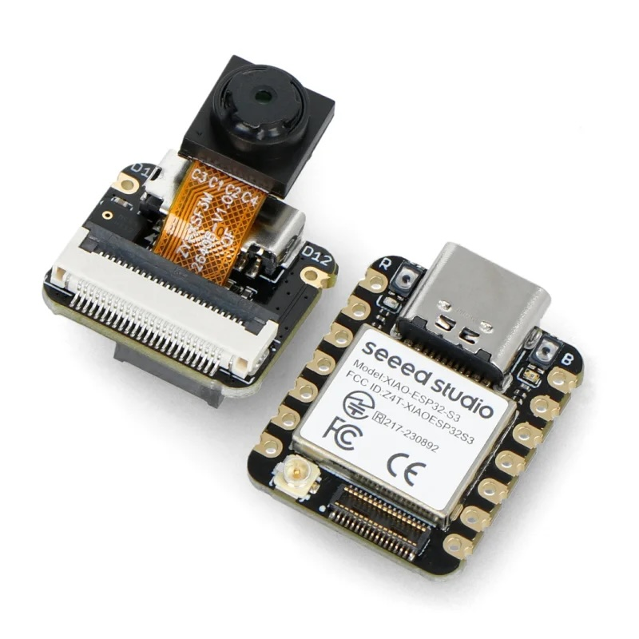
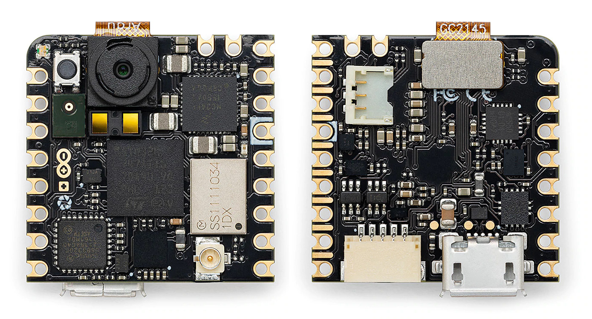

# Аппаратные наборы

*Развёртывание машинного обучения на реальном встраиваемом оборудовании. Платы стоят от \$25, а если бюджета нет, интерактивные лабораторные работы воспроизводят весь опыт работы с оборудованием в симуляции.*

  
  
  
  

Эти практические лабораторные работы сопровождают учебник [Machine Learning Systems](https://mlsysbook.ai) и переносят теорию на настоящее оборудование. Вы развернёте модели машинного обучения на встраиваемых устройствах, которые помещаются в ладони: от классификации изображений до распознавания голоса и обнаружения движения. Профессиональные отладочные платы стоимостью \$25–100 дают мгновенную ощутимую обратную связь: когда модель работает успешно, светодиоды загораются, моторы вращаются, а зуммеры звучат.

Работа в условиях ограниченных ресурсов встраиваемых устройств (обычно 2 МБ оперативной памяти и 1 МБ флеш-памяти) заставляет сталкиваться с теми же инженерными компромиссами, которые определяют крупномасштабные ML-системы, но в осязаемой среде, где каждое решение по оптимизации сразу даёт наблюдаемый результат.

> **Разработка лабораторных работ.** Эти практические лабораторные работы разработаны совместно проф. [Vijay Janapa Reddi](https://vijay.seas.harvard.edu) и [Marcelo Rovai](https://github.com/Mjrovai); разработкой руководил Marcelo. Его многолетний опыт в области встраиваемых систем позволил создать доступные практические занятия, которые связывают теорию с реальной реализацией.
>
> Marcelo также написал открытые книги-компаньоны о платах Nicla Vision, XIAO и Raspberry Pi. Прямые ссылки и описания см. в разделе «Companion Books» [Хаба для преподавателей](https://mlsysbook.ai/instructors/#companion-books).

## Аппаратные платформы

  
  
  
  

- **[Grove Vision AI V2](04-grove-vision/README.md)**, \~\$25. Лучший выбор для начинающих: готовое решение для компьютерного зрения «подключи и работай».
- **[XIAOML Kit](03-seeed-xiao/README.md)**, \~\$40. Лучшее соотношение цены и возможностей: зрение, звук и движение.
- **[Raspberry Pi](05-raspberry-pi/README.md)**, \~\$60–80. Продвинутые проекты: LLM, VLM и периферийный ИИ.
- **[Nicla Vision](02-arduino-nicla/README.md)**, \~\$95. Профессиональный уровень и два датчика в компактном корпусе.

## Что вы создадите

- **Компьютерное зрение.** Классификация изображений и обнаружение объектов на микроконтроллерах. Обучайте модели распознавать объекты, находить лица или классифицировать сцены, а затем запускайте их на устройствах, работающих от батареи.
- **Обработка звука.** Распознавание ключевых слов и голосовых команд. Создавайте детекторы слова пробуждения и простые голосовые интерфейсы, которые работают полностью на устройстве, без облака.
- **Классификация движения.** Распознавание активности и жестов по данным IMU. Создавайте носимые приложения, которые определяют ходьбу, бег или пользовательские жесты с помощью акселерометра и гироскопа.
- **Большие языковые модели.** Запускайте LLM и VLM на периферийных устройствах. Познакомьтесь с передовыми возможностями ИИ на устройстве: модели понимают и генерируют текст.

## Начало работы

1. **Выберите оборудование.** Подберите платформу по бюджету и учебным целям. Подробное сравнение см. в разделе [«Платформы»](01-start/platforms/README.md).
2. **Настройте среду.** Установите Arduino IDE или инструменты для конкретной платформы. Пошаговые инструкции см. в [руководстве по настройке среды разработки](01-start/ide-setup/README.md).
3. **Соберите и разверните.** Выполняйте лабораторные работы для выбранной платформы. Начните с [раздела «Начало работы»](01-start/README.md), где описаны все доступные упражнения.

## Часть экосистемы MLSysBook

- **[Учебник](https://mlsysbook.ai/)** — полная теория по всему стеку систем машинного обучения.
- **[Слайды лекций](https://mlsysbook.ai/slides/)** — презентации Beamer и учебные материалы для каждой главы.
- **[Лабораторные работы](https://mlsysbook.ai/labs/)** — интерактивные блокноты Marimo, которые проверяют утверждения книги.
- **[Аппаратные наборы](https://mlsysbook.ai/kits/)** — практическое развёртывание машинного обучения на реальных встраиваемых устройствах.
- **[Хаб для преподавателей](https://mlsysbook.ai/instructors/)** — карты курсов, учебные программы и материалы для внедрения курса в преподавание.
- **[TinyTorch](https://mlsysbook.ai/tinytorch/)** — постройте собственный фреймворк машинного обучения с нуля, модуль за модулем.
- **[MLSys·im](https://mlsysbook.ai/mlsysim/)** — аналитический движок моделирования, на котором основаны количественные рисунки книги.
