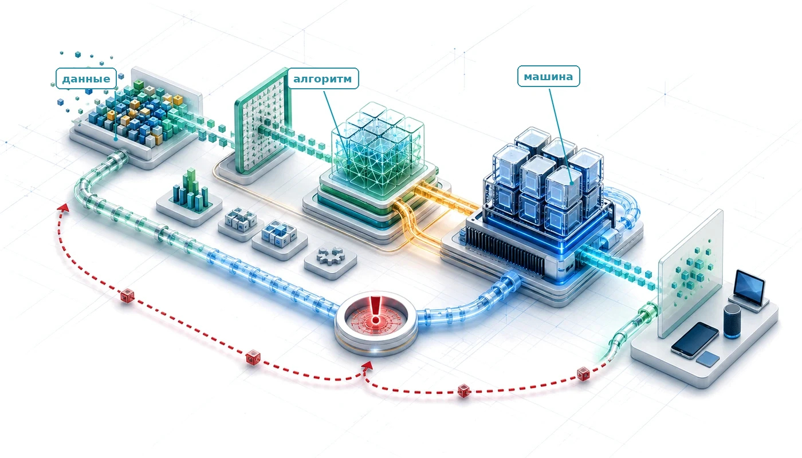
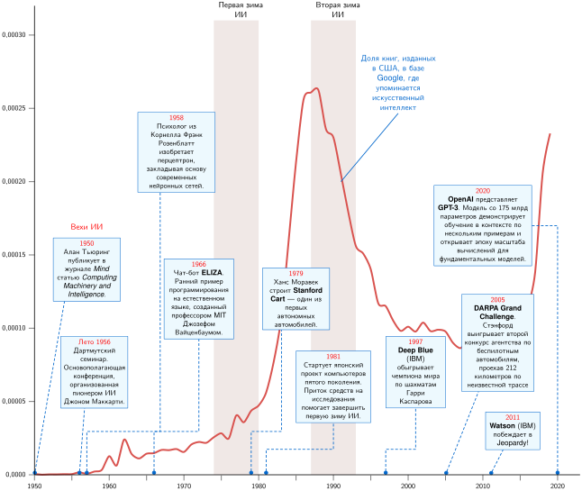
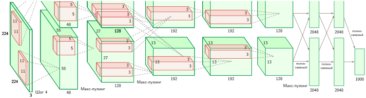
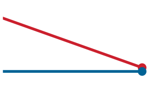
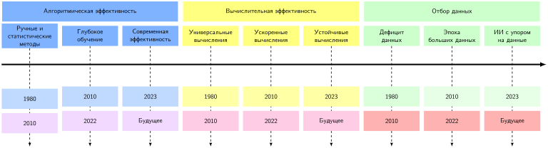
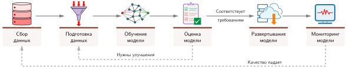
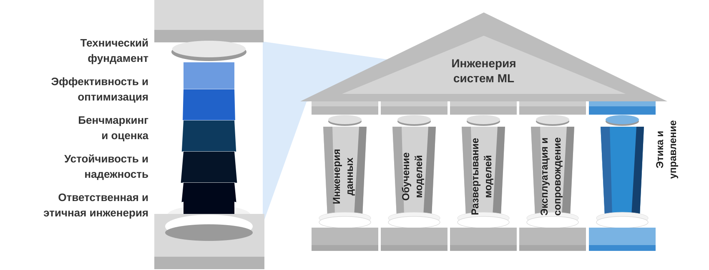
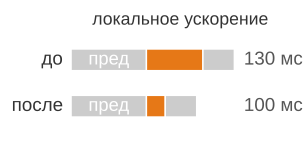

<a id="sec-introduction"></a>

# Введение



## Назначение

_Почему для построения систем машинного обучения нужны инженерные принципы, так сильно отличающиеся от тех, что управляют традиционными вычислительными системами?_

Системы машинного обучения подчиняются законам физики. Данные движутся по иерархии памяти, ограниченной пропускной способностью, арифметика выполняется на кремнии, ограниченном мощностью, а предсказания должны поспевать в пределах окна задержки. Эти ограничения — не детали реализации: они определяют решения, начиная от архитектуры модели и заканчивая целевой платформой развертывания. Системы машинного обучения также отличаются от традиционных вычислительных систем тем, что их поведение задается данными, а не только явной логикой или состоянием аппаратуры. Когда обычная программа ведет себя неправильно, инженер часто может проследить исходный код или изучить состояние аппаратуры; когда ведет себя неправильно система машинного обучения, код может выполняться корректно, но выученное поведение дает сбой, потому что данные были неполными, смещенными, устаревшими или перестали быть репрезентативными. Поэтому инженеры машинного обучения одновременно управляют статистической неопределенностью и физическими ограничениями выполнения. Модель, которая помещается в дата-центре, может оказаться бесполезной на телефоне; конвейер обучения, который сходится за неделю на одном ускорителе, на другом займет месяц; точная модель, обученная на данных прошлого года, может незаметно деградировать. Традиционные практики — тестирование, модульность, контроль версий и анализ производительности — по-прежнему необходимы, но их недостаточно. В масштабе системы оптимизация одного слоя может переместить узкое место в другой, поэтому корректность, эффективность и пригодность к развертыванию нельзя проектировать независимо друг от друга. Поэтому первая задача — диагностика: улучшение самого заметного компонента может не изменить сквозного поведения, если связывающим оказывается другое ограничение. Эта книга строит дисциплину, опирающуюся на физические пределы вычислений. Алгоритмические решения влияют на весь стек вплоть до машины, а аппаратные ограничения возвращаются обратно к проектированию модели.

> **Цели обучения**
>
> - Объяснить, почему поведение, заданное данными, и физические ограничения отличают системы машинного обучения от традиционного программного обеспечения
> - Применить взгляд «данные — алгоритм — машина», чтобы диагностировать узкие места в перемещении данных, арифметике и пределах машины
> - Проанализировать переход ИИ от символических правил к глубокому обучению через призму «горького урока»
> - Вычислить члены железного закона производительности, чтобы рассуждать о пропускной способности, задержке и отдаче от вычислений
> - Синтезировать перспективы жизненного цикла, развертывания, деградации и пяти опор в инженерные суждения о системах машинного обучения

<a id="sec-introduction-ai-moment-37f1"></a>

## Системы ИИ сегодня

Искусственный интеллект больше не ограничивается исследовательскими демонстрациями. Задайте вопрос смартфону, и за несколько секунд обученные компоненты преобразуют речь в текст, распознают намерение, находят информацию и формируют ответ. Поисковые системы ранжируют результаты, рекомендательные системы решают, что увидят люди, кредиторы используют модели для оценки риска, а системы помощи водителю обнаруживают опасности. Во всех этих случаях предсказание входит в более крупное решение, которое может повлиять на внимание, деньги, доступ или безопасность. Поэтому то, что выглядит как одно разумное действие, на самом деле является сквозной системой, работающей в реальном мире.

Современное движение в области ИИ стало практичным, когда сошлись три силы: цифровые сервисы порождали больше примеров, чем инженеры могли бы закодировать в виде правил, алгоритмы обучения извлекали из этих примеров предсказательную структуру, а параллельное оборудование делало получившиеся вычисления осуществимыми. Однако самым весомым оказалось концептуальное изменение. Данные перестали быть всего лишь входом для программы; они стали механизмом, который определяет поведение программы. Вместо того чтобы вручную писать логику решений, инженеры строят конвейер оптимизации, через который эмпирические примеры формируют правила, исполняемые системой.

Это сочетание порождает **двойное требование**. Каждая система машинного обучения должна доказать, что выученное поведение заслуживает доверия, и что машина способна выдавать это поведение в пределах доступного времени, памяти, энергии и стоимости. Точная, но слишком медленная модель непригодна; быстрая модель, обученная на нерепрезентативных данных, ошибается с машинной скоростью. Различие яснее всего видно на границах отказов. Дефект в коде может вызвать громкий сбой, тогда как дефект в данных может оставить каждую инструкцию выполненной корректно, а качество предсказаний незаметно ухудшается. В масштабе оба требования охватывают весь стек. Разговорные сервисы координируют пулы GPU[^fn-gpu-parallel-execution], одновременно управляя памятью, сетями и теплом. Системы помощи водителю должны объединять потоки данных с датчиков за миллисекунды. Google обрабатывает 8,5 млрд поисковых запросов в день при строгих целевых значениях задержки. Такие системы работают только тогда, когда выученное поведение и физическое выполнение проектируются вместе. Это совместное проектирование начинается с перехода от логики, заданной кодом, к поведению, заданному данными.

[^fn-gpu-parallel-execution]: **GPU (графический процессор)**: изначально созданный для отрисовки графики видеоигр — задачи, которая требует тысяч простых параллельных вычислений для пикселей. Такое соответствие аппаратуры и алгоритма оказалось решающим для нейронных сетей, где та же массивно-параллельная арифметика напрямую отображается на умножение матриц. Поэтому GPU стали основным физическим фактором масштабирования современного обучения.

<a id="sec-introduction-datacentric-paradigm-shift-4eca"></a>

## Смена парадигмы: ориентация на данные

Этот сдвиг меняет то, как строится программное обеспечение. Вместо того чтобы писать поведение напрямую, инженеры создают процесс, который выучивает поведение из данных. Когда традиционная программа дает сбой, инженер часто может проследить ветвление, изучить кадр стека и исправить путь выполнения. Когда система машинного обучения теряет точность без изменения кода, причиной может стать сдвиг распределения данных, изменившийся процесс разметки или модель, которая больше не отражает поведение в эксплуатации. Андрей Карпаты[^fn-karpathy-software-two] описал этот переход как переход от **Software 1.0** к **Software 2.0** (Karpathy, 2017). Как показывает [«Смена парадигмы от Software 1.0 к Software 2.0»](01_introduction.md#tbl-software-1-vs-2), Software 1.0 кодирует операционную логику в инструкциях, тогда как Software 2.0 выучивает эту логику на примерах. Поэтому его сбои могут оставаться незаметными, пока оценка или мониторинг не покажут, что поведение изменилось.

Software 2.0 не отменяет код. Инженеры по-прежнему строят конвейеры данных, циклы обучения, инструменты оценки и инфраструктуру обслуживания. Меняется то, где находится поведение приложения. Часть его хранится в выученных весах, которые сформированы данными, поэтому одна только проверка кода не объяснит, что система будет делать.

[^fn-karpathy-software-two]: **Андрей Карпаты**: один из основателей OpenAI и бывший директор по ИИ в Tesla, который применил глубокое обучение к парку автономных автомобилей. Его тезис «Software 2.0» (2017) сформулировал мысль о том, что веса нейронной сети стали новым «исходным кодом». Из этого следует новая инженерная реальность: вместо отладки явной логики инженеры должны курировать данные, которые определяют поведение программы, и вести их версии, поскольку модель с миллионами параметров нельзя напрямую исправить или рассуждать о ней.

| **Характеристика** | **Software 1.0 (традиционное)** | **Software 2.0 (машинное обучение)**        |
|:-----------------|:-------------------------------|:--------------------------------------------|
| **Исходный код** | C++, Python, Java              | Обучающие данные + метки                    |
| **Компилятор**   | GCC, LLVM                      | Цикл обучения (стохастический градиентный спуск) |
| **Логика**       | Явная (написана вручную)       | Неявная (выучена)                           |
| **Режим отказа** | Громкий (сбой, исключение)     | Тихий (деградация метрик)                   |
| **Отладка**      | Трассировка пути выполнения    | Анализ распределения данных                 |

<a id="tbl-software-1-vs-2"></a>

***Смена парадигмы от Software 1.0 к Software 2.0**: В Software 2.0 «программист» не пишет логику, а курирует набор данных, который оптимизационный процесс использует, чтобы написать логику. Поэтому отладка смещается вверх по течению: от кода к данным. Аналогия с «компилятором» приблизительна: в отличие от детерминированного компилятора процесс обучения стохастичен и может выдавать разные «исполняемые файлы» из одного и того же «исходного кода».*

Ориентация на данные меняет то, что инженеры должны создавать и поддерживать. В исследовании производственных систем Google обнаружено, что код модели занимает лишь малую часть инженерной поверхности (Sculley et al., 2015). Окружающая система — сбор данных, проверка, извлечение признаков, управление ресурсами, обслуживание и мониторинг — оказалась больше и долговечнее.


*Производственная работа с ML — в основном окружающая система, а не только код модели.*

Этот дисбаланс порождает скрытый технический долг. Каждый окружающий компонент кодирует допущения о том, как выбирается пример, что означает метка, когда вычисляется признак, какая версия попадает в обслуживание и как обнаруживается деградация. Ни одно из этих допущений не видно в матричном умножении, которое дает предсказание, однако любое из них может изменить результат. Одна лишь модель не исправит устаревший прокси, сломанный конвейер признаков или отсутствующий сигнал обратной связи.

Производственные данные, таким образом, — не пассивный вход. Это измерение мира, собранное через конкретный продукт и преобразованное меняющимся конвейером. Если это измерение перестает отражать целевую величину, модель может оставаться численно здоровой, а система — ошибаться. Google Flu Trends дает показательный пример. У сервиса был огромный и своевременный поток поисковых данных, но смысл этих данных менялся под моделью.

<a id="ws-introduction-google-flu-trends"></a>

> **Когда поисковые журналы приняли внимание за болезнь (2014)**
>
> **Контекст**: Google Flu Trends (GFT) оценивал активность гриппа по закономерностям в агрегированных поисковых запросах (Ginsberg et al., 2009; Lazer et al., 2014). Его привлекательность состояла в скорости и масштабе, с которыми поисковые запросы поступали по сравнению с клиническими отчетами. Если люди искали симптомы гриппа, когда заболевали, объем запросов казался своевременным прокси заражения.
>
> **Режим отказа**: прокси оказался нестабильным. Новостные публикации меняли то, что люди искали, а автодополнение меняло то, как они формулировали запросы. Объем запросов начал измерять общественное внимание и поведение продукта в такой же степени, как и болезнь. В сезон 2012–2013 годов GFT оценивал долю визитов к врачу по поводу гриппоподобных заболеваний примерно вдвое выше, чем сообщали CDC, и завышал оценку в 100 из 108 недель.
>
> **Системный урок**: решением стал не просто больший набор поисковых данных и не лучше настроенная модель. Исследователи объединили поисковые сигналы с клиническими данными сентинельного наблюдения CDC и со временем перекалибровали связь. Объем данных — не истина: поведенческому прокси нужны цикл обратной связи с доверенным измерением и постоянные свидетельства того, что прокси все еще отражает величину, которую система претендует оценивать.

Google Flu Trends дал сбой без традиционного программного дефекта. Код не менялся, но фактически работающая программа изменилась, потому что распределение входов и связь между прокси и целью сдвинулись. По **принципу «данные как код»** обучающие данные не просто попадают в фиксированную программу; они помогают определить операционную логику, которую реализует модель. Инженеры по-прежнему пишут процедуру оптимизации, но примеры формируют веса модели[^fn-model-weights-inference] через стохастический градиентный спуск[^fn-sgd-stochastic-sampling] и родственные методы. Поэтому изменение набора данных может так же неизбежно менять поведение системы, как изменение исходного кода.

[^fn-sgd-stochastic-sampling]: **Стохастический градиентный спуск (SGD)**: алгоритм выучивает параметры модели, обрабатывая небольшие случайно выбранные группы примеров («батчи»), а не весь набор данных целиком. Это обменивает статистический шум на скорость вычислений. Размер батча также влияет на машину: слишком маленький батч может не загрузить параллельные процессоры ускорителя, и значительная часть его потенциальных вычислений пропадает впустую.

[^fn-model-weights-inference]: **Веса модели**: выученные числовые параметры нейронной сети. Модель масштаба GPT-3 (Generative Pre-trained Transformer 3) хранит 175 млрд таких значений, занимая 350 ГБ при точности FP16 — 16-битном формате с плавающей запятой, в котором на значение приходится два байта (Brown et al., 2020). Число параметров определяет объем весов и сильно влияет на трафик памяти при обслуживании и на стоимость (см. главу [«Вычисления в нейронных сетях»](05_nn_computation.md#sec-neural-computation)).

С точки зрения разработки ML это переход от ИИ, *ориентированного на модель*, к ИИ, *ориентированному на данные* (Ng, 2021). В подходе, ориентированном на модель, команда фиксирует данные и сосредоточивается на улучшении кода модели. В подходе, ориентированном на данные, код остается относительно фиксированным, а данные систематически улучшаются, поэтому курирование данных становится полноправной частью программирования поведения модели. Этот сдвиг меняет и то, что может установить тестирование, потому что никакой конечный набор данных не может представить все входы, с которыми столкнется обученная система.

Логику Software 1.0 часто можно разбить на пути выполнения и граничные условия. Обученная система работает в многомерном пространстве входов, которое технически конечно, но на практике не перечислимо. Задача ImageNet 2012 года делает эту проблему конкретной. Решающая победа AlexNet[^fn-alexnet-first-mention] помогла запустить эпоху глубокого обучения, однако эталонный тест мог проверить лишь ничтожную долю входов, с которыми может столкнуться модель. Каждый вход — это RGB-изображение $224{\times}224$ с $256^{150\,528}$ возможными конфигурациями пикселей, и это число содержит 362 508 цифр. Набор валидации ImageNet Large Scale Visual Recognition Challenge (ILSVRC) содержит лишь 50 000 изображений (Krizhevsky et al., 2012; Russakovsky et al., 2015). Пусть **Полное пространство входов** обозначает число возможных входов, а **Покрытие тестовой выборкой** — число входов, которое набор тестов реально проверяет. Их разрыв создает **разрыв верификации** ([«разрыв верификации»](01_introduction.md#eq-verification-gap)):

[^fn-alexnet-first-mention]: **AlexNet**: Алекс Крижевский, Илья Суцкевер и Джеффри Хинтон обучили эту сверточную нейронную сеть на двух GPU. На ILSVRC 2012 ее ошибка top-5 составила 15,3 процента, то есть правильного класса не оказалось среди пяти наиболее вероятных предсказаний; это заметно лучше, чем 26,2 процента у системы, занявшей второе место (Krizhevsky et al., 2012). [«Эпоха глубокого обучения и узкое место инфраструктуры»](01_introduction.md#sec-introduction-deep-learning-era-infrastructure-bottleneck-2f02) возвращается к ее архитектуре и совместному проектированию системы.

<a id="eq-verification-gap"></a>

$$ \text{Разрыв верификации} = \text{Полное пространство входов} - \text{Покрытие тестовой выборкой} \approx \text{Полное пространство входов} $$

Разрыв не делает тестирование бесполезным; он меняет то, что тестирование может установить. Оценка до развертывания дает статистические свидетельства по выборке входов, а мониторинг в эксплуатации проверяет, по-прежнему ли рабочая совокупность и наблюдаемые результаты подтверждают эти свидетельства. Статистическая надежность заменяет ожидание исчерпывающего доказательства.


*Покрытие тестами — ничтожная доля пространства входов.*

Разрыв верификации отмечает более глубокое изменение в том, что инженеры могут утверждать. Традиционные утверждения часто описывают конкретное выполнение, в котором данный вход и состояние ведут программу по определенному пути. Утверждения о производительности ML описывают поведение на совокупности. Фиксированная модель может выдавать один и тот же результат на один и тот же вход, тогда как ее измеренная точность меняется вместе с совокупностью. Данные дают закономерности, на которых учится система, но их шум, дрейф и пропуски тоже создают неопределенность. Поэтому устойчивость не может означать сопротивление любым изменениям. Она требует делать изменения наблюдаемыми и адаптироваться, когда свидетельства перестают подтверждать допущения системы, — это форма **вероятностной инженерии**.

Инженерные последствия выходят за пределы тестирования. Отладка системы машинного обучения требует отладки данных, а не только скриптов на Python. Контроль версий должен отслеживать наборы данных, а не только коммиты git. Оценка должна изучать распределения и результаты, а не только пути в коде. Вместе эти практики делают выученное поведение воспроизводимым и прослеживаемым, но они не превращают статистическую выборку в формальную верификацию.

<a id="chk-introduction-paradigm-shift"></a>

> **Смена парадигмы**
>
> Прежде чем проследить историю ИИ, проверьте, как вы понимаете смену парадигмы в том, как мы создаем программное обеспечение:
>
> - **Software 1.0 и 2.0**: можете ли вы отличить Software 1.0 (явные инструкции) от Software 2.0 (цели оптимизации)?
> - **Сдвиг в отладке**: можете ли вы указать, какие данные нужно проверить, когда точность падает без изменения кода?
> - **Разрыв верификации**: можете ли вы объяснить, почему конечное тестовое покрытие не может установить статистическую надежность на всем производственном распределении входов?

Задним числом обучение поведению на данных может казаться неизбежным, но это был инженерный поворот, вынужденный жесткими пределами масштабирования. Более ранние парадигмы ИИ пытались программировать интеллект напрямую, с помощью вручную созданных символов и правил. Анализ этих неудач показывает, как связывающее ограничение переходило через четыре различные эпохи: от логики к знаниям, от знаний к признакам и, наконец, к физической инфраструктуре.

<a id="sec-introduction-ai-paradigm-evolution-ae2b"></a>

## Эволюция узких мест ИИ

Каждая крупная эпоха в искусственном интеллекте столкнулась с жестким системным пределом задолго до того, как ее алгоритмические идеи были исчерпаны. Когда Алан Тьюринг[^fn-turing-imitation-outputs] предложил оценивать машинный интеллект по наблюдаемому результату, а не по внутренней сущности (Turing, 1950), вычислительной технике не хватало объема памяти для хранения знаний о реальном мире и пропускной способности памяти для вычисления сложных моделей. Ранние системы разошлись по фундаментальной линии разлома: персептрон Фрэнка Розенблатта (Rosenblatt, 1958) пытался выучивать веса по сенсорным входам, тогда как ELIZA Джозефа Вайценбаума[^fn-eliza-pattern-brittleness] (Weizenbaum, 1966) выполняла вручную заданные подстановки по шаблонам. Обе системы упирались в физические реалии: однослойные персептроны не имели механизмов обучения многослойных сетей и нелинейных представлений, а сценарии на основе правил ломались, когда ввод пользователя отклонялся от заранее заданных шаблонов. Последующие эпохи столкнулись с узким местом приобретения знаний, потому что ручной ввод знаний не масштабировался. Современные системы сталкиваются с другим ограничением — вычислительной пропускной способностью.

[^fn-turing-imitation-outputs]: **Алан Тьюринг**: его «Игра в имитацию» (1950) переформулировала интеллект как задачу измерения результата: оценивайте систему по тому, что она *делает*, а не по тому, чем она *является*. Этот инженерный подход сохраняется в каждой метрике систем машинного обучения, которую мы используем сегодня: точность, задержка, пропускная способность и FLOP/s на ватт — все это измерения результата. Именно поэтому железный закон ([«Железный закон систем машинного обучения»](01_introduction.md#sec-introduction-iron-law-ml-systems-c32a)) раскладывает производительность на наблюдаемые измеримые члены, а не на внутренние архитектурные свойства.

[^fn-eliza-pattern-brittleness]: **ELIZA**: программа 1966 года для естественного языка, которая использовала правила сопоставления шаблонов, а не выученные параметры. Ее сценарии могли сохранять и извлекать отдельные входы, но эта ограниченная рукописная память не давала выученного состояния беседы. Каждая новая вариация ввода требовала еще одного правила, и сопровождение росло быстрее возможностей. Так проявилось узкое место знаний, которое позже ограничивало экспертные системы.

Хронология в [«Хронологии развития ИИ»](01_introduction.md#fig-ai-timeline) показывает, как часто упоминается искусственный интеллект в опубликованных книгах; это прокси внимания, а не прямая мера объема исследований. Она выявляет повторяющуюся закономерность: интенсивный оптимизм, за которым следовали «зимы ИИ»[^fn-ai-winters-systems], когда финансирование обрушивалось, часто после того, как ограничения систем обнажали разрыв между амбициями и реальными возможностями. Возрождения сочетали алгоритмические достижения с новыми данными и инженерной инфраструктурой. Каждое возрождение снимало одно узкое место и обнажало следующее.

[^fn-ai-winters-systems]: **«Зимы ИИ» как системные отказы**: первая «зима ИИ» (1974–1980) развернулась на фоне сокращения финансирования; отчет Лайтхилла 1973 года критиковал разрыв между обещаниями ИИ и результатами (Lighthill, 1973). Вторая «зима» (1987–1993) связана с обвалом рынка и финансирования вокруг экспертных систем и специализированных машин Lisp, которые проиграли по экономике универсальным рабочим станциям (Hendler, 2008). С системной точки зрения этой книги оба эпизода показывают, что амбиции алгоритмов опережали имеющуюся инфраструктуру, рыночную поддержку и инженерную зрелость, а не просто нехватку хитроумных алгоритмов.

<a id="fig-ai-timeline"></a>




***Хронология развития ИИ**: Хронологическая кривая-прокси показывает упоминания искусственного интеллекта в опубликованной литературе (Michel et al., 2011); светло-коричневые полосы отмечают два периода «зим ИИ» (1974–1980, 1987–1993). Выноски отмечают статью Тьюринга 1950 года (Turing, 1950), Дартмутскую конференцию (McCarthy et al., 1955), персептрон (Rosenblatt, 1958), ELIZA (Weizenbaum, 1966), Deep Blue (Campbell et al., 2002) и GPT-3 (Brown et al., 2020).*

<a id="sec-introduction-prelearning-era-logic-knowledge-bottlenecks-f312"></a>

### Эпоха до машинного обучения: узкие места логики и знаний

До того как машинное обучение сложилось в самостоятельную дисциплину, инженеры пытались строить интеллектуальные системы в рамках двух последовательных парадигм, и каждая упиралась в фундаментальный барьер масштабирования. Символический ИИ кодировал интеллект в виде логических правил и натыкался на *узкое место логики*, когда эти правила не могли охватить неоднозначность реального мира. Экспертные системы кодировали интеллект в виде знаний предметной области и натыкались на *узкое место знаний*, когда получение и поддержка этих знаний обходились дороже, чем стоила сама система. Оба провала показывают один и тот же архитектурный тупик: созданные вручную представления не масштабируются.

<a id="sec-introduction-symbolic-ai-era-logic-bottleneck-a250"></a>

#### Эра символического ИИ и узкое место логики

Первая эпоха инженерии ИИ (1950–1970-е годы) пыталась свести интеллект к манипулированию символами — **символическому ИИ**; позже этот подход оформился в гипотезу физической системы символов (Newell and Simon, 1976). Исследователи на Дартмутской конференции 1956 года[^fn-dartmouth-proposal-systems] (McCarthy et al., 1955) предположили, что отдельные аспекты интеллекта можно точно описать и смоделировать машинами. Уже тогда Артур Сэмюэл из IBM показал другой путь: в 1959 году программа для игры в шашки улучшалась в ходе игры с самой собой. Его работа ввела термин «**машинное обучение**» (Samuel, 1959), хотя доминирующей парадигмой оставался символический подход. Система STUDENT Дэниела Боброва[^fn-bobrow-student-lisp] — типичный пример этого подхода (Bobrow, 1964).

[^fn-dartmouth-proposal-systems]: **Дартмутская конференция (1956)**: семинар, организованный вокруг термина «искусственный интеллект», который уже использовался в заявке на него в 1955 году (McCarthy et al., 1955). Участники рассматривали интеллект через язык, абстракцию, решение задач и самосовершенствование, почти не обращая внимания на физические ограничения памяти и вычислений, которые позже стали центральными. Именно это не зависящее от вычислений допущение, что лучший алгоритм всегда может преодолеть аппаратное ограничение, и призвана исправить эта книга: каждая следующая глава доказывает, что системные ограничения — полноценные проектные переменные, а не запоздалая мысль.

[^fn-bobrow-student-lisp]: **STUDENT**: программа Дэниела Боброва 1964 года из MIT разбирала ограниченные текстовые задачи на английском языке, символически представляла связи между их величинами и передавала полученные уравнения решателю алгебры. Это ранний пример разделения понимания языка и формальных рассуждений: если представление было верным, решение становилось простым, а охват зависел от рукописных преобразований (Bobrow, 1964).

Эти системы могли давать впечатляющие демонстрации, однако в эксплуатации они были хрупкими. Их успех зависел от вручную закодированных правил, которые сопоставляли каждую допустимую форму ввода с символическим представлением. STUDENT мог решить задачу по алгебре, если переводил английский текст в уравнения, но небольшое изменение формулировки могло помешать такому переводу. Трудности выходили за пределы языка. Работа Ганса Моравека[^fn-moravec-paradox-systems] над автономной навигацией в Стэнфорде показала, что задачи, которые людям кажутся тривиальными (видеть, ходить, хватать), инженерно решать гораздо труднее, чем задачи, которые даются людям с трудом, например шахматы или алгебру.

[^fn-moravec-paradox-systems]: **Парадокс Моравека**: робототехник из Carnegie Mellon Ганс Моравек заметил, что высокоуровневые рассуждения (шахматы) требуют мало вычислений, тогда как низкоуровневое восприятие (ходьба) требует массового параллелизма (Moravec, 1988). Этот парадокс объясняет центральный факт инженерии систем машинного обучения: задачи, которые кажутся людям «легкими» (зрение, речь, управление движением), требуют наибольшего числа FLOP/s, пропускной способности памяти и специализированного оборудования, что и стимулировало революцию ускорителей, определяющую современную инфраструктуру ML.

<a id="exmp-introduction-student-1964"></a>

> **STUDENT (1964)**
>
> STUDENT отделял интерпретацию языка от алгебры:
>
> ```text
> язык     "Два числа в сумме дают 30; одно из них вдвое больше другого."
> разбор   x + y = 30, x = 2y
> решение  x = 20, y = 10
> ```
>
> Когда представление было верным, решение становилось рутиной. Узким местом был перевод: каждая непривычная формулировка требовала еще одного написанного вручную правила, поэтому языковой охват рос лишь так же быстро, как база правил.

<a id="sec-introduction-expert-systems-era-knowledge-bottleneck-f928"></a>

#### Эра экспертных систем и узкое место знаний

В эпоху экспертных систем инженеры сузили задачу. Вместо универсальных систем рассуждений они кодировали глубокие знания конкретной предметной области. MYCIN, созданный для диагностики инфекций крови, позволял выражать медицинские знания в виде продукционных правил (Shortliffe et al., 1975).

<a id="exmp-introduction-mycin-1976"></a>

> **MYCIN (1976)**
>
> MYCIN делал свои рассуждения явными. Факты о пациенте запускали читаемые продукционные правила:
>
> ```text
> факты    окраска=грамположительная, форма=кокк, расположение=скопления
> правило  ЕСЛИ факты совпадают ТО организм=стафилококк (уверенность=0.7)
> цикл     сопоставить факты -> сработало правило -> обновить уверенность -> повторить
> ```
>
> Механизм логического вывода повторял этот цикл по сотням правил и передавал коэффициенты уверенности к диагнозу. Врач мог проверить каждый шаг, но охват по-прежнему рос по одному правилу за раз: каждое исключение нужно было выявить, закодировать и согласовать с существующей базой правил.

MYCIN хорошо показал себя в отдельных тестах, но его успех обнажил **узкое место приобретения знаний**.[^fn-knowledge-bottleneck-scale] Вопрос уже не в том, может ли правило выразить экспертизу. Вопрос в том, как неявное суждение попадает в систему и остается согласованным по мере роста базы правил.

[^fn-knowledge-bottleneck-scale]: **Узкое место приобретения знаний**: работа Фейгенбаума по инженерии знаний строила прикладной ИИ вокруг практической трудности извлечения, представления и поддержки экспертных знаний (Feigenbaum, 1984). В системных терминах это узкое место было проблемой пропускной способности: выявление знаний и сопровождение правил ограничивались последовательной пропускной способностью человека-эксперта. В отличие от вычислительных узких мест, которые поддаются более быстрому железу, это было первым в ИИ ограничением вида «не масштабируется» и прямым мотивом для последовавшей парадигмы, основанной на данных.

Более быстрые машины могли вычислять больше правил, но не могли быстрее извлекать человеческое суждение. Масштабируемому ИИ требовался способ выводить полезные границы решений из примеров, а не заставлять инженеров заранее перечислять эти границы.

Этот переход не отменил человеческого проектирования; он изменил то, что проектируют инженеры. Вместо кодирования каждого решения они выбирали примеры, представления, цели и измерения, на основе которых решение можно выучить. Поэтому следующая эпоха заменила узкое место приобретения знаний новым вопросом: какие свидетельства должен видеть обучающийся?

<a id="sec-introduction-statistical-learning-era-feature-engineering-bottleneck-8cf5"></a>

### Эра статистического обучения и узкое место инженерии признаков

1990-е годы ознаменовались переходом к **статистическому обучению** и вероятностным системам. Вместо жестко заданной логики системы оценивали вероятности по данным ($p(y \mid x)$). Этот переход подпитывался доступностью цифровых данных и «необъяснимой эффективностью»[^fn-unreasonable-data-effectiveness] больших наборов данных.

[^fn-unreasonable-data-effectiveness]: **Необъяснимая эффективность данных**: наблюдение, что простая статистическая модель, обученная на огромных объемах данных, может превзойти более сложную модель, обученную на меньших данных (Halevy et al., 2009). Халеви и коллеги иллюстрировали этот эффект большими веб-корпусами, а не универсальным множителем частоты ошибок; выигрыш зависит от задачи, модели, качества данных и исходной точки. Результат поддержал переход от хрупких рукописных систем к вероятностным моделям и сделал сбор, хранение и предобработку данных, а также распределенное обучение центральными инженерными задачами.

Фильтрация спама иллюстрирует этот переход. Вместо поддержки списков запрещенных слов статистические фильтры выучивали вероятность того, что слово указывает на спам, по миллионам примеров.

<a id="exmp-introduction-early-spam-detection-systems"></a>

> **Ранние системы обнаружения спама**
>
> Статистические фильтры перевели решение из вручную написанного правила в вероятность, оцененную по размеченным письмам:
>
> ```text
> правила: если встречается "free" или "winner" -> спам
> обучение: размеченное письмо -> правдоподобия слов -> P(спам | письмо)
> ```
>
> Сопровождение никуда не делось. Оно переместилось от редактирования списков ключевых слов к курированию репрезентативных примеров и проверке того, что выученные вероятности по-прежнему отражают современную почту.

Обучение границы решения по данным устранило одно узкое место, но обнажило другое. Статистические алгоритмы, например машины опорных векторов (SVM), могли надежно обучаться только после того, как люди превращали сырые входы в структурированные признаки. В компьютерном зрении, например, инженеры годами разрабатывали вручную математические преобразования, такие как SIFT (Scale-Invariant Feature Transform) и HOG (Histogram of Oriented Gradients), чтобы выделять границы, углы и сводки текстуры, прежде чем подавать их классификатору. Обучающийся алгоритм корректировал границу, а инженеры решали, какие свидетельства он может видеть. Перенос на новую задачу часто означал перестройку всего стека предобработки, превращая кажущееся ограничение алгоритма в **узкое место инженерии признаков**. Традиционный конвейер делает эти ручные усилия видимыми, потому что несколько вручную созданных этапов предшествовали любому обучению.

Этот гибридный подход сочетал признаки, созданные инженерами, со статистическим обучением. Алгоритм Виолы — Джонса[^fn-viola-jones-earlyexit] (Viola and Jones, 2001) — типичный пример этой эпохи: он обеспечивал обнаружение лиц в фас в реальном времени с помощью простых прямоугольных признаков и каскадных классификаторов. Он показал, что хорошо спроектированные признаки могут обеспечить практические приложения с низкой задержкой, но лишь в узких областях, где эксперты могли вручную создать подходящие представления.

<a id="exmp-introduction-traditional-computer-vision-pipeline"></a>

> **Традиционный конвейер компьютерного зрения**
>
> Обычная система зрения отделяла представление от классификации:
>
> ```text
> изображение -> изменение размера -> признаки HOG/SIFT -> SVM -> метка
> ```
>
> Обучалась только последняя граница решения. Переход от лиц к пешеходам или к другой области означал переработку извлекателя признаков и часто всего конвейера предобработки.

[^fn-viola-jones-earlyexit]: **Алгоритм Виолы — Джонса**: скорость в реальном времени обеспечивал каскад классификаторов, который использовал простые прямоугольные признаки, созданные вручную, чтобы сразу отбрасывать области, не являющиеся лицами. Метод был разработан и оценен для обнаружения лиц в фас и иллюстрирует компромисс эпохи: экспертно спроектированные признаки могли быть быстрыми и эффективными, но представление было привязано к задаче. Первые два слоя сами по себе могли отбросить более 80 процентов отрицательных подокон, используя всего двенадцать из более чем 6000 признаков (Viola and Jones, 2001).

<a id="sec-introduction-deep-learning-era-infrastructure-bottleneck-2f02"></a>

### Эра глубокого обучения и узкое место инфраструктуры

**Глубокое обучение** изменило то, какая часть системы обучается. Вместо признаков, спроектированных людьми, нейронные сети выучивали представления непосредственно из сырых входов, таких как пиксели и аудиосигналы. Процесс обучения теперь мог формировать и представление, и границу решения, что позволило «сквозное» обучение.

Прорыв не был только алгоритмическим. Сверточные нейронные сети (CNN) существовали и раньше (LeCun et al., 1998; LeCun et al., 2015), но AlexNet соединил архитектуру и обучение с **совместным проектированием системы**: модель, процедура обучения и отображение на аппаратуру выбирались вместе (Krizhevsky et al., 2012). Его параллельные матричные операции соответствовали возможностям GPU. При 60 миллионах параметров, распределенных между двумя GPU GTX 580, AlexNet показал ошибку top-5 в 15,3 процента, что на 41,6 процента лучше следующего лучшего результата того года. Этапы обработки на [«схеме архитектуры AlexNet»](01_introduction.md#fig-alexnet) показывают, как модель выучивает все более богатые представления изображения, прежде чем выдать один из 1000 выходных классов.

<a id="fig-alexnet"></a>




***Архитектура AlexNet**: сеть, которая запустила революцию глубокого обучения на ImageNet 2012 (Krizhevsky et al., 2012). Два параллельных потока GPU обрабатывают входные изображения $224{\times}224$ через сверточные слои (зеленые блоки), которые выделяют пространственные признаки при уменьшающемся разрешении, и сходятся через три полносвязных слоя в 1000 выходных классов. При 60 миллионах параметров, обученных на двух GPU GTX 580, AlexNet показал ошибку top-5 в 15,3 процента, что на 41,6 процента лучше результата второго места.*

Аппаратура по-прежнему определяла, что можно выучить. Имея всего 3 ГБ видеопамяти (Video Random-Access Memory, VRAM) на каждую GTX 580 AlexNet разделял сверточные и полносвязные слои между двумя потоками GPU. Эта ранняя модельно-параллельная схема предвосхитила современное обучение на нескольких GPU. Глубокое обучение уменьшило потребность в признаках, созданных вручную, но перенесло связывающее ограничение на инфраструктуру, необходимую для хранения данных, перемещения параметров и координации вычислений.

Глубокое обучение фактически обменяло узкое место инженерии признаков на новое **узкое место вычислений**. Модели вроде GPT-3 (175 млрд параметров) показывают масштаб этой новой задачи. Brown et al. (2020) сообщают об обучении примерно на 300 млрд токенах из отфильтрованного веб-текста, книг и Википедии. По плотной аппроксимации обучения из книги ($C \approx 6 \times N \times D$: 2 FLOP на параметр в прямом проходе и 4 — в обратном; выведена в разделе [«Обучение моделей»](08_training.md#sec-model-training)), такой масштаб произведения параметров и токенов соответствует примерно 314 зетта-FLOP вычислений ($1\text{ зетта-FLOP} = 10^{21}\text{ FLOP}$). Сам набор токенов занимает примерно 420 ГБ. Поскольку исходная статья не указывает точный кластер, пересчет этого бюджета вычислений в машинное время дает примерно 350–400 GPU-лет на современных облачных GPU (например, NVIDIA V100). Это иллюстративная системная оценка, а не зафиксированный результат измерений. Основная инженерная задача сместилась от описания кошачьего уха к координации распределенного обучения большого масштаба без сбоев.

Каждый крупный переход в истории ИИ восходит к смещающемуся физическому ограничению, а не только к изобретению алгоритма. В [«Эволюции парадигм ИИ»](01_introduction.md#tbl-ai-evolution-strengths) сравниваются четыре крупные эпохи по их сильным сторонам, определяющим системным узким местам и требованиям к данным.

| **Аспект**        | **Символический ИИ**                                    | **Экспертные системы**               | **Статистическое обучение**                | **Глубокое обучение**                      |
|:------------------|:--------------------------------------------------------|:-------------------------------------|:-------------------------------------------|:-------------------------------------------|
| **Главная сила**  | Логические рассуждения                                  | Экспертиза предметной области        | Универсальность                            | Распознавание закономерностей              |
| **Узкое место**   | Хрупкость (правила ломаются)                            | Ввод знаний (экспертов мало)         | Инженерия признаков (ручная предобработка) | Масштаб вычислений и данных (стоимость инфраструктуры) |
| **Работа с данными** | Нужно минимум данных                                 | Опора на знания предметной области   | Нужен умеренный объем данных               | Обработка массивов данных                  |

<a id="tbl-ai-evolution-strengths"></a>

***Эволюция парадигм ИИ**: каждая эпоха определяется системным узким местом, которое ее ограничивало. Глубокое обучение (крайний правый столбец) преодолело узкое место инженерии признаков, но ввело новые инфраструктурные задачи, что потребовало современной инженерии систем машинного обучения.*

<a id="sec-introduction-bitter-lesson-79c7"></a>

## Горький урок

Экспертные системы вкладывали инженерные усилия в кодирование знаний предметной области; системы глубокого обучения вкладывают те же усилия в освоение все большего объема данных и вычислений. **Горький урок** описывает историческую закономерность: общие методы, которые используют растущий объем вычислений, стабильно превосходят подходы, кодирующие человеческий опыт. Ричард Саттон[^fn-sutton-bitter-lesson] сформулировал эту мысль в эссе «Горький урок» 2019 года (Sutton, 2019). Саттон писал: «Самый важный урок, который можно извлечь из 70 лет исследований ИИ, состоит в том, что общие методы, опирающиеся на вычисления, в конечном счете оказываются наиболее эффективными, и с большим отрывом».

[^fn-sutton-bitter-lesson]: **Ричард Саттон**: пионер обучения с подкреплением, эссе которого 2019 года зафиксировало закономерность, прослеженную в [«Эволюции узких мест ИИ»](01_introduction.md#sec-introduction-ai-paradigm-evolution-ae2b): от символического ИИ через экспертные системы к глубокому обучению, где общие методы, использующие вычисления, стабильно превосходили вручную спроектированную экспертизу. Урок «горький», потому что доменно-специфичная логика оказывается обесценивающимся активом, а устойчивое преимущество принадлежит системной инженерии, способной освоить рост сырых вычислений примерно в миллиард раз с 1970-х годов.

[«Эволюция производительности ИИ по парадигмам»](01_introduction.md#tbl-ai-evolution-performance) сопоставляет представительные эталонные достижения с аппаратной базой. Его последний столбец прослеживает переход от вычисления правил на одном потоке CPU к кластерам из тысяч ускорителей; в качестве иллюстративной опорной точки обучения передовых моделей используется 2,5 млн эталонных GPU-дней (Patel and Wong, 2023).

<a id="tbl-ai-evolution-performance"></a>

| **Эпоха**                        | **Подход**                     | **Представительная задача**   | **Производительность**                                               | **Вычислительные ресурсы**                                                                                                 |
|:---------------------------------|:-------------------------------|:------------------------------|:---------------------------------------------------------------------|:---------------------------------------------------------------------------------------------------------------------------|
| **Экспертные системы (1980-е)**  | Правила, написанные вручную    | Шахматы (рейтинг Эло)         | Зависит от системы                                                   | Минимальные (вычисление правил)                                                                                            |
| **Статистическое ML (1990–2000-е)** | Инженерия признаков + обучение | Распознавание рукописных цифр | около 98–99 % на эталонных тестах эпохи MNIST (LeCun et al., 1998) | Конвейеры признаков эпохи CPU; ресурсы зависели от реализации                                                              |
| **Глубокое обучение (2012)**     | Сквозные нейронные сети        | Точность top-5 на ImageNet    | 84,7 % (AlexNet)                                                     | 6 дней на 2 GPU                                                                                                            |
| **Современное глубокое обучение (2020+)** | Крупномасштабные трансформеры | Точность top-1 на ImageNet | 88,55 % (ViT-H/14) (Dosovitskiy et al., 2021)                        | Предобучение на крупных кластерах Tensor Processing Unit (TPU)                                                             |
| **Современное глубокое обучение (2023)** | Фундаментальные модели  | Бенчмарк MMLU                 | 86,4 % (GPT-4) (OpenAI et al., 2023)                                 | Оценка: около 2,5 млн эталонных GPU-дней (порядка 25 000 эталонных GPU, работавших 90 дней) (Patel and Wong, 2023)       |

***Эволюция производительности ИИ по парадигмам**: представительные системы иллюстрируют рост вычислительного масштаба по эпохам. Детали обучения GPT-4 — оценочные ориентиры, а не официально раскрытые данные.*

Точность top-5 на ImageNet и Massive Multitask Language Understanding (MMLU) (см. главу [«Бенчмаркинг»](12_benchmarking.md#sec-benchmarking)) измеряют разные способности, но движутся по одной системной траектории. Масштаб оборудования вырос от выполнения на одном CPU-узле до кластеров мощностью в мегаватты, что подтверждает наблюдение Саттона: методы, созданные для использования сырых вычислений, стабильно опережают представления, настроенные вручную.

Более ранние вехи в автоматизированных играх демонстрировали ту же траекторию, управляемую аппаратурой. В шахматах Deep Blue от IBM в 1997 году победил чемпиона мира Гарри Каспарова[^fn-deepblue-compute-scale], объединив специализированное шахматное железо, масштабный перебор и знания о шахматах. Его функция оценки кодировала человеческие шахматные эвристики, но именно масштаб перебора, обеспеченный специализированным кремнием, был ключом к тому, чтобы превратить эти знания в игру чемпионского уровня. В го AlphaGo от DeepMind[^fn-alphago-compute-scale] (Silver et al., 2016) достиг сверхчеловеческих результатов: он сочетал обучение с учителем на партиях экспертов с обучением с подкреплением через игру с самим собой и поиск по дереву, направляемый нейронной сетью, вместо опоры на вручную заданную стратегию игры в го.

[^fn-deepblue-compute-scale]: **Deep Blue**: шахматная система IBM (Campbell et al., 2002) победила чемпиона мира Гарри Каспарова в 1997 году благодаря сочетанию системных решений: перебор примерно 200 миллионов позиций в секунду на 480 специализированных шахматных процессорах плюс шахматно-специфичная оценка и знания. Deep Blue стал ранней публичной демонстрацией того, что специально созданный кремний может усиливать перебор и закодированные знания предметной области; он предвосхитил стратегию ускорителей под конкретные задачи, которая определяет современное ML-железо.

[^fn-alphago-compute-scale]: **AlphaGo**: AlphaGo сначала учился на партиях людей-экспертов, затем улучшался с помощью обучения с подкреплением на играх с самим собой, заменив вручную заданную стратегию го конвейером «данные и вычисления», который может исследовать пространство задачи в огромном вычислительном масштабе. После трех дней обучения игре с самим собой AlphaGo Zero превзошел исходный AlphaGo, выиграв со счетом 100:0 (Silver et al., 2017).

Урок «горький», потому что нашей интуиции свойственно ошибаться. Естественно считать, что путь к искусственному интеллекту — это кодирование человеческой экспертизы. Однако снова и снова системы, которые используют вычисления для обучения на данных, при достаточном масштабе превосходят системы, опирающиеся на человеческие знания. Закономерность сохранялась в эпохи символического ИИ, статистического обучения и глубокого обучения.

Современные языковые модели, такие как GPT-4, и системы генерации изображений, такие как DALL-E, наглядно иллюстрируют этот принцип. Их возможности возникают не из лингвистических или художественных теорий, закодированных людьми, а из обучения универсальных нейронных сетей на огромных объемах данных с использованием значительных вычислительных ресурсов. Оценки для моделей масштаба GPT-3 дают примерно 1,3 ГВт·ч энергии[^fn-gpt3-training-energy] (Patterson et al., 2021), а обслуживание таких моделей миллионов пользователей превращает вывод в непрерывную задачу по питанию, охлаждению и планированию мощностей дата-центра.

[^fn-gpt3-training-energy]: **Энергия обучения GPT-3 (Generative Pre-trained Transformer 3)**: Patterson et al. (2021) оценили, что один запуск обучения GPT-3 потребил около 1 287 МВт·ч и выбросил 552 тонны CO₂-эквивалента, что примерно соответствует годовому потреблению электричества 120 средних американских домохозяйств при базовом уровне 10,7 МВт·ч/домохозяйство-год. Перемещение данных по иерархии памяти составляет значительную долю этого энергетического следа, поскольку перенос операндов между уровнями памяти требует на порядки больше энергии, чем локальные арифметические операции (Horowitz, 2014).

Применение горького урока на практике требует инженерной дисциплины, которая далеко выходит за пределы проектирования алгоритмов. Когда возможности модели растут вместе с сырыми вычислениями, связывающими становятся пропускная способность памяти,[^fn-memory-bandwidth-bottleneck] задержка межсоединений, отвод тепла и пропускная способность конвейера данных (см. главу [«Аппаратное ускорение»](11_hw_acceleration.md)).

[^fn-memory-bandwidth-bottleneck]: **Пропускная способность памяти**: скорость передачи данных между внешней памятью (например, памятью с высокой пропускной способностью, HBM) и регистрами процессора или SRAM на кристалле. Пока обучение с большим батчем амортизирует передачи параметров на тысячи токенов, достигая высокой арифметической интенсивности, авторегрессивный вывод должен заново загружать миллиарды весов из внешней памяти для каждого сгенерированного токена. Поскольку передачи из внешней памяти требуют на порядки больше энергии и задержки, чем вычисления на кристалле, пропускная способность памяти, а не пиковая арифметическая производительность, часто определяет задержку выполнения и потребление энергии дата-центром.

Масштабирование вычислений превращает модель машинного обучения в артефакт физических систем: такой, которым управляют бюджеты мощности, иерархии памяти и накладные расходы на коммуникацию. Проектирование таких систем требует рассматривать перемещение данных, выполнение арифметики и эксплуатационную надежность как единую задачу. Эта более широкая ответственность и есть инженерия ИИ, которая формально разбирается в [«Инженерии ИИ как дисциплине»](01_introduction.md#sec-introduction-defining-ai-engineering-19ce). Чтобы обосновать эту дисциплину, нужно определить ее основной объект через эксплуатационные реалии конкретного производственного сервиса.

<a id="sec-introduction-defining-ml-systems-d4af"></a>

## Определение систем машинного обучения

Вернемся к фильтру спама, введенному в истории статистического обучения. В производственном масштабе тот же, казалось бы, простой классификатор работает с глобальным потоком почты, измеряемым сотнями миллиардов отправленных и полученных сообщений в день (Statista Research Department, 2024). Крупные провайдеры должны за миллисекунды решить, какие сообщения заслуживают внимания, а какие следует отправить в карантин.

Эта обманчиво простая задача показывает, *чем* системы машинного обучения отличаются от традиционного программного обеспечения. Вызов начинается с данных. Фильтр обучается на миллионах размеченных примеров и должен постоянно адаптироваться по мере того, как спамеры меняют тактику, вместо того чтобы программисты вручную кодировали каждый шаблон спама. Затем задача становится алгоритмической: модель должна обобщать эти примеры на сообщения, которых она никогда не видела, и балансировать точность и полноту, чтобы законные письма не скрывались. Наконец, то же решение становится инфраструктурной задачей. Провайдеры должны ежедневно обрабатывать миллиарды писем, хранить и обновлять модели по мере эволюции спама и обслуживать предсказания с задержкой менее 100 мс в горизонтально масштабируемых дата-центрах. Классификатор, таким образом, — лишь один компонент развивающейся системы из данных, программного обеспечения и аппаратуры.

Когда появляется новый шаблон фишинга, слой данных должен собрать репрезентативные письма, алгоритм — отделить атаки от законной почты, а машина — распространить обновленные параметры до доставки. Любой слой может отказать, пока остальные продолжают работать, поэтому правильная единица анализа — вся цепочка от измерения через обучение до выполнения.

<a id="dfn-introduction-machine-learning-systems"></a>

> **Системы машинного обучения**
>
> ***Системы машинного обучения*** — это программные системы, основное поведение которых определяется параметрами, выученными из данных, а не явно запрограммированными правилами. Поэтому производительность одновременно зависит от качества данных, выбора алгоритма и мощности аппаратуры.
>
> 1.  **Значение**: требования сквозные. Фильтр спама полезен только тогда, когда его обучающие данные отражают текущие атаки, его модель отделяет вредоносную почту от законной, а путь обслуживания классифицирует каждое сообщение в пределах бюджета доставки. Отказ любого слоя меняет результат, который видит пользователь.
> 2.  **Отличие**: в отличие от традиционного программного обеспечения точность системы машинного обучения может меняться, когда меняется мир, даже если ее код и веса остаются прежними. Распределение производственных входов может сместиться относительно того, чему выучилась модель, и незаметно изменить качество без ошибки или исключения.
> 3.  **Типичная ошибка**: модель — это не вся система. Конвейеры данных, преобразования признаков, инфраструктура обслуживания, мониторинг и циклы обратной связи окружают выученные параметры и часто составляют основную инженерную нагрузку (Sculley et al., 2015).

Определение выделяет три диагностических оси: данные, которые описывают задачу, алгоритм, который превращает эти примеры в поведение, и машину, которая выполняет это поведение в рамках эксплуатационного бюджета. Таксономия D·A·M придает этим осям многократно используемую форму.

Один и тот же видимый пользователю симптом может возникать из любой из трех осей. Пропущенное фишинговое письмо может означать, что репрезентативных примеров не хватало, что выученная граница решения была недостаточной или что путь обслуживания не уложился в бюджет задержки. Если считать каждый промах проблемой модели, легко улучшить не тот компонент. Полезная системная таксономия должна разделять эти причины, не делая вид, что они независимы.

Каждое объяснение требует разных свидетельств. Гипотеза о данных отправляет инженера к покрытию, меткам и сдвигу распределения. Гипотеза об алгоритме — к срезам ошибок, емкости модели и цели обучения. Гипотеза о машине — к задержке, пропускной способности, памяти и загрузке. Эти расследования не взаимозаменяемы. Более быстрое железо не добудет примеры, которые никогда не собирались, а больший набор данных не исправит путь обслуживания, который не укладывается в срок из-за заполненной памяти.

Релевантное ограничение — то, ослабление которого улучшает сквозной результат. Идея *связывающего ограничения* не дает командам оптимизировать самый заметный компонент вместо того, который определяет итог. Поэтому назначение D·A·M операционное: оно указывает следующую гипотезу для проверки и класс воздействий, способных изменить поведение системы. Диагноз предварителен. Как только вмешательство снимает одно ограничение, систему нужно измерить заново, потому что теперь может связывать другая ось. D·A·M — это цикл, а не разовая метка.

<a id="dfn-introduction-d-m-taxonomy"></a>

> **Таксономия D·A·M**
>
> ***Таксономия D·A·M*** — это диагностическая рамка, которая классифицирует любое узкое место производительности системы машинного обучения по трем осям. Данные (Data) определяют, какие примеры и байты система должна обработать; алгоритм (Algorithm) определяет структуру модели и объем работы, необходимый для обучения или предсказания; машина (Machine) определяет доступную мощность аппаратуры для выполнения этой работы. Цель — определить, какая ось является связывающим ограничением.
>
> 1.  **Значение**: диагностическая сила конкретна даже до того, как в рассказ входит подробная арифметика железа. Если фильтр спама пропускает новую фишинговую кампанию, потому что обучающий набор никогда не содержал такой тактики, связывающая ось — данные. Если обучающие примеры адекватны, но модель не может выразить закономерность, связывающая ось — алгоритм. Если и то и другое адекватно, но сервис не может классифицировать сообщения достаточно быстро во время всплеска трафика, связывающая ось — машина. Количественная диагностика начинается с вопроса, какая ось ограничивает систему.
> 2.  **Отличие**: в отличие от традиционного анализа производительности программ, который рассматривает код и данные как отдельные задачи, таксономия D·A·M учитывает, что выбор алгоритма напрямую определяет и размер обучающего набора данных (трансформеру нужно на порядки больше данных, чем линейной модели, чтобы обобщать), и машину, необходимую для его запуска.
> 3.  **Типичная ошибка**: распространено заблуждение, будто три оси независимы. Переход от простого классификатора к большей модели может потребовать больше памяти, другой инфраструктуры обслуживания и более широкого распределения данных. Оси движутся вместе.

[«Треугольник осей D·A·M»](01_introduction.md#fig-dam-axis-triad-intro) показывает эти три оси как взаимозависимый диагностический треугольник, где изменение требований вдоль любого ребра напрямую меняет ограничения двух остальных.

<a id="fig-dam-axis-triad-intro"></a>


***Треугольник осей D·A·M**: данные (Data), алгоритм (Algorithm) и машина (Machine) — три взаимозависимые части системы машинного обучения. Двусторонние связи подчеркивают, что изменение одной части может менять требования к двум другим.*

Треугольник задает операционный протокол для анализа первопричин. Он превращает сквозной симптом — деградацию точности, нарушения хвостовой задержки или перерасход бюджета — в три систематических пути измерения: проверку входных свидетельств (Data), характеристику математической нагрузки (Algorithm) и профилирование физического выполнения на аппаратуре (Machine). Диагноз заслуживает доверия только тогда, когда ослабление выявленного ограничения улучшает поведение системы целиком.

Двусторонние связи на [«Треугольнике осей D·A·M»](01_introduction.md#fig-dam-axis-triad-intro) подчеркивают, что вмешательство в одну вершину часто переносит связывающее ограничение в другую. Переход на более быстрые ускорители (Machine) может оставить исполнительные блоки простаивающими, если ввод-вывод хранилища не успевает подавать входные батчи (Data). Увеличение объема набора данных (Data) может обнажить архитектуру модели, которой не хватает выразительной емкости, чтобы усвоить новые закономерности (Algorithm). Масштабирование емкости модели, чтобы закрыть этот разрыв (Algorithm), может превысить объем памяти ускорителя и вызвать неэффективные обращения к памяти, выгрузку данных (spilling) или ошибки нехватки памяти (Machine). Инженерия системы машинного обучения требует определить текущее связывающее ограничение и предвидеть, куда переместится узкое место после его ослабления.

Хотя треугольник разделяет три оси, чтобы упростить первичную диагностику, реальные системы работают на их границах. Форматы данных определяют трафик памяти, архитектуры моделей задают загрузку функциональных блоков аппаратуры, а бюджеты развертывания перекраивают и представление данных, и проектирование алгоритма. [«Ландшафт пересечений D·A·M»](01_introduction.md#fig-ai-triad) показывает эти попарные границы и их общий центр.

<a id="fig-ai-triad"></a>

![Диаграмма Венна из трех кругов: «Данные», «Алгоритм» и «Машина». У «Данных» перечислены форматы хранения, качество данных, свойства распределения и разметка. У «Алгоритма» — функции потерь, архитектуры, математика оптимизации и градиенты. У «Машины» — кремний, иерархия памяти, пиковая производительность FLOP/s и бюджет мощности. Пересечение «Данные — Алгоритм» названо «Из чего учиться», «Данные — Машина» — «Как перемещать информацию», «Алгоритм — Машина» — «Как исполнять эффективно». В центре — «Инженерия систем ML».](images/01_introduction/svg/tikz_t04.svg)


***Ландшафт пересечений D·A·M**: данные, алгоритм и машина начинаются как три разные диагностические линзы, но практические системы машинного обучения живут на их границах. Попарные пересечения отвечают на вопросы, из чего система может учиться, как перемещается информация и как вычисления выполняются эффективно. Их центр — инженерия систем машинного обучения, где все три ограничения должны балансироваться вместе.*

Диаграмма Венна упорядочивает эти связи от внешних границ к центру: Data и Algorithm определяют, *из чего система может учиться*; Data и Machine — *как перемещается информация*; Algorithm и Machine — *как вычисления выполняются эффективно*. В центре все три вопроса должны получить ответ одновременно. Это пересечение и определяет инженерию систем машинного обучения.

Эти пересечения отражают физические компромиссы, которые определяют реализацию. Отбор данных и динамика обучения разрешают границу Data–Algorithm, устанавливая, какой объем эмпирического сигнала нужен для сходимости. Инженерия данных и аппаратное ускорение управляют интерфейсом Data–Machine, где ширина шин, линии PCIe и пропускная способность хранилища определяют, как быстро тензоры доходят до исполнительных блоков. Фреймворки, компиляция и планирование ядер разрешают границу Algorithm–Machine, отображая плотную линейную алгебру на исполнительные блоки и минимизируя простои памяти.

Ни одно проектное решение не остается изолированным. Прореживание модели (Algorithm) меняет ее объем памяти и закрепление в кеше (Machine), а потоковая передача сжатых признаков меняет пропускную способность конвейера данных и задержку передачи с хоста на устройство (Data). В производственном ML локальные оптимизации, которые игнорируют эти пересечения, лишь переносят узкое место через границы.

Анализ D·A·M дает диагностическую рамку, но инженерия реальных систем также требует вертикальной иерархии, которая связывает физические пределы кремния с миссией приложения целиком.

<a id="sec-introduction-engineering-crux"></a>

### Четырехуровневая иерархия от кремния до миссии

Каждая система машинного обучения, рассмотренная в этом тексте, построена из четырех иерархических уровней. Это гарантирует, что решение, принятое на уровне кремния, можно проследить до его влияния на конечную миссию.

1.  **Аппаратура (кремний).** Физическая основа (двигатель) задает пиковую вычислительную пропускную способность $(R_{\text{peak}})$, пропускную способность памяти $(\text{BW})$ и объем памяти. Конкретные аппаратные двойники воплощают эти величины, когда сценарии развертывания требуют числовых ограничений.
2.  **Системы (платформы).** Интегрированная единица развертывания (автомобиль) задает рабочую область через свой бюджет мощности, тепловые пределы и межсоединения на уровне узла. Примеры включают узел обучающего кластера или сенсорный узел мощностью менее ватта.
3.  **Нагрузки (модели).** Алгоритмический спрос (маршрут) складывается из числа операций $(O)$, объема перемещаемых данных $(D_{\text{vol}})$ и их раскладки. Конкретные нагрузки, например GPT-4 и Wake Vision (набор данных для визуальных «слов пробуждения», рассчитанный на микроконтроллеры), воплощают эти требования для отдельных миссий.
4.  **Миссии (сценарии).** Контекст применения (пункт назначения) находится на вершине стека, где система развертывается для решения конкретной задачи. Миссия задает требования вроде времени работы от батареи, задержки в критичных по безопасности ситуациях или потолков стоимости в облаке, которые определяют конфигурацию каждого нижележащего уровня.

Эта иерархия гарантирует, что оптимизация системы никогда не выполняется в архитектурном вакууме. Микрооптимизация матричного ядра имеет смысл, только если она расширяет рабочую область платформы или укладывается в срок критичной миссии. Анализ жизненного цикла в [«Инженерии на протяжении жизненного цикла ML»](01_introduction.md#sec-introduction-ml-system-lifecycle-849f) сопоставляет каждую повторяющуюся миссию с ее нагрузкой и связывающим ограничением, связывая пропускную способность кремния с эксплуатационными целями.

<a id="psp-deployment-paradigms"></a>

> **Ландшафт систем машинного обучения: четыре парадигмы развертывания**
>
> Ландшафт систем машинного обучения охватывает диапазон примерно в $10^{6}$ раз по вычислительной мощности и в $10^{5}$ раз по объему памяти. [«Четыре парадигмы развертывания»](01_introduction.md#tbl-introduction-deployment-paradigms) сопоставляет ограничения памяти, вычислений и энергии для четырех **парадигм развертывания**, которые задают ограничения для всех последующих глав.
>
> | **Парадигма** | **Представительная система**     | **Память**                                                              | **Вычисления**                                                            | **Энергия**                    |
> |:-------------|:---------------------------------|:------------------------------------------------------------------------|:-------------------------------------------------------------------------|:-------------------------------|
> | **Облако**   | Ускорительный узел дата-центра   | Большая память устройства плюс хранилище ($\approx 10^{11}\,\text{Б}$)  | Самый производительный уровень ($\approx 10^{15}\,\text{оп/с}$)          | Питание, управляемое дата-центром |
> | **Периферия** | Робототехнический или промышленный шлюз | Локальная память в рамках ограничений развертывания ($\approx 10^{11}\,\text{Б}$) | Бюджет локального ускорителя или CPU ($\approx 10^{14}\,\text{оп/с}$) | Питание от сети, автомобиля или объекта |
> | **Мобильные** | Смартфон или SoC класса носимых устройств | Общая память приложений ($\approx 10^{10}\,\text{Б}$) | Нейронные, графические и CPU-блоки класса телефона ($\approx 10^{13}\,\text{оп/с}$) | Батарея и тепловой лимит     |
> | **TinyML**   | Узел на микроконтроллере         | Память килобайтного масштаба ($\approx 10^{6}\,\text{Б}$)               | Всегда включенные вычисления сенсора ($\approx 10^{9}\,\text{оп/с}$)    | Батарея милливаттного класса   |
>
> <a id="tbl-introduction-deployment-paradigms"></a>
>
> ***Четыре парадигмы развертывания**: представительные ограничения памяти, вычислений и энергии для облачных, периферийных, мобильных систем и TinyML. Они показывают разброс в несколько порядков величины, из-за которого простое переиспользование модели между уровнями невозможно. Точные аппаратные примеры и расчеты пиковых скоростей приведены в главах о железе.*
>
> Если читать столбцы памяти и вычислений от облака к TinyML, видно, что крайние точки различаются в $10^{5}$ раз по памяти и в $10^{6}$ раз по вычислениям. Именно поэтому инженеры не могут просто уменьшить облачную модель, чтобы она заработала на периферии: каждый уровень требует принципиального перепроектирования осей D·A·M.

Разброс в несколько порядков величины между этими четырьмя парадигмами напрямую переходит в финансовые и эксплуатационные издержки. Архитектура, которая спокойно помещается в памяти ускорителя дата-центра, не может работать без изменений на устройстве класса микроконтроллера. Чтобы преодолеть этот физический разрыв, нужно сбалансировать качество данных, алгоритмическую сложность и возможности аппаратуры с общим экономическим ограничением: **полезной работой на доллар**.

<a id="psp-introduction-samples-per-dollar"></a>

> **Полезная работа на доллар**
>
> Исследователи часто оптимизируют *точность*, тогда как инженеры систем должны оптимизировать *полезную работу на доллар*. Пусть $O_{\text{total}}$ обозначает общее число операций, выполненных при всех предъявлениях примеров, а эффективность затрат — полезные операции, выполненные за доллар. [«Масштабирование стоимости»](01_introduction.md#eq-cost-scaling) задает согласованную по размерностям модель стоимости первого порядка:
>
> <a id="eq-cost-scaling"></a>
>
> $$ \text{Стоимость вычислений} \approx \frac{O_{\text{total}}}{\text{Полезные операции на доллар}} $$
>
> Каждая ось D·A·M по-разному улучшает это отношение. Лучшие данные могут уменьшить число предъявлений примеров, необходимых для достижения целевого качества. Более эффективные алгоритмы уменьшают число операций на пример, а более экономичное железо увеличивает полезные операции на доллар.

Системная инженерия балансирует этот компромисс. Прирост эффективности затрат на 10 процентов позволяет выполнить примерно на 10 процентов больше полезных операций при том же бюджете, но то, направить ли их на больше данных, дополнительные эпохи обучения или более емкую модель, зависит от эластичности кривой обучения для нагрузки. Если ошибка масштабируется как $D^{-\alpha}$ от размера набора данных $D$, эмпирический выигрыш от расширения набора данных на 10 процентов определяется величиной $\alpha \log(1{,}1)$, а не произвольным фиксированным процентом. Инженер систем должен оценить эту эластичность для целевой нагрузки, чтобы понять, где распределение ресурсов дает наибольшую предельную отдачу.

Эти взаимодействия определяют не только операционные расходы, но и то, как система выходит из строя. Повреждение конвейера данных, неучтенный сдвиг распределения или насыщение пропускной способности аппаратуры могут по отдельности незаметно ухудшить поведение модели в эксплуатации, не вызвав сбоя операционной системы или исключения во время выполнения.

<a id="sec-introduction-ml-vs-traditional-software-e19a"></a>

## Системы ML и традиционное программное обеспечение

В рамках таксономии D·A·M системы машинного обучения объединяют данные, которые задают поведение, алгоритмы, извлекающие статистические закономерности, и машины, которые выполняют обучение и вывод.[^fn-inference-serving-deployment] Чтобы понять, чем инженерия таких систем отличается от традиционного программного обеспечения, стоит начать с того, как они выходят из строя в эксплуатации.

[^fn-inference-serving-deployment]: **Вывод (inference)**: от лат. *inferre* («вносить» или «заключать»). В инженерии ML вывод — это фаза развертывания, в которой обученная модель применяет выученные закономерности к новым входам. Системное различие важно: обучение оптимизируют по пропускной способности (максимизировать примеры в секунду), а вывод — по задержке (минимизировать миллисекунды на предсказание). Эти противоположные цели требуют принципиально разных конфигураций аппаратуры и программных стеков (см. главу [«Обслуживание моделей»](13_model_serving.md#sec-model-serving)).

Дефекты обычного программного обеспечения, как правило, дают явные режимы отказа: приложения падают, необработанные исключения распространяются, процессы завершаются с ненулевым кодом выхода, а конечные точки проверки состояния возвращают ошибки HTTP. Хотя традиционное программное обеспечение тоже может давать тихие численные ошибки или логические баги, машинное обучение добавляет **тихую деградацию** как доминирующий эксплуатационный режим отказа. Среда выполнения выполняет инструкции без ошибок, выделение памяти проходит успешно, серверы вывода возвращают предсказания заметно быстрее, чем предусмотрено соглашениями об уровне сервиса (SLA), однако статистическая обоснованность результата неуклонно ухудшается.

Например, в системе помощи водителю обычное управляющее программное обеспечение сообщает о неисправностях аппаратуры или связи через коды диагностических неисправностей и аппаратные сторожевые таймеры. Конвейер восприятия на основе ML вводит режим отказа, невидимый для этих таймеров. Точность обнаружения пешеходов может снизиться с 95 до 85 процентов за несколько месяцев: сезонные сдвиги приносят зимнее солнце под низким углом, сильные осадки или объемную одежду, которой в обучающем распределении было мало. Встроенный ускоритель продолжает запускать ядра компьютерного зрения с полной частотой кадров и не выдает ни одной аппаратной ошибки, однако автомобиль работает с повышенным риском для безопасности, который ускользает от стандартной телеметрии операционной системы.

Масштаб такой деградации серьезен в критичных для безопасности системах. Модель восприятия, работающая на 10 Гц, обрабатывает 36 000 кадров в час. Доля ложноотрицательных срабатываний в 0,1 процента относится только к кадрам с реальными пешеходами, а абсолютное число пропусков зависит от частоты встреч с пешеходами, временной фильтрации, эвристик слияния данных датчиков и ограничений области эксплуатационного назначения (ODD). Деградация на 10 процентных пунктов, с 95 до 85 процентов, напрямую умножает частоту попадания в опасные ситуации для последующей управляющей логики в тех граничных случаях, где обнаружение и так было ненадежным.

Этот режим отказа задействует все три оси D·A·M одновременно. По оси данных входные распределения дрейфуют, когда условия окружающей среды, поведение пользователей или калибровка физических датчиков уходят от обучающей базы (Gama et al., 2014; Quiñonero-Candela et al., 2009). По оси алгоритма модель применяет фиксированные веса параметров к входам, которые нарушают исходные предположения о распределении, порождая искаженные вероятности без численных исключений вроде NaN или бесконечностей. По оси машины ускорители запускают ядра и с максимальной пропускной способностью передают тензоры через иерархии памяти, растиражируя искаженные выходы на миллионы выводов без единого аппаратного прерывания.

Поскольку этот режим отказа не порождает исключений операционной системы и аппаратных сбоев, его обнаружение требует количественных сигналов, которые измеряют расхождение распределений. Как время выполнения аппаратуры раскладывается на физические компоненты задержки, так и деградацию модели можно приблизить как функцию сдвига распределения. Пусть $\text{Точность}_0$ обозначает базовую точность при развертывании, $\mathcal{D}(P_t \lVert P_0)$ — статистическую дивергенцию между текущим производственным распределением $P_t$ и обучающим распределением $P_0$, а $\lambda$ — локально подобранную чувствительность к этой мере сдвига. Эта зависимость, формализованная в [«уравнении деградации»](01_introduction.md#eq-degradation) и показанная на рисунке ниже, и есть **уравнение деградации**:

<a id="eq-degradation"></a>

$$ \text{Точность}(t) \approx \text{Точность}_0 - \lambda \cdot \mathcal{D}(P_t \lVert P_0) $$



*Точность может незаметно снижаться по мере дрейфа распределений.*

Эта линеаризация первого порядка отражает локальные тенденции, когда размеченная истина подтверждает эмпирическую зависимость. **Дрейф данных** возникает, когда $P_t$ отличается от $P_0$, и качество вывода падает, хотя бинарные файлы модели и среда выполнения остаются байт в байт одинаковыми. Приближение перестает работать при сильном коллапсе распределения, а метрика дивергенции $\mathcal{D}(\cdot \lVert \cdot)$ намеренно остается общей — обычно ее вычисляют через дивергенцию Кульбака — Лейблера (KL), расстояние полной вариации или расстояние Вассерштейна. Поскольку одна лишь статистическая дивергенция не определяет ни знак, ни тяжесть падения точности без обратной связи по меткам, диагностическая рамка выделяет три конкретных инженерных рычага:

1. **Повысить исходную точность** $(\text{Точность}_0)$. Больший объем обучающих данных, уточненные целевые функции и архитектуры большей емкости поднимают базовую производительность, сдвигая пересечение вверх, не меняя чувствительность к дрейфу.
2. **Снизить чувствительность к распределению** $(\lambda)$. Аугментация данных, адаптация к домену и регуляризованные представления выравнивают кривую деградации, сохраняя производительность на более широком распределении входов.
3. **Отслеживать дрейф и результаты** ($\mathcal{D}(P_t \lVert P_0)$). Слежение за статистической дивергенцией в потоках входных признаков дает ранний сигнал тревоги, а отложенные размеченные метки проверяют, привел ли наблюдаемый дрейф к функциональной деградации.

На практике *знать, когда пересматривать модель, так же важно, как знать, как ее обучать*. Автоматизированная система обслуживания может выдавать тревогу, когда дивергенция распределения пересекает эксплуатационный порог $\mathcal{D}(P_t \lVert P_0) > \tau$, и запускать конвейеры переобучения, когда размеченные метки подтверждают деградацию производительности. Без автоматизированного мониторинга дрейфа система вывода слепа к меняющимся входам. Глава [«MLOps»](14_ml_ops.md#sec-ml-operations) развивает инфраструктуру мониторинга и стратегии оповещения, которые реализуют этот принцип.

Тихая деградация возникает не только из внешних сдвигов среды. Часто она порождается внутренними архитектурными дефектами, известными как **перекос обучения и обслуживания** (training-serving skew). В производственных системах ML признаки обычно реализуются в двух разных программных стеках: офлайновом пакетном конвейере (например, на Spark или SQL), который строит обучающие наборы из исторических хранилищ данных, и онлайновом микросервисе (написанном на C++, Go или Rust), который вычисляет признаки при выводе в реальном времени с ограничениями задержки в миллисекунды. Если онлайновая логика извлечения признаков расходится с офлайновой даже незначительно — например, считает скользящие средние вместо окон с фиксированным шагом, применяет разные нормировки часовых поясов или заполняет пропуски противоречивыми значениями по умолчанию, — модель получает представления признаков, которые нарушают ее предположения обучения. Бинарный файл модели выполняется без ошибок, буферы памяти остаются корректными, задержка обслуживания остается в норме, но точность предсказаний при развертывании рушится. Перекос обучения и обслуживания по сути является дефектом синхронизации распределенной системы, который проявляется как алгоритмический сбой.

Эти режимы отказа меняют весь инженерный жизненный цикл. Традиционный мониторинг программного обеспечения отслеживает состояние хостов: загрузку CPU, занятость памяти, сетевой ввод-вывод и коды статуса HTTP. Эксплуатация машинного обучения должна отслеживать эти инфраструктурные метрики наряду с качеством данных, распределениями признаков и точностью предсказаний. Поскольку система ML может тихо отказать, когда инфраструктурные метрики выглядят нормальными, проектирование системы должно включать непрерывную оценку от приема данных до обслуживания выводов.

Тихая деградация относится к первой половине требования к системам ML: выученное поведение должно оставаться статистически надежным в нестационарном мире. Вторая половина требования относится к физическому выполнению: машина должна оценивать и обновлять это поведение в строгих бюджетах задержки, памяти, энергии и денег. Поскольку масштаб вычислений по-прежнему определяет возможности ML, системная инженерия требует количественных рассуждений о пропускной способности памяти, арифметической пропускной способности и накладных расходах на коммуникацию, которые физически управляют этим масштабом.

<a id="sec-introduction-iron-law-ml-systems-c32a"></a>

## Железный закон систем машинного обучения

Физическая цена вычислительного масштаба становится конкретной в двух знакомых сбоях. Задание обучения простаивает, когда хранилище не может подавать данные ускорителю; путь вывода не укладывается в срок, когда состояние модели движется по памяти или сети слишком медленно. Симптомы различаются, но оба сбоя расходуют один и тот же конечный бюджет времени: на перемещение данных, вычисления и постоянные накладные расходы. **Железный закон систем машинного обучения** делает эту общую структуру явной, раскладывая полное время выполнения $T$ (секунды) на эти три физические стоимости ([«железный закон»](01_introduction.md#eq-intro-iron-law)):

<a id="eq-intro-iron-law"></a>

$$T = \underbrace{\frac{D_{\text{vol}}}{\text{BW}}}_{\text{Член данных}} + \underbrace{\frac{O}{R_{\text{peak}} \cdot \eta_{\text{hw}}}}_{\text{Член вычислений}} + \underbrace{L_{\text{lat}}}_{\text{Член задержки}}$$

*Это уравнение — математический стержень всей книги.* Оно раскладывает полное время, необходимое для любой задачи ML, будь то обучение модели в течение недель или вывод за миллисекунды, на три члена, которые напрямую соответствуют физическим ограничениям двойного требования, введенного в [«Системах ИИ сегодня»](01_introduction.md#sec-introduction-ai-moment-37f1):

1.  **Член данных** $(D_{\text{vol}}/\text{BW})$ представляет физическую цену перемещения битов. $D_{\text{vol}}$ — объем перемещенных данных (байты), а $\text{BW}$ — пропускная способность памяти или сети (байт/с). Загружаются ли терабайты из облачного хранилища или извлекаются веса из памяти с высокой пропускной способностью, производительность часто ограничивает физика ввода-вывода. Часть I развивает эту основу.
2.  **Член вычислений** $(O/(R_{\text{peak}} \cdot \eta_{\text{hw}}))$ представляет цену арифметики. $O$ — число операций с плавающей запятой (FLOP), $R_{\text{peak}}$ — теоретическая пиковая пропускная способность аппаратуры (FLOP/s), а $\eta_{\text{hw}}$ — безразмерная реализованная загрузка аппаратуры $(0 \le \eta_{\text{hw}} \le 1)$. Части II и III развивают этот член.
3.  **Член задержки** $(L_{\text{lat}})$ представляет неустранимую «пошлину» на оркестрацию системы, сетевое взаимодействие и сериализацию (секунды). Эта фиксированная задержка доминирует при развертывании в реальном времени. Часть IV развивает этот член.

<a id="psp-introduction-iron-law-analogy"></a>

> **Аналогия с железным законом**
>
> Название «железный закон» следует за железным законом производительности процессора Паттерсона и Хеннесси (Hennessy and Patterson, 2017). Закон P&H — это *мультипликативная декомпозиция* (тождество, раскладывающее время CPU на множители), тогда как это уравнение — *аддитивная модель первого порядка*, которая приближает производительность при упрощающих допущениях.
>
> Аддитивная форма предполагает последовательное выполнение. Когда перемещение и вычисления перекрываются, сумму заменяет нижняя граница по критическому пути из [«конвейерного варианта»](01_introduction.md#eq-intro-iron-law-pipelined):
>
> <a id="eq-intro-iron-law-pipelined"></a>
>
> $$T_{\text{pipelined}} \ge \max\left(\frac{D_{\text{vol}}}{\text{BW}}, \frac{O}{R_{\text{peak}} \cdot \eta_{\text{hw}}}\right) + L_{\text{lat}}$$
>
> Эта формулировка через максимум — системный аналог перекрытия асинхронных передач данных прямым доступом к памяти (DMA) с работой арифметико-логического устройства (ALU): время более медленной стадии конвейера скрывает задержку более быстрой. Равенство требует идеального перекрытия и предполагает, что $L_{\text{lat}}$ остается вне перекрывающихся фаз.
>
> Даже в аддитивной форме железный закон полезен: как и закон Амдала (Amdahl, 1967), его ценность в том, чтобы определить, какое физическое ограничение доминирует, прежде чем начинать оптимизацию. Уточненное рассмотрение, включая конвейеризацию и методы перекрытия, которые превращают аддитивную модель в формулировку через максимум, используемую на практике, приведено в приложении о таксономии D·A·M.

Раскладка времени выполнения имеет смысл, только если инженер может определить, какой член доминирует на критическом пути. Модель Roofline отвечает на вопрос о границе «перемещение против вычислений» с помощью **точки перегиба**: ниже перегиба доминирует перемещение данных, выше — пропускная способность арифметики (формальный вывод приведен в приложении о машинных основах, в разделе о модели Roofline). Каждый метод оптимизации, разобранный в этой книге, воздействует на одну из этих переменных: перемещает меньше данных ($D_{\text{vol}}$), выполняет меньше операций ($O$), эффективнее использует аппаратуру ($\eta_{\text{hw}}$) или скрывает задержку оркестрации ($L_{\text{lat}}$). Оценка обучения уровня GPT-3 делает это воздействие конкретным: показывает, как изменение эффективности распространяется через железный закон.

<a id="nbk-introduction-training-gpt-3"></a>

> **Обучение GPT-3**
>
> **Задача**: сколько времени займет обучение модели уровня GPT-3 на эталонном кластере из 1024 ускорителей?
>
> **Дано**:
>
> *   **Операции $(O)$**: $\approx 3{,}14 \times 10^{23}\ \text{FLOP}$
> *   **Пиковая производительность $(R_{\text{peak}})$**: 312 TFLOP/s
> *   **Эффективность $(\eta_{\text{hw}})$**: ≈ 45 процентов (типично для крупномасштабного распределенного обучения)
> *   **Масштаб $(N_{\text{accel}})$**: 1024 ускорителя
>
> **Расчет**:
>
> Поскольку предобучение крупных языковых моделей имеет высокую арифметическую интенсивность и асинхронно конвейеризует загрузку данных за матричным умножением, член вычислений доминирует на критическом пути. Выделив этот член для $N_{\text{accel}}$ параллельных ускорителей, получаем:
>
> $$T_{\text{train}} \approx \frac{O}{N_{\text{accel}} \cdot R_{\text{peak}} \cdot \eta_{\text{hw}}} \approx \frac{3{,}14 \times 10^{23}}{1024 \times 312 \times 10^{12} \times 0{,}45} \approx 25\ \text{дней}$$
>
> **Результат**: 25 дней.
>
> **Системный вывод**: если повысить загрузку аппаратуры $(\eta_{\text{hw}})$ с 45 процентов до 60 процентов за счет лучшего планирования и более эффективного исполнения, время обучения сократится до 19 дней, сэкономив 6 дней дорогостоящего вычислительного времени.

Уравнение согласовано по размерностям, потому что каждый член сводится к секундам. Складывать FLOP с байтами так же нельзя, как метры с килограммами: железный закон складывает время с временем и временем. Формальный разбор в приложении о машинных основах (анализ размерностей) проверяет эту согласованность и показывает, как учет единиц измерения предотвращает типичные ошибки моделирования.

Железный закон описывает время выполнения, но время — не единственное физическое ограничение. Для устройств с батарейным питанием на периферии и для кластеров ускорителей масштаба склада одинаково верно, что рассеивание энергии и тепловые пределы часто связывают систему раньше, чем достигаются пределы пропускной способности. Перемещение битов по иерархии памяти взимает **энергетическую пошлину**, которая по своей логике параллельна задержке члена данных.


*Перемещение байта обходится примерно в 145 раз дороже, чем операция FP16: это и есть энергетическая пошлина на перемещение данных.*

Пусть $D_{\text{vol}}$ — полный объем перемещенных данных (байты), $E_{\text{move}}$ — энергия на перемещение байта, $O$ — полное число операций, а $E_{\text{compute}}$ — энергия на операцию. [«Энергетическая стоимость»](01_introduction.md#eq-energy-cost) формализует эту связь, следуя наблюдению Горовица о том, что перемещение данных может доминировать в энергии арифметики (Horowitz, 2014):

<a id="eq-energy-cost"></a>

$$ E_{\text{total}} \approx \underbrace{ D_{\text{vol}} \times E_{\text{move}} }_{\text{Член перемещения}} + \underbrace{ O \times E_{\text{compute}} }_{\text{Член вычислений}} $$

Для одного обращения перемещение данных может стоить гораздо дороже арифметики, поэтому $E_{\text{move}} \gg E_{\text{compute}}$. При энергетических константах, принятых в этом тексте, перемещение одного байта из внешней динамической памяти с произвольным доступом (DRAM) требует примерно в 145,5 раза больше энергии, чем умножение FP16, и в 800 раз больше, чем умножение INT8 (8-битное целое) (Horowitz, 2014). Доминирует ли перемещение во всей нагрузке, зависит также от числа и ширины передач относительно числа операций. Физическая причина разрыва на одно обращение в том, что перемещение данных требует заряжать и разряжать провода на больших расстояниях, тогда как арифметика выполняется локально в схемах вычислительного блока. Поэтому сокращение лишнего перемещения данных $(D_{\text{vol}})$ может улучшать и скорость, и энергоэффективность.

<a id="chk-introduction-iron-law"></a>

> **Железный закон**
>
> Железный закон $(T \approx \frac{D_{\text{vol}}}{\text{BW}} + \frac{O}{R_{\text{peak}} \cdot \eta_{\text{hw}}} + L_{\text{lat}})$ — аналитический стержень этой книги. Прежде чем двигаться дальше, проверьте, что вы умеете оперировать его членами:
>
> - **Член данных $(D_{\text{vol}}/\text{BW})$**: назовите физический ресурс, ограничивающий этот член, и укажите один режим нагрузки, в котором он доминирует.
> - **Член вычислений $(O/(R_{\text{peak}} \cdot \eta_{\text{hw}}))$**: назовите величину аппаратуры и коэффициент загрузки, ограничивающие этот член.
> - **Член задержки $(L_{\text{lat}})$**: назовите, какие издержки остаются, когда перемещение данных и арифметика уже оптимизированы.
> - **Пиковая пропускная способность**: если вы удвоите $R_{\text{peak}}$, какой член улучшится и почему остальные члены не изменятся?

Те же физические члены, которые определяют время и энергию, определяют и стоимость: каждый перемещенный байт, каждая выполненная операция и каждая миллисекунда задержки расходуют бюджет инфраструктуры. Следующая проверка поэтому экономическая: оправдывает ли дополнительное вычисление достаточное улучшение модели, чтобы окупить расходы.

<a id="sec-introduction-roc-invariant"></a>

### Отдача от вычислений (RoC) как экономическая линза

Следуя количественной традиции Хеннесси и Паттерсона, **отдача от вычислений (RoC)** измеряет прирост точности на каждый дополнительный доллар инвестиций в инфраструктуру. При измерении точности по фиксированной шкале RoC имеет единицы «пункты точности на доллар».

$$ \text{RoC} = \frac{\Delta \text{Точность}}{\Delta \text{Стоимость вычислений}} $$

Это отношение показывает экономическую границу. Прирост точности на 1 процентный пункт может не пройти проверку RoC, если для него требуется в 10 раз больше $O$ (полного числа операций). Каждая оптимизация в следующих главах нацелена либо на числитель (извлечь больше сигнала из тех же данных), либо на знаменатель (снизить стоимость выполнения вычислений). Если RoC отрицателен или ничтожен, система переусложнена, независимо от ее технической изощренности. Эта экономическая линза превращает «точность» из исследовательской цели в инженерный бюджет.

Пока вычислительный масштаб расширяет возможности модели, он одновременно умножает расходы на оборудование. Горький урок учит, что масштаб работает, а железный закон определяет, *как* за него платить. Это напряжение между масштабированием и физическими пределами формирует инженерные принципы, которые следуют дальше.

<a id="sec-introduction-lighthouse-models-9b1c"></a>

### Маячные модели: железный закон на практике

Железный закон организует базовые инженерные императивы этого курса. Член данных требует надежных конвейеров приема, проверки и признаков (глава [«Инженерия данных»](04_data_engineering.md#sec-data-engineering)). Член вычислений требует максимизировать арифметическую интенсивность и загрузку аппаратуры в специализированных архитектурах ускорителей (часть III). Член задержки требует жесткого контроля задержки сериализации, накладных расходов на коммуникацию и джиттера обслуживания (главы [«Обслуживание моделей»](13_model_serving.md#sec-model-serving) и [«MLOps»](14_ml_ops.md#sec-ml-operations)). Вместе эти члены превращают абстрактные системные требования в практические физические ограничения.

Абстрактные уравнения становятся осязаемыми на конкретных нагрузках. Пять повторяющихся **маячных моделей** служат диагностическими зондами для железного закона на протяжении всей книги. Эти канонические нагрузки повторяются в главах, проверяя, как физические ограничения действуют на разные архитектурные паттерны.

Каждая маячная модель выделяет отдельный случай нагрузки для железного закона. ResNet-50 проверяет пропускную способность вычислений, когда алгоритм многократно переиспользует выученные параметры, а GPT-2/Llama — пределы пропускной способности памяти при авторегрессивной генерации. Для языковых моделей авторегрессивное декодирование генерирует по одному токену за раз; KV-кеш (Key-Value) хранит состояние внимания от предыдущих токенов (механизм внимания подробно вводится в главе [«Архитектуры нейронных сетей»](06_nn_architectures.md#sec-network-architectures)), а предзаполнение — это первый проход, который обрабатывает запрос до начала генерации. Режим работы определяет доминирующее узкое место: декодирование с малым батчем передает веса и состояние KV-кеша достаточно быстро, чтобы обнажить пропускную способность памяти, тогда как предзаполнение и обслуживание с большим батчем смещают узкое место к пропускной способности арифметики или коммуникации.

Железный закон делает эти различия математически точными. ResNet-50 применяет одни и те же весовые фильтры во многих пространственных позициях и, при батчинге, ко многим входным примерам; это переиспользование арифметики делает $O/(R_{\text{peak}} \cdot \eta_{\text{hw}})$ доминирующим членом, поскольку процессор должен поддерживать высокую арифметическую пропускную способность, а объем данных остается компактным в кеше. GPT-2, напротив, загружает миллиарды уникальных весовых параметров для каждого сгенерированного токена, используя каждый вес только один раз, прежде чем загрузить следующий; его член $D_{\text{vol}}/\text{BW}$ доминирует, потому что ограничением становится пропускная способность памяти, а не арифметика. Применение одного и того же уравнения к двум нагрузкам дает противоположные стратегии оптимизации: удвоение $R_{\text{peak}}$ ускоряет батчевый ResNet-50, как только переиспользование увеличивает число операций на перемещенный байт, но почти не меняет декодирование GPT-2; удвоение пропускной способности памяти $\text{BW}$ ускоряет декодирование, ограниченное памятью, но не меняет сверточные вычисления, насыщающие арифметику. Остальные маячные модели выделяют другие физические границы железного закона: DLRM испытывает нагрузку на объем памяти, потому что таблицы эмбеддингов размером в несколько гигабайт, сопоставляющие миллионы идентификаторов пользователей и товаров, не помещаются в память одного ускорителя и требуют распределенного масштабирования; MobileNetV2 и распознавание ключевых слов проверяют уравнения задержки ($L_{\text{lat}}$) и энергии на устройствах с батарейным питанием и микроконтроллерах, где вывод должен укладываться в миллисекундные сроки при милливаттном бюджете мощности. [«Маячные модели как эталонные нагрузки»](01_introduction.md#tbl-lighthouse-examples) объясняет, почему каждая маячная модель служит диагностическим инструментом для конкретного узкого места.

| **Маячная модель**                                      | **Системное узкое место**      | **Что показывает**                 | **Ключевые инженерные вопросы**                       |
|:--------------------------------------------------------|:-------------------------------|:-----------------------------------|:------------------------------------------------------|
| **ResNet-50**                                           | Пропускная способность вычислений при переиспользовании | Загрузка GPU, батчинг | Аппаратура выполняет вычисления или ждет данные?       |
| **GPT-2/Llama**                                         | Пропускная способность памяти  | Перемещение весов и состояния последовательности | Как быстро состояние модели может попасть к вычислениям? |
| **Deep Learning Recommendation Model (DLRM)**           | Объем памяти                   | Таблицы эмбеддингов, масштабирование вширь | Как модели масштаба терабайтов помещаются в памяти?   |
| **MobileNetV2**                                         | Задержка и энергия             | Эффективный дизайн операторов      | Может ли система уложиться в ограничения реального времени на батарее? |
| **Распознавание ключевых слов**                         | Энергетический бюджет          | Крошечные бюджеты памяти и энергии | Может ли система работать постоянно при милливаттах?  |

<a id="tbl-lighthouse-examples"></a>

***Маячные модели как эталонные нагрузки**: каждая нагрузка выделяет отдельное узкое место, что позволяет систематически исследовать, как системные ограничения влияют на разные архитектурные паттерны. Количественные характеристики и детали архитектур приведены в главе [«Архитектуры нейронных сетей»](06_nn_architectures.md#sec-network-architectures).*


*Декодирование GPT-2 ограничено пропускной способностью, потому что доминирует член данных.*

Отслеживая эти нагрузки от приема данных до развертывания на периферии, каждая глава показывает, как архитектурный выбор распространяет физические и экономические ограничения на всю систему. Каждая маячная модель проявляет свои ограничения по осям D·A·M, обеспечивая проверку инженерных принципов в разных режимах систем. Разделение ролей между повторяющимися примерами книги продуманно: четыре парадигмы развертывания задают *оболочку*, в которой должна работать система; пять маячных моделей предоставляют *нагрузки*, которые ее испытывают; а четыре инженерные миссии и три производственных кейса (Waymo, FarmBeats и AlphaFold в разделе [«Производственные системы выявляют общие проблемы»](01_introduction.md#sec-introduction-deployment-case-studies-636f)) сочетают оболочку с нагрузкой в реальных ограничениях.

Тот же диагностический взгляд применим ретроспективно к прорыву, который открыл эпоху глубокого обучения. Система AlexNet сочетала сверточную архитектуру, чьи параллельные матричные операции соответствовали возможностям GPU, с 1,3 млн размеченными изображениями из обучающей части задачи ImageNet 2012 года[^fn-imagenet-dataset-scale] (Deng et al., 2009). Поэтому снижение ошибки отражало согласованность работы по осям D·A·M, а не одну только алгоритмическую новизну.

[^fn-imagenet-dataset-scale]: **ImageNet**: статья 2009 года сообщала о 3,2 млн изображений в 5 247 синсетах; позднее полный набор данных вырос примерно до 14,2 млн изображений в 21 841 синсете. Обучающая часть задачи 2012 года, которую использовал AlexNet, содержала примерно 1,3 млн размеченных изображений (Deng et al., 2009; Russakovsky et al., 2015) (см. главу [«Инженерия данных»](04_data_engineering.md#sec-data-engineering)).

Совместное проектирование по осям D·A·M означает, что оптимизация одного компонента часто переносит нагрузку на другой. Успех совместного проектирования AlexNet обошелся по средствам 2012 года (два потребительских GPU на неделю), но современные фундаментальные модели требуют вычислений для обучения примерно на 7 порядков величины больше. Если железный закон определяет, *насколько быстро* работает система, то инженерная рамка по-прежнему нужна, чтобы рассуждать о том, *насколько эффективно* она использует эти ресурсы.

<a id="sec-introduction-efficiency-framework-8dd4"></a>

## Три измерения эффективности ML

Вопрос об эффективности выявляет напряжение, впервые введенное горьким уроком в разделе [«Горький урок»](01_introduction.md#sec-introduction-bitter-lesson-79c7). Масштаб движет прогресс ИИ, но все большие наборы данных и бюджеты вычислений сужают участие до самых ресурсно богатых организаций. Даже эти организации в конце концов упираются в физические пределы: мощность дата-центров, пропускную способность памяти и убывающую отдачу от добавления новых параметров.

Распространенные публичные оценки обучения моделей уровня GPT-4 дают бюджет вычислений около 2,5 млн GPU-дней, что означает миллионы долларов расходов на вычисления и заметное воздействие на окружающую среду. Многие исследовательские институты и компании не могут позволить себе конкурировать за счет грубого масштабирования. Эти ограничения по стоимости и доступу делают эффективное использование имеющихся вычислений дополнительным путем к прогрессу.

Эффективность — это диагностика узкого места, а не отдельный прием. Ландшафт D·A·M ([«Ландшафт пересечений D·A·M»](01_introduction.md#fig-ai-triad)) теперь становится картой действий. Отбор данных улучшает *то, из чего система может учиться*; алгоритмическая эффективность уменьшает работу, необходимую для обучения или предсказания; вычислительная эффективность согласует эту работу с машиной. Оставшееся пересечение — *как перемещается информация* — проходит через все три, потому что каждое улучшение должно выдержать путь через память и коммуникацию.

**Алгоритмическая эффективность** — самый ранний рубеж — снижает вычислительные требования за счет лучшего проектирования моделей и процедур обучения. Ее цель — получать больше полезного поведения на операцию, так что возможности растут, не масштабируя каждый ресурс синхронно. Когда алгоритмы потребовали еще больше вычислений, второй критичной осью стала **вычислительная эффективность**. Она максимизирует загрузку аппаратуры, согласуя логику алгоритма с физикой машины и превращая теоретическую мощность процессора в полезную работу. Совсем недавно третьей осью стал **отбор данных**: он извлекает больше обучающего сигнала из ограниченного числа примеров и тем самым уменьшает общий член числа операций $O$ железного закона. Хронология в [«Исторические тенденции эффективности»](01_introduction.md#fig-evolution-efficiency) ставит эти три измерения рядом до того, как последовательность глав представит их в порядке построения. Вместе эти три измерения дают инженерные инструменты для преодоления стен данных, алгоритма и машины, которые одним только масштабированием не решить.

<a id="fig-evolution-efficiency"></a>




***Исторические тенденции эффективности**: три цветовые последовательности соотносят алгоритмическую эпоху, вычислительную эпоху и эпоху отбора данных. Даты под каждым блоком обозначают его интервал: 1980–2010, 2010–2022 и 2023 — настоящее время.*

Эти три измерения развивались в разных исторических эпохах, но системная инженерия подходит к ним в обратном порядке. На практике первым идет отбор данных: отсев избыточных обучающих примеров уменьшает общее число шагов обучения еще до того, как модель обучается. Затем следует сжатие модели, которое уменьшает объем параметров и число арифметических операций. Аппаратное ускорение идет последним: оно эффективно отображает оставшиеся операции на физическую иерархию памяти и вычислительные блоки ускорителя. Оптимизация выше по конвейеру раньше оптимизации ниже по конвейеру гарантирует, что дорогостоящие аппаратные ресурсы выполняют только необходимые вычисления.

Траектория архитектур моделей во времени показывает, как развиваются эти измерения. [«Траектория алгоритмической эффективности»](01_introduction.md#fig-algo-efficiency) делает видимым влияние алгоритмической эффективности модель за моделью: одинаковые целевые показатели точности требуют все меньше вычислений по мере совершенствования архитектур.

<a id="fig-algo-efficiency"></a>


***Траектория алгоритмической эффективности**: коэффициент эффективности обучения относительно AlexNet (базовый уровень 2012 года) для классификации ImageNet. Большинство последующих архитектур достигают сопоставимой точности меньшими вычислительными ресурсами, хотя отдельные точки различаются. Траектория от AlexNet (1$\times$) через VGG (Visual Geometry Group), ResNet, MobileNet и ShuffleNet до EfficientNet (44$\times$) демонстрирует снижение требуемых вычислений в 44,5 раза за семь лет, независимо от улучшений аппаратуры (Hernandez and Brown, 2020). Точки начала 2020-х годов и пунктирная аппроксимация через все отмеченные точки — дополнение авторов, а не доказательство продолжения тренда Эрнандеса — Брауна.*

Величину улучшений эффективности можно измерить. Между 2012 и 2019 годами вычислительные ресурсы, необходимые для обучения нейронной сети до уровня AlexNet на классификации ImageNet, снизились примерно в 44,5 раза (Hernandez and Brown, 2020). Это улучшение, которое вдвое сокращалось примерно каждые 15 месяцев, опережало прирост аппаратной эффективности, предсказанный законом Мура,[^fn-moores-law-baseline] и показывает, что алгоритмические инновации движут эффективность так же сильно, как и аппаратные достижения.

[^fn-moores-law-baseline]: **Закон Мура**: наблюдение Гордона Мура 1965 года описывало быстрый рост числа компонентов, которые экономически выгодно разместить на кристалле (Moore, 1998). Позднее отраслевые обзоры часто выражали этот ритм как примерно удвоение каждые два года.

Одновременно суммарные вычисления для обучения в опубликованных передовых запусках следовали гораздо более крутому ритму, чем закон Мура: подобранное время удвоения составляет примерно 3,4 месяца (Amodei and Hernandez, 2018). Эта суммарная тенденция публикаций — не то же самое, что отношение конечных точек между двумя ключевыми моделями, но она объясняет, *почему* оптимизация эффективности не является необязательной. Без нее в разработке ИИ могли бы участвовать лишь самые ресурсно богатые организации.

Эти измерения опираются на эмпирическую методику, которая отслеживала вычисления для обучения сотен опубликованных моделей (см. главу [«Бенчмаркинг»](12_benchmarking.md#sec-benchmarking)). Расхождение между спросом, удваивающимся каждые 3,4 месяца, и плотностью транзисторов, удваивающейся примерно каждые два года, и определяет системный разрыв. Одна лишь динамика кремния не может угнаться за этим спросом; чтобы не отставать, нужны накапливающиеся улучшения эффективности в алгоритмах, программных средах выполнения и аппаратных архитектурах (см. главу [«Аппаратное ускорение»](11_hw_acceleration.md)).

Выигрыши архитектура за архитектурой рассказывают лишь половину истории. Алгоритмические улучшения не могли компенсировать растущие суммарные вычисления для обучения. [«Эпоха масштаба»](01_introduction.md#fig-ai-training-compute-growth) сравнивает иллюстративные конечные точки эпохи AlexNet и уровня GPT-4, отличные от суммарного тренда с 3,4-месячным удвоением, и показывает, почему оптимизация эффективности необходима на каждом уровне стека.

<a id="fig-ai-training-compute-growth"></a>


***Эпоха масштаба**: иллюстративные оценки вычислений для обучения (FLOP) в зависимости от года в логарифмической шкале. Если раннее глубокое обучение (синий) показывало быстрый рост, то эпоха трансформеров (красный) заметно ускорила этот тренд. От AlexNet (2012) до иллюстративных опорных точек обучения уровня GPT-4 (2023) требования к вычислениям выросли примерно на 7 порядков величины (в 16,7 млн раз), что намного быстрее закона Мура. Это сравнение конечных точек отличается от исследований суммарного тренда вычислений для обучения (Amodei and Hernandez, 2018; Sevilla et al., 2022) и используется здесь, чтобы мотивировать специализированную инфраструктуру, описанную в этой книге.*

Вместе эти два рисунка выявляют кажущееся противоречие, которое определяет экономику современной разработки ИИ. [«Траектория алгоритмической эффективности»](01_introduction.md#fig-algo-efficiency) показывает рост эффективности в 44,5 раза, тогда как [«Эпоха масштаба»](01_introduction.md#fig-ai-training-compute-growth) показывает рост спроса на вычисления примерно на 7 порядков величины. Однако графики фиксируют разные величины. Первый спрашивает, сколько вычислений нужно, чтобы достичь примерно фиксированной цели по возможностям, тогда как второй позволяет цели расти и фиксирует получившийся бюджет обучения. Эффективность снижает стоимость данной возможности; масштаб определяет, на что тратятся вычисления, ставшие более доступными. Кажущееся противоречие поэтому — экономическая обратная связь, а не разногласие между измерениями.

<a id="psp-introduction-efficiency-paradox"></a>

> **Парадокс эффективности**
>
> Эта динамика — аналог в системах ML **парадокса Джевонса**. В экономике ресурсов рост эффективности использования ресурса часто увеличивает, а не уменьшает общее потребление. В ИИ выигрыш в эффективности финансирует более крупные модели и более широкие наборы данных, а не более скромные бюджеты вычислений. Если EfficientNet требует в 44,5 раза меньше вычислений, чем AlexNet, чтобы достичь той же точности, организации могут вложить сэкономленное в более крупные модели и более широкие данные. Именно так GPT-3 потребовал на порядки больше вычислений, чем AlexNet, несмотря на выигрыши эффективности на FLOP. Петля обратной связи, в которой эффективность позволяет масштабировать, а масштаб требует эффективности, определяет современный ландшафт инженерии ИИ.

Эта экономическая петля обратной связи показывает, почему эффективность нельзя рассматривать как набор изолированных оптимизаций. Отбор данных (глава [«Отбор данных»](09_data_selection.md)), сжатие моделей (глава [«Сжатие моделей»](10_model_compression.md)) и аппаратное ускорение (глава [«Аппаратное ускорение»](11_hw_acceleration.md)) должны балансироваться с конкретными ограничениями развертывания. Чтобы одновременно управлять статистической эффективностью и требованиями физического выполнения, нужна единая системная дисциплина.

<a id="sec-introduction-defining-ai-engineering-19ce"></a>

## Инженерия ИИ как дисциплина

Облачный сервис может оптимизировать пропускную способность, тогда как периферийное устройство должно укладываться в строгий энергетический бюджет. Поэтому одна и та же модель может быть эффективной в одних условиях и непригодной в других. Одна лишь точность модели не описывает работающую систему. Выученное поведение должно оставаться заслуживающим доверия по мере изменения данных, а машина должна обеспечивать это поведение в пределах своего эксплуатационного бюджета.

Уравнение деградации, железный закон и рамка эффективности дают количественные инструменты для этого двойного требования. Вместе они охватывают статистическое поведение, вычисления и ограничения развертывания. Их применение пересекает границы дисциплин. Информатика занимается алгоритмами, электротехника — аппаратурой, но ни одна из них в отдельности не охватывает комплексную задачу создания систем, которые остаются надежными, эффективными и масштабируемыми в эксплуатации. Эта задача и определяет инженерию ИИ.

<a id="dfn-introduction-ai-engineering"></a>

> **Инженерия ИИ**
>
> ***Инженерия ИИ*** — это дисциплина проектирования, развертывания и сопровождения систем машинного обучения, которые приводят статистически оцененное поведение к детерминированным целевым показателям надежности, соблюдая эксплуатационные ограничения по всем трем осям D·A·M: качеству данных (Data), корректности алгоритма (Algorithm) и эффективности машины (Machine).
>
> 1.  **Значение**: исследования ML обычно оптимизируют только ось алгоритма ($O$ и сходимость). Инженерия ИИ совместно оптимизирует все три оси, ограничивая $D_{\text{vol}}$ требованиями управления данными, $O/(R_{\text{peak}} \cdot \eta_{\text{hw}})$ — требованиями задержки в производстве, а совокупное энергопотребление — бюджетами энергии и стоимости. Производственная система, которая в исследованиях достигает 95 процентов точности, но нарушает требование задержки 100 мс в эксплуатации, — провальная система, каким бы ни был ее результат на алгоритмической метрике.
> 2.  **Отличие**: в отличие от исследований машинного обучения, которые нацелены на одну цель (потерю на валидации) на статическом наборе данных, инженерия ИИ работает с многоцелевой поверхностью ограничений (задержка, пропускная способность, точность, стоимость, справедливость и устойчивость) на распределении, которое непрерывно смещается после развертывания.
> 3.  **Типичная ошибка**: распространено заблуждение, будто инженерия ИИ — это просто «программная инженерия для ML». Спецификация системы здесь вероятностная. Выход системы ML статистически корректен или некорректен относительно смещающегося распределения, а не верен или неверен относительно фиксированного детерминированного контракта. Поэтому непрерывный мониторинг — структурное требование, а не эксплуатационный выбор.

Формула «стохастические системы с детерминированной надежностью» связывает инженерию ИИ с более ранним дисциплинарным сближением. Вычислительная техника возникла в конце 1960-х и начале 1970-х годов[^fn-computer-engineering-lineage], когда вычислительные системы стали слишком сложными, чтобы электротехника или информатика решали их задачи по отдельности, и объединила обе дисциплины вокруг комплексной задачи создания надежных компьютеров из ненадежных физических компонентов. Инженерия ИИ сталкивается с такой же задачей на границе данных, алгоритмов и инфраструктуры. В этой таксономии «инженерия ИИ» обозначает более широкую интеллектуальную дисциплину, а «инженерия систем машинного обучения» — практическую работу по проектированию, развертыванию и сопровождению таких систем в производственных ограничениях.

[^fn-computer-engineering-lineage]: **Вычислительная техника (computer engineering)**: оформилась как академическая дисциплина, когда в 1971 году Case Western Reserve открыл первую аккредитованную программу, признав, что ни электротехника, ни информатика в отдельности не могут решить задачу создания надежных компьютеров из ненадежных компонентов. Инженерия систем машинного обучения повторяет это сближение: решающее ограничение — не алгоритм и не аппаратура по отдельности, а их интеграция при бюджетах задержки, энергии и качества данных, которые не охватывает учебная программа ни одной из дисциплин.

<a id="sec-introduction-ml-system-lifecycle-849f"></a>

### Инженерия на протяжении жизненного цикла ML

Алгоритмический прорыв требует эффективного приема и предобработки данных, распределенных вычислений на сотнях или тысячах ускорителей, надежной инфраструктуры обслуживания для соблюдения жестких окон задержки и непрерывной телеметрии на основе реальной производительности. Эти обязательства образуют повторяющийся жизненный цикл, а не последовательность, которая заканчивается развертыванием. Объект инженерии теперь — не только код: это код, данные, поведение модели, контекст развертывания и свидетельства мониторинга, развивающиеся вместе. Обратная связь из эксплуатации может вернуть развернутую систему к сбору данных и обучению, превращая привычную линейную траекторию в цикл.

Структурное различие сначала проявляется в инструментах. Десятилетия устоявшейся практики поддерживают поведение, заданное кодом, через систему контроля версий, которая ведет точную историю, конвейеры непрерывной интеграции, автоматизирующие тестирование, и инструменты статического анализа, измеряющие качество. Поведение, выученное из данных, ускользает от этих инструментов, потому что меняющийся артефакт уже не является диффом, написанным разработчиком. Глава [«Рабочий процесс машинного обучения»](03_ml_workflow.md#sec-ml-workflow) развивает специализированные процессы, которых требуют эти задачи.

Более глубокое различие — важность непрерывной обратной связи. Петли на [«Жизненном цикле системы ML»](01_introduction.md#fig-ml-lifecycle-overview) показывают почему. Когда мониторинг фиксирует деградацию производительности, системе нужен не только патч кода. Она может вернуться через сбор данных, подготовку, обучение и оценку перед повторным развертыванием, и итерация становится частью эксплуатационной архитектуры, а не только процесса разработки.

<a id="fig-ml-lifecycle-overview"></a>




***Жизненный цикл системы ML**: блок-схема из шести блоков, описывающая сбор данных, подготовку, обучение модели, оценку, развертывание и мониторинг. Две петли обратной связи отличают этот цикл от линейной разработки программ: оценка возвращается к подготовке, если результаты недостаточны, а мониторинг запускает новый сбор данных, когда производительность падает.*

Поскольку модель машинного обучения формирует поведение непосредственно из обучающих данных, а не из явной исходной логики, реальные сдвиги распределений меняют результаты выполнения, не изменив ни одной строки кода. Это расхождение ломает привычные процессы разработки программ: Git и текстовый контроль версий не справляются с родословными наборов данных размером в несколько терабайт, а модульные тесты не могут подтвердить стохастические выходы при смещающихся распределениях. Решение этих эксплуатационных задач требует специализированной инфраструктуры. Глава [«Инженерия данных»](04_data_engineering.md#sec-data-engineering) развивает версионирование наборов данных и отслеживание происхождения, а глава [«MLOps»](14_ml_ops.md#sec-ml-operations) задает мониторинг во время выполнения для сдвига распределений. Однако требования каждого этапа жизненного цикла не одинаковы: связывающие физические ограничения зависят от эксплуатационной миссии, которой должна служить система.

<a id="psp-application-scenarios"></a>

> **От парадигм к миссиям**
>
> Верхний уровень иерархии превращает абстрактные системы в конкретные инженерные миссии. Каждая миссия наследует одну из четырех парадигм развертывания, введенных в разделе [«Четырехуровневая иерархия от кремния до миссии»](01_introduction.md#sec-introduction-engineering-crux), и сочетает ее с нагрузкой конкретного сценария. Четыре миссии из [«Четырех инженерных миссий»](01_introduction.md#tbl-engineering-missions) — это сценарии применения, которые повторяются на протяжении всей книги и связанных с ней лабораторных работ. Они служат сквозными проверками инженерных решений. Двукратное увеличение пропускной способности памяти — академический результат, пока не доказано, что оно продлевает время работы от батареи умного дверного звонка или обеспечивает задержку, необходимую для критичного к безопасности автономного восприятия.

Каждая миссия непрерывно проходит этот жизненный цикл, где *шаг* обучения означает один прямой и обратный проход и обновление весов на микробатче данных. Качественные данные улучшают модель, модель улучшает продукт и телеметрию, которую он порождает; слабое место на любом этапе распространяется вниз по всему стеку. В [«Четырех инженерных миссиях»](01_introduction.md#tbl-engineering-missions) описаны эти четыре повторяющиеся миссии и связывающее физическое ограничение, которое определяет их выполнение.

| **Миссия**                    | **Парадигма развертывания**           | **Нагрузка сценария**                                                   | **Критическое ограничение**                                                 |
|:------------------------------|:--------------------------------------|:------------------------------------------------------------------------|:----------------------------------------------------------------------------|
| **Передовое обучение**        | Облачный кластер                      | GPT-4                                                                   | Цель: 500 мс/шаг                                                         |
| **Автономное восприятие**     | Периферийная робототехника            | YOLOv8-nano                                                             | SLA (соглашение об уровне обслуживания): задержка 10 мс                   |
| **Мобильный ассистент**       | Смартфон                              | Мобильно-оптимизированная малая LLM (Large Language Model)              | ОЗУ: $< 2\text{ ГБ}$ / тепловой лимит: $< 3\text{ Вт}$                        |
| **Умный дверной звонок**      | TinyML (MCU [микроконтроллер])        | Wake Vision                                                             | Питание: 100 мВт                                                           |

<a id="tbl-engineering-missions"></a>

***Четыре инженерные миссии**: каждой парадигме развертывания сопоставлена повторяющаяся нагрузка сценария и ее связывающее ограничение.*

<a id="sec-introduction-deployment-spectrum-a38c"></a>

### Контекст развертывания задает жизненный цикл

Контекст развертывания определяет, какие давления жизненного цикла доминируют. Одни и те же этапы применимы ко всем системам ML, но дата-центр мощностью в мегаватты и встроенное устройство мощностью в милливатты создают разные узкие места для сбора данных, обновления моделей, мониторинга и обслуживания.

На одном конце спектра облачные системы ML обучают большие модели и обслуживают миллионы пользователей, обменивая обильные вычислительные ресурсы на ограничения мощности, операционную сложность и высокую стоимость. Глава [«Системы машинного обучения»](02_ml_systems.md#sec-ml-systems) разбирает их архитектурные паттерны, а глава [«Аппаратное ускорение»](11_hw_acceleration.md) развивает аппаратную основу, которая делает такой масштаб экономически оправданным.

На другом конце системы TinyML работают на микроконтроллерах[^fn-microcontroller-tinyml-memory] и встроенных устройствах. Их память в килобайтах и бюджеты мощности в милливаттах делают осуществимость важнее качества модели: устройство умного дома должно распознавать команду, расходуя меньше энергии, чем светодиодная лампочка, а датчику, возможно, придется годами обнаруживать аномалии от одной батарейки. Рамка эффективности из раздела [«Три измерения эффективности ML»](01_introduction.md#sec-introduction-efficiency-framework-8dd4) задает управляющие принципы, а глава [«Сжатие моделей»](10_model_compression.md) развивает методы, которые делают такое развертывание возможным.

[^fn-microcontroller-tinyml-memory]: **Микроконтроллеры**: однокристальные компьютеры с килобайтами памяти и бюджетом мощности в милливаттах. Для TinyML память и энергия определяют осуществимость раньше, чем качество модели.

Между этими полюсами размещение становится задачей распределения ограничений. Периферийные системы ML переносят вычисления ближе к источникам данных, чтобы снизить задержку[^fn-latency-edge-constraint] и требования к полосе пропускания. Мобильные системы ML делят память, тепловой запас и батарею с каждым другим приложением, обменивая сырую скорость на локальность и приватность. Гибридные системы распределяют работу между уровнями, балансируя задержку, приватность, пропускную способность и контроль обновлений.

[^fn-latency-edge-constraint]: **Задержка**: от лат. *latere* («скрываться»): задержка незаметна, пока не вызывает сбой. При 30 м/с каждая миллисекунда добавляет 3 см пути до начала торможения, что и делает $L_{\text{lat}}$ ограничением периферии.

Каждая позиция на этом спектре развертывания создает свои узкие места, которые определяют, какие измерения эффективности важнее всего, как показано в [«Приоритетах эффективности по контексту развертывания»](01_introduction.md#tbl-efficiency-priorities):

| **Среда**           | **Основное ограничение**               | **Фокус эффективности**                              |
|:--------------------|:---------------------------------------|:-----------------------------------------------------|
| **Облачное обучение** | Стоимость, пропускная способность     | Распределенная эффективность, загрузка аппаратуры     |
| **Облачный вывод**  | Задержка, стоимость на запрос          | Батчинг, оптимизация обслуживания моделей             |
| **Периферийные устройства** | Память, мощность                | Меньшие модели и меньше перемещений данных            |
| **Мобильные устройства** | Батарея, тепловыделение           | Энергоэффективный вывод                              |
| **TinyML**          | Память килобайтного масштаба, мощность в милливаттах | Экстремальное сжатие, специализированные архитектуры |

<a id="tbl-efficiency-priorities"></a>

***Приоритеты эффективности по контексту развертывания**: каждая среда развертывания создает свои узкие места и требует подобранных стратегий оптимизации. Облачные системы оптимизируют пропускную способность и стоимость; периферийные — память и энергию; системы TinyML требуют экстремальной эффективности по всем измерениям.*

Спектр развертывания означает больше, чем различные аппаратные конфигурации. Каждая среда развертывания перестраивает каждый этап жизненного цикла ML, от первичного сбора данных до непрерывной работы и развития, создавая взаимодействие ограничений, с которым традиционное программное обеспечение редко сталкивается.

Посмотрим, как одно решение о развертывании каскадно проходит через всю систему. Чувствительные к задержке приложения, такие как автономные автомобили или обнаружение мошенничества в реальном времени, требуют периферийных или встроенных архитектур, несмотря на ограниченные ресурсы, тогда как большие языковые модели естественно тяготеют к централизованной облачной инфраструктуре. Однако этот первичный архитектурный выбор определяет гораздо больше, чем то, где происходят вычисления. Облачные системы должны оптимизировать стоимость в масштабе, балансируя дорогие кластеры GPU, хранилище и пропускную способность сети, а это, в свою очередь, определяет, как часто модели переобучаются, какие исторические данные сохраняются и как распределяется нагрузка вывода. Периферийные и мобильные системы сталкиваются с фиксированными лимитами ресурсов, которые ограничивают сложность модели и частоту обновлений, вынуждая к агрессивному сжатию модели[^fn-model-compression-tradeoff] и тщательному планированию. Самые строгие ограничения возникают во встроенных средах и средах TinyML, где важен каждый байт памяти и каждый милливатт мощности.

[^fn-model-compression-tradeoff]: **Сжатие моделей**: семейство методов, включая квантование, прореживание и дистилляцию, которые уменьшают объем хранения или вычислений модели. Эффект на размер и точность зависит от модели, метода, нагрузки и целевой аппаратуры.

Операционная сложность растет по мере того, как системы становятся более распределенными. Централизованные облачные архитектуры выигрывают от зрелых инструментов развертывания и управляемых сервисов, тогда как периферийным и гибридным системам приходится координировать сбор данных с датчиков с разной связностью, отслеживать модели, развернутые на тысячах устройств, проводить поэтапные выкатки с возможностью отката и агрегировать сигналы мониторинга с географически распределенных узлов (глава [«MLOps»](14_ml_ops.md#sec-ml-operations)). Соображения о данных создают конкурирующие давления. Требования к приватности или регуляторы суверенитета данных могут толкать вычисления к периферии, тогда как потребность в больших обучающих данных тянет к централизованной облачной агрегации. Обновления моделей также ведут себя по-разному на всем спектре. Облачные архитектуры позволяют быстро итерировать благодаря централизованному управлению трафиком, тогда как периферийные развертывания требуют удаленных обновлений с аккуратным управлением пропускной способностью и возможностью отката.

На практике выбор развертывания редко бывает простой альтернативой «или — или». Производственные архитектуры ML часто охватывают несколько уровней, чтобы согласовать конфликтующие физические и статистические требования. Система может разделить вычисления между периферийными устройствами, чтобы уложиться в окна ответа менее миллисекунды и требования к приватности данных, а выборочную телеметрию направлять в централизованные облачные кластеры для непрерывного обучения и переоценки моделей. Выбор встроенной или периферийной цели ограничивает гораздо больше, чем объем параметров. Он определяет сбор данных на входе, обучение с учетом квантования, оценку с аппаратурой в контуре, протоколы развертывания по воздуху (OTA) и агрегацию удаленной телеметрии. Физические пределы выполнения на одном уровне неизбежно перестраивают каждую фазу инженерного жизненного цикла.

<a id="sec-introduction-deployment-case-studies-636f"></a>

### Производственные системы выявляют общие проблемы

Пример развертывания становится инженерным инструментом, когда раскрывает связывающее ограничение, стоящее за проектом. Три производственные системы — Waymo, FarmBeats и AlphaFold — охватывают крайние точки спектра развертывания и показывают, как одинаковые компромиссы по осям D·A·M заставляют прибегать к совершенно разным инженерным решениям:

- **Автономное вождение**[^fn-waymo-hybrid-workflow] упирается в критичную для безопасности задержку и актуальность данных. Открытый набор данных Waymo содержит данные камер и LiDAR, собранные в разных условиях вождения (Sun et al., 2020), и иллюстрирует мультимодальные входы и географическое покрытие, которые должен обрабатывать стек восприятия. В более широком случае используется типичный высокоответственный гибридный паттерн: вывод на борту автомобиля для низкой задержки и облачная инфраструктура для обучения и оценки.
- **FarmBeats**[^fn-farmbeats-edge-sync] (Vasisht et al., 2017) упирается в связность и актуальность данных. Платформа точного земледелия Microsoft подключает полевые датчики к локальному шлюзовому ПК для обработки на периферии. Сеть в свободных телевизионных диапазонах (TV white space) переносит данные по всей ферме, тогда как более слабое интернет-соединение «ферма — облако» ограничивает синхронизацию.
- **AlphaFold** (Jumper et al., 2021) упирается в вычислительно емкое обучение и курированные научные данные. Система предсказания структуры белков от DeepMind решила полувековую задачу вычислительного предсказания структуры белков с точностью, близкой к экспериментальной. AlphaFold представляет вычислительно емкий облачный паттерн развертывания. Первичное обучение использовало 128 ядер TPUv3 примерно в течение недели, затем около четырех дней дообучения; в основе лежали экспериментально определенные структуры из Protein Data Bank.

[^fn-waymo-hybrid-workflow]: **Гибридный рабочий процесс автономного вождения**: этот типичный процесс создает задачу синхронизации, которой нет в чисто облачных или чисто периферийных системах. Модель на борту должна проходить контроль и регрессионное тестирование до развертывания, тогда как облачная инфраструктура может обучать и оценивать улучшенные версии на новых данных вождения. Возникает разрыв управления версиями между развернутой и заново обученной моделью, и любое удаленное обновление модели для автомобилей, критичных к безопасности, требует строгой валидации.

[^fn-farmbeats-edge-sync]: **FarmBeats**: система использует линки в свободных телевизионных диапазонах как высокоскоростной внутрифермерский канал от датчиков к шлюзовому ПК, где локальная обработка снижает зависимость от более слабого интернет-соединения с облаком. Возникающее ограничение — своевременная синхронизация данных по каналу «ферма — облако», а не доставка модели определенного размера (Vasisht et al., 2017).

Эти системы дополняют маячные модели, показывая, как одни и те же базовые проблемы (качество данных, сложность модели и масштаб инфраструктуры) проявляются при совершенно разных ограничениях. Вместо того чтобы изучать каждую систему изолированно, их разбирают через призму таксономии D·A·M. Тот же феномен дрейфа данных, который затрагивает модели восприятия Waymo при меняющейся погоде, влияет и на обнаружение болезней культур FarmBeats в течение сезонов роста, хотя инженерные решения различаются в зависимости от ограничений машины.

Взаимозависимости по осям D·A·M создают конкретные инженерные узкие места в данных, алгоритмах и инфраструктуре. Изучение крайних случаев развертывания показывает эти ограничения в самых жестких формах.

Данные реального мира по природе зашумлены и асинхронны. Автономные автомобили обрабатывают большие мультимодальные потоки датчиков LiDAR[^fn-lidar-point-cloud] и камер (Sun et al., 2020), что требует аппаратно синхронизированного захвата и фильтрации от деградации датчиков из-за дождя, тумана или бликов на объективе. Масштаб усугубляет эти проблемы качества на каналах с ограниченной пропускной способностью: FarmBeats должна фильтровать и агрегировать телеметрию агродатчиков на локальном периферийном шлюзе, прежде чем синхронизировать данные через прерывистое соединение «ферма — облако», тогда как AlphaFold во время обучения требует высокопроизводительного доступа к курированным экспериментально определенным структурам из Protein Data Bank.

Дрейф данных создает постоянное эксплуатационное бремя поверх проблем качества и масштаба. Статистические свойства входных данных меняются со временем, и модели настолько надежны, насколько их выравнивание с текущим распределением (Gama et al., 2014; Quiñonero-Candela et al., 2009; Koh et al., 2021). Открытый набор данных Waymo сообщает о заметных разрывах между доменами в Сан-Франциско, Финиксе и Маунтин-Вью (Sun et al., 2020)[^fn-data-drift-entropy]; обнаружение таких региональных сдвигов требует непрерывного мониторинга статистики входов до того, как они превратятся в сбои системы.

[^fn-lidar-point-cloud]: **LiDAR (light detection and ranging)**: этот датчик — главная причина, по которой автомобиль называют «блуждающим дата-центром»: импульсные лазеры создают плотное трехмерное облако точек окружения. Необработанный поток одного блока может превышать 100 мегабайт в секунду, создавая одновременно проблему объема в терабайтах и проблему качества, поскольку сигнал легко искажается помехами от дождя или тумана.

[^fn-data-drift-entropy]: **Дрейф данных**: расхождение между распределением обучающих данных ($P_0$) и производственным распределением ($P_t$). Дрейф может менять производительность без изменения кода, но само расхождение не определяет, падает ли точность; чтобы установить деградацию, нужен мониторинг результатов (см. главу [«MLOps»](14_ml_ops.md#sec-ml-operations)).

На границе алгоритма и инфраструктуры вычислительная интенсивность задает верхнюю границу возможностей. Фундаментальные модели масштаба GPT-3 ([«Эпоха глубокого обучения и узкое место инфраструктуры»](01_introduction.md#sec-introduction-deep-learning-era-infrastructure-bottleneck-2f02)) требуют зетта-FLOP вычислений, а даже меньшие научные модели, такие как AlphaFold, требовали недель специализированного обучения на ускорителях. Системные инженеры должны оптимизировать «FLOP/s на ватт», чтобы сделать такие модели экономически и экологически жизнеспособными. Однако одного сырого масштаба недостаточно. **Разрыв обобщения** остается центральным алгоритмическим риском: модель может показывать 99 процентов точности на бенчмарках, но лишь 75 процентов в реальном мире. Для критичных к безопасности систем автономного вождения Waymo сокращение этого разрыва — требование, от которого зависят жизни, и оно требует методов устойчивости, которые охватывают длинный хвост граничных случаев.

В производственном развертывании **разрыв между обучением и обслуживанием** описывает различие между гибкой средой, где рождаются модели, и жесткой средой, в которой они работают. Компромиссы между задержкой и пропускной способностью задают архитектуру. Системы восприятия в духе Waymo требуют решений с низкой задержкой по безопасности на периферии, тогда как AlphaFold работает в облаке, а время его вывода зависит от длины белка и конфигурации. Многоуровневая координация добавляет сложности: голосовые ассистенты выполняют легкое распознавание ключевых слов на микроконтроллерах (TinyML), чтобы гарантировать мгновенное пробуждение в жестких бюджетах милливатт, но передают сложные запросы на естественном языке облачным кластерам GPU.

Наконец, по мере масштабирования систем их влияние на общество становится инженерной задачей первого класса, которая пересекает все три оси D·A·M. Справедливость и смещения нужно контролировать заранее, поскольку модели могут непреднамеренно усваивать общественные предубеждения, присутствующие в обучающих данных. Ответственная инженерия требует систематического аудита качества по демографическим подгруппам, чтобы обеспечить равные результаты. Требования к прозрачности и приватности дополнительно ограничивают проект. Многие глубокие сети работают как «черные ящики», однако в таких областях, как здравоохранение или финансы, заинтересованным сторонам нужна интерпретируемость. Системы также должны быть устойчивы к атакам вывода[^fn-inference-attack-privacy], которые пытаются извлечь чувствительные обучающие данные из предсказаний модели.

[^fn-inference-attack-privacy]: **Атака вывода (inference attack)**: угроза безопасности, при которой злоумышленник запрашивает модель, чтобы вывести чувствительные сведения об обучающей выборке. Такие атаки используют склонность сверхпараметризованных моделей запоминать уникальные закономерности обучающих данных, что создает прямой компромисс между емкостью модели и риском для приватности и мотивирует защитные методы, такие как дифференциальная приватность и возмущение выходов.

Поскольку сбой в производстве каскадно проходит через данные, алгоритмы и физические машины, ни одна отдельная специальность не может в одиночку локализовать или устранить эти узкие места. Управление этими взаимозависимостями требует явной эксплуатационной рамки.

<a id="sec-introduction-fivepillar-framework-8118"></a>

## Рамка пяти опор

Производственным системам ML нужна эксплуатационная рамка, которая распределяет ответственность между конвейерами данных, математическими формулировками, аппаратным выполнением и управлением, не разрывая их физических связей (Paleyes et al., 2022). Традиционная инженерия программ изолирует компоненты за модульными интерфейсами; в системах машинного обучения абстракции протекают, потому что ошибки распространяются через статистические распределения и физические состояния аппаратуры. Система может выйти из строя не только из-за программных дефектов, но и из-за незаметного дрейфа распределений, исчерпания пропускной способности памяти или теплового ограничения частоты (thermal throttling).

Как показано на [«Рамке пяти опор»](01_introduction.md#fig-pillars), эти обязанности организованы в пять взаимосвязанных дисциплин, опирающихся на общий технический фундамент. Каждая опора очерчивает эксплуатационную границу, а фундамент под ними обеспечивает физические и экономические пределы — пропускную способность вычислений, объем памяти, пропускную способность межсоединений и бюджеты мощности, — которые управляют выполнением.

<a id="fig-pillars"></a>



***Рамка пяти опор**: архитектурный фундамент инженерии систем ML, организованный в пять основных дисциплин: инженерия данных, системы обучения (обучение моделей), инфраструктура развертывания (развертывание моделей), эксплуатация и мониторинг (эксплуатация и сопровождение), а также этика и управление. Опоры поддерживаются базовыми практиками эффективности, оценки и надежности.*

Разбор конкретного сбоя показывает, как эти границы распределяют эксплуатационную ответственность. Предположим, что детектор слова пробуждения на устройстве после обновления модели перестал срабатывать для пользователей в комнатах с сильной реверберацией. Диагностика начинается с конвейера входных данных: отфильтровал ли прием реверберационные акустические профили, были ли метки повреждены при предобработке и может ли родословная конвейера проследить точные обучающие разбиения, использованные для обновления? Опора **инженерии данных** (глава [«Инженерия данных»](04_data_engineering.md#sec-data-engineering)) управляет системами приема, проверки, версионирования и родословной, которые определяют, что алгоритм может математически извлечь.

Если набор данных содержит репрезентативные акустические образцы, сбой может проистекать из дефектов сходимости или масштабирования выполнения. Опора **систем обучения** (глава [«Обучение моделей»](08_training.md#sec-model-training)) управляет границей между проектированием алгоритма и физическими вычислениями: координирует распределенные кластеры ускорителей, оптимизирует коммуникацию по топологиям межсоединений, организует восстановление из контрольных точек при аппаратных сбоях и балансирует численную точность и стоимость вычислений.

Сошедшаяся контрольная точка — это математический артефакт, а не эксплуатационная система. Опора **инфраструктуры развертывания** перекидывает мост через разрыв между обучением и обслуживанием. Пока обучение оптимизирует суммарную пропускную способность по батчевым блокам матричного умножения, вывод ограничен жесткими целями уровня обслуживания по хвостовой задержке (SLO), объемом памяти на кристалле и фиксированными тепловыми рамками. Эта дисциплина отвечает за квантование во время выполнения, слияние ядер, выполнение, ограниченное пропускной способностью памяти, и кроссплатформенную компиляцию для целевых устройств — от периферийных микроконтроллеров до ускорителей вывода в дата-центрах.

После развертывания основной режим отказа становится временным. Опора **эксплуатации и мониторинга** отвечает за состояние системы после запуска, когда производственные распределения данных дрейфуют, акустическая среда меняется, а точность вывода незаметно падает, тогда как стандартные инфраструктурные метрики — загрузка CPU, запас памяти и пропускная способность сети — остаются в норме. Эта дисциплина объединяет телеметрию, канареечные выкатки, автоматические механизмы отката и конвейеры непрерывной оценки, чтобы обнаружить незаметную деградацию модели до того, как она повлияет на пользователей.

Наконец, профиль сбоев может показывать систематическое смещение по демографическим группам, например повышенные ошибки для определенных акцентов или диапазонов высоты голоса, а непрерывная запись звука создает строгие обязательства по приватности и регулированию. Опора **этики и управления** (глава [«Ответственная инженерия»](15_responsible_engr.md#sec-responsible-engineering)) переводит нормативные требования в проверяемые инженерные ограничители: она устанавливает происхождение данных, агрегацию с сохранением приватности, аудит справедливости, пределы безопасности и регуляторную подотчетность на протяжении всего жизненного цикла системы.

Альтернативные таксономии часто строго организуют эти задачи по программному компоненту или линейной фазе жизненного цикла. Структура из пяти опор вместо этого отражает эксплуатационные границы производственных инженерных команд и сохраняет их физические связи. Конвейеры данных на входе задают пределы сходимости; выбор распределенного обучения определяет объем памяти и задержку на этапе обслуживания; среды выполнения развертывания определяют, какие операции телеметрии возможны; а политики управления накладывают необсуждаемые ограничения на все четыре опоры. Выделение этики и управления в самостоятельную инженерную опору не дает безопасности, приватности и справедливости превратиться в необязательные проверки «постфактум» под давлением сроков.

Вместе опоры переводят концептуальные оси таксономии D·A·M ([«Четырехуровневая иерархия от кремния до миссии»](01_introduction.md#sec-introduction-engineering-crux)) и хронологические этапы жизненного цикла ([«Инженерия на протяжении жизненного цикла ML»](01_introduction.md#sec-introduction-ml-system-lifecycle-849f)) в эксплуатационную ответственность инженеров. Инженерия данных опирается на ось Data; системы обучения и инфраструктура развертывания ведут компромиссы между сложностью алгоритма (Algorithm) и аппаратными ограничениями машины (Machine); эксплуатация и мониторинг отслеживают временную стабильность всех трех осей; а этика и управление задают эксплуатационные границы, в которых должна работать система. Эта таксономия отражает фундаментальный переход машинного обучения от изолированных алгоритмических экспериментов к дисциплинированной системной инженерии, где главная цель — поддерживать предсказуемое, эффективное и надежное выполнение на физической аппаратуре.

Эта последовательность определяет архитектуру книги. Понимание систем ML требует сначала анализа физических инвариантов аппаратуры и конвейеров данных, затем — масштабирования распределенных алгоритмов обучения на кластерах ускорителей и, наконец, оптимизации компиляции и обслуживания во время выполнения при жестких рамках задержки и энергии.

<a id="sec-introduction-book-organization-0b64"></a>

## Организация книги

Пять опор определяют, что координируют инженеры систем ML; четыре части этой книги задают педагогическую последовательность, по которой ими овладевают. Организующий принцип — *контекст прежде теории*: физические пределы аппаратуры и узкие места приема данных определяют выбор алгоритмов, а не наоборот. Читатель сначала усваивает эксплуатационные границы и словарь (часть I), затем строит модели (часть II), оптимизирует вычислительную эффективность (часть III) и развертывает системы в соответствии с производственными соглашениями об уровне обслуживания (часть IV). В [«Организации книги»](01_introduction.md#tbl-book-structure) эта четырехчастная последовательность описана подробнее.

| **Часть**          | **Тема**                       | **Ключевые главы**                                                                                                                                                                                        |
|:-------------------|:-------------------------------|:----------------------------------------------------------------------------------------------------------------------------------------------------------------------------------------------------------|
| **I: Основы**      | Контекст: ландшафт систем ML   | Эта глава, [«Системы машинного обучения»](02_ml_systems.md#sec-ml-systems), [«Рабочий процесс машинного обучения»](03_ml_workflow.md#sec-ml-workflow), [«Инженерия данных»](04_data_engineering.md#sec-data-engineering)                                                                       |
| **II: Построение** | Теория: основы моделей         | [«Вычисления в нейронных сетях»](05_nn_computation.md#sec-neural-computation), [«Архитектуры нейронных сетей»](06_nn_architectures.md#sec-network-architectures), [«Фреймворки машинного обучения»](07_frameworks.md#sec-ml-frameworks), [«Обучение моделей»](08_training.md#sec-model-training)                                                                                        |
| **III: Оптимизация** | Эффективность: настройка производительности | [«Отбор данных»](09_data_selection.md#sec-data-selection), [«Сжатие моделей»](10_model_compression.md), [«Аппаратное ускорение»](11_hw_acceleration.md#sec-hardware-acceleration), [«Бенчмаркинг»](12_benchmarking.md#sec-benchmarking)                                                                                                                       |
| **IV: Развертывание** | Производство: реальные системы | [«Обслуживание моделей»](13_model_serving.md#sec-model-serving), [«MLOps»](14_ml_ops.md#sec-ml-operations), [«Ответственная инженерия»](15_responsible_engr.md#sec-responsible-engineering), [«Заключение»](16_conclusion.md#sec-conclusion)                                                                                                                                  |

<a id="tbl-book-structure"></a>

***Организация книги**: четыре части следуют педагогической последовательности от контекста (Основы) через теорию (Построение) к практике (Оптимизация, Развертывание). Каждая часть опирается на словарь и рамки предыдущих, поэтому методы оптимизации части III предполагают знакомство с архитектурами моделей части II, а практики развертывания части IV — владение частями II и III.*

Часть I закладывает физический и архитектурный словарь раньше, чем появляется аппарат моделей. Эта вступительная глава рассматривает инженерию систем ИИ как дисциплину, управляемую физическими ограничениями, и вводит таксономию D·A·M, измерения эффективности и модель пяти опор. Глава [«Системы машинного обучения»](02_ml_systems.md#sec-ml-systems) описывает спектр развертывания от облачных дата-центров до микроконтроллеров TinyML мощностью в милливатты и показывает, как тепловой расчетный предел, глубина иерархии памяти и бюджеты задержки определяют каждый уровень. Глава [«Рабочий процесс машинного обучения»](03_ml_workflow.md#sec-ml-workflow) прослеживает сквозной жизненный цикл от постановки задачи до производственного обслуживания и указывает, где накапливаются петли обратной связи и технический долг. Глава [«Инженерия данных»](04_data_engineering.md#sec-data-engineering) анализирует узкие места ввода-вывода хранилищ, конвейеры извлечения, преобразования и загрузки (ETL) и хранилища признаков, показывая, что пропускная способность приема данных задает эксплуатационный потолок для выполнения моделей дальше по конвейеру.

Часть II переводит эти ограничения среды в навыки построения моделей. Глава [«Вычисления в нейронных сетях»](05_nn_computation.md#sec-neural-computation) выводит базовые вычислительные ядра — матричные умножения, свертки и механизмы внимания — и анализирует их вычислительные графы. Глава [«Архитектуры нейронных сетей»](06_nn_architectures.md#sec-network-architectures) объединяет эти примитивы в полные топологии сетей. Обе главы опираются на пять маячных моделей из раздела [«Маячные модели: железный закон на практике»](01_introduction.md#sec-introduction-lighthouse-models-9b1c) (ResNet-50, GPT-2/Llama, MobileNetV2, DLRM и распознавание ключевых слов), чтобы привязать вычислительные требования к стандартизированным нагрузкам. Глава [«Фреймворки машинного обучения»](07_frameworks.md#sec-ml-frameworks) разбирает вычислительные графы, автоматическое дифференцирование и среды выполнения в PyTorch и TensorFlow. Глава [«Обучение моделей»](08_training.md#sec-model-training) описывает распределенное выполнение, синхронизацию градиентов, управление памятью оптимизатора и сохранение контрольных точек при ограничениях памяти ускорителя.

Часть III меняет условия железного закона, чтобы максимизировать эффективность без потери точности. Глава [«Отбор данных»](09_data_selection.md) снижает число FLOP при обучении, отфильтровывая избыточные примеры, отбирая подмножества с высокой информативностью и ускоряя достижение сходимости. Глава [«Сжатие моделей»](10_model_compression.md) снимает нагрузку на пропускную способность памяти и уменьшает объем параметров с помощью квантования после обучения, прореживания весов и дистилляции знаний, так что модели помещаются в жесткие бюджеты SRAM и HBM ускорителя. Глава [«Аппаратное ускорение»](11_hw_acceleration.md#sec-hardware-acceleration) разбирает микроархитектурные механизмы GPU и специализированных интегральных схем (ASIC) и показывает, как систолические массивы, тензорные ядра и иерархии памяти с высокой пропускной способностью обеспечивают высокую арифметическую интенсивность. Глава [«Бенчмаркинг»](12_benchmarking.md#sec-benchmarking) задает строгие протоколы для измерения устойчивой пропускной способности вычислений, хвостовой задержки и энергоэффективности, отделяя настоящие аппаратные узкие места от артефактов измерений.

Часть IV развертывает эти оптимизированные артефакты в производственных средах, где доминируют динамика выполнения, незаметный дрейф данных и эксплуатационные ограничения. Глава [«Обслуживание моделей»](13_model_serving.md#sec-model-serving) проектирует движки вывода, которые управляют динамическим батчингом запросов, выделением памяти KV-кеша и планированием ядер в строгих соглашениях об уровне обслуживания по задержке. Глава [«MLOps»](14_ml_ops.md#sec-ml-operations) строит непрерывные конвейеры телеметрии, чтобы следить за состоянием предсказаний, обнаруживать дрейф распределений и проводить канареечные выкатки до того, как незаметная деградация модели повлияет на пользователей. Глава [«Ответственная инженерия»](15_responsible_engr.md#sec-responsible-engineering) встраивает проверку безопасности, аудит смещений и ограничения дифференциальной приватности прямо в жизненный цикл системы. Глава [«Заключение»](16_conclusion.md#sec-conclusion) подводит итог полной методологии и готовит читателя к переходу от мастерства на одном узле к оркестрации распределенного парка машин.

Эта книга охватывает режим **одного узла**: один хост с одним-восемью ускорителями, каждый из которых обычно использует локальную память устройства и обменивается данными по межсоединению внутри узла, такому как PCIe или NVLink. Связывающее ограничение зависит от нагрузки и может быть объемом памяти устройства, пропускной способностью памяти, пропускной способностью вычислений или коммуникацией по межсоединению. В масштабе парка, где тысячи узлов координируются через сетевые структуры, узкое место смещается к бисекционной пропускной способности — совокупной емкости по разрезу сетевого кластера. Указания о путях чтения, учебных результатах, предварительных требованиях и о том, как извлечь максимум из учебника, содержатся в предисловии.

Аналитические рамки из разделов [«Три измерения эффективности ML»](01_introduction.md#sec-introduction-efficiency-framework-8dd4) и [«Рамка пяти опор»](01_introduction.md#sec-introduction-fivepillar-framework-8118) работают, только если инженеры также отказываются от допущений, перенесенных из соседних областей. Каждая зрелая дисциплина накапливает интуицию, которая работает в ее границах, но подводит за их пределами. Инженерия систем машинного обучения особенно уязвима к таким заимствованным допущениям, потому что стоит на стыке программной инженерии, статистики и проектирования аппаратуры. Традиционное программное обеспечение предполагает детерминированное выполнение; классическая статистика предполагает стационарные распределения данных при нулевой стоимости вычислений; проектирование аппаратуры предполагает фиксированные потоки инструкций. Смешение этих взглядов без столкновения с их противоречиями прямо ведет к хрупким системам и напрасным вычислениям.

<a id="sec-introduction-fallacies-pitfalls-230d"></a>

## Заблуждения и ловушки

Допущения, верные для традиционного программного обеспечения, академических исследований или чистой математики, перестают работать, когда их применяют к системам, поведение которых возникает из данных. Эти заблуждения и ловушки описывают ошибки, которые тратят инженерные усилия, задерживают развертывание и приводят к незаметным сбоям в эксплуатации.

> **Заблуждение и ловушка**
>
> **Заблуждение:** *лучшие алгоритмы автоматически дают лучшие системы.*
>
> Инженеры часто полагают, что алгоритмическая изощренность определяет производительность системы, но это игнорирует железный закон ([«Железный закон систем машинного обучения»](01_introduction.md#sec-introduction-iron-law-ml-systems-c32a)). Vision Transformers показывают, что архитектура и масштабное предобучение дают сильные результаты распознавания изображений (Dosovitskiy et al., 2021), но полезность в производстве по-прежнему зависит от бюджетов вычислений, перемещения памяти и задержки. В производстве модель, которая на 1 процент точнее, но нарушает требования задержки, фактически бесполезна. Поэтому выбор производственной модели — это задача условной оптимизации: максимизировать качество решения при ограничениях на задержку, память, энергию, стоимость и надежность. Скрытый технический долг, окружающий производственные модели, показывает, что код модели — лишь видимый центр гораздо большей системы. Хорошо спроектированная система с более простой моделью может превзойти более изощренную архитектуру без надежной инфраструктуры.

> **Заблуждение и ловушка**
>
> **Ловушка:** *рассматривать системы ML как традиционное программное обеспечение, которое случайно включает модель.*
>
> Инженеры применяют к системам ML традиционные практики тестирования и развертывания, но эти системы отказывают качественно иначе ([«ML по сравнению с традиционным программным обеспечением»](01_introduction.md#sec-introduction-ml-vs-traditional-software-e19a)). Традиционные ошибки часто дают немедленные исключения или сбои; системы ML могут незаметно деградировать неделями или месяцами, прежде чем это заметит кто-то. A/B-тесты в обычном программном обеспечении могут быстро показать ясный сигнал, тогда как сравнение моделей ML может потребовать более длительных окон наблюдения, чтобы обнаружить небольшие различия точности в подгруппах. Модульные тесты проверяют детерминированные пути выполнения; системам ML нужна инфраструктура мониторинга, чтобы ловить ненадежные предсказания, дрейф данных и сбои калибровки. Команды, которые развертывают ML только с конвейерами непрерывной интеграции и непрерывной доставки (CI/CD), рискуют получить незаметные сбои: наборы тестов и проверки состояния показывают «все в порядке», пока качество предсказаний для пользователей падает.

> **Заблуждение и ловушка**
>
> **Заблуждение:** *высокая точность на эталонных наборах данных говорит о готовности к производству.*
>
> Точность на бенчмарке отражает статичные, курированные тестовые распределения, а не эксплуатационную реальность ([«Контекст развертывания задает жизненный цикл»](01_introduction.md#sec-introduction-deployment-spectrum-a38c)). Модель анализа тональности, которая хорошо работает на курированных тестовых данных, может резко ухудшиться в производстве, когда пользователи используют сленг, эмодзи и контекст, которых нет в бенчмарках. Кроме того, физические условия развертывания создают жесткие компромиссы, которых нет в таблицах лидеров бенчмарков. Мобильные ускорители ограничивают численную точность и объем памяти, исключая многомодельные стратегии, которые поднимали результаты на бенчмарках, а сетевые обращения туда и обратно добавляют заметную задержку. Производственным системам нужен анализ режимов отказа по демографическим подгруппам, непрерывный мониторинг для обнаружения дрейфа и протоколы валидации, которые соответствуют реальным условиям эксплуатации, а не идеализированным тестовым наборам.

> **Заблуждение и ловушка**
>
> **Ловушка:** *оптимизация отдельных компонентов без учета взаимодействий в системе.*
>
> Инженеры оптимизируют задержку вывода изолированно, но закон Амдала определяет сквозную производительность. Команда сокращает вывод модели с 45 мс до 15 мс и ожидает пропорционального улучшения. Однако предобработка занимает 60 мс, а постобработка добавляет 25 мс, поэтому общая задержка снижается лишь с 130 мс до 100 мс. Это улучшение на 23 процента, а не ожидаемые 67 процентов. Ландшафт D·A·M ([«Ландшафт пересечений D·A·M»](01_introduction.md#fig-ai-triad)) показывает, что оси Data, Algorithm и Machine образуют взаимозависимую систему, где оптимизация одного компонента переносит узкие места, а не устраняет их. Выигрыш на уровне компонента не определяет сквозного улучшения: результат зависит от того, какую долю всего пути занимает оптимизируемый компонент.



*Оптимизация только вывода почти не меняет сквозную задержку.*

> **Заблуждение и ловушка**
>
> **Заблуждение:** *системы ML можно развернуть один раз и оставить работать бесконечно.*
>
> Развернутые системы ML не сохраняют статичную производительность во времени: сдвиги распределения в среде ухудшают замороженную модель, даже если исполняемый код остается нетронутым. В этом иллюстративном сценарии рекомендательная система, развернутая с точностью 85 процентов, падает до 80,2 процента за 6 месяцев по мере изменения покупательских паттернов, теряя 4,8 процентного пункта без каких-либо изменений кода. Поэтому жизненный цикл ML ([«Инженерия на протяжении жизненного цикла ML»](01_introduction.md#sec-introduction-ml-system-lifecycle-849f)) рассматривает мониторинг результатов и переобучение на основе доказательств как эксплуатационные требования. Системы обнаружения мошенничества и обработки естественного языка сталкиваются с тем же риском: поведение пользователей меняется, появляются враждебные паттерны, словарь дрейфует, тогда как бинарный файл сервиса остается прежним. Без непрерывного мониторинга системы выглядят здоровыми, в то время как качество предсказаний незаметно разрушается. Организации, которые воспринимают развертывание как однократную передачу, обнаруживают сбои только после жалоб клиентов или ухудшения бизнес-метрик, которые вынуждают к экстренному аудиту.

> **Заблуждение и ловушка**
>
> **Ловушка:** *считать, что одной экспертизы в ML достаточно для инженерии систем ML.*
>
> Организации нанимают исследователей ML, ожидая готовых к производству систем, но рамка пяти опор ([«Рамка пяти опор»](01_introduction.md#sec-introduction-fivepillar-framework-8118)) требует интегрированной экспертизы в алгоритмах, программном обеспечении, системах и эксплуатации. Команды с сильными навыками ML, но ограниченным опытом систем, могут не выполнить целевые показатели пропускной способности, потому что дизайн API, структура хранения и инфраструктура обслуживания определяют реальную производительность. И наоборот, программная инфраструктура, построенная без понимания ML, может внести ошибки предобработки или признаков, которые ухудшат поведение модели без явных сбоев системы. Примеры развертывания показывают, что производственный ML требует согласованного внимания к данным, моделям, инфраструктуре и организационным процессам, а не только к алгоритмическому качеству (Paleyes et al., 2022). Эффективные команды объединяют исследователей ML, инженеров программного обеспечения и специалистов по эксплуатации, а не ждут, что одна роль освоит все навыки. Производственные сбои обычно возникают на стыках между выученными весами, физической аппаратурой выполнения и эксплуатационными процессами.

<a id="sec-introduction-summary-385d"></a>

## Итоги

Системы машинного обучения должны выполнять два требования одновременно: выученное поведение должно оставаться заслуживающим доверия, а машина должна обеспечивать это поведение в физических и экономических пределах. Переход к Software 2.0 объясняет, почему поведение, выученное из данных, может незаметно отказать при изменении распределений. История парадигм ИИ и горький урок объясняют, почему прогресс снова и снова приходил от систем, которые умели использовать больше вычислений, а не от вручную закодированной экспертизы. Таксономия D·A·M локализует связывающее ограничение, а уравнение деградации, железный закон и рамки энергии и эффективности превращают эти ограничения в количественные диагнозы.

Жизненный цикл, спектр развертывания и производственные примеры показывают, почему непрерывная итерация и проектирование с учетом контекста обязательны. Пять маячных моделей (ResNet-50, GPT-2/Llama, MobileNetV2, DLRM и распознавание ключевых слов, подробно описанные в главе [«Архитектуры нейронных сетей»](06_nn_architectures.md#sec-network-architectures)) повторяются на протяжении всей книги, чтобы привязать эти принципы к реальным нагрузкам.

Вернемся к взаимодействию со смартфоном, с которого начиналась глава. То, что казалось одним разумным действием, опиралось на репрезентативные данные, выученную модель, машину в пределах ее эксплуатационного бюджета и обратную связь, которая могла выявить меняющееся поведение. Эта цепочка отвечает на вопрос, поставленный в начале. Поскольку поведение ML не только написано в коде, но и выучено, оно может деградировать без явного сбоя и должно проектироваться совместно по данным, алгоритмам, программному обеспечению и аппаратуре. Инженерия ИИ удерживает стохастическое поведение в рамках детерминированных целевых показателей надежности.

> **Ключевые выводы: ограничения определяют архитектуру**
>
> * **Узкие места D·A·M мигрируют, а не исчезают.** Ограничения по данным, алгоритму и машине взаимодействуют, поэтому улучшение одной оси часто обнажает другую. Системная привычка — спросить, какая ось теперь связывает, и выбрать вмешательство, которое снимает это ограничение, не создавая более крупного сбоя ниже по потоку.
> * **Выученное поведение может незаметно деградировать.** Традиционное программное обеспечение обычно ломается при изменении кода или его окружения; системы ML могут деградировать, когда код и инфраструктура остаются неизменными, потому что мир смещается относительно обучающего распределения. Метрики дрейфа превращают этот сдвиг в поводы для расследования, а не в неожиданную потерю точности.
> * **Железный закон делает задержку диагностичной.** Перемещение данных, вычисления и накладные расходы расходуют один и тот же бюджет времени. Сокращение вывода с 45 мс до 15 мс дает лишь улучшение на 23 процента, когда доминируют предобработка (60 мс) и постобработка (25 мс), поэтому оптимизируйте член, который связывает сквозное поведение.
> * **Масштаб побеждает внутри физических пределов.** Горький урок объясняет, почему общие методы с большим объемом вычислений вытеснили вручную созданные системы, но масштаб помогает только тогда, когда данные, архитектура и машина могут его поддержать. Выигрыши эффективности в 44,5 раза сосуществовали с ростом вычислений примерно на 7 порядков величины.
> * **Инженерия ИИ — это непрерывное совместное проектирование.** Контекст развертывания, мониторинг жизненного цикла и пять инженерных опор — не дополнения на потом; именно так стохастическое выученное поведение доводится до детерминированных целевых показателей надежности от облачного обучения до эксплуатации TinyML.

Все, что введено в этой главе, подтверждает одну мысль: система машинного обучения управляется физикой, а не намерением. Ее поведение отражает то, что допускают данные, арифметика и аппаратура. Горький урок, железный закон, уравнение деградации и таксономия D·A·M образуют единый словарь для рассуждений о поведении, которое выучено, а не полностью задано, и которое может деградировать, если за ним не следить. Признание этих ограничений реальной спецификацией и превращает набор методов в дисциплину.

> **От замысла к архитектуре**
>
> Выбор места, где должна работать модель ML, определяется физическими законами. Скорость света делает удаленные облачные серверы бесполезными для экстренного торможения. Термодинамика не позволяет моделям класса дата-центров работать на мобильном устройстве. Физика памяти создает пределы пропускной способности, которые не может преодолеть более быстрый чип. Четыре парадигмы развертывания — это место, где эти законы сходятся. Глава [«Системы машинного обучения»](02_ml_systems.md#sec-ml-systems) выводит эксплуатационную оболочку каждой парадигмы из физики и разрабатывает рамку принятия решений для выбора между ними, когда требования конфликтуют.
