

# Системы машинного обучения

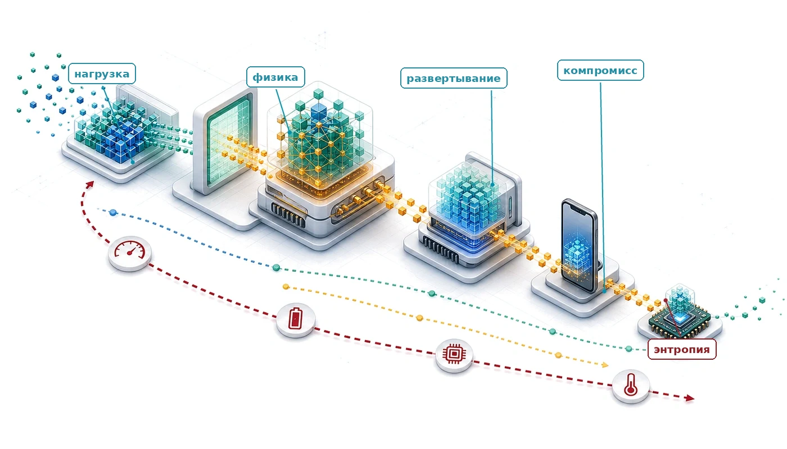

## Назначение

_Почему развертывание одной и той же модели на телефоне и в дата-центре требует принципиально разной инженерии?_

Определяющая идея инженерии систем машинного обучения состоит в том, что ограничения определяют архитектуру. Скорость света задает абсолютный нижний предел того, как быстро далекие серверы могут ответить. Термодинамика ограничивает объем вычислений в заданном объеме до того, как тепло становится неуправляемым. Физика памяти делает перемещение данных часто более дорогим, чем их обработка. Это не ограничения инженерии, которые ждут лучших технологий; это постоянные физические границы, которые делят мир на принципиально различные режимы эксплуатации. Дата-центр может обучать модели с миллиардами параметров, но не может гарантировать низкую задержку ответов пользователям, находящимся в тысячах километров. Смартфон может отвечать мгновенно, но его бюджет памяти составляет лишь долю от дата-центра. Микроконтроллер может работать от батарейки-таблетки годами, но вычислительных ресурсов у него хватает лишь на простой детектор ключевых слов. Одна и та же модель, один и тот же алгоритм, примененный к тем же данным, требует принципиально разной инженерии в каждом режиме не потому, что меняется физика, а потому что доминируют разные ограничения. Команды, которые относятся к развертыванию как к второстепенной детали — обучают в одной среде и откладывают целевые ограничения до запуска, — слишком поздно выясняют, что целевая среда аннулирует месяцы архитектурных решений. Поэтому инженерная задача состоит не в том, чтобы найти универсально лучшее развертывание, а в том, чтобы определить ограничение, которое связывает в предполагаемом режиме эксплуатации. В терминах D·A·M понимание этих режимов превращает развертывание из эксплуатационной детали в задачу совместного проектирования первого порядка, в которой локальность данных, структура алгоритма и ограничения машины совместно определяют, что возможно.

> **Цели обучения**
>
> - Объяснить, как физические ограничения создают парадигмы развертывания от облака до TinyML
> - Применить железный закон и принцип узкого места для классификации нагрузок, ограниченных вычислениями, памятью и вводом-выводом
> - Сопоставить архетипы нагрузок с парадигмами развертывания на примерах маячных моделей
> - Сравнить облако, периферию, мобильные устройства и TinyML по эксплуатационным ограничениям и количественным компромиссам
> - Применить рамку решения для выбора парадигмы с учетом ограничений по приватности, задержке, вычислениям и стоимости
> - Проанализировать гибридные схемы, сочетающие парадигмы для выполнения системных ограничений
> - Оценить решения о развертывании, распространенные заблуждения и универсальные принципы, переносимые между масштабами

## Рамка парадигм развертывания

Рассмотрим два крайних случая: детектор слова пробуждения на смарт-часах и рекомендательный движок в дата-центре. Детектор слова пробуждения представляет нагрузку TinyML, работающую при бюджетах мощности в милливаттах и лимитах памяти в килобайтах; рекомендательный движок — нагрузку облачного ML, которой нужны терабайты таблиц эмбеддингов и инфраструктура мегаваттного масштаба. Эти системы решают разные задачи при противоположных физических ограничениях, а их поддерживающая инфраструктура резко различается по масштабу и устройству. Поэтому развертывание перестает быть второстепенной эксплуатационной деталью и становится решением первого порядка: оно дополняет таксономию D·A·M, показанную на [«Ландшафте пересечений D·A·M»](01_introduction.md#fig-ai-triad), и выводит инфраструктуру на первый план наряду с данными и алгоритмами.

Физические ограничения определяют, где может работать модель ML, и формируют возможное так, как не способен переопределить ни один алгоритмический выбор. Важно, что инженерная задача выходит далеко за пределы весов параметров: в производственных системах обученная модель составляет лишь малую часть всей эксплуатационной кодовой базы (Sculley et al., 2015). Окружающая инфраструктура — конвейеры приема данных, извлечение признаков, среды выполнения обслуживания, телеметрия и менеджеры аппаратных ресурсов — должна напрямую соответствовать физической оболочке платформы-хоста.

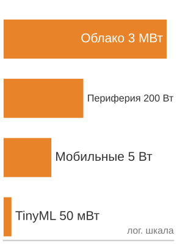

*Мощность у парадигм простирается от мегаватт (облако) до милливатт (TinyML).*

Три физических вектора — задержка, рассеяние мощности и пропускная способность памяти — делят развертывание ML на четыре различные парадигмы, каждая из которых сформирована аппаратными компромиссами, а не произвольными категориями продуктов. Централизация вычислений в облачном ML дает эластичные вычисления и большую емкость памяти, но каждый вывод несет сетевую задержку по глобальным каналам. Перенос нагрузок в периферийное ML устраняет этот сетевой цикл и сохраняет чувствительные данные на месте (Shi et al., 2016), однако ограничивает доступные вычисления энергетикой и бюджетами охлаждения локальной стойки. На устройствах с батарейным питанием мобильное ML обеспечивает отзывчивое взаимодействие прямо в смартфонах и планшетах, но должен работать в пассивной тепловой оболочке, где устойчивые вычисления запускают троттлинг. На крайнем маломощном полюсе TinyML работает на микроконтроллерах (Janapa Reddi et al., 2022), где бюджеты мощности в милливаттах и память килобайтного масштаба требуют компактных моделей и целочисленной арифметики. Охватывая девять порядков величины по мощности — от мегаватт в дата-центрах до милливатт во встроенных датчиках ([«Спектр распределенного интеллекта»](02_ml_systems.md#fig-cloud-edge-tinyml-comparison)), — эти парадигмы отражают инженерные компромиссы между централизованной емкостью и локальным выполнением.

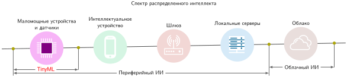

***Спектр распределенного интеллекта**: уровни развертывания образуют непрерывный ряд, определяемый физическими ограничениями и охватывающий девять порядков величины по мощности. Переход от централизованной облачной инфраструктуры к TinyML на устройстве обменивает сырую вычислительную емкость и эластичное масштабирование на детерминированную задержку, локальность данных и независимость от сети.*

Если [«Спектр распределенного интеллекта»](02_ml_systems.md#fig-cloud-edge-tinyml-comparison) иллюстрирует качественную топологию распределенного интеллекта, то [«Спектр развертывания (концептуальный)»](02_ml_systems.md#tbl-deployment-paradigms-overview) количественно описывает эксплуатационные оболочки по месту обработки, задержке «туда и обратно», потреблению мощности и объему памяти. Этот разброс мощности в девять порядков величины отражает три неизбежные физические границы: скорость света (задающую нижние пределы задержки), пределы термодиссипации (ограничивающие вычисления на ватт) и энергию передачи сигналов в памяти (стену памяти).

| **Парадигма**  | **Где**          |                       **Задержка (мс)**                     |                        **Мощность**                        | **Память** | **Лучше всего для**          |
|:--------------|:-----------------|:-----------------------------------------------------------:|:-------------------------------------------------------:|:----------:|:-----------------------------|
| **Облачное ML**  | Дата-центры     |  100–500 |                            МВт                           |     ТБ     | Обучение, сложный вывод      |
| **Периферийное ML** | Локальные серверы |  10–100  |                          100 Вт                          |     ГБ     | Вывод в реальном времени, приватность |
| **Мобильное ML** | Смартфоны      | 5–50 | 3–5 Вт |     ГБ     | Персональный ИИ, офлайн      |
| **TinyML**    | Микроконтроллеры |  1–10  |                            мВт                           |     КБ     | Постоянное восприятие        |

***Спектр развертывания (концептуальный)**: четыре парадигмы охватывают девять порядков величины по мощности (от МВт до мВт) и по памяти (от ТБ до КБ). Этот концептуальный обзор задает каждую парадигму через ее режим эксплуатации; конкретный аппаратный спектр позже привязывает эти категории к конкретным платформам и количественным порогам решения. Аппаратные характеристики и физические константы, лежащие в основе этих величин, перечислены в приложении о системных допущениях.*

### Архитектурная опора: стек одного узла

Чтобы ориентироваться в этих режимах эксплуатации, инженерные решения опираются на четырехуровневую модель **стека одного узла**, которая уточняет машинную сторону таксономии D·A·M для одного хоста, тогда как данные и алгоритм входят через требования нагрузки. На верхнем уровне стека приложение задает миссию через целевую пропускную способность обучения или задержку вывода. Главы [«Обучение моделей»](08_training.md#sec-model-training) и [«Обслуживание моделей»](13_model_serving.md#sec-model-serving) развивают механизмы, которые определяют, сможет ли система ее выполнить. ML-фреймворк переводит код модели в исполнимые операции (глава [«Фреймворки машинного обучения»](07_frameworks.md#sec-ml-frameworks)). Операционная система оркестрирует ресурсы и перемещает данные между памятью хоста и памятью ускорителя. Само железо, определяемое емкостью памяти с высокой пропускной способностью (HBM), пропускной способностью памяти, межсоединениями внутри узла, такими как NVLink, и пропускной способностью вычислений, задает физические пределы, а стена памяти остается повторяющимся ограничением (глава [«Аппаратное ускорение»](11_hw_acceleration.md)).

Этот стек задает **кремниевый контракт** главы: фиксированную сделку по производительности, которую конкретный кусок кремния предлагает модели и которая определяется пропускной способностью памяти, пиковой скоростью вычислений и постоянными накладными расходами. Каждая глава первой половины книги анализирует один или несколько из этих уровней, поскольку понимание того, как они взаимодействуют внутри одной машины, — технологическая предпосылка для освоения больших распределенных масштабов.

Эти физические ограничения взаимодействуют с железным законом систем машинного обучения ([«Железный закон систем машинного обучения»](01_introduction.md#sec-introduction-iron-law-ml-systems-c32a)), который раскладывает сквозную задержку на перемещение данных, вычисления и накладные расходы. Разные среды развертывания подчеркивают разные ограничения: обучение в облаке может быть ограничено вычислениями, мобильные системы сталкиваются со стенами мощности, а устройства TinyML часто упираются в предел емкости памяти. Сочетая физические ограничения с железным законом, мы получаем количественный словарь для рассуждений о том, какая парадигма подходит данной нагрузке и *почему*. Чтобы конкретно опереться на этот анализ, пять маячных моделей (ResNet-50, GPT-2, DLRM для рекомендаций с большими эмбеддингами, MobileNetV2 и детектор ключевых слов для обнаружения слова пробуждения) охватывают спектр развертывания и выделяют разные системные узкие места. Эти эталонные нагрузки повторяются на протяжении всей книги, обеспечивая единую основу для сравнения методов оптимизации между главами, нагрузками и уровнями развертывания.

## Физические ограничения: почему существуют парадигмы

Система безопасности с бюджетом реакции 10 мс не может ждать межконтинентального цикла «туда и обратно», а модель с миллиардом параметров не втиснуть в микроконтроллер одним лишь лучшим кодом. Это не ошибки реализации; это следствия физических законов скорости света, термодинамики мощности и передачи сигналов в памяти. То, где работает система, перестраивает кремниевый контракт между моделью и аппаратурой. Три ограничения задают инженерные компромиссы впереди: световой барьер, стену мощности и стену памяти.[^fn-paradigm-deployment-tradeoff]

### Световой барьер

**Световой барьер** задает абсолютный нижний предел задержки[^fn-latency-system-tradeoff]. Пусть $\text{Расстояние}$ обозначает длину пути в одну сторону, а $c_{\text{fiber}}$ — скорость распространения в оптическом волокне. [«Физика задержки»](02_ml_systems.md#eq-latency-physics) задает минимальное время «туда и обратно»:

$$L_{\text{lat,min}} = \frac{2 \times \text{Расстояние}}{c_{\text{fiber}}} \approx \frac{2 \times \text{Расстояние}}{200\,000 \text{ км/с}}$$

Для оптического волокна $c_{\text{fiber}} \approx 200\,000$ км/с — примерно две трети от значения в вакууме, поскольку свет распространяется в стекле медленнее, чем в вакууме.

От Калифорнии до Вирджинии (примерно 3 600 км по прямой) требуется ~36 мс «туда и обратно» до начала любых вычислений. Реальные сервисы добавляют маршрутизацию, протокольные накладные расходы, очереди и задержку обработки. Приложения, которым нужен отклик менее 10 мс, *не могут* использовать удаленную облачную инфраструктуру — этого не позволяет физика. Это ограничение порождает потребность в периферийном ML и TinyML: когда бюджеты задержки жесткие, вычисления должны переместиться ближе к источнику данных.

### Стена мощности

**Стена мощности** возникла потому, что термодинамика ограничивает объем вычислений в заданном объеме. Динамическая мощность КМОП-схем подчиняется [«масштабированию мощности»](02_ml_systems.md#eq-power-scaling), где $C$ — эффективная емкость, $V$ — напряжение, а $f$ — тактовая частота. При сохранении эффективной емкости $C$ постоянной на локальном рабочем диапазоне, где напряжение растет пропорционально частоте $(V \propto f)$, динамическая мощность растет как $f^3$. Эта кубическая зависимость возникает, когда тактовые частоты поднимают за номинальные пределы, что требует более высоких напряжений питания для поддержания скорости переключения транзисторов. Когда масштабирование напряжения полностью останавливается на номинальных пределах, динамическая мощность масштабируется линейно с частотой, но ограничения теплоотвода все равно не дают непрерывно наращивать тактовую частоту.

$$\text{Мощность} \propto C \times V^2 \times f \quad \text{где } V \propto f \implies \text{Мощность} \propto f^3$$

При этом иллюстративном допущении удвоение тактовой частоты требует примерно в 8 раз больше динамической мощности. Прекращение масштабирования Деннарда[^fn-dennard-scaling-origin] положило конец «бесплатному» ускорению за счет частоты и вынудил индустрию к параллелизму (многоядерность) и специализации (GPU, Tensor Processing Unit (TPU)). Мобильные устройства упираются в жесткие тепловые пределы при 3–5 Вт; их превышение вызывает «троттлинг» — устройство снижает производительность, чтобы не перегреться. На практике это означает, что мобильная модель, работающая на 60 FPS в течение одной минуты, может снизиться до 15 FPS, когда устройство нагреется. Этот физический предел порождает мобильное ML: устройства с батарейным питанием не могут просто запускать модели облачного масштаба локально.

[^fn-dennard-scaling-origin]: **Масштабирование Деннарда**: названо по работе Dennard et al. (1974) из IBM, где описаны соотношения масштабирования MOSFET, при которых уменьшение приборов позволяло снижать напряжение и ток при сохранении примерно постоянной плотности мощности. По мере того как масштабирование напряжения замедлялось и энергия становилась архитектурным ограничением первого порядка, рост производительности сместился к параллелизму и специализации: многоядерным процессорам, GPU и TPU (Hennessy and Patterson, 2019; Esmaeilzadeh et al., 2011).

### Стена памяти

**Стена памяти** (Wulf and McKee, 1995) отражает расширяющийся разрыв пропускной способности[^fn-bandwidth-memory-wall]. Простой набросок на уровне книги, использующий характерные годовые коэффициенты роста, показывает, почему разрыв нарастает:

$$\frac{\text{Темп роста вычислений}}{\text{Темп роста пропускной способности памяти}} \approx \frac{1{,}6}{1{,}2} \approx 1{,}33$$

В [«стене памяти»](02_ml_systems.md#eq-memory-wall) числитель и знаменатель — безразмерные годовые коэффициенты роста. Отношение выше 1 означает, что возможности вычислений уходят от пропускной способности памяти, поэтому каждое поколение аппаратуры делает перемещение данных все большей долей проблемы производительности, если только нагрузка не увеличивает локальность или арифметическую интенсивность.

Характерные тенденции, стоящие за этим отношением: процессоры удваивали вычислительную мощность примерно каждые 18 месяцев, тогда как пропускная способность памяти улучшалась лишь примерно на 20 процентов в год. Этот расширяющийся разрыв делает перемещение данных частым узким местом и источником энергетических затрат в нагрузках ML. Физически, хотя арифметическая операция в арифметико-логическом устройстве (ALU) на кристалле перемещает заряды на считанные микрометры локального провода (расходуя десятки-сотни фемтоджоулей), выборка операнда из внешней DRAM требует заряжать емкостные дорожки печатных плат (PCB) и контактные площадки ввода-вывода длиной в сантиметры, расходуя сотни пикоджоулей, — на два-три порядка больше энергии на одно обращение. Это ограничение касается всех парадигм, но особенно остро для TinyML, где устройствам доступны лишь килобайты памяти. [«Понимание стены памяти в ИИ»](11_hw_acceleration.md#sec-hardware-acceleration-understanding-ai-memory-wall-3ea9) (глава [«Аппаратное ускорение»](11_hw_acceleration.md)) развивает архитектурные ответы на стену памяти, включая HBM и иерархии SRAM на кристалле.

> **Физические ограничения и развертывание**
>
> Решения о развертывании определяются физикой, а не предпочтениями. Проверьте себя:
>
> - **Световой барьер**: можете ли вы объяснить, почему скорость света делает облачное ML непригодным для задач безопасности с порогом $<10\text{ мс}$?
> - **Стена мощности**: можете ли вы объяснить, почему термодинамика (отвод тепла) не позволяет запускать модели дата-центра на мобильных устройствах?
> - **Стена памяти**: можете ли вы объяснить, почему перемещение данных часто дороже вычислений (по времени и энергии)?

Эти физические законы объясняют, *почему* существуют четыре парадигмы. Физика создает границы; требования регулирования приватности, экономические стимулы и суверенитет данных усиливают и заостряют их, но не создают их. Никакое регулирование не может ускорить свет, и никакая экономическая модель не отменит термодинамику.

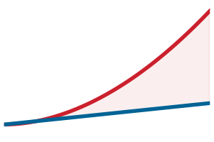

*Возможности вычислений опережают пропускную способность памяти; расширяющийся разрыв и есть стена памяти.*

Эти физические ограничения не действуют изолированно. На практике ML-система ограничена тем физическим пределом, который первым связывает ее основной ресурс. Количественная оценка этих пределов требует аналитических инструментов: железного закона для раскладки времени выполнения на составляющие, принципа узкого места для выявления лимитирующей стадии и архетипов нагрузок для классификации потребностей модели в ресурсах.

## Анализ нагрузок

Для рекомендательного движка или детектора слова пробуждения вопрос нагрузки состоит в том, какой член свяжет первым на целевом железе. Центральный аналитический инструмент для ответа на этот вопрос о кремниевом контракте — железный закон систем машинного обучения, введенный в [«Железном законе систем машинного обучения»](01_introduction.md#sec-introduction-iron-law-ml-systems-c32a). Здесь $T$ — полное время, $D_{\text{vol}}$ — перемещенные байты, $\text{BW}$ — пропускная способность, $O$ — полное число операций, $R_{\text{peak}}$ — пиковая скорость вычислений, $\eta_{\text{hw}}$ — эффективность аппаратуры, а $L_{\text{lat}}$ — постоянные накладные расходы; [«железный закон»](02_ml_systems.md#eq-iron-law) суммирует эти издержки для последовательного пути выполнения:

$$T = \frac{D_{\text{vol}}}{\text{BW}} + \frac{O}{R_{\text{peak}} \cdot \eta_{\text{hw}}} + L_{\text{lat}}$$

[«Железный закон»](02_ml_systems.md#eq-iron-law) раскладывает полную задержку на три члена: перемещение данных $(D_{\text{vol}}/\text{BW})$, вычисления $(O/(R_{\text{peak}} \cdot \eta_{\text{hw}}))$ и постоянные накладные расходы $(L_{\text{lat}})$. Для одного вывода эти издержки просто складываются — каждая платится последовательно. Однако в производственных системах задачи обрабатываются непрерывным потоком, и анализ смещается от задержки одной задачи к выявлению того, какой член ограничивает систему. Ответ полностью зависит от среды развертывания: модель, которая при обучении **ограничена вычислениями**, при выводе может стать ограниченной памятью; система, эффективно работающая в облаке, может упереться в пределы мощности на мобильных устройствах. В конвейерном производственном обслуживании аппаратная конкурентность меняет эту линейную сумму: более быстрые стадии скрываются за той подсистемой, которая насытится первой.

### Принцип узкого места

Железный закон описывает стоимость каждого члена. **Принцип узкого места** определяет, какой член важен. В конвейерной ML-нагрузке выявление узкого места имеет значение, потому что оптимизация быстрых операций не дает никакой выгоды, пока самая медленная стадия остается прежней. Современные ускорители используют **конвейерное выполнение**, чтобы совмещать перемещение данных с вычислениями: пока ускоритель вычисляет батч $n$, система памяти предварительно загружает батч $n+1$. Когда перемещение данных, вычисления и ввод-вывод полностью перекрываются в установившемся режиме, пусть $T_{\text{network}}$ обозначает время удаленной передачи, а $T_{\text{bottleneck}}$ — получающееся время на задачу, включая постоянные накладные расходы. Более быстрые стадии скрываются за самой медленной перекрывающейся стадией, поэтому сумма железного закона становится максимумом, как формализует [«уравнение узкого места»](02_ml_systems.md#eq-bottleneck):

$$ T_{\text{bottleneck}} = \max\left(\frac{D_{\text{vol}}}{\text{BW}}, \frac{O}{R_{\text{peak}} \cdot \eta_{\text{hw}}}, T_{\text{network}}\right) + L_{\text{lat}} $$

*   **$\frac{D_{\text{vol}}}{\text{BW}}$ (память)**: время перемещения данных между памятью и процессором.
*   **$\frac{O}{R_{\text{peak}} \cdot \eta_{\text{hw}}}$ (вычисления)**: время выполнения вычислений.
*   **$T_{\text{network}}$**: время сетевого обмена (при переносе вычислений).
*   **$L_{\text{lat}}$ (накладные расходы)**: постоянная задержка (запуск ядра, накладные расходы среды выполнения).

Когда система ограничена памятью $(D_{\text{vol}}/\text{BW} > O/(R_{\text{peak}} \cdot \eta_{\text{hw}}))$, более быстрые процессоры $(R_{\text{peak}})$ не дают ускорения, так же как расширение шоссе не помогает движению, ограниченному узким мостом. Инженеры должны определить доминирующий член до оптимизации. Когда кандидатом является сетевая передача, перенос вычислений добавляет энергию к анализу, основанному на времени. Поэтому решение «локально или перенести» должно взвешивать джоули так же, как миллисекунды.

> **Энергия передачи данных**
>
> **Задача**: должен ли датчик с батарейным питанием обрабатывать данные локально (вывод на NPU устройства) или отправлять их в облако, когда энергия передачи сталкивается с энергетической стеной батареи?
>
> **Дано**:
>
> *   **Данные $(D_{\text{vol}})$**: 1 МБ (иллюстративный объем полезной нагрузки).
> *   **Энергия передачи $(E_{\text{tx}})$**: 100 мДж/МБ (Wi-Fi/LTE).
> *   **Энергия вычислений $(E_{\text{op}})$**: 0,1 мДж/вывод (иллюстративная опорная точка MobileNetV2 на нейропроцессоре).
>
> **Расчет**:
>
> 1.  **Облачный подход**: $E_{\text{cloud}} \approx D_{\text{vol}} \times E_{\text{tx}}$ = 1 МБ $\times$ 100 мДж/МБ = 100 мДж.
> 2.  **Локальный подход**: $E_{\text{local}} \approx$ вывод = 0,1 мДж.
>
> **Системный вывод**: передача сырых данных обходится в 1 000 раз дороже, чем их локальная обработка. Даже если бы облако работало с бесконечной скоростью $(T \approx 0)$, заданный бюджет батареи все равно предпочитает локальный вывод передаче сырых данных. Ограничение машины (батарея) определяет выбор развертывания.

Переменные железного закона не масштабируются симметрично по границам развертывания: переход от батчинга с высокой пропускной способностью к обслуживанию отдельных примеров на периферии радикально меняет, какой член определяет производительность.

> **Железный закон как диагностика развертывания**
>
> Железный закон, введенный в [«Железном законе систем машинного обучения»](01_introduction.md#sec-introduction-iron-law-ml-systems-c32a), служит диагностикой развертывания на протяжении всей главы: он выражает полное время $T$, необходимое для нагрузки, как сумму перемещения данных, арифметики и задержки:
> $$T = \frac{D_{\text{vol}}}{\text{BW}} + \frac{O}{R_{\text{peak}} \cdot \eta_{\text{hw}}} + L_{\text{lat}}$$
> Эта декомпозиция диагностическая: она количественно показывает, как объем данных $(D_{\text{vol}})$, вычислительная мощность $(R_{\text{peak}})$ и постоянная задержка $(L_{\text{lat}})$ совместно задают бюджет времени нагрузки. В отличие от закона Амдала, который фокусируется на параллельном ускорении, железный закон связывает работу модели с перемещением данных и постоянной задержкой на границе развертывания. Частое заблуждение состоит в том, что эти члены независимы; на деле это оси компромиссов. Увеличение размера батча может улучшить коэффициент загрузки и повторное использование данных, смещая ядро, ограниченное памятью, к поведению, ограниченному вычислениями, но одновременно увеличивая рабочий набор и время обслуживания батча.

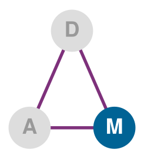

*Ось машины задает оболочку развертывания.*

Железный закон количественно описывает *стоимость каждого ингредиента*; принцип узкого места определяет *скорость конвейера*. Как эмпирическое правило, аддитивную форму из [«железного закона»](02_ml_systems.md#eq-iron-law) используют при анализе задержки одной задачи, а форму через максимум из [«уравнения узкого места»](02_ml_systems.md#eq-bottleneck) — при анализе пропускной способности непрерывного потока задач.

### Архетипы нагрузок

Принцип узкого места сводит оптимизацию к выявлению доминирующего ограничения для данной нагрузки. Ответ зависит от таксономии D·A·M на [«Ландшафте пересечений D·A·M»](01_introduction.md#fig-ai-triad), которая раскладывает любую систему ML на Data, Algorithm и Machine. Разные среды развертывания создают разные узкие места вдоль этих осей, поэтому одно и то же семейство моделей может требовать разной инженерии при переходе от облачного сервера с терабайтами памяти к микроконтроллеру с килобайтами. Железный закон превращает эту диагностику в четыре **архетипа нагрузок**.[^fn-archetype-system-bottleneck] Это не категории моделей; это повторяющиеся физические узкие места, которые определяют, какие инженерные шаги могут помочь.

Первое разделение отделяет системы, ограниченные арифметикой, от систем, ограниченных перемещением данных. **«Вычислительный зверь»** выполняет много расчетов на каждый загруженный байт, поэтому прогресс достигается за счет более высокой арифметической пропускной способности, лучшей загрузки и большего параллелизма; эталонный случай — обучение больших нейронных сетей. **«Пожиратель полосы пропускания»** (bandwidth hog), напротив, ждет перемещения плотных весов или активаций, поэтому более широкие шины памяти и лучшее повторное использование данных важнее дополнительных пиковых FLOP/s; авторегрессивная генерация текста иллюстрирует этот режим.

Второе разделение охватывает нагрузки, где связывающее ограничение вообще не плотная арифметика. Нагрузки **«разреженного разброса»** (sparse scatter) определяются нерегулярными поисками в таблицах и плохой локальностью кеша, поэтому емкость памяти, задержка доступа и коммуникация определяют производительность рекомендательных систем с огромными таблицами эмбеддингов. Нагрузки **«жесткого ограничения»** (tiny constraint) работают в противоположной оболочке: энергия на вывод и объем памяти, а не сырая скорость, определяют, вообще ли может работать постоянное восприятие.

[^fn-archetype-system-bottleneck]: **Архетип нагрузки**: классификация нагрузок ML по их доминирующему узкому месту железного закона, а не по семейству модели. Различие важно, потому что стратегия оптимизации принципиально иная: нагрузка, ограниченная вычислениями, выигрывает от более быстрой арифметики $(R_{\text{peak}})$, а нагрузка, ограниченная пропускной способностью, — от более широких шин памяти или меньшего числа перемещаемых байтов за счет повторного использования, слияния, сжатия или более низкой точности. Неверное определение архетипа тратит усилия оптимизации на не тот член железного закона, например когда команды добавляют FLOP/s ускорителя в конвейер вывода, ограниченный памятью, и не получают никакого ускорения.

[^fn-paradigm-deployment-tradeoff]: **Парадигма развертывания**: отдельный режим эксплуатации, границы которого задает физика, а не соглашение. Спектр от облака до TinyML охватывает девять порядков величины по мощности, потому что термодинамические и электромагнитные ограничения создают жесткие стены, которые никакая программная оптимизация не может преодолеть, и это вынуждает к качественно разным системным архитектурам на каждом уровне. Неверное определение границы парадигмы тратит инженерные усилия: оптимизировать облачную модель ради прироста пропускной способности на 5 процентов бессмысленно, если бюджет задержки приложения в 10 мс требует развертывания на периферии.

[^fn-latency-system-tradeoff]: **Задержка**: время между отправкой запроса и получением результата, соответствующее $T$ в железном законе. Световой барьер делает этот пол неустранимым: скорость света в волокне задает минимум ~36 мс «туда и обратно» по континентальной части США, поглощая весь бюджет задержки системы безопасности на 10 мс до начала любых вычислений. Каждая миллисекунда, потраченная на расстояние, — это миллисекунда, недоступная для вывода модели, поэтому световой барьер вынуждает выбирать парадигму, а не просто оптимизировать.

[^fn-bandwidth-memory-wall]: **Пропускная способность памяти (стена памяти)**: термин «стена памяти» ввели Wulf и McKee в 1995 году; они предсказали, что разрыв производительности процессора и памяти в конце концов станет доминировать в производительности системы, и это предсказание оказалось точным для нагрузок ML, в которых перемещение весов или активаций может ограничивать производительность. В железном законе пропускная способность $(\text{BW})$ стоит в знаменателе члена данных $D_{\text{vol}}/\text{BW}$, поэтому удвоение перемещаемых байтов без соответствующего роста пропускной способности увеличивает время перемещения данных. Итоговое узкое место зависит от арифметической интенсивности, размера батча, повторного использования данных, шаблона доступа и баланса аппаратуры, а не только от размера модели.

> **Пять эталонных нагрузок**
>
> Пять маячных моделей, сведенных в [«Пять маячных моделей»](02_ml_systems.md#tbl-ml-systems-lighthouse-archetypes), повторяются в этой книге как конкретные нагрузки, которые охватывают спектр развертывания и выделяют разные системные узкие места. Полное описание архитектур и биографии моделей приведены в главе [«Архитектуры нейронных сетей»](06_nn_architectures.md#sec-network-architectures).
>
> | **Маячная модель**         | **Архетип**                   | **Парадигма развертывания**    |
> |:---------------------------|:------------------------------|:-------------------------------|
> | **ResNet-50**              | Вычислительный зверь          | Обучение в облаке, вывод на периферии |
> | **GPT-2/Llama**            | Пожиратель полосы пропускания | Вывод в облаке                 |
> | **DLRM**                   | Разреженный разброс           | Только облако (распределенно)  |
> | **MobileNetV2**            | Вычислительный зверь (эффективный) | Мобильные, периферийные   |
> | **Распознавание ключевых слов (KWS)** | Жесткое ограничение | TinyML, постоянная работа      |
>
> 
>
> ***Пять маячных моделей**: повторяющиеся нагрузки, которые используются на протяжении книги, чтобы опереть железный закон на конкретную практику. Каждая маячная модель сочетает архетип (вычислительный зверь, пожиратель полосы пропускания, разреженный разброс, жесткое ограничение) с парадигмой развертывания, в которой она преимущественно работает, и выделяет отдельное системное узкое место.*

Эти архетипы напрямую соотносятся с парадигмами развертывания. Вычислительные звери и нагрузки разреженного разброса требуют совокупной емкости памяти и вычислительной пропускной способности дата-центров, пожиратели полосы пропускания занимают облако и периферию в зависимости от бюджетов задержки, а нагрузки жесткого ограничения относятся к микроконтроллерам. Чтобы количественно оценивать эти компромиссы, пять маячных моделей служат конкретными эталонными нагрузками на протяжении всей книги, и каждая выделяет отдельный член железного закона.

Первая маячная модель, **ResNet-50**, классифицирует изображения по 1000 категориям; обработка каждого изображения требует примерно 8,2 GFLOP и использует 25,6 млн параметров (102,4 МБ при FP32) (He et al., 2016). Ее применяют в медицинской диагностике по изображениям, конвейерах восприятия автономных автомобилей и как основу систем модерации контента; ее регулярная, плотная по вычислениям структура делает ее каноническим эталоном производительности аппаратных ускорителей.

Языковые модели **GPT-2/Llama** иллюстрируют авторегрессивную генерацию текста (Radford et al., 2019; Touvron et al., 2023). Эти модели порождают текст по одному токену за раз. При декодировании с малым батчем на каждый токен может потребоваться перемещать через память почти все параметры модели (для GPT-2 — 1,5 млрд параметров, для Llama — от 7 до 70 млрд параметров). Такой последовательный шаблон доступа создает авторегрессивное узкое место, которое определяет стоимость обслуживания (Pope et al., 2023).

Рекомендательная маячная модель **DLRM** представляет нагрузку рекомендаций с тяжелыми эмбеддингами, лежащую в основе крупномасштабных систем вида «вам также может понравиться» (Naumov et al., 2019). Она сопоставляет пользователей и товары векторам эмбеддингов, которые хранятся в таблицах, способных превышать 100 ГБ эмбеддингов; поэтому связывающим ограничением становится емкость памяти, а не вычисления.

Мобильная маячная модель **MobileNetV2** создана для эффективных мобильных задач компьютерного зрения, таких как классификация, детекция и сегментация (Sandler et al., 2018). Она решает ту же задачу классификации изображений, что и ResNet, но использует раздельные по глубине свертки (depthwise separable convolutions), которые разделяют пространственную фильтрацию и смешивание каналов, сокращая вычисления в 13,7 раза и позволяя выполнять вывод в реальном времени на смартфонах при 3–5 Вт.

TinyML-маячная модель **распознавание ключевых слов (KWS)** представляет архетип постоянного восприятия. Системы KWS обнаруживают короткие триггерные фразы компактными моделями, созданными для микроконтроллеров с ограниченными ресурсами (Zhang et al., 2017); в сценарии умного дверного звонка тот же шаблон становится локальным триггером «Динь-дон» или «Привет». Эта нагрузка имеет примерно 200 тыс. параметров и умещается примерно в 800 КБ, что относит ее к режиму TinyML с килобайтной памятью и бюджетом в милливаттах.

Осуществимость развертывания оценивается иерархически: сначала проверяется физическое соответствие памяти, и только потом — задержка выполнения. На [«карте ограничений умного дверного звонка»](02_ml_systems.md#fig-doorbell-scorecard) горизонтальные полосы показывают спрос на ресурс в процентах от предложения относительно вертикального порога насыщения 100 процентов для микроконтроллера ESP32-S3; сравниваются емкость памяти на уровне 1 и задержка на уровне 2 в соответствии с соглашением об уровне обслуживания (SLA).

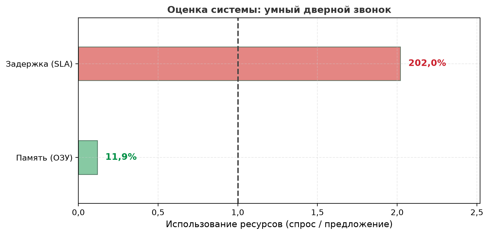

***Карта ограничений умного дверного звонка**: каждая полоса — это спрос, деленный на предложение, поэтому пунктирная линия отмечает точку, где уровень ровно насыщен. Модель занимает небольшую часть бюджета памяти ESP32-S3 в 4 МБ (уровень 1: ПРОЙДЕНО), но ее базовая задержка 101 мс вдвое превышает намеренно ужесточенную цель взаимодействия 50 мс (уровень 2: НЕ ПРОЙДЕНО), хотя она укладывается в канонический бюджет сценария 200 мс.*

Разброс требований к вычислениям и объему памяти объясняет, почему ни одна парадигма развертывания не подходит всем нагрузкам. Распознаватель ключевых слов может работать примерно при 20 MFLOP и 800 КБ, тогда как ResNet-50 требует около 8,2 GFLOP и примерно 102,4 МБ на изображение. Эталонный пример DLRM уже достигает 100 ГБ, а производственные рекомендательные системы в духе DLRM могут превышать 100 ТБ. Языковые модели добавляют режим, в котором доминирует пропускная способность: миллиарды параметров многократно потоково передаются из памяти при авторегрессивном выводе. Эти пять маячных моделей служат конкретными опорами на протяжении всей книги, и каждая выделяет отдельное системное узкое место, к которому возвращаются в каждой главе.

Железный закон и архетипы нагрузок приобретают практический смысл, когда их сопоставляют с реальным кремнием. Достигает ли ускоритель высокой загрузки или простаивает в ожидании памяти, зависит от баланса системы: отношения пиковой вычислительной пропускной способности к пропускной способности памяти и емкости ввода-вывода на разных аппаратных платформах.

## Баланс системы и аппаратура

Физические ограничения переводят компромиссы «задержка против пропускной способности» в инженерные решения через конкретные числа. В [«Числах задержек для проектирования систем ML»](02_ml_systems.md#tbl-latency-numbers) приведены задержки по порядку величины, которые должны учитываться при каждом решении о развертывании: они охватывают восемь порядков величины — от наносекундных вычислительных операций до сотен миллисекунд на межрегиональные сетевые вызовы. Подробные аппаратные задержки и ограничения пропускной способности рассмотрены в главе [«Аппаратное ускорение»](11_hw_acceleration.md). Операция с задержкой $> X$ *не может* попасть на критический путь системы, бюджет задержки которой составляет $X$ мс.[^fn-critical-path-ml]

[^fn-critical-path-ml]: **Критический путь**: самая длинная последовательная цепочка зависимых операций в конвейере. Правило решения в предыдущем предложении строгое: если сетевой вызов между регионами на 200 мс оказывается где-либо на критическом пути, система с общим бюджетом 100 мс гарантированно не уложится, как бы быстро ни работали все остальные стадии. Вывод модели не обязан быть самой долгой стадией; предобработка и постобработка могут доминировать, делая критический путь длиннее, чем предполагает одно лишь выполнение модели.

| **Операция**                     | **Задержка** | **Следствие для развертывания**      |
|:---------------------------------|:-----------:|:-------------------------------------|
| **Вычисления**                   |             |                                      |
| **Умножение матриц на GPU (на операцию)** |    ~1 нс    | Задержка одной операции мала       |
| **Вывод на NPU (MobileNetV2)**   |   5–20 мс   | Мобильное устройство может обрабатывать зрение в реальном времени |
| **Генерация токена LLM**         |  20–100 мс  | Воспринимается как «скорость печати» |
| **Память**                       |             |                                      |
| **Попадание в кеш L1**           |    ~1 нс    | Держите горячие данные в регистрах   |
| **Чтение некешированной памяти GPU** | ~200–500 нс | Скрывайте задержку; объединяйте обращения |
| **Чтение DRAM (мобильное)**      |  50–100 нс  | Повторные чтения могут ограничивать нагрузку |
| **Сеть**                         |             |                                      |
| **Один дата-центр**              |    0,5 мс   | Микросервисы осуществимы             |
| **Один регион**                  |    1–5 мс   | Серверы периферии жизнеспособны      |
| **Между регионами**              |  50–150 мс  | Плохо подходит для жестких бюджетов задержки |
| **Операции ML**                  |             |                                      |
| **Обнаружение слова пробуждения (TinyML)** |   ~1–10 мс  | Постоянная работа осуществима при $<1\text{ мВт}$ |
| **Обнаружение лиц (мобильное)**  |   10–30 мс  | Реальное время при 30 FPS            |
| **Первый токен GPT-4**           |  200–500 мс | Пользователь замечает задержку       |
| **Шаг обучения ResNet-50**       |  200–400 мс | Оптимизировано под пропускную способность |

***Числа задержек для проектирования систем ML**: порядки величины задержек в вычислениях, памяти, сети и операциях ML, которые определяют осуществимость развертывания. Охватывая восемь порядков величины, от наносекундных вычислительных операций до сотен миллисекунд на межрегиональные сетевые вызовы, эти физические ограничения формируют архитектурные решения. Полный краткий справочник, включая энергетические отношения и правила масштабирования, см. в приложении о числах, которые стоит знать.*

Четыре парадигмы развертывания становятся точнее, когда опираются на конкретное железо. Если [«Спектр развертывания (концептуальный)»](02_ml_systems.md#tbl-deployment-paradigms-overview) определил парадигмы концептуально, то [«Аппаратный спектр (конкретные платформы)»](02_ml_systems.md#tbl-representative-systems) привязывает их к конкретным устройствам, емкостям памяти и энергетическим оболочкам.[^fn-cost-spectrum-ml] Девять порядков величины по мощности вместе с метриками эффективности использования энергии дата-центра (PUE)[^fn-pue-facility-efficiency] и разбросом стоимости от миллионов долларов до \$10 определяют, какая парадигма экономически подходит данной нагрузке.

Эти различия аппаратуры определяют, какой член железного закона связывает первым в разных режимах развертывания ([«Принцип узкого места»](02_ml_systems.md#sec-ml-systems-bottleneck-principle-3514)).

> **Баланс системы по парадигмам**
>
> Конвейерная форма железного закона систем машинного обучения из [«Железного закона систем машинного обучения»](01_introduction.md#sec-introduction-iron-law-ml-systems-c32a) добавляет к каноническим членам вычислений и памяти $\text{BW}_{\text{IO}}$, пропускную способность ввода-вывода хранилища или сети. [«Расширенный железный закон»](02_ml_systems.md#eq-iron-law-extended) формализует получающуюся нижнюю границу полного времени выполнения $T$:
> 
>
> $$T \geq \max\left( \frac{O}{R_{\text{peak}} \cdot \eta_{\text{hw}}}, \frac{D_{\text{vol}}}{\text{BW}}, \frac{D_{\text{vol}}}{\text{BW}_{\text{IO}}} \right) + L_{\text{lat}}$$
>
> Здесь $O$ — полное число операций, $R_{\text{peak}}$ — пиковая скорость вычислений, $\eta_{\text{hw}}$ — эффективность использования аппаратуры, $D_{\text{vol}}$ — объем данных, $\text{BW}$ — пропускная способность памяти, $\text{BW}_{\text{IO}}$ — пропускная способность ввода-вывода (хранилища или сети), а $L_{\text{lat}}$ — постоянные накладные расходы. Нижняя граница показывает, какой ресурс (вычисления, память или ввод-вывод) ограничивает производительность; равенство требует идеального перекрытия без дополнительных простоев. Доминирующий член зависит от нагрузки и режима развертывания. Более быстрые ускорители помогают обучению в облаке, ограниченному вычислениями; декодирование больших языковых моделей (LLM) и периферийные нагрузки, ограниченные памятью, выигрывают сильнее от сокращения перемещаемых байтов или роста пропускной способности. [«Доминирующее узкое место по парадигмам»](02_ml_systems.md#tbl-ml-systems-paradigm-bottlenecks) разбирает все четыре парадигмы, разделяя облако на обучение и вывод LLM, а приложение о диагностике узких мест по таксономии D·A·M сопоставляет каждый доминирующий член с оптимизациями, которые работают, и с теми, что тратят усилия впустую, превращая эту диагностику в план действий.
>
> | **Парадигма**           | **Доминирующее ограничение**                           | **Почему**                                                 | **Фокус оптимизации**                        |
> |:------------------------|:-------------------------------------------------------|:-----------------------------------------------------------|:---------------------------------------------|
> | **Обучение в облаке**   | $O/(R_{\text{peak}} \cdot \eta_{\text{hw}})$ (вычисления) | Память и сеть в избытке; предел пропускной способности задают FLOP/s | Максимизировать загрузку ускорителя, размер батча |
> | **Вывод LLM в облаке**  | $D_{\text{vol}}/\text{BW}$ (пропускная способность памяти) | Последовательная генерация многократно перемещает состояние модели | Увеличить повторное использование; сократить перемещаемые байты |
> | **Вывод на периферии**  | $D_{\text{vol}}/\text{BW}$ (пропускная способность памяти) | Ограниченная локальная пропускная способность; модели часто ограничены памятью | Меньшие модели; меньше переносов в памяти |
> | **Мобильные устройства** | Энергия (неявно)                                      | Батарея = $\int \text{Мощность} \cdot dt$; тепловой троттлинг | Пониженная точность; циклическое включение   |
> | **TinyML**              | Модель должна помещаться на кристалле (емкость)        | Память килобайтного масштаба; модель должна помещаться на кристалле | Крошечные модели и арифметика с фиксированной точкой |
>
> 
>
> ***Доминирующее узкое место по парадигмам**: какой член железного закона ограничивает производительность в каждой парадигме развертывания, физическая причина его доминирования и получающийся фокус оптимизации. Доминирующий член полностью меняет стратегию оптимизации: обучение в облаке максимизирует загрузку вычислений, тогда как вывод LLM должен бороться с пропускной способностью памяти.*

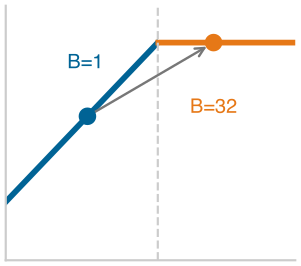

*Вывод при batch=1 находится на стороне Roofline, ограниченной памятью.*

Анализ Roofline классифицирует узкие места, сравнивая **арифметическую интенсивность** нагрузки — отношение выполненных операций с плавающей запятой к байту перемещенной памяти ($\text{FLOP/байт}$) — с точкой баланса машины ($R_{\text{peak}} / \text{BW}$) (Williams et al., 2009). Здесь изложение неформальное; формальный вывод модели, определение арифметической интенсивности и точки перегиба, которая разделяет режимы, ограниченные памятью и вычислениями, приведены в приложении о машинных основах (раздел о модели Roofline). В этой рамке одна и та же модель ResNet-50 может переходить от поведения при обучении, ограниченного вычислениями, при больших размерах батча к выводу одного изображения (batch=1), более чувствительному к памяти. Выбор парадигмы развертывания должен учитывать этот сдвиг.

Этот эксплуатационный сдвиг отражает структуру таксономии D·A·M ([«Ландшафт пересечений D·A·M»](01_introduction.md#fig-ai-triad)): каждая система ML балансирует Data, Algorithm и Machine. В [«D·A·M × фаза»](02_ml_systems.md#tbl-dam-phase) показано, как каждый компонент ведет себя по-разному в зависимости от того, обучается ли система (выучивает закономерности) или обслуживает (применяет их).

| **Компонент** | **Обучение (изменяемое)** | **Вывод (неизменяемое)** |
|:--------------|:--------------------------|:-------------------------|
| **Данные**    | Огромная пропускная способность: большие батчи, перемешивание, аугментация | Низкая задержка: отдельные примеры, актуальность, скорость |
| **Алгоритм**  | Фаза обучения: обновление параметров модели по примерам | Фаза предсказания: применение фиксированных весов к новым входам |
| **Машина**    | Оптимизация пропускной способности: кластеры с высокой пропускной способностью, большая память | Оптимизация задержки: периферийные устройства, ускорители вывода |

***D·A·M × фаза**: одна и та же модель предъявляет принципиально разные требования к Data, Algorithm и Machine в зависимости от того, обучается система или обслуживает. Когда узкие места неожиданно смещаются, проверьте, какая фаза сейчас оптимизируется.*

Количественное сравнение применяет этот анализ к выводу ResNet-50 на высокопроизводительном ускорителе дата-центра и мобильном NPU. Эти значения стоит воспринимать как привязки к конкретной аппаратуре на момент написания: арифметика касается скорости вычислений, пропускной способности памяти и размера батча, тогда как архитектуру ускорителей, стоящую за цифрами, объясняет глава [«Аппаратное ускорение»](11_hw_acceleration.md).

> **ResNet-50 в облаке и на мобильном устройстве**
>
> **Задача**: ограничен ли вывод ResNet-50 вычислениями или памятью на (а) высокопроизводительном ускорителе дата-центра и (б) флагманском мобильном NPU?
>
> **Дано** (из маячных моделей):
>
> - ResNet-50: 8,2 GFLOP на вывод, 25,6 млн параметров (102,4 МБ в FP32, 51,2 МБ в FP16)
>
> **Анализ**:
>
> **(а) Облачный ускоритель дата-центра (batch=1, FP16)**
>
> - Пиковые вычисления: 312 TFLOP/s (FP16)
> - Пропускная способность памяти: 2,04 ТБ/с
> - Время вычислений: $T_{\text{comp}} = \frac{8{,}20 \times 10^{9}}{3{,}12 \times 10^{14}} = 0{,}026\ \text{мс}$
> - Время памяти (веса плюс активации): $T_{\text{mem}} = \frac{5{,}63 \times 10^{7}}{2{,}04 \times 10^{12}} = 0{,}028\ \text{мс}$
> - **Результат**: узкое место — память (в 1,1 раза медленнее вычислений)
> - **Анализ**: вычисления на перемещенный байт $= \frac{8{,}20 \times 10^{9}}{5{,}63 \times 10^{7}} = 146\ \text{FLOP/байт}$. Это отношение показывает, сколько арифметики выполняет нагрузка на каждый загруженный байт. Если отношение превышает соотношение вычислений и пропускной способности аппаратуры $(R_{\text{peak}}/\text{BW})$, нагрузка ограничена вычислениями; если ниже — памятью. При выводе одного изображения малый размер батча дает ограниченное повторное использование, что объясняет, почему даже высокопроизводительные ускорители могут быть ограничены памятью при batch = 1.
>
> **(б) Мобильное устройство: флагманский NPU (batch=1, INT8)**
>
> - Пиковые вычисления: ~35 TOPS (INT8) — типично для современных мобильных NPU
> - Пропускная способность памяти: ~51,2 ГБ/с (LPDDR5)
> - Размер модели: 25,6 МБ (квантована до INT8)
> - Время вычислений: $T_{\text{comp}} = \frac{8{,}20 \times 10^{9}\ \text{INT8-операций}}{3{,}50 \times 10^{13}\ \text{INT8-операций/с}} = 0{,}23\ \text{мс}$
> - Время памяти (веса плюс активации): $T_{\text{mem}} = \frac{2{,}82 \times 10^{7}}{5{,}12 \times 10^{10}} = 0{,}55\ \text{мс}$
> - **Результат**: узкое место — память (в 2,3 раза медленнее вычислений)
>
> **Системный вывод**: обе платформы ограничены памятью при выводе одного изображения. Более быстрая пропускная способность памяти A100 (2,04 ТБ/с против 51,2 ГБ/с = 39,8×) переходит примерно в 19,9 раза более быстрый вывод; одни лишь пиковые вычисления не являются определяющим сравнением. Поэтому методы сокращения байтов и более низкой точности могут обойти простую покупку большего пикового FLOP/s для развертывания.
>
> ResNet-50 становится ограниченным вычислениями, когда батчинг и повторное использование данных поднимают вычисления на перемещенный байт выше точки баланса аппаратуры, $I > R_{\text{peak}}/\text{BW}$, где $I = O/D_{\text{vol}}$. Конкретно при батчевом выводе статические веса модели передаются по шине памяти только один раз и затем повторно используются для всех $B$ примеров батча. Это распределяет передачу весов на $B$ входов, повышая арифметическую интенсивность, пока время вычислений не превысит время передачи из памяти. Точка перехода зависит от архитектуры и реализации, потому что трафик активаций, перемещение входов и выходов, повторное использование кеша и детали выполнения среды меняют эффективный объем перемещаемых байтов на вывод.

Сжатие моделей становится необходимым по мере ужесточения бюджета аппаратуры. Переход от облака к периферии и затем к TinyML сжимает доступные ресурсы по всем измерениям. [«Аппаратный спектр (конкретные платформы)»](02_ml_systems.md#tbl-representative-systems) количественно описывает эту динамику конкретными примерами: память падает с 128 ТБ (облако) до 512 КБ (TinyML), то есть примерно в 250 миллионов раз, а энергия — от мегаватт до милливатт. Этот разрыв ресурсов острее всего на микроконтроллерах — основной аппаратной платформе TinyML, где емкости памяти и хранилища не вмещают обычные модели ML.

[^fn-cost-spectrum-ml]: **Спектр стоимости аппаратуры ML**: инфраструктура ИИ охватывает шесть порядков величины по стоимости — от микроконтроллеров за \$10 до кластеров ускорителей за многие миллионы долларов. Такой диапазон в миллион раз означает, что выбор парадигмы развертывания одновременно является решением физики и экономики. Даже внутри выбора отдельных устройств одна и та же целевая точность может достигаться на недорогом микроконтроллере лишь после существенного сокращения модели или на дорогом ускорителе дата-центра с гораздо большим бюджетом ресурсов, и профили задержки, мощности и эксплуатационных затрат при этом принципиально различаются.

[^fn-pue-facility-efficiency]: **Эффективность использования энергии дата-центра (PUE, Power usage effectiveness)**: эта метрика отделяет накладные расходы энергии инфраструктуры, включая охлаждение и распределение питания, от энергии, которая поставляется вычислительному оборудованию. Даже при PUE 1,06 в масштабе дата-центра остается заметная энергия, не идущая на вычисления. TinyML не требует выделенного охлаждения помещения, хотя датчики, связь, потери преобразования и энергия режима сна все еще входят в полный энергетический бюджет системы. Эти затраты уровня устройства находятся за пределами PUE.

| **Категория**  | **Пример устройства** | **Процессор** | **Память** | **Хранилище** | **Мощность** | **Диапазон цен** |
|:---------------|:---------------------:|:-------------:|:----------:|:-------------:|:------------:|:----------------:|
| **Облачное ML** | Google TPU v4 Pod    | 4 096 чипов TPU v4, 1,1 EFLOP/s BF16 | 128 ТБ HBM2 | Облачный масштаб (ПБ) | ~3 МВт | Облачная услуга (аренда) |
| **Периферийное ML** | NVIDIA DGX Spark  | GB10 Grace Blackwell, 1 PFLOP/s разреженный FP4 | 128 ГБ LPDDR5x | 4 ТБ NVMe | ~200 Вт | ~\$3 000–\$5 000 |
| **Мобильное ML** | Флагманский смартфон | Мобильный SoC (CPU + GPU + NPU) | 8–16 ГБ | 128 ГБ–1 ТБ | 3–5 Вт | \$999+ |
| **TinyML**     | ESP32-S3              | Двухъядерный, 240 МГц | 512 КБ SRAM | 4 МБ Flash | 0,05 Вт–1,2 Вт (активная мощность платы) | \$10 |

***Аппаратный спектр (конкретные платформы)**: представительные устройства, которые реализуют каждую парадигму развертывания из [«Спектра развертывания (концептуальный)»](02_ml_systems.md#tbl-deployment-paradigms-overview). Если концептуальная таблица задает режимы эксплуатации, то эта таблица дает конкретные процессоры, емкости памяти, энергетические оболочки и ценовые ориентиры, которые практики используют, чтобы сопоставить нагрузки с аппаратурой. DGX Spark находится на верхнем конце периферийного спектра; большинство периферийных развертываний используют гораздо меньшие устройства (например, Jetson Orin Nano). Мы включаем его, чтобы показать верхнюю границу необлачного развертывания. Само семейство NVIDIA Jetson охватывает широкий ряд моделей: от Jetson Orin Nano (7–15 Вт) через Jetson Orin NX (10–25 Вт) до Jetson AGX Orin (15–60 Вт); в этой книге цифры мощности Jetson следует сверять с конкретной моделью, названной в контексте.*

Аппаратный спектр превращает диагностику узкого места в тест на соответствие. Платформы из [«Аппаратного спектра (конкретные платформы)»](02_ml_systems.md#tbl-representative-systems) — результат десятилетий эволюции аппаратуры: от сопроцессоров с плавающей запятой в 1980-х через графические процессоры 2000-х к современным доменно-специфичным ускорителям ИИ. Глава [«Аппаратное ускорение»](11_hw_acceleration.md#sec-hardware-acceleration) прослеживает эту историческую траекторию и архитектурные принципы, которые ее определили. Здесь важнее всего следствие: качественно разное железо встречается на разных точках инфраструктуры, поэтому каждую нагрузку нужно сопоставлять с тем уровнем, оболочка вычислений, памяти, энергии и стоимости которого ее может удовлетворить.

Каждая парадигма занимает отдельную область спектра развертывания, управляется физическими ограничениями (световой барьер, стена мощности, стена памяти) и количественно описывается аналитическими инструментами (железный закон, принцип узкого места), введенными в [«Анализе нагрузок»](02_ml_systems.md#sec-ml-systems-analyzing-workloads-cbb8). Количественные пороги из [«Порогов решения о развертывании»](02_ml_systems.md#tbl-deployment-thresholds) помогают практикам определить, укладывается ли нагрузка в оболочку вычислений, пропускной способности, мощности и задержки целевой платформы.

| **Парадигма** | **Вычисления** | **Пропускная способность памяти** | **Мощность** | **Задержка (мс)** |
|:--------------|:--------------:|:---------------------------------:|:------------:|:-----------------:|
| **Облачное ML** | > 1000 TFLOP/s | > 1000 ГБ/с | Класс МВт (PUE 1,1–1,3) | 100–500 |
| **Периферийное ML** | ~1 PFLOP/s | > 270 ГБ/с | Класс 100 Вт | 10–100 |
| **Мобильное ML** | 15–45 TOPS | 51,2–77 ГБ/с | 3–5 Вт | 5–50 |
| **TinyML** | < 1 TOPS | — | < 1 мВт постоянная средняя целевая мощность | 1–10 |

***Пороги решения о развертывании**: практичные оболочки, которые практики используют, чтобы определить осуществимость развертывания для каждой парадигмы из [«Аппаратного спектра (конкретные платформы)»](02_ml_systems.md#tbl-representative-systems). Эти значения отвечают на вопрос «может ли моя нагрузка работать здесь?», задавая уровень вычислений, пропускную способность памяти и энергетическую оболочку, которые обеспечивает каждая парадигма. Каждая цифра мощности обозначает типичный класс парадигмы, а не жесткий потолок; в частности, периферийная оболочка простирается от маломощных встроенных модулей до устройств уровня рабочих станций.*

[«Пороги решения о развертывании»](02_ml_systems.md#tbl-deployment-thresholds) завершает тест на соответствие: каждая парадигма представляет эксплуатационную оболочку, определенную своим связывающим ресурсом. Переход от складских дата-центров к микроконтроллерам проходит физический градиент, в котором сырая пропускная способность вычислений обменивается на энергетическую эффективность и эффективность по памяти.

## Облачное ML: вычислительная мощность

Подумайте, чего стоило обучить GPT-3:[^fn-nlp-training-scale] 3 634,3 PFLOP-дней вычислений, 10 000 GPU V100, работавших примерно 15 дней и потреблявших мегаватты мощности (Patterson et al., 2021). Ни один смартфон, периферийный сервер или одна машина не смогли бы завершить такой запуск обучения по практичному графику. Требовался кластер масштаба дата-центра с достаточной совокупной вычислительной мощностью, памятью и хранилищем. Это определяющее предложение облачного ML: когда задержку можно терпеть, он предлагает вычислительный масштаб, с которым не сравнится ни одна другая парадигма.

Централизация этих ресурсов по коммунальной модели (utility)[^fn-cloud-utility-model] позволяет провайдерам собирать специализированные топологии ускорителей под разные требования к железу. Эта инфраструктура — естественный дом для трех из четырех архетипов нагрузок: нагрузок «вычислительный зверь», как обучение ResNet, которому нужны устойчивые TFLOP/s на тысячах ускорителей; нагрузок «пожиратель полосы пропускания», как вывод больших языковых моделей, которым выгодна пропускная способность HBM в ТБ/с; и нагрузок «разреженный разброс», как рекомендательные системы, которым нужны терабайты таблиц эмбеддингов и высокоскоростные межсоединения для шаблонов коммуникации «все со всеми».

Облачные развертывания масштабируются от экземпляров с одним ускорителем и серверов с несколькими GPU до распределенных кластеров, охватывающих складские дата-центры. Системная инженерия такого масштаба начинается с одного узла: прежде чем координировать вычисления между сетевыми хостами, инженер должен понять насыщение шины памяти, пропускную способность PCIe и NVLink и загрузку ускорителей внутри одной машины.

[^fn-cloud-utility-model]: **Облако как коммунальные вычисления (utility)**: коммунальная модель позволяет провайдерам предлагать специализированный портфель аппаратуры, который экономически невыгодно поддерживать одной организации. Это дает прямой доступ по требованию к конкретным архитектурам, нужным каждому архетипу нагрузки: плотным модулям ускорителей для вычислительных зверей, узлам с HBM для пожирателей полосы пропускания и системам большой памяти с быстрыми межсоединениями для разреженного разброса. Поэтому команда может арендовать специально созданный суперкомпьютерный модуль стоимостью \$10 млн+ на несколько часов, а не владеть им.

[^fn-nlp-training-scale]: **Масштаб обучения больших языковых моделей (LLM)**: только централизованные дата-центры могут агрегировать достаточно $R_{\text{peak}}$ для запусков обучения на 3 634,3 PFLOP-дней (Patterson et al., 2021). Удаленный вывод добавляет сетевую задержку, поэтому чисто облачное выполнение оказывается невозможным, когда сквозной путь превышает бюджет задержки приложения.

Этот компромисс между емкостью и расстоянием определяет облачную парадигму.

> **Облачное ML**
>
> ***Облачное машинное обучение*** — парадигма развертывания, которая обменивает задержку на эластичные вычисления, размещая нагрузки ML в централизованных дата-центрах и отделяя вычислительную мощность от физического расположения источников данных и пользователей.
>
> 1.  **Значение**: развертывание в облаке доминирует над членом $R_{\text{peak}}$: один облачный регион может предоставить по запросу тысячи ускорителей, обеспечивая совокупную пропускную способность, с которой не сравнится типичная установка на собственной площадке по стоимости. Компромисс — член $L_{\text{lat}}$: минимальная задержка «туда и обратно» 10–100 мс (задаваемая скоростью света на континентальных расстояниях) делает облако непригодным для любой нагрузки, которой нужен отклик менее 10 мс.
> 2.  **Отличие**: в отличие от периферийного ML, который ставит детерминированность задержки и локальность данных на первое место при фиксированном $R_{\text{peak}}$, облачное ML ставит эластичный $R_{\text{peak}}$ на первое место ценой переменного $L_{\text{lat}}$.
> 3.  **Типичная ошибка**: распространено заблуждение, будто облачное ML означает «неограниченные вычисления». На деле штраф за расстояние $(L_{\text{lat}})$ и узкое место приема данных $(D_{\text{vol}}/\text{BW})$ — физические ограничения, которые не может устранить никакая программная оптимизация, и они задают жесткий нижний предел времени отклика для любой нагрузки, данные которой возникают вне дата-центра.

Централизация задает облачную сделку: объединение эластичных вычислений в кластерах складского масштаба снимает локальные ограничения емкости, но вводит физическое расстояние и сетевую задержку. На [«Карте ограничений облачного ML»](02_ml_systems.md#fig-cloud-ml) дерево ограничений слева направо показывает этот компромисс: связывающее ограничение масштаба соединено с системным ответом, границами отказов и подходящими нагрузками.

***Карта ограничений облачного ML**: централизованная инфраструктура решает задачу масштаба для вычислительных зверей, пожирателей полосы пропускания и нагрузок разреженного разброса, но вводит ограничения расстояния, зависимости, приватности и стоимости, которые определяют, когда облачное ML перестает быть подходящей целью развертывания.*

Нагрузки, которым хорошо в этом режиме, — такие как асинхронное обнаружение мошенничества, пакетные обновления рекомендаций и предобучение больших языковых моделей, — выдерживают эту сделку, потому что масштаб важнее мгновенного отклика. Но когда приложению нужно управление в реальном времени, сетевая задержка перестает быть инженерным неудобством и становится жестким физическим барьером. Быстрый расчет штрафа за расстояние делает это конкретным.

> **Штраф за расстояние**
>
> **Задача**: рассмотрим систему мониторинга безопасности для робота-манипулятора. Логика безопасности требует сквозного времени отклика 10 мс, чтобы предотвратить травму, поэтому штраф за расстояние, налагаемый световым барьером, имеет значение. Модель работает в высокопроизводительном облачном дата-центре на расстоянии 1 500 км. Можно ли уложиться в бюджет безопасности?
>
> **Физика**:
>
> 1.  **Свет в волокне**: ~200 000 км/с.
> 2.  **Распространение «туда и обратно»**: (1 500 км $\times$ 2)/200 000 км/с = 15 мс.
> 3.  **Результат**: одно лишь распространение «туда и обратно» требует 15 мс, что превышает сквозной бюджет 10 мс (запас −5 мс) еще до того, как модель выполнит хоть один вывод.
>
> **Системный вывод**: физика делает облачное ML *невозможным* для этого приложения. Модель должна переехать на периферию.

### Облачная инфраструктура и масштаб

Облачное ML концентрирует вычислительные ресурсы в централизованных объектах физических размеров, недоступных локальным устройствам. Конструкции суперкомпьютеров TPU объединяют тысячи специализированных чипов ускорителей в системы масштаба дата-центра, которые дают пропускную способность в пониженной точности от PFLOP/s до EFLOP/s (Jouppi et al., 2023). [«Аппаратный спектр (конкретные платформы)»](02_ml_systems.md#tbl-representative-systems) количественно показывает, что облачные системы дают на порядки больше вычислений и пропускной способности памяти, чем мобильные устройства, при соответственно более высокой мощности и эксплуатационных затратах. Эти объекты делают возможными нагрузки, непрактичные на устройствах с ограниченными ресурсами, но их удаленное расположение создает прямые компромиссы: сетевая задержка «туда и обратно» исключает жесткие сроки реального времени, а эксплуатационные расходы напрямую растут с использованием.

[^fn-tpu-hardware-specialization]: **Tensor processing unit (TPU)**: специализированная интегральная схема (ASIC), которая дает пропускную способность масштаба PFLOP/s, жестко зашивая архитектуру под матричные умножения, доминирующие в нагрузках ML. Эта крайняя специализация обменивает универсальную гибкость на улучшение производительности на ватт более чем в 10 раз по сравнению с универсальным ускорителем на той же задаче ML. Высокая стоимость развертывания таких ускорителей в масштабе дата-центра поэтому оправдана только для массивных, устойчивых вычислений ML.

Физическая реальность этой пропускной способности видна на полу объекта, см. [«Масштаб облачного дата-центра»](02_ml_systems.md#fig-cloudml-example): тысячи чипов ускорителей[^fn-tpu-hardware-specialization] организованы в ряды стоек с жидкостным охлаждением; каждая стойка потребляет киловатты мощности, чтобы поддерживать совокупные вычисления, к которым не приблизится ни одна отдельная машина.

***Масштаб облачного дата-центра**: специализированные объекты ускорителей объединяют тысячи чипов TPU в стойках с жидкостным охлаждением, чтобы дать матричную пропускную способность экзафлопсного масштаба. Эта централизованная инфраструктура делает реалистичными обучение крупных моделей и обслуживание с высокой пропускной способностью, но влечет потребление мощности мегаваттного масштаба и штраф за расстояние до сети со скоростью света. Источник изображения: Pichai, 2023.*

Облачное ML хорошо справляется с обработкой огромных объемов данных благодаря параллельным архитектурам, позволяя обучаться на наборах, которым нужны сотни терабайт хранилища и PFLOP-вычисления — ресурсы, которые остаются непрактичными на ограниченных устройствах. Методы обучения из главы [«Обучение моделей»](08_training.md#sec-model-training) и архитектуры ускорителей из главы [«Аппаратное ускорение»](11_hw_acceleration.md) показывают, как распределенные системы координируют и поддерживают эту пропускную способность.

Централизация также меняет способы обслуживания и управления моделями. Облачные API делают обученные модели доступными по всему миру на мобильных, веб-платформах и платформах IoT. Общая инфраструктура позволяет инженерным командам работать вместе с единым контролем версий, а модели оплаты по мере использования[^fn-cloud-elastic-cost] переводят первоначальные капитальные затраты (CapEx) в зависящие от использования операционные расходы (OpEx), которые растут вместе со спросом.

Распространено заблуждение, что огромные вычислительные ресурсы облачного ML делают его универсально лучшим. Большая вычислительная емкость и хранилище не превращаются автоматически в оптимальное решение для каждой нагрузки. Инвариант гравитации данных из приложения о базовых данных объясняет почему: по мере роста объема данных стоимость перемещения данных к вычислениям $(C_{\text{move}}(D_{\text{vol}}) \gg C_{\text{move}}(\text{Вычисления}))$ в конце концов начинает доминировать. Компромиссы, показанные на [«Карте ограничений облачного ML»](02_ml_systems.md#fig-cloud-ml), становятся конкретными там, где сильны периферийные и встроенные развертывания: контуры управления с задержкой менее 10 мс в робототехнике, локальное хранение медицинских записей с чувствительными данными, предсказуемые амортизированные затраты без повторяющихся облачных платежей или автономная работа в средах без связи. Оптимальную парадигму развертывания диктует связывающее физическое ограничение, а не неограниченная пропускная способность.

[^fn-cloud-elastic-cost]: **Оплата по мере использования**: облачная экономическая модель, в которой пользователи платят за потребленные часы ускорителей, а не за принадлежащее им оборудование. Эластичное ценообразование превращает фиксированную стоимость простаивающего $R_{\text{peak}}$ в переменную стоимость, пропорциональную фактической загрузке, но постоянные нагрузки 24/7 могут стоить в облаке дороже эквивалентного собственного оборудования, амортизированного за три года; эта точка перехода задает анализ совокупной стоимости владения (TCO) в [«Годовом TCO облачного вывода»](02_ml_systems.md#tbl-ml-systems-cloud-tco).

### Компромиссы и ограничения облачного ML

Преимущества облачного ML несут присущие компромиссы, которые формируют решения о развертывании. Наиболее значима задержка: удаленная сетевая задержка делает облачную обработку непригодной, когда сквозной путь превышает бюджет отклика приложения. Непредсказуемый джиттер сети дополнительно усложняет предсказуемость производительности и отладку в географически распределенной инфраструктуре.

Приватность и безопасность создают дополнительные границы для облачного развертывания. Передача чувствительных данных в удаленные дата-центры расширяет поверхность раскрытия и усложняет соблюдение нормативных требований. Организации, которые работают с данными, подпадающими под такие регламенты, как Общий регламент защиты данных (GDPR)[^fn-gdpr-ml-constraint] или HIPAA (Health Insurance Portability and Accountability Act)[^fn-hipaa-ml-overhead], должны выбирать, документировать и поддерживать меры защиты, соответствующие данным, системе и применимым правовым обязанностям. Подходы, сохраняющие приватность, могут сокращать объем чувствительных данных, покидающих исходную среду, но они дополняют, а не заменяют инфраструктурные средства контроля.

[^fn-gdpr-ml-constraint]: **GDPR (General Data Protection Regulation)**: статья 17 предоставляет право на стирание, когда применимы указанные основания (European Parliament and Council of the European Union, 2016). Для системы ML запрос на стирание требует проследить, где сохраняются данные человека: в исходных хранилищах, производных признаках, журналах, кешах и артефактах моделей. Переобучение может быть одной из мер, но регламент не предписывает переобучать каждую модель, которая встречалась с этими данными.

[^fn-hipaa-ml-overhead]: **HIPAA**: Правило безопасности обязывает регулируемые организации внедрять разумные и соответствующие административные, физические и технические меры защиты электронной защищенной медицинской информации, включая контроль доступа и аудита (U.S. Department of Health and Human Services, 2005). Правило технологически нейтрально и не требует анклавов конфиденциальных вычислений; конкретные средства контроля и их издержки производительности зависят от анализа рисков системы и реализации.

Управление затратами вносит эксплуатационную сложность, которая требует анализа TCO[^fn-tco-deployment-analysis], а не наивных сравнений цен за единицу. Разобранное сравнение TCO облака и периферии показывает разрыв между ценником и реальной стоимостью системы.

[^fn-tco-deployment-analysis]: **Совокупная стоимость владения (TCO, Total cost of ownership)**: измеряет разрыв между ценником и реальной стоимостью системы, включая все прямые и косвенные затраты (питание, охлаждение, труд) за срок службы системы и сопоставляя первоначальные капитальные затраты (CapEx) с повторяющимися операционными (OpEx). Для GPU на собственной площадке цена покупки — лишь одна из составляющих трехлетней TCO наряду с эксплуатационными расходами.

В разобранном сравнении [«Годовой TCO облачного вывода»](02_ml_systems.md#tbl-ml-systems-cloud-tco) перечисляет ежегодные затраты на GPU, сеть, балансировщик нагрузки и наблюдаемость для иллюстративной облачной реализации по публичным прайс-листам, а [«Годовой TCO периферийного вывода»](02_ml_systems.md#tbl-ml-systems-edge-tco) — соответствующие затраты на аппаратуру, питание, охлаждение, сеть и труд DevOps для периферийного сервера на собственной площадке.

| **Статья затрат**        | **Расчет**                                                                                                                                             |                   **Годовая стоимость** |
|:-------------------------|:-------------------------------------------------------------------------------------------------------------------------------------------------------|----------------------------------------:|
| **Вывод на GPU (A10G)**  | 4 экземпляра $\times$ 8760 ч/год $\times$ \$0,75/ч                                                                                           |        ~\$26 280 |
| **Исходящий трафик сети** | 100 ГБ/день $\times$ 365 дней/год $\times$ \$0,09/ГБ                                                                                              |         ~\$3 285 |
| **Балансировщик нагрузки** | \$0,025/ч + оплата LCU                                                                                                                           |         ~\$3 723 |
| **CloudWatch/журналирование** | Мониторинг, оповещения                                                                                                                             |         ~\$2 000 |
| **Итого облако**         |                                                                                                                                                        | **~\$35 288 в год** |

***Годовой TCO облачного вывода**: ежегодные затраты на GPU, сеть, балансировщик нагрузки и наблюдаемость для облачной реализации фиксированной емкости для нагрузки зрения масштаба ResNet-50.*

| **Статья затрат**    | **Расчет**                                                                                                                                            |                       **Годовая стоимость** |
|:---------------------|:------------------------------------------------------------------------------------------------------------------------------------------------------|--------------------------------------------:|
| **Аппаратное обеспечение (CapEx)** | \$15 000 ÷ срок службы 3 года                                                                                                     |         ~\$5 000 |
| **Питание (24/7)**   | 300 Вт $\times$ 8760 ч/год $\times$ \$0,12/кВт·ч                                                                                                  |     ~\$315,4 |
| **Охлаждение**       | ~30% от питания                                                                                                                                     |      ~\$94,6 |
| **Сеть (оптоволокно)** | Выделенная линия для удаленного управления                                                                                                          |       ~\$1 200 |
| **Труд DevOps**      | 0,1 ставки (FTE) $\times$ \$150 000 зарплаты                                                                                                               |     ~\$15 000 |
| **Итого периферия**  |                                                                                                                                                       | **~\$21 610 в год** |

***Годовой TCO периферийного вывода**: поставленные по статьям затраты на аппаратуру, питание, охлаждение, сеть и труд DevOps для реализации периферийного сервера на собственной площадке; труд оказывается доминирующим компонентом этого сценария.*

> **Облако и периферия: TCO**
>
> **Задача**: система зрения обслуживает 1 млн ежедневных выводов масштаба ResNet-50 (задержка 10 мс, ответ 100 КБ). Если учесть все затраты (часы GPU, исходящий трафик сети, питание, охлаждение и труд; они перечислены в [«Годовом TCO облачного вывода»](02_ml_systems.md#tbl-ml-systems-cloud-tco) и [«Годовом TCO периферийного вывода»](02_ml_systems.md#tbl-ml-systems-edge-tco)), что дешевле за 3 года — облако или развертывание на периферии на собственной площадке?
>
> **Расчет**: сценарий предусматривает фиксированный пул из 4 облачных GPU-экземпляров и один фиксированный сервер на собственной площадке. Большинство затрат постоянны, тогда как исходящий трафик облака зависит от нагрузки. Поэтому отношение двух годовых сумм не является корректной точкой безубыточной загрузки. Корректное сравнение при заявленной рабочей точке — годовой разрыв затрат из [«уравнения безубыточности периферии»](02_ml_systems.md#eq-edge-breakeven):
>
> 
>
> $$\text{Годовой разрыв затрат} = \text{Годовая TCO облака} - \text{Годовая TCO периферии}$$
>
> При заявленной рабочей точке 1 млн выводов в день разрыв составляет ~\$35 288 в год − ~\$21 610 в год = ~\$13 678 в год. Умножение этого трафика на отношение годовых сумм ошибочно принимало бы выделенную мощность за расход на каждый вывод.
>
> **Результат**: при этой рабочей точке периферия стоит примерно на 38,8 процента меньше. Поскольку фиксированная облачная конфигурация уже стоит больше полной суммы периферии до учета исходящего трафика, зависящего от нагрузки, эти допущения не дают положительной точки пересечения по трафику. Корректная точка безубыточности требует облачных ресурсов, масштабируемых по спросу, явной лестницы мощности или обоснованной цены за запрос.
>
> **Системный вывод**: в TCO периферии доминирует труд (~\$15 000 ÷ ~\$21 610 в год ≈ 69,4 процента), а не аппаратура. Организациям без имеющихся мощностей DevOps следует учитывать полную стоимость сопровождения инфраструктуры на собственной площадке.

Помимо прямых финансовых затрат, облачные развертывания несут особые эксплуатационные ограничения. Непредсказуемые всплески нагрузки усложняют бюджетирование и требуют автоматизированного мониторинга и систем управления затратами. Зависимость от сети создает опасность для доступности: любой разрыв связи между клиентами и дата-центром немедленно ухудшает работу сервиса или останавливает его. Проприетарные облачные API усугубляют это привязкой к поставщику, создавая трение переносимости программного обеспечения при переносе нагрузок между провайдерами. Даже с этими эксплуатационными ограничениями централизованная инфраструктура остается уникально подходящей для потребительских приложений, которым нужна эластичная мощность в глобальном масштабе.

### Крупномасштабное обучение и вывод

Вычислительные преимущества облачного ML наиболее заметно проявляются в потребительских приложениях, которым нужен огромный масштаб. Виртуальные ассистенты вроде Siri и Alexa иллюстрируют гибридные архитектуры, характерные для современных систем ML: детекция слова пробуждения может работать на специализированном железе мощностью от доли до нескольких милливатт прямо на устройстве, обеспечивая постоянное прослушивание без постоянной активации основного процессора; первичное распознавание речи может выполняться на устройстве ради приватности и отзывчивости; а сложное понимание и генерация естественного языка могут использовать облачную инфраструктуру для доступа к более крупным моделям и более широким знаниям.

Экономика определяет эту архитектуру не меньше, чем задержка. Попытка обрабатывать голосовые взаимодействия миллиардов устройств целиком в облаке упирается одновременно в экономический и инфраструктурный потолок. Количественная оценка «стены голосового ассистента» показывает оба предела сразу.

> **Стена голосового ассистента**
>
> **Задача**: в этом иллюстративном сценарии емкости 1 млрд устройств голосовых ассистентов (смартфоны, умные колонки, наушники), каждое из которых отправляет по 20 запросов в день как трафик слова пробуждения. Во что обошлось бы масштабирование инфраструктуры, если бы все запросы обслуживались облачным ML, и сколько эквивалентов выделенных дата-центров потребовала бы пиковая нагрузка?
>
> **Экономическая стена**: во-первых, стоимость обслуживания трафика слова пробуждения из облака.
>
> - **Стоимость в облаке**: ~\$0,50 на устройство в год → 1 млрд устройств = \$500 000 000 в год. При этих допущениях экономически неприемлемо для бесплатной функции.
> - **Альтернатива TinyML**: локальная детекция слова пробуждения при 0,1–1 мВт, менее \$0,01 на устройство в год. Осуществимо в смоделированном масштабе.
>
> **Инфраструктурная стена**: во-вторых, число дата-центров, которое потребовала бы пиковая нагрузка.
>
> Пять параметров определяют требуемую емкость кластера:
>
> 1.  **Объем запросов**: 1 млрд устройств $\times$ 20 запросов/день = 20 млрд запросов/день.
> 2.  **Потребность в GPU**: каждому запросу нужно ~200 мс времени GPU. Итого: 1 111 111 GPU-часов в день.
> 3.  **Емкость сценария**: эквивалент дата-центра с 10 000 GPU дает 240 000 GPU-часов в день.
> 4.  **Средняя потребность**: ~4,6 выделенных дата-центра только для голосового вывода.
> 5.  **Пиковая реальность**: запросы сосредоточены в часы бодрствования (пик примерно в 4,5 раза выше среднего), что требует ~20,8 дата-центра в пике.
>
> **Верхняя граница пропускной способности**: в-третьих, рассмотрим отдельный контрфактический случай — передачу самого аудио. Если бы каждое устройство непрерывно передавало аудио (16 кГц, 16 бит), каждое передавало бы ~32 КБ/с. По 1 млрд устройств совокупный поток составил бы 32 ТБ/с — это иллюстративная верхняя граница, а не модель запросов.
>
> **Системный вывод**: обслуживание голосовых взаимодействий полностью из облака создает неустойчивое узкое место конкурентности в глобальном масштабе: даже до учета операционных расходов пиковые объемы запросов требуют выделенной мощности дата-центра, которая превышает выполнимое распределение парка. Локальная детекция слова пробуждения заменяет это централизованное узкое место распределенным выводом милливаттного масштаба.

Конвейер голосового ассистента иллюстрирует базовый системный принцип: ограничения определяют иерархическую архитектуру. Разбиение конвейера на фильтр слова пробуждения на устройстве и облачную языковую модель снимает одновременно энергетический лимит клиента и стену конкурентности дата-центра. Гибридный подход сокращает сквозную задержку по сравнению с чисто облачной обработкой, сохраняя доступ к вычислительной емкости, нужной для сложного понимания языка.

Крупномасштабные рекомендательные движки демонстрируют облачную сделку в форме, ограниченной емкостью памяти. Системы на основе архитектур вроде DLRM[^fn-dlrm-memory-bound] используют разреженные таблицы эмбеддингов, чтобы сопоставить миллионы пользователей и товаров плотным векторам. Поскольку эти таблицы обычно превышают терабайты совокупного размера, ни один ускоритель не может хранить параметры модели. Вместо этого таблицы шардируются между распределенной памятью хостов и пулами ускорителей, что требует высокоскоростных межсоединений для коммуникации «все со всеми» при прямом и обратном проходах. Централизованные дата-центры предоставляют объединенную емкость памяти и кластерные сети с низкой задержкой, необходимые для размещения таких разреженных моделей при непрерывном приеме потоковых взаимодействий пользователей.

Эти приложения имеют общую черту: они обменивают задержку на масштаб, принимая задержку удаленного пути в обмен на вычислительные ресурсы, которые нельзя обеспечить локально. Системы обнаружения мошенничества, анализирующие миллионы транзакций, рекомендательные движки, обрабатывающие терабайты таблиц эмбеддингов, и языковые модели, генерирующие текст токен за токеном, — все они опираются на эту сделку. Однако, как показала стена голосового ассистента, существуют приложения, где никакой объем облачных вычислений не компенсирует физику расстояния. Когда бюджеты задержки опускаются ниже того, что допускает удаленный путь, или когда объемы данных превышают то, что способны переносить сети, вычисления должны переместиться ближе к источнику данных.

[^fn-dlrm-memory-bound]: **Deep learning recommendation model (DLRM)**: архитектура Meta 2019 года, которая служит примером архетипа «разреженный разброс». Таблицы эмбеддингов производственных рекомендательных систем могут превышать 100 ТБ, поэтому DLRM ограничен емкостью памяти и пропускной способностью коммуникации $\text{BW}$, а не сырым $R_{\text{peak}}$. Эта инверсия типичного допущения о вычислительной ограниченности вынуждает к специализированным кластерным конструкциям, где дефицитным ресурсом является память, а не арифметика.

## Периферийное ML: задержка и приватность

Когда удаленный путь превышает бюджет задержки нагрузки, облачный вывод становится физически невозможным. Штраф за расстояние налагает сетевую задержку еще до начала вычислений: ограничения скорости света и транзитные узлы в глобальных сетях добавляют десятки и сотни миллисекунд задержки распространения. Для тормозного пути автономного автомобиля или промышленного контура безопасности[^fn-iiot-edge-latency] сетевой цикл «туда и обратно» в 100 мс съедает весь бюджет отклика еще до того, как вычислится хоть один слой. Перенос вычислений рядом с источником данных устраняет этот член удаленной передачи.

Периферийное ML обменивает эластичную облачную мощность на детерминированную задержку менее 100 мс и локальное хранение данных. В терминах архетипов периферийное развертывание сдвигает связывающее ограничение: нагрузка «пожиратель полосы пропускания», ограниченная памятью в облаке, при переносе через глобальные каналы может оказаться ограниченной задержкой удаленного пути. Локальное железо с достаточной памятью устраняет штраф сетевого транзита и возвращает узкое место к локальной пропускной способности памяти и вычислениям. По железному закону из [«расширенного железного закона»](02_ml_systems.md#eq-iron-law-extended) локальное выполнение убирает из пути запроса член переноса $D_{\text{vol}}/\text{BW}_{\text{IO}}$, оставляя время выполнения ограниченным локальными вычислениями и передачей из памяти.

Помимо жестких сроков управления в реальном времени, суверенитет данных и регуляторные ограничения приватности часто запрещают передавать потоки сырых датчиков через внешние сети. Периферийные устройства — от локальных шлюзов и промышленных ПК до серверов на собственной площадке — занимают промежуточный уровень спектра развертывания, балансируя умеренные вычислительные ресурсы с жесткими физическими и тепловыми границами.

[^fn-iiot-edge-latency]: **Промышленный интернет вещей (IIoT)**: область, где ограничения задержки задает физическая безопасность, а не восприятие пользователя. Контур безопасности с бюджетом остановки 5 мс не может допустить удаленный цикл в 100 мс, поэтому его детекция и решение об остановке должны оставаться локальными. Этот выбор убирает член дальней сети, но оставляет периферийную систему ограниченной ее локальной вычислительной емкостью $(R_{\text{peak}})$.

> **Периферийное ML**
>
> ***Периферийное машинное обучение*** — парадигма развертывания, оптимизированная под детерминированность задержки и локальность данных за счет размещения вычислений физически рядом с источниками данных.
>
> 1.  **Значение**: она обходит штраф за расстояние $(L_{\text{lat}})$ облака, обменивая эластичный масштаб на фиксированную локальную вычислительную емкость $(R_{\text{peak}})$.
> 2.  **Отличие**: в отличие от облачного ML, который ставит на первое место пропускную способность, периферийное ML ставит детерминированность и приватность. В отличие от TinyML, периферийное ML может по-прежнему использовать ускорители уровня рабочих станций, например GPU общего назначения (GPGPU).
> 3.  **Типичная ошибка**: распространено заблуждение, будто периферийное ML — это определенный класс аппаратуры. На деле это парадигма размещения: она охватывает шлюзы IoT и серверы на собственной площадке, объединенные физической близостью к источнику данных.

Перенос вычислений на локальные серверы убирает дальнюю передачу из пути запроса ценой управления распределенной инфраструктурой. На [«Карте ограничений периферийного ML»](02_ml_systems.md#fig-edge-ml) дерево ограничений показывает, как физическая близость к датчикам определяет локальную фильтрацию и выделенное аппаратное ускорение, одновременно обнажая фиксированные границы емкости.

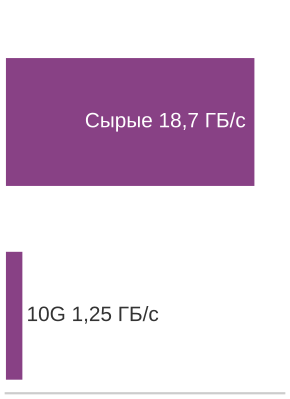

*Сырые данные периферии могут быть шире сетевого канала.*

***Карта ограничений периферийного ML**: перенос вычислений ближе к данным убирает сетевой член задержки и снижает нагрузку на полосу пропускания, но вместо централизованного масштаба он дает фиксированную локальную емкость, распределенную поверхность безопасности и эксплуатационную сложность на множестве площадок.*

Физическая необходимость диктует периферийную обработку, когда скорость поступления данных с датчиков превышает пропускную способность канала связи. Когда входящий поток датчиков опережает доступную пропускную способность сети, восходящий канал становится непреодолимым узким местом, что вынуждает переносить вычисления на локальное устройство независимо от прочих соображений.

> **Узкое место пропускной способности**
>
> **Задача**: рассмотрим систему контроля качества на производственной линии с 100 камерами, работающими при 30 FPS и разрешении 1080p. Становится ли потоковая передача видео узким местом пропускной способности и снижает ли периферийное ML ее настолько, что обработка возможна локально?
>
> **Физика**:
>
> 1.  **Сырая скорость данных с одной камеры**: 1920 $\times$ 1080 $\times$ 3 байта $\times$ 30 FPS ≈ 186,6 МБ/с.
> 2.  **Общая скорость данных**: 100 камер $\times$ 186,6 МБ/с = 18,7 ГБ/с.
> 3.  **Нагрузка на облачную передачу**: загрузка сырых потоков камер — прежде всего задача пропускной способности, приема, хранения и обработки; плата за исходящий трафик облака взимается за данные, которые передаются из облака. Если бы сырой поток впоследствии выгружался по тарифу \$0,09/ГБ за исходящую передачу, одна лишь плата за передачу достигла бы \$4,4 млн/мес.
> 4.  **Реальность сети**: даже выделенная линия 10 Гбит/с (1,25 ГБ/с) не может выдержать нагрузку: она требует в 14,9 раза больше пропускной способности, чем есть.
>
> **Системный вывод**: физика делает потоковую передачу в облако *невозможной* для этого приложения. Периферийная обработка здесь не опциональна, а обязательна. Если периферийный сервер передает только метаданные дефектов (1 КБ на обнаружение, примерно 20 событий/с по всей линии), пропускная способность падает примерно в 933 120 раз.

Насыщение канала несжатыми потоками датчиков демонстрирует барьер пропускной способности централизованного приема. Для периферийных устройств с батарейным питанием (беспроводные камеры, дроны, носимые устройства) энергетическая стоимость беспроводной связи накладывает еще более жесткий физический потолок: при параметрах полезной нагрузки и радио из прикидочного расчета [«Энергия передачи данных»](02_ml_systems.md#nbk-ml-systems-energy-transmission) радиопередача потребляет в 1000 раз больше энергии, чем локальный вывод. Передача сырой телеметрии по сотовым или Wi-Fi каналам быстро истощает бортовые энергетические резервы. На рисунке [«Иллюстративные опорные точки энергии на вывод»](02_ml_systems.md#fig-energy-per-inference) энергетический спектр по уровням развертывания охватывает восемь порядков величины, показывая, почему периферийным и встроенным системам нужны специализированные маломощные архитектуры, а не непрерывная беспроводная передача потока.

***Иллюстративные опорные точки энергии на вывод**: разрыв в энергии в восемь порядков величины отделяет ключевое распознавание TinyML с ограниченной батареей (~10 мкДж) от запросов к фундаментальным моделям в облаке (~1 кДж) в логарифмической шкале. Этот физический разрыв объясняет, почему постоянное периферийное восприятие требует специализированных маломощных архитектур, а не непрерывной беспроводной передачи в облако. (Отмеченные значения — педагогические опорные точки сценария, а не результаты моделей полной системы.)*

### Преимущества периферийного ML и сложности развертывания

Периферийные системы охватывают носимые устройства, промышленные контроллеры и шлюзы на собственной площадке, которые обрабатывают данные локально[^fn-iot-data-wall], не завися от центральных серверов. Хотя восьмипорядковый энергетический разброс между парадигмами отражает разные требования нагрузок и границы учета, физический управляющий принцип остается прежним: рассеяние мощности строго ограничено емкостью батареи или пассивным теплоотводом.

Этот тепловой предел напрямую задает потолок памяти и пропускной способности. Поскольку периферийные ускорители работают в строгих бюджетах мощности 5–50 Вт, они не могут поддерживать широкие мощные физические интерфейсы, которые нужны памяти с высокой пропускной способностью (HBM). Вместо этого периферийные архитектуры опираются на LPDDR или общую системную DRAM: емкость памяти ограничивает масштаб параметров модели, а пропускная способность памяти ограничивает эксплуатационную производительность. Чтобы уместить современные нейронные сети в эти физические рамки, нужны методы сжатия модели из главы [«Сжатие моделей»](10_model_compression.md) — квантование, прореживание и архитектурная дистилляция, — которые уменьшают объем весов и трафик активаций до бюджетов аппаратуры.

[^fn-iot-data-wall]: **Барьер данных интернета вещей (IoT)**: McKinsey оценивает, что развертывания IoT могут создать триллионы долларов экономической стоимости к 2030 году, но эти развертывания зависят от непрерывных потоков данных с датчиков, распределенных по домам, фабрикам, фермам, транспорту и инфраструктуре (McKinsey Global Institute, 2021). Во многих из этих сред совокупный $D_{\text{vol}}$ от сырых потоков превышает доступный бюджет восходящего канала или бюджет задержки централизованного приема, поэтому локальная периферийная обработка становится архитектурным требованием, а не просто оптимизацией стоимости.

### Инвариант локальности данных

Решение между локальной периферийной обработкой и удаленной облачной обработкой определяется компромиссом между пропускной способностью и задержкой. Удаленное выполнение неосуществимо, когда его полный путь нарушает срок обслуживания; в остальных случаях более быстрый осуществимый путь следует из сравнения полного локального и удаленного времени.

> **Инвариант локальности данных**
>
> ***Инвариант локальности данных*** сначала проверяет полный удаленный путь на соответствие сроку обслуживания. Пусть $T_{\text{remote}}$ — полное время удаленного пути, $T_{\text{deadline}}$ — срок, $\text{BW}_{\text{network}}$ — пропускная способность для переноса вычислений, $L_{\text{lat,network}}$ — сетевая задержка, а $R_{\text{peak,remote}}$ и $\eta_{\text{hw,remote}}$ — скорость и эффективность удаленных вычислений:
> $$T_{\text{remote}} = \frac{D_{\text{vol}}}{\text{BW}_{\text{network}}} + L_{\text{lat,network}} + \frac{O}{R_{\text{peak,remote}} \cdot \eta_{\text{hw,remote}}}, \quad \text{удаленный путь осуществим} \iff T_{\text{remote}} \le T_{\text{deadline}}$$
>
> Соответствующее $T_{\text{local}}$ — полное время локального пути. Если оба пути осуществимы, сравните $T_{\text{local}}$ и $T_{\text{remote}}$; любой путь может быть отвергнут сроком. Здесь $L_{\text{lat,network}}$ учитывает полное время сетевого цикла «туда и обратно» (распространение, маршрутизацию и протокольные рукопожатия), тогда как время передачи обратной полезной нагрузки обычно опускают, потому что результаты вывода (например, метка класса или рамка) на порядки меньше сырого входа $D_{\text{vol}}$.
>
> 1.  **Значение**: инвариант задает точку перехода, за которой добавление удаленных вычислений $(R_{\text{peak}})$ почти не помогает, потому что передача доминирует в $T_{\text{remote}}$. Локальный путь предпочтителен, только когда проверены его собственное полное время выполнения и ресурсные пределы.
> 2.  **Отличие**: в отличие от железного закона, который раскладывает один путь выполнения, инвариант локальности сравнивает два полных пути друг с другом и с явным сроком обслуживания.
> 3.  **Типичная ошибка**: распространено заблуждение, будто 5G/6G «решает» вопрос локальности. Хотя эти технологии улучшают $\text{BW}_{\text{network}}$, они не устраняют задержку распространения и протоколов, поэтому удаленный путь все равно может не уложиться в жесткий срок обслуживания.

Эксплуатационные компромиссы напрямую следуют из формулировки локальности. Локальное выполнение устраняет время сетевого транзита ($D_{\text{vol}}/\text{BW}_{\text{network}} + L_{\text{lat,network}}$), обеспечивая детерминированность задержки для замкнутого контура управления всякий раз, когда локальное выполнение удовлетворяет $T_{\text{local}} \le T_{\text{deadline}}$. Потребление пропускной способности восходящего канала падает от битрейта сырых датчиков до легкой событийной телеметрии, что снижает сетевые перегрузки и повторяющиеся транзитные платежи. Локальная обработка также сокращает поверхность атак на данные, сохраняя сырые потоки датчиков внутри границ собственной площадки, хотя данные в покое все равно требуют локального контроля доступа. Кроме того, периферийные узлы обеспечивают устойчивость к разделению сети: локальный вывод продолжает работать во время сбоев глобальной сети, пока остаются работоспособными локальное питание и линии датчиков.

И наоборот, периферийное развертывание обменивает сетевой транзит на строгие физические и эксплуатационные границы. Типичное периферийное железо работает в пределах 1–8 ГБ памяти и теплового бюджета 5–50 Вт, что намного ниже возможностей облачных серверов.[^fn-edge-resource-limits] Эти ресурсные пределы делают объем модели, буферы активаций, состояние среды выполнения и тепловые циклы работы связывающими ограничениями. С эксплуатационной точки зрения управление распределенной инфраструктурой вносит нелинейную сложность: координация обновлений ПО и версий моделей на тысячах разнородных, физически доступных устройств требует специализированных конвейеров развертывания,[^fn-edge-fleet-ops] где стоимость отката и незаметные сбои создают эксплуатационные проблемы, которых нет в централизованных дата-центрах.

На практике точку перехода по локальности хорошо иллюстрирует проверка одного кадра высокоскоростного датчика против жесткого срока кадра.

[^fn-edge-resource-limits]: **Ограничения периферийного сервера**: в типичных периферийных оболочках 1–8 ГБ могут вместить примерно 1–8 миллиардов весов INT8 до учета активаций, состояния среды выполнения и других буферов, поэтому одно лишь число параметров не задает универсального потолка «только миллионы». Устойчивые вычисления дополнительно ограничены мощностью, охлаждением и тепловым циклом работы.

[^fn-edge-fleet-ops]: **Координация периферийного парка**: управление тысячами распределенных периферийных устройств приводит к режимам отказа, которых нет в централизованном облаке: прерывистая связность вызывает дрейф версий модели, разнородность железа требует оптимизации под каждую цель, а физическая доступность делает откат прошивки дорогим. Эти эксплуатационные паттерны рассматриваются в главе [«MLOps»](14_ml_ops.md#sec-ml-operations).

> **Точка перехода по локальности**
>
> **Задача**: должна ли система избегания препятствий дрона (4K, 60 FPS) переносить вычисления в облако или здесь возникает точка перехода по локальности?
>
> **Дано**:
>
> - **Данные $(D_{\text{vol}})$**: кадр 4K ≈ 24,9 МБ.
> - **Пропускная способность $(\text{BW}_{\text{network}})$**: домашний широкополосный доступ 100 Мбит/с (восходящий).
> - **Ответ удаленной сети и вычислений**: 110 мс (цикл «туда и обратно» + удаленные вычисления).
>
> **Расчет**:
>
> 1.  **Время передачи**: 24,9 МБ $\times$ 8 бит/100 Мбит/с = 1 990,7 мс.
> 2.  **Полный удаленный путь**: передача + 110 мс удаленного ответа = 2 100,7 мс, против интервала кадра 16,7 мс.
>
> **Системный вывод**: удаленный путь не укладывается в интервал кадра еще до учета запаса цикла управления, а более быстрые удаленные вычисления не могут устранить время передачи. Перенос в облако при этих допущениях поэтому неосуществим; локальный путь все равно нужно измерить, чтобы подтвердить, что он укладывается в срок.

Реалистичное развертывание в розничной торговле показывает, как эти ограничения превращаются в требования к пропускной способности, аппаратуре и стоимости парка. Рассмотрим сеть умных магазинов, которая развертывает детекцию людей в 500 магазинах, по 20 камер на магазин, работающих при 15 FPS. В [«Требованиях к размеру периферийного вывода»](02_ml_systems.md#tbl-ml-systems-edge-sizing-requirements) частота вывода на магазин пересчитывается через число операций YOLOv8-nano на кадр, и получается пропускная способность, которую каждый магазин должен поддерживать.

| **Метрика**              |                       **Расчет**                       |                  **Результат**                  |
|:-------------------------|:------------------------------------------------------:|:----------------------------------------------:|
| **Выводы на магазин**    |           20 камер/магазин $\times$ 15 FPS           |                300 выводов/с                 |
| **Вычислительная нагрузка модели** |          YOLOv8-nano: 8,7 GFLOP/вывод          |                2610 GFLOP/s                  |
| **Требуемая пропускная способность** |   2610 GFLOP/s $\times$ 2 (запас)   |              ~5,22 TOPS эквивалент          |

***Требования к размеру периферийного вывода**: целевая пропускная способность на магазин для сценария детекции людей в розничной торговле.*

[«Варианты периферийных ускорителей»](02_ml_systems.md#tbl-ml-systems-edge-hardware-options) сравнивает пропускную способность, мощность, стоимость единицы и стоимость парка для трех кандидатов периферийных ускорителей, включая встроенные GPU-ускорители.

| **Периферийное устройство**                | **INT8 TOPS**                                                  | **Мощность** | **Стоимость единицы** | **Стоимость парка** |
|:-------------------------------------------|:--------------------------------------------------------------:|:------------:|:---------------------:|:-------------------:|
| **NVIDIA Jetson Orin NX**                  | 100 TOPS                                                     | 10–25 Вт    | \$600               | \$300 000         |
| **Intel NUC + Movidius**                   | 1 TOPS                                                       | 15 Вт       | \$400               | \$200 000         |
| **Google Coral Dev (3 платы/магазин)**   | пиковая 12 TOPS с учетом снижения 6 TOPS                | 6 Вт        | \$450               | \$225 000         |

***Варианты периферийных ускорителей**: пропускная способность, мощность и стоимость трех кандидатов периферийных ускорителей в масштабе парка.*

> **Размер периферийного вывода**
>
> **Задача**: исходя из целевой пропускной способности из [«Требований к размеру периферийного вывода»](02_ml_systems.md#tbl-ml-systems-edge-sizing-requirements) и кандидатов из [«Вариантов периферийных ускорителей»](02_ml_systems.md#tbl-ml-systems-edge-hardware-options), какой периферийный ускоритель (TPU размера USB, встроенный GPU класса рабочей станции или универсальный мини-ПК) обеспечивает нужную пропускную способность при наименьшей трехлетней стоимости парка?
>
> **Расчет**: размер определяем по тому, что устойчиво выдает одна плата, а не по пиковым значениям из паспорта. Плата Coral Dev Board заявлена с пиковой производительностью 4 TOPS, но после снижения на 50 процентов дает около 2 TOPS, поэтому количество плат на магазин равно 5,22 TOPS требуемых ÷ 2 TOPS на плату = 2,6 платы, что округляется вверх до 3 плат на магазин.
>
> За 3 года на 500 магазинов сравнение TCO этой конфигурации такое: аппаратура \$225 000 + питание (0,006 кВт $\times$ 500 $\times$ 8760 ч/год $\times$ 3 года $\times$ \$0,12/кВт·ч = \$9 460,8) = \$234 460,8 всего, против базового варианта с одним выделенным облачным GPU на магазин примерно \$9 855 000.
>
> **Результат**: один Coral сам по себе недостаточен, но сегментированная конфигурация из 3 плат на магазин — самый дешевый периферийный вариант: она дает 6 TOPS и примерно в 1,3 раза меньшие капитальные затраты на аппаратуру в расчете на магазин, чем Jetson. Jetson остается более простым вариантом одного устройства, когда сложность интеграции важнее стоимости аппаратуры.
>
> **Системный вывод**: размер периферии — задача емкости и стоимости, а не название устройства. Самый дешевый осуществимый проект может состоять из нескольких небольших ускорителей на площадку вместо одной более крупной платы, но эту экономию на аппаратуре нужно сопоставлять с нагрузкой на координацию и сопровождение сегментированного периферийного парка.

Физическая доступность усиливает эти эксплуатационные проблемы. В отличие от серверов, размещенных в дата-центрах с контролем доступа, периферийное железо, установленное в торговых залах или на общественной инфраструктуре, физически доступно злоумышленникам. Такая открытость требует аппаратно обеспечиваемых механизмов защиты: цепочек безопасной загрузки, которые предотвращают несанкционированное изменение прошивки, шифрованного локального хранилища для весов модели и промежуточных активаций, а также корпусов, показывающих вскрытие. Кроме того, капитальные затраты растут линейно с размером развертывания: оснащение 1000 площадок периферийным железом по \$500–2000 на площадку требует \$500 000–2 000 000 первоначальных капитальных затрат до монтажа, кабелей и эксплуатации парка. Окупается ли эта первоначальная инвестиция более низкой совокупной стоимостью владения по сравнению с повторяющимся облачным выводом, зависит от коэффициентов загрузки, местных тарифов на энергию и накладных расходов на обслуживание площадки.

### Системы реального времени: промышленность и IoT

Периферийные приложения различаются по областям, но каждое делает один и тот же аргумент о локальности конкретным: система не может ждать сеть, не может отправить данные, не может раскрыть сырой сигнал или не может остановиться во время сбоя связи. Автономные автомобили — требовательное приложение, потому что решения восприятия и управления, критичные к безопасности, должны укладываться в миллисекундные бюджеты. Бортовые системы обрабатывают потоки нескольких камер и других датчиков через локальное железо; удаленный облачный путь не может выдержать жесткий контур управления, если одна лишь сетевая задержка превышает срок.

Умная розничная торговля показывает практические преимущества периферийного ML для приложений, чувствительных к приватности и требовательных к пропускной способности. Магазин без касс[^fn-checkout-free-edge] может обрабатывать потоки многих камер на локальных периферийных серверах, отслеживая перемещения покупателей и выбор товаров, не передавая сырое видео непрерывно по глобальному каналу. Эта архитектура снижает спрос на пропускную способность и риск передачи, но сама по себе не обеспечивает приватность: хранение, доступ, вторичное использование и средства управления по-прежнему определяют соответствие требованиям и риски системы.

Промышленный интернет вещей[^fn-industry-four-feedback] использует периферийное ML там, где отзывчивость на уровне миллисекунд напрямую влияет на эффективность производства и безопасность работников. Производственные объекты развертывают периферийные системы ML для контроля качества в реальном времени и предиктивного обслуживания.[^fn-predictive-maint-edge]

Инфраструктура зданий и «умные здания» опираются на периферийное ML, чтобы уравновешивать оптимизацию энергии и непрерывность эксплуатации. Системы управления зданием агрегируют телеметрию тысяч датчиков окружающей среды — отслеживая воздушные потоки, температуру, заполненность и потребление энергии — и исполняют локальные контуры управления вентиляцией, кондиционированием и освещением. Локальная обработка телеметрии сокращает транзит по глобальным сетям на порядок, сохраняя отклик управления менее секунды и устойчивость к разрывам сети. В клинических условиях системы здравоохранения развертывают периферийный вывод для телеметрии пациентов и хирургической навигации, обеспечивая детерминированный отклик и изоляцию данных там, где облачные циклы «туда и обратно» и широкая экспозиция недопустимы.

Многие промышленные и розничные периферийные системы стационарны и подключены к сетевому питанию: например, периферийный сервер завода, потребляющий сотни ватт круглосуточно, остается жизнеспособным. Мобильные устройства, напротив, перемещаются вместе с пользователями, без проводов, на строго ограниченных батарейных резервах. Когда вычисления переходят от стационарной инфраструктуры к мобильному устройству без проводов, энергопотребление вытесняет задержку как главное управляющее ограничение: $\text{Энергия} = \text{Мощность} \times T$. Доминирующая цель оптимизации смещается от сырого времени выполнения к энергии на вывод, что принципиально меняет пространство проектирования аппаратуры и алгоритмов.

[^fn-checkout-free-edge]: **Розничная торговля без касс**: магазин может объединять наблюдения камер с событиями полок и состоянием транзакций локально, а затем передавать только выбранные события или агрегаты. Граница приватности должна при этом включать и эти производные записи, потому что сокращение передачи сырого видео не определяет хранение, доступ или вторичное использование.

[^fn-industry-four-feedback]: **Индустрия 4.0**: четвертая промышленная революция встраивает ML в контур обратной связи «датчик — исполнительное устройство» на производственных линиях. Системное следствие: задержка контура управления $(L_{\text{lat}})$ должна быть меньше физического процесса, которым он управляет: сварочный робот, который обнаруживает дефект на частоте 60 Гц, имеет интервал опроса 16,7 мс, что требует развертывания, полный путь отклика которого укладывается в этот срок.

[^fn-predictive-maint-edge]: **Предиктивное обслуживание**: модели анализируют данные датчиков, например вибрацию и температуру, чтобы оценить состояние оборудования и риск отказа. Непрерывный мониторинг делает частоту опроса датчиков, рабочий цикл, мощность и локальное хранилище первоклассными ограничениями. Узлы с батарейным питанием могут требовать средней работы менее 1 Вт, тогда как промышленные шлюзы с сетевым питанием могут использовать гораздо большую оболочку.

## Мобильное ML: автономный интеллект

Периферийное ML решает проблему расстояния, которая ограничивает облачные развертывания, переводя вычисления ближе к данным. Многие периферийные системы — стационарные шлюзы, заводские серверы и розничная техника, тогда как пользователи носят телефоны и планшеты через меняющуюся среду. Перенос той же локальности на переносное устройство вводит другое ограничение: батарею. В отличие от периферийных серверов с питанием от сети, которые могут непрерывно потреблять сотни ватт, мобильные устройства должны работать часами или днями на фиксированных энергетических бюджетах.

Мобильное ML решает эту задачу, встраивая машинное обучение непосредственно в переносные устройства — смартфоны и планшеты, — обеспечивая отзывчивые персонализированные возможности. Эта парадигма выигрывает там, где локальность данных, автономная работа и мгновенный отклик важнее вычислительного масштаба; она поддерживает такие приложения, как распознавание речи, вычислительная фотография[^fn-computational-photo-ml] и мониторинг здоровья. Локальная обработка снижает риск передачи, но сама по себе не гарантирует приватность. Эти устройства с батарейным питанием должны уравновешивать производительность с энергоэффективностью и управлением теплом, поэтому они подходят для частых коротких задач ИИ.

Мобильная среда вводит критическое ограничение, которого нет в стационарных развертываниях: энергия на вывод становится параметром проектирования первого порядка. По железному закону из [«расширенного железного закона»](02_ml_systems.md#eq-iron-law-extended) облачные и периферийные системы оптимизируют минимизацию $T$, полной задержки. Мобильные системы сталкиваются с дополнительным ограничением: $\text{Энергия} = \text{Мощность} \times T$, а стена мощности, описанная [«масштабированием мощности»](02_ml_systems.md#eq-power-scaling), ограничивает устойчивую мощность значением 3–5 Вт. В терминах архетипов нагрузку «вычислительный зверь», например классификацию изображений, нужно преобразовать в более компактную модель зрения,[^fn-depthwise-mobile-efficiency] сократив FLOP в 13,7 раза при сохранении достаточной точности для приложения. Это не просто оптимизация: это качественный сдвиг в компромиссе «вычисления на байт», когда пиковая пропускная способность приносится в жертву устойчивой работе в тепловой оболочке 3–5 Вт.

[^fn-computational-photo-ml]: **Вычислительная фотография**: использует алгоритмы ML (например, слияние нескольких кадров, нейронное шумоподавление), чтобы преодолеть физические пределы малых сенсоров мобильных камер. Это иллюстрирует компромисс мобильных вычислений: многостадийный конвейер должен выполняться в пределах воспринимаемой пользователем задержки затвора и при общем тепловом бюджете 3–5 Вт.

[^fn-depthwise-mobile-efficiency]: **Сокращение модели зрения для мобильных устройств**: архитектуры в духе MobileNet сокращают вычисления в распространенных слоях зрения, сохраняя полезную точность для мобильных задач. Архитектурные детали приведены в главе [«Архитектуры нейронных сетей»](06_nn_architectures.md#sec-network-architectures); системный вывод здесь в том, что мобильное развертывание часто требует смены семейства модели, а не просто переноса той же модели на телефон.

Эта граница батареи и тепла задает определяющую форму мобильной парадигмы.

> **Мобильное ML**
>
> ***Мобильное машинное обучение*** — парадигма развертывания, ограниченная расчетной тепловой мощностью (TDP) и энергией батареи.
>
> 1.  **Значение**: ее ограничивает способность пассивного охлаждения отводить тепло мощностью в несколько ватт, поэтому архитектуры должны ставить устойчивую энергоэффективность выше пиковой пропускной способности $(R_{\text{peak}})$.
> 2.  **Отличие**: в отличие от периферийного ML, у которого может быть активное охлаждение, мобильное ML должно работать в пределах личного энергетического бюджета. В отличие от TinyML, оно по-прежнему предоставляет полноценную ОС и вычислительную мощность в несколько ватт.
> 3.  **Типичная ошибка**: распространено заблуждение, будто производительность мобильного ML — фиксированная величина. На деле это ограничение, меняющееся во времени: производительность часто падает, когда устройство достигает теплового предела, и срабатывает троттлинг, снижающий рабочий цикл $(\eta_{\text{hw}})$.

Обработка на устройстве обеспечивает мгновенный отклик и локальность данных, но работает в строгих электрохимических и термодинамических границах. Четырехветвевая таксономия из [«Карты ограничений мобильного ML»](02_ml_systems.md#fig-mobile-ml) связывает общий аккумулятор телефона и корпус с пассивным охлаждением с необходимыми слияниями ядер NPU и пределами теплового троттлинга.

Ограничения батареи и ресурсов в мобильном ML напрямую переходят в инженерные требования. Функции ML, работающие постоянно, несут **налог на батарею**, потому что непрерывный вывод расходует конечный энергетический бюджет телефона еще до того, как запускается остальная система.

Ограничение батареи ограничивает суммарное потребление энергии во времени. Даже если бы мы могли игнорировать время работы от батареи для подключенного к сети планшета или короткой демонстрации, термодинамика накладывает вторую границу. Электрическая мощность в конце концов превращается в тепло, которое устройство должно рассеять. Дата-центр использует активное охлаждение, чтобы отвести это тепло. Тонкое мобильное устройство полагается главным образом на пассивный теплообмен через корпус и поверхности. Так возникает **тепловая стена** — жесткий потолок устойчивого потребления мощности, который существует независимо от емкости батареи.

***Карта ограничений мобильного ML**: обработка на устройстве дает отзывчивость, приватность, автономную работу и персонализацию, но общий аккумулятор телефона и пассивная тепловая оболочка делают устойчивую энергоэффективность главным проектным ограничением.*

> **Налог на батарею**
>
> **Задача**: рассмотрим развертывание детектора объектов «в реальном времени» в фоновом режиме на смартфоне. Модель потребляет 2 Вт непрерывной мощности при работе. У телефона стандартная батарея 15 Вт·ч. Может ли эта функция работать весь день? Это и есть налог на батарею, который превращает время работы от аккумулятора в ограничение энергетического бюджета мобильного ML.
>
> **Физика**:
>
> 1.  **Идеальное время работы**: $\frac{15\ \text{Вт}\cdot\text{ч}}{2\ \text{Вт}} = 7{,}5\ \text{ч}$
> 2.  **Реальность**: пользователь ждет, что телефон проработает 24 часа. Непрерывная работа одной этой функции в течение дня потребовала бы 320 процентов суточного энергетического бюджета телефона.
>
> **Системный вывод**: модель нельзя просто «развернуть». Методы из главы [«Сжатие моделей»](10_model_compression.md) должны снижать и объем работы модели, и рабочий цикл, чтобы функция могла работать весь день.

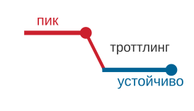

*Устойчивая тепловая производительность заметно ниже пиковых значений.*

Это различие важно для инженерных решений: налог на батарею — задача бюджета, принципиально разрешимая снижением частоты запусков модели или увеличением емкости батареи. Тепловая стена — физический потолок. Более емкая батарея не поднимет максимальную устойчивую мощность, которую может рассеять пассивный корпус; изменения рабочего цикла и программного обеспечения могут только снизить выделение тепла. Устойчивая работа выше тепловой оболочки запускает аппаратный троттлинг независимо от оставшейся энергии батареи. Поэтому два ограничения бьют в разные точки железного закона: батарея ограничивает суммарное число операций за заряд ($O$, проинтегрированное по времени), тогда как тепловая стена ограничивает мгновенную скорость ($R_{\text{peak}} \cdot \eta_{\text{hw}}$), которую кремний способен поддерживать.

> **Тепловая стена**
>
> **Задача**: неоптимизированная модель зрения требует пиковых 12 Вт вычислений. Можно ли развернуть ее на мобильном устройстве или она упирается в тепловую стену и мобильный предел мощности?
>
> **Сценарий**: мобильная система на кристалле (SoC) допускает примерно 3 Вт для пассивного охлаждения. Допустим, неоптимизированная модель все равно выпускается; типичная трассировка троттлинга для такого пассивно охлаждаемого устройства идет в три шага:
>
> 1. **Рост температуры**: при 12 Вт температура устройства растет примерно на 1 °C/с.
> 2. **Тепловой порог**: в течение 60 с аппаратура достигает точки теплового срабатывания (80 °C), что включает троттлинг ОС.
> 3. **Троттлированная пропускная способность**: модель на 100 FPS внезапно падает до 30 FPS, чтобы уложиться в тепловую оболочку.
>
> **Расчет**: допустим иллюстративное снижение активной мощности в 4 раза после перепроектирования FP32 → INT8 (см. главу [«Сжатие моделей»](10_model_compression.md)): 12 Вт ÷ 4 = 3 Вт, что приходится ровно на потолок пассивного охлаждения 3 Вт без запаса. Этот коэффициент — входной параметр сценария, а не универсальная гарантия для всей системы, которую дает одно лишь квантование.
>
> **Системный вывод**: даже снижение мощности в 4 раза не создает теплового запаса: оно лишь едва достигает устойчивого предела. Физика задает жесткий потолок, который не может превысить никакая оптимизация.

### Преимущества мобильного ML и ресурсные ограничения

Мобильные устройства демонстрируют промежуточные ограничения: 8–16 ГБ оперативной памяти (от среднего класса до флагманов), 128 ГБ–1 ТБ хранилища, 15–45 TOPS вычислений ИИ на нейропроцессорах[^fn-npu-energy-efficiency] при потреблении 3–5 Вт. Архитектуры систем на кристалле[^fn-soc-hardware-integration] объединяют вычисления и память, чтобы минимизировать энергетические затраты. Емкость памяти ограничивает объем модели, а пропускная способность 51,2–77 ГБ/с ограничивает скорость перемещения весов и активаций. Ограничения батареи (емкость 15 Вт·ч–22 Вт·ч) делают оптимизацию энергии критичной: добавление 1 Вт непрерывной обработки ML к телефону, который иначе работает 24 часа, сократит время работы примерно до 9,2–11,5 часа в зависимости от емкости батареи. Специализированные мобильные фреймворки для вывода на устройстве обеспечивают аппаратно оптимизированный вывод для времени отклика интерфейса 5–50 мс.

[^fn-soc-hardware-integration]: **Система на кристалле (SoC)**: мобильные SoC объединяют ядра CPU, GPU и NPU с кешами и контроллерами памяти, чтобы снизить затраты на перемещение данных. Мобильная DRAM обычно вынесена за пределы кристалла, а осуществимый размер модели зависит от емкости, точности, рабочей памяти, пропускной способности и задержки.

[^fn-npu-energy-efficiency]: **Нейропроцессорный блок (NPU)**: специализированный аппаратный блок в мобильной системе на кристалле, схемы которого рассчитаны на тензорные операции низкой точности. Такая специализация может повышать энергоэффективность по сравнению с выполнением на CPU, помогая нагрузкам ИИ уложиться в мобильные энергетические бюджеты.

Мобильное ML хорошо справляется с отзывчивыми сценариями при сильной локальности данных. Обработка в реальном времени может достигать задержки менее 10 мс для некоторых задач, обеспечивая время отклика интерфейса 5–50 мс в интерактивных приложениях. Локальная обработка чувствительных входов сокращает передачу данных и центральное хранение, а анклавы на устройстве, такие как Secure Enclave от Apple, дополнительно защищают биометрические данные,[^fn-faceid-privacy-enclave] хотя сила гарантий приватности в конечном счете зависит от всей системы и модели угроз. Функции навигации, перевода и обработки медиа также могут работать без сети, если их модели и данные помещаются в мобильный бюджет. Персонализация завершает картину: модели могут использовать сигналы устройства и контекст пользователя, оставляя сырые данные локальными.

[^fn-faceid-privacy-enclave]: **Face ID**: Apple выполняет сопоставление лиц внутри Secure Enclave и шифрует сохраненные математические представления так, что они доступны только этой подсистеме и не покидают устройство (Apple, 2024a; Apple, 2024b). Apple сообщает о случайной вероятности ложного совпадения ниже 1 из 1 000 000 для одного зарегистрированного образа; для некоторых групп и конфигураций вероятность выше. Пример показывает, как локальный вывод и аппаратная изоляция могут сокращать риск передачи, поддерживая аутентификацию с низкой задержкой.

Эти преимущества требуют принять жесткие ресурсные ограничения. По сравнению с облачными развертываниями мобильные приложения часто работают в гораздо более тесных бюджетах памяти, хранилища и задержки, что ограничивает размер модели и поведение батчей. Время работы от батареи заметно для пользователя, а тепловой троттлинг может существенно ограничивать устойчивую производительность: пиковая пропускная способность NPU может заметно превышать то, что устройство способно поддерживать при длительной нагрузке. Сложность разработки множится по платформам, требуя отдельных реализаций и тщательной настройки производительности, а разнородность устройств требует нескольких вариантов модели. Проверка в магазине приложений и поэтапные релизы также могут замедлять итерации по сравнению с сервисом, полностью контролируемым его оператором.

### Персональный ассистент и обработка медиа

Во всех мобильных приложениях центральная системная задача в том, что несколько коротких конвейеров должны делить один и тот же бюджет батареи и тепла. Вычислительная фотография демонстрирует задачу запуска нескольких конвейеров ML в тепловой оболочке. Современные флагманы обрабатывают каждый снимок через несколько стадий ML: портретный режим[^fn-portrait-mode-pipeline] использует оценку глубины и сегментацию, ночной режим выравнивает несколько кадров с шумоподавлением на основе ML, а слияние HDR, сверхразрешение и оптимизация сцены идут последовательно. Инженерная задача — не отдельная модель, а конвейер: эти модели должны делить бюджет мощности 3–5 Вт и уложиться в воспринимаемую пользователем задержку затвора, что требует аккуратного планирования по CPU, GPU и NPU, чтобы избежать теплового троттлинга.

Голосовые взаимодействия демонстрируют многоуровневую архитектуру мобильного ML. Детекция слова пробуждения работает непрерывно на выделенном маломощном ядре, тогда как распознавание речи и предсказание клавиатуры используют более мощные нейроуровни. Каждый уровень работает при своей мощности, показывая, как мобильное ML распределяет нагрузки между разнородными блоками обработки внутри одной системы на кристалле.

Мониторинг здоровья и дополненная реальность доводят мобильное ML до пределов устойчивой производительности. Носимые устройства вроде Apple Watch обрабатывают данные ЭКГ и акселерометра на устройстве, чтобы сократить передачу данных, тогда как фреймворки AR требуют бюджета кадра 16,7 мс при 60 FPS для одновременной локализации, отслеживания рук и понимания сцены. Эти приложения задают предел того, что могут устойчиво выдерживать устройства с батарейным питанием и пассивным охлаждением, и определяют границу, за которой одной лишь мобильной оптимизации недостаточно.

[^fn-portrait-mode-pipeline]: **Конвейер портретного режима**: это не одна модель, а последовательность моделей реального времени для оценки глубины, сегментации и рендеринга. Основная инженерная задача — управлять совокупной задержкой и мощностью конвейера, а не производительностью какой-то отдельной модели. Весь конвейер должен выполняться в пределах воспринимаемой пользователем задержки затвора и делить тепловой бюджет 3–5 Вт, что вынуждает к компромиссам планирования между CPU, GPU и NPU, чтобы избежать троттлинга.

Эти успехи могут создать обманчивое ощущение легкости. Типичная ловушка — попытка развернуть на мобильных или периферийных устройствах модели, обученные на настольных компьютерах, без изменения архитектуры. Модели, разработанные на мощных рабочих станциях, часто не работают на устройствах с ограниченными ресурсами. Настольный конвейер ResNet-50 может потребовать гигабайты, если учесть активации, батчи, буферы предобработки и накладные расходы среды выполнения, хотя одни веса FP32 занимают около 102,4 МБ. Такой конвейер, требующий 8,2 GFLOP на вывод, не может работать без изменений на типичной периферийной цели с 512 МБ ОЗУ и процессором 1 GFLOP/s. Помимо простых нарушений ресурсов, модели, оптимизированные под настольные системы, могут использовать операции, которых нет в мобильном железе, предполагать числовые форматы, недоступные во встроенных системах, или требовать пакетной обработки, несовместимой с выводом отдельных примеров. Успешное развертывание требует архитектурно-ориентированного проектирования с самого начала: семейство моделей, арифметические форматы и реализационные решения должны соответствовать целевому устройству.

Мобильное ML показывает, что полезный интеллект может работать в тепловой оболочке 3–5 Вт от батареи. Однако смартфоны по-прежнему стоят сотни долларов, требуют гигабайт памяти и ежедневной зарядки, которая требует внимания пользователя. Эти требования делают их непригодными для обширного класса приложений: мониторинга влажности почвы на ферме в тысячу акров, обнаружения структурных напряжений в тросах мостов или прослушивания редких видов в отдаленном лесу. Такие сценарии требуют не только меньшей мощности, но и качественно иного инженерного режима: устройство стоит доллары, а не сотни, память измеряется килобайтами, а не гигабайтами, и система работает без присмотра месяцами или годами. Методы мобильной оптимизации помогают, но они не могут преодолеть разрыв в доступной памяти в 10 000 раз. Нужен не уменьшенный смартфон, а принципиально другой класс аппаратуры и алгоритмов.

## TinyML: повсеместное восприятие

Представьте, что вы оснащаете датчиками каждый поддон на складе, каждый трос подвесного моста, каждый улей на пасеке. Чтобы поставить «глаза и уши» на такое количество физических объектов — десятки тысяч или миллионы, — устройство должно стоить доллары, а не сотни долларов, и измеряться миллиметрами, а не сантиметрами. Смартфоны слишком дороги и слишком велики; нужно повсеместное восприятие при стоимости единицы менее десяти долларов и физических размерах в миллиметрах.

TinyML завершает спектр развертывания, доводя интеллект до физических пределов: маломощное ML с низкой стоимостью на сильно ограниченных встроенных устройствах (Janapa Reddi et al., 2022). Устройства стоимостью менее \$10 и потребляющие меньше одного милливатта[^fn-milliwatt-power-threshold] мощности делают повсеместное[^fn-ubiquitous-computing-paradigm] восприятие экономически практичным в массовом масштабе; MLPerf Tiny и MCUNet показывают, как такие ограничения оцениваются и оптимизируются на практике (Banbury et al., 2021; Lin et al., 2020). Это область архетипа «жесткого ограничения», где цель оптимизации смещается от максимизации пропускной способности к минимизации энергии на вывод. При работе с циклическим включением модель распознавания ключевых слов, потребляющая 10 мкДж на вывод, может работать годами от батарейки-таблетки, достигая миллионократного улучшения энергоэффективности за счет обмена емкости модели на долговечность работы. На [«Масштабе аппаратуры TinyML»](02_ml_systems.md#fig-tinyml-example) аннотированные отладочные платы показывают этот физический масштаб: интегрированные микроконтроллеры, массивы датчиков и штыревые разъемы, предназначенные для работы компактных моделей в изолированных средах.

[^fn-milliwatt-power-threshold]: **Порог 1 мВт**: сбор энергии из окружающей среды может питать устройство неограниченно долго, только если долгосрочная собранная мощность превышает среднюю нагрузку всей системы. Доступная мощность зависит от источника и среды: солнечная ячейка размером с ноготь может давать ~10 мВт на улице, но ~10 мкВт в помещении, термоэлектрические генераторы на теплых трубах — ~100 мкВт, а RF-энергия от близких передатчиков — ~10 мкВт. Этот переход может изменить модель развертывания от «ограниченного батареей срока службы» к «развернул и забыл», но зависит от источника, среды и нагрузки.

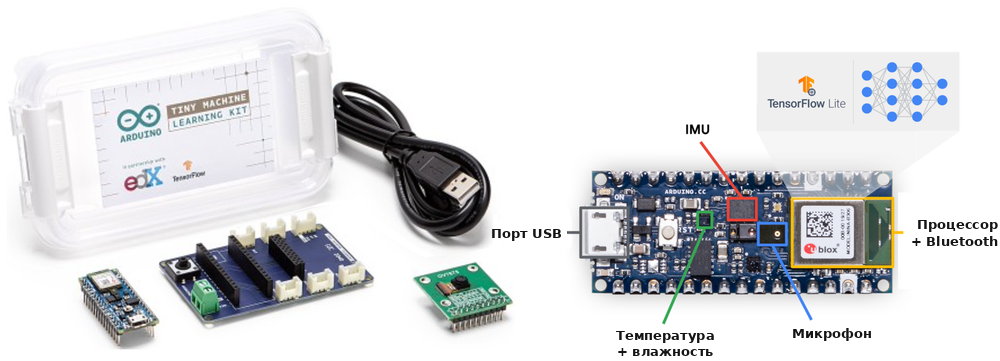

***Масштаб аппаратуры TinyML**: отладочные платы микроконтроллеров объединяют датчики, вычислительные ядра и маломощные радиомодули на одной подложке, работая в строгих рамках SRAM килобайтного масштаба и мощности в милливаттах. Такой компактный форм-фактор смещает цель оптимизации от пиковой пропускной способности к энергии на вывод, позволяя работать многие годы от батареек-таблеток. Источник изображения: рисунок 6 в Janapa Reddi et al., 2022, распространяется по лицензии [CC BY 4.0](https://creativecommons.org/licenses/by/4.0/).*

Работа на таком физическом масштабе требует микроконтроллеров (MCU)[^fn-mcu-resource-floor], которые убирают энергозатратную инфраструктуру обычных вычислений. Мобильные и периферийные процессоры опираются на внешнюю динамическую память (DRAM), высокоскоростные шины памяти и среды выполнения операционных систем, которые потребляют сотни милливатт просто на регенерацию ячеек памяти и переключение линий шины. Микроконтроллеры полностью отказываются от внешних шин памяти, интегрируя ядро процессора, энергонезависимую флеш-память и статическую память (SRAM) на одном кремниевом кристалле (Banbury et al., 2021; Lin et al., 2020; Janapa Reddi et al., 2022). Хотя отказ от внешней сигнализации снижает активную мощность до доли милливатта, а мощность сна — до микроватт, он накладывает безжалостный потолок памяти. SRAM на кристалле физически ограничена площадью кремниевого кристалла: поскольку каждая ячейка SRAM требует шесть транзисторов ($6\text{T}$), увеличение емкости напрямую поднимает стоимость производства. Поэтому модель TinyML должна выполняться в пределах десятков-сотен килобайт SRAM без виртуальной памяти, подкачки или файла подкачки, которые смягчали бы переполнение. Получающийся энергетический разрыв между TinyML и облачным выводом ([«Иллюстративные опорные точки энергии на вывод»](02_ml_systems.md#fig-energy-per-inference)) составляет не менее шести порядков величины[^fn-tinyml-energy-gap], а для облачных запросов LLM достигает восьми порядков, позволяя непрерывную многолетнюю работу от батареек-таблеток.[^fn-coin-cell-longevity]

[^fn-mcu-resource-floor]: **Микроконтроллер (MCU)**: однокристальный компьютер, конструкция которого ставит минимальную стоимость и мощность выше производительности, что и создает упомянутое «радикальное ограничение». Многие цели TinyML имеют лишь десятки-сотни килобайт встроенной SRAM и не имеют виртуальной памяти; некоторые высокопроизводительные микроконтроллеры могут подключать внешнюю память. Поэтому полная модель, активации и состояние среды выполнения должны помещаться в память, фактически доступную цели, часто на порядки меньшую, чем у смартфона.

[^fn-tinyml-energy-gap]: **Энергетический разрыв TinyML**: этот разрыв коренится в философии проектирования аппаратуры: облачные GPU оптимизированы для сырой пропускной способности и потребляют сотни ватт, тогда как микроконтроллеры TinyML спроектированы для состояний сна почти с нулевой мощностью. Для обычного облачного вывода один запрос может потреблять около 10 джоулей, тогда как специализированное устройство TinyML — около 10 микроджоулей, разрыв в 1 000 000 раз. Запросы облачных LLM могут увеличить сравнение еще сильнее, как количественно показано в [«Энергии на вывод по парадигмам»](02_ml_systems.md#tbl-ml-systems-energy-per-inference).

[^fn-coin-cell-longevity]: **Питание от батарейки-таблетки**: батарейка CR2032 (225 мАч при 3 В, ~675 мВт·ч) в идеале питает полноценную систему мощностью 10–50 мкВт около 1,5–7,7 года. Эта модель «развернул и забыл» стимулирует развитие прерывистых вычислений, при которых устройство спит между выводами, растягивая энергетический бюджет на годы автономной работы.

[^fn-ubiquitous-computing-paradigm]: **Повсеместные вычисления (ubiquitous computing)**: видение Марка Вайзера представляло вычисления, вплетенные в повседневную среду, пока они не уходят из прямого внимания (Weiser, 1991). TinyML — один из современных путей к этому видению: когда стоимость и мощность интеллектуального датчика становятся достаточно низкими для массового развертывания, цель оптимизации смещается от производительности (пропускной способности) к мощности (энергии на вывод), то есть к главному компромиссу архетипа «жесткого ограничения».

Чтобы уместить весь конвейер вывода, от получения данных с датчика до выходного класса, в объем памяти килобайтного масштаба, нужно формализовать режим работы TinyML.

> **TinyML**
>
> ***TinyML*** — область машинного обучения постоянного восприятия, ограниченная памятью килобайтного масштаба и мощностью милливаттного масштаба.
>
> 1.  **Значение**: она требует, чтобы веса и код помещались во флеш-памяти, а активации и состояние среды выполнения — в SRAM на кристалле, что позволяет непрерывный вывод при бюджетах мощности в милливаттах.
> 2.  **Отличие**: в отличие от мобильного ML, который использует процессоры мощностью в несколько ватт и полноценную ОС, TinyML работает на микроконтроллерах с прошивкой без ОС или на операционной системе реального времени.
> 3.  **Типичная ошибка**: распространено заблуждение, будто TinyML — это просто «маленькие модели». На деле это парадигма, ограниченная энергией: главная метрика — энергия на вывод (микроджоули), а не только число параметров.

Это определение переосмысляет железный закон систем машинного обучения. В терминах [«расширенного железного закона»](02_ml_systems.md#eq-iron-law-extended) TinyML накладывает физическое предусловие по емкости памяти, которое время выполнения не отражает: объем модели $M_{\text{model}}$ и объем активаций должны оставаться в пределах емкости памяти $C_{\text{mem}}$. Когда полная память измеряется килобайтами, структура модели и выделение памяти в среде выполнения определяют осуществимость еще до начала оптимизации задержки, а каждое лишнее перемещение данных тратит часть энергетического бюджета. Поэтому цель смещается от сырой пропускной способности к энергии на вывод и соответствию памяти.

> **Как читать числа энергии на вывод**
>
> Значения энергии из [«Энергии на вывод по парадигмам»](02_ml_systems.md#tbl-ml-systems-energy-per-inference) сочетают расчетные оценки энергии устройств с отдельными масштабными опорами; это не контролируемые измерения полной системы. Иллюстративная граница ResNet-50 только на A100 составляет менее 1 мс и около ~0,3 Дж, тогда как весь сервер при учете CPU, памяти и накладных расходов может потреблять около ~1 кВт. Значения в последнем столбце показывают, сколько выводов может обеспечить номинальная энергия одной батареи; это не время работы от батареи, и в них не учтены датчики, режим сна и связь.
>
> Этот разрыв энергоэффективности TinyML помогает понять, почему локальные модели с низким энергопотреблением привлекательны для постоянного восприятия. Фактическое время работы все еще зависит от частоты выводов, мощности сна, датчиков, связи и остальной части устройства.

Энергетический разрыв между парадигмами — не вопрос степени, а масштаба: он охватывает восемь порядков величины, очерченных на [«Иллюстративных опорных точках энергии на вывод»](02_ml_systems.md#fig-energy-per-inference). [«Энергия на вывод по парадигмам»](02_ml_systems.md#tbl-ml-systems-energy-per-inference) опирается на этот диапазон конкретными числами, переводя энергетическую стоимость каждой парадигмы в число выводов, которые может обеспечить одна батарея смартфона.

| **Парадигма** | **Пример нагрузки**            |               **Энергия на вывод**               | **Выводов на батарею (3,7 В, 3000 мА·ч)** |
|:--------------|:-------------------------------|:------------------------------------------------:|:--------------------------------------------:|
| **Облако**    | Запрос GPT-4                   |      ~1 кДж       |                 40 запросов                 |
| **Облако**    | ResNet-50 (сервер с ускорителем) | 75,5 мДж          |               529 505 запросов              |
| **Периферия** | ResNet-50 (Jetson)             | 15,9 мДж          |              2 511 628 запросов             |
| **Мобильные** | MobileNet (NPU)                | 2,60 мДж          |             15 393 505 запросов             |
| **TinyML**    | Распознавание ключевых слов    | 10 мкДж            |          3 996 млн запросов                 |

***Энергия на вывод по парадигмам**: аналитические оценки энергии устройств и масштабные опорные точки с соответствующим числом выводов от одной батареи смартфона. Это не контролируемые измерения полной системы.*

Работа при бюджетах мощности менее милливатта позволяет непрерывно вести восприятие без сетевого питания, но вынуждает хранить полное состояние вывода в SRAM на кристалле. Четырехколоночная таксономия из [«Карты ограничений TinyML»](02_ml_systems.md#fig-tiny-ml) показывает, как память килобайтного масштаба и циклические состояния сна позволяют постоянные нагрузки, одновременно ограничивая обновления модели.

***Карта ограничений TinyML**: мощность в милливаттах и память в килобайтах делают постоянное восприятие экономически возможным, но те же пределы заставляют модель, активации, среду выполнения и путь обновления уместиться в радикально меньшую инженерную оболочку.*

### Преимущества TinyML и эксплуатационные компромиссы

TinyML работает на крайних значениях аппаратных параметров. По сравнению с облачными системами развертывания TinyML обычно дают примерно в $10^6$–$10^9$ раз меньше памяти, в зависимости от того, измеряется ли бюджет микроконтроллера мегабайтами или килобайтами, при бюджетах мощности в милливаттах. Эти жесткие ограничения позволяют месяцами или годами работать автономно[^fn-ondevice-training-limits], но требуют специализированных алгоритмов, сжатия моделей и тщательного системного совместного проектирования. Устройства варьируются от отладочных комплектов размером с ладонь до чипов миллиметрового масштаба,[^fn-tinyml-device-range] обеспечивая повсеместное восприятие там, где сеть, питание или обслуживание обходятся дорого. Типичные отладочные комплекты включают Arduino Nano 33 BLE Sense (256 КБ ОЗУ, 1 МБ флеш-памяти, 20–40 мВт) и ESP32-CAM (520 КБ ОЗУ, 4 МБ флеш-памяти, 50–250 мВт).

[^fn-ondevice-training-limits]: **Ограничения обучения на устройстве**: полное обучение на устройстве должно сохранять выходы промежуточных слоев, чтобы последующие обновления весов могли вычислить градиенты, поэтому потребляется память, пропорциональная глубине модели. При выводе активации каждого слоя можно отбросить, как только их использует следующий слой. При объеме ОЗУ 256 КБ–2 МБ потребности памяти обратного распространения превышают доступную SRAM; TinyTL замораживает веса и обновляет только смещения, чтобы сократить память активаций (Cai et al., 2020). Это ограничение памяти в основном оставляет устройствам TinyML роль вывода, а обновления модели доставляются через прошивку, а не обучаются на месте.

[^fn-tinyml-device-range]: **Диапазон устройств TinyML**: этот физический диапазон отражает прямой компромисс между контекстом развертывания и вычислительными возможностями. Системы миллиметрового масштаба ставят приоритет минимальной мощности (~140 мкВт) для одной функции и длительной работы, тогда как платы размером с ладонь обменивают больший размер и более высокую мощность на возможность обрабатывать несколько сложных потоков датчиков. Этот выбор совместного проектирования создает разницу в мощности более чем в 10 000 раз и в площади примерно в 100 раз по всему спектру устройств TinyML.

Полностью работая на устройстве, система получает архитектурные возможности, которых не дают сетевые системы. Отказ от беспроводной передачи полностью убирает задержку внешней связи, обеспечивая детерминированное время отклика с низкой задержкой для жестких контуров восприятия и управления. Отказ от радиоканалов также меняет экономику развертывания: когда стоимость единицы узла падает до однозначного числа долларов, плотная инструментация тысяч физических объектов становится финансово оправданной. Работа на бюджетах энергии в микроджоулях дополнительно усиливает экономический эффект, позволяя годами работать автономно от недорогих батареек-таблеток или сбора энергии из окружающей среды. Наконец, локальность обеспечивает изоляцию данных: поскольку сырые потоки датчиков обрабатываются на интерфейсе захвата и никогда не передаются по сети, поверхность раскрытия чувствительных данных заметно сокращается, хотя формальная приватность по-прежнему требует аппаратной защиты памяти и механизмов безопасной загрузки.

Эти возможности требуют существенных компромиссов. Вычислительные ограничения жесткие: микроконтроллеры обычно имеют от $10^5$ до $10^6$ байт ОЗУ, что вынуждает модели и промежуточные активации уместиться в диапазоне от десятков килобайт до нескольких мегабайт в зависимости от нагрузки. Микроконтроллеры придерживаются строгого двухуровневого разделения памяти: статические веса модели и скомпилированный код находятся в энергонезависимой флеш-памяти (часто несколько мегабайт), тогда как изменяемые активации и буфер среды выполнения (*тензорная арена*) должны помещаться в гораздо меньшую SRAM на кристалле (часто менее 256 КБ). В результате пиковый объем промежуточных активаций — а не хранение статических параметров — часто оказывается связывающим барьером, который не дает модели выполниться. Встроенная разработка также требует совместного проектирования на всех уровнях стека: инженеры вручную управляют пулами памяти, отлаживают прошивку без абстракций ОС и оптимизируют ядра операторов непосредственно под ограниченные наборы инструкций.

Работа в этих физических границах создает особые проблемы жизненного цикла и надежности. Устройство, собирающее энергию из окружающей среды, может удовлетворять своему долгосрочному среднему бюджету мощности, но все равно выйти из строя, когда запасенная энергия исчерпывается до следующего сбора. Поэтому его рабочий цикл должен учитывать и энергию на вывод, и время доступности энергии. Качество модели также может страдать от агрессивного квантования и прореживания: перевод 32-битных весов с плавающей запятой в 8-битные целые (INT8) экономит память, но может ухудшить точность и устойчивость на входах датчиков вне обучающего распределения. Кроме того, гибкость после развертывания резко ограничена: модели компилируются прямо в монолитные образы прошивки, поэтому обновления в полевых условиях зависят от медленных и рискованных процессов перепрошивки. Фрагментация экосистемы[^fn-tinyml-compression-stack] между производителями микроконтроллеров и фреймворками ML создает дополнительные накладные расходы и трудности переносимости.

[^fn-tinyml-compression-stack]: **Фрагментация экосистемы TinyML**: TinyML охватывает семейства микроконтроллеров вроде Arm Cortex-M, RISC-V и Xtensa, каждое с разными наборами инструкций, компоновкой памяти, ядрами и фирменными инструментальными цепочками; облачные и мобильные стеки тоже различаются, но их среды выполнения обычно скрывают больше этого аппаратного разнообразия. Модель, оптимизированная под один микроконтроллер, может потребовать перенастройки и повторной проверки для другого, умножая инженерные затраты на развертывание на многих устройствах.

### Экологический и медицинский мониторинг

Режим работы TinyML становится необходимым, когда бюджеты мощности, стоимость единицы и физическая изоляция исключают все платформы более высокого уровня. Детекция слова пробуждения — самый знакомый потребительский пример: специализированный маломощный компонент слушает непрерывно, обрабатывает звук локально и включает более мощные компоненты, только когда обнаружена фраза пробуждения, снижая среднее потребление мощности.[^fn-wearable-always-on] Точное земледелие использует то же давление локальности с другой стороны: FarmBeats применяла датчики, камеры, дроны и локальную обработку на шлюзе, чтобы сократить перемещение сырых данных там, где связь на ферме была дорогой (Vasisht et al., 2017). TinyML доводит логику локальности дальше, когда сам узел восприятия должен работать при бюджетах в милливаттах.

Охрана дикой природы использует TinyML для удаленного экологического мониторинга: аудиосенсоры на солнечных батареях обрабатывают непрерывные акустические потоки на устройстве для определения видов. Передача периодических сводок обнаружений вместо сырого непрерывного звука сокращает восходящий поток данных с 4,3 ГБ в день до 400 КБ в день, то есть в 10 750 раз, что экономит энергию в развертываниях вне электросети. Медицинские носимые устройства применяют ту же логику локальной обработки к физиологическому мониторингу. Чувствительность, частота дискретизации, мощность и срок службы батареи — это целевые показатели проверки, специфичные для устройства, а не универсальные свойства аппаратуры TinyML. Локальная обработка минимизирует непрерывную беспроводную передачу и защищает приватность пользователя, тогда как полное время работы остается ограниченным потреблением датчика, мощностью радиомодуля, рабочим циклом и энергией сна.

Эти четыре парадигмы образуют эксплуатационный континуум, ограниченный скоростью света, теплоотводом и передачей сигналов в памяти. При проектировании системы ML инженерия начинается с систематического сопоставления ограничений приложения с этими физическими границами.

[^fn-wearable-always-on]: **Постоянно включенная детекция слова пробуждения**: небольшая специализированная модель слушает акустическую сигнатуру фразы пробуждения и работает как шлюз питания для процессора приложений, потребляющего больше мощности. Допустимый бюджет детектора зависит от платформы, но даже несколько лишних милливатт, потребляемых непрерывно, могут заметно сократить время работы от батареи. Архитектура удается только тогда, когда постоянно работающий путь потребляет значительно меньше средней мощности, чем компоненты, которые он не дает пробуждать.

## Выбор парадигмы

Архитектор, выбирающий, где запускать функцию ML, редко оптимизирует одно измерение. Правило приватности может запрещать облачную обработку, бюджет задержки — удаленный вывод, объем памяти может превышать возможности мобильного устройства, а целевая стоимость — исключать постоянно работающее периферийное железо. Облако, периферия, мобильные устройства и TinyML — это эксплуатационные оболочки для таких конфликтов, поэтому выбор между ними требует единой рамки сравнения и структурированного процесса решения.

### Сравнительный анализ компромиссов

Решения о развертывании требуют оценки компромиссов «задержка против пропускной способности» между парадигмами в разных физических и эксплуатационных оболочках. Выбор между облачными, периферийными, мобильными и TinyML-целями требует одновременного балансирования задержки, рассеяния мощности, финансовой стоимости, раскрытия данных и сложности программного обеспечения. В [«Сравнении парадигм по четырнадцати измерениям»](02_ml_systems.md#tbl-big_vs_tiny) эти четыре парадигмы сопоставлены по четырнадцати аппаратным и системным измерениям, которые задают базовые оболочки, определяющие осуществимость развертывания.

| **Аспект**                 | **Облачное ML**                                            | **Периферийное ML**                                       | **Мобильное ML**                                                   | **TinyML**                                                |
|:---------------------------|:-----------------------------------------------------------|:----------------------------------------------------------|:-------------------------------------------------------------------|:----------------------------------------------------------|
| **Место обработки**        | Централизованные облачные серверы (дата-центры)            | Локальные периферийные устройства (шлюзы, серверы)        | Смартфоны и планшеты                                               | Сверхмаломощные микроконтроллеры и встроенные системы     |
| **Задержка**               | 100–500 мс                                               | 10–100 мс                                               | 5–50 мс                                                          | 1–10 мс                                                 |
| **Вычислительная мощность** | Очень высокая (несколько GPU/TPU)                         | Высокая (периферийные GPU)                                | Умеренная (мобильные NPU/GPU)                                      | Очень низкая (MCU/маломощные процессоры)                  |
| **Емкость хранилища**      | Облачного масштаба (петабайты и больше)                    | Большая (терабайты)                                       | Умеренная (гигабайты)                                              | Очень ограниченная (килобайты–мегабайты)                  |
| **Потребление энергии**    | Очень высокое (кВт–МВт)                                    | Высокое (сотни ватт)                                      | Умеренное (3–5 Вт)                                                | Очень низкое (мВт)                                        |
| **Масштабируемость**       | Высокая (ограничена мощностями провайдера)                 | Хорошая (ограничена периферийным железом)                 | Умеренная (масштабирование по устройствам)                         | Ограниченная (фиксированное железо)                       |
| **Раскрытие данных**       | Удаленная обработка расширяет поверхность                  | Локальная обработка сокращает передачу                    | Обработка на устройстве сокращает передачу                         | Сырые данные могут оставаться локально                    |
| **Требуемое подключение**  | Постоянное высокоскоростное                                | Прерывистое                                               | Необязательное                                                     | Отсутствует                                               |
| **Автономная работа**      | Нет                                                        | Хорошая                                                   | Отличная                                                           | Полная                                                    |
| **Обработка в реальном времени** | Зависит от сети                                       | Хорошая                                                   | Очень хорошая                                                      | Отличная                                                  |
| **Стоимость**              | Высокая (тысячи \$/месяц)                                  | Умеренная (сотни–тысячи \$)                               | Покупка устройства (\$200–\$1000+; часто собственность пользователя) | Очень низкая (\$1–\$10)                                 |
| **Требования к железу**    | Облачная инфраструктура                                    | Периферийные серверы/шлюзы                                | Современные смартфоны                                              | MCU/встроенные системы                                    |
| **Сложность разработки**   | Высокая (нужна облачная экспертиза)                        | Средне-высокая (периферия + сети)                         | Умеренная (мобильные SDK)                                          | Высокая (встроенная экспертиза)                           |
| **Скорость развертывания** | Быстрая                                                    | Умеренная                                                 | Быстрая                                                            | Медленная                                                 |

***Сравнение парадигм по четырнадцати измерениям**: всестороннее сопоставление по четырнадцати измерениям, важным для решений о развертывании. Облачное ML дает самые сильные вычисления, тогда как локальная обработка может сокращать передачу и подверженность централизованного хранения, но сама по себе не гарантирует приватность. Эта таблица служит основным справочником для системных архитекторов, оценивающих варианты развертывания.*

Этот контраст отражает фундаментальное напряжение между локальностью данных и вычислительным масштабом. Удаленная обработка расширяет сетевую поверхность атак и требует надежного транспортного шифрования и изоляции арендаторов; локальная обработка ограничивает сырые данные устройством, снижая риск на входе, но не устраняя физических рисков побочных каналов. Архетипы нагрузок из [«Анализа нагрузок»](02_ml_systems.md#sec-ml-systems-analyzing-workloads-cbb8) напрямую соотносятся с этими границами: каждый архетип тяготеет к парадигмам, которые снимают его основное узкое место.

Чтобы визуализировать эти многомерные компромиссы, [«Лепестковые диаграммы сравнения парадигм»](02_ml_systems.md#fig-op-char) оценивает четыре парадигмы по порядковой шкале 0–10 по двум ортогональным эксплуатационным профилям: подграфик (а) сопоставляет сырую пропускную способность с задержкой и тепловой эффективностью, а подграфик (б) оценивает эксплуатационную автономность по независимости от связи, локальности данных, детерминированному отклику в реальном времени и работе без сети.

***Лепестковые диаграммы сравнения парадигм**: две лепестковые диаграммы сравнивают производительность и эксплуатационные характеристики облачной, периферийной и мобильной парадигм и TinyML по порядковым оценкам 0–10. Левая диаграмма сопоставляет вычислительную мощность, возможность низкой задержки, масштабируемость и энергоэффективность; правая — независимость от связи, локальность данных, работу в реальном времени и работу без сети. В обеих диаграммах больший многоугольник означает более сильные показатели: облачное ML достигает пика по вычислениям и масштабируемости, а TinyML — по энергоэффективности, локальности данных и работе без сети.*

Расходящиеся профили на [«Лепестковых диаграммах сравнения парадигм»](02_ml_systems.md#fig-op-char) показывают, что ни один уровень развертывания не доминирует по всем эксплуатационным метрикам. Вместо этого каждая парадигма переносит инженерную сложность в свою подсистему. Облачные развертывания требуют экспертизы в распределенном консенсусе, многоарендной сети и динамическом управлении затратами. Периферийные развертывания и TinyML накладывают жесткие физические ограничения на тепловую оболочку и емкость памяти, требуя оптимизации «на голом железе», абстракции гетерогенного оборудования и удаленной оркестрации парка. Мобильные развертывания работают на оборудовании, принадлежащем пользователю; это снижает затраты на инфраструктуру, но вводит фрагментацию драйверов конкретных платформ, агрессивный троттлинг фоновых задач операционной системы и строгие энергетические бюджеты.

Распространенный архитектурный провал — выбирать цель развертывания только по точности модели, а аппаратные ограничения считать второстепенными деталями оптимизации. Неадаптированная модель, которая в офлайн-оценке дает 99 процентов точности, становится нежизнеспособной, если ее объем памяти вызывает подкачку на мобильном железе или если непрерывный вывод запускает тепловой троттлинг за секунды. Физические инварианты — емкость памяти, пределы теплоотвода и задержка сетевого транзита — должны служить ранними критериями отсева еще до начала разработки модели, отсекая недопустимые цели развертывания до того, как будут потрачены ресурсы на обучение.

### Рамка решения

Систематический выбор парадигмы опирается на многоуровневую рамку решений, упорядоченную по скорости, с которой ограничение делает архитектуру недопустимой. Иерархия отсева последовательно проверяет четыре барьера: регуляторную приватность, физическую задержку, локальную вычислительную емкость и экономику жизненного цикла. [«Отсев решений о развертывании»](02_ml_systems.md#fig-mlsys-playbook-flowchart) организует эти уровни решения так, чтобы отсеять недопустимые варианты до того, как инженерные усилия будут вложены в невыполнимую цель.

***Отсев решений о развертывании**: четыре уровня организуют вопросы приватности, задержки, потребности в вычислениях и стоимости, затем связывают их ветви с вариантами облака, периферии, мобильных устройств и TinyML. Сходящиеся ветви и ветвь низкой стоимости, ведущая и к мобильным, и к TinyML-вариантам, делают эту схему инструментом отсева, а не детерминированным выбором.*

Блок-схема работает как грубый фильтр, а не как детерминированный алгоритм с одним путем. Верхние барьеры накладывают жесткие физические и регуляторные ограничения, которые исключают целые ветви независимо от того, насколько желанны их нижние варианты. Если регуляторные правила или суверенитет данных запрещают передачу за пределы устройства, удаленная облачная обработка исключается сразу. Аналогично, если физические сроки меньше времени сетевого цикла «туда и обратно», парадигмы, зависящие от сети, отбрасываются независимо от вычислительной мощности сервера. Когда ветви сходятся на уровне стоимости — где и мобильное ML, и TinyML выступают как недорогие варианты, — рамка сужает пространство проектирования до управляемого набора кандидатов для подробного бенчмаркинга.

Сценарий экстренного торможения автомобиля показывает, как барьер задержки срабатывает раньше, чем вступают в силу вычислительная мощность или стоимость.

> **Экстренное торможение автомобиля**
>
> **Сценарий**: система машинного зрения автономного автомобиля выполняет детекцию пешеходов в реальном времени для экстренного торможения при жестком сквозном бюджете задержки 100 мс.
>
> **Диагностика**: сценарий предполагает 50–150 мс сетевой задержки «туда и обратно» для переноса в облако и 10–30 мс на локальную детекцию объектов на автомобильном периферийном ускорителе (300 GFLOP/s). При этих допущениях одна лишь удаленная ветвь заставляет автомобиль проехать 2,8 м до начала торможения.
>
> **Системный урок**: жесткие ограничения реального времени для безопасности исключают перенос в облако независимо от доступности вычислений. Ограничения задержки задают архитектуру периферийного ML, а облачные соединения сохраняются для офлайн-обучения моделей и агрегации телеметрии.

Прохождение физических и экономических барьеров отсева устанавливает техническую осуществимость, но архитектор должен также учитывать эксплуатационную сопровождаемость. Развертывание модели на тысячах периферийных узлов или миллионах микроконтроллеров создает постоянные накладные расходы жизненного цикла: автоматизированные обновления прошивки, внеполосную телеметрию, распределенный мониторинг дрейфа и восстановление после отказов оборудования. Организация, приспособленная к облачной эксплуатации, может не иметь встроенных инструментальных цепочек и инфраструктуры физического тестирования, необходимых для поддержки периферийных или TinyML-целей в масштабе.

Помимо эксплуатационных требований конкретных уровней железа стоит предшествующий системный вопрос: оправдывает ли функция вообще развертывание машинного обучения. Глубокие нейронные сети налагают заметное бремя сопровождения, которого традиционное программное обеспечение избегает. Прежде чем принимать любую архитектуру ML, инженер должен оценить, может ли детерминированная эвристика решить задачу при малой доле эксплуатационных затрат.

> **Налог на сложность**
>
> Рассмотрим задачу классификации, которую можно решить либо детерминированными эвристическими правилами, либо конвейером глубокого обучения. Эвристика требует пятидесяти строк кода, почти не расходует вычисления, требует примерно одного часа в месяц на обновление правил и не демонстрирует дрейфа распределения. Система ML может потребовать всего пятьдесят строк определения модели, но вносит около 2 000 строк вспомогательной инфраструктуры для приема признаков, журналирования телеметрии, мониторинга дрейфа и управления драйверами GPU, а также 40 часов в месяц на диагностику дрейфа данных и сопровождение конвейеров.
>
> Модель ML, которая повышает точность с 90 до 95 процентов, дает чистый отрицательный результат по инженерным усилиям, если при этом расширяет эксплуатационное сопровождение в 40 раз. Инженерия систем машинного обучения сосредоточена на минимизации этих накладных расходов с помощью устойчивых архитектур; когда постоянные затраты на сопровождение превышают ценность предельных статистических выигрышей, детерминированное программное обеспечение остается правильным системным решением.

Этот компромисс переосмысляет выбор модели как системную оптимизацию, которая охватывает пределы физического выполнения, капитальные затраты и постоянное сопровождение качества предсказаний. Когда этот **налог на сложность** перевешивает эксплуатационную ценность улучшенных статистических предсказаний, поддержание развертывания ML активно ухудшает общую эффективность системы.

> **Проектирование системы**
>
> Центральный компромисс часто — точность против сложности.
>
> **Барьеры решения**
>
> - **Базовый уровень**: измерили ли вы точность простой эвристики (регулярные выражения, логистическая регрессия) до обучения глубокой сети?
> - **Стоимость инфраструктуры**: оправдывает ли прирост точности на 2 процента от трансформера десятикратный рост стоимости вывода и бремя сопровождения по сравнению с меньшей моделью?

Работа с этими компромиссами показывает, что выбор парадигмы — это архитектурная оптимизация, ограниченная физическими инвариантами вычислений, коммуникации и хранения. Рамка решения задает базовую осуществимость, а главы [«Бенчмаркинг»](12_benchmarking.md#sec-benchmarking) и [«MLOps»](14_ml_ops.md#sec-ml-operations) описывают соответствующие практики измерения и эксплуатационного жизненного цикла; однако в реальных приложениях часто возникают взаимно несовместимые ограничения. Интеллектуальной системе может понадобиться обучение петабайтного масштаба вместе с откликом менее миллисекунды и приватностью без связи. Когда ни один уровень сам по себе не может удовлетворить эти конфликтующие физические границы, системная инженерия преодолевает разрыв, распределяя нагрузку между несколькими средами эксплуатации.

## Гибридные архитектуры

Рамка решения ([«Отсев решений о развертывании»](02_ml_systems.md#fig-mlsys-playbook-flowchart)) сужает набор осуществимых парадигм для приложения, проверяя кандидатные системы на соответствие отдельным физическим ограничениям. Однако производственные нагрузки редко работают при едином ограничении на протяжении всего жизненного цикла. Управление в реальном времени требует контуров отклика менее миллисекунды, непрерывное восприятие — оболочек мощности менее милливатта, а представление большой емкости — кластеров ускорителей с памятью в несколько гигабайт. Ни одна аппаратная платформа не удовлетворяет всем трем требованиям одновременно: размещение всей нагрузки в облаке нарушает сроки задержки и пределы сетевой пропускной способности, а ее ограничение микроконтроллером лишает память и арифметической пропускной способности. Производственные системы разрешают это противоречие с помощью *гибридных архитектур*, распределяя вычислительный конвейер между несколькими аппаратными уровнями так, чтобы каждая стадия выполнялась там, где ее связывающее ограничение обходится дешевле всего. Разделение труда определяют три схемы интеграции.

### Схемы интеграции

Три основные гибридные схемы ML различаются тем, какая физическая граница определяет разбиение: разделение «обучение — обслуживание» (train-serve split), иерархическая обработка или постепенное развертывание. Выбор схемы — решение по железному закону: каждая стадия вычислений должна выполняться там, где ее связывающий член — будь то пропускная способность $R_{\text{peak}}$, локальный нижний предел задержки $L_{\text{lat}}$ или емкость памяти — дает наименьший системный штраф.

При **разделении «обучение — обслуживание»** обучение выполняется в централизованных дата-центрах, а вывод работает локально на периферийных, мобильных или встроенных устройствах. Такое разделение снимает фундаментальную асимметрию между оптимизацией модели и ее выполнением. Обучению нужны обратное распространение, хранение состояния оптимизатора (например, векторы моментов и дисперсий в Adaptive Moment Estimation (Adam), которые требуют в 8–16 раз больше памяти, чем сами параметры) и высокопроизводительный пакетный параллелизм на плотных структурах ускорителей. Вывод же выполняет только прямой проход, обрабатывает малые батчи или отдельные токены и должен удовлетворять жестким локальным ограничениям по задержке и приватности. В основе экономики этого разделения лежит амортизация: высокая фиксированная стоимость обучения распределяется на миллионы запросов прямого прохода, обслуживаемых локально без повторяющихся расходов на сетевую передачу.[^fn-train-serve-asymmetry]

> **Гибридное ML**
>
> ***Гибридное машинное обучение*** — стратегия развертывания, которая распределяет конвейер ML между двумя и более уровнями развертывания, назначая каждую стадию в соответствии с ее ограничениями по задержке, вычислениям, данным и эксплуатации.
>
> 1.  **Значение**: гибридные архитектуры используют аддитивную структуру железного закона: периферийный уровень может сокращать $L_{\text{lat}}$ для чувствительных ко времени предобработки и вывода, а облачный уровень может давать $R_{\text{peak}}$, нужный для обучения, переобучения и тяжелого пакетного вывода. Разделение следует инварианту локальности данных: сравните полные локальный и удаленный пути каждой стадии, отбросьте пути, не укладывающиеся в срок обслуживания, и затем выберите из осуществимых альтернатив.
> 2.  **Отличие**: в отличие от развертывания только в облаке (которое принимает штраф за расстояние для всех стадий) или только на периферии (которое принимает ограниченный $R_{\text{peak}}$ для всех стадий), гибридное ML динамически назначает каждую стадию конвейера уровню, где минимизирован ее связывающий член железного закона.
> 3.  **Типичная ошибка**: распространено заблуждение, будто гибридное ML — это просто «запуск двух моделей». На деле участвующие уровни должны разделять синхронизированное состояние — определения признаков, версии моделей и логику предобработки, — чтобы их пути давали согласованные результаты. Без такой синхронизации на границах уровней возникает перекос обучения и обслуживания.

При **иерархической обработке** вычисления каскадируются по уровням, последовательно отфильтровывая и агрегируя данные и согласуя объем коммуникации с доступной пропускной способностью межсоединений. Потоки датчиков на физической периферии часто превышают пропускную способность восходящего канала глобальной сети (WAN); непрерывная передача сырой несжатой телеметрии в дата-центр насыщает сетевые каналы и тратит мощность радиомодуля. Чтобы не допустить насыщения сети, ранние уровни фильтруют данные локально: маломощные детекторы аномалий работают на микроконтроллерах TinyML, периферийные шлюзы агрегируют и сопоставляют временные признаки с нескольких датчиков, а облачные кластеры получают только аномальные события или агрегированные сводки для глобальной аналитики. При обслуживании вывода иерархическая обработка часто принимает форму каскада уверенности. Компактная модель с низкой задержкой на локальном устройстве сначала оценивает вход. Если уверенность предсказания превышает калиброванный порог $\tau$, устройство сразу возвращает результат, полностью минуя сеть. Только неоднозначные или низкоуверенные входы запускают передачу полезной нагрузки по WAN к большой облачной модели, что минимизирует медианную задержку обслуживания при сохранении пиковой точности модели.

При **постепенном развертывании** инженерная команда выводит семейство специализированных вариантов модели из единой архитектуры или общего обучающего корпуса, подгоняя каждый вариант под объем памяти, арифметическую интенсивность и тепловые пределы конкретного уровня. Вместо того чтобы навязывать одну модель всем устройствам, разработчики применяют структурированное сжатие — посттренировочное квантование, прореживание и дистилляцию знаний, — чтобы получить артефакты для каждого уровня вдоль кривой Парето «точность — эффективность». Современные голосовые интерфейсы иллюстрируют такую многоуровневую последовательность: непрерывная детекция слова пробуждения работает в рамках бюджета SRAM постоянно включенного микроконтроллера (занимая десятки килобайт для эталонных нейросетей TinyML и потребляя от доли милливатта до милливатт на специализированном маломощном железе); локально обнаруженные триггерные фразы будят нейропроцессорный блок на устройстве, который разбирает акустические признаки; а неограниченное семантическое понимание передается большим моделям масштаба параметров в облачной инфраструктуре.

[^fn-train-serve-asymmetry]: **Асимметрия стоимости «обучение — обслуживание»**: обучение обычно требует многих прямых и обратных проходов, тогда как один запрос вывода использует обученный артефакт для одного или нескольких прямых проходов. Обучение не является однократным в буквальном смысле, потому что модели могут переобучаться, а стоимость вывода заметно меняется в зависимости от размера модели, длины последовательности, батчирования и накладных расходов сервиса. Экономическое обоснование разделения — амортизация: повторное использование позволяет распределить фиксированную стоимость каждого цикла обучения на множество обслуженных предсказаний.

Когда доступны три схемы интеграции, выбор становится задачей сопоставления ограничений: нужно взять ту схему, профиль компромиссов которой совпадает с доминирующим узким местом системы. В [«Руководстве по выбору гибридной схемы»](02_ml_systems.md#tbl-ml-systems-hybrid-pattern-selection) суммированы компромисс, условия, благоприятствующие каждой схеме, и условия, которые ее не рекомендуют.

| **Схема**                   | **Компромисс**                         | **Выбирать, когда**                                                                             | **Избегать, когда**                                                |
|:----------------------------|:---------------------------------------|:------------------------------------------------------------------------------------------------|:-------------------------------------------------------------------|
| **Разделение «обучение — обслуживание»** | Стоимость обучения против задержки вывода | Обучению нужен масштаб, которого нет у вывода; приватность важна для вывода, но не для обучения | Модели нужно непрерывное обучение на развернутых данных            |
| **Иерархическая обработка** | Локальная автономность против глобальной оптимизации | Объем данных превышает пропускную способность передачи; решения нужны в нескольких временных масштабах | Вся обработка может идти на одном уровне; сеть надежна и быстра    |
| **Постепенное развертывание** | Качество модели против охвата развертывания | Одна и та же модель нужна на нескольких уровнях возможностей; нужна мягкая деградация          | Модель нельзя осмысленно сжать; единственная цель развертывания    |

***Руководство по выбору гибридной схемы**: компромисс, благоприятствующие условия и исключающие условия для каждой из трех гибридных схем интеграции. Выбор сопоставляет профиль компромисса схемы с доминирующим узким местом системы.*

Производственные развертывания редко реализуют эти схемы по отдельности: сложные системы сочетают их на разных фазах конвейера. Например, автономный автомобиль сочетает постепенное развертывание, чтобы уместить специализированные визуальные базовые сети (backbone) в бортовую вычислительную оболочку; иерархическую обработку, которая разрешает конфликт между немедленным экстренным торможением на локальном железе в миллисекундном масштабе и планированием траектории в масштабе секунд; и разделение «обучение — обслуживание», которое загружает аномальные фрагменты вождения в облачные кластеры для переобучения на уровне парка. Распределенные парадигмы обучения с сохранением приватности, например федеративное обучение, расширяют эту композицию в случаях, когда сырые обучающие данные не могут покидать клиентские устройства из-за регуляторных или приватных ограничений.

### Интеграция производственных систем

Производственные гибридные системы координируют несколько уровней через структурированные каналы взаимодействия. Как показано на [«Взаимодействиях гибридной системы»](02_ml_systems.md#fig-hybrid), многоуровневые архитектуры поддерживают два встречных потока: скомпилированные артефакты моделей развертываются вниз от облачных кластеров обучения к периферийным, мобильным и TinyML-целям выполнения, тогда как сырые потоки датчиков, отфильтрованные признаки и телеметрия вывода поднимаются вверх к централизованным хранилищам данных.

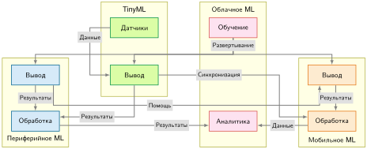

***Взаимодействия гибридной системы**: данные поднимаются вверх от датчиков через уровни обработки к облачной аналитике, а обученные модели развертываются вниз к точкам вывода на периферии, в мобильных устройствах и TinyML. Пять типов связей (развертывание, данные, результаты, помощь и синхронизация) задают распределенную архитектуру, в которой каждая парадигма вносит уникальные возможности.*

Производственные системы демонстрируют эти схемы интеграции, размещая границу каждого уровня у отдельного физического узкого места:

1. **Детекция дефектов на производстве**: сборочные линии с высокой частотой циклов требуют детерминированного визуального контроля менее 10 мс. Передача потоков камер высокого разрешения по WAN в дата-центр нарушает сроки контроля и исчерпывает пропускную способность восходящего канала завода. Система использует разделение «обучение — обслуживание»: централизованная облачная инфраструктура с модулями из нескольких ускорителей обучает модели зрения высокой емкости на исторических базах дефектов, затем компилирует и квантует веса для выполнения на периферийных серверах цеха и во встроенных умных камерах. Эти ускорители на площадке выполняют вывод через локальные интерфейсы камер PCIe или MIPI, гарантируя ограниченную задержку без внешних сетевых зависимостей.
2. **Мониторинг сельского хозяйства**: развернутые на сотнях гектаров удаленные почвенные зонды работают от батареек-таблеток или небольших солнечных сборщиков и обмениваются данными по маломощным радиоканалам LPWAN или LoRa с низкой скоростью передачи и высокой энергией на бит. Непрерывная передача телеметрии влажности и температуры исчерпывает запас батареи за дни. Иерархическая обработка оставляет высокочастотную выборку и базовое обнаружение аномалий микроконтроллерам TinyML, работающим при бюджетах мощности менее милливатта. Когда появляются аномалии, локальные периферийные шлюзы агрегируют измерения по пространственным кластерам зондов и передают по сотовой магистрали только сжатые сводки на уровне поля в облачные серверы, отвечающие за расписание орошения по всей ферме.
3. **Носимый фитнес-трекинг**: умные часы с батарейным питанием работают в жесткой тепловой оболочке, где рассеяние непрерывно работающего процессора должно оставаться ниже $1\text{ мВт}$. Система применяет постепенное развертывание в архитектуре шлюзов: легкие целочисленные ядра работают на встроенном микроконтроллере, отслеживая движение в реальном времени и обнаруживая пороги частоты сердечных сокращений; промежуточные биометрические данные синхронизируются по Bluetooth Low Energy (BLE) с парным смартфоном, который использует мобильные нейродвижки и гигабайты DRAM для классификации сложных паттернов активности; наконец, смартфон передает периодические сжатые сводки по Wi-Fi или сотовым сетям в облачную инфраструктуру для долгосрочного моделирования здоровья.

### Почему гибридные подходы работают

Хотя четыре уровня развертывания различаются на порядки величины по доступной энергии, объему памяти и вычислительной пропускной способности, они опираются на одни и те же системные основания. На [«Сближении систем ML»](02_ml_systems.md#fig-ml-systems-convergence) структурная иерархия показывает, как разные цели развертывания зависят от общих принципов управления данными, абстракций выполнения «аппаратура — ПО» и планирования ресурсов.

***Сближение систем ML**: несмотря на огромные различия ресурсов между облачным, периферийным, мобильным уровнями и TinyML, все развертывания сходятся на трех общих системных основах: конвейеры данных, управление ресурсами и архитектура «аппаратура — ПО». Эти общие опоры, в свою очередь, поддерживают единые требования к оптимизации производительности, эксплуатационному мониторингу и надежной инженерии.*

Это архитектурное сближение объясняет, почему инженерные оптимизации переносятся в обе стороны между масштабами железа: они нацелены на одни и те же физические узкие места. На всех уровнях чтение операнда из внешней памяти стоит на порядки больше энергии и задержки, чем арифметическая операция. Поскольку стена памяти управляет и встроенным микроконтроллером, и складским ускорителем, методы, разработанные в условиях крайних периферийных ограничений, напрямую снимают узкие места в дата-центре. Представления с пониженной точностью (например, FP8, INT8 и INT4), изначально созданные, чтобы уместить веса модели в мегабайты мобильной DRAM или килобайты SRAM микроконтроллера, решают ту же экономическую задачу в облачных кластерах: вдвое сокращают трафик DRAM и умножают эффективную пропускную способность тензорных ядер ([«Сжатие моделей»](10_model_compression.md)). Аналогично, слияние операторов и статическая подготовка памяти, разработанные для предотвращения выгрузки за пределы кристалла в мобильных SoC, напрямую уменьшают трафик HBM при облачном авторегрессивном декодировании. В обратную сторону методы разбиения вычислительных графов между распределенными облачными кластерами (глава [«Обучение моделей»](08_training.md#sec-model-training)) дают базовый формализм для разбиения стадий конвейера между разнородными мобильными SoC, содержащими отдельные CPU, GPU и нейропроцессорные блоки.

Общая системная основа распространяется на инженерию данных (глава [«Инженерия данных»](04_data_engineering.md#sec-data-engineering)), сжатие моделей (глава [«Сжатие моделей»](10_model_compression.md)) и эксплуатационные жизненные циклы (глава [«MLOps»](14_ml_ops.md#sec-ml-operations)). Эти инженерные принципы применимы, будь целью выполнения многоузловой модуль TPU или сверхмаломощный микроконтроллер ESP32. Поскольку базовые абстракции остаются инвариантными, инвариантны и их уязвимости: дрейф распределения данных, устаревание модели и деградация телеметрии повторяются на каждом уровне, требуя единой дисциплины мониторинга по всей гибридной иерархии.

> **Гибридные схемы ML**
>
> Гибридные архитектуры работают тогда, когда работа распределена между уровнями, а не когда один и тот же конвейер копируется повсюду.
>
> **Схемы интеграции**
>
> - **Разделение «обучение — обслуживание»**: можете ли вы объяснить, почему обучение в облаке и обслуживание на периферии или мобильном устройстве часто экономически оптимальны, даже когда модель работает локально?
> - **Иерархическая обработка**: можете ли вы описать, что делает каждый уровень в конвейере «датчик → периферия → облако», и почему перенос части решений вниз сокращает одновременно задержку и пропускную способность?
> - **Постепенное развертывание**: можете ли вы объяснить, как одно семейство моделей становится несколькими развернутыми артефактами (облако, периферия, мобильные устройства, TinyML) благодаря систематическому сжатию?
>
> **Проверки здравомыслия проекта**
>
> - **Выбор границы**: для конкретного приложения можете ли вы обосновать, где должна проходить граница уровней (задержка, приватность, пропускная способность, мощность), а не только то, какую модель использовать?
> - **Синхронизация состояния**: можете ли вы указать, какие определения признаков, версии моделей и логика предобработки должны оставаться синхронизированными между уровнями?

## Системная энтропия: почему развертывание — не конец

Во всех парадигмах развертывания, обобщенных на [«Сближении систем ML»](02_ml_systems.md#fig-ml-systems-convergence), системы ML имеют эксплуатационную уязвимость, которой нет у классического программного обеспечения. В традиционных вычислениях скомпилированный бинарный файл работает по детерминированному контракту: пока ячейки памяти сохраняют заряд, шины процессора передают биты без искажений, а входные буферы удовлетворяют заявленным предусловиям, процедура сортировки или обращения матрицы выполняется одинаково миллионы раз. Машинное обучение нарушает это постоянство. По таксономии D·A·M алгоритм ($A$) и машина ($M$) после развертывания остаются статичными: веса модели находятся в памяти, а среда выполнения исполняет один и тот же вычислительный граф при каждом прямом проходе. Но распределение эксплуатационных данных ($D$) непрерывно меняется по мере изменения поведения пользователей, дрейфа калибровки датчиков и колебаний среды. Поскольку параметры модели представляют собой эмпирическую подгонку под фиксированное обучающее распределение $P_{\text{train}}$, любое расхождение живого распределения $P_{\text{live}}$ порождает **системную энтропию**: постоянное ухудшение качества предсказаний, которое происходит даже тогда, когда код, веса модели и среда выполнения остаются побайтно идентичными.

Диагностическое приближение из [«уравнения деградации качества систем ML»](02_ml_systems.md#eq-ml-systems-quality-degradation) формализует эту скорость деградации: качество системы снижается по мере роста статистического расстояния $\mathcal{D}(P_{\text{train}}, P_{\text{live}})$ между обучающим и живым распределениями, масштабированного чувствительностью модели $S_{\text{shift}}$ к сдвигу распределения:

$$ \Delta \text{Качество} \approx - S_{\text{shift}} \cdot \mathcal{D}(P_{\text{train}}, P_{\text{live}}) $$

Поскольку движки вывода сообщают об успехе, пока матричные умножения завершаются без числовых исключений и ошибок памяти, статистическая деградация остается невидимой для традиционного мониторинга инфраструктуры. Модель без мониторинга продолжает выдавать предсказания с высокой уверенностью, тогда как ее эксплуатационная полезность неуклонно падает. Поэтому надежность системы требует непрерывной статистической телеметрии, чтобы обнаруживать, когда дрейф распределения требует обновления модели, — эксплуатационная дисциплина, разобранная в главе [«MLOps»](14_ml_ops.md#sec-ml-operations).

Когда модель без мониторинга напрямую связана с автоматическим исполнением, статистическая деградация быстро перерастает в физический или финансовый сбой. Крах Zillow Offers показывает, как накапливающаяся ошибка оценки в разомкнутой системе может уничтожить целое подразделение бизнеса.

> **Крах Zillow Offers (2021)**
>
> **Контекст**: Zillow, площадка для торговли недвижимостью, запустила «Zillow Offers», чтобы покупать дома напрямую в рамках бизнеса iBuying, который зависел от прогноза цен на жилье и экономики перепродажи (Zillow Group, 2021).
>
> **Механизм**: Zillow сообщила, что покупала дома по ценам выше своих пересмотренных оценок будущих цен продажи, а ограничения пропускной способности перепродажи задерживали некоторые сделки (Zillow Group, 2021). Неопределенность прогноза превратилась в риск запасов, потому что система связывала оценки цен с обязательствами по покупке.
>
> **Последствия**: Zillow списала 304 миллиона долларов жилищных запасов, сократила 25 процентов персонала (2000 сотрудников) и окончательно закрыла подразделение Offers.
>
> **Реакция**: более безопасная конструкция ограничивала бы риск запасов, сохраняла ручные переопределения и ставила автоматические выключатели между неопределенностью прогноза и решениями о покупке.
>
> **Системный урок**: сдвиг распределения превращает статистическую деградацию в серьезный деловой риск, когда программное обеспечение напрямую связывает предсказания с действиями в балансе. Производственные системы в динамичной среде требуют автоматических выключателей и петель обратной связи, которые ограничивают реальный риск, когда живые распределения ошибок расширяются.

Провал Zillow Offers показывает, что система машинного обучения включает и предсказательную модель, и эксплуатационную петлю обратной связи, которая действует на ее выходы. Рассмотрение развертывания как окончательной передачи, при которой обученная модель замораживается и оставляется работать без присмотра, игнорирует реальность системной энтропии. Статистическая деградация данных ($D$) неизбежно подрывает гарантии алгоритма ($A$) и машины ($M$). Защита производственного конвейера требует инженерных мер по всей архитектуре — от телеметрии дрейфа входов и шлюзов валидации до автоматических выключателей. Однако управление системной энтропией — лишь одна часть эксплуатационной дисциплины; перемещение по физическим ограничениям развертывания также требует отказа от укоренившихся допущений, перенесенных из классической инженерии программного обеспечения.

## Заблуждения и ловушки

Помимо статистической деградации, инженеры нередко попадают в архитектурные заблуждения о развертывании ML. Физические ограничения, управляющие перемещением данных, теплоотводом и балансом аппаратуры, создают контринтуитивное поведение, которое ставит под сомнение стандартную интуицию инженерии программного обеспечения. Приведенные ниже заблуждения и ловушки описывают типичные режимы отказа, в которых системы критически не соответствуют своим физическим эксплуатационным оболочкам.

> **Заблуждение и ловушка**
>
> **Заблуждение:** *одна парадигма развертывания решает все задачи ML.*
>
> Физические ограничения создают жесткие границы, которые не может охватить ни одна парадигма. Обсуждение стены памяти в [«Балансе системы и аппаратуре»](02_ml_systems.md#sec-ml-systems-system-balance-hardware-96ab) показывает, что пропускная способность памяти, ее емкость и задержка доступа растут гораздо медленнее сырых арифметических вычислений, создавая разные физические узкие места на уровнях развертывания. [«Сравнение парадигм по четырнадцати измерениям»](02_ml_systems.md#tbl-big_vs_tiny) перечисляет иллюстративные эксплуатационные оболочки, а не границы задержки, основанные только на физике. Система робототехники реального времени, которой нужен отклик менее 10 мс, не может использовать удаленный облачный путь, сетевой цикл «туда и обратно» которого превышает этот бюджет, а модель языка с миллиардом параметров не может уместиться в 256 КБ SRAM микроконтроллера независимо от сжатия. Устойчивые архитектуры часто сочетают парадигмы, используя облачные ресурсы для распределенного обучения и пиковой емкости, а локальный вывод или предобработку датчиков выполняя на клиентских устройствах.
>
> Связанное заблуждение предполагает, что перенос вычислений ближе к пользователю всегда сокращает задержку, не учитывая задержку выполнения, которую вносят процессоры периферии с тепловыми ограничениями или меньшей пропускной способностью, — компромисс, разобранный в разделе [«Бенчмарки вывода»](12_benchmarking.md#sec-benchmarking-inference-benchmarks-2c1f).

> **Заблуждение и ловушка**
>
> **Ловушка:** *полагаться на оптимизацию модели, чтобы преодолеть мобильные ограничения по мощности и теплу.*
>
> Методы сжатия не могут преодолеть фундаментальные термодинамические пределы. Рассмотрим смартфон с батареей 15 Вт·ч. Легкая нагрузка вывода, потребляющая 1 Вт, работает $\frac{15\ \text{Вт}\cdot\text{ч}}{1\ \text{Вт}} = 15$ ч, а интенсивная нагрузка, потребляющая 5 Вт — типичная для неоптимизированных фундаментальных моделей на устройстве, — истощает ту же батарею за $\frac{15\ \text{Вт}\cdot\text{ч}}{5\ \text{Вт}} = 3$ ч.
>
> Устойчивая работа на 5 Вт также вызывает сильный тепловой троттлинг, поскольку корпус смартфона рассчитан примерно на 3 Вт для установившегося пассивного рассеяния. Хотя квантование параметров FP32 в INT8 дает иллюстративное четырехкратное снижение объема памяти, динамическая энергия переключения и статическая утечка не уменьшаются пропорционально. Непрерывный конвейер вывода, превышающий пассивную тепловую оболочку, неизбежно вызывает динамическое масштабирование частоты, вынуждая инженеров снижать рабочие циклы, перестраивать архитектуры моделей или переносить вычисления на специализированный кремний ускорителей.

> **Заблуждение и ловушка**
>
> **Заблуждение:** *TinyML — это уменьшенное мобильное ML.*
>
> Граница между TinyML и мобильным развертыванием качественная: физические ограничения вынуждают к принципиально разным алгоритмическим и исполнительным моделям. Как установлено в [«Преимуществах TinyML и эксплуатационных компромиссах»](02_ml_systems.md#sec-ml-systems-tinyml-advantages-operational-tradeoffs-2d40), микроконтроллеры имеют от 256 КБ до 1 МБ SRAM, тогда как мобильные платформы имеют 8–16 ГБ LPDDR DRAM — разница в емкости в 10 000 раз, которая определяет, что помещается в памяти. Там, где мобильные системы выполняют модели с десятками миллионов параметров, архитектуры TinyML ограничены десятками или сотнями тысяч параметров, требуя специализированных depthwise-операций и планирования слоев, направленного на минимизацию пиковой памяти активаций. Бюджеты рабочей мощности демонстрируют еще более резкий разрыв: мобильный вывод потребляет 3–5 Вт, тогда как TinyML рассчитан на 1–10 мВт, чтобы работать внутри оболочек сбора энергии. Команды, которые применяют мобильные методы оптимизации напрямую в средах TinyML, обнаруживают, что посттренировочного квантования из FP32 в INT8 недостаточно, когда совокупная рабочая память должна помещаться в 64 КБ SRAM, что вынуждает к полной алгоритмической переработке.

> **Заблуждение и ловушка**
>
> **Ловушка:** *минимизация вычислительных ресурсов минимизирует общую стоимость.*
>
> Оптимизация вычислительных ресурсов на вывод изолированно часто увеличивает операционные расходы и замедляет темп развертывания. Как подчеркивает рамка решения в [«Рамке решения»](02_ml_systems.md#sec-ml-systems-decision-framework-241f), выбор архитектуры требует оценки совокупной стоимости владения (TCO) по всему жизненному циклу системы, а не только счетов за серверы. В этом сценарии облачный сервис вывода, стоящий \$2 000/мес. за вычисления, выглядит дорого по сравнению с \$500/мес. амортизированного периферийного железа. Однако распределенный периферийный парк вносит повторяющиеся эксплуатационные расходы: сетевая инженерия (\$3 000/мес.), полевое сопровождение оборудования (\$500/мес.) и инженерия надежности парка (\$2 000/мес.). Это доводит общие эксплуатационные затраты периферии до \$6 000/мес. — рост в 3 раза относительно облачной базы. Кроме того, если облачный управляемый сервис выходит в производство за два месяца, а собственная периферийная инфраструктура требует шести, четырехмесячная задержка влечет серьезные альтернативные издержки. Грамотная системная инженерия балансирует вычислительную эффективность со скоростью разработки, управляемостью парка и эксплуатационным сопровождением.

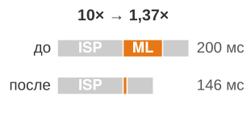

*Более быстрая стадия модели не ускоряет конвейер камеры линейно.*

> **Заблуждение и ловушка**
>
> **Заблуждение:** *оптимизация модели линейно переходит в ускорение системы.*
>
> Закон Амдала[^fn-amdahls-law-pipeline] определяет, что сквозное ускорение строго ограничено временем выполнения неускоренных стадий. Формализованное через принцип узкого места ([«Принцип узкого места»](02_ml_systems.md#sec-ml-systems-bottleneck-principle-3514)) и выведенное в приложении (см. раздел о законе Амдала для сильного масштабирования), достижимое ускорение системы равно $\text{Ускорение}_{\text{overall}} = \frac{1}{(1-p) + \frac{p}{s}}$, где $p$ — доля общего времени выполнения, подлежащая ускорению, а $s$ — коэффициент ускорения этой изолированной доли. Рассмотрим нажатие кнопки спуска камеры смартфона. Как показано на рисунке выше, конвейер захвата обрабатывает сырые кадры сенсора через 100 мс обработки сигнала изображения (ISP: автоэкспозиция и баланс белого), 60 мс классификации сцены с помощью ML и 40 мс тонального отображения и слияния HDR — всего 200 мс. Ускорение стадии нейросети в 10 раз (6 мс вместо 60 мс) снижает полную задержку с 200 мс до 146 мс. Несмотря на десятикратное ускорение модели, сквозная задержка улучшается лишь в 1,37 раза. Даже снижение задержки модели до нуля $(s = \infty)$ дает максимальное ускорение 1,43×, ограниченное оставшимися 70 процентами неускоренного выполнения конвейера. Оптимизация ML-системы требует профилирования всего графа выполнения; ускорение изолированной стадии дает убывающую отдачу, как только эта стадия перестает быть узким местом критического пути.
>
> [^fn-amdahls-law-pipeline]: **Закон Амдала**: сформулирован Амдалом (Amdahl, 1967) для масштабирования многопроцессорных систем; этот принцип напрямую применим к конвейерам развертывания ML, где модель — лишь одна стадия среди многих. В примере с камерой вывод ML составляет 60 мс из 200 мс; даже ускорение модели в 100 раз дает лишь примерно 1,4–2-кратное улучшение сквозной задержки, потому что остальной конвейер не меняется. Команды, которые бенчмаркают задержку модели изолированно, систематически переоценивают выигрыш развертывания.

> **Заблуждение и ловушка**
>
> **Ловушка:** *предположение, что больше обучающих данных всегда улучшает качество развернутой модели.*
>
> Три ограничения задают пределы отдачи от масштабирования данных, как проанализировано для архетипов нагрузок в [«Анализе нагрузок»](02_ml_systems.md#sec-ml-systems-analyzing-workloads-cbb8). Во-первых, алгоритмическая емкость ($A$) насыщается: когда бюджет параметров модели фиксирован, дополнительные обучающие данные не могут преодолеть представительные узкие места, как только архитектура исчерпывает свою выразительную способность. Во-вторых, качество данных ($D$) важнее сырого объема: шум меток, ошибки калибровки датчиков и артефактные корреляции загрязняют обновления градиентов, поэтому масштабированные испорченные корпуса усиливают систематическое смещение вместо улучшения обобщения. В-третьих, согласованность распределения определяет полезность в реальном мире: высококачественные данные эксплуатации из той же области стабильно дают лучшую точность обслуживания по сравнению с массивными наборами данных вне области, которые не отражают физической среды производства.

> **Заблуждение и ловушка**
>
> **Заблуждение:** *один бинарный файл модели может эффективно обслуживать любую периферийную аппаратную цель.*
>
> Команды часто компилируют один артефакт модели и развертывают его одинаково на разных устройствах, рассматривая развертывание как этап упаковки, а не как задачу совместного проектирования с аппаратурой. На практике компиляция под конкретное железо и понижение ядер фиксируют важные эффективности, которые теряют универсальные бинарные файлы. Например, выполнение квантованных операций INT8 на специализированном нейропроцессорном блоке (NPU) дает заметно большую пропускную способность на ватт, чем выполнение той же модели на универсальном CPU, поскольку тензорные движки INT8 с фиксированной функцией избегают накладных расходов на декодирование инструкций и энергии тракта с плавающей запятой. Кроме того, слияние операторов сохраняет промежуточные тензоры активаций в SRAM на кристалле или регистровых файлах, а не выгружает их в энергозатратную внешнюю DRAM. Аналогично, настройка раскладки памяти, выравнивающая каналы тензоров с векторными регистрами ускорителя, устраняет некоалесцированные обращения к памяти. Как установлено в анализе парадигм развертывания в [«Рамке парадигм развертывания»](02_ml_systems.md#sec-ml-systems-deployment-paradigm-framework-0d25), аппаратные архитектуры накладывают расходящиеся ограничения на выполнение: бинарный файл, скомпилированный для CPU Arm Cortex-A78, не использует плотно связанную SRAM-скретчпад и систолические массивы NPU Arm Ethos-U. Переносимый артефакт модели служит лишь промежуточным представлением; производственное развертывание требует компиляции и профилирования под целевую среду выполнения, аппаратный делегат, иерархию памяти и тепловую оболочку.

## Итоги

Инженерия систем ML управляется физической реальностью: каждая цель развертывания задает собственный аппаратный контракт. Железный закон систем ML ($T = \frac{D_{\text{vol}}}{\text{BW}} + \frac{O}{R_{\text{peak}} \cdot \eta_{\text{hw}}} + L_{\text{lat}}$) объединяет эти физические пределы в единую модель выполнения: задержка распространения дает фиксированную задержку ($L_{\text{lat}}$), стена памяти ограничивает перемещение данных ($D_{\text{vol}}/\text{BW}$), а тепловые бюджеты мощности ограничивают устойчивые вычисления. На уровнях облака, периферии, мобильных устройств и TinyML категориальная энергетическая оболочка от мегаватт до милливатт охватывает девять порядков величины, тогда как представительные системы занимают внутри нее более узкие диапазоны.

Применяя принцип узкого места к архетипам нагрузок, инженеры определяют, доминирует ли в задержке модели эффективность вычислений, пропускная способность памяти или сетевой транзит, прежде чем выбрать архитектуру одного узла или гибридную. Количественные компромиссы ([«Сравнение парадигм по четырнадцати измерениям»](02_ml_systems.md#tbl-big_vs_tiny)) и систематическая рамка решения ([«Отсев решений о развертывании»](02_ml_systems.md#fig-mlsys-playbook-flowchart)), разработанные в этой главе, задают физические базовые линии, которые управляют всеми последующими решениями в сжатии моделей, проектировании конвейеров данных и высокопроизводительном обслуживании.

> **Одна модель, разная инженерия**
>
> * **Физические ограничения определяют осуществимость**: скорость света (около 36 мс межконтинентального цикла «туда и обратно»), стена мощности, стена памяти и бюджеты задержки создают жесткие границы, которые инженерия не может преодолеть, а может только обходить.
> * **Выявляйте узкие места до оптимизации**: одна и та же модель ограничена вычислениями в обучении, но ограничена памятью в выводе. Железный закон и принцип узкого места указывают, какое ограничение доминирует; оптимизация не того члена дает нулевое ускорение.
> * **Архетипы нагрузок определяют осуществимость развертывания**: «вычислительный зверь», такой как обучение крупномасштабных моделей зрения, часто требует облачных ресурсов; «жесткое ограничение», такое как распознавание ключевых слов, требует эффективности микроконтроллера. Одна и та же стратегия оптимизации не может обслужить оба; инженеры должны сопоставлять архетип нагрузки с парадигмой развертывания.
> * **Мощность развертывания охватывает девять порядков**: инфраструктура облачного дата-центра работает на уровне мегаватт, тогда как системы TinyML нацелены на милливатты. Этот разрыв открывает совершенно разные классы приложений, а не является ограничением.
> * **Гибридные архитектуры распространены в производственных системах**: голосовые ассистенты охватывают TinyML (слово пробуждения), мобильное ML (речь в текст) и облако (понимание языка). Когда одной парадигмы недостаточно, схемы интеграции (разделение «обучение — обслуживание», иерархическая обработка, постепенное развертывание) формализуют способы сочетания парадигм.
> * **Системное ускорение подчиняется закону Амдала, а не выигрышам на уровне модели**: в разобранном конвейере камеры 10-кратно более быстрая модель дает лишь 1,37-кратное ускорение системы, когда ML занимает 30 процентов конвейера. Профилируйте всю систему перед оптимизацией любого компонента.
> * **Развертывание начинает петлю обратной связи**: живые данные могут расходиться с условиями обучения, пока код и веса остаются неизменными, поэтому мониторинг и ограниченная эксплуатационная экспозиция — часть архитектуры системы.

Парадигмы развертывания — не произвольные предпочтения проектирования; это непрерывные эксплуатационные области, продиктованные физическими законами. Выбор цели развертывания меняет то, какой член железного закона, скорее всего, будет связывать: обучение в дата-центре может упираться в пиковые вычисления ($O/R_{\text{peak}}$), мобильный вывод может столкнуться с пропускной способностью памяти ($D_{\text{vol}}/\text{BW}$), а удаленный вывод в реальном времени может ограничиваться задержкой распространения ($L_{\text{lat}}$). Системная инженерия начинается с измерения этого связывающего ограничения. Оптимизация архитектуры модели или программных сред выполнения без учета нижележащего аппаратного контракта порождает хрупкие системы, которые ломаются под давлением реальной эксплуатации.

> **От теории к процессу**
>
> Хотя физические ограничения и рамка решения, установленные в [«Рамке решения»](02_ml_systems.md#sec-ml-systems-decision-framework-241f), определяют, где ML-система может физически выполняться, одной физической осуществимости недостаточно для успеха эксплуатации со временем. Как показало списание Zillow на \$304 млн ([Zillow Group, 2021](https://www.zillow.com/)), развертывание моделей в производстве требует сдерживания неопределенности прогноза и управления эксплуатационным риском на протяжении всего программного жизненного цикла. [«Рабочий процесс машинного обучения»](03_ml_workflow.md#sec-ml-workflow) вводит жизненный цикл разработки ML — систематический инженерный процесс, который ведет систему от постановки задачи через развертывание, мониторинг и сопровождение.
