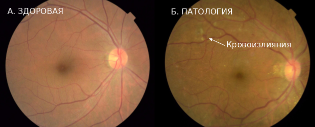
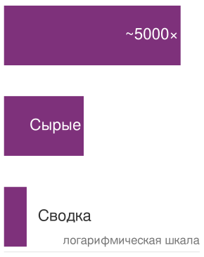
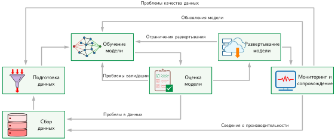
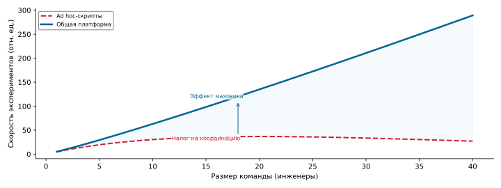
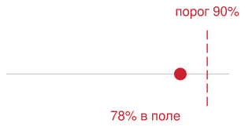
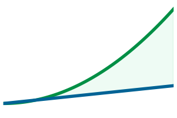
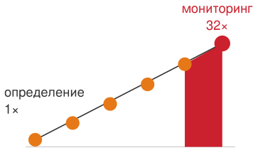
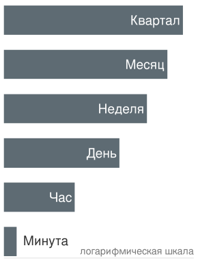

# Рабочий процесс машинного обучения

## Назначение

_Почему, прежде чем идти по какому-либо одному пути, необходимо увидеть всю карту?_

Таксономия D·A·M называет компоненты любой системы ML, а место развертывания определяет физические ограничения, которым должен удовлетворять каждый компонент. Команды часто рассматривают их как отдельные задачи: одна команда собирает данные, другая проектирует модель, третья закупает оборудование. Но самый глубокий урок таксономии в том, что эти компоненты взаимодействуют. Собранные данные ограничивают, какие алгоритмы возможны. Выбранный алгоритм определяет, какое оборудование способно его выполнить. Целевое оборудование меняет то, какие данные можно обработать. Потяните за любую одну нить, и вся система сдвинется. Эти взаимодействия проявляются между компонентами и во времени. Модель, которая хорошо работает при запуске, может деградировать по мере сдвига распределения данных, и тогда нужно разбираться в причинах и, если есть основания, обновлять модель или данные. Оптимизация каждой части в отрыве от остальных именно так и приводит к тому, что команды создают точные модели, которые невозможно развернуть, и эффективные конвейеры, которые подают на вход не те данные. Инженер данных, который видит, как решения по предобработке ограничивают последующие архитектуры, строит иные конвейеры, чем тот, кто воспринимает подготовку данных как изолированную задачу; разработчик модели, который с первого дня знает бюджет памяти целевого устройства, принимает другие архитектурные решения, чем тот, кто гонится за точностью в вакууме. Прежде чем вникать в детали любого отдельного компонента, нужна полная карта того, как ML-система создается, оценивается и поддерживается как единое целое. Рабочий процесс ML приводит эту карту в движение через итеративное D·A·M-совместное проектирование данных, алгоритма и машины, пока возникающие возможности системы не начнут соответствовать требованиям реального мира.

> **Цели обучения**
>
> - Описать шесть этапов жизненного цикла ML как согласованные решения о данных, алгоритме и машине с обратной связью
> - Сравнить рабочие процессы ML с традиционным программным обеспечением по признакам дрейфа, недетерминированности и операционной обратной связи
> - Проанализировать, как ограничения постановки задачи распространяются через данные, моделирование, валидацию и развертывание
> - Рассчитать стоимость интеграции при позднем обнаружении ограничений по принципу распространения ограничений рабочего процесса
> - Оценить компромиссы между точностью, эффективностью, воспроизводимостью и готовностью к развертыванию на разных этапах жизненного цикла
> - Спроектировать петли обратной связи, которые связывают сигналы мониторинга с переобучением, сопровождением и пересмотренными требованиями

## Жизненный цикл ML

Типичный сбой развертывания иллюстрирует опасность несогласованной инженерии. День 1: «Построить диагностическую модель для сельских клиник». День 90: точность 95 процентов на тестовой выборке. День 120: точность 96 процентов после месяца подбора архитектуры. День 150: модель передана инженерам развертывания. День 151: инженеры развертывания сообщают, что модели требуется 4 ГБ памяти. День 152: кто-то проверяет целевое устройство: планшеты в передвижных клиниках с 512 МБ доступной памяти. День 153: пять месяцев работы выброшены.

Точность модели была отличной. Навыки команды в машинном обучении были отличными. *Сбой был сбоем рабочего процесса.* Ограничение развертывания, которое должно было формировать каждое решение с первого дня, обнаружили только тогда, когда работа была завершена. Ограничение по памяти планшета должно было распространиться назад, на первое совещание по архитектуре, отсекая модели, которые вообще стоило рассматривать. Вместо этого команда оптимизировала каждый компонент в отрыве от остальных (сбор данных, выбор архитектуры, обучение), и проблема интеграции проявилась только при сборке частей вместе. Задокументированное развертывание системы скрининга диабетической ретинопатии (DR) выявило похожие пробелы в рабочем процессе и инфраструктуре.[^fn-beede-clinical-deployment]

[^fn-beede-clinical-deployment]: **Разрыв между лабораторией и развертыванием**: эмпирически это показано для системы глубокого обучения для скрининга диабетической ретинопатии, развернутой в тайских клиниках (Beede et al., 2020). Хотя на более раннем этапе валидации система демонстрировала точность на уровне специалистов, 393 из 1 838 отправленных снимков (21 процент) не прошли требования к качеству изображения: часто причиной было освещение клиники, обслуживание камер или практика расширения зрачка, не совпадавшая с допущениями системы. Эти отказы добавляли работы медсестрам, требовали повторных съемок или направлений и выявили барьеры в рабочем процессе и инфраструктуре, а не просто проблему точности модели.

Системы ML объединяют данные, алгоритм и машину в условиях физических ограничений, которые делят развертывание на облачное, периферийное, мобильное и TinyML. Каждое из них накладывает жесткие физические пределы на пропускную способность вычислений, объем памяти и рассеяние тепла. Чтобы соединить эти компоненты в работающую систему, нужно организовать распространение ограничений между данными, алгоритмом и машиной.

**Рабочий процесс ML** — это инженерная рамка, призванная предотвращать сбои интеграции: она делает ограничения явными на каждом этапе разработки и прослеживает, как они распространяются между данными, алгоритмом и машиной. Здесь проходит переход от исследователя моделей к системному инженеру. Исследователь оптимизирует отдельные элементы: более удачную архитектуру, более чистый набор данных, более быстрый ускоритель. Системный инженер организует эти элементы в производственные системы, которые надежно приносят пользу. Сбой на 153-й день не был вызван изолированным дефектом моделирования, данных или оборудования; он возник из неуправляемого взаимодействия всех трех. Рабочий процесс дает ментальную карту, которая удерживает технические решения связанными с большой системой.

**Жизненный цикл машинного обучения** — это рамка оркестрации такой работы: структурированный итеративный процесс[^fn-crisp-dm-lifecycle], который направляет разработку, оценку и улучшение систем ML (Amershi et al., 2019). Формальное определение подчеркивает непрерывное управление, а не однократный выпуск.

[^fn-crisp-dm-lifecycle]: **CRISP-DM (межотраслевой стандартный процесс интеллектуального анализа данных)**: CRISP-DM описал разработку систем, интенсивно работающих с данными, как шесть взаимосвязанных итеративных фаз, а не как линейный водопад (Chapman et al., 2000). Его базовый принцип проектирования (петли обратной связи между всеми фазами) непосредственно лег в основу структуры современного жизненного цикла ML. Работа Боэма по экономике разработки программного обеспечения обсуждала более высокую стоимость поздних исправлений (Boehm, 1981). Модель рабочего процесса далее использует $2^{N_{\text{stage}}-1}$, где $N_{\text{stage}}$ — индекс этапа жизненного цикла, как иллюстративный сценарий чувствительности, а не как эмпирический закон стоимости.

> **Жизненный цикл машинного обучения**
>
> ***Жизненный цикл машинного обучения*** — это итеративный инженерный процесс создания, развертывания, мониторинга и обновления систем ML, в котором данные с поздних этапов могут возвращаться на ранние, поскольку качество модели может меняться после развертывания.
>
> 1.  **Значение**: жизненный цикл — это замкнутая петля, а не линейный конвейер. Расхождение распределений $\mathcal{D}(P_t \lVert P_0)$ между текущим трафиком и трафиком обучения служит сигналом тревоги, повышающим вероятность потери точности; точная зависимость определяется моделью, метками, функцией потерь и распределением при эксплуатации. Полный прогон переобучения требует вычислений стоимостью $O/(R_{\text{peak}} \cdot \eta_{\text{hw}})$, тогда как частичные или инкрементальные обновления могут обойтись дешевле. Скорость дрейфа и задержка валидации поэтому превращают сопровождение жизненного цикла в задачу бюджетирования, а не только инженерную задачу.
> 2.  **Отличие**: в отличие от традиционного ПО, поведение которого меняется при изменении кода, конфигурации, зависимостей или окружения, поведение ML может меняться и тогда, когда меняется сам мир. Точность развернутой модели может снижаться из-за сдвига распределения, даже если код, инфраструктура и конфигурация остаются прежними.
> 3.  **Типичная ошибка**: частое заблуждение состоит в том, что жизненный цикл заканчивается развертыванием. На самом деле развертывание — это начало петли обратной связи: мониторинг в эксплуатации выявляет дрейф, дрейф запускает расследование, а данные о результатах определяют, должна ли переобученная модель вернуться на этап развертывания.

Здесь *жизненный цикл* описывает сами этапы, а *рабочий процесс* — инженерную дисциплину их организации: жизненный цикл — это то, *что проходят*, рабочий процесс — это то, *как управляется прохождение*. Это различие требует **системного мышления**: анализа того, как части системы связаны между собой, а не рассмотрения их изолированно. Закономерности, сформулированные в разделе [«Системное мышление»](03_ml_workflow.md#sec-ml-workflow-integrating-systems-thinking-principles-24c0) и проиллюстрированные подробным разбором случая, объясняют, почему системам ML нужны интегрированные инженерные подходы, а не последовательная оптимизация компонентов.

Понимание того, как эти этапы связаны между собой, необходимо до анализа отдельных слоев: каждая техническая область, от конвейеров хранения (глава [«Инженерия данных»](04_data_engineering.md#sec-data-engineering)) до обучения моделей (глава [«Обучение моделей»](08_training.md#sec-model-training)), среды выполнения (глава [«Фреймворки машинного обучения»](07_frameworks.md#sec-ml-frameworks)) и инфраструктуры обслуживания (глава [«Обслуживание моделей»](13_model_serving.md#sec-model-serving)), работает как взаимозависимая система. На [«Двухконвейерной разработке ML»](03_ml_workflow.md#fig-ml-lifecycle) горизонтальная компоновка отделяет верхний конвейер данных от нижнего конвейера разработки моделей, а изогнутые обратные векторы показывают, как сведения из эксплуатации и дефекты данных возвращаются на более ранние этапы.

***Двухконвейерная разработка ML**: инженерия ML разделяется на параллельные конвейеры данных и моделей, работающие в разных временных масштабах. Пока конвейер модели выполняет быстрый внутренний цикл обучения и оценки, внешняя обратная связь от производственного развертывания и валидации данных непрерывно переформирует более ранние этапы сбора, разметки и отбора данных.*

Концептуальные этапы жизненного цикла ML задают *что* и *зачем* процесса разработки. Операционный уровень составляет *как*: реализацию этого цикла через автоматизацию, инструменты и инфраструктуру. Глава [«MLOps»](14_ml_ops.md#sec-ml-operations) подробно описывает эти практики. Различие важно: жизненный цикл — это концептуальная рамка, а операционная инфраструктура — механизм, который реализует его в масштабе.

### Количественная оценка жизненного цикла ML

Распределение времени практиков показывает, где жизненный цикл на самом деле создает узкие места: инженерные усилия редко концентрируются там, где научная литература отводит больше всего страниц. Концептуальные модели жизненного цикла ML описывают, какие этапы существуют, но системные решения опираются на количественную реальность: сколько часов инженеров уходит на каждый этап, сколько вычислений потребляется и какие остановки конвейера задерживают развертывание.

Опросы практиков выявляют резкую асимметрию между тем, где сосредоточено внимание исследований, и тем, где тратятся инженерные часы: сбор и подготовка данных занимают 79 процентов времени практиков. На [«Где специалисты по данным тратят больше всего времени»](03_ml_workflow.md#fig-ds-time) круговая диаграмма показывает заявленные основные статьи затрат времени: доминирующие сектора сбора и подготовки данных противопоставлены узкой доле, которую занимают проектирование архитектуры модели и настройка алгоритма.

***Где специалисты по данным тратят больше всего времени**: в опросе CrowdFlower 2016 года 60 процентов респондентов назвали очистку и организацию данных видом деятельности, на который уходит больше всего времени, а 19 процентов выбрали сбор данных. Ответы, связанные с моделью (поиск закономерностей, формирование обучающей выборки и уточнение алгоритма), вместе составляют около 16 процентов. Источник: CrowdFlower, *Data Science Report 2016*.*

Эти доли опроса показывают, почему инженерию данных нельзя рассматривать как второстепенную подготовительную работу. Конвейеры данных — главный источник операционного трения, циклов итераций и системного риска. Освоение инфраструктуры данных (глава [«Инженерия данных»](04_data_engineering.md#sec-data-engineering)) дает наибольшую отдачу, прежде чем переходить к архитектурам моделей и оптимизациям обучения, которые потребляют ее результаты.

Помимо распределения времени, скорость итераций определяет ход проекта. Возвратные векторы на [«Двухконвейерной разработке ML»](03_ml_workflow.md#fig-ml-lifecycle) — не редкие исключения; это пути, которые команды проходят снова и снова. Когда качество данных падает из-за сдвига распределения или неверных меток, переработка возвращает команду к сбору. Когда архитектура превышает память ускорителя или страдает от численной нестабильности, инженеры должны пересматривать проект модели. Когда слой обслуживания выходит за бюджеты задержки, конвейер развертывания останавливается. Каждая петля съедает календарное время и вычислительный бюджет и увеличивает стоимость разработки всякий раз, когда последующие этапы не ловят нарушения на раннем уровне.

*При принятых допущениях модель с более быстрым циклом итераций немного опережает конкурента через 26 недель.*

> **Налог на итерации**
>
> **Задача**: система скрининга DR для сельских клиник должна выбрать между большим ансамблем, обученным на изображениях глазного дна высокого разрешения (время обучения: 1 неделя, точность: 95 процентов), и легкой моделью, пригодной для периферийного развертывания на оборудовании клиники (время обучения: 1 час, точность: 90 процентов). Какая модель при этих допущениях имеет более высокую расчетную точность через шесть месяцев?
>
> **Расчет**: за шесть месяцев (примерно 26 недель) возможное число экспериментов составляет:
>
> 1. Большая модель: 26 недель календарного времени при 1 неделе на эксперимент. Каждый эксперимент, по допущению, улучшает точность на постоянную величину примерно 0,15 процентного пункта.
> 2. Малая модель: 26 недель календарного времени при 168 ч в неделю дают 4 368 возможных экспериментов по 1 часу каждый. На такой длине цикла машинное время не является лимитирующим фактором, поэтому в этом сценарии как *эффективные* эксперименты учитываются только 100 из них: столько команда реально может спроектировать, провести и усвоить за шесть месяцев. Остальная мощность простаивает из-за нехватки гипотез. Даже при меньшем допущенном приросте за итерацию большее число полезных итераций может дать больший совокупный прирост.
>
> **Результат**: если каждая итерация в среднем улучшает точность на 0,1 процентного пункта, малая модель начинается с 90 процентов и достигает 100 процентов после 100 эффективных итераций, до применения потолка в 99 процентов. С учетом потолка в 99 процентов малая модель достигает 99 процентов. Большая модель начинается с 95 процентов и достигает 98,9 процента после 26 более медленных итераций. На практике быстрая итерация малой модели позволяет находить лучшие архитектуры, аугментации данных, сохраняющие метки, и настраиваемые параметры обучения.
>
> **Системный вывод**: *скорость итераций — это преимущество.* Когда достижимое качество кандидатов сопоставимо, а полезные эксперименты имеют близкую ожидаемую ценность, более короткие циклы расширяют часть пространства проектирования, которую команда может проверить. Одна лишь скорость не гарантирует, что малая модель превзойдет большую. В сценарии скрининга DR быстрый цикл итераций легкой модели позволяет команде значительно быстрее экспериментировать с входными преобразованиями, сохраняющими метки, конвейерами предобработки и вариантами архитектуры.

Накапливающаяся задержка задает **налог на итерации**: время ожидания медленных прогонов обучения или громоздких конвейеров валидации сокращает число кандидатов-моделей, которые команда может проверить. Поздние открытия усиливают этот штраф,[^fn-boehm-cost-curve] что формализуется принципом распространения ограничений ([«Принцип распространения ограничений»](03_ml_workflow.md#sec-ml-workflow-decisions-cascade-system-98f4)). Нарушения, обнаруженные после развертывания, вынуждают делать дорогостоящие откаты на каждом предыдущем этапе. Эта асимметрия требует явных **контрактов интерфейсов этапов**: проверка выходов на каждой границе этапа перехватывает дефекты до того, как они перерастут в системную переработку. [«Спецификация интерфейсов этапов»](03_ml_workflow.md#sec-ml-workflow-stage-interface-specification-ae3c) формализует эти контракты для всех шести этапов.

[^fn-boehm-cost-curve]: **Затраты на позднее исправление**: книга Боэма *Software Engineering Economics* (Boehm, 1981) обсуждала, как дефекты, найденные поздно, могут обходиться дороже в исправлении, чем выявленные на этапе требований. В системах ML поздно обнаруженные ограничения могут потребовать переобучения, изменений в конвейере данных и повторной валидации. Правило удвоения — иллюстративный сценарий чувствительности, а не эмпирический закон стоимости.

Накапливающаяся стоимость задержек итераций и поздних открытий раскрывает более общую структурную реальность: *рабочие процессы ML — это не медленные версии традиционных жизненных циклов ПО.* Они принципиально различаются тем, где концентрируются инженерные усилия, как петли обратной связи со временем меняют систему и как поздние открытия увеличивают переработку.

### ML и традиционное программное обеспечение

Традиционные и ML-системы могут одинаково использовать итеративные жизненные циклы и демонстрировать недетерминированное поведение.[^fn-waterfall-model-ml] Существенное различие в том, как задается поведение приложения. Программное обеспечение на основе правил кодирует явную логику, тогда как системы ML обучаются статистическим отображениям по данным ([«Системы ML и традиционное программное обеспечение»](01_introduction.md#sec-introduction-ml-vs-traditional-software-e19a)). Это добавляет к установившимся практикам инженерии ПО задачи, связанные с данными, оценкой и мониторингом.

[^fn-waterfall-model-ml]: **Водопадная модель**: план-ориентированный жизненный цикл часто изображают как последовательность требований, реализации и тестирования, однако Royce (1970) предостерегал, что чисто последовательная реализация рискованна, и описал итерации между последовательными фазами. Системы ML добавляют обратную связь по данным и модели, которую нужно явно контролировать. Эта глава использует иллюстративную модель чувствительности для этапов жизненного цикла ML.

Системам машинного обучения поэтому нужны дополнительные средства контроля рабочего процесса. Возьмем обработку финансовых транзакций: детерминированное правило авторизации следует явной логике и может выполняться быстро, как только доступны входные данные. Детектор мошенничества на основе ML добавляет обученное скорингование, извлечение признаков и статистическую логику решений. Этап модели может занимать миллисекунды, но сквозная задержка зависит и от хранилища, сети и окружающих сервисов. Этот переход от явного программирования к обученному поведению перестраивает жизненный цикл разработки и меняет то, как команды обеспечивают надежность и устойчивость.

Эти различия меняют взаимодействие этапов жизненного цикла. Традиционная инженерия ПО использует обратную связь от эксплуатации, чтобы уточнять код и требования, тогда как системы ML вводят петли обратной связи, в которых эксплуатационные данные переформируют распределения обучения, выявленный дрейф запускает расследование, а ошибки времени выполнения обнажают слепые зоны набора данных. [«Жизненные циклы разработки: традиционное ПО и ML»](03_ml_workflow.md#tbl-sw-ml-cycles) сопоставляет разработку традиционного ПО и инженерию ML по шести ключевым измерениям жизненного цикла и показывает, как эволюция данных переопределяет тестирование, развертывание и текущее сопровождение.[^fn-data-versioning-drift]

[^fn-data-versioning-drift]: **Версионирование данных**: в отличие от кода, который меняется через дискретные, поддающиеся аудиту коммиты, данные могут дрейфовать постепенно (сдвиг распределения), внезапно (миграция схемы) или незаметно (деградация качества меток). Обычный Git непрактичен для многих наборов данных объемом в несколько терабайт, поэтому команды обычно версионируют манифесты или указатели на внешние данные с помощью таких инструментов, как DVC и Git LFS. Без версионирования данных команды не могут надежно воспроизвести предыдущий прогон обучения или определить, вызвана ли регрессия точности изменением кода или изменением данных.

| **Аспект**                 | **Жизненные циклы традиционного ПО**                                                                 | **Жизненные циклы ML**                                                                                      |
|:---------------------------|:----------------------------------------------------------------------------------------------------|:------------------------------------------------------------------------------------------------------------|
| **Постановка задачи**      | Точные функциональные спецификации определяются заранее.                                             | Цели, ориентированные на производительность, уточняются по мере исследования пространства задачи.           |
| **Процесс разработки**     | Итеративная разработка кода, конфигурации и интерфейсов.                                             | Итеративные эксперименты с данными, признаками и моделями.                                                  |
| **Тестирование и валидация** | Многие функциональные тесты имеют точно известный ожидаемый результат; производительность и надежность остаются количественными показателями. | Статистическая валидация и метрики, в которых присутствует неопределенность. |
| **Развертывание**          | Поведение остается неизменным до явного обновления.                                                  | Качество может меняться со временем из-за сдвигов распределения данных.                                     |
| **Сопровождение**          | Сопровождение состоит в изменении кода для исправления ошибок и добавления функций.                  | Непрерывный мониторинг, обновление конвейеров данных, переобучение моделей и адаптация к новым распределениям данных. |
| **Петли обратной связи**   | Обратная связь от эксплуатации обычно меняет код, конфигурацию и требования.                         | Выводы из развертывания и мониторинга часто уточняют более ранние этапы, такие как подготовка данных и проектирование модели. |

***Жизненные циклы разработки: традиционное ПО и ML**: шесть измерений, по которым разработка ML расходится с традиционной инженерией ПО. Оба подхода используют обратную связь от эксплуатации, но системы ML добавляют петли, в которых выводы из развертывания переформируют сбор данных, мониторинг запускает обновления моделей, а опыт эксплуатации влияет на проектирование модели.*

> **ML и традиционное программное обеспечение**
>
> ML-системы — это не традиционное программное обеспечение с подключенной моделью. Проверьте различия, которые требуют отдельного рабочего процесса:
>
> - Режимы отказа: можете ли вы отличить скрытую деградацию от явных сбоев, понимая, что и в системах ML, и в традиционных системах может возникнуть любой из них?
> - Источник логики: можете ли вы объяснить, почему изменение обучающих данных может изменить поведение модели, даже когда код остается неизменным?
> - Итерации: можете ли вы объяснить, почему ML требует мониторинга и, когда есть основания, обновлений модели или данных?

### Локальность данных в масштабе

Крупные конвейеры данных ML могут создавать нагрузку на механизмы локальности, которые используют современные операционные системы. В отличие от традиционных конвейеров ПО, которые последовательно читают записи, обучение ML намеренно перемешивает примеры между эпохами, чтобы обеспечить независимую и одинаково распределенную (i.i.d.) выборку, которой требует стохастический градиентный спуск. Эта алгоритмическая рандомизация напрямую конфликтует с предположениями оборудования и операционной системы: ядра ОС опираются на пространственную и временную локальность[^fn-locality-violation-cost], то есть на склонность программы, которая читает байт $X$, скоро читать соседние байты и повторно использовать недавно обращавшуюся память.

[^fn-locality-violation-cost]: **Локальность обращений**: Denning (1968) формализовал принцип рабочего набора для виртуальной памяти. Случайно упорядоченные примеры могут снижать локальность, когда логический порядок отображается на разрозненные физические чтения, однако эффект зависит от структуры хранения, пакетирования, кеширования и предвыборки.

Когда случайный порядок выборок отображается на разрозненные физические чтения, перемешивание может снижать эффективность буферов файловой системы и предвыборщиков виртуальной памяти. Штраф зависит от того, как логические примеры отображаются на физическое хранилище. Непрерывные чтения из перемешанных шардов могут сохранять полезную локальность, тогда как мелкие чтения из множества шардов обнажают задержки хранилища и сети. Пакетирование с учетом структуры, кеширование и явная предвыборка могут восстановить локальность и уменьшить эти простои. Существенная системная переменная — физический шаблон доступа, который получает иерархия памяти, а не сама рандомизация.

Это различие определяет, где оптимизировать. Если загрузчик уже выполняет большие последовательные чтения, дополнительное кеширование почти не дает пользы. Если он рассылает мелкие чтения по множеству шардов, перепаковка записей или увеличение гранулярности чтения важнее, чем добавление вычислений. Профилирование должно отслеживать полный путь доступа от хранилища до ускорителя, одновременно измеряя размер запросов к хранилищу, глубину очереди, долю попаданий в кеш и время простоя ускорителя, чтобы узкие места ввода-вывода не оставляли вычислительные ресурсы без работы.

## Этапы жизненного цикла

Сбой в сельской клинике показывает, почему проектам ML нужна явная шестиэтапная рамка: ограничения развертывания проявились только тогда, когда решения о данных, модели и оценке уже затвердели вокруг неверной цели. Классический и ML-жизненный циклы используют итерации, но системы ML добавляют обратную связь от развертывания к данным, обучению и оценке. Шестиэтапная рамка описывает эту петлю.

Полный жизненный цикл машинного обучения сводится к шести основным этапам, расположенным в два функциональных ряда. На [«Упрощенном жизненном цикле с обратной связью»](03_ml_workflow.md#fig-lifecycle-overview) проследите верхний ряд от постановки задачи до оценки модели, а нижний ряд, где развертывание передает сигналы мониторинга обратно к сбору данных на более ранних этапах.

***Упрощенный жизненный цикл с обратной связью**: шесть основных этапов инженерии ML образуют замкнутую петлю, а не линейную передачу. Основной путь обратной связи от мониторинга к сбору данных поддерживает расследование и адаптацию по мере сдвига распределений в эксплуатации, деградации точности модели и изменения эксплуатационных ограничений.*

MobileNetV2 закрепляет эти этапы на физических ограничениях: малый объем делает видимыми ограничения периферийного развертывания с самого начала. Для MobileNetV2 постановка задачи задает жесткие рамки: размер модели около 14 МБ, около 600 млн FLOP и вывод в реальном времени на устройствах класса мобильных. Эти ограничения сразу формируют остальной рабочий процесс. Сбор данных должен учитывать ограничения предобработки на устройстве, а разработка модели должна выбрать архитектуру, операции которой укладываются в бюджет. MobileNetV2 достигает этого благодаря раздельным по глубине сверткам[^fn-depthwise-mobile-workflow], которые раскладывают пространственные операции и операции по каналам, а не просто прореживают параметры. Оценка проверяет и точность, и задержку на целевых устройствах, развертывание проверяет, укладывается ли модель в память и энергетические рамки устройства, а мониторинг отслеживает качество на разных популяциях устройств. Решения каждого этапа распространяются на последующие этапы, и рамка рабочего процесса делает эти зависимости явными. Модель скрининга DR, оптимизированная для развертывания в сельских клиниках, сталкивается с аналогичными давлениями: ограниченная память устройства, жесткие бюджеты энергопотребления и необходимость вывода в реальном времени без надежного соединения. Эти общие ограничения делают DR эффективным сквозным учебным примером.

[^fn-depthwise-mobile-workflow]: **Раздельные по глубине свертки**: замена стандартной свертки этой более дешевой факторизацией снижает вычисления примерно в 8–9 раз для типичных размеров ядра (Sandler et al., 2018). Именно это делает правдоподобным бюджет вывода около 600 млн FLOP на устройствах класса мобильных. Механизм архитектуры подробно описан в главе [«Архитектуры нейронных сетей»](06_nn_architectures.md#sec-network-architectures).

Прослеживание MobileNetV2 через эти переходы показывает, что, хотя схема рабочего процесса предполагает последовательное движение, производственная инженерия по сути циклична: она напрямую связывает ограничения развертывания с проектированием на более ранних этапах.

> **Цикл рабочего процесса**
>
> Проверьте, что каждый этап задает контракты, которые связывают более ранние решения с физическими ограничениями развертывания.
>
> - **Постановка задачи**: можете ли вы задать целевые значения задержки, памяти и точности, которые ограничивают последующую инженерию?
> - **Подготовка данных**: можете ли вы проследить, как разрешение исходного набора данных и выбор предобработки ограничивают достижимую пропускную способность обслуживания?
> - **Разработка модели**: можете ли вы проверить, что выбор операторов и объем памяти укладываются в бюджет развертывания до масштабирования обучения?
> - **Обратная связь от развертывания**: можете ли вы определить сигналы мониторинга, которые нужны для запуска переобучения на более ранних этапах, когда распределения в эксплуатации сдвигаются?

Помимо процедурной организации, каждый этап жизненного цикла напрямую соответствует конкретным членам уравнения производительности. Это отображение показывает проявление железного закона ML-систем на уровне рабочего процесса ([«Железный закон систем машинного обучения»](01_introduction.md#sec-introduction-iron-law-ml-systems-c32a)): подготовка данных фиксирует объем байтов, разработка модели определяет число операций и эффективность оборудования, а инфраструктура развертывания ограничивает фиксированные накладные расходы времени выполнения.

Доминирующее ограничение заметно различается между архетипами нагрузок, поэтому каждый этап жизненного цикла оптимизирует разные члены железного закона. ResNet-50, DLRM и распознавание ключевых слов (KWS) — удобные опорные точки, потому что каждая из них нагружает свою часть системы: плотное обучение компьютерному зрению старается не давать ускорителям простаивать, разреженные рекомендации большую часть времени перемещают строки эмбеддингов, а распознавание ключевых слов прежде всего ограничено крошечным объемом памяти и бюджетом энергии в режиме постоянной работы.

Производственные системы редко укладываются в один архетип. Классификатор медицинских изображений, например, требует устойчивых вычислений при обучении на больших наборах изображений, но сталкивается с жесткими ограничениями по энергии и памяти при развертывании на портативном оборудовании клиники. Понимание того, как рамка рабочего процесса адаптируется к этим компромиссам, необходимо для обоснованных инженерных решений. [«Варианты рабочего процесса для маячных моделей»](03_ml_workflow.md#tbl-lighthouse-workflow-comparison) показывает, как три выбранных этапа рабочего процесса проявляются для этих повторяющихся архетипов нагрузок.

| **Этап**               | **Компьютерное зрение: обучение ResNet-50**                                                                 | **Рекомендации: DLRM**                                                                                                | **TinyML: KWS**                                                                         |
|:-----------------------|:----------------------------------------------------------------------------------------------------------|:----------------------------------------------------------------------------------------------------------------------|:----------------------------------------------------------------------------------------|
| **Инженерия данных**   | Подавать пакеты изображений достаточно быстро, чтобы поддерживать высокую загрузку GPU.                     | Удерживать онлайновые запросы к хранилищу признаков в пределах бюджета задержки обслуживания; таблицы эмбеддингов доминируют в объеме хранения и актуальности. | Подготовить короткие аудиоклипы для устройства с ограниченным объемом SRAM.              |
| **Обучение**           | Согласовать предобработку, пакетирование, смешанную точность и выполнение модели, чтобы сократить простой ускорителя. | Оптимизировать разреженные обращения к эмбеддингам, поскольку пропускная способность памяти ограничивает производительность. | Искать наименьшее семейство моделей, которое по-прежнему надежно распознает ключевую фразу. |
| **Развертывание**      | Использовать большие пакеты, когда пропускная способность и стоимость важнее задержки отдельного запроса.     | Выполнять строгие интерактивные целевые значения задержки p99 при поддержании актуальности признаков.                  | Укладываться в жесткий бюджет энергии в режиме постоянной работы.                       |

***Варианты рабочего процесса для маячных моделей**: три выбранных этапа жизненного цикла нацелены на разные члены железного закона в зависимости от доминирующего ограничения нагрузки. ResNet-50 подчеркивает полезные вычисления за единицу времени, DLRM — перемещение данных и актуальность эмбеддингов, а KWS — энергию и объем памяти.*

Каждый этап этого рабочего процесса ставит свои системные задачи: от подготовки наборов данных объемом в несколько терабайт до поддержания задержки хвоста распределения в эксплуатации. Чтобы обосновать эти задачи, нужен количественный взгляд на то, как этапы управляют выполнением.

> **Железный закон рабочего процесса**
>
> Шесть этапов жизненного цикла меняют разные члены железного закона ML-систем $(T = \frac{D_{\text{vol}}}{\text{BW}} + \frac{O}{R_{\text{peak}} \cdot \eta_{\text{hw}}} + L_{\text{lat}})$. Вместо жестких соответствий один к одному эти отображения служат диагностическими отправными точками:
>
> - Постановка задачи: задает целевые ограничения по точности, задержке, стоимости, приватности и парадигме развертывания. Эти цели определяют, какие члены уравнения могут расти, а какие с самого начала должны быть ограничены.
> - Сбор и подготовка данных: определяют состав набора данных и объем байтов $(D_{\text{vol}})$, поступающих в последующие конвейеры. Отбор данных также может менять объем обучения, необходимый для достижения целевого качества.
> - Разработка модели и обучение: определяют число операций $(O)$, шаблоны повторного использования данных, перемещение параметров и достижимую эффективность оборудования $(\eta_{\text{hw}})$.
> - Оценка и валидация: проверяют, соответствуют ли качество модели и сквозное выполнение требованиям развертывания на целевой системе.
> - Развертывание и интеграция: определяют путь обслуживания, включая перемещение данных во время выполнения, эффективность выполнения и фиксированные накладные расходы $(L_{\text{lat}})$.
> - Мониторинг и сопровождение: наблюдают за дрейфом распределения, задержкой, пропускной способностью и эксплуатационными затратами после запуска, возвращая нарушения на более ранние этапы для повторной оптимизации.
>
> Рассмотрение жизненного цикла через железный закон привязывает задержку и стоимость к физике оборудования. Производственные рабочие процессы одновременно должны удовлетворять требованиям точности, безопасности, приватности и организационным ограничениям, которые лежат вне этого уравнения.

### Пример: скрининг DR

Скрининг диабетической ретинопатии (DR) служит сквозным учебным примером во всей главе, поскольку выдерживает три важные проверки: на поверхности он выглядит простым, но на практике выявляет глубокое операционное трение; он охватывает весь спектр развертывания от облачного обучения до периферийного вывода; а его трудности хорошо задокументированы на реальных развертываниях. Литература охватывает обе стороны разрыва между лабораторией и полевыми условиями: Gulshan et al. (2016) описывают исследование валидации на эталонных данных для автоматического обнаружения DR, а Beede et al. (2020) — сбои рабочего процесса и инфраструктуры, которые возникли при развертывании системы глубокого обучения в тайских клиниках. Вместе эти источники дают эмпирическую основу, которая прослеживает путь от сбора данных и валидации до физических ограничений развертывания.

Диабетическая ретинопатия — ведущая причина предотвратимой слепоты.[^fn-dr-scale-screening] Ограниченный доступ к специалистам в регионах с недостатком ресурсов мотивирует автоматизированные программы скрининга, однако для выявления болезни нужно распознавать тонкие патологические признаки. На [«Кровоизлияния в сетчатке при скрининге DR»](03_ml_workflow.md#fig-eye-dr) сопоставлены здоровая сетчатка и сетчатка с диабетической ретинопатией: выявление локальных микрососудистых кровоизлияний требует высокого пространственного разрешения и надежной проверки входных данных.

[^fn-dr-scale-screening]: **Диабетическая ретинопатия (DR)**: DR — частое осложнение диабета; раннее выявление может предотвратить потерю зрения, но доступ к специалистам заметно различается между странами. Этот разрыв мотивирует масштабируемые программы скрининга. В клиниках с ограниченным оборудованием или ненадежным соединением размер модели, работа без сети, задержка и интеграция в рабочий процесс могут стать решающими ограничениями развертывания.

***Кровоизлияния в сетчатке при скрининге DR**: два изображения глазного дна рядом иллюстрируют тонкие визуальные признаки, которые система ML для скрининга должна обнаруживать. Выявление локальных микрососудистых поражений (например, отмеченного кровоизлияния) требует сохранения тонкого пространственного разрешения по всему конвейеру зрения и строгой проверки качества входных изображений, чтобы справляться с различиями освещения и камер в полевом развертывании. Источник: Google.*

Первые исследования достигли уровня экспертов в контролируемых условиях. Однако перенос лабораторных моделей в клиническое развертывание выявил серьезное операционное трение: вариации освещения датчиков, периодические перебои сетевого соединения в сельских клиниках, нормативное соответствие и встраивание в клинический рабочий процесс.[^fn-healthcare-deployment-gap] Для метрик, которые повторяются в этом примере, чувствительность — это доля истинно положительных результатов, специфичность — доля истинно отрицательных, а AUC — площадь под ROC-кривой (receiver operating characteristic). Одни и те же динамики распространения ограничений действуют, независимо от того, развертываем ли мы медицинскую диагностику в сельских пунктах здравоохранения или компьютерное зрение на массовых смартфонах: аппаратные пределы, вариативность работы персонала, делающего снимки, и качество данных определяют жизнеспособность в реальных условиях гораздо сильнее, чем AUC на эталонных данных.

[^fn-healthcare-deployment-gap]: **Разрыв во внедрении ИИ в здравоохранении**: в развертывании DR в Таиланде, описанном в работе (Beede et al., 2020), реальные клиники выявили ограничения рабочего процесса, качества изображений, инфраструктуры и человеческого фактора, которых не было при контролируемой оценке. Этот случай показывает, почему одних лабораторных метрик недостаточно для вывода о готовности к развертыванию.

### Спецификация интерфейсов этапов

Каждый этап жизненного цикла работает как отдельная инженерная фаза с определенными входами, выходами и инвариантами качества. В производственных движках рабочих процессов эти контракты формализуются на направленном ациклическом графе (DAG) рабочего процесса, где узлы представляют отдельные задачи выполнения, а направленные ребра — проверенные зависимости артефактов. Общий жизненный цикл ML образует циклическую петлю обратной связи на протяжении недель и месяцев, но каждый автоматизированный прогон конвейера выполняется как ациклический граф зависимых шагов. Это позволяет оркестраторам распараллеливать независимые ветви, кешировать проверенные промежуточные результаты и останавливать выполнение до того, как нарушенные контракты распространятся дальше. Так же как микросервисы опираются на спецификации интерфейсов, чтобы задать границы интеграции, этапы конвейера ML требуют контрактов по схеме и распределению, чтобы выявлять несовместимости до того, как некорректные данные или деградировавшие веса пойдут дальше. [«Спецификация интерфейсов этапов»](03_ml_workflow.md#tbl-stage-interface) формализует эти контракты, определяя требования ко входам, результаты и инварианты качества для всех шести этапов жизненного цикла.

| **Этап**                          | **Контракт на входе**                                                               | **Контракт на выходе**                                                              | **Инвариант качества**                                                                                |
|:----------------------------------|:------------------------------------------------------------------------------------|:------------------------------------------------------------------------------------|:------------------------------------------------------------------------------------------------------|
| **Постановка задачи**             | Бизнес-требования; операционный контекст                                            | Измеримые цели; выбор парадигмы развертывания; ресурсные ограничения                | Все критерии успеха поддаются количественной оценке; целевая парадигма развертывания указана явно      |
| **Сбор и подготовка данных**      | Цели; целевое развертывание; требования к качеству                                  | Версионированный набор данных со схемой; конвейер предобработки; правила валидации данных | Распределение близко к ожидаемой производственной среде; разметка удовлетворяет требованиям к точности |
| **Разработка и обучение модели**  | Набор данных; целевые показатели точности; ресурсные ограничения                    | Обученные веса модели; конфигурация обучения; журналы экспериментов                 | Пороги точности достигнуты в пределах вычислительного бюджета; архитектура совместима с целевым развертыванием |
| **Оценка и валидация**            | Обученная модель; отложенная тестовая выборка; критерии оценки                      | Метрики по подгруппам; анализ режимов отказа; сертификат валидации                  | Ни одна критическая подгруппа не опускается ниже минимальных порогов; калибровка уверенности соответствует требованиям предметной области |
| **Развертывание и интеграция**    | Валидированная модель; требования к инфраструктуре; целевые значения соглашения об уровне обслуживания (SLA) | Конечная точка обслуживания; средства мониторинга; процедуры отката | Задержка и пропускная способность соответствуют требованиям парадигмы; интеграционные тесты пройдены |
| **Мониторинг и сопровождение**    | Работающая система; базовые показатели производительности; пороги оповещений        | Оповещения о дрейфе; критерии рассмотрения обновлений; отчеты об инцидентах         | Покрытие оповещений и окна обнаружения определены; обнаруженная деградация запускает проверку          |

***Спецификация интерфейсов этапов**: у каждого этапа жизненного цикла есть явные требования к входам, результатам и инварианты качества, которые должны выполняться, чтобы этап считался завершенным. Нарушения этих контрактов создают технический долг, который накапливается на последующих этапах. Выбор парадигмы развертывания на этапе постановки задачи (облако, периферия, мобильные устройства или TinyML из раздела [«Системы машинного обучения»](02_ml_systems.md#sec-ml-systems)) ограничивает все последующие этапы: цель TinyML предъявляет иные требования к данным, модели и мониторингу, чем облачная цель.*

Эта спецификация объясняет, почему проекты ML проходят циклы итераций, показанные на [«Упрощенном жизненном цикле с обратной связью»](03_ml_workflow.md#fig-lifecycle-overview). Когда последующий этап обнаруживает, что предшествующий контракт нарушен (например, оценка показывает, что распределение обучающих данных не совпадает с производственным), проекту приходится возвращаться назад, чтобы устранить первопричину. Команды, которые проверяют контракты на каждом переходе между этапами, ловят нарушения рано, когда стоимость исправления минимальна. Проверка контрактов этапов до перехода дальше не дает дефектам перерасти в переделки на поздних этапах, как показано в аудите переходов ниже.

> **Аудит переходов между этапами**
>
> **Сценарий**: инженерная команда утверждает, что завершила постановку задачи для классификатора медицинских изображений, и пытается перейти к сбору данных, не установив ограничений целевого развертывания.
>
> **Диагноз**: в выходном контракте отсутствуют выбор парадигмы развертывания и ресурсные ограничения (целевые значения задержки и памяти). Попытка развернуть модель на поздней стадии жизненного цикла выявляет нарушения (например, предел памяти периферийного устройства менее 200 МБ), и исправление обходится в 16 раз дороже, чем раннее.
>
> **Системный урок**: переходы между этапами работают как контрольные шлюзы качества на уровне плоскости управления жизненного цикла ML. Строгая проверка выходных контрактов до перехода дальше предотвращает дорогостоящие переделки на более ранних этапах и гарантирует, что сбор данных соответствует целевому оборудованию развертывания.

Без явных контрольных шлюзов контрактов неявные допущения распространяются дальше. Самая ранняя возможность ограничить их — постановка задачи, которая фиксирует эксплуатационные ограничения, обязательные для последующих этапов.

## Постановка задачи

Постановка задачи в ML начинается с фраз, которые выглядят обманчиво простыми. Руководитель продукта пишет: «Создайте модель, которая обнаруживает диабетическую ретинопатию». Это одно предложение скрывает десяток инженерных решений: пороги чувствительности ради безопасности пациентов, возможности оборудования в сельских клиниках, бюджеты задержки, которые удерживают клиницистов в процессе работы, и регуляторные рамки, определяющие одобрение. В традиционном ПО требования переходят в детерминированный поток управления, явные конечные автоматы и реляционные схемы. В системах ML определение того, *что* система должна делать, неотделимо от определения того, *как* она будет учиться на данных и какие физические ограничения должно выдержать ее выполнение.

Сбалансировать эти требования можно только рассуждая о всем стеке системы. Инженерная команда не может оптимизировать точность изолированно: погоня за небольшим приростом чувствительности за счет увеличения глубины модели или перехода на визуальные трансформеры раздувает число параметров и арифметическую интенсивность, напрямую бросая вызов ограничениям памяти и тепловым пределам недорогого клинического оборудования. И наоборот, прореживание модели, чтобы уложиться в бюджет DRAM встроенного ускорителя, рискует опустить чувствительность ниже клинических порогов безопасности. Каждое техническое решение действует в задаче многокритериальной оптимизации, где статистические цели, физические бюджеты выполнения и эксплуатационные требования постоянно ограничивают допустимое пространство проектирования друг друга.

### Слои ограничений

Любая постановка задачи ML раскладывается на три взаимодействующих **слоя ограничений**: статистический, физический и операционный. Эти слои образуют связанный стек, в котором ограничение одного уровня сразу сужает степени свободы остальных, а не являются изолированными требованиями. Статистический слой задает целевое поведение на распределениях данных: например, чувствительность выше 90 процентов и специфичность выше 80 процентов для разных пациентов и моделей камер, а не невзвешенную общую точность, которая скрывает режимы отказа у меньшинств. Физический слой ограничивает выполнение рамками аппаратуры: для сельских клиник это вывод на локальных периферийных ускорителях при жестких тепловых бюджетах, ограниченном объеме памяти (например, от 4 до 8 ГБ общей DRAM) и бюджетах задержки менее секунды, чтобы клинический процесс оставался интерактивным без зависимости от прерывистых сетевых каналов. Операционный слой охватывает клиническую аудируемость, регуляторное одобрение и рамки управления, которые определяют долгосрочное сопровождение системы.

Операционный слой несет физические последствия, с которыми традиционная инженерия ПО почти не сталкивается. В традиционной базе данных удаление записи пациента — это оператор `DELETE`. В системе ML веса модели могут кодировать статистические закономерности, выученные из этой записи: когда закон или регулятор требует устранить это влияние, соответствие требованиям может потребовать машинного разобучения (machine unlearning, активная область исследований с неполными гарантиями) или переобучения на оставшихся данных. Обязательство и средство зависят от действующего правила и системы. В масштабе системы DR любой из вариантов может превратить соответствие требованиям к приватности в повторяющуюся статью вычислительного бюджета, а происхождение данных обучения — в архитектурное ограничение.

Принцип распространения ограничений ([«Принцип распространения ограничений»](03_ml_workflow.md#sec-ml-workflow-decisions-cascade-system-98f4)) объясняет, почему все три слоя должны быть связаны до начала разработки: ограничение, которое существует в физическом или операционном окружении, но остается незаявленным в постановке задачи, не исчезает. Оно позже проявляется как архитектурное нарушение, когда зависимые решения уже затвердели. Например, если инженерная команда задает цель только как общую точность классификации снимков сетчатки, стандартная оптимизация будет минимизировать функцию потерь перекрестной энтропии по большинству классов. В несбалансированной популяции скрининга, где 90 процентов пациентов здоровы, модель, которая предсказывает «болезни нет», достигает 90-процентной общей точности, пропуская при этом каждого пациента, которому нужна срочная помощь. Предотвратить это можно, переведя доменные инварианты (асимметричную цену пропущенного диагноза) в явный статистический контракт, который связывает формулировку функции потерь с бюджетом аппаратуры развертывания.

> **Когда виновата была метка (2018)**
>
> **Контекст**: в 2014 году Amazon собрала инженерную команду в своем эдинбургском центре, чтобы создать внутреннюю систему машинного обучения для ранжирования кандидатов на технические должности. Систему обучили на резюме, поданных в Amazon за десять лет (Dastin, 2018).
>
> **Механизм**: поскольку прежний найм в основном велся среди мужчин, модель выучила, что язык, связанный с мужчинами, коррелирует с успехом при найме. Она систематически штрафовала такие слова, как «женский», и понижала оценку выпускниц женских колледжей.
>
> **Последствия**: модель воспроизвела исторический перекос при найме, и автоматизированный скрининг резюме оказался непригоден для производственного найма.
>
> **Реакция**: Amazon отказалась от экспериментального инструмента, поскольку попытки убрать явные признаки пола не могли гарантировать, что модель не выучит другие дискриминационные прокси-признаки.
>
> **Системный урок**: постановка задачи должна задавать критерии справедливости, аудируемости и отказа до сбора данных и обучения. Рабочий процесс, обученный на смещенных метках, не выучивает эксплуатационную цель; он учится воспроизводить метки.

### Постановки задач эволюционируют

Постановка задачи — это не статичная спецификация, зафиксированная в начале проекта; она развивается по мере расширения развертывания. Когда программа скрининга DR масштабируется от пилотной клиники с откалиброванной камерой глазного дна до региональных центров здоровья с разнородным оборудованием для съемки и различающимся составом пациентов,[^fn-fairness-demographic-drift] первоначальные допущения ломаются. Профили шумов датчиков расходятся, оптическое разрешение меняется, а демографические различия смещают частоты ошибок в подгруппах. Адаптация к этой эксплуатационной реальности заставляет постановку задачи включать стратифицированные целевые показатели точности и более широкие матрицы совместимости оборудования.

[^fn-fairness-demographic-drift]: **Демографический дрейф**: изменения в популяции могут выявлять разрывы в качестве, которые скрывает общая оценка. Бенчмарки систем анализа лица обнаружили большие демографические различия в частоте ошибок (Buolamwini and Gebru, 2018), а исследование систем оценки риска в здравоохранении выявило расово смещенное распределение ресурсов на основе прокси-метки при схожей потребности (Obermeyer et al., 2019). Эти примеры показывают, почему растущая программа DR должна оценивать качество по подгруппам, а не полагаться на общие показатели.

Такая динамическая эволюция напрямую вытекает из статистической природы ML. Масштабирование выявляет входы из длинного хвоста, которых не было в пилотной оценке, а производственные среды вносят ковариатный сдвиг, который никакой статический офлайн-набор данных полностью не отражает. Надежная постановка задачи предвидит этот дрейф, заранее задавая протоколы управления: какие сигналы мониторинга запускают формальную переоценку и как обновления порогов распространяются через последующие этапы конвейера. Когда эти эксплуатационные ограничения и границы производительности заданы на бумаге, рабочий процесс должен закрепить их в физических артефактах, начиная с конвейеров сбора данных, которые формируют обучающее распределение.

## Сбор данных

Ограничения, заданные на бумаге, начинают действовать только тогда, когда опираются на реальные данные. Переход от постановки задачи к сбору данных связывает абстрактные целевые показатели точности с эксплуатационной реальностью: шумом датчиков, пропущенными записями и сетевыми ограничениями. В терминах железного закона этот этап определяет размер набора данных $(D)$ и объем байтов $(D_{\text{vol}})$, который должны переместить системы хранения, сети и шины памяти. Ограничения развертывания, установленные при постановке задачи, превращаются в технические требования к данным: если модель должна работать на периферийных устройствах, конвейер сбора должен выдавать входы, совместимые с периферийной предобработкой; если она должна достигать чувствительности 90 процентов для разных популяций, набор данных должен достаточно полно представлять эти подгруппы, чтобы поддержать обучение модели.

Сбор и подготовка данных — это непрерывная инженерная дисциплина, а не разовая задача (глава [«Инженерия данных»](04_data_engineering.md#sec-data-engineering)). Для скрининга DR конвейер должен принимать изображения, достаточно разнообразные статистически, чтобы обобщаться между клиниками, достаточно устойчивые, чтобы справляться с разными условиями съемки, и размеченные с достаточной клинической строгостью, чтобы выдержать регуляторные проверки.

Решения постановки задачи определяют требования к данным и в примере DR. Установленные многомерные критерии успеха (точность для разных популяций, эффективность оборудования и соответствие регуляторным требованиям) требуют стратегии сбора данных, которая выходит за рамки типичных наборов для компьютерного зрения. Не все данные одинаково полезны для обучения: глава [«Отбор данных»](09_data_selection.md#sec-data-selection) показывает, как отбор может сохранить сопоставимое качество при меньших вычислительных затратах, когда набор данных содержит избыточность, при условии что выбранное подмножество сохраняет свидетельства, которые нужны задаче.

Системе DR нужны порядка $10^5$ снимков глазного дна сетчатки, каждый из которых просматривают несколько экспертов-офтальмологов. Экспертный консенсус решает присущую медицинской диагностике субъективность (два офтальмолога могут расходиться в пограничных случаях) и одновременно задает эталонные метки, которые выдержат регуляторную проверку. Процесс разметки должен фиксировать клинически значимые признаки, такие как микроаневризмы, кровоизлияния и твердые экссудаты, на всем спектре тяжести болезни.

Исходные высокоразрешающие снимки сетчатки могут занимать десятки мегабайт на изображение до сжатия, что создает серьезные инфраструктурные проблемы. Клиника, которая обрабатывает несколько десятков пациентов в день, может за неделю накапливать от нескольких гигабайт до десятков гигабайт данных изображений. Такой объем может занять большую часть ограниченного канала отправки данных (uplink) в часы работы клиники, поэтому наряду со сжатием, пакетированием, планированием или увеличением пропускной способности канала возможна и локальная обработка.

*Сводки с периферии выигрывают у загрузки сырых медицинских изображений, когда доминирует пропускная способность.*

> **Пропускная способность и вычисления**
>
> **Задача**: сельская клиника снимает сетчатку для скрининга DR. Какую долю предполагаемого окна отправки в ту же смену заняли бы сырые загрузки и какие альтернативы снижают эту нагрузку?
>
> **Расчет**:
>
> 1.  Суточный объем: при 150 пациентах в день, 10 снимках на пациента и 5 МБ на снимок клиника производит 7,5 ГБ в день.
> 2.  Время отправки: канал имеет пропускную способность 2 Мбит/с, или 0,25 МБ/с. Деление 7 500 МБ на эту скорость дает 30 000 с, примерно 8,3 ч.
> 3.  **Ограничение**: если клиника требует отправки в ту же смену в течение своего рабочего окна в 8 ч, одна только эта передача занимает канал на 104,2 процента этого окна и может конкурировать с другим трафиком.
>
> **Системный вывод**: локальный вывод с отправкой сводок детекции (10 КБ на пациента) снижает использование пропускной способности в 5 000 раз. Ночное пакетирование, сжатие, планирование или более быстрый канал — альтернативы, которые этим расчетом не сравниваются.

### Разрыв между лабораторией и полевыми данными

Лабораторные данные и производственные данные существуют в разных мирах. Этот **разрыв между лабораторией и полем** появляется, когда скрининг DR развертывается в сельских клиниках Таиланда и Индии: снимки поступают с разнообразного оборудования, которым управляет персонал с разным уровнем опыта, часто при неудовлетворительном освещении и непостоянном положении пациента. Модель, обученная на высококачественных исследовательских снимках со стандартизированных камер глазного дна, может подвести на размытых, плохо освещенных снимках со старого оборудования. Причина здесь не в ошибке алгоритма, а в том, что распределение данных вышло за пределы обучающей области.

Поскольку сырые загрузки изображений могут превышать пропускную способность канала клиники, периферийное развертывание предлагает альтернативу. Развертывание периферийных ускорителей, таких как семейство NVIDIA Jetson,[^fn-jetson-edge-tradeoff] позволяет клиникам выполнять предобработку и вывод локально. Это снижает сетевую передачу на порядки, но вводит аппаратный компромисс: использовать более компактную модель, которая укладывается в маломощный периферийный бюджет, или закупить более производительные локальные устройства ценой более высоких затрат.

[^fn-jetson-edge-tradeoff]: **NVIDIA Jetson**: семейство NVIDIA Jetson охватывает широкий спектр моделей: от Jetson Orin Nano (7–15 Вт) через Jetson Orin NX (10–25 Вт) до Jetson AGX Orin (15–60 Вт). Этот сценарий использует устройство класса Orin Nano (от 4 до 8 ГБ общей памяти LPDDR5, энергетический бюджет 7–15 Вт) как конкретную периферийную цель. Его бюджеты памяти и мощности ограничивают сложность модели, а выбор более крупного устройства меняет и допустимую модель, и стоимость на каждую клинику.

Ограничение пропускной способности делает инфраструктуру решением сбора данных, а не поздней деталью реализации. Архитектура сценария сочетает периферийные устройства для локального вывода и предобработки, клинические серверы агрегации для управления данными и буферизации и облачную инфраструктуру обучения для периодических обновлений модели. Целевая сквозная задержка составляет менее 100 мс, а работа должна продолжаться без задержек, вызванных отсутствием связи.

Ограничения приватности накладывают аналогичное архитектурное решение. Правила защиты данных пациентов могут побуждать к локальному хранению или распределенному обучению, но обычно они задают меры защиты и допустимые способы использования, а не одну обязательную топологию обучения. Рабочие процессы, которые держат сырые данные клиник локально и передают лишь одобренные обновления или сводки, усложняют и сбор данных, и инфраструктуру обучения моделей.

### Распределенная инфраструктура данных

Если развертывание растет от нескольких клиник до сотен, инфраструктура данных должна масштабироваться соответственно. Каждое изображение сетчатки проходит несколько этапов: камеры клиник делают снимок, локальные системы обеспечивают первичное хранение и обработку, проверки качества убеждаются в пригодности, защищенная передача перемещает данные в центральные системы, и, наконец, интеграция с наборами данных для обучения завершает конвейер. Решения об инфраструктуре на каждом этапе формируются ограничениями развертывания, установленными при постановке задачи.

Уровни хранения — еще одно место, где конвейер данных либо сохраняет, либо разрушает скорость итераций на последующих этапах. Разные шаблоны доступа требуют разных решений для хранения, поэтому команды обычно внедряют **многоуровневые архитектуры хранения**,[^fn-tiered-storage-ml] каждая из которых настроена под частоту доступа и требования к производительности.

[^fn-tiered-storage-ml]: **Многоуровневое хранение**: размещение данных на разных носителях в зависимости от частоты доступа и требований к производительности. Разрыв в цене хранения в этом примере составляет примерно 4,3 раза: SSD с интерфейсом NVMe (Non-Volatile Memory Express) обеспечивают более 500 000 операций ввода-вывода в секунду (IOPS) при цене около \$0,10 за ГБ в месяц, тогда как объектное хранилище стоит около \$0,023 за ГБ в месяц, но дает задержку 100–200 мс. Для циклов обучения ML, которым нужно устойчивое последовательное чтение со скоростью 1–10 ГБ/с, неверный выбор уровня превращает конвейер, ограниченный вычислениями, в ограниченный вводом-выводом, напрямую раздувая член железного закона для данных $(D_{\text{vol}}/\text{BW})$.

Горячее хранилище использует высокопроизводительные NVMe SSD для данных, которые сейчас участвуют в циклах обучения. Теплое хранилище использует совместимое с S3 объектное хранилище для недавних наборов данных и активных валидационных выборок. Холодное хранилище использует дешевые архивные системы, такие как AWS Glacier, для исторических данных, которые нужны для регуляторных журналов аудита, но редко запрашиваются.

На практике граница между уровнями динамична: набор данных переходит из теплого уровня в горячий, когда выбран для следующего прогона обучения, и из горячего в холодный, когда модель, которую он обучил, заменена. Автоматизированные политики жизненного цикла управляют этими переходами, продвигая данные по расписанию обучения и понижая их уровень по давности обращения. Этот шаблон подробно разбирает глава [«Инженерия данных»](04_data_engineering.md#sec-data-engineering).

Развертывание в сельских клиниках сталкивается с серьезными ограничениями связи, которые вынуждают выбирать стратегию передачи. Клиники с надежным широкополосным доступом могут передавать снимки почти в реальном времени для централизованной обработки, но клиникам с прерывистыми спутниковыми каналами, распространенными в удаленных районах Индии и Африки к югу от Сахары, нужны **архитектуры «сохранить и переслать»**, которые пакетируют снимки в окна связи и асинхронно согласовывают результаты. Этот выбор распространяется на весь стек: клиникам с архитектурой «сохранить и переслать» нужны более крупные локальные буферы хранения, более надежные возможности локального вывода и логика разрешения конфликтов, когда локально полученные предсказания расходятся с более поздним облачным анализом.

Масштабируемость инфраструктуры — более трудная задача, чем сырая емкость. По мере роста системы от нескольких пилотных клиник до сотен производственных площадок разнородность данных растет вместе с их объемом: модель камеры, освещение и привычки оператора в каждой клинике могут давать другое распределение изображений. Инфраструктура должна справляться с растущей пропускной способностью и при этом отслеживать, откуда пришли данные. Метаданные о происхождении необходимы для отладки регрессий точности на конкретных площадках и для выполнения требований к журналу аудита, которые предъявляет регуляторная валидация. Поэтому расширение от первых клиник к широкой сети порождает возникающую сложность: вариативность оборудования, рабочих процессов, условий эксплуатации и размеров изображений, поскольку новые клиники добавляют устройства с более высоким разрешением. Каждая клиника становится отдельным источником данных,[^fn-clinic-data-cost] но система должна оценивать качество по всей сети.

Ответом рабочего процесса становится координирующая инфраструктура. Общие репозитории артефактов, версионированные API и автоматизированные конвейеры тестирования делают вариативность конкретных клиник видимой до того, как она превратится в сбой модели. Та же разнородность и делает необходимой валидацию в момент съемки: чем больше и разнообразнее сеть клиник, тем меньше пользы от обнаружения ошибок качества через недели в централизованном прогоне обучения.

[^fn-clinic-data-cost]: **Распределенные данные клиник**: обучение по площадкам клиник без простого объединения всех сырых данных решает проблемы приватности и управления, но переносит стоимость в координацию. Каждая площадка может использовать разные камеры, обслуживать разные популяции пациентов и следовать разным операционным распорядкам, поэтому система должна отслеживать, откуда пришли данные, и чем площадки различаются. Стоимость рабочего процесса поэтому состоит не только в емкости хранилища, а в инженерной работе, необходимой для сравнения, валидации и обновления моделей на площадках, данные которых ведут себя не одинаково.

### Обеспечение качества и валидация

Размытый снимок сетчатки, который проскользнул мимо проверок качества, не просто занимает место в хранилище. Если такие снимки попадают в обучение с ненадежными метками или часто встречаются в эксплуатации, они могут искажать свидетельства, доступные модели, и повышать риск ошибок. Обеспечение качества гарантирует, что данные отвечают требованиям, от которых зависят последующие этапы. В нашем примере с DR автоматические проверки в точке сбора выявляют такие проблемы, как плохая фокусировка или неверный кадр, позволяя персоналу клиники немедленно переснять снимки, а не обнаружить проблему через недели во время обучения модели.

Валидация выходит за рамки качества изображений: она проверяет правильность разметки, привязку к пациенту и соответствие требованиям приватности. Локальная валидация выявляет проблемы в точке съемки; централизованная валидация обнаруживает аномалии распределения по всей сети клиник, например отмечая, когда снимки одной площадки смещаются в узкий демографический диапазон, что исказило бы обучающую выборку.

Решения о сборе данных напрямую ограничивают разработку модели: пропускная способность определяет, какие архитектуры возможны, требования приватности формируют конвейеры обучения, а вариативность качества в клиниках определяет требования к устойчивости. [«Пути обратной связи между этапами жизненного цикла»](03_ml_workflow.md#fig-ml-lifecycle-feedback) конкретно показывает эти пути обратной связи. Проследите каждую помеченную стрелку: оценка выявляет, что модель DR работает хуже на снимках со старых камер глазного дна, что запускает целевой сбор данных в клиниках, использующих такое оборудование. Валидация по разным популяциям пациентов показывает меньшую чувствительность для пациентов с катарактой, что запускает стратегии аугментации данных, имитирующие помутнения хрусталика. Мониторинг выявляет дрейф точности в клиниках, которые обновили оборудование для съемки, и это возвращается обратно, чтобы обновить шаги предобработки.

***Пути обратной связи между этапами жизненного цикла**: многоэтапные пути обратной связи показывают, как открытия на последующих этапах могут требовать исправлений на более ранних. Пробелы в качестве и распределении данных, выявленные во время оценки, могут вызвать целевой сбор или аугментацию, а эксплуатационные ограничения и дрейф производительности после расследования могут мотивировать изменения модели, данных или конвейера.*

Эти пути обратной связи подчеркивают главную мысль: сбор данных не заканчивается с началом обучения. Качество, объем и разнообразие данных, которые текут по этим конвейерам, становятся сырьем для следующего этапа — превращения отобранных наборов данных в обученные модели.

## Разработка модели

У команды DR есть 128 000 размеченных снимков сетчатки, проверенный конвейер предобработки и цель: чувствительность более 90 процентов на периферийном оборудовании при задержке вывода менее 50 мс. Вопрос теперь не в том, *какие данные* собирать, а в том, *какую модель* строить, и на этот вопрос нет ответа вне уже установленных ограничений развертывания. В терминах железного закона этот этап определяет член операций $(O)$: архитектурные решения задают вычислительный минимум, который должно выдерживать оборудование. Системы обучения (глава [«Обучение моделей»](08_training.md#sec-model-training)) должны координировать прием данных, распределенную синхронизацию параметров и подбор гиперпараметров[^fn-hyperparameter-search-cost], не останавливая конвейеры выполнения. В высокорисковых областях, таких как здравоохранение, каждое проектное решение влияет на клинический исход, поэтому техническую производительность и эксплуатационные ограничения нужно интегрировать с самого начала.

[^fn-hyperparameter-search-cost]: **Гиперпараметры**: выбор архитектуры и оптимизатора (например, скорость обучения и глубина сети) влияет на вычислительную работу обучения. Наивная декартова сетка, которая обучает каждую комбинацию независимо, несет мультипликативную стоимость поиска: 5 гиперпараметров по 4 значения каждый дают 1 024 конфигурации ($4^{5}$). Раннюю остановку, многоточные методы и адаптивный поиск можно использовать, чтобы не доводить до конца каждый прогон, поэтому сетка представляет собой базовый вариант, а не неизбежную стоимость.

Перед системой DR стоит трудная задача обучения: добиться диагностической точности на уровне эксперта при конечных бюджетах размеченных данных и оптимизации. **Перенос обучения**[^fn-transfer-learning-efficiency] решает это ограничение, адаптируя модель, предобученную на исходной задаче, к целевой задаче. Обучающая часть соревнования ImageNet Large Scale Visual Recognition Challenge (ILSVRC) 2012 содержит 1,3 млн размеченных изображений (Russakovsky et al., 2015). Повторное использование выученных представлений может улучшать оптимизацию и обобщение на целевой задаче по сравнению со случайной инициализацией; выгода зависит от сходства исходной и целевой задач, от того, какие слои переносятся, и от эффектов оптимизации, связанных с переносом (Yosinski et al., 2014).

[^fn-transfer-learning-efficiency]: **Перенос обучения**: для одной и той же архитектуры перенос обучения меняет способ инициализации и оптимизации параметров, но не операции, требуемые при выводе.

В контролируемом исследовании валидации, описанном в работе (Gulshan et al., 2016), перенос обучения и размеченный набор из 128 000 изображений дали AUC[^fn-auc-threshold-independence], равный 0,99, с чувствительностью 97,5 процента и специфичностью 93,4 процента при одной рабочей точке. Результат показывает потенциал крупномасштабного предобучения с дообучением на предметной области в условиях исследования; сам по себе он не подтверждает производительность в развертывании. Обратное распространение ошибки переводит функцию потерь классификации в корректировки весов по миллионам параметров. Лежащие в основе нейросетевые примитивы (глава [«Вычисления в нейронных сетях»](05_nn_computation.md#sec-neural-computation)) в конечном счете определяют, масштабируется ли обучение эффективно на специализированном оборудовании (глава [«Обучение моделей»](08_training.md#sec-model-training)).

[^fn-auc-threshold-independence]: **AUC (площадь под ROC-кривой)**: показывает площадь под ROC-кривой, которая строится по доле истинно положительных и ложноположительных результатов при всех порогах классификации и принимает значения от 0 до 1; значение 0,5 соответствует случайному различению, а значения ниже 0,5 возможны. В отличие от точности, AUC не зависит от порога и нечувствителен к распространенности классов, поэтому это распространенная метрика для медицинских систем скрининга. Системное следствие: модель с AUC 0,99 все равно может давать неприемлемую чувствительность при конкретном пороге, выбранном для развертывания, поэтому одного AUC недостаточно для подтверждения готовности к развертыванию.

Высокая точность — лишь первая задача. Ограничения периферийного развертывания накладывают строгие требования к эффективности: модели могут потребовать уложиться в десятки или сотни мегабайт, выполнять вывод за десятки миллисекунд и работать в жестких бюджетах памяти.

С точки зрения рабочего процесса выигрыш в точности нужно взвешивать с учетом ограничений развертывания. **Ансамблевое обучение**[^fn-ensemble-deployment-cost] иллюстрирует это противоречие: объединение предсказаний нескольких моделей часто повышает точность, но умножает задержку вывода и требования к памяти. Разнообразие может возникать из обучения на подмножествах данных (**бэггинг**), последовательного исправления ошибок (**бустинг**) или объединения предсказаний с помощью мета-модели (**стекинг**). В любом случае каждая дополнительная модель добавляет накладные расходы обслуживания, которые должны уместиться в целевое развертывание. Соревнование Netflix Prize показало, как сложность ансамбля может помешать развертыванию: победившее решение дало высокую точность, но Netflix не развернул его, поскольку эксплуатационные издержки превышали выгоду для бизнеса (Johnston, 2012).[^fn-competition-production-gap]

[^fn-competition-production-gap]: **Разрыв между соревнованием и производством**: победитель Netflix Prize использовал сложный ансамбль, но Netflix не развернул выигрышный подход, поскольку дополнительная точность не оправдывала инженерных усилий (Johnston, 2012).

[^fn-ensemble-deployment-cost]: **Ансамблевое обучение**: объединяет предсказания нескольких моделей (бэггинг, бустинг, стекинг). Вычисления вывода и хранение моделей обычно суммируются по составляющим. Последовательное выполнение может увеличивать задержку, тогда как параллельное выполнение обменивает задержку на дополнительное оборудование и координацию; фиксированного пропорционального множителя задержки, зависящего от размера ансамбля, не существует.

Исследовательские модели с ансамблями часто занимают несколько гигабайт, превышая пределы памяти периферийных устройств. Вместо того чтобы настраивать точность в отрыве от остального, команды должны применять систематическое сжатие моделей. Такие методы, как квантование и прореживание (глава [«Сжатие моделей»](10_model_compression.md)), уменьшают размер модели и объем трафика памяти, но каждый шаг сжатия нужно проверять, чтобы не опустить клиническую чувствительность ниже требуемых порогов. Разработка модели — это непрерывный баланс между статистической производительностью и физической стоимостью выполнения.

### Воспроизводимые системные артефакты

Баланс точности и эффективности дает больше, чем одни обученные веса. Распространенная ошибка — считать веса обученной модели единственным результатом этого этапа. В зрелом рабочем процессе ML результатом является **воспроизводимый системный артефакт**, который состоит из четырех компонентов:

- Веса модели: выученные параметры.
- Код вывода: точный код, который запускает модель, включая логику предобработки.
- Спецификация окружения: полный граф зависимостей (например, контейнер Docker, `requirements.txt`, драйверы CUDA), необходимый для выполнения кода.
- Конфигурация: гиперпараметры и настройки времени выполнения.

Без упаковки окружения вместе с моделью несоответствие зависимостей может привести к опасным сбоям. Одни несовместимости, включая неподдерживаемые комбинации CUDA или отсутствующие библиотеки, проявляются громко и сразу. Другие различия в совместимых ядрах, библиотеках линейной алгебры или процедурах изменения размера изображений, таких как в OpenCV и PIL, могут менять результаты с плавающей запятой или интерполяцию пикселей, не роняя процесс обслуживания. Такие изменения способны сдвигать выходы модели и влиять на точность. Поэтому воспроизводимость окружения необходима не только для успешного выполнения, но и для проверки эквивалентного поведения вывода. Модель, которая достигает точности 99 процентов в разработке, должна быть переоценена, если меняется ее производственное окружение, даже когда вывод завершается без исключений.

### Точность и эффективность

Медицинские приложения требуют специфических метрик производительности[^fn-medical-metrics-ppv], которые отличаются от стандартных выходов классификации и функций потерь, описанных в главе [«Вычисления в нейронных сетях»](05_nn_computation.md#sec-neural-computation). Системе DR нужна высокая чувствительность (чтобы не пропускать заболевания, требующие направления к специалисту) и высокая специфичность (чтобы не перегружать систему направлений). Эти метрики должны поддерживаться для разных популяций пациентов и условий качества изображений.

[^fn-medical-metrics-ppv]: **Метрики медицинского ИИ**: оценка медицинского ИИ делает упор на чувствительность (долю истинно положительных результатов) и специфичность (долю истинно отрицательных) наряду с общей точностью. Этот сценарий DR задает цель чувствительности более 90 процентов, потому что пропущенное заболевание, требующее направления, может задержать помощь и способствовать предотвратимой потере зрения; конкретные критерии приемки зависят от продукта и регулятора. Более тонкая системная ловушка — положительная предсказательная ценность (PPV): даже модель с высокой точностью может иметь низкую PPV в популяции с низкой распространенностью болезни. Эта зависимость от распространенности может требовать разных рабочих порогов на разных площадках развертывания, и такое ограничение не видно в стандартной оценке ML.

Оптимизации только под клиническую производительность недостаточно. В этом сценарии артефакт модели должен оставаться меньше 500 МБ, чтобы свободно умещаться в 4–8 ГБ общей системной памяти периферийной цели, а устройство должно работать в энергетическом бюджете менее 20 Вт и укладываться в клинический бюджет задержки. Улучшения по одному измерению часто достигаются ценой других: член операций $(O)$, объем модели в байтах, который входит в $D_{\text{vol}}$, и фиксированные накладные расходы обслуживания $(L_{\text{lat}})$ могут тянуть в разные стороны. Глава [«Архитектуры нейронных сетей»](06_nn_architectures.md#sec-network-architectures) исследует емкость модели, [«Системы машинного обучения»](02_ml_systems.md#sec-ml-systems) обсуждает осуществимость развертывания, и внутреннее напряжение между ними определяет архитектурные решения. Систематическое сжатие и повторная валидация[^fn-compression-iterative-workflow] могут сократить разрыв, выполняя требования развертывания и стремясь сохранить клиническую пользу.

[^fn-compression-iterative-workflow]: **Конвейер сжатия модели**: чтобы перекрыть разрыв между точностью исследования и развертыванием на периферии, нужен итеративный цикл «сжать — проверить — скорректировать». Каждый шаг сжатия может уменьшить размер модели или стоимость выполнения, но он может и незаметно снизить чувствительность ниже клинического порога. Найти модель, которая помещается в память устройства и сохраняет клиническую чувствительность, обычно требует нескольких итераций, потому что только полный набор валидации показывает, удовлетворяет ли меньшая модель постановке задачи.

Компромисс с ансамблем иллюстрирует более широкую закономерность: выбор ансамбля из легких моделей вместо одной большой снижает сложность каждой модели (что делает возможным развертывание на периферии), но увеличивает сложность конвейера (требуются логика оркестрации и мониторинг нескольких моделей). Каждое архитектурное решение порождает такие волны последствий для последующих этапов.

### Разработка, управляемая ограничениями

Реальные ограничения формируют разработку модели от первоначального исследования до финальной оптимизации и требуют систематических экспериментов. Разработка начинается с того, что специалисты по данным работают вместе с предметными экспертами (в случае DR с офтальмологами), чтобы выявить тонкие поражения и требования к качеству изображений, которые важны клинически. Без этих знаний предметной области архитектор модели может выбрать разрешение или рецептивное поле (входную область, которую видит каждый внутренний признак), отбрасывающее значимые детали еще до того, как сеть сможет их использовать. Такой междисциплинарный подход помогает архитектурам моделей сохранять клинически значимые свидетельства, учитывая вычислительные ограничения, выявленные при сборе данных.

Вычислительные ограничения глубоко формируют экспериментальные подходы. Множество вариантов моделей, перебор гиперпараметров и разные подходы к предобработке могут сделать исчерпывающий эксперимент дорогим. Эта экономическая реальность стимулирует инвестиции в лучшее планирование заданий, кеширование промежуточных результатов, раннюю остановку и автоматизированную оптимизацию ресурсов. Систематическая оптимизация гиперпараметров и дисциплинированное планирование экспериментов могут сократить вычисления по сравнению с исчерпывающим перебором.

Неопределенность результатов ML требует научной методологии: контролируемых переменных через фиксированные случайные начальные значения и версии окружения, систематических **исследований абляции**[^fn-ablation-component-isolation] для выделения вклада отдельных компонентов, анализа смешивающих факторов для разделения эффектов архитектуры и эффектов оптимизации и статистической проверки значимости по нескольким прогонам обучения с помощью парных офлайн-тестов, а не A/B-тестирования[^fn-ab-testing-production], которое предназначено для сравнения моделей на живом производственном трафике. Без такой строгости команды не могут отличить реальное улучшение производительности от статистического шума, и это различие становится критичным, когда разница в 0,5 процента точности решает, достигает ли модель клинического порога чувствительности.

[^fn-ablation-component-isolation]: **Исследования абляции**: получили название по хирургическому удалению тканей; они систематически отключают отдельные компоненты, чтобы выделить их вклад в производительность. Строгость важна, потому что разница в 0,5 процента точности может решить, достигает ли модель DR клинического порога чувствительности. Без абляции команда не может отличить настоящее архитектурное улучшение от шума, вносимого другим случайным начальным значением, и тратит итерации на призрачные выигрыши.

[^fn-ab-testing-production]: **A/B-тестирование в ML**: сравнивает новую модель (B) с производственной базовой линией (A) на случайно распределенном живом трафике, чтобы оценить причинный эффект модели. Необходимый размер выборки зависит от базовой частоты событий, размера эффекта, дисперсии, распределения трафика, уровня значимости и статистической мощности; из одного лишь изменения в 0,5 процентного пункта не следуют ни универсальное число взаимодействий, ни универсальная продолжительность.

На каждом этапе разработки команды проверяют модели на соответствие ограничениям развертывания, выявленным на более ранних этапах жизненного цикла. Каждое архитектурное новшество нужно оценивать и по улучшению точности, и по совместимости с ограничениями периферийных устройств и требованиями клинического процесса. Такой двойной подход к валидации гарантирует, что усилия разработки соответствуют целям развертывания, а не оптимизации под лабораторные условия, которые не переносятся на реальную производительность.

### От прототипа к производству

Команда из трех специалистов по данным может вести эксперименты в таблицах и общих блокнотах, тогда как команде из 30 человек, скорее всего, понадобится общая инфраструктура рабочих процессов. По мере того как проект переходит от прототипа к производству, сложность растет сразу по нескольким измерениям: больше наборы данных, сложнее модели, параллельные эксперименты и распределенная инфраструктура обучения. Неформальная координация может стать узким местом в производственном масштабе, когда команды делят разбиения данных, разрешают конфликты экспериментов и согласуют версии блокнотов. [«Иллюстративная динамика автоматизации рабочих процессов»](03_ml_workflow.md#fig-mlops-returns) показывает одно допущенное противопоставление ручной координации и общей платформы рабочих процессов. Оси — относительные единицы, призванные показать форму, а не абсолютную пропускную способность.

***Иллюстративная динамика автоматизации рабочих процессов**: концептуальные кривые масштабирования сопоставляют скорость экспериментов ручных рабочих процессов и общих платформ по мере роста команды. Неструктурированные ad hoc скрипты в конце концов сталкиваются с «налогом на координацию» из-за конфликтов слияния и неверсионированных артефактов, тогда как общие платформы могут сокращать дублирование работы благодаря переиспользуемым компонентам и автоматизированной прослеживаемости происхождения. Кривые иллюстрируют допущения, а не эмпирические законы масштабирования.*

Кривые на [«Иллюстративной динамике автоматизации рабочих процессов»](03_ml_workflow.md#fig-mlops-returns) кодируют допущенные функции, а не измеренные законы масштабирования команд. Кривая ручного рабочего процесса представляет издержки координации из-за совместного использования разбиений данных, разрешения конфликтов экспериментов и согласования версий блокнотов. Кривая платформы представляет выгоды от переиспользуемых компонентов предобработки, версионированного отслеживания экспериментов и автоматизированного планирования. Фактическая пропускная способность не обязана выходить на насыщение или расти сверхлинейно: она зависит от параллелизма нагрузки, накладных расходов платформы, структуры команды и качества экспериментов. [«Иллюстративная динамика автоматизации рабочих процессов»](03_ml_workflow.md#fig-mlops-returns) поэтому показывает, почему общая инфраструктура может сокращать дублирующуюся работу и ручную передачу задач, не предсказывая универсальной отдачи для каждой команды.

### Воспроизводимость и технический долг

Общая инфраструктура может ускорять эксперименты, но быстрые итерации создают скрытую обязанность. Если эксперименты не воспроизводимы, команда не может надежно отличить настоящие улучшения от шума, а кодовая база накапливает технический долг[^fn-artifact-lineage-tracking], который растет с каждым невоспроизводимым результатом.

Воспроизведение результатов ML требует отслеживания версий данных, случайных начальных значений, конфигураций оборудования и версий библиотек наряду с логикой программы. Оборудование и недетерминированные операции могут менять результаты обучения, поэтому командам нужна родословная, чтобы отличать архитектурные изменения от вариаций между прогонами. Эта вариация между прогонами физически возникает потому, что параллельные потоки GPU выполняются с недетерминированным планированием: такие операции, как накопление градиентов на обратном проходе, суммируют значения в произвольном порядке поступления, а сложение чисел с плавающей запятой не ассоциативно ($(a + b) + c \neq a + (b + c)$). Кроме того, оптимизированные библиотеки производителей (например, cuDNN) динамически выбирают разные вычислительные ядра на разных аппаратных прогонах, если детерминированное выполнение не зафиксировано явно, поэтому одинаковый код и одинаковые случайные начальные значения могут давать расходящиеся веса. Систематическое **отслеживание экспериментов** фиксирует уникальные идентификаторы прогонов и версии артефактов. Такие системы, как MLflow и Weights & Biases, связывают версии данных, коммиты кода, гиперпараметры и полученные модели, чтобы команды могли восстановить различия между прогонами.

[^fn-artifact-lineage-tracking]: **Взаимозависимость артефактов ML**: артефакты ML глубоко взаимозависимы. Измеренная точность модели связана с версией данных, конвейером предобработки и конфигурацией гиперпараметров, которые использовались для ее получения. Без отслеживания родословной команда может не определить, вызвана ли регрессия кодом, данными или вариацией между прогонами, и тогда приходится дорого перезапускать эксперименты, происхождение которых утеряно.

Цена пренебрежения **воспроизводимостью** — экономическая, а не только научная. Команды, которые не могут воспроизвести результат, тратят вычислительные ресурсы на повторные прогоны экспериментов, которые могут не сойтись к тому же итогу. Инфраструктура воспроизводимости, такая как версионированные окружения, контролируемые конвейеры и автоматическое сохранение контрольных точек, сокращает избыточные вычисления и поддерживает более уверенные архитектурные решения.

Воспроизводимые, оптимизированные модели необходимы, но недостаточны. Модель, которая достигает точности уровня эксперта на подобранных исследовательских данных, все равно может подвести в эксплуатации. Следующий этап подвергает эти обученные артефакты систематическому тестированию в тех условиях, с которыми они действительно столкнутся.

## Оценка и валидация

Модель скрининга диабетической ретинопатии (DR) достигает площади под ROC-кривой (AUC) 0,99 на подобранном исследовательском наборе данных. Но при проверке на полевых снимках из клиники в Чиангмае, где техник с двумя неделями обучения работает с пятилетней камерой глазного дна, чувствительность падает до 78 процентов. Программа выполняется без исключений и без кодов ошибок: сверточные фильтры просто встречают распределения пикселей, искаженные оптическим размытием, слабым освещением и переменным расширением зрачка, которых не было в обучающем распределении. Высокая точность на подобранных тестовых разбиениях не гарантирует эксплуатационной надежности. Перед развертыванием обученные модели должны пройти систематические шлюзы оценки и валидации, которые проверяют соответствие требованиям точности, задержки и устойчивости в реалистичных условиях развертывания. Этот этап превращает сырые файлы контрольных точек в готовые к эксплуатации программные системы, измеряя поведение относительно заранее заданных эксплуатационных порогов.

*Валидация в условиях эксплуатации — это шлюз: чувствительность в поле ниже требуемого минимума проваливает развертывание.*

> **Валидация модели**
>
> ***Валидация модели*** — это шлюз доказательств, который решает, подходит ли обученная модель для развертывания под заданный сценарий. Она проверяет модель на ограничениях развертывания (целевые значения задержки, целевые показатели по подгруппам, бюджеты стоимости и устойчивость к сдвигу распределения), но не может гарантировать безопасность при всех возможных условиях.
>
> 1.  **Значение**: валидация добавляет измерения, которые точность на тестовой выборке игнорирует. Модель с точностью 95 процентов на статической тестовой выборке может не уложиться в целевую задержку 100 мс на самых медленных запросах, не выполнить требуемый порог по подгруппам, например максимальный разрыв производительности в пять процентных пунктов между демографическими группами, или потерять более десяти процентных пунктов точности при распространенных проблемах качества изображения, таких как размытие и блики. Каждое непроверенное измерение — это риск развертывания, который незаметно накапливается в эксплуатации.
> 2.  **Отличие**: оценка измеряет поведение модели на выбранных наборах данных, метриках и экспериментах, которые могут включать тесты вне распределения и по подгруппам. Валидация собирает более широкие свидетельства, необходимые для конкретного решения о развертывании, включая задержку системы, пропускную способность, устойчивость, операционную готовность и стоимость.
> 3.  **Типичная ошибка**: частое заблуждение состоит в том, что валидация — это «еще один тест». На самом деле это многомерный шлюз: модель может пройти тест точности и все равно не пройти валидацию, потому что нарушает ограничения по задержке, надежности в подгруппах или стоимости, которые точность сама по себе не измеряет.

Тогда как оценка количественно описывает изолированные алгоритмические свойства на статических тестовых наборах, валидация выясняет, выполняет ли интегрированный программно-аппаратный конвейер операционные инварианты в условиях живого обслуживания. Поскольку никакой конечный набор тестов не может гарантировать корректность при всех возможных вариациях входов, валидация работает как дисциплина управления рисками, построенная из четырех этапов: пороговая проверка метрик, поэтапные производственные выкаты, стресс-тестирование среды и регуляторная квалификация.

### Метрики оценки и пороги

Метрики оценки должны напрямую соответствовать асимметричным функциям потерь целевого приложения. В скрининге диабетической ретинопатии стандартная точность классификации вводит в заблуждение из-за дисбаланса классов: тривиальный классификатор, который для каждого образца предсказывает отсутствие болезни, достигал бы высокой точности в популяции скрининга с низкой распространенностью, пропуская при этом каждую поддающуюся лечению патологию. Поэтому системные требования задают раздельные рабочие пороги: чувствительность выше 90 процентов гарантирует, что клиника выявит действенную патологию, а специфичность выше 80 процентов не дает ложноположительным направлениям перегрузить вторичные офтальмологические клиники. Порог классификации, который удовлетворяет обоим ограничениям одновременно, — это эмпирическая задача оптимизации на ROC-кривой (receiver operating characteristic).

Агрегированные метрики могут скрывать локальные режимы отказа. Стратифицированная оценка делит тестовый корпус по метаданным, таким как возрастные группы пациентов, хронические сопутствующие заболевания и модели камер клиник, чтобы измерить паритет производительности по срезам. Базовая сеть для зрения (backbone), которая достигает общей точности 94 процента на полном бенчмарке, может опуститься ниже 80 процентов на снимках пациентов с катарактой или при слабом окружающем освещении. Такие локальные падения производительности незаметны в агрегированной оценке, но в эксплуатации проявляются как серьезные сбои безопасности. Систематические методики бенчмаркинга (глава [«Бенчмаркинг»](12_benchmarking.md#sec-benchmarking)) автоматически оценивают эти срезы распределения до того, как кандидатная контрольная точка будет продвинута.

Помимо точности меток, оценка должна измерять **калибровку** вероятностей[^fn-calibration-clinical-trust], то есть соответствует ли предсказанная моделью уверенность ее эмпирической частоте ошибок. Современные глубокие нейронные сети часто выдают некалиброванные апостериорные вероятности, давая чрезмерно уверенные предсказания (более 90 процентов уверенности), даже для образцов вблизи границ решения. Когда автоматизированные конвейеры сортировки направляют пограничные случаи к специалистам-людям по порогам уверенности, некалиброванность неверно распределяет клиническое внимание и подрывает доверие практиков.

[^fn-calibration-clinical-trust]: **Калибровка**: у откалиброванной модели предсказанные вероятности совпадают с наблюдаемыми частотами: уверенность 80 процентов должна соответствовать 80-процентной правильности. Калибровка отличается от точности, а системное следствие для системы DR серьезно: клиницисты используют оценки уверенности для решений о сортировке, поэтому некалиброванная модель, которая присваивает 90-процентную уверенность неопределенным случаям, может опаснее сбить клинический процесс, чем менее точная, но хорошо откалиброванная альтернатива. Шкалирование Platt и температурное шкалирование могут улучшить калибровку после обучения, но их эффективность нужно оценивать на репрезентативных данных.

### Офлайн- и онлайн-оценка

Шлюз валидации начинается офлайн, на статических наборах данных, и постепенно переходит к живому производственному трафику. Офлайн-оценка на отложенных тестовых выборках устанавливает базовую сходимость, но не может выявить физические узкие места системы, такие как фрагментация памяти при динамическом пакетировании, задержки сериализации по сетевым интерфейсам или остановки конвейера, вызванные потоками реальной телеметрии. Онлайн-оценка проверяет кандидатные модели в реальной динамике обслуживания с помощью **поэтапного выката**:[^fn-progressive-deployment-canary]

1. *Теневой режим* (темный трафик): API-шлюз асинхронно зеркалирует живые производственные запросы на кандидатную модель, работающую на выделенных ресурсах ускорителя. Кандидат выполняет вывод при реальных размерностях входов и реальном параллельном потоке запросов, но его предсказания направляются в журналы телеметрии, а не возвращаются клиентам. Так изолируются всплески задержки хвоста, ошибки нехватки памяти (OOM) и численные расхождения без радиуса поражения для пользователей.
2. *Канареечное развертывание*: входной балансировщик направляет небольшую долю живого трафика (например, от 1 до 5 процентов) на новый контейнер обслуживания, возвращая живые предсказания, и одновременно отслеживает телеметрию систем на предмет циклов падений, регрессии задержки и всплесков ошибок в последующих сервисах.
3. *A/B-тестирование*: распределители трафика делят пользовательские запросы между кандидатной и базовой моделями с помощью детерминированного хеширования, предоставляя статистические свидетельства того, переводятся ли алгоритмические улучшения в измеримые бизнес- или клинические выгоды.

Этот рабочий процесс поэтапного выката управляет риском валидации развертывания. Он отличается от шаблона постепенного развертывания между уровнями, описанного в главе [«Системы машинного обучения»](02_ml_systems.md#sec-ml-systems).

[^fn-progressive-deployment-canary]: **Поэтапный выкат**: теневой режим запускает новую модель параллельно, записывая предсказания, не отдавая их. Канареечное развертывание (назван по канарейкам в угольных шахтах) затем открывает ограниченную, настраиваемую долю трафика и постепенно ее увеличивает, если метрики держатся. Охват зависит от трафика, наблюдаемости, длительности и проверяемых режимов отказа, поэтому поэтапный выкат снижает риск, но не гарантирует, что поймает фиксированную долю производственных проблем. Глава [«MLOps»](14_ml_ops.md#sec-ml-operations) подробно описывает стратегии реализации.

Каждый этап валидации дает собственные, взаимодополняющие эксплуатационные свидетельства, как суммирует [«Покрытие этапов валидации»](03_ml_workflow.md#tbl-ml-workflow-validation-stages).

| **Этап валидации**     | **Типичные свидетельства**   |
|:-----------------------|:-----------------------------|
| **Офлайн-оценка**     | Поведение алгоритма          |
| **Теневой режим**      | Поведение интеграции         |
| **Канареечное развертывание** | Поведение на ограниченном трафике |
| **A/B-тестирование**   | Сравнительные результаты     |

***Покрытие этапов валидации**: этапы дают взаимодополняющие, перекрывающиеся свидетельства, а не разбивают сбои на непересекающиеся классы.*

Инфраструктура обслуживания должна поддерживать такой поэтапный конвейер валидации изначально. Встраивать динамическое разделение трафика, асинхронное зеркалирование запросов и дифференциальное журналирование выходов в уже работающий стек развертывания означает существенно переделывать API-шлюзы и конвейеры телеметрии.

### Валидация производственных условий

Валидация производственных условий проверяет, выдерживает ли модель ML физические и операционные среды, заданные при постановке задачи. Стандартная оценка неявно предполагает, что тестовые образцы распределены так же, как обучающие данные. Валидация в производственных условиях намеренно проверяет это допущение по трем измерениям: неоднородность площадок, возмущения на уровне входов и временной дрейф.

Внешняя и многоцентровая валидация рассматривают сдвиги распределения на уровне площадок: выяснить, выучила ли модель обобщаемые представления или переобучилась под датчики оборудования среды разработки. При скрининге сетчатки чувствительность камерных сенсоров, оптические покрытия линз и спектры освещения различаются у разных производителей оборудования. Модель DR, обученная исключительно на снимках высококлассных камер глазного дна в исследовательских больницах, может подвести при развертывании в общинных клиниках, использующих старое оборудование. Многоцентровая валидация требует сравнивать кандидатные модели на данных, собранных на независимых площадках клиник с разной конфигурацией оборудования, разным окружающим освещением и разным уровнем квалификации операторов.

Тестирование устойчивости переключает фокус на отдельные запросы на вывод, оценивая устойчивость к реалистичным физическим искажениям и граничным случаям. Для конвейеров компьютерного зрения такие возмущения включают шум датчика, оптическое размытие, неравномерный контраст и частичное перекрытие зрачка. В тайском клиническом исследовании DR (Beede et al., 2020) полевые техники с ограниченным формальным обучением часто снимали смещенные или плохо сфокусированные снимки глазного дна. Оценка моделей на синтетических и эмпирических наборах возмущений показывает, нужен ли конвейеру обслуживания фильтр качества изображения на входе, который отбрасывает испорченные кадры до того, как выделять такты ускорителя на вывод.

Временная валидация оценивает, сохраняет ли модель предсказательную точность по мере того, как рабочая среда меняется на протяжении недель и месяцев. Поперечные тестовые наборы, взятые из фиксированного исторического окна, не отражают последующих сдвигов в демографии пациентов, эпидемиологии заболеваний или практике клинической работы. Изменение распределения входов без изменения меток порождает *ковариатный дрейф*, тогда как сдвиги в связи между признаками входа и клиническими диагнозами вызывают **концептуальный дрейф**. Оба явления ведут к незаметной деградации модели и обосновывают необходимость непрерывной телеметрии и конвейеров обнаружения дрейфа, описанных в разделе [«Мониторинг и сопровождение»](03_ml_workflow.md#sec-ml-workflow-monitoring-maintenance-stage-e79a).

### Регуляторная валидация

Системы ИИ в здравоохранении подлежат валидации, специфичной для устройства и регуляторного пути. Когда требуется предрыночная проверка FDA, доказательства безопасности и эффективности должны соответствовать устройству и его регуляторному пути; клинические данные требуются для одних подач и не требуются для других.[^fn-fda-samd-constraint]

[^fn-fda-samd-constraint]: **Регулирование FDA для ИИ/ML**: разрешение FDA на выпуск требует доказательств, соответствующих устройству, назначению, риску и регуляторному пути. План действий FDA 2021 года по ИИ/ML для программного обеспечения как медицинского изделия (SaMD) выделил управление жизненным циклом, мониторинг реальной эффективности и планирование контроля изменений, заранее определенных в протоколе, как ключевые вопросы для адаптивного программного обеспечения медицинских изделий (U.S. Food and Drug Administration, 2021). Эти вопросы делают версии моделей, происхождение обучения, мониторинг и документирование изменений важными артефактами рабочего процесса, не навязывая одинакового аудиторского артефакта на каждом этапе жизненного цикла.

Валидация, специфичная для предметной области, выходит за рамки формального соответствия требованиям и охватывает клиническую полезность и протоколы безопасности. В клинических исследованиях валидации скрининга DR автоматизированную систему запускают вместе с сертифицированными офтальмологами, сравнивая классификации модели с эталоном, установленным панелями консенсусного арбитража. Эти исследования должны показать не только неуступающую по точности диагностику, но и безопасные режимы отказа. Системы, которые *безопасно отказывают*, направляя неоднозначные или маломотивированные образцы клиническим специалистам, успешно встраиваются в оказание помощи, тогда как системы, которые *отказывают незаметно*, порождают катастрофические диагностические ошибки.

Валидация человеческих факторов оценивает модель как встроенный компонент контура принятия решений человеком. Точная модель, которая создает высокую когнитивную нагрузку на оператора, демонстрирует чрезмерную задержку вывода, останавливающую прием пациентов, или часто выдает ложные тревоги, вызывает утомление от оповещений и побуждает персонал клиники отключать систему или обходить ее. Поэтому протоколы валидации должны количественно оценивать социотехнические метрики, включая частоту отмен решений врачом, время обработки исследования и согласованность направлений, наряду с сырой статистической точностью.

### Готовность к развертыванию

Прохождение шлюза валидации создает неизменяемый манифест выпуска, который сертифицирует модель для производственного развертывания. Манифест фиксирует точный хеш контрольной точки модели, конфигурацию контейнера предобработки, параметры калибровки, результаты бенчмарков по назначенным демографическим срезам и срезам оборудования, а также сертификаты регуляторного допуска. Если модель не проходит установленный порог, например если p99-задержка обслуживания превышает бюджет соглашения об уровне обслуживания (SLA) или чувствительность на слабо освещенных снимках глазного дна падает ниже минимума безопасности, шлюз выпуска останавливает развертывание. Диагностика тогда направляет проблему назад, к ответственному этапу жизненного цикла: курирование данных для целевого сбора, обучение модели для переоценки функции потерь или оптимизация компилятора для слияния ядер.

Прохождение алгоритмического шлюза валидации — необходимое условие для производства, но готовность к развертыванию требует проверки всего исполнительного слоя. Математически валидированная модель не может обслуживать трафик без работающего пути обслуживания: детерминированных процедур предобработки входа, сериализованных графов вывода, оптимизированных под целевую среду выполнения оборудования, сборщиков телеметрии и автоматических триггеров отката. Когда пакет доказательств валидации готов, операционная задача переходит от офлайн-проверки к онлайн-обслуживанию и системной интеграции.

## Развертывание и интеграция

Модель, прошедшая валидацию в разработке, сталкивается с иными режимами отказа после развертывания в производстве. В сценарии DR модель должна работать на планшетах в сельских клиниках с периодической связью, интегрироваться с больничными информационными системами с различными требованиями к схеме и выдавать предсказания, которые клиницисты могут интерпретировать напрямую. Требования к задержке и связи исключают облачный вывод с передачей данных туда и обратно. Развертывание — это место, где абстрактные эксплуатационные ограничения становятся физическими системными требованиями. В терминах железного закона путь обслуживания связывает вместе перемещение данных, эффективность выполнения и фиксированные накладные расходы; какой член доминирует, зависит от архетипа. Нагрузки компьютерного зрения класса ResNet-50 могут использовать пакетирование для повышения пропускной способности, рекомендательные нагрузки класса DLRM подчеркивают интерактивную задержку и доступ к эмбеддингам, а аудионагрузки класса TinyML работают при жестких энергетических бюджетах ([«Варианты рабочего процесса для маячных моделей»](03_ml_workflow.md#tbl-lighthouse-workflow-comparison)). Выделенная инфраструктура обслуживания (глава [«MLOps»](14_ml_ops.md#sec-ml-operations)) управляет этими компромиссами под живым трафиком.

### Требования к развертыванию

Развертывание переводит абстрактный вычислительный граф в жесткие физические бюджеты: пиковый объем памяти, задержку выполнения, пределы рассеяния тепла и пропускную способность сети. В клиническом сценарии скрининга эти ограничения вынуждают выбирать между централизованным облачным обслуживанием и локальным периферийным выполнением. Облачное развертывание консолидирует вычисления на централизованных ускорителях, но требует стабильных широкополосных каналов в глобальной сети и несет регулярные платежи за API и трафик. Наоборот, периферийное развертывание устраняет сетевую задержку передачи и работает во время отключений глобальной сети, но требует предварительных капитальных затрат на оборудование и ограничивает размер модели локальной памятью устройства. Оценка этого компромисса требует количественно связать капитальные затраты, операционные расходы и объем вывода.

> **Экономика облачного и периферийного развертывания**
>
> **Задача**: производственная модель обрабатывает около 760 000 оплачиваемых снимков скрининга в месяц в 500 клиниках при ежедневной работе и одном обработанном снимке на пациента после локального отбора и проверок качества. Следует ли развертывать конечную точку облачного вывода или периферийный вывод на локальном сервере?
>
> Вариант A: облачный вывод.
>
> - Модель работает на централизованных GPU-серверах
> - Стоимость вывода: около \$0,01 за изображение (время облачного GPU и накладные расходы API)
> - Годовая стоимость вывода по 500 клиникам, 50 пациентам в день, одному оплачиваемому снимку на пациента, 365 дням в году и \$0,01 за изображение составляет \$91 250 в год
> - Плюс: закладываемые расходы на связь и сетевые операции для отправки 5 МБ на оплачиваемый снимок, около \$45 000 в год
> - **Итого**: около \$136 250 в год операционных расходов
> - Риск: задержка 200 мс и выше превышает целевую задержку сценария; отключения связи останавливают скрининг
>
> Вариант B: периферийное развертывание на устройстве клиники.
>
> - Разовое оборудование: устройство за \$500 на каждую из 500 клиник требует \$250 000 капитальных затрат
> - Стоимость вывода: около \$0,001 за изображение (условная полная переменная операционная доля)
> - Годовая стоимость: около \$25 000 в год на обслуживание плюс около \$9 125 в год переменной стоимости вывода, всего около \$34 125 в год
> - **Итого**: \$250 000 единовременно и около \$34 125 в год
> - Выгода: задержка ниже 50 мс; работа офлайн; гораздо меньшая стоимость одного вывода
>
> **Расчет**:
>
> - Годовая экономия: \$136 250 в год (облако) − \$34 125 в год (периферия) = \$102 125 в год
> - Окупаемость: \$250 000 (оборудование) ÷ \$102 125 в год ≈ 2,4 года
>
> **Системный вывод**: при этих допущениях сценария периферийное развертывание окупается примерно за 2,4 года и позволяет вести вывод во время отключений связи, однако требует более жесткой оптимизации модели (она должна помещаться в память периферии) и более сложных конвейеров обновления. Парадигма развертывания, выбранная при постановке задачи, определяет, вообще ли вариант периферии жизнеспособен.
>
> 
>
> *Стоимость облака растет быстрее стоимости периферии по мере роста развертывания.*

В этом сценарии пропускная способность, целевая задержка и требования к автономной работе говорят в пользу периферийного развертывания. Этот выбор задает жесткие рамки памяти, задержки и тепла, которым должно удовлетворять сжатие модели (глава [«Сжатие моделей»](10_model_compression.md)), и которые среды обслуживания (глава [«Обслуживание моделей»](13_model_serving.md#sec-model-serving)) должны выполнять в производственных границах.

Интеграция с хостом распространяет эти физические ограничения на программные интерфейсы существующей клинической инфраструктуры. Среда выполнения вывода должна обмениваться данными с больничными информационными системами (HIS), чтобы получать записи пациентов и сохранять результаты диагностики. Встраивание вероятностной модели в сложившийся клинический процесс принципиально отличается от подключения детерминированного датчика. Вместо того чтобы выдавать инвариантное скалярное измерение, модель выдает распределение вероятностей вместе с оценкой неопределенности. Поэтому граница интеграции требует явного контракта интерфейса, регулирующего маршрутизацию решений. Этот контракт сопоставляет предсказательную неопределенность с клиническими действиями, определяя, какие классификации запускают автоматические направления, а какие требуют проверки врачом. Порог уверенности нельзя оценивать изолированно: его эксплуатационная безопасность полностью зависит от последующего процесса, который он запускает. Нормативные рамки накладывают структурные ограничения на этот жизненный цикл данных. Законодательные требования, такие как HIPAA, регулируют передачу данных и ограничивают, можно ли сохранять производственные полезные нагрузки вывода, связывать их с идентификаторами пациентов или включать в конвейеры переобучения. Когда соответствие требованиям запрещает хранить сырые входы, непрерывное улучшение не может опираться на пассивное журналирование телеметрии. Правила приватности, таким образом, ограничивают стратегии текущего сопровождения модели, а не служат лишь контрольным списком безопасности транспортного уровня (глава [«MLOps»](14_ml_ops.md#sec-ml-operations)).

### От пилотного к полному развертыванию

Производственный выпуск идет дискретными этапами, чтобы изолировать режимы отказа при расширении среды выполнения. Офлайн-воспроизведение и синтетические тестовые стенды проверяют контракты схем и пределы параллелизма, не рискуя безопасностью пациентов. Последующие пилотные развертывания в нескольких клиниках подвергают стек обслуживания физическим вариациям, отсутствовавшим в лабораторных бенчмарках: оптическим искажениям разных моделей камер, шуму датчиков при неравномерном освещении клиник и различиям в обращении персонала. Полномасштабный выпуск расширяет охват длинного хвоста анатомических вариаций и редких патологий. Выявление таких сдвигов распределения требует непрерывного мониторинга во время выполнения, а не допущения, что распределения валидации сохраняются бесконечно.

Масштабирование на сотни удаленных клиник вносит неоднородность оборудования и операционное трение между распределенными узлами. Различия в оптике локальных датчиков меняют распределение пикселей входа еще до начала выполнения, поэтому нужны устойчивые ядра валидации входа, которые локально отбрасывают снимки вне спецификации. В то же время жесткие ограничения широкополосной пропускной способности исключают постоянную синхронизацию весов или потоковую передачу телеметрии высокого разрешения обратно в централизованный кластер. Вместо этого периферийные узлы должны работать автономно, локально кешируя метрики выполнения и синхронизируя состояние по возможности во время плановых окон обслуживания.

Поддержание клинической полезности требует откалиброванной оценки неопределенности, а не сырой общей точности. Когда модель сталкивается с неоднозначной патологией, выдача некалиброванного предсказания рискует привести к диагностической ошибке. Поэтому путь обслуживания включает **маршрутизацию с участием человека в контуре** (human-in-the-loop routing), которая использует откалиброванные границы решений, чтобы направлять пограничные случаи к экспертам-клиницистам. Этот механизм маршрутизации служит двум целям: он выступает пороговой границей безопасности в реальном времени для ухода за пациентом и одновременно создает канал непрерывного сбора данных. Разобранные пограничные случаи дают проверенные, высокоинформативные аннотации, которые возвращаются в последующие итерации обучения и напрямую противодействуют известным режимам отказа модели.

Согласованность в распределенных развертываниях требует неизменяемого версионирования артефактов модели и атомарных процедур обновления. Клиентские среды выполнения должны проверять криптографические контрольные суммы сериализованных графов до загрузки новых весов в память, чтобы частичные обновления не повредили выполнение на периферии. Развертывание отмечает переход от статической офлайн-оценки к непрерывной эксплуатации, при которой системная телеметрия постоянно проверяет, остаются ли распределения реальных задержек и поведение вывода в заданных эксплуатационных границах.

## Мониторинг и сопровождение

Рассмотрим иллюстративный случай через полгода после запуска системы скрининга DR. Клиника обновляет свои камеры глазного дна, и новое оборудование выдает снимки с другими цветовыми профилями. Чувствительность модели на этой площадке тогда падает, потому что распределения пикселей, которые она выучила при обучении, больше не совпадают с поступающими снимками. Ни один код не менялся. Данные дрейфовали за пределы обучающей области, и модель деградировала незаметно. *Системы ML могут деградировать из-за дрейфа данных, даже когда их артефакты остаются нетронутыми.* Эта возможность означает, что развертывание — не конец жизненного цикла, а начало непрерывной эксплуатационной фазы. Мониторинг дает статистическую телеметрию для обнаружения деградации, а непрерывные конвейеры сопровождения (глава [«MLOps»](14_ml_ops.md#sec-ml-operations)) обновляют модели, когда есть основания.

В этом иллюстративном сценарии мониторинг отслеживает качество по клиникам, чтобы выяснить, влияют ли изменения демографии пациентов, технологии камер или износ оборудования на точность. Добавление новой модальности визуализации, например оптической когерентной томографии, было бы продуктовым изменением, требующим новых данных, валидации, интеграции в рабочий процесс и любого применимого регуляторного рассмотрения, а не рутинного сопровождения. Три пути обратной связи направляют решения об обновлении: данные о производительности могут обосновать целевой сбор данных, выводы о качестве данных могут потребовать изменений подготовки, а подтвержденная деградация модели может оправдать переобучение или иное вмешательство. Пороги дрейфа запускают рассмотрение, но не выбирают средство автоматически.

### Мониторинг в производстве

Мониторинг должен одновременно обслуживать две аудитории: технические команды, которые отслеживают метрики состояния системы, и клинический персонал, которому нужны практически полезные выводы. Первое развертывание может выявить слепые зоны, невидимые при лабораторной валидации.[^fn-lab-clinic-gap] Клиники со старым оборудованием могут показывать снижение точности. Отдельные подгруппы пациентов, например люди с пролиферативной ретинопатией или катарактой, осложняющей снимок глазного дна, могут давать повышенную частоту ошибок. Эти открытия запускают целевой сбор данных и архитектурные улучшения.

[^fn-lab-clinic-gap]: **Разрыв производительности между лабораторией и клиникой**: системы медицинского ИИ могут заметно менять производительность, когда модели камер, качество изображений, популяции пациентов или рабочие процессы операторов отличаются от данных разработки; разрыв возникает потому, что обучающие данные не могут охватить всего разнообразия производственных условий. FDA подчеркивает надзор за всем жизненным циклом продукта и мониторинг эффективности в реальных условиях для медицинских устройств с ИИ/ML, а подачи устройств могут требовать доказательств, соответствующих назначению и риску продукта. Для инженеров ML-систем это означает, что инфраструктура мониторинга должна быть предварительным условием развертывания, а не добавкой после запуска.

Система скрининга DR, где пропущенное заболевание, требующее направления, может задержать помощь и способствовать предотвратимой потере зрения, требует непрерывного эксплуатационного мониторинга и периодической оценки качества, когда поступают метки. Команды устанавливают количественные пороги для задержки, точности и устойчивости распределения данных. Легкие статистические тесты, такие как индекс стабильности популяции (PSI) и критерий Колмогорова–Смирнова (KS),[^fn-psi-ks-drift] запускают реакции от автоматических оповещений до рассмотрения переобучения (глава [«MLOps»](14_ml_ops.md#sec-ml-operations)).

[^fn-psi-ks-drift]: **Индекс стабильности популяции (PSI) и критерий Колмогорова–Смирнова (KS)**: два легких статистических метода для обнаружения дрейфа распределения. PSI разбивает признаки по интервалам и вычисляет расхождение; пороги вроде 0,1 и 0,2 являются эксплуатационными соглашениями, а не универсальными уровнями значимости. Критерий KS измеряет максимальное расстояние между эмпирическими функциями распределения. Оба достаточно дешевы для частого мониторинга, но обнаруженный сдвиг входа сам по себе не доказывает изменения точности: нужны метки или другие свидетельства исхода. Глава [«MLOps»](14_ml_ops.md#sec-ml-operations) подробно описывает конвейеры обнаружения дрейфа.

Производственная система DR может отслеживать четыре категории метрик на разных временных масштабах. Приведенные ниже пороги иллюстрируют одну сценарную политику; клинические и операционные команды должны проверить их для конкретного продукта, популяции и среды развертывания.

- **Метрики производительности модели** (требуют эталонных меток, поступают с задержкой): чувствительность (цель выше 90 процентов, оповещение, если семидневное скользящее среднее падает ниже 88 процентов), специфичность (цель выше 80 процентов, оповещение, если падает ниже 78 процентов) и производительность по подгруппам (оповещение, если у любой демографической группы отставание от базовой линии превышает 5 процентных пунктов).
- **Косвенные метрики** (доступны сразу, без эталонных меток): распределение уверенности предсказаний (оповещение, если среднее значение уверенности падает более чем на 10 процентов относительно базовой линии), доля направлений (оповещение, если доля меняется более чем на 15 процентов от базовой линии) и доля отказов по качеству изображения (оповещение, если более 20 процентов снимков не проходят проверку качества).
- **Операционные метрики**: задержка вывода (p95 ниже 50 мс, оповещение, если выше 100 мс), пропускная способность (оповещение, если глубина очереди превышает 50 снимков) и доля ошибок (оповещение, если более 0,1 процента запросов завершаются ошибкой).
- **Метрики стабильности данных**: распределения признаков и предсказаний, сравниваемые с базовой линией, с оповещениями, когда текущий трафик выходит за ожидаемый диапазон.

Иерархия важна: операционные метрики могут сигнализировать о немедленных проблемах, косвенные метрики — указывать на возможные проблемы модели, не дожидаясь эталонных меток, а метрики производительности часто приходят позже, потому что требуют размеченных данных.

### Сопровождение в масштабе

Обновления модели требуют тщательной валидации и контролируемых выкатов. Команды используют фреймворки A/B-тестирования для оценки обновлений и реализуют механизмы отката[^fn-rollback-ml-state], которые быстро устраняют проблемы. Системы ML должны учитывать эволюцию данных, которая может влиять на поведение независимо от изменений кода.

[^fn-rollback-ml-state]: **Сложность отката в ML**: валидность модели ML связана с распределением данных, на котором она обучалась, а не только с ее кодом. «Эволюция данных» означает, что простой откат восстанавливает артефакт модели, но не может восстановить прошлую среду данных, создавая рассогласование состояний во времени. Поэтому даже быстрый откат — это тактика смягчения, а не настоящее восстановление системы, поскольку качество устаревшей модели на живых данных не гарантировано.

В иллюстративном сценарии масштабирование от пилотных площадок до сотен клиник увеличивает сложность мониторинга. Объем журналов зависит от частоты запросов, сэмплирования, размеров полезных нагрузок и политик хранения, а также от числа клиник. Инфраструктура мониторинга должна отслеживать как глобальные метрики, так и поведение отдельных площадок, поддерживать **родословную данных**,[^fn-data-lineage-audit] то есть трассу метаданных, связывающую производственные журналы с версиями данных, кода и моделей, где это требуется для регуляторного соответствия, и сопоставлять производственные проблемы с экспериментами обучения для анализа первопричин.

[^fn-data-lineage-audit]: **Родословная данных**: автоматическая фиксация метаданных, связывающих производственные журналы каждой клиники с точными данными, кодом и версией модели, которые их породили. Без такого явного следа сопоставление падения точности на конкретной площадке с экспериментом обучения может потребовать ручного криминалистического анализа, который задерживает установление первопричины.

Проактивное сопровождение замыкает петлю жизненного цикла: операционные сигналы выявляют потенциальные проблемы, рассмотрение определяет, нужны ли вновь валидированные данные или иное изменение, а производственные свидетельства возвращаются, чтобы уточнить постановки задач, стандарты качества данных и архитектурные решения. Когда выбрано переобучение, запланированные или запускаемые свидетельствами конвейеры могут включить одобренные данные и вернуть кандидата в валидацию. За этой операционной динамикой стоят три фундаментальных системных принципа: ограничения распространяются через границы этапов, обратная связь работает в несовпадающих временных масштабах, а поведение системы на системном уровне расходится с метриками компонентов ([«Системное мышление»](03_ml_workflow.md#sec-ml-workflow-integrating-systems-thinking-principles-24c0)).

## Системное мышление

Сценарий диабетической ретинопатии показал, как этапы жизненного цикла взаимодействуют как связанная система: физические ограничения в точке оказания помощи напрямую определяли емкость модели, курирование обучающих данных и логику предобработки. Три структурных механизма объясняют эти связанные взаимодействия: обратное распространение ограничений, многомасштабные петли обратной связи и возникающие системные компромиссы. Управление этими механизмами отличает проактивное проектирование системы, управляемое ограничениями, от реактивной отладки после развертывания.

### Принцип распространения ограничений

*Иллюстративный сценарий удвоения показывает чувствительность к позднему обнаружению.*

В сценарии DR прерывистый канал отправки данных клиники на 2 Мбит/с исключил облачный вывод и потребовал периферийного развертывания. Бюджеты памяти и мощности периферийной цели затем ограничили архитектуру модели, сделав предпочтительными легкие факторизованные свертки вместо больших ансамблей и потребовав автоматических проверок качества изображения в момент съемки. Каждое последующее ограничение сужало пространство проектирования для более ранних этапов, напрямую связывая аппаратные пределы со сбором данных и проектированием модели.

> **Принцип распространения ограничений**
>
> ***Принцип распространения ограничений*** утверждает, что ограничение, обнаруженное поздно в жизненном цикле ML, может вынудить переработку затронутых более ранних этапов. Фактическая стоимость исправления зависит от того, какие артефакты и решения должны измениться. Правило $2^{N_{\text{stage}}-1}$ этой главы — иллюстративный сценарий чувствительности, а не эмпирический закон стоимости.
>
> 1.  **Значение**: требование задержки 100 мс, обнаруженное на этапе развертывания (этап 5), может распространиться назад и ограничить размер модели (этап 3: сложность алгоритма $O$), требования к набору данных (этап 2: размер набора $D$) и постановку задачи (этап 1: какая точность достижима). Объем переработки зависит от того, какие более ранние решения опирались на отсутствующее ограничение. В рамках железного закона ограничение развертывания по $L_{\text{lat}}$ или $R_{\text{peak}}$ может переопределить допустимую область для $O$, $D_{\text{vol}}$ и $\eta_{\text{hw}}$.
> 2.  **Отличие**: в отличие от модульной декомпозиции, которая поощряет независимую оптимизацию каждого компонента, этот принцип требует сквозного рассуждения. Оптимизация точности в отрыве может породить модель, которую невозможно развернуть, и тогда «локальный максимум» точности становится «глобальным минимумом» жизнеспособности системы.
> 3.  **Типичная ошибка**: частое заблуждение состоит в том, что развертывание — это «последний шаг». Среда развертывания — это ограничение первого дня: ее бюджет задержки, объем памяти и энергетические рамки задают границы каждого решения на более ранних этапах.

Распространение действует в обоих направлениях, создавая динамические сети ограничений, а не линейные зависимости. Когда развертывание в сельской клинике выявляет жесткие ограничения пропускной способности, команды могут перестроить конвейер так, чтобы передавать компактные выходы после локального вывода. Если же система вместо этого сжимает входы модели, чтобы пропустить их через канал отправки, артефакты сжатия с потерями ухудшают качество входа, и тогда обучающий набор должен включать соответствующие искажающие аугментации, чтобы предотвратить перекос обучения и обслуживания. И наоборот, перенос вывода целиком на периферию с отправкой лишь скалярных диагнозов разгружает пропускную способность канала, но сужает емкость DRAM периферийного устройства и его тепловые рамки. Решения о данных на верхних уровнях и границы машины на нижних остаются физически связанными.

Решения, принятые без учета границ исполнения на нижних уровнях, накапливают технический долг.[^fn-ml-debt-entanglement] Спецификация интерфейсов этапов ([«Спецификация интерфейсов этапов»](03_ml_workflow.md#tbl-stage-interface)) операционализирует этот принцип, делая ограничения явными на каждой границе этапа, в соответствии с практиками контрактов для моделей, данных и инфраструктуры, которые обсуждаются в главе [«MLOps»](14_ml_ops.md#sec-ml-operations). Такие контракты позволяют раньше обнаруживать ограничения. Когда распространение происходит именно через сбои качества данных, возникающий паттерн называется **каскадом данных**: цепочкой последующих сбоев, вызванных плохими данными (Sambasivan et al., 2021). Глава [«Инженерия данных»](04_data_engineering.md#sec-data-engineering) формализует этот режим отказа и прослеживает, как он развивается от этапа к этапу.

[^fn-ml-debt-entanglement]: **Технический долг в ML**: Sculley et al. (2015) описывают специфичные для ML механизмы долга: *запутанность* (изменение одного признака влияет на все остальные, потому что модель выучила совместные распределения), *скрытые петли обратной связи* (предсказания влияют на будущие обучающие данные) и *необъявленные потребители* (последующие системы зависят от выходов без контрактов). Поскольку код ML часто составляет лишь малую часть производственной системы, окружающая конфигурация, конвейеры и инфраструктура позволяют этому долгу незаметно накапливаться.

### Многомасштабная обратная связь

Системы ML добиваются успеха, организуя петли обратной связи в нескольких временных масштабах, и каждая служит своей цели. Один иллюстративный план эксплуатации для сценария DR использует проверки на уровне минут, чтобы поймать неверно настроенную камеру до того, как она выдаст смену непригодных снимков; ежедневные обзоры косвенных сдвигов, таких как доля направлений, уверенность, доля отказов по качеству или изменения камер на конкретной площадке; еженедельную агрегацию статистики точности по размеченным данным и тесты дрейфа, когда доступна эталонная разметка; ежемесячный анализ охвата популяции; и ежеквартальный обзор того, по-прежнему ли архитектура отвечает клиническим потребностям. Фактические каденсы зависят от задержки меток, продуктового риска, трафика и стоимости действия по каждому сигналу.

*Иллюстративный план мониторинга охватывает от минут до кварталов на протяжении пяти порядков величины.*

Временная структура этих петель обратной связи отражает внутреннюю динамику систем ML. Быстрые петли позволяют быстро исправлять эксплуатационные проблемы: неверно настроенную камеру клиники можно обнаружить и исправить за минуты. Медленные петли обеспечивают стратегическую адаптацию: понимание того, что сдвиги демографии популяции требуют расширения обучающих данных, занимает месяцы мониторинга, чтобы надежно выявить это. Такой многомасштабный подход балансирует отзывчивость и статистическую стабильность. Излишняя реакция на краткосрочную изменчивость вызывает «лихорадку» конвейера, например запускает ненужное переобучение на временных сдвигах, а вялая адаптация позволяет незаметному снижению точности продолжаться без смягчения.

### Возникающая сложность и компромиссы ресурсов

Сложные системы порождают **возникающие поведения**, невидимые при анализе отдельных компонентов. В многоцентровом развертывании DR отдельные клиники могут демонстрировать стабильную совокупную производительность, тогда как системный анализ выявляет деградацию, сосредоточенную в конкретных демографических когортах, — режим отказа, который не обнаружить в изолированных журналах клиник. Кроме того, традиционные распределенные системы выходят из строя в первую очередь из-за детерминированных сбоев, таких как таймауты сети или аварийное завершение из-за нехватки памяти, тогда как системы ML также испытывают вероятностную деградацию: дрейф данных, концептуальный дрейф и усиление смещений. Вероятностная деградация не порождает трассировок стека или исключений времени выполнения: модель продолжает выдавать предсказания в пределах своего SLA по задержке, в то время как ее статистическая валидность незаметно убывает.

> **Цена позднего обнаружения**
>
> Примените принцип распространения ограничений к этому сценарию:
>
> Команда обнаруживает во время мониторинга (этап 6), что их модель DR не работает для пациентов старше 70 лет. Это демографическое требование должно было быть задано при постановке задачи (этап 1).
>
> - Коэффициент стоимости: вычислите относительный коэффициент стоимости по формуле из определения принципа распространения ограничений.
> - Затронутые этапы: определите, какие промежуточные этапы, возможно, придется пересмотреть, чтобы исправить эту проблему.
> - Правило предотвращения: сформулируйте правило проектирования, которое предотвратило бы эту переработку на поздних этапах.

Оптимизация ресурсов создает многомерные компромиссы, которые возникают и в традиционном ПО, а ML добавляет к ним выученное статистическое поведение. Повышение точности может потребовать увеличения числа параметров модели и перехода на более мощное оборудование; умноженное на сотни клиник, это предельное приращение точности определяет капитальные затраты на кластер. Эти компромиссы проявляют стену мощности и стену памяти, описанные в главе [«Системы машинного обучения»](02_ml_systems.md#sec-ml-systems): периферийное развертывание устраняет сетевую задержку WAN, но ограничивает сложность модели локальными пределами SRAM и DRAM; облачное развертывание снимает границы памяти ускорителя, но вносит сетевую задержку, которая может нарушить клинические процессы в точке оказания помощи. Каждый архитектурный выбор перераспределяет нагрузку по триаде D·A·M.

Эти три структурных паттерна (распространение ограничений через границы этапов, многомасштабный тайминг обратной связи и возникающие системные компромиссы) показывают, что системы ML нельзя спроектировать только модульной декомпозицией. Оптимизация конвейеров данных, топологий моделей и целей выполнения по отдельности гарантирует узкие места времени выполнения или незаметные сбои. Когда инженерные команды применяют к этой связанной динамике традиционные программные допущения, появляются предсказуемые антипаттерны. Заблуждения и ловушки в разделе [«Заблуждения и ловушки»](03_ml_workflow.md#sec-ml-workflow-fallacies-pitfalls-4d91) показывают, где эти ментальные модели ломаются на протяжении производственных жизненных циклов.

## Заблуждения и ловушки

Перенос обычных программных шаблонов на рабочие процессы машинного обучения не учитывает статистической и зависящей от данных природы обученных систем. Следующие заблуждения и ловушки описывают повторяющиеся ошибки, которые тормозят циклы разработки, вызывают незаметные сбои в эксплуатации и накапливают технический долг на этапах конвейера.

> **Заблуждение и ловушка**
>
> **Заблуждение:** *разработку ML можно вести по традиционным программным рабочим процессам без изменений.*
>
> Традиционные процессы разработки опираются на детерминированные спецификации, проверяемые бинарными модульными тестами. Системы машинного обучения, напротив, выводят поведение индуктивно из данных, заменяя детерминированные гарантии статистическими распределениями производительности ([«Жизненные циклы разработки: традиционное ПО и ML»](03_ml_workflow.md#tbl-sw-ml-cycles)). Линейные фазовые шлюзы и жесткие границы спринтов предполагают, что требования остаются неизменными после их задания. В рабочем процессе ML постановки задач эволюционируют, потому что разведочное обучение выявляет пробелы в распределении, дисбаланс классов или недостижимые компромиссы точности и задержки. Кроме того, опросы практиков показывают, что подготовка данных и сопровождение конвейера доминируют в инженерных усилиях ([«Количественная оценка жизненного цикла ML»](03_ml_workflow.md#sec-ml-workflow-quantifying-ml-lifecycle-bd69)). Жесткие линейные шлюзы рассматривают сбор данных как завершенный предшественник, а не как активную петлю обратной связи, и загоняют команды в дорогостоящие циклы, когда оценка на последующих этапах вынуждает пересматривать ранние допущения о данных.

> **Заблуждение и ловушка**
>
> **Ловушка:** *рассматривать подготовку данных как одноразовый шаг предобработки.*
>
> Команды часто воспринимают очистку данных и конструирование признаков как статическую веху, которую нужно пройти до начала обучения. В эксплуатации распределения входящих данных непрерывно меняются по мере того, как меняется поведение пользователей, деградируют датчики и изменяются схемы верхних уровней. Архитектура двух конвейеров ([«Двухконвейерная разработка ML»](03_ml_workflow.md#fig-ml-lifecycle)) отражает эту эксплуатационную реальность: конвейеры данных и конвейеры моделей должны работать параллельно с непрерывной обратной связью. Ранние решения по подготовке данных каскадно проходят через обучение и развертывание ([«Сбор данных»](03_ml_workflow.md#sec-ml-workflow-data-collection-preparation-stage-ae99)). Когда подготовка данных статична, незаметные сдвиги распределения и перекос признаков обучения и обслуживания обходят тесты на уровне кода и снижают точность вывода задолго до того, как появится эксплуатационное оповещение. Чтобы поймать дрейф данных при приеме, а не после незаметного сбоя модели в эксплуатации, нужны непрерывные конвейеры валидации данных с автоматической проверкой схемы и мониторингом распределений.

> **Заблуждение и ловушка**
>
> **Заблуждение:** *прохождение оценки модели означает, что система готова к развертыванию.*
>
> Офлайн-оценка измеряет статистические потери на статических, подобранных валидационных наборах, но изолирует модель от динамики эксплуатационного обслуживания. Сильные агрегированные метрики не гарантируют, что система выполнит физические ограничения развертывания. В архитектуре двух конвейеров ([«Двухконвейерная разработка ML»](03_ml_workflow.md#fig-ml-lifecycle)) офлайн-оценка оставляет непроверенными интеграцию обслуживания, входные конвейеры в реальном времени и операционный мониторинг. Пример скрининга диабетической ретинопатии ([«Пример: скрининг DR»](03_ml_workflow.md#sec-ml-workflow-case-study-diabetic-retinopathy-screening-7d71)) иллюстрирует этот разрыв: модель, которая достигла точности уровня специалиста на подобранных эталонных снимках, в клиниках подвела из-за переменного освещения камер, прерываний работы техников и периодических сбоев сетевого соединения. Готовность к производству требует проверки на уровне системы, включая бюджеты хвостовой задержки при параллелизме, согласованность конвейера признаков и корректную деградацию при аппаратных сбоях. По принципу распространения ограничений ([«Принцип распространения ограничений»](03_ml_workflow.md#sec-ml-workflow-decisions-cascade-system-98f4)) обнаружение эксплуатационных сбоев только после развертывания вынуждает дорогостоящие итерации как в архитектуре модели, так и в сборе данных.

> **Заблуждение и ловушка**
>
> **Ловушка:** *масштабировать сбор данных, не проверив предельную ценность для модели.*
>
> Расширение набора данных часто считают универсально выгодной инвестицией в точность. На практике сбор данных следует степенному закону масштабирования с убывающей отдачей: как только основное распределение данных достаточно покрыто, дополнительные сырые примеры дают пренебрежимо малый прирост обобщения, тогда как затраты на хранение, пропускную способность приема и разметку растут. Петли обратной связи на [«Двухконвейерной разработке ML»](03_ml_workflow.md#fig-ml-lifecycle) показывают, что точность модели зависит от связи между качеством набора данных, емкостью модели и эксплуатационными ограничениями. Прием большого объема неверно размеченных или избыточных образцов вносит шум и раздувает вычисления обучения, не повышая точности, тогда как компактный, тщательно подобранный набор с проверенными метками и сбалансированным представлением часто дает лучшие результаты. Поскольку решения о качестве данных каскадно проходят через все последующие этапы конвейера ([«Сбор данных»](03_ml_workflow.md#sec-ml-workflow-data-collection-preparation-stage-ae99)), команды должны измерять предельный прирост точности на каждый дополнительный образец, прежде чем выделять инженерный бюджет на более крупный прием данных.

> **Заблуждение и ловушка**
>
> **Заблуждение:** *пропуск этапов валидации ускоряет поставку.*
>
> Сжатие или обход поэтапных этапов валидации кажется ускорением поставки проекта, но он напрямую переносит риск проверки на производственный трафик. Многоэтапная валидация ([«Оценка и валидация»](03_ml_workflow.md#sec-ml-workflow-evaluation-validation-stage-b47d)) изолирует ортогональные режимы отказа в условиях выполнения, которые становятся все более реалистичными. Пропуск теневого режима лишает команды возможности наблюдать за живым поведением вывода (например, узкими местами десериализации полезной нагрузки, конкуренцией за параллелизм и нарушениями SLA по хвостовой задержке) при реальных распределениях трафика. Обход канареечных развертываний убирает барьер радиуса поражения и сразу подвергает всех пользователей регрессиям на граничных случаях или численной нестабильности. Устранение сбоев в эксплуатации требует аварийных откатов, распределенного разбора журналов и восстановления поврежденного состояния, что обходится на порядки дороже в инженерном простое, чем обойденные шлюзы валидации.

> **Заблуждение и ловушка**
>
> **Ловушка:** *откладывать выбор парадигмы развертывания до окончания разработки модели.*
>
> Команды часто полагают, что целевую платформу можно выбрать после оптимизации точности модели. На практике парадигма развертывания (облако, периферия, мобильные устройства или TinyML) — это первичное ограничение, которое формирует каждый предыдущий этап жизненного цикла ([«Спецификация интерфейсов этапов»](03_ml_workflow.md#tbl-stage-interface)). Допустим, команда разработала ансамбль моделей размером 2 ГБ, прежде чем узнала, что ее целевая TinyML-платформа имеет 256 КБ памяти. Возникающее несоответствие каскадно распространяется назад и заставляет переделывать предобработку данных, архитектуру модели и бенчмарки оценки. Иллюстративная модель распространения ограничений главы присваивает обнаружению на этапе 5 коэффициент $2^{4} = 16$ относительно стоимости этапа 1. Откладывание выбора платформы гарантирует дорогостоящие циклы итераций, потому что аппаратура развертывания определяет, какие модели физически реализуемы, а не только где они выполняются.

## Итоги

Жизненный цикл — это петля обратной связи, а не контрольный список. Конвейер данных преобразует сырые входы через сбор, прием, анализ, разметку, валидацию и подготовку в наборы данных, готовые для ML. Конвейер разработки модели проводит эти наборы через обучение, оценку, валидацию и развертывание, создавая производственные системы. С учетом всей главы стрелки обратной связи на [«Двухконвейерной разработке ML»](03_ml_workflow.md#fig-ml-lifecycle) несут центральный смысл главы: каждая из них представляет урок, извлеченный в эксплуатации, который возвращается, чтобы укрепить более ранние этапы, делая обратную связь по данным и моделям явной частью цикла разработки.

Эта рамка объясняет, почему системы машинного обучения требуют специализированных дополнений к установившимся практикам инженерии ПО. Рабочие процессы ML добавляют вероятностную оптимизацию, выученное статистическое поведение и зависящие от данных петли обратной связи. Железный закон дает одну количественную призму: решения на протяжении жизненного цикла совместно меняют перемещение данных, число операций, эффективность оборудования и фиксированную задержку в $(T = \frac{D_{\text{vol}}}{\text{BW}} + \frac{O}{R_{\text{peak}} \cdot \eta_{\text{hw}}} + L_{\text{lat}})$, а производственные свидетельства возвращают нарушения ограничений на пересмотр. Такой взгляд признает, что успех возникает не из совершенствования отдельных этапов в изоляции, а из понимания того, как качество данных влияет на производительность модели, как ограничения развертывания формируют стратегии обучения и как выводы из эксплуатации определяют каждую последующую итерацию разработки.

Три паттерна определяют инженерную дисциплину жизненного цикла ML. Многие практики сообщают, что сбор, очистка, разметка, валидация или подготовка данных — основные статьи затрат времени, тогда как разработка модели — лишь одна часть жизненного цикла. Производственные системы также требуют повторяющихся циклов итераций на этапах данных, модели и инфраструктуры, поэтому инвестиции в инженерию данных могут давать высокую отдачу, когда качество данных — основной источник переработок. Наконец, поздние ограничения увеличивают переработку: иллюстративная модель распространения ограничений главы присваивает ограничению, обнаруженному на этапе $N_{\text{stage}}$, примерно $2^{N_{\text{stage}}-1}$-кратную стоимость исправления относительно этапа 1, а несоответствие парадигмы развертывания, обнаруженное на этапе 5, получает множитель стоимости 16. Фактическая переработка зависит от того, какие этапы затронуты. Раннее обнаружение ограничений не требует замораживания рабочего процесса. Оно задает рабочую оболочку через обязательства по задержке, памяти, мощности, безопасности и валидации, пока выбор данных и моделей продолжает итерироваться внутри этих границ.

> **Сначала увидьте всю карту**
>
> - **Жизненный цикл — это петля, а не контрольный список**: конвейеры данных и моделей развиваются параллельно, но именно обратная связь из эксплуатации делает их единой системой. Мониторинг, валидация и переобучение возвращают уроки из развертывания в решения о сборе, разметке, архитектуре и инфраструктуре.
> - **Поздние ограничения увеличивают переработку**: иллюстративная модель присваивает ограничению развертывания, найденному на этапе $N_{\text{stage}}$, примерно $2^{N_{\text{stage}}-1}$-кратную стоимость исправления относительно этапа 1. Множитель 16 для несоответствия на этапе 5 показывает, почему требования должны рано распространяться назад.
> - **Скорость итераций расширяет возможности поиска**: при принятых в примере допущениях легкая модель, отстающая на 5 процентных пунктов, достигает общего потолка в 99 процентов, потому что более короткие циклы допускают больше предполагаемых улучшений. Одна лишь скорость рабочего процесса не гарантирует качества модели.
> - **Интерфейсы делают обратную связь действенной**: контракты этапов задают входы, выходы и инварианты качества, чтобы команды данных, моделей и развертывания могли обнаруживать нарушения до интеграции. Без явных контрактов каждый этап может оптимизироваться локально, а система в целом терпит неудачу.
> - **Производство говорит на разных часах**: мониторинг вывода в реальном времени, обзоры пакетных обновлений и ежеквартальные архитектурные обзоры отвечают на разные режимы отказа. Считать всю обратную связь одной петлей значит либо слишком медленно реагировать на дрейф, либо бесполезно гонять дорогостоящие процессы без сигнала.
> - **Рабочий процесс проносит ограничения через время**: постановка задачи фиксирует цели, сбор данных формирует свидетельства и объем байтов, разработка модели меняет операции и переиспользование, развертывание реализует полный путь обслуживания, а мониторинг возвращает нарушения на пересмотр. Жизненный цикл — это связь данных, алгоритма и машины, разворачивающаяся во времени.

Эта рамка рабочего процесса превращает ad hoc эксперименты с ML в более дисциплинированную инженерную практику. Понимая, как конвейеры данных и разработка моделей взаимодействуют через петли обратной связи, команды могут раньше выявлять риски интеграции и осмысленнее распределять ресурсы. Принцип распространения ограничений показывает, почему системное управление рабочим процессом — это снижение рисков, а не бюрократические издержки.

Если смотреть на жизненный цикл как на контрольный список, это последовательность этапов, которые нужно проходить по порядку. Если смотреть правильно, это петля. Ограничение, обнаруженное при развертывании, не остается там: оно может вынудить переработку зависимых решений о модели и данных. Поэтому рабочий процесс — это связанная система, а не конвейер, и та же связанность, которую таксономия D·A·M описывает в *пространстве*, разворачивается здесь *во времени*. Оптимизация одного этапа в изоляции лишь переносит сбой, а не устраняет его, поэтому дисциплина состоит в том, чтобы увидеть всю карту, прежде чем трогать любую ее часть.

> **От чертежа к топливу**
>
> Рамка рабочего процесса, изложенная здесь, служит чертежом для каждой технической главы, которая следует за ней. Однако двигатель без топлива — это лишь тяжелый кусок металла; для системы ML таким топливом являются данные. Поэтому глава [«Инженерия данных»](04_data_engineering.md#sec-data-engineering) развивает первую ось D·A·M — данные. Часть II затем строит основную систему (вычисления в нейронных сетях, архитектуры моделей, фреймворки, обучение), часть III оптимизирует ее для развертывания (отбор данных, сжатие моделей, аппаратное ускорение, бенчмаркинг), а часть IV развертывает и эксплуатирует ее в производстве (обслуживание моделей, эксплуатационные практики, ответственная инженерия). Каждая глава предполагает, что читатель понимает, где ее техники укладываются в этот полный рабочий процесс, и опирается на системный взгляд, развитый здесь.
