<a id="sec-data-engineering"></a>

# Инженерия данных

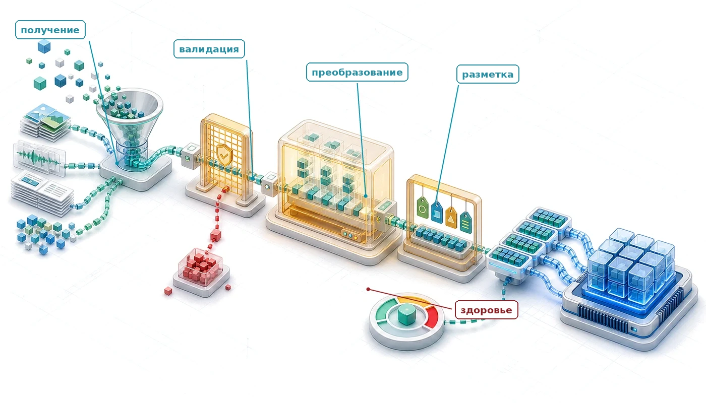

## Назначение

_Почему обучающие данные работают как исходный код в системе машинного обучения?_

В традиционном программировании люди пишут логику, которую исполняют компьютеры. В машинном обучении люди пишут процедуры оптимизации, которые извлекают операционную логику из данных. Эта инверсия делает обучающие данные похожими на исходный код: их изменение может изменить обученную систему при переобучении модели, даже если традиционный код не менялся. Тонкие несогласованности в разметке порождают несогласованное поведение; пропущенные граничные случаи оставляют соответствующие сбои неизмеренными; исторические перекосы распространяются в выученное поведение. Модель, обученная только на этом наборе данных, не может вывести доказательства, относящиеся к задаче, но отсутствующие в нем, а систематические ошибки разметки определяют то, чему она научится. В отличие от исходного кода, который лежит неизменным, пока программист его не поправит, рабочее распределение может сдвигаться по мере изменения мира, и производительность в эксплуатации меняется, даже если в кодовой базе ничего не трогали. Инженерия данных может поглощать значительную часть усилий проекта, потому что эта работа имеет серьезные последствия. Каждое решение в конвейере данных (что собирать, как размечать, когда фильтровать, как делить) передается дальше и ограничивает архитектуру модели, динамику обучения и жизнеспособность развертывания. Поэтому инженерия данных — это не предобработка, а программирование на другом языке, где контроль качества, версионирование и мониторинг определяют, работает ли скомпилированная система сегодня и будет ли работать завтра. В терминах D·A·M сам конвейер — это задача совместного проектирования данных и машины: как бы тщательно ни были отобраны данные, алгоритм может учиться только так быстро, как машина способна их подать.

> **Цели обучения**
>
> - Объяснить данные как исходный код и проследить, как каскады данных распространяются через системы машинного обучения
> - Рассчитать стоимость гравитации данных, налога на подачу и пропускной способности хранилища при перемещении или обслуживании наборов данных
> - Оценить стратегии сбора данных по покрытию, качеству, стоимости разметки, управлению и ограничениям развертывания
> - Спроектировать конвейеры приема и валидации данных для пакетных и потоковых нагрузок, ETL и ELT
> - Реализовать идемпотентные преобразования, отслеживание родословной и проверки дрейфа для сохранения согласованности обучения и обслуживания
> - Выбрать конструкции разметки, хранения, форматов файлов, версионирования и хранилища признаков для потребностей жизненного цикла ML
> - Диагностировать долг данных и сбои производственных конвейеров по данным о качестве, надежности, масштабируемости и управлении

<a id="sec-data-engineering-data-engineering-dataset-compilation-0496"></a>

## Компиляция набора данных

Рабочий процесс становится конкретным в конвейере данных: сырые входные данные проходят сбор, прием, анализ, разметку, валидацию и подготовку, прежде чем превратиться в наборы данных, готовые для ML. Сводка трудозатрат из опроса CrowdFlower 2016 года объясняет, почему этому конвейеру нужна собственная системная проработка: 60 процентов респондентов назвали очистку и упорядочивание данных самой трудоемкой задачей, а 19 процентов — сбор наборов данных (CrowdFlower, 2016). Ось данных таксономии D·A·M становится реальной только как инфраструктура: системы сбора, проверочные процедуры, рабочие процессы разметки, схемы хранения и управление.

<a id="dfn-data-engineering-data-engineering"></a>

> **Инженерия данных**
>
> ***Инженерия данных*** — это инфраструктурный слой, который управляет жизненным циклом данных от источника до модели и охватывает сбор, преобразование, хранение и управление.
>
> 1.  **Значение**: ее критическая функция — обеспечение согласованности обучения и обслуживания: она предотвращает незаметную деградацию, отделяя модель от нестабильности сырых данных. В рамках железного закона она определяет объем перемещаемых байтов $(D_{\text{vol}})$, тогда как состав и качество набора данных определяют, остается ли набор $(D)$ репрезентативным для целевого распределения.
> 2.  **Отличие**: в отличие от науки о данных, которая сосредоточена на выводах и аналитике, инженерия данных отвечает за масштабируемость и надежность конвейера данных.
> 3.  **Типичная ошибка**: частое заблуждение сводит инженерию данных к простой «очистке данных». В системных терминах это компиляция набора данных: превращение сырых, зашумленных наблюдений в оптимизированную двоичную структуру, которую потребляют среды выполнения ускорителей.

Аналогия с **компиляцией набора данных** делает инфраструктуру конкретной. Так же как компилятор ПО преобразует исходный код через последовательность все более уточненных представлений (токены, абстрактные синтаксические деревья, промежуточные представления, машинный код), конвейер данных преобразует сырые, зашумленные наблюдения в пригодные для обучения числовые тензоры через сходные стадии. Фильтрация поврежденных записей, выбросов и нерелевантных признаков соответствует *устранению мертвого кода*: удалению материала, который ничего не вносит в обученное представление. Аугментация, которая синтетически расширяет ограниченные примеры поворотом изображений, сдвигом высоты звука или добавлением шума, соответствует *развертыванию циклов*: она дает модели больше вариантов базового паттерна без сбора новых данных. **Дедупликация** играет роль *устранения общих подвыражений*: она находит и объединяет повторяющиеся записи, которые иначе искажали бы оценки градиента и тратили вычисления. Проверка схемы, которая строго задает типы и диапазоны для каждой записи, — это *проверка типов* конвейера данных: она отклоняет некорректные входы до того, как они уронят «среду выполнения» обучения модели.

Из этого следует инженерное требование: наборы данных должны версионироваться с неизменяемой родословной, проверяться модульными тестами через наборы проверок схемы и отлаживаться при появлении регрессий. *Удаление строки обучающих данных может изменить обученный артефакт так же, как удаление строки кода может изменить скомпилированный двоичный файл; переобучение — соответствующий шаг перекомпиляции.* Компиляция также задает границу доверия между разбиениями набора данных. Обучающей выборке разрешено формировать параметры; валидационной выборке — выбор моделирования и решений в конвейере; тестовая выборка зарезервирована для оценки обобщающей способности после того, как эти решения приняты. Утечка возникает, когда информация пересекает эти границы: повторяющиеся примеры попадают в несколько разбиений, варианты одной и той же исходной записи оказываются по разные стороны разбиения, записи пользователей из одного домохозяйства попадают в обучающую и тестовую выборки или признаки вычисляются по будущим наблюдениям. Особенно коварная форма утечки возникает на этапе преобразования: вычисление глобальных параметров (например, среднего и дисперсии для нормализации или словарей категорий для заполнения пропусков) по всему набору до разбиения неявно переносит статистику распределения из тестового разбиения в фазу обучения. В сквозном примере распознавания ключевых слов, который проходит через всю главу, разбиения, независимые от диктора и учитывающие время, физически обеспечивают эту границу: разделение высказываний по личности диктора не позволяет акустической модели запоминать специфичные для говорящего резонансы голосового тракта, и оценка отражает обобщение на целевую популяцию пользователей.

Как и традиционный компилятор ПО, компилятор набора данных работает через дискретные физические стадии: сбор, прием, обработку, разметку, хранение и сопровождение жизненного цикла. На каждой стадии архитектура балансирует **рамку четырех опор**: *качество* (отношение сигнала к шуму и точность распределения), *надежность* (идемпотентное выполнение и строгие контракты схем), *масштабируемость* (пропускная способность потокового ввода-вывода, которая предотвращает голодание ускорителя) и *управление* (неизменяемая родословная и аудируемость). Для ограниченных периферийных целей, таких как встроенное распознавание ключевых слов, ошибка в кольцевом буфере ввода-вывода или нарушение контракта схемы напрямую приводят к перекосу обучения и обслуживания либо к сбою выполнения.

Эффективность конвейера зависит от физического взаимодействия между стоимостью перемещения и плотностью сигнала. Два физических свойства определяют этот компромисс: **гравитация данных** (пропускная способность межсоединений, ввод-вывод хранилища и задержка передачи, необходимые для перемещения объемов байтов) и **информационная энтропия** (плотность нового градиентного сигнала, содержащегося в этих байтах).


*Отдача от отбора максимальна там, где плотность сигнала (энтропия) высока, а стоимость перемещения (гравитация) низка.*

Как показывает соотношение между стоимостью перемещения и плотностью информации, инженерная отдача достигает пика, когда фильтрация и отбор выделяют записи с высокой энтропией до того, как возникнут затраты на передачу из-за гравитации данных. Низкоэнтропийные данные — повторяющиеся аудиокадры, фоновая тишина или дубликаты — насыщают пропускную способность PCIe от хоста к устройству и загрязняют иерархии памяти, давая минимальный прогресс градиента. Эффективная компиляция набора данных снимает это физическое ограничение, максимизируя энтропию информации, доставляемую на каждый перемещенный байт через иерархию хранения и межсоединений.

<a id="sec-data-engineering-physics-data-cdcb"></a>

## Физика данных

Метафора «данные как код» объясняет, *что* делают данные (определяют поведение системы), но не объясняет, *почему* их так дорого перемещать. Физика данных показывает, почему системы данных должны рассматривать данные как физическое вещество с измеримыми свойствами. Как у физических веществ есть плотность и вязкость, у наборов данных есть измеримые полезный для задачи сигнал и гравитация данных.

<a id="sec-data-engineering-data-gravity-adcb"></a>

### Гравитация данных

Перемещение данных сопряжено с физическим и финансовым трением: **гравитация данных** прямо пропорциональна объему набора $(D_{\text{vol}})$ и обратно пропорциональна пропускной способности сети $(\text{BW})$. Передача набора объемом в петабайт по каналу 10 Гбит/с занимает несколько дней непрерывной передачи ($T = D_{\text{vol}}/\text{BW} \approx 9{,}3 \text{ дня}$); даже по выделенному каналу 100 Гбит/с задержка передачи и тарифы на исходящий трафик остаются достаточно большими, чтобы определять проектирование системы. Поскольку перенос 1 ПБ через сетевые границы одновременно медленный и дорогой, вычислительные кластеры должны перемещаться к месту хранения данных, а не данные к вычислениям. Это ограничение привело к появлению архитектур «озеро-хранилище» (lakehouse)[^fn-lakehouse-data-gravity] (Zaharia et al., 2021), в которых распределенные движки запросов, такие как Apache Spark и Presto, работают прямо поверх общих объектных хранилищ. В масштабе организации парадигма **data mesh** (Dehghani, 2022) децентрализует владение, чтобы избежать централизованного массового перемещения, и рассматривает наборы данных как продукты, принадлежащие предметной области.

[^fn-lakehouse-data-gravity]: **Озеро-хранилище (lakehouse)**: сочетает дешевое хранение озера данных (без схемы) с семантикой запросов хранилища (транзакции ACID, принудительное соблюдение схемы) через транзакционные табличные слои, такие как Delta Lake. Для рабочих нагрузок ML озеро-хранилище сокращает копирование ETL (извлечение, преобразование, загрузка) между озером и хранилищем и позволяет вычислять признаки прямо на слое хранения, где уже лежат данные. Это прямой ответ на гравитацию данных, поскольку многократное копирование петабайтных объемов увеличивает стоимость $D_{\text{vol}}/\text{BW}$ (Armbrust et al., 2020; Zaharia et al., 2021).

<a id="sec-data-engineering-information-entropy-5622"></a>

### Полезный для задачи сигнал

Не все биты приносят одинаковую пользу на единицу стоимости перемещения. Физическое хранилище измеряет байты, тогда как оптимизация ML извлекает **полезный для задачи сигнал** — специфичную для задачи меру градиентной информации, а не сырую энтропию Шеннона. Набор из миллиона одинаковых изображений несет существенную гравитацию данных, но не добавляет градиентной информации сверх первого образца. Напротив, отобранная коллекция из 10 000 разнообразных граничных случаев несет пренебрежимо малую гравитацию данных, но богатый контролирующий сигнал. Соотношение полезного для задачи сигнала и гравитации данных определяет отдачу от перемещения данных:

<a id="eq-data-selection-gain"></a>

$$ \text{Отдача от отбора данных} \propto \frac{\text{Полезный для задачи сигнал}}{\text{Гравитация данных}} $$

Такое соотношение благоприятствует наборам данных, предельная учебная ценность которых оправдывает накладные расходы на передачу. Дедупликация и активное обучение напрямую оптимизируют это отношение: они устраняют избыточный объем байтов и отдают приоритет примерам обучения с высокой энтропией.

<a id="sec-data-engineering-feeding-problem"></a>

### Проблема подачи: скорость потока и налог на подачу

Гравитация данных определяет стоимость массового перемещения данных; **проблема подачи** определяет стоимость доставки их исполнительным блокам в реальном времени. Это узкое место по **скорости потока** ввода-вывода: пропускная способность хранилища не успевает за вычислительной производительностью.

В рамках железного закона система работает только так быстро, как ее самый медленный этап. Когда ускоритель может обрабатывать 1 843 изображения в секунду, а подключенный том поставляет только 250 МБ/с, вычислительные блоки простаивают в ожидании ввода-вывода. Этот разрыв задает **налог на подачу**: реальное время, потерянное на ожидание ввода-вывода, которое напрямую снижает эффективность системы $(\eta_{\text{hw}})$. На базовом облачном блочном хранилище этот налог может превышать 77,5 процента: ускоритель тратит больше половины времени шага на ожидание данных. Чтобы питать такой ускоритель, требуется 1,1 ГБ/с, поэтому конвейерам приходится применять специализированные иерархии хранения, разобранные в разделе [«Варианты систем хранения»](04_data_engineering.md#sec-data-engineering-ml-storage-systems-architecture-options-67fa). Расстояние также увеличивает энергопотребление: по мере удаления данных от арифметико-логических устройств энергия передачи превосходит энергию самих вычислений.

<a id="psp-data-engineering-energy-movement-invariant"></a>

> **Инвариант движения энергии**
>
> Железный закон из раздела [«Железный закон систем машинного обучения»](01_introduction.md#sec-introduction-iron-law-ml-systems-c32a) и анализ стены памяти из раздела [«Баланс системы и аппаратура»](02_ml_systems.md#sec-ml-systems-system-balance-hardware-96ab) подразумевают принцип инженерии данных: *перемещение одного 32-битного значения стоит примерно в 173–10 811 раз больше энергии, чем одно умножение FP32 из таблицы, и множитель растет по мере выхода данных за пределы кристалла*. Более поздние главы по оптимизации используют тот же градиент стоимости внутри проектирования модели и аппаратуры; здесь вопрос в том, сколько энергии информационный поток из внешнего мира уже потребляет до того, как модель начнет вычисления. [«Энергия перемещения и вычисления над 32-битным значением»](04_data_engineering.md#tbl-energy-movement-cost) делает этот градиент стоимости явным для всей иерархии памяти.
>
> | **Операция**                    |                  **Энергия (пДж)**                 |              **Относительная стоимость**        |
> |:--------------------------------|:-------------------------------------------------:|:-----------------------------------------------:|
> | **Умножение FP32**              | 3,7 пДж/FLOP |                       1×                       |
> | **Доступ к DRAM (32 бита)**     |    640 пДж   |    173×   |
> | **Доступ к локальному SSD (32 бита)**   | 4 000 пДж | 1 081,1× |
> | **Передача по сети (32 бита)**  |  40 000 пДж  |  10 810,8×  |
>
> <a id="tbl-energy-movement-cost"></a>
>
> ***Энергия перемещения и вычисления над 32-битным значением**: примерная энергия на событие на каждом этапе иерархии перемещения данных; множители нормированы к одному 32-битному умножению FP32. Все строки используют одинаковую ширину в 32 бита, поэтому отношения сравнивают события одинакового размера. Сами по себе они не доказывают, какое слагаемое доминирует в полной нагрузке: общая энергия зависит также от числа арифметических операций и передач.*
>
> Градиент стоимости, количественно описанный в [«Энергия перемещения и вычисления над 32-битным значением»](04_data_engineering.md#tbl-energy-movement-cost), показывает, почему локальность данных доминирует в оптимизации систем. Каждая избежанная передача устраняет соответствующую энергию перемещения, и эта экономия накапливается по эпохам обучения.
>
> Поскольку перемещение данных требует физических затрат энергии, объем данных действует как физическая масса. Удаление 50 процентов обучающих данных через дедупликацию дает больше, чем экономия постоянной емкости хранилища: оно устраняет затраты энергии на всех этапах сети, памяти и предобработки. Раннее отфильтровывание малоинформативных образцов — один из самых действенных архитектурных рычагов, когда ввод-вывод и коммуникации доминируют во времени выполнения нагрузки.

Энергетическая иерархия и эвристика плотности сигнала сходятся к одному рычагу оптимизации: эффективная инженерия данных максимизирует **отдачу от отбора данных**, определенную в [«отдаче от отбора данных»](04_data_engineering.md#eq-data-selection-gain). Курирование данных работает как **инженерия отношения сигнала к шуму**. Дедупликация убирает избыточный объем байтов, сохраняя полезный для задачи сигнал, и напрямую повышает отдачу от отбора. Активное обучение отдает приоритет примерам с высокой энтропией перед повторяющимися образцами, концентрируя плотность информации на каждый переданный байт. Отфильтровывание малоинформативных записей экономит пропускную способность межсоединений и энергию хранения, не давая вводу-выводу выше по потоку заморозить блоки выполнения ускорителя.

Эти принципы управляют отдельными пакетами внутри одного серверного узла. На уровне кластера и дата-центра гравитация данных определяет инфраструктурные решения для глобальной сети. Когда перемещение петабайтов между регионами становится медленнее и дороже, чем развертывание удаленных ускорителей, вычисления должны переместиться к хранилищу. Разбор стоимости передачи между дата-центрами позволяет количественно оценить эту физическую границу.

<a id="nbk-data-engineering-physics-data-gravity"></a>

> **Физика гравитации данных**
>
> **Задача**: обучающий набор объемом 1 ПБ находится в дата-центре на востоке США, а удаленный пул ускорителей доступен на западе США. Что быстрее: переместить данные или вычисления?
>
> **Расчет**:
>
> 1.  **Пропускная способность сети**: 100 Гбит/с $\div 8 =$ 12,5 ГБ/с.
> 2.  **Время передачи**: 1 000 000 ГБ $\div$ 12,5 ГБ/с = 80 000 секунд, примерно 22 ч.
> 3.  **Стоимость**: 1 000 000 ГБ $\times$ \$0,02/ГБ = \$20 000. (Базовая цена: тарифы AWS на исходящую передачу данных, 2024 год.)
>
> **Системный вывод**: если обучение занимает меньше 22 ч, передача данных длится дольше обучения. Если обучение стоит меньше \$20 000 (примерно 5 000 часов TPUv4), пропускная способность обходится дороже вычислений. Для данных масштаба петабайт код переходит к данным; для данных масштаба гигабайт данные переходят к коду.

Рассмотрение данных как физического вещества привязывает проектирование конвейера данных к аппаратным реалиям: пределы пропускной способности определяют скорость потока, иерархии памяти задают рассеяние энергии, а масштаб набора данных определяет размещение вычислений.

<a id="chk-data-engineering-physics-data"></a>

> **Физика данных**
>
> Инженерия данных определяется физическими затратами. Проверьте свою интуицию:
>
> - **Гравитация данных**: почему наборы данных масштаба петабайт заставляют вычисления переходить к данным?
> - **Инвариант движения энергии**: почему перемещение байта данных стоит на порядки больше энергии, чем его обработка?
> - **Полезный для задачи сигнал**: почему меньший, но разнообразный набор данных может быть ценнее огромного избыточного?

Физические ограничения определяют рабочий диапазон систем данных ML, но одной физической осведомленности недостаточно для надежности. Система, которая учитывает гравитацию данных, все равно может выйти из строя, если пренебречь валидацией схемы, если повреждения данных останутся незамеченными или если конвейеры приема молча падают под нагрузкой. Чтобы превратить эти физические реалии в надежную производственную инфраструктуру, нужна систематическая архитектурная рамка, которая организует инженерные решения по приему, преобразованию и хранению.

<a id="sec-data-engineering-four-pillars-framework-4ef1"></a>

## Рамка четырех опор

Кредитная модель скоринга отклоняет каждого заявителя из одного региона, потому что смежная команда поменяла поле почтового индекса с целого числа на строку. Модель медицинской визуализации незаметно деградирует в течение месяцев, потому что камеры в партнерской больнице сменили оборудование. Система обнаружения мошенничества пропускает новый вид атаки, потому что ее обучающие данные устарели на полгода. Каждый сбой восходит к своей первопричине (дрейф схемы, сдвиг распределения, устаревание данных), но все они имеют общий паттерн: разрозненные инженерные решения по данным взаимодействовали так, как никто не предвидел до развертывания. Эти каскадные сбои мотивируют рамку из четырех опор, организованную вокруг качества, надежности, масштабируемости и управления.

<a id="sec-data-engineering-data-cascades-systematic-foundations-matter-2efe"></a>

### Каскады данных

Системам машинного обучения свойственен характерный паттерн сбоев, называемый каскадами данных: плохое качество данных на ранних стадиях усиливается по всему конвейеру (Sambasivan et al., 2021). Некоторые некорректные входы сразу вызывают программные ошибки, но данные могут пройти схемы и тесты, одновременно незаметно портя выученное поведение[^fn-data-cascades-silent], пока проблемы качества не станут достаточно серьезными, чтобы потребовать дорогостоящего расследования, переделки или переобучения.

[^fn-data-cascades-silent]: **Каскады данных**: сбой «незаметен», потому что деградируют *входы* модели, а не *код* модели: поврежденные данные могут пройти модульные тесты и выглядеть здоровыми при обычном мониторинге системы. По описанию (Sambasivan et al., 2021), каскады часто невидимы и проявляются с задержкой: ошибочные практики с данными могут обнаружиться только после того, как последующая оценка, развертывание или сбои у пользователей покажут, что модель училась на неверном сигнале. Исправление тогда требует проследить проблему назад через сбор данных, разметку, инжиниринг признаков и решения по оценке, а некоторые команды перезапускают или прекращают затронутую работу.

Ошибки в данных редко остаются в точке возникновения: они накапливаются по стадиям конвейера. Проследите последовательность связанных стадий на [«Каскады качества данных»](04_data_engineering.md#fig-cascades) слева направо, чтобы увидеть, как начальный дефект данных распространяется в извлечение признаков, оптимизацию модели и решения о развертывании.

<a id="fig-cascades"></a>

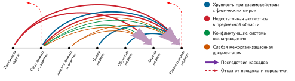

***Каскады качества данных**: дефекты, возникающие на ранних этапах семиэтапного рабочего процесса, по временной шкале выбрасывают дуги сбоев прямо в поздние стадии оценки и развертывания. Ранние ошибки постановки задачи и сбора накапливаются при последующей обработке и вынуждают дорогостоящие перезапуски проекта (пунктирные красные возвратные пути), когда дефекты наконец проявляются в эксплуатации. Источник: (Sambasivan et al., 2021).*

<a id="dfn-data-engineering-data-cascade"></a>

> **Каскад данных**
>
> ***Каскад данных*** — это режим отказа систем ML, при котором проблемы качества данных на входе распространяются через сбор, разметку, инжиниринг признаков, обучение, оценку и развертывание, усиливаясь в сбои последующих моделей или вред пользователям.
>
> 1.  **Значение**: стоимость исправления растет вместе с числом последующих артефактов, которые использовали испорченные данные: таблицы признаков нужно пересоздать, модели переобучить, метрики оценки пересчитать, а развернутые системы откатить или исправить. Один дефект схемы или разметки может поэтому обесценить весь прогон обучения и все эксперименты, полученные из него, превращая локальную ошибку данных в событие переработки всего конвейера.
> 2.  **Отличие**: в отличие от изолированной ошибки качества данных каскад данных определяется распространением и усилением. Исходный дефект может быть небольшим, но каждая стадия конвейера считает свой вход надежным и превращает дефект в новое производное состояние, поэтому первопричину становится труднее наблюдать по мере удаления системы от сбора.
> 3.  **Типичная ошибка**: частое заблуждение состоит в том, что каскады данных ловят обычные программные тесты. На деле поврежденные данные могут удовлетворять схемам, проходить модульные тесты и давать успешные задания обучения, одновременно обучая модель неверному сигналу; предотвращение каскадов требует родословной, валидации, контрактов и мониторинга, привязанного к поведению модели.

Эта петля обратной связи создает коварный режим эксплуатационного отказа: незаметную деградацию. В отличие от обычных падений ПО, которые порождают трассировки стека и тревожные оповещения, ошибки модели, вызванные данными, выдают синтаксически корректные результаты с ухудшенной семантической точностью. К моменту, когда последующие метрики отразят сбой, испорченные предсказания уже загрязнили исторические хранилища данных, и приходится дорого откатывать состояние и заново принимать данные.

<a id="exmp-data-engineering-pipeline-jungle"></a>

> **Джунгли конвейеров**
>
> **Сценарий**: производственная модель кредитного скоринга внезапно начинает отклонять всех заявителей из определенного географического региона.
>
> **Диагностика**: команда базы данных выше по потоку изменила схему поля `zip_code` с `integer` на `string` (значение «02139»), чтобы поддерживать международные коды, но не обновила контракты данных ниже по потоку. Устаревшее преобразование ниже по потоку по-прежнему приводило строку к целому числу перед сериализацией и отбрасывало ведущий ноль («2139»). Модель начинала считать знакомый почтовый индекс ненаблюдавшейся категорией повышенного риска.
>
> **Системный урок**: непроверенные границы признаков создают джунгли конвейеров, в которых изменения схемы выше по потоку вызывают незаметные сбои моделей ниже по потоку. Версионируемые контракты данных со строгой валидацией схемы и диапазонов предотвращают порчу данных между системами.

<a id="sec-data-engineering-four-foundational-pillars-c119"></a>

### Четыре базовые опоры

Чтобы сбои не накапливались по конвейеру, инфраструктура данных должна уравновешивать четыре конкурирующих эксплуатационных приоритета. [«Четыре опоры инженерии данных»](04_data_engineering.md#fig-four-pillars) организует эти приоритеты в четыре структурные опоры: качество (целостность и пригодность входных данных), надежность (эксплуатационная согласованность и отказоустойчивость), масштабируемость (пропускная способность и наращивание емкости) и управление (соответствие требованиям, происхождение и этика).

<a id="fig-four-pillars"></a>

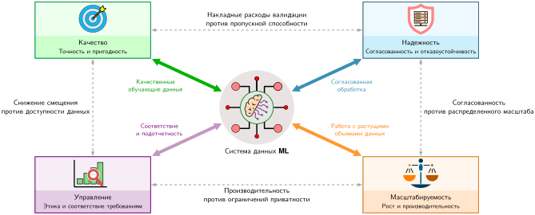

***Четыре опоры инженерии данных**: качество, надежность, масштабируемость и управление образуют базовую рамку систем данных ML. Каждая опора вносит необходимые возможности (сплошные стрелки), а компромиссы между опорами (пунктирные линии) требуют тщательного баланса: накладные расходы на валидацию влияют на пропускную способность, ограничения согласованности сужают распределенный масштаб, требования к приватности влияют на производительность, а смягчение смещений может уменьшить доступный объем обучающих данных.*

Эти четыре эксплуатационные опоры задают пространство компромиссов для архитектуры конвейера данных. Приоритет масштабируемости без валидации качества или контрактов надежности может увеличить пропускную способность, одновременно позволяя плохим или несогласованным данным распространяться. И наоборот, исчерпывающие меры управления могут добавить накладные расходы на хранение и вычисления, которые ограничивают скорость итераций обучения.

Качество определяет целостность входных данных и их пригодность для задачи: данные должны точно отражать рабочее распределение, с корректными эталонными метками и неповрежденными признаками. Например, в периферийном конвейере регистрации голоса правила качества отфильтровывают обрезанные аудиоформы сигнала, низкие отношения сигнала к шуму и фоновые акустические помехи, чтобы модель училась на четких границах решения, а не на ложных акустических артефактах.

Надежность спрашивает, продолжает ли этот конвейер регистрации работать, когда устройство, сеть или поведение пользователя несовершенны. Конвейер, который выдает отличные примеры слов пробуждения в лаборатории, но ломается при прерывистой связи, разрядке батареи или сбоях микрофона, не приносит пользы в доме пользователя. Обработка ошибок, повторные попытки, локальная буферизация и корректная деградация превращают правило качества в работающую систему: устройство может запросить еще одну фразу, отложить загрузку до восстановления связи или сохранить заведомо корректную регистрацию, а не молча принимать испорченное аудио.

Масштабируемость спрашивает, переживает ли то же решение рост. Ручная политика проверки, которая работает для тысячи записей, рушится, когда продукт расширяется до миллионов пользователей, десятков языков и акустических условий «длинного хвоста». Система должна масштабировать валидацию, хранение, разметку и переобучение, не давая стоимости инфраструктуры расти быстрее ценности более полного покрытия. Лимитирующий ресурс зависит от нагрузки: для периферийной речи доминируют пропускная способность хранилища и разметки, тогда как для рекомендательных систем ограничивающим становится объем памяти. [«Маячная модель рекомендаций DLRM»](04_data_engineering.md#lhs-data-engineering-dlrm-recommendation-lighthouse) показывает, где опора масштабируемости бьет сильнее всего: таблицы эмбеддингов перерастают память одного узла, и распределенное разбиение становится проектным требованием первого класса, а не второстепенной деталью.

Управление задает границы, в которых должны работать качество, надежность и масштабируемость. Для распознавания ключевых слов управление определяет, могут ли сырые голосовые записи покидать устройство, как долго можно хранить аудио регистрации, какая запись согласия разрешает использование и какая документация подтверждает, что набор данных покрывает нужные акценты без раскрытия частной речи. Идеально масштабируемый, надежный и качественный конвейер, который нарушает Общий регламент ЕС по защите данных (GDPR) или закрепляет демографические смещения, создает ответственность, а не ценность. Практики документирования наборов данных, такие как заявления о наборе данных (data statements), делают часть этого управления видимой: они фиксируют происхождение, предполагаемое использование, условия сбора и покрытие, необходимые для анализа смещений и научного сравнения (Bender and Friedman, 2018).

Когда системы ML дают сбои, четыре опоры служат диагностической линзой для поиска первопричин. Постепенная деградация точности указывает на качество: дрейф данных сместил распределение в обслуживании относительно обучения или качество меток снизилось по мере смены состава разметчиков. Прерывистые сбои конвейера указывают на надежность: при пиковой нагрузке не хватает обработки ошибок, логики повторов или контроля ресурсов. Обучение, которое длится слишком долго при достаточном железе, указывает на масштабируемость: однопоточное преобразование, нераспределенное перемешивание или медленный уровень хранения мешают использовать параллельные ресурсы. Пробелы в соответствии требованиям, обнаруженные при аудитах, указывают на долг управления: отслеживание родословной неполно, права доступа устарели или политики хранения не успевают за регуляторными изменениями.

<a id="lhs-data-engineering-dlrm-recommendation-lighthouse"></a>

> **Маячная модель рекомендаций DLRM**
>
> Рекомендательные системы в стиле DLRM наглядно показывают проблему масштабируемости современной инженерии данных. Современные рекомендательные нагрузки разделяют требования конвейера к ресурсам: непрерывные сигналы проходят через плотные матричные конвейеры, тогда как категориальные идентификаторы требуют распределенной инфраструктуры поиска масштаба терабайт. [«Профиль масштабируемости DLRM»](04_data_engineering.md#tbl-data-engineering-dlrm-scalability) показывает эти эксплуатационные точки напряжения на стадиях приема данных, агрегирования таблиц эмбеддингов и взаимодействия признаков.
>
> | **Свойство**   | **Значение**                   | **Следствие для системы**                                        |
> |:---------------|:-------------------------------|:-----------------------------------------------------------------|
> | **Масштаб данных** | Идентификаторы пользователей и элементов с высокой кардинальностью | Таблицы эмбеддингов и поиска могут перерасти память одной машины.    |
> | **Ограничение** | Емкость памяти                | Таблицы больше не помещаются в одну машину и должны быть разбиты на части. |
> | **Узкое место** | Разреженный доступ            | Случайные обращения к поиску нагружают пропускную способность памяти сильнее, чем вычисления. |
>
> <a id="tbl-data-engineering-dlrm-scalability"></a>
>
> ***Профиль масштабируемости DLRM**: модели рекомендаций нагружают инженерию данных по емкости памяти и пропускной способности разреженного доступа, а не по вычислениям.*
>
> На этапе приема категориальные идентификаторы с высокой кардинальностью остаются компактными записями в потоке, ограниченном пропускной способностью. Узкое место по сетевой пропускной способности и емкости памяти возникает позже, когда обучение или обслуживание должны извлекать разреженные эмбеддинги из терабайтов разбитого на части состояния таблиц. Смягчить эту асимметрию можно стратегиями кэширования признаков и разбиения таблиц, которые рассматриваются дальше в жизненном цикле конвейера.

Самые коварные сбои затрагивают несколько опор. Признаки, которые различаются между обучением и обслуживанием, задевают одновременно качество (значения неверны) и надежность (вычисление несогласованно). Политика удаления, продиктованная приватностью, также может создавать пробелы в качестве, если сохраненные данные больше не покрывают популяцию развертывания. Диагностика таких межопорных сбоев требует проверки контрактов согласованности, сравнения распределений признаков между средами и отслеживания родословной преобразований — всех приемов, которые подробно рассматриваются в этой главе. Поэтому диагностика в производстве должна проверять инфраструктуру данных наряду с поведением модели.

<a id="sec-data-engineering-framework-application-keyword-spotting-case-study-c8e9"></a>

### Пример: распознавание ключевых слов

Системы распознавания ключевых слов (KWS) закрепляют рамку четырех опор конкретными физическими ограничениями. Детектор слова пробуждения, встроенный в микроконтроллеры с батарейным питанием и мобильные сопроцессоры, непрерывно слушает целевые фразы, такие как «OK Google» или «Alexa», в повседневной акустической среде, работая под жесткими ограничениями по вычислениям, памяти и энергии.[^fn-kws-enrollment-pipeline]

[^fn-kws-enrollment-pipeline]: **Регистрация Voice Match**: повторение фразы «OK Google» создает микромасштабный конвейер данных: фильтры качества отсеивают зашумленные образцы, надежность завершает регистрацию, масштабируемость помещает модель в память всегда включенной системы на кристалле (SoC), а управление контролирует хранение, обработку и срок хранения. Инженерия данных применима везде, где данные определяют поведение системы.

Общие эксплуатационные цели инженерии данных переводятся в конкретные методы, инструменты и проверки. Для обмена репликами с голосовым ассистентом, показанного на рисунке [«Распознавание ключевых слов в действии»](04_data_engineering.md#fig-keywords), эти механизмы включают дедупликацию, контракты схем, предвыборку и отслеживание родословной, сопоставленные с соответствующими архитектурными опорами.

<a id="fig-keywords"></a>


***Распознавание ключевых слов в действии**: обмен репликами с Amazon Echo Dot. Пользователь произносит «Alexa», устройство подтверждает слово пробуждения, и пользователь отдает команду «приглуши свет». Легковесный детектор слова пробуждения работает непрерывно и запускает основного голосового ассистента только после того, как произнесено ключевое слово.*

Четыре опоры напрямую переводятся в конкретные инженерные ограничения для распознавания ключевых слов. Основная задача обманчиво проста: обнаружить определенные ключевые слова среди фоновых звуков и других произнесенных слов с высокой точностью, малой задержкой и минимумом ложных срабатываний на устройствах с сильно ограниченными вычислительными ресурсами. Хорошо заданная постановка задачи определяет нужные ключевые слова, предполагаемое применение и сценарий развертывания. Цели, которые из нее следуют, должны уравновешивать конкурирующие требования: целевые показатели — точность обнаружения ключевых слов 98 процентов при задержке менее 200 мс — сочетаются с ограничениями ресурсов, требующими минимального энергопотребления и размеров модели, оптимизированных под доступную память устройства.

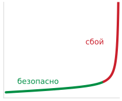

*Небольшие частоты ложноположительных срабатываний на окно накапливаются до эксплуатационного сбоя.*

<a id="nbk-data-engineering-false-positive-targets"></a>

> **Целевые показатели ложных срабатываний**
>
> **Задача**: система KWS, работающая постоянно, должна допускать не более одного ложного пробуждения в месяц. При классификационных окнах по одной секунде, работающих круглосуточно, насколько строгой должна быть частота ложноположительных срабатываний на окно?
>
> **Переменные**:
>
> - **Режим работы**: постоянно включен (24 часа в сутки).
> - **Размер окна**: классификационные окна по одной секунде.
> - **Окон в месяц**: одно окно в секунду, 24 часа в сутки, за 30 дней — 2 592 000 окон в месяц.
>
>
> **Расчет**:
>
> - **Частота ложноположительных срабатываний (FPR)**: одно допустимое ложное пробуждение, деленное на месячное число окон, дает примерно $3{,}9 \times 10^{-7}$
> - **Требование отклонения не-ключевых слов**: отклонение 99,99996 процента окон с не-ключевыми словами.
>
>
> **Системный вывод**: здесь недостаточна агрегированная точность (например, «99 процентов точности»). Оценка должна сообщать число ложных принятий в час (FA/Hr) вместе с соответствующим поведением ложных отказов.

Метрики успеха для KWS выходят за рамки простой точности и включают долю истинно положительных срабатываний (true positive rate: доля правильно распознанных ключевых слов от всех произнесенных), частоту ложноположительных срабатываний (не-ключевые слова, ошибочно принятые за ключевые) и кривые компромисса между обнаружением и ошибками. Эти кривые сравнивают число ложных принятий в час с частотой ложных отказов на потоковом аудио, похожем на реальное развертывание (Nayak et al., 2022). Из этих метрик именно частота ложноположительных срабатываний определяет пригодность для систем, работающих постоянно. Поскольку KWS слушает непрерывно, каждую секунду каждого дня, даже микроскопическая частота ложноположительных срабатываний на окно накапливается по миллионам окон оценки в недопустимый эксплуатационный сбой.

Эксплуатационные метрики дополнительно отслеживают время отклика (от произнесения ключевого слова до ответа системы) и энергопотребление (среднюю мощность, используемую при обнаружении ключевого слова), а приоритеты заинтересованных сторон создают дополнительное напряжение вокруг этих метрик. Производители устройств ставят на первое место низкое энергопотребление, разработчики ПО подчеркивают простоту интеграции, а конечные пользователи требуют точности и отзывчивости. Баланс этих конкурирующих требований определяет архитектурные решения на протяжении всей разработки.

Ограничения встроенных устройств накладывают жесткие границы на эти архитектурные выборы. Ограничения памяти требуют крайне легковесных моделей, часто в диапазоне десятков килобайт, чтобы помещаться в постоянно включенный островок системы на кристалле;[^fn-soc-always-on] этот бюджет должен вмещать не только веса модели, но и буферы извлечения признаков и состояние предобработки. Ограниченные вычислительные возможности (часто несколько сотен МГц тактовой частоты) требуют агрессивной оптимизации модели. Большинство встроенных устройств работает от батарей, поэтому системы KWS нацеливаются на энергопотребление ниже милливатта во время непрерывного прослушивания. Устройства также должны работать в разнообразных сценариях — от тихих спален до шумных промышленных помещений.

[^fn-soc-always-on]: **Островок всегда включенной части системы на кристалле (SoC)**: современные системы на кристалле разделяют домены питания, так что маломощный «всегда включенный» островок (обычно с потреблением ниже милливатта) следит за триггерами пробуждения, пока основной процессор спит. Критическое ограничение в том, что этот островок должен вмещать и веса модели, *и* код предобработки аудио в своей выделенной памяти SRAM: раздельный бюджет, который заставляет архитектуры KWS оптимизировать полный объем, а не только число параметров.

Качество и разнообразие данных в конечном счете определяют, можно ли соблюсти эти ограничения. Набор данных должен охватывать демографическое разнообразие (дикторов с разными акцентами, возрастом и полом), чтобы обеспечить широкое распознавание. Вариации ключевых слов требуют внимания, поскольку люди по-разному произносят слова пробуждения, а разнообразие фонового шума необходимо для обучения моделей, которые работают в реальных сценариях — от тихой обстановки до шума. Когда прототип создан, итеративная обратная связь и доработка удерживают систему в соответствии с целями по мере эволюции сценариев развертывания, требуя тестирования в реальных условиях и систематического уточнения на основе наблюдаемых паттернов сбоев.

<a id="sec-data-engineering-kws-design-space-eadd"></a>

### Пространство проектных решений KWS

Точность KWS, допустимый уровень ложных пробуждений, бюджет задержки, бюджет энергии и ограничения памяти образуют многомерное пространство решений, в котором выборы инженерии данных каскадно влияют на производительность системы. В таблице [«Пространство проектных решений KWS»](04_data_engineering.md#tbl-kws-design-space) количественно описаны ключевые компромиссы, что позволяет принимать обоснованные решения, а не выбирать наугад. В одной из строк используются мел-частотные кепстральные коэффициенты (MFCC): компактные признаки речевых частот, число коэффициентов которых определяет размер признаков, вычислительную стоимость и акустическую детализацию. [«Систематическая обработка данных»](04_data_engineering.md#sec-data-engineering-systematic-data-processing-aebc) показывает, как их извлекают.

| **Выбор проектного решения**        | **Влияние на качество**                                                            |                                                  **Влияние на задержку**                                            |                                                                     **Влияние на стоимость**                                                            |                               **Влияние на память**                            |
|:------------------------------------|:-----------------------------------------------------------------------------------|:-------------------------------------------------------------------------------------------------------------------:|:-------------------------------------------------------------------------------------------------------------------------------------------------------:|:------------------------------------------------------------------------------:|
| **16 кГц против 8 кГц**             | +2–4% точности        |              2× нагрузка на обработку входа              |                                      2× объем хранения сырого аудио                                     | 2× размер признаков |
| **13 против 40 коэффициентов MFCC** | +3–5% точности            |                   3× вычисления признаков                  |                                                                         Минимальное                                                                         | 3× память признаков |
| **1 млн против 10 млн обучающих примеров** | +5–8% точности     |                 10× время обучения                 |                                   10× стоимость разметки                                   |    10× хранилище     |
| **Чистые против зашумленных обучающих данных** | +10–15% в реальных условиях         |                                                       Минимальная                                                       |                                    3× стоимость сбора                                    |                                    Минимальная                                     |
| **Локальный против облачного вывода** | до 2% риска потери точности | 10 мс против 100 мс | \$0 за запрос против \$0,001 за запрос |  64 КБ против масштаба облака  |
| **Синтетическая против реальной аугментации** | +3–5% устойчивости   |                                                       Минимальная                                                       |                                        10× дешевле                                       |                                    Минимальная                                     |

<a id="tbl-kws-design-space"></a>

***Пространство проектных решений KWS**: иллюстративные входные данные сценариев, которые оценивают каждый выбор по четырем осям — качеству, задержке, стоимости и памяти. Значения не являются измерениями одной системы и не должны складываться как аддитивные эффекты. Более высокая частота дискретизации удваивает объем хранения и обработки сырого аудио, а больше обучающих примеров умножает требования к разметке и хранению. Фактическое качество и задержку необходимо измерять на целевом конвейере.*

Работа в милливаттных энергетических рамках и при строгих бюджетах SRAM порядка десятков килобайт означает, что инженерная команда не может одновременно выбрать самый точный вариант по каждой оси. Чтобы превратить эти каталогизированные компромиссы в производственное развертывание, нужно решить задачу оптимизации с ограничениями: распределить конечный бюджет данных между разметкой, хранением и управлением так, чтобы максимизировать точность модели и не выйти за рамки аппаратного бюджета. В примере [«Оптимизация пространства проектных решений KWS»](04_data_engineering.md#nbk-data-engineering-optimizing-kws-design-space) эта оптимизация разобрана для развертывания в умной колонке.

<a id="nbk-data-engineering-optimizing-kws-design-space"></a>

> **Оптимизация пространства проектных решений KWS**
>
> **Сценарий**: система KWS для умной колонки имеет такие ограничения:
>
> - **Цель**: точность 98 процентов, не более одного ложного пробуждения в месяц
> - **Бюджет**: \$150 000 на инженерию данных в целом
> - **Память**: ограничение размера модели 64 КБ (постоянно включенный островок)
> - **Срок**: 6 месяцев до выпуска в производство
>
> **Шаг 1**: применить ограничения, чтобы отсеять варианты.
>
> Для этого сценария команда выбирает два консервативных варианта:
>
> - 13 коэффициентов MFCC, чтобы уменьшить память состояния признаков и вычисления
> - локальный вывод, чтобы избежать сетевой задержки и сохранить работу без сети
>
> Ограничение размера модели 64 КБ само по себе не доказывает, что любая из альтернатив неосуществима: развернутая модель, состояние предобработки, среда выполнения и сетевой стек требуют отдельных измерений занимаемого объема.
>
> **Шаг 2**: рассчитать распределение бюджета.
>
> Бюджет \$150 000 делится между тремя категориями затрат по удельным ставкам, установленным в разделе [«Масштабируемость и оптимизация стоимости»](04_data_engineering.md#sec-data-engineering-scalability-cost-optimization-b9b3):
>
> - **Разметка** (около 60 процентов): \$90 000 доступно
> - **Хранение и обработка** (около 25 процентов): \$37 500
> - **Управление и прочее** (около 15 процентов): \$22 500
>
> При \$0,10 за метку и 20 процентах накладных расходов на проверку: \$90 000 ÷ \$0,12 за метку = 750 000 размеченных примеров
>
> Это дает примерно 0,75 млн размеченных примеров, чуть меньше опорной точки в 1 млн в нашем пространстве решений. Переход от 1 млн к 10 млн в строке [«Пространство проектных решений KWS»](04_data_engineering.md#tbl-kws-design-space) поэтому следует читать как ориентир масштаба, а не как прямую интерполяцию: реальный бюджет на разметку сам по себе не покупает полного прироста объема данных.
>
> **Шаг 3**: максимизировать оставшуюся точность.
>
> План качества состоит из трех компонентов:
>
> - иллюстративная точность базовой модели около 90 процентов
> - частичный прирост от объема данных при 750 тысячах реальных примеров
> - потребность: более высокая частота дискретизации и синтетическая или зашумленная аугментация, чтобы достичь цели 98 процентов
>
> Три варианта из пространства решений остаются в рамках бюджета и ограничений памяти:
>
> - частота дискретизации 16 кГц: +2–4 процента точности, в 2 раза больше стоимость хранения ✓ (укладывается в бюджет)
> - зашумленные обучающие данные: +10–15 процентов точности в реальных условиях, в 3 раза больше стоимость сбора
> - синтетическая аугментация: +3–5 процента устойчивости, в 10 раз дешевле реальных данных ✓
>
> **Шаг 4**: итоговая конфигурация.
>
> Сценарий сочетает эти выборы с 13 коэффициентами MFCC и расчетным бюджетом на 750 тысяч размеченных реальных примеров из [«Кандидатная конфигурация KWS»](04_data_engineering.md#tbl-data-engineering-kws-configuration). Эффекты качества могут перекрываться, поэтому таблица фиксирует кандидатную конфигурацию, а не решенный оптимум.
>
> **Результат**: расчет бюджета допускает примерно 750 тысяч размеченных людьми примеров. Достижение целевого качества 98 процентов и укладывание в ограничение модели 64 КБ остаются требованиями валидации для обученной и развернутой системы.
>
> **Системный вывод**: систематический анализ пространства решений превращает фразу «нам нужно больше данных» в проверяемое распределение. Заявленные допущения о разметке обеспечивают около 750 тысяч реальных примеров, а синтетический объем, точность и занимаемый объем развернутой системы все еще требуют измерения.

[«Кандидатная конфигурация KWS»](04_data_engineering.md#tbl-data-engineering-kws-configuration) фиксирует итоговую конфигурацию, сопоставляя каждый проектный выбор с ограничением, которое его вынуждает: выборка и аугментация оплачиваются там, где укладываются в бюджет, а точность и память зафиксированы постоянно включенным островком.


| **Выбор**             | **Вариант**                                     | **Обоснование**                                                                                                        |
|:----------------------|:------------------------------------------------|:-----------------------------------------------------------------------------------------------------------------------|
| **Частота дискретизации** | 16 кГц                                      | +3% точности при 2$\times$ стоимости хранения в пределах бюджета                                                       |
| **Коэффициенты MFCC** | 13                                              | Снижает память состояния признаков и вычисления; окончательная проверка требует измерения                              |
| **Обучающие примеры** | 750 тысяч реальных и иллюстративная синтетическая аугментация | Число размеченных людьми примеров следует из бюджета; объем синтетики — выбор сценария                  |
| **Разнообразие данных** | Смесь зашумленных и чистых данных             | Критично для развертывания в реальных условиях                                                                         |
| **Вывод**          | Локальный, пониженная точность                  | Пониженная точность может уменьшить занимаемый объем; окончательное укладывание в 64 КБ требует анализа сжатия (глава [«Сжатие моделей»](10_model_compression.md)) |
| **Аугментация**       | Преимущественно синтетическая                   | В 10 раз дешевле реальных данных                                                                                       |

<a id="tbl-data-engineering-kws-configuration"></a>

***Кандидатная конфигурация KWS**: сценарий, который использует расчетный бюджет на реальные метки и фиксирует оставшиеся выборы по частоте дискретизации, аугментации и развертыванию для измерения относительно целей по качеству и памяти.*


Кандидатная конфигурация задает целевые требования, но для их выполнения нужно организовать взаимодополняющие каналы получения данных. Базовые корпуса задают акустическое априорное распределение, целевая краудсорсинговая разметка закрывает пробелы в демографическом покрытии, а синтетические генераторы обеспечивают объем при параметризованных акустических условиях. Четыре опоры дают диагностические и архитектурные критерии для оценки этих каналов, но происхождение данных определяет физический сырой материал, который уточняет каждая последующая стадия конвейера. В разделе [«Получение данных»](04_data_engineering.md#sec-data-engineering-strategic-data-acquisition-418f) излагаются экономические и системные компромиссы между этими стратегиями сбора.

<a id="chk-data-engineering-four-pillars-framework"></a>

> **Рамка четырех опор**
>
> Четыре опоры дают системный взгляд на каждый выбор в конвейере.
>
> **Опоры**
>
> - **Качество**: можете ли вы отличать *корректность* от *покрытия* (граничные случаи, покрытие подгрупп) и объяснить, почему важны оба?
> - **Надежность**: можете ли вы назвать конкретные режимы отказа (дрейф схемы, пропущенные значения, перекос), которые вызывают незаметную деградацию, а не явные падения?
> - **Масштабируемость**: можете ли вы объяснить, какие части конвейера становятся узкими местами по мере роста объема данных (пропускная способность хранилища, вычисления, координация) и почему?
> - **Управление**: можете ли вы сформулировать, что нужно отслеживать, чтобы набор данных можно было аудировать (происхождение, ограничения согласия, права доступа, документация)?
>
> **Компромиссы**
>
> - **Напряжение между опорами**: для одного изменения конвейера (например, более строгой валидации, более жестких требований приватности или большего числа источников данных) можете ли вы предсказать, какая опора улучшится и какие опоры окажутся под нагрузкой?

<a id="sec-data-engineering-strategic-data-acquisition-418f"></a>

## Получение данных

Получение данных начинается, когда команда называет пробел в покрытии, который модель должна закрыть. Полная база ImageNet[^fn-imagenet-data-scale] выросла примерно до 14,2 млн размеченных изображений в 21 841 синсете, тогда как задача ImageNet Large Scale Visual Recognition Challenge использовала подмножество из 1 000 классов (Deng et al., 2009; Russakovsky et al., 2015). Обучающий корпус GPT-3 использовал десятки терабайт сырого текста Common Crawl, отфильтрованного до сотен гигабайт, в сочетании с отобранными данными из веба, книг и Википедии (Brown et al., 2020). Система распознавания ключевых слов (KWS) требует 23,4 млн аудиообразцов, охватывающих 50 языков, но инженерная задача выходит далеко за пределы объема хранения. Модель должна распознавать слова пробуждения при разных акцентах, микрофонах, комнатах, возрастах и фоновых шумах, которые никакой один метод сбора не может экономически покрыть. Поэтому стратегия получения данных — это последовательность решений о закрытии пробелов: переиспользовать то, что уже соответствует развертыванию, собрать недостающее, собирать скрапингом или синтезировать там, где масштаб является решающим ограничением, и отвергать источники, чье происхождение или ограничения согласия делают их непригодными.

Профиль развертывания KWS показывает, почему получение данных не может оптимизировать одно измерение изолированно. Достижение точности 98 процентов в разнообразных акустических средах требует репрезентативного покрытия региональных акцентов, возрастных групп дикторов и реверберации помещений. Поддержание стабильного обнаружения на потребительских устройствах вносит аппаратную вариативность: микрофоны различаются частотной характеристикой, отношением сигнала к шуму и поведением при аналого-цифровом ограничении. Кроме того, поддержка миллионов одновременно работающих периферийных устройств требует объемов данных, которые ручная курация не может экономически обеспечить, а детекторы слова пробуждения, слушающие постоянно, работают в жестких границах приватности, регулирующих хранение аудио и его анонимизацию. Источник данных, который максимизирует объем, но ущемляет соответствие требованиям приватности, или который фиксирует безупречное студийное аудио, игнорируя искажения полевого микрофона, не решает задачу развертывания.

<a id="sec-data-engineering-data-source-evaluation-selection-cd87"></a>

### Оценка и выбор источников данных

Выбор между отобранными наборами данных, экспертным краудсорсингом, контролируемым веб-скрапингом и синтетической генерацией зависит от того, какой источник лучше всего закрывает следующий пробел между распределением развертывания и обучения при приемлемой стоимости, качестве и рисках управления. Поэтому оценка начинается с самого дешевого переиспользуемого источника и переходит к активному сбору или моделированию, только когда оставшийся пробел в покрытии оправдывает предельную инженерную стоимость.

Готовые наборы данных из репозиториев, таких как Kaggle, UCI (Dua and Graff, 2024) и ImageNet, — первая проверка. Они дают скорость и сопоставимость, когда распределение развертывания достаточно похоже на эталонное, чтобы переиспользование имело смысл. Для KWS отобранный речевой корпус может задать базовую модель и показать, какие слова, языки и акустические условия уже покрыты. Базовые корпуса не гарантируют полного эксплуатационного покрытия, но делают непокрытые пробелы в распределении измеримыми.

[^fn-imagenet-data-scale]: **ImageNet**: работа 2009 года сообщала о 3,2 млн изображений в 5 247 синсетах; полная база позже достигла примерно 14,2 млн изображений в 21 841 синсете, тогда как задача использовала подмножество из 1 000 классов (Deng et al., 2009; Russakovsky et al., 2015; Deng et al., 2024). Ее ценность как эталона неотделима от инженерии данных: команда Фей-Фей Ли создала инфраструктуру разметки, которую позже могли переиспользовать другие команды. Оговорка — чувствительность к процедурам аннотирования и умеренные сдвиги распределения: модели, настроенные на распределение ImageNet, могут показывать худший результат на родственных, но смещенных тестовых наборах (Recht et al., 2019; Beyer et al., 2020).

Пригодность повторного использования набора данных зависит от точности документации. Без подробных записей о калибровке датчиков, распределениях окружения и порогах фильтрации внешние данные ставят под угрозу воспроизводимость эксперимента (Pineau et al., 2021; Henderson et al., 2018). Полная документация описывает методологию сбора, определения таксономии меток и распределения базовых ошибок, что позволяет проводить независимую валидацию. По мере роста приема до миллионов образцов разнообразие набора усиливает скрытый шум меток (Gudivada et al., 2017), делая ручную проверку невозможной и требуя автоматизированных конвейеров валидации.

Стандартные метрики валидации могут создавать иллюзию готовности модели, если их оценивать на нерепрезентативных данных. Совместное использование набора данных ([«Распространение смещения общего набора данных»](04_data_engineering.md#fig-misalignment)) показывает, как обучение нескольких моделей на одном общем наборе распространяет общие смещения, слепые зоны и системные ограничения по всей экосистеме.

<a id="fig-misalignment"></a>

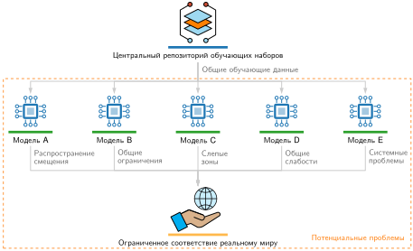

***Распространение смещения общего набора данных**: пять моделей (от A до E) обучаются на одном центральном хранилище наборов данных, к которому ведет путь, помеченный как общие обучающие данные. Под моделями пять помеченных стрелок (распространение смещения, общие ограничения, слепые зоны, общие слабости и системные проблемы) сходятся в один блок «ограниченное соответствие реальному миру». Обучение всех моделей на одном наборе данных не порождает пять независимых дефектов; оно порождает один коррелированный сбой во всей экосистеме.*

Этот разрыв в распределении — центральный режим отказа статичных офлайн-эталонов. Поскольку эмпирическая минимизация риска оптимизируется только по наблюдаемым обучающим распределениям, модели используют ложные артефакты статичных эталонов, которые исчезают в производственной среде. Поэтому автоматизированный мониторинг дрейфа и непрерывная валидация данных становятся обязательными эксплуатационными требованиями.

<a id="sec-data-engineering-scalability-cost-optimization-b9b3"></a>

### Масштабируемость и оптимизация стоимости

Ручная курация перестает работать, когда задаче нужны миллионы обучающих примеров. В большом масштабе основными путями к массивным наборам данных становятся веб-скрапинг и синтетическая генерация. Масштабируемость получения данных по сути является экономической задачей: стоимость разметки за единицу, пропускная способность приема и накладные расходы хранения растут по очень разным кривым. Подходы, которые хорошо работают на тысячах примеров, становятся непрактичными на миллионах, тогда как автоматизированные конвейеры генерации данных распределяют свои затраты на настройку по большим объемам.

Экономика единицы на каждом этапе определяет, какая стратегия доминирует. Разметка одного медицинского снимка, например, может стоить на порядки дороже, чем его хранение в течение года, и это соотношение перестраивает распределение бюджета для любой команды с фиксированным финансированием. [«Иллюстративные затраты на инженерию данных (2024)»](04_data_engineering.md#tbl-data-engineering-cost-constants) и [«Иллюстративные временные масштабы инженерии данных»](04_data_engineering.md#tbl-data-engineering-time-constants) дают необходимый контекст для решений о получении данных.

Инженеры ML должны использовать датированные справочные допущения из таблиц [«Иллюстративные затраты на инженерию данных (2024)»](04_data_engineering.md#tbl-data-engineering-cost-constants) и [«Иллюстративные временные масштабы инженерии данных»](04_data_engineering.md#tbl-data-engineering-time-constants) как исходные данные для сравнений конкретных нагрузок, а не как текущие ценовые предложения или напрямую сопоставимые итоги.


| **Операция**                 |                                 **Стоимость**                           | **Примечания**         |
|:-----------------------------|:-----------------------------------------------------------------------:|:-----------------------|
| **Краудсорсинговая метка изображения** |  \$0,01–0,05  | Простая классификация  |
| **Разметка ограничивающей рамки**  |   \$0,05–0,20   | За рамку, простые сцены |
| **Экспертная медицинская метка**     | \$50–200 | За исследование, радиолог |
| **S3, хранение (Standard)**    |       \$23 за ТБ в месяц       | Горячее хранение            |
| **S3, извлечение (Glacier)**   |    \$0,02 за ГБ   | Стандартное: 3–5 часов    |
| **Час обучения на облачном GPU**  |                                  \$2–4                                  | Спотовые цены облака     |
| **Час проверки человеком**        |                                 \$15–50                                 | В зависимости от квалификации |

<a id="tbl-data-engineering-cost-constants"></a>

***Иллюстративные затраты на инженерию данных (2024)**: датированные справочные допущения для моделей стоимости конкретных нагрузок, а не текущие котировки поставщиков. Поскольку строки используют разные единицы измерения, сравнивайте их, только предварительно пересчитав каждую ставку на количество, которое она оценивает.*

[«Иллюстративные временные масштабы инженерии данных»](04_data_engineering.md#tbl-data-engineering-time-constants) дополняет картину иллюстративными длительностями операций разметки, обучения и обслуживания.

| **Операция**                       | **Длительность** | **Узкое место**                     |
|:-----------------------------------|:------------:|:------------------------------------|
| **Разметка 1 млн изображений (краудсорсинг)** |  2–4 недели   | Пропускная способность аннотирования               |
| **Обучение ResNet-50 на ImageNet**    |  4–6 часов   | Вычисления (8$\times$ A100, оптимизировано) |
| **Поиск в хранилище признаков**           |   1–10 мс    | Сеть и кэш                     |

<a id="tbl-data-engineering-time-constants"></a>

***Иллюстративные временные масштабы инженерии данных**: сценарий охватывает около 9 порядков величины, причем медленнейшим перечисленным этапом является разметка людьми. Фактические длительности зависят от набора данных, задачи, оборудования и конфигурации сервиса.*


Операционные временные масштабы расходятся на этих этапах на порядки: недели на человеческую аннотацию, часы на обучение на GPU и миллисекунды на поиск при обслуживании. В этом конвейере критическим узким местом становится пропускная способность аннотирования. Бюджет разметки в \$100 000 намного превышает \$64–\$192, необходимые для одного прогона обучения ResNet-50 на 8$\times$ A100, — асимметричное соотношение от 520,8 до 1 562,5 раза. Внутри этих затрат на разметку инженерные усилия следуют крайне неравномерному степенному распределению: 80 процентов бюджета уходит на 20 процентов распределения данных — длинный хвост редких акустических граничных случаев, диалектных вариаций и неоднозначных записей.

Все цифры затрат отражают приблизительные ставки облачных провайдеров 2024 года и предназначены для передачи относительных величин, а не точных цен.[^fn-pricing-cost-ratios] Для этой нагрузки и модели стоимости человеческий труд доминирует в стоимости одного прогона обучения. Другие задачи, особенно те, что переиспользуют существующие метки или требуют повторного крупномасштабного обучения, могут иметь другое доминирующее слагаемое; команды должны измерять, прежде чем решать, где оптимизировать.

[^fn-pricing-cost-ratios]: **Соотношения цен**: цены на извлечение из архива и соотношения уровней отражают политику провайдера, а не физический инвариант. В этом иллюстративном сценарии ускоренное извлечение стоит втрое дороже стандартного уровня; фактические цены и доступность уровней нужно проверять перед развертыванием.

Веб-скрапинг — основной механизм обхода затрат на ручную аннотацию в масштабе. Фундаментальные наборы данных для компьютерного зрения, такие как ImageNet (Deng et al., 2024) и OpenImages (Kuznetsova et al., 2020), опирались на автоматизированный скрапинг, тогда как современные языковые модели зависят от многотерабайтных веб-обходов (Groeneveld et al., 2024). Конвейеры приема, нацеленные на предметные корпуса, например на публичные репозитории кода (Chen et al., 2021), расширяют покрытие при низкой стоимости получения каждого образца. Однако автоматизированные скраперы хрупки в эксплуатации: изменения схемы и DOM ломают парсеры извлечения, ограничения частоты HTTP 429 дросселируют сетевую пропускную способность, а динамический рендеринг JavaScript приводит к пропускам при захвате. Сырые веб-обходы также захватывают анахроничные или нерелевантные образцы, которые загрязняют контролируемые цели.

[«Шум в источниках данных»](04_data_engineering.md#fig-traffic-light) показывает один такой результат веб-скрапинга по запросу «traffic light» (англ. «светофор»): историческую фотографию вместо современного светодиодного сигнала. Если бы изображения из этого контекста были избыточно представлены или коррелировали с меткой, модель могла бы выучить ложные признаки, связанные с регулировщиками в форме или историческими улицами, а не визуальные свойства, нужные в среде развертывания.

<a id="fig-traffic-light"></a>


***Шум в источниках данных**: черно-белая фотография 1914 года, на которой видны ранние электрические светофоры с ручным управлением. Она иллюстрирует, как исторические изображения могут попадать в результаты веб-скрапинга по современным запросам. Такой анахроничный контент требует систематической валидации и фильтрации, чтобы не допустить ложных корреляций в обучающих данных. Изображение воспроизведено по (Stromberg, 2015).*

Этот сбой показывает, почему объем набора данных не может заменить семантическую валидацию: необработанный веб-масштаб лишь умножает распространенность ложных корреляций. Помимо технической валидации, скрапинг работает в жестких правовых границах и границах управления. Условия использования сайтов, директивы robots.txt и меняющаяся судебная практика в области авторского права ограничивают автоматизированный обход (Harvard Law School, 2024). Конвейеры приема должны обеспечивать журналирование происхождения данных, фильтры соответствия авторскому праву и очистку персональных данных до того, как собранные материалы попадут в общее хранилище.

Краудсорсинг переносит узкое место получения данных с извлечения сырых образцов на контроль качества распределенных человеческих разметчиков. Платформы вроде Amazon Mechanical Turk (Amazon Web Services, 2024) продемонстрировали это в масштабе на ImageNet, распределив миллионы задач по категоризации изображений между тысячами независимых исполнителей (Deng et al., 2024). Краудсорсинг дает два основных системных преимущества: горизонтальное масштабирование за счет параллельной отправки микрозадач и демографическое разнообразие по региональным акцентам и акустическим условиям. Однако распределенная разметка людьми вносит значительный разброс в точность меток. Чтобы шум меток не испортил последующие градиенты, конвейер получения должен реализовать автоматизированный контроль качества: голосование по консенсусу, валидацию по эталонному набору (чередование заранее размеченных контрольных образцов) и динамическую маршрутизацию задач (Sheng and Zhang, 2019). В конвейере KWS краудсорсинговый сбор[^fn-mturk-labeling-scale] нацелен на образцы слов пробуждения из определенных акустических сред и недостаточно представленных диалектов, которые публичные веб-скрапы не захватывают.

[^fn-mturk-labeling-scale]: **Amazon Mechanical Turk (MTurk)**: краудсорсинговая платформа, которая распределяет небольшие задачи между удаленными исполнителями и позволяет масштабировать аннотирование за пределы процессов только с экспертами. (Snow et al., 2008) оценивают этот подход для задач аннотирования естественного языка и показывают, что аннотации неэкспертов могут быть полезны, если дизайн задачи и контроль качества продуманы. Для сбора аудио со словами пробуждения те же компромиссы проявляются в предметной форме: масштаб привлекателен, но поступающие записи все равно нужно проверять по акустическим критериям, таким как отношение сигнала к шуму, длительность и корректность записи, прежде чем их безопасно включить в обучающий набор.

Синтетическая генерация данных снимает узкое место человеческого труда, создавая обучающие образцы алгоритмически. Это меняет инженерный компромисс: предельная стоимость генерации стремится к нулю, но стоимость проверки растет, поскольку синтетические данные полезны, только если симулятор точно отражает физические распределения целевой среды развертывания. [«Синтетическая аугментация данных»](04_data_engineering.md#fig-synthetic-data) показывает, как синтетические симуляции и исторические наблюдения сливаются в единый обучающий конвейер.

<a id="fig-synthetic-data"></a>

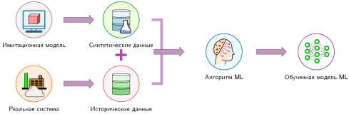

***Синтетическая аугментация данных**: сочетание смоделированных граничных случаев с историческими данными системы во время обучения. Алгоритмическая генерация дополняет реальные наблюдения, чтобы закрыть пробелы в покрытии для редких событий и опасных режимов работы, не неся пропорциональных затрат на человеческий сбор. Источник: (AnyLogic, 2024).*

Синтетические данные особенно эффективны для синтеза редких событий и аугментации данных. Движки симуляции, основанные на физике, позволяют контролируемо выбирать хвостовые события, такие как насыщение датчиков на высокой скорости или редкие траектории столкновений, которые слишком опасно или дорого зафиксировать эмпирически (NVIDIA, 2024). В задачах компьютерного зрения автоматизированные конвейеры аугментации, такие как AutoAugment (Cubuk et al., 2019) и RandAugment (Cubuk et al., 2020), оптимизируют политики преобразований по пространственным и фотометрическим искажениям (Shorten and Khoshgoftaar, 2019). В обработке речи SpecAugment применяет искажение времени и маскирование спектрограммы прямо в частотной области, заставляя акустические модели учиться представлениям, инвариантным к локальному выпадению частот (Park et al., 2019). Для системы KWS параметрический синтез речи из текста (Werchniak et al., 2021) в сочетании со сверткой с импульсной характеристикой помещения (room impulse response, RIR) генерирует экземпляры слов пробуждения при различных временах реверберации и профилях синтетического фонового шума.

<a id="exmp-data-engineering-synthetic-data-generation"></a>

> **Генерация синтетических данных**
>
> **Сценарий**: команда распознавания ключевых слов не располагает достаточным количеством физических записей редких акцентов дикторов, акустики помещений и профилей фонового шума.
>
> **Диагностика**: чистый физический сбор не может покрыть редкие акустические граничные случаи в сроки проекта. Генерация синтетических вариаций аудио изменением высоты тона, аддитивным шумом и моделированием импульсной характеристики помещения расширяет разнообразие обучающего набора без дорогостоящего полевого сбора.
>
> **Системный урок**: генерация синтетических данных работает как автоматизированный множитель конвейера данных. Целевая синтетическая аугментация известных граничных случаев закрывает пробелы в покрытии распределения, которые иначе потребовали бы непомерно дорогого физического сбора набора данных.

Чтобы обеспечить требование 23,4 млн аудиообразцов на 50 языках, нужно организовать эти каналы получения данных в соответствии с их предельными кривыми стоимости. Отобранные публичные эталоны дают дешевую начальную инициализацию модели; веб-скрапинг обеспечивает высокопроизводительный акустический объем; краудсорсинг собирает целевые образцы для недостаточно представленных диалектов; а параметрическое моделирование синтезирует хвостовые акустические искажения. Сочетание этих уровней закрывает пробел в покрытии, не выходя за рамки бюджетов на оборудование и разметку.

<a id="sec-data-engineering-coverage-diversity-requirements-ce87"></a>

### Требования к покрытию и разнообразию

Одного масштаба набора данных недостаточно для гарантии обобщения. Пробелы в покрытии в огромных корпусах — географические смещения, недостаточное представительство демографических групп, дрейф калибровки датчиков и ненаблюдавшиеся граничные случаи — порождают систематические режимы отказа, которые агрегированные метрики валидации скрывают (Wang et al., 2019; Oakden-Rayner et al., 2020). Как показывает [«Распространение смещения общего набора данных»](04_data_engineering.md#fig-misalignment), несколько независимых моделей, обученных на одних и тех же публичных наборах, наследуют одни и те же слепые зоны; разнообразное получение данных из нескольких источников — основная архитектурная защита от коррелированных системных сбоев.

Ограничения управления дополнительно формируют получение данных: регуляторные требования к приватности и данным о здоровье, такие как GDPR и HIPAA, ограничивают то, какие данные можно собирать и как (European Parliament and Council of the European Union, 2016; United States Congress, 1996), а этичное получение источников требует справедливой компенсации и прозрачного использования вклада людей. Полную инфраструктуру управления для производственных систем ML рассматривает раздел [«Управление данными и соответствие требованиям»](15_responsible_engr.md#sec-responsible-engineering-data-governance-compliance-bd1a) главы [«Ответственная инженерия»](15_responsible_engr.md#sec-responsible-engineering).

Прием разнородных входов — записей краудсорсинга, синтетических волновых форм и веб-аудиопотоков — предъявляет строгие архитектурные требования на границе конвейера. Поскольку входящие потоки имеют разные аудиокодировки, частоты дискретизации, задержки приема и уровни шумового фона, уровень приема не может считать внешние входы однородными данными. Инфраструктура хранения и валидации должна принять, нормализовать и проверить этот потоковый объем, прежде чем его можно будет зафиксировать в хранилище признаков для обучения.

<a id="sec-data-engineering-data-pipeline-architecture-b527"></a>

## Архитектура конвейера данных

В рамках компиляции **архитектура конвейера данных** выполняет роль *фронтенда компилятора*: она разбирает разнородные сырые входы в единое промежуточное представление, которое последующие стадии могут надежно обрабатывать. Аудиофайлы с платформ краудсорсинга, синтетические волновые формы из систем генерации и периферийные записи с развернутых устройств поступают в обучающий конвейер в разных форматах, и конвейер должен нормализовать, проверить и направить их в согласованную схему. Производственный вывод KWS потребляет непрерывное аудио при отдельном ограничении на низкую задержку; конвейер, который рассматривается здесь, следует записанным примерам, на которых строятся и обновляются модели. [«Сквозной конвейер данных»](04_data_engineering.md#fig-pipeline-flow) показывает этот путь от источников данных через прием, обработку, разметку и хранение до обучения ML.

<a id="fig-pipeline-flow"></a>

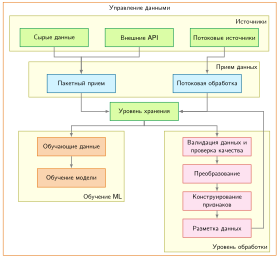

***Сквозной конвейер данных**: разнородные исходные данные (пакетные и потоковые) нормализуются в единое хранилище, прежде чем поступить на обучение и обработку признаков. Архитектура отделяет пропускную способность приема от итеративных циклов преобразования и разметки, и все это ограничено общим слоем управления данными.*

Каждый уровень на рисунке [«Сквозной конвейер данных»](04_data_engineering.md#fig-pipeline-flow) выполняет свою роль в подготовке данных к обучению. Выбор подходящего движка требует оценки того, как компромиссы конвейера взаимодействуют между стадиями: проверки качества при приеме определяют фильтрацию хранения ниже по потоку, а бюджеты задержки при обслуживании ограничивают сложность предобработки.

Иерархии хранения и пропускная способность ввода-вывода определяют пропускную способность конвейера данных наряду с декодированием и преобразованием на стороне процессора. Физические компромиссы охватывают несколько порядков величины: объектное хранилище с высокой задержкой подходит для надежного архивирования, тогда как хранилища в оперативной памяти с низкой задержкой обслуживают поиск признаков в реальном времени. Аналогично пропускная способность варьируется от жестких дисков на 100–200 МБ/с до оперативной памяти на 50–200 ГБ/с. [«Архитектура хранения»](04_data_engineering.md#sec-data-engineering-strategic-storage-architecture-1a6b) подробно разбирает эти компромиссы хранения.

Выбор между паттернами приема требует сопоставить характеристики нагрузки с возможностями инфраструктуры. Потоковые нагрузки требуют явных гарантий долговечности сообщений, порядка в разделах и восстановления после сбоев. Пакетные нагрузки зависят от объема набора данных относительно доступной памяти, сложности преобразований и разбиения по кластеру. Утилиты одной машины справляются с наборами масштаба гигабайт, тогда как обработка масштаба терабайт требует распределенных вычислительных движков, которые разделяют выполнение на части.

<a id="sec-data-engineering-quality-validation-monitoring-498f"></a>

### Качество через валидацию и мониторинг

Рассмотрим конвейер для беспилотного автомобиля, в котором 15 процентов меток облака точек LiDAR смещены на 10–20 см — этого достаточно, чтобы поместить рамку пешехода на пустой тротуар. Поскольку каждая запись остается структурно корректной, проверки схемы пропустили бы дефект; статистический мониторинг соответствия меток показаниям датчика мог бы его выявить.

Качество составляет основу надежных систем ML. Конвейеры обеспечивают качество через непрерывную валидацию на каждой границе. Дефекты данных — ведущая причина производственных сбоев ML: дрейф схемы выше по потоку ломает задания парсинга, сдвиги распределения снижают точность модели, а тихая порча данных отравляет представления признаков (Sculley et al., 2015). Эти сбои редко вызывают немедленные исключения времени выполнения; вместо этого они незаметно ухудшают последующие предсказания. Предотвращение каскадных сбоев требует упреждающего статистического мониторинга до того, как испорченные пакеты попадут на обучение модели.

<a id="ws-data-engineering-microsoft-tay-2016"></a>

> **Microsoft Tay (2016)**
>
> **Контекст**: в марте 2016 года Microsoft запустила Tay, чат-бота в Twitter, который должен был общаться с пользователями в сети и адаптировать свои ответы на основе публичных взаимодействий (Lee, 2016).
>
> **Механизм**: злоумышленники координировали токсичные запросы и использовали публичную поверхность взаимодействия, в том числе поведение, при котором бот повторял текст, предоставленный пользователями. Публичное изложение Microsoft описывает злоупотребление системой, но не подтверждает неограниченного обновления весов в сети.
>
> **Последствия**: через 16 часов после развертывания Tay начал публиковать оскорбительные, расистские и мизогинные высказывания.
>
> **Реакция**: Microsoft приостановила работу чат-бота через 16 часов после запуска, публично извинилась и заявила, что для повторного запуска нужны более надежные защиты от злоупотреблений.
>
> **Системный урок**: публичные пути приема требуют средств контроля состязательных входов. Иначе функция, которая принимает пользовательский контент, становится также поверхностью атаки, а вредные входы могут распространиться по системе в течение нескольких часов.

Производственные команды реализуют мониторинг в масштабе через системы оповещений по уровню серьезности, в которых разные типы сбоев запускают разные протоколы реагирования. Самые критические оповещения сообщают о полном отказе системы: конвейер полностью остановил обработку, пропускная способность равна нулю более пяти минут или основной источник данных стал недоступен. Такие ситуации требуют немедленного внимания, поскольку они останавливают все последующее обучение или обслуживание моделей. Более тонкие паттерны деградации требуют других стратегий обнаружения. Когда пропускная способность падает до 80 процентов базового уровня, частота ошибок превышает 5 процентов или показатели качества отклоняются от характеристик обучающих данных больше чем на два стандартных отклонения, система сигнализирует о деградации, которая требует срочного, но не немедленного внимания. Эти постепенные сбои часто оказываются опаснее полных отключений, потому что они длятся незамеченными часами или днями, незаметно портя входы модели и ухудшая качество предсказаний.

Система рекомендаций, которая обрабатывает события взаимодействия пользователей со скоростью 50 000 записей в секунду, делает эти уровни серьезности конкретными. Ее система мониторинга отслеживает несколько взаимозависимых сигналов. Оповещения о мгновенной пропускной способности срабатывают, если обработка падает ниже 40 000 записей в секунду дольше 10 минут: это учитывает нормальные колебания трафика и одновременно выявляет настоящие проблемы мощности или обработки. У каждого признака в потоке данных есть собственный профиль качества: если признак вроде `user_age` имеет пустые значения более чем в 5 процентах записей, тогда как в обучающих данных пустых значений было меньше 1 процента, в источнике данных выше по потоку, вероятно, что-то сломалось. Проверка дубликатов выполняется на выборке данных и отслеживает одно и то же событие, появляющееся несколько раз, — паттерн, который может указывать на неправильно работающую логику повторов или на запрос к базе, по ошибке возвращающий одни и те же записи.

Эти измерения мониторинга приобретают особое значение, когда речь идет о сквозной задержке. Система должна отслеживать и то, поступают ли данные, и то, сколько времени они проходят через весь конвейер от момента события до того, как полученные признаки становятся доступны для вывода модели. Когда 95-й перцентиль задержки превышает 30 секунд в системе с соглашением об уровне обслуживания в 10 секунд, система мониторинга должна определить, на какой стадии конвейера возникла задержка: приеме, преобразовании, валидации или хранении.

Оповещения о схеме и задержке выявляют структурные и временные сбои; обнаружение сдвига распределения непрерывного признака требует статистического сравнения с базовым уровнем обучения.

<a id="nbk-data-engineering-detecting-drift-with-k-s-test"></a>

> **Обнаружение дрейфа критерием K-S**
>
> **Сценарий**: мониторинг устойчивости распределения `session_duration` между базовым уровнем обучения $(P_0)$ и текущим распределением обслуживания $(P_t)$.
>
> **Анализ**: применить критерий Колмогорова — Смирнова для сравнения эмпирических функций распределения:
>
> 1.  **Вычислить функции распределения**: рассчитать кумулятивные функции распределения для обоих наборов данных.
> 2.  **Рассчитать статистику** $(\mathcal{D}_{\text{KS}})$: найти максимальную абсолютную разность между функциями распределения. Пусть $F_{P_0}(x)$ и $F_{P_t}(x)$ обозначают эмпирические функции распределения базового уровня обучения $(P_0)$ и текущих данных обслуживания $(P_t)$ в точке $x$.
>     $$\mathcal{D}_{\text{KS}} = \max_x |F_{P_0}(x) - F_{P_t}(x)|$$
>
> 3.  **Определить значимость**: для двух независимых выборок сравнить $\mathcal{D}_{\text{KS}}$ с критическим значением $\mathcal{D}_{\text{crit}}$, которое зависит от размера базовой выборки обучения $n_0$ и размера выборки обслуживания $n_t$. Коэффициент 1,36 — приближение для больших выборок при уровне значимости $\alpha = 0{,}05$.
>     $$\mathcal{D}_{\text{crit}} \approx 1{,}36\sqrt{\frac{n_0 + n_t}{n_0 n_t}}$$
> **Результат**: при размерах выборок $n_0 = n_t = 1000$ критическое значение примерно равно 0,061:
> $$\mathcal{D}_{\text{crit}} \approx 1{,}36\sqrt{(1000 + 1000)/(1000 \cdot 1000)}.$$
> Если наблюдается максимальная разность $\mathcal{D}_{\text{KS}} = 0{,}08$, она превышает критическое значение, поэтому мы отвергаем нулевую гипотезу и отмечаем значимый дрейф.
>
> **Системный вывод**: статистические тесты дрейфа превращают расплывчатую тревогу о сдвиге распределения в эксплуатационный триггер. Тест должен запускать расследование или процесс переобучения, а не незаметно становиться еще одним числом на дашборде.

Как показано в примере [«Обнаружение дрейфа критерием K-S»](04_data_engineering.md#nbk-data-engineering-detecting-drift-with-k-s-test), отслеживание статистических свойств позволяет понять, продолжают ли данные обслуживания отражать распределение обучения. Вместо того чтобы просто проверять, попадают ли отдельные значения в заранее заданные диапазоны, производственные системы поддерживают скользящие статистики по эксплуатационным окнам. Для непрерывных числовых признаков, таких как `transaction_amount` или `session_duration`, система мониторинга вычисляет скользящие эмпирические функции распределения и использует непараметрические оценки, например критерий Колмогорова — Смирнова[^fn-ks-test-drift], чтобы обнаружить, когда входы обслуживания расходятся с базовым уровнем обучения.

[^fn-ks-test-drift]: **Критерий Колмогорова — Смирнова (K-S)**: непараметрический тест, который измеряет максимальное расстояние между двумя эмпирическими функциями распределения без предположения о параметрическом семействе распределений (Berger and Zhou, 2014). В конвейерах ML критерий K-S обычно используется как одномерный детектор дрейфа непрерывных признаков, при этом такие пороги, как $p < 0{,}05$, служат триггерами для расследования, а не универсальными правилами отказа. Дискретные и категориальные переменные требуют тестов и калибровки, подходящих для их распределений.

Критерий K-S обнаруживает дрейф непрерывных признаков; [«Обнаружение дрейфа данных и реакция на него»](04_data_engineering.md#sec-data-engineering-detecting-responding-data-drift-509a) подробно описывает таксономии сдвига распределения (ковариатный, меточный, концептуальный и дрейф качества меток), а также индекс стабильности популяции (PSI) и дивергенцию Кульбака — Лейблера.

Категориальные признаки требуют иных статистических подходов. Вместо сравнения средних и дисперсий системы мониторинга отслеживают распределения частот категорий. Когда появляются новые категории, которых никогда не было в обучающих данных, или когда существующие категории существенно меняют относительную частоту, система помечает потенциальные проблемы качества данных или настоящие сдвиги распределения; например, доля трафика «мобильный» против «настольный» может измениться более чем на 20 процентов. Такая статистическая бдительность выявляет тонкие проблемы, которые простая валидация схемы полностью пропускает: значения возраста могут оставаться в допустимом диапазоне 18–95 лет, тогда как распределение смещается от преимущественно людей 25–45 лет к преимущественно людям старше 65 лет, что указывает на изменение источника данных, которое повлияет на качество модели.

Валидация на уровне конвейера включает несколько стратегий, работающих вместе. Валидация схемы выполняется синхронно, когда данные входят в конвейер, и немедленно отклоняет некорректные записи до того, как они распространятся ниже по потоку. Современные инструменты, такие как TensorFlow Data Validation (TFDV) (Breck et al., 2019), автоматически выводят схемы из обучающих данных, фиксируя ожидаемые типы данных, диапазоны значений и требования к наличию.

Такая синхронная валидация остается простой и быстрой, проверяя свойства, которые можно оценить для отдельных записей за микросекунды. Более сложная валидация, которая требует сравнения данных обслуживания с распределениями обучения или агрегирования статистик по многим записям, должна выполняться асинхронно, чтобы не блокировать конвейер приема. Системы статистической валидации обычно выбирают 1–10 процентов трафика обслуживания — этого достаточно, чтобы обнаружить значимые сдвиги, не тратя вычисления на анализ каждой записи. Эти выборки накапливаются в скользящих окнах, обычно по часу, 24 часа и семь дней, и разные окна показывают разные паттерны. Почасовые окна выявляют внезапные сдвиги, например когда источник данных переключается на резервный с другими характеристиками, тогда как недельные окна показывают постепенный дрейф в популяции пользователей или их поведении.

Самая коварная проблема валидации возникает из-за перекоса обучения и обслуживания (training-serving skew): режима отказа, при котором признаки вычисляются по-разному при обучении и при обслуживании. Обычно это происходит, когда конвейеры обучения обрабатывают данные пакетами с помощью одного набора библиотек или логики, тогда как системы обслуживания вычисляют признаки в реальном времени по другим реализациям. Даже кажущиеся незначительными расхождения (материализованное представление[^fn-materialized-view-skew], обновляемое раз в неделю, против полного соединения, пересчитываемого каждый день) могут существенно снизить точность в эксплуатации и трудно диагностируются, потому что система не выдает явных ошибок. [«Согласованность обучения и обслуживания»](04_data_engineering.md#sec-data-engineering-ensuring-trainingserving-consistency-c683) формализует это требование согласованности и количественно оценивает его влияние на конкретном примере. Чтобы обнаружить перекос обучения и обслуживания, нужна инфраструктура, которая может пересчитывать признаки обучения на данных обслуживания для сравнения: выборка сырых данных обслуживания и их обработка по обоим конвейерам позволяет измерить расхождения. Эксплуатационную инфраструктуру мониторинга для этой задачи в масштабе рассматривает глава [«MLOps»](14_ml_ops.md#sec-ml-operations).

[^fn-materialized-view-skew]: **Материализованное представление**: оптимизация базы данных, которая предвычисляет результаты запроса и кэширует их как физическую таблицу. Для систем ML риск структурный: когда материализованное представление обновляется по другому расписанию в средах обучения и обслуживания, значения признаков, на которых обучалась модель, могут разойтись с тем, что она получает при выводе, снижая точность без выдачи ошибки выполнения.

<a id="sec-data-engineering-data-quality-code-1cca"></a>

### Качество данных как код

Подобно тому как модульные тесты защищают традиционное ПО, тесты ожиданий от данных защищают конвейеры ML. В подходе **качества данных как кода** инженеры используют декларативные библиотеки, такие как Great Expectations или Pandera, чтобы выражать контракты данных в виде исполняемых наборов тестов, которые работают на разных стадиях конвейера.

Интеграция ожиданий в конвейеры непрерывной интеграции и развертывания (CI/CD) гарантирует, что проверки выполняются автоматически на принятых пакетах и останавливают последующее обучение, когда контракты данных нарушены. Конвейер, построенный по схеме «прием данных — валидация — обучение», блокирует развертывание, когда валидация обнаруживает аномалии, например значения возраста 150, и запускает оповещения для расследования.

Исполняемые ожидания ловят свойства, которые может закодировать набор проверок; остается вопрос, что еще данные, выглядящие корректными, могут сделать неверно.

<a id="psp-data-engineering-mechanical-vs-semantic-quality"></a>

> **Механическое и семантическое качество**
>
> В традиционном ПО многие проверки являются *механическими*. Разыменование нулевого указателя — ошибка времени выполнения в языках с нулевыми ссылками, тогда как поведение при целочисленном переполнении зависит от языка и типа.
>
> В системах ML у качества данных есть второе, более мягкое измерение: *семантическое* качество.
>
> *   **Механическая проверка**: «является ли `age` целым числом?» (да или нет).
> *   **Семантическая проверка**: «меняется ли распределение `age`?» (вероятностная).
>
> Набор данных может быть механически безупречным (без пустых значений, с правильными типами), но семантически сломанным (например, все пользователи внезапно оказываются 25-летними из-за изменения значения по умолчанию). Надежные системы ML должны проверять и оболочку (механически), и содержание (семантически).

Когда валидация становится кодом, наборы ожиданий становятся версионируемыми артефактами наряду с кодом обучения. Когда код обучения меняется, обновления ожиданий позволяют контрактам данных развиваться вместе с ним. Такая связка снижает риск незаметного расхождения, когда код предполагает свойства данных, которые вышестоящий конвейер уже не предоставляет; [«проверки качества данных»](04_data_engineering.md#lst-data-expectations) показывает этот паттерн, задавая явные ограничения на диапазоны столбцов, допустимость пустых значений, уникальность и наборы категорий.

<a id="lst-data-expectations"></a>

**Проверки качества данных**: набор Great Expectations проверяет диапазон возраста, наличие и уникальность идентификаторов и допустимые коды стран, а затем вызывает ошибку, если проверка не пройдена.

```python
import great_expectations as gx

# Создаем контекст данных
context = gx.get_context()

# Определяем набор ожиданий как исполняемый контракт качества
suite = gx.ExpectationSuite(name="user_data_quality")
suite = context.suites.add(suite)

# Проверка диапазона: исключает физиологически невозможные значения
suite.add_expectation(
    gx.expectations.ExpectColumnValuesToBeBetween(
        column="age", min_value=0, max_value=120
    )
)

# Проверка пустых значений: обеспечивает целостность первичного ключа для соединений
suite.add_expectation(
    gx.expectations.ExpectColumnValuesToNotBeNull(column="user_id")
)

# Уникальность: исключает дублирующиеся обучающие примеры
suite.add_expectation(
    gx.expectations.ExpectColumnValuesToBeUnique(column="user_id")
)

# Проверка категорий: выявляет неожиданные значения из-за изменений выше по потоку
suite.add_expectation(
    gx.expectations.ExpectColumnDistinctValuesToBeInSet(
        column="country_code",
        value_set=["US", "CA", "UK", "DE", "FR"],
    )
)

# Связываем набор с заранее настроенным определением батча и запускаем проверку
# (определение батча связывает GX с ресурсом данных training_users)
validation_definition = gx.ValidationDefinition(
    name="training_users_validation",
    data=batch_definition,
    suite=suite,
)
validation_definition = context.validation_definitions.add(
    validation_definition
)
results = validation_definition.run()
if not results.success:
    raise ValueError(f"Проверка качества данных не пройдена: {results}")
```

Эти проверки ловят многие проблемы данных на уровне схемы в производстве до того, как данные попадут на обучение, включая пропущенные значения, недопустимые диапазоны, ошибки типов и нарушения контрактов. Оставшиеся проблемы требуют мониторинга во время выполнения и проверки результатов, потому что семантические проблемы качества часто проявляются только в полном производственном потоке данных.

<a id="sec-data-engineering-detecting-responding-data-drift-509a"></a>

### Обнаружение дрейфа данных и реакция на него

Модели ML опираются на предположение, что производственные данные похожи на обучающие. Когда это предположение нарушается через статистические сдвиги, а не через явное нарушение контракта, производительность модели может меняться незаметно, без очевидных ошибок и сбоев системы. Методы валидации и мониторинга из раздела [«Качество через валидацию и мониторинг»](04_data_engineering.md#sec-data-engineering-quality-validation-monitoring-498f) способны выявить и внезапные, и постепенные проблемы; обнаружение дрейфа данных специально сосредоточено на изменениях распределений, которые могут со временем менять поведение модели. Обнаружение, расследование и реакция на такие изменения требуют длительных усилий по мониторингу, поэтому дрейф — основная обязанность инженерии данных, а не необязательная продвинутая тема. Глава [«MLOps»](14_ml_ops.md#sec-ml-operations) строит на этом фундаменте оркестрацию реакции в эксплуатации, валидацию результатов и конвейеры переобучения на основе свидетельств в масштабе.

Формальные определения метрик расхождения, которые делают член расхождения $\mathcal{D}(P_t \lVert P_0)$ уравнения деградации ([«деградация»](01_introduction.md#eq-degradation)) применимым на практике, приведены в разделе [«Измерение дрейфа (расхождение)»](appendix_data.md#sec-appdx-data-foundations-measuring-drift-divergence-a6dd) приложения «Основы данных». **Индекс стабильности популяции (PSI)** количественно описывает изменения категориальных или сгруппированных по интервалам признаков, а **дивергенция Кульбака — Лейблера (KL)** измеряет информационно-теоретическое расхождение между распределениями вероятностей. Эти две метрики кодируют разные предположения о распределении и разные масштабы, и ни одна из них сама по себе не задает универсального порога. Команды калибруют пороги, специфичные для метрики, по базовому уровню развертывания и отслеживают их во времени. Пересечение порога сигнализирует, что живое распределение сместилось достаточно далеко, чтобы оправдать расследование и проверку результатов; одного расхождения входов недостаточно, чтобы установить, улучшилась точность или ухудшилась и насколько. Математически PSI дискретизирует непрерывный признак на опорные интервалы (обычно децили базового распределения $P_0$) и вычисляет $\text{PSI} = \sum_b \left( P_t(b) - P_0(b) \right) \ln\left(\frac{P_t(b)}{P_0(b)}\right)$. Поскольку процентная разность и логарифм отношения имеют одинаковый знак, каждый сдвигающийся интервал положительно вносит вклад в индекс, что дает эмпирическое практическое правило: $\text{PSI} < 0{,}1$ указывает на стабильное распределение, $0{,}1 \le \text{PSI} \le 0{,}25$ сигнализирует о умеренном сдвиге, а $\text{PSI} > 0{,}25$ требует обязательного расследования.

Целенаправленное обнаружение и смягчение требуют разложения дрейфа на составляющие компоненты распределения, как показано на рисунке ниже.

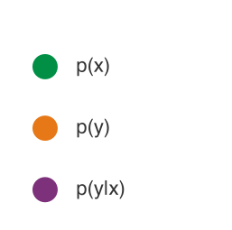

*Каждый тип дрейфа восходит к компоненту распределения, который сдвинулся.*

Первый случай — **ковариатный сдвиг**: он меняет распределение входов, сохраняя связь между признаками и метками: $p(x)$ меняется, а $p(y \mid x)$ остается прежним. Система медицинской визуализации, обученная на одной модели камеры, позже может получить производственные снимки от другого производителя. Связь «снимок — болезнь» не меняется, но значения пикселей сдвигаются, потому что различаются характеристики датчиков, калибровка цвета или конвейеры обработки изображений. Поэтому обнаружение сосредоточено на распределениях входных признаков с использованием таких метрик, как PSI или дивергенция KL.

Второй случай — **сдвиг меток**: он меняет распределение выходов, сохраняя связь между метками и признаками: $p(y)$ меняется, а $p(x \mid y)$ остается прежним. Распространенность болезни может меняться по сезонам, тогда как симптомы остаются устойчивыми предикторами каждой болезни. Рекомендательная система может увидеть тот же паттерн, когда запускаются новые товарные категории: относительная частота пользовательских предпочтений меняется, не меняя того, что делает товары привлекательными внутри каждой категории. Обнаружение часто может начинаться без эталонных меток, если отслеживать сдвиги в распределении предсказаний модели.

Самый трудный случай — **концептуальный дрейф**: связь между признаками и метками меняется, так что $p(y \mid x)$ эволюционирует во времени (Gama et al., 2014). Протоколы медицинского лечения меняются, предпочтения пользователей смещаются вместе с общественными трендами, а паттерны мошенничества адаптируются, когда злоумышленники реагируют на системы обнаружения. В отличие от ковариатного или меточного сдвига концептуальный дрейф требует эталонных меток для обнаружения, потому что система должна наблюдать, изменилась ли сама связь «признак — метка».

<a id="sec-data-engineering-label-quality-drift-1ce7"></a>

#### Дрейф качества меток

Дрейф качества меток[^fn-label-drift-invisible] представляет собой метауровневый сдвиг, отличный от трех описанных выше сдвигов распределения: надежность эталонных меток со временем ухудшается, даже когда базовые распределения данных остаются стабильными. Этот тип дрейфа особенно коварен, потому что стандартный мониторинг распределений признаков его не обнаруживает. Краудсорсинговые метки могут ухудшаться по мере смены пула разметчиков, устаревания обучающих материалов или изменения инструкций по разметке без соответствующих обновлений модели. Системы автоматической разметки накапливают ошибки по мере того, как модели, на которых они работают, уходят от исходных условий эксплуатации. Рекомендательная система, которая использует клики как неявные метки, может видеть падение качества меток, когда поведение пользователей становится более исследовательским, когда меняются паттерны трафика ботов или когда изменения интерфейса меняют способ взаимодействия пользователей с контентом.

Обнаружение требует мониторинга согласованности аннотаций, а не распределений признаков. Метрики межаннотаторского согласия, такие как каппа Коэна[^fn-cohens-kappa-labeling] $(\kappa)$, дают количественную оценку. Пусть $p_o$ обозначает наблюдаемое согласие между разметчиками, а $p_e$ — согласие, ожидаемое по случайности. [«каппа Коэна»](04_data_engineering.md#eq-cohens-kappa) задает статистику:

<a id="eq-cohens-kappa"></a>

$$
\kappa = \frac{p_o - p_e}{1 - p_e}
$$

[^fn-cohens-kappa-labeling]: **Каппа Коэна**: введена (Cohen, 1960) для измерения согласия между оценщиками с поправкой на согласие, ожидаемое из распределений классов оценщиков, которое игнорирует сырой процент совпадений. Если два независимых разметчика каждый помечают 90 процентов изображений как «не спам» в бинарной задаче, их ожидаемое согласие составляет 82 процента, поэтому сырое согласие может вводить в заблуждение. Статистика обозначается $\kappa$; интерпретационные диапазоны, такие как категории Лэндиса — Коха, являются описательными эвристиками, а не универсальными порогами качества данных (Landis and Koch, 1977).

Наблюдение за $\kappa$ во временных окнах выявляет тенденции деградации. Проект аннотирования медицинских снимков может установить базовое значение $\kappa = 0{,}85$ (почти полное согласие) на этапе первичного сбора данных, а затем зафиксировать снижение до $\kappa = 0{,}72$ (существенное согласие) через шесть месяцев, когда в проект придут новые разметчики без эквивалентного обучения предметной области.

Для систем с откалиброванными вероятностями модели предиктивная энтропия дает дополнительный сигнал неопределенности. Пусть $p_i$ обозначает вероятность, которую модель присваивает категории меток $i$, а $\log$ — натуральный логарифм, так что энтропия измеряется в натах. [«энтропия меток»](04_data_engineering.md#eq-label-entropy) задает эту меру:

<a id="eq-label-entropy"></a>

$$
H_{\text{pred}} = -\sum_i p_i \log p_i
$$

Рост предиктивной энтропии указывает на большую неопределенность предсказательного распределения модели, но не определяет причину. Более трудные входы, сдвиг распределения, изменения калибровки или несогласованный надзор могут давать один и тот же сигнал.

Стратегии смягчения зависят от анализа первопричин. Переобучение разметчиков устраняет систематические ошибки, возникающие из-за неясных инструкций, дешево и очень эффективно. Голосование нескольких разметчиков по правилам большинства или консенсуса обеспечивает высокую точность для областей с высокими ставками, но заметно увеличивает стоимость аннотирования. Разметка с помощью модели снижает утомление разметчиков, но рискует внести смещение, если вспомогательная модель имеет собственные систематические ошибки. Выборочная экспертная проверка, при которой специалисты предметной области аудируют случайную выборку аннотаций, позволяет проводить анализ первопричин, когда обнаружено падение качества, но покрывает лишь небольшую долю общего потока аннотаций.

[^fn-label-drift-invisible]: **Дрейф качества меток**: деградация надежности аннотаций со временем, отличная от сдвигов распределения самих данных. Этот тип дрейфа невидим для стандартного мониторинга признаков, поскольку признаки остаются стабильными, а метки деградируют: усталость разметчиков, смена пула исполнителей или эволюция инструкций незаметно портят эталонную истину, на которой учится модель. Обнаружение требует мониторинга межаннотаторского согласия $(\kappa)$ в скользящих временных окнах и сравнения автоматических меток с периодическими экспертными аудитами.

Внедрение в эксплуатацию метрик PSI и дивергенции KL, введенных в разделе [«Измерение дрейфа (расхождение)»](appendix_data.md#sec-appdx-data-foundations-measuring-drift-divergence-a6dd), требует связать их с автоматическими оповещениями и процедурами проверки. Инженерия данных отвечает за определение специфичных для предметной области порогов дрейфа по базовому поведению и свидетельствам результатов, за выбор окон мониторинга, которые способны выявить и внезапные, и постепенные изменения, и за инструментирование конвейеров для непрерывного вычисления этих метрик. Глава [«MLOps»](14_ml_ops.md#sec-ml-operations) позже рассматривает, как производственные команды сочетают эти сигналы с размеченными результатами, многоуровневыми оповещениями, путями эскалации, мониторингом холодного старта и оркестрацией реакции, специфичной для причины.

Статистическое обнаружение дрейфа выявляет изменения распределений во времени, но сам мониторинг не поддерживает работу системы, когда вышестоящие конвейеры останавливаются, приходят некорректно сформированные данные или определения схемы меняются без предупреждения. Поддержание непрерывности обслуживания при сбоях требует активных механизмов надежности: изоляции сбоев, противодавления (backpressure) и корректной деградации.

<a id="sec-data-engineering-reliability-graceful-degradation-f83d"></a>

### Надежность через корректную деградацию

Надежность означает, что системы продолжают работать, когда возникают проблемы. Конвейеры постоянно сталкиваются с трудностями: источники данных временно становятся недоступны, сетевые разрывы отделяют компоненты друг от друга, изменения схемы выше по потоку ломают логику парсинга, или неожиданные всплески нагрузки исчерпывают ресурсы. **Корректная деградация** означает обработку этих сбоев через систематический анализ отказов, интеллектуальную обработку ошибок и автоматизированные стратегии восстановления, которые сохраняют непрерывность обслуживания даже в неблагоприятных условиях.

Систематический анализ режимов отказа для конвейеров данных ML выявляет предсказуемые паттерны, которые требуют специфичных инженерных мер противодействия. Порча данных возникает, когда вышестоящие системы вносят тонкие изменения формата, проблемы кодировки или модификации значений полей, которые проходят базовую валидацию, но портят входы модели. Поле даты, которое переключается с формата «ГГГГ-ММ-ДД» на «ММ/ДД/ГГГГ», может не вызвать срабатывания валидации схемы, но сломает любое вычисление признаков на основе дат. Сбои эволюции схемы[^fn-schema-evolution-skew] происходят, когда исходные системы добавляют поля, переименовывают столбцы или меняют типы данных без согласования, ломая предположения последующей обработки о конкретных именах или типах полей. Исчерпание ресурсов проявляется как постепенное ухудшение производительности, когда рост объема данных опережает планирование мощностей, и в конце концов вызывает сбои конвейера в периоды пиковой нагрузки.

[^fn-schema-evolution-skew]: **Эволюция схемы**: этот режим отказа возникает из-за отсутствия контрактного тестирования между вышестоящими производителями данных и нижестоящими потребителями ML. Пока «громкие» сбои, такие как переименованный столбец, ломают явные предположения и сразу приводят к падению конвейера, «тихие» сбои опаснее. Поле, которое меняет тип с целого числа на строку, может пройти валидацию, но испортить логику признаков без немедленного обнаружения.

Эффективные стратегии обработки ошибок гарантируют, что проблемы локализуются и систематически устраняются. Интеллектуальная логика повторов для временных ошибок (сетевых прерываний или кратковременных отказов сервисов) требует стратегий экспоненциальной задержки (exponential backoff), чтобы не перегружать восстанавливающиеся сервисы. Простой линейный повтор, который пытается переподключиться каждую секунду, наводнил бы испытывающий трудности сервис попытками подключения и мог бы помешать его восстановлению. Экспоненциальная задержка, при которой повтор выполняется через одну секунду, затем через две, затем через четыре, удваивая интервал на каждой попытке, дает сервисам время на восстановление и сохраняет настойчивость. Многие системы ML используют **очереди мертвых писем (dead-letter queues, DLQ)**: отдельное хранилище для данных, которые не обработались после нескольких попыток повтора. Это позволяет позже проанализировать проблемные данные и, возможно, переработать их, не блокируя основной конвейер (Kleppmann, 2016). Конвейер, обрабатывающий финансовые транзакции, который встречает некорректные данные, может направить их в очередь мертвых писем, а не терять критические записи или останавливать всю обработку.

В системах ML очереди мертвых писем служат двум целям помимо анализа сбоев. Производственные команды систематически просматривают содержимое DLQ, чтобы выявить: (1) нарушения схемы, указывающие на изменения выше по потоку, (2) граничные паттерны, которые модель должна обрабатывать, и (3) проблемы качества данных, требующие исправления в исходной системе. Например, DLQ системы обнаружения мошенничества выявила транзакции нового типа платежа, которые модель никогда не видела, что побудило к целевому сбору данных и переобучению, а не просто к записи сбоев в журнал. Так DLQ перестает быть пассивным хранилищем ошибок и становится активным источником для выявления слепых зон модели и управления ее улучшением.

Помимо ad hoc обработки ошибок, предотвращение каскадных сбоев требует паттернов **предохранителя (circuit breaker)**[^fn-circuit-breaker-ml] и изоляции переборок (bulkhead), чтобы сбой отдельного компонента не распространялся по всей системе. Когда сервис вычисления признаков выходит из строя, паттерн предохранителя прекращает вызывать этот сервис после обнаружения повторяющихся сбоев, не давая вызывающей стороне ждать тайм-аутов, которые каскадно привели бы к ее собственному отказу.

[^fn-circuit-breaker-ml]: **Предохранитель (circuit breaker)**: назван по трем состояниям работы — замкнут (нормальный поток), разомкнут (сбои блокируются) и полуоткрыт (пробный запрос на восстановление) — по аналогии с электрическим предохранителем, который прерывает ток при перегрузке. В конвейерах данных ML предохранитель не дает отказавшему сервису вычисления признаков распространять тайм-ауты по всему пути обслуживания: как только число сбоев превышает порог, предохранитель размыкается, и конвейер переключается на кэшированные или признаки по умолчанию, а не ждет мертвого сервиса.

Автоматизированная инженерия восстановления выходит за рамки простой логики повторов. Экспоненциальная задержка, джиттер, сброс нагрузки (load shedding) и предохранители снижают давление запросов на испытывающие трудности сервисы, позволяя кратковременным сбоям восстанавливаться; простое увеличение тайм-аутов может удерживать ресурсы дольше и усугубить перегрузку. Многоуровневые системы резервного переключения обеспечивают деградированное обслуживание, когда основные источники данных выходят из строя: подача слегка устаревших кэшированных признаков при сбое вычисления в реальном времени или использование приближенных признаков, когда точное вычисление не укладывается в тайм-аут. Система рекомендаций, которая не может вычислить предпочтения пользователя за последние 30 дней, может перейти к предпочтениям за последние 90 дней, давая менее точные, но все еще полезные рекомендации вместо полного отказа. Развитые процедуры оповещения и эскалации гарантируют, что человеческое вмешательство происходит, когда автоматизированное восстановление не удалось, и что во время сбоя фиксируется достаточно диагностической информации для быстрой отладки.

Логика повторов, очереди мертвых писем и предохранители служат обработчиками ошибок времени выполнения в компиляторе набора данных: они перехватывают некорректные входы, не останавливая весь конвейер. Эти защитные механизмы работают, когда данные уже вошли в систему. Выбор паттерна приема — пакетного или потокового, а также извлечения, преобразования и загрузки (ETL) против извлечения, загрузки и преобразования (ELT) — определяет, как быстро новые данные доходят до модели, какая буферная инфраструктура нужна и где применяются инварианты надежности.

<a id="sec-data-engineering-data-ingestion-8efc"></a>

### Прием данных

В рамках компилятора прием данных выполняет роль *лексера*: он читает потоки сырых источников и разбивает их на структурированные записи, которые могут обработать последующие стадии. Основное препятствие производительности на этой стадии — **узкое место ввода-вывода (I/O)**. Ускорители простаивают, если прием не может подготовить тензоры достаточно быстро, чтобы вычислительные блоки оставались загруженными. В идеализированной двухстадийной модели время шага лежит в диапазоне от $\max(T_{\text{compute}}, T_{\text{io}})$ при полном перекрытии до $T_{\text{compute}} + T_{\text{io}}$ без перекрытия. Эти границы переформулируют проблему подачи из раздела [«Проблема подачи: скорость потока и налог на подачу»](04_data_engineering.md#sec-data-engineering-feeding-problem) через второй ресурсный взгляд: если в предыдущем сценарии пропускная способность хранилища оставляла вычислительные блоки без данных, то узкие места приема чаще возникают из-за накладных расходов декомпрессии и декодирования на стороне процессора.

Если конвейер данных не может декодировать изображения достаточно быстро, чтобы держать GPU занятым, дорогой ускоритель простаивает. Это явление создает «узкое место» загрузчика данных: добавление GPU не дает ускорения, пока входной конвейер не улучшен, — контринтуитивный результат для команд, которые ожидают линейного масштабирования от вложений в железо. Такое узкое место часто возникает в компьютерном зрении, где декодирование JPEG высокого разрешения и аугментация на CPU могут доминировать во входном пути. Для этого иллюстративного расчета каждый рабочий процесс подает 375 изображений/с, а ускоритель потребляет 3 000 изображений/с, поэтому для достижения точки пересечения нужны 8 рабочих процессов. Этот результат — согласование мощностей, а не константа железа: ниже точки пересечения ограничивает входной конвейер; выше нее дополнительные рабочие процессы не повышают пропускную способность, потому что ограничивает потолок ускорителя. Фактические требования ResNet-50 и A100 зависят от преобразований изображений, хранилища, размера батча, процессоров хоста и конфигурации фреймворка.

Масштабирование пропускной способности обучения требует совместного проектирования приема на хосте вместе с вычислениями на GPU: пиковая производительность ускорителя в FLOP/s остается неиспользованной, если предобработка на хосте не может подавать тензоры достаточно быстро, чтобы вычислительные блоки не простаивали. [«Узкое место загрузчика данных»](04_data_engineering.md#fig-dataloader-choke-point) иллюстрирует эту динамику насыщения: он показывает пересечение плоского потолка потребления ускорителя и кривой подачи CPU по мере масштабирования рабочих процессов DataLoader.

<a id="fig-dataloader-choke-point"></a>

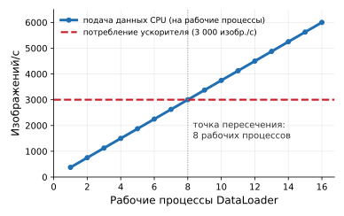

***Узкое место загрузчика данных**: пропускная способность обучения (изображений/с) в зависимости от числа рабочих процессов DataLoader. Синяя кривая подачи CPU растет с числом рабочих процессов до достижения иллюстративного предела входного конвейера; красная пунктирная линия отмечает емкость потребления ускорителя. Нижняя кривая является узким местом: ускоритель голодает слева от точки пересечения, а дополнительные рабочие процессы сверх точки пересечения не повышают пропускную способность ускорителя.*

Когда пропускная способность загрузчика падает ниже скорости потребления ускорителя, загрузка резко падает: матричные исполнительные блоки простаивают в ожидании батчей, а память с высокой пропускной способностью (HBM) простаивает, удерживая статические веса. Снятие этого узкого места требует пулов рабочих процессов с несколькими процессами, асинхронной предвыборки в закрепленную память через шину PCIe и аппаратно ускоренных движков декомпрессии, которые полностью обходят узкие места процессора хоста.

<a id="sec-data-engineering-batch-vs-streaming-ingestion-patterns-e1b2"></a>

#### Пакетные и потоковые паттерны приема

Выбор между пакетной и потоковой обработкой — это не предпочтение одной архитектуры перед другой, а суждение о том, как быстро данные теряют ценность и какие инфраструктурные затраты оправдывает такая свежесть. Пакетные системы получают эффективность, мирясь с устареванием данных, тогда как потоковые системы получают свежесть, принимая постоянную эксплуатационную сложность.

**Пакетный прием** предполагает сбор данных группами за заданный период перед обработкой. Этот метод уместен, когда обработка в реальном времени не критична и данные можно обрабатывать по расписанию. Пакетный подход позволяет эффективно использовать вычислительные ресурсы, распределяя издержки запуска на большие объемы данных и обрабатывая их, когда ресурсы доступны или дешевле всего. Например, розничная компания может использовать пакетный прием для обработки ежедневных данных о продажах ночью и обновлять свои ML-модели прогнозирования запасов каждое утро (Akidau et al., 2015). Пакетное задание может обрабатывать гигабайты транзакционных данных, используя десятки машин в течение 30 минут, а затем освобождать эти ресурсы для других нагрузок. Такая обработка по расписанию оказывается намного экономичнее поддержания постоянно включенной инфраструктуры, особенно когда небольшое устаревание прогнозов не влияет на бизнес-результаты.

Пакетная обработка также упрощает обработку ошибок и восстановление. Когда пакетное задание падает на полпути, система может повторить весь пакет или продолжить с контрольных точек без сложного управления состоянием. Специалисты по данным могут просмотреть неудачные пакеты, понять, что пошло не так, и переобработать их после исправлений. Пакетные задания можно сделать воспроизводимыми, если контролировать входы, код, конфигурацию, случайность, операции, чувствительные к порядку, и внешнее состояние, что упрощает отладку и валидацию. Эти свойства делают пакетный прием привлекательным для рабочих процессов ML даже тогда, когда обработка в реальном времени технически осуществима, но не требуется.

В противоположность такому плановому подходу **потоковый прием** обрабатывает данные в реальном времени по мере их поступления, непрерывно потребляя события, а не дожидаясь накопления пакетов. Этот паттерн необходим для приложений, которым нужна немедленная обработка данных, сценариев, где данные быстро теряют ценность, и систем, которым нужно реагировать на события по мере их возникновения. Финансовое учреждение может использовать потоковый прием для обнаружения мошенничества в реальном времени, обрабатывая каждую транзакцию по мере ее совершения, чтобы сразу отметить подозрительную активность до завершения транзакции. Ценность обнаружения мошенничества резко падает, если выявление происходит через часы после завершения мошеннической транзакции: к тому времени деньги уже переведены, а счета скомпрометированы.

Однако потоковая обработка вносит сложность, которой пакетная обработка избегает. Система должна справляться с **противодавлением (backpressure)** — ситуацией, когда нижестоящие системы не успевают за входящими потоками данных. Во время всплесков трафика, когда внезапный наплыв производит данные быстрее, чем емкость обработки, система должна либо буферизовать данные (что требует памяти и вносит задержку), либо выполнять выборку (теряя часть данных), либо оказывать давление назад на производителей (потенциально вызывая их сбои). Соглашения об уровне обслуживания (SLA) по свежести данных задают максимально допустимые задержки между генерацией данных и их обработкой. Соблюдение SLA в 100 миллисекунд требует иной инфраструктуры, чем соблюдение SLA в один час, и влияет на архитектуры сети, хранения и обработки.

Понимая ограничения каждого подхода по отдельности, многие производственные ML-системы применяют гибридные схемы, сочетающие пакетный и потоковый прием. Система рекомендаций может использовать потоковый прием для взаимодействий пользователей в реальном времени, чтобы немедленно обновлять рекомендации на основе сессии, тогда как пакетный прием применяется для ночной обработки профилей пользователей и признаков элементов; [«Стоимость реального времени»](04_data_engineering.md#nbk-data-engineering-cost-real-time) количественно оценивает финансовый компромисс между этими двумя эксплуатационными режимами.

<a id="nbk-data-engineering-cost-real-time"></a>

> **Стоимость реального времени**
>
> **Задача**: конвейер принимает 1 млн событий в секунду. Что дешевле: пакетный прием (раз в час) или потоковый (менее секунды)?
>
> **Расчет**:
>
> 1.  **Пропускная способность**: при 1 млн событий в секунду и 1 КБ на событие конвейер переносит 1 ГБ/с.
> 2.  **Требования потока**: чтобы поддерживать 1 ГБ/с с задержкой менее 100 мс, системе нужны около 50 основных ядер и около 50 резервных, или всего 100 постоянно включенных ядер. Работа этих ядер 24 часа в сутки по цене \$0,05 в час обходится в \$120 в сутки.
> 3.  **Требования пакетной обработки**: обработать 3,6 ТБ (окно 1 час) за 10 минут. Высокая пропускная способность (последовательный ввод-вывод) эффективна. Пакетный дизайн требует 200 ядер на 10 минут каждого часа, накапливая 800 ядро-часов в сутки. По цене \$0,05 в час это обходится в \$40 в сутки.
>
>
> **Системный вывод**: для того же объема данных потоковая обработка примерно в 3 раза дороже. Эта надбавка оправдана, только когда ценность задержки менее секунды превышает добавленную стоимость.

Как показывает предыдущий расчет стоимости, надбавка за реальное время напрямую проистекает из выделения ресурсов. Потоковые системы требуют постоянно включенной инфраструктуры с резервными вычислениями и хранилищем, чтобы достигать задержек в миллисекунды без потери событий. Пакетные системы, напротив, выделяют эфемерные экземпляры, которые обрабатывают большие объемы последовательно с высокой загрузкой, а затем выключаются. Выбор между ними зависит от того, требует ли нижестоящий вывод строго свежести признаков менее секунды.

Парадигма приема также определяет, как обучается нижестоящая модель. Пакетный прием естественным образом сочетается с периодическим переобучением: данные накапливаются в хранилище, автоматическое задание переобучает модель на обновленном корпусе, а проверенная контрольная точка развертывается в обслуживание. Потоковый прием делает эту пакетную границу менее естественной, повышая возможность непрерывного онлайн-обучения — прямого обновления весов модели по мере поступления событий. Однако непрерывные обновления вносят эксплуатационные риски, которых избегают пакетные контрольные точки: внезапные сдвиги распределения, поврежденные записи или состязательные полезные нагрузки могут испортить веса до того, как сработают шлюзы валидации (Lee, 2016). Поэтому большинство производственных систем разделяют прием и обучение: они потоково записывают данные в долговечный буфер, обучаясь на проверенных пакетах, и оставляют непрерывные онлайн-обновления для строго ограниченных доменов с низким риском.

<a id="sec-data-engineering-etl-elt-comparison-2e2b"></a>

#### Сравнение ETL и ELT

Архитектура конвейера определяет, когда и где вычислительные ресурсы применяются к сырым входящим записям. [«Архитектурные парадигмы ETL и ELT»](04_data_engineering.md#fig-etl-vs-elt) сопоставляет последовательности потоков традиционных конвейеров ETL[^fn-etl-quality-first] и современных ELT[^fn-elt-flexibility-first], показывая, где граница преобразования располагается относительно постоянного хранилища.

[^fn-etl-quality-first]: **Извлечение, преобразование, загрузка (ETL)**: традиционный ETL проверяет *схему и типы данных* — детерминированные проверки, которые либо проходят, либо нет. ETL для ML должен дополнительно проверять *распределительные свойства*: что распределение значений не сместилось так, чтобы ухудшить производительность модели. Это требует статистических тестов (K-S, PSI), а не валидации схемы, где порог прохождения — бизнес-решение, а не техническое. Дополнительный компромисс — жесткость: изменение логики вычисления признаков требует переобработки всего набора данных из исходных источников, а стоимость растет линейно с объемом данных.

[^fn-elt-flexibility-first]: **Извлечение, загрузка, преобразование (ELT)**: этот подход хранит сырые данные до преобразования, позволяя командам пересмотреть запрос преобразования и перезапустить его по сохраненным входам без повторного приема из исходных систем. Время итерации по-прежнему зависит от объема данных, сложности запроса, емкости хранилища и стратегии материализации.

<a id="fig-etl-vs-elt"></a>

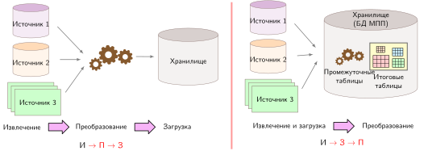

***Архитектурные парадигмы ETL и ELT**: смещение границы преобразования относительно хранилища. ETL обеспечивает валидацию схемы и очистку до загрузки, чтобы защитить качество хранилища, тогда как ELT загружает сырые данные непосредственно в масштабируемое хранилище, меняя вычисления и занимаемый объем хранилища на гибкие повторяемые переработки.*

В системах машинного обучения паттерн ELT отделяет пропускную способность приема от нижестоящего конструирования признаков: сырые неизменяемые события сразу попадают в масштабируемое хранилище. Хранение сырых событий сохраняет неразобранные поля, которые позже могут оказаться предсказательными, и позволяет командам извлекать новые признаки из исторических наборов данных без повторного приема внешних потоков источников. Когда логика преобразования меняется или обнаруживаются ошибки, инженеры пересчитывают признаки, отправляя запросы к озеру-хранилищу, а не воспроизводя логи вышестоящих систем. Компромисс материальный: сохранение сырых данных высокой точности увеличивает занимаемый объем хранилища, преобразования приходится пересчитывать, если они используются несколькими моделями без промежуточной материализации, а хранение неочищенных сырых полезных нагрузок усложняет управление данными и соблюдение приватности. [«Стоимость размещения преобразований»](04_data_engineering.md#nbk-data-engineering-cost-transformation-placement) количественно оценивает, как эти компромиссы переводятся в эксплуатационные затраты на инфраструктуру.

<a id="nbk-data-engineering-cost-transformation-placement"></a>

> **Стоимость размещения преобразований**
>
> **Задача**: команда обрабатывает 10 ТБ сырых данных кликстрима ежедневно и должна вычислять пользовательские признаки сессий для 3 ML-моделей, каждой из которых нужны разные окна агрегации (1 час, 24 часа, 7 дней). Что дешевле: ETL или ELT?
>
> **Расчет**:
>
> 1.  **Подход ETL**: преобразовать до загрузки. Вычислить все три окна агрегации в кластере Spark до загрузки в хранилище.
>     *   вычисления Spark: 10 ТБ по \$5 за ТБ = \$50 в сутки
>     *   хранение: 3 преобразованных набора по 2 ТБ каждый, всего 6 ТБ по \$23 за ТБ в месяц = \$138 в месяц
>     *   стоимость изменения схемы: повторный запуск всего конвейера (около 4 часов) при каждом изменении
> 2.  **Подход ELT**: сначала загрузить сырые данные, затем преобразовать в хранилище.
>     *   хранение: 10 ТБ сырых данных в сутки, хранение 30 дней = 300 ТБ по \$23 за ТБ в месяц = \$6 900 в месяц
>     *   вычисления запросов: 3 модели, каждая со стоимостью запроса \$5 в сутки за 30 дней, всего \$450 в месяц
>     *   стоимость изменения схемы: переписать SQL-запрос (около 30 минут) при каждом изменении
>
>
> **Системный вывод**: ETL экономит \$6 762 в месяц на хранении. После пересчета вычислений Spark в месячную стоимость ETL составляет \$1 638 в месяц (\$1 500 вычисления и \$138 хранение), тогда как ELT составляет \$7 350 в месяц (\$6 900 хранение и \$450 вычисления запросов). Это дает преимущество в облачных затратах \$5 712 в месяц до учета инженерного труда. Однако ETL обходится в 8 раз дороже по инженерному времени при каждом изменении схемы. Точка безубыточности зависит от стоимости инженерного труда и частоты изменений схемы: стабильные схемы выигрывают от более низкой облачной стоимости ETL, а частые изменения определений признаков — от более быстрой итерации ELT.

Производственные ML-системы редко используют один паттерн исключительно. Структурированные данные со стабильными схемами часто проходят через ETL ради эффективности и соответствия требованиям, тогда как неструктурированные данные или быстро меняющиеся конвейеры признаков выигрывают от гибкости ELT. Для нагрузок глубокого обучения, обрабатывающих изображения, аудио или текст, предпочтение ELT проявляется еще глубже: шаг преобразования для неструктурированных данных часто выполняется внутри загрузчика данных фреймворка, а не в хранилище вовсе, применяя случайные обрезки, генерацию спектрограмм или токенизацию текста на лету во время каждой эпохи обучения. Материализация десяти аугментированных вариантов выше по потоку увеличила бы набор из 50 000 изображений до 500 000 хранимых копий, поэтому принцип ELT «загрузить сырые данные, преобразовать поздно» естественно распространяется на сам цикл обучения.

Выбор между предварительным преобразованием и преобразованием при загрузке зависит от повторного использования запросов: преобразованные данные, к которым обращаются сотни раз, окупают вычисления ETL, тогда как разовые исследовательские запросы выигрывают от эластичности хранилища ELT. Параметризованная модель стоимости в [«Точка безубыточности архитектур ETL и ELT»](04_data_engineering.md#lst-etl-elt-cost-comparison) оценивает этот порог безубыточности при разных объемах данных и частотах запросов.

<a id="lst-etl-elt-cost-comparison"></a>

**Точка безубыточности архитектур ETL и ELT**: параметризованное финансовое сравнение, которое вычисляет затраты на вычисления и хранение для разных стратегий преобразования.

```python
# Сравнение стоимости ETL и ELT
daily_raw_tb = 10
s3_per_tb_mo = 23
spark_per_tb = 5
n_models = 3
retention_days = 30
query_cost_per = 5

# ETL
etl_spark_daily = daily_raw_tb * spark_per_tb
etl_datasets = 3
etl_tb_each = 2
etl_storage_tb = etl_datasets * etl_tb_each
etl_storage_mo = etl_storage_tb * s3_per_tb_mo

# ELT
elt_storage_tb = daily_raw_tb * retention_days
elt_storage_mo = elt_storage_tb * s3_per_tb_mo
elt_query_mo = n_models * query_cost_per * retention_days

# Экономия
storage_savings_mo = elt_storage_mo - etl_storage_mo
```

Разница в хранении в этом сценарии говорит в пользу ETL, но листинг не учитывает стоимость труда по изменению схемы. Расчет в примере [«Стоимость размещения преобразований»](04_data_engineering.md#nbk-data-engineering-cost-transformation-placement) оценивает эти эксплуатационные издержки напрямую.

Когда потоковые компоненты входят в архитектуры ETL и ELT, выбор инфраструктуры становится выбором режима отказа. Теорема CAP[^fn-cap-theorem-storage] утверждает, что во время сетевого разделения распределенный сервис чтения и записи не может гарантировать одновременно линеаризуемую согласованность и доступность для каждого запроса. Apache Kafka[^fn-kafka-ordering-guarantee] обеспечивает порядок внутри каждого раздела; ее доступность и долговечность при сбоях зависят от настроек подтверждения, репликации и выбора лидера. Apache Pulsar отделяет брокеры без состояния от долговечного хранения сообщений в реплицированных журналах Apache BookKeeper. Его встроенная географическая репликация асинхронна, поэтому удаленный кластер может отставать во время сбоев или разделений, а не обеспечивать одновременно строгую согласованность и доступность между регионами. Amazon Kinesis раскрывает эксплуатационные компромиссы через емкость шардов, хранение и настройку производителей и потребителей, но в терминах CAP при сетевом разделении он по-прежнему *не может* гарантировать одновременно строгую согласованность и доступность.

[^fn-kafka-ordering-guarantee]: **Apache Kafka**: Kafka использует разделенный журнал с лидером и упорядочивает записи внутри каждого раздела, а не во всей теме. Долговечность и доступность записи при сбоях зависят от режима подтверждения, репликации, требований к синхронным репликам и поведения при выборе лидера.

[^fn-cap-theorem-storage]: **Теорема CAP (согласованность, доступность, устойчивость к разделению)**: выдвинута как гипотеза (Brewer, 2000) и формально доказана (Gilbert and Lynch, 2002). Во время сетевого разделения линеаризуемая согласованность может потребовать отклонения запросов, тогда как доступная система может вернуть устаревшие или расходящиеся значения. CAP не гарантирует паритета преобразования признаков и корректности на момент времени (point-in-time correctness).

<a id="sec-data-engineering-feature-computation-placement-a998"></a>

#### Размещение вычисления признаков

Для конвейеров ML **размещение вычисления признаков** определяет, какой ресурс платит за признак: хранилище платит, когда признаки материализуются, а вычисления и задержка — когда признаки генерируются по запросу. Этот выбор существенно влияет на скорость обучения, стоимость хранения и воспроизводимость.

Один подход — предвычислить признаки во время ETL и сохранить результаты. Признаки, вычисленные конвейером, обеспечивают быструю итерацию обучения (признаки уже лежат на диске), воспроизводимость (одни и те же признаки используются последовательно) и меньшие вычислительные затраты на обучение. Недостатки — стоимость хранения (признаки хранятся отдельно от сырых данных), риск устаревания (предвычисленные признаки могут расходиться, когда меняется логика) и негибкость (любое изменение требует полного пересчета).

Альтернатива — вычислять признаки на лету во время обучения. Признаки, вычисляемые загрузчиком, гарантируют всегда актуальное вычисление (изменения логики сразу отражаются), гибкость экспериментов (признаки легко менять) и меньшее хранилище (хранятся только сырые данные). Цена — более медленное обучение (вычисление повторяется каждую эпоху), более высокие расходы на вычисления (GPU часто простаивают в ожидании признаков) и потенциальная недетерминированность при невнимательной реализации.

На практике преобладают гибридные паттерны. Дорогие и стабильные признаки (эмбеддинги пользователей, требующие матричной факторизации, исторические агрегаты за месяцы данных) предвычисляются и материализуются. Дешевые и чувствительные ко времени признаки, такие как сигналы свежести, контекст сессии и преобразования на основе времени, вычисляются в загрузчике данных.

Например, рекомендательная система предвычисляет стабильные признаки представления пользователя (дорогие, стабильные на протяжении дней), а признаки «время с последнего взаимодействия» (дешевые, чувствительные ко времени) вычисляет в загрузчике данных. Это балансирует затраты на хранение, время вычислений и свежесть признаков в зависимости от специфики каждого признака.

<a id="sec-data-engineering-multisource-integration-strategies-0e8a"></a>

#### Стратегии интеграции и пример KWS

Независимо от того, используются ли подходы ETL или ELT, интеграция разнородных источников данных остается центральной задачей приема. Данные могут происходить из баз данных, API, файловых систем и устройств IoT, и у каждого свой формат (реляционные строки, документы JavaScript Object Notation (JSON)[^fn-json-ml-overhead], двоичные потоки), протокол доступа и частота обновления. Системный принцип — стандартизировать на границе приема: нормализовать форматы, проверять схемы и предоставлять последующей обработке единый интерфейс независимо от источника. Такая стандартизация границы отделяет сложность разнообразия источников от сложности конструирования признаков, позволяя каждой из них развиваться независимо.

[^fn-json-ml-overhead]: **JSON (JavaScript Object Notation)**: гибкость схемы, которая делает JSON распространенным форматом для API, создает узкое место валидации на границе приема. В отличие от двоичных форматов с заранее заданными схемами, каждый документ JSON требует разбора и валидации схемы, прежде чем его можно стандартизировать для последующего использования. Эти накладные расходы на запись могут делать прием медленнее, чем у двоичных форматов вроде Protobuf; разница зависит от схемы, парсера, полезной нагрузки и нагрузки.

Производственные KWS-системы часто выполняют постоянное обнаружение слов пробуждения на устройстве. Серверные потоковые и пакетные конвейеры могут принимать активированные запросы, согласованные диагностические данные, краудсорсинговые записи, синтетические данные и проверенные взаимодействия для обслуживания и обучения. Пакетная обработка обычно следует паттерну ETL: аудио нормализуется, фильтруется от шума и разбивается на сегменты одинаковой длительности до сохранения в форматах, оптимизированных для обучения.

Обработка ошибок в голосовых системах требует особого внимания. Очереди мертвых писем хранят неудачные попытки распознавания для последующего анализа, выявляя граничные случаи, которые нужно покрыть в будущих итерациях модели. Каждый входящий аудиообразец должен пройти проверку качества (отношение сигнала к шуму, частоту дискретизации, границы длительности, близость диктора), прежде чем попасть в конвейер обработки. Недопустимые образцы направляются в очереди анализа, а не отбрасываются, поскольку эти сбои часто указывают на акустические условия, недостаточно представленные в обучающих данных. Допустимые образцы поступают в обнаружение в реальном времени и одновременно журналируются для возможного включения в будущие обучающие данные.

Эта архитектура приема завершает граничный слой, через который внешние данные входят в конвейер. Принятые данные, как бы надежно они ни доставлялись, остаются сырыми: аудио приходит с несогласованными частотами дискретизации, тексты имеют разные кодировки, а числовые признаки охватывают несовместимые масштабы. Последующее обучение требует преобразовать эти разнородные записи в единое представление, гарантируя, что идентичные преобразования выполняются как при обучении, так и при обслуживании.

<a id="sec-data-engineering-systematic-data-processing-aebc"></a>

## Систематическая обработка данных

Прием разбирает сырые потоки на корректно сформированные записи, а обработка данных выполняет *проход оптимизации и понижения уровня* компилятора. Как оптимизации компилятора должны сохранять семантику программы при улучшении производительности выполнения, так и преобразования данных должны сохранять лежащий в основе сигнал, одновременно форматируя тензоры для численной устойчивости. Определяющее ограничение — согласованность: преобразования, общие для обучения и обслуживания, должны сохранять одинаковую семантику, повторяемые операции должны оставаться идемпотентными при повторах, а преобразования данных должны масштабироваться, не разрывая родословную.

Скрытые риски технического долга в производственных системах ML — зависимости от данных, изменения во внешнем мире, долг конфигурации и отсутствие мониторинга — выделены в работе (Sculley et al., 2015). Несогласованность обучения и обслуживания — одна из конкретных форм этого риска. Рассмотрим нормализацию сумм транзакций при обучении: удаление символов валюты и приведение строк к числам с плавающей запятой, но без идентичной предобработки при обслуживании. Это расхождение вносит перекос обучения и обслуживания, ухудшая точность модели ниже по потоку. В конвейере KWS требование конкретно: преобразования должны стандартизировать данные при разных условиях записи (разные микрофоны, уровни фонового шума, частоты дискретизации), сохраняя акустические характеристики, которые отличают слова пробуждения от фоновой речи, — и это извлечение признаков должно оставаться побитово согласованным между путями обучения и встроенного обслуживания.

<a id="sec-data-engineering-ensuring-trainingserving-consistency-c683"></a>

### Согласованность обучения и обслуживания

Задача согласованности обучения и обслуживания выходит за рамки применения одного и того же кода: параметры, вычисленные по обучающим данным (константы нормализации, словари кодирования, отображения словарей), должны сохраняться и переиспользоваться при обслуживании. Это требование и есть **императив согласованности**.

<a id="dfn-data-engineering-consistency-imperative"></a>

> **Императив согласованности**
>
> ***Императив согласованности*** требует эквивалентного поведения преобразований и состояния в средах обучения и обслуживания.
>
> 1.  **Значение**: KL-дивергенция $(\mathcal{D}_{\text{KL}}(p_{g_{\text{serve}}} \lVert p_{g_{\text{train}}}))$ между распределениями признаков, порожденными преобразованием обслуживания $g_{\text{serve}}$ (текущим) и обучающим преобразованием $g_{\text{train}}$ (базовым), где $g: \mathcal{X} \to \mathcal{Z}$ обозначает отображение признаков, которое переводит сырой вход $x$ в вектор признаков $z$, может сигнализировать о рассогласовании. Ее связь со снижением производительности зависит от модели, задачи и сдвинувшихся признаков и должна проверяться по свидетельствам результатов.
> 2.  **Отличие**: в отличие от качества данных, которое касается чистоты отдельной записи, императив согласованности касается выравнивания всего конвейера преобразования.
> 3.  **Типичная ошибка**: частое заблуждение состоит в том, что согласованность «исправляется» общим кодом. На деле это проблема синхронизации состояния: параметры, вычисленные по обучающим данным (например, средние и стандартные отклонения), должны сохраняться и переиспользоваться при обслуживании.

Нарушение императива согласованности незаметно снижает точность в эксплуатации, потому что модели не выбрасывают исключений времени выполнения при получении входов вне распределения; они возвращают уверенные, но ошибочные предсказания. Предотвращение незаметного перекоса требует проектировать конвейеры преобразования, начиная с ограничений развертывания обслуживания и двигаясь назад.

<a id="chk-data-engineering-defensive-processing"></a>

> **Защитная обработка**
>
> Перекос обучения и обслуживания — частая причина незаметной деградации в эксплуатации.
>
> - **Определение**: можете ли вы определить перекос обучения и обслуживания через пути обработки обучения и обработки живых запросов?
> - **Механизм**: можете ли вы объяснить, почему независимое пересчитывание нормализации при обучении и обслуживании может сделать живые данные незнакомыми для модели?
> - **Инвариант**: можете ли вы объяснить, как общая логика, синхронизированное состояние и проверки паритета снижают перекос?

Очистка данных — первое место, где согласованность может быть либо обеспечена, либо нарушена. Сырые данные часто содержат пропущенные значения, дубликаты или выбросы, которые ухудшают производительность модели. Ключевая мысль в том, что операции очистки должны быть детерминированными и воспроизводимыми: при одинаковом входе они должны давать одинаковый выход независимо от среды. Это требование определяет, какие методы очистки безопасны для использования в производстве.

Очистка данных включает дедупликацию, обработку пропущенных значений и нормализацию строк. Например, база клиентов может привести «John Doe», «john doe» и «DOE, John» к единому формату отображения. Нормализация сама по себе не доказывает, что записи относятся к одному и тому же человеку; разрешение идентичности требует стабильного идентификатора или отдельно проверенного правила сопоставления. И форматирование, и правила сопоставления должны быть зафиксированы в коде, который выполняется одинаково при обучении и обслуживании.

Обработка выбросов обнажает фундаментальное операционное расхождение между пакетным обучением и онлайн-обслуживанием. При обучении поврежденные записи или экстремальные сбои датчиков можно отбросить, чтобы предотвратить взрыв градиентов. При обслуживании же модель не может отбросить входящий запрос на вывод, не нарушив свой контракт по задержке и доступности. Поэтому вместо отбрасывания записей конвейеры обслуживания должны ограничивать признаки интервалами (например, $[\mu - 3\sigma, \mu + 3\sigma]$), используя параметры, оцененные по обучающему разбиению. Более сложные фильтры выбросов, такие как пространственная кластеризация на основе плотности или многомерные изолирующие леса, создают серьезные риски согласованности: если их вычислять по динамическим мини-батчам обслуживания, классификация запроса зависит от того, какие другие запросы случайно пришли в то же окно батча, что нарушает изоляцию запросов.

Оценка качества дополняет очистку данных, систематически проверяя надежность и полезность данных по нескольким измерениям: точность, полноту, согласованность и своевременность. В производственных системах качество данных деградирует тонкими способами, которые базовые метрики пропускают: поля, которые никогда не содержали пустых значений, внезапно показывают разреженные паттерны, числовые распределения уходят от обучающих диапазонов или появляются категориальные значения, которых не было при разработке модели.

Чтобы выявлять такие тонкие паттерны деградации, мониторинг качества в производстве требует метрик, выходящих за рамки простого подсчета пропущенных значений ([«Качество через валидацию и мониторинг»](04_data_engineering.md#sec-data-engineering-quality-validation-monitoring-498f)). Ключевые индикаторы включают паттерны пустых значений по признакам (внезапный рост указывает на сбои выше по потоку), аномалии числа записей (рост в 10 раз часто указывает на дублирование данных или ошибки конвейера), нарушения диапазонов значений (цены становятся отрицательными, возраст выходит за реалистичные пределы) и частоту сбоев соединения между источниками данных. Обнаружение статистического дрейфа[^fn-data-drift-degradation] становится необходимым: мониторинг средних, дисперсий и квантилей признаков во времени позволяет поймать постепенную деградацию до того, как она повлияет на производительность модели. Например, в рекомендательной системе электронной коммерции средняя длительность пользовательской сессии может постепенно вырасти с восьми до 12 минут за полгода из-за улучшения дизайна сайта, но внезапное падение до трех минут указывает на ошибку сбора данных.

[^fn-data-drift-degradation]: **Статистическое обнаружение дрейфа**: средние, дисперсии и квантили, которые отслеживает мониторинг качества, служат ранними сигналами для члена расхождения $\mathcal{D}(P_t \lVert P_0)$ уравнения деградации. Сдвиг средней длительности сессии с восьми до 12 минут за полгода может указывать на дрейф; внезапное падение до трех минут может указывать на сбой сбора. Прежде чем выбирать переобучение или исправление в исходной системе, нужны проверки результатов и расследование источника.

Валидация качества должна обеспечивать идентичные схемы и предикаты проверки в конвейерах обучения и обслуживания. Пока среды обучения могут позволить себе вычислительно интенсивные проходы профилирования по всем наборам данных, пути обслуживания должны выполнять облегченные проверки утверждений (например, валидацию типов, ограничение диапазонов и наличие обязательных полей) в рамках бюджета задержки запроса. Несовпадения между валидацией на этапе обучения и проверками на этапе обслуживания позволяют испорченным входам незаметно дойти до модели.

Методы преобразования переводят данные из сырого вида в представление, готовое для модели, но системный риск заключается в параметрах, которые эти преобразования выучивают. Типичные задачи преобразования включают нормализацию и стандартизацию, которые приводят числовые признаки к общему диапазону или распределению. Например, площадь и количество комнат могут сильно различаться по масштабу; нормализация приводит их к сопоставимым числовым диапазонам, хотя их влияние по-прежнему зависит от модели и выученных параметров (Bishop, 2006). Согласованность обучения и обслуживания требует, чтобы параметры нормализации, вычисленные по обучающим данным, хранились и применялись при обслуживании идентично. Эксплуатационно эти параметры должны сохраняться вместе с самой моделью и загружаться при инициализации обслуживания.

Помимо численного масштабирования, преобразования кодируют дискретные входы через категориальное кодирование, извлекают циклические представления из временных меток и строят производные пространственные признаки. Категориальные кодировки должны обрабатывать как категории, присутствовавшие при обучении, так и незнакомые категории, встречающиеся при обслуживании. Надежный конвейер строит индекс словаря исключительно по обучающему разбиению, сохраняет этот словарь вместе с артефактом модели и отображает неизвестные токены времени выполнения на явный индекс «вне словаря» (`<UNK>`). Пропуск этого отображения приводит к несоответствиям размерностей времени выполнения или незаметным коллизиям индексов при онлайн-выводе.

Модель прогноза состояния здоровья может получать сырые GPS-координаты для каждого визита пациента, но сами по себе широта и долгота не отражают непосредственно доступ к медицинской помощи. Инженер может вывести *расстояние до ближайшей больницы* как предполагаемый прокси географической доступности. Предсказывает ли этот признак исходы, улучшает ли модель или вносит чувствительные прокси местоположения и социально-экономического статуса, должно устанавливаться через данные и экспертную проверку предметной области, а не предполагаться из одного лишь преобразования.

Конструирование признаков для предметной области синтезирует сырые входы в представления, которые напрямую раскрывают информативные сигналы алгоритму обучения (Kuhn and Johnson, 2013). Вместо того чтобы требовать от модели открывать нелинейные комбинации с нуля, инженерные признаки кодируют структурные связи предметной области. Например, в рекомендательной системе розничной торговли конвейеры вычисляют давность, частоту и денежную стоимость (recency, frequency, monetary, RFM) транзакций клиента (известный как RFM-анализ), чтобы свести траектории покупок к плотным поведенческим векторам.

Конструирование признаков способно сильно влиять на результат, потому что оно меняет то, какой сигнал видит модель. В некоторых нагрузках хорошо спроектированные признаки улучшают производительность больше, чем очередной раунд выбора алгоритма или настройки гиперпараметров. Это влияние нужно уравновешивать требованиями согласованности производственных систем. Каждый инженерный признак, общий для обучения и обслуживания, должен вести себя одинаково в обеих средах. Поэтому производственные системы реализуют логику конструирования признаков в общих библиотеках или скоординированных конвейерах, а не переписывают ее независимо. Многие организации используют **хранилища признаков**,[^fn-feature-store-consistency] описанные в разделе [«Хранилища признаков»](04_data_engineering.md#sec-data-engineering-feature-stores-bridging-training-serving-55c8), чтобы уменьшить несогласованность между средами.

[^fn-feature-store-consistency]: **Хранилище признаков**: основной режим отказа — перекос обучения и обслуживания: признаки обучения могут вычисляться пакетно (например, скользящие семидневные средние по историческим данным), тогда как признаки обслуживания вычисляются в реальном времени из потокового источника. Даже при формально общей логике различия во времени и состоянии могут создавать систематические расхождения. Хранилище признаков может снизить этот риск, координируя определения, источники данных, обработку временных меток и офлайн- и онлайн-материализацию, но корректность по-прежнему зависит от реализации, свежести и синхронизации. Michelangelo из Uber помог закрепить этот двойной интерфейс для пакетного обучения и обслуживания с низкой задержкой (Hermann and Del Balso, 2017).

В конвейере KWS аудиозаписи, собранные у краудсорсинговых участников, синтетических генераторов речи и полевых акустических записей, поступают с сильной акустической изменчивостью. Сырое аудио содержит несовершенства, которые ожидались еще при постановке задачи: окружающий шум, от тихих спален до промышленных цехов, ограничение амплитуды из-за насыщенных аналого-цифровых преобразователей, расхождения усиления между аппаратурой микрофонов и несогласованные частоты дискретизации. Стандартизация этих входов при сохранении фонемных переходных процессов, которые отличают слова пробуждения от фонового шума, необходима для достижения целевой точности 98 процентов.

Оценка качества для KWS расширяет общие принципы аудиоспецифичными метриками. Помимо проверки пустых значений или соответствия схеме, конвейер валидации отслеживает уровни фонового шума (отношение сигнала к шуму выше 20 дБ), оценки четкости звука (анализ частотного спектра) и постоянство темпа речи (длительность слова пробуждения в пределах от 500 до 800 мс). Конвейер помечает записи, шум, длительность, ограничение или искажение которых выходят за рамки правил приемки сценария. Эти проверки не доказывают полезность образца, но снижают вероятность того, что известные дефекты дойдут до разработки модели. Как показывают нарастающие каскады ошибок в [«Каскады качества данных»](04_data_engineering.md#fig-cascades), фильтрация испорченных записей у источника предотвращает размножение ранних дефектов по нижестоящим артефактам.

Преобразование аудиоданных для KWS включает перевод сырых форм волны в форматы, пригодные для ML-моделей, при сохранении согласованности обучения и обслуживания. Сырые аудиоформы волны (последовательности значений амплитуды, снимаемых тысячи раз в секунду) имеют высокую размерность. Конвейеры KWS часто преобразуют их в компактные представления, которые подчеркивают частоты и временные паттерны, наиболее значимые для речи. [«Аудиопредставления признаков»](04_data_engineering.md#fig-spectrogram-example) сравнивает три иллюстративных представления, используемых в этом конвейере: форму волны, ее время-частотную спектрограмму и компактное приближение MFCC. Эти стандартизированные представления признаков, обычно мел-частотные кепстральные коэффициенты (MFCC)[^fn-mfcc-audio-features] или спектрограммы,[^fn-spectrogram-audio-representation] подчеркивают характеристики, значимые для речи, и уменьшают шум и изменчивость между разными условиями записи. Тогда как сырое кратковременное преобразование Фурье (STFT) дает сотни линейных частотных бинов на временное окно, мел-частотный анализ агрегирует эти бины через нелинейные треугольные банки фильтров, согласованные с человеческим слуховым восприятием, а затем дискретное косинусное преобразование сжимает сигнал до всего 13–40 декоррелированных коэффициентов. Для периферийных устройств этот шаг сокращает объем данных более чем на порядок, позволяя кадрам аудиопризнаков умещаться в жесткие бюджеты SRAM порядка десятков килобайт во встроенных сопроцессорах.

[^fn-mfcc-audio-features]: **MFCC (мел-частотные кепстральные коэффициенты)**: это преобразование достигает компактности и устойчивости к шуму, применяя мел-шкальную фильтрацию, которая избирательно подчеркивает частоты, по которым люди различают речь. Этот процесс сокращает тысячи сырых аудиоотсчетов из небольшого временного окна (например, 25 мс) до всего 13–39 коэффициентов — агрессивного снижения размерности, которое требуется для постоянно работающего аппаратного обеспечения масштаба килобайт. Несовпадение параметров между обучением и обслуживанием создает перекос признаков и может снизить точность.

[^fn-spectrogram-audio-representation]: **Спектрограмма**: кратковременное преобразование Фурье (STFT) вычисляет это двумерное представление, превращая одномерную форму волны в время-частотное изображение. Это представление позволяет моделям ML в стиле изображений обрабатывать аудио, но также создает жесткую зависимость: несовпадение параметров STFT (например, окна 25 мс против 30 мс) меняет представление признаков между обучением и обслуживанием и может ухудшить производительность.

<a id="fig-spectrogram-example"></a>

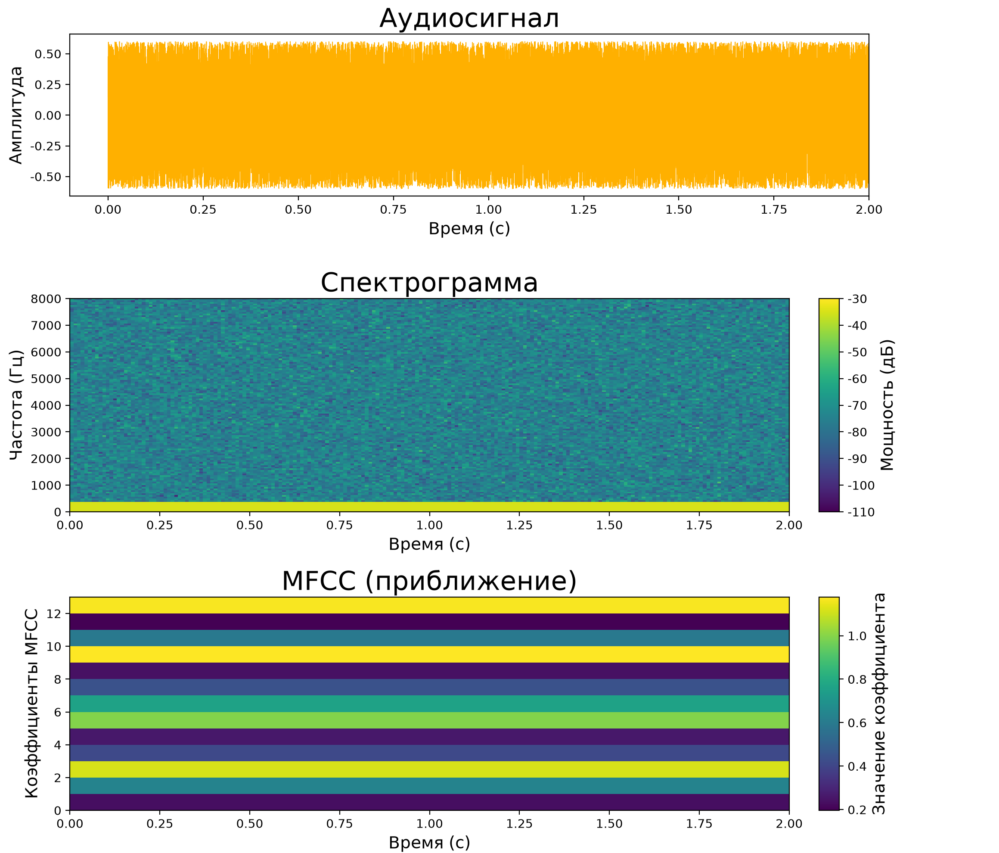

***Аудиопредставления признаков**: три иллюстративных вида показывают форму аудиоволны, ее время-частотную спектрограмму и компактное приближение MFCC. Спектрограмма кодирует время, частоту и мощность сигнала; нижняя панель представляет меньший набор коэффициентов во времени.*

<a id="sec-data-engineering-building-idempotent-data-transformations-7961"></a>

### Идемпотентные преобразования

Надежность добавляет безопасность повторов к этим основаниям качества. Если качество отвечает за то, что производят преобразования, то надежность управляет тем, насколько безопасно их можно повторять. **Идемпотентность**[^fn-idempotency-retry-safety] означает, что многократное применение операции имеет тот же эффект, что и однократное. Это свойство необходимо для производственных ML-систем, где обработка может повторяться после сбоев, данные могут переобрабатываться для исправления ошибок или одни и те же данные могут проходить через несколько путей обработки. Детерминированность — связанное, но отдельное требование: одинаковые входы и зафиксированное состояние должны давать одинаковые выходы.

[^fn-idempotency-retry-safety]: **Идемпотентность**: от латинских *idem* («тот же») и *potens* («имеющий силу») — буквально «имеющий ту же силу при повторном применении». В ML-конвейерах идемпотентность обеспечивает безопасные повторы после частичных сбоев: неидемпотентная операция (например, добавление в журнал) при повторе создает дубликаты. Идемпотентная операция оставляет одно и то же итоговое состояние после однократного или многократного применения.

В терминах конечных автоматов операция $f$ идемпотентна, если $f(f(x)) = f(x)$. В системах хранения установка регистра в абсолютное значение ($x \leftarrow 1$) идемпотентна, тогда как увеличение счетчика ($x \leftarrow x + 1$) или добавление строки в журнал без ключа — нет: каждое повторное выполнение меняет состояние системы. Распределенные конвейеры данных работают на вытесняемых рабочих узлах и ненадежных сетях, где тайм-ауты и падения узлов запускают автоматические повторы. Если стадия добавляет преобразованные записи в целевую таблицу, рабочий процесс, упавший после записи, но до подтверждения завершения, при повторе выполнится снова и создаст дубликаты записей. Идемпотентный конвейер обеспечивает семантику записи, например детерминированные вставки-обновления по ключу (вставить, если нет, перезаписать, если есть) или атомарную замену каталогов, гарантируя, что повторные попытки задания сходятся к одному и тому же итоговому набору данных.

Управление частичными сбоями конвейера требует явного разграничения состояния между стадиями. Отделение стадий постоянными промежуточными контрольными точками гарантирует, что каждая фаза может повторяться независимо, без повторного выполнения вышестоящей работы. Для долгих заданий, обрабатывающих корпуса масштаба терабайт, контрольные точки разделов состояния (например, завершенных файловых шардов или смещений потребителей потока) ограничивают задержку повторов: сбой задачи после пяти часов выполнения требует переиграть только незафиксированный шард, а не перезапускать все пятичасовое задание. Механизм контрольных точек должен фиксировать выходные разделы и маркеры состояния в одной атомарной транзакции, не давая записям потеряться или обработаться дважды.

Детерминированные преобразования — это те, которые всегда дают один и тот же выход для одного и того же входа, без зависимости от внешних факторов вроде времени, случайных чисел или изменяемого глобального состояния. Преобразования, зависящие от текущего времени (например, вычисление «дней с момента события» относительно текущей даты), нарушают детерминизм, потому что переобработка исторических данных даст другие результаты. Решение — явно фиксировать временные опорные точки: вместо «дней с момента события» вычислять «дней от события до опорной даты», где опорная дата фиксирована и сохранена. Случайные операции должны использовать генераторы случайных чисел с заданным зерном (seed), которое детерминированно выводится из входных данных, обеспечивая воспроизводимость.

Надежность в конвейере KWS требует воспроизводимого извлечения признаков. Предобработка аудио должна быть детерминированной: для одного и того же сырого аудиофайла всегда вычисляются одни и те же MFCC-признаки, независимо от того, когда происходит обработка и какой сервер ее выполняет. Это позволяет отлаживать поведение модели (всегда можно воссоздать точные признаки для проблемного примера), переобрабатывать данные после исправления ошибок (получая согласованные результаты) и выполнять распределенную обработку (разные рабочие процессы дают одинаковые признаки из одного входа). Код обработки фиксирует все параметры (размер окна быстрого преобразования Фурье (FFT), шаг сдвига окна, число коэффициентов MFCC) в конфигурации, версионируемой вместе с кодом, что обеспечивает воспроизводимость во времени и в разных средах выполнения. Даже при тщательном проектировании производственные системы должны внедрять мониторинг во время выполнения, чтобы обнаруживать перекос, если он возникнет. Глава [«MLOps»](14_ml_ops.md#sec-ml-operations) рассматривает операционное сравнение и мониторинг распределений в масштабе.

<a id="sec-data-engineering-scaling-distributed-processing-cb9b"></a>

### Распределенная обработка

Масштаб становится следующим ограничением, когда качество и надежность уже обеспечены. Качество гарантирует, что преобразования дают *корректные* выходы; надежность гарантирует, что они дают *согласованные* выходы. Ни одно из этих свойств не имеет значения, если обработка не успевает за объемом данных или за сроком. По мере роста наборов данных и параллельности экспериментов обработка данных может перерасти одну машину, даже если сырые байты все еще помещаются на локальном хранилище. Техники очистки, которые работают на гигабайтах в памяти, должны тогда стать учитывающими разбиение, внеядерными (out-of-core) или распределенными, не меняя своей семантики.

Эти вызовы проявляются, когда оценка качества должна не отставать от поступающих данных, когда конструирование признаков требует вычисления статистик по всему набору данных до преобразования отдельных записей и когда конвейеры преобразования создают узкие места при огромных объемах. Обработка должна масштабироваться от разработки (гигабайты на ноутбуках) до производства (терабайты в кластерах), сохраняя согласованное поведение.

Обработка на одной машине достаточна для удивительно больших нагрузок при аккуратной инженерии. Современные серверы с 256 ГБ оперативной памяти могут обрабатывать наборы данных объемом в несколько терабайт с помощью внеядерной обработки, которая передает данные с диска потоком. Библиотеки вроде Dask или Vaex предоставляют API в стиле pandas, которые автоматически распараллеливают вычисления по нескольким ядрам и обрабатывают их потоком. Прежде чем инвестировать в инфраструктуру распределенной обработки, команды должны исчерпать оптимизацию на одной машине: использовать эффективные форматы данных (Parquet[^fn-parquet-columnar-io] вместо CSV), минимизировать выделение памяти, применять векторные операции и использовать многоядерный параллелизм. Эксплуатационная простота обработки на одной машине (без сетевой координации, без частичных сбоев, простая отладка) делает ее предпочтительной, когда производительности достаточно.

[^fn-parquet-columnar-io]: **Parquet**: колоночный формат хранения, который организует данные по столбцам, а не по строкам. Для описанных оптимизаций на одной машине это критично: вместо того чтобы расточительно читать целую строку CSV ради нескольких столбцов, читатель Parquet загружает только нужные для вычисления столбцы. Итоговое сокращение ввода-вывода зависит от выбранных столбцов, кодирования, сжатия и нагрузки.

Когда наборы данных превышают пропускную способность или ограничения хранилища одного узла, обработка должна масштабироваться на распределенные кластеры. Разбиение данных между несколькими вычислительными ресурсами вводит проблемы распределенной координации. Распределенная координация ограничена временем кругового обхода сети: локальные операции завершаются за микросекунды, тогда как сетевая координация требует миллисекунд, что создает разницу в задержке в 1 000 раз. Это ограничение объясняет, почему операции, требующие глобальной координации (например, вычисление статистик нормализации по 100 машинам), создают узкие места. Каждое разбиение быстро вычисляет локальные статистики, но для их объединения нужна информация от всех разбиений.

Локальность данных при таком масштабе становится критичной. При пиковой пропускной способности 10 ГБ/с передача одного терабайта обучающих данных по сети занимает порядка 100 секунд; чтение того же объема с SSD на 5 ГБ/с занимает порядка 200 секунд. Это одного порядка величины, что подталкивает проектирование ML-систем к архитектурам «вычисления следуют за данными»[^fn-mapreduce-google-origin]. Когда узлы обработки обращаются к локальным данным со скоростью оперативной памяти (50–200 ГБ/с), но должны координироваться по сетям с пропускной способностью 1–10 ГБ/с, несоответствие полосы пропускания создает серьезные узкие места. География усиливает эти проблемы: координация между дата-центрами должна учитывать задержку сети (50–200 мс между регионами), частичные сбои и регуляторные ограничения, не позволяющие данным пересекать границы. Понимание того, какие операции легко распараллеливаются, а какие требуют дорогостоящей координации, определяет архитектуру системы и ее производительность. Эта накладная нагрузка составляет **налог на координацию**, который ограничивает распределенную обработку данных. Размер этого налога, а также то, что быстрее — централизовать или агрегировать, — зависит от соотношения между сетевым круговым обходом и временем локальных вычислений; это выводится в расчете на салфетке в примере [«Налог на координацию»](04_data_engineering.md#nbk-data-engineering-coordination-tax).

[^fn-mapreduce-google-origin]: **MapReduce**: разработан (Dean and Ghemawat, 2004) в Google для обработки многопетабайтного веб-индекса компании на тысячах типовых машин. Его планировщик предпочтительно назначает задачи map узлам, которые хранят входные данные, сокращая сетевой трафик входа. Этот паттерн, учитывающий локальность, повлиял на Hadoop и позже на распределенные системы обработки данных.

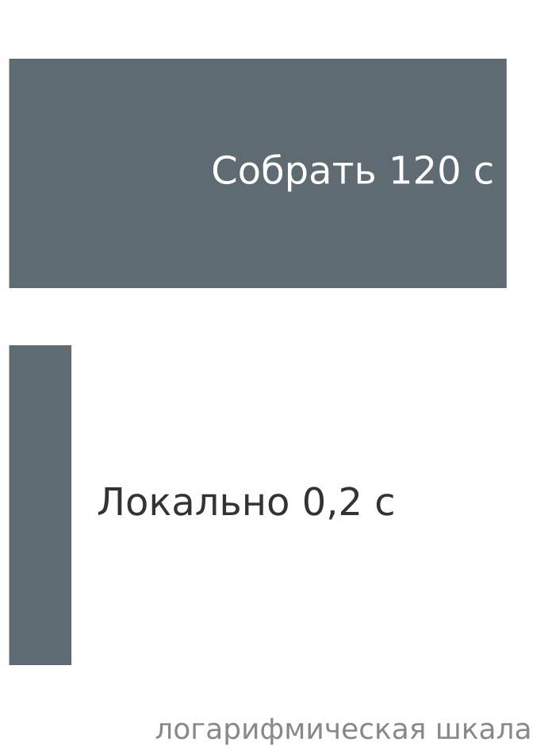

*Локальное агрегирование выигрывает у сбора всех данных, когда доминирует сетевая задержка.*

<a id="nbk-data-engineering-coordination-tax"></a>

> **Налог на координацию**
>
> **Задача**: среднее значение для нормализации должно быть вычислено по 1 ТБ признаков, распределенных по 100 узлам. Что быстрее: (A) собрать все данные на один узел и вычислить централизованно или (B) вычислить локальные средние и агрегировать их?
>
> **Вариант A (централизованный)**:
>
> - передача 1 ТБ по сети 10 ГБ/с: 100 секунд
> - вычисление среднего на одном узле: примерно от 5 до 20 секунд при пропускной способности оперативной памяти
> - итого: примерно от 105 до 120 секунд
>
>
> **Вариант B (распределенный)**:
>
> - каждый узел вычисляет локальное среднее: примерно от 0,05 до 0,2 секунды (10 ГБ при скорости оперативной памяти)
> - отправка 100 частичных средних (по 8 байт каждое): $<1\text{ мс}$
> - агрегирование: пренебрежимо мало
> - итого: примерно от 0,05 до 0,2 секунды (в сотни и несколько тысяч раз быстрее)
>
>
> **Системный вывод**: алгебраически разложимые редукции часто могут использовать частичное агрегирование рядом с данными; например, распределенное среднее переносит частичные суммы и количества. Соединения и декартовы произведения могут требовать перетасовки, хотя партиционирование и совместное размещение могут снизить эту стоимость. Проектирование конвейера должно минимизировать ненужное перемещение, перенося подходящие вычисления к данным — принцип «вычисления следуют за данными», лежащий в основе таких систем, как MapReduce (Dean and Ghemawat, 2004), Spark (Zaharia et al., 2010) и современных фреймворков ML.

Параллелизация приема данных между распределенными рабочими узлами дает убывающую отдачу по пропускной способности всякий раз, когда узкие места, которые нельзя разбить на части, — например, последовательная декомпрессия или захват центральной блокировки базы данных, — ограничивают параллелизм. Закон Амдала[^fn-amdahls-law-data] формализует этот предел масштабирования в следующем уравнении:

<a id="eq-amdahl-data"></a>

$$\text{Ускорение} \leq \frac{1}{f_{\text{serial}} + \frac{f_{\text{parallel}}}{N_{\text{workers}}}}$$

где $f_{\text{serial}}$ обозначает долю времени выполнения, затрачиваемую на принципиально последовательные стадии, $f_{\text{parallel}}$ — распараллеливаемую долю ($f_{\text{serial}} + f_{\text{parallel}} = 1$), а $N_{\text{workers}}$ — число активных рабочих процессов. Даже когда 90 процентов конвейера извлечения признаков распараллеливаются на сотнях узлов ($f_{\text{serial}} = 0{,}10$), максимальное теоретическое ускорение не может превышать $10\times$, что показывает, почему устранение последовательных узких мест ввода-вывода важнее добавления вычислительных узлов.

[^fn-amdahls-law-data]: **Закон Амдала**: (Amdahl, 1967) изложил аргумент о последовательной доле на конференции AFIPS Spring Joint Computer Conference в 1967 году, объяснив, почему многопроцессорные системы сталкиваются с убывающей отдачей. Исходная мысль — что последовательная доля нагрузки накладывает жесткий потолок на параллелизм — применима к конвейерам данных напрямую: такие операции, как вычисление глобальных статистик нормализации, вынуждают последовательные фазы агрегирования, ограничивающие ускорение независимо от того, сколько рабочих процессов параллельно обрабатывают отдельные записи.

Выбор фреймворка следует тому же вопросу координации, что и анализ Амдала: он зависит от того, какие части преобразования могут выполняться независимо, а какие требуют общего состояния или порядка. Apache Spark распараллеливает преобразования по кластерам машин, автоматически обрабатывая разбиение данных, планирование задач и отказоустойчивость. Beam предоставляет единый API для пакетной и потоковой обработки, позволяя одной и той же логике преобразования работать на нескольких движках выполнения (Spark, Flink, Dataflow). API tf.data в TensorFlow оптимизирует конвейеры загрузки данных для обучения ML, поддерживая распределенное чтение, предвыборку и преобразование. Выбор зависит от того, является ли обработка пакетной или потоковой, как распараллеливаются преобразования и какая среда выполнения доступна.

Компромисс размещения вычисления признаков, введенный в разделе [«Размещение вычисления признаков»](04_data_engineering.md#sec-data-engineering-feature-computation-placement-a998), приобретает дополнительное значение в масштабе. Когда распределенная обработка повышает пропускную способность, стоимость пересчета признаков на сотнях рабочих процессов за эпоху нужно сопоставлять со стоимостью хранения материализованных признаков один раз. На масштабе терабайт даже небольшие вычислительные затраты на пример умножаются в существенные накладные расходы, что объясняет, почему производственные системы выбирают гибридные паттерны: предвычисляют дорогие, стабильные признаки, а дешевые, чувствительные ко времени признаки вычисляют на лету.

Масштабируемость в конвейере KWS проявляется на нескольких стадиях. Разработка использует обработку на одной машине на выборочных наборах данных для быстрой итерации. Обучение в масштабе может потребовать распределенной обработки, когда набор данных (23,4 млн примеров) превышает практическую емкость одной машины или когда эксперименты идут параллельно. Извлечение признаков по отдельным файлам — задача, легко распараллеливаемая (embarrassingly parallel), но сквозное ускорение ограничено пропускной способностью общего хранилища, операциями с метаданными, планированием и конкуренцией за запись результатов. Производственное развертывание добавляет более строгий бюджет состояния предобработки 16 КБ наряду с ограничением размера модели 64 КБ, что требует тщательной оптимизации занимаемого объема, чтобы уместить обработку в возможности устройства.

<a id="sec-data-engineering-tracking-data-transformation-lineage-3b09"></a>

### Родословная преобразований

Управление завершает четырехопорный взгляд на обработку данных, обеспечивая подотчетность и воспроизводимость. Опора управления требует отслеживать, какие преобразования применялись, когда они выполнялись, какая версия кода обработки работала и какие параметры использовались. Эта **родословная преобразований**[^fn-data-lineage-forensics] поддерживает воспроизводимость, отладку, аудируемость и итеративное улучшение, когда обнаруживаются ошибки преобразования. Она может служить свидетельством для документации или процедур соответствия требованиям, но сама по себе родословная не объясняет решение модели и не устанавливает соответствие регуляторным требованиям.

[^fn-data-lineage-forensics]: **Родословная данных**: когда модель выдает ошибочное или дискриминационное предсказание, родословная помогает инженерам определить, возникла ли вносящая вклад проблема в сырых данных, вычислении признаков, обучении или обслуживании. Полученный след может поддержать расследование инцидентов и документационные обязанности, специфичные для юрисдикции, но его полезность зависит от полной инструментации и сохраненной истории; она не гарантирует объяснения поведения модели.

Версионирование преобразований фиксирует, какая версия кода обработки создала каждый набор данных. Когда логика преобразования меняется (исправляется ошибка, добавляются признаки или улучшается качество), номер версии увеличивается. Наборы данных помечаются версией преобразования, которая их создала, что позволяет найти все данные, требующие переобработки, когда обнаружены ошибки. Это версионирование выходит за рамки версий кода и захватывает всю среду обработки: версии библиотек (разные версии NumPy могут давать слегка различающиеся численные результаты), конфигурации среды выполнения (переменные окружения, влияющие на поведение) и инфраструктуру выполнения (архитектура CPU, влияющая на точность с плавающей запятой).

Отслеживание параметров сохраняет конкретные значения, использованные при преобразовании. Для нормализации это означает хранение среднего и стандартного отклонения, вычисленных по обучающим данным. Для категориального кодирования — хранение словаря (набора всех наблюдаемых категорий). Для конструирования признаков — хранение любых констант, порогов или параметров, использованных при вычислении признаков. Эти параметры обычно сериализуются вместе с артефактами модели, гарантируя, что обслуживание использует те же параметры, что и обучение. Современные ML-фреймворки, такие как TensorFlow и PyTorch, предоставляют механизмы для упаковки параметров предобработки вместе с моделями, упрощая развертывание и обеспечивая согласованность.

Родословная обработки для воспроизводимости отслеживает полную историю преобразований от сырых данных до итоговых признаков. Она включает, какие файлы сырых данных читались, какие преобразования применялись в каком порядке, какие параметры использовались и когда происходила обработка. Системы родословной, такие как Apache Atlas, Amundsen или коммерческие решения, инструментируют конвейеры для автоматического захвата этого потока. Когда предсказания модели оказываются неверными, инженеры могут проследить родословную назад и определить обучающие данные, которые повлияли на поведение, оценки качества, привязанные к этим данным, применявшиеся преобразования и то, можно ли воссоздать точный сценарий для расследования.

Фиксация точной версии кода связывает результаты обработки непосредственно с состоянием репозитория, которое их создало. Когда код обработки хранится в системе контроля версий (Git), каждый набор данных должен записывать хеш коммита кода, который его создал. Это позволяет воссоздать точную среду обработки: извлечь конкретную версию кода, установить зависимости, перечисленные для этой версии, и запустить обработку с идентичными параметрами. Контейнерные технологии, такие как Docker, упрощают это, фиксируя всю среду обработки (код, зависимости, системные библиотеки) в неизменяемом образе, который можно перезапустить через месяцы или годы с идентичными результатами.

Опора управления в конвейере KWS отслеживает параметры обработки аудио, которые критически влияют на поведение модели. Когда аудио нормализуется до стандартной громкости, опорный уровень громкости сохраняется. Когда БПФ (быстрое преобразование Фурье) переводит аудио в частотную область, фиксируются размер окна, шаг сдвига окна и оконная функция (например, Хэмминга или Ханна). Когда вычисляются MFCC, фиксируются число коэффициентов, частотный диапазон и параметры банка мел-фильтров. Такое всестороннее отслеживание параметров обеспечивает несколько критически важных возможностей: точное воспроизведение обучающих данных при отладке сбоев модели, проверку того, что обслуживание использует ту же предобработку, что и обучение, и систематическое изучение того, как выбор предобработки влияет на точность модели. Без такой инфраструктуры управления команды прибегают к ручной документации, которая неизбежно устаревает или становится неверной, и это приводит к незаметному перекосу обучения и обслуживания, снижающему производительность в эксплуатации.

Чистые, нормализованные, готовые к признакам данные остаются инертными без надзорного сигнала. Эта граница важна на практике, потому что преобразование может быть идеально воспроизводимым и все же присоединять ошибочную цель, а детерминированная предобработка не может компенсировать испорченную эталонную истину. Обучение с учителем требует присвоения целевых значений — объявления того, какие аудиосегменты содержат слова пробуждения, а какие фиксируют фоновый шум, — и это вносит субъективное человеческое суждение и вероятностные эвристики в то, что было детерминированным конвейером.

<a id="sec-data-engineering-data-labeling-6836"></a>

## Разметка данных

Конвейеры обработки в разделе [«Систематическая обработка данных»](04_data_engineering.md#sec-data-engineering-systematic-data-processing-aebc) преобразуют сырые данные в структурированные признаки, но обучение с учителем по-прежнему требует меток, которые говорят модели, какие паттерны соответствуют каждой цели. В конвейере KWS стадии приема и обработки дают миллионы чистых, стандартизированных аудиоспектрограмм, но обучению нужны эталонные аннотации, указывающие, какие сегменты содержат слово пробуждения, а какие представляют фоновый шум. Это объявление и есть **эталонная истина** (ground truth),[^fn-ground-truth-proxy] и его массовое производство часто оказывается самой зависимой от человека и подверженной ошибкам стадией конвейера.

[^fn-ground-truth-proxy]: **Эталонная истина (ground truth)**: термин из дистанционного зондирования, где орбитальные измерения проверяются отправкой команды на физическое место — «землю» — чтобы установить «истину». Этимология несет системное предупреждение: метки ML — это прокси реальности, а не сама реальность. Когда разметчик краудсорсинга помечает изображение как «кошка», эта метка отражает суждение разметчика, а не объективный факт. Каждая последующая метрика — точность (accuracy), прецизионность (precision) и полнота (recall) — измеряется относительно этого прокси, а значит, ошибки качества меток незаметно распространяются на каждую оценку модели.

В отличие от автоматических преобразований, которые можно распараллелить по машинам, разметка вносит в конвейер человеческое суждение, создавая недетерминированную задержку и стохастические режимы ошибок. Краудсорсинговый разметчик может принять прошептанное «Alexa» за фоновый шум. Опытный радиолог может не согласиться с коллегой относительно пограничного диагноза. Такие расхождения могут отражать подлинную неоднозначность, неясные инструкции, ошибку разметчика или различия в квалификации; система разметки должна различать эти причины и управлять ими, а не считать каждое расхождение неустранимым. Поэтому инфраструктура разметки должна балансировать пропускную способность, проверку качества, стоимость и происхождение данных.

<a id="sec-data-engineering-label-types-system-requirements-4c33"></a>

### Типы меток и требования к системе

Архитектура системы, занимаемый объем хранения и пропускная способность загрузчика напрямую зависят от гранулярности меток. В системе компьютерного зрения, которая отслеживает транспортные средства, пешеходов и дорожные знаки по видеопотоку, каждое представление цели накладывает свои ограничения на хранение, вычисления и сериализацию.

Метки классификации — самая простая форма: каждому входу присваивается дискретный индекс класса (или многометочная двоичная маска). Требования к хранению скромны — обычно целое фиксированной ширины (например, индекс `uint16` или `int32`) на изображение, — но паттерны доступа различаются между обучением и оценкой: конвейеры обучения перемешивают и выбирают случайно, тогда как конвейеры валидации последовательно проходят корпус, что порождает разные стратегии индексации и локальности кэша.

Ограничивающие рамки выходят за рамки классификации, локализуя объекты внутри каждого кадра. Каждая рамка хранит четыре координаты (например, $x_{\text{min}}, y_{\text{min}}, x_{\text{max}}, y_{\text{max}}$ или координаты центра с шириной и высотой) вместе с идентификатором класса. Поскольку сцены содержат переменное число объектов, хранение меток переходит от записей фиксированной ширины к структурам тензоров переменной длины, требуя динамического дополнения или обработки батчей неравной длины в загрузчике данных. Более того, позиционирование ограничивающих рамок занимает в 10–20 раз больше времени, чем одиночная классификация, напрямую замедляя пропускную способность разметки и раздувая ее стоимость.

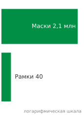

*Более мелкая гранулярность разметки многократно умножает масштаб хранения и обработки.*

Карты сегментации назначают идентификатор класса каждому пикселю, порождая плотные двумерные матрицы меток ($H \times W$). В автономном вождении и мониторинге дорожного движения это означает прослеживание неровных границ проезжей части, транспортных средств и пешеходов. Эти плотные аннотации многократно увеличивают объем хранения и пропускную способность приема. Маска сегментации для изображения $1920{\times}1080$ требует около 2,1 млн меток (по одной на пиксель), тогда как для сравнения: этого же изображения может хватить примерно 10 ограничивающих рамок или одной метки классификации. Если каждая рамка хранит 4 координаты, это примерно в 51 840 раз больше скалярных записей меток, чем у 10 рамок, прежде чем учитывать кодирование каждого значения; а часы, необходимые для ручной сегментации каждого изображения, делают такой подход пригодным только тогда, когда критична точность на уровне пикселя.

[«Модальности разметки данных»](04_data_engineering.md#fig-labels) сопоставляет пять модальностей аннотирования, и выбор зависит от входа, задачи и доступного бюджета аннотирования. Классификация может размечать всю сцену, тогда как ограничивающие рамки и карты сегментации локализуют объекты или области. Производственные наборы данных могут сочетать модальности: один кадр камеры может нести метку сцены, рамки препятствий и маски области пути, причем каждый тип метки служит отдельной последующей задаче.

<a id="fig-labels"></a>

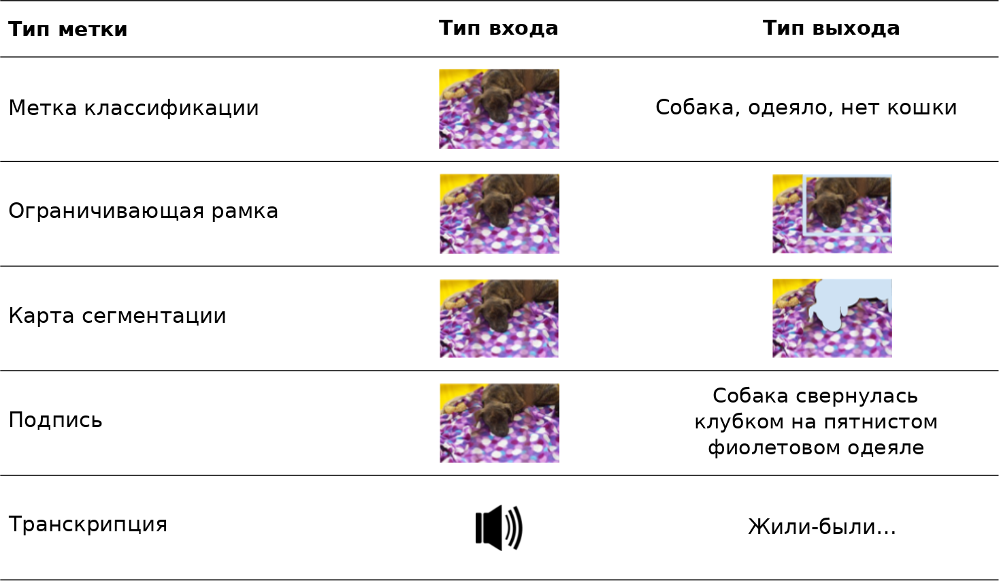

***Модальности разметки данных**: четыре строки показывают метки классификации, ограничивающих рамок, сегментации и подписей для одного изображения; пятая строка показывает метку-расшифровку для аудиовхода. Подходящее представление разметки зависит от модальности входа и задачи.*

Помимо этих геометрических меток, производственные системы также должны управлять богатыми метаданными, необходимыми для контроля качества и отладки. Набор данных Common Voice (Ardila et al., 2020) служит примером этого в распознавании речи: отслеживаются демографические данные дикторов для справедливости, метрики качества записи для фильтрации и информация о языке для поддержки многоязычности. Если модель обнаружения объектов отказывает в дождливых условиях, метаданные о погоде, захваченные во время сбора, указывают на пробел в покрытии. Это требование к метаданным показывает, как выбор типа метки каскадно влияет на весь проект системы: инфраструктура должна оптимизировать хранение под выбранный формат, реализовать подходящие паттерны выборки и отслеживать, какие версии модели использовали какие версии меток, чтобы соотносить улучшения качества с приростом производительности.

<a id="sec-data-engineering-achieving-label-accuracy-consensus-7190"></a>

### Точность меток и консенсус

Качество меток требует ограничить шум меток, несмотря на присущую субъективность и неоднозначность датчиков в больших наборах данных. Даже при четких инструкциях и тщательно спроектированной системе ненулевая доля меток неизбежно будет испорчена (Northcutt et al., 2021; Thyagarajan et al., 2022). Задача состоит не в полном устранении ошибок разметки (что невозможно), а в систематическом измерении межаннотаторского согласия и управлении частотой ошибок, чтобы удерживать их в границах, которые не ухудшают производительность модели.

Сбои разметки возникают из двух различных источников, требующих разных инженерных ответов. [«Повсеместные ошибки разметки»](04_data_engineering.md#fig-hard-labels) показывает конкретные примеры обоих режимов отказа. Одни примеры отражают деградированные или неоднозначные входы, где правильную метку трудно вывести из одних лишь данных; другие визуально ясны, но для правильной разметки требуют знаний предметной области, семантики конкретного набора данных или экспертного суждения. Эти разные режимы отказа определяют архитектурные решения о квалификации разметчиков, маршрутизации задач и механизмах консенсуса: ошибки, связанные с качеством, требуют фильтрации данных выше по потоку, а ошибки, связанные с экспертизой, требуют многоуровневой маршрутизации разметчиков.

<a id="fig-hard-labels"></a>

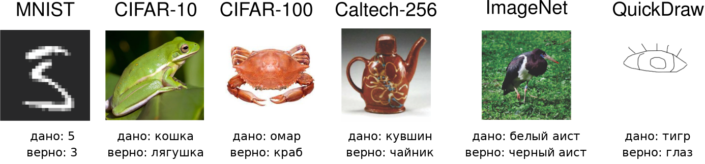

***Повсеместные ошибки разметки**: уверенно неверно размеченные примеры из широко используемых эталонов, каждый показывает данную метку рядом с исправленной эталонной истиной (MNIST, CIFAR-10, CIFAR-100, Caltech-256, ImageNet, QuickDraw). Мелкозернистые путаницы, такие как краб, помеченный как омар, или черный аист, помеченный как белый аист, показывают, что даже отобранные наборы данных содержат систематические ошибки, что мотивирует тщательный контроль качества и экспертную разметку. Источник: (Northcutt et al., 2021).*

С учетом этих присущих проблем качества производственные ML-системы внедряют несколько уровней контроля качества. Систематические проверки качества непрерывно наблюдают за конвейером разметки через случайную выборку размеченных данных для экспертной проверки и статистические методы для отметки потенциальных ошибок. Инфраструктура должна эффективно выполнять эти проверки на миллионах примеров, не создавая узких мест. Стратегии выборки обычно проверяют от 1 до 10 процентов меток, балансируя чувствительность обнаружения и стоимость проверки. Приложения повышенного риска, такие как медицинская диагностика или автономные автомобили, могут проверять 100 процентов меток через несколько независимых проверок, тогда как менее ответственные приложения, например рекомендации товаров, могут проверять только 1 процент выборочными проверками.

Помимо подходов случайной выборки, сбор нескольких меток для каждой точки данных, часто называемый «консенсусной разметкой», помогает выявлять спорные или неоднозначные случаи. Коммерческие платформы разметки, такие как Labelbox и Scale AI, предоставляют рабочие процессы консенсуса и многоуровневого контроля качества (Labelbox, Inc., 2024; Scale AI, Inc., 2024), но статистическая основа — межаннотаторское согласие. Инфраструктура консенсуса обычно собирает несколько меток на пример и вычисляет такие метрики, как каппа Фляйса — обобщение статистики каппы Коэна, введенной в разделе [«Обнаружение дрейфа данных и реакция на него»](04_data_engineering.md#sec-data-engineering-detecting-responding-data-drift-509a), с двух оценщиков на любое число разметчиков (Fleiss, 1971). Примеры с низким согласием, для которых в качестве операционных эвристик используются пороги вроде категорий Лэндиса — Коха, направляются на экспертную проверку, а не принуждаются к консенсусу в действительно неоднозначных случаях (Landis and Koch, 1977).

Подход консенсуса отражает экономический компромисс, необходимый для масштабируемых систем. Экспертная проверка стоит дороже на пример, чем краудсорсинговая разметка, но принуждение к согласию по неоднозначным примерам путем голосования большинства неэкспертов может давать систематически смещенные метки. Направляя эксперту только действительно неоднозначные случаи, выявленные по низкому межаннотаторскому согласию или провалу проверок по эталонному набору, системы балансируют стоимость и качество. Такой многоуровневый подход позволяет экономически обрабатывать миллионы примеров, сохраняя стандарты качества за счет целевого вмешательства экспертов.

Хотя техническая инфраструктура служит основой для контроля качества, успешные системы разметки должны также учитывать человеческий фактор. Эффективная работа с разметчиками требует стандартизированных рубрик аннотирования с каноническими положительными и отрицательными примерами, визуальных каталогов граничных случаев, автоматической обратной связи, которая сравнивает разметчиков с известными эталонными записями, и калибровочных сессий, на которых разметчики разрешают пограничные случаи. Для сложных или специфичных для предметной области задач система может реализовать многоуровневый доступ, направляя трудные случаи разметчикам с подтвержденной экспертизой в предметной области.

Мониторинг качества порождает значительный объем телеметрии, которую нужно эффективно принимать и отслеживать. Наиболее информативные сигналы охватывают несколько измерений. Частоты межаннотаторского согласия показывают, сходятся ли несколько разметчиков на одном примере, а оценки уверенности в метках отражают заявленную разметчиками уверенность в решениях. Время на одну аннотацию служит двусторонним индикатором: слишком быстро выполненные аннотации указывают на небрежность, а слишком долгие — на замешательство или неясные инструкции. Паттерны ошибок выявляют систематические смещения или недопонимания в пуле разметчиков, а производительность разметчиков на примерах из эталонного набора обеспечивает калибровку по эталонной истине. Наконец, демографический анализ поведения разметчиков выявляет, размечают ли определенные группы систематически иначе, что могло бы внести непреднамеренное смещение в обучающие данные. Эти метрики должны вычисляться и обновляться эффективно по миллионам примеров, часто требуя выделенных аналитических конвейеров, которые обрабатывают данные разметки почти в реальном времени, чтобы ловить проблемы качества до того, как они затронут большие объемы данных.

<a id="sec-data-engineering-scaling-aiassisted-labeling-9360"></a>

### Масштабирование с помощью ИИ-разметки

Ограничения пропускной способности ручной аннотации делают чисто человеческую разметку узким местом для крупномасштабного обучения, тогда как полностью автоматическая разметка не обладает надежностью, необходимой для неоднозначных или критичных для безопасности примеров. Разметка с помощью ИИ решает этот компромисс, используя вывод модели для обработки рутинных входов и ускорения человеческой аннотации, сохраняя при этом ручную проверку для выборок с высокой неопределенностью. [«Иерархия решений для разметки с поддержкой ИИ»](04_data_engineering.md#fig-weak-supervision) показывает четыре распространенных пути. Традиционное обучение с учителем использует прямые человеческие метки. Полуконтролируемое обучение использует структуру неразмеченных данных вместе с размеченным подмножеством. Слабый надзор заменяет отдельные ручные аннотации программными функциями разметки. Трансферное обучение повторно использует представления, выученные на вышестоящей задаче, уменьшая, но не устраняя потребность в метках конкретной задачи. Каждый путь меняет, где оплачивается стоимость надзора и какие допущения (геометрия неразмеченных данных, точность программных эвристик или переносимость представлений) конвейер должен проверять.

<a id="fig-weak-supervision"></a>

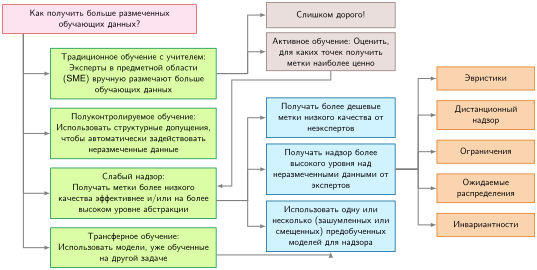

***Иерархия решений для разметки с поддержкой ИИ**: верхний вопрос о получении размеченных данных ветвится на четыре пути: традиционное обучение с учителем, полуконтролируемое обучение, слабый надзор и трансферное обучение, а активное обучение — как экономящая затраты альтернатива. Ветви различают, откуда берется надзор и какие дополнительные допущения или предобученные артефакты конвейер должен проверять. Адаптировано по обзору слабого надзора из лаборатории ИИ Стэнфордского университета (Ratner et al., 2019).*

Эти пути обменивают разные допущения, а не простые количества меток. В зависимости от пути конвейер опирается на структуру неразмеченных данных, связанную с задачей, переносимое представление, измеримую точность функций разметки или доступный цикл оценки. Производственные системы должны фиксировать каждое допущение и проверять его на удержанных, проверенных людьми данных. Диаграмма служит картой решений, а не абсолютным рейтингом качества.

Разметка с поддержкой ИИ делит работу в соответствии с сильными сторонами каждого участника. Люди оценивают неоднозначные случаи, замечают тонкие ошибки и применяют знания предметной области; модели могут обрабатывать рутинные случаи в масштабе при условии валидации. Производственные системы объединяют эти возможности через несколько взаимодополняющих подходов.

Предварительная аннотация использует модели ИИ для генерации предварительных меток, которые люди затем проверяют и исправляют, — превращая задачу из «разметь с нуля» в «проверь и исправь». Программные фреймворки разметки, такие как Snorkel (Ratner et al., 2018; Ratner et al., 2017), развивают это дальше через слабый надзор[^fn-weak-supervision-cost], автоматически генерируя начальные метки в масштабе с помощью эвристик на основе правил, баз знаний и выходов существующих моделей. В автономном вождении предобученные модели обнаружения объектов могут размечать транспортные средства и пешеходов, которые аннотаторы-люди проверяют и уточняют, автоматически обрабатывая многие очевидные случаи.

[^fn-weak-supervision-cost]: **Слабый надзор**: парадигма «программирования данных», которая обменивает часть ручного труда аннотирования на предварительные усилия по написанию и проверке программных функций разметки. После написания функцию можно дешево применять в масштабе, но выполнение, разрешение конфликтов, мониторинг качества и сопровождение по-прежнему стоят денег; полезное сравнение зависит от нагрузки, а не буквально нулевой предельной стоимости.

Большие языковые модели (LLM) теперь помогают конвейерам разметки, генерируя описания, составляя инструкции по разметке на основе примеров и объясняя свои рассуждения при назначении меток. Например, системы модерации контента используют LLM для первичной классификации контента с объяснениями, которые проверяют рецензенты-люди. Однако интеграция LLM вносит системные проблемы: стоимость вывода и ограничения частоты запросов, зависящие от провайдера и модели, а также необходимость систематической валидации выходов, потому что LLM могут выдавать уверенные, но неверные метки. Многие организации применяют многоуровневые подходы: более мелкие специализированные модели для рутинных случаев и более крупные LLM — для сложных сценариев, требующих тонкого суждения.

Активное обучение идет на дополняющий компромисс: оно тратит вывод модели, чтобы сократить человеческую разметку, поэтому релевантный вопрос в том, укладываются ли эти вычисления в тот же бюджет.

[^fn-active-learning-budget]: **Активное обучение**: переворачивает традиционную парадигму разметки: вместо случайного выбора примеров для разметки модель запрашивает те, которые ей нужнее всего, как правило, там, где неопределенность предсказания наибольшая (Settles, 2009). Это может сократить число меток, необходимых для достижения целевой точности, но инфраструктурный компромисс — это вычисления вместо меток: при \$0,01 за изображение оценка полного пула из 10 млн примеров стоит \$100 000 до получения каких-либо человеческих меток. Активное обучение становится бюджетным рычагом только тогда, когда пул кандидатов предварительно отфильтрован, вывод намного дешевле или вычислительный бюджет отделен от бюджета разметки.

Такие методы, как активное обучение[^fn-active-learning-budget], дополняют эти подходы, приоритизируя кандидатные примеры по неопределенности модели (Settles, 2009; Coleman et al., 2022). Эти системы непрерывно анализируют неопределенность модели, чтобы выявить ценных кандидатов для разметки. Вместо разметки случайной выборки неразмеченных данных активное обучение выбирает примеры, где текущая модель наиболее неуверенна или где метки сильнее всего улучшили бы производительность модели. Инфраструктура должна эффективно вычислять метрики неопределенности (часто энтропию предсказаний или расхождение между моделями ансамбля), поддерживать очереди задач, упорядоченные по информативности, и адаптировать стратегии приоритизации на основе поступающих меток. Например, в конвейере медицинской визуализации активное обучение направляет редкие или пограничные патологии опытным радиологам, тогда как рутинные снимки получают автоматические предварительные аннотации, которые врачи быстро проверяют. Такой подход может существенно сократить требуемые аннотации в благоприятных условиях, хотя он требует тщательной инженерии, чтобы предотвратить петли обратной связи, в которых неопределенность модели смещает то, какие данные будут размечены. Расчет бюджета делает этот рычаг конкретным.

<a id="nbk-data-engineering-active-learning-multiplier"></a>

> **Множитель активного обучения**
>
> **Задача**: набор данных из 10 млн примеров имеет бюджет на разметку \$50 000. Случайная выборка дает точность 85 процентов при 100 тысячах примеров, тогда как целевая точность — 95 процентов.
>
> **Расчет**:
>
> 1.  **Эффективность выборки**: активное обучение может достичь целевой точности меньшим числом примеров, чем случайный выбор, в благоприятных условиях.
> 2.  **Стоимость на точку**: случайная выборка = \$0,50 за метку. Активное обучение добавляет вычислительную стоимость (около \$0,01 за изображение на вывод), чтобы найти трудные примеры.
> 3.  **Множитель**:
>     *   **Случайная**: достижение 95 процентов может потребовать 1 млн меток (\$500 000). Бюджет превышен.
>     *   **Только метки активного обучения**: системе может понадобиться около 100 000–200 000 трудных примеров (\$50 000–\$100 000).
>     *   **Оценка всего пула**: оценка всех 10 млн кандидатных изображений добавляет \$100 000, поэтому общая стоимость активного обучения становится \$150 000–\$200 000. Бюджет превышен.
>
>
> **Системный вывод**: выбор алгоритма — важный рычаг для числа меток, но вычисления должны укладываться в бюджетную модель. Если потратить 10 процентов этого бюджета на вывод (\$5 000), при заявленной цене вывода будет оценено только 500 тысяч кандидатных изображений, и на метки останется примерно 90 тысяч. Активное обучение жизнеспособно, только если пул кандидатов сужается до оценки, стоимость вывода заметно падает или вычисления финансируются отдельно от разметки.

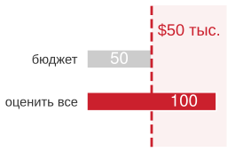

*Оценка полного пула может превысить бюджет на метки еще до начала разметки.*

Контроль качества становится все более важным по мере того, как эти компоненты ИИ взаимодействуют. Система должна отслеживать производительность и ИИ, и людей через систематические метрики. Важна калибровка уверенности модели: если ИИ сообщает 95 процентов уверенности, но достигает точности лишь 75 процентов на этом уровне уверенности, предварительные аннотации вводят проверяющих в заблуждение. Частоты согласия человека и ИИ показывают, помогает ли помощь ИИ или мешает: когда люди часто переопределяют предложения ИИ, предварительные аннотации, возможно, вносят смещение вместо ускорения работы. Эти метрики требуют тщательной инструментации всего конвейера разметки, отслеживая как итоговые метки, так и взаимодействие между разметчиками-людьми и ИИ на каждой стадии.

Эти принципы проявляются в масштабе в областях, критичных для безопасности. Инфраструктура разметки для автономных автомобилей может обрабатывать большие объемы кадров датчиков, используя предварительную аннотацию ИИ для разметки распространенных объектов, а необычные сценарии (строительные зоны, машины экстренных служб) направляя экспертам-людям: это распределенная архитектура, в которой предварительная аннотация работает на кластерах GPU, а проверка людьми масштабируется по командам аннотаторов. Системы медицинской визуализации сталкиваются с параллельной проблемой дефицита меток: большие репозитории неразмеченных клинических данных делают экспертную аннотацию узким местом и мотивируют эффективные по данным рабочие процессы, которые учатся полезным представлениям на неразмеченной структуре до применения экспертных меток (Krishnan et al., 2022). В таких областях общий паттерн инженерии данных — *многоуровневая эскалация*: автоматизация обрабатывает очевидные случаи, люди — неоднозначные, а мониторинг следит, чтобы граница между «очевидным» и «неоднозначным» адаптировалась по мере развития возможностей ИИ и условий развертывания.

<a id="sec-data-engineering-case-study-automated-labeling-kws-systems-976d"></a>

### Автоматическая разметка в KWS

Разметка наборов данных для распознавания ключевых слов в масштабе создает специфичные для речи системные проблемы. Генерация миллионов размеченных примеров слов пробуждения без пропорциональных затрат на человеческую аннотацию требует выхода за рамки ручных и краудсорсинговых рабочих процессов. Многоязычный корпус произнесенных слов (Multilingual Spoken Words Corpus, MSWC) (Mazumder et al., 2021) демонстрирует, как автоматическая разметка снимает это узкое место пропускной способности: корпус программно извлекает более 23,4 млн примеров односекундной речи, охватывающих 340 000 ключевых слов на 50 языках, из непрерывных речевых корпусов.

Такой масштаб делает ручную аннотацию непрактичной: 23,4 млн примеров даже при 10 секундах на метку потребовали бы около 65 000 часов, примерно 32,5 человеко-года полной занятости. Широкий, документированный источник данных на 50 языках может улучшить покрытие, но само по себе число языков не гарантирует репрезентативности дикторов, акцентов, устройств или акустических сред. Автоматическая система в [«Подготовка многоязычных данных»](04_data_engineering.md#fig-mswc) решает проблему масштаба, начиная с парного аудио предложений и транскрипций, а затем использует принудительное выравнивание[^fn-forced-alignment-kws], чтобы оценить границы слов в непрерывной речи.

На таком масштабе контроль качества становится задачей выборки и происхождения, а не исчезает. Конвейер должен сообщать о покрытии по языкам, дикторам, акцентам, устройствам и акустическим средам; сохранять для каждого извлеченного фрагмента исходную запись, версию транскрипции, версию выравнивателя и уверенность в границах; направлять выравнивания с низкой уверенностью и недопредставленные срезы на проверку людьми. Удержанная оценка должна затем измерять целевые слова пробуждения по этим срезам. Эти средства контроля отличают большой корпус от репрезентативного и делают ошибки извлечения прослеживаемыми, когда нижестоящая модель KWS дает сбой.

[^fn-forced-alignment-kws]: **Принудительное выравнивание (forced alignment)**: при известной транскрипции выравниватель оценивает, где в аудио встречаются ее слова, часто используя покадровые акустические оценки и декодирование последовательностей. Точность временного разрешения зависит от модели, признаков, языка и качества записи, поэтому оценки границ все равно требуют проверки качества. Известная транскрипция делает сегментацию на уровне слов намного дешевле ручной разметки каждого фрагмента, хотя вычисления, проверка и исправление ошибок остаются.

<a id="fig-mswc"></a>

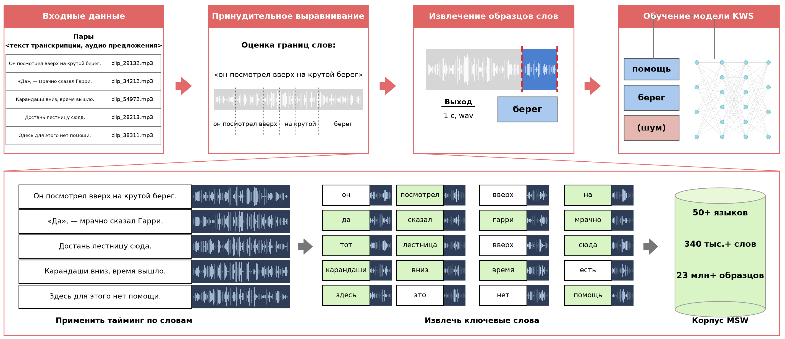

***Подготовка многоязычных данных**: принудительное выравнивание и сегментация превращают парные аудио- и текстовые данные в размеченные односекундные фрагменты, создавая крупномасштабный корпус для обучения моделей распознавания ключевых слов на 50 языках. Этот автоматизированный процесс позволяет масштабировать разработку систем KWS, эффективно генерируя обучающие примеры из доступных речевых ресурсов, таких как Common Voice и многоязычный контент с субтитрами. Источник: (Mazumder, 2021).*

Система извлечения использует эти точные маркеры времени, чтобы генерировать чистые образцы ключевых слов, одновременно справляясь с предсказуемыми инженерными проблемами: фоновый шум, мешающий границам слов, дикторы, неожиданно растягивающие или сжимающие слова за пределы целевой длительности от 500 до 800 мс, и более длинные слова, выходящие за границу в одну секунду. MSWC предоставляет автоматическую оценку качества, которая анализирует аудиохарактеристики, чтобы выявлять возможные проблемы с качеством записи, четкостью речи или фоновым шумом; это важно для поддержания согласованных стандартов на 23,4 млн образцах без ручных проверок, которые сделали бы такой масштаб непозволительно дорогим.

Команды разработчиков голосовых ассистентов часто опираются на эту основу автоматической разметки. Хотя автоматические корпуса могут не содержать конкретных слов пробуждения, нужных продукту, они дают отправную точку для прототипирования KWS, особенно для недостаточно обслуживаемых языков, где коммерческих наборов данных не существует. Производственные системы обычно добавляют поверх этого целевую запись и проверку людьми для сложных случаев (необычные акценты, редкие слова или трудные акустические среды), координируя автоматизированную обработку и человеческую экспертизу.

На этом этапе конвейер компиляции выпустил свои основные артефакты: векторы признаков в паре с эталонными метками. Доставка этих тензоров исполнительным блокам раскрывает физическую иерархию хранения. Фундаментальное противоречие носит механический характер: пакетное обучение требует высокопроизводительного последовательного потока через петабайты записей, тогда как вывод в реальном времени требует поиска отдельных векторов признаков за доли миллисекунды. Архитектура хранения определяет, вычисляют ли ускорители непрерывно или простаивают, ожидая ввода-вывода.

<a id="sec-data-engineering-strategic-storage-architecture-1a6b"></a>

## Архитектура хранения

Размеченные наборы данных, которые производит конвейер (23,4 млн образцов на 50 языках в примере KWS), требуют продуманной организации хранения, чтобы сбалансировать пропускную способность обучения и задержку обслуживания. Согласование этих расходящихся профилей доступа требует отображения паттернов доступа нагрузки непосредственно на физические возможности лежащих в основе носителей хранения.

Требования к хранению для машинного обучения принципиально расходятся с требованиями транзакционных систем. Вместо оптимизации под частые мелкие записи и точечные поиски, характерные для банковских систем или электронной коммерции, нагрузки ML приоритизируют устойчивую пропускную способность последовательного чтения, крупномасштабные сканирования от гигабайт до петабайт и гибкость схемы. Реляционная база данных, обслуживающая каталог интернет-магазина, обрабатывает миллионы отдельных запросов к товарам в секунду с низкой задержкой, но задание обучения, последовательно сканирующее тот же каталог на протяжении десятков эпох, упирается в несгруппированные чтения с диска, присущие транзакционным движкам хранения.

<a id="sec-data-engineering-ml-storage-systems-architecture-options-67fa"></a>

### Варианты систем хранения

Пакетное обучение последовательно сканирует миллионы примеров; вывод в реальном времени извлекает по одному вектору признаков за раз. Эти противоположные паттерны доступа тянут хранилище в двух направлениях, и выбор системы означает минимизацию члена данных $\left(\frac{D_{\text{vol}}}{\text{BW}}\right)$ железного закона систем ML для того паттерна, который доминирует. Каждый носитель хранения накладывает физические ограничения на пропускную способность, которые определяют максимальную скорость конвейеров обучения и обслуживания.

Две метрики производительности хранилища управляют этой оптимизацией. **IOPS (операции ввода-вывода в секунду)** считает различные запросы чтения или записи, которые устройство может обработать в секунду, ограничивая *случайный доступ*, например выборку небольших батчей изображений или отдельных профилей пользователей. **Пропускная способность (bandwidth)** измеряет объем данных, передаваемый в секунду, обычно $\text{IOPS} \times \text{Размер блока}$, ограничивая *последовательный доступ*, например сканирование файла Parquet для обучения.

Выбор между базами данных, хранилищами данных и озерами данных по сути означает выбор того, какие из этих метрик оптимизировать на разных стадиях жизненного цикла. Традиционные базы данных (онлайн-обработка транзакций, OLTP) оптимизированы для высокого IOPS при малых размерах блоков и построчной организации. Они хранят каталоги товаров, профили пользователей или истории транзакций со строгими гарантиями ACID и задержкой поиска отдельной записи менее миллисекунды. В рабочих процессах ML этот профиль подходит для онлайн-подачи признаков: рекомендательная система, которая ищет профиль пользователя при выводе в реальном времени, или антифрод-сервис, запрашивающий исторические счетчики транзакций, нуждаются в случайных точечных запросах, ограниченных задержкой каждого запроса. В крайнем случае крупные рекомендательные системы обслуживают миллиарды разреженных чтений признаков в секунду из таблиц масштаба терабайт, что требует движков хранения, максимизирующих IOPS, а не массовую пропускную способность. Однако базы данных не подходят как источник обучающих данных. Когда задание обучения сканирует миллионы записей за несколько эпох, построчная организация заставляет движок хранения загружать в память целые строки с диска, даже когда модель использует только 20 из 100 признаков. Возникающий несгруппированный ввод-вывод и впустую потраченная пропускная способность шины ограничивают производительность.

Хранилища данных (онлайн-аналитическая обработка, OLAP) инвертируют эту физическую организацию, упорядочивая таблицы по столбцам, а не по строкам (Stonebraker et al., 2018). Храня значения каждого атрибута подряд на диске, колоночные форматы позволяют последовательным сканированиям читать только признаки, нужные модели, передавая одну пятую несжатого объема строк при выборке 20 столбцов из 100. Расчет эффективности формата в разделе [«Производительность хранения и стоимость»](04_data_engineering.md#sec-data-engineering-ml-storage-requirements-performance-1b0d) количественно оценивает этот выигрыш на примере обнаружения мошенничества. Колоночная организация также достигает высокой степени сжатия однородных типов данных, напрямую уменьшая количество байтов, переданных по шине хранения. Хранилища данных превосходно подходят для инженерии признаков, пакетных агрегаций и обучения табличных моделей, где интерфейсы SQL упрощают итеративное исследование данных. Однако хранилища требуют структурированных схем и плохо справляются с мультимодальными артефактами, такими как сырое аудио, изображения высокого разрешения и свободный текст. Изменение схемы в ходе быстрых экспериментов требует дорогостоящих операций `ALTER TABLE` над таблицами из миллиардов строк, тормозя скорость разработки.

Озера данных полностью отказываются от заранее заданных табличных схем, храня структурированные, полуструктурированные и неструктурированные данные в нативных форматах на объектном хранилище большой емкости. Определение структуры данных откладывается до момента запроса: это архитектурный паттерн, известный как «схема при чтении» (schema-on-read).[^fn-schema-onread-flexibility]

[^fn-schema-onread-flexibility]: **Схема при чтении (schema-on-read)**: применяет определения структуры данных во время запроса, а не при приеме, в отличие от схемы при записи (schema-on-write, традиционные базы данных), где данные должны соответствовать заранее заданной структуре до сохранения. Для конвейеров ML на ранней стадии разработки схема при чтении позволяет быстро экспериментировать: команды могут хранить сырые данные датчиков, изображения и журналы, не фиксируя схему признаков заранее. Компромисс — управление: без обязательных схем озера данных вырождаются в «болота данных», где поиск и валидация обучающих данных становятся узким местом.

Такая организация подходит для исследовательской инженерии данных и мультимодальных обучающих конвейеров, где наборы признаков непрерывно развиваются. Система компьютерного зрения или мультимодальная система может хранить сырые журналы датчиков в формате JSON, изображения в виде файлов JPEG, потоки кликов в Parquet, а выученные представления в виде двоичных массивов NumPy в одном репозитории. Независимые задания обучения накладывают схемы при чтении, извлекая разные подмножества без согласования миграций схем. Однако схема при чтении переносит управление с приема на извлечение. Без дисциплинированного управления метаданными озера данных вырождаются в «болота данных» — неупорядоченные репозитории с осиротевшими деревьями каталогов вроде `userdata_v2_final` и `userdata_v2_ACTUALLY_FINAL`, родословная и качество которых не зафиксированы. Производственным озерам данных нужен выделенный каталог метаданных (например, AWS Glue Data Catalog, Apache Atlas или Databricks Unity Catalog) для записи родословной, частоты обновлений, версий схем и политик доступа.

Каждая архитектура хранения оптимизирована под свой паттерн доступа и фазу жизненного цикла, как суммирует [«Характеристики систем хранения»](04_data_engineering.md#tbl-storage).

| **Атрибут**                  | **Традиционная база данных**               | **Хранилище данных**                                      | **Озеро данных**                                       |
|:-----------------------------|:-------------------------------------------|:----------------------------------------------------------|:-------------------------------------------------------|
| **Назначение**               | Операционные и транзакционные задачи       | Аналитика и отчетность                                    | Хранение сырых и разнородных данных для будущей обработки |
| **Тип данных**               | Структурированные                          | Структурированные                                         | Структурированные, полуструктурированные и неструктурированные |
| **Масштаб**                  | От малых до средних объемов                | От средних до больших объемов                             | Большие объемы разнородных данных                      |
| **Оптимизация производительности** | Оптимизирована для транзакционных запросов (OLTP) | Оптимизирована для аналитических запросов (OLAP)     | Оптимизирована для масштабируемого хранения и извлечения |
| **Примеры**                  | MySQL, PostgreSQL, Oracle DB               | Google BigQuery, Amazon Redshift, Microsoft Azure Synapse | Google Cloud Storage, AWS S3, Azure Data Lake Storage  |

<a id="tbl-storage"></a>

***Характеристики систем хранения**: каждая архитектура хранения предпочитает свой паттерн доступа и этап рабочего процесса ML. Базы данных поддерживают случайный доступ с высоким IOPS, необходимый для онлайн-подачи признаков; хранилища данных обеспечивают последовательную пропускную способность для пакетного обучения и инженерии признаков; озера данных дают гибкость схем и экономическую эффективность для длительного хранения больших объемов сырых данных. Неудачное соответствие системы и нагрузки может вносить существенные штрафы в производительность.*

Производственные архитектуры ML редко выбирают одну технологию хранения. Зрелые системы объединяют все три уровня в единую топологию данных: базы данных обрабатывают операционную телеметрию и поиск в реальном времени; хранилища данных выполняют структурированную выборку признаков и аналитику агрегатов; озера данных хранят мультимодальные сырые записи и промежуточные контрольные точки. Например, в конвейере беспилотного автомобиля телеметрия автомобиля поступает в операционную базу данных для немедленного мониторинга состояния, агрегированная статистика вождения пополняет хранилище данных для аналитики парка, а сырые кадры камер и облака точек лидара хранятся в объектном хранилище для обучения моделей.

<a id="sec-data-engineering-ml-storage-requirements-performance-1b0d"></a>

### Производительность хранения и стоимость

Физические носители хранения различаются на три порядка по стоимости и на пять порядков по пропускной способности. Несоответствие уровня хранения паттерну доступа либо раздувает инфраструктурные затраты недоиспользуемой емкостью, либо лишает обучающие ускорители данных во время простоев ввода-вывода.

[«Иллюстративные компромиссы стоимости и производительности хранения (2024)»](04_data_engineering.md#tbl-storage-performance) показывает, почему ML-системы используют многоуровневое хранение. При этих допущениях 2024 года хранение нашего обучающего набора KWS (748,8 ГБ) в объектном хранилище стоит \$17,2 в месяц, что делает доступным хранение сырого аудио, тогда как рабочие наборы на NVMe[^fn-nvme-gpu-utilization] стоят от \$74,9 до \$224,6 в месяц для активного обучения, но загружаются в 50 раз быстрее.

| **Уровень хранения**                     | **Стоимость (\$/ТБ в месяц)** |             **Пропускная способность последовательного чтения** | **Задержка случайного чтения** | **Типичный сценарий ML**                      |
|:-----------------------------------------|:----------------------:|:---------------------------------------------------------:|:---------------------------:|:----------------------------------------------|
| **NVMe SSD (локальный)**                 |       \$100–300        | 5–7 ГБ/с |          10–100 мкс          | Загрузка обучающих данных, активная подача признаков |
| **Объектное хранилище (S3, GCS)**        |        \$20–25         |               100–500 МБ/с (на соединение)               |           10–50 мс          | Сырое хранение в озере данных, артефакты моделей |
| **Хранилище данных (BigQuery, Redshift)** |        \$20–40         |                  1–5 ГБ/с (колоночное сканирование)                 |  100–500 мс (запуск запроса) | Запросы к обучающим данным, инженерия признаков |
| **Кэш в оперативной памяти (Redis, Memcached)** |       \$500–1000       |                         20–50 ГБ/с                        |           1–10 мкс           | Онлайн-подача признаков, вывод в реальном времени |
| **Архивное хранилище (Glacier, Nearline)** |         \$1–4          |               10–50 МБ/с (после извлечения)               |      Часы (извлечение)      | Историческое хранение, архивы для соответствия требованиям |

<a id="tbl-storage-performance"></a>

***Иллюстративные компромиссы стоимости и производительности хранения (2024)**: эти диапазоны планирования зависят от провайдера, региона, конфигурации и нагрузки. Загрузка обучающих данных требует высокопроизводительного последовательного доступа; раздел [«Иерархия памяти»](appendix_machine.md#sec-appdx-machine-foundations-memory-hierarchy-2278) приложения «Основы машины» описывает иерархию памяти, с которой должен согласовываться этот паттерн. Онлайн-обслуживание нуждается в случайных чтениях с низкой задержкой, тогда как архивное хранение ставит стоимость выше скорости доступа ради соответствия требованиям и исторических данных.*

[^fn-nvme-gpu-utilization]: **NVMe (Non-Volatile Memory Express)**: протокол хранения, который подключается напрямую к шине PCIe с очередями команд на 64K, обеспечивая последовательную пропускную способность 5–7 ГБ/с и задержку на уровне микросекунд. Контраст с SATA SSD (500 МБ/с, одна очередь) — разрыв в пропускной способности в 10 раз, который может стать узким местом конвейера обучения, когда время обслуживания хранилища превышает время вычислений.

Эта разница в пропускной способности определяет скорость инженерных итераций. Обучение, которое загружает данные со скоростью 5 ГБ/с, завершает загрузку набора за 149,8 с, против 7 488 с при типичных скоростях объектного хранилища. Это ускорение в 50 раз определяет, могут ли инженеры итерировать несколько раз в день или должны ждать часами между экспериментами.

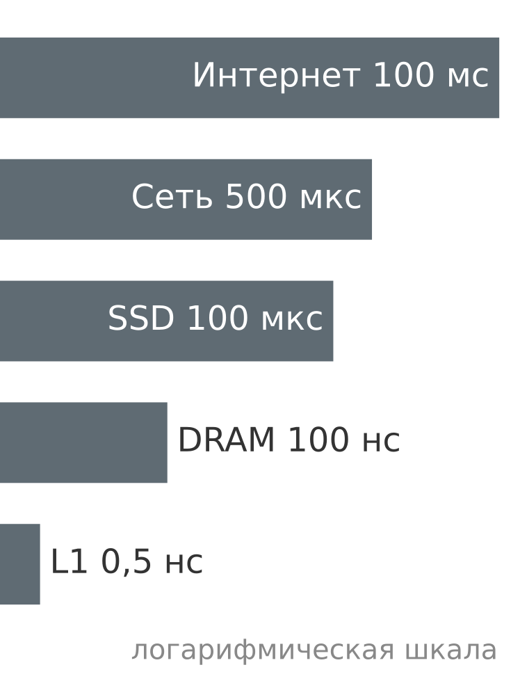

*Задержка доступа охватывает восемь порядков величины: от кэша до интернета.*

Разрыв задержек между регистрами на кристалле и удаленным хранилищем охватывает более восьми порядков величины, из-за чего небуферизованные удаленные запросы ввода-вывода останавливают конвейеры выполнения GPU. Перевод этих микросекундных задержек в человеческие масштабы ([«Иерархия задержек памяти и хранения»](04_data_engineering.md#tbl-ml-latencies)) иллюстрирует штраф производительности от некэшированного чтения. Эти цифры, популяризированные ключевым докладом Джеффа Дина на LADIS в 2009 году,[^fn-jeff-dean-numbers] показывают, почему небуферизованный удаленный ввод-вывод оставляет современные ускорители без данных и почему распределенное обучение требует строгой локальности данных.

[^fn-jeff-dean-numbers]: **Джефф Дин**: старший научный сотрудник Google, архитектор MapReduce, BigTable, Spanner и TensorFlow. Его ключевой доклад на LADIS 2009 года свел цифры из [«Иерархия задержек памяти и хранения»](04_data_engineering.md#tbl-ml-latencies) к инженерной эвристике: ссылка на кэш L1 (0,5 нс) и круговой обход между дата-центрами (150 мс) отличаются в $3 \times 10^{8}$ раз — восемь порядков величины, которые объясняют, почему конвейер обучения, читающий признаки из удаленного хранилища вместо локального NVMe, оставляет без данных ускоритель, который должен был питать.

| **Операция**             | **Задержка (нс)** | **Человеческий масштаб** | **Влияние на ML-систему**    |
|:-------------------------|:----------------:|:---------------:|:-----------------------------|
| **Ссылка на кэш L1**     |       0,5        |     1 секунда   | Мгновенно                    |
| **Ссылка на кэш L2**     |        7         |    14 секунд    | Быстрое вычисление           |
| **Основная память (DRAM)** |       100        |    3 минуты     | Порог «стены памяти»         |
| **SSD (локальный NVMe)** |     100 000      |      2 дня      | Узкое место загрузки данных  |
| **Сеть (тот же дата-центр)** |     500 000      |    11,57 дня    | Задержка распределенной координации |
| **SSD (удаленная сеть)** |    2 000 000     |    46,30 дня    | Источник перекоса обучения и обслуживания |
| **Объектное хранилище (S3)** |    20 000 000    |      1 год      | Доступ к архиву              |
| **Интернет (Калифорния — Виргиния)** |   100 000 000    |     6 лет       | Пользовательский опыт в глобальном масштабе |

<a id="tbl-ml-latencies"></a>

***Иерархия задержек памяти и хранения**: типичные времена доступа к оборудованию, приведенные к человеческому масштабу, где обращение к кэшу L1 за 0,5 нс соответствует одной секунде.*

Помимо входных наборов данных, архитектуры хранения должны вмещать плотные числовые массивы, порождаемые при разработке модели: веса параметров, состояния оптимизаторов и контрольные точки обучения.

Современные нейронные сети содержат от миллионов до сотен миллиардов параметров, что порождает паттерны хранения и извлечения, отличные от табличных данных. GPT-3 (Brown et al., 2020) требует примерно 700 ГБ для весов модели в формате FP32 (175 млрд параметров по 4 байта), хотя на практике часто используют более компактные числовые форматы, такие как FP16 (350 ГБ), чтобы вдвое снизить нагрузку на память. Даже при точности FP16 эта единственная контрольная точка превышает операционные базы данных многих организаций. От 60 млн параметров AlexNet (Krizhevsky et al., 2012) до 175 млрд параметров GPT-3 (Brown et al., 2020) размер модели вырос примерно в 2916 раз за восемь лет. Веса моделей требуют блочно выровненных форматов хранения, чтобы поддерживать параллельное чтение групп параметров при инициализации и контрольном сохранении, что требует совокупной пропускной способности хранилища, приближающейся к пределам сетевой структуры (25–100 Гбит/с), чтобы вычислительные блоки оставались активными. Методы квантования на стороне модели, которые сжимают эти объемы, рассматриваются в главе [«Сжатие моделей»](10_model_compression.md).

Отслеживание этих артефактов создает проблемы версионирования. Стандартные системы контроля версий вроде Git хорошо работают с инкрементальными текстовыми различиями, но не справляются с отслеживанием многогигабайтных двоичных файлов, где одно обновление весов порождает совершенно новый файл. Наивное хранение десяти исторических контрольных точек модели объемом 10 ГБ потребляет 100 ГБ. Производственные ML-рабочие процессы разделяют метаданные и двоичные артефакты: такие инструменты, как DVC (Data Version Control) и MLflow, хранят легковесные криптографические хеши в Git, а двоичные контрольные точки выносят во внешние адресуемые по содержимому объектные хранилища. Это обеспечивает точную воспроизводимость без раздувания репозитория кода.

Обучение на нескольких ускорителях усиливает нагрузку на хранилище через параллельный ввод-вывод. Когда задание обучения охватывает несколько ускорителей, каждый ранг должен одновременно читать обучающие батчи, записывать снимки оптимизатора и сбрасывать промежуточные контрольные точки. Системы хранения должны поглощать одновременные чтения и записи с темпом, пропорциональным числу рабочих процессов, предотвращая сериализацию ввода-вывода, которая оставляет дорогие ускорители простаивающими. Механизмы координации этих параллельных рабочих процессов разбираются в главе [«Обучение моделей»](08_training.md#sec-model-training).

Это физическое несоответствие между пропускной способностью вычислений и хранилища раскрывает обрыв производительности из-за голодания ускорителя по данным. Тогда как оперативная память хоста на современных серверных узлах отдает 50–200 ГБ/с, локальные NVMe SSD дают 1–7 ГБ/с, а сетевое хранилище — 1–10 ГБ/с. Когда ускоритель может обрабатывать данные быстрее, чем иерархия хранения успевает их подготовить, конвейер данных становится лимитирующим ограничением. Десятикратное несоответствие между скоростью потребления GPU и пропускной способностью хранилища заставляет ускорители простаивать 90 процентов времени. Пропускная способность обучения ограничена минимумом из вычислительной мощности и скорости подачи данных.

<a id="nbk-data-engineering-storage-bandwidth-budget"></a>

> **Бюджет пропускной способности хранилища**
>
> **Задача**: какая конфигурация хранилища не даст эталонному ускорителю голодать при обучении ResNet-50? Семейство устройств описано в главе [«Аппаратное ускорение»](11_hw_acceleration.md); здесь важно, как потолок вычислений превращается в бюджет пути данных.
>
> Начнем с потолка вычислений. Эталонный ускоритель может выдавать 312 TFLOP/s на плотных операциях FP16. ResNet-50 требует около 8 GFLOP на каждый прямой проход, а с учетом обратного прохода обучения стоимость шага обучения достигает примерно 24,6 GFLOP на изображение. Глава [«Обучение моделей»](08_training.md#sec-model-training) выводит механизм обратного прохода; здесь суммарная стоимость на изображение служит входом для бюджета хранилища. Деление пиковой производительности ускорителя на стоимость шага на изображение дает потолок вычислений 12 682 изображения в секунду.
>
> Этот потолок вычислений становится требованием к хранилищу, как только каждое изображение должно поступить с диска или из объектного хранилища. При сжатых JPEG-изображениях по 150 КБ путь данных должен поставлять 12 682 изображения в секунду по 150 КБ каждое, то есть примерно 1,9 ГБ/с.
>
> Теперь у вариантов хранения есть конкретная цель: насыщение этого ускорителя требует устойчивой пропускной способности 1,9 ГБ/с.
>
> *   S3 Standard дает около 100 МБ/с на поток, поэтому конвейеру нужно 19 параллельных рабочих потоков до учета программных накладных расходов.
> *   SATA SSD дают около 500 МБ/с при последовательном чтении, что делает их узким местом для этого ускорителя.
> *   NVMe SSD дают примерно 5–7 ГБ/с, то есть подходящий класс локального хранилища для этой цели.
>
> **Системный вывод**: с SATA SSD максимальная пропускная способность ограничена 500 МБ/с, поделенными на изображения по 150 КБ, то есть примерно 3 333 изображения в секунду. Ускоритель стоимостью \$15 000 будет работать с загрузкой 26 процентов, потому что хранилище поставляет лишь малую долю потолка обработки изображений ускорителем. Физика хранения определяет скорость обучения.

Проектирование высокопроизводительного обучения начинается с согласования пропускной способности хранилища со спросом ускорителя. Это аргумент главы о голодании ускорителя, рассмотренный под третьим и последним углом: раздел [«Проблема подачи: скорость потока и налог на подачу»](04_data_engineering.md#sec-data-engineering-feeding-problem) оценил простой ускорителя как налог на подачу, раздел [«Прием данных»](04_data_engineering.md#sec-data-engineering-data-ingestion-8efc) проследил ту же остановку до рабочих процессов декодирования на CPU, а здесь вопрос в том, какой уровень хранения может поддерживать требуемую скорость подачи.

Цифра 500 МБ/с отражает эффективную последовательную скорость чтения SATA III (предел интерфейса — 550 МБ/с), а реальная производительность случайного чтения мелких файлов может быть заметно ниже. Эта оговорка подкрепляет общий принцип, управляющий конвейерами данных: уравнение [«пропускная способность обучения»](04_data_engineering.md#eq-training-throughput) ограничивает пропускную способность обучения вычислительной мощностью и скоростью подачи данных, определенной в уравнении [«подача данных»](04_data_engineering.md#eq-data-supply). Пусть $R_{\text{train}}$, $R_{\text{compute}}$ и $R_{\text{data}}$ обозначают скорости в образцах в секунду; $B_{\text{storage}}$ — пропускная способность хранилища в байтах в секунду, $\eta_{\text{overhead}}$ — безразмерная доля, теряемая на накладные расходы, а $S_{\text{sample}}$ — байты на образец. При полном перекрытии форма с минимумом скоростей соответствует нижней границе $T_{\text{step}} = \max(T_{\text{compute}}, T_{\text{io}})$ из раздела [«Прием данных»](04_data_engineering.md#sec-data-engineering-data-ingestion-8efc); при неполном перекрытии фактическое время шага выше.

<a id="eq-training-throughput"></a>

$$R_{\text{train}} \leq \min(R_{\text{compute}}, R_{\text{data}})$$

<a id="eq-data-supply"></a>

$$R_{\text{data}} = \frac{B_{\text{storage}}(1-\eta_{\text{overhead}})}{S_{\text{sample}}}$$

Когда $R_{\text{data}}$ оказывается меньшей из двух скоростей, дополнительные вычисления ускорителя уже не могут поднять пропускную способность обучения; средство должно увеличить полезную пропускную способность хранилища или уменьшить байты на образец.

Когда пропускная способность хранилища становится лимитирующим фактором, команды должны либо улучшить производительность хранилища за счет более быстрых носителей, распараллеливания или кэширования, либо сократить объем данных, которые нужно перемещать. Обучение больших языковых моделей может требовать обработки сотен гигабайт текста в час, тогда как модели компьютерного зрения, обрабатывающие изображения высокого разрешения, могут требовать устойчивых скоростей данных свыше 50 ГБ/с в распределенных кластерах. Эти требования делают загрузку данных решением о размещении в системе: загрузчики данных фреймворка распараллеливают ввод-вывод между асинхронными рабочими процессами, используя **очереди предвыборки с двойной буферизацией**, чтобы совместить фазу выборки данных $D_{\text{vol}}/\text{BW}_{\text{IO}}$ для батча $k+1$ в оперативной памяти хоста с вычислением прохода $O/R_{\text{peak}}$ для батча $k$ на памяти GPU, предотвращая простои вычислений в ожидании данных ($L_{\text{lat}}$). Загрузчики фреймворка могут также переносить дорогую работу по аугментации ближе к ускорителю, а не хранить каждый аугментированный вариант.

Выбор формата файла напрямую масштабирует член данных $\left(\frac{D_{\text{vol}}}{\text{BW}}\right)$ железного закона. Колоночные форматы вроде Parquet хорошо подходят для табличных признаков, позволяя проекцию столбцов и фильтрацию с проталкиванием, тогда как последовательные форматы с шардами, такие как WebDataset или **TFRecord**, упаковывают миллионы мелких двоичных объектов (например, изображения или аудио) в непрерывные последовательные потоки. Это шардирование устраняет накладные расходы на случайное позиционирование диска ($L_{\text{lat}}$), превращая медленный случайный ввод-вывод в устойчивую последовательную пропускную способность хранилища ($\text{BW}_{\text{IO}}$). Измерение этого эффекта как *эффективности формата* $(\eta_{\text{format}})$ дает множитель к эффективной пропускной способности. Тогда как Parquet оптимизирует колоночную организацию на диске, представления в памяти сталкиваются с аналогичным узким местом сериализации при передаче данных между движками приема, датафреймами и ML-фреймворками. Стандарт Apache Arrow решает эту границу в памяти, определяя независимую от языка колоночную организацию памяти, что позволяет разделять данные между процессами конвейера без копирования (zero-copy) и дорогостоящих циклов сериализации и десериализации.

<a id="nbk-data-engineering-format-efficiency"></a>

> **Эффективность формата**
>
> Форматы хранения определяют, сколько «отходов» данных нужно переместить, чтобы извлечь сигнал, необходимый для обучения. Пусть $\eta_{\text{format}}$ — безразмерная доля прочитанных байтов, которые несут выбранные признаки, от 0 до 1. уравнение [«эффективная пропускная способность»](04_data_engineering.md#eq-effective-bandwidth) показывает, как эта доля переводит физическую пропускную способность в полезную пропускную способность конвейера:
>
> <a id="eq-effective-bandwidth"></a>
>
> $$ \text{Эффективная пропускная способность} = \text{Физическая пропускная способность} \times \eta_{\text{format}} $$
>
> Значения ниже 1 означают, что формат тратит часть физического пути данных на нерелевантные байты; поэтому улучшение компоновки может повысить полезную пропускную способность без замены устройства хранения.
>
> **Сценарий**: обучение модели обнаружения мошенничества на 20 признаках из таблицы со 100 столбцами.
>
> Построчные форматы (например, CSV) должны прочитать все 100 столбцов, чтобы получить 20 нужных признаков, давая долю полезных байтов 0,2 и тратя 80 процентов пропускной способности диска впустую. Напротив, колоночные форматы (например, Parquet) читают только выбранные столбцы, достигая $\eta_{\text{format}} \approx 1$ (без учета накладных расходов на метаданные) и давая в 5 раз более высокую эффективную пропускную способность.
>
> **Системный вывод**: в этом сценарии, где есть только проекция, переход с CSV на Parquet дает такой же прирост эффективной пропускной способности чтения, как 5-кратно более быстрый путь данных. Раздел [«Строчные и колоночные форматы»](appendix_data.md#sec-appdx-data-foundations-row-vs-columnar-formats-bca2) приложения «Основы данных» подробно рассматривает построчную и колоночную организацию хранения и алгебру операций над данными (выборка, проекция, соединение).

Колоночные форматы хранения, такие как Parquet или Optimized Row Columnar (ORC), дают сокращение ввода-вывода в 5–10 раз для типичных нагрузок ML за счет двух взаимодополняющих механизмов: проекции столбцов и сжатия на уровне столбцов, использующего однородное распределение значений. Сжатие особенно эффективно для категориальных признаков с ограниченной кардинальностью: столбец кодов стран с 200 уникальными значениями на 100 млн записей сжимается в 20–50 раз благодаря словарному кодированию, тогда как кодирование длин серий сжимает отсортированные столбцы, сохраняя только переходы значений. В сочетании проекция и сжатие дают суммарное сокращение ввода-вывода в 20–100 раз по сравнению с несжатыми построчными форматами, ускоряя время эпохи обучения и уменьшая занимаемый объем хранилища.

Алгоритмы сжатия обменивают плотность хранения на пропускную способность распаковки на CPU. Хотя gzip достигает более высокой степени сжатия в 6–8 раз, Snappy сжимает в 2–3 раза, но распаковывает со скоростью 500 МБ/с, примерно в 4,2 раза быстрее gzip со скоростью 120 МБ/с. Для обучения ML, где пропускная способность приема определяет загрузку ускорителя, преимущество Snappy в скорости перевешивает экономию места gzip. Обучение на наборе данных объемом 100 ГБ, сжатом gzip, требует 13,9 минуты распаковки на CPU, тогда как Snappy требует всего 3,3 минуты. Когда обучение проходит по данным 50 эпох, разница в 10,6 минуты за эпоху накапливается до 9 часов в сумме, потенциально сокращая многодневные прогоны обучения до ночных. Более быстрая распаковка напрямую повышает пропускную способность входного конвейера, снижает требования к промежуточному размещению в памяти хоста и поддерживает насыщенность вычислений ускорителя.

Помимо формата и сжатия, разбиение данных на партиции определяет эффективность извлечения, согласуя организацию хранения с общими паттернами доступа. Рекомендательная система, обрабатывающая взаимодействия пользователей, разбивает данные по временной метке и демографическим сегментам пользователей, позволяя прогонам обучения запрашивать недавние временные срезы без сканирования всего исторического репозитория. Стратегии партиционирования напрямую взаимодействуют с распределенным обучением: диапазонное партиционирование по ID пользователя направляет согласованные профили пользователей на определенные ранги параллелизма данных, тогда как случайное партиционирование гарантирует, что все рабочие процессы получают независимые и одинаково распределенные образцы. Гранулярность критична: слишком мало крупных партиций ограничивают параллелизм рабочих процессов, тогда как миллионы микрошардов вызывают избыточные накладные расходы на метаданные и ухудшают последовательную предвыборку с диска. В многоускорительном обучении перекос партиций создает серьезные узкие места-отстающие (stragglers): если семь рабочих процессов в задании из восьми ускорителей завершают загрузку батча за 12 мс, а один читает из чрезмерно крупной партиции и тратит 180 мс, этот единственный отстающий задерживает синхронизацию градиентов по всему кластеру. Сбалансированное партиционирование, соответствующее бюджетам чтения рабочих процессов, поэтому является архитектурным условием высокой эффективности ускорителей, как разбирается в главе [«Обучение моделей»](08_training.md#sec-model-training).

<a id="sec-data-engineering-storage-across-ml-lifecycle-2b22"></a>

### Хранение на протяжении жизненного цикла ML

Требования к хранению меняются, потому что каждая стадия жизненного цикла предъявляет свой профиль доступа к одним и тем же базовым данным. Набор данных проходит случайную выборку при исследовательском анализе данных, высокопроизводительный последовательный поток при обучении модели и точечные запросы с низкой задержкой при производственном обслуживании.

На начальной стадии разработки скорость итераций и гибкость схемы важнее сырой пропускной способности. Основная системная задача — управлять ревизиями экспериментов, не раздувая емкость хранилища: десять исследовательских прогонов на наборе данных объемом 100 ГБ наивно порождают 1 ТБ избыточных копий. Архитектура с метаданными-указателями, введенная в разделе [«Производительность хранения и стоимость»](04_data_engineering.md#sec-data-engineering-ml-storage-requirements-performance-1b0d), отделяет отслеживание версий от файлового хранения: такие инструменты, как DVC, отслеживают родословную через небольшие манифесты хешей, а хранилища с адресацией по содержимому дедуплицируют одинаковые двоичные полезные нагрузки. Политики управления усиливают это разделение на уровни, предоставляя широкий доступ к анонимизированным наборам для разработки и ограничивая доступ к чувствительным производственным данным зашифрованными аудируемыми уровнями доступа.

На этапе обучения профиль доступа смещается к устойчивой последовательной пропускной способности. Современные глубокие нейронные сети обрабатывают огромные наборы данных за десятки или сотни эпох, что делает пропускную способность хранилища определяющим фактором загрузки оборудования. Обучение ResNet-50 на ImageNet на восьми ускорителях при 40 000 изображений/с требует устойчивой пропускной способности хранилища примерно 6 ГБ/с для сжатых изображений по 150 КБ и значительно больше, если размещаются несжатые тензоры FP32. Уровни хранения, которые не могут поддерживать эту скорость, оставляют ускорители простаивать и раздувают эксплуатационные затраты кластера. Компромисс размещения признаков ([«Размещение вычисления признаков»](04_data_engineering.md#sec-data-engineering-feature-computation-placement-a998)) становится критичным: предвычисление представлений признаков дает 30-кратное сокращение хранилища (сырые входы по 150 КБ уменьшаются до векторов эмбеддингов по 5 КБ), но вносит риски устаревания, когда обновляются модели извлечения признаков.

Производственный вывод меняет цель оптимизации с последовательной пропускной способности на случайный доступ с низкой задержкой. Сервис рекомендаций, обрабатывающий 10 000 запросов в секунду с SLA 10 мс и 10 чтениями признаков на запрос, требует 100 000 IOPS. Чтобы выдержать такую скорость случайного доступа, нужны хранилища «ключ — значение» в оперативной памяти, такие как Redis, распределенные кэши или специально построенные хранилища признаков с низкой задержкой. Периферийное развертывание налагает дальнейшие физические границы: ограниченная флеш-память, прерывистая сетевая связность и необходимость обновлять модели без прерывания работы определяют многоуровневое кэширование, где основные модели находятся в локальной флеш-памяти, а справочные данные асинхронно синхронизируются с облачными конечными точками. В производстве инфраструктура обслуживания должна поддерживать атомарные откаты и параллельное A/B-тестирование (глава [«MLOps»](14_ml_ops.md#sec-ml-operations)). Эти эксплуатационные гарантии зависят от строгого происхождения: каждая развернутая модель должна прослеживаться до точного снимка набора данных, на котором она обучалась.

<a id="sec-data-engineering-data-versioning-ml-reproducibility-16d0"></a>

### Версионирование данных для воспроизводимости ML

Представим производственную модель рекомендаций, у которой показатель кликабельности внезапно падает после планового еженедельного переобучения, хотя кодовая база приложения не менялась. Команде разработки нужно определить, связано ли падение с незаявленным изменением признака, сдвигом распределения меток или повреждением таблицы выше по потоку. Без неизменяемой связи между обученным артефактом модели и ее обучающими входами диагностика требует дней спекулятивного деления пополам. С версионированием данных инженеры напрямую сравнивают снимки обучающих наборов и выделяют первопричину: запоздалое заполнение (backfill) в конвейере выше по потоку, которое незаметно исказило частоты меток.

Движки версионирования на уровне файлов, такие как DVC (Data Version Control), реализуют эту возможность, сочетая Git с удаленным хранилищем с адресацией по содержимому (Iterative, 2024). Git отслеживает небольшие текстовые файлы-указатели (`.dvc`), содержащие криптографические хеши, а DVC синхронизирует лежащий в основе двоичный набор данных с объектным хранилищем ([«рабочий процесс DVC»](04_data_engineering.md#lst-dvc-workflow)). Переключение на более раннюю версию Git автоматически восстанавливает точную версию набора данных, соответствующую этому историческому состоянию кода.

<a id="lst-dvc-workflow"></a>

**Рабочий процесс DVC**: семантика, похожая на Git, для версионирования данных. DVC отслеживает большие файлы данных вместе с коммитами кода, позволяя точно воспроизвести любой исторический обучающий набор с помощью парных команд `git checkout` и `dvc checkout`.

```bash
# Добавляем данные под контроль версий
dvc add data/training.csv
git add data/training.csv.dvc
git commit -m "Add training data v1"
dvc push  # Загружаем в удаленное хранилище

# Позже: получаем точные данные для любого исторического коммита
git checkout abc123
dvc checkout  # Восстанавливает точные данные из этого коммита
```

Хотя версионирование на уровне файлов подходит для массивных артефактов вроде изображений и аудио, табличные наборы требуют версионирования непрерывно изменяющихся таблиц. Современные открытые табличные форматы, такие как Delta Lake, решают эту задачу, поддерживая журнал транзакций только на добавление для всех вставок, удалений строк и изменений схемы (Armbrust et al., 2020). Этот журнал дает возможности путешествия во времени: запросы обучения могут зафиксировать состояние набора данных по временной метке или идентификатору версии ([«путешествие во времени в Delta Lake»](04_data_engineering.md#lst-delta-time-travel)).

<a id="lst-delta-time-travel"></a>

**Путешествие во времени в Delta Lake**: SQL-запросы определяют историческое состояние таблицы по временной метке или версии журнала транзакций.

```sql
-- Запрос данных в том виде, в каком они были на конкретную дату
SELECT * FROM training_data TIMESTAMP AS OF '2024-01-15'

-- Или по номеру версии для программного доступа
SELECT * FROM training_data VERSION AS OF 47
```

Два корпоративных компонента интегрируются с этими движками версионирования, чтобы обеспечить сквозную воспроизводимость. Во-первых, извлечение из хранилища признаков по моменту времени (point-in-time) оценивает признаки так, какими они были в момент наблюдения, исключая утечку меток. Во-вторых, **реестр моделей** записывает манифест родословной для каждой развернутой модели: хеш коммита Git (SHA), идентификатор версии данных, конфигурацию обучения и метрики оценки. В описанной ранее регрессии показателя кликабельности этот аудиторский след превращает открытое расследование ошибки в немедленное сравнение снимков.

Долгосрочное хранение балансирует аудируемость с затратами на хранение и нормами защиты данных. Производственные конвейеры большого объема используют многоуровневое хранение: горячие SSD-уровни для активного обучения и отладки, теплое объектное хранилище для периодических снимков оценки и холодный архив для записей соответствия требованиям. Поскольку бессрочное хранение данных масштаба петабайт экономически неустойчиво и часто нарушает законы о приватности, политики жизненного цикла данных должны задавать явные горизонты хранения и механизмы очистки.

Физическая архитектура хранения определяет, где живут данные и как быстро они перемещаются, но одной физической организации недостаточно, чтобы гарантировать семантическую согласованность между входами обучения и признаками вывода. Связь офлайн-пакетного обучения и обслуживания в реальном времени требует специализированной инфраструктуры признаков.

<a id="sec-data-engineering-feature-stores-bridging-training-serving-55c8"></a>

### Хранилища признаков

Фундаментальная задача управления признаками в производстве — сохранять семантическую согласованность между разнородными средами выполнения: подача исторических значений признаков для обучения и текущих значений для вывода. **Корректность на момент времени (point-in-time correctness)** — основное эксплуатационное требование, которое побуждает команды внедрять **хранилища признаков**, смягчая перекос обучения и обслуживания и позволяя переиспользовать признаки между моделями.

В производственных средах конвейеры вычисления признаков часто дробятся между языками и движками выполнения. На этапе разработки модели специалисты по данным вычисляют признаки вроде `user_purchase_count_30d` с помощью пакетных SQL-запросов в офлайн-хранилище данных. При производственном обслуживании онлайн-микросервис вычисляет ту же метрику инкрементально из кэша в оперативной памяти. Даже если их задумано сделать идентичными, небольшие расхождения в арифметике часовых поясов, заполнении пропусков или округлении с плавающей запятой заставляют офлайн- и онлайн-признаки расходиться. Платформа Michelangelo компании Uber популяризировала хранилище признаков, чтобы устранить именно эту форму перекоса обучения и обслуживания через централизованные переиспользуемые определения признаков (Hermann and Del Balso, 2017).

<a id="dfn-data-engineering-feature-store"></a>

> **Хранилище признаков**
>
> ***Хранилище признаков*** — это архитектурный слой, который централизует управление признаками машинного обучения, отделяя вычисление признаков от их использования.
>
> 1.  **Значение**: оно поддерживает корректное на момент времени историческое извлечение для обучения $(x_{t-\Delta})$ и согласованные определения признаков для вывода в реальном времени $(x_t)$, снижая перекос обучения и обслуживания, когда временные метки, запоздалые заполнения, свежесть и синхронизация обработаны корректно.
> 2.  **Отличие**: в отличие от универсальной базы данных хранилище признаков спроектировано для двух режимов хранения: *офлайн-хранилища* (колоночного и пакетного) для обучения и *онлайн-хранилища* (ключ — значение с низкой задержкой) для обслуживания.
> 3.  **Типичная ошибка**: частое заблуждение состоит в том, что хранилище признаков — это лишь «место для хранения данных». На деле оно управляет определениями признаков, их значениями и извлечением; преобразование может выполняться в самом хранилище признаков, в офлайн-хранилище или в отдельном пакетном или потоковом вычислительном движке.

Хранилища признаков (с эксплуатационной точки зрения их рассматривает раздел [«Хранилища признаков»](14_ml_ops.md#sec-ml-operations-feature-stores-c01c) главы [«MLOps»](14_ml_ops.md#sec-ml-operations)) создают единый источник истины для определений признаков на протяжении жизненного цикла ML. Регистрируя определение признака как единый граф вычислений, хранилище признаков вычисляет одно и то же преобразование как над историческими пакетными данными, так и над живыми потоками вывода. Такое общее определение предотвращает перекос обучения и обслуживания, устраняя незаметные падения производительности, когда модели обучаются с высокими оценками валидации, но спотыкаются в производстве. Централизация также позволяет переиспользовать признаки внутри организации: дорогие представления, например многомерные эмбеддинги пользователей, выведенные из месяцев журналов взаимодействий, вычисляются один раз и обслуживаются нескольким командам моделирования.

Чтобы согласовать противоположные профили доступа, хранилища признаков реализуют два движка хранения. *Офлайн-хранилище* использует колоночные форматы (такие как Parquet) на объектном хранилище большой емкости, оптимизированные для многогигабайтных последовательных сканирований при пакетном обучении. *Онлайн-хранилище* использует базы данных «ключ — значение» с низкой задержкой (такие как Redis), оптимизированные для точечных поисков менее 10 мс при выводе в реальном времени. Синхронизация этих двух движков требует автоматизированных конвейеров, которые передают пакетно вычисленные снимки признаков в онлайн-хранилище, тогда как потоковый прием непрерывно обновляет оба хранилища по мере поступления пользовательских событий.

Возможности путешествия во времени отличают настоящее хранилище признаков от простого кэша. Обучение требует вычисления признаков такими, какими они были в точный момент события, а не их текущих значений. Например, в модели оттока клиентов обучение на клиенте, который ушел 15 января, должно использовать признаки, вычисленные 14 января, а не текущее состояние профиля после ухода. Хранилища признаков обеспечивают корректность на момент времени с помощью **as-of соединения** (временного соединения): для каждого наблюдения с временной меткой $t_{\text{obs}}$ движок извлечения соединяет самую свежую запись признака, метка обновления которой удовлетворяет $t_{\text{feat}} \le t_{\text{obs}}$. Этот фильтр временного неравенства гарантирует, что будущая информация не может просочиться в историческую обучающую матрицу, даже когда несколько вышестоящих таблиц признаков обновляются с разной частотой.

Производительность двух хранилищ напрямую ограничивает пропускную способность обучения и задержку обслуживания. Офлайн-хранилище должно поддерживать пакетные скорости чтения в миллионы векторов признаков в минуту по широким схемам. Онлайн-хранилище должно обеспечивать от тысяч до миллионов точечных запросов в секунду, соблюдая бюджеты задержки в единицы миллисекунд. Когда пользовательские действия (например, добавление товара в корзину) требуют свежести признаков менее секунды, потоковые конвейеры признаков непрерывно обновляют онлайн-хранилище. Этот потоковый слой вносит проблемы распределенных систем, требуя семантики обработки ровно один раз (exactly-once), чтобы предотвратить дублирование обновлений состояния при повторах, и механизмов водяных знаков (watermarks) для обработки событий, пришедших не по порядку и с опозданием.

Развертывание сквозного конвейера от сбора, приема, обработки и разметки до хранения не завершает инженерию данных. В производстве входные среды непрерывно дрейфуют: аппаратура датчиков меняется, схемы выше по потоку мутируют, а пулы разметчиков обновляются. Без активного эксплуатационного сопровождения статические конвейеры незаметно деградируют со временем.

<a id="sec-data-engineering-data-debt-hidden-liability-3335"></a>

## Операционное здоровье данных

Система распознавания ключевых слов (KWS), развернутая на периферийных устройствах, запускается с точностью 98 процентов и подтвержденной согласованностью обучения и обслуживания. Через шесть месяцев точность в эксплуатации снижается до 94 процентов без каких-либо изменений весов или архитектуры модели. Сбой восходит к трем незаметным мутациям конвейера: новая аппаратура микрофонов смартфонов изменила частотную характеристику акустики, инструкции по человеческой разметке сместились без запуска повторной аннотации набора данных, а изменение схемы в метаданных пользователей выше по потоку было развернуто без предупреждения. Каждый режим отказа представляет проявление **долга данных** (data debt): накопленных, непроконтролированных компромиссов в качестве данных, целостности схем и происхождении, которые накапливаются через границы систем. В отличие от традиционных программных дефектов, которые вызывают ошибки сегментации или необработанные исключения, долг данных оставляет граф выполнения работать нормально, тогда как лежащее в основе статистическое распределение деградирует. Эксплуатация надежных производственных систем требует формализовать этот долг: классифицировать его источники, количественно оценивать его накопление относительно целевых уровней обслуживания и применять структурированные протоколы отладки, когда производственные метрики деградируют.

<a id="sec-data-engineering-categories-data-debt-ee90"></a>

### Категории долга данных

Сбой периферийного KWS иллюстрирует четыре различные категории долга данных. Акустический сдвиг, вызванный аппаратурой, составляет *долг свежести*; расходящийся стандарт аннотирования вводит *долг качества*; а незаметная модификация метаданных порождает одновременно *долг схемы* и *долг документации*. Хотя каждая категория требует своих инструментов диагностики и протоколов исправления, у них общий механизм отказа: неявная связанность через непроконтролированные интерфейсы.

<a id="dfn-data-engineering-data-debt"></a>

> **Долг данных**
>
> ***Долг данных*** — это сложный процент неявной связанности и отсутствующей документации в стеке данных ML.
>
> 1.  **Значение**: он проявляется как незаметная деградация производительности и растущие накладные расходы на сопровождение, вызванные неуправляемыми зависимостями конвейера или необнаруженными сдвигами распределений.
> 2.  **Отличие**: в отличие от технического долга, связанного с кодом, который вызывает предупреждения компилятора, сбои тестов или исключения времени выполнения, долг данных позволяет вычислениям успешно завершаться, выдавая статистически недопустимые результаты.
> 3.  **Типичная ошибка**: частое заблуждение — считать долг данных просто «плохими данными». На деле это сбой архитектуры системы: он возникает, когда допущения обучающего распределения больше не обеспечиваются на границе системы.

Первая категория — **долг документации**: происхождение данных, семантический смысл и параметры сбора остаются незаписанными. Когда наборы данных не сопровождаются паспортами наборов данных или карточками данных (Gebru et al., 2021; Pushkarna et al., 2022), колонки признаков лишены описательных метаданных, а шаги преобразования остаются недокументированными, сопровождение конвейера рушится при смене персонала команды. Как показано в работе (Sambasivan et al., 2021), отсутствующие метаданные и незафиксированные практики сбора данных запускают нарастающие каскады данных в системах с высокими ставками. Инженерам последующих стадий приходится восстанавливать семантику признаков из устаревших скриптов приема, аудиты происхождения не проходят проверки соответствия требованиям, а невысказанные допущения — например, динамические диапазоны датчиков или соглашения о единицах измерения — порождают незаметные аномалии предсказаний, когда меняется инструментирование выше по потоку.

Вторая категория, **долг схемы**, возникает из накопленных обходных решений в преобразованиях и несогласованных миграций. Когда вышестоящие сервисы меняют структуру полезной нагрузки или семантику полей, команды часто применяют локальные заплатки — например, извлечение строк регулярными выражениями или подстановку NULL по умолчанию — вместо обновления контрактов данных на границе производителя. Со временем эти заплатки создают хрупкие слои парсинга, характеризующиеся ветвлением по версиям, избыточными парсерами временных меток и защитными преобразованиями типов. На границе приема непроверенная мутация схемы может незаметно изменить ранг собранного тензора, отбросить разреженные признаки или внести индексы «вне словаря», которые сталкиваются с зарезервированными токенами эмбеддингов. Как установлено в анализе джунглей конвейеров ([«Четыре базовые опоры»](04_data_engineering.md#sec-data-engineering-four-foundational-pillars-c119)), нарушения контрактов выше по потоку часто маскируются под сбои сходимости нижестоящих моделей или аномалии вывода.

Третья категория, **долг качества**, состоит из известных дефектов данных, которые остаются неисправленными из-за сроков поставки или вычислительных бюджетов. Обучающий корпус с частотой ошибок меток 3 процента представляет конкретный долг качества: каждый прогон обучения на этом корпусе оптимизирует модель под испорченные цели. Долг качества нарастает, когда предсказания моделей служат признаками или псевдометками для нижестоящих моделей, усиливая шум меток в зависимых сервисах. Характерные эксплуатационные метрики включают накопленные расхождения аннотаций, неустраненные перекосы демографического представительства и неочищенные почти дублирующиеся записи, которые искусственно завышают оценки валидации через утечку данных.

Четвертая категория, **долг свежести**, возникает, когда статичные обучающие наборы расходятся с развивающимися производственными распределениями. Модель, обученная на поведении пользователей 2023 года и развернутая в 2025 году, несет существенный долг свежести: ковариатные и концептуальные сдвиги между историческим обучающим образцом и живым трафиком систематически снижают точность вывода. Долг свежести накапливается незаметно, потому что устаревшие параметры продолжают выполнять матричные умножения без аппаратных исключений или сбоев времени выполнения. Эксплуатационные индикаторы включают отставание частоты обучения (когда время с последнего прогона обучения превышает интервал сдвига распределения), устаревание кэша в онлайн-хранилищах признаков и статические таблицы поиска, которые не отражают недавнее состояние предметной области. Управление этими обязательствами требует установления явных количественных порогов для каждой категории.

<a id="sec-data-engineering-measuring-data-debt-973c"></a>

### Измерение и прогнозирование долга данных

В отличие от технического долга, который можно оценить метриками сложности кода, долг данных требует специализированных подходов к измерению. [«Метрики долга данных»](04_data_engineering.md#tbl-data-debt-metrics) задает примерные пороги предупреждения и критические пороги для каждой категории долга, делая долг данных отслеживаемым как цель уровня обслуживания (SLO) инженерной системы, а не представляя универсальных стандартов.

| **Категория долга** | **Метрика**                      | **Порог предупреждения** |   **Критический порог**    |
|:------------------|:---------------------------------|:---------------------:|:--------------------------:|
| **Документация** | % наборов данных с карточками данных |         < 80%         |           < 50%            |
| **Документация** | % колонок с описаниями           |         < 90%         |           < 70%            |
| **Схема**        | Ветви версий схемы               |          > 3          |            > 10            |
| **Схема**        | % преобразований с try/catch     |         > 20%         |           > 50%            |
| **Качество**     | Известная частота ошибок меток   |          > 1%         |            > 5%            |
| **Качество**     | Документированные метрики смещения |      Не измеряются    | Измеряются, но не устраняются |
| **Свежесть**     | Дней с последнего переобучения   |       > 90 дней      |         > 365 дней         |
| **Свежесть**     | PSI относительно базового уровня обучения |         > 0,1         |           > 0,25           |

<a id="tbl-data-debt-metrics"></a>

***Метрики долга данных**: иллюстративные пороги для обнаружения накопления долга данных в четырех категориях. Пороги предупреждения указывают на долг, требующий внимания в ближайших циклах планирования; критические пороги — на долг, требующий немедленного исправления, чтобы предотвратить деградацию системы. Строка PSI использует распространенные эксплуатационные диапазоны мониторинга дрейфа, тогда как остальные строки следует калибровать под толерантность к риску и стоимость отказа конкретной ML-системы.*

Долг данных накапливается через связанные петли обратной связи в производственных конвейерах. Выходы моделей часто поступают в нижестоящие озера данных как псевдометки или синтетические признаки; любое неисправленное смещение меток или испорченное предсказание в вышестоящей модели тем самым кодифицируется в эталонную истину зависимых систем. Одновременно деградирует код приема: каждое защитное обходное решение, добавленное для обработки недокументированной мутации схемы, увеличивает цикломатическую сложность, делая последующие миграции схем более склонными к сбою. По мере того как дрейф распределения неуклонно расширяет расхождение между обучающим базисом и живыми потоками вывода, неподдерживаемые системы испытывают нарастающие накладные расходы на сопровождение. Чтобы смоделировать чувствительность сопровождения конвейера к неустраненному долгу, пусть $\text{Долг}_0$ — начальный уровень долга, $r$ — предполагаемая чистая скорость накопления за период планирования, а $n$ — число прошедших периодов. Модель планирования — уравнение [«накопление долга»](04_data_engineering.md#eq-debt-compound) — проецирует накопленное обязательство:

<a id="eq-debt-compound"></a>

$$\text{Долг}_n \approx \text{Долг}_0 \times (1 + r)^n$$

Как показано на рисунке ниже, даже умеренные различия в периодической скорости накопления $r$ дают расходящиеся траектории на длительных эксплуатационных горизонтах. Эта геометрическая формулировка служит эвристикой для планирования, а не точным физическим законом; в производственных средах накопление долга часто прерывается дискретными миграциями выше по потоку, а не постоянным ростом.


*Иллюстративные траектории долга при допущении постоянных скоростей.*

<a id="sec-data-engineering-remediation-strategies-e457"></a>

### Стратегии устранения долга

Количественная оценка метрик долга данных превращает открытый дефицит сопровождения в бюджет инженерных работ, который можно использовать. Устранение можно затем встроить в регулярные эксплуатационные циклы до того, как сбои конвейера нарушат работу нижестоящих сервисов. Каждая категория долга требует отдельного технического вмешательства, но все четыре требуют устойчивого выделения мощностей, а не реактивного разбора инцидентов.

Для долга документации устранение сосредоточено на институционализации метаданных набора данных. Инженерные команды могут выделять плановые интервалы сопровождения, чтобы документировать происхождение данных, семантику колонок тензоров и графы предобработки. Приоритетная работа с таблицами признаков, которые используются многими потребителями, гарантирует, что общие зависимости несут полные описания схем и родословную преобразований.

Устранение долга схемы требует превентивного соблюдения контрактов на границах производителей. Явные контракты схем между сервисами логирования выше по потоку и конвейерами приема ниже по потоку, закодированные с помощью инструментов валидации вроде Pandera или Great Expectations, задают строгие схемы типов, границы значений и ограничения на допустимость пустых значений. Быстрый отказ при нарушениях схемы не дает защитным заплаткам с подстановкой NULL и разбором строк накапливаться внутри конвейеров преобразования.

Работа с долгом качества требует структурированных процессов для исправления выявленных ошибок аннотирования, дубликатов образцов и пробелов в демографическом представительстве. Команды должны вести отслеживаемый список ошибок с количественно измеренными скоростями сокращения и включать курирование набора данных в планирование спринтов наряду с задачами архитектуры модели, а не откладывать его бессрочно.

Долг свежести требует автоматизированного мониторинга дрейфа в сочетании с основанным на свидетельствах ритмом переобучения. Интеграция мониторов индекса стабильности популяции (PSI) и дивергенции Кульбака — Лейблера (KL) ([«Обнаружение дрейфа данных и реакция на него»](04_data_engineering.md#sec-data-engineering-detecting-responding-data-drift-509a)) в эксплуатационные дашборды позволяет конвейерам автоматически запускать задания переобучения, когда расстояние распределений превышает проверенные пороги, вместо ожидания, пока деградирует точность в производстве.

Как и технический долг в традиционной инженерии ПО, долг данных — это присущий инженерный компромисс. *Стратегический* долг, например принятие минимальной документации или отложенной дедупликации ради немедленного окна развертывания, может быть осознанным инженерным выбором. Режим отказа — *неосознанный* долг: компромиссы, введенные без измерения, которые незаметно накапливаются, пока исправление не потребует перестройки конвейера. Управление здоровьем данных требует рассматривать долг данных как операционный параметр, уравновешиваемый со скоростью разработки, задержкой обслуживания и вычислительными бюджетами.

<a id="sec-data-engineering-debugging-data-pipelines-2f26"></a>

### Отладка конвейеров данных

Когда долг данных созревает, он проявляется как необъяснимая деградация точности, падения конвейеров приема или расхождения производительности между подгруппами. Эффективная отладка изолирует первопричины на границе «данные — машина»: [«Каскады данных»](04_data_engineering.md#sec-data-engineering-data-cascades-systematic-foundations-matter-2efe) показывают, что дефекты приема выше по потоку запускают аномалии ниже по потоку; [«Согласованность обучения и обслуживания»](04_data_engineering.md#sec-data-engineering-ensuring-trainingserving-consistency-c683) выявляет расхождения между офлайн-генерацией признаков и онлайн-обслуживанием; а [«Обнаружение дрейфа данных и реакция на него»](04_data_engineering.md#sec-data-engineering-detecting-responding-data-drift-509a) находит статистическое расхождение во времени. [«Блок-схема отладки конвейера данных»](04_data_engineering.md#fig-debug-flowchart) сводит эти диагностические принципы в иерархическую процедуру первичной диагностики.

<a id="fig-debug-flowchart"></a>

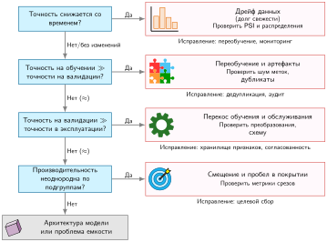

***Блок-схема отладки конвейера данных**: четыре последовательные проверки расставляют приоритеты гипотез о дрейфе, переобучении или артефактах данных, перекосе обучения и обслуживания, а также покрытии подгрупп. Каждая ветвь предлагает гипотезу для исследования, а не окончательный диагноз; если ни одно из перечисленных условий не выполняется, последний блок предлагает проверить архитектуру модели или ее емкость.*

Сбои производственного ML часто восходят к зависимостям от данных и сдвигам операционного конвейера, а не только к архитектуре модели.[^fn-failure-data-dominance] Приоритетная проверка перекоса обучения и обслуживания, дрейфа распределения и шума меток выделяет режимы отказа входов выше по потоку до начала дорогостоящих архитектурных переработок или перебора гиперпараметров.

[^fn-failure-data-dominance]: **Распределение отказов ML**: рассматривайте паттерн доминирования данных как диагностическую эвристику, а не универсальное эмпирическое распределение. Проверки данных и эксплуатации служат начальными гипотезами для первичной диагностики, но они не исключают дефектов кода, узких мест аппаратного обмена или численной нестабильности.

<a id="sec-data-engineering-fallacies-pitfalls-886b"></a>

## Заблуждения и ловушки

Конвейеры данных редко падают с немедленными сбоями времени выполнения; вместо этого они незаметно искажают распределения признаков, портят состояние обучения или морят голодом дорогие кластеры ускорителей. Эти заблуждения и ловушки разбирают физические узкие места и архитектурные ошибочные представления, которые подрывают производственные системы.

> **Заблуждение и ловушка**
>
> **Заблуждение:** *больше данных всегда улучшает производительность модели.*
>
> За порогом дополнительные данные дают убывающую отдачу, которой управляют эмпирические законы масштабирования. Исследования в компьютерном зрении, переводе и языковом моделировании показывают, что тестовая потеря следует степенному закону от размера набора данных, так что каждое последующее снижение ошибки требует экспоненциально большего объема образцов (Hestness et al., 2017). В системных терминах избыточные примеры потребляют дисковый ввод-вывод, пропускную способность шины от хоста к устройству и вычислительные ресурсы ускорителя, не внося нового градиентного сигнала. Эвристика полезного для задачи сигнала из раздела [«Физика данных»](04_data_engineering.md#sec-data-engineering-physics-data-cdcb) передает этот компромисс: наращивание сырого объема байтов без сохранения плотности информации раздувает инфраструктурные затраты, давая незначительное улучшение потери на оценке.

> **Заблуждение и ловушка**
>
> **Ловушка:** *планирование миграции петабайтов как передачи, ограниченной только пропускной способностью.*
>
> Деление исходного размера набора данных на пропускную способность сетевого канала дает теоретическое время передачи по проводу, но передача по проводу редко является критическим путем. Гравитация данных ([«Физика данных»](04_data_engineering.md#sec-data-engineering-physics-data-cdcb)) связывает крупные наборы данных с сетью окружающей инфраструктуры: конвейеры преобразования при приеме, проверки схем, политики контроля доступа и нижестоящие потребители. Перенос корпуса масштаба петабайт между облаками или дата-центрами требует рефакторинга конвейеров, повторной валидации целостности данных, прогрева кэша и переиндексации метаданных. Поэтому инженерное время эксплуатации, необходимое для адаптации зависимых систем, многократно превышает время сетевой передачи.

> **Заблуждение и ловушка**
>
> **Заблуждение:** *предобработку данных можно завершить один раз и больше к ней не возвращаться.*
>
> Конвейеры предобработки превращают сырые наблюдения в тензоры с помощью преобразований, параметризованных по историческим распределениям: словарей токенизации, векторов масштабирования по среднему и дисперсии, таблиц частот категорий и границ обрезки числовых значений. Когда производственные распределения дрейфуют, эти статические преобразования незаметно ломаются. Токенизаторы сталкиваются с ростом доли слов вне словаря, фиксированные статистики нормализации искажают активации признаков в режимы вне распределения, а статические границы обрезки обрезают динамический диапазон. Поддержание верности конвейера требует автоматизированного мониторинга входных тензоров и плановой перекалибровки статистик предобработки наряду с переобучением модели.

> **Заблуждение и ловушка**
>
> **Ловушка:** *игнорирование стоимости сериализации данных.*
>
> Профилирование часто сосредоточено исключительно на выполнении ядер GPU, тогда как загрузчики данных тихо разбирают сырые файлы JSON или CSV. Разбор текстовых записей требует от ядер CPU хоста сотен тактов на образец на декодирование строк, токенизацию, преобразования из ASCII в числа с плавающей запятой и выделение памяти в куче. Это узкое место сериализации на CPU морит голодом вычислительные движки ускорителей, оставляя GPU простаивать в ожидании передачи входов по PCIe. Двоичные форматы сериализации, такие как Apache Arrow или массивы с отображением в память, устраняют накладные расходы на разбор, поддерживая прямую десериализацию без копирования в закрепленную память. Для табличных схем колоночные форматы, такие как Parquet, устраняют дисковый ввод-вывод, читая только нужные проекции столбцов. Сравнение скорости приема данных со скоростью потребления ускорителя показывает, не ограничивает ли десериализация на CPU хоста пропускную способность обучения.

> **Заблуждение и ловушка**
>
> **Заблуждение:** *высокая точность на обучении означает готовность к производству.*
>
> Точность на обучении отражает эмпирическую оптимизацию на исторических обучающих распределениях, а валидация на удержанных данных оценивает обобщение при тех же допущениях о выборке. Производственные среды вносят немоделированные граничные случаи, шум датчиков и живой распределительный дрейф. Модель с высокой точностью валидации терпит неудачу при развертывании, если вышестоящие конвейеры признаков мутируют или тайм-ауты вывода запускают значения по умолчанию. Диагностика регрессий после развертывания требует структурированной изоляции первопричин — дрейфа данных, порчи признаков и путей выполнения системы ([«Блок-схема отладки конвейера данных»](04_data_engineering.md#fig-debug-flowchart)), а не опоры на одну агрегированную офлайн-метрику.

> **Заблуждение и ловушка**
>
> **Ловушка:** *игнорирование перекоса обучения и обслуживания до развертывания.*
>
> Перекос обучения и обслуживания возникает, когда логика генерации признаков расходится между офлайн-конвейером обучения и онлайн-средой вывода. Признаки обучения обычно извлекаются пакетно с помощью фреймворков вроде Apache Spark или SQL-движков над озерами данных. Онлайн-признаки должны вычисляться в бюджетах задержки на уровне миллисекунд внутри микросервисов приложения. Расхождения в точности чисел с плавающей запятой, агрегациях временных окон, версиях библиотек или тонкой временной утечке (например, включение данных с временной меткой после точки предсказания) вносят незаметное численное расхождение. Поскольку модель по-прежнему получает корректные векторы с плавающей запятой, вывод проходит без исключений времени выполнения, а качество предсказаний деградирует. Смягчение этой ловушки требует общей логики преобразования, воспроизводимых хранилищ признаков и автоматизированных тестов паритета перед развертыванием, которые проверяют эквивалентность признаков в офлайн- и онлайн-путях.

> **Заблуждение и ловушка**
>
> **Заблуждение:** *синтетические данные могут полностью заменить сбор реальных данных.*
>
> Синтетические данные обогащают обучающие наборы, генерируя редкие граничные случаи, контролируемые физические вариации или образцы, соответствующие требованиям приватности, но их полезность ограничена точностью генератора. Генеративные модели и симуляторы выбирают образцы только из распределений внутри носителя своих параметризованных допущений. При обучении исключительно на синтетических данных модели переобучаются под артефакты генератора и остаются уязвимыми для немоделированной дисперсии реального мира. Например, в системе KWS детектор, обученный полностью на синтезированной речи, деградирует при встрече с подлинной акустической реверберацией, разнообразными акцентами, искажениями частотной характеристики микрофонов и нестационарным фоновым шумом. Синтетическая генерация дополняет эмпирический сбор, но репрезентативные наблюдения реального мира остаются обязательными для проверки жизнеспособности развертывания.

> **Заблуждение и ловушка**
>
> **Ловушка:** *пренебрежение версионированием данных, пока отладка модели не начнет его требовать.*
>
> Рассмотрение обучающих наборов как изменяемых каталогов объектного хранилища разрушает воспроизводимость экспериментов. Когда переобученная модель демонстрирует регрессию производительности, неверсионированный конвейер не позволяет инженерам определить, связана ли регрессия с изменившейся инструкцией по разметке, незаметной порчей при миграции схемы или подлинным сдвигом распределения. Как только динамические таблицы перезаписаны или сырые журналы источников удалены, восстановить исторические обучающие входы становится невозможно. Как установлено в разделе [«Родословная преобразований»](04_data_engineering.md#sec-data-engineering-tracking-data-transformation-lineage-3b09), надежная родословная данных требует, чтобы каждая контрольная точка модели неизменно связывалась с конкретным снимком набора данных, хешем кода преобразования и профилем конфигурации. Отложенное версионирование данных превращает стандартный анализ первопричин в спекулятивную криминалистику по утраченному состоянию обучения.

<a id="sec-data-engineering-summary-4ac6"></a>

## Итоги

В системах машинного обучения обучающие данные работают как исполняемый исходный код: изменения набора данных меняют обученное поведение скомпилированной модели без изменения хотя бы одной строки алгоритмического кода. Поскольку процедуры оптимизации извлекают операционную логику напрямую из наблюдений, ошибки на этапе сбора данных, согласованности схем и разметки усиливаются на последовательных стадиях конвейера в виде каскадов данных. Поэтому подготовка данных — это задача совместного проектирования систем: иерархии хранения определяют скорость, с которой подаются ускорители, архитектуры приема балансируют задержку потоковой обработки и операционные затраты, а контракты признаков предотвращают незаметный перекос обучения и обслуживания.

> **Данные — это исходный код**
>
> * **Каскады данных делают качество на входе самой выгодной инвестицией**: ошибки сбора усиливаются на каждой стадии конвейера ([«Каскады качества данных»](04_data_engineering.md#fig-cascades)). Четыре опоры (качество, надежность, масштабируемость, управление) организуют профилактику, а долг документации, схемы, качества и свежести требует непрерывного устранения.
> * **Данные — это код: версионируйте, тестируйте, проверяйте**: набор данных — исходный код ML-системы. Применяйте ту же строгость через контроль версий, тесты валидации и ревью данных.
> * **Согласованность обучения и обслуживания не подлежит обсуждению**: преобразования признаков, общие для обучения и обслуживания, должны иметь эквивалентную семантику и переиспользовать одно и то же выученное состояние, например константы нормализации и отображения словарей.
> * **Выбор архитектуры конвейера имеет большие последствия для стоимости**: потоковая обработка обходится дороже в эксплуатации, чем пакетная, а ETL обменивает экономию хранилища на больший объем работы при изменении схемы. Выбирайте паттерны приема по ценности задержки, а не по привлекательности реального времени.
> * **Затраты на разметку доминируют и требуют значительного выделения ресурсов**: разметка может стоить в сотни раз, а иногда более чем в тысячу раз больше одного оптимизированного прогона обучения; в эталонном расчете в разделе [«Масштабируемость и оптимизация стоимости»](04_data_engineering.md#sec-data-engineering-scalability-cost-optimization-b9b3) это соотношение составляет от 521 до 1 562 раз. Разметка может оставаться дорогим узким местом планирования, даже когда работа по аннотированию распараллелена.
> * **Иерархия хранения определяет скорость итераций**: разрыв в пропускной способности в 50 раз между локальным NVMe (5 ГБ/с) и облачным объектным хранилищем (100 МБ/с) определяет, происходят ли итерации ежедневно или еженедельно.
> * **Уравнение деградации становится применимым благодаря мониторингу дрейфа и результатов**: метрики расхождения, такие как KL, измеряют изменения между $P_t$ и $P_0$, тогда как размеченные результаты или проверенные прокси определяют, соответствуют ли эти изменения деградации модели.

Пример KWS сочетает отобранный, краудсорсинговый и синтетический сбор; проверку согласованности; многоуровневое хранение для 23,4 млн аудиообразцов объемом 748,8 ГБ сырых данных; и родословную для устройств, которые слушают постоянно. На каждой стадии инженерия данных управляет физическим перемещением данных и статистическими контрактами, которые позволяют алгоритму учиться, не испытывая голодания аппаратуры и не дрейфуя незаметно в эксплуатации.

> **От исходного кода к исполняемому файлу**
>
> Конвейер данных выпустил чистый версионированный обучающий набор, но сам по себе набор данных ничему не учит. Глава [«Вычисления в нейронных сетях»](05_nn_computation.md#sec-neural-computation) открывает этот черный ящик и рассматривает ось алгоритма: математические операции, которые превращают подготовленные примеры в выученное поведение и делают нейронные сети предсказуемыми, отлаживаемыми и оптимизируемыми.
