<a id="sec-neural-computation"></a>

# Вычисления в нейронных сетях

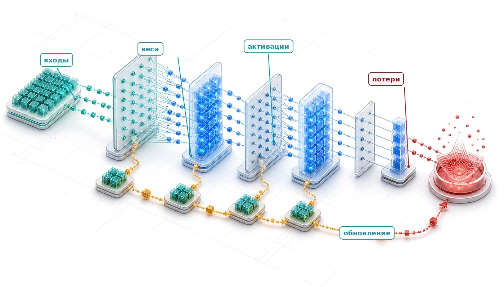

## Назначение

_Почему понимание математики нейронной сети важнее, чем чтение ее кода?_

Код нейронной сети может выглядеть обманчиво простым: несколько тензорных операций скрывают работу, которую должен выполнить каждый слой системы. Размерности матриц определяют объем арифметики и перемещений данных; промежуточные значения определяют нагрузку на память; диапазоны чисел и градиенты определяют, остается ли обучение устойчивым. Операция, которая по отдельности кажется дешевой, может доминировать в системе, если ее повторяют по батчу или если ее результаты нужно сохранять для обучения, поэтому длина исходного кода мало говорит о стоимости ресурсов. Две реализации одной и той же модели могут работать очень по-разному, потому что форма батча, точность и целевая машина меняют то, что помещается в память, насколько быстро выполняется вычисление и остаются ли его результаты численно корректными. Когда обучение останавливается или развертывание исчерпывает память, чтение вызова фреймворка редко показывает, какое ограничение является решающим. Численный сбой, узкое место памяти и неэффективная реализация могут давать похожие симптомы, но требовать разных решений. Поэтому диагностика и планирование требуют рассуждать от базовых операций к перемещенным байтам, сохраненным значениям и повторяемой работе. Такой взгляд способен выявить несоответствие до того, как его обнаружит дорогой прогон обучения или попытка развертывания. Эти примитивы дают устойчивый словарь, общий для архитектур, и делают программные абстракции поддающимися аудиту: непрозрачный код превращается в нагрузку, которую можно измерить, диагностировать и сопоставить с аппаратурой. В терминах D·A·M нейронные вычисления — это интерфейс, где алгоритмическая структура становится машинной работой, а физические пределы возвращаются в проектирование модели.

> **Цели обучения**
>
> - Объяснить, почему выученная арифметика заменила логику на правилах при распознавании многомерных паттернов
> - Рассчитать число параметров, операции умножения с накоплением, объем хранения активаций и трафик памяти для многослойных сетей
> - Сравнить функции активации по нелинейности, поведению градиента и аппаратной стоимости вычислений
> - Применить функцию кросс-энтропийных потерь и обновления градиентов для анализа динамики обучения с учителем
> - Вывести прямое и обратное распространение как матричные операции над батчами
> - Проанализировать нагрузки обучения и вывода с учетом вычислений, памяти и ограничений развертывания
> - Оценить сквозной конвейер распознавания документов: от предобработки через пороги решений до проверки человеком

<a id="sec-neural-computation-deep-learning-systems-engineering-foundation-597f"></a>

## От логики к арифметике

Набор данных, прошедший предыдущие инженерные этапы, готов к разработке модели, но примеры сами по себе не обучаются. Следующая системная граница — это модель, где данные превращаются в выученное поведение через матричные умножения, функции активации и обновления градиентов. Модель, которая корректно работает на одной машине и падает на другой, не обязательно страдает от аппаратного дефекта. Размерности ее слоев могут порождать промежуточные активации — выходы каждого слоя, которые обучение сохраняет для обратного прохода, — и они превышают доступную память. Сбой возникает из-за несоответствия между нагрузкой модели и бюджетом машины.

«Кремниевый контракт» гласит: каждая архитектура модели заключает вычислительную сделку с аппаратурой, на которой работает. По алгоритмической оси математические операторы архитектуры определяют необходимую работу и состояние. Точность, реализация, повторное использование данных, среда выполнения и аппаратура затем определяют фактический трафик памяти, задержку и энергопотребление. Чтобы соблюдать этот контракт, инженер систем должен понимать и операторы, и то, как они отображаются на машину.

Каждый математический оператор нейронной сети задает конкретную вычислительную нагрузку на аппаратуре. Нейронные вычисления переносят исполнение от явного логического ветвления (управляющий поток if-then-else) к длинным последовательностям непрерывных математических преобразований, в которых доминируют операции умножения с накоплением. Этот переход от *логики* к *арифметике* создает плотные тензорные нагрузки, пропускная способность которых зависит от арифметической интенсивности, размера батча, повторного использования кэша и ограничений модели Roofline, задаваемых пиковой вычислительной мощностью и пропускной способностью памяти. Сбои в таких системах возникают из-за численной неустойчивости, затухающих градиентов или насыщенных режимов активации, а не из-за синтаксических ошибок. Например, распознавание одной рукописной цифры в работающей сети MNIST требует 109 184 MAC и при этом в прямом проходе не выполняет ни одной логической ветки.

Арифметика без ветвлений не означает арифметику без риска. Когда промежуточные значения выходят за динамический диапазон числового формата, аппаратные блоки либо вызывают исключение, либо молча выдают бесконечности (`Inf`) и недопустимые значения (`NaN`), которые портят последующие тензоры. Опасность необработанного численного переполнения характерна не только для машинного обучения: системы, критичные к безопасности, катастрофически отказывали, когда нарушались численные инварианты.

<a id="ws-nn-computation-ariane-5-overflow"></a>

> **Переполнение, ставшее уроком (1996)**
>
> **Контекст**: рейс 501 Ariane 5 Европейского космического агентства повторно использовал программное обеспечение инерциальной навигации от Ariane 4, включая числовые преобразования, допущения которых соответствовали профилю полета старой ракеты (European Space Agency, 1996).
>
> **Механизм**: профиль полета Ariane 5 привел к тому, что 64-битное значение с плавающей запятой при преобразовании вышло за пределы знакового 16-битного целого, и возникла необработанная ошибка операнда.
>
> **Последствия**: бортовой компьютер вышел из строя через 36 секунд после старта; ракета отклонилась от курса, разрушилась и была уничтожена вместе с полезной нагрузкой-спутником стоимостью \$370 млн.
>
> **Реакция**: в расследовании рекомендовали ограничить программное обеспечение функциями, необходимыми в полете, пересмотреть допущения о диапазонах и продумать обработку исключений так, чтобы одна ошибка преобразования не могла вывести из строя резервные блоки (European Space Agency, 1996).
>
> **Системный урок**: числовые диапазоны, обработка исключений и допущения о повторном использовании — часть системного контракта. Вычисление может быть синтаксически верным и при этом недопустимым для физического режима, в котором работает. В системах ML это случается всякий раз, когда представимый диапазон числового формата не совпадает с величинами, которые через него проходят: низкоточное умножение, переполнившее формат, порождает Inf или NaN, которые молча распространяются по остальным вычислениям, — поэтому численные режимы для отладки так же важны, как и управляющий поток.

<a id="dfn-nn-computation-deep-learning"></a>

> **Глубокое обучение**
>
> ***Глубокое обучение*** — это вычислительная парадигма, которая выучивает послойные представления признаков из данных, последовательно применяя нелинейные преобразования. Для подходящих задач эти выученные представления могут сокращать ручной инжиниринг признаков, но увеличивают вычисления $(O)$ и объем состояния.
>
> 1.  **Значение**: для подходящих классов композиционных функций глубина может представить иерархию намного эффективнее по числу параметров, чем мелкая сеть. Каждый слой добавляет работу и состояние, а решающее ограничение может лежать по оси данных, алгоритма или машины — в зависимости от нагрузки.
> 2.  **Отличие**: мелкие методы, такие как логистическая регрессия и метод опорных векторов, могут хорошо работать с подходящими представлениями. Глубокое обучение вместо этого использует несколько нелинейных стадий, чтобы выучивать представления совместно с задачей предсказания; это может сокращать ручной дизайн признаков и иногда поддерживать перенос между задачами.
> 3.  **Типичная ошибка**: распространено заблуждение, будто одного числа параметров достаточно, чтобы объяснить глубокое обучение. Ширина может аппроксимировать широкие классы функций, но глубина способна кодировать некоторые композиционные функции намного эффективнее. Архитектура, данные, оптимизация и масштаб вместе определяют практический результат.

Глубокое обучение — это физическая вычислительная нагрузка, в которой математические операторы складываются в архитектурные конвейеры и предъявляют особые требования к памяти и исполнительным блокам ускорителя по всей таксономии D·A·M. В обзоре 2015 года в журнале *Nature* Лекун, Бенжио и Хинтон[^fn-deep-learning-pioneers] (LeCun et al., 2015) обобщили эту парадигму.

[^fn-deep-learning-pioneers]: **Лекун, Бенжио и Хинтон**: лауреаты премии ACM Тьюринга 2018 года за концептуальные и инженерные прорывы, которые сделали глубокие нейронные сети критически важным компонентом вычислительной техники. Их совместная работа продвинула обучение представлений, архитектуры сетей и методы обучения, на которых держится современное глубокое обучение.

Классическое машинное обучение часто требовало, чтобы эксперты проектировали экстракторы признаков для каждой новой задачи — трудоемкий процесс, который встраивал знания предметной области в вручную построенные представления. Глубокое обучение снимает эту нагрузку, выучивая представления непосредственно из данных через иерархические слои нелинейных преобразований. На [«Иерархии ИИ и хронологии»](05_nn_computation.md#fig-ai-ml-dl) эта связь показана в двух видах: историческая шкала ключевых вех и таксономическая вложенность, где глубокое обучение находится внутри машинного обучения, а оно — внутри искусственного интеллекта.

<a id="fig-ai-ml-dl"></a>

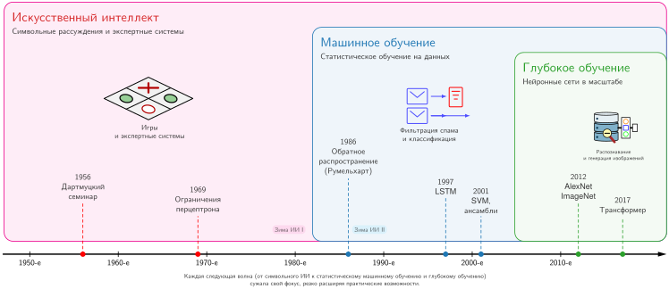

***Иерархия ИИ и хронология**: временная шкала с 1950-х до 2010-х годов наложена на современную таксономическую связь между искусственным интеллектом, машинным обучением и глубоким обучением. Вложенные полосы показывают область охвата, а не взаимоисключающие исторические эпохи: глубокое обучение входит в машинное обучение, а машинное обучение — в искусственный интеллект. Датированные вехи идут от семинара в Дартмуте в 1956 году до трансформера в 2017 году.*

Этот сдвиг парадигмы добавляет инженерные задачи, которые обычная отладка программ не решает. Сбои глубокого обучения могут иметь неочевидные симптомы: нестабильность градиентов[^fn-gradient-instabilities-depth], которая мешает обучению, ошибки точности вычислений, которые портят веса модели за многие итерации, или неэффективные паттерны доступа к памяти в тензорных операциях[^fn-tensor-multidimensional-array], из-за которых вычислительные блоки ускорителя недогружены. Чтобы устранить такие сбои, нужно рассуждать о физическом исполнении тензорной алгебры на аппаратуре, а не пошагово проходить процедурный управляющий поток.

[^fn-gradient-instabilities-depth]: **Нестабильность градиентов**: в упрощенном 20-слойном сигмоидном пути сами множители производной активации ограничены сверху величиной $0{,}25^{20}$, то есть $9{,}1 \times 10^{-13}$. Полный градиент включает также веса и другие операции, но многократно насыщенные производные все равно могут сделать обновления ранних слоев пренебрежимо малыми. Плато или NaN могут выявить симптом, не указывая на причину; ректифицированные линейные активации (ReLU), аккуратная инициализация, нормализация, методы оптимизации и остаточные связи помогли сделать глубокие сети обучаемыми, а раздел [«Остаточные связи: решение проблемы глубины»](06_nn_architectures.md#sec-network-architectures-evolution-dense-spatial-processing-2761) главы [«Архитектуры нейронных сетей»](06_nn_architectures.md#sec-network-architectures) подробно рассматривает остаточные связи.

[^fn-tensor-multidimensional-array]: **Тензорные операции**: логические размерности тензора отображаются на плоскую физическую раскладку, и ядро может предпочитать другой порядок. Если при переходе от порядка «канал первым» к порядку «канал последним» для типичного входа ImageNet (224×224×3, около 151 КБ) требуется материализованная перестановка, то на каждое изображение приходится около 301 КБ трафика чтения и записи, при этом математический результат модели не меняется. Некоторые среды выполнения обходятся без копирования с помощью представлений, слияния операций или совместимого ядра. Когда перестановка остается, она может съесть часть жесткого бюджета вывода еще до начала основной арифметики модели.

Диагностика и устранение таких сбоев требуют понимания того, как алгоритмические формулировки напрямую переходят в физические требования к аппаратуре. Структурные требования системы фундаментально зависят от того, как она представляет паттерны: через вручную написанные правила, инженерные статистические признаки или сквозные выученные представления. Проследив одну цифру MNIST размером $28{\times}28$ через эти три парадигмы, мы увидим этот сдвиг: каждая стратегия представления перестраивает арифметическую интенсивность системы, трафик памяти и операционный профиль.

<a id="sec-neural-computation-evolution-ml-paradigms-ec9c"></a>

## Вычисления с паттернами

Переход от логики к арифметике меняет то, как аппаратура обрабатывает паттерны реального мира. Проследив одну задачу — классификацию цифры MNIST размером $28{\times}28$ пикселей — через три парадигмы, видно, как стратегии представления фундаментально меняют вычислительный профиль.

<a id="sec-neural-computation-traditional-rulebased-programming-limitations-6e82"></a>

### От явной логики к выученным паттернам

Программирование на правилах требует, чтобы разработчики задавали процедуры, которые отображают входы в выходы. Возьмем простую игру вроде Breakout.[^fn-breakout-dqn-atari] Ее симулятор использует явные правила столкновений: когда мяч попадает в кирпич, код удаляет кирпич и меняет направление мяча ([«Правила столкновений в Breakout»](05_nn_computation.md#fig-breakout)). Такие общие правила хорошо работают для четко определенной физики игры, но вручную написанная политика распознавания для каждого варианта беспорядочных, неструктурированных данных реального мира не масштабируется.

<a id="fig-breakout"></a>

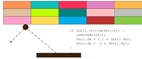

***Правила столкновений в Breakout**: программа игры использует явные правила if-then для обнаружения столкновений, задавая смену направления мяча и удаление кирпича при контакте. Подход эффективен для игры с понятной физикой и ограниченным числом состояний, но он показывает, что системы на правилах должны заранее предусмотреть каждый возможный сценарий.*

Поток данных на [«Потоке традиционного программирования»](05_nn_computation.md#fig-traditional) делает явной традиционную связь: программа применяет заданные процедуры к входным данным и получает выходы. Ранние исследования в области искусственного интеллекта проверяли, могут ли вручную написанные символьные правила масштабироваться до сложных задач рассуждения и распознавания.

<a id="fig-traditional"></a>

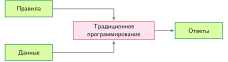

***Поток традиционного программирования**: правила и данные подаются на вход традиционной программе, которая выдает ответы на выходе. Этот шаблон «вход — выход» лежал в основе ранних систем ИИ, но не обладает гибкостью, нужной для сложного распознавания паттернов.*

Несмотря на кажущуюся простоту, ограничения систем на правилах быстро проявляются в сложных задачах реального мира. Распознавание человеческой активности иллюстрирует эту трудность. Отнести движение со скоростью ниже 4 км/ч к ходьбе кажется простым, пока в дело не вмешивается реальная сложность. Изменения скорости, переходы между видами активности и непредвиденные случаи требуют новых правил, что видно на последовательных фрагментах кода в [«Правилах классификации активности»](05_nn_computation.md#fig-activity-rules). Задачи компьютерного зрения усложняют картину. Чтобы обнаружить кошку, нужны правила об ушах, усах и формах тела, которые учитывают ракурсы, освещение, перекрытия и природные вариации. Ранние системы добивались успеха только в контролируемых средах с четко определенными ограничениями.

<a id="fig-activity-rules"></a>

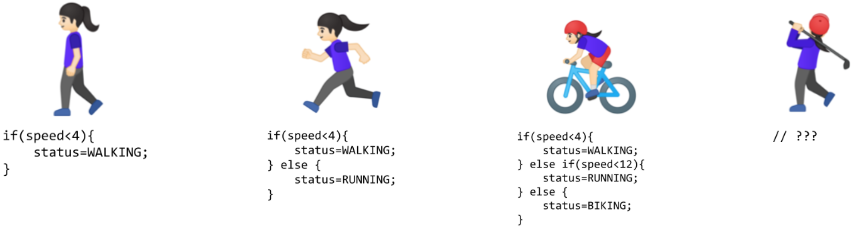

***Правила классификации активности**: последовательные фрагменты кода классифицируют ходьбу со скоростью ниже 4 км/ч, затем добавляют бег со скоростью ниже 12 км/ч и езду на велосипеде на более высоких скоростях. Последний необработанный случай показывает, как реальные ситуации вынуждают усложнять ветвление логики.*

[^fn-breakout-dqn-atari]: **Breakout (DQN — deep Q-network)**: аркадная игра Atari 1976 года стала вехой ИИ, когда DQN от DeepMind (2015) выучил игровую политику по пикселям без вручную заданной политики для каждой ситуации. Среда, пространство действий, награда и предобработка по-прежнему программировались. DQN уменьшал кадры до $84{\times}84$, складывал 4 кадра на входе и выбирал новое действие каждые 4 кадра, что показывает: обучаемое управление по-прежнему опирается на инженерный цикл вывода в реальном времени.

Осознавая эти ограничения, направление инженерии знаний, характерное для исследований ИИ 1970–1980-х годов, пыталось систематизировать создание правил. Экспертные системы[^fn-expert-systems-brittleness] кодировали знания предметной области в виде явных правил и показывали перспективу в отдельных областях с четко определенными параметрами, но не справлялись с задачами, которые люди выполняют естественно: распознаванием объектов, пониманием речи и интерпретацией естественного языка. Эти провалы выявили более глубокую проблему: многие аспекты интеллектуального поведения опираются на неявное знание, которое плохо поддается представлению в виде явных правил.

Рассмотрим один иллюстративный классификатор на правилах для цифры размером 28 на 28 пикселей: сравнить яркость пикселей с порогами, проверить паттерны штрихов в определенных областях и ветвиться по результатам. В этой игрушечной реализации вычисление составляет около 100 сравнений над 784 байтами данных о пикселях — немного, предсказуемо и помещается в обычный кэш CPU. Это сравнение задает базовый уровень нагрузки, но не точность промышленной системы на правилах.

[^fn-expert-systems-brittleness]: **Экспертные системы**: эти системы превращают человеческую экспертизу в явные правила `IF-THEN`. Такой подход инженерии знаний плохо масштабируется для задач вроде распознавания объектов, где существенную изменчивость трудно перечислить. Даже успешные системы вроде XCON от DEC накапливали тысячи вручную написанных правил, поэтому получение правил, их согласованность и поддержка стали центральными инженерными издержками.

<a id="sec-neural-computation-feature-engineering-bottleneck-6172"></a>

### Узкое место инжиниринга признаков

Провалы систем на правилах подсказали альтернативу: вместо того чтобы кодировать знания человека в виде явных правил, пусть система находит паттерны в данных. Машинное обучение предложило это направление: вместо правил для каждой ситуации исследователи писали программы, которые выделяли паттерны в примерах. Однако успех этих методов по-прежнему во многом зависел от человеческой проницательности, которая определяла, какие паттерны искать, — процесс, известный как инжиниринг признаков.

Инжиниринг признаков превращал сырые данные в представления, которые открывают паттерны для алгоритмов обучения. Метод гистограмм направленных градиентов (HOG)[^fn-hog-feature-descriptor] (Dalal and Triggs, 2005) наглядно показывает этот подход: он находит границы, где яркость резко меняется, делит изображение на ячейки и измеряет ориентации границ внутри каждой ячейки ([«Метод HOG»](05_nn_computation.md#fig-hog)). Так сырые пиксели превращаются в дескрипторы формы, устойчивые к изменениям освещения и небольшим сдвигам.

<a id="fig-hog"></a>

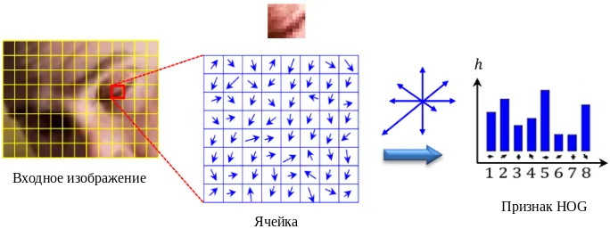

***Метод HOG**: локальный фрагмент изображения делится на ячейки, ориентации градиентов накапливаются в гистограмму, а полученный дескриптор описывает локальную форму, уменьшая чувствительность к освещению. Схема воспроизведена с рисунка 5 работы (Bakheet and Al-Hamadi, 2021) по лицензии [CC BY 4.0](https://creativecommons.org/licenses/by/4.0/).*

[^fn-hog-feature-descriptor]: **Гистограмма направленных градиентов (HOG)**: влиятельный ручной дескриптор для обнаружения пешеходов до эпохи глубокого обучения (Dalal and Triggs, 2005). Одна распространенная конфигурация вычисляет ориентации градиентов в ячейках $8{\times}8$ пикселей, а размер ячеек и другие параметры подбираются под задачу. Фиксированный вычислительный граф HOG эффективно выполняется на CPU с предсказуемой задержкой, тогда как выученные признаки могут сократить необходимость переделывать дескриптор, но не переносятся между областями автоматически и часто выигрывают от ускорителей только с ростом масштаба модели и батча.

Дополняющие методы, такие как масштабно-инвариантное преобразование признаков (SIFT)[^fn-sift-feature-descriptor] (Lowe, 1999) и фильтры Габора[^fn-gabor-filter-bank], выделяли разные зрительные паттерны. SIFT находил ключевые точки, устойчивые к изменениям масштаба и ориентации, а фильтры Габора выделяли текстуры и частоты. Каждый из них кодировал экспертные знания о распознавании зрительных паттернов.

[^fn-sift-feature-descriptor]: **Масштабно-инвариантное преобразование признаков (SIFT)**: SIFT воплощает эти экспертные знания в четырехэтапном алгоритме, который находит ключевые точки, устойчивые к масштабу и повороту. Число найденных ключевых точек зависит от изображения, что осложняет пакетирование фиксированной формы. Системы могут регуляризовать представление с помощью ограничения числа точек, паддинга, пулинга или фиксированных кодировок, но каждый такой выбор добавляет вычисления или отбрасывает информацию.

[^fn-gabor-filter-bank]: **Фильтры Габора**: изначально разработанные для локализованного анализа «время — частота» (Gabor, 1946), эти фильтры выделяют границы и текстуры с определенными ориентациями и частотами. Типичный банк содержит множество вручную спроектированных фильтров по ориентациям и частотам. Глубокие сверточные слои вместо этого выучивают небольшие ядра из данных; ранние фильтры сверточных нейронных сетей (CNN) часто становятся детекторами границ, цвета и текстуры, переводя проектирование признаков от ручных банков фильтров к оптимизации на основе данных (Krizhevsky et al., 2012; LeCun et al., 2015).

Эти инженерные усилия позволили добиться прогресса в компьютерном зрении в 2000-х годах. Системы теперь могли распознавать объекты с некоторой устойчивостью к вариациям реального мира, что привело к приложениям в обнаружении лиц и пешеходов и в распознавании объектов. Несмотря на эти успехи, подход имел ограничения. Экспертам приходилось тщательно проектировать экстракторы признаков для каждой новой задачи, и получившиеся признаки могли пропускать важные паттерны, которые не были предусмотрены при их проектировании. Узкое место сохранялось: человеческая экспертиза не могла масштабироваться до сложности и разнообразия зрительных паттернов реального мира.

Вернемся к той же цифре размером 28 на 28 пикселей. В этой иллюстративной реализации HOG делит изображение на сетку 7 на 7 ячеек размером 4 на 4 пикселя, вычисляет величины и ориентации градиентов, раскладывает их по 9 гистограммам ориентаций на ячейку и получает вектор признаков из 441 элемента. Линейный классификатор на основе метода опорных векторов (SVM) затем выполняет десять скалярных произведений над этим вектором. Результат — около 8 000 операций и примерно 2 КБ рабочей памяти: примерно в 80 раз больше работы игрушечного базового варианта на правилах, но вычисление по-прежнему структурировано и хорошо обслуживается векторными блоками CPU, работающими по принципу **одна инструкция — много данных (SIMD)**. Размер дескриптора, число классов и реализация меняют эту стоимость.

<a id="sec-neural-computation-deep-learning-automatic-pattern-discovery-214d"></a>

### Автоматическое открытие паттернов

Ограничения ручных признаков мотивируют более радикальный подход: вместо того чтобы кодировать признаки вручную, система сама находит их. Нейронные сети воплощают именно этот сдвиг: вместо явных правил или опоры на спроектированные человеком экстракторы признаков система выучивает представления непосредственно из сырых данных.

Обучение с учителем меняет традиционную связь программирования. Вместо того чтобы напрямую кодировать каждое правило решения, инженеры дают примеры и целевые ответы, а оптимизация порождает обученную модель. На [«Открытии правил на основе данных»](05_nn_computation.md#fig-deeplearning) эта связь становится наглядной: выученные правила здесь выступают выходом, а не входом. Люди по-прежнему формируют задачу через данные, цели, архитектуры и оценку.

<a id="fig-deeplearning"></a>

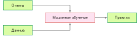

***Открытие правил на основе данных**: блок-схема переворачивает традиционный шаблон программирования: данные и ответы служат входами процесса машинного обучения, который на выходе выдает выученную функцию принятия решений. Этот сдвиг заменяет вручную написанную политику решений, но инженеры по-прежнему отвечают за данные, цель, архитектуру и оценку.*

Система находит паттерны в примерах через этот автоматизированный процесс. Когда ей показывают миллионы изображений кошек, она учится распознавать все более сложные зрительные паттерны: от простых границ до сочетаний, которые образуют признаки, характерные для кошек. Это напоминает работу биологических зрительных систем, которые строят понимание от базовых зрительных элементов к сложным объектам.

Постепенное наслаивание паттернов показывает, *почему* важна глубина нейронной сети. Для некоторых классов композиционных функций более глубокие сети могут представлять функции, для которых потребовались бы значительно более широкие мелкие сети; это преимущество формализовано в разделе [«Почему важна глубина»](05_nn_computation.md#sec-neural-computation-depth-matters-power-hierarchical-representations-f83c).

Глубокое обучение часто демонстрирует эмпирическое масштабирование: в рамках данного режима качество может расти по мере эффективного использования дополнительных данных, вычислений и емкости модели, хотя прирост зависит от качества данных, оптимизации, архитектуры и условий оценки. В конкурсе ImageNet традиционные методы в 2011 году давали примерно 25,8 процента ошибки top-5. AlexNet[^fn-alexnet-gpu-split] снизил ее до 15,3 процента в 2012 году. К 2015 году ResNet достиг 3,6 процента ошибки top-5, что ниже опубликованного уровня человека около 5,1 процента при том же протоколе оценки.

[^fn-alexnet-gpu-split]: **Разделение памяти AlexNet**: команда Крижевского разделила AlexNet между двумя GPU NVIDIA GTX 580, в каждом из которых было по 3 ГБ VRAM, чтобы модель и состояние обучения помещались на два устройства. Этот обходной путь иллюстрирует системный урок: конфигурация обучения может превышать бюджет памяти одного устройства, и тогда инженеры вынуждены распределять работу и обмен данными между устройствами.

[«Феномен двойного спуска»](05_nn_computation.md#fig-double-descent) иллюстрирует двойной спуск в режимах сложности модели. В классическом недопараметризованном режиме ошибка на тестовой выборке при росте емкости следует стандартной U-образной кривой. В точке интерполяции, когда у модели ровно столько параметров, чтобы подогнать обучающую выборку, ошибка на тесте резко растет. За этим порогом, в современном перепараметризованном режиме, ошибка на тесте может снова снижаться. Оси нормированы, чтобы подчеркнуть структурный профиль семейств моделей, а не отдельный набор данных.

<a id="fig-double-descent"></a>

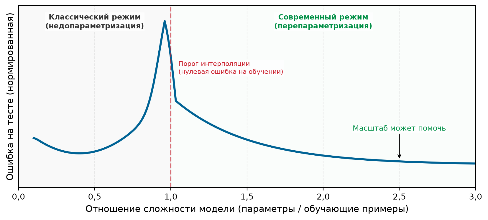

***Феномен двойного спуска**: иллюстративная нормированная кривая показывает, что ошибка на тесте сначала снижается, затем растет в классическом режиме, достигает пика в точке интерполяции и снова снижается в перепараметризованном современном режиме.*

Непривычная форма важна потому, что ошибка на тесте — это ошибка на отложенных примерах, а не на обучающих, которые модель видит напрямую: сначала она следует ожидаемой U-образной кривой, а затем снова снижается, когда у модели параметров больше, чем предсказывает простейшая теория. Такое поведение усложняет классическое описание перепараметризации. Обычный компромисс смещения и дисперсии[^fn-bias-variance-tradeoff] предполагает, что слишком маленькие модели недообучаются, а модели с избыточной емкостью рискуют подогнать шум. Двойной спуск (Belkin et al., 2019) показывает, что более крупные модели иногда обобщают лучше меньших после порога интерполяции. Этот эффект перепараметризации означает, что масштаб может быть инженерным рычагом, но не означает, что масштаб автоматически безопасен: распределение данных, процедура обучения и регуляризация по-прежнему определяют, помогает ли дополнительная емкость или приводит к запоминанию. Переобучение и методы регуляризации, которые его контролируют, подробно описаны в разделе [«Вопросы сходимости и устойчивости»](05_nn_computation.md#sec-neural-computation-convergence-stability-considerations-a9b7).

[^fn-bias-variance-tradeoff]: **Компромисс смещения и дисперсии**: в некоторых перепараметризованных режимах ошибка на тесте снова снижается после порога интерполяции, поэтому классическое описание с одной U-образной кривой неполно. Следствие для систем: размер модели нельзя считать универсально монотонным риском переобучения. Более крупные модели могут стать полезным инженерным вариантом, если измеренные данные, оптимизация и режим регуляризации подтверждают выигрыш.

Качество нейронных сетей следует эмпирическим законам масштабирования, и у них есть прямые системные последствия. Устойчивый ориентир такой: размеры передовых моделей и бюджеты вычислений на обучение выросли на порядки за последнее десятилетие ([«Эволюция вычислений в нейронных сетях»](05_nn_computation.md#sec-neural-computation-evolution-neural-network-computing-8754) описывает эту траекторию количественно). Этот рост делает потенциальными узкими местами пропускную способность арифметики, пропускную способность памяти, емкость хранилища и связь, а их важность зависит от нагрузки и машины. Количественные формулировки масштабирования, включая то, как размер модели, данные и вычисления уравновешивают друг друга, разобраны в главе [«Обучение моделей»](08_training.md#sec-model-training); практические ответы рассмотрены в главе [«Сжатие моделей»](10_model_compression.md).

Ни одна из этих связей не делает размер модели правилом выбора. Двойной спуск описывает измеренную обобщающую способность при конкретных данных и режиме обучения, а историческое масштабирование описывает инвестиции ресурсов в отдельные системы. Выбор модели по-прежнему требует сравнения кандидатов на репрезентативных данных развертывания и с учетом полной стоимости обучения, обслуживания, мониторинга и сопровождения. Полезный вопрос — не может ли дополнительный масштаб помочь, а окупает ли его измеренный выигрыш эти системные издержки. Такое сравнение должно учитывать и неопределенность как выигрыша, так и издержек.

<a id="psp-nn-computation-when-use-neural-networks"></a>

> **Когда использовать нейронные сети**
>
> Не каждая задача выигрывает от глубокого обучения. Нейронные сети — сильные кандидаты, когда данные обладают пространственной, последовательной или иерархической структурой, которую может использовать архитектура, простые базовые модели не достигают нужного качества решения, а измеренный выигрыш оправдывает полную стоимость системы ([«Кандидаты для нейронных сетей»](05_nn_computation.md#tbl-nn-when-to-use)). При малом объеме разметки, низкоразмерных табличных данных, приблизительно линейных зависимостях, жестких ограничениях задержки или строгих требованиях к аудируемости классические методы могут дать полезное качество при меньших, чем у нейронной сети, усилиях на обучение, обслуживание и сопровождение ([«Кандидаты для классических методов»](05_nn_computation.md#tbl-nn-when-not-to-use)).
>
> | **Условие**               | **Что проверять**                                      | **Обоснование**                          |
> |:--------------------------|:-------------------------------------------------------|:-----------------------------------------|
> | **Репрезентативные данные** | Обучающая и валидационная выборки покрывают условия развертывания | Емкость не может заменить отсутствующее покрытие |
> | **Эксплуатируемая структура** | Пространственные, последовательные или иерархические паттерны | Архитектура может закодировать полезное априорное знание |
> | **Разрыв базового уровня** | Простые методы не достигают целевого качества решения | Сложность покупает измеримый выигрыш |
> | **Операционная пригодность** | Выигрыш сохраняется при ограничениях задержки, памяти и стоимости | Одной точности офлайн недостаточно |
> | **Преимущество в сопровождении** | Выученные признаки сокращают повторяющиеся ручные обновления | Сопровождение всей системы становится проще |
>
> <a id="tbl-nn-when-to-use"></a>
>
> ***Кандидаты для нейронных сетей**: условия, при которых глубокое обучение, вероятно, превзойдет классические методы.*
>
> | **Условие**                     | **Базовый вариант для проверки**  | **Причина предпочесть его**                        |
> |:--------------------------------|:----------------------------------|:---------------------------------------------------|
> | **Мало размеченных данных**     | Линейная модель или ансамбль деревьев | Меньшая дисперсия и более простая валидация    |
> | **Структурированные табличные входы** | Градиентный бустинг или линейная модель | Высокая точность без выученных признаков       |
> | **Примерно линейный сигнал**    | Линейная или аддитивная модель    | Прозрачность и дешевое выполнение                  |
> | **Жесткое ограничение ресурсов** | Правила или компактная классическая модель | Предсказуемые задержка, память и энергопотребление |
> | **Нужна прямая аудируемость**   | Ограниченное дерево или линейная модель | Решения легче проверить                      |
>
> <a id="tbl-nn-when-not-to-use"></a>
>
> ***Кандидаты для классических методов**: условия, при которых более простые модели, вероятно, сравняются с нейронной сетью или превзойдут ее.*
>
> **Системный вывод**: сначала постройте простой базовый вариант, прежде чем создавать нейронную сеть. Сравнивайте кандидатов по целевой метрике задачи и по ресурсам, нужным для их обучения, обслуживания, мониторинга и обновления. Оставляйте нейросетевой подход, только если его измеренная польза оправдывает добавленную систему. История распознавания документов в разделе [«Распознавание рукописных цифр»](05_nn_computation.md#sec-neural-computation-case-study-usps-digit-recognition-97be) показывает, почему сравнение должно учитывать предобработку, политику отказов и стоимость проверки человеком, а не только точность модели.

Обучение представлений из данных меняет способ построения систем ИИ. Сокращение ручного инжиниринга признаков порождает новые требования: инфраструктуру для работы с большими наборами данных, высокопроизводительное оборудование для их обработки и специализированные ускорители для эффективного выполнения математических вычислений. Эти вычислительные требования помогли стимулировать разработку микросхем, оптимизированных под операции нейронных сетей. Сегодня глубокое обучение лежит в основе крупных систем компьютерного зрения, распознавания речи, игровых систем и обработки естественного языка.

Вернемся к той же цифре размером 28 на 28 пикселей, которую теперь обрабатывает трехслойная нейронная сеть главы (784 → 128 → 64 → 10). При принятых реализациях прямой проход требует 109 184 MAC, что в 1 091,8 раза больше работы игрушечного базового варианта на правилах. 109 386 параметров занимают 438 КБ в формате с плавающей запятой одинарной точности на 32 бита (FP32), что превышает размер большинства кэшей L1 и создает трафик между уровнями кэша во время вывода. Обучение увеличивает стоимость еще сильнее: каждое изображение проходит прямой и обратный проход до обновления весов; при упрощенной арифметике плотных слоев это порядка трех прямых проходов, повторенных по 60 000 изображений на несколько эпох. Плотные матричные умножения теперь доминируют в арифметике этого примера и благоприятствуют параллельному оборудованию, сдвигая инженерную задачу от ветвления управляющего потока к пропускной способности памяти, повторному использованию данных и параллелизму аппаратуры.

<a id="sec-neural-computation-computational-infrastructure-requirements-b5b0"></a>

### Требования к вычислительной инфраструктуре


*В этом сравнении на MNIST выученные признаки тратят гораздо больше арифметики.*

Сквозной пример с MNIST прослеживает один набор иллюстративных реализаций: от около 100 сравнений (на правилах) через около 8 000 операций (HOG) до 109 184 MAC (нейронная сеть). Это рост в 1 091,8 раза в принятых моделях операций, с соответствующим переходом к параллельным матричным операциям. [«Тенденции ресурсов системы»](05_nn_computation.md#tbl-evolution) обобщает тенденции, которые выявляет это сравнение.

Сравнение важно, потому что каждый шаг меняет вероятное узкое место: от управления на CPU с плотным ветвлением к конвейерам признаков, ориентированным на батчи, и далее к матричному параллелизму, питаемому из памяти. CPU остаются эффективными для небольших сетей и задач, чувствительных к задержке, тогда как крупные плотные операции чаще эффективнее отображаются на ускорители.

Переход к параллелизму порождает новые узкие места. Центральная проблема — стена памяти:[^fn-memory-wall-nn] пропускная способность вычислений выросла быстрее, чем пропускная способность внешней памяти. Ограничена ли матричная операция памятью или вычислениями, зависит от ее арифметической интенсивности: крупное, хорошо разбитое на блоки матричное умножение может быть ограничено вычислениями, тогда как матрично-векторные, узкие или слабо переиспользующие данные слои часто упираются в пропускную способность.[^fn-memory-bound-nn] Аппаратные ответы рассмотрены в разделе [«Понимание стены памяти в ИИ»](11_hw_acceleration.md#sec-hardware-acceleration-understanding-ai-memory-wall-3ea9) главы [«Аппаратное ускорение»](11_hw_acceleration.md), а иерархия памяти подробно описана в разделе [«Иерархия памяти»](appendix_machine.md#sec-appdx-machine-foundations-memory-hierarchy-2278) приложения «Основы машины».

[^fn-memory-wall-nn]: **Стена памяти**: быстрая память на кристалле отвечает за наносекунды, тогда как более крупная внешняя память находится на порядки дальше по задержке и энергии. Веса нейронных сетей часто превышают размер самых маленьких кэшей, поэтому производительность зависит от разбиения на блоки, более крупных уровней кэша, статической памяти SRAM на кристалле и памяти высокой пропускной способности (HBM), которые позволяют переиспользовать значения до следующего обращения к внешней памяти. Недостаточное повторное использование может оставить вычислительные блоки простаивающими, даже когда пиковая арифметическая пропускная способность высока.

[^fn-memory-bound-nn]: **Операции, ограниченные памятью**: арифметическая интенсивность матричного умножения (FLOP на загруженный байт) определяет, ограничен слой вычислениями или памятью. Слои, которые лежат ниже точки пересечения Roofline для оборудования, завершают арифметику раньше, чем из памяти придет следующий блок весов. Итог: эффективная загрузка оборудования может резко упасть, и добавление вычислительных блоков дает мало ускорения, пока не улучшатся пропускная способность памяти или повторное использование данных.

| **Аспект системы**    | **Традиционное программирование** | **ML с признаками**         | **Глубокое обучение**                    |
|:----------------------|:----------------------------------|:----------------------------|:-----------------------------------------|
| **Вычисления**        | Часто ориентированы на управляющий поток | Структурированные параллельные операции | Часто матричный параллелизм |
| **Доступ к памяти**   | Зависит от нагрузки               | Обычно ориентирован на батчи | Большие рабочие наборы тензоров          |
| **Перемещение данных** | Зависит от программы и входа     | Перемещение по конвейеру признаков | Перемещение параметров и активаций |
| **Потребности в аппаратуре** | Обычно центрирован на CPU  | Часто CPU с векторными блоками | Нередко дружественно к ускорителям     |
| **Масштабирование ресурсов** | Зависит от входа и программы | Определяется дескрипторами и данными | Определяется шириной, батчем, состоянием и повторным использованием |

<a id="tbl-evolution"></a>

***Тенденции ресурсов системы**: иллюстративные реализации переходят от правил, ориентированных на управление, к структурированным конвейерам признаков и затем к матрично-насыщенным нейронным вычислениям. Это тенденции нагрузки, а не требования к каждой программе в каждой парадигме.*

Энергия добавляет ограничение наряду со скоростью. Перенос данных из основной памяти в вычислительные блоки может стоить гораздо больше энергии, чем простая арифметическая операция (Horowitz, 2014). Эта иерархия энергии объясняет, почему нейросетевые ускорители максимизируют повторное использование данных: они держат часто используемые значения в локальной памяти и планируют операции так, чтобы сократить перемещения. Что доминирует — перемещение или арифметика, зависит от точности, повторного использования, формы нагрузки и аппаратуры, но стоимость перемещения мотивирует специализированные архитектуры: от GPU центров обработки данных до ускорителей TinyML.

Компромисс между памятью и вычислениями проявляется по-разному на всем спектре от облака до периферии, который введен в разделе [«Системы машинного обучения»](02_ml_systems.md#sec-ml-systems). Облачные серверы могут тратить больше памяти и мощности ради пропускной способности, тогда как мобильные устройства работают в более жестких энергетических бюджетах. Обучение с большими батчами обычно делает упор на пропускную способность; вывод, чувствительный к задержке или работающий от батареи, может делать упор на время отклика или энергию на одно предсказание. Точный приоритет зависит от нагрузки развертывания.

Эти ограничения одной машины усиливаются при масштабировании на несколько машин: плотные слои растут вместе с соседними размерностями, батчи увеличивают хранение активаций и потребность в пропускной способности, а обучение добавляет множители для обратного прохода, активаций и состояния оптимизатора. Методы сжатия моделей, аппаратного ускорения и системы обучения реагируют на это давление: они сокращают работу, повышают полезную скорость машины или меняют место хранения состояния.

Эти физические ограничения — параллелизм аппаратуры, стены памяти и перемещение данных, доминирующее по энергии, — прямо вытекают из структуры нейронных вычислений: весов, которые меняются при обучении, многих простых элементов, работающих одновременно, слоев, которые собирают низкоуровневые признаки в высокоуровневые понятия, и повторного использования данных, которое минимизирует энергоемкие перемещения. Эти свойства конкретно проявляются в фундаментальном строительном блоке нейронных вычислений — искусственном нейроне.[^fn-neuron-mcculloch-pitts] Так же как понимание одного транзистора раскрывает работу сложных процессоров, понимание искусственного нейрона раскрывает поведение сетей с миллионами параметров.

[^fn-neuron-mcculloch-pitts]: **Нейрон**: Маккаллок и Питтс (McCulloch and Pitts, 1943) ввели математическую пороговую модель нервной активности: входы складываются, и выход срабатывает по принципу «все или ничего», когда достигается порог. Этот логический нейрон — точка отсчета для абстракции искусственного нейрона и для сетей, построенных из множества простых элементов. Обученные веса, глубокие иерархии и современные тракты с объединенным умножением и сложением (FMA) в ускорителях — более поздние разработки, которые превращают эту абстракцию в матрично-насыщенные нагрузки, изучаемые в этой главе.

<a id="sec-neural-computation-artificial-neuron-computing-primitive-45b4"></a>

### Искусственный нейрон как вычислительный примитив

Базовая единица нейронных вычислений — **искусственный нейрон** (или узел) — служит упрощенной математической абстракцией нервной активности (McCulloch and Pitts, 1943). Более поздние цифровые реализации нейронных сетей превратили эту абстракцию в стандартизированный вычислительный блок. Из таких блоков, работающих вместе, возникают сложные сети. Сравните биологический и искусственный нейроны бок о бок на [«Соответствии биологического и искусственного нейронов»](05_nn_computation.md#fig-bio-nn2ai-nn), чтобы увидеть, как эта вычислительная модель сводит биологическую сложность к более простой вычислительной форме.

<a id="fig-bio-nn2ai-nn"></a>


***Соответствие биологического и искусственного нейронов**: сравнение бок о бок показывает, как структуры биологического нейрона отображаются на компоненты искусственного. Дендриты соответствуют входам, синапсы — весам, тело клетки — функции суммирования, а аксон — выходу активации. Эту схему следует читать как абстракцию, а не как утверждение о сходстве: она сохраняет только то, что сводится к арифметике, и отбрасывает электрохимию, которая создавала поведение.*

Правая часть [«Соответствия биологического и искусственного нейронов»](05_nn_computation.md#fig-bio-nn2ai-nn) прослеживает сигнал через четыре стадии; каждая переводит биологическую структуру в математическую операцию:

1. **Прием входов** (дендриты → $x_1, x_2, \dots, x_n$): искусственный нейрон получает вектор входных признаков $\mathbf{x}$. При распознавании цифр MNIST это яркости пикселей. Аналогия с дендритами отражает прием многих сигналов, не претендуя на биологическую эквивалентность.
2. **Взвешивание** (синапсы → $w_1, w_2, \dots, w_n$): каждый вход умножается на обучаемый вес $w_i$, так же как силы синапсов модулируют биологические сигналы. Веса работают как регуляторы «усиления», определяя, насколько сильно каждый признак влияет на итоговое решение. Смещение $b$ (показано как верхний вход $x_0 = 1$ на [«Соответствии биологического и искусственного нейронов»](05_nn_computation.md#fig-bio-nn2ai-nn)) сдвигает порог активации. В сети выученное поведение распределено по множеству таких параметров, а не хранится в одном весе.
3. **Агрегация сигнала** (тело клетки → линейная функция $z$): нейрон интегрирует взвешенные сигналы и получает одно скалярное значение $z = \sum (x_i \cdot w_i) + b$. Это соответствует тому, как тело биологической клетки суммирует входящие электрохимические сигналы, чтобы решить, накопилось ли достаточно свидетельств для определенного паттерна.
4. **Нелинейная активация** (аксон → функция активации $f$): агрегированный сигнал проходит через функцию активации $f(z)$ и дает выход активации $a = f(z)$ (часто обозначается $y$). Это соответствует решению аксона сработать по принципу «все или ничего»: нелинейность определяет, «выпустит» ли нейрон сигнал в следующий слой. В отличие от биологического случая, $f$ может давать градуированные выходы (например, ReLU пропускает положительные значения и обнуляет отрицательные), но принцип тот же — пороговое срабатывание с последующей передачей. [«Биологические и искусственные структуры нейрона»](05_nn_computation.md#tbl-neuron_structure) формализует эти соответствия.

| **Биологическая структура**        | **Искусственный компонент** | **Математическая операция**      | **Инженерная роль**                           |
|:-----------------------------------|:----------------------------|:--------------------------------:|:----------------------------------------------|
| **Дендриты** (принимают сигналы)   | **Входной вектор**          | $\mathbf{x} = [x_1, \dots, x_n]$ | Прием данных от датчиков или предыдущих слоев |
| **Синапсы** (модулируют силу)      | **Вектор весов**            | $\mathbf{w} = [w_1, \dots, w_n]$ | Обучаемые параметры, кодирующие важность      |
| **Тело клетки** (интегрирует сигналы) | **Линейная функция** $z$ | $z = \sum (x_i \cdot w_i) + b$   | Линейная интеграция сигналов признаков        |
| **Аксон** (выдает выход)           | **Функция активации** $f$   | $a = f(z)$                       | Нелинейное пороговое срабатывание и передача сигнала |

<a id="tbl-neuron_structure"></a>

***Биологические и искусственные структуры нейрона**: структурные компоненты, сопоставленные математическим формулировкам и физическим состояниям памяти.*

С точки зрения инженерии систем этот перевод показывает, *почему* нейронные сети могут предъявлять высокие вычислительные требования. Прямое скалярное вычисление одного нейрона выполняет $N$ операций **умножения с накоплением (MAC)**[^fn-multiply-accumulate-mac], а без повторного использования загружает $N$ входов, $N$ весов и смещение, прежде чем записать выход. Батчевые и блочные ядра переиспользуют входы и веса между многими вычислениями нейронов, снижая трафик на одну операцию MAC. В масштабе сети производительность поэтому зависит и от числа операций, и от того, насколько эффективно реализация переиспользует данные.

[^fn-multiply-accumulate-mac]: **MAC (умножение с накоплением)**: базовая операция плотных и сверточных слоев — $a \leftarrow a + (b \times c)$. Спецификации аппаратуры часто указывают пропускную способность объединенного умножения и сложения в FLOP, поскольку одно умножение и одно сложение считаются двумя операциями с плавающей запятой. При таком соглашении скорость в FLOP/s вдвое выше скорости в MAC/s, если MAC считать одной операцией умножения с накоплением. Выбор слоев и батча также создает затраты на активации, связь и перемещение данных, поэтому число MAC необходимо, но недостаточно для бюджета системы.

Переход от отдельных нейронов к интегрированным системам требует учитывать центральный компромисс между представительной способностью и вычислительной стоимостью. Цифровое оборудование выполняет арифметику быстро, но объем операций и перемещения данных в глубоких сетях создает узкие места, которые не видны при рассмотрении одного нейрона.

Воспроизведение разумного поведения в кремнии сталкивается с тремя взаимосвязанными системными ограничениями. По мере роста моделей перемещение параметров и активаций может стать более жестким ограничением, чем пропускная способность арифметики. Параллелизм конфликтует с зависимостями: многие операции внутри слоя могут выполняться параллельно, но слой $\ell+1$ по-прежнему зависит от слоя $\ell$, что задает нижнюю границу сквозной задержки. Точность также находится в компромиссе с памятью, пропускной способностью и энергией: более широкие представления требуют больше хранилища и перемещений данных, а более узкие форматы требуют доказательств, что качество решения остается приемлемым. Поиск минимально достаточной точности разобран в главе [«Сжатие моделей»](10_model_compression.md).

Решение этих ограничений требует двух дополняющих стратегий. Архитектурное индуктивное смещение — это встроенное структурное допущение о данных: сверточные сети предполагают, что соседние пиксели на изображении значимы вместе, а рекуррентные сети предполагают, что порядок важен в последовательностях. Кодирование таких допущений сужает класс функций в сторону структур, которые, как ожидается, окажутся полезными (Mitchell, 1980). Вычислительное масштабирование дает дополнительную емкость и усилия на оптимизацию. Современная инженерия ИИ сочетает оба подхода, используя архитектурную структуру, чтобы эффективно использовать доступный масштаб.

<a id="sec-neural-computation-hardware-software-requirements-e1e6"></a>

### Требования к аппаратуре и программному обеспечению

Перевод нейронных понятий в кремний имеет физическую цену. Извлечение признаков может превращаться во взвешенные линейные суммы с последующими нелинейными активациями, а плотные взаимодействия — в матричные операции, которые аппаратура должна выполнять эффективно. Однако математический граф не задает план исполнения. Фреймворки и компиляторы должны выбрать ядра, раскладки тензоров, границы слияния операций и расписания для конкретного процессора. Поэтому две реализации могут вычислять одну и ту же функцию с одинаковым номинальным числом арифметических операций и при этом заметно различаться по трафику данных, временному хранению и задержке. Аппаратура предоставляет арифметические блоки, память и каналы связи; программное обеспечение определяет, как граф ими пользуется. Именно этот уровень трансляции решает, станет ли параллелизм, видимый в модели, полезной загрузкой машины.

Выученное поведение нейронной сети распределено по параметрам, которые хранятся по обычным адресам памяти. Вывод извлекает параметры и активации; обучение добавляет сохраненные промежуточные значения, градиенты и состояние оптимизатора, поэтому важны и емкость хранилища, и пропускная способность. Биологические синапсы сочетают хранение и локальную обработку, тогда как цифровые ускорители перемещают значения по иерархии памяти. Мозг потребляет около 20 процентов покоящегося кислорода и калорий организма (Raichle and Gusnard, 2002), однако прямые сравнения эффективности вводят в заблуждение, поскольку биологические и искусственные системы решают разные задачи при разных ограничениях точности и задержки. Более узкий системный урок состоит в том, что перемещение данных важно настолько, что оно мотивирует специализированную аппаратуру из главы [«Аппаратное ускорение»](11_hw_acceleration.md) и стратегии оптимизации из главы [«Сжатие моделей»](10_model_compression.md).

Эти аппаратные требования возникли не за один день. Напряжение между алгоритмическими амбициями и доступным кремнием определило весь путь развития нейросетевых исследований — от первых перцептронов до сегодняшних моделей с триллионами параметров.

<a id="sec-neural-computation-evolution-neural-network-computing-8754"></a>

### Эволюция вычислений в нейронных сетях

**Перцептрон**[^fn-perceptron-rosenblatt-model] ввел вероятностную модель нейрона для обучения и хранения информации (Rosenblatt, 1958). Его простая математика столкнулась с аппаратным ограничением: более крупным сетям требовалось намного больше вычислений и памяти. Глубокое обучение развивалось через эту совместную эволюцию алгоритма и кремния: абстракция нейрона оставалась узнаваемой, тогда как аппаратура, способная ее выполнять, менялась. Эта совместная эволюция задает рамку для дальнейшей истории: прогресс требовал и лучших методов, и лучших машин.

[^fn-perceptron-rosenblatt-model]: **Перцептрон**: машина, построенная для исполнения алгоритма обучения; с самого начала она напрямую связывала аппаратуру и программное обеспечение. Один слой с линейным порогом не может представить нелинейно разделимые функции, такие как XOR, сколько бы дополнительных входов ни добавлять. Многослойные нелинейные сети расширяют класс представимых функций, но вместе с этим вносят издержки обучения и системные издержки, описанные в этой главе.

Алгоритм **обратного распространения ошибки**[^fn-backprop-credit-assignment] применил к нейронным сетям Пол Вербос в своей докторской диссертации 1974 года (Werbos, 1974), опираясь на работу Сеппо Линнаинмаа 1970 года по автоматическому дифференцированию (Linnainmaa, 1970), а позднее его популяризировали Румельхарт, Хинтон и Уильямс (Rumelhart et al., 1986). Их публикация показала практическую эффективность алгоритма, привлекла к нему широкое внимание в сообществе машинного обучения и вызвала новый интерес к нейронным сетям. Эта глава возвращается к алгоритму в разделе [«Вычисление градиентов и обратное распространение ошибки»](05_nn_computation.md#sec-neural-computation-gradient-computation-backpropagation-dacf); системная реализация разобрана в разделе [«Механика обратного распространения ошибки»](08_training.md#sec-model-training-backpropagation-mechanics-0b64) главы [«Обучение моделей»](08_training.md#sec-model-training). Демонстрация 1986 года показала, что скрытые элементы могут выучивать полезные внутренние признаки, но не решила системной задачи масштабирования обучения. Более крупные модели умножают прямые операции, сохраненные активации, вычисления градиентов и обновления параметров. Практическое внедрение поэтому зависело от улучшений во всем стеке, а не только от правила обучения.

[^fn-backprop-credit-assignment]: **Обратное распространение ошибки**: сокращение от «backward propagation of errors» (обратное распространение ошибок). Алгоритм использует правило цепочки, чтобы вычислить, насколько функция потерь локально чувствительна к миллионам весов. Он не устанавливает, какие веса исторически вызвали ошибку. Вербос применил его к нейронным сетям в 1974 году (Werbos, 1974), а публикация Румельхарта, Хинтона и Уильямс 1986 года показала практическую эффективность (Rumelhart et al., 1986). Системная цена: обратное распространение требует хранить активации прямого прохода и дополнительное состояние обучения, что создает многократно больший объем памяти, количественно оцененный далее в главе.

Эта история дает повторяющийся системный урок: алгоритм становится полезным только тогда, когда вся система может эффективно его обучать и оценивать. Задержка между ранними работами по обратному распространению[^fn-algorithm-hardware-lag] и широким внедрением отражала созревание аппаратуры, данных, инициализации, нелинейностей, оптимизации, бенчмарков и программной инфраструктуры. Поэтому алгоритм может быть жизнеспособным в принципе задолго до того, как окружающая его система сделает его полезным на практике. Глубокое обучение возникло из этого схождения, а не из одного лишь нового математического открытия.

[^fn-algorithm-hardware-lag]: **Задержка внедрения алгоритма относительно системы**: обратное распространение было доступно в форме для нейронных сетей к 1974 году (Werbos, 1974), а демонстрация 1986 года Румельхарта, Хинтона и Уильямс привлекла к нему гораздо большее внимание (Rumelhart et al., 1986). Механизмы внимания появились в нейронном машинном переводе в 2014 году, трансформеры сделали их центральными в 2017 году, а позднее инфраструктура масштаба TPU и GPU позволила развертывать гораздо более крупные системы. Эти истории не означают, что каждая вычислительно дорогая идея обязательно станет успешной. Они показывают, что алгоритм следует оценивать вместе с данными, методами оптимизации, программным обеспечением, аппаратурой и режимом задачи, которые нужны, чтобы сделать его полезным.

Хотя этот термин приобрел известность в 2010-х годах одновременно с огромным ростом данных и вычислений, лежащая в основе траектория масштабирования охватывает семь десятилетий. [«Рост вычислений»](05_nn_computation.md#fig-trends) показывает представительные оценки вычислений на обучение ИИ почти за семь десятилетий в логарифмическом масштабе и выявляет два аппроксимированных режима: общие вычисления обучения, измеряемые в операциях с плавающей запятой (FLOP), шли по сравнительно медленному тренду до 2010 года, затем после 2012 года фронтир глубокого обучения резко ускорился. Крупномасштабные модели после 2015 года лежат на порядки выше траектории до 2010 года, показывая, что современный прогресс вкладывает аппаратные и алгоритмические выигрыши в значительно более крупные прогоны обучения.

Помимо чистых вычислений, этот рост несет энергетическую цену, которую системные инженеры не могут игнорировать. При принятых допущениях трехдневный прогон LeNet-1 на рабочей станции потребляет около 54 кВт·ч. Если применить внешнюю оценку GPU-дней для GPT-4 и коэффициент накладных расходов дата-центра, получится около 33 600 МВт·ч, что сопоставимо с годовым потреблением электроэнергии примерно у 3 200 типичных домохозяйств в США.[^fn-energy-scale-training] Это оценки порядка величины, а не измеренные данные энергоснабжения; они зависят от загрузки ускорителей, накладных расходов объекта и границы расчета. И все же масштаб делает энергию на операцию и достигнутую загрузку предметом проектирования наравне с пиковыми FLOP/s. Количественный энергетический анализ приведен в главе [«Аппаратное ускорение»](11_hw_acceleration.md).

[^fn-energy-scale-training]: **Масштаб энергии обучения**: оценка предполагает рабочую станцию мощностью 750 Вт для исторического прогона и использует 10,5 МВт·ч в год как типичный бюджет электроэнергии домохозяйства в США. Сценарий закрытой модели рассматривает внешнюю оценку в GPU-днях как время ускорителя, эквивалентного A100, и применяет простой коэффициент накладных расходов дата-центра. Результат иллюстрирует масштаб, но не устанавливает реальную энергию, затраченную на обучение GPT-4.

<a id="fig-trends"></a>


***Рост вычислений**: график рассеяния в логарифмическом масштабе с представительными оценками вычислений на обучение в FLOP за период с 1958 по 2024 год. Аппроксимирующие линии сравнивают более медленный режим до 2010 года с более крутым фронтиром глубокого обучения после 2012 года; значения иллюстрируют рост порядка величины, а не аудированную перепись прогонов обучения моделей.*

[«Историческая производительность»](05_nn_computation.md#tbl-historical-performance) подкрепляет эти тенденции представительными системами, показывая, как параметры, вычисления и аппаратура развивались совместно на протяжении четырех десятилетий нейросетевых разработок. Три закономерности заслуживают отдельного рассмотрения. Во-первых, отображенный на графике фронтир вычислений обучения после 2012 года растет в масштабе месяцев, хотя аппроксимированная скорость зависит от выбранных систем и неопределенных оценок. Во-вторых, алгоритмические и системные улучшения в некоторых областях снизили вычисления, необходимые для достижения фиксированных целевых значений бенчмарков, поэтому тренд вычислений на фронтире не описывает эффективность при постоянной возможности. В-третьих, загрузка аппаратуры, пониженная точность, зрелость программного обеспечения и условия закупок опосредуют связь между сырыми вычислениями и денежной стоимостью; они не гарантируют, что стоимость растет медленнее. Для инженеров систем эти различия влияют на сроки инфраструктуры, бюджеты экспериментов и решения «строить или покупать». Планирование поэтому требует измеренной эффективности, заявленной цели сравнения и явной неопределенности, особенно для закрытых моделей, архитектура и конфигурация обучения которых не раскрыты.

| **Год** | **Система** | **Параметры**                                  | **Операции обучения (FLOP)**        | **Аппаратура**            | **Время обучения** | **Ошибка / задача**                 |
|:--------|:------------|:-----------------------------------------------|:------------------------------------|--------------------------:|:-------------------|:------------------------------------|
| 1989    | LeNet-1     | ~10 тыс.                                         | $10^{11}$–$10^{12}$                 | Sun-4/260 (рабочая станция) | 3 дня            | 1% при отказе 12,1% (цифры USPS)    |
| 1998    | LeNet-5     | $60\text{ тыс.} \pm 1\text{ тыс.}$             | $10^{14} \pm 1\text{ порядок}$      | SGI Origin 2000 (200 МГц) | 2–3 дня            | 0,95% (MNIST)                       |
| 2012    | AlexNet     | ~60 млн                                         | $5 \times 10^{17}$                  | 2× GPU GTX 580            | 5–6 дней           | 15,3% (ImageNet)                    |
| 2015    | ResNet-152  | ~60 млн                                         | $10^{19} \pm 0{,}5\text{ порядка}$    | 8× GPU Tesla K80          | ~3 недели          | 3,6% (ImageNet)                     |
| 2020    | GPT-3       | 175 млрд (точно)                                 | $3 \times 10^{23}$                  | Не раскрыто               | Не раскрыто        | Н/Д (язык)                          |
| 2023    | GPT-4       | Не раскрыто                                    | $10^{24}$–$10^{25}$ (внешняя оценка) | Не раскрыто              | Не раскрыто        | Н/Д (язык)                          |

<a id="tbl-historical-performance"></a>

***Историческая производительность**: четыре десятилетия представительных нейросетевых систем, показывающих рост состояния модели, вычислений обучения и аппаратной инфраструктуры. В более ранних строках используются опубликованные спецификации там, где они доступны. Конфигурация аппаратуры и продолжительность обучения GPT-3 не раскрыты; архитектура, число параметров, конфигурация аппаратуры и продолжительность обучения GPT-4 не раскрыты, а ее оценка вычислений — внешняя оценка порядка величины, согласованная с [«Ростом вычислений»](05_nn_computation.md#fig-trends). Общее число параметров также не определяет вычисления на один вход для разреженно активируемых архитектур. «Порядок» обозначает неопределенность на порядок величины.*

Успехи по трем направлениям усилили эти тенденции: доступность данных, алгоритмические новшества и вычислительная инфраструктура. Чтобы увидеть взаимодействие, проследите стрелки на [«Благотворном цикле глубокого обучения»](05_nn_computation.md#fig-virtuous-cycle): более быстрая инфраструктура сделала практичными большие данные и модели, растущие наборы данных создали новые возможности и давление для алгоритмов, а алгоритмические достижения изменили требования к вычислительным системам. Этот цикл дает возможности, но не действует автоматически: прогресс в одном направлении может обнажить узкое место в другом, вместо того чтобы дать немедленный выигрыш.

<a id="fig-virtuous-cycle"></a>

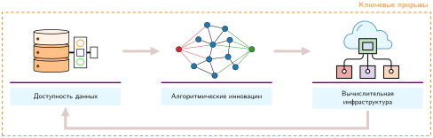

***Благотворный цикл глубокого обучения**: три взаимно усиливающих фактора — доступность данных, алгоритмические инновации и вычислительная инфраструктура — образуют самоподкрепляющуюся петлю, в которой прорывы в одной области создают возможности в других.*

Доступность данных обеспечила объем примеров, который нужен выученным представлениям. Рост интернета и цифровых устройств создал огромные новые источники обучающих данных: платформы обмена изображениями предоставили миллионы размеченных изображений, цифровые собрания текстов позволили обрабатывать язык в большом масштабе, а сети датчиков порождали непрерывные потоки данных реального мира. Это изобилие дало нейронным сетям сырье, необходимое для эффективного выучивания сложных паттернов.

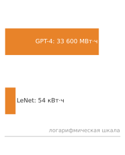

*История нейронных сетей — это взрыв масштаба энергии обучения.*

Алгоритмические новшества превратили этот объем в обучаемые системы. Новые методы инициализации сетей и управления скоростью обучения сделали обучение более стабильным. Методы борьбы с переобучением улучшили обобщение в измеренных режимах. Исследователи также задокументировали эмпирические связи между размером модели, вычислениями, объемом данных и качеством, что привело к все более амбициозным архитектурам, при этом полезный режим масштабирования остался зависимым от задачи.

Возникающие нагрузки создали спрос на вычислительную инфраструктуру с большей пропускной способностью, и она развивалась в ответ. Со стороны аппаратуры GPU обеспечили параллельные вычисления, необходимые для эффективных нейросетевых расчетов, а тензорные процессоры (TPU)[^fn-tpu-tensor-hardware] (Jouppi et al., 2023) подняли производительность еще выше. Системы памяти высокой пропускной способности и быстрые межсоединения решали задачи перемещения данных. Программное обеспечение развивалось в ногу с аппаратурой: фреймворки и библиотеки упростили построение и обучение сетей, распределенные вычислительные системы сделали возможным обучение в масштабе, а инструменты оптимизации развертывания моделей сократили разрыв между исследованиями и промышленной эксплуатацией.

[^fn-tpu-tensor-hardware]: **TPU (тензорный процессор)**: специализированный ускоритель Google, впервые развернутый внутри компании в 2015 году, оптимизированный именно под матричные умножения, которые доминируют в нагрузках нейронных сетей. TPU v1 достигал 92 TOPS (целочисленных операций в секунду в INT8, по данным производителя) для вывода при 75 Вт, что давало энергоэффективность, недоступную универсальным GPU того времени. Название «Tensor Processing Unit» отражает решение пожертвовать универсальной гибкостью ради максимальной пропускной способности для операции, которая нужна нейронным сетям чаще всего.

<a id="chk-nn-computation-understanding-deep-learnings-emergence"></a>

> **Понимание возникновения глубокого обучения**
>
> Прежде чем связать эту историю с ее инфраструктурными последствиями, проверьте, понимаете ли вы, почему возникло глубокое обучение:
>
> - **Ограничения правил**: можете ли вы объяснить, почему программирование на правилах не справляется с задачами вроде распознавания изображений?
> - **Классическое машинное обучение и глубокое обучение**: можете ли вы сравнить признаки, спроектированные вручную в классическом машинном обучении, с автоматическим выучиванием признаков в глубоком обучении?
> - **Три фактора**: можете ли вы описать три фактора, сошедшиеся вместе для современного глубокого обучения (данные, алгоритмы, инфраструктура)?
> - **Спрос на аппаратуру**: можете ли вы объяснить, почему глубокое обучение чаще, чем традиционное программирование, требует специализированной аппаратуры?
>
> Если какие-то из этих понятий остаются неясными, перечитайте соответствующие разделы, прежде чем продолжать. Системные последствия, о которых пойдет речь дальше, строятся непосредственно на этой концептуальной основе.

Сближение доступности данных, алгоритмических инноваций и вычислительной инфраструктуры превратило нейронные сети из теоретических формулировок в доминирующие производственные нагрузки. Поскольку современные передовые модели упираются в пропускную способность памяти, задержку межсоединений и тепловые бюджеты, системная инженерия переходит от определения модели на высоком уровне к физическому исполнению. Управление этими узкими местами требует рассмотрения конкретных математических примитивов и потоков данных аппаратуры, которые выполняются на ускорителях.

<a id="sec-neural-computation-neural-network-fundamentals-07e4"></a>

## Основы нейронных сетей

Теперь вопрос в том, *почему* вычислительные требования могут стать такими экстремальными. Для подходящих нейросетевых нагрузок GPU может превосходить CPU потому, что обеспечивает высокую параллельную пропускную способность и повторное использование данных для матричных и тензорных операций, а не просто из-за тактовой частоты. Структура этих примитивов сети — нейронов, слоев и нелинейных активаций — определяет, как данные текут через аппаратуру и как требования к памяти масштабируются при обучении и выводе. Понимание этих операций показывает, как простая арифметика отдельных нейронов складывается в требования к инфраструктуре, которые сформировали современный ИИ.

Изложенные здесь понятия относятся к нейронным сетям прямого распространения, на которых держится эта глава и которые повторяются во многих более крупных архитектурах. Их общие основы — взвешенные суммы, нелинейные активации и обучение на основе градиентов. Освоение этих операций и их вычислительных характеристик дает основу для рассуждений о более специализированных сетях, тогда как последующие главы вводят операторы и паттерны исполнения, которых нет в этой простой модели.

<a id="sec-neural-computation-depth-matters-power-hierarchical-representations-f83c"></a>

### Почему важна глубина: сила иерархических представлений

Однослойная сеть, пытающаяся классифицировать рукописные цифры, должна напрямую отобразить сырые пиксели в метки. Более глубокая сеть может вместо этого использовать иерархическую структуру, если целевая функция композиционна. Вопрос в том, *почему* глубина дает такие преимущества в представлении, и ответ обосновывает всю математику, которая следует дальше.

Глубокие сети могут использовать **композиционность**: сложные паттерны раскладываются на более простые, которые в свою очередь раскладываются дальше. В распознавании изображений выученные представления могут проходить путь от локальных границ и текстур к частям и объектам. Такие иерархические закономерности встречаются во многих наборах данных и мотивируют послойные модели, хотя обученная сеть не обязана воспроизводить именно эту последовательность.

Рассмотрим распознавание цифры «семь» в примере MNIST. Однослойная сеть отображает все 784 значения пикселей напрямую в решение. Когда у задачи есть композиционная структура, глубокая сеть может вычислить решение с большей эффективностью по параметрам, переиспользуя промежуточные признаки:

- **Слой 1** выучивает простые детекторы границ: вертикальные линии, горизонтальные линии, диагональные штрихи
- **Слой 2** объединяет границы в формы: горизонтальный верхний штрих «семерки», диагональный нисходящий штрих
- **Слой 3** объединяет формы в полные паттерны цифр

Каждый слой опирается на предыдущий, позволяя последующим вычислениям переиспользовать более ранние признаки. Эта иерархия может быть намного эффективнее по параметрам, чем мелкое представление, если у задачи подходящая композиционная структура. Те же детекторы границ, выученные для «семерки», могут участвовать и в распознавании «единицы», «четверки» и других цифр. Такое **переиспользование параметров** помогает объяснить, почему глубина — эффективный проектный выбор, не подразумевая фиксированного преимущества по параметрам для каждой задачи. Однако выбор между добавлением слоев и расширением существующих не симметричен: глубина и ширина вносят вклад в представительную емкость разными механизмами.

Послойная обработка в биологическом зрении помогла мотивировать иерархические модели, но это не означает, что искусственные сети воспроизводят те же механизмы. Архитектуры, рассмотренные в главе [«Архитектуры нейронных сетей»](06_nn_architectures.md#sec-network-architectures), кодируют разные структурные допущения для изображений, последовательностей и других типов данных. Глубина объясняет, почему послойные представления могут быть полезны; остальная механика объясняет, как реализована иерархия. Следующие разделы раскрывают эту механику: как вычисляют нейроны, как соединяются слои и как информация течет от входа к выходу.

<a id="psp-nn-computation-depth-vs-width-trade-off"></a>

> **Компромисс между глубиной и шириной**
>
> Для некоторых классов функций глубина дает экспоненциальное преимущество в представлении: сеть из $N_L$ слоев может представить функции, для которых мелкой сети потребовалось бы экспоненциально больше элементов (Telgarsky, 2016). Этот ограниченный теоретический результат объясняет, почему нелинейная композиция может быть эффективной по параметрам; это не универсальная гарантия для любой задачи.
>
> Однако каждый дополнительный слой вносит три инженерные проблемы:
>
> - Добавляет последовательные зависимости (слой $\ell+1$ ждет слоя $\ell$), ограничивая параллелизм
> - Увеличивает длину пути градиента, создавая риск затухающих или взрывающихся градиентов
> - Требует хранить промежуточные активации для обратного распространения ошибки
>
> Современные архитектуры балансируют глубину и ширину. Сеть из десяти слоев по 100 нейронов имеет то же общее число скрытых элементов — 1 000 — что и сеть из двух слоев по 500, но не то же число параметров, класс функций или граф исполнения. Оба варианта открывают параллелизм внутри каждого слоя; более глубокая сеть добавляет последовательные зависимости и может эффективнее представлять некоторые композиционные функции.

<a id="sec-neural-computation-network-architecture-fundamentals-1f58"></a>

### Основы архитектуры сети

Архитектура нейронной сети определяет, как информация течет от входа к выходу. Современные сети могут быть чрезвычайно сложными, но все они опираются на несколько организационных принципов, которые формируют и реализацию, и требуемую вычислительную инфраструктуру.

Распознавание рукописных цифр делает эти понятия конкретными: речь о классификации изображений из набора MNIST (LeCun et al., 1998). Эта, на первый взгляд, простая задача раскрывает все основные принципы нейронных сетей и дает интуицию для более сложных приложений.

Каждый архитектурный выбор — от того, как соединяются нейроны, до того, как организованы слои, — создает конкретные вычислительные паттерны, которые нужно эффективно отобразить на аппаратуру. Это отображение между архитектурой сети и вычислительными требованиями необходимо для построения масштабируемых систем ML.

<a id="exmp-nn-computation-running-example-mnist-digit-recognition"></a>

> **Сквозной пример: распознавание цифр MNIST**
>
> **Сценарий**: развертывание простого классификатора рукописных цифр на полутоновых изображениях $28{\times}28$ с 10 выходными классами.
>
> **Расчет**: сквозная архитектура главы отображает 784 сырых признака пикселей через 128 и 64 скрытых элемента в 10 выходов, создавая примерно 100 тыс. параметров.
>
> **Системный урок**: проверка размерностей входного вектора и параметров слоев на компактном наборе данных задает базовые требования к вычислениям и пропускной способности памяти до масштабирования к высокоразмерным производственным нагрузкам.

<a id="sec-neural-computation-perceptron-weighted-sum-9b3e"></a>

#### Взвешенная сумма перцептрона

Вычислительный механизм каждого плотного слоя — это искусственный нейрон в духе перцептрона, путь сигнала которого (входы, веса, смещение, агрегация, активация) раздел [«Искусственный нейрон как вычислительный примитив»](05_nn_computation.md#sec-neural-computation-artificial-neuron-computing-primitive-45b4) проследил через его биологические истоки. Осталось формализовать этот путь математически, потому что именно эта повторяющаяся операция становится ядром уровня слоя, которое выполняет аппаратура. В сети MNIST нейрон первого слоя объединяет все 784 яркости пикселей в одну активацию, которая может реагировать на выученный паттерн, например на вертикальную границу, общую для «единицы» и «семерки». Проследите [«Архитектуру перцептрона»](05_nn_computation.md#fig-perceptron) слева направо: каждый вход $x_i$ умножается на свой вес $w_{ij}$, произведения суммируются со смещением, а функция активации преобразует полученную оценку. Разные нейроны повторяют ту же структуру с разными выученными весами, что позволяет одному слою проверять много паттернов на одном и том же входе.

<a id="fig-perceptron"></a>

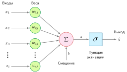

***Архитектура перцептрона**: входы поступают слева, каждый масштабируется своим весом, а взвешенные произведения и смещение сходятся в узле суммирования перед тем, как единственная функция активации выдает выход. Умножения и накопление вдоль этого пути — единица работы на нейрон, которую расчеты стоимости слоя перемножают.*

Каждый вход $x_i$ имеет соответствующий вес $w_{ij}$, и перцептрон умножает каждый вход на свой вес. Промежуточный выход $z$ вычисляется как взвешенная сумма входов по формуле [«взвешенная сумма»](05_nn_computation.md#eq-weighted-sum):

<a id="eq-weighted-sum"></a>

$$ z = \sum (x_i \cdot w_{ij}) $$

Здесь $j$ обозначает принимающий нейрон, когда перцептроны собраны в слой, а сумма идет по всем индексам входов $i$. Проще говоря, каждый признак входа масштабируется в соответствии со своей важностью (весом), а результаты суммируются в одну оценку. Это скалярное произведение двух векторов — базовая операция, для выполнения которой с максимальной пропускной способностью спроектированы аппаратные ускорители, и причина, по которой производительность нейронной сети измеряют числом выполненных операций MAC в секунду.

Смещение $b$ сдвигает линейный выход вверх или вниз, давая модели дополнительную гибкость для подгонки данных. Поэтому линейная комбинация перцептрона со смещением записывается так ([«взвешенная сумма со смещением»](05_nn_computation.md#eq-weighted-sum-bias)):

<a id="eq-weighted-sum-bias"></a>

$$ z = \sum (x_i \cdot w_{ij}) + b $$

Имея эту взвешенную сумму, подходящие выходная функция активации и функция потерь могут поддержать регрессию или классификацию. Бинарный линейно-пороговый классификатор выбирает один из двух классов относительно порога; многоклассовые сети вместо этого выдают несколько оценок и обычно нормируют их с помощью softmax.

При прямом скалярном учете без повторного использования, установленном ранее, один нейрон выполняет $N$ операций умножения с накоплением и перемещает свои входы, веса, смещение и выход. Формализация добавляет взгляд на слой. Плотный слой из $M$ нейронов повторяет взвешенную сумму $M$ раз, поэтому его арифметическая стоимость составляет $M \times N$ MAC — именно матричное умножение $\mathbf{x}\mathbf{W}$, которое должна выполнить аппаратура, и именно в этой форме остальная часть главы считает работу.

<a id="sec-neural-computation-nonlinear-activation-functions-38bc"></a>

#### Нелинейные функции активации

**Функции активации** — точка, где сходятся выразительность, поток градиентов и аппаратная стоимость. Они превращают линейные взвешенные суммы в нелинейные выходы; без них несколько линейных слоев свелись бы к одному линейному преобразованию, что сильно ограничило бы выразительную силу сети. На [«Распространенных функциях активации»](05_nn_computation.md#fig-activation-functions) сравниваются три часто используемые поэлементные функции активации и одна векторная функция (softmax); у каждой есть математические свойства, которые формируют и поведение обучения, и стоимость исполнения.

<a id="fig-activation-functions"></a>

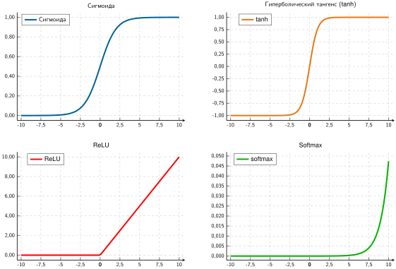

<em>**Распространенные функции активации**: четыре нелинейные функции активации, построенные с указанием диапазонов их выходов. Сигмоида отображает входы в $(0,1)$ с гладкими градиентами, tanh дает центрированные относительно нуля выходы в $(-1,1)$, а ReLU выдает ноль для отрицательных входов. Softmax (справа внизу) показывает одну компоненту трехэлементного вектора, при этом два других логита фиксированы на значениях 13 и 0. Его увеличенная ось y (примерно от $0$ до $0{,}05$) не сопоставима с другими панелями и показывает только одну компоненту вектора, выходы которого взаимозависимы и в сумме дают 1.</em>

Выбор функции активации влияет и на обучение, и на вычислительную эффективность, показывая, как системные ограничения формируют алгоритмический дизайн. ReLU ($\max(0, x)$) стала распространенной функцией активации скрытых слоев в сетях прямого распространения, потому что она дешева, имеет локальную производную, равную единице, для положительных входов и может давать разреженные активации. Более ранние дифференцируемые глубокие сети часто использовали сигмоиду или tanh. Их гладкие S-образные кривые могут насыщаться, из-за чего градиенты уменьшаются на многих слоях и мешают обучению ранних слоев. Этот контраст — не простое ранжирование: сигмоида остается подходящей для некоторых бинарных выходов, tanh полезна, когда нужны ограниченные активации, центрированные относительно нуля, а современные архитектуры используют дополнительные семейства активаций. Значимый проектный вопрос — какая функция обеспечивает нужную семантику выхода и поведение градиента при приемлемой стоимости исполнения. Понимание этих ролей объясняет, почему ReLU получила распространение, не превращая ее в универсальное значение по умолчанию.

<a id="sec-neural-computation-sigmoid-a98f"></a>

##### Сигмоида

Логистическая сигмоида[^fn-sigmoid-etymology-activation] сжимает непрерывные входы в открытый интервал $(0,1)$ (формула [«сигмоида»](05_nn_computation.md#eq-sigmoid)):

<a id="eq-sigmoid"></a>

$$ \sigma(x) = \frac{1}{1 + e^{-x}} $$

[^fn-sigmoid-etymology-activation]: **Сигмоида**: от греческих *sigma* и *eidos* («сигмообразная»), что относится к S-образной кривой, отображающей входы в ограниченный диапазон (0, 1). Отображение требует аппроксимации экспоненты, которую обычно реализуют специализированными инструкциями, таблицами поиска или полиномиальными методами. Оно, как правило, дороже операции сравнения и выбора ReLU, хотя измеренный разрыв зависит от точности, векторизации и аппаратуры. Принятие ReLU отражало и более простое распространение градиента по ее положительной ветви, и более дешевое исполнение.

S-образная кривая отображает логиты в $(0,1)$, поэтому сигмоида может параметризовать бинарную вероятность. Она приближается к единице для больших положительных входов и к нулю для больших отрицательных. Хотя сигмоида гладкая и дифференцируемая всюду, обучение на основе градиентов не обязано опираться на то же: у ReLU в нуле используется назначенный субградиент.

У сигмоиды есть существенное ограничение: для входов с большими по модулю значениями (далеко от нуля) градиент становится крайне малым, и это явление называется **проблемой затухающего градиента**.[^fn-vanishing-gradient-depth] При обратном распространении эти малые градиенты перемножаются через слои, и градиенты ранних слоев становятся экспоненциально малыми. Это фактически мешает обучению глубоких сетей, поскольку обновления весов становятся пренебрежимо малыми.

[^fn-vanishing-gradient-depth]: **Проблема затухающего градиента**: умножение якобианов по слоям в правиле цепочки может сокращать градиенты. Производная сигмоиды не превышает 0,25, поэтому на упрощенном 10-слойном пути одни лишь множители производной активации дают не более $0{,}25^{10} \approx 10^{-6}$. Полный градиент включает также веса и другие операции, но многократно насыщенные производные активации все равно могут сделать обновления ранних слоев пренебрежимо малыми.

Выходы сигмоиды не центрированы относительно нуля. Когда входы, питающие обновление параметров, также неотрицательны, знаки их градиентов весов могут коррелировать, порождая менее прямые траектории оптимизации. Полный градиент по-прежнему зависит от ошибок вышестоящих слоев и не обязан быть одного знака.

<a id="sec-neural-computation-tanh-e981"></a>

##### Гиперболический тангенс (tanh)

Гиперболический тангенс[^fn-tanh-etymology-activation] центрирует выходные активации относительно нуля на интервале $(-1,1)$ (формула [«tanh»](05_nn_computation.md#eq-tanh)):

<a id="eq-tanh"></a>

$$ \tanh(x) = \frac{e^x - e^{-x}}{e^x + e^{-x}} $$

[^fn-tanh-etymology-activation]: **Tanh (гиперболический тангенс)**: благодаря центрированию диапазона выходов относительно нуля `tanh` может уменьшать коррелированное поведение обновлений, связанное с полностью положительными активациями. Его вычислительная стоимость близка к сигмоиде, так как она также опирается на аппроксимацию экспоненты, а поведение насыщения по-прежнему допускает затухающие градиенты.

Tanh дает S-образную кривую, похожую на сигмоиду, но центрированную в нуле: отрицательные входы отображаются в отрицательные выходы, а положительные — в положительные. Эта симметрия уравновешивает поток градиентов во время обучения и часто дает более быструю сходимость, чем сигмоида.

Как и сигмоида, tanh гладкая и дифференцируемая всюду, и все же страдает от проблемы затухающего градиента для входов с большими по модулю значениями. Когда функция насыщается (приближается к −1 или 1), градиенты стремятся к нулю. Несмотря на это ограничение, центрированность выходов tanh делает ее предпочтительнее сигмоиды для скрытых слоев во многих архитектурах, особенно в рекуррентных нейронных сетях, где важно поддерживать сбалансированные активации на протяжении шагов времени.

Сигмоида и tanh разделяют критическое ограничение: насыщение градиента при экстремальных входных значениях. Поиск функции активации, которая избегает этой проблемы и при этом остается вычислительно эффективной, привел к одной из самых важных инноваций глубокого обучения.

<a id="sec-neural-computation-relu-7184"></a>

##### ReLU

ReLU[^fn-relu-hardware-efficiency] обнуляет отрицательные значения, сохраняя линейное тождество для положительных входов (формула [«ReLU»](05_nn_computation.md#eq-relu)):

<a id="eq-relu"></a>

$$ \text{ReLU}(x) = \max(0, x) = \begin{cases} x & \text{если } x > 0 \\ 0 & \text{если } x \leq 0 \end{cases} $$

[^fn-relu-hardware-efficiency]: **ReLU (ректифицированная линейная единица)**: в отличие от дорогих экспоненциальных операций предыдущих функций активации, операция `max(0, x)` в ReLU сводится к простому сравнению и выбору. Эта эффективность вместе с лучшим распространением градиента для положительных активаций помогла сделать вычислительно посильными глубокие архитектуры эпохи AlexNet (Nair and Hinton, 2010; Krizhevsky et al., 2012).

[^fn-dropout-train-infer]: **Dropout**: случайное отключение нейронов во время обучения заставляет сеть выучивать избыточные представления; это техника регуляризации, которая использовалась при переходе к глубоким моделям зрения в эпоху AlexNet (Srivastava et al., 2014; Krizhevsky et al., 2012). Это создает системное расхождение между вычислительными графами обучения (стохастический) и вывода (детерминированный). Неспособность переключиться с графа обучения на граф вывода — распространенная ошибка, которая может незаметно ухудшить точность.

Характерная форма ReLU — прямая линия для положительных входов и ноль для отрицательных — дает три преимущества. Во-первых, ее локальная производная равна единице для положительных входов, что исключает насыщение активации на этой ветви; полный градиент сети по-прежнему может уменьшаться или расти через веса и другие операции. Во-вторых, ReLU вводит детерминированную разреженность активаций, обнуляя отрицательные значения; это отличается от стохастического маскирования dropout.[^fn-dropout-train-infer] Нулевые значения сами по себе не дают ускорения, потому что обычные плотные ядра все равно обрабатывают их позиции, если реализация не использует разреженность. В-третьих, ReLU использует сравнение и выбор, `output = (input > 0) ? input : 0`, а не аппроксимацию экспоненты. Это локальные свойства оператора, тогда как сквозная производительность зависит от того, как он объединяется с соседними операциями.

У ReLU есть и недостатки. **Проблема «умирающего» ReLU** — нейроны, которые навсегда выдают ноль и перестают обучаться, — возникает, когда нейроны застревают в неактивном состоянии. Если веса нейрона во время обучения меняются так, что предактивация $z = \mathbf{w}^T\mathbf{x} + b$ постоянно отрицательна для всех обучающих примеров, нейрон выдает ноль на любой вход. Поскольку градиент ReLU для отрицательных входов тоже равен нулю, при обратном распространении через этот нейрон не проходит никакой градиент: веса не обновляются, и нейрон остается мертвым. Такое может случиться при больших скоростях обучения, которые выталкивают веса в неблагоприятные области. С системной точки зрения мертвые нейроны — это потраченная впустую емкость: параметры, которые занимают память и вычисления при выводе, но ничего не вносят в выход. Аккуратная инициализация (He et al., 2015), умеренные скорости обучения и варианты «протекающего» ReLU помогают смягчить проблему умирающих ReLU. Пакетная нормализация[^fn-batch-norm-cost] вместо этого стабилизирует входы слоев и позволяет использовать более высокие скорости обучения (Ioffe and Szegedy, 2015).

[^fn-batch-norm-cost]: **Системная цена пакетной нормализации**: BatchNorm добавляет два обучаемых параметра на признак (масштаб $\gamma$ и сдвиг $\beta$) и ведет себя по-разному при обучении и выводе: обучение использует живые среднее и дисперсию по мини-батчу, а вывод — зафиксированные скользящие статистики. Поддерживая лучше масштабированные распределения активаций, она стабилизирует обучение и может позволить более высокие скорости обучения, но также делает слой зависимым от статистик батча. Маленькие батчи дают шумные оценки среднего и дисперсии, поэтому математический стабилизатор становится системным выбором относительно размера батча, памяти активаций и паритета обучения и обслуживания. Более поздние архитектуры и крупномасштабные режимы обучения вводят дальнейшие варианты того же компромисса статистик батча.

<a id="sec-neural-computation-softmax-ebe5"></a>

##### Softmax

В отличие от *поэлементных* функций активации, которые действуют на каждое значение независимо, softmax[^fn-softmax-etymology-probability] — это *векторная* функция: она учитывает все значения одновременно, чтобы получить распределение вероятностей. В простых классификаторах softmax обычно используется в выходном слое, а не как поэлементная скрытая активация; в архитектурах внимания она также нормирует выученные векторы оценок важности. Функция softmax задается формулой:

<a id="eq-softmax"></a>

$$ \text{softmax}(z_i) = \frac{e^{z_i}}{\sum_{j=1}^K e^{z_j}} $$

[^fn-softmax-etymology-probability]: **Softmax**: название отражает ее роль «мягкой», дифференцируемой версии `argmax` — функции, которая должна просмотреть весь вектор, чтобы найти максимальное значение. Эта векторная операция не используется как прямая замена поэлементным нелинейностям вроде ReLU, но она центральна всякий раз, когда модели нужно нормировать вектор оценок, включая классификационные головы и слои внимания. Прямое возведение в экспоненту может переполнить 32-битный формат с плавающей запятой. Устойчивые реализации вычитают наибольший логит перед экспонентой; такой сдвиг не меняет ни одной вероятности softmax, но делает наибольшую экспоненту равной единице.

Для вектора из $K$ значений (их часто называют логитами[^fn-logits-etymology-probability]) softmax преобразует их в $K$ вероятностей, сумма которых равна 1. Одна компонента выхода softmax показана на [«Распространенных функциях активации»](05_nn_computation.md#fig-activation-functions) (справа внизу); на практике softmax обрабатывает целые векторы, где выход каждого элемента зависит от всех входных значений.

[^fn-logits-etymology-probability]: **Логиты**: в многоклассовых нейросетевых классификаторах логиты — это ненормированные выходные оценки. Разности оценок соответствуют логарифмам отношений вероятностей после softmax, тогда как отдельный многоклассовый логит сам по себе не является калиброванной величиной логарифма шансов. Поскольку `argmax` по логитам и `argmax` по вероятностям softmax выбирают один и тот же класс, вывод может пропустить softmax, если нужен только лучший класс.

В многоклассовых классификаторах softmax обычно используется в выходном слое. Она преобразует произвольные вещественные логиты в нормированные предсказанные вероятности, но эти значения не обязательно являются калиброванными оценками уверенности. Класс с наибольшей вероятностью становится предсказанным классом, а большие логиты получают непропорционально большие вероятности.

Математическая связь между входными логитами и выходными вероятностями дифференцируема, поэтому во время обучения градиенты проходят обратно через softmax. В сочетании с функцией кросс-энтропийных потерь (рассмотренной в разделе [«Функции потерь»](05_nn_computation.md#sec-neural-computation-loss-functions-6fc2)) softmax дает особенно простые выражения градиента, которые эффективно направляют обучение. Помимо математических свойств, выбор функций активации имеет прямые последствия для эффективности аппаратуры.

<a id="psp-nn-computation-activation-functions-hardware"></a>

> **Функции активации и аппаратура**
>
> Широкое распространение ReLU объясняется аппаратной эффективностью наряду с тем, что она позволяет избежать затухающих градиентов. Вычисление $\max(0,x)$ требует одной операции сравнения, тогда как сигмоида и tanh требуют вычисления экспонент — операций, которые намного дороже по времени и энергии. Расчет «налога на транзисторы» в разделе [«Налог на транзисторы»](05_nn_computation.md#sec-neural-computation-transistor-tax) моделирует этот разрыв как отношение стоимости логики, а глава [«Аппаратное ускорение»](11_hw_acceleration.md) рассматривает более широкие следствия для бенчмарков и реализации на ускорителях.

<a id="sec-neural-computation-transistor-tax"></a>

#### Налог на транзисторы: стоимость логического блока

У выбора функции активации есть вторая стоимость, помимо поведения градиента: площадь кремния. В компьютерной архитектуре **стоимость логического блока** измеряется числом транзисторов и энергией на операцию.

Тракт данных ReLU можно реализовать логикой сравнения и выбора, тогда как сигмоида или tanh требуют аппроксимации трансцендентной функции, например таблицей поиска или вычислением полинома. Иллюстративные допущения здесь приписывают ReLU 50 эквивалентов транзисторов, а высокоточному экспоненциальному тракту данных — 2 500. Фактические площадь, задержка и энергия зависят от точности, метода аппроксимации, совместного использования ресурсов, целевой пропускной способности и технологии аппаратуры.

Это иллюстративное различие и есть **налог на транзисторы**: при принятых допущениях смоделированная «цена» сигмоиды в кремнии в 50 раз выше цены ReLU. Точное соотношение не является константой аппаратуры. Устойчивый системный урок состоит в том, что простые кусочно-линейные активации, как правило, дешевле реализовать, чем трансцендентные функции, а принятие ReLU отражает также ее поведение при оптимизации и поток градиентов.


*Иллюстративная логическая модель показывает, почему ReLU, как правило, дешевле в реализации.*

Эти преобразования превращают линейную входную сумму в нелинейный выход, давая общее вычисление искусственного нейрона (формула [«нейрон перцептрона»](05_nn_computation.md#eq-perceptron)):

<a id="eq-perceptron"></a>

$$ \hat{y} = f(z) = f\left(\sum (x_i \cdot w_{ij}) + b\right) $$

Эта нелинейность расширяет то, что могут представлять многослойные сети. Без нее стопка линейных слоев алгебраически сводится к одному линейному преобразованию, сколько бы промежуточных матриц ни вычисляла реализация. На [«Линейных и нелинейных границах решений»](05_nn_computation.md#fig-nonlinear) левая панель показывает линейную границу, которая не может разделить классы, а правая — одну криволинейную границу, которую может представить многослойная сеть с нелинейными активациями и подходящими выученными параметрами. Рисунок иллюстрирует представительную возможность, а не гарантию того, что обучение найдет эту границу. Оптимизация, покрытие данными и архитектура по-прежнему определяют, какую функцию порождают выученные параметры.

<a id="fig-nonlinear"></a>

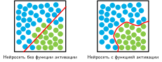

***Линейные и нелинейные границы решений**: две диаграммы рассеяния сравнивают классификацию с функциями активации и без них. Без активации прямая линия не разделяет два класса. С нелинейной функцией активации сеть порождает криволинейную границу решений, которая верно разделяет точки.*

**Теорема об универсальной аппроксимации**[^fn-universal-approximation-theorem] утверждает, что достаточно широкие сети с подходящими функциями активации могут сколь угодно точно аппроксимировать широкие классы функций. Эта теоретическая основа в сочетании с вычислительными и оптимизационными свойствами конкретных функций активации, таких как ReLU и сигмоида, объясняет практическую эффективность нейронных сетей в сложных задачах. Однако теорема утверждает лишь существование при допущении неограниченной ширины; она ничего не говорит об ускорителе, который выполняет вычисление. Физические системы ML накладывают жесткие ограничения на оба измерения компромисса «ширина — глубина»: один скрытый слой, достаточно широкий, чтобы аппроксимировать сложную функцию, требует хранения параметров и памяти активаций, которые могут полностью исчерпать VRAM ускорителя, а сеть, слишком глубокая, чтобы поместить свои активации в память, упирается в то же ограничение при обратном проходе. Поэтому инженерная задача состоит не в том, *существует* ли сеть достаточной ширины или глубины, а в том, помещается ли она в бюджет памяти и пропускной способности целевой аппаратуры.

[^fn-universal-approximation-theorem]: **Теорема об универсальной аппроксимации**: при условиях на функцию активации, целевую функцию, компактную область определения и допуск аппроксимации достаточно широкая сеть с одним скрытым слоем может сколь угодно точно аппроксимировать целевую функцию. Этот результат о существовании неконструктивен: он не указывает, как найти веса и сколько нейронов потребует практическое обучение. Для некоторых классов функций глубина дает экспоненциальное преимущество в представлении по сравнению с мелкими сетями, но это разделение не универсально.

<a id="sec-neural-computation-layers-connections-76c3"></a>

#### Слои и связи

Отдельные нейроны вычисляют взвешенные суммы, применяют смещения и пропускают результаты через функции активации. Однако сила нейронных сетей возникает из организации нейронов в слои — наборы элементов, которые выполняются параллельно над общими входами. Входной слой принимает сырые тензоры признаков; один или несколько скрытых слоев преобразуют эти представления через последовательные матричные умножения и нелинейные активации; а выходной слой выдает предсказания, специфичные для задачи, или логиты решений.

На [«Послойной архитектуре сети»](05_nn_computation.md#fig-layers) данные входят во входной слой, проходят через несколько скрытых слоев, которые постепенно извлекают все более абстрактные признаки, и выходят из выходного слоя в виде предсказания. Каждый последующий слой преобразует представление, строя все более сложные признаки — иерархический конвейер обработки, который дает глубоким нейронным сетям способность выучивать сложные паттерны.

<a id="fig-layers"></a>

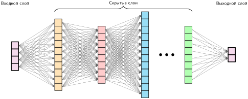

***Послойная архитектура сети**: глубокие нейронные сети преобразуют данные через последовательные слои, извлекая все более сложные признаки и паттерны. Каждый слой применяет нелинейные преобразования к выходам предыдущего, в итоге отображая сырые входы в желаемые выходы.*

По мере того как данные текут через сеть, они преобразуются на каждом слое, чтобы извлекать значимые паттерны. Процесс взвешенной суммы и активации, введенный для отдельных нейронов, масштабируется: каждый слой применяет эти операции параллельно по всем своим нейронам, а выходы одного слоя становятся входами следующего. Так возникает иерархический конвейер, в котором простые признаки, обнаруженные в ранних слоях, объединяются в все более сложные паттерны в глубоких слоях, — это позволяет нейронным сетям выучивать сложные представления из сырых данных.

<a id="sec-neural-computation-parameters-connections-27c9"></a>

### Параметры и связи

Обучаемые параметры[^fn-parameter-memory-cost] нейронных сетей — веса и смещения — определяют, как информация течет через сеть и как к входным данным применяются преобразования. Их организация напрямую влияет и на емкость обучения, и на вычислительные требования.

[^fn-parameter-memory-cost]: **Стоимость памяти параметров**: число параметров — обманчивый показатель для оценки важности с точки зрения памяти; некоторые слои добавляют небольшие обучаемые параметры масштаба или сдвига, которые почти не влияют на бюджет байтов, но могут заметно менять поведение модели при изменении настроек обучения. И наоборот, основная масса параметров в плотных матрицах весов требует дополнительного состояния при обучении: градиентов и служебных данных оптимизатора сверх самих сохраненных весов. Модель, которая помещается в память для вывода, поэтому может требовать в несколько раз больше памяти для обучения; эта стоимость количественно оценена далее в бюджете памяти обучения.

<a id="sec-neural-computation-weight-matrices-9f9a"></a>

#### Матрицы весов

Веса определяют, насколько сильно входы влияют на выходы нейронов. В плотных слоях эти веса организуются в матрицы, которые эффективно отображаются на ядра линейной алгебры. В слое с $n$ входными признаками и $m$ нейронами веса образуют матрицу $\mathbf{W} \in \mathbb{R}^{n \times m}$, где каждый столбец представляет веса одного нейрона. Произведение матрицы на вектор обрабатывает один вход, тогда как произведение матрицы на матрицу обрабатывает батч входов и может открывать больше параллельной работы и повторного использования данных.

Для одного нейрона предактивация — это скалярное произведение $z = \sum_{i=1}^n (x_i \cdot w_{ij}) + b$. Для слоя из $m$ нейронов вычисление элементов независимо упускает возможности для векторизации SIMD и повторного использования кэша. Запись слоя в виде матричного умножения вычисляет все $m$ предактиваций одним плотным вызовом линейной алгебры (формула [«линейный слой»](05_nn_computation.md#eq-layer-linear)):

<a id="eq-layer-linear"></a>

$$ \mathbf{z} = \mathbf{x}\mathbf{W} + \mathbf{b} $$

Эта формула вычисляет предактивацию каждого нейрона для одного входа: вектор $\mathbf{x}$, умноженный на матрицу весов $\mathbf{W}$, дает все $m$ значений, а вектор смещений $\mathbf{b}$ сдвигает каждое из них. Для батча вход становится матрицей, и тот же слой превращается в произведение матриц. Эти ядра составляют большую часть работы в плотных сетях прямого распространения, но доминируют ли они во времени выполнения и ограничены ли они вычислениями или памятью, зависит от их размерностей, размера батча, точности, реализации и целевой аппаратуры.

Такая матричная организация — больше, чем математическое удобство: она отражает то, как современные нейронные сети реализуются ради эффективности. Каждый вес $w_{ij}$ задает силу связи между входным признаком $i$ и нейроном $j$ в слое.

Здесь рассматривается классический случай: каждый нейрон слоя связан с каждым нейроном предыдущего слоя, образуя «плотный», или «полносвязный», слой. Такой шаблон позволяет каждому нейрону использовать все признаки предыдущего слоя. Полносвязные слои задают математические принципы, нужные здесь, тогда как альтернативные шаблоны связей (рассмотренные в главе [«Архитектуры нейронных сетей»](06_nn_architectures.md#sec-network-architectures)) используют структуру данных и могут сокращать работу или повышать статистическую эффективность.

[«Полносвязные слои»](05_nn_computation.md#fig-connections) показывают плотный шаблон явно: маленькая трехслойная сеть, где подписан каждый весовой коэффициент связи. Каждый вход соединен с каждым скрытым нейроном, а каждый скрытый нейрон — с каждым выходом. Каждое подписанное ребро задает один обучаемый вес, что делает видимыми число параметров и структуру арифметики. Читайте по одному нейрону назначения: его входящие ребра образуют один столбец предыдущей матрицы весов, а его смещение сдвигает получившуюся взвешенную сумму. Если прочитать все назначения вместе, проявится матричная операция. Числовые подписи иллюстративны, а не являются расчетом прямого прохода; важна форма матриц. Для слоев размеров $(n_1, n_2, n_3)$ матрицы весов равны $\mathbf{W}^{(1)} \in \mathbb{R}^{n_1 \times n_2}$ и $\mathbf{W}^{(2)} \in \mathbb{R}^{n_2 \times n_3}$, что требует $n_1n_2+n_2n_3$ весов без учета смещений.

<a id="fig-connections"></a>

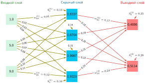

***Полносвязные слои**: трехслойная сеть с плотными связями между слоями, где каждый нейрон объединяет информацию от всех нейронов предыдущего слоя. Подписанные ребра и узлы иллюстрируют организацию весов, смещений и активаций; это не расчет прямого прохода с числами.*

<a id="sec-neural-computation-bias-terms-d450"></a>

#### Смещения

У каждого нейрона слоя также есть связанное смещение[^fn-bias-parameter-cost]. Веса определяют относительную важность входов, а смещения позволяют нейронам сдвигать свои функции активации. Этот сдвиг важен для обучения, поскольку он дает сети гибкость для подгонки более сложных паттернов.

Для слоя из $m$ нейронов смещения образуют вектор $\mathbf{b} \in \mathbb{R}^m$. При выполнении слоя этот вектор прибавляется к взвешенной сумме входов (в той же форме, что и [«линейный слой»](05_nn_computation.md#eq-layer-linear)), независимо сдвигая порог активации каждого нейрона:
$$ \mathbf{z} = \mathbf{x}\mathbf{W} + \mathbf{b} $$

[^fn-bias-parameter-cost]: **Смещения**: смещение добавляет один параметр на нейрон, тогда как у нейрона с $n$ входами есть $n$ весов, поэтому смещения составляют $1/(n+1)$ параметров слоя. Их доля во всей модели и влияние на точность зависят от ширины слоев, архитектуры и нормализации. Некоторые современные архитектуры опускают смещения в слоях, за которыми следует пакетная нормализация, поскольку преобразование нормализации содержит выученный сдвиг.

Организация весов и смещений в сети прямого распространения следует систематическому шаблону. Для каждого параметризованного аффинного слоя $\ell$ его вычисление задают три компонента; веса и смещения обучаются, а функцию активации обычно выбирает проектировщик:

* Матрица весов $\mathbf{W}^{(\ell)}$
* Вектор смещений $\mathbf{b}^{(\ell)}$
* Функция активации $f^{(\ell)}$

Так получается полное вычисление слоя (формула [«активация слоя»](05_nn_computation.md#eq-layer-activation)):

<a id="eq-layer-activation"></a>

$$ \mathbf{a}^{(\ell)} = f^{(\ell)}(\mathbf{z}^{(\ell)}) = f^{(\ell)}(\mathbf{a}^{(\ell-1)}\mathbf{W}^{(\ell)} + \mathbf{b}^{(\ell)}) $$

Здесь $\mathbf{a}^{(\ell)}$ (для батчей записывается как $\mathbf{A}^{(\ell)}$) обозначает выход активации слоя. Всюду принято соглашение о векторах-строках: каждый образец — строка, а матрица весов $\mathbf{W}^{(\ell)} \in \mathbb{R}^{n_{\ell-1} \times n_\ell}$ отображает ширину предыдущего слоя в ширину текущего. С этой формулой основные понятия архитектуры становятся достаточно полными, чтобы двигаться дальше.

<a id="chk-nn-computation-neural-network-architecture-fundamentals"></a>

> **Основы архитектуры нейронной сети**
>
> Прежде чем переходить к топологии сети и обучению, проверьте, как вы усвоили базовые понятия:
>
> Используйте архитектуру MNIST 784 → 128 → 64 → 10 как сквозную проверку.
>
> - **Уравнение нейрона**: можете ли вы записать уравнение нейрона, включая взвешенную сумму, смещение и функцию активации?
> - **ReLU и сигмоида**: можете ли вы объяснить, почему ReLU вычислительно дешевле сигмоиды и при этом дает нелинейность, нужную многослойной сети?
> - **От слоев к матрицам**: можете ли вы сопоставить входной, скрытые и выходной слои с соответствующими матрицами весов $\mathbf{W}^{(\ell)} \in \mathbb{R}^{n \times m}$?
> - **Число параметров**: можете ли вы подсчитать общее число параметров, включая веса и смещения?
> - **Ширина, глубина, стоимость**: можете ли вы объяснить, как ширина слоев, глубина и связность меняют объем памяти и стоимость арифметики?
>
> Если что-то из этого кажется неясным, перечитайте более ранние разделы об основах нейронных сетей, искусственных нейронах и параметрах, прежде чем продолжать. Предстоящие разделы об обучении и оптимизации непосредственно опираются на эти основы.

<a id="sec-neural-computation-architecture-design-523c"></a>

### Проектирование архитектуры

Проектирование архитектуры определяет, как отдельные нейроны, функции активации и матрицы весов соединяются, чтобы решать задачи, с которыми не справится ни один слой в отдельности. У этого проектирования есть прямые системные последствия: каждый топологический выбор (добавление слоя, расширение скрытого измерения, изменение связности) меняет число параметров, объем памяти и стоимость арифметики.

Топология сети описывает, как отдельные нейроны организуются в слои и соединяются, образуя полные нейронные сети. Формировать интуицию начнем с простой задачи, которая стала известной в истории ИИ.[^fn-xor-depth-requirement]

[^fn-xor-depth-requirement]: **Задача XOR**: XOR — классический пример того, почему важна топология сети. Один слой с линейным порогом не может представить эту нелинейно разделимую функцию, сколько бы элементов он ни содержал, тогда как небольшая сеть с нелинейным скрытым слоем может. Точное число нужных элементов зависит от соглашений об активациях и представлении; устойчивый урок в том, что добавление нелинейной глубины меняет класс функций, которые может выразить сеть.

Пример XOR мотивирует сеть со скрытым слоем, но реальные сети требуют систематического учета ограничений проекта и масштаба вычислений. Распознавание рукописных цифр на наборе MNIST (LeCun et al., 1998) показывает, как структура задачи определяет размерности сети, тогда как конфигурация скрытых слоев остается важным проектным решением.

<a id="exmp-nn-computation-building-intuition-xor-problem"></a>

> **Формирование интуиции: задача XOR**
>
> Рассмотрим сеть, которая выучивает функцию XOR — классическую задачу, требующую нелинейности. Пусть входы $x_1$ и $x_2$ могут принимать значения 0 или 1; XOR выдает 1, когда входы различаются, и 0, когда они совпадают.
>
> **Конфигурация**: два входа → два скрытых нейрона → один выход
>
> **Пример**: для входов $(1, 0)$:
>
> - Первый скрытый нейрон: $h_1 = \text{ReLU}(1 \cdot w_{11} + 0 \cdot w_{12} + b_1)$
> - Второй скрытый нейрон: $h_2 = \text{ReLU}(1 \cdot w_{21} + 0 \cdot w_{22} + b_2)$
> - Выход: $y = \text{сигмоида}(h_1 \cdot w_{31} + h_2 \cdot w_{32} + b_3)$
>
> **Системный вывод**: скрытые слои не просто добавляют емкость — они меняют класс функций, которые система может представить. XOR — маленький пример, который делает глубину структурным требованием, а не декоративным проектным выбором (Minsky and Papert, 1969).

<a id="sec-neural-computation-feedforward-network-architecture-d2cf"></a>

#### Архитектура сети прямого распространения

Применение трехслойной архитектуры к MNIST показывает, как характеристики данных и требования задачи ограничивают проект сети. Сравните две панели на [«Топологии сети для MNIST»](05_nn_computation.md#fig-mnist-topology-1), чтобы увидеть эту архитектуру с двух сторон: панель (a) схематично изображает полутоновое изображение $28{\times}28$ пикселей, подключенное к скрытым и выходному слоям, а панель (b) показывает те же значения, развернутые в 784-мерный вектор признаков. Матричное умножение может работать с многомерными массивами, но этот полносвязный слой задает один вес на каждую пару входного признака и скрытого элемента, поэтому оси изображения не сохраняются в его параметризации. Сверточные архитектуры, рассмотренные в главе [«Архитектуры нейронных сетей»](06_nn_architectures.md#sec-network-architectures), вместо этого кодируют пространственную локальность напрямую.

Ширина входного слоя напрямую определяется форматом данных. Для изображения 28 на 28 пикселей каждый пиксель становится входным признаком, что требует 784 входных нейронов. Эквивалентно: 28 строк и 28 столбцов разворачиваются в 784 значения. Данные можно представить либо как двумерную пространственную сетку пикселей, либо как развернутый одномерный вектор, где каждое значение задает яркость одного пикселя.

Структура выходного слоя определяется требованиями задачи. Для распознавания цифр с 10 классами последний слой содержит 10 выходных нейронов, по одному на каждую возможную цифру (0–9). Получив изображение, сеть выдает оценку для каждого выходного нейрона; затем softmax может превратить эти логиты в предсказанные вероятности классов.

Между фиксированными входным и выходным слоями есть свобода в проектировании топологии скрытых слоев. Выбор структуры скрытых слоев, включая число слоев и их ширины, — одно из ключевых проектных решений в нейронных сетях. Дополнительные слои увеличивают глубину сети, позволяя выучивать более абстрактные признаки через последовательные преобразования. Ширина каждого слоя дает емкость для выучивания разных признаков на каждом уровне абстракции.

Расширение скрытых слоев со 100 до 1000 нейронов увеличивает число параметров примерно с 89,6 тыс. до 1,8 млн (примерно с 358 КБ до 7 МБ в FP32). Улучшит ли более широкая сеть точность, можно выяснить только обучением и оценкой; одного лишь роста объема хранения уже достаточно, чтобы это имело значение для бюджетов мобильного развертывания.

<a id="fig-mnist-topology-1"></a>

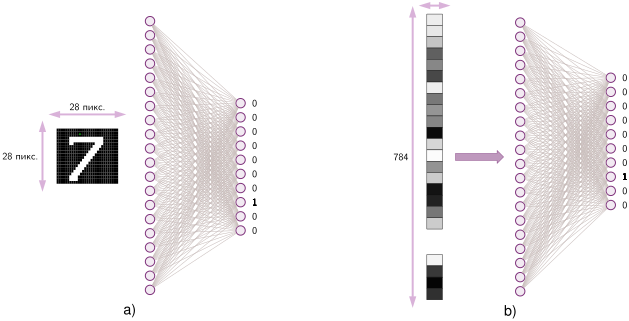

<em>**Топология сети для MNIST**: на двух панелях показана архитектура сети для распознавания цифр. Панель (a) схематично изображает цифру на изображении размером $28{\times}28$ пикселей, подключенном через скрытые слои к 10 выходным узлам. Панель (b) показывает ту же архитектуру с входным изображением, развернутым в вектор из 784 элементов, что иллюстрирует, как пространственные данные поступают в сеть.</em>

<a id="sec-neural-computation-layer-connectivity-design-patterns-c66e"></a>

#### Шаблоны связности слоев

Полносвязная архитектура из раздела [«Параметры и связи»](05_nn_computation.md#sec-neural-computation-parameters-connections-27c9) максимизирует гибкость, соединяя каждый нейрон с каждым нейроном следующего слоя, но сама связность — инженерное решение. Плотные, разреженные и пропускные шаблоны обменивают гибкость обучения на число параметров, локальность и поток градиентов.

Плотная связность — стандартный шаблон, при котором каждый нейрон соединен с каждым нейроном последующего слоя. В примере MNIST соединение 784-мерного входного слоя со скрытым слоем из 128 нейронов требует 100 352 весовых параметров ($784{\times}128$). Такая полная связность позволяет слою выучивать произвольные линейные комбинации своих входов; нелинейные активации между плотными слоями распространяют эти комбинации на нелинейные зависимости. Число параметров растет как произведение ширин соседних слоев, поэтому расширение одного слоя увеличивает их линейно, а расширение обоих — квадратично.

Разреженные шаблоны связности вводят целенаправленные ограничения на то, как нейроны соединяются между слоями. Вместо того чтобы сохранять все возможные связи, нейрон соединяется лишь с подмножеством нейронов соседнего слоя. Этот подход черпает вдохновение в биологических нейронных системах, где нейроны, как правило, образуют связи с ограниченным числом других нейронов. В задачах обработки зрения, таких как пример MNIST, нейрон может соединяться только с входами, которые представляют соседние пиксели, отражая локальную природу зрительных признаков.

По мере углубления сетей путь от входа к выходу становится длиннее, что потенциально осложняет обучение. Пропускные соединения решают это, добавляя прямые пути между несмежными слоями. Такие связи дают альтернативные маршруты для потока информации, дополняя стандартное послойное продвижение. В конвейере распознавания цифр пропускные соединения позволяют более поздним слоям напрямую обращаться как к высокоуровневым паттернам, так и к исходным значениям пикселей.

Эти шаблоны связности имеют прямые аппаратные последствия наряду с теоретическими. Плотные связи максимизируют гибкость обучения и эффективно отображаются на ядра общего матричного умножения (GEMM) на тензорно-ориентированной аппаратуре. Разреженные связи уменьшают теоретическое число параметров и FLOP, но разреженная матрица весов не выполняется автоматически быстрее плотной на стандартной аппаратуре: без поддержки структурированной разреженности (например, шаблонов 2:4, которые аппаратура может использовать через сжатые форматы индексов) арифметическое сокращение не переходит в пропорциональное сокращение времени выполнения. Пропускные соединения помогают поддерживать эффективный поток информации в глубоких сетях, сохраняя пути градиентов, которые делают очень глубокие архитектуры обучаемыми.

<a id="sec-neural-computation-model-size-computational-complexity-1f0f"></a>

#### Размер модели и вычислительная сложность

То, как расположены параметры (веса и смещения), определяет и емкость обучения, и вычислительную стоимость — это сторона модели в «кремниевом контракте» ([«Железный закон систем машинного обучения»](01_introduction.md#sec-introduction-iron-law-ml-systems-c32a)): число параметров, их численная точность и требуемые операции вместе задают вычислительную сделку, которую модель заключает с аппаратурой. Топология определяет структуру сети, а инициализация и организация параметров напрямую влияют на динамику обучения и итоговое качество.

<a id="sec-neural-computation-memory-training-vs-inference"></a>

##### Наглядный пример: память при обучении и выводе

Один прямой проход через сеть 784 → 128 → 64 → 10 требует 109 184 MAC. Объем памяти при обучении рассказывает другую историю. Оценка объема памяти при размере батча 32 в формате с плавающей запятой одинарной точности (32 бита, 4 байта) показывает разрыв между требованиями обучения и вывода по параметрам, активациям, градиентам и состоянию оптимизатора.

Первый вклад — параметры модели: [«Параметры MNIST по слоям»](05_nn_computation.md#tbl-nn-computation-mnist-params) суммирует веса и смещения по слоям. Всего 109 386 параметров по 4 байта каждый занимают 437,5 КБ.

| **Слой**              | **Веса**                         | **Смещения** | **Всего параметров** |
|:----------------------|:---------------------------------|:-------------|:---------------------|
| **Вход → скрытый 1**  | $784{\times}128$ = 100 352       | 128          | 100 480              |
| **Скрытый 1 → скрытый 2** | $128{\times}64$ = 8 192      | 64           | 8 256                |
| **Скрытый 2 → выход** | $64{\times}10$ = 640             | 10           | 650                  |
| **Итого**             |                                  |              | **109 386 параметров** |

<a id="tbl-nn-computation-mnist-params"></a>

***Параметры MNIST по слоям**: число весов и смещений для сети 784-128-64-10. Первый слой (вход → скрытый 1) доминирует в бюджете параметров, поскольку умножает 784-мерный вход на 128 скрытых элементов; более глубокие слои быстро уменьшаются по мере сжатия представления к 10 классам выхода.*

Следующий вклад — активации. В [«Памяти активаций MNIST при размере батча 32»](05_nn_computation.md#tbl-nn-computation-mnist-activations) записаны тензор активаций каждого слоя и его стоимость по памяти при размере батча 32.

| **Слой**    | **Форма активаций** | **Значения** | **Память**    |
|:------------|:-------------------:|:------------:|:-------------:|
| **Вход**    | $32{\times}784$     | 25 088       | 100,4 КБ      |
| **Скрытый 1** | $32{\times}128$   | 4 096        | 16,4 КБ       |
| **Скрытый 2** | $32{\times}64$    | 2 048        | 8,2 КБ        |
| **Выход**   | $32{\times}10$      | 320          | 1,3 КБ        |
| **Итого**   |                     | 31 552       | **126 КБ**    |

<a id="tbl-nn-computation-mnist-activations"></a>

***Память активаций MNIST при размере батча 32**: формы тензоров активаций по слоям, число значений и стоимость памяти в 32-битных числах с плавающей запятой за один прямой проход. Активации входа доминируют в таблице активаций (100,4 КБ); для этого небольшого многослойного перцептрона (MLP) на MNIST общий объем активаций остается ниже объема параметров, тогда как более крупные батчи и более глубокие сети делают активации центральной проблемой памяти при обучении.*

Обучение добавляет два вклада в память, которые при выводе не возникают. Градиенты занимают то же место, что и обновляемые ими параметры — здесь 437,5 КБ, а оптимизатор адаптивной оценки момента (Adam) хранит импульс и скорость, занимая вдвое больше места, чем параметры, — еще 875,1 КБ. В [«Памяти при обучении и выводе MNIST при размере батча 32»](05_nn_computation.md#tbl-nn-computation-mnist-memory-budget) сведен объем памяти по компонентам для обучения и вывода.

| **Компонент**       | **Обучение**   | **Вывод**      |
|:--------------------|:---------------|:---------------|
| **Параметры**       | 437,5 КБ       | 437,5 КБ       |
| **Активации**       | 126 КБ         | 117 КБ         |
| **Градиенты**       | 437,5 КБ       | —              |
| **Состояние оптимизатора** | 875,1 КБ | —              |
| **Итого**           | **около 1,9 МБ** | **около 554 КБ** |

<a id="tbl-nn-computation-mnist-memory-budget"></a>

***Память при обучении и выводе MNIST при размере батча 32**: упрощенная учетная таблица в FP32 для игрушечного MLP на MNIST. При обучении сохраняются активации и добавляются градиенты и два буфера Adam; при выводе используется пиковый буфер соседних слоев. Рабочая память фреймворка и методы экономии памяти могут изменить итоговые значения.*

Системный урок задает масштаб. При размере батча 32 обучение требует в этой упрощенной учетной таблице в 3,4 раза больше памяти, чем вывод. Абсолютный разрыв растет вместе с хранением параметров и активаций; соотношение зависит от их баланса и от реализационных решений, таких как контрольные точки, точность и повторное использование рабочей памяти.

<a id="lhs-nn-computation-memory-explosion"></a>

> **От MNIST к памяти GPT-2**
>
> Сквозной пример MNIST и «маячная» модель GPT-2 показывают, как масштаб модели меняет член данных $(D_{\text{vol}})$ железного закона.
>
> - MNIST (сквозной пример): 109 386 параметров по 4 байта каждый занимают примерно 438 КБ. Вся эта модель помещается в кэш L2 современного процессора.
> - GPT-2 (маячная модель): 1,5 млрд параметров по 4 байта каждый занимают примерно 6 ГБ без учета активаций и рабочей памяти среды выполнения. Это превышает емкость кэша и переводит модель в режим памяти устройства или нескольких устройств, если не снизить точность.
>
> **Системный вывод**: переход от примерно 109,4 тыс. к 1,5 млрд параметров — это рост в 13 712,9 раза. Увеличение означает фазовый сдвиг в инженерии, а не просто «больше параметров». MNIST может держать веса рядом с процессором; обслуживание GPT-2 должно управлять гораздо более крупным рабочим набором памяти. Ограничена ли конкретная нагрузка вычислениями или памятью, по-прежнему зависит от размера батча, точности, повторного использования и баланса аппаратуры.

Число параметров растет вместе с шириной и глубиной сети. В сети MNIST входной слой размерности 784, скрытые слои из 128 и 64 нейронов и выходной слой из 10 нейронов (784 → 128 → 64 → 10) задают объем параметров. Первый слой требует 100 352 весов и 128 смещений, второй — 8 192 весов и 64 смещений, выходной слой — 640 весов и 10 смещений, всего 109 386 параметров. Каждый из них должен храниться в памяти и обновляться в ходе обучения.

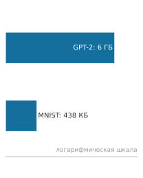

*MNIST помещается в кэш; GPT-2 — в VRAM.*

Требования к памяти, сведенные в [«Памяти при обучении и выводе MNIST при размере батча 32»](05_nn_computation.md#tbl-nn-computation-mnist-memory-budget), выглядят скромными для небольшого классификатора MNIST. Масштабирование до моделей производственного размера резко меняет эти требования и тем самым режим работы аппаратуры.

<a id="nbk-nn-computation-quick-estimation-ml-engineers"></a>

> **Быстрая оценка для инженеров ML**
>
> Подробные расчеты необходимы для проектных документов, но опытные инженеры также развивают навык быстрой оценки в уме. Эти приемы «расчетов на салфетке» позволяют быстро проверить осуществимость до перехода к подробному анализу.
>
> Оценка памяти:
>
> - Параметры → байты: умножить на четыре для 32-битной одинарной точности (FP32), на два для 16-битной половинной точности (FP16) или формата brain floating point 16 (BF16, у которого диапазон экспоненты как у FP32), либо на один для 8-битного целого (INT8)
> - Параметры полносвязного (FC) слоя: вход $\times$ выход (плюс смещения выхода, обычно пренебрежимо малые)
> - Состояние обучения: параметры, градиенты и состояние оптимизатора могут требовать примерно в 3–4 раза больше памяти, чем одни веса; пиковые активации и рабочая память добавляются сверху
> - Накладные расходы оптимизатора Adam: вдвое больше памяти, чем занимают параметры (импульс и скорость)
> - Максимальный размер батча: примерно (VRAM GPU $-$ постоянное состояние $-$ рабочая память) / пиковые активации на один образец
>
> Оценка вычислений:
>
> - FLOP полносвязного слоя: $2 \times d_{\text{in}} \times d_{\text{out}} \times B$ (умножение и сложение = 2 операции)
> - Перевод MAC в FLOP: умножить на 2
> - Оценка загрузки вычислений: $\text{достигнутые FLOP/s} / R_{\text{peak}}$
>
> **Пример**: *«Можно ли обучить модель на 100 млн параметров на GPU с 16 ГБ памяти?»*
>
> Прикидка в уме: 100 млн параметров по 4 байта каждый при четырех копиях, нужных для обучения, требуют 1,6 ГБ постоянного состояния модели. Остается около 14,4 ГБ на активации, временную рабочую память и накладные расходы фреймворка. Ответ: параметры помещаются, но конфигурация обучения пока не подтверждена; размер батча, форма активаций и рабочая память ядер определяют, помещается ли весь шаг.
>
> **Системный вывод**: грубая оценка постоянного состояния может быстро отсеять невозможные конфигурации, но размер батча по-прежнему зависит от запаса памяти под активации и рабочую память.
>
> Помимо этого примера подгонки модели, [«Проверки осуществимости по расчетам на салфетке»](05_nn_computation.md#tbl-nn-computation-napkin-math-checks) сводит три распространенных вопроса осуществимости к однострочным формулам, которые инженер может применить до того, как обратиться к профилировщику.
>
> | **Вопрос**                                  | **Быстрая оценка**                                                                              |
> |:--------------------------------------------|:------------------------------------------------------------------------------------------------|
> | **«Поместится ли модель в память GPU?»**    | $\text{постоянное состояние обучения} + \text{пиковые активации} + \text{рабочая память} < \text{VRAM}$ |
> | **«Сколько времени занимает эпоха на MNIST?»** | $60\text{ тыс.} \times \text{FLOP прямого и обратного прохода на изображение} / \text{достигнутые FLOP/s}$ |
> | **«Ограничена ли нагрузка вычислениями или памятью?»** | Сравнить арифметическую интенсивность с $R_{\text{peak}}/\text{BW}$                 |
>
> <a id="tbl-nn-computation-napkin-math-checks"></a>
>
> ***Проверки осуществимости по расчетам на салфетке**: три быстрых правила оценки в уме для подгонки под GPU, времени эпохи и режима ограниченности, сведенные к однострочным формулам, которые инженер может применить до запуска профилировщика.*

Учетная таблица памяти по компонентам из [«Памяти при обучении и выводе MNIST при размере батча 32»](05_nn_computation.md#tbl-nn-computation-mnist-memory-budget) явная, но намеренно упрощенная. На практике инженеры систем работают на двух уровнях детализации: подробные бюджеты для проектных документов и оценки порядка величины для ранних проверок осуществимости. Таблица подтверждает, что MNIST уверенно помещается в кэш, тогда как GPT-2 требует гораздо более крупного уровня памяти, еще до учета рабочей памяти среды выполнения. Быстрая оценка в уме должна приходить к тому же выводу за секунды, а не минуты, и отмечать любую модель, которая физически не помещается в целевую аппаратуру, до запуска хотя бы одной строки кода профилирования.

Расчеты осуществимости говорят инженеру, *помещается* ли модель; они ничего не говорят о том, *научится* ли она. Это зависит от того, как сначала задаются параметры, которые хранят эти байты. Инициализация параметров критична для поведения сети. Если задать все параметры нулями, нейроны слоя будут вести себя одинаково, и разнообразное выучивание признаков станет невозможным. Поэтому веса обычно инициализируют случайно, часто с помощью специальных стратегий вроде инициализации Xavier/Glorot[^fn-glorot-init-variance] (Glorot and Bengio, 2010) или инициализации He (He et al., 2015), тогда как смещения часто начинаются с малых постоянных значений или нулей. Масштаб этих начальных значений важен: слишком большие или слишком малые значения приводят к плохой динамике обучения.

[^fn-glorot-init-variance]: **Инициализация Xavier/Glorot**: для слоя с $n_{\text{in}}$ входами и $n_{\text{out}}$ выходами распространенный выбор Glorot использует дисперсию весов $2/(n_{\text{in}}+n_{\text{out}})$, чтобы уравновесить прямые активации и обратные градиенты (Glorot and Bengio, 2010). Такая поправка не добавляет FLOP; это вопрос задания случайного распределения при запуске.

Распределение параметров влияет на то, как информация течет через слои. При распознавании цифр, если веса слишком малы, важные детали входа могут не дойти до последующих слоев. Если они слишком велики, сеть может усиливать шум. Смещения помогают подстраивать порог активации каждого нейрона, позволяя сети выучивать оптимальные границы решений.

Разные архитектуры накладывают особые ограничения на организацию параметров. Одни разделяют веса между областями сети, чтобы кодировать распознавание паттернов, инвариантное к положению; другие фиксируют часть весов в нуле, реализуя разреженные шаблоны связности.

Архитектура сети, нейроны и параметры теперь на месте, но остается центральный вопрос: механизм, благодаря которому эти случайно инициализированные параметры становятся полезными. Случайно соединенная сеть выдает выходы не лучше случайного угадывания. Архитектура отвечает на вопрос *что* вычисляет модель; обучение отвечает на вопрос *как* она учится. Механика раскрывает системные ограничения, потому что обучение добавляет обратные вычисления, сохраненные активации, градиенты и состояние оптимизатора. Размер батча становится совместным статистическим и аппаратным выбором: он меняет шум градиента, память активаций, повторное использование данных и параллельную эффективность. Процесс обучения координирует эти издержки, превращая 109 386 параметров из случайных чисел в работающий классификатор цифр.

<a id="sec-neural-computation-learning-process-0b83"></a>

## Процесс обучения

Сеть MNIST сейчас содержит 109 386 параметров, инициализированных случайным образом, — числа, которые не кодируют никаких знаний. Превращение этих случайных значений в классификатор цифр с точностью выше 95 процентов опирается на четыре операции, повторяемые миллионы раз: прямое распространение вычисляет предсказание, функция потерь измеряет ошибку, обратное распространение ошибки вычисляет градиент потерь по каждому параметру, а оптимизатор использует эти градиенты, чтобы обновить параметры.

<a id="sec-neural-computation-supervised-learning-labeled-examples-5e6d"></a>

### Обучение с учителем на размеченных примерах

Случайно инициализированная сеть различает цифры не лучше случайного угадывания среди десяти классов (около 10 процентов точности). Чтобы превратить ее в классификатор с точностью 95 процентов, нужно обучение с учителем: сеть показывают размеченные примеры и корректируют ее веса в зависимости от допущенных ошибок. Рассмотрим задачу распознавания цифр MNIST: набор содержит 60 000 обучающих изображений, каждое из которых представляет собой полутоновое изображение $28{\times}28$ пикселей с правильной меткой цифры. Сеть должна выучить связь между этими изображениями и соответствующими цифрами в итеративном процессе предсказания и корректировки весов. Качество и целостность обучающих данных существенны для успеха модели ([«Инженерия данных»](04_data_engineering.md#sec-data-engineering)).

Связь между входами и выходами определяет методику обучения. Обучение работает как цикл, в котором каждая итерация обрабатывает подмножество обучающих примеров, называемое батчем.[^fn-batch-processing-iteration] Для каждого батча сеть выполняет четыре операции: прямое вычисление по слоям сети дает предсказания, функция потерь оценивает точность предсказаний, поправки весов вычисляются по ошибкам предсказаний, а веса сети обновляются, чтобы улучшить будущие предсказания.

[^fn-batch-processing-iteration]: **Пакетная обработка**: пакетирование служит двум целям. Большие батчи усредняют шум градиента по большему числу примеров и могут повысить загрузку аппаратуры, превращая матрично-векторную работу в более крупные матрично-матричные ядра. Они также выполняют больше работы суммарно и обычно увеличивают задержку для отдельного запроса; выигрыш в пропускной способности зависит от формы и аппаратуры. Каждое удвоение размера батча примерно удваивает память активаций, поэтому размер батча — совместное оптимизационное и системное решение, а не чисто статистический или аппаратный выбор.

Итеративный подход можно записать математически. Для входного изображения $x$ и его истинной метки $y$ сеть вычисляет предсказание по формуле ([«предсказание сети»](05_nn_computation.md#eq-network-prediction)):

<a id="eq-network-prediction"></a>

$$ \hat{y} = f(x; \theta) $$

Эта формула охватывает весь прямой проход: сеть $f$ принимает вход $x$ (например, изображение цифры $28{\times}28$) и, используя текущие параметры $\theta$ (веса и смещения всех слоев), выдает предсказание $\hat{y}$ (вектор из десяти вероятностей, по одной на каждую цифру). Запись $f(x; \theta)$ с точкой с запятой отличает вход $x$, который меняется от примера к примеру, от $\theta$, который при выводе фиксирован, а при обучении меняется. Ошибку сети измеряет функция потерь[^fn-loss-function-error] $\mathcal{L}$ (формула [«общая функция потерь»](05_nn_computation.md#eq-loss-general)):

<a id="eq-loss-general"></a>

$$ \text{потери} = \mathcal{L}(\hat{y}, y) $$

[^fn-loss-function-error]: **Функция потерь**: в статистической теории решений ее сформулировал Абрахам Вальд как «стоимость» неверного решения; $\mathcal{L}$ количественно задает разрыв между предсказанием $\hat{y}$ и истинным значением $y$. Выбор функции потерь формирует геометрию оптимизации: он определяет ландшафт градиентов, по которому должно идти обратное распространение ошибки. Функция с плоскими областями вблизи неверных предсказаний дает слабые градиенты, которые тормозят обучение, тогда как функция с крутыми градиентами вблизи границы решений ускоряет сходимость именно там, где это важнее всего, — системное следствие, рассмотренное в разделе [«Функции потерь»](05_nn_computation.md#sec-neural-computation-loss-functions-6fc2).

Измерение ошибки управляет корректировкой параметров сети через обратное распространение ошибки, которое рассмотрено в разделе [«Вычисление градиентов и обратное распространение ошибки»](05_nn_computation.md#sec-neural-computation-gradient-computation-backpropagation-dacf). На практике обучение работает с батчами примеров, а не с отдельными входами. Для набора MNIST каждая итерация обучения может обрабатывать одновременно 32, 64 или 128 изображений по причинам, которые разобраны в разделе [«Обновления градиента по мини-батчам»](05_nn_computation.md#sec-neural-computation-minibatch-gradient-updates-4a04). Цикл обучения продолжается, пока сеть не достигнет достаточной точности или не выполнит заранее заданное число итераций. На протяжении всего процесса функция потерь служит ориентиром: ее уменьшение указывает на улучшение качества. Установление правильных метрик и протоколов оценки необходимо для оценки эффективности обучения (глава [«Бенчмаркинг»](12_benchmarking.md#sec-benchmarking)).

<a id="sec-neural-computation-forward-pass-computation-e5dd"></a>

### Вычисление прямого прохода

Изображение MNIST превращается в десять оценок классов, проходя через взвешенные слои и нелинейные активации. Это вычисление и есть **прямое распространение**: входные данные проходят через слои сети, чтобы получить предсказания. Во время обучения предсказания затем сравниваются с истинным значением; получившаяся потеря попадает в цикл обратного прохода и обновления, показанный на [«Архитектуре цикла обучения»](05_nn_computation.md#fig-forward-propagation). Сам прямой проход лежит в основе и вывода, и обучения.

<a id="fig-forward-propagation"></a>

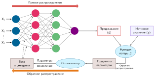

***Архитектура цикла обучения**: предсказание и истинное значение встречаются в функции потерь; обратное распространение ошибки вычисляет градиенты параметров, а оптимизатор превращает эти градиенты в обновления параметров для следующего прямого прохода.*

Данные движутся вперед через слои (красная стрелка на [«Архитектуре цикла обучения»](05_nn_computation.md#fig-forward-propagation)), а градиенты текут назад, обновляя веса (оранжевая стрелка). Рисунок показывает важную асимметрию: прямое распространение дает выходы модели, а обратное — градиенты параметров. *Именно эта зависимость объясняет, почему обучение сохраняет значения прямого прохода, нужные обратному проходу для каждой операции.*

Когда изображение рукописной цифры попадает в сеть, оно проходит через ряд преобразований по слоям. Каждое преобразование сочетает взвешенные входы с выученными паттернами, постепенно извлекая значимые признаки. Для классификатора цифр 784-128-64-10 изображение $28{\times}28$ пикселей проходит через несколько слоев и в итоге дает вероятности для каждой возможной цифры (0–9).

Процесс начинается с входного слоя, где яркость каждого пикселя становится входным признаком. Для MNIST это 784 входных значения ($28{\times}28 = 784$), каждое нормировано в диапазоне от 0 до 1. Затем эти значения проходят вперед через скрытые слои, где каждый нейрон объединяет свои входы согласно выученным весам и применяет нелинейную функцию активации.

Каждый прямой проход через сеть MNIST (784-128-64-10) требует существенного объема матричных операций. Только первый слой выполняет 100 352 MAC на образец. При обработке нескольких образцов в батче эти операции умножаются соответственно, и требуется тщательное управление пропускной способностью памяти и вычислительными ресурсами. Специализированная аппаратура вроде GPU выполняет эти операции эффективно за счет параллельной обработки.

<a id="sec-neural-computation-individual-layer-processing-7ea9"></a>

#### Обработка отдельного слоя

Прямое вычисление в нейронной сети идет систематически: каждый слой преобразует свои входы в все более абстрактные представления. Классификатор цифр наглядно это показывает: процесс преобразования проходит отдельные стадии. На каждом слое вычисление включает два ключевых шага: линейное преобразование входов и затем нелинейную активацию. Линейное преобразование применяет ту же операцию взвешенной суммы, что определена в формуле [«взвешенная сумма со смещением»](05_nn_computation.md#eq-weighted-sum-bias), но теперь с обозначениями, которые отслеживают индексы слоев (формула [«линейное преобразование слоя»](05_nn_computation.md#eq-layer-linear-transform)):

<a id="eq-layer-linear-transform"></a>

$$ \mathbf{Z}^{(\ell)} = \mathbf{A}^{(\ell-1)}\mathbf{W}^{(\ell)} + \mathbf{b}^{(\ell)} $$

Здесь $\mathbf{A}^{(\ell-1)}$ содержит активации предыдущего слоя (выходы после применения функций активации), $\mathbf{W}^{(\ell)} \in \mathbb{R}^{n_{\ell-1} \times n_\ell}$ — матрица весов слоя $\ell$, а $\mathbf{b}^{(\ell)}$ — вектор смещений (распространяемый на весь батч). Верхний индекс $(\ell)$ отслеживает, какому слою принадлежит каждый параметр. Соглашение о векторах-строках согласуется с уравнением для одного образца ([формула «взвешенная сумма со смещением»](05_nn_computation.md#eq-weighted-sum-bias)): каждая строка $\mathbf{A}$ — один образец, а умножение справа на $\mathbf{W}$ переводит ее в ширину следующего слоя.

После этого линейного преобразования каждый слой применяет нелинейную функцию активации $f$ (здесь $f$ или $f^{(\ell)}$ обозначает общую функцию активации слоя $\ell$; в разделе [«Взвешенная сумма перцептрона»](05_nn_computation.md#sec-neural-computation-perceptron-weighted-sum-9b3e) $\sigma$ обозначала конкретно сигмоиду), как записано в формуле ([«активация слоя»](05_nn_computation.md#eq-layer-activation-transform)):

<a id="eq-layer-activation-transform"></a>

$$ \mathbf{A}^{(\ell)} = f(\mathbf{Z}^{(\ell)}) $$

Этот процесс повторяется на каждом слое, образуя цепочку преобразований:

$$ \text{Вход} \rightarrow \text{Линейное преобразование} \rightarrow \text{Активация} \rightarrow \text{Линейное преобразование} \rightarrow \text{Активация} \rightarrow \cdots \rightarrow \text{Выход} $$

Возвращаясь к распознаванию цифр: значения пикселей сначала проходят преобразование весами первого скрытого слоя, которое переводит 784-мерный вход в промежуточное представление. Каждый последующий слой дополнительно преобразует это представление и в итоге выдает 10-мерный вектор оценок классов, по одной на каждую возможную цифру.

<a id="sec-neural-computation-matrix-multiplication-formulation-417c"></a>

#### Матричная формулировка умножения

Полный процесс прямого распространения можно записать как композицию функций, каждая из которых представляет преобразование слоя. Эта формализация опирается на пример MNIST.

Для сети из $N_L$ слоев полное прямое вычисление записывается как композиция (формула [«композиция прямого прохода»](05_nn_computation.md#eq-forward-composition)):

<a id="eq-forward-composition"></a>

$$ \mathbf{A}^{(N_L)} = f^{(N_L)}\!\Big(\cdots f^{(2)}\!\Big(f^{(1)}(\mathbf{X}\mathbf{W}^{(1)} + \mathbf{b}^{(1)})\mathbf{W}^{(2)} + \mathbf{b}^{(2)}\Big)\cdots \mathbf{W}^{(N_L)} + \mathbf{b}^{(N_L)}\Big) $$


*Матричное умножение составляет более 90 процентов FLOP прямого прохода этой плотной сети.*

Эта композиция показывает, что прямое распространение в своей основе — цепочка матричных умножений, перемежающихся нелинейными активациями. Понять, *почему* матричное умножение доминирует в вычислениях ИИ, можно, изучив арифметическую интенсивность каждой операции.

Вложенное выражение раскрывается послойно: каждый шаг использует активации предыдущего слоя как свой вход:

1. Первый слой:

$$
\begin{gathered}
\mathbf{Z}^{(1)} = \mathbf{X}\mathbf{W}^{(1)} + \mathbf{b}^{(1)} \\[0.2ex]
\mathbf{A}^{(1)} = f^{(1)}(\mathbf{Z}^{(1)})
\end{gathered}
$$

2. Скрытые слои $(\ell = 2,\ldots, N_L-1)$:

$$
\begin{gathered}
\mathbf{Z}^{(\ell)} = \mathbf{A}^{(\ell-1)}\mathbf{W}^{(\ell)} + \mathbf{b}^{(\ell)} \\[0.2ex]
\mathbf{A}^{(\ell)} = f^{(\ell)}(\mathbf{Z}^{(\ell)})
\end{gathered}
$$

3. Выходной слой:

$$
\begin{gathered}
\mathbf{Z}^{(N_L)} = \mathbf{A}^{(N_L-1)}\mathbf{W}^{(N_L)} + \mathbf{b}^{(N_L)} \\[0.2ex]
\mathbf{A}^{(N_L)} = f^{(N_L)}(\mathbf{Z}^{(N_L)})
\end{gathered}
$$

В примере MNIST размерности операций для батча из $B$ изображений таковы:

* Вход $\mathbf{X}$: $B{\times}784$
* Веса первого слоя $\mathbf{W}^{(1)}$: $784{\times}n_1$
* Веса скрытого слоя $\mathbf{W}^{(\ell)}$: $n_{\ell-1}{\times}n_\ell$
* Веса выходного слоя $\mathbf{W}^{(N_L)}$: $n_{N_L-1}{\times}10$

Арифметическая интенсивность определяет, ограничено ядро вычислениями или памятью. Блочное плотное матричное умножение переиспользует значения, тогда как отдельная поэлементная операция делает мало работы на байт. [«Идеализированная арифметическая интенсивность матричного умножения и поэлементного ReLU»](05_nn_computation.md#tbl-nn-computation-arith-intensity-gap) сравнивает их идеализированные интенсивности.

| **Операция**                  | **Число операций ($O$)** | **Минимальный объем перемещений** | **Идеализированная интенсивность** | **Типичная оптимизация**        |
|:------------------------------|:-------------------------:|:---------------------------------:|:---------------------------------:|:--------------------------------|
| **Матричное умножение** $(N{\times}N)$ | $2N^3$          | $3N^2s$ байт                      | $\approx 2N/(3s)$                 | Блочные вычисления на CPU/GPU/TPU |
| **Поэлементная операция (ReLU)** | $N^2$                  | $2N^2s$ байт                      | $1/(2s)$                          | Векторизация и слияние операций |

<a id="tbl-nn-computation-arith-intensity-gap"></a>

<em>**Идеализированная арифметическая интенсивность матричного умножения и поэлементного ReLU**: плотное блочное умножение матриц $N{\times}N$ выполняет $2N^3$ операций и перемещает не менее примерно $3N^2s$ байт при $s$ байтах на значение, поэтому потенциальное повторное использование растет вместе с $N$. Отдельная поэлементная активация остается на уровне $1/(2s)$ FLOP на байт (0,125 FLOP на байт для FP32); реализации часто объединяют ее с соседним ядром, чтобы избежать отдельного обращения к памяти.</em>

<a id="psp-nn-computation-why-matrix-multiplication-dominates-ai"></a>

> **Почему матричное умножение доминирует в ИИ**
>
> Современные ускорители имеют большие вычислительные массивы относительно пропускной способности внешней памяти. Они приближаются к пиковой арифметической производительности, только когда операции открывают достаточно повторного использования и параллельной работы. Плотные и сверточные слои хорошо отображаются на оптимизированные ядра; пользовательские последовательности поэлементных операций часто объединяют, чтобы их промежуточные значения оставались на кристалле.
>
> Для одного образца выражение $\mathbf{x}\mathbf{W}$ — это **общее умножение матрицы на вектор (GEMV)**; объединение образцов в батч превращает то же вычисление в $\mathbf{X}\mathbf{W}$, то есть **GEMM**. Многомерные операции, такие как двумерные и трехмерные свертки, отображаются на то же ядро GEMM через преобразования приведения (например, `im2col`), которые разворачивают перекрывающиеся скользящие рецептивные поля в столбцы двумерной матрицы, чтобы оптимизированные библиотеки базовой линейной алгебры (BLAS) производителей могли выполнять их с пиковой эффективностью аппаратуры. Это приведение вводит явный системный компромисс: поскольку скользящие рецептивные поля перекрываются, `im2col` дублирует входные элементы в памяти, часто увеличивая временное хранилище тензоров в $K_h \times K_w$ раз (например, в $9\times$ для свертки $3{\times}3$). Системные компиляторы принимают эти накладные расходы памяти как сознательный компромисс: они превращают шаговые пространственные обращения к памяти в непрерывные матричные умножения, которые загружают систолические массивы ускорителя. Матричные операции составляют более 90 процентов операций с плавающей запятой в примере плотной сети этой главы и доминируют во многих важных нейросетевых нагрузках, хотя доля зависит от архитектуры и режима исполнения. Для повышения производительности инженеры используют приемы вроде блочной организации и тайлинга, чтобы увеличить повторное использование кэша или памяти на кристалле. Этот принцип совместного проектирования аппаратуры и программного обеспечения — проектирование архитектур моделей вокруг операций, которые специализированная аппаратура выполняет эффективно, — централен для современного глубокого обучения. Подробное рассмотрение арифметической интенсивности GEMM, форматов разреженных матриц и вычислительной сложности распространенных типов слоев, нужное для практической оптимизации этих операций, приведено в разделе [«Обобщенное матричное умножение (GEMM)»](appendix_algorithm.md#sec-appdx-algorithm-foundations-general-matrix-multiply-gemm-b55d) приложения «Основы алгоритмов».

<a id="sec-neural-computation-stepbystep-computation-sequence-2973"></a>

#### Пошаговая последовательность вычислений

Чтобы понять, как эти математические операции превращаются в реальные вычисления, нужно рассмотреть прямое распространение для батча изображений MNIST. Этот процесс показывает, как данные превращаются из сырых значений пикселей в предсказания цифр.

Рассмотрим батч из 32 изображений, поступающих в сеть. Каждое изображение начинается как сетка значений пикселей $28{\times}28$, которая разворачивается в 784-мерный вектор. Для всего батча получается входная матрица $\mathbf{X}$ размером $32{\times}784$, где каждая строка представляет одно изображение. Значения обычно нормируют так, чтобы они лежали в диапазоне от 0 до 1.

Преобразование на каждом слое идет как последовательность, меняющая формы; формы определяют и выбор ядра, и хранение активаций. Сеть сначала берет входную матрицу $\mathbf{X}$ ($32{\times}784$) и преобразует ее весами первого слоя. Если первый скрытый слой содержит 128 нейронов, $\mathbf{W}^{(1)}$ — матрица $784{\times}128$, поэтому вычисление $\mathbf{X}\mathbf{W}^{(1)}$ дает матрицу $32{\times}128$. Затем к каждому элементу этой матрицы прибавляется соответствующее смещение, и результат проходит через функцию активации. Например, при активации ReLU все отрицательные значения становятся нулями, а положительные остаются без изменений. Эта нелинейность позволяет сети выучивать сложные паттерны в данных. Последний слой преобразует свои входы в матрицу $32{\times}10$, где каждая строка содержит 10 оценок классов. Пусть $z_j$ обозначает сырую оценку (логит) для цифры $j$, а $z_k$ пробегает все 10 цифр. Часто эти оценки переводят в вероятности с помощью функции softmax (формула [«softmax»](05_nn_computation.md#eq-softmax)):

$$ p(\text{цифра } j) = \frac{e^{z_j}}{\sum_{k=1}^{10} e^{z_k}} $$

Для каждого изображения батча это дает распределение вероятностей по возможным цифрам. Цифра с наибольшей вероятностью и есть предсказание сети.

<a id="nbk-nn-computation-counting-ops-forward-pass"></a>

> **Подсчет операций в прямом проходе**
>
> **Задача**: каково общее число арифметических операций ($O$) при одном прямом проходе через сеть MNIST (784 → 128 → 64 → 10) при размере батча 32?
>
> **Исходные данные**: умножение матриц размерностей $(M{\times}K) \times (K{\times}N)$ требует $2 \times M \times K \times N$ FLOP (одно умножение и одно сложение на каждый выходной элемент, суммированные по $K$ членам). Добавление смещения дает $M \times N$ операций сложения с плавающей запятой. Активация ReLU дает $M \times N$ сравнений, поэтому в таблице для строк активаций указана эквивалентная по операциям работа, а не чистые FLOP.
>
> **Решение**: [«Число операций прямого прохода MNIST по слоям»](05_nn_computation.md#tbl-nn-computation-mnist-flops) раскладывает число операций по слоям. Итог — около 7 МОп, или 7 МОп ÷ 32 = около 219 КОп на изображение.
>
> **Системный вывод**:
>
> 1. **Слой 1 доминирует**: первый слой дает 91,9 процента всех операций, потому что обрабатывает самый большой вход (784 измерения). Поэтому снижение размерности в ранних слоях так эффективно.
> 2. **Вычисления и память**: при батче 1 чтение параметров должно окупиться одним изображением (219 КОп), что дает арифметическую интенсивность около 0,5 FLOP на байт в принятой модели трафика. При батче 32 одно чтение параметров плюс один проход по активациям батча перемещают не менее около 564 КБ и поднимают интенсивность примерно до 12,4 FLOP на байт. Дополнительные промахи кэша и промежуточный трафик могут снизить фактическое значение. Сравнение показывает, почему батчирование улучшает повторное использование, но ограничено ли поведение памятью или вычислениями, по-прежнему зависит от баланса машины, который введен в разделе [«Модель Roofline»](appendix_machine.md#sec-appdx-machine-foundations-roofline-model-2529) приложения «Основы машины».
> 3. **Интуиция масштабирования**: удвоение ширины скрытых слоев (784 → 256 → 128 → 10) увеличивает число операций примерно в 2,15 раза — до около 15 МОп. Это следует из пересчета каждого слоя: слои 1 и 3 удваиваются, слой 2 учетверяется, поэтому итог растет примерно в 2,15 раза, а не в четыре.

| **Слой**    | **Операция**   | **Размерности**                               | **Операции**                                                                    |
|:------------|:---------------|:---------------------------------------------:|:-------------------------------------------------------------------------------:|
| **Слой 1**  | Умножение матриц | ($32{\times}784$) $\times$ ($784{\times}128$) | $2 \times 32 \times 784{\times}128$ = 6 422 528                                 |
| **Слой 1**  | Смещение + ReLU | $32{\times}128$                              | $2{\times}4\,096$ = 8 192                                                       |
| **Слой 2**  | Умножение матриц | ($32{\times}128$) $\times$ ($128{\times}64$) | $2 \times 32 \times 128{\times}64$ = 524 288                                    |
| **Слой 2**  | Смещение + ReLU | $32{\times}64$                               | $2{\times}2\,048$ = 4 096                                                       |
| **Слой 3**  | Умножение матриц | ($32{\times}64$) $\times$ ($64{\times}10$)  | $2 \times 32 \times 64{\times}10$ = 40 960                                      |
| **Слой 3**  | Смещение + Softmax | $32{\times}10$                             | около 640 (упрощенно)                                                           |
| **Итого**   |                |                                               | **около 7 МОп**                                                                 |

<a id="tbl-nn-computation-mnist-flops"></a>

***Число операций прямого прохода MNIST по слоям**: эквивалентная по операциям разбивка одного прямого прохода через сеть 784-128-64-10 при размере батча 32. Строки умножения матриц — это FLOP; строки смещения, ReLU и softmax — поэлементные операции, включенные, чтобы показать их пренебрежимо малый вклад. Умножение матриц первого слоя доминирует, потому что умножает 784-мерный вход на самую широкую матрицу весов; операции смещения и активации вносят меньше 1 процента общего итога.*

<a id="sec-neural-computation-implementation-optimization-considerations-f2ca"></a>

#### Соображения по реализации и оптимизации

Прямое распространение легко записать математически, но его реализация ограничена хранением активаций, размером батча, раскладкой памяти и соответствием аппаратуре. Управление памятью играет центральную роль при прямом распространении, потому что активации каждого слоя должны сохраняться для обратного прохода во время обучения. Для примера MNIST (784-128-64-10) при размере батча 32 требования к хранению активаций таковы:

* Входной слой: $32{\times}784$ = 25 088 значений
* Первый скрытый слой: $32{\times}128$ = 4 096 значений
* Второй скрытый слой: $32{\times}64$ = 2 048 значений
* Выходной слой: $32{\times}10$ = 320 значений

Итого 31 552 значения должны храниться в памяти для каждого батча во время обучения, что согласуется с расчетом в разделе [«Размер модели и вычислительная сложность»](05_nn_computation.md#sec-neural-computation-model-size-computational-complexity-1f0f). Требования к памяти растут линейно с размером батча и становятся существенными для более крупных сетей.

Пакетная обработка вносит важные компромиссы. Большие батчи делают матричные операции эффективнее и лучше загружают аппаратуру, но требуют больше памяти. Например, удвоение размера батча до 64 удвоит требования к памяти для активаций. Эта связь между размером батча, использованием памяти и вычислительной эффективностью на практике определяет выбор размера батча.

Организация вычислений также влияет на производительность. Матричные операции можно оптимизировать за счет аккуратной раскладки памяти и специализированных библиотек. Выбор функций активации влияет и на способность сети к обучению, и на вычислительную эффективность, поскольку одни функции (как ReLU) требуют меньше вычислений, чем другие (как tanh или сигмоида).

Вычислительные особенности нейронных сетей благоприятствуют архитектурам параллельной обработки. Хотя традиционные CPU могут выполнять эти операции, GPU, созданные для параллельных вычислений, могут быть значительно быстрее на крупных плотных матричных операциях. Специализированные ускорители ИИ достигают еще лучшей эффективности благодаря арифметике пониженной точности, специализированным архитектурам памяти и оптимизациям потока данных, настроенным под паттерны вычислений нейронных сетей.

Энергия на один вывод может заметно различаться между аппаратными платформами. CPU обеспечивают гибкое исполнение, GPU дают высокую пропускную способность за счет параллелизма, а специализированные периферийные ускорители жертвуют универсальностью ради эффективного исполнения отдельных операторов. Одна только мощность не определяет энергию: нужная величина — мощность, проинтегрированная по времени выполнения для той же нагрузки и того же целевого качества. Иерархия памяти и перемещение данных часто объясняют большую часть различий. Эти соображения повторяются в последующих главах, особенно в главе [«Архитектуры нейронных сетей»](06_nn_architectures.md#sec-network-architectures), где оптимизации, специфичные для архитектуры, вводят дополнительные компромиссы.

Прямое распространение превращает входы в предсказания, но само предсказание бесполезно для обучения. Циклу обучения нужен способ измерить, *насколько неверно* это предсказание, в форме, которая направляет корректировку весов. Эту роль выполняют функции потерь: они переводят разрыв между предсказанием и действительностью в одно число, которое оптимизация может минимизировать.

<a id="sec-neural-computation-loss-functions-6fc2"></a>

### Функции потерь

Процесс прямого распространения, описанный в разделе [«Вычисление прямого прохода»](05_nn_computation.md#sec-neural-computation-forward-pass-computation-e5dd), достаточен для **вывода**, когда предобученная модель делает предсказания. Для обучения модели, однако, нужна количественная метрика ошибки, которая измеряет, насколько предсказания совпадают с истинными значениями. Функции потерь количественно выражают эти ошибки и служат механизмом обратной связи, направляющим обучение. Они превращают абстрактную цель «делать хорошие предсказания» в конкретную задачу оптимизации.

Продолжим пример распознавания цифр MNIST: когда сеть обрабатывает изображение рукописной цифры, она выдает десять оценок классов, которые часто переводят в предсказанные вероятности для цифр 0–9. Функция потерь сравнивает эти предсказания с целевым значением. Если на изображении «семерка», кросс-энтропия штрафует модель за слишком малую вероятность цифры 7. Более высокая потеря означает худшее значение выбранной целевой функции на этом примере; сама по себе она не диагностирует причину и не доказывает, что все метрики задачи ухудшились.

<a id="sec-neural-computation-error-measurement-fundamentals-844a"></a>

#### Основы измерения ошибки

Функция потерь ставит в соответствие предсказанию и цели скалярную стоимость при выбранной целевой функции. Меньшая потеря означает лучшее значение этой целевой функции на оцениваемых примерах, но это не то же самое, что более высокая точность: уверенность и калибровка могут меняться, тогда как предсказанный класс остается прежним. Во время обучения градиенты потерь направляют обновления параметров. При распознавании рукописных цифр кросс-энтропия штрафует предсказания, которые дают малую вероятность правильной цифре.

Математически функция потерь $\mathcal{L}$ принимает два входа: предсказания сети $\hat{y}$ и истинные значения $y$. Для одного обучающего примера в классификации цифр потеря измеряет расхождение между предсказанием и истиной. При обучении на батчах система вычисляет среднюю потерю по всем примерам батча ([формула «потеря батча»](05_nn_computation.md#eq-batch-loss)):

<a id="eq-batch-loss"></a>

$$ \mathcal{L}_{\text{батч}} = \frac{1}{B}\sum_{i=1}^B \mathcal{L}(\hat{y}_i, y_i) $$

Здесь $B$ — размер батча, а $(\hat{y}_i, y_i)$ — предсказание и истина для $i$-го примера. Усреднение сохраняет масштаб потерь и среднего градиента сопоставимым при разных размерах батча, хотя оптимальная скорость обучения по-прежнему может меняться вместе с размером батча и режимом оптимизации. Суммирование также естественно ложится на параллельное оборудование: потерю каждого примера можно вычислить независимо, а затем редукция объединяет их.

Выбор функции потерь зависит от типа задачи. Для классификации цифр функция потерь должна работать с распределениями вероятностей по нескольким классам, давать осмысленные градиенты, направляющие обучение, штрафовать неверные предсказания пропорционально их серьезности и эффективно масштабироваться при пакетной обработке. Кросс-энтропийная потеря удовлетворяет всем четырем требованиям.

<a id="sec-neural-computation-crossentropy-classification-loss-functions-7def"></a>

#### Кросс-энтропия и функции потерь для классификации

Для задач классификации, таких как распознавание цифр MNIST, **кросс-энтропийная потеря** — распространенный способ сравнивать предсказанные распределения вероятностей с истинными метками классов. Информационно-теоретическая идея энтропии восходит к Шеннону (Shannon, 1948); в классификации с учителем кросс-энтропия штрафует низкую вероятность, назначенную правильному классу.

Логарифм задает **кросс-энтропийной потере** ее поведение при оптимизации: вероятности, близкие к нулю для правильного класса, влекут все более большие штрафы. Эта форма дает сильные градиенты для уверенно неверных предсказаний и делает вероятность правильного класса центральной величиной целевой функции.

Для одного изображения цифры сеть выдает распределение вероятностей по 10 возможным цифрам. Истинное значение представляется как вектор one-hot[^fn-one-hot-encoding], где все элементы равны 0, кроме единицы на позиции правильной цифры. Например, если истинная цифра — «семь», метка равна $y = \big[0, 0, 0, 0, 0, 0, 0, 1, 0, 0\big]$.

[^fn-one-hot-encoding]: **One-hot-кодирование**: представление $K$ классов как $K$-мерных двоичных векторов, в которых ровно один элемент равен 1; такое кодирование разреженно по построению: для 10 классов MNIST 90 процентов каждого вектора метки — нули. Реализации обычно хранят целочисленный индекс класса вместо того, чтобы материализовать этот вектор. Для очень больших выходных пространств такие методы, как выборочный softmax, также позволяют сократить вычисление выхода.

Кросс-энтропийная потеря для этого примера задана формулой ([«кросс-энтропия»](05_nn_computation.md#eq-cross-entropy)):

<a id="eq-cross-entropy"></a>

$$ \mathcal{L}(\hat{y}, y) = -\sum_{j=1}^{10} y_j \log(\hat{y}_j) $$

Здесь $\hat{y}_j$ — предсказанная сетью вероятность цифры $j$. Поскольку $y$ — one-hot вектор, выражение упрощается до ([формула «кросс-энтропия, упрощенная»](05_nn_computation.md#eq-cross-entropy-simplified)):

<a id="eq-cross-entropy-simplified"></a>

$$ \mathcal{L}(\hat{y}, y) = -\log(\hat{y}_c) $$

где $c$ — индекс правильного класса. Поэтому потеря зависит только от предсказанной вероятности правильной цифры: сеть штрафуется в зависимости от того, насколько она уверена в верном ответе.

Например, если сеть предсказывает такие вероятности для изображения «семерки»:

```
Предсказание: [0.1, 0.0, 0.0, 0.0, 0.0, 0.0, 0.0, 0.8, 0.0, 0.1]
Истина: [0, 0, 0, 0, 0, 0, 0, 1, 0, 0]
```

Потеря составит $-\log(0{,}8)$, то есть примерно 0,223. Если бы сеть была увереннее и предсказала 0,9 для правильной цифры, потеря снизилась бы примерно до 0,105.

<a id="sec-neural-computation-batch-loss-calculation-methods-f02b"></a>

#### Методы вычисления потерь по батчу

Практическое вычисление потерь требует учитывать и численную устойчивость, и пакетную обработку. При работе с батчами данных целевая функция оценивает среднюю потерю по всем примерам.

Для батча из $B$ примеров кросс-энтропийная потеря принимает вид (формула [«кросс-энтропия по батчу»](05_nn_computation.md#eq-batch-cross-entropy)):

<a id="eq-batch-cross-entropy"></a>

$$ \mathcal{L}_{\text{батч}} = -\frac{1}{B}\sum_{i=1}^B \sum_{j=1}^{10} y_{ij} \log(\hat{y}_{ij}) $$

Здесь $i$ индексирует примеры батча, $j$ — десять выходных классов, $y_{ij}$ — one-hot индикатор целевого класса $j$ для примера $i$, а $\hat{y}_{ij}$ — предсказанная вероятность этого класса. Усреднение по $B$ сохраняет масштаб потерь сопоставимым при изменении размера батча.

Эффективное вычисление этой потери требует внимания к численной точности. Опасна не обычная малая вероятность, а вероятность, которую неустойчивый softmax округляет до нуля. Если вероятность правильного класса становится равной 0, то $\log(0)$ обращается в $-\infty$, и последующая арифметика может дать значение «не число» (NaN).

Устойчивые реализации избегают вычисления численно хрупкой вероятности до взятия логарифма:

1. Сдвигать логиты перед возведением в экспоненту — ядро приема log-sum-exp (раздел [«Логиты и численная стабильность»](appendix_data.md#sec-appdx-data-foundations-logits-numerical-stability-13e2) приложения «Основы данных»), как показано в формуле ([«softmax, устойчивый»](05_nn_computation.md#eq-softmax-stable)):

<a id="eq-softmax-stable"></a>

$$ \text{softmax}(z_i) = \frac{\exp\big(z_i - \max(z)\big)}{\sum_j \exp\big(z_j - \max(z)\big)} $$

Вычитание одного и того же $\max(z)$ из каждого логита не меняет вероятности softmax, поскольку общий множитель сокращается между числителем и знаменателем. Численный эффект решающий: наибольший сдвинутый логит становится нулем, поэтому наибольшая экспонента равна $\exp(0)=1$, а не потенциально переполняющемуся значению.

2. Предпочитайте объединенную кросс-энтропию по логитам. Для целевого класса $c$ и $m=\max(z)$ устойчивая реализация вычисляет

<a id="eq-cross-entropy-from-logits-stable"></a>

$$ \mathcal{L} = -(z_c-m) + \log\!\sum_j \exp(z_j-m) $$

[Устойчивая кросс-энтропия по логитам](05_nn_computation.md#eq-cross-entropy-from-logits-stable) математически эквивалентна $-\log p_c$, но никогда не округляет крошечную вероятность softmax до нуля заранее. Ограничение вероятности или добавление $\epsilon$ может служить защитным приемом, но оно меняет целевую функцию и не должно заменять устойчивую формулировку.

<a id="sec-neural-computation-impact-learning-dynamics-fb35"></a>

#### Влияние на динамику обучения

При размере батча 32 и 10 выходных классах каждый шаг обучения обрабатывает 32 набора по 10 оценок, вычисляет потерю для каждого примера и усредняет их в одну потерю батча. Во время обучения это значение выполняет две роли. Его градиент задает направление обновления, а его динамика помогает понять, прогрессирует ли оптимизация, останавливается или расходится. Точность решения, калибровку и другие метрики оценки по-прежнему нужно измерять отдельно на отложенных данных.

Для классификатора MNIST потеря на обучении часто начинается около $\log(10) \approx 2{,}3$, когда вероятности классов близки к равномерным, быстро падает на ранней оптимизации, а затем улучшается медленнее. Низкая потеря на обучении говорит об уверенности на обучающих примерах, но не доказывает обобщения. Потеря на валидации и метрики задачи определяют, переносится ли выученное поведение на отложенные данные.

Градиенты функции потерь по выходным логитам сети задают начальный сигнал ошибки, который управляет обратным распространением. Когда softmax и кросс-энтропия сочетаются, градиент по каждому логиту принимает особенно простой вид: разность предсказанной и целевой вероятностей, $p-y$. Это математическое свойство делает кросс-энтропийную потерю особенно подходящей для задач классификации, поскольку она дает сильные градиенты даже тогда, когда предсказания далеки от цели. В средах выполнения систем именно это математическое сокращение служит главным мотивом для слияния softmax и кросс-энтропии в один оператор. Обратное распространение через отдельный softmax требует вычисления полной матрицы Якоби размера $K \times K$ (промежуточное хранение и вычисления порядка $\mathcal{O}(K^2)$); объединение потери с активацией выхода сворачивает весь обратный шаг в поэлементное векторное вычитание порядка $\mathcal{O}(K)$ ($p - y$), устраняя крупное узкое место по памяти и вычислениям на выходном слое.

Выбор функции потерь влияет и на другие решения обучения. Масштаб градиента взаимодействует со скоростью обучения, а усреднение потерь по батчам влияет на шум градиента и, следовательно, на полезный диапазон размеров батча. Кривизна влияет на поведение оптимизатора, а решения о сходимости требуют метрик валидации и правила остановки, а не одной лишь траектории потерь на обучении.

Функции потерь количественно выражают ошибку предсказания, но сам сигнал ошибки не говорит системе, насколько чувствительна потеря к каждому параметру. При 109 386 параметрах сети MNIST оценивание каждой производной через независимые возмущения было бы вычислительно непосильным. Это задача распределения ответственности (credit assignment): связать итоговую ошибку с параметрами и промежуточными значениями, которые ее могут изменить. Следующий раздел вводит обратное распространение ошибки, которое применяет правило цепочки, чтобы эффективно вычислить все эти локальные чувствительности.

<a id="sec-neural-computation-gradient-computation-backpropagation-dacf"></a>

### Вычисление градиентов и обратное распространение ошибки

<a id="dfn-nn-computation-backpropagation"></a>

> **Обратное распространение ошибки**
>
> ***Обратное распространение ошибки*** — это алгоритм вычисления градиентов, который системы обучения используют, чтобы применить правило цепочки к вычислительному графу: записанные операции и сохраненные или пересчитанные значения прямого прохода позволяют за один обратный обход вычислить градиент потерь по каждому параметру.
>
> 1.  **Значение**: для плотных слоев обратный проход часто требует порядка удвоенного числа FLOP прямого прохода и обязывает сохранять или пересчитывать промежуточные значения, нужные правилу цепочки. Для модели с $N_L$ слоями, размером батча $B$ и ширинами слоев $n_1,\ldots,n_{N_L}$ упрощенный учет активаций растет как $\mathcal{O}\!\left(B\sum_{\ell=1}^{N_L} n_\ell\right)$. Градиенты и состояние оптимизатора добавляют еще память, поэтому модель, которая помещается на одном ускорителе для вывода, там может не поместиться при обучении.
> 2.  **Отличие**: численное дифференцирование требует возмущенного вычисления для каждого из $P$ параметров. Автоматическое дифференцирование в обратном режиме вычисляет все $P$ градиентов за один обратный обход, стоимость которого пропорциональна вычислительному графу, избегая $P$ отдельных прямых проходов.
> 3.  **Типичная ошибка**: распространено заблуждение, будто обратное распространение ошибки — это и есть обучение. Это алгоритм вычисления градиентов; сам параметр обновляет градиентный спуск. Смешение двух понятий скрывает системное разделение: обратное распространение определяет требования к памяти (хранение активаций), а оптимизатор — дополнительные требования к состоянию (буферы импульса и дисперсии).

Конвейер автозавода дает конкретное воплощение той же задачи распределения ответственности. Автомобили проходят четыре станции: установку рамы (A), монтаж двигателя (B), установку колес (C) и финальную сборку (D). Когда инспекторы находят дефектный автомобиль, они должны определить, какая станция вызвала проблему.

Решение работает в обратном направлении. Начиная с дефекта, инспекторы прослеживают ответственность через каждую станцию: насколько вклад сборки D отличается от того, что она получила от C, и насколько работа C отличается от того, что пришло от B. Каждая станция получает корректирующую обратную связь, пропорциональную ее вкладу. Если главной причиной был монтаж двигателя на станции B, она получает самый сильный сигнал к изменению.

Обратное распространение ошибки следует аналогичному обратному прослеживанию, но вычисляет чувствительность, а не причинную «вину». Начиная с потери, оно оценивает, как небольшое изменение входов каждого слоя изменило бы эту потерю, и передает эти производные назад. Оптимизатор затем превращает полученные градиенты параметров в реальные обновления.

В нейронных сетях каждый слой действует как станция на конвейере, а обратное распространение ошибки определяет чувствительность итоговой потери к каждой связи. Перевод этой интуиции в математику требует правила цепочки из математического анализа. В аналогии с заводом «сигнал корректировки станции D» соответствует градиенту на выходном слое, локальная чувствительность соответствует частной производной, а «передача обратной связи назад» описывает умножение по правилу цепочки, которое распространяет градиенты по сети.

Чувствительность локальна: она относится к текущим значениям параметров, входному батчу и потере. Она отвечает на контрфактический вопрос — как бесконечно малое изменение здесь изменило бы эту потерю, — а не на вопрос, является ли вес навсегда важным или исторически вызвал предсказание. Вычислительный граф делает этот вопрос операционным. Каждый узел записывает операцию, а его правило обратного прохода отображает входящий градиент потери в градиенты для его входов. Обратный обход начинается со скалярной потери, применяет эти локальные правила в обратном порядке зависимостей и накапливает вклады, когда одно значение влияет на потерю по нескольким последующим путям. Именно поэтому обратное распространение — больше, чем передача одного сигнала ошибки по цепочке: среда выполнения должна учитывать зависимости графа и объединять все релевантные пути, прежде чем градиент будет готов. Алгоритм ниже превращает это описание на уровне графа в послойную процедуру.

<a id="sec-neural-computation-backpropagation-algorithm-steps-6871"></a>

#### Шаги алгоритма обратного распространения ошибки

Прямое распространение вычисляет предсказания, а обратное — градиенты, которые оптимизатор использует для корректировки весов. Рассмотрим сквозной пример, где сеть предсказывает «тройку» для изображения «семерки». Обратное распространение систематически вычисляет, как потеря отреагировала бы на малое изменение каждого веса при текущих значениях параметров.

Процесс начинается на выходе сети, где предсказанные вероятности цифр сравниваются с истинной меткой. Получившийся градиент потерь затем движется назад через сеть, давая локальную чувствительность потери к значениям и весам каждого слоя. Вычисление следует правилу цепочки из математического анализа и разбивает связь между весами и потерей на управляемые шаги.

Математические основы обратного распространения ошибки дают теоретическую базу для обучения нейронных сетей, но практическая реализация требует программной поддержки. Венгерт (Wengert) показал автоматическое вычисление численных производных без аналитических выражений для производных (Wengert, 1964). Современные фреймворки предоставляют эту возможность через системы автоматического дифференцирования, которые вычисляют градиенты автоматически. В разделе [«Правило цепочки и автоматическое дифференцирование»](appendix_algorithm.md#sec-appdx-algorithm-foundations-chain-rule-automatic-differentiation-e0eb) приложения «Основы алгоритмов» формально выводится правило цепочки и объясняется, почему **автоматическое дифференцирование в обратном режиме** вычисляет все градиенты параметров за один обратный проход, а раздел [«Алгоритм обратного распространения»](appendix_algorithm.md#sec-appdx-algorithm-foundations-backpropagation-algorithm-93f7) пошагово разбирает алгоритм обратного прохода и объясняет, почему он стоит примерно вдвое больше FLOP прямого прохода. Системные аспекты этих фреймворков рассмотрены в главе [«Фреймворки машинного обучения»](07_frameworks.md#sec-ml-frameworks) (раздел [«Реализация автоматического дифференцирования во фреймворке»](07_frameworks.md#sec-ml-frameworks-framework-implementation-automatic-differentiation-1407)). Основной контракт реализации приведен в [алгоритме](05_nn_computation.md#algo-backpropagation-training-step): прямой проход должен сохранить значения, которые понадобятся обратному проходу.

<a id="algo-backpropagation-training-step"></a>

**Алгоритм (псевдокод): шаг обучения обратным распространением ошибки.** Вход: мини-батч $\mathbf{X}$, метки $\mathbf{y}$, $N_L$ слоев с параметрами $\{\mathbf{W}^{(\ell)}, \mathbf{b}^{(\ell)}\}$, функция потерь $\mathcal{L}$. Выход: градиенты параметров $\{\nabla_{\mathbf{W}^{(\ell)}}\mathcal{L}, \nabla_{\mathbf{b}^{(\ell)}}\mathcal{L}\}$ для оптимизатора.

```text
A(0) ← X
Для ℓ = 1 до N_L:                        ▷ прямой проход
    вычислить Z(ℓ), A(ℓ); сохранить значения, нужные для ее производной
Вычислить потерю L(A(N_L), y); задать градиент выхода ∇_A(N_L) L
Для ℓ = N_L вниз до 1:                   ▷ одно и то же локальное правило повторяется
    по сохраненным значениям прямого прохода вычислить ∇_W(ℓ) L, ∇_b(ℓ) L
    передать ∇_A(ℓ-1) L предыдущему слою
Вернуть накопленные градиенты параметров
```

Сохранение активаций в прямом цикле [алгоритма](05_nn_computation.md#algo-backpropagation-training-step) — точка, где входит системная стоимость: каждая активация остается в памяти, пока обратный проход не дойдет до ее слоя, поэтому **память активаций** растет вместе с размером батча, числом слоев и шириной активаций. Поэтому обучение может превышать объем памяти вывода, даже если число параметров не меняется.

*Видео (3Blue1Brown): [Градиентный спуск — часть 1](https://youtu.be/IHZwWFHWa-w?si=_MpUFVskdVHYztkz)*

*Видео (3Blue1Brown): [Градиентный спуск — часть 2](https://youtu.be/Ilg3gGewQ5U?si=YXVP3tm_ZBY9R-Hg)*

<a id="sec-neural-computation-error-signal-propagation-9eeb"></a>

#### Распространение сигнала ошибки

Поток градиентов через нейронную сеть идет в направлении, противоположном прямому распространению. Начиная с потери на выходном слое, градиенты распространяются назад и вычисляют, насколько потеря локально чувствительна к каждому слою и, в конечном счете, к каждому весу.

Рассмотрим, что происходит, когда классификатор цифр принимает «семерку» за «тройку». Функция потерь формирует начальный сигнал ошибки на выходном слое, который по сути говорит, что вероятность «семерки» должна вырасти, а вероятность «тройки» — упасть. Этот сигнал ошибки затем распространяется назад через слои сети.

Для сети из $N_L$ слоев поток градиентов можно записать математически. На каждом слое $\ell$ чувствительность итоговой потери к выходу этого слоя определяется правилом цепочки[^fn-chain-rule-depth] и схематичной записью якобиана (формула [«правило цепочки»](05_nn_computation.md#eq-chain-rule)):

<a id="eq-chain-rule"></a>

$$ \frac{\partial \mathcal{L}}{\partial \mathbf{A}^{(\ell)}} = \frac{\partial \mathcal{L}}{\partial \mathbf{A}^{(\ell+1)}} \frac{\partial \mathbf{A}^{(\ell+1)}}{\partial \mathbf{A}^{(\ell)}} $$

Это вычисление каскадом идет назад через сеть: градиенты каждого слоя зависят от градиентов слоя над ним. Результат — локальная чувствительность, а не причинная «вина»: эквивалентные параметризации могут представлять ту же функцию с градиентами разного масштаба. Обратное распространение ошибки поставляет эти чувствительности, а оптимизатор может нормировать, накапливать или иным образом преобразовывать их перед обновлением весов.

[^fn-chain-rule-depth]: **Правило цепочки**: тождество математического анализа $\frac{\partial \mathcal{L}}{\partial w} = \frac{\partial \mathcal{L}}{\partial a_n} \cdot \frac{\partial a_n}{\partial a_{n-1}} \cdots \frac{\partial a_1}{\partial w}$ для $n$-слойной сети становится *произведением* из $n$ множителей. Если каждая частная производная чуть меньше единицы, произведение экспоненциально стремится к нулю; если чуть больше — оно взрывается. Эта мультипликативная структура делает глубину системным ограничением, а не только проектным выбором: она задает требования к численной точности и стратегии инициализации, которые нужны, чтобы обучение оставалось стабильным (Glorot and Bengio, 2010; He et al., 2015).

Этот процесс сталкивается с трудностями в глубоких сетях. Когда градиенты движутся назад через много слоев, они могут затухать или взрываться. Повторное умножение может сделать градиенты экспоненциально малыми, особенно при насыщенных сигмоиде или tanh. Значения ниже минимального положительного *нормального* числа ($1{,}18 \times 10^{-38}$ в FP32 или $6{,}10 \times 10^{-5}$ в FP16) попадают в субнормальный диапазон, если формат и аппаратура сохраняют субнормальные числа; еще меньшие значения обнуляются при underflow, а некоторые режимы ускорителей для скорости сбрасывают субнормальные числа в нуль. На другом полюсе значения, превышающие максимум представимого, могут переполниться до `Inf` и распространить `NaN`, дестабилизируя обучение.

<a id="sec-neural-computation-derivative-calculation-process-edaa"></a>

#### Процесс вычисления производных

Вычисление градиентов включает расчет нескольких частных производных на каждом слое: как изменения весов, смещений и активаций влияют на итоговую потерю. Эти вычисления напрямую следуют из правила цепочки математического анализа, но для практического обучения их нужно реализовать эффективно.

На каждом слое $\ell$ обратное распространение ошибки вычисляет три различные компоненты градиента, каждая из которых выполняет свою роль в оптимизации:

Сначала входящий сигнал ошибки $\frac{\partial \mathcal{L}}{\partial \mathbf{A}^{(\ell)}}$ преобразуется в градиент предактивации $\frac{\partial \mathcal{L}}{\partial \mathbf{Z}^{(\ell)}}$ поэлементным умножением ($\odot$) на производную локальной функции активации (формула [«градиент предактивации»](05_nn_computation.md#eq-preactivation-gradient)):

<a id="eq-preactivation-gradient"></a>

$$ \frac{\partial \mathcal{L}}{\partial \mathbf{Z}^{(\ell)}} = \frac{\partial \mathcal{L}}{\partial \mathbf{A}^{(\ell)}} \odot f'(\mathbf{Z}^{(\ell)}) $$

Для активаций ReLU $f'(\mathbf{Z}^{(\ell)})$ действует как двоичная маска: она пропускает градиенты через активные нейроны ($z > 0$) и обнуляет неактивные.

Градиенты весов измеряют локальную чувствительность итоговой потери к каждому весу. Оптимизатор использует эти градиенты, чтобы определить обновления параметров (формула [«градиент весов»](05_nn_computation.md#eq-weight-gradient)):

<a id="eq-weight-gradient"></a>

$$ \frac{\partial \mathcal{L}}{\partial \mathbf{W}^{(\ell)}} = {\mathbf{A}^{(\ell-1)}}^T \frac{\partial \mathcal{L}}{\partial \mathbf{Z}^{(\ell)}} $$

Градиенты смещений измеряют, как изменение каждого смещения влияет на потерю. Поскольку смещения сдвигают порог активации нейронов, эти градиенты показывают, должны ли нейроны активироваться легче или труднее; это выражено формулой ([«градиент смещения»](05_nn_computation.md#eq-bias-gradient)):

<a id="eq-bias-gradient"></a>

$$ \frac{\partial \mathcal{L}}{\partial \mathbf{b}^{(\ell)}} = \mathbf{1}^T \frac{\partial \mathcal{L}}{\partial \mathbf{Z}^{(\ell)}} $$

Здесь $\mathbf{1}\in\mathbb{R}^{B}$ — вектор из единиц, поэтому умножение слева суммирует поэкземплярные градиенты смещений по батчу.

Градиенты входов передают сигнал ошибки назад, к предыдущему слою. Они не обновляют параметры напрямую: эти градиенты служат «сигналами корректировки», которые позволяют более ранним слоям учиться на итоговой ошибке предсказания (формула [«градиент активации»](05_nn_computation.md#eq-activation-gradient)):

<a id="eq-activation-gradient"></a>

$$ \frac{\partial \mathcal{L}}{\partial \mathbf{A}^{(\ell-1)}} = \frac{\partial \mathcal{L}}{\partial \mathbf{Z}^{(\ell)}} {\mathbf{W}^{(\ell)}}^T $$

Эти уравнения показывают физическое происхождение классического системного правила: обратный проход требует примерно вдвое больше арифметики, чем прямой ($2\times$). Прямой проход выполняет одно матричное умножение на плотный слой ($\mathbf{A}^{(\ell-1)}\mathbf{W}^{(\ell)}$), тогда как обратный проход должен вычислить два различных матричных умножения одинаковой вычислительной сложности: одно — для градиентов весов (${\mathbf{A}^{(\ell-1)}}^T \frac{\partial \mathcal{L}}{\partial \mathbf{Z}^{(\ell)}}$), второе — для передачи градиентов предыдущему слою ($\frac{\partial \mathcal{L}}{\partial \mathbf{Z}^{(\ell)}} {\mathbf{W}^{(\ell)}}^T$). Итерация обучения целиком поэтому требует $1 + 2 = 3\times$ FLOP прямого прохода.

Эти три типа градиентов сталкиваются с практическим системным ограничением: желаемый эффективный батч может быть больше того, что помещается в память ускорителя сразу. Инженеры решают это через **накопление градиентов**: полный батч делится на меньшие *микробатчи*, каждый из которых помещается в память, а их градиенты накапливаются с правильной нормировкой потерь перед шагом оптимизатора. С точки зрения оптимизатора эффективный размер батча равен сумме по всем микробатчам; с точки зрения аппаратуры каждый микробатч — независимый проход вперед и назад, который укладывается в бюджет памяти. Для вычислений, независимых между примерами, накопление согласованно нормированных градиентов дает ту же сумму или среднее градиентов по батчу. Точная численная эквивалентность не универсальна: порядок редукции в плавающей запятой, операции, зависящие от батча (например, пакетная нормализация), стохастические слои и потери, зависящие от батча, могут сделать выполнение по микробатчам отличным от одного прохода по полному батчу.

Рассмотрим последний слой, где сеть выдает вероятности цифр. Если сеть предсказала $[0{,}1;\ 0{,}2;\ 0{,}5;\ \ldots;\ 0{,}05]$ для изображения «семерки», градиент проходит назад в три шага:

1. Начать с ошибки в этих вероятностях
2. Вычислить, как корректировка весов повлияла бы на эту ошибку
3. Распространить эти градиенты назад, чтобы скорректировать веса более ранних слоев

<a id="psp-nn-computation-memory-cost-backprop"></a>

> **Стоимость памяти при обратном распространении**
>
> Хранение активаций — лишь одна составляющая более широкого бюджета состояния обучения. В упрощенном учете для одного устройства, который не учитывает временные рабочие области и накладные расходы фреймворка, [«память обучения»](05_nn_computation.md#eq-training-memory) охватывает четыре основных объема в байтах:
>
> <a id="eq-training-memory"></a>
>
> $$ \text{Память обучения} \approx \text{Веса модели} + \text{Градиенты} + \text{Состояния оптимизатора} + \text{Активации} $$
>
> Уравнения производных также образуют учет зависимостей по состоянию:
>
> - Градиент весов по [формуле «градиент весов»](05_nn_computation.md#eq-weight-gradient) требует входной активации $\mathbf{A}^{(\ell-1)}$.
> - Производная активации может требовать $\mathbf{Z}^{(\ell)}$ или компактную маску, которая записывает, какие нелинейные элементы были активны.
> - Градиент входа по [формуле «градиент активации»](05_nn_computation.md#eq-activation-gradient) требует веса слоя $\mathbf{W}^{(\ell)}$.
> - Оптимизатор потребляет готовые градиенты параметров и может добавлять импульс, дисперсию или другое состояние после того, как обратное распространение их вычислило.
>
> Система обучения может сохранять эти значения для самого быстрого обратного прохода, пересчитывать выбранные значения ради экономии памяти или выгружать состояние и разделять его между уровнями памяти или устройствами. Ни один из этих вариантов не устраняет стоимость: пересчет тратит дополнительные FLOP, а выгрузка и разделение вводят перемещения данных и синхронизацию. Для глубоких сетей с большими батчами, широкими активациями или входами высокого разрешения этот компромисс может целиком занять емкость ускорителя. Полное уравнение памяти обучения и подробный разбор затрат на веса, градиенты, состояние оптимизатора и активации приведены в разделе [«Истинная стоимость памяти обучения»](appendix_algorithm.md#sec-appdx-algorithm-foundations-true-cost-training-memory-e54e) приложения «Основы алгоритмов».

Минимальная сеть делает арифметику градиентов конкретной: проследим фактические значения через обратное распространение.

<a id="nbk-nn-computation-tracing-gradients-worked-backpropagation-example"></a>

> **Трассировка градиентов: пример обратного распространения ошибки**
>
> **Конфигурация**: рассмотрим сеть с двумя входами, скрытым слоем из двух нейронов (активация ReLU) и одним выходным нейроном (без активации для простоты). Пусть текущие веса и смещения таковы:
>
> - **Скрытый слой**: $\mathbf{W}^{(1)} = \begin{bmatrix} 0{,}5 & -0{,}3 \\ 0{,}8 & 0{,}2 \end{bmatrix}$, $\mathbf{b}^{(1)} = \begin{bmatrix} 0 \\ 0 \end{bmatrix}$
> - Выходной слой: $\mathbf{W}^{(2)} = \begin{bmatrix} 0{,}6 \\ -0{,}4 \end{bmatrix}$, $\mathbf{b}^{(2)} = 0$
>
> Для входа $\mathbf{x} = [1{,}0;\; 0{,}5]$ и цели $y = 1{,}0$ при среднеквадратичной ошибке $\mathcal{L} = \frac{1}{2}(\hat{y} - y)^2$:
>
> **Прямой проход** (чтобы зафиксировать значения, которые нужны обратному распространению):
>
> - Предактивация скрытого слоя:
> $$\mathbf{z}^{(1)} = \mathbf{x}\mathbf{W}^{(1)} + \mathbf{b}^{(1)} = [1{,}0 \cdot 0{,}5 + 0{,}5 \cdot 0{,}8,\; 1{,}0 \cdot (-0{,}3) + 0{,}5 \cdot 0{,}2] = [0{,}9,\; -0{,}2]$$
> - Активация скрытого слоя (ReLU): $\mathbf{a}^{(1)} = [\max(0, 0{,}9),\; \max(0, -0{,}2)] = [0{,}9,\; 0{,}0]$
> - Выход: $\hat{y} = \mathbf{a}^{(1)}\mathbf{W}^{(2)} + b^{(2)} = 0{,}9 \cdot 0{,}6 + 0{,}0 \cdot (-0{,}4) = 0{,}54$
> - Потеря: $\mathcal{L} = \frac{1}{2}(0{,}54 - 1{,}0)^2 = 0{,}1058$
>
> **Обратный проход** (правило цепочки применяется слой за слоем):
>
> **Шаг 1**: градиент выходного слоя. Градиент потери по выходу равен
> $$\frac{\partial \mathcal{L}}{\partial \hat{y}} = \hat{y} - y = 0{,}54 - 1{,}0 = -0{,}46.$$
> **Шаг 2**: градиенты весов выходного слоя (применяем [«градиент весов»](05_nn_computation.md#eq-weight-gradient)). Поскольку у выходного слоя нет функции активации,
> $$\frac{\partial \mathcal{L}}{\partial z^{(2)}} = \frac{\partial \mathcal{L}}{\partial \hat{y}} = -0{,}46, \quad\text{и}\quad
> \frac{\partial \mathcal{L}}{\partial \mathbf{W}^{(2)}} = {\mathbf{a}^{(1)}}^T \frac{\partial \mathcal{L}}{\partial z^{(2)}} = \begin{bmatrix} 0{,}9 \\ 0{,}0 \end{bmatrix} \cdot (-0{,}46) = \begin{bmatrix} -0{,}414 \\ 0{,}0 \end{bmatrix}$$
>
> **Шаг 3**: передача сигнала на скрытый слой (применяем [«градиент активации»](05_nn_computation.md#eq-activation-gradient)). Сигнал ошибки, переданный назад, равен:
> $$\frac{\partial \mathcal{L}}{\partial \mathbf{a}^{(1)}} = \frac{\partial \mathcal{L}}{\partial z^{(2)}} {\mathbf{W}^{(2)}}^T = (-0{,}46) \cdot [0{,}6,\; -0{,}4] = [-0{,}276,\; 0{,}184]$$
>
> **Шаг 4**: прохождение через ReLU. Производная ReLU равна единице при $z > 0$ и нулю в остальных случаях, поэтому
> $$\frac{\partial \mathcal{L}}{\partial \mathbf{z}^{(1)}} = [-0{,}276 \cdot 1,\; 0{,}184 \cdot 0] = [-0{,}276,\; 0{,}0].$$
> Градиент второго нейрона обнуляется, потому что ReLU заблокировал его прямой сигнал.
>
> **Шаг 5**: градиенты весов скрытого слоя (применяем [«градиент весов»](05_nn_computation.md#eq-weight-gradient)):
> $$\frac{\partial \mathcal{L}}{\partial \mathbf{W}^{(1)}} = \mathbf{x}^T \cdot \frac{\partial \mathcal{L}}{\partial \mathbf{z}^{(1)}} = \begin{bmatrix} 1{,}0 \\ 0{,}5 \end{bmatrix} \cdot [-0{,}276,\; 0{,}0] = \begin{bmatrix} -0{,}276 & 0{,}0 \\ -0{,}138 & 0{,}0 \end{bmatrix}$$
>
> **Обновления весов** (при скорости обучения $\eta = 0{,}1$): каждый вес сдвигается против своего градиента. Например, $W^{(1)}_{11}$ обновляется с $0{,}5$ до $0{,}5 - 0{,}1 \cdot (-0{,}276) = 0{,}5276$, слегка подталкивая сеть к правильному выходу. Веса второго скрытого нейрона для этого примера не получают обновлений, потому что ReLU заблокировал его активацию; это иллюстрирует механизм, который может привести к мертвым нейронам, если такое будет происходить систематически на обучающих данных.
>
> **Системный вывод**: обратное распространение ошибки — не только процедура математического анализа, но и граф зависимостей данных. Системы обучения должны сохранять прямые активации, нужные этому обратному проходу, поэтому память активаций становится системной стоимостью первого порядка.

Понимание этих математических деталей необходимо для отладки и оптимизации, но современные практики редко вычисляют градиенты вручную. Системный прорыв — в том, как фреймворки реализуют эти вычисления автоматически. Рассмотрим простую операцию: умножение матриц с последующей активацией ReLU, `output = relu(input @ weight)`. Математический градиент требует вычисления производной ReLU (0 для отрицательных входов, 1 для положительных) и применения правила цепочки к матричному умножению. Фреймворк записывает операцию в вычислительный граф во время прямого прохода, хранит предактивации до ReLU, нужные для вычисления градиента, прикрепляет правило обратного прохода к каждой операции и планирует обратный обход так, чтобы сбалансировать корректность, использование памяти и загрузку аппаратуры. Эта автоматизация превращает вычисление градиентов из ручного, подверженного ошибкам процесса, требующего глубокой математической экспертизы, в надежную системную возможность, которая позволяет быстро экспериментировать и развертывать модели.

<a id="sec-neural-computation-computational-implementation-details-1ecc"></a>

#### Детали вычислительной реализации

Хранение активаций — лишь первая стоимость обратного прохода. По мере роста модели обучение добавляет также хранение градиентов, трафик состояния оптимизатора и нагрузку на планирование, которые не учитывает оценка памяти прямого прохода.

Рассмотрим более крупный вариант сети MNIST (784 → 512 → 256 → 10) при размере батча 32. Активации каждого слоя должны храниться до тех пор, пока обратный проход не дойдет до этого слоя:
* Входной слой: $32{\times}784$ значений (около 100 КБ при 32-битных числах)
* Скрытый слой 1: $32{\times}512$ значений (около 66 КБ)
* Скрытый слой 2: $32{\times}256$ значений (около 33 КБ)
* Выходной слой: $32{\times}10$ значений (около 1 КБ)

Помимо активаций, обучение выделяет память для градиентов параметров. Для этой более крупной сети примерно с 535 818 параметрами хранение градиентов занимает несколько мегабайт. Продвинутые оптимизаторы вроде Adam[^fn-adam-memory-overhead] примерно утраивают этот объем, поддерживая члены импульса и скорости для каждого параметра.

[^fn-adam-memory-overhead]: **Adam (адаптивная оценка моментов)**: хранит для каждого параметра оценки первого и второго моментов, что требует дополнительной памяти FP32, вдвое превышающей объем самих параметров (Kingma and Ba, 2015). Для модели MNIST на 100 тыс. параметров эти накладные расходы пренебрежимо малы, но для модели на 7 млрд параметров они добавляют около 56 ГБ, что часто решает, помещается ли модель на одном GPU или требует разбиения. Adam широко используют, потому что его адаптивные обновления хорошо работают во многих задачах, но скорость обучения, расписание, регуляризация и стратегия памяти все равно требуют проверки.

Пропускная способность и объем памяти усиливают эти требования к емкости. Шаг обучения читает параметры, производит градиенты и сохраняет или пересчитывает значения прямого прохода, нужные обратному вычислению каждого слоя. Хранение сохраненных активаций обычно растет вместе с размером батча и глубиной сети, поэтому пиковая память обучения превышает объем вывода для той же модели и батча. Для скромных сетей, таких как пример MNIST, этот трафик остается управляемым. По мере роста моделей пропускная способность памяти и хранение активаций могут стать решающими ограничениями, что мотивирует память высокой пропускной способности, смешанную точность, разбиение и контрольные точки активаций (activation checkpointing).

Вычислительный паттерн обратного распространения следует строгой последовательности: вычислить градиенты текущего слоя, обновить сохраненные градиенты, передать сигнал ошибки предыдущему слою и повторять, пока не будет достигнут входной слой. При пакетной обработке эти вычисления выполняются одновременно по всем примерам батча, что позволяет эффективно использовать матричные операции и возможности параллельной обработки.

Современные фреймворки выполняют эти вычисления с помощью развитых движков автоматического дифференцирования (autograd)[^fn-autograd-dag-engine]. Динамические вычислительные графы записывают операции по мере их выполнения, тогда как статические графы откладывают выполнение, чтобы открыть больше возможностей для оптимизации. Когда сценарий обучения запрашивает градиенты, фреймворк автоматически управляет выделением памяти, планированием операций и накоплением градиентов по вычислительному графу. Система отслеживает, какие тензоры требуют градиентов, и планирует операции так, чтобы обратный проход следовал зависимостям, созданным при прямом проходе. Такое автоматическое управление позволяет практикам сосредоточиться на проектировании модели, а не на тонкостях реализации вычисления градиентов.

[^fn-autograd-dag-engine]: **Autograd (автоматическое дифференцирование)**: дифференцирование в обратном режиме восходит к работе Линнаинмаа по дифференцированию компьютерных программ (Linnainmaa, 1970). Современные движки autograd записывают операции прямого прохода в ориентированный ациклический граф (DAG), а затем обходят его назад, применяя правило цепочки, чтобы вычислить градиенты автоматически. Ключевой системный компромисс: более гибкое исполнение фиксирует именно то, что произошло на каждой итерации, тогда как более фиксированное исполнение открывает больше возможностей для оптимизации заранее. Этот выбор проектирования фреймворков подробно рассмотрен в главе [«Фреймворки машинного обучения»](07_frameworks.md#sec-ml-frameworks).

<a id="chk-nn-computation-backpropagation"></a>

> **Обратное распространение ошибки**
>
> Задача распределения ответственности спрашивает, как потеря зависит от параметров по всей сети. Обратное распространение вычисляет эти градиенты через правило цепочки; проверьте, понятен ли механизм:
>
> **Механизм**
>
> - **Правило цепочки**: можете ли вы объяснить, как [«правило цепочки»](05_nn_computation.md#eq-chain-rule) раскладывает сложный сигнал ошибки на локальные градиенты для каждого слоя?
> - **Затухание градиента**: почему градиенты часто затухают в глубоких сетях?
>
> **Обучение и вывод**
>
> - **Вычислительная стоимость**: если прямой проход требует $N$ операций, почему обучение требует примерно $3N$ операций суммарно?
> - **Стоимость памяти**: почему обучение должно сохранять или пересчитывать значения прямого прохода, нужные обратному проходу, и как это масштабируется с размером батча и глубиной сети?
> - **Стоимость слоя**: для плотного слоя, отображающего 4 096 входов в 4 096 выходов при размере батча 32, оцените его FLOP прямого прохода и байты активаций FP16 с одной значащей цифрой, затем скажите, какие из этих двух величин растут при удвоении батча.

Обратное распространение вычисляет локальный градиент потерь по каждому весу; оптимизатор превращает этот сигнал в реальное обновление параметров. Размер шага, уточнение направления и импульс между итерациями определяются оптимизатором. Ни один оптимизатор не лучший для всех возможных задач (Wolpert and Macready, 1997), поэтому обучение нейронной сети зависит от выбора правил обновления и гиперпараметров, соответствующих модели, данным и ограничениям аппаратуры.

<a id="sec-neural-computation-parameter-update-algorithms-b592"></a>

#### Алгоритмы обновления параметров

<a id="dfn-nn-computation-gradient-descent"></a>

> **Градиентный спуск**
>
> ***Градиентный спуск*** — это итеративный алгоритм оптимизации, который обновляет параметры модели в направлении антиградиента, $\theta \leftarrow \theta - \eta \nabla_\theta \mathcal{L}$, обменивая вычислительные шаги $(O)$ на снижение потерь.
>
> 1.  **Значение**: выбор оптимизатора влияет на память обучения. В упрощенном учете FP32 стохастический градиентный спуск (SGD) хранит каждый вес и градиент (8 байт на параметр), тогда как Adam добавляет два буфера моментов, доводя эти четыре тензора до 16 байт на параметр. Обучение со смешанной точностью может хранить отдельные основные значения в FP32, а остальные тензоры — в более узком формате; полный учет разобран в главе [«Обучение моделей»](08_training.md#sec-model-training). Состояние оптимизатора, сохраненные активации, градиенты, временные рабочие области и буферы связи вместе определяют, сколько ускорителей требуется для обучения.
> 2.  **Отличие**: обратное распространение вычисляет градиенты (сигнал «что менять»), а оптимизатор применяет обновления (действие «изменить»). Обратный проход определяет, какие значения прямого прохода должны оставаться доступными, тогда как оптимизатор добавляет собственное состояние и вычисление обновления.
> 3.  **Типичная ошибка**: распространено заблуждение, будто градиентный спуск находит глобальный минимум. Ландшафты потерь нейронных сетей невыпуклые: в них много локальных минимумов, седловых точек и плато. На практике SGD и его варианты сходятся к областям низкой потери, которые хорошо обобщаются, но путь зависит от расписания скорости обучения, размера батча и инициализации.

Теперь процессу оптимизации нужно правило обновления, которое превращает градиент, полученный обратным распространением, в изменения параметров. Этот итеративный процесс использует локальную чувствительность потери по каждому весу, чтобы обновлять параметры и снижать потерю на последовательных шагах. Основное правило обновления сочетает вычисление градиента обратным распространением с корректировкой параметров, как определено в формуле ([«градиентный спуск»](05_nn_computation.md#eq-gradient-descent)):

<a id="eq-gradient-descent"></a>

$$ \theta_{\text{новый}} = \theta_{\text{старый}} - \eta \nabla_{\theta}\mathcal{L} $$

где $\theta$ — совокупность параметров сети (весов и смещений), $\eta$ — скорость обучения, а $\nabla_{\theta}\mathcal{L}$ — градиент, вычисленный обратным распространением ошибки.

Для классификатора цифр это означает корректировку весов ради повышения точности. Если сеть часто путает «семерки» с «единицами», градиентный спуск изменит веса, чтобы лучше различать эти цифры. Скорость обучения $\eta$[^fn-learning-rate-systems] задает величину корректировки: слишком большие значения приводят к перескоку оптимальных параметров, а слишком малые — к медленной сходимости.

[^fn-learning-rate-systems]: **Скорость обучения**: этот скаляр сильно влияет на инфраструктуру обучения, потому что изменение размера батча может потребовать перенастройки расписания оптимизации. Правило линейного масштабирования увеличивало скорость обучения вместе с размером батча для конкретного режима обучения на ImageNet с большим батчем (Goyal et al., 2017), но лучшая политика зависит от модели, оптимизатора, данных и масштаба. Применение правила масштабирования за пределами проверенного режима может привести к расходимости при переходе от обучения на одном GPU к обучению на нескольких.

*Видео (3Blue1Brown): [Обратное распространение ошибки](https://youtu.be/tIeHLnjs5U8?si=Uckr8YPwwAZ_UI6t)*

Несмотря на сильную невыпуклость ландшафтов потерь нейронных сетей, методы на основе градиентов часто находят полезные решения, когда модель, данные, инициализация и режим оптимизации хорошо согласованы. Теоретические причины, связанные с такими понятиями, как гипотеза лотерейного билета (Frankle and Carbin, 2019), неявное смещение (Neyshabur et al., 2017) и преимущества перепараметризации (Nakkiran et al., 2019), остаются активными областями исследований. Для практической инженерии систем ML ключевой вывод эмпирический: скорость обучения, инициализацию, регуляризацию и конфигурацию обучения нужно проверять вместе.

<a id="sec-neural-computation-minibatch-gradient-updates-4a04"></a>

#### Обновления градиента по мини-батчам

Нейронные сети обычно обрабатывают несколько примеров одновременно при обучении — этот подход называется градиентным спуском по мини-батчам. Вместо обновления весов после каждого отдельного изображения перед обновлением вычисляется средний градиент по батчу примеров.

Для батча размера $B$ пусть $\mathcal{L}_i$ обозначает потерю для примера $i$; средний градиент потерь принимает вид (формула [«градиент батча»](05_nn_computation.md#eq-batch-gradient)):

<a id="eq-batch-gradient"></a>

$$ \nabla_{\theta}\mathcal{L}_{\text{batch}} = \frac{1}{B}\sum_{i=1}^B \nabla_{\theta}\mathcal{L}_i $$

При типичном размере батча 32 система выполняет один прямой проход по 32 изображениям, вычисляет 32 потери для отдельных примеров, усредняет их градиенты и применяет одно обновление весов. Это усреднение сглаживает шумные градиенты отдельных примеров, но также означает, что ускоритель должен держать активации батча доступными, пока обратный проход их не использует. Поэтому размер батча влияет на доступный параллелизм и загрузку вместе с формой модели, реализацией ядер и аппаратурой.

<a id="sec-neural-computation-iterative-learning-process-10b9"></a>

#### Итеративный процесс обучения

Полный процесс обучения объединяет прямое распространение, обратное распространение и обновления весов в систематический цикл обучения. Этот цикл повторяется, пока сеть не достигнет удовлетворительного качества или не выполнит заранее заданное число итераций.

Один проход по всему обучающему набору называется эпохой.[^fn-epoch-training-nn] Для MNIST, где 60 000 обучающих изображений и размер батча 32, каждая эпоха состоит из 1 875 итераций по батчам. [Алгоритм мини-батч SGD](05_nn_computation.md#algo-minibatch-sgd) описывает цикл мини-батч SGD: каждая эпоха перемешивает данные, проходит по ним по одному мини-батчу с прямым и обратным проходом и применяет одно обновление параметров на батч.

[^fn-epoch-training-nn]: **Эпоха**: один полный проход по обучающему набору. Число проходов напрямую умножает общий объем работы: прогон MNIST на 100 эпох выполняет в 100 раз больше прямых и обратных проходов, чем одна эпоха. Обучение больших языковых моделей часто задается бюджетом токенов, а не простым числом эпох, потому что источники данных могут смешиваться и выбираться с разной частотой. Тот же учет все равно действует: каждый дополнительный обучающий токен добавляет еще одно прямое и обратное вычисление.

<a id="algo-minibatch-sgd"></a>

**Алгоритм (псевдокод): мини-батч стохастический градиентный спуск.** Вход: обучающая выборка $\{(x_i,y_i)\}_{i=1}^{D}$, скорость обучения $\eta$, размер батча $B$, число эпох $E$, начальные параметры $\theta_0$. Выход: обученные параметры $\theta$.

```text
θ ← θ0
Для e = 1 до E:
    перемешать обучающую выборку                      ▷ снижает влияние порядка примеров
    Для каждого мини-батча M размера B:
        ŷ_i ← f_θ(x_i) для всех (x_i, y_i) из M
        L_M ← (1/B) · сумма по (x_i, y_i) из M от L(ŷ_i, y_i)
        θ ← θ − η · ∇_θ L_M                           ▷ обратное распространение, затем обновление
    конец цикла по мини-батчам
    оценить на валидации; остановиться, если выполнен критерий сходимости
конец цикла по эпохам
Вернуть θ
```

Цикл по мини-батчам делает размер батча $B$ аппаратной единицей работы: больший $B$ может улучшить загрузку матричных блоков и заполненность ускорителя, но увеличивает память активаций; а поскольку обновление происходит один раз на батч, а не один раз на пример, $B$ также задает частоту обновления градиента. Внутренний цикл в [алгоритме мини-батч SGD](05_nn_computation.md#algo-minibatch-sgd) — это единица, которую аппаратура многократно выполняет. Прямой проход создает активации для каждого примера текущего мини-батча, обратный проход использует нужные сохраненные значения для вычисления градиентов, а оптимизатор изменяет параметры один раз на батч. Потеря на обучении отслеживает целевую функцию на последних батчах, тогда как точность на валидации измеряет качество решения задачи на отдельной отложенной выборке. Тестовая выборка остается зарезервированной для финальной оценки после фиксации выбора модели и гиперпараметров.

<a id="sec-neural-computation-convergence-stability-considerations-a9b7"></a>

#### Вопросы сходимости и устойчивости

Сеть, которая достигает 99,5 процента точности на обучающих данных, но только 85 процентов на релевантных невидимых данных, демонстрирует большой разрыв обобщения — сильный признак переобучения. Модель могла выучить полезные паттерны, но одновременно слишком тесно специализироваться на обучающей выборке.

<a id="dfn-nn-computation-overfitting"></a>

> **Переобучение**
>
> ***Переобучение*** — это сбой обобщения, при котором качество на обучающей выборке растет, а качество на релевантных невидимых данных — нет.
>
> 1.  **Значение**: диагностический признак измерим: потеря на обучении продолжает падать, тогда как потеря на валидации растет или релевантная метрика на валидации выходит на плато, и разрыв обобщения расширяется. Одно лишь число параметров не определяет это поведение; важны покрытие данными, архитектура, оптимизация, регуляризация и связь между распределениями обучения и развертывания.
> 2.  **Отличие**: в отличие от недообучения (когда модели не хватает емкости, чтобы уловить целевую функцию, и ошибки и на обучении, и на валидации остаются высокими) переобучение дает низкую ошибку на обучении и высокую на валидации, показывая, что модель специализировалась на обучающей выборке, а не выучила лежащее в основе распределение.
> 3.  **Типичная ошибка**: больше данных помогает, только если они репрезентативны для поведения, которое система должна обобщать. Дополнительные примеры, аугментация, регуляризация и ранняя остановка — возможные меры, но каждую из них нужно оценивать на отложенных данных из релевантного рабочего режима.

Выбор скорости обучения сильно влияет на динамику обучения. Слишком большая для данного оптимизатора, размера батча, нормализации и расписания скорость может заставить потерю колебаться или расходиться; слишком малая может растратить эпохи на пренебрежимо малый прогресс. Универсального «умеренного» значения не существует, поэтому инженеры проверяют скорости в заданной конфигурации обучения и следят и за устойчивостью оптимизации, и за качеством на валидации.

Мониторинг сходимости дает важную обратную связь во время обучения и продолжается в эксплуатации, как описано в главе [«MLOps»](14_ml_ops.md#sec-ml-operations). Выравнивание кривой потерь на обучении сигнализирует о замедлении оптимизации, но не указывает причину: прогон может приближаться к полезному решению, упираться в предел оптимизации или недообучаться. Плато на валидации так же диагностично, а не окончательно. Разрыв между качеством на обучении и на валидации помогает отличить переобучение от улучшений, которые переносятся на отложенные примеры. Взаимосвязь размера батча, доступной памяти и вычислительных ресурсов требует тщательного баланса, чтобы обеспечить эффективное обучение в рамках аппаратных ограничений — те же компромиссы между памятью и вычислениями, что были установлены ранее в этом разделе.

<a id="chk-nn-computation-neural-network-learning-process"></a>

> **Процесс обучения нейронной сети**
>
> Полный цикл обучения задает математический механизм, который позволяет нейронным сетям учиться на данных. Прежде чем переходить к выводу и развертыванию, проверьте, как вы усвоили основы цикла обучения:
>
> Используйте сеть MNIST (784 → 128 → 64 → 10) и размер батча 32 как сквозную проверку.
>
> - **Прямой проход**: можете ли вы проследить прямой проход по формулам $\mathbf{Z}^{(\ell)} = \mathbf{A}^{(\ell-1)}\mathbf{W}^{(\ell)} + \mathbf{b}^{(\ell)}$ и $\mathbf{A}^{(\ell)} = f(\mathbf{Z}^{(\ell)})$?
> - **Кросс-энтропийная потеря**: можете ли вы объяснить, что измеряет кросс-энтропийная потеря и почему потеря батча усредняется по примерам?
> - **Обратный проход**: можете ли вы проследить, как градиенты текут назад через сеть и почему нужны сохраненные активации?
> - **Правило обновления**: можете ли вы записать правило обновления градиентного спуска и объяснить, как размер батча задает компромисс между памятью, пропускной способностью и стабильностью градиента?
> - **Память обучения**: можете ли вы объяснить, почему полный цикл обучения требует больше памяти, чем вывод?
>
> Если какие-то понятия остаются неясными, перечитайте более ранние разделы о прямых проходах, функциях потерь, обратном распространении и обучении, прежде чем продолжать. Эти механизмы составляют основу различия между обучением и выводом, которое следует дальше.

Выбор точки остановки требует периодически оценивать модель на валидационной выборке и сохранять ее веса в надежное хранилище — эта практика называется **контрольными точками** (checkpointing). Для небольшой модели вроде сети MNIST запись контрольной точки занимает пренебрежимо мало времени. Для модели, параметры которой занимают десятки или сотни гигабайт, синхронная запись контрольной точки может приостановить цикл обучения, пока эти байты сериализуются на диск или в объектное хранилище; асинхронное и распределенное сохранение уменьшает эту паузу, но все равно расходует память, сеть и пропускную способность хранилища. Сама проверка на валидации требует полного прямого прохода по отложенной выборке, что при большом масштабе отнимает значительное время ускорителя, которое иначе ушло бы на обучение. Поэтому контрольные точки и валидация — не бесплатные статистические наблюдения: они создают повторяющиеся издержки ввода-вывода и вычислений, частоту которых нужно соотносить с потребностями восстановления и выбора модели. Слишком редкое сохранение рискует потерей полезных весов после сбоя или последующей деградации; слишком частое нагружает пропускную способность хранилища и добавляет накладные расходы. Поэтому мониторинг сходимости, концептуально простой, при масштабе становится задачей системной инфраструктуры.

Полный конвейер обучения проходит от прямого распространения через вычисление потерь к обновлениям весов на основе градиентов. Однако обучение — это подготовка, а не конечная цель: как только параметры оптимизированы, развертывание модели для предсказаний в реальном времени полностью меняет профиль ресурсов.

<a id="sec-neural-computation-inference-pipeline-5372"></a>

## Конвейер вывода

Обучение превращает случайно инициализированные веса в параметры, которые кодируют полезные паттерны, но развертывание исполняет эти параметры при совершенно другом профиле ресурсов. При выводе[^fn-inference-phase-shift] те же математические операторы работают в принципиально ином режиме: жесткие сроки задержки заменяют массовую пропускную способность обучения, градиенты и состояние оптимизатора исчезают из памяти, а целевые среды исполнения простираются от периферийных процессоров в милливаттах до облачных серверов с несколькими ускорителями. Этот переход меняет то, как пропускная способность памяти, вычислительная мощность и стадии конвейера определяют производительность системы.

[^fn-inference-phase-shift]: **Вывод (inference)**: от латинского *inferre* («вносить, заключать»), заимствовано из логики, где означает выведение заключений из посылок. Машинное обучение использует термин для обозначения границы систем: обучение выполняет прямые и обратные проходы и ведет состояние оптимизатора, тогда как обычный вывод выполняет прямой граф с замороженными параметрами. Удаление градиентов, состояния оптимизатора и большинства сохраненных активаций может существенно сократить память и вычисления, но соотношение зависит от архитектуры, размера батча, точности, рабочей памяти среды выполнения и стратегии обслуживания.

<a id="sec-neural-computation-production-deployment-prediction-pipeline-19c0"></a>

### Развертывание в производстве и конвейер предсказаний

Представьте, что модель, которая достигала 99 процентов точности на тестовой выборке, через три месяца после развертывания начинает выдавать бессмысленные результаты, хотя ни один код не менялся. Веса заморожены, и конвейер вывода работает без ошибок. Одна из возможных причин — мир, в котором работает модель, изменился, а сама модель осталась прежней.

Переход от обучения к выводу ограничивает способность зафиксированной развернутой модели адаптироваться. Обученные модели обобщают на невидимые входы через выученные статистические паттерны, но их параметры не меняются при обычном выводе. Когда эксплуатационные данные расходятся с обучающим распределением, модель продолжает применять выученные паттерны. Рассмотрим систему восприятия автономного автомобиля: если зоны дорожных работ становятся более частыми или появляются новые конфигурации транспортных средств, ее реакция по-прежнему отражает обучающие данные. Системы, которые не обновляют параметры в режиме онлайн, адаптируются через контролируемый сбор данных, валидацию и переобучение — намеренный инженерный процесс, подробно описанный в главе [«Обучение моделей»](08_training.md#sec-model-training).

<a id="sec-neural-computation-operational-phase-differences-3f95"></a>

#### Различия операционных фаз

Работа нейронной сети делится на две фазы с заметно разными вычислительными требованиями и временем жизни состояния. Вывод выполняет только прямой проход: входы оцениваются по статическим параметрам, а размеры батчей диктует входящий трафик. Обучение соединяет прямой проход с обратным распространением ошибки для вычисления градиентов и обновления параметров и подбирает размеры батчей так, чтобы максимизировать заполненность ускорителя и стабильность градиента. Главное: обучение должно одновременно хранить промежуточные активации, градиенты и состояние оптимизатора, что умножает требования к рабочей памяти.[^fn-training-gpu-power] Хотя базовые веса сети одинаковы, граф исполнения меняется: регуляризаторы, которые нужны только при обучении (например, dropout), удаляются, а соседние матричные операции и активации могут быть объединены или квантованы в специализированные ядра исполнения. На [«Потоке вывода и обучения»](05_nn_computation.md#fig-training-vs-inference) показан этот структурный контраст между двунаправленным обучением и однонаправленным выводом.

<a id="fig-training-vs-inference"></a>

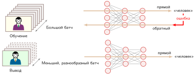

***Поток вывода и обучения**: при выводе нейронные сети используют выученные веса только для вычисления прямого прохода, что упрощает поток данных и снижает вычислительные затраты по сравнению с обучением, которому нужны и прямой, и обратный проходы для обновления весов. Такой упрощенный процесс позволяет эффективно развертывать обученные модели для предсказаний в реальном времени.*

Эти вычислительные различия напрямую проявляются в выборе аппаратуры и топологии развертывания. Кластеры обучения опираются на ускорители с высокой пропускной способностью и большой памятью, потребляющие сотни ватт на сокет, и на выделенную холодильную инфраструктуру центров обработки данных. Развертывание вывода на ограниченной аппаратуре ставит во главу угла предсказуемую хвостовую задержку и энергоэффективность на разнородных платформах: мобильные устройства работают на маломощных нейропроцессорах (обычно 2–4 Вт), периферийные серверы используют специализированные ускорители вывода,[^fn-edge-tpu-efficiency] а облачные инстансы применяют пониженную числовую точность, чтобы насытить тензорные ядра.[^fn-inference-quantization-precision] В масштабе промышленная эксплуатация вводит операционные требования — динамическое пакетирование запросов, балансировку нагрузки и изоляцию сбоев, которые не возникают в изолированных прогонах обучения. На уровне памяти обучение сохраняет все активации прямого прохода до тех пор, пока обратные проходы их не потребят, тогда как вывод отбрасывает или перезаписывает промежуточные буферы по мере продвижения исполнения по графу; [«Прямой проход при обучении и выводе»](05_nn_computation.md#tbl-forward-pass-comparison) сводит этот профиль ресурсов.

[^fn-training-gpu-power]: **Бюджет мощности GPU для обучения**: требование «большой памяти» диктуется необходимостью одновременно держать параметры, градиенты, состояние оптимизатора и активации. Соответствующее энергопотребление определяет «значительную холодильную инфраструктуру»: один мощный GPU для обучения потребляет 400–700 Вт. Даже по сравнению с мобильным чипом вывода мощностью 4 Вт это как минимум в 100 раз больший бюджет мощности.

[^fn-edge-tpu-efficiency]: **Периферийные ускорители вывода**: Edge TPU (Google Coral) работает в классе мобильных и встраиваемых устройств примерно на 2 Вт, давая 4 TOPS через тракт данных INT8. Периферийные серверы относятся к другому классу: Jetson AGX Orin достигает 275 TOPS при 15–60 Вт, то есть пропускная способность примерно в 68,8 раза выше, но при допущении о питании от сети.

[^fn-inference-quantization-precision]: **Квантование**: переход от FP32 к INT8 уменьшает хранение параметров в 4 раза и может повысить пропускную способность на аппаратуре с эффективным трактом данных INT8, хотя реальное ускорение зависит от поддержки ядрами, трафика памяти и формы нагрузки. Вывод часто допускает более низкую точность, чем обучение, поскольку не нужно представлять малые градиенты и обновления оптимизатора через многократные шаги обучения. Компромисс не бесплатен: агрессивное квантование может снизить точность, особенно на редких или плохо представленных входах, поэтому калибровка и оценка на уровне задачи должны определить безопасную точность для каждого развертывания. Методы квантования подробно разобраны в главе [«Сжатие моделей»](10_model_compression.md).

| **Характеристика**     | **Прямой проход при обучении**                     | **Прямой проход при выводе**                       |
|:-----------------------|:---------------------------------------------------|:---------------------------------------------------|
| **Хранение активаций** | Сохраняет значения, нужные обратному проходу       | Сохраняет текущие входной и выходной буферы        |
| **Паттерн памяти**     | Сохраняет или пересчитывает выбранные промежуточные состояния | Переиспользует буферы по мере завершения последовательных слоев |
| **Вычислительный поток** | Построен для подготовки вычисления градиентов     | Оптимизирован для непосредственного получения выхода |
| **Профиль ресурсов**   | Высокие требования к памяти для операций обучения  | Минимальный объем памяти для эффективного исполнения |

<a id="tbl-forward-pass-comparison"></a>

***Прямой проход при обучении и выводе**: обе фазы выполняют одни и те же уравнения прямого прохода, но по-разному управляют состоянием. Обучение должно сохранять или пересчитывать значения, нужные обратному проходу, и кроме того несет градиенты и состояние оптимизатора. Вывод может переиспользовать скользящую пару буферов слоев. При одинаковом размере батча 32 упрощенная учетная таблица MNIST из [«Памяти при обучении и выводе MNIST при размере батча 32»](05_nn_computation.md#tbl-nn-computation-mnist-memory-budget) дает отношение памяти обучения к памяти вывода около 3,4; оно зависит от нагрузки и реализации.*

<a id="sec-neural-computation-memory-computational-resources-d02b"></a>

#### Память и вычислительные ресурсы

Нейронные сети по-разному расходуют вычислительные ресурсы при выводе и при обучении. У вывода две обязанности по памяти. Первая — постоянная: обученные веса и смещения должны оставаться доступными для каждого запроса. Вторая — временная: каждый слой создает буфер активаций, который нужен только до тех пор, пока следующий слой его не использует. Именно это различие делает вывод гораздо более экономным, чем обучение, хотя арифметика прямого прохода одна и та же.

Для эталонной сети MNIST (784 → 128 → 64 → 10) постоянный блок параметров содержит 109 386 параметров, или около 438 КБ при 32-битной числовой точности с плавающей запятой. Показатели по слоям в [«Ресурсах вывода MNIST по слоям»](05_nn_computation.md#tbl-mnist-inference-resource-by-layer) объясняют почему: каждый полносвязный слой выполняет одно умножение с накоплением на каждый вес, поэтому объем памяти параметров и арифметика растут вместе.

[^fn-fp32-precision-format]: **FP32 и форматы пониженной точности**: формат IEEE 754 binary32 использует 32 бита (1 бит знака, 8 битов экспоненты, 23 бита мантиссы), тогда как 16-битные альтернативы распределяют экспоненту и мантиссу иначе: IEEE 754 FP16 выделяет 5 битов экспоненты и 10 битов мантиссы, давая высокую точность, но узкий динамический диапазон ($6{,}1 \times 10^{-5}$ до $65\,504$), что требует динамического масштабирования потерь; brain floating point (BF16) выделяет 8 битов экспоненты, как у FP32, что исключает underflow при обучении. INT8 дополнительно сокращает 32-битный объем в четыре раза до 8 целочисленных битов (от −128 до 127), широко используемых для высокопроизводительного вывода после калибровки или обучения с учетом квантования. Формальное численное сравнение приведено в разделе [«Численные представления»](appendix_machine.md#sec-appdx-machine-foundations-numerical-representations-c889) приложения «Основы машины».

| **Слой**    | **Веса**                         | **Смещения** | **Умножения с накоплением** |
|:------------|:---------------------------------|:-------------|:----------------------------|
| **Слой 1**  | $784{\times}128$ = 100 352       | 128          | 100 352                     |
| **Слой 2**  | $128{\times}64$ = 8 192          | 64           | 8 192                       |
| **Выход**   | $64{\times}10$ = 640             | 10           | 640                         |
| **Итого**   | 109 386 параметров               | учтены в итоге | **109 184**               |

<a id="tbl-mnist-inference-resource-by-layer"></a>

***Ресурсы вывода MNIST по слоям**: постоянный блок параметров и число умножений с накоплением для эталонной сети MNIST. В полносвязных слоях те же веса, которые занимают память, определяют и объем арифметики на один вывод.*

Эта модель «постоянные параметры плюс скользящие буферы» объясняет и последующие оптимизации развертывания. Пакетирование может повысить повторное использование арифметики и загрузку аппаратуры, но расширяет хранение активаций. Более низкая числовая точность может уменьшить постоянный блок параметров и буферы активаций,[^fn-fp32-precision-format] но только если качество решения выдерживает более компактное представление. Раскладки, специфичные для аппаратуры, могут улучшить повторное использование кэша, держа рабочие данные рядом с вычислительными блоками. Вывод упрощает планирование этих оптимизаций, поскольку параметры фиксированы, а многие активации живут недолго.

<a id="sec-neural-computation-performance-enhancement-techniques-692f"></a>

#### Приемы повышения производительности

Фиксация параметров и устранение состояния обратного прохода открывают системные возможности оптимизации, недоступные при обучении. Поскольку граф прямого вычисления статичен и детерминирован, движки исполнения могут оптимизировать раскладку памяти, планирование операторов и числовую точность относительно физических пределов целевого процессора.

Пакетирование входов вносит фундаментальное противоречие между задержкой отдельного запроса и эффективностью аппаратуры. При обработке одного изолированного входа ($B=1$) полносвязные слои выполняют произведения матрицы на вектор (GEMV). Процессор должен передать каждый весовой параметр по шине памяти из DRAM в регистры, чтобы выполнить всего две операции с плавающей запятой на значение, что дает арифметическую интенсивность не выше примерно $1\text{ FLOP/байт}$ (при 16-битной точности) или $0{,}5\text{ FLOP/байт}$ (при 32-битной точности). В этом режиме выполнение ограничено пропускной способностью памяти: арифметические блоки простаивают в ожидании параметров. Объединение запросов в батч размера $B > 1$ превращает нагрузку в общее матричное умножение (GEMM). Каждый параметр, загруженный из памяти, теперь параллельно переиспользуется для всех $B$ входов, и арифметическая интенсивность растет пропорционально $B$, пока машина не достигнет потолка пропускной способности вычислений. Компромисс — хранение активаций: для сети MNIST обработка одного изображения требует хранения 202 значений выходов слоев (986 значений с учетом входного буфера), тогда как батч из 32 изображений требует 6 464 значения выходов слоев. Промышленные системы, обслуживающие интерактивный трафик, должны динамически балансировать этот компромисс, накапливая входы лишь до предела, который допускает их бюджет задержки на уровне сервиса.

Распределение памяти при выводе гораздо экономнее, чем при обучении, потому что времена жизни промежуточных активаций строго не пересекаются. При обучении каждый тензор активаций должен существовать до тех пор, пока обратное распространение не дойдет до его слоя, что приводит к накопительному потреблению памяти по всей глубине сети ($\sum_l A_l$). При выводе, как только слой $l+1$ завершил выполнение, буфер активаций слоя $l$ становится ненужным, и выделенное под него хранилище можно освободить или перезаписать. Среды исполнения для обслуживания используют это свойство времени жизни через статическое планирование памяти или двойную буферизацию (схема «пинг-понг»), чередуя два физических блока памяти по мере продвижения данных по слоям. При такой схеме пиковая память временных активаций сворачивается из накопленного итога по всем слоям до максимальной суммы соседних слоев: $\max_l (A_l + A_{l+1})$.

Аппаратно-специфичная компиляция дополнительно снижает задержку, устраняя трафик внешней памяти. На CPU процедуры исполнения разбивают матрицы на блоки, помещающиеся в кэши L1 и L2, избегая простоев на обращениях к основной памяти с высокой задержкой, и вызывают векторные инструкции SIMD (например, AVX-512 или ARM NEON), которые выполняют несколько операций умножения с накоплением за такт. На ускорителях эффективность исполнения зависит от слияния операторов. Наивный путь исполнения запускает отдельные ядра для матричного умножения, добавления смещения и нелинейной активации, после каждого шага записывая промежуточные тензоры обратно в память высокой пропускной способности (HBM) и тут же читая их обратно. Слияние ядер объединяет эти операции в одно ядро, удерживая промежуточные значения целиком в регистрах на кристалле и разделяемой памяти SRAM. Это заменяет дорогие обращения к глобальной памяти локальным доступом к регистрам, снижая накладные расходы на запуск ядер и загрузку шины памяти.

Отказ от обратного прохода также открывает возможность снизить числовую точность. Обучению нужны широкий динамический диапазон и высокая точность (например, FP32 или BF16), чтобы накапливать малые обновления градиента без underflow и катастрофической потери значимости. При выводе замороженные веса и активации часто можно квантовать в представления с меньшим числом бит, например FP16 или INT8, с пренебрежимо малым влиянием на итоговые предсказания. Более низкая точность напрямую бьет по узкому месту пропускной способности памяти: перевод параметров из FP32 в INT8 сокращает вчетверо объем байтов, передаваемых по шине памяти, и вчетверо увеличивает эффективную емкость кэшей на кристалле. Для сети MNIST уменьшение ширины хранения вдвое снижает объем байтов параметров и активаций вдвое; реальное ускорение задержки зависит от того, есть ли у целевого процессора специализированные конвейеры низкоточной арифметики (например, Tensor Cores или инструкции векторного скалярного произведения).

Хотя здесь это показано на сети прямого распространения, эти системные механизмы — амортизация передач параметров через пакетирование, ограничение времени жизни данных переиспользованием буферов, устранение обращений к памяти через слияние операторов и разгрузка шины через квантование — образуют основное проектное пространство всех промышленных движков вывода. Специализированные структуры сетей вносят дополнительные вычислительные паттерны: сверточные операторы разделяют веса по пространственным измерениям, повышая арифметическую интенсивность, рекуррентные архитектуры обрабатывают последовательные шаги с итеративными зависимостями состояния, а трансформерные модели требуют динамического управления кэшем ключей и значений. Эти архитектурные структуры и методы их сжатия рассмотрены в главах [«Архитектуры нейронных сетей»](06_nn_architectures.md#sec-network-architectures) и [«Сжатие моделей»](10_model_compression.md), тогда как архитектуры обслуживания, динамическое пакетирование и эксплуатация в промышленной среде разобраны в разделе [«Оптимизация пропускной способности»](13_model_serving.md#sec-model-serving-throughput-optimization-18d1) главы [«Обслуживание моделей»](13_model_serving.md#sec-model-serving) и в главе [«MLOps»](14_ml_ops.md#sec-ml-operations).

<a id="sec-neural-computation-output-interpretation-decision-making-33be"></a>

### Интерпретация выходов и принятие решений

Выходы нейронной сети становятся полезными только после того, как их переводят обратно в решения, с которыми может работать обычная система. Предобработка переводит данные реального мира в тензорную форму; постобработка отображает выходы сети в метки, пороги решений, логику валидации, обработку ошибок и последующие сообщения. В сквозном примере MNIST одних логитов недостаточно: системе распознавания цифр нужны наиболее вероятный класс цифры, оценка уверенности, калибровка которой проверена, и запасной маршрут, который направляет неоднозначные предсказания или предсказания с низкой уверенностью на проверку человеком или на второй распознаватель.

Эти граничные стадии имеют совсем иной вычислительный профиль, чем прямой проход. Пока исполнение нейронной сети использует массивно-параллельные матричные блоки ускорителей, предобработка (например, декодирование и нормировка изображений) и постобработка (например, редукция argmax, проверка порогов и сериализация сообщений) обычно выполняются как последовательный скалярный код на хост-CPU. По закону Амдала по мере того, как ядра ускорителя сокращают время прямого прохода почти до нуля, эти неускоренные стадии CPU и связанные с ними передачи данных по PCIe начинают доминировать в сквозной задержке запроса.

Полный жизненный цикл нейронной сети — от проектирования архитектуры через обучение до развертывания для вывода — представляет собой набор математических операций с измеримыми ресурсными затратами. До сих пор эти операции существовали в контролируемой среде сквозного примера MNIST, где данные чистые, задержка ничем не ограничена и аппаратура не испытывает нагрузки. Исторический пример проверяет их на промышленном развертывании, где ни одно из этих условий не выполняется.

<a id="chk-nn-computation-complete-neural-network-system"></a>

> **Полная система нейронной сети**
>
> Прежде чем разбирать, как эти понятия работают вместе в реальном развертывании, проверьте, как вы понимаете полный жизненный цикл нейронной сети:
>
> Используйте классификатор MNIST (784 → 128 → 64 → 10) как сквозную промышленную систему.
>
> - **Жизненный цикл системы**: можете ли вы проследить путь от проектирования архитектуры через цикл обучения к обученной модели и развертыванию для вывода?
> - **Память обучения и вывода**: при одинаковом размере батча можете ли вы объяснить, почему эта учетная таблица дает обучению примерно в 3,4 раза больше памяти, чем выводу, назвав члены для градиентов, состояния оптимизатора и сохраненных активаций?
> - **Сквозная трассировка**: можете ли вы проследить одно изображение цифры через предобработку, прямое распространение, выходные вероятности, постобработку и итоговое предсказание?
> - **Поиск узких мест**: можете ли вы указать, где могут возникнуть узкие места в системе реального времени, обрабатывающей 100 изображений в секунду?
> - **Человек в контуре**: можете ли вы объяснить, как проверенные пороги решений и мониторинг определяют, когда нужно вмешательство человека?

Распознавание рукописных цифр показывает, как архитектурные решения, предобработка, пороги решений и проверка человеком сочетаются в работающем конвейере обработки документов.

<a id="sec-neural-computation-case-study-usps-digit-recognition-97be"></a>

## Распознавание рукописных цифр

В конце 1980-х годов Лекун и его коллеги продемонстрировали распознавание рукописных почтовых индексов (ZIP-кодов) на основе обратного распространения ошибки по изображениям, предоставленным почтовой службой США (USPS) (LeCun et al., 1989). Связанная работа по сверточному распознаванию документов позднее поддержала промышленно развернутые считыватели банковских чеков (LeCun et al., 1998). Это были разные системы, но они демонстрировали один и тот же инженерный паттерн: предобработка нормировала изменчивое рукописное письмо, нейросетевой вывод выдавал кандидатов-цифры, пороги отказа направляли неуверенные предсказания на проверку человеком, а последующая логика превращала принятые предсказания в операционные решения. Этот общий конвейер служит системным примером сквозного проектирования машинного обучения, показывая, как предобработка, структура модели и политика отказов взаимодействуют при физических ограничениях пропускной способности.

<a id="sec-neural-computation-mail-sorting-challenge-ef8c"></a>

### Задача распознавания документов

Ограничения работы при сортировке документов напрямую следуют из физической механики обработки. Почтовая сортировочная машина перемещает конверты мимо оптических сканеров на механических транспортерах с фиксированной скоростью, оставляя всего десятки миллисекунд на каждый объект, чтобы получить изображение, выделить символы, вычислить модель и привести в действие физические заслонки-распределители. Неверно направленный конверт или неверно прочитанный чек влекут серьезные издержки в виде ручной повторной обработки или последующей финансовой сверки. Поскольку точность на неконтролируемом рукописном тексте не может достичь 100 процентов, конвейер должен сочетать автоматический вывод с явным механизмом отказа, который направляет неоднозначные входы операторам. Образцы рукописных адресов на [«Вариативности рукописных адресов»](05_nn_computation.md#fig-usps-digit-examples) иллюстрируют сенсорную изменчивость, которую стадии предобработки и классификации должны разрешить в этих временных ограничениях.

<a id="fig-usps-digit-examples"></a>


***Вариативность рукописных адресов**: образцы адресов и почтовых индексов демонстрируют большой разброс толщины штрихов, наклона, интервалов и формы символов. Конвейер распознавания документов должен поглощать эту изменчивость, не принимая законные различия почерка за изменение задуманных символов. Образцы из [базы данных CEDAR CD-ROM 1 USPS Office of Advanced Technology](https://cedar.buffalo.edu/Databases/CDROM1/).*

Поглощение этой физической изменчивости требует распределить вычислительную нагрузку между несколькими стадиями конвейера. Захват и нормировка изображений на входе ограничивают распределение входных данных, поступающих в нейронную сеть; нейросетевой вывод отображает пиксельные паттерны в калиброванные оценки классов; а логика порогов на выходе определяет компромисс между автоматической пропускной способностью и ошибкой.

<a id="sec-neural-computation-engineering-process-design-decisions-2e8e"></a>

### Инженерный процесс и проектные решения

Распознать чистую, центрированную цифру несложно. Распознать рукописный текст на фоне переменного фона, масштаба, выравнивания и качества изображения — значит принимать инженерные решения на каждом этапе, от подготовки данных до развертывания.

История наборов данных должна оставаться раздельной. Ранние исследования почтовых индексов использовали изображения почтовых цифр, предоставленные для этой задачи (LeCun et al., 1989). MNIST позднее был составлен из баз рукописных цифр Национального института стандартов и технологий (NIST) и стандартизирован в эталонные изображения, нормированные по размеру (LeCun et al., 1998). Он не возник из сбора реальных конвертов с разными цветами, текстурами, освещением и ориентациями. Однако в обоих наборах инженерное требование было одним и тем же: предобработка должна уменьшать несущественную изменчивость, не стирая информацию о штрихах, необходимую для распознавания.

Проектирование архитектуры балансирует точность, время обработки и стоимость памяти. Для стандартизированного входа цифры $28{\times}28$ из этой главы центральный вопрос в том, какую емкость модели способны поддержать доступные бюджеты задержки и аппаратуры. Полносвязные слои масштабируются как произведение входных и выходных размерностей, требуя значительного хранения параметров и пропускной способности памяти. Сверточные слои переиспользуют веса по пространственным рецептивным полям, сокращая объем параметров и держа промежуточные активации компактными.

Обучение должно охватывать вариативность почерка, а не оптимизироваться только под отобранный тестовый набор. Предобработка нормирует размер и ориентацию, а аугментация может познакомить модель с дополнительными правдоподобными вариантами. Оценка затем должна измерять качество по релевантным стилям письма и условиям эксплуатации, следуя систематическому процессу, описанному в главе [«Рабочий процесс машинного обучения»](03_ml_workflow.md#sec-ml-workflow).

Пороги уверенности определяют разделение труда между автоматизацией и проверкой человеком. Высокий порог отклоняет больше объектов для ручной обработки; низкий пропускает больше ошибок модели. Правило ожидаемой стоимости выбирает порог $t$, минимизирующий $\text{доля ручной}(t)C_{\text{ручная}} + \text{доля ошибок}(t)C_{\text{ошибка}}$ при ограничениях пропускной способности и задержки.

<a id="sec-neural-computation-production-system-architecture-130f"></a>

### Общая архитектура конвейера

Почтовые исследования ZIP-кодов и развернутые считыватели банковских чеков использовали разные операционные системы, но оба укладываются в шаблон [«Конвейера распознавания документов»](05_nn_computation.md#fig-usps-inference-pipeline). Получение изображения и традиционная предобработка готовят вход, нейросетевой вывод выдает оценки цифр, а постобработка либо принимает результат, либо направляет спорный объект на проверку.

<a id="fig-usps-inference-pipeline"></a>

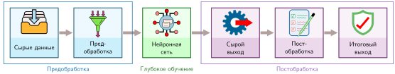

***Конвейер распознавания документов**: составной шестистадийный поток, извлеченный из исследований почтовых ZIP-кодов и развернутых систем чтения чеков. Получение изображения и традиционная предобработка готовят рукописные цифры к нейросетевому выводу, после чего сырые оценки проходят постобработку до итогового результата приложения.*

Конвейер начинается с получения изображения. В почтовых исследованиях входом было изображение области рукописного ZIP-кода; развернутые считыватели чеков аналогично начинались со сканов документов. Качество получения изображения определяет, какую изменчивость должны поглотить последующие стадии предобработки и распознавания.

Предобработка находит нужное поле, отделяет его символы или иным образом их выделяет и нормирует полученные изображения. Пороговая обработка, анализ связных компонент и нормировка размера — типичные традиционные приемы. Для расчетов MNIST в этой главе используются стандартизированные изображения $28{\times}28$; здесь этот размер — учебное соглашение, а не утверждение о каждом почтовом или чековом развертывании.

Затем нейронная сеть обрабатывает каждое нормированное изображение цифры. Система почтовых исследований 1989 года использовала раннюю вариацию LeNet (LeCun et al., 1989) с примерно 10 тыс. параметров, занимавших около 40 КБ в одинарной точности. Этот объем параметров на порядок меньше, чем 109,4 тыс. в полносвязной сети MNIST из этой главы. На рабочих станциях конца 1980-х поддержание объема параметров около 40 КБ позволяло весам модели целиком находиться в быстром кэше во время вывода, минимизируя трафик внешней памяти и сохраняя вычислительную пропускную способность, необходимую для обработки цифр в сроки сортировки.

Постобработка превращает оценки цифр в решения приложения. Для задачи с ZIP-кодом одна неуверенная цифра может отправить весь код на дальнейшую обработку или на проверку человеком. Развернутые считыватели документов используют тот же общий принцип: принимать достаточно уверенные предсказания и отклонять неуверенные случаи, а не навязывать ответ.

Развернутые считыватели документов должны выполнять сквозные временные ограничения, охватывающие получение, предобработку, вывод, постобработку и последующее действие. Точный механизм различается между почтовыми и финансовыми документами, но пропускная способность зависит от всего конвейера, а не только от задержки нейронной сети.

<a id="sec-neural-computation-performance-outcomes-operational-impact-f3ab"></a>

### Результаты и операционные последствия

Исследование ZIP-кодов 1989 года представило свои измерения модели, распознавания, пропускной способности и обучения как единую экспериментальную систему. В [«Ранних результатах распознавания ZIP-кодов»](05_nn_computation.md#tbl-usps-numbers) эти измерения приведены вместе, что показывает, как политика отказа и предобработка влияют на смысл «сырой» скорости классификатора (LeCun et al., 1989).

| **Показатель**          | **Опубликованный результат**                                                     |
|:------------------------|:---------------------------------------------------------------------------------|
| **Ошибка и отказ**      | 1% ошибок классификации после отказа от 12,1% тестовых цифр                      |
| **Пропускная способность** | 10–12 классификаций в секунду с учетом получения изображения; более 30 в секунду после нормировки |
| **Параметры модели**    | около 10 000                                                                     |
| **Обучение**            | 23 прохода; около 3 дней на рабочей станции Sun-4/260                            |

<a id="tbl-usps-numbers"></a>

***Ранние результаты распознавания ZIP-кодов**: измерения системы обратного распространения 1989 года, примененной к изображениям цифр, предоставленным USPS. Результат по отказам показывает, почему операционную частоту ошибок нужно читать вместе с долей входов, которые не передаются автоматической классификации (LeCun et al., 1989).*

Эти измерения выделяют три системных компромисса по всему конвейеру:

Во-первых, сквозная пропускная способность ограничивалась ненейронными стадиями. Пока нейронная сеть выполняла более 30 классификаций в секунду (менее 33 мс на цифру), весь конвейер обрабатывал лишь 10–12 объектов в секунду (83–100 мс на объект). Физическая работа с документами, сканирование, пороговая обработка и сегментация занимали более половины общего бюджета задержки. Ускорение одного только нейросетевого вывода дает убывающую отдачу, когда окружающий ввод-вывод и традиционная предобработка доминируют на временной шкале исполнения.

Во-вторых, операционная надежность зависела от явного пути отказа. Вместо того чтобы пропускать каждую цифру через автоматическую классификацию, система удерживала 12,1 процента наиболее неоднозначных тестовых входов от автоматической маршрутизации. Отказ от этого хвоста предсказаний с высокой неопределенностью снизил наблюдаемую ошибку классификации на оставшемся автоматическом потоке до 1 процента. Порог отказа сдвигает рабочую точку вдоль фронта Парето: автоматизация берет на себя рутинный объем, а операторы разбирают неоднозначный хвост, защищая операционный бюджет ошибок системы.

В-третьих, размер модели ограничивался вычислительным потолком машины для обучения. Обучение 10 000 параметров потребовало 23 прохода примерно за три дня на рабочей станции Sun-4/260. Масштабирование до больших режимов параметров было невозможно при тактовой частоте процессора и пропускной способности памяти эпохи развертывания.

Поддержка таких систем в эксплуатации предъявляет требования к жизненному циклу, выходящие за рамки обучения модели. Изменения оптики сканеров, составов чернил, текстуры конвертов или региональных стилей письма со временем смещают распределение входов. Промышленный мониторинг должен отслеживать статистику входных изображений и доли отказов наряду с задержкой классификации и запускать сбор данных и переобучение модели, когда доля отказов превышает пропускную способность операторов проверки.

<a id="sec-neural-computation-key-engineering-lessons-design-principles-f84e"></a>

### Ключевые инженерные уроки и проектные принципы

По всем исследованиям почтовых ZIP-кодов и развернутым считывателям чеков центральный урок таков: нейронные вычисления успешны только тогда, когда окружающий конвейер разделяет то же операционное ограничение. Предобработка, вывод, постобработка, отказы и последующие действия должны вместе обеспечивать нужную пропускную способность и бюджет ошибок.

Превращение рукописных пометок в надежные операционные решения требовало согласованных выборов в архитектуре сети, обучении, предобработке, политике уверенности и последующей обработке. Эти исторические системы установили принципы, которые остаются основополагающими в промышленных развертываниях: ограничение распределения входов с помощью специализированной предобработки, подбор архитектур под пределы пропускной способности памяти, калибровка порогов уверенности для поддержки запасного маршрута с участием человека и проектирование всего пути данных под бюджеты сквозной задержки. Операционный жизненный цикл, нужный для поддержания таких конвейеров, формализован в главе [«MLOps»](14_ml_ops.md#sec-ml-operations).

Современные периферийные системы работают при других ограничениях по мощности, задержке и развертыванию, но лежащие в основе инженерные компромиссы остаются теми же: предобработка поглощает изменчивость реальной среды, пороги уверенности защищают бюджеты ошибок на последующих стадиях, а сквозная пропускная способность аппаратуры определяет жизнеспособную емкость модели.

<a id="psp-nn-computation-reading-historical-comparisons"></a>

> **Чтение исторических сравнений систем**
>
> Ранний считыватель класса LeNet и многослойный перцептрон MNIST из этой главы показывают преемственность вычислений, а не контролируемый эталон производительности. Их наборы данных, архитектуры, программные стеки, машины и эксплуатационные цели различаются. Обоснованное сравнение структурное: оба преобразуют нормированные пиксели в оценки цифр, оба зависят от выученных параметров и конвейера предобработки, и оба требуют явной политики для неуверенных выходов.
>
> Число параметров дает один конкретный контраст. Сеть ZIP-кодов 1989 года имела около 10 000 параметров, тогда как полносвязная сеть главы — 109 386. Эта разница описывает состояние модели; сама по себе она не определяет задержку, энергопотребление, пропускную способность или стоимость. Для этого нужны фиксированная нагрузка и измерения, которые указывают аппаратуру, числовую точность, среду исполнения, размер батча и сквозной путь принятия решения. Разделение этих переменных не дает приписать более быстрое развертывание целиком кремнию, когда изменились также данные, модель, программное обеспечение или эксплуатационная политика.

Конвейер распознавания документов показывает фундаментальное согласование инженерии систем ML: высокопроизводительная автоматическая классификация требует непрерывной координации между распределением данных, алгоритмической емкостью и ограничениями лежащей в основе машины.

<a id="sec-neural-computation-deep-learning-ai-triad-09cb"></a>

## Таксономия D·A·M

Для истории распознавания документов разные ресурсы служили разным целям. Изображения ZIP-кодов, предоставленные USPS, легли в основу раннего исследования распознавания; LeNet дала алгоритмический механизм; позднейшие считыватели банковских чеков дали задокументированный пример развертывания; а MNIST стал стандартизированным эталоном, созданным на основе данных NIST. Вместе они не образуют единой системы, но в совокупности воплощают трехстороннее согласование таксономии D·A·M: отражает ли данные распределение задачи, может ли алгоритм выучить нужное преобразование и способна ли машина выполнить это вычисление в рамках физических бюджетов задержки, памяти и энергии. Пересечения этих осей разобраны в приложении [«Таксономия D·A·M»](appendix_dam.md#sec-appdx-dam-taxonomy).

Ось данных определяет, отражают ли обучающие и оценочные примеры эксплуатационное распределение. Изображения ZIP-кодов USPS, цифры MNIST и входы банковских чеков имеют общую семантику цифр, но происходят из разных процессов получения и разной шумовой среды: разрешение сканирования, артефакты пороговой обработки и разметка документа делают их невзаимозаменяемыми. Предобработка может нормировать вариации масштаба и ориентации, но она не может синтезировать не представленные стили почерка или исправить политику разметки, расходящуюся с последующими операционными решениями. Данные также задают физический след: разрешение входа, размер батча, раскладка тензоров и числовая точность определяют объем байтов, которые должны пройти через иерархии памяти в память ускорителя.

Эти входящие байты задают вход для оси алгоритма, которая определяет математические операции, необходимые для выучивания или оценки представлений. В сквозной сети главы полносвязный слой 784 → 128 задает и исходную представительную емкость, и самый большой блок параметров модели. Функции активации вводят нелинейности, которые определяют, какие границы решений могут сформироваться и остаются ли обратно распространяемые градиенты численно устойчивыми; функция потерь и оптимизатор определяют, как ошибки предсказания управляют обновлениями параметров. Эти выборы задают математическую работу, которую должна выполнить система, но алгоритмическая формулировка остается жизнеспособной, только если ее статистические допущения соответствуют распределению данных, а вычислительный граф укладывается в аппаратный бюджет.

Этот аппаратный бюджет задается осью машины, которая определяет, может ли нужная линейная алгебра выполниться в пределах физической задержки, пропускной способности памяти, емкости памяти и тепловых ограничений. Прямое распространение передает веса параметров и входные активации в арифметические блоки; обратное распространение сохраняет эти прямые активации в памяти, вычисляет тензоры градиентов, обновляет состояния оптимизатора и проходит обратный вычислительный граф. Увеличение размера батча амортизирует загрузку параметров за счет роста арифметической интенсивности, но пропорционально расширяет хранение активаций. Понижение числовой точности с FP32 до 16- или 8-битных форматов в два или четыре раза уменьшает трафик памяти и открывает специализированные блоки матричных вычислений, при условии что сокращенный динамический диапазон сохраняет численную устойчивость и точность решения. Поэтому физическая машина ограничивает не только то, насколько быстро выполняется фиксированная архитектура, но и то, какие размеры батча, числа параметров и числовые форматы физически реализуемы.

Попарные пересечения объясняют, почему эти оси нельзя оптимизировать по отдельности. Данные и алгоритм определяют, *чему может научиться система*; данные и машина определяют, *как информация представляется и перемещается*; алгоритм и машина определяют, *как вычисление выполняется эффективно*. В центре все три ограничения связывают друг друга одновременно. Расширение набора данных улучшает статистическое покрытие, но увеличивает трафик хранения; расширение слоя повышает емкость модели, но превышает память ускорителя; снижение точности арифметики повышает пропускную способность исполнения, но рискует ухудшить качество решения задачи.

Количественные анализы этой главы превращают эту диагностическую рамку в конкретную инженерную практику. Столкнувшись с эксплуатационным симптомом — недостаточной точностью, нарушенным целевым уровнем сервиса по задержке или сбоем из-за нехватки памяти, — инженеры формулируют конкурирующие гипотезы по всем трем осям. Чтобы их различить, нужно измерить решающую физическую или статистическую величину: покрытие выборки и точность разметки для данных, динамику градиентов и распределения ошибок для алгоритма, либо загрузку вычислений, насыщение пропускной способности памяти и объем занимаемой емкости для машины. Поскольку вмешательство на одной оси обычно сдвигает решающее ограничение на другую, валидация требует профилирования сквозной производительности при целевой промышленной нагрузке. Приложение [«Таксономия D·A·M»](appendix_dam.md#sec-appdx-dam-taxonomy) расширяет этот первый диагностический цикл до систематического справочника по методам пересечения, применяемым во всем курсе.

Рассуждение в терминах таксономии D·A·M не дает принимать системные проблемы за изолированные программные ошибки. На практике, однако, инженерные решения часто срываются, когда команды опираются на интуитивные допущения — например, считают, что глубокие сети невозможно отлаживать, что глубина всегда превосходит ширину или что точность на уровне программного обеспечения гарантирует операционную пропускную способность. Чтобы увидеть, где эти эвристики не работают, нужно разобрать повторяющиеся ловушки, которые возникают, когда нейронные вычисления сталкиваются с физическим железом.

<a id="sec-neural-computation-fallacies-pitfalls-3422"></a>

## Заблуждения и ловушки

Статистическое обучение добавляет режимы отказа, которые одна лишь построчная проверка кода не выявляет. Перечисленные ниже заблуждения и ловушки могут привести к неверному распределению усилий или развертыванию неподходящих решений.

> **Заблуждение и ловушка**
>
> **Заблуждение:** *Нейронные сети полностью непрозрачны и не поддаются отладке.*
>
> Нейронные сети не дают построчной причинной трассы традиционного кода, но диагностике они поддаются. Визуализация активаций может показать выученные паттерны, анализ градиентов измеряет локальную чувствительность к входам, а абляционные исследования оценивают вклад компонентов. Эти инструменты дают частичные свидетельства, а не полное объяснение: карты значимости могут быть нестабильны, коррелированные признаки усложняют атрибуцию, а абляция может изменить то поведение, которое должна проверять. Для классификатора MNIST из раздела [«Основы архитектуры сети»](05_nn_computation.md#sec-neural-computation-network-architecture-fundamentals-1f58) веса первого слоя все же могут служить полезной проверкой того, какие паттерны выучила модель. Отладка статистической системы поэтому сочетает зондирование на уровне модели со срезами данных, контролируемыми вмешательствами и сквозной оценкой.

> **Заблуждение и ловушка**
>
> **Ловушка:** *Отказ от экспертных знаний предметной области ради доступности глубокой модели.*
>
> Команды считают, что автоматическое выучивание признаков устраняет потребность в знаниях предметной области. Успешные системы требуют экспертизы на каждом этапе: выбор архитектуры, проектирование целевой функции обучения, подготовка датасета и интерпретация выходов. История распознавания документов в разделе [«Распознавание рукописных цифр»](05_nn_computation.md#sec-neural-computation-case-study-usps-digit-recognition-97be) показывает, почему пороги уверенности должны отражать экономику эксплуатации и направлять неуверенные случаи операторам. Без знаний предметной области команды могут развернуть сети, которые выглядят сильными на тестовой выборке, но терпят неудачу в промышленной эксплуатации, потому что их пороги, запасные пути или стоимость ошибок заданы неверно.

> **Заблуждение и ловушка**
>
> **Заблуждение:** *Глубокие сети всегда точнее широких.*
>
> Инженеры полагают, что наращивание числа слоев — основной путь к повышению точности, поскольку глубина позволяет иерархически извлекать признаки. На практике одна лишь глубина дает убывающую отдачу. ResNet показала, что очень глубокие остаточные сети можно эффективно обучать, но ее результаты на ImageNet также ясно показывают, что добавление слоев нужно соотносить с возросшими затратами на обучение и вывод (He et al., 2016). Позднее EfficientNet продемонстрировала, что составное масштабирование ширины, глубины и разрешения входа может превзойти масштабирование только по глубине при заданном бюджете ресурсов (Tan and Le, 2019). Урок не в том, что глубина плоха; команды должны измерять загрузку емкости и масштабировать то измерение архитектуры, которое дает наилучшую точность на FLOP.

> **Заблуждение и ловушка**
>
> **Ловушка:** *Использование нейронных сетей для задач, которые решаются более простыми методами.*
>
> Команды считают, что глубокое обучение всегда работает лучше. На небольших наборах данных или при приблизительно линейных зависимостях более простая модель, такая как логистическая регрессия, может сравняться с нейронной сетью или превзойти ее, требуя меньше обучения, памяти и сопровождения. Величина этого преимущества зависит от нагрузки, поэтому команды должны сравнить простой базовый вариант и обосновать усложнение измеренным выигрышем для конкретной задачи. Нейронные сети превосходно выявляют иерархические паттерны ([«Автоматическое открытие паттернов»](05_nn_computation.md#sec-neural-computation-deep-learning-automatic-pattern-discovery-214d)), но несут дополнительные издержки. Используйте их, когда их представительная емкость дает достаточную пользу, чтобы оправдать измеренную системную стоимость.

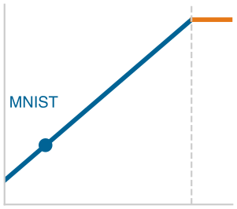

*Небольшие нейросетевые нагрузки остаются ограниченными памятью даже на больших GPU.*

> **Заблуждение и ловушка**
>
> **Заблуждение:** *Проблемы распределения обучающих данных можно исправить после проектирования модели.*
>
> Команды рассматривают обучение как механическую подачу данных через архитектуры. Сети на несбалансированных наборах данных могут плохо работать на редких классах: детектор мошенничества при дисбалансе 99:1 достигает точности 99 процентов, всегда предсказывая «не мошенничество» и не находя ни одного случая мошенничества. Невзвешенная целевая функция среднего эмпирического риска может недооценивать редкие, но критичные классы, если выборка, веса, конструкция потерь и оценка не учитывают дисбаланс. Команды, которые пропускают разведочный анализ данных, могут развернуть модели с высокими совокупными метриками, но недопустимо слабым качеством на редких классах.

> **Заблуждение и ловушка**
>
> **Ловушка:** *Развертывание исследовательских моделей в промышленной эксплуатации без учета системных ограничений.*
>
> Промышленная эксплуатация добавляет ограничения, которых нет в исследованиях: бюджеты задержки (50–100 мс сквозной задержки), лимиты памяти (2–4 ГБ для периферийных устройств) и параллельную нагрузку (100–1 000 запросов в секунду, RPS). Полный конвейер включает предобработку, вывод и постобработку ([«Конвейер вывода»](05_nn_computation.md#sec-neural-computation-inference-pipeline-5372)). Модель, которая выполняет вывод за 20 мс, не укладывается в бюджет 50 мс, когда предобработка добавляет 25 мс, а постобработка — 10 мс (всего 55 мс). Поэтому отделение разработки модели от проектирования системы тратит усилия на точность, игнорируя осуществимость развертывания.

> **Заблуждение и ловушка**
>
> **Заблуждение:** *Больше вычислительной мощности автоматически означает более быстрое обучение.*
>
> Команды покупают дорогие GPU, ожидая пропорционального ускорения, но производительность может определяться трафиком памяти или накладными расходами на запуск. Арифметическая интенсивность показывает, какой ресурс является решающим. По простой модели трафика, которая читает параметры один раз и перемещает активации каждого батча по одному разу, прямой проход MNIST из [«Числа операций прямого прохода MNIST по слоям»](05_nn_computation.md#tbl-nn-computation-mnist-flops) достигает примерно 12,4 FLOP на байт при батче 32 и еще меньше при батче 1. Это намного ниже точек перехода (ridge points) многих высокопроизводительных ускорителей. Точка перехода процессора — его отношение баланса машины $R_{\text{peak}}/\text{BW}$ (пиковые вычисления в FLOP/s, деленные на пиковую пропускную способность памяти в байтах/с), которое задает минимальную арифметическую интенсивность для насыщения вычислительных блоков. Для современных серверных ускорителей вроде NVIDIA A100 или H100 эта точка перехода лежит между $150$ и $300+$ FLOP на байт. Поскольку 12,4 FLOP на байт у MNIST более чем на порядок ниже этого порога, выполнение застревает на склоне, ограниченном пропускной способностью памяти, и дополнительные пиковые FLOP/s полностью бесполезны, пока не вырастут размер батча или повторное использование данных. Раздел [«Модель Roofline»](appendix_machine.md#sec-appdx-machine-foundations-roofline-model-2529) приложения «Основы машины» объясняет, почему дополнительные пиковые FLOP/s не помогут, пока нагрузка не даст достаточно повторно используемой работы на байт. Кэши, слияние операций, векторизация и стоимость запуска делают измеренное ускорение окончательной проверкой.

> **Заблуждение и ловушка**
>
> **Ловушка:** *Экстраполяция улучшений точности без учета убывающей отдачи.*
>
> Команды могут экстраполировать выигрыш в 5 пунктов от масштабирования с 10 тыс. до 100 тыс. параметров на еще 5 пунктов при переходе к 1 млн. Эмпирическое улучшение, напротив, убывает с ростом масштаба в зависимости от задачи, метрики, качества данных, семейства моделей и режима масштабирования. В [«Исторической производительности»](05_nn_computation.md#tbl-historical-performance) строки ImageNet показывают, как ошибка снижается с 15,3 процента у AlexNet до 3,6 процента у ResNet-152, тогда как вычисления обучения растут с $5 \times 10^{17}$ примерно до $10^{19}$ FLOP. Поэтому команды должны измерять предельную отдачу в своем режиме, а не экстраполировать линейно.
>
> У этих заблуждений и ловушек общий корень: поведение статистической системы рассматривается так, будто его определяет только код. Если распознать их заранее, внимание направляется на подходящие измерения и диагностику.

<a id="sec-neural-computation-summary-f263"></a>

## Итоги

Нейронные вычисления переводят математические формулировки в физическое исполнение на машине. Линейная алгебра и математический анализ определяют стоимость операций согласно железному закону систем ML ($T = \frac{D_{\text{vol}}}{\text{BW}} + \frac{O}{R_{\text{peak}} \cdot \eta_{\text{hw}}} + L_{\text{lat}}$). Прямое распространение задает вычислительную работу $O$, часто доминируемую матричными умножениями, тогда как обратное распространение сохраняет отдельные промежуточные значения и добавляет градиенты и состояние оптимизатора. Получающийся объем памяти $D_{\text{vol}}$ зависит от архитектуры, размера батча, точности, оптимизатора и стратегии пересчета. Эти механизмы делают объемы памяти, арифметические интенсивности и пределы задержки оцениваемыми до развертывания.

Замена рукописных правил решений параметрами, выученными из данных, превращает инжиниринг признаков в машинное исполнение. Послойные композиции взвешенных сумм, нелинейных активаций и обновлений градиента образуют иерархические представления, которые переводят сырые входы в предсказания. Обучение настраивает веса связей итеративной оптимизацией, а вывод применяет фиксированные параметры к входящим данным. Эти фазы предъявляют разные физические требования: в учетной таблице FP32 этой главы шаг обучения с батчем 32 требует примерно в 3,4 раза больше памяти, чем вывод с батчем 32, потому что обратное распространение сохраняет активации и выделяет буферы градиентов и оптимизатора. В промышленной эксплуатации, как показал пример распознавания документов, эти математические ядра не работают изолированно: предобработка, нейросетевой вывод, отказы и постобработка должны совместно укладываться в единый бюджет задержки и надежности.

> **Математика модели**
>
> * **Каждый сдвиг парадигмы меняет системную стоимость представления**: в этом примере с цифрой 28×28 число операций растет от примерно 100 сравнений (на правилах) через примерно 8 000 операций (классическое ML) до 109 184 MAC (глубокое обучение) — сценарий роста в 1 091,8 раза, который меняет требования к аппаратуре.
> * **Нейронные сети выучивают представления из данных**: эти сети заменяют часть рукописных признаков иерархическими представлениями, выученными из примеров. Такая гибкость переносит нагрузку на репрезентативные данные, вычисления обучения и валидацию.
> * **Обучение и вывод часто делают упор на разные цели**: обучение обычно выигрывает от эффективной пропускной способности при повторяющихся обновлениях, тогда как онлайн-вывод обычно ценит задержку отдельного запроса; офлайн-вывод может отдавать предпочтение пропускной способности. Размер батча связывает загрузку, память, пропускную способность, задержку и статистическое поведение в этих режимах.
> * **Активации — это математика и аппаратура**: ReLU обычно дешевле реализовать, чем сигмоиду или tanh, а ее единичный градиент для положительных входов исключает насыщение активации на этой ветви. Ее практическое преимущество сочетает стоимость реализации с поведением при оптимизации.
> * **Прямой проход часто строится на матричной работе**: плотные матричные ядра дают более 90 процентов FLOP в примере плотной сети этой главы и доминируют во многих важных нейросетевых нагрузках, поэтому специализированное матричное железо может заметно превосходить универсальное исполнение для этих операций.
> * **Обратное распространение требует сохранения пути**: решение задачи распределения ответственности требует сохранять или пересчитывать значения, которые использует обратный проход, поэтому стоимость памяти часто определяет, можно ли обучить модель на данном устройстве, и мотивирует методы, которые сокращают, пересчитывают или разделяют состояние обучения.
> * **Полный конвейер ML определяет сквозную производительность**: предобработка, нейронные вычисления и постобработка влияют на задержку и надежность. Примеры распознавания документов показали, что успех в промышленной эксплуатации зависит от работы всего конвейера в реальных ограничениях, а не только от точности модели на тестовой выборке.

Эскалация между вычислительными парадигмами реальна в нагрузке MNIST: классификация одной цифры 28×28 требовала около 100 сравнений при рукописных правилах, но 109 184 MAC в скромной трехслойной сети — рост в 1 091,8 раза, который меняет каждое системное измерение в [«Тенденциях ресурсов системы»](05_nn_computation.md#tbl-evolution). Это сравнение задает ось алгоритма таксономии D·A·M и показывает, как алгоритмические выборы напрямую переходят в ограничения машины.

Многослойные перцептроны, разобранные в этой главе, показывают прямой ресурсный закон: плотная связность заставляет и хранение параметров, и число операций умножения с накоплением масштабироваться как произведение размерностей соседних слоев. Только в первом слое изображение MNIST размером $28{\times}28$ дает 784 входных значения, и для соединения каждого входа с 128 скрытыми нейронами требуется 100 352 весов. Эта плотная связность не содержит явного априорного знания о пространственной локальности: модель должна выучить из данных, какие связи между близкими и далекими пикселями важны, одновременно расходуя пропускную способность памяти и хранилище на вычисление каждой связи.

Код показывает, что от сети требуется, а математика — во что обойдется ее исполнение. Именно в этой арифметике алгоритм встречается с машиной: веса нужно хранить и передавать, плотные слои отображаются на матричные исполнительные механизмы, а сохраненные активации занимают память ускорителя, от которой зависит, помещается ли обучение на устройство. По кремниевому контракту математика заранее фиксирует операции, которые машина должна выполнить. Аудит этого контракта позволяет инженерам систем вычислить решающие узкие места из первых принципов, прежде чем профилирование подтвердит, где исполнение останавливается.

> **От универсального к специализированному**
>
> Универсальные полносвязные сети превращают каждую связь входа с нейроном в объем памяти $D_{\text{vol}}$ и объем вычислений $O$. Однако реальные данные обладают структурой, которую можно использовать: изображения имеют пространственную локальность, текст содержит последовательные зависимости, а аудиосигналы следуют временным паттернам. Глава [«Архитектуры нейронных сетей»](06_nn_architectures.md#sec-network-architectures) рассматривает специализированные архитектуры, такие как сверточные сети и трансформеры, которые кодируют эти структурные допущения как индуктивные смещения. Подгонка топологии сети под структуру данных сокращает избыточные перемещения данных и улучшает повторное использование весов, но вводит новые компромиссы в хранении активаций, арифметической интенсивности и распараллеливании на ускорителе.
