<a id="sec-network-architectures"></a>

# Архитектуры нейронных сетей

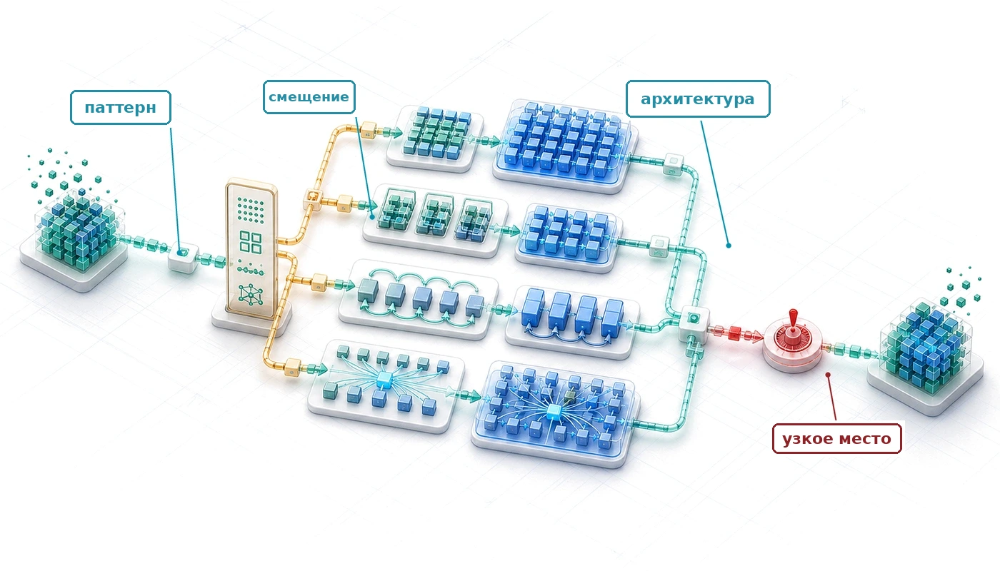

## Назначение

_Почему выбор архитектуры нейронной сети — это обязательство перед инфраструктурой, а не только модельное решение?_

Выбор архитектуры нейронной сети одновременно является решением о моделировании и договором с физикой. Обязательство начинается со структуры в данных. Архитектура, которая соответствует этой структуре, может обучаться на меньшем числе параметров и примеров, тогда как неудачное соответствие требует дополнительных данных и машинного времени, чтобы компенсировать неверный вычислительный шаблон. Свертка, внимание, рекуррентность и поиск по таблице эмбеддингов кодируют не просто разные предположения о данных: они создают различные шаблоны вычислений, состояния и перемещения данных. Эти шаблоны определяют, параллелится ли работа без потерь, помещается ли промежуточное состояние в памяти и остаются ли обучение и обслуживание доступными по стоимости при нужном масштабе. Две архитектуры могут давать близкое качество предсказаний, но требовать разных объемов памяти и профилей задержки и открывать разные возможности для последующих методов повышения эффективности. Поэтому одна только точность на эталонных тестах не показывает, какой вариант остается жизнеспособным. Архитектурные решения также распространяются за пределы модели. Конвейеры данных перенимают определенные входные структуры, инфраструктура обучения выстраивается вокруг вычислительного профиля модели, системы обслуживания настраиваются под ее путь запроса, а мониторинг наследует ее типичные отказы. Когда эти зависимости накопятся, замена архитектуры может означать перестройку большей части окружающей системы. Решение об архитектуре оправдано, только если его прогностические выигрыши совместимы со всем контекстом развертывания. В терминах D·A·M архитектура — это в основе своей совместное проектирование алгоритма и машины: математический граф определяет работу, которую должна выполнить машина, а бюджет машины ограничивает, какие графы остаются практичными.

> **Цели обучения**
>
> - Различать вычислительные особенности MLP, CNN, RNN, трансформеров и рекомендательных моделей в стиле DLRM
> - Объяснять, как индуктивные смещения используют структуру разных типов данных
> - Анализировать вычислительную сложность и масштабирование памяти для разных семейств архитектур
> - Определять строительные блоки, такие как остаточные связи, нормализация и гейтинг, которые делают возможным обучение глубоких сетей
> - Применять схему выбора архитектуры, чтобы сопоставить характеристики данных с конструкцией модели
> - Оценивать, как вычисления, доступ к памяти и перемещение данных определяют эффективность отображения на аппаратуру
> - Критически разбирать заблуждения при выборе архитектуры в условиях ограничений по задержке, пропускной способности и распараллеливанию

<a id="sec-network-architectures-architectural-principles-engineering-tradeoffs-362e"></a>

## Архитектурные принципы

Плотная модель тратит параметры и память на связи, которые изображению редко нужны. Сверточные нейронные сети (CNN) кодируют локальность; многослойные перцептроны (MLP) этого не делают. Матричное умножение, функции активации и вычисление градиентов образуют «глаголы» нейронных сетей. Архитектуры собирают эти глаголы в вычислительные графы: специализированные структуры, оптимизированные под конкретные типы данных и вычислительные ограничения. По кремниевому контракту (принцип [«Кремниевый контракт»](part_build.md#pri-silicon-contract)) каждая архитектура заключает с аппаратурой неявное соглашение, обменивая вычислительные шаблоны на эффективность для определенных классов задач.


*Индуктивное смещение от сильного (CNN) к слабому (MLP): сильное предположение требует меньше данных.*

Каждая нейронная сеть решает, как организовать вычисления, чтобы соответствовать внутренней структуре данных. У изображений есть пространственная локальность, у языка — последовательные зависимости, а табличные записи часто не имеют фиксированной пространственной или последовательной организации. Архитектура напрямую кодирует эти предположения в вычислительный граф, а они влияют на число параметров, загрузку аппаратуры и осуществимость развертывания. Поэтому выбор архитектуры — это задача системной инженерии, которая напрямую затрагивает члены железного закона: количество операций $O$ и объем перемещаемых данных $D_{\text{vol}}$. Структурные предположения, которые кодирует каждая архитектура, называются **индуктивными смещениями**,[^fn-inductive-bias-architecture] и они служат объединяющим понятием для всей этой главы.

[^fn-inductive-bias-architecture]: **Индуктивное смещение**: от латинского *inducere*, «вести за собой». Кодирование структурного предположения «ведет» модель к меньшему пространству решений; именно поэтому понятие объединяет всю главу: каждая архитектура, которую здесь рассматриваем, — многослойный перцептрон (MLP), сверточная нейронная сеть (CNN), рекуррентная нейронная сеть (RNN) и трансформер — определяется своим выбором смещения. Локальное смещение CNN уменьшает число параметров на порядки по сравнению с эквивалентным MLP, напрямую сокращая члены $O$ и $D_{\text{vol}}$ железного закона, тогда как глобальное внимание обменивает квадратичные вычисления оценок на связность на больших дистанциях.

<a id="dfn-nn-architectures-inductive-bias"></a>

> **Индуктивное смещение**
>
> ***Индуктивное смещение*** — это структурное ограничение, заложенное в архитектуру модели, которое сужает пространство гипотез и позволяет обобщать по конечным данным, кодируя предметные предположения (например, пространственную локальность или порядок следования) прямо в вычислительный граф.
>
> 1.  **Значение**: индуктивное смещение может уменьшить объем данных $(D)$, необходимый для обобщения. Для одного детектора выходного признака полносвязное соединение использует $\mathcal{O}(N_{\text{pix}} C_{\text{in}})$ параметров, тогда как общий фильтр CNN использует $\mathcal{O}(K^2 C_{\text{in}})$ параметров и применяется в каждой позиции, требуя $\mathcal{O}(N_{\text{pix}} K^2 C_{\text{in}})$ операций. Для RGB-изображения $224{\times}224$ общий фильтр $3{\times}3$ использует примерно в 5 575,1 раза меньше параметров, чем один полносвязный детектор признака, что уменьшает объем хранения параметров и часто — данные, необходимые для предотвращения переобучения.
> 2.  **Отличие**: в отличие от регуляризации (которая штрафует сложность гипотез во время обучения через члены L1/L2), индуктивное смещение сужает пространство гипотез на этапе проектирования архитектуры: CNN представляет нелокальные функции менее непосредственно, чем локальные паттерны, тогда как регуляризация ограничивает сложность через целевую функцию обучения.
> 3.  **Типичная ошибка**: частое заблуждение состоит в том, что более сильное индуктивное смещение всегда лучше. Сильное смещение локальности (CNN) хорошо работает на пространственных данных, но представляет дальние зависимости в языке менее непосредственно, чем глобальное внимание, которое поддерживает дальние зависимости ценой квадратичных вычислений оценок $\mathcal{O}(S^2)$.


*Архитектура — ось алгоритма в D·A·M: она задает бюджет числа операций.*

Сверточная сеть кодирует индуктивное смещение пространственной локальности: близлежащие пиксели важнее далеких. Трансформер позволяет каждому элементу обращать внимание на любой другой, обеспечивая дальние связи ценой квадратичных вычислений оценок. Эти смещения помогают архитектурам обучаться эффективно, сужая пространство функций, которые они представляют. Без подходящего смещения модели может потребоваться значительно больше данных и вычислений, чтобы выучить ту же структуру. Объединяющая схема в [«Схеме выбора архитектуры»](06_nn_architectures.md#sec-network-architectures-architecture-selection-framework-a442) собирает эти семейства архитектур вместе, после того как каждое смещение появилось на практике.

Перед инженерами систем машинного обучения стоит основной компромисс: **выразительная мощность против вычислительной эффективности**. Согласно железному закону машинного обучения (принцип [«Железный закон систем машинного обучения»](part_build.md#pri-iron-law)), выбор архитектуры — главный фактор, определяющий член числа операций $O$. Механизм внимания трансформера дает глобальные связи, но масштабируется как $\mathcal{O}(S^2)$ операций по длине последовательности $S$; CNN использует пространственную локальность, чтобы свести число операций к линейному масштабированию по числу пространственных позиций. Подбор подходящих индуктивных смещений под данные нагрузки при сохранении разумного бюджета числа операций и определяет практику выбора нейросетевой архитектуры.

<a id="exmp-nn-architectures-netflix-prize-ensemble"></a>

> **Ансамбль, который Netflix не внедрил (2009)**
>
> **Контекст**: Netflix в 2009 году присудил свой Большой приз в \$1 млн за 10-процентное улучшение точности рекомендаций (Johnston, 2012).
>
> **Механизм**: внедрение выигравшего улучшения в производство потребовало существенных инженерных усилий как раз тогда, когда бизнес Netflix переходил от рассылки DVD к потоковому вещанию. Этот переход также принес более богатые сигналы о просмотре и изменил то, что персонализация должна была оптимизировать.
>
> **Последствия**: дополнительная точность не оправдала усилий на производстве, поэтому Netflix не развернул код Большого приза.
>
> **Реакция**: Netflix сохранил два алгоритма из более раннего Progress Prize и перенаправил работу над рекомендациями на персонализацию для потокового вещания.
>
> **Системный урок**: выигрыш офлайн-метрики ценен, только если стоимость его интеграции и целевая функция по-прежнему соответствуют производственной системе.

Выбор архитектурной основы задает основной шаблон памяти и вычислений для последующего оборудования. [«Семейства нейросетевых архитектур»](06_nn_architectures.md#tbl-architecture-families) сопоставляет пять основных семейств нейронных сетей по их пространственным и временным индуктивным смещениям, тензорным операциям и характеристикам доступа к памяти.

| **Архитектура** | **Тип данных**                 | **Ключевая идея**              | **Системное узкое место**                       |
|:----------------|:-------------------------------|:-------------------------------|:------------------------------------------------|
| **MLP**         | Табличные/неструктурированные  | Полная связность               | Пропускная способность памяти                   |
| **CNN**         | Пространственные (изображения) | Локальные фильтры и разделение весов | Пропускная способность вычислений         |
| **RNN**         | Последовательные (временные ряды) | Рекуррентное состояние      | Последовательные зависимости                    |
| **Трансформеры**| Реляционные (язык)             | Динамическое внимание          | Квадратичные вычисления оценок; при необходимости хранение матрицы $S^2$ |
| **DLRM**        | Категориальные (рекомендации)  | Таблицы эмбеддингов            | Емкость памяти (ТБ и более)                     |

<a id="tbl-architecture-families"></a>

***Семейства нейросетевых архитектур**: каждое семейство нацелено на свою структуру данных и показывает свое системное узкое место. Столбец узких мест напрямую читается из железного закона: MLP нагружают пропускную способность памяти плотными активациями, CNN нагружают пропускную способность вычислений, потому что свертка переиспользует фильтры во многих пикселях, RNN нагружают последовательные зависимости, которые мешают параллелизму, трансформеры вычисляют квадратичные взаимодействия оценок и могут материализовать квадратичное хранилище оценок, а DLRM нагружает емкость памяти на уровне терабайтов из-за таблиц эмбеддингов.*

Пять конкретных архитектур моделей проходят через всю книгу как маячные модели: постоянные опорные точки, которые привязывают абстрактные понятия к конкретной системной реальности. Эти примеры — конкретные реализации архетипов нагрузок (таких как «вычислительный зверь» и «пожиратель полосы пропускания»), введенных в [«Архетипах нагрузок»](02_ml_systems.md#sec-ml-systems-workload-archetypes-fd10). Их выбор отражает эмпирический фронт Парето эволюции моделей ([«Фронт эффективности»](06_nn_architectures.md#fig-efficiency-frontier)), который сопоставляет точность на ImageNet с вычислительной стоимостью.

<a id="fig-efficiency-frontier"></a>


***Фронт эффективности**: точность top-1 на ImageNet против вычислительной стоимости (GMAC). Точки-представители составлены по опубликованным отчетам о моделях AlexNet, VGG, ResNet, Inception, MobileNetV2, EfficientNet, ViT, Swin Transformer и ConvNeXt (Krizhevsky et al., 2012; Simonyan and Zisserman, 2015; He et al., 2016; Szegedy et al., 2015; Sandler et al., 2018; Tan and Le, 2019; Dosovitskiy et al., 2021; Liu et al., 2021; Liu et al., 2022). Пунктирный «фронт Парето» — иллюстративная кривая компромисса, а не результат повторного запуска тестов: точные значения точности и заявленной вычислительной стоимости различаются в зависимости от варианта модели, рецепта обучения, реализации и принятого способа подсчета операций (умножения с накоплением или операции с плавающей запятой). В легенде выделено шесть семейств: устаревшие CNN (серый), плотные CNN (синий), эффективные мобильные архитектуры (зеленый), модели класса EfficientNet (фиолетовый), современные CNN (оранжевый) и трансформеры (красный). Фронт возглавляют эффективные семейства и современные CNN; трансформеры обменивают значительные вычисления на гибкое моделирование дальних связей, не доминируя по ним, а ViT-B/16 находится ниже фронта.*

Эти модели служат каноническими нагрузками для понимания системных ограничений. Каждая занимает отдельное положение на компромиссе между точностью и вычислительной стоимостью, как показано в [«Фронте эффективности»](06_nn_architectures.md#fig-efficiency-frontier). График фронта следует читать как историческую карту представительных статей по архитектурам, а не как контролируемую таблицу эталонных тестов. Он прослеживает путь от плотных CNN, которые ставили точность на первое место, через MobileNet, который снижал вычисления на единицу точности, к архитектурам-трансформерам, которые обменивают значительные вычислительные затраты на гибкое моделирование дальних связей. Архитектурные решения, принятые на этапе проектирования, определяют, где система окажется на этом фронте.

<a id="sec-network-architectures-lighthouse-roster-model-biographies-a763"></a>

### Состав маячных моделей: биографии моделей

Пять моделей заслуживают роль маячных, потому что каждая выделяет одно системное узкое место, которое повторяется снова и снова: вычисления (ResNet-50), пропускную способность памяти (GPT-2), емкость памяти (DLRM), задержку на периферии (MobileNetV2) и постоянную работу при малом энергопотреблении в задаче распознавания ключевых слов (KWS).

ResNet-50 (He et al., 2016) задает опору для вычислительно интенсивного маяка в компьютерном зрении. Остаточная сеть (ResNet) решила проблему деградации в очень глубоких простых сетях: добавление слоев могло увеличивать ошибку обучения, несмотря на достаточную емкость. Введя «пропускающие связи», которые улучшают оптимизацию и поток градиентов, она позволила строить сети из 50, 100 и даже 1000 слоев. Архитектура ResNet выиграла конкурс ImageNet 2015 года (с очень глубокими 152-слойными моделями), а ResNet-50 стала широко используемой опорной архитектурой и эталонной нагрузкой для компьютерного зрения. С точки зрения систем это высокорегулярная, вычислительно интенсивная нагрузка, почти целиком состоящая из плотных сверток, что делает ее полезным тестом пропускной способности вычислений с плавающей запятой на GPU.

GPT-2 (Radford et al., 2019) задает опору для языкового маяка, узким местом которого выступает пропускная способность памяти. Generative Pre-trained Transformer 2 показал, что масштабирование простой архитектуры декодер-трансформера на больших наборах данных позволяет получать связный генерируемый текст. В отличие от BERT, кодировщика, который читает контекст в обоих направлениях, GPT-2 генерирует текст последовательно (авторегрессивно[^fn-autoregressive-decoding-bandwidth]), создавая значительное давление на пропускную способность памяти при декодировании с батчем из одного или малым батчем, поскольку веса модели считываются на каждом шаге декодирования. Он служит архетипом для больших языковых моделей, таких как Llama и ChatGPT.

[^fn-autoregressive-decoding-bandwidth]: **Авторегрессивная генерация**: стратегия декодирования, в которой каждый выходной токен зависит от всех ранее сгенерированных токенов и требует полного прямого прохода модели на каждый токен. Для модели на 1,5 млрд параметров в FP16 использованный здесь вариант, учитывающий только веса, при батче из одного примера считывает около 3 ГБ весов на шаг декодирования и дает отношение работы к байтам примерно 1 FLOP/байт. Такая низкая арифметическая интенсивность часто делает декодирование с батчем из одного или малым батчем ограниченным пропускной способностью памяти; большие батчи позволяют амортизировать трафик весов. Во время генерации системы обслуживания также хранят состояние внимания от предыдущих токенов; [«Внимание»](06_nn_architectures.md#sec-network-architectures-attention-mechanisms-dynamic-pattern-processing-22df) называет это состояние KV-кешем.

DLRM (Naumov et al., 2019) задает опору для разреженного рекомендательного маяка. Meta открыла исходный код DLRM, чтобы показать нагрузку, которая отличается от CNN и трансформеров критическим образом. Модели зрения и языка вычислительно тяжелые, а рекомендательные системы — тяжелые по памяти. Им нужно искать предпочтения пользователей и товаров в огромных таблицах эмбеддингов, которые могут достигать терабайтов, что создает особые трудности для критичного к задержке обслуживания (глава [«Обслуживание моделей»](13_model_serving.md#sec-model-serving)). DLRM полезна как эталон для емкости памяти и шаблонов разреженного доступа к памяти в центрах обработки данных.

<a id="lhs-nn-architectures-canonical-workloads"></a>

> **Канонические нагрузки**
>
> В архитектуре компьютеров процессор *MIPS* (microprocessor without interlocked pipelined stages) часто используют для преподавания конвейеризации не потому, что это самый быстрый доступный чип, а потому, что он наиболее ясно воплощает принципы вычислений с сокращенным набором команд (RISC). Так же и эта книга использует ResNet-50, GPT-2, DLRM, MobileNetV2 и KWS как **канонические нагрузки**. Изучение этих «маяков» выделяет инженерные принципы, связанные с математикой, перемещением данных и локальностью, которые сохраняют силу даже тогда, когда конкретные архитектуры моделей меняются.

MobileNet (Howard et al., 2017) задает опору для маяка энергоэффективности на периферии. MobileNet бросил вызов тенденции к все более крупным моделям, поставив на первое место эффективность. Он популяризировал раздельные по глубине свертки для эффективных моделей зрения — архитектурное новшество, которое сократило число FLOP в 8–9 раз для ядер $3{\times}3$ при минимальной потере точности. Меньший вычислительный объем сделал MobileNet естественным кандидатом для методов сжатия и развертывания с меньшей разрядностью (хранение и вычисления с меньшим числом бит на значение), описанных в главе [«Сжатие моделей»](10_model_compression.md). Он стал эталонным семейством для совместного проектирования моделей зрения с учетом ограничений батареи и задержки смартфонов и встроенных устройств.

KWS (Warden, 2018) задает опору для постоянно работающего маяка TinyML. Модели распознавания ключевых слов (например, те, что реагируют на «Hey Siri» или «Ok Google») представляют крайний край эффективности. Рассчитанные на работу на «всегда включенных» микроконтроллерах с памятью порядка килобайт и бюджетом мощности в милливаттах, эти модели (часто раздельные по глубине CNN) воплощают ограничения TinyML (Warden and Situnayake, 2020; Banbury et al., 2021; Banbury et al., 2021). Они заставляют инженеров считать каждый байт и каждый такт, мотивируя экстремальное квантование (INT8 и INT4) и специализированное оборудование. Вместе эти биографии объясняют, почему маячные модели — не каталог моделей: каждая выделяет свою сигнатуру узкого места, которую анализ арифметической интенсивности может количественно оценить.

<a id="sec-network-architectures-understanding-arithmetic-intensity-ade5"></a>

### Сигнатуры нагрузок: спектр арифметической интенсивности

ResNet-50 переиспользует веса свертки во многих пространственных позициях, тогда как декодирование GPT-2/Llama с батчем из одного примера передает большое состояние весов и KV-кеша для одного токена за раз. Этот контраст мотивирует введение арифметической интенсивности — отношения FLOP к байтам, описанного в [«Вычислениях в нейронных сетях»](05_nn_computation.md#sec-neural-computation), — и использование модели Roofline для оценки того, ограничена ли нагрузка вычислениями или памятью.

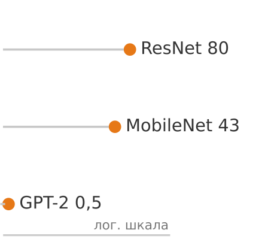

*Оценка только по весам: у ResNet интенсивность примерно в 160 раз выше, чем у GPT-2 при батче из одного примера.*

Эти узкие места отражают лежащую в основе математику, но расчет здесь — это оценка только по весам, а не полное измерение трафика основной памяти. Он делит объем операций с плавающей запятой на объем весов модели в FP32, не учитывая трафик активаций, промежуточных результатов и KV-кеша. Батчирование позволяет амортизировать трафик весов на примеры или токены, а дополнительное перемещение состояния может снизить реальную интенсивность. Формулы FLOP и числа параметров для каждой операции, которые использует эта оценка, приведены в разделе [«Шпаргалка по вычислительной сложности»](appendix_algorithm.md#sec-appdx-algorithm-foundations-computational-complexity-cheat-sheet-0c6c) приложения «Основы алгоритмов». [«Сигнатуры маячных нагрузок»](06_nn_architectures.md#tbl-workload-signatures) сравнивает три маячных сценария и показывает разрыв примерно в 160,2 раза при этих допущениях.

| **Семейство моделей** | **Маяк**     |              **Интенсивность** $(I)$                    | **Аппаратная предрасположенность**   |
|:----------------------|:------------:|:-------------------------------------------------------:|:------------------------------------|
| **Плотная CNN**       | ResNet-50    | ~80,1 FLOP/байт                                       | Богата вычислениями (GPU/TPU)       |
| **Эффективное зрение**| MobileNetV2  | ~42,8 FLOP/байт                                       | Сбалансирована (мобильные NPU)      |
| **Трансформер**       | GPT-2 (вывод)| ~0,50 FLOP/байт                                       | Ускоритель с высокой пропускной способностью памяти |

<a id="tbl-workload-signatures"></a>

***Сигнатуры маячных нагрузок**: оценки интенсивности FP32 по весам для трех сценариев моделей. Эти значения указывают на разное давление на вычисления и пропускную способность, но не определяют фиксированную аппаратную предрасположенность: реальные узкие места зависят от режима выполнения и баланса аппаратуры.*

Эта таблица дает один системный вход для выбора архитектуры. Требования задачи определяют, какие семейства моделей жизнеспособны, тогда как размер батча, точность, длина последовательности, реализация, поведение кеша и целевая аппаратура определяют, предсказывает ли оценка реальное узкое место при развертывании. MobileNet часто подходит для ограниченных развертываний в задачах зрения, а декодирование трансформера с батчем из одного примера часто сильно нагружает пропускную способность памяти, но оба выбора требуют измерения в целевом режиме.

Столбец узких мест в [«Сравнении маячных моделей»](06_nn_architectures.md#tbl-lighthouse-comparison) показывает, какой системный ресурс — пропускная способность вычислений, пропускная способность памяти, емкость памяти, задержка или энергопотребление — ограничивает производительность для каждого класса нагрузок. В терминах железного закона ([«Железный закон машинного обучения»](01_introduction.md#sec-introduction-iron-law-ml-systems-c32a)) это узкое место показывает, определяют ли время выполнения операции ($O$) или перемещение данных ($D_{\text{vol}}$), и от этого зависит, какие стратегии оптимизации остаются эффективными.

| **Модель**       | **Область**      |                   **Параметры**                   |                  **FLOP на вывод**                  |                  **Память**                    | **Узкое место**           | **Роль в книге**                        |
|:-----------------|:-----------------|:-------------------------------------------------:|:---------------------------------------------------:|:----------------------------------------------:|:--------------------------|:----------------------------------------|
| **ResNet-50**    | Зрение           |   25,6 млн   |     8,2 GFLOP     |   102,4 МБ   | Вычисления                | Пропускная способность плотного зрения  |
| **GPT-2 XL**     | Язык             |    1,5 млрд   | 3 GFLOP/токен |    6 ГБ    | Пропускная способность памяти | Обслуживание поток токен за токеном |
| **DLRM**         | Рекомендации     |   25 млрд   |                         Низкое                      | 100 ГБ | Емкость памяти            | Таблицы эмбеддингов и планирование емкости |
| **MobileNetV2**  | Зрение на периферии | 3,5 млн |    600 MFLOP   |  14 МБ | Задержка                  | Раздельные по глубине свертки и эффективность |
| **KWS (DS-CNN)** | Аудио            |    200 тыс.    |       20 MFLOP      |     800 КБ    | Энергопотребление         | Бюджет энергии при постоянной работе    |

<a id="tbl-lighthouse-comparison"></a>

***Сравнение маячных моделей**: количественные характеристики и педагогические роли пяти канонических нагрузок. Память — это хранение весов в FP32, а FLOP приведены на один вывод, за исключением GPT-2 XL, для которого указаны на один генерируемый токен; строка DLRM показывает число записей таблиц эмбеддингов, а не плотные параметры. Столбец узких мест указывает на главное системное ограничение, которое проявляет каждая модель: модели, ограниченные вычислениями, как ResNet, нагружают арифметическую пропускную способность, а модели, ограниченные пропускной способностью памяти, как GPT-2, нагружают скорость передачи из памяти.*

Выбор архитектуры в конечном счете — это инженерный компромисс между математикой $(O)$ и перемещением памяти $(D_{\text{vol}})$. Механизмы, стоящие за сигнатурами в [«Сигнатурах маячных нагрузок»](06_nn_architectures.md#tbl-workload-signatures), объясняют, почему каждый маяк занимает свое место на спектре интенсивности. ResNet-50 получает высокую интенсивность, потому что сверточные слои переиспользуют каждый вес много раз по пространственным измерениям изображения (в глубоких bottleneck-блоках доходит до 100–200 и более FLOP/байт), поэтому его производительность ограничена арифметической пропускной способностью аппаратуры. GPT-2 находится на противоположном краю: каждый генерируемый токен дает только умножение матрицы на вектор, а не матрично-матричные операции пакетной обработки, поэтому система загружает огромные веса из памяти ради математики для одного токена, и производительность ограничена пропускной способностью памяти. MobileNet на уровне всей модели занимает промежуточное положение, а отдельные раздельные по глубине слои оказываются ниже, если учитывать трафик активаций: раздельные по глубине свертки сокращают общее $O$, но перемещают больше данных относительно этой работы. Это хорошо подходит мобильной аппаратуре, но часто не загружает мощные GPU, оптимизированные под плотную математику.

> **Арифметическая интенсивность и архитектура**
>
> Сопоставьте выбор архитектуры с его системными последствиями:
>
> - **Переиспользование весов (CNN)**: как повторное использование одних и тех же весов для многих входов меняет арифметическую интенсивность?
> - **Большие таблицы эмбеддингов (DLRM)**: как огромные таблицы эмбеддингов меняют баланс между перемещением данных и вычислениями?
> - **Авторегрессивное декодирование (GPT-2)**: почему генерация токен за токеном меняет картину батчирования и пропускной способности?

Этот спектр определяет, нужен ли системе более быстрый процессор или более быстрая память, чтобы повысить производительность. Инструмент, который книга использует для количественной оценки этих пределов на конкретной аппаратуре, — **модель Roofline**: она откладывает достижимую производительность против арифметической интенсивности и показывает, где нагрузка переходит из режима, ограниченного памятью, в режим, ограниченный вычислениями. Аналитическое описание дано в разделе [«Модель Roofline»](appendix_machine.md#sec-appdx-machine-foundations-roofline-model-2529) приложения «Основы машины», а прикладные примеры — в главе [«Аппаратное ускорение»](11_hw_acceleration.md). Раздел [«Конкретный пример: анализ A100»](appendix_machine.md#sec-appdx-machine-foundations-concrete-example-a100-analysis-5b30) того же приложения разбирает эту классификацию интенсивности и узкого места на реальной спецификации ускорителя: вычисляет точку перехода (ridge point) для A100 и показывает, как одна и та же операция попадает по разные стороны от нее.

Сигнатуры маячных моделей делают следующий шаг конкретным: каждое семейство архитектур нужно рассмотреть через шаблон данных, который оно обрабатывает, вычисления, которые оно выполняет, отображение на аппаратуру, которое оно порождает, и узкое место, которое оно обнажает. Этот четырехчастный взгляд гарантирует, что каждая архитектура оценивается по тому, сколько стоит ее запуск, а не только по тому, чему она учится.

<a id="sec-network-architectures-multilayer-perceptrons-dense-pattern-processing-bc11"></a>

## MLP: обработка плотных паттернов

Представьте спам-фильтр смартфона: по набору признаков, извлеченных из письма (репутация отправителя, число ссылок, наличие определенных ключевых слов), модель должна выдать одну вероятность: спам или нет. Эта задача классификации, где каждый входной признак связан с каждым выходом, относится к области полносвязных сетей. **MLP**[^fn-perceptron-rosenblatt-etymology] — это полносвязные архитектуры, введенные в [«Вычислениях в нейронных сетях»](05_nn_computation.md#sec-neural-computation), которые теперь рассматриваются через четырехчастный системный взгляд, введенный ранее.

[^fn-perceptron-rosenblatt-etymology]: **Перцептрон**: образовано от «perception» (восприятие) и суффикса «-tron», как в *циклотроне* и *клистроне*. Термин ввел Фрэнк Розенблатт (Rosenblatt, 1957) для атомарной единицы нейросетевых вычислений: взвешенной суммы с последующей нелинейной активацией; он расширил более раннее понятие нейрона Маккалока — Питтса. MLP полностью состоят из таких блоков, собранных в полносвязные слои, поэтому эффективность этой одной операции — умножения с накоплением — определяет пропускную способность системы. Современные ускорители выполняют более $10^{14}$ таких операций в секунду, поэтому перцептрон становится вычислительным примитивом, вокруг которого оптимизирована вся экосистема аппаратуры для машинного обучения.

MLP воплощают индуктивное смещение: *они не предполагают в данных никакой априорной структуры, позволяя любому входу быть связанным с любым выходом*. Этот выбор архитектуры дает максимальную гибкость, рассматривая все связи входов как одинаково правдоподобные, что делает MLP универсальными, но вычислительно затратными по сравнению со специализированными альтернативами. Их представительная способность была теоретически установлена теоремой об универсальной аппроксимации (UAT)[^fn-uat-exponential-width] (Cybenko, 1989; Hornik et al., 1989), введенной в [«Вычислениях в нейронных сетях»](05_nn_computation.md#sec-neural-computation). Теорема утверждает, что достаточно большой MLP с нелинейными функциями активации может аппроксимировать любую непрерывную функцию на компактной области при подходящих весах и смещениях. Именно это сочетание теоретической универсальности и плотной связности и выражает архитектурная идея *многослойного перцептрона*.

[^fn-uat-exponential-width]: **Теорема об универсальной аппроксимации (UAT)**: теорема дает математическую гарантию для индуктивного смещения MLP «без априорной структуры», доказывая, что достаточно широкая сеть может аппроксимировать любую непрерывную функцию. Системная оговорка состоит в том, что «достаточно широкая» может требовать числа нейронов, растущего экспоненциально с размерностью входа, и тогда теоретическая гарантия практически недостижима даже для умеренных входов, например для изображения $256{\times}256$.

<a id="dfn-nn-architectures-multilayer-perceptrons"></a>

> **Многослойные перцептроны**
>
> ***Многослойные перцептроны*** — это архитектуры нейронных сетей прямого распространения, которые последовательно применяют полносвязные слои: каждый нейрон одного слоя связан с каждым нейроном следующего и не кодирует структурных предположений о предметной области входа.
>
> 1.  **Значение**: отсутствие структурного априори дает плотным слоям квадратичное масштабирование числа параметров по ширине слоя. Один слой, отображающий 1 024 входа в 1 024 выхода, требует 1 048 576 параметров и около 2,1 МБ памяти для весов в FP16. Свертка $3{\times}3$, отображающая 1 024 входных канала в 1 024 выходных, имеет около 9,4 млн весов; преимущество свертки для изображений возникает из-за разделения пространственных весов между позициями, а не из-за уменьшения самой матрицы смешивания каналов. Поэтому MLP неэффективны для высокоразмерных структурированных входов, таких как изображения.
> 2.  **Отличие**: в отличие от сверточных нейронных сетей, которые используют пространственную локальность для уменьшения числа параметров, MLP одинаково обрабатывают все элементы входа, поэтому они являются предпочтительной архитектурой для табличных данных, где нет ни пространственной, ни последовательной структуры.
> 3.  **Типичная ошибка**: частое заблуждение состоит в том, что MLP слишком просты, чтобы важно было их использовать для сложных задач. MLP дают полезную плотную базовую линию, но CNN, рекуррентные сети и трансформеры добавляют операторы и шаблоны связности, которые нельзя свести к одному лишь разделению весов.

На практике UAT объясняет, *почему* MLP работают на разных задачах, и одновременно показывает разрыв между теоретической способностью и практической реализацией. Теорема гарантирует, что некоторый MLP может аппроксимировать любую функцию, но не говорит, каким должен быть размер сети и как определить веса. Хотя теоретически MLP может решить любую задачу распознавания образов, для этого может понадобиться непрактично большая сеть или непомерные вычисления. Именно эта теоретическая универсальность определяет выбор MLP для табличных данных, систем рекомендаций и задач, где связи входов неизвестны. В то же время эти практические ограничения побудили к разработке специализированных архитектур, которые используют структуру данных ради вычислительной эффективности, как показывают [«CNN»](06_nn_architectures.md#sec-network-architectures-cnns-spatial-pattern-processing-5b8d), [«RNN»](06_nn_architectures.md#sec-network-architectures-rnns-sequential-pattern-processing-f804) и [«трансформеры»](06_nn_architectures.md#sec-network-architectures-transformers-attentiononly-architecture-1b56).

<a id="sec-network-architectures-learnability-gap-universal-approximation-enough-0624"></a>

### Разрыв обучаемости

Теорема UAT гарантирует математическое существование, но между тем, что архитектура может представить, и тем, что градиентный спуск может выучить на практике, лежит принципиальный разрыв.

*Представительная способность* — это функции, которые архитектура может выразить при неограниченных ресурсах; упомянутая выше UAT гарантирует, что у MLP универсальная представительная способность. Эта способность особенно полезна благодаря *гипотезе многообразия*,[^fn-manifold-hypothesis-dimensionality] которая утверждает, что данные высокой размерности на самом деле занимают гораздо более простую структуру. *Обучаемость* — это вопрос о том, может ли градиентный спуск найти хорошие веса при конечном числе обучающих примеров и вычислительном бюджете. Функция может быть представимой и при этом практически не обучаемой.

[^fn-manifold-hypothesis-dimensionality]: **Гипотеза многообразия**: предположение, что данные высокой размерности лежат на низкоразмерной поверхности, вложенной в полное пространство. Изображение $256{\times}256$ живет в пространстве размерности 65 536, но «правдоподобные изображения кошек» занимают крошечную структурированную область. Глубокие сети постепенно разворачивают это смятое многообразие в линейно разделимые представления. Системное следствие: если бы данные действительно занимали все пространство, никакая архитектура не смогла бы обучиться на реалистичных объемах данных; именно структура многообразия делает конечные бюджеты обучения достаточными.

Это различие снимает кажущийся парадокс между универсальной аппроксимацией и архитектурным прогрессом. Специализированные архитектуры, такие как ResNet и трансформеры, улучшают обучаемость, встраивая индуктивные смещения, которые соответствуют структуре данных, даже когда это сужает представительную способность.

Три фактора создают *разрыв обучаемости*:

1. **Сложность выборки**: UAT не дает оценок числа нужных обучающих примеров. Для изображений $28{\times}28$ MLP обрабатывает 784 пикселя независимо и для выучивания пространственных корреляций требует экспоненциально большого числа примеров. CNN встраивает смещение локальности и резко снижает требования к выборке. Математически сложность выборки для MLP может расти экспоненциально с размерностью входа, тогда как для архитектур, соответствующих структуре данных, — полиномиально.
2. **Эффективность параметров**: UAT гарантирует, что некоторой ширины достаточно, но не дает конструктивных оценок. Некоторые классы функций требуют ширины, быстро растущей с размерностью входа, тогда как архитектуры с соответствующей композиционной структурой могут представить их компактнее.
3. **Трудность оптимизации**: даже когда оптимальные веса существуют, градиентный спуск может их не найти. Поверхности функции потерь MLP имеют сложную топологию без регуляризующего эффекта архитектурных ограничений. Специализированные архитектуры сокращают пространство поиска, вводя симметрии, которые использует градиентный спуск. Классический эталон — рукописные цифры MNIST — наглядно показывает этот разрыв между представимостью и обучаемостью.

<a id="exmp-nn-architectures-mnist-representation-vs-learnability"></a>

> **MNIST: представимость против обучаемости**
>
> **Сценарий**: классификация цифр MNIST размером $28{\times}28$ полносвязным MLP и CNN.
>
> **Диагностика**: трехслойный MLP требует 20 млн параметров, потому что обрабатывает все 784 входных пикселя независимо, игнорируя пространственную структуру. CNN использует локальные рецептивные поля и разделение весов, сокращая число параметров до 421,4 тыс. (в 47 раз меньше).
>
> **Системный урок**: индуктивное смещение определяет эффективность параметров. Встраивание пространственной локальности в архитектуру модели снижает объем параметров на порядки и уменьшает нагрузку на пропускную способность памяти SRAM при выводе.

Разрыв обучаемости мотивирует главный принцип проектирования этой главы: встраивать индуктивные смещения, которые соответствуют структуре данных. Каждая архитектура жертвует теоретической общностью ради практической обучаемости. Теорема об отсутствии бесплатного обеда (No Free Lunch) (Wolpert and Macready, 1997)[^fn-nfl-theorem-optimization] формализует этот компромисс: смещение, которое помогает одной задаче, может навредить другой. Инвариантность CNN к сдвигу помогает классификации изображений, но вредит задачам, где важна абсолютная позиция. Выбор архитектуры по сути есть акт подбора индуктивного смещения под структуру данных.

[^fn-nfl-theorem-optimization]: **Теорема об отсутствии бесплатного обеда**: результат (Wolpert and Macready, 1997) доказывает, что ни один алгоритм оптимизации не превосходит случайный перебор на всех возможных задачах: в среднем по всем мыслимым функциям все алгоритмы эквивалентны. Для системного машинного обучения это означает, что индуктивное смещение (локальность, эквивариантность, внимание) может улучшать результат на задачах, соответствующих этому смещению, и ухудшать его, когда предположения не выполняются; поэтому выбор архитектуры — это инженерное обязательство перед классом задач.

Эти теоретические выводы напрямую переходят в инженерные решения. Подходящие индуктивные смещения уменьшают число параметров (что делает возможным развертывание на периферии), ускоряют сходимость (снижая стоимость обучения) и порождают структурированные шаблоны вычислений, которые эффективно отображаются на специализированную аппаратуру (глава [«Аппаратное ускорение»](11_hw_acceleration.md)). MLP на 20 млн параметров, непригодный для развертывания на периферии, превращается в CNN на 421,4 тыс. параметров, который помещается без труда, — сокращение в 47 раз, достигнутое за счет соответствия архитектуры структуре данных. Чтобы понять, где плотная связность все еще необходима, нужно выделить шаблоны данных, в которых нет структурных упрощений.

<a id="sec-network-architectures-pattern-processing-needs-3c2a"></a>

### Потребности в обработке паттернов

Плотная обработка паттернов нацелена на предметные области, где входные признаки не имеют геометрических координат или порядка следования. В табличных наборах данных, рекомендательных эмбеддингах или многофакторных моделях риска любой входной признак может взаимодействовать с любым другим. Поскольку представление данных не несет структуры сетки или последовательности, сеть не может ограничить вычисления локальными пространственными окнами или последовательными шагами. Каждый выходной нейрон должен иметь возможность объединять любой входной признак, а веса связей определяет оптимизация.

Когда набор изображений вроде MNIST обрабатывается плотной архитектурой, система разворачивает изображение $28{\times}28$ в неструктурированный вектор из 784 элементов. Отказ от двумерного пространственного априори заставляет сеть одинаково трактовать все пары пикселей. Хотя это позволяет слою связать любой пиксель с любым классом, модель должна полностью через оптимизацию выяснить пространственную смежность — архитектурный выбор, который напрямую ведет к матричным операциям, определяющим MLP.

<a id="sec-network-architectures-algorithmic-structure-99f2"></a>

### Алгоритмическая структура

Взаимодействие всех со всеми признаками требует полной связности между представлениями соседних слоев. В MLP это проявляется как последовательность полносвязных слоев, в которой каждый нейрон связан с каждым нейроном предыдущего слоя. Плотная связность напрямую переходит в матричное умножение — формулировку, введенную в [«Матричной формулировке умножения»](05_nn_computation.md#sec-neural-computation-matrix-multiplication-formulation-417c), которая делает плотные слои исполнимыми на параллельной аппаратуре. [«Архитектура многослойного перцептрона»](06_nn_architectures.md#fig-mlp) показывает, как каждый слой преобразует свой вход через эту основную операцию.

<a id="fig-mlp"></a>


<em><strong>Архитектура многослойного перцептрона</strong>: трехслойная сеть, в которой каждый нейрон связан со всеми нейронами соседних слоев. Выделенный нейрон получает взвешенные вклады от всех входов, иллюстрируя плотный шаблон связности $\mathcal{O}(N \times M)$, реализуемый через матричные умножения. Для классификации MNIST 784-мерный вход связан со 100 скрытыми нейронами через весовую матрицу $784{\times}100$, что требует 78 400 операций умножения с накоплением на один образец. Адаптировано по (Reagen et al., 2017).</em>

[«Плотный слой»](06_nn_architectures.md#eq-dense-layer) задает аффинное преобразование плотного слоя с последующей активацией.

<a id="eq-dense-layer"></a>

$$
\mathbf{h}^{(\ell)} = f\big(\mathbf{h}^{(\ell-1)}\mathbf{W}^{(\ell)} + \mathbf{b}^{(\ell)}\big)
$$

где $\mathbf{h}^{(\ell)}$ — выход слоя $\ell$, $\mathbf{h}^{(\ell-1)}$ — вход из предыдущего слоя, $\mathbf{W}^{(\ell)}$ — матрица весов слоя $\ell$, $\mathbf{b}^{(\ell)}$ — вектор смещений, а $f(\cdot)$ — функция активации; [«Нелинейные функции активации»](05_nn_computation.md#sec-neural-computation-nonlinear-activation-functions-38bc) подробно разбирает выпрямленную линейную функцию (ReLU) и родственные нелинейности. Это послойное преобразование, концептуально простое, порождает шаблоны вычислений, эффективность которых критически зависит от того, как среда выполнения организует эти операции для разных структур задач.

Размерности этих операций показывают вычислительный масштаб плотной обработки паттернов. Входной вектор $\mathbf{h}^{(0)} \in \mathbb{R}^{d_{\text{in}}}$ (в этой записи он рассматривается как строка) содержит все потенциальные входные признаки. Матрицы весов $\mathbf{W}^{(\ell)} \in \mathbb{R}^{d_{\text{in}} \times d_{\text{out}}}$ фиксируют все возможные связи «вход — выход». Выходной вектор $\mathbf{h}^{(\ell)} \in \mathbb{R}^{d_{\text{out}}}$ дает преобразованные представления. Пример с четырьмя пикселями превращает этот учет в арифметику.

<a id="exmp-nn-architectures-concrete-computation-example"></a>

> **Конкретный пример вычисления**
>
> Рассмотрим упрощенное изображение из 4 пикселей, обрабатываемое скрытым слоем из 3 нейронов:
>
> **Вход**: $\mathbf{h}^{(0)} = [0{,}8, 0{,}2, 0{,}9, 0{,}1]$ (4 значения яркости пикселей)
>
> **Матрица весов**:
> $$
> \mathbf{W}^{(1)} = \begin{bmatrix} 0{,}5 & 0{,}1 & -0{,}2 \\ -0{,}3 & 0{,}8 & 0{,}4 \\ 0{,}2 & -0{,}4 & 0{,}6 \\ 0{,}7 & 0{,}3 & -0{,}1 \end{bmatrix}\quad (\text{матрица } 4{\times}3)
> $$
>
> **Вычисление**:
> \begin{gather*}
> \mathbf{z}^{(1)} = \mathbf{h}^{(0)}\mathbf{W}^{(1)} = \begin{bmatrix} 0{,}5{\times}0{,}8 + (-0{,}3)\times 0{,}2 + 0{,}2{\times}0{,}9 + 0{,}7{\times}0{,}1 \\ 0{,}1{\times}0{,}8 + 0{,}8{\times}0{,}2 + (-0{,}4)\times 0{,}9 + 0{,}3{\times}0{,}1 \\ (-0{,}2)\times 0{,}8 + 0{,}4{\times}0{,}2 + 0{,}6{\times}0{,}9 + (-0{,}1)\times 0{,}1 \end{bmatrix}
> = \begin{bmatrix} 0{,}59 \\ -0{,}09 \\ 0{,}45 \end{bmatrix}
> \end{gather*}
> **После ReLU**: $\mathbf{h}^{(1)} = [0{,}59, 0, 0{,}45]$ (отрицательные значения обнулены)
>
> **Системный вывод**: каждый скрытый нейрон комбинирует все входные пиксели с разными весами, демонстрируя неограниченное взаимодействие признаков. Плотные слои покупают общность ценой максимальной стоимости связности.

Пример MNIST делает этот масштаб конкретным. 784-мерный вход связан с каждым нейроном первого скрытого слоя. Скрытый слой из 100 нейронов требует весовой матрицы $784{\times}100$ (78 400 параметров), где каждый вес задает обучаемую связь между входным пикселем и скрытым признаком. Этот единственный слой служит опорой вычислительного анализа на протяжении всей главы.

Эта алгоритмическая структура допускает произвольные связи между признаками и порождает конкретные вычислительные шаблоны, с которыми должны справляться компьютерные системы. Плотная связность дает ту универсальную аппроксимирующую способность, о которой говорилось выше, но вносит вычислительную избыточность: хотя теоретическая универсальность MLP позволяет моделировать любую непрерывную функцию при достаточной ширине, такая гибкость требует множества параметров, чтобы выучить относительно простые шаблоны. Каждый входной признак влияет на каждый выход, обеспечивая максимальную выразительность ценой максимальных вычислительных затрат. Эти компромиссы мотивируют последующие стратегии сжатия, которые снижают вычислительные потребности, сохраняя возможности модели, а в главе [«Аппаратное ускорение»](11_hw_acceleration.md) рассматриваются аппаратные реализации, которые используют регулярную структуру матричных операций.

<a id="sec-network-architectures-computational-mapping-cf30"></a>

### Вычислительное отображение

[«Алгоритмическая структура»](06_nn_architectures.md#sec-network-architectures-algorithmic-structure-99f2) определяет, *что* вычисляет MLP; вычислительное отображение показывает, *как* это вычисление переходит в аппаратные операции. [«MLP-слой в матричной форме»](06_nn_architectures.md#lst-mlp_layer_matrix) показывает, как это отображение переходит от математической абстракции к вычислительной реальности.

<a id="lst-mlp_layer_matrix"></a>

**MLP-слой в матричной форме**: операции матричного уровня фреймворка скрывают сложность умножения с накоплением $\mathcal{O}(B \times d_{\text{in}} \times d_{\text{out}})$ за одним вызовом функции, позволяя оптимизированным библиотекам BLAS эффективно использовать матричную аппаратуру.

```python
def mlp_layer_matrix(X, W, b):
    """Прямой проход MLP с помощью операций матричного уровня фреймворка."""
    # X: матрица входов (размер батча по числу входов)
    # W: матрица весов (число входов по числу выходов)
    # b: вектор смещений (число выходов)

    # Один вызов GEMM: фреймворки передают его в оптимизированные BLAS/cuBLAS
    # Для MNIST: 784 * 100 = 78 400 MAC на образец
    H = activation(matmul(X, W) + b)
    return H
```

Функция `mlp_layer_matrix` напрямую повторяет математическое уравнение, используя высокоуровневые матричные операции (`matmul`), чтобы выразить вычисление в одной строке и скрыть его внутреннюю сложность. Такой стиль реализации характерен для фреймворков глубокого обучения, где оптимизированные библиотеки управляют собственно вычислением.

Операции фреймворка, такие как `output = matmul(X, W)`, скрывают физическое исполнение. С точки зрения аппаратуры плотное матричное умножение сводится к каноническому трехуровневому вложенному циклу, который определяет локальность доступа к памяти, границы распараллеливания и использование регистров.

Реализация в [«Вычислении плотного слоя»](06_nn_architectures.md#lst-mlp_layer_compute) открывает этот шаблон исполнения напрямую. Вычисление выходов слоя требует накопления взвешенных вкладов от всех входов для каждого образца в батче. Внешний цикл перебирает образцы батча, средний — выходные нейроны, а внутренний выполняет повторяющиеся операции умножения с накоплением (MAC)[^fn-mac-energy-cost], сопоставляя каждый входной признак с соответствующим параметром.

[^fn-mac-energy-cost]: **MAC (умножение с накоплением)**: элементарная операция нейронных сетей: перемножить два значения и прибавить результат к текущей сумме. В эталонных оценках Horowitz для техпроцесса 45 нм одно умножение и сложение в FP32 стоит около 4,6 пДж, а обращение к внешней DRAM-памяти по 32 бита — около 640 пДж (Horowitz, 2014). Эти значения, привязанные к конкретной технологии, показывают, почему перемещение данных может доминировать над энергией арифметики; это не универсальные константы для современной аппаратуры.

<a id="lst-mlp_layer_compute"></a>

**Вычисление плотного слоя**: вложенные циклы показывают сложность $\mathcal{O}(B \times d_{\text{out}} \times d_{\text{in}})$, где каждый выходной нейрон требует `num_inputs` операций умножения с накоплением, поэтому входной слой эталонного MNIST требует 78 400 MAC на образец.

```python
def mlp_layer_compute(X, W, b):
    """Явная структура циклов, раскрывающая шаблоны вычислений MLP."""
    # Цикл 1: каждый образец обрабатывается независимо (параллелизуемо)
    for batch in range(batch_size):
        # Цикл 2: вычисляем каждый выходной нейрон
        for out in range(num_outputs):
            Z[batch, out] = b[out]  # Инициализация смещением

            # Цикл 3: накапливаем взвешенные входы (самый внутренний цикл)
            # Это операция MAC: result += input * weight
            for in_ in range(num_inputs):
                Z[batch, out] += X[batch, in_] * W[in_, out]
            # Итого на выход: num_inputs MAC +
            # num_inputs обращений к памяти

    H = activation(Z)  # Поэлементная нелинейность
    return H
```

В эталонном слое MNIST вычисление 100 скрытых нейронов требует всего 78 400 MAC; каждый отдельный выходной нейрон требует 784 операций умножения с накоплением и не менее 1 568 обращений к памяти (784 для входов и 784 для весов). Промышленные реализации вызывают оптимизированные библиотеки матричных операций, такие как Basic Linear Algebra Subprograms (BLAS),[^fn-blas-matrix-libraries] но тот же шаблон вложенных циклов по-прежнему определяет задачу проектирования системы. Аппаратные архитектуры, которые ускоряют эти матричные операции, включая тензорные ядра (Tensor Cores) GPU[^fn-tensor-cores-alignment] и специализированные ускорители для ИИ, рассматриваются в главе [«Аппаратное ускорение»](11_hw_acceleration.md).

[^fn-blas-matrix-libraries]: **BLAS (базовые подпрограммы линейной алгебры)**: этот стандартный программный интерфейс для матричных операций позволяет использовать высокооптимизированные библиотеки (например, cuBLAS), чтобы ускорять 784 операции умножения с накоплением на нейрон. Матрица $784{\times}100$ из примера MNIST может использовать аппаратуру менее эффективно, чем большие, хорошо выровненные матрицы трансформера, потому что загрузка зависит от формы матрицы, батчирования, типа данных, библиотеки и ускорителя.

[^fn-tensor-cores-alignment]: **Tensor Cores**: специализированные блоки в GPU NVIDIA, которые ускоряют тысячи операций умножения с накоплением, объединяя их в одну высокопараллельную матричную инструкцию. Tensor Cores работают наиболее эффективно, когда размеры матриц кратны значениям, специфичным для типа данных и архитектуры; современные cuBLAS/cuDNN могут использовать Tensor Cores и во многих невыровненных случаях, но с меньшей эффективностью или с внутренним дополнением нулями. Архитектурный урок не зависит от производителя: специализированные матричные блоки вознаграждают плотные, выровненные обобщенные матричные умножения (GEMM) и наказывают малые нерегулярные формы, которые не дают полностью загрузить блоки.

<a id="sec-network-architectures-system-implications-0550"></a>

### Системные последствия

Плотная обработка паттернов концентрирует давление на аппаратуру по трем направлениям: емкость памяти для хранения параметров, пропускная способность вычислений на матричных блоках и пропускная способность памяти для перемещения весов.

Все три ограничения происходят из связности «все со всеми». Основной объем памяти определяется хранением параметров. Хотя эталонный слой MNIST $(784{\times}100)$ требует всего 78 400 параметров, масштабирование $\mathcal{O}(M \times N)$ становится непомерным для широких скрытых состояний. Слой, связывающий 2048 входов с 2048 выходами, требует 4 194 304 параметров (16,8 МБ в FP32). Поскольку при выводе одного образца каждый вес считывается один раз на входной вектор, переиспользовать веса между входами невозможно, и выполнение ограничено емкостью памяти и ее пропускной способностью.

Основное вычисление — плотное умножение матрицы на вектор (GEMV), а при батчировании — матричное умножение (GEMM). Оно регулярно и поддается распараллеливанию, но арифметическая интенсивность (FLOP/байт) низка при малых батчах. **Размер батча** — это число входных образцов, обрабатываемых вместе; более крупные батчи амортизируют стоимость загрузки весов на большее число вычислений. Современные процессоры оптимизируют плотные слои с помощью блоков SIMD (одна инструкция — много данных), таких как AVX-512 на CPU, или систолических массивов в тензорных процессорах (TPU) и GPU, амортизируя накладные расходы управления на большие блоки параллельной арифметики.

Итоговое узкое место — перемещение данных. Чтобы вычислить 100 скрытых значений из 784 входов, система должна переместить $784{\times}100$ весов из памяти к вычислительным блокам. Если применить схему арифметической интенсивности из [«Сигнатур нагрузок»](06_nn_architectures.md#sec-network-architectures-understanding-arithmetic-intensity-ade5) к этому слою, получим примерно 0,5 FLOP/байт для выполнения в FP32 с батчем из одного образца. В модели, которая учитывает только веса и считает одно чтение FP32 на вес, не учитывая трафик входов, выходов, смещений и кешей, эту величину дает [«интенсивность плотного слоя»](06_nn_architectures.md#eq-dense-intensity), где $M$ и $N$ — ширины входа и выхода.

<a id="eq-dense-intensity"></a>

$$
\text{Интенсивность} \approx \frac{2 \cdot M \cdot N \text{ FLOP}}{4 \cdot M \cdot N \text{ байт}} = 0{,}5 \text{ FLOP/байт}
$$

На ускорителях, у которых точки перехода составляют сотни FLOP/байт, этот слой в FP32 с батчем из одного образца ограничен пропускной способностью памяти. Батчирование может повысить интенсивность, амортизируя трафик весов, но граница перехода зависит от формы матриц, точности, реализации и аппаратуры. Конкретно: увеличение размера батча до $B$ масштабирует арифметику до $2 \cdot B \cdot M \cdot N$ FLOP, тогда как матрица весов загружается один раз ($4 \cdot M \cdot N$ байт), и интенсивность, ограниченная весами, растет примерно до $\text{Intensity} \approx 0{,}5 B \text{ FLOP/байт}$, пока трафик входов и активаций не начнет доминировать. Поэтому полносвязные слои могут становиться узкими местами вывода, хотя всего выполняют меньше FLOP, чем сверточные слои.


*Разделение весов избавляет свертку от взрыва параметров полносвязного слоя.*

*Плотная связность, таким образом, перемещает максимум данных ради минимума вычислений.* Для данных с внутренней структурой (например, пространственной локальностью в изображениях или временным порядком в последовательностях) специализированные архитектуры могут использовать эту структуру и для лучшей точности, и для лучшей эффективности. Самая устоявшаяся из таких архитектур — сверточная нейронная сеть.

<a id="sec-network-architectures-cnns-spatial-pattern-processing-5b8d"></a>

## CNN: обработка пространственных паттернов

Предположение MLP о том, что каждый вход может напрямую взаимодействовать с каждым выходом, оказывается особенно дорогим для пространственно структурированных данных, таких как изображения. Связь каждого пикселя изображения высокого разрешения с каждым скрытым элементом создает неуправляемый объем параметров, который исчерпывает память ускорителя и сводит арифметическую интенсивность к медленной работе, ограниченной пропускной способностью памяти. Как показало ранее приведенное сравнение на MNIST, пример CNN использует в 47 раз меньше параметров, опираясь на пространственную локальность, а не обрабатывая каждый пиксель независимо.

CNN[^fn-convolution-etymology-locality] закладывают этот вычислительный компромисс непосредственно в аппаратные вычисления (LeCun et al., 1998; Krizhevsky et al., 2012). Вместо того чтобы материализовать матрицу связности «все со всеми», CNN ограничивает каждую выходную активацию локальным пространственным фрагментом и скользит одними и теми же весами фильтра по всей входной области.

[^fn-convolution-etymology-locality]: **Свертка**: от латинского *convolvere* («свертывать вместе»), описывает фильтр, который скользит по входу, объединяя локальные элементы в каждой позиции. Это «свертывание вместе» вводит ограничение локальности, из которого берется эффективность операции: одно ядро $5{\times}5$ переиспользует свои 25 весов в каждой пространственной позиции, сокращая один детектор признака для одноканального изображения в 1 мегапиксель примерно с 1 000 000 весов до 25, то есть примерно в 40 000 раз меньше параметров, чем у полносвязного детектора.

Это пространственное индуктивное смещение переходит в два структурных ограничения на граф вычислений. Разделение параметров применяет одни и те же малые веса фильтра во всех пространственных позициях, сокращая хранение параметров с миллионов различных весов до компактного ядра, которое помещается в кеши на кристалле. Локальная связность ограничивает рецептивное поле каждого нейрона пространственно соседней областью, исключая вычисления над далекими и не связанными между собой пикселями. Вместе эти ограничения определяют семейство сверточных сетей.

<a id="dfn-nn-architectures-convolutional-neural-networks"></a>

> **Сверточные нейронные сети**
>
> ***Сверточные нейронные сети (CNN)*** — это архитектуры, которые используют эквивариантность относительно сдвига и пространственную локальность, чтобы разделять обученные фильтры между всеми пространственными позициями, отвязывая число параметров от разрешения входа.
>
> 1.  **Значение**: разделение весов дает резкое сокращение числа параметров. Сверточный слой $3{\times}3$ с 64 входными и 64 выходными каналами требует $3 \times 3 \times 64 \times 64 \approx 37\,000$ параметров независимо от того, является входное изображение $224{\times}224$ или $1024{\times}1024$. Эквивалентный полносвязный слой на входе $224{\times}224{\times}64$ потребовал бы $224^2 \times 64 \times 64 \approx 205$ млн параметров, то есть примерно в 5 575 раз больше. Такое масштабирование с постоянным числом параметров позволяет CNN обрабатывать входы высокого разрешения в пределах памяти одного ускорителя.
> 2.  **Отличие**: в отличие от MLP, которые связывают каждый входной элемент с каждым выходным (глобальная связность), CNN ограничивают каждый выход локальной пространственной окрестностью, кодируя предположение, что близлежащие пиксели важнее далеких. Это ограничение исключает целые классы гипотез на этапе проектирования архитектуры, а не штрафует их во время обучения.
> 3.  **Типичная ошибка**: частое заблуждение состоит в том, что CNN — это модели только для зрения. Операция свертки применима к любым данным с сеточной топологией: одномерные свертки обрабатывают аудиосигналы и временные ряды, двумерные — изображения и спектрограммы, трехмерные — видео и объемные данные.

Компромисс очевиден: CNN жертвуют теоретической общностью MLP ради практического выигрыша в эффективности, когда данные обладают известной структурой. Там, где MLP обрабатывают каждый входной элемент независимо, CNN используют пространственные связи, чтобы получить и вычислительную экономию, и лучшую точность в задачах зрения.

<a id="sec-network-architectures-pattern-processing-needs-30b4"></a>

### Потребности в обработке паттернов

Обработка пространственных паттернов относится к задачам, в которых корреляция между точками данных быстро убывает с геометрическим расстоянием. В естественном изображении ковариация пикселя с соседними пикселями высока, что позволяет обнаруживать локальные примитивы, такие как границы, текстуры и контуры. Наложение таких операций позволяет локальным примитивам иерархически складываться в представления более высокого уровня: границы складываются в контуры, контуры — в фрагменты поверхностей, а фрагменты — в цельные объекты. Конвейер в [«Извлечении пространственных признаков»](06_nn_architectures.md#fig-cnn-spatial-processing) придает этой иерархии конкретный визуальный вид.

<a id="fig-cnn-spatial-processing"></a>

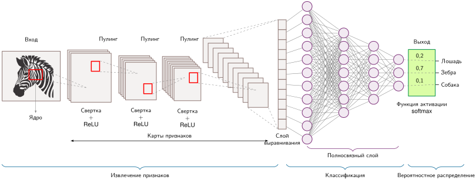

***Извлечение пространственных признаков**: изображение зебры проходит через повторяющиеся стадии свертки, ReLU и пулинга, которые формируют все более глубокие карты признаков, затем следуют выравнивание, полносвязные слои и softmax-классификация по классам «лошадь», «зебра» и «собака».*

Такая иерархическая композиция проявляется в разных физических областях: локальные окрестности пикселей, образующие контуры в компьютерном зрении, локальные кластеры время-частота, которые выделяют фонемы на спектрограммах речи, и смежные блоки вокселей, выделяющие границы тканей в объемной томографии. Архитектура работает не потому, что подражает биологическому зрению, а потому, что соответствует композиционной структуре лежащих в основе данных.

В обработке изображений распознавание объекта требует двух различных вычислительных гарантий. Во-первых, архитектура должна выделять локальные геометрические примитивы на ограниченных рецептивных полях. Во-вторых, поскольку объект сохраняет свою смысловую идентичность независимо от того, где он появляется в кадре, сеть должна распознавать эти примитивы при любых сдвигах координат.[^fn-imagenet-scale-nn] Сверточные сети удовлетворяют обоим требованиям, сочетая локальные ядра с разделением параметров: на промежуточных стадиях они обеспечивают эквивариантность относительно сдвига, а пулинг дает инвариантность на последующих стадиях (LeCun et al., 1989; Krizhevsky et al., 2012).[^fn-translation-equivariance-shift] Эти архитектурные ограничения, введенные LeCun[^fn-lecun-lenet-architecture] (LeCun et al., 1989), заменяют неограниченные плотные матричные умножения структурированными пространственными шаблонами (стенсилами).

[^fn-imagenet-scale-nn]: **ImageNet**: набор данных, на котором эти два требования обработки пространства были подтверждены в масштабе. Победа AlexNet в 2012 году на соревновании ImageNet Large Scale Visual Recognition Challenge снизила ошибку top-5 с 26,2 процента до 15,3 процента на задаче из 1000 классов с примерно 1,2 млн обучающих изображений (Krizhevsky et al., 2012); исходный выпуск ImageNet содержал 3,2 млн изображений в 5 247 синсетах (Deng et al., 2009). Последующие архитектуры повышали точность за счет изменений архитектуры, оптимизации, данных и вычислительных бюджетов, что иллюстрирует взаимодействие между индуктивным смещением и стоимостью инфраструктуры.

[^fn-lecun-lenet-architecture]: **Ян Лекун и LeNet**: архитектура Лекуна напрямую решала непрактичное масштабирование плотных сетей на изображениях, навязывая принципы локальной связности и разделения параметров. Эти ограничения сократили число параметров для входного слоя, подобного изображению, более чем на 95 процентов, что позволило LeNet-5 достичь промышленной точности в коммерческих задачах, таких как чтение чеков, всего при примерно 60 000 параметров.

[^fn-translation-equivariance-shift]: **Эквивариантность относительно сдвига**: присущее операции свертки свойство: сдвиг входа гарантирует соответствующий пространственный сдвиг карты признаков. Это отличается от *инвариантности*, которую пулинг или последующая агрегация могут приблизить, отбрасывая точные позиционные данные. Например, пулинг $2{\times}2$ с шагом 2 уменьшает число пространственных элементов на 75 процентов.

<a id="sec-network-architectures-algorithmic-structure-deb9"></a>

### Алгоритмическая структура

Формально [«свертка»](06_nn_architectures.md#eq-convolution) вычисляет прямой проход двумерного сверточного слоя, считая локальные поканальные скалярные произведения в каждой пространственной координате:

<a id="eq-convolution"></a>

$$
\mathbf{H}^{(\ell)}_{i,j,k} = f\left(\sum_{m}\sum_{n}\sum_{c} \mathbf{W}^{(\ell)}_{m,n,c,k}\mathbf{H}^{(\ell-1)}_{i+m,j+n,c} + \mathbf{b}^{(\ell)}_k\right)
$$

Здесь $\mathbf{H}^{(\ell)}_{i,j,k}$ — активация в пространственной позиции $(i,j)$ в выходном канале $k$ слоя $\ell$. Тройная сумма перебирает измерения фильтра: пространственные смещения $(m,n)$ охватывают окно локального ядра (определяя локальное рецептивное поле слоя),[^fn-receptive-field-growth] а $c$ пробегает все входные каналы. Тензор $\mathbf{W}^{(\ell)}_{m,n,c,k}$ хранит веса ядра, связывающие канал $c$ с каналом $k$, а $\mathbf{b}^{(\ell)}_k$ — смещение для канала. Поскольку веса ядра $\mathbf{W}^{(\ell)}$ не зависят от пространственных координат $(i,j)$, одни и те же параметры фильтра используются в каждой координате.

[^fn-receptive-field-growth]: **Рецептивное поле**: область входа, которая влияет на конкретный выходной нейрон. При фильтрах $3{\times}3$ рецептивное поле растет на 2 пикселя на слой, поэтому нейрон третьего слоя «видит» область $7{\times}7$. Этот темп роста ограничивает глубину архитектуры: чтобы обнаружить объекты размером 100 и более пикселей на изображении $224{\times}224$, нужны либо глубокие стеки малых фильтров (больше слоев, больше памяти под активации), либо большие ядра (больше параметров в слое) — фундаментальный компромисс глубины и ширины в проектировании CNN.

Сверточные слои обычно используют малые пространственные ядра ($3{\times}3$ или $5{\times}5$), чтобы сохранять компактный объем параметров, и наращивают слои, чтобы расширить эффективное рецептивное поле. Механика скользящего окна в [«Операции свертки»](06_nn_architectures.md#fig-cnn) иллюстрирует эту операцию: фильтр перемещается по входному массиву и в каждой допустимой координате вычисляет скалярное произведение с накоплением, формируя выходную карту признаков. Интерактивный инструмент CNN Explainer (Wang et al., 2021) показывает, как эти наложенные скользящие окна извлекают поканальные шаблоны активаций по слоям.

<a id="fig-cnn"></a>

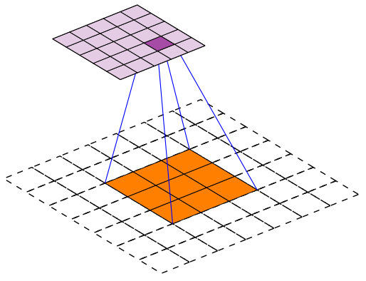

<em><strong>Операция свертки</strong>: оранжевое рецептивное поле $3{\times}3$ в пунктирном входе $7{\times}7$ отображается в одну клетку фиолетового выхода свертки $5{\times}5$ без дополнения (valid). Применение фильтра $3{\times}3$ к этому рецептивному полю требует 9 операций умножения с накоплением на каждый входной канал для каждого выходного значения. Для входа RGB $224{\times}224$ разделение параметров сокращает плотную связь из 150 528 весов до локального фильтра из 27 весов, то есть примерно в 5 575 раз меньше весов, и кодирует эквивариантность относительно сдвига: тот же детектор границ работает в любой точке изображения.</em>

Применение CNN к изображениям MNIST размером $28{\times}28$ показывает различие в представлении состояния. Вместо того чтобы разворачивать изображение в вектор из 784 элементов, который разрушает пространственную смежность, каждый сверточный слой применяет набор фильтров (например, 32 фильтра размером $3{\times}3$) непосредственно к двумерной сетке. При единичном шаге и дополнении, которое сохраняет размеры границ, слой выдает тензор активаций $28{\times}28{\times}32$, сохраняющий пространственную сетку. Каждая координата содержит 32 различных признаковых измерения, извлеченных из ее непосредственной окрестности.

Сохранение пространственной топологии меняет способ, которым исполнительные блоки обращаются к памяти. Вместо того чтобы загружать неразделяемую матрицу весов один раз на образец, как в MLP, сверточный слой потоково пропускает входные карты признаков через аппаратные регистры, а компактные веса фильтра удерживает в быстрой SRAM на кристалле или в регистровых файлах. Этот арифметический шаблон определяет оптимизации иерархии памяти ИИ-ускорителей, где тайлинг циклов и параллельная редукция по каналам снижают трафик к высокоскоростной памяти (HBM).

Этот шаблон переиспользования данных гарантируется эквивариантностью относительно сдвига: сдвиг входа дает такой же пространственный сдвиг в выходной карте признаков. Для системной инженерии эквивариантность означает, что вычислительное расписание и геометрия доступа к памяти остаются одинаковыми во всех пространственных координатах.

Эквивариантность и инвариантность определяют, как архитектура реагирует на пространственные преобразования. Оператор $f$ *эквивариантен* относительно преобразования $\mathcal{T}$, если преобразование входа приводит к тому же преобразованию выхода ([«эквивариантность»](06_nn_architectures.md#eq-equivariance)):

<a id="eq-equivariance"></a>

$$
f(\mathcal{T}(\mathbf{x})) = \mathcal{T}(f(\mathbf{x}))
$$

Для сверточного слоя с шагом 1 без краевых эффектов дополнения сдвиг входа на вектор $v = (v_1, v_2)$ смещает результирующие карты признаков ровно на $v$. Информация о пространственных координатах распространяется через слой детерминированно. Напротив, оператор *инвариантен* относительно $\mathcal{T}$, если преобразование входа оставляет выход неизменным ([«инвариантность»](06_nn_architectures.md#eq-invariance)):

<a id="eq-invariance"></a>

$$
f(\mathcal{T}(\mathbf{x})) = f(\mathbf{x})
$$

Глобальный слой среднего пулинга по всей карте признаков обладает инвариантностью относительно сдвига: сдвиг входа меняет пространственное расположение активаций, но усреднение по всем пространственным позициям сворачивает координаты в скаляр, одинаковый независимо от того, где появились признаки.

Это математическое различие определяет, где эквивариантность нужно сохранять, а где в иерархию сети следует вводить инвариантность. Задачи вроде обнаружения объектов и семантической сегментации требуют эквивариантности вплоть до последнего слоя: координаты ограничивающих рамок и попиксельные маски должны точно следовать за координатами объекта. Задачи классификации, напротив, требуют эквивариантности в промежуточных экстракторах признаков, чтобы сохранять относительные пространственные отношения («глаза над носом»), тогда как последние слои вводят инвариантность к сдвигу через пулинг, сворачивая пространственные координаты в вектор вероятностей классов.

Для входа $\mathbf{x}$ и фильтра $\mathbf{w}$ дискретная двумерная свертка вычисляется как

$$
(\mathbf{x} * \mathbf{w})[i, j] = \sum_{m,n} \mathbf{w}[m, n] \cdot \mathbf{x}[i + m, j + n].
$$

Применение сдвига $\mathcal{T}_v$ (где $(\mathcal{T}_v \mathbf{x})[i, j] = \mathbf{x}[i - v_1, j - v_2]$) и переиндексирование суммы дают

$$
((\mathcal{T}_v \mathbf{x}) * \mathbf{w})[i, j] = \sum_{m,n} \mathbf{w}[m, n] \cdot \mathbf{x}[i - v_1 + m, j - v_2 + n] = (\mathbf{x} * \mathbf{w})[i - v_1, j - v_2] = \mathcal{T}_v(\mathbf{x} * \mathbf{w})[i, j],
$$

что подтверждает эквивариантность относительно сдвига с точностью до граничных условий: $f(\mathcal{T}_v \mathbf{x}) = \mathcal{T}_v(f(\mathbf{x}))$. Эквивариантный сверточный слой сохраняет информацию о координатах, тогда как инвариантный слой пулинга полностью отбрасывает пространственные координаты. Пример [«Эквивариантность: обнаружение признаков»](06_nn_architectures.md#exmp-nn-architectures-equivariance-feature-detection) проверяет это отслеживание с помощью явных матричных операций.

<a id="exmp-nn-architectures-equivariance-feature-detection"></a>

> **Эквивариантность: обнаружение признаков**
>
>
> **Условия**: рассмотрим изображение $7{\times}7$ с вертикальной границей в столбце 3:
> $$
> \mathbf{x} = \begin{bmatrix}
> 0 & 0 & 1 & 0 & 0 & 0 & 0 \\
> 0 & 0 & 1 & 0 & 0 & 0 & 0 \\
> 0 & 0 & 1 & 0 & 0 & 0 & 0 \\
> 0 & 0 & 1 & 0 & 0 & 0 & 0 \\
> 0 & 0 & 1 & 0 & 0 & 0 & 0 \\
> 0 & 0 & 1 & 0 & 0 & 0 & 0 \\
> 0 & 0 & 1 & 0 & 0 & 0 & 0
> \end{bmatrix}
> $$
>
> Фильтр детектора вертикальных границ:
> $$
> \mathbf{w} = \begin{bmatrix}
> -1 & 0 & 1 \\
> -1 & 0 & 1 \\
> -1 & 0 & 1
> \end{bmatrix}
> $$
>
> **Свертка исходного изображения**:
>
>
> Карта признаков показывает положительную активацию там, где фильтр переходит от темного к светлому (левая сторона границы), и отрицательную там, где переход от светлого к темному (правая сторона):
> $$
> f(\mathbf{x}) = \begin{bmatrix}
> 3 & 0 & -3 & 0 & 0 \\
> 3 & 0 & -3 & 0 & 0 \\
> 3 & 0 & -3 & 0 & 0 \\
> 3 & 0 & -3 & 0 & 0 \\
> 3 & 0 & -3 & 0 & 0
> \end{bmatrix}
> $$
>
> **Сдвинутый вход** (граница перемещена в столбец 5):
> $$
> \mathcal{T}_2 \mathbf{x} = \begin{bmatrix}
> 0 & 0 & 0 & 0 & 1 & 0 & 0 \\
> 0 & 0 & 0 & 0 & 1 & 0 & 0 \\
> 0 & 0 & 0 & 0 & 1 & 0 & 0 \\
> 0 & 0 & 0 & 0 & 1 & 0 & 0 \\
> 0 & 0 & 0 & 0 & 1 & 0 & 0 \\
> 0 & 0 & 0 & 0 & 1 & 0 & 0 \\
> 0 & 0 & 0 & 0 & 1 & 0 & 0
> \end{bmatrix}
> $$
>
> **Свертка сдвинутого изображения**:
> $$
> f(\mathcal{T}_2 \mathbf{x}) = \begin{bmatrix}
> 0 & 0 & 3 & 0 & -3 \\
> 0 & 0 & 3 & 0 & -3 \\
> 0 & 0 & 3 & 0 & -3 \\
> 0 & 0 & 3 & 0 & -3 \\
> 0 & 0 & 3 & 0 & -3
> \end{bmatrix} = \mathcal{T}_2(f(\mathbf{x}))
> $$
>
> **Системный вывод**: активация признака сдвигается на ту же величину, что и вход, демонстрируя эквивариантность. Сеть знает, что граница находится в столбце 5 сдвинутого изображения, а не просто что где-то есть граница.

Эффективность параметров — самое непосредственное системное следствие эквивариантности относительно сдвига. Навязывание разделения весов отвязывает емкость параметров от разрешения входа. Например, обработка RGB-изображения $224{\times}224$ с помощью MLP требует, чтобы каждый скрытый нейрон был связан со всеми 150 528 входными пикселями. CNN с фильтром $3{\times}3$ требует всего 27 параметров на фильтр, которые переиспользуются во всех пространственных позициях $224{\times}224$. Это примерно в 5 575,1 раза меньше параметров на один детектор признака. Компактный объем параметров позволяет держать веса модели в SRAM ускорителя или в кеше L2, что делает возможными большие батчи без выгрузки во внешнюю DRAM.

Вычислительная регулярность, которую навязывает эквивариантность, напрямую помогает аппаратному исполнению. Поскольку одна и та же операция скользящего окна выполняется в каждой пространственной координате, вычислительный шаблон аккуратно ложится на блоки векторных операций SIMD и систолические массивы. Современные GPU и TPU используют эту однородную структуру: конвейеры исполнения выдают одинаковые инструкции по пространственным тайлам без расхождения потока управления. Перекрывающиеся рецептивные поля означают, что соседние выходные координаты разделяют входные активации, открывая возможности для кеширования в разделяемой памяти и алгоритмической перестройки данных (например, преобразования im2col), которые полностью загружают блоки исполнения аппаратуры.

Эквивариантность также повышает эффективность выборки и снижает накладные расходы конвейера обучения. Когда сеть обновляет фильтр, чтобы распознавать признак в одной координате, разделение параметров обеспечивает распознавание этого признака во всех пространственных координатах одновременно. Модели не нужны отдельные обучающие примеры, чтобы выучить тот же признак при разных пиксельных смещениях: это работает как структурная аугментация данных. Такая эффективность выборки уменьшает общее число итераций обучения, объем хранения датасета и требуемую пропускную способность ввода-вывода между хостом и устройством для достижения целевой точности.

<a id="thrm-nn-architectures-group-equivariance"></a>

> **Формулировка через групповую эквивариантность**
>
> С точки зрения теории групп эквивариантность свертки относительно сдвигов — это частный случай общего принципа. Группа сдвигов $(\mathbb{R}^2, +)$ состоит из всех двумерных сдвигов и замкнута относительно композиции (сдвиг на $v$, затем на $u$, равен сдвигу на $v + u$). Свертка эквивариантна относительно этой группы. Более поздние исследования расширяют эту схему на другие группы симметрий. Cohen and Welling (2016) разработали групповые эквивариантные CNN, которые работают с поворотами и отражениями, строя фильтры, эквивариантные относительно групп поворотов. Это позволяет выучивать признаки, инвариантные к повороту, в таких задачах, как спутниковые снимки или медицинская визуализация, где ориентация не определяет смысл.
>
> Математическая схема обобщается естественно: для группы $G$, действующей на входное пространство $X$ и выходное пространство $Y$, функция $f: X \to Y$ является $G$-эквивариантной, если
> $$
> f(g \cdot \mathbf{x}) = g \cdot f(\mathbf{x}) \quad \forall g \in G, \mathbf{x} \in X
> $$
>
> Стандартные CNN эквивариантны относительно сдвига, тогда как сети, эквивариантные относительно поворота, распространяют это на группы поворотов. Архитектурный принцип обобщается: симметрии данных следует встраивать в архитектуру как эквивариантности. Для системной инженерии определение симметрий данных напрямую влияет на выбор архитектуры: более жестко ограниченные архитектуры с сильными симметриями часто дают более компактные модели, а специализированные эквивариантности могут требовать нестандартных операций, например сверток с поворотами, которым нужна либо аппаратная поддержка, либо эффективная программная реализация.

На практике идеальная эквивариантность часто нарушается ограничениями реализации. Асимметричное дополнение на границах вносит краевые артефакты, которые ломают строгую симметрию относительно сдвига. Прореживание с шагом вносит пространственный алиасинг: сдвиг входа на один пиксель вызывает фазовые сдвиги подвыборки в выходной карте признаков. Слои батч-нормализации также искажают пространственную эквивариантность, если статистики активаций вычисляются или применяются по пространственным позициям непоследовательно. Современные промышленные сети мирятся с этими отклонениями, потому что вычислительная экономия от шага и стабильность обучения, которую дает нормализация, перевешивают потерю точной математической эквивариантности.

<a id="chk-nn-architectures-spatial-inductive-bias"></a>

> **Пространственное индуктивное смещение**
>
> CNN успешны потому, что соответствуют структуре данных изображений. Проверьте, понимаете ли вы:
>
> - **Разделение параметров**: как использование одного и того же фильтра по всему изображению снижает число параметров на порядки по сравнению с MLP?
> - **Эквивариантность относительно сдвига**: почему сдвиг входного изображения приводит к соответствующему сдвигу карты признаков?
> - **Свертка, ограниченная вычислениями**: почему сверточный слой переиспользует каждый загруженный вес фильтра во многих выходных позициях, делая себя ограниченным вычислениями по сравнению с другими слоями?

Эти структурные свойства воплощают пространственное индуктивное смещение, введенное в [«Архитектурных принципах»](06_nn_architectures.md#sec-network-architectures-architectural-principles-engineering-tradeoffs-362e): ограничивая связность локальными окрестностями и разделяя параметры по всем координатам, CNN навязывают априорное предположение, что визуальные примитивы локализованы и эквивариантны относительно сдвига. Переиспользование одних и тех же весов ядра по всей карте признаков сокращает хранение параметров на порядки по сравнению с плотными слоями и ограничивает пространство гипотез функциями, которые сохраняют геометрическую структуру.

Эта послойная структура естественно реализует иерархическое обучение представлений (Bengio et al., 2013). Ранние слои выделяют низкоуровневые признаки (границы и цветовые градиенты) на малых рецептивных полях, а последующие слои складывают эти примитивы в промежуточные текстуры, части объектов и семантические категории. Наложение сверточных слоев расширяет эффективное рецептивное поле: при фиксированных ядрах $K{\times}K$ и единичном шаге сторона рецептивного поля растет на $K-1$ пикселей на слой, а его площадь растет квадратично, пока не охватит всю входную область. То, насколько эффективно ускорители исполняют эту расширяющуюся иерархию, зависит от того, как шаблоны скользящего окна отображаются на параллельные конвейеры исполнения.

<a id="sec-network-architectures-computational-mapping-824c"></a>

### Вычислительное отображение

Перевод математической свертки в аппаратное исполнение требует преодоления разрыва между высокоуровневыми программными интерфейсами и конвейерами исполнения на кремнии. Высокоуровневые фреймворки абстрагируют свертку как единый вызов слоя, показанный в [«Абстракции сверточного слоя»](06_nn_architectures.md#lst-conv_layer_spatial). За этим лаконичным интерфейсом базовая среда исполнения должна планировать трафик памяти по иерархии кешей и переводить шаблоны скользящего окна на матричную аппаратуру.

<a id="lst-conv_layer_spatial"></a>

**Абстракция сверточного слоя**: операции свертки на уровне фреймворка скрывают сложность вычислений скользящего окна; обычно вызов передается в cuDNN или MKL, которые внутри используют преобразование im2col или прямые алгоритмы свертки.

```python
def conv_layer_spatial(input, kernel, bias):
    """Свертка на уровне фреймворка.

    Один вызов передается оптимизированному ядру (часто через im2col + GEMM).
    """
    # Свертка применяет общие веса во всех позициях
    # Для ядра 3x3 на входе 28x28 (с дополнением): 9 MAC на позицию x 784 позиции
    output = convolution(input, kernel) + bias
    return activation(output)
```

Чтобы раскрыть механику, которую скрывает абстракция фреймворка, [«Логическое вычисление свертки»](06_nn_architectures.md#lst-conv_layer_compute) описывает канонический семиуровневый вложенный цикл, необходимый для прямой двумерной свертки. Эти циклы делятся на три структурных уровня: перебор образцов батча, пространственный обход координат карты признаков $(y, x)$ и накопление по измерениям входных и выходных каналов $(C_{\text{in}}, C_{\text{out}})$ вместе со смещениями ядра $(k_y, k_x)$. Обход пространственных координат и выходных каналов задает сетку независимых выходных активаций.

<a id="lst-conv_layer_compute"></a>

**Логическое вычисление свертки**: семь вложенных циклов раскрывают сложность $\mathcal{O}(B \times H_{\text{img}} \times W_{\text{img}} \times C_{\text{out}} \times K_h \times K_w \times C_{\text{in}})$. Хотя такая запись логически верна, на аппаратуре этот шаблон неэффективен; промышленные системы преобразуют его в блочные матричные умножения.

```python
def conv_layer_compute(input, kernel, bias):
    # Логическое представление свертки (обычно реализуется через im2col +
    # GEMM)
    # Цикл 1: обрабатываем каждое изображение батча
    for image in range(batch_size):
        # Циклы 2 и 3: проход по изображению в пространстве
        for y in range(height):
            for x in range(width):
                # Цикл 4: вычисляем каждый выходной признак
                for out_channel in range(num_output_channels):
                    result = bias[out_channel]
                    # Циклы 5 и 6: проход по окну ядра
                    for ky in range(kernel_height):
                        for kx in range(kernel_width):
                            # Цикл 7: обрабатываем каждый входной признак
                            for in_channel in range(num_input_channels):
                                # ... операции MAC ...
```

Три внутренних цикла выполняют скалярное произведение ядра в каждой пространственной точке. Для каждой выходной активации ядро обрабатывает локальный входной фрагмент $3{\times}3$ по всем входным каналам. Такой прямой вложенный цикл на современной аппаратуре дает плохую локальность кеша и несогласованные обращения к памяти, поскольку соседние пространственные итерации обращаются к перекрывающимся входным фрагментам через шаговые смещения.

Чтобы избежать шаговых обращений к памяти, промышленные библиотеки вроде cuDNN и oneDNN обычно сводят свертки к преобразованию **im2col** (image-to-column, «изображение в столбцы»). Переупорядочивая каждый фрагмент рецептивного поля в непрерывный столбец входной матрицы, im2col переписывает всю свертку как плотное обобщенное матричное умножение (GEMM). Такое преобразование меняет объем памяти — дублирование перекрывающихся входных пикселей до $K^2$ раз в DRAM или SRAM — на структурную регулярность ядер GEMM, которые загружают тензорные ядра и систолические массивы. В качестве альтернативы техники неявного GEMM формируют эти матричные координаты на лету в регистровых файлах, не материализуя дублированный буфер в памяти. При фильтрах $3{\times}3$ и 32 выходных каналах каждой выходной координате требуется всего 9 операций MAC на входной канал вместо 784 MAC в эталонном слое MLP. Хотя число операций на активацию снижается, скользящее окно создает особые профили переиспользования данных, которые определяют организацию промежуточного хранения в памяти.

<a id="sec-network-architectures-system-implications-6b63"></a>

### Системные последствия

Преобразования скользящего окна и im2col, описанные в [«Вычислительном отображении»](06_nn_architectures.md#sec-network-architectures-computational-mapping-824c), показывают, *как* вычисляют CNN; этот раздел показывает, *чего стоит это вычисление* по памяти, вычислениям и перемещению данных. Эти затраты зависят от глубины слоя, времени жизни активаций и от того, остаются ли карты признаков в кеше SRAM или вытесняются в HBM.

<a id="sec-network-architectures-memory-requirements-a1a1"></a>

#### Требования к памяти

Потребление памяти в сверточных слоях делится на два различных компонента состояния: статические параметры фильтров и переходные карты признаков (активации). Разделение весов обеспечивает компактное хранение параметров: для входа ImageNet сверточный слой с 64 фильтрами $3{\times}3$, применяемыми к одному входному каналу, требует всего 576 параметров. Даже при 64 входных каналах хранение 36 864 весов занимает около 147 КБ в FP32, что без труда помещается в кеш L2 или L1 на кристалле. Напротив, промежуточные карты признаков растут с разрешением входа и глубиной каналов: карта признаков $224{\times}224$ с 64 каналами порождает 3,2 млн значений активаций (примерно 12,8 МБ в FP32 на образец батча). Во время обучения эти активации должны оставаться в памяти для вычисления градиентов при обратном проходе, поэтому память активаций, а не емкость весов, становится определяющим ограничением памяти для глубоких CNN на ускорителях.

Ускорители используют эту разницу в объеме через иерархическое кеширование. CPU хранят компактные веса фильтров в кешах L2/L3, пока потоково передают тензоры активаций. GPU размещают веса фильтров и входные тайлы в SRAM на кристалле (разделяемая память) и в регистровых файлах, переиспользуя загруженные веса на тысячах пространственных координат и исключая избыточные обращения к внешней HBM. Принципы аппаратного проектирования, которые поддерживают эти шаблоны кеширования, подробно описаны в главе [«Аппаратное ускорение»](11_hw_acceleration.md).

<a id="sec-network-architectures-computation-needs-85cd"></a>

#### Потребности в вычислениях

Вычисление сверточного слоя требует многократного подсчета локальных скалярных произведений по пространственным позициям. Для входа ImageNet с фильтрами $3{\times}3$ и 64 выходными каналами вычисление одной пространственной позиции требует 576 операций умножения с накоплением на входной канал. Повторение этого вычисления по всем 50 176 пространственным позициям дает миллионы операций на слой. Хотя каждый пространственный шаблон (стенсил) обращается к меньшему числу параметров, чем плотный слой, пространственное повторение умножает общее число операций с плавающей запятой.

Эта вычислительная регулярность открывает широкие возможности аппаратного распараллеливания. Поскольку каждая пространственная координата независима, процессоры распараллеливают работу сразу по нескольким осям: по измерению батча, по пространственным координатам $(x, y)$ и по выходным каналам. CPU выполняют векторные инструкции SIMD[^fn-simd-vector-instructions], чтобы вычислять несколько пространственных выходов за такт, а GPU распределяют варпы потоков по тысячам одновременных исполнительных дорожек. Методы сжатия модели, которые меняют этот вычислительный профиль, такие как прореживание и канальная разреженность, рассматриваются в главе [«Сжатие моделей»](10_model_compression.md).

[^fn-simd-vector-instructions]: **SIMD (одна инструкция — много данных)**: инструкции CPU, которые применяют одну операцию к нескольким элементам данных одновременно; AVX-512 может обрабатывать 16 значений одинарной точности одной векторной инструкцией. Реальное ускорение по сравнению со скалярным кодом также зависит от пропускной способности инструкций, векторизации и доступа к памяти. Для вывода CNN на периферийных CPU без GPU загрузка SIMD может определять, достигает ли модель целевых показателей задержки в реальном времени. Фреймворки вроде TFLite и ONNX Runtime (Open Neural Network Exchange) используют векторизованные ядра свертки, чтобы задействовать этот параллелизм.

<a id="sec-network-architectures-data-movement-36f6"></a>

#### Перемещение данных

Перемещение данных в сверточном слое имеет профиль арифметической интенсивности, принципиально отличный от MLP. В полносвязном слое при батче из одного образца каждый загруженный вес используется ровно один раз, и арифметическая интенсивность меньше 1 FLOP/байт. В двумерной свертке каждый вес фильтра $3{\times}3$ переиспользуется во всех 50 176 позициях карты признаков $224{\times}224$. Это массовое переиспользование весов повышает операционную интенсивность и смещает вычисления из режима, ограниченного пропускной способностью памяти, к потолку, ограниченному вычислениями.

Системная задача смещается от загрузки весов к промежуточному размещению активаций. Поскольку соседние пространственные рецептивные поля перекрываются, наивный шаблон доступа к памяти перечитывал бы каждый входной пиксель из памяти до $K^2 = 9$ раз. Среды исполнения избегают этого избыточного трафика, разбивая вычисление на двумерные пространственные блоки, которые помещаются в SRAM ускорителя. Когда входной тайл загружен в разделяемую память, все перекрывающиеся скалярные произведения фильтров для этого тайла выполняются на месте, амортизируя передачу DRAM/HBM и максимизируя 50 176 переиспользований каждого веса фильтра.

Эти шаблоны памяти, вычислений и перемещения данных сходятся в одной модели, которая служит опорной точкой главы для вычислительно ограниченных нагрузок зрения: архитектуре ResNet-50.

<a id="lhs-nn-architectures-resnet-50-vision-lighthouse"></a>

> **ResNet-50 (маяк зрения)**
>
> **Почему это важно**: ResNet-50 — опорная точка для регулярных нагрузок зрения, насыщенных свертками. Ее архитектура почти полностью состоит из плотных сверточных слоев, что делает ее очень регулярной и эффективной на GPU. При пакетном исполнении с хорошим переиспользованием данных производительность ResNet-50 обычно ограничивается пропускной способностью вычислений с плавающей запятой (FLOP/s), поэтому она служит полезным маяком для объяснения параллелизма данных, квантования и стратегий батчирования. [«Системный профиль ResNet-50»](06_nn_architectures.md#tbl-nn-architectures-resnet50-profile) сводит количественные свойства и их системные последствия:
>
>
> | **Свойство**    | **Значение**                                                        | **Системное следствие**                                                                                                                    |
> |:----------------|:--------------------------------------------------------------------|:-------------------------------------------------------------------------------------------------------------------------------------------|
> | **Параметры**   | 25,6 млн                 | 102,4 МБ размер модели в FP32; помещается в памяти GPU без труда.                                 |
> | **FLOP на изображение** | 8,2 GFLOP $(224{\times}224)$ | Свертки $3{\times}3$ — самый крупный отдельный класс ядер, примерно 48% всех MAC. |
> | **Ограничение** | Высокие вычислительные затраты при батчировании                      | Ограничено пиковой пропускной способностью FLOP/s, когда велико переиспользование весов и активаций; вывод с малым батчем может переходить в режим, ограниченный памятью. |
> | **Узкое место** | Пропускная способность FP                                           | Максимально выигрывает от специализированных матричных блоков (тензорных ядер).                                                             |
> | **Профиль**     | Высокая эффективная арифметическая интенсивность при переиспользовании | Арифметическая интенсивность зависит от размера батча, алгоритма свертки и фактического трафика памяти.                                       |
>
> <a id="tbl-nn-architectures-resnet50-profile"></a>
>
> ***Системный профиль ResNet-50**: количественные свойства маяка зрения и их системные последствия. При батчированном переиспользовании сверток ResNet-50 имеет высокую эффективную арифметическую интенсивность и обычно ограничен вычислениями, поэтому пиковая пропускная способность FP на тензорных ядрах часто задает потолок раньше, чем пропускная способность памяти.*
>

Профиль ResNet-50, ограниченный вычислениями, предполагает обилие аппаратных ресурсов, тогда как большая часть вывода выполняется на устройствах с энергетическим бюджетом на три порядка меньше, чем у GPU центра обработки данных. MobileNetV2 показывает, что архитектурные новшества могут быть направлены именно на этот режим, достигая конкурентной точности при малой доле вычислительных затрат.

<a id="lhs-nn-architectures-mobilenet-efficiency-lighthouse"></a>

> **MobileNetV2 (маяк эффективности)**
>
> **Почему это важно**: MobileNetV2 представляет периферийные нагрузки, *ограниченные задержкой*. Ее раздельные по глубине свертки обменивают емкость смешивания каналов на скорость, что делает ее полезной базовой моделью для мобильных приложений, встроенного зрения и поиска нейронной архитектуры (NAS), то есть автоматического перебора конструкций моделей. [«Системный профиль MobileNetV2»](06_nn_architectures.md#tbl-nn-architectures-mobilenet-profile) сводит количественные свойства маяка эффективности:
>
>
> | **Свойство**    | **Значение**                                           | **Системное следствие**                                                                                                                              |
> |:----------------|:-------------------------------------------------------|:-----------------------------------------------------------------------------------------------------------------------------------------------------|
> | **Параметры**   | 3,5 млн | 14 МБ в FP32; в 7,3 раза меньше, чем у ResNet-50. |
> | **FLOP на изображение** | 600 MFLOP    | в 13,7 раза меньше, чем у ResNet-50, при сопоставимой точности.                                            |
> | **Ограничение** | Ограничение задержкой                                  | Важнее всего скорость вывода одного изображения.                                                                                                     |
> | **Узкое место** | Накладные расходы/доступ к памяти                       | Диспетчеризация операторов и доступ к памяти могут доминировать над реальными вычислениями.                                                          |
> | **Профиль**     | Низкая арифметическая интенсивность                     | Доступ к памяти и управляющая логика важнее пиковых FLOP/s.                                                                                          |
>
> <a id="tbl-nn-architectures-mobilenet-profile"></a>
>
> ***Системный профиль MobileNetV2**: количественные свойства маяка эффективности и их системные последствия. Примерно на порядок меньше ResNet-50 и по параметрам, и по FLOP; форма операций MobileNetV2 и арифметическая интенсивность делают задержку одного изображения чувствительной к накладным расходам диспетчеризации операторов и доступу к памяти на мобильных CPU.*

Профили ResNet-50 и MobileNetV2 показывают важный системный компромисс: модель с FLOP в 13,7 раза меньше не работает автоматически в 13,7 раза быстрее. Превращается ли сокращение операций в реальное ускорение по часам, зависит от арифметической интенсивности, накладных расходов на диспетчеризацию операторов и баланса аппаратуры по модели Roofline. На центрах обработки данных с GPU, спроектированными под высокую арифметическую интенсивность, MobileNetV2 часто дает лишь скромное ускорение, потому что ее фрагментированные операции раздельных по глубине сверток недогружают тензорные ядра.

Приемы повышения эффективности архитектуры, такие как раздельные по глубине свертки и прореживание (удаление избыточных весов или каналов), которые подробно описаны в главе [«Сжатие моделей»](10_model_compression.md), меняют баланс отображения на аппаратуру. В главе [«Аппаратное ускорение»](11_hw_acceleration.md) рассматривается, как архитектуры процессоров используют эти шаблоны пространственного переиспользования данных в аппаратуре. Врезка [«Заблуждение: FLOP равны скорости»](06_nn_architectures.md#psp-nn-architectures-flops-speed) разбирает центральное заблуждение, которое напрямую связывает число FLOP с задержкой исполнения.

<a id="psp-nn-architectures-flops-speed"></a>

> **Заблуждение: FLOP равны скорости**
>
> **Заблуждение**: «MobileNetV2 имеет в 13,7 раза меньше FLOP, чем ResNet-50, значит, он должен работать в 13,7 раза быстрее».
>
> **Решение**: на некоторых высокопроизводительных GPU MobileNetV2 может работать медленнее, чем ResNet-50, несмотря на гораздо меньшее число операций. Раздельные по глубине свертки MobileNetV2 имеют низкую арифметическую интенсивность: они перемещают больше данных относительно вычислений. GPU, оптимизированные под плотные матричные операции, могут плохо загружать свои вычислительные блоки на таких ядрах. FLOP измеряют *работу*; производительность зависит от того, насколько хорошо эта работа *отображается на аппаратуру*. Такое несоответствие архитектуры и аппаратуры повторяется как общее заблуждение в [«Заблуждениях и ловушках»](06_nn_architectures.md#sec-network-architectures-fallacies-pitfalls-96b4).

<a id="sec-network-architectures-efficient-architectures-keyword-spotting-0625"></a>

### Эффективные архитектуры: распознавание ключевых слов

Системные последствия из [«Системного вывода»](06_nn_architectures.md#sec-network-architectures-system-implications-6b63) предполагают стандартные архитектуры CNN с полными свертками. Стандартные свертки масштабируются как $\mathcal{O}(N \times K^2 \times C_{\text{in}} \times C_{\text{out}})$, и такой объем вычислений превышает жесткие энергетические бюджеты периферийных устройств, работающих постоянно. Чтобы преодолеть этот разрыв, эффективные архитектуры, такие как **раздельные по глубине CNN (DS-CNN)**, раскладывают стандартную свертку на две различные операции. Эта факторизация, введенная Sifre в контексте извлечения признаков (Sifre and Mallat, 2014) и популяризированная MobileNet (Howard et al., 2017), разделяет пространственную фильтрацию и смешивание каналов. Свертка по глубине применяет фильтры к каждому входному каналу независимо ($K \times K \times C_{\text{in}}$ параметров), а поточечная свертка использует свертку $1{\times}1$, чтобы спроецировать каналы в выходную размерность ($1 \times 1 \times C_{\text{in}} \times C_{\text{out}}$ параметров). Такое разложение сокращает число параметров и FLOP до доли примерно $\frac{1}{C_{\text{out}}} + \frac{1}{K^2}$ от стандартной свертки (коэффициент сокращения примерно $K^2 \times$, или примерно в 8–9 раз для фильтров $3 \times 3$ при большом $C_{\text{out}}$), что делает исполнение в реальном времени возможным на микроконтроллерах с ограниченными ресурсами. При распознавании ключевых слов непрерывный одномерный аудиопоток предобрабатывается кратковременным преобразованием Фурье в двумерную спектрограмму время-частота (или в мел-частотные кепстральные коэффициенты), что позволяет двумерным сверточным ядрам скользить по временным и частотным бинам и выделять акустические сигнатуры фонем.

Нагрузка распознавания ключевых слов служит примером этого режима периферийной эффективности.

<a id="lhs-nn-architectures-kws-tinyml-lighthouse"></a>

> **KWS (маяк TinyML)**
>
> **Почему это важно**: модели распознавания ключевых слов (такие как DS-CNN) представляют *ограниченный по мощности* край спектра. Используемые в постоянно работающих приложениях, например в умных дверных звонках, которые пробуждают более крупный конвейер зрения только после аудиосигнала, эти модели должны работать на микроконтроллерах с бюджетом мощности в милливатты.
>
> KWS заставляет инженеров считать каждый байт и каждый такт. Это маяк для экстремального квантования (INT8/INT4, подробно в главе [«Сжатие моделей»](10_model_compression.md)) и специализированных архитектурных примитивов (раздельных по глубине сверток), которые обменивают теоретическую представительную мощность на максимальную эффективность на ватт.

От тяжелых по вычислениям стандартных сверток ResNet-50 через раздельные по глубине варианты MobileNet к микроэнергетическому развертыванию KWS CNN показывают, как архитектурные ограничения превращают структуру данных в аппаратную эффективность. Согласуя шаблон вычислений с пространственной локальностью и эквивариантностью относительно сдвига, эти модели максимизируют арифметическую интенсивность и минимизируют хранение параметров. Однако фундаментальное предположение оператора свертки — что пространственная близость определяет корреляцию признаков — перестает работать, когда связи в данных упорядочены по времени, а не по геометрии. Когда входы образуют последовательные потоки, в которых будущие состояния зависят от произвольно далекого исторического контекста, скользящие пространственные шаблоны не могут уловить временные зависимости без непомерного расширения ядер. Обработка таких данных требует архитектур, построенных вокруг последовательной эволюции состояния.

<a id="sec-network-architectures-rnns-sequential-pattern-processing-f804"></a>

## RNN: обработка последовательных паттернов

Сверточные сети используют *пространственную* структуру, в которой физическая близость определяет статистическую корреляцию. Многие реальные сигналы обладают вместо этого *временной* структурой, в которой смысл определяют порядок следования и исторический контекст. Обработка последовательностей требует архитектур, которые поддерживают устойчивое состояние на протяжении шагов времени.

<a id="dfn-nn-architectures-recurrent-neural-networks"></a>

> **Рекуррентные нейронные сети**
>
> ***Рекуррентные нейронные сети (RNN)*** — это архитектуры обработки последовательностей, которые поддерживают скрытое состояние $\mathbf{h}_t = f(\mathbf{h}_{t-1}, \mathbf{x}_t)$, обновляемое на каждом шаге времени, и кодируют предположение, что текущий выход зависит от всех предыдущих входов через этот вектор состояния фиксированного размера.
>
> 1.  **Значение**: состояние фиксированного размера дает $\mathcal{O}(1)$ памяти для вывода независимо от длины последовательности (обработка последовательности из 10 000 токенов требует такой же памяти, как последовательность из 10 токенов), но правило последовательного обновления создает последовательное узкое место, при котором все $S$ шагов должны выполняться по порядку. Это напрямую вносит вклад в член $L_{\text{lat}}$ железного закона и не позволяет RNN использовать параллелизм GPU по временной оси при обучении.
> 2.  **Отличие**: в отличие от механизмов внимания, которые одновременно обращаются ко всей истории токенов и материализуют матрицу оценок $\mathcal{O}(S^2)$ при обработке полной последовательности, RNN сжимают историю в узкое место состояния, поэтому градиентный сигнал должен распространяться назад через все $S$ шагов. Это приводит к $\partial \mathcal{L} / \partial \mathbf{h}_0 \propto \prod_{t=1}^{S} \partial \mathbf{h}_t / \partial \mathbf{h}_{t-1}$, то есть произведению $S$ якобианов, которое экспоненциально затухает или взрывается с ростом длины последовательности.
> 3.  **Типичная ошибка**: частое заблуждение состоит в том, что RNN устарели. Для потокового вывода на аппаратуре с ограниченными ресурсами, где память внимания $\mathcal{O}(S^2)$ непомерна, например для распознавания ключевых слов на микроконтроллере, $\mathcal{O}(1)$-размер состояния RNN остается обоснованным с системной точки зрения выбором.


*RNN удерживают память состояния фиксированной, но задержка растет с длиной последовательности.*

Прямые архитектуры и стандартные CNN либо обрабатывают входы независимо, либо ограничивают контекст фиксированным пространственным рецептивным полем. В последовательных областях, однако, зависимости охватывают переменные и часто неограниченные временные расстояния. Расширение сверточного рецептивного поля, чтобы охватить длинные последовательности, требует либо наложения десятков слоев, либо применения расширенных (дилатированных) ядер; оба подхода увеличивают число параметров и объем хранения промежуточных активаций независимо от того, содержат ли промежуточные токены релевантную информацию.

Рекуррентные архитектуры — от простых рекуррентных сетей до управляемых вариантов, таких как сети долгой краткосрочной памяти (LSTM) (Elman, 1990; Hochreiter and Schmidhuber, 1997), — решают это ограничение, вводя временное индуктивное смещение: порядок исполнения кодирует направление причинности, а история сжимается в повторяющееся состояние. Вместо того чтобы обрабатывать каждый входной вектор изолированно, сеть переносит внутренний вектор состояния через последовательные шаги времени. Это индуктивное смещение порождает явный инженерный компромисс: оно дает временной контекст переменной длины в рамках фиксированного бюджета памяти, но вводит зависимости данных, переносимые через цикл, которые сериализуют исполнение на параллельной аппаратуре ускорителей.

<a id="sec-network-architectures-pattern-processing-needs-241d"></a>

### Потребности в обработке паттернов

В последовательной обработке паттернов интерпретация поступающего токена зависит от предшествующей последовательности. Например, многозначное слово *bank* нельзя однозначно разрешить в отрыве от контекста: «river bank» обозначает речной берег, а «bank account» — банковский счет. Одной идентичности слова недостаточно; его смысловую роль определяет предшествующий контекст. Акустические сигналы и временные ряды телеметрии обладают теми же свойствами: отдельные отсчеты неоднозначны без исторического контекста, охватывающего несколько частот и временных масштабов.

Данные с такой структурой предъявляют к базовой модели три конкретных требования:

1.  **Прием последовательностей переменной длины**: последовательности приходят разной длины $S$, что исключает тензоры весов фиксированной размерности, требующие статических форм входа.
2.  **Сохранение контекста**: модель должна удерживать информативные исторические сигналы на произвольных временных лагах, не требуя явного разбиения на окна.
3.  **Непрерывное обновление состояния**: внутренние представления должны динамически обновляться по мере поступления каждого нового токена, включая новые данные и отбрасывая устаревшую или шумную историю.

MLP не могут удовлетворить эти требования, потому что размерности их входного слоя статически фиксированы на этапе компиляции и требуют дополнения нулями или обрезки до жесткой максимальной длины последовательности. CNN обрабатывают входы через статические скользящие окна, и для этого рецептивные поля должны расти линейно или экспоненциально с глубиной сети. Архитектура, созданная специально для обработки последовательных паттернов, должна делать сохранение состояния внутренним свойством своего потока данных.

<a id="sec-network-architectures-algorithmic-structure-9dea"></a>

### Алгоритмическая структура

Чтобы удовлетворить требованиям [«Потребностей в обработке паттернов»](06_nn_architectures.md#sec-network-architectures-pattern-processing-needs-241d), рекуррентные сети вводят направленные циклы в свой вычислительный граф. Вместо того чтобы отображать входы напрямую в выходы через прямые слои, RNN поддерживает устойчивый вектор — **скрытое состояние**, — который итеративно обновляется на каждом шаге времени. Скрытое состояние действует как внутренний регистр, суммируя прошлые наблюдения, чтобы задать контекст для будущих предсказаний.

Базовый переход состояния в [«рекуррентном соотношении»](06_nn_architectures.md#eq-rnn) вычисляет текущее скрытое состояние $\mathbf{h}_t$, объединяя вектор входящего токена $\mathbf{x}_t$ с предыдущим состоянием $\mathbf{h}_{t-1}$:

<a id="eq-rnn"></a>

$$
\mathbf{h}_t = f(\mathbf{W}_{\text{hh}}\mathbf{h}_{t-1} + \mathbf{W}_{\text{hx}}\mathbf{x}_t + \mathbf{b}_h)
$$

где $\mathbf{h}_t$ — скрытое состояние в момент времени $t$, $\mathbf{x}_t$ — вход в момент $t$, $\mathbf{W}_{\text{hh}}$ содержит рекуррентные веса, $\mathbf{W}_{\text{hx}}$ — входные веса, $\mathbf{b}_h$ — вектор смещения скрытого состояния, а $f$ — функция активации. В уравнении используются векторы-столбцы; в более поздних листингах применяются батчевые тензоры в соглашении row-major, поэтому их умножения весов записаны справа. Сравните левую и правую панели [«развертки рекуррентной нейронной сети»](06_nn_architectures.md#fig-rnn): левая показывает компактную рекуррентную петлю, а правая разворачивает ее по шагам времени, делая явными временные зависимости, которые создает эта рекурренция.

<a id="fig-rnn"></a>

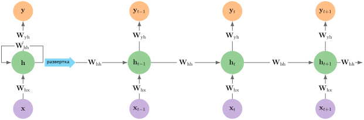

<em><strong>Развертка рекуррентной нейронной сети</strong>: левая панель показывает компактную рекуррентную петлю; правая разворачивает ее по шагам времени. Три матрицы весов используются совместно на всех шагах: $\mathbf{W}_{\text{hx}}$ (вход → скрытое состояние), $\mathbf{W}_{\text{hh}}$ (скрытое состояние → скрытое состояние) и $\mathbf{W}_{\text{yh}}$ (скрытое состояние → выход). Эти матрицы переиспользуются на каждом шаге, поэтому число параметров не зависит от длины последовательности. Для скрытого состояния размерности 128 и входа размерности 100 каждый шаг времени требует 16 384 MAC для рекуррентных связей и 12 800 для проекции входа.</em>

Развертывание рекуррентного цикла на $S$ шагов раскрывает алгоритмические свойства рекуррентности. Число параметров не зависит от длины последовательности $S$, потому что матрицы весов $\mathbf{W}_{\text{hh}}$ и $\mathbf{W}_{\text{hx}}$ используются совместно на всех шагах времени. Однако совместное использование весов по времени создает зависимость, переносимую через цикл: шаг $t$ не может вычислить $\mathbf{h}_t$, пока шаг $t-1$ не выдаст $\mathbf{h}_{t-1}$. Эта зависимость образует критический путь из $\mathcal{O}(S)$ последовательных операций, который не позволяет аппаратным ускорителям распараллеливать вычисления по оси последовательности.

Такая последовательная структура порождает принципиально различные характеристики памяти при выводе и обучении. При потоковом выводе RNN вычисляет по одному шагу за раз, отбрасывает предыдущие сырые входы и хранит только текущее скрытое состояние. Накладные расходы памяти на состояние строго равны $\mathcal{O}(d_{\text{hidden}})$, независимо от того, охватывает ли последовательность 10 или 10 000 шагов. Напротив, обучение методом обратного распространения во времени (BPTT) разворачивает граф на всю последовательность длины $S$. Вычисление градиентов по правилу цепочки требует вычисления произведения якобианов по всем промежуточным переходам:

$$
\frac{\partial \mathcal{L}}{\partial \mathbf{h}_0} = \frac{\partial \mathcal{L}}{\partial \mathbf{h}_S} \prod_{t=1}^{S} \frac{\partial \mathbf{h}_t}{\partial \mathbf{h}_{t-1}}
$$

Чтобы вычислить эти произведения якобианов, движок обучения должен хранить промежуточные активации $\mathbf{h}_1, \mathbf{h}_2, \dots, \mathbf{h}_S$ в памяти ускорителя. Таким образом, BPTT превращает рабочее состояние $\mathcal{O}(d_{\text{hidden}})$ в объем памяти $\mathcal{O}(S \cdot d_{\text{hidden}})$ при обучении. Кроме того, многократное умножение на $\mathbf{W}_{\text{hh}}$ приводит к тому, что градиенты экспоненциально затухают или взрываются на длинных горизонтах, ограничивая эффективное контекстное окно простых RNN. Рекуррентная матрица весов часто содержит связи с минимальным вкладом во временные зависимости, что позволяет существенно сжимать ее методами, описанными в главе [«Сжатие моделей»](10_model_compression.md).

<a id="sec-network-architectures-computational-mapping-701d"></a>

### Вычислительное отображение

Перевод рекуррентных уравнений в аппаратное исполнение показывает, как математические абстракции отображаются на ядра ускорителей, иерархии памяти и вложенные циклы. Если сверточные слои используют пространственную локальность и переиспользование весов по тайлам ([«Архитектурные принципы»](06_nn_architectures.md#sec-network-architectures-architectural-principles-engineering-tradeoffs-362e)), то рекуррентные шаги раскладываются на умножения матрицы на вектор или матрицы на матрицу, ограниченные сериализацией потока данных.

[«Шаг рекуррентного слоя»](06_nn_architectures.md#lst-rnn_layer_step) показывает механизм одного шага времени с помощью матричных операций уровня фреймворка: объединить предыдущее скрытое состояние с текущим входом, прибавить смещение и применить активацию, чтобы получить следующее скрытое состояние. Код намеренно ограничен одним шагом, потому что системная стоимость связана не с самим шагом, а с цепочкой зависимостей, которая мешает параллельному исполнению по времени.

<a id="lst-rnn_layer_step"></a>

**Абстракция рекуррентного слоя**: реализация уровня фреймворка, которая на каждом шаге времени объединяет два матричных умножения, $\mathbf{h}_{t-1}\mathbf{W}_{\text{hh}}$ и $\mathbf{x}_t\mathbf{W}_{\text{hx}}$. Для скрытого состояния размерности 128 и входа размерности 100 каждый шаг требует 16 384 + 12 800 = 29 184 MAC, но последовательные зависимости мешают распараллеливанию по времени.

```python
def rnn_layer_step(x_t, h_prev, W_hh, W_hx, b):
    # x_t: вход в момент t (размер батча × размерность входа)
    # h_prev: предыдущее скрытое состояние (размер батча × размерность скрытого состояния)
    # W_hh: рекуррентные веса (размерность скрытого состояния × размерность скрытого состояния)
    # W_hx: входные веса (размерность входа × размерность скрытого состояния)
    h_t = activation(matmul(h_prev, W_hh) + matmul(x_t, W_hx) + b)
    return h_t
```

На уровне фреймворка `rnn_layer_step` скрывает структуру циклов и трафик памяти за высокоуровневыми матричными умножениями (`matmul`). На аппаратуре вычисление этого шага требует перемещения весов и активаций по иерархии памяти. Чтобы увидеть, где исполнение становится последовательным и где сохраняется параллелизм, [«Вычисление рекуррентного слоя»](06_nn_architectures.md#lst-rnn_layer_compute) раскрывает матричные операции в явные вложенные циклы вплоть до скалярных операций умножения с накоплением.

<a id="lst-rnn_layer_compute"></a>

**Вычисление рекуррентного слоя**: вложенные циклы раскрывают структуру последовательных зависимостей. Цикл 1 дает параллелизм по батчу, но циклы 2–3 должны завершиться до активации в цикле 4, и, что важно, каждый шаг времени зависит от выхода предыдущего шага, создавая последовательную глубину $\mathcal{O}(S)$, которая мешает распараллеливанию GPU по временной оси.

```python
def rnn_layer_compute(x_t, h_prev, W_hh, W_hx, b):
    # Инициализируем следующее скрытое состояние
    h_t = np.zeros_like(h_prev)

    # Цикл 1: обрабатываем каждую последовательность батча
    for batch in range(batch_size):
        # Цикл 2: вычисляем рекуррентный вклад (h_prev × W_hh)
        for i in range(hidden_dim):
            for j in range(hidden_dim):
                h_t[batch, i] += h_prev[batch, j] * W_hh[j, i]

        # Цикл 3: вычисляем вклад входа (x_t × W_hx)
        for i in range(hidden_dim):
            for j in range(input_dim):
                h_t[batch, i] += x_t[batch, j] * W_hx[j, i]

        # Цикл 4: добавляем смещение и применяем активацию
        for i in range(hidden_dim):
            h_t[batch, i] = activation(h_t[batch, i] + b[i])

    return h_t
```

Структура циклов раскрывает границы параллелизма рекуррентного исполнения. Цикл 1 показывает, что экземпляры батча полностью независимы: последовательности внутри батча распараллеливаются по ядрам ускорителя без взаимного влияния. Внутри каждого экземпляра батча циклы 2 и 3 выполняют рекуррентное преобразование ($\mathbf{h}_{t-1}\mathbf{W}_{\text{hh}}$) и проекцию входа ($\mathbf{x}_t\mathbf{W}_{\text{hx}}$). Обе редукции должны полностью накопиться, прежде чем цикл 4 сможет поэлементно прибавить смещение и применить функцию активации, чтобы получить $\mathbf{h}_t$.

При размерности входа 100 и размерности скрытого состояния 128 каждый шаг выполняет два матричных умножения: проекцию входа $100{\times}128$ и рекуррентное преобразование $128{\times}128$. Когда размер батча велик ($B \gg 1$), эти операции исполняются как обобщенные матричные умножения (GEMM) и достигают высокой арифметической интенсивности, поскольку веса, загруженные из памяти, переиспользуются по всем $B$ образцам. Когда размер батча мал ($B=1$, типично для потокового вывода в реальном времени), операции сворачиваются в умножения матрицы на вектор (GEMV). В GEMV каждый весовой параметр должен быть извлечен из памяти ради одной операции умножения с накоплением, а арифметическая интенсивность падает до $\approx 1$ FLOP/байт, оставляя вычислительные блоки ускорителя без работы.

<a id="sec-network-architectures-system-implications-18c3"></a>

### Системные последствия

Рекуррентные архитектуры накладывают жесткое физическое ограничение: *последовательную зависимость*. В отличие от MLP и CNN, где аппаратура может распараллеливать исполнение по нейронам, каналам и пространственным пикселям, RNN не может распараллелить вычисления по оси последовательности. Обновление $\mathbf{h}_t = \tanh(\mathbf{W}_{\text{hh}}\mathbf{h}_{t-1} + \mathbf{W}_{\text{hx}}\mathbf{x}_t)$ задает строгий порядок: шаг $t$ не может начаться, пока шаг $t-1$ не завершится и не запишет свой выход. Для входной последовательности длины $S = 1\,000$ системе нужно запустить 1 000 последовательных матричных умножений. Масштабирование вычислительной мощности или пропускной способности памяти ускоряет каждый отдельный шаг, но закон Амдала диктует, что задержка ограничена сериализованным критическим путем. Поэтому параллельное масштабирование строго ограничено измерением батча.

Во время вывода рекуррентные сети демонстрируют исключительную эффективность по памяти. Поскольку рекуррентное состояние сжимает историю в вектор фиксированного размера $\mathbf{h}_t$, память состояния при выводе растет как $\mathcal{O}(d_{\text{hidden}})$ (например, 2 КБ для состояния FP32 размерности 512) и остается полностью постоянной, будет ли длина последовательности $S$ равна 10 или 10 000 токенов. Этот постоянный объем памяти резко контрастирует с механизмами внимания ([«Внимание»](06_nn_architectures.md#sec-network-architectures-attention-mechanisms-dynamic-pattern-processing-22df)), где полное внимание по последовательности материализует матрицу оценок $\mathcal{O}(S^2)$ при предзаполнении (prefill), а авторегрессивная генерация поддерживает KV-кеш размером $\mathcal{O}(S \cdot d_{\text{model}})$. Для потокового развертывания на периферийной аппаратуре с ограниченной памятью, например на микроконтроллерах, рабочее состояние RNN размером $\mathcal{O}(1)$ устраняет исчерпание памяти, которое ограничивает трансформеры.

Рекуррентное исполнение демонстрирует особое поведение иерархии памяти: высокую временную локальность параметров, но низкую операционную интенсивность при стандартной диспетчеризации фреймворка. Матрицы весов $\mathbf{W}_{\text{hh}}$ и $\mathbf{W}_{\text{hx}}$ переиспользуются на каждом шаге времени и комфортно размещаются в SRAM или кеше L2, если модель помещается на кристалл. Однако наивный запуск отдельных ядер для проекции входа, рекуррентной проекции, прибавления смещения и активации на каждом шаге времени порождает сильные накладные расходы на запуск ядер и заставляет промежуточные тензоры постоянно перемещаться туда и обратно через HBM. Чтобы смягчить это узкое место пропускной способности памяти, промышленные рекуррентные среды исполнения объединяют проекции, прибавление смещения и активацию в одно монолитное ядро, которое удерживает $\mathbf{h}_t$ в регистрах GPU и разделяемой памяти на протяжении всего исполнения последовательности.

Это архитектурное противоречие между состоянием фиксированной емкости и сериализованным исполнением определяло обработку последовательностей до появления трансформеров. Хотя рекуррентные сети поддерживают постоянные накладные расходы памяти независимо от длины последовательности, последовательная зависимость мешает аппаратуре распараллеливать вычисления по шагам времени, а состояние фиксированной емкости становится информационным узким местом, в котором ранние входы затухают на длинных промежутках (проблема затухающего градиента). Преодоление обоих ограничений требовало архитектуры, способной устанавливать прямые связи, адресуемые по содержимому, между произвольными позициями последовательности без промежуточных рекуррентных шагов: это механизм внимания ([«Внимание»](06_nn_architectures.md#sec-network-architectures-attention-mechanisms-dynamic-pattern-processing-22df)). Для развернутых рекуррентных конвейеров методы смягчения, такие как слияние операторов и конвейерный параллелизм, разобраны в разделе [«Оптимизация потоков данных»](11_hw_acceleration.md#sec-hardware-acceleration-dataflow-optimization-strategies-ce52) главы [«Аппаратное ускорение»](11_hw_acceleration.md).

<a id="sec-network-architectures-attention-mechanisms-dynamic-pattern-processing-22df"></a>

## Внимание: динамическая обработка

Рекуррентные сети сериализуют исполнение вдоль оси последовательности и сжимают всю историческую информацию в скрытый вектор фиксированной емкости ([«Системные последствия RNN»](06_nn_architectures.md#sec-network-architectures-system-implications-18c3)). В предложении «Кошка, которая сидела у окна с видом на сад, спала» подлежащее «кошка» и сказуемое «спала» разделяют восемь промежуточных слов, однако они образуют основную синтаксическую и смысловую связь. RNN должна обрабатывать все промежуточные токены последовательно, рискуя потерять информацию на промежуточных рекуррентных переходах, и при этом не дает аппаратуре распараллелить вычисления по шагам времени. Это ограничение порождает альтернативный вычислительный шаблон: операцию, которая напрямую вычисляет релевантность между любыми двумя позициями независимо от расстояния.

Механизмы внимания[^fn-bahdanau-dynamic-attention] устраняют это ограничение (Bahdanau et al., 2015), вводя динамические шаблоны связности, которые адаптируются к содержимому входа. Вместо того чтобы пропускать весь контекст через один вектор состояния фиксированной емкости, внимание «кодировщик — декодер» вычисляет оценки сходства между каждым состоянием декодера и всеми позициями входа кодировщика, динамически направляя информацию по последовательности.

[^fn-bahdanau-dynamic-attention]: **Внимание Баданау**: этот подход разрушил «узкое место фиксированной длины вектора» у прежних моделей «последовательность в последовательность», позволив декодеру на каждом шаге вывода динамически запрашивать все элементы входа, что и создает описанную адаптивную связность. Структурное ограничение канала фиксированной емкости заменила обучаемая взвешенная схема, основанная на содержимом. Основной компромисс состоял в том, чтобы принять линейную по $S$ стоимость памяти $\mathcal{O}(S)$ за хранение всех состояний входа ради преодоления потери информации, неизбежной для одного вектора.

<a id="dfn-nn-architectures-attention-mechanisms"></a>

> **Механизмы внимания**
>
> ***Механизмы внимания*** — это операции нейронных сетей, которые вычисляют взвешенную сумму векторов значений, где веса выводятся из выученных оценок сходства между вектором запроса и набором векторов ключей. Это обеспечивает динамическую маршрутизацию информации, зависящую от содержимого, между любыми двумя позициями последовательности.
>
> 1.  **Значение**: внимание связывает любые два токена на глубине $\mathcal{O}(1)$, но вычисляет $S^2$ взаимодействий оценок. Если эти оценки материализуются, последовательность из 4 096 токенов с 16-битными оценками занимает 33,6 МБ на слой на голову (около 16,8 млн оценок по 2 байта каждая), напрямую увеличивая члены $D_{\text{vol}}$ и $\text{BW}$ железного закона. Блочные алгоритмы точного внимания позволяют не хранить полную матрицу, но плотное вычисление оценок остается квадратичным.
> 2.  **Отличие**: в отличие от RNN, которые сжимают весь прежний контекст в один вектор состояния фиксированного размера, механизмы внимания сохраняют представления токенов и вычисляют оценки релевантности напрямую. Во время обучения или при полном предзаполнении последовательности (prefill), то есть первом проходе, который обрабатывает весь промпт, число взаимодействий оценок растет квадратично с длиной последовательности. При авторегрессивной генерации сохраненный KV-кеш (ключи и значения предыдущих токенов) растет как $\mathcal{O}(S d_{\text{model}})$, пока каждый новый токен обращает внимание на прежние ключи и значения.
> 3.  **Типичная ошибка**: частое заблуждение состоит в том, что внимание — это универсальная схема взвешивания, которую можно свободно применять везде. Квадратичное вычисление оценок — жесткое ограничение масштабирования: удвоение контекста учетверяет число взаимодействий оценок. Наивные реализации также учетверяют хранение оценок; блочные точные алгоритмы вроде FlashAttention избегают полной матрицы, а разреженные варианты сокращают число вычисляемых оценок.

Хотя механизмы внимания сначала использовались как компоненты внутри рекуррентных архитектур, их способность связывать любую позицию с любой другой сделала рекуррентную структуру ненужной для многих задач над последовательностями. Архитектура трансформера[^fn-transformer-parallel-attention] (Vaswani et al., 2017) объединила внимание с полносвязными слоями, остаточными связями, нормализацией и позиционной информацией без рекуррентности. Этот архитектурный сдвиг обменял последовательный путь RNN длиной $\mathcal{O}(S)$ на постоянную длину пути между позициями внутри одного слоя внимания, что позволило распараллеливать вычисления по позициям последовательности на высокопроизводительных ускорителях.

[^fn-transformer-parallel-attention]: **Трансформер**: в основополагающей статье «Attention Is All You Need» была явно заявлена системная мысль: параллельный механизм внимания способен полностью заменить последовательную рекуррентную обработку. Этот архитектурный компромисс снимает ограничение RNN на длину пути $\mathcal{O}(S)$ для параллелизма, но вводит плотное вычисление оценок $\mathcal{O}(S^2)$; наивные реализации также материализуют хранение оценок $\mathcal{O}(S^2)$. Это квадратичное вычисление продолжает определять инженерию контекстного окна.

Архитектура трансформера ([«Трансформеры»](06_nn_architectures.md#sec-network-architectures-transformers-attentiononly-architecture-1b56)) наследует основные системные свойства от внимания: маршрутизацию, зависящую от содержимого, параллельное исполнение последовательности и квадратичное масштабирование оценок. Анализ системных последствий этого класса архитектур начинается с базовой задачи обработки паттернов, которую решает внимание.

<a id="sec-network-architectures-pattern-processing-needs-4b64"></a>

### Потребности в обработке паттернов

Обработка динамических паттернов относится к сценариям, в которых связи между элементами не заданы архитектурой, а возникают из содержимого. Машинный перевод хорошо иллюстрирует эту задачу: при переводе фразы «the bank by the river» понимание слова *bank* требует обращения к слову *river*, а во фразе «the bank approved the loan» важной оказывается связь со словами *approved* и *loan*. В отличие от RNN, которые обрабатывают информацию последовательно, или CNN, которые используют фиксированные пространственные шаблоны, динамическая обработка последовательностей требует операции, которая оценивает связи на основе идентичности токенов. Схема разрешения местоимения в [«Иллюстративном паттерне внимания»](06_nn_architectures.md#fig-transformer-attention-visualized) делает эту динамическую маршрутизацию видимой.

<a id="fig-transformer-attention-visualized"></a>

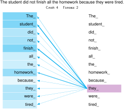

***Иллюстративный паттерн внимания**: схематичный паттерн внимания для местоимения «they». Толщина линий отражает гипотетическую величину веса внимания: сильнее всего связаны «student», «finish» и «homework». Один слой внимания связывает все позиции напрямую и может вычислять их плотные взаимодействия параллельно.*

В [«Иллюстративном паттерне внимания»](06_nn_architectures.md#fig-transformer-attention-visualized) механизм внимания разрешает неоднозначное местоимение *they*, назначая большие веса релевантным токенам контекста, таким как *student* и *finish*; толщина линий показывает эти веса. Поскольку все попарные связи вычисляются параллельно, сеть улавливает эту дальнюю синтаксическую зависимость в одном слое, не передавая промежуточное состояние через промежуточные токены.

Обработка, зависящая от входа, выходит далеко за пределы языка. В предсказании структуры белков взаимодействия аминокислот зависят от химических свойств и пространственного расположения, а не только от позиции в цепи. В анализе графов графовые сверточные сети (GCN) агрегируют признаки по наблюдаемым соседям каждого узла (Kipf and Welling, 2017). В отличие от CNN, которые обращаются к памяти регулярными пространственными шагами, или трансформеров, которые работают с плотными тензорами последовательностей, агрегация соседей в GCN следует нерегулярной структуре смежности входного графа. Каждый шаг сбора обращается к набору эмбеддингов узлов, специфичному для входа, что обесценивает предвыборку кеша и не дает объединять обращения к памяти. Нерегулярные шаблоны сбора соседей поэтому могут ограничивать исполнение пропускной способностью памяти и промахами кеша, а не пропускной способностью вычислений. В анализе документов связи между разделами зависят от смыслового содержания, а не от близости.

Зависимость от входа не означает связности «все со всеми». Плотное внимание вычисляет оценки для каждой пары элементов последовательности, тогда как GCN ограничивает агрегацию ребрами наблюдаемого графа. Графы, специфичные для входа, могут требовать разных расписаний сбора и обладать разной локальностью. Общая системная трудность в том, что вычислительный или шаблон доступа к памяти реагирует на вход, а не следует фиксированному шаблону. Даже когда размерности тензоров остаются фиксированными, оценки, зависящие от содержимого, определяют, какая информация выделяется. Внимание дает один механизм для выучивания таких связей, а плотное самовнимание составляет основу архитектуры трансформера.

<a id="sec-network-architectures-algorithmic-structure-8468"></a>

### Алгоритмическая структура

Чтобы удовлетворить требованиям динамической маршрутизации из [«Потребностей в обработке паттернов»](06_nn_architectures.md#sec-network-architectures-pattern-processing-needs-4b64), нужен формальный оператор, который отображает последовательности переменной длины в веса сродства, зависящие от содержимого (Bahdanau et al., 2015). Архитектура трансформера реализует это отображение через оператор масштабированного скалярного произведения внимания, введенный (Vaswani et al., 2017):

$$
\text{Внимание}(\mathbf{Q}, \mathbf{K}, \mathbf{V}) = \text{softmax}
\left(\frac{\mathbf{Q}\mathbf{K}^T}{\sqrt{d_k}}\right)\mathbf{V}
$$

Входы $\mathbf{Q}$ (запросы), $\mathbf{K}$ (ключи) и $\mathbf{V}$ (значения)[^fn-attention-qkv-projections] — это выученные линейные проекции представлений токенов. Для входной последовательности длины $S$, спроецированной в размерность $d_k$, скалярное произведение $\mathbf{Q}\mathbf{K}^T$ вычисляет все $S^2$ попарных сходств токенов (раздел [«Скалярное произведение как мера сходства»](appendix_algorithm.md#sec-appdx-algorithm-foundations-dot-product-similarity-7957) приложения «Основы алгоритмов» формализует скалярное произведение как меру сходства). Масштабирование на $1/\sqrt{d_k}$ не дает скалярным произведениям расти по величине при больших размерностях, что иначе загнало бы softmax в области с практически нулевыми градиентами. Оператор softmax[^fn-softmax-normalization-reduction] нормирует каждую строку матрицы оценок в распределение вероятностей по позициям ключей. Наконец, умножение этих нормированных весов на $\mathbf{V}$ дает выходные векторы, которые образуют взвешенные комбинации представлений значений.

[^fn-softmax-normalization-reduction]: **Softmax**: название происходит от «мягкой» (дифференцируемой) версии argmax, а математические корни восходят к статистической механике Больцмана. Softmax нормирует каждую строку запроса по всем $S$ оценкам; наивная реализация внимания материализует полную матрицу $S{\times}S$ до нормировки. Онлайновый softmax и блочная обработка, которые использует FlashAttention, вместо этого поддерживают текущие статистики нормировки и вычисляют точное внимание без хранения всей матрицы в HBM. Таким образом, softmax требует редукции по каждой строке, но не вынуждает к квадратичному вспомогательному хранению; плотное вычисление попарных оценок остается квадратичным.

[^fn-attention-qkv-projections]: **Запрос — ключ — значение (QKV)**: терминология заимствована из информационного поиска, что объясняет, почему уравнение использует три различные выученные проекции для вычисления попарных оценок. Создание этих проекций требует трех независимых матриц весов, стоящих $3 \times d_{\text{model}}^2$ параметров на слой. Прямое системное следствие — «KV-кеш» для авторегрессивного вывода: все прежние векторы ключей и значений должны храниться для следующего токена, поэтому память растет линейно ($\mathcal{O}(S)$) с длиной последовательности и может доминировать в памяти обслуживания при длинных контекстах или высокой параллельности.

[«Механизм внимания: запрос, ключ, значение»](06_nn_architectures.md#fig-attention) иллюстрирует этот вычислительный поток для последовательности длины $S = 6$. Каждая строка получающейся матрицы $S{\times}S$ определяет, насколько сильно отдельный токен обращает внимание на каждый токен последовательности. В обученной модели наибольшие значения сходства отражают сильные контекстные зависимости, тогда как значения, близкие к нулю, подавляют нерелевантные позиции.

<a id="fig-attention"></a>

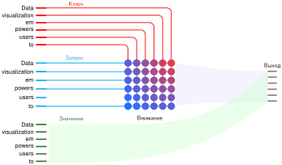

<em><strong>Механизм внимания «запрос — ключ — значение»</strong>: для последовательности из 6 токенов запросы (голубые) сопоставляются с ключами (красными), давая матрицу внимания $6{\times}6$ с $\mathcal{O}(S^2)$ элементами. Цвет ячеек идет от синего к красному по сетке как иллюстративный градиент, а не как вычисленные веса. Каждая выходная позиция агрегирует информацию из всех значений (зеленые), взвешенных собственной строкой этой матрицы. Структура матрицы показывает и вычислительный шаблон (тридцать шесть вычислений сходства), и наивное узкое место памяти (хранение $S^2$ весов внимания). Источник: Transformer Explainer (Cho et al., 2025).</em>

Хотя веса внимания динамически меняются вместе с входными токенами, генерация векторов запросов, ключей и значений требует статических линейных проекций на выученные матрицы параметров. В реализациях на ускорителях эти три операции объединяют в одно пакетное матричное умножение, чтобы максимально загрузить тензорные ядра и исключить накладные расходы на запуск ядер. [«Вычисление QKV-проекции»](06_nn_architectures.md#fig-attention-weightcalc) показывает эту объединенную проекцию: умножение матрицы эмбеддингов токенов $6{\times}768$ на упакованную весовую матрицу $768{\times}2304$ дает конкатенированные представления запросов, ключей и значений за один проход ядра.

<a id="fig-attention-weightcalc"></a>

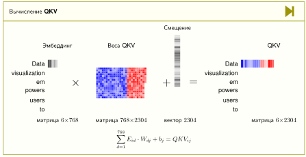

<em><strong>Вычисление QKV-проекции</strong>: матрица эмбеддингов ($6{\times}768$) умножается на весовые матрицы QKV ($768{\times}2304$) плюс смещение, давая объединенные проекции ($6{\times}2304$). Выходная размерность 2304 содержит конкатенированные проекции запросов, ключей и значений (каждая размерности 768). Это единое пакетное матричное умножение, требующее $6{\times}768{\times}2304$ = 10,6 млн MAC, заменяет 3 отдельные операции проекции ради эффективности. Источник: Transformer Explainer (Cho et al., 2025).</em>

<a id="sec-network-architectures-computational-mapping-13cd"></a>

### Вычислительное отображение

Перевод оператора внимания $\text{Внимание}(\mathbf{Q}, \mathbf{K}, \mathbf{V}) = \text{softmax}(\mathbf{Q}\mathbf{K}^T/\sqrt{d_k})\mathbf{V}$ в физическое исполнение раскрывает системную стоимость зависящей от данных связности. Вычисление попарных выравниваний требует двух различных матричных умножений на каждую голову внимания: GEMM для оценок ($\mathbf{Q}\mathbf{K}^T$) и GEMM для контекста ($\mathbf{A}\mathbf{V}$, где $\mathbf{A} = \text{softmax}(\mathbf{S})$). Для входа длины последовательности $S$ и размерности головы $d_k$ каждая фаза выполняет $S^2 d_k$ операций умножения с накоплением, что дает вычислительную сложность $\mathcal{O}(S^2 d_k)$ на голову.

[«Вычисление внимания в слое»](06_nn_architectures.md#lst-attention_layer_compute) сопоставляет высокоуровневую матричную запись с явной реализацией через циклы, которая раскрывает это квадратичное масштабирование. Матричная версия сводится к оптимизированным подпрограммам GEMM на тензорных ядрах ускорителя, тогда как версия с циклами показывает нижележащую структуру физического исполнения: итерации по батчу, квадратичные внутренние произведения «запрос — ключ», редукции softmax по строкам и финальный проход накопления значений по всем позициям последовательности.

<a id="lst-attention_layer_compute"></a>

**Вычисление внимания**: две реализации с одинаковой сложностью $\mathcal{O}(S^2\times d)$. Матричная форма (вверху) использует оптимизированный GEMM, а вложенные циклы (внизу) раскрывают квадратичные попарные сравнения: для длины последовательности 512 и размерности 64 вычисление оценок внимания требует $512{\times}512{\times}64$ = 16,8 млн MAC на голову внимания, плюс еще 16,8 млн MAC на агрегацию значений.

```python
def attention_layer_matrix(Q, K, V):
    # Q, K, V: (размер батча × длина последовательности × d_model)
    # Вычисляем оценки внимания
    scores = matmul(Q, K.transpose(-2, -1)) / sqrt(d_k)
    weights = softmax(scores)  # Нормируем оценки
    output = matmul(weights, V)  # Комбинируем значения
    return output

def attention_layer_compute(Q, K, V):
    # Инициализируем выходы
    scores = np.zeros((batch_size, seq_len, seq_len))
    outputs = np.zeros_like(V)

    # Цикл 1: обрабатываем каждую последовательность батча
    for b in range(batch_size):
        # Цикл 2: вычисляем внимание для каждой позиции запроса
        for i in range(seq_len):
            # Цикл 3: сравниваем с каждой позицией ключа
            for j in range(seq_len):
                # Вычисляем оценку внимания
                for d in range(d_model):
                    scores[b, i, j] += Q[b, i, d] * K[b, j, d]
                scores[b, i, j] /= sqrt(d_k)

        # Применяем softmax к оценкам
        for i in range(seq_len):
            scores[b, i] = softmax(scores[b, i])

        # Цикл 4: комбинируем значения с весами внимания
        for i in range(seq_len):
            for j in range(seq_len):
                for d in range(d_model):
                    outputs[b, i, d] += scores[b, i, j] * V[b, j, d]

    return outputs
```

<a id="sec-network-architectures-system-implications-05a3"></a>

### Системные последствия

Механизмы внимания демонстрируют отличительные системные шаблоны, которые отличаются от предыдущих архитектур из-за требований к динамической связности. В терминах железного закона ([«Железный закон машинного обучения»](01_introduction.md#sec-introduction-iron-law-ml-systems-c32a)) внимание смещает узкое место с ограниченного задержкой последовательного пути RNN к квадратичным взаимодействиям оценок и перемещению данных, которое зависит от реализации. Наивные реализации материализуют матрицу внимания $\mathcal{O}(S^2)$, тогда как блочные алгоритмы вроде FlashAttention избегают хранения полной матрицы, пересчитывая и потоково пропуская блоки через более быструю память (см. раздел [«Доказательство тайлинга FlashAttention и рекуррентности online softmax»](appendix_algorithm.md#sec-appdx-algorithm-flash-attention) приложения «Основы алгоритмов», где разобраны пошаговая рекуррентная формула онлайнового softmax и вывод сокращения ввода-вывода).

<a id="sec-network-architectures-memory-requirements-72c3"></a>

#### Требования к памяти

Механизмам внимания нужно хранилище для проекций «запрос — ключ — значение» и промежуточных признаковых представлений. Наивная реализация также материализует матрицу весов внимания $S{\times}S$ для каждой последовательности и каждой головы, создавая квадратичное узкое место памяти наряду с входами и выходами размера $S{\times}d$. Для длинных последовательностей эти переходные оценки могут доминировать в памяти ускорителя, хотя выученные матрицы проекций сохраняют фиксированный размер. Блочные ядра точного внимания, такие как FlashAttention, потоково пропускают блоки оценок через более быструю память и не хранят полную матрицу в HBM, однако по-прежнему вычисляют $S^2$ плотных взаимодействий. Это различие отделяет неизбежную квадратичную вычислительную стоимость плотного внимания от необязательного квадратичного хранения оценок. Без блочной обработки ядер материализация промежуточных матриц оценок быстро исчерпывает высокоскоростную память ускорителя при промышленных длинах последовательностей.

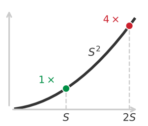

*Удвоение контекста учетверяет число взаимодействий оценок и наивное хранение оценок.*

<a id="nbk-nn-architectures-quadratic-bottleneck"></a>

> **Квадратичное узкое место**
>
> **Задача**: сколько памяти требует материализованная матрица внимания при длине последовательности $S =$ 100 000 (контекстное окно)?
>
> **Расчет**:
>
> 1.  **Размер матрицы**: матрица оценок внимания $(\mathbf{Q}\mathbf{K}^T)$ имеет размерность $S{\times}S$ на голову, для $N_{\text{heads}}$ голов (в этом примере 12 голов).
> 2.  **Элементы**: 100 000 $\times$ 100 000 $\times$ 12 голов = 1,2 $\times$ 10¹¹ элементов.
> 3.  **Память**: при FP16 (2 байта на элемент): 1,2 $\times$ 10¹¹ $\times$ 2 байта = 240 ГБ.
> 4.  **Сохраняемые слои**: 240 ГБ на слой $\times$ 32 сохраняемых слоя = 7 680 ГБ.
>
>
> **Системный вывод**: материализованная матрица внимания занимает 240 ГБ на слой. Наивное обучение, сохраняющее оценки всех 32 слоев для обратного прохода, потребовало бы 7 680 ГБ, что намного превышает емкость любого отдельного GPU. Эта стена памяти мотивирует две широкие стратегии реализации, которые рассматриваются далее: не материализовать полную матрицу, разбивая вычисление на блоки, или сократить число вычисляемых оценок.

<a id="sec-network-architectures-computation-needs-7a5d"></a>

#### Вычисления и перемещение данных

Вычисление внимания делится на две основные фазы GEMM, между которыми стоит редукция по строкам: генерация попарных оценок «запрос — ключ» и вычисление взвешенных сумм по значениям. Внутренние произведения «запрос — ключ» требуют $B \times H \times S^2 \times d_k$ операций MAC, симметрично повторяемых на стадии агрегации значений. Промежуточный softmax требует поиска максимума по строкам, возведения в экспоненту и суммирования. В отличие от статических сверток с весами, где веса фильтров переиспользуются в фиксированных позициях сетки, внимание вычисляет временные, зависящие от входа матрицы сходства, которые нужно пересчитывать для каждой конфигурации токенов.

<a id="chk-nn-architectures-quadratic-scaling-intuition"></a>

> **Интуиция квадратичного масштабирования**
>
> Масштабирование для длинного контекста определяется стоимостью внимания. Проверьте свою интуицию:
>
> - **Квадратичный рост**: можете ли вы объяснить, почему удвоение длины последовательности учетверяет плотные взаимодействия оценок и материализованную матрицу оценок?
> - **Граница блочной обработки**: можете ли вы объяснить, почему плотное внимание на длинном контексте остается дороже даже тогда, когда блочная обработка устраняет хранение полной матрицы?

Перемещение данных в механизме внимания создает шаблоны доступа к памяти, которые отличаются от операций с фиксированным шаблоном. Вычисление внимания требует проецирования и потокового чтения тензоров запросов, ключей и значений, а затем маршрутизации векторов значений согласно динамически вычисленным оценкам. В наивных реализациях размещение промежуточной матрицы оценок $S \times S$ в глобальной памяти HBM/DRAM превращает материализацию оценок в главное узкое место пропускной способности. Статические свертки выигрывают от предсказуемых кеш-линий, а RNN переиспользуют веса во времени, тогда как наивное внимание порождает огромные короткоживущие активационные объемы, которые не вмещаются в стандартные объемы кеша на кристалле.

<a id="exmp-nn-architectures-quadratic-wall"></a>

> **Квадратичная стена**
>
> **Сценарий**: ранние развертывания BERT жестко ограничивали контекст последовательностью в 512 токенов при выводе и предзаполнении (Devlin et al., 2019).
>
> **Диагностика**: стандартное самовнимание материализует матрицу оценок $S \times S$, память которой растет квадратично ($\mathcal{O}(S^2)$). Увеличение длины последовательности с 512 до 4 096 токенов увеличивает память оценок в 64 раза и вызывает аварийное завершение из-за нехватки памяти GPU.
>
> **Системный урок**: сверхлинейный рост памяти превращает алгоритмическую сложность в аппаратные узкие места. Обслуживание длинных последовательностей требует блочной обработки ввода-вывода в духе FlashAttention, разреженного внимания или строгого усечения токенов, чтобы ограничить объем активаций в SRAM.

Внимание заменяет последовательное узкое место скрытого состояния рекуррентных моделей динамической маршрутизацией постоянной глубины, но переносит системную нагрузку на квадратичное масштабирование арифметики и интенсивный трафик пропускной способности памяти. В сочетании с полносвязными слоями, остаточными связями и нормализацией этот примитив позволяет параллельно обрабатывать последовательности от начала до конца на современных ускорителях. Архитектура трансформера ([«Трансформеры»](06_nn_architectures.md#sec-network-architectures-transformers-attentiononly-architecture-1b56)) строится непосредственно на этом фундаменте и задает доминирующую архитектурную парадигму современных крупномасштабных систем машинного обучения.

<a id="sec-network-architectures-transformers-attentiononly-architecture-1b56"></a>

## Трансформеры: параллельная обработка последовательностей

Внимание дает вычислительный примитив динамической маршрутизации между позициями, зависящей от содержимого, однако изначально оно надстраивалось над рекуррентными архитектурами и унаследовало их последовательное узкое место. **Архитектура трансформера** устраняет рекуррентность, сочетая внимание с полносвязными слоями, остаточными связями, нормализацией и позиционной информацией. Это позволяет вычислять параллельно по позициям последовательности при полной обработке последовательности, сохраняя динамическую связность. Этот архитектурный сдвиг порождает особые физические затраты: квадратичное вычисление плотных оценок при предзаполнении, накопление состояния «ключ — значение» при обслуживании и сильное давление на пропускную способность памяти при авторегрессивной генерации.

<a id="dfn-nn-architectures-transformers"></a>

> **Трансформеры**
>
> ***Трансформеры*** — это архитектуры нейронных сетей, которые сочетают самовнимание, полносвязные слои, остаточные связи, нормализацию и позиционную информацию без рекуррентности, что позволяет параллельно обрабатывать позиции последовательности при обучении и предзаполнении.
>
> 1.  **Значение**: параллелизм — главная системная выгода. RNN, обрабатывающая последовательность из $S$ токенов, выполняет $S$ последовательно зависимых шагов. Трансформер обрабатывает все позиции последовательности одновременно, отображая взаимодействия токенов в крупные матричные умножения (GEMM), которые максимизируют загрузку вычислительных блоков ускорителя. Плотное самовнимание вычисляет $\mathcal{O}(S^2)$ попарных взаимодействий оценок, а наивные реализации материализуют промежуточный тензор активаций $\mathcal{O}(S^2)$ в памяти с высокой пропускной способностью (HBM).
> 2.  **Отличие**: в отличие от внимания внутри рекуррентной основы, которая наследует последовательный путь $\mathcal{O}(S)$ родительской архитектуры, трансформеры используют внимание как основную операцию смешивания между позициями, чередуя ее с поэлементными полносвязными сетями.
> 3.  **Типичная ошибка**: частое заблуждение состоит в том, что у трансформеров «бесконечный контекст». Длина контекста ограничена двумя различными объемами памяти: матрицей активаций оценок внимания $\mathcal{O}(S^2)$ при обучении и предзаполнении и KV-кешем $\mathcal{O}(S)$, который накапливается при авторегрессивном обслуживании. При длинных последовательностях объем KV-кеша может сравняться с весами статической модели или превзойти их, и тогда управление KV-кешем и эффективность пропускной способности памяти становятся главными инженерными ограничениями.

<a id="sec-network-architectures-pattern-processing-needs-9daf"></a>

### Потребности в обработке паттернов

Механизмы внимания впервые появились как дополнение к рекуррентным архитектурам «последовательность в последовательность» (Sutskever et al., 2014; Bahdanau et al., 2015). Эти гибридные модели улучшили динамическую связность на длинных контекстах, но сохранили цикл рекуррентного обновления состояния: шаг $t$ по-прежнему строго зависел от шага $t-1$, что мешало параллельному исполнению по позициям последовательности на параллельной аппаратуре. Устранение рекуррентности требует заменить последовательное распространение состояния связями «все со всеми» между элементами последовательности, обменяв ограниченную память на шаг на параллельное исполнение на ускорителе.

Архитектура трансформера (Vaswani et al., 2017) делает самовнимание основным примитивом смешивания между позициями в паре с позиционными кодировками, которые вносят порядок последовательности. Этот архитектурный выбор обменивает пространственную параметрическую эффективность CNN и ограниченное состояние шага $\mathcal{O}(1)$ у RNN на неограниченный параллелизм по последовательности при обучении и предзаполнении.

<a id="sec-network-architectures-algorithmic-structure-60ef"></a>

### Алгоритмическая структура

Архитектурный сдвиг в трансформерах опирается на слои самовнимания. В отличие от внимания «кодировщик — декодер», где запросы берутся из целевой последовательности, а ключи и значения — из исходной, самовнимание получает запросы, ключи и значения из одной и той же входной последовательности $\mathbf{X}$. Такая самореференциальность всех трех проекций позволяет модели разрешать зависимости внутри последовательности на произвольных расстояниях между токенами без промежуточных рекуррентных шагов. [«Самовнимание»](06_nn_architectures.md#eq-self-attention) формализует это преобразование:

<a id="eq-self-attention"></a>

$$
\text{Самовнимание}(\mathbf{X}) = \text{softmax}
\left(\frac{\mathbf{X}\mathbf{W}_Q(\mathbf{X}\mathbf{W}_K)^T}{\sqrt{d_k}}\right)\mathbf{X}\mathbf{W}_V
$$

Здесь $\mathbf{X}$ — входная последовательность, а $\mathbf{W}_Q$, $\mathbf{W}_K$ и $\mathbf{W}_V$ — выученные матрицы весов для запросов, ключей и значений соответственно. Эта запись показывает, что самовнимание выводит все свои компоненты из одного и того же входа, создавая динамический шаблон обработки, зависящий от содержимого. Поскольку матричное умножение и построчный softmax действуют симметрично по измерению токенов, самовнимание строго перестановочно-эквивариантно: перестановка строк $\mathbf{X}$ лишь так же переставляет строки выхода, то есть последовательность рассматривается как неупорядоченное множество. Поэтому позиционные кодировки — будь то синусоидальные векторы, добавляемые к представлениям, или поворотные позиционные эмбеддинги (rotary position embeddings), применяемые к ним, — вносятся в представления, чтобы разрушить эту симметрию и закодировать порядок слов и относительное расстояние.

Трансформеры расширяют одноголовое самовнимание, выполняя несколько операций внимания параллельно через многоголовое внимание. Вместо того чтобы вычислять один набор весов внимания по $d_{\text{model}}$ измерениям, архитектура проецирует запросы, ключи и значения в $N_{\text{heads}}$ различных подпространств меньшей размерности $d_k = d_{\text{model}} / N_{\text{heads}}$. Каждая голова одновременно обращает внимание на свои шаблоны представлений. Их выходы конкатенируются и проецируются через выходную матрицу $\mathbf{W}^O$, как записано в [«многоголовом внимании»](06_nn_architectures.md#eq-multihead-attention):

<a id="eq-multihead-attention"></a>

$$
\text{MultiHead}(\mathbf{Q}, \mathbf{K}, \mathbf{V}) = \text{Concat}(\text{голова}_1, \ldots, \text{голова}_{N_{\text{heads}}})\mathbf{W}^O
$$

где каждая голова внимания вычисляется как:

$$
\text{голова}_i = \text{Внимание}(\mathbf{Q}\mathbf{W}_i^Q, \mathbf{K}\mathbf{W}_i^K, \mathbf{V}\mathbf{W}_i^V)
$$

Масштабирующий множитель $\sqrt{d_k}$ обеспечивает численную стабильность и стабильность градиентов. Если считать компоненты запроса и ключа независимыми случайными величинами с нулевым средним и единичной дисперсией, их скалярное произведение $\mathbf{q}_i \cdot \mathbf{k}_j = \sum_{m=1}^{d_k} q_{im} k_{jm}$ имеет нулевое среднее и дисперсию $d_k$. Без масштабирования большие размерности головы загоняют скалярные произведения в области, где функция softmax насыщается и градиенты почти нулевые. Деление на $\sqrt{d_k}$ нормирует дисперсию к единице, сохраняя стабильные градиенты и обеспечивая эффективное обучение.[^fn-attention-variance-scaling]

[^fn-attention-variance-scaling]: **Масштабирование внимания $(\sqrt{d_k})$**: эта нормировка напрямую компенсирует линейный рост дисперсии $(d_k)$ скалярного произведения «запрос — ключ», не давая softmax насыщаться там, где градиенты иначе исчезли бы. Системное следствие особенно заметно при смешанной точности обучения: когда активации становятся большими, немасштабированные скалярные произведения могут давать логиты, которые выходят за пределы 16-битного диапазона чисел с плавающей запятой, и тогда обучение дестабилизируется или полностью останавливается.

Концептуально внимание реализует дифференцируемую память, адресуемую по содержимому. Тогда как обычные архитектуры памяти извлекают сохраненные значения по явным адресам, самовнимание использует вектор запроса $\mathbf{q}_i$, чтобы оценить сходство со всеми кандидатами-ключами $\mathbf{K} \in \mathbb{R}^{S \times d_k}$. Получающееся распределение softmax дает непрерывную интерполяцию по векторам значений $\mathbf{V} \in \mathbb{R}^{S \times d_v}$, работая как дифференцируемая операция поиска.

С точки зрения теории информации механизмы внимания реализуют плавную агрегацию информации. Веса softmax образуют категориальное распределение по позициям ключей, а энтропия распределения показывает, насколько сфокусирована или размыта маршрутизация (Cover and Thomas, 2006). Это уравновешивает две конкурирующие цели: сосредоточить вероятностную массу на релевантных токенах, сохраняя достаточную энтропию, чтобы избежать хрупких жестких решений о выборе.

Однако многоголовое внимание полного ранга часто демонстрирует структурную избыточность: несколько голов выучивают коррелированные карты внимания. Кроме того, экспонента в softmax создает острую чувствительность к исчезновению и переполнению в форматах с пониженной точностью. Эти особенности, важные для аппаратуры, мотивируют структурное прореживание, низкоранговую факторизацию, разреженные шаблоны внимания и специализированные стратегии квантования, которые подробно описаны в главе [«Сжатие моделей»](10_model_compression.md).

Самовнимание выучивает динамические шаблоны активации по входной последовательности. В отличие от CNN, которые применяют фиксированные фильтры, или RNN, которые используют фиксированные шаблоны рекуррентности, внимание выучивает, какие элементы должны активироваться совместно, на основе их содержимого. Обученные головы внимания часто специализируются на разных синтаксических или смысловых шаблонах (Clark et al., 2019), динамически подстраивая эффективный граф связности под каждую входную последовательность.

Архитектура трансформера применяет этот механизм самовнимания внутри более широкой структуры, которая обычно включает полносвязные слои, послойную нормализацию и остаточные связи. [«Архитектура трансформера (кодировщик — декодер)»](06_nn_architectures.md#fig-transformer) показывает, как входные токены проходят через повторяющиеся блоки внимания и полносвязные блоки, каждый из которых обернут остаточными связями и нормализацией, и выходят как контекстуализированные представления. Поскольку все позиции можно обрабатывать параллельно, а не последовательно, архитектура обменивает рекуррентное состояние на крупные матричные операции, хорошо отображаемые на обучение на ускорителях.

<a id="fig-transformer"></a>

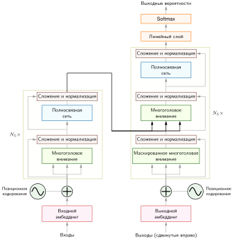

<em><strong>Архитектура трансформера (кодировщик — декодер)</strong>: полная архитектура. Кодировщик (слева, повторяется $N_L$ раз) состоит из многоголового внимания, за которым следуют полносвязные слои, каждый с остаточными связями (стрелки в обход блоков) и послойной нормализацией. Декодер (справа) добавляет маскированное внимание, чтобы не обращаться к будущим токенам при авторегрессивной генерации. Позиционные кодировки (синусоидальные волны) вносят информацию о порядке последовательности, которой нет в инвариантной к перестановкам операции внимания. Такая конструкция обеспечивает параллелизм обучения по всем позициям, а декодер при выводе сохраняет авторегрессивную причинность. Источник: (Vaswani et al., 2017).</em>

<a id="sec-network-architectures-computational-mapping-aea3"></a>

### Вычислительное отображение

Рост длины последовательности $S$ бросает вызов иерархиям памяти ускорителей, потому что полное самовнимание масштабируется квадратично с длиной контекста. [«Взрыв контекстного окна»](06_nn_architectures.md#fig-context-explosion) иллюстрирует эту траекторию: ранние трансформеры работали с контекстными окнами от 512 до 2 048 токенов (Devlin et al., 2019; Radford et al., 2019; Brown et al., 2020), тогда как современные промышленные модели поддерживают окна от 128 тыс. до более чем миллиона токенов (OpenAI, 2023; Anthropic, 2023; Google, 2024). Названия продуктов здесь служат лишь историческими ориентирами масштаба; устойчивый системный принцип в другом: более длинные контекстные окна переносят сложность из внешних конвейеров извлечения и разбиения документов в бюджеты емкости и пропускной способности памяти ускорителя. Блочные алгоритмы вроде FlashAttention (Dao et al., 2022) и разреженные приближения смягчают выделение промежуточной памяти, но не устраняют фундаментального масштабирования состояния внимания.

<a id="fig-context-explosion"></a>

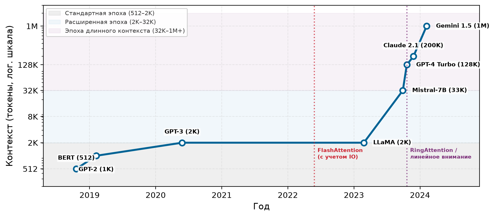

<em><strong>Взрыв контекстного окна</strong>: емкость контекста моделей (токены, логарифмическая шкала) от ранних моделей (от 512 до 2 тыс. токенов) до современных архитектур с длинным контекстом (от 128 тыс. до 1 млн токенов). При росте контекста в $1\,000\times$ наивная память внимания растет в $1\,000\,000\times$ ($\mathcal{O}(S^2)$), что стимулирует развитие FlashAttention, разреженного внимания и линейного внимания.</em>

[«Слой самовнимания»](06_nn_architectures.md#lst-self_attention_layer) показывает типичную реализацию, в которой самовнимание выводит запросы, ключи и значения из одной и той же входной последовательности.

<a id="lst-self_attention_layer"></a>

**Самовнимание и многоголовое внимание**: самовнимание (вверху) выводит $\mathbf{Q}$, $\mathbf{K}$ и $\mathbf{V}$ из одного и того же входа $\mathbf{X}$ через три проекции, а затем вычисляет внимание, как было описано выше. Многоголовое внимание (внизу) запускает $N_{\text{heads}}$ параллельных голов внимания размерности $d_k = d_{\text{model}}/N_{\text{heads}}$, затем конкатенирует и проецирует результаты. Для GPT-2 (размерность 768, 12 голов) каждая голова работает с 64 измерениями, распределяя спроецированное признаковое пространство между головами и одновременно открывая разнообразные шаблоны связей.

```python
def self_attention_layer(X, W_Q, W_K, W_V, d_k):
    # X: входной тензор (размер батча × длина последовательности × d_model)
    # W_Q, W_K, W_V: матрицы весов (d_model × d_k)

    Q = matmul(X, W_Q)
    K = matmul(X, W_K)
    V = matmul(X, W_V)

    scores = matmul(Q, K.transpose(-2, -1)) / sqrt(d_k)
    attention_weights = softmax(scores, dim=-1)
    output = matmul(attention_weights, V)

    return output

def multi_head_attention(X, W_Q, W_K, W_V, W_O, num_heads, d_k):
    outputs = []
    for i in range(num_heads):
        head_output = self_attention_layer(
            X, W_Q[i], W_K[i], W_V[i], d_k
        )
        outputs.append(head_output)

    concat_output = torch.cat(outputs, dim=-1)
    final_output = matmul(concat_output, W_O)

    return final_output
```

Параллельная обработка последовательности принципиально меняется при авторегрессивном выводе: пошаговая генерация выходных токенов вновь вводит последовательную сериализацию и превращает матричные умножения, ограниченные вычислениями, в операции умножения матрицы на вектор, ограниченные пропускной способностью памяти, как это количественно показано в [«Системных последствиях»](06_nn_architectures.md#sec-network-architectures-system-implications-77ac) на примере маяка GPT-2 XL.

<a id="sec-network-architectures-system-implications-77ac"></a>

### Системные последствия

Квадратичное узкое место, разобранное в [«Системных последствиях» внимания](06_nn_architectures.md#sec-network-architectures-system-implications-05a3), проявляется по-разному в разных режимах исполнения. Обучение и предзаполнение полной последовательности вычисляют все позиции токенов одновременно, тогда как авторегрессивное декодирование генерирует по одному токену за раз. Поэтому рабочее узкое место смещается от матричных умножений, ограниченных вычислениями, к извлечению весов и состояния, ограниченному пропускной способностью памяти, и определяется длиной последовательности, размером батча и пределами иерархии памяти.

<a id="sec-network-architectures-training-quadratic-compute-wall-de9d"></a>

#### Обучение: квадратичная вычислительная стена

Во время обучения и предзаполнения промпта все позиции токенов обрабатываются параллельно, что позволяет тензорным ядрам ускорителя достичь высокой загрузки вычислений с плавающей запятой. Однако вычисление оценок плотного внимания растет как $\mathcal{O}(S^2)$ с длиной последовательности $S$. Для длинных последовательностей (например, 32 тыс. токенов) материализация матрицы внимания $32\,000{\times}32\,000$ требует гигабайтов памяти под активации на каждый слой по всем головам. Запись этой квадратичной промежуточной матрицы в HBM ускорителя и чтение ее обратно для softmax создает крайнее узкое место пропускной способности памяти. Это физическое ограничение мотивирует блочную обработку ядер с учетом ввода-вывода (такую как FlashAttention (Dao et al., 2022)), которая объединяет шаги скалярного произведения, softmax и взвешивания значений в быстрые тайлы SRAM на кристалле, обходя обращения к HBM для промежуточной матрицы $\mathcal{O}(S^2)$. Иерархии памяти аппаратуры (HBM, SRAM, регистровые файлы), которые делают такую блочную обработку эффективной, описаны в главе [«Аппаратное ускорение»](11_hw_acceleration.md).

<a id="sec-network-architectures-inference-memory-bandwidth-wall-98d1"></a>

#### Авторегрессивное декодирование с малым батчем: стена пропускной способности памяти

Авторегрессивное декодирование генерирует один токен за раз и часто оказывается *ограниченным пропускной способностью памяти* при батче из одного образца или малых батчах. Чтобы сгенерировать токен, система выполняет три крупные операции:

1.  Считать веса модели; степень их переиспользования определяется батчированием и иерархией памяти (например, модель на 70 млрд параметров хранит 140 ГБ весов в FP16; GPT-2 XL делает стоимость этого первого шага конкретной).
2.  Выполнить умножения матрицы на вектор.
3.  Считать и записать KV-кеш.

**KV-кеш**[^fn-kv-cache-depth] растет линейно с длиной последовательности ($\mathcal{O}(N_L \times 2 \times N_{\text{heads}} \times S \times d_{\text{head}})$ на запрос; это отличается от матрицы оценок внимания $\mathcal{O}(S^2)$ при обучении) и хранит векторы ключей и значений всех предыдущих токенов, чтобы не вычислять их заново (Pope et al., 2023; Kwon et al., 2023). Ключи и значения прошлых токенов сохраняются, потому что запрос только что сгенерированного токена ($q_{t}$) должен обращаться ко всему историческому контексту ($k_1 \dots k_{t-1}$ и $v_1 \dots v_{t-1}$), чтобы вычислить свое следующее представление. Прошлые запросы ($q_1 \dots q_{t-1}$) безопасно отбрасываются, поскольку прошлые токены никогда не обращают внимания вперед, к будущим токенам, а кеширование прошлых ключей и значений избавляет от повторного прохода всей модели по полному промпту на каждом генерируемом токене. Для длинных контекстов этот кеш может стать огромным (например, более 100 ГБ), а каждый шаг декодирования считывает прошлые ключи и значения. Возникающее давление на пропускную способность зависит от длины контекста, батчирования, архитектуры внимания, раскладки кеша и аппаратуры.

[^fn-kv-cache-depth]: **Масштабирование памяти KV-кеша**: для трансформера на 7 млрд параметров в FP16 веса занимают около 14 ГБ; кеш одного запроса требует 32 слоя × 2 (K и V) × 32 головы × 2 048 позиций × 128 измерений × 2 байта, то есть около 1,07 ГБ. При 8 одновременных пользователях кеш составляет около 8,6 ГБ, что существенно добавляется к весам. Поскольку кеш растет линейно с контекстом и параллельностью, масштабирование пропускной способности заставляет выбирать между групповым вниманием с общими ключами и значениями (grouped-query attention) (Ainslie et al., 2023), более короткими контекстами или страничным выделением и выгрузкой KV-кеша (Kwon et al., 2023). Страничная организация и выгрузка сохраняют выходы модели, тогда как групповое внимание меняет архитектуру, а более короткие контексты обрезают исторический контекст.

<a id="lhs-nn-architectures-gpt-2-xl-bandwidth-lighthouse"></a>

> **GPT-2 XL (маяк пропускной способности)**
>
> **Почему это важно**: GPT-2 XL служит примером декодирования с батчем из одного образца, **ограниченного пропускной способностью памяти**. В использованной здесь модели, учитывающей только веса, каждый шаг декодирования считывает 6 ГБ весов FP32 и выполняет операции умножения матрицы на вектор. Получающаяся арифметическая интенсивность составляет около 0,5 FLOP/байт при весах FP32 или 1 FLOP/байт при весах FP16. Батчирование может амортизировать этот трафик весов, тогда как трафик KV-кеша и активаций добавляется к нему. [«Системный профиль GPT-2 XL»](06_nn_architectures.md#tbl-nn-architectures-gpt2-profile) сводит количественные свойства маяка пропускной способности:
>
>
> | **Свойство**   | **Значение**                                             | **Системное следствие**                                              |
> |:---------------|:---------------------------------------------------------|:---------------------------------------------------------------------|
> | **Параметры**  | 1,5 млрд        | Загрузка весов доминирует в задержке вывода.                         |
> | **Размер модели** | 6 ГБ (FP32)  | Помещается на один GPU, но насыщает пропускную способность HBM.       |
> | **Вычисления** | 3 GFLOP/токен | Низкие вычисления на токен; узкое место — перемещение данных, а не математика. |
> | **Ограничение** | Пропускная способность памяти                             | Скорость токенов/с при батче из одного образца сильно зависит от пропускной способности HBM. |
> | **Профиль**    | Ограничено пропускной способностью (декодирование с малым батчем) | Большие батчи могут амортизировать трафик весов и сместить узкое место. |
>
> <a id="tbl-nn-architectures-gpt2-profile"></a>
>
> ***Системный профиль GPT-2 XL**: оценки только по весам для авторегрессивного декодирования с батчем из одного образца. При этих допущениях каждый шаг считывает веса модели с интенсивностью примерно 0,5–1 FLOP/байт, поэтому пропускная способность HBM сильно ограничивает скорость генерации.*
>

На протяжении обучения и вывода трансформеры демонстрируют различные операционные сигнатуры: неограниченное параллельное исполнение по позициям токенов при обучении, квадратичную арифметическую сложность по длине контекста и ограниченную пропускной способностью потоковую передачу весов при авторегрессивном декодировании.

Однако плотные и пространственные модели не охватывают всего спектра промышленных нагрузок. Крупномасштабные рекомендательные системы отходят от стандартных конвейеров, в которых доминирует арифметика: они сочетают поиск разреженных эмбеддингов, где пропускную способность определяют емкость памяти и нерегулярное распределение обращений, с последующими плотными слоями взаимодействия. Этот гибрид важен в промышленном масштабе: Meta сообщила, что рекомендательные модели составляли большую часть циклов ее ИИ-вывода (Gupta et al., 2020), хотя таким нагрузкам уделяется меньше академического внимания, чем языковым и визуальным моделям. [«Разреженные архитектуры»](06_nn_architectures.md#sec-network-architectures-sparse-architectures-recommendation-systems-5d19) рассматривает рекомендации как последнюю парадигму главы.

<a id="sec-network-architectures-sparse-architectures-recommendation-systems-5d19"></a>

## Разреженные архитектуры: рекомендательные системы

Когда пользователь открывает потоковый сервис или интернет-магазин, система должна выбрать несколько рекомендаций из каталога в миллионы позиций менее чем за 50 мс. Инженерная задача требует отобразить и пользователей, и товары в плотные векторы общего пространства эмбеддингов, а затем вычислить вероятности взаимодействия в большом масштабе.

В отличие от сверточных сетей, ограниченных вычислениями, или трансформеров, ограниченных пропускной способностью памяти, рекомендательные модели работают в режиме, который определяется главным образом емкостью памяти. Ускоритель, спроектированный для плотных матричных умножений, — например, NVIDIA A100 с сотнями терафлопс арифметической пропускной способности и 80 ГБ HBM, — в рекомендательных нагрузках большую часть времени простаивает. Доминирующие операции — не плотные матричные умножения, а разреженные выборки (gather) из таблиц, которые могут занимать терабайты.

<a id="sec-network-architectures-pattern-processing-needs-3c57"></a>

### Потребности в обработке паттернов

Ключевая задача рекомендательных систем — работа с категориальными признаками высокой кардинальности. Модель должна обрабатывать идентификаторы пользователей по миллиардам аккаунтов и идентификаторы товаров по миллионам позиций. Сырые идентификаторы не несут никакой внутренней геометрии. Пользователь 1042 не находится «рядом» с пользователем 1043 ни в одном содержательном метрическом пространстве, и нейронная сеть не может вывести смысловые связи из одних лишь целых чисел.

Эмбеддинги решают задачу представления, отображая каждый дискретный идентификатор в плотный вектор, называемый **эмбеддингом**[^fn-embedding-table-lookups] (Mikolov et al., 2013). Системная цена в том, что каждое обращение становится нерегулярным чтением из таблицы размером в десятки или сотни гигабайт. Поэтому рекомендательные модели сталкиваются со стеной емкости и узким местом пропускной способности памяти еще до выполнения первого плотного полносвязного слоя.

[^fn-embedding-table-lookups]: **Эмбеддинг**: от математического вложения одного пространства в другое; нейронные эмбеддинги отображают дискретные токены (такие как идентификаторы пользователей или слова словаря) в непрерывные векторные пространства, где геометрическая близость отражает смысловое сходство. Word2vec популяризировал нейронные эмбеддинги слов в 2013 году. Для систем таблицы эмбеддингов создают особый шаблон доступа к памяти: каждое обращение — нерегулярное чтение из таблицы, которая может иметь масштаб в терабайты. Это порождает разреженную рабочую нагрузку, ограниченную пропускной способностью, которая делает DLRM принципиально отличной от архитектур, ограниченных вычислениями, таких как ResNet.

<a id="sec-network-architectures-algorithmic-structure-732e"></a>

### Алгоритмическая структура

Архитектура DLRM (Naumov et al., 2019) стандартизирует этот процесс как четырехэтапный конвейер, разделенный между плотным и разреженным режимами. Непрерывные признаки, такие как возраст пользователя или время суток, сначала проходят через нижний MLP — этап, интенсивный по вычислениям, но легкий по памяти, в котором доминируют плотные матричные умножения. Параллельно категориальные идентификаторы индексируют отдельные таблицы эмбеддингов; именно здесь возникает стена емкости памяти:

Например, таблица эмбеддингов для одного миллиарда пользователей с 128-мерными векторами требует $10^9 \times 128 \times 4$ байта $\approx$ 512 ГБ памяти. Этот этап интенсивен по памяти, но легок по вычислениям, потому что каждое обращение — это копирование из памяти без арифметического переиспользования. Далее слой взаимодействия объединяет плотные активации нижнего MLP с выбранными разреженными векторами эмбеддингов через попарные скалярные произведения, которые отражают связи «пользователь — товар». Наконец, верхний MLP обрабатывает объединенные представления взаимодействий через полносвязные слои и предсказывает целевую вероятность, например вероятность клика (CTR). Такое сочетание плотных и разреженных вычислений делает DLRM рекомендательным маяком главы; [«Вычислительное отображение и системные последствия»](06_nn_architectures.md#sec-network-architectures-computational-mapping-b346) количественно описывает получающийся профиль, ограниченный емкостью.

<a id="sec-network-architectures-computational-mapping-b346"></a>

### Вычислительное отображение и системные последствия

Вычислительное отображение DLRM делится на два режима, которые нагружают разные подсистемы аппаратуры. Плотные MLP выполняют стандартные операции GEMM — ту же вычислительную схему, что и в [разделе «Вычислительное отображение» для MLP](06_nn_architectures.md#sec-network-architectures-computational-mapping-cf30), которую эффективно обрабатывают тензорные ядра. Разреженные обращения к эмбеддингам, однако, качественно другие. Это индексированные выборки из памяти с нулевой арифметической интенсивностью, поэтому каждое обращение на уровне операции ограничено пропускной способностью памяти. Это узкое место операций отличается от ограничения по емкости: общий размер таблиц определяет, помещаются ли параметры в память устройства, тогда как пропускная способность шины памяти определяет, как быстро можно собрать отдельные строки. Поскольку каждый обучающий образец или запрос обращается к своему набору разреженных строк, шаблон доступа демонстрирует почти нулевую пространственную и временную локальность, обесценивая стратегии кеширования и предвыборки, которые помогают CNN и MLP.

<a id="lhs-nn-architectures-dlrm-recommendation-lighthouse"></a>

> **DLRM (рекомендательный маяк)**
>
> **Почему это важно**: DLRM служит примером нагрузок, **ограниченных емкостью памяти**. Ее огромные таблицы эмбеддингов часто превышают память одного ускорителя или сервера, поэтому система должна решить, где размещать эти таблицы, прежде чем сможет оптимизировать арифметическую пропускную способность. Слой взаимодействия затем собирает выбранные векторы эмбеддингов и объединяет их с плотными признаками, так что емкость и нерегулярное перемещение данных становятся главными ограничениями. Это резко контрастирует с CNN (ограничены вычислениями) и трансформерами (ограничены пропускной способностью памяти) и требует других решений по аппаратуре и развертыванию. [«Системный профиль DLRM»](06_nn_architectures.md#tbl-nn-architectures-dlrm-profile) сводит количественные свойства рекомендательного маяка.
>
>
> | **Свойство**             | **Значение**                                                   | **Системное следствие**                                                                                      |
> |:-------------------------|:---------------------------------------------------------------|:-------------------------------------------------------------------------------------------------------------|
> | **Параметры эмбеддингов** | 25 млрд            | Параметры $\times$ 4 байта; доминирует в общем размере модели. |
> | **Размер модели**        | 100 ГБ (FP32) | Может превышать быструю память одного устройства.                                                             |
> | **Ограничение**          | Емкость памяти                                                 | Размер модели $> \text{Память одного GPU}$.                                                                   |
> | **Узкое место**          | Нерегулярное перемещение данных                                | Операции выборки доминируют в обработке разреженных признаков.                                                 |
> | **Профиль**              | Смешанный (разреженный/плотный)                                | Сочетает требующие памяти выборки с требовательными к вычислениям MLP.                                         |
>
> <a id="tbl-nn-architectures-dlrm-profile"></a>
>
> ***Системный профиль DLRM**: количественные свойства рекомендательного маяка и их системные последствия. Таблицы эмбеддингов на миллиарды записей выводят модель за пределы памяти одного устройства и создают режим, ограниченный емкостью, который железный закон напрямую не описывает.*
>

Как только таблицы эмбеддингов превышают одно устройство, главным системным ограничением становится емкость, а не арифметика. Если ResNet-50 (102,4 МБ) помещается на одном ускорителе, а плотная языковая модель вроде GPT-3 (350 ГБ) — в одном узле с несколькими GPU, то промышленные рекомендательные модели достигают терабайтов параметров эмбеддингов. В терминах железного закона ([«Железный закон машинного обучения»](01_introduction.md#sec-introduction-iron-law-ml-systems-c32a)) ни число операций $O$, ни объем передачи $D_{\text{vol}}$ не выступают связывающим ограничением; ограничивает систему сырая емкость памяти, что задает режим за пределами основной области действия железного закона.

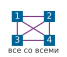

*Выборки эмбеддингов DLRM могут зависеть от векторов, хранящихся вне локального раздела памяти.*

Поэтому архитектура разрушает предположение об одном устройстве, которое выполняется для меньших плотных моделей. Системные инженеры преодолевают эту стену емкости тремя различными архитектурными стратегиями:

*   **Сжать таблицы**: сжатие, хеширование или прореживание снижают давление на емкость, хотя эти приемы рискуют потерей информации о редких пользователях и товарах («длинный хвост»).
*   **Переместить таблицы**: эмбеддинги могут размещаться в оперативной памяти хоста (host DRAM) или во внешних хранилищах «ключ — значение», хотя удаленные обращения влекут высокие задержки перемещения данных по PCIe или Ethernet.
*   **Разделить таблицы**: таблицы можно шардировать между несколькими ускорителями, так что ни одно устройство не хранит всю модель, однако выборки тогда требуют обмена данными между устройствами.

Архитектурно DLRM превращает рекомендации в задачу управления емкостью раньше, чем в задачу оптимизации вычислений. Разбиение таблиц при обучении (глава [«Обучение моделей»](08_training.md#sec-model-training)) и аппаратно ускоренные межсоединения (глава [«Аппаратное ускорение»](11_hw_acceleration.md)) решают эти распределенные раскладки, но базовая задача определения размера начинается с одной таблицы.

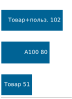

*Одна таблица эмбеддингов помещается в A100 с 80 ГБ; вторая переходит порог емкости.*

<a id="nbk-nn-architectures-capacity-wall"></a>

> **Стена емкости**
>
> **Задача**: рассмотрим рекомендательную систему магазина со 100 млн товаров и размером эмбеддинга 128. Сколько памяти требует одна только таблица товаров?
>
> **Расчет**:
>
> 1.  **Записи таблицы**: 100 млн товаров.
> 2.  **Размер вектора**: 128 элементов.
> 3.  **Точность**: FP32 (4 байта на элемент).
> 4.  **Размер таблицы**: 100 млн товаров $\times$ 128 $\times$ 4 байта ≈ 51,2 ГБ.
> 5.  **Доля емкости**: 51,2 ГБ $\div$ 80 ГБ = 64 процента емкости устройства.
> 6.  **Проверка двух таблиц**: две таблицы по 64 процента каждая превышают 100 процентов емкости устройства.
>
> **Системный вывод**: одна таблица эмбеддингов для одного признака (товаров) уже занимает 64 процента GPU A100 с 80 ГБ. Добавление пользовательской таблицы того же размера означает, что таблицы эмбеддингов больше не помещаются на одном ускорителе с 80 ГБ, что мотивирует сжатие таблиц, внешнюю память или разделение между устройствами. DLRM — это *ограничение по емкости*: главный системный вопрос не в том, сколько FLOP/s может выдать ускоритель, а в том, где физически может находиться состояние эмбеддингов.

Как только таблицы перестают помещаться на одном устройстве, разреженные выборки пересекают границы памяти и сети. Одному запросу могут понадобиться строки, принадлежащие нескольким устройствам, и тогда ускоритель, на котором работает нижестоящий MLP, вынужден ждать, пока система соберет эти строки. Внутри узла этот обмен нагружает межсоединение ускорителей, а между узлами превращается в узкое место коллективной коммуникации типа «все со всеми». Архитектурное следствие в том, что раскладка памяти модели рекомендаций напрямую определяет объем сетевого трафика, создавая налог на координацию как при обучении, так и при обслуживании.

<a id="chk-nn-architectures-dlrm-sparse-scatter"></a>

> **DLRM и разреженные обращения**
>
> Системы рекомендаций нагружают другую часть машины, чем CNN или трансформеры.
>
> - **Ограничение емкостью**: можете ли вы объяснить, почему таблицы эмбеддингов переводят DLRM в режим ограничения по емкости памяти, где «FLOP» не является связывающим ограничением?
> - **Разреженный доступ**: можете ли вы объяснить, почему обращения к эмбеддингам ведут себя как случайные выборки из памяти (низкое переиспользование) и поэтому плохо поддаются кешированию и предвыборке?
> - **Логика размещения**: если одна таблица эмбеддингов не помещается в быструю память устройства, можете ли вы описать, какое состояние нужно переместить, сжать или разделить?
> - **Узкое место перемещения данных**: можете ли вы объяснить, почему обращения к разреженным эмбеддингам могут доминировать, даже когда плотный MLP имеет скромную стоимость в FLOP?

У MLP, CNN, RNN, трансформеров и разреженных моделей в духе DLRM разные вычислительные профили, но все они сходятся к компактному набору общих примитивов. Плотные матричные проекции, слои нормализации, остаточные связи и механизмы гейтинга повторяются во всех пяти семействах. Каждый блок трансформера содержит полносвязный MLP, а гейтинг, первоначально разработанный для рекуррентных ячеек, управляет маршрутизацией в моделях «смеси экспертов». Эти строительные блоки переносимы, потому что численные и оптимизационные задачи, которые они решают, — распространение градиентов, стабильность активаций и динамическая маршрутизация, — сохраняются независимо от индуктивного смещения. Для системных инженеров выявление этих общих примитивов показывает, какие аппаратные ускорители и оптимизации компилятора переносятся между нагрузками, а какие должны оставаться специализированными.

<a id="sec-network-architectures-architectural-building-blocks-aa3a"></a>

## Общие строительные блоки

Блок трансформера повторно использует несколько идей, возникших в других местах: плотные проекции из MLP, остаточные пути из глубоких CNN, нормализацию для стабильности активаций и маршрутизацию в духе гейтинга в более поздних вариантах. Пять семейств архитектур различаются предположениями о данных, но многие их инженерные задачи повторяются, поэтому практический вопрос в том, какие строительные блоки и оптимизации переносятся. [«Строительные блоки, общие для архитектур»](06_nn_architectures.md#tbl-dl-evolution) показывает, как эти примитивы накапливались по мере усложнения архитектур: каждая эпоха унаследовала инструменты предшественников и добавила механизм для следующего узкого места.

| **Строительный блок**  | **Впервые появился в** | **Решаемая задача**              | **Где используется сейчас**                                                                      |
|:-----------------------|:-----------------------|:---------------------------------|:-------------------------------------------------------------------------------------------------|
| **GEMM**               | MLP                    | Универсальная аппроксимация функций | Все архитектуры (полносвязные слои)                                                           |
| **Разделение параметров** | CNN                 | Пространственная эффективность   | Трансформеры (общие проекции), RNN (переиспользование весов во времени)                          |
| **Остаточные связи**   | ResNet (CNN)           | Поток градиентов на большой глубине | Трансформеры, DenseNet, U-Net, многие современные глубокие сети                               |
| **Нормализация**       | CNN (батч-нормализация) | Стабильность активаций          | Послойная нормализация (трансформеры), RMSNorm (нормализация по среднеквадратичному значению), GroupNorm (группировка каналов) |
| **Гейтинг**            | LSTM (RNN)             | Избирательная маршрутизация сигнала | Трансформеры (маршрутизация «смеси экспертов»), GRU, highway-сети                            |

<a id="tbl-dl-evolution"></a>

***Строительные блоки, общие для архитектур**: инженерные примитивы, возникшие в одном семействе архитектур и повторяющиеся во многих современных конструкциях. Каждый блок решает повторяющуюся задачу (поток градиентов, стабильность активаций, маршрутизация сигналов), хотя не каждая архитектура использует каждый примитив.*

На эти переносимые строительные блоки повлияло аппаратное обеспечение, доступное в свое время. LeNet-5 (LeCun et al., 1998) обучался на CPU, а сети были достаточно малы, чтобы уместиться в мегабайтах памяти. AlexNet обучил свою сеть из 60 млн параметров на двух GPU GTX 580, отображая параллельные свертки на графическую аппаратуру (Krizhevsky et al., 2012). ResNet-152 (He et al., 2016) стал обучаемым, потому что остаточные связи и батч-нормализация улучшили оптимизацию на большой глубине, используя доступную инфраструктуру обучения на GPU, а не конкретный порог емкости памяти. Трансформеры (Vaswani et al., 2017) стали практичными на GPU своего времени, а позднее резко масштабировались по мере улучшения пропускной способности памяти GPU/TPU и инфраструктуры распределенного обучения. Эта закономерность сохраняется: каждый строительный блок использует новые вычислительные ресурсы, одновременно упираясь в пределы существующих систем.

<a id="sec-network-architectures-evolution-perceptron-multilayer-networks-d06e"></a>

### Плотные операции: универсальная база

GEMM — единственный примитив, общий для всех архитектур этой главы. Хотя [«MLP»](06_nn_architectures.md#sec-network-architectures-multilayer-perceptrons-dense-pattern-processing-bc11) рассматривались как процессоры плотных паттернов, системное наследие GEMM выходит далеко за пределы MLP. Это полносвязный слой внутри каждого блока трансформера, поточечная свертка $1{\times}1$ в MobileNet, входные и рекуррентные проекции внутри каждой ячейки RNN и нижний MLP в каждой DLRM.

MLP задали профиль вычислений, в котором доминирует GEMM, и это побудило производителей GPU разработать специализированные матричные блоки (тензорные ядра). Шаблон доступа к памяти алгоритма обратного распространения ошибки[^fn-backpropagation-activation-storage], где чередующиеся прямой и обратный проходы сохраняют промежуточные активации, сформировал иерархии памяти ускорителей. Парадигма пакетной обработки, впервые примененная для обучения MLP, задала оптимизацию пропускной способности, которая определяет современную инфраструктуру машинного обучения: группировка независимых образцов в плотные матрицы превращает произведения матрицы на вектор, ограниченные пропускной способностью памяти, в матрично-матричные умножения, ограниченные вычислениями. Эти базовые шаблоны встречаются во всех архитектурах, рассмотренных в этой главе.

[^fn-backpropagation-activation-storage]: **Обратное распространение ошибки**: Румельхарт, Хинтон и Уильямс показали в 1986 году, как эффективно применять правило цепочки для обучения многослойных сетей; стандартное обучение в обратном режиме сохраняет прямые активации, нужные обратному проходу, поэтому память под активации обычно растет с глубиной сети. Контрольные точки (checkpointing), пересчет и выгрузка могут сократить объем сохраненных активаций ценой дополнительных вычислений или перемещения данных. Поэтому хранение активаций, а не хранение весов, может стать связывающим ограничением памяти, определяющим максимально возможный размер батча на данном ускорителе.

Плотная связность также задала базовую стоимость, с которой сверяется каждая последующая архитектура. При $\mathcal{O}(n^2)$ параметрах и операциях для слоев ширины $n$ GEMM задает опорную точку, относительно которой специализированные архитектуры демонстрируют выигрыш в эффективности. CNN выполняют пространственную обработку при $\mathcal{O}(k^2)$ параметрах на позицию (где $k$ — размер ядра), трансформеры обменивают параметрическую эффективность на динамические вычисления со сложностью внимания $\mathcal{O}(S^2)$, а разреженные архитектуры вроде DLRM используют поиск по эмбеддингам, чтобы обрабатывать категориальные измерения, которые взорвали бы размеры плотных слоев. Каждое новшество представляет собой отдельную стратегию выхода за пределы базы плотной связности, но ни одно из них не выходит за пределы самого GEMM: он появляется внутри каждой архитектуры как рабочая лошадка преобразования признаков.

<a id="sec-network-architectures-evolution-dense-spatial-processing-2761"></a>

### Остаточные связи: решение проблемы глубины

Разделение параметров сделало глубокие сети вычислительно посильными, но одна лишь эффективность не решала численных трудностей глубокого обучения. По мере углубления сетей повторные матричные умножения и производные нелинейных активаций приводили к тому, что сигналы градиента либо затухали до численного исчезновения, либо усиливались до переполнения. Остаточные связи снимают этот барьер оптимизации, вводя аддитивные тождественные обходные пути, которые пропускают преобразования слоев.

<a id="sec-network-architectures-problem-depth-15bc"></a>

#### Проблема глубины

Обратное распространение ошибки через $N_L$ слоев многократно применяет правило цепочки; [«Вычисление градиентов и обратное распространение ошибки»](05_nn_computation.md#sec-neural-computation-gradient-computation-backpropagation-dacf) дает формальный вывод обратного распространения ошибки и правила цепочки. Для глубокой сети со слоями $f_1, f_2, \ldots, f_{N_L}$ градиент функции потерь $\mathcal{L}$ по весам слоя 1 равен:

$$
\frac{\partial \mathcal{L}}{\partial W_1} = \frac{\partial \mathcal{L}}{\partial a_{N_L}} \cdot \frac{\partial a_{N_L}}{\partial z_{N_L}} \cdot \frac{\partial z_{N_L}}{\partial a_{N_L-1}} \cdot \ldots \cdot \frac{\partial z_2}{\partial a_1} \cdot \frac{\partial a_1}{\partial z_1} \cdot \frac{\partial z_1}{\partial W_1}
$$

где $z_\ell$ — предактивация, а $a_\ell = \sigma(z_\ell)$ — постактивационный выход слоя $\ell$. Градиент становится произведением $N_L$ сомножителей, каждый из которых зависит от производной функции активации $\sigma'(z_\ell)$.

Затухающие градиенты создают незаметный сбой обучения в глубоких архитектурах. Для сигмоидной функции активации производная равна $\sigma'(z) = \sigma(z)(1 - \sigma(z))$, а ее максимум $\sigma'(0) = 0{,}25$. Через $N_L$ слоев величина градиента умножается примерно на $(0{,}25)^{N_L}$. При таком крайнем затухании ранние слои получают бесконечно малые сигналы градиента. Обновления весов становятся пренебрежимо малыми, и эти слои фактически перестают обучаться.

Взрывные градиенты — дестабилизирующая противоположность затухающих. Большие сингулярные значения якобианов слоев могут многократно усиливать направления градиента по глубине сети. Например, если каждый якобиан растягивает общее направление примерно в 1,5 раза, эта компонента растет экспоненциально. Такой рост порождает численное переполнение, значения NaN (not-a-number), экстремальные обновления параметров и расходимость обучения. В отличие от затухающих градиентов, которые незаметно останавливают обучение, взрывные градиенты приводят к катастрофическому численному сбою.

<a id="sec-network-architectures-quantitative-analysis-plain-deep-networks-f132"></a>

#### Количественный анализ: простые глубокие сети

Рассмотрим обучение глубокой простой сверточной сети на CIFAR-10 без архитектурных вмешательств. Даже при активациях ReLU, производная которых равна единице для положительных входов, оптимизация ухудшается с ростом глубины. В исходной работе по ResNet сообщалось, что простая сеть из 56 слоев показывала заметно худшую ошибку на тестовой выборке CIFAR-10, чем простая сеть из 20 слоев (около 13,6 процента против 8,8 процента), что демонстрирует: добавление слоев ухудшает оптимизацию, несмотря на большую представительную емкость (He et al., 2016).

Эта проблема деградации — не переобучение: простая сеть из 56 слоев имела более высокую ошибку обучения, чем сеть из 20 слоев, что подтверждает: сбой вызван барьером оптимизации, а не плохой обобщающей способностью.

<a id="sec-network-architectures-relu-helps-sufficient-9e69"></a>

#### Почему ReLU помогает, но недостаточен

Функция активации ReLU ($\text{ReLU}(z) = \max(0, z)$) имеет производную:

$$
\text{ReLU}'(z) = \begin{cases}
1 & \text{если } z > 0 \\
0 & \text{если } z \leq 0
\end{cases}
$$

По активным путям $(z > 0)$ производная равна 1, что исключает затухание градиента из-за функции активации. Это улучшение по сравнению с сигмоидой позволило стабильно обучать сети из 10–20 слоев.

Однако ReLU вводит другой режим отказа: «мертвые» нейроны. При $z \leq 0$ градиент равен нулю и блокирует поток градиента через этот элемент. Плохо инициализированный вес или большое обновление может сделать предактивации отрицательными на всем обучающем распределении и навсегда отключить нейрон. Кроме того, ReLU не регулирует спектральные свойства самих матриц весов. Сингулярные значения, заметно отличающиеся от единицы, продолжают ослаблять или усиливать градиенты по глубине сети.

<a id="sec-network-architectures-residual-solution-69bf"></a>

#### Решение через остаточные связи

Блоки ResNet вводят остаточное обучение через остаточные связи, которые преобразуют поток градиента. [«Остаточное соотношение»](06_nn_architectures.md#eq-residual) добавляет тождественный путь $\mathbf{x}$ к остаточному отображению $\mathcal{F}(\mathbf{x})$:

<a id="eq-residual"></a>

$$
\mathbf{y} = \mathcal{F}(\mathbf{x}) + \mathbf{x}
$$

где $\mathcal{F}(\mathbf{x})$ — остаточная функция (обычно два сверточных слоя с батч-нормализацией и ReLU), а $\mathbf{x}$ — тождественная остаточная связь.

<a id="thrm-nn-architectures-residual-jacobian-conditioning"></a>

> **Обусловленность якобиана остаточного блока**
>
> **Анализ**: представим сеть как композицию функций $\mathbf{x}_{\ell+1} = f_\ell(\mathbf{x}_\ell)$. По правилу цепочки градиент на входе есть произведение якобианов слоев $\mathbf{J}_\ell = \frac{\partial f_\ell}{\partial \mathbf{x}_\ell}$:
> $$
> \frac{\partial \mathcal{L}}{\partial \mathbf{x}_0} = \frac{\partial \mathcal{L}}{\partial \mathbf{x}_{N_L}} \cdot \prod_{\ell=1}^{N_L} \mathbf{J}_\ell
> $$
>
> Для простых сетей $\mathbf{J}_\ell$ произволен. Оценка $\left\|\prod_\ell \mathbf{J}_\ell\right\|_2 \leq \prod_\ell \|\mathbf{J}_\ell\|_2$ означает, что равномерно меньшие единицы нормы вызывают затухание; верно и обратное: $\sigma_{\min}(\prod_\ell \mathbf{J}_\ell) \geq \prod_\ell \sigma_{\min}(\mathbf{J}_\ell)$ означает, что равномерно большие единицы минимальные сингулярные значения приводят к расширению. Смешанные ненормальные якобианы зависят и от сингулярных векторов, и от собственных значений, поэтому одного спектрального радиуса недостаточно для определения поведения градиента.
>
> Для ResNet функция слоя имеет вид $\mathbf{x}_{\ell+1} = \mathbf{x}_\ell + \mathcal{F}(\mathbf{x}_\ell)$, поэтому якобиан равен:
> $$
> \mathbf{J}_\ell = \mathbf{I} + \frac{\partial \mathcal{F}}{\partial \mathbf{x}_\ell}
> $$
> где $\mathbf{I}$ — единичная матрица. Если $\varepsilon_\ell=\|\mathcal{F}'_\ell\|_2<1$, то $1-\varepsilon_\ell \leq \sigma_{\min}(\mathbf{J}_\ell) \leq \sigma_{\max}(\mathbf{J}_\ell) \leq 1+\varepsilon_\ell$. Таким образом, блок, у которого якобиан остаточной ветви мал, близок к единичному и локально хорошо обусловлен. При наложении многих блоков эти отклонения все же могут накапливаться, поэтому остаточная связь улучшает поток градиента, но не гарантирует единичного усиления и не предотвращает взаимного погашения.

При обратном распространении градиент проходит через это сложение:

$$
\frac{\partial \mathcal{L}}{\partial \mathbf{x}} =
\frac{\partial \mathcal{L}}{\partial \mathbf{y}} \cdot
\frac{\partial \mathbf{y}}{\partial \mathbf{x}} =
\frac{\partial \mathcal{L}}{\partial \mathbf{y}} \cdot
\frac{\partial (\mathcal{F}(\mathbf{x}) + \mathbf{x})}{\partial \mathbf{x}}
$$

Применяя правило цепочки:

$$
\frac{\partial \mathcal{L}}{\partial \mathbf{x}} =
\frac{\partial \mathcal{L}}{\partial \mathbf{y}} \cdot
\left(\frac{\partial \mathcal{F}(\mathbf{x})}{\partial \mathbf{x}} + \mathbf{I}\right)
= \frac{\partial \mathcal{L}}{\partial \mathbf{y}} \cdot
\mathcal{F}'(\mathbf{x}) +
\frac{\partial \mathcal{L}}{\partial \mathbf{y}}
$$

Градиент раскладывается на два аддитивных слагаемых. Даже если преобразование остаточной ветви $\frac{\partial \mathcal{L}}{\partial \mathbf{y}}\mathcal{F}'(\mathbf{x})$ ослабевает, тождественное слагаемое передает $\frac{\partial \mathcal{L}}{\partial \mathbf{y}}$ напрямую в более ранний слой. Хотя остаточная ветвь может частично мешать тождественному сигналу, малость $\|\mathcal{F}'(\mathbf{x})\|$ гарантирует, что якобиан блока остается близким к единичному и ограничивает число обусловленности. Аддитивный путь дает прямой градиентный обходной путь через сеть, хотя и не гарантирует точного единичного усиления на произвольной глубине.

<a id="sec-network-architectures-gradient-flow-multiple-blocks-c58c"></a>

#### Поток градиента через несколько блоков

Через $N_L$ остаточных блоков градиент принимает вид:

$$
\frac{\partial \mathcal{L}}{\partial \mathbf{x}_0} =
\frac{\partial \mathcal{L}}{\partial \mathbf{x}_{N_L}} \cdot
\prod_{\ell=1}^{N_L}
\left(\mathcal{F}'_\ell(\mathbf{x}_\ell) + \mathbf{I}\right)
$$

Каждый множитель $(\mathcal{F}'_\ell + \mathbf{I})$ содержит тождественное слагаемое, поэтому множитель остается близким к единице, когда якобиан остаточной ветви мал. В отличие от простых сетей, которые перемножают произвольные якобианы слоев, ResNet перемножают эти почти единичные множители. Отклонения все равно могут накапливаться, но такая структура улучшает обусловленность и делает обучаемыми сети из 100 и более слоев.

<a id="sec-network-architectures-empirical-validation-50layer-comparison-77e9"></a>

#### Эмпирическая проверка на 56 слоях

Эмпирические результаты подтверждают эту теоретическую обусловленность. В исходных экспериментах на CIFAR-10 остаточная сеть из 56 слоев достигла примерно 7,0 процента ошибки на тестовой выборке, обратив деградацию, наблюдавшуюся у простых сетей, и превзойдя свой аналог из 20 слоев (He et al., 2016). Тождественные обходные пути обеспечивают беспрепятственный путь для обратного распространения градиента и уточнения представлений, позволяя более глубоким моделям реализовать свое преимущество по емкости. Не существует единой глубины, начиная с которой остаточные связи внезапно становятся обязательными; обучаемость также зависит от инициализации, нормализации, динамики оптимизатора и архитектуры блока (He et al., 2016).

Хотя остаточные связи решают задачу обусловленности градиента, они накладывают конкретные аппаратные издержки. Вычисление $\mathbf{y} = \mathcal{F}(\mathbf{x}) + \mathbf{x}$ требует, чтобы входной тензор $\mathbf{x}$ оставался в памяти на протяжении всех операций ветви $\mathcal{F}(\mathbf{x})$. Это удлиненное время жизни увеличивает пиковый объем активаций в HBM ускорителя во время прямого прохода и сохраняет $\mathbf{x}$ для обратного распространения, если не используются контрольные точки активаций. Кроме того, поэлементное сложение ограничено пропускной способностью памяти: оно выполняет одно сложение на каждое загруженное значение (арифметическая интенсивность $\approx 0{,}5$ FLOP/байт), и неслитые операции остаточного слияния превращаются в простои памяти.

Остаточные связи стабилизируют обратный путь градиента, но не ограничивают прямой масштаб промежуточных активаций. Неограниченная дисперсия по глубине по-прежнему может дестабилизировать входы слоев, что требует дополнительного примитива: нормализации.

<a id="sec-network-architectures-normalization-layers-mathematical-foundations-0fb7"></a>

### Нормализация: стабилизация активаций на большой глубине

Нормализация играет роль прямого партнера остаточных связей: если остаточные пути сохраняют поток градиента при обратном проходе, то нормализация стабилизирует распределение промежуточных активаций. Впервые утвержденная как батч-нормализация в CNN (Ioffe and Szegedy, 2015)[^fn-batch-normalization-ioffe], эта операция эволюционировала в послойную нормализацию для моделей последовательностей, а затем упростилась до RMSNorm[^fn-rmsnorm-layer-efficiency] для больших языковых моделей.

[^fn-rmsnorm-layer-efficiency]: **RMSNorm (нормализация по среднеквадратичному значению)**: представленная в (Zhang and Sennrich, 2019) на NeurIPS, RMSNorm упрощает LayerNorm, нормируя только по среднеквадратичному значению и отказываясь от центрирования по среднему. Во всех протестированных в работе моделях и реализациях RMSNorm сократил общее время выполнения на 7–64 процента по сравнению с LayerNorm. Отчеты о моделях семейства LLaMA и трансформерах в стиле Mixtral используют RMSNorm (Touvron et al., 2023; Touvron et al., 2023; Jiang et al., 2024), что показывает, почему один проход редукции может иметь значение для задержки вывода трансформера.

[^fn-batch-normalization-ioffe]: **Батч-нормализация (BatchNorm)**: исходный слой нормализации (Ioffe and Szegedy, 2015), который перемасштабирует активации по статистикам каждого мини-батча. В одном эксперименте на ImageNet она достигла целевой точности при числе шагов обучения, меньшем в 14 раз. Ее зависимость от размера батча и перекос обучения и обслуживания (переход от статистик батча к скользящим средним при выводе) — системные ограничения, которые породили альтернативы: LayerNorm избавил трансформеры от зависимости от батча, а RMSNorm убрал центрирование по среднему.

<a id="sec-network-architectures-batch-normalization-definition-formulation-8579"></a>

#### Батч-нормализация: определение и формулировка

Батч-нормализация стандартизует активации, используя статистики, вычисленные по мини-батчу для каждого признака или канала во время обучения. Для полносвязных активаций ось редукции — измерение батча. Для сверточных активаций реализации вычисляют поканальные статистики по батчу и пространственным позициям ($B \times H \times W$). Для мини-батча $\mathcal{B} = \{x_1, \ldots, x_B\}$ активаций на определенном слое преобразование выполняется в два этапа.

Сначала вычисляем статистики батча:

$$
\mu_{\mathcal{B}} = \frac{1}{B}\sum_{i=1}^{B} x_i \qquad \sigma_{\mathcal{B}}^2 = \frac{1}{B}\sum_{i=1}^{B} (x_i - \mu_{\mathcal{B}})^2
$$

Затем по батчу выполняем нормализацию и применяем обучаемые масштаб и сдвиг. Шаг нормализации в [«нормализации батча»](06_nn_architectures.md#eq-batchnorm-normalize) центрирует и масштабирует активации, а [«преобразование батча»](06_nn_architectures.md#eq-batchnorm-transform) применяет обучаемые параметры, которые позволяют сети, если это оптимально, восстановить тождественное преобразование:

<a id="eq-batchnorm-normalize"></a>

$$
\hat{x}_i = \frac{x_i - \mu_{\mathcal{B}}}{\sqrt{\sigma_{\mathcal{B}}^2 + \epsilon}}
$$

<a id="eq-batchnorm-transform"></a>

$$
y_i = \gamma \hat{x}_i + \beta
$$

Параметры $\gamma$ (масштаб) и $\beta$ (сдвиг) выучиваются во время обучения, а $\epsilon$ (обычно $10^{-5}$) предотвращает деление на ноль. Аффинное преобразование возвращает гибкость выученных масштаба и сдвига, однако фиксированные $\gamma$ и $\beta$ не могут точно обратить меняющиеся статистики для каждого батча. Нормализация допускает большие скорости обучения, не давая промежуточным активациям взрываться в насыщающиеся нелинейные режимы, и ускоряет сходимость по сравнению с ненормализованными сетями.

<a id="thrm-nn-architectures-normalization-jacobian-conditioning"></a>

> **Обусловленность якобиана нормализации**
>
> **Анализ**: нормализация стабилизирует обучение, обуславливая якобиан слоя. Для текущего батча рассмотрим градиент нормированного выхода по входу:
> $$
> \frac{\partial \hat{x}_i}{\partial x_j} = \frac{1}{\sqrt{\sigma_{\mathcal{B}}^2 + \epsilon}} \left( \delta_{ij} - \frac{1}{B} - \frac{(x_i - \mu_{\mathcal{B}})(x_j - \mu_{\mathcal{B}})}{B(\sigma_{\mathcal{B}}^2 + \epsilon)} \right)
> $$
> где $\delta_{ij}$ — символ Кронекера. Этот якобиан связывает примеры внутри батча, а масштаб задается величиной $1/\sqrt{\sigma_{\mathcal{B}}^2+\epsilon}$; последующий аффинный масштаб $\gamma$ умножает его. У него есть нулевые направления, связанные с инвариантностью к сдвигу по батчу, поэтому не существует универсальной положительной границы собственных значений вроде $[0{,}5; 2{,}0]$.
>
> Батч-нормализация улучшает оптимизацию эмпирически, стандартизируя промежуточные масштабы, но сама по себе не предотвращает затухание или взрыв градиентов во всей сети. Ее количественный эффект зависит от архитектуры, статистик батча, оптимизации и параметризации, а не от универсального диапазона градиентов в два–четыре раза.

<a id="sec-network-architectures-layer-normalization-architecture-independence-24ba"></a>

#### Послойная нормализация: независимость от архитектуры

Хотя батч-нормализация позволила обучать гораздо более глубокие CNN, она вводит серьезные ограничения для распределенных систем и моделирования последовательностей. При распределенном обучении вычисление истинных статистик мини-батча требует операции all-reduce между узлами ускорителей по PCIe или NVLink, что добавляет задержку связи к каждому нормализованному слою. Если же статистики вычисляются локально по малым батчам на каждом ускорителе, шумные эмпирические оценки дестабилизируют оптимизацию. Кроме того, батч-нормализация не справляется с последовательностями переменной длины и с авторегрессивной генерацией токен за токеном без сложных масок дополнения и без перекоса обучения и обслуживания. Послойная нормализация снимает эти ограничения, нормируя по измерению признаков, а не по батчу (Ba et al., 2016).

Для входного вектора $\mathbf{x} \in \mathbb{R}^{d_{\text{model}}}$ с $d_{\text{model}}$ признаками:

$$
\mu_{\text{LN}} = \frac{1}{d_{\text{model}}}\sum_{i=1}^{d_{\text{model}}} x_i \qquad \sigma_{\text{LN}}^2 = \frac{1}{d_{\text{model}}}\sum_{i=1}^{d_{\text{model}}} (x_i - \mu_{\text{LN}})^2
$$

[«Послойная нормализация»](06_nn_architectures.md#eq-layernorm) задает полную операцию послойной нормализации, где $\odot$ обозначает поэлементное умножение:

<a id="eq-layernorm"></a>

$$
\text{LayerNorm}(\mathbf{x}) = \frac{\mathbf{x} - \mu_{\text{LN}}}{\sqrt{\sigma_{\text{LN}}^2 + \epsilon}} \odot \boldsymbol{\gamma} + \boldsymbol{\beta}
$$

Послойная нормализация нормирует каждый токен или образец независимо. Вычисление выполняется локально в SRAM и регистрах ускорителя на кристалле без обмена между образцами или устройствами. Эта независимость делает послойную нормализацию стандартным выбором для трансформеров, где длины последовательностей различаются, а авторегрессивная генерация при выводе вычисляет отдельные токены.

<a id="sec-network-architectures-comparative-analysis-use-variant-2130"></a>

#### Сравнительный анализ: когда какой вариант использовать

Выбор между вариантами нормализации отражает различные компромиссы в машинном и операционном планах. [«Сравнение вариантов нормализации»](06_nn_architectures.md#tbl-normalization-comparison) сводит основные свойства. Батч-нормализация хранит выученные масштаб и сдвиг вместе с невыучиваемыми скользящими буферами среднего и дисперсии; послойная нормализация вычисляет статистики динамически для каждого образца во время выполнения, исключая буферы состояния.

| **Характеристика**        | **BatchNorm**                          | **LayerNorm**            | **RMSNorm**                   |
|:--------------------------|:---------------------------------------|:-------------------------|:------------------------------|
| **Ось нормализации**      | Батч и для CNN пространственные позиции | Измерение признаков      | Измерение признаков           |
| **Зависимость от размера батча** | Высокая (шумно для малых батчей) | Нет                      | Нет                           |
| **Типичное применение**   | CNN, модели зрения                     | Трансформеры, RNN        | LLaMA, эффективные трансформеры |
| **Стоимость вычислений**  | Выше (среднее + дисперсия)             | Выше (среднее + дисперсия) | Ниже (только RMS)           |
| **Обучение/вывод**        | Различны (скользящие статистики)       | Одинаковы                | Одинаковы                     |

<a id="tbl-normalization-comparison"></a>

<em><strong>Сравнение вариантов нормализации</strong>: разные методы нормализации компромиссно сочетают вычислительную эффективность, чувствительность к размеру батча и совместимость с архитектурой. RMSNorm (Zhang and Sennrich, 2019), который используется в семействе LLaMA и других эффективных трансформерах (Touvron et al., 2023; Touvron et al., 2023), не выполняет центрирование по среднему: $\text{RMSNorm}(\mathbf{x}) = \mathbf{x} / \sqrt{\frac{1}{d_{\text{model}}}\sum_i x_i^2 + \epsilon} \cdot \boldsymbol{\gamma}$.</em>

Вычислительный профиль нормализации определяется ее арифметической интенсивностью. Поскольку нормализация применяет поэлементные операции к большим тензорам активаций, выполнение ограничено пропускной способностью памяти, а не вычислениями. Стандартная послойная нормализация требует два прохода редукции по скрытому измерению $d_{\text{model}}$ в SRAM: один для накопления среднего $\mu_{\text{LN}}$ и второй для вычисления дисперсии $\sigma_{\text{LN}}^2$. RMSNorm исключает шаг центрирования по среднему, сводя операцию к одной редукции суммы квадратов. Этот единственный проход редукции вдвое сокращает трафик памяти и позволяет более плотное слияние ядер, что дает ускорение на 7–64 процента, о котором сообщалось для нагрузок вывода трансформеров.

С операционной стороны батч-нормализация требует явного переключения режимов: между обучением (где вычисляются статистики мини-батча) и выводом (где применяются скользящие статистики, накопленные при обучении). Несовпадение скользящих статистик и распределения данных при развертывании — частый источник перекоса обучения и обслуживания. Послойная нормализация и RMSNorm выполняют одинаковые вычисления при обучении и выводе, исключая скользящие буферы и обеспечивая согласованность в средах развертывания.

<a id="sec-network-architectures-evolution-sequence-processing-d809"></a>

### Гейтинг: управление потоком информации

Остаточные связи и нормализация решают проблемы устойчивости, связанные с глубиной: соответственно поток градиента и дисперсию активаций. Гейтинг решает другую задачу: избирательно направлять информацию через сеть в зависимости от контекста входа.

Гейтинг возник в рекуррентных сетях, где простые рекуррентные петли страдали от сильной деградации градиента на длинных временных последовательностях. LSTM[^fn-lstm-gating-mechanism] (Hochreiter and Schmidhuber, 1997) и GRU[^fn-gru-gated-recurrence] (Cho et al., 2014) решили эту проблему, введя **гейты**: взвешенные параметрами преобразования, которые действуют как дифференцируемые клапаны, защищающие, обновляющие или отбрасывающие сохраненное состояние.

[^fn-lstm-gating-mechanism]: **LSTM (сеть долгой краткосрочной памяти)**: предложена Хохрайтером и Шмидхубером в 1997 году. LSTM ввели «карусель постоянной ошибки» — гейтированное состояние ячейки, которое защищает сигналы ошибки от экспоненциального затухания при обратном распространении во времени. Системная цена этого решения: стандартная LSTM вычисляет входной, забывающий и выходной гейты, а также кандидата на обновление ячейки, что дает примерно четыре аффинных преобразования на шаг времени против одного у простой RNN. Эта вычислительная нагрузка объясняет, почему трансформеры, решающие дальние зависимости через распараллеливаемое внимание, во многих крупных языковых нагрузках вытеснили LSTM.

[^fn-gru-gated-recurrence]: **GRU (гейтированный рекуррентный блок)**: (Cho et al., 2014) описывает гейтированный скрытый блок для перевода «кодировщик — декодер», который использует гейты сброса и обновления, чтобы управлять обновлением скрытого состояния. По сравнению с входным, забывающим и выходным гейтами LSTM плюс кандидатом на обновление ячейки это дает более простую гейтированную рекуррентность. Более широкий системный урок: архитектурное упрощение может сократить состояние и матричные операции, если сохраняет качество решения задачи, — принцип, который повторяется в ориентированных на эффективность конструкциях от MobileNet до дистиллированных трансформеров.

Гейтинг выходит за рамки рекуррентности как фундаментальный механизм маршрутизации, зависящей от данных. В прямых структурах highway-сети (Highway Networks) использовали гейтинг, чтобы динамически интерполировать между преобразованием и тождественным обходным путем, что непосредственно вдохновило остаточные связи. В обработке последовательностей внимание распространяет гейтинг на весь временной контекст: внимание «кодировщик — декодер» (Bahdanau et al., 2015) вычисляет динамическое распределение маршрутизации по представлениям входа. В трансформерах веса softmax-внимания действуют как коэффициенты маршрутизации, зависящие от данных, определяя, как признаки агрегируются по токенам, тогда как архитектуры «смеси экспертов» распространяют гейтинг на динамическую отправку токенов в специализированные полносвязные подсети.

<a id="sec-network-architectures-modern-architectures-synthesis-unification-c816"></a>

### Синтез: как трансформеры объединяют все

Современные архитектуры трансформеров объединяют все четыре общих примитива в единый блок. Как показано в [«Блоке остаточной связи»](06_nn_architectures.md#fig-example-skip-connection), остаточные пути обрамляют каждый подслой, сохраняя поток градиента через глубокие стеки. Плотные проекции GEMM выполняют преобразования признаков внутри многоголового внимания и полносвязных подсетей. Послойная нормализация (или RMSNorm) стабилизирует активации перед каждой проекцией. Наконец, веса softmax-внимания динамически управляют маршрутизацией информации по позициям токенов.

<a id="fig-example-skip-connection"></a>

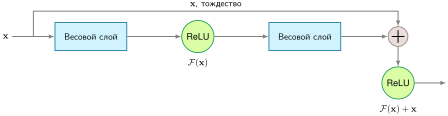

<em><strong>Блок остаточной связи</strong>: остаточная связь реализует $\mathbf{y} = \text{ReLU}(\mathcal{F}(\mathbf{x}) + \mathbf{x})$, создавая тождественный обходной путь, который пропускает весовые слои перед финальной нелинейностью. При обратном распространении градиенты проходят и по остаточному пути (через $\mathcal{F}'(\mathbf{x})$), и по тождественному пути (через $\mathbf{I}$ перед финальной нелинейностью), помогая градиентам достигать ранних слоев даже в сетях из более чем 100 слоев. Этот архитектурный шаблон позволил строить очень глубокие остаточные CNN и стал центральным в блоках трансформеров и многих других современных архитектурах.</em>

Переход от RNN к трансформерам заменил последовательные зависимости рекуррентных шагов параллельным вниманием «все со всеми», сократив последовательную операционную глубину с $\mathcal{O}(S)$ шагов до $\mathcal{O}(1)$ шагов для взаимодействия токенов. Этот архитектурный сдвиг максимизирует загрузку аппаратуры на массивно-параллельных ускорителях, таких как GPU и TPU, где тысячи арифметических блоков простаивают, если их сдерживают последовательные зависимости. Остальные строительные блоки перешли напрямую: GEMM, остаточные связи и нормализация остаются необходимыми во всех семействах.

Эта переносимость распространяется на современные варианты. Визуальные трансформеры (Vision Transformers)[^fn-vision-transformer-patching] адаптируют трансформер к изображениям, сохраняя все четыре строительных блока (Dosovitskiy et al., 2021). GPT-3 масштабирует эти шаблоны трансформера, чередуя плотное внимание с разреженным вниманием ленточного типа и оставаясь в рамках того же набора примитивов (Brown et al., 2020). Практические трудности реализации и оптимизации рассматриваются в главе [«Сжатие моделей»](10_model_compression.md).

[^fn-vision-transformer-patching]: **Визуальные трансформеры (ViT)**: в статье ViT 2020 года от Google изображения $224{\times}224$ делились на патчи $16{\times}16$ (196 «токенов»), и к ним применялось стандартное внимание трансформера. ViT заменяют локальные свертки CNN глобальным вниманием $\mathcal{O}(S^2)$ по токенам патчей. В исходном исследовании крупномасштабное предобучение повышало конкурентоспособность ViT, что иллюстрирует, как данные и вычисления могут компенсировать более слабое пространственное индуктивное смещение (Dosovitskiy et al., 2021).

[«Использование примитивов в архитектурах»](06_nn_architectures.md#tbl-primitive-comparison) сопоставляет, как четыре архитектурных семейства используют эти базовые примитивы. Трансформеры сохраняют плотные операции GEMM, общие для всех архитектур, но вносят зависящие от содержимого редукции типа «все со всеми» через внимание, сочетая операции широковещания MLP с операциями сбора и редукции более динамичных архитектур.

| **Тип примитива**  | **MLP**    | **CNN**        | **RNN**            | **Трансформер**   |
|:-------------------|:-----------|:---------------|:-------------------|:------------------|
| **Вычисления**     | Плотный GEMM | Свертка      | Последовательный GEMM | GEMM + внимание  |
| **Доступ к памяти** | Последовательный | С шагом    | Последовательный + состояние | Блочные потоки QKV |
| **Перемещение данных** | Широковещание | Скользящее окно | Временное широковещание | Сбор + редукция |
| **Параллелизм**    | Высокий    | Высокий        | Низкий (временные зависимости) | Высокий (по позициям) |

<a id="tbl-primitive-comparison"></a>

<em><strong>Использование примитивов в архитектурах</strong>: все архитектуры используют GEMM, но различаются шаблонами доступа к памяти, перемещением данных (от широковещания к сбору и редукции) и параллелизмом. Трансформеры сочетают плотный блочный доступ QKV с редукциями, специфичными для внимания, поэтому они одновременно нагружают и блоки GEMM, и путь редукции.</em>

Для системных инженеров этот взгляд на строительные блоки отделяет переносимые оптимизации от специфичных для архитектуры. Блочная обработка GEMM и вычисления смешанной точности полезны всем архитектурам. Управление памятью для остаточных связей применимо к любой остаточной сети. Слияние ядер нормализации помогает и CNN, и трансформерам. Оптимизации, специфичные для внимания, остаются связанными с шаблоном памяти внимания, но и они опираются на те же базовые примитивы GEMM и доступа к памяти. Чтобы понять, почему эти оптимизации переносятся, [«Вычислительные примитивы»](06_nn_architectures.md#sec-network-architectures-systemlevel-building-blocks-41c5) сводит общие слои к примитивам, которые исполняет машина.

<a id="sec-network-architectures-systemlevel-building-blocks-41c5"></a>

## Вычислительные примитивы

Фреймворки и компиляторы не исполняют высокоуровневые абстракции слоев напрямую; они понижают нейронные сети до компактного набора *вычислительных примитивов*. Прямой проход ResNet-50 выполняет миллиарды операций умножения с накоплением; блок внимания трансформера пропускает гигабайты через иерархии памяти на кристалле; рекомендательная модель разбрасывает случайные обращения по таблицам эмбеддингов терабайтного масштаба. Несмотря на эти архитектурные различия, физическая нагрузка на аппаратуру распадается на три области примитивов: плотную арифметику, траектории доступа к памяти и перемещение данных между ядрами или устройствами. Выделение этих примитивов раскрывает физические узкие места — арифметическую интенсивность, пропускную способность памяти и задержку межсоединений, — которые определяют проект ускорителя и оптимизации компилятора, подробно описанные в главе [«Аппаратное ускорение»](11_hw_acceleration.md).

<a id="sec-network-architectures-core-computational-primitives-b853"></a>

### Базовые вычислительные примитивы

Базовый примитив определяет, какой шаблон исполнения архитектура заставляет аппаратуру оптимизировать: плотную тензорную математику, повторное локальное переиспользование или маршрутизацию, зависящую от входа. Матричное умножение, операции скользящего окна и динамические вычисления повторяются в семействах моделей, потому что каждая сохраняет свой особый профиль исполнения при понижении до кремния. Они являются примитивами в инженерном смысле: дальнейшая декомпозиция стирает характеристики производительности, которые должны оптимизировать аппаратные блоки и компиляторы.

Матричное умножение — путь плотной тензорной математики. Умножение матрицы активаций на матрицу весов вычисляет линейные комбинации по измерениям признаков (напомним эталонный слой MLP из [«Алгоритмической структуры»](06_nn_architectures.md#sec-network-architectures-algorithmic-structure-99f2)). Этот путь доминирует в современных нагрузках: MLP выполняют его напрямую для полносвязных проекций, CNN сводят свертки к матричным умножениям, а трансформеры опираются на него для проекций «запрос — ключ — значение» и полносвязных сетей. [«Преобразование im2col»](06_nn_architectures.md#fig-im2col-diagram) иллюстрирует, как понижение отображает пространственную локальность скользящего окна в стандартное матричное произведение в порядке строк (row-major).

<a id="fig-im2col-diagram"></a>

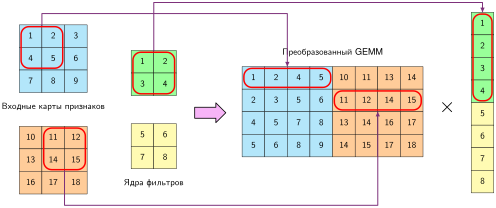

<em><strong>Преобразование im2col</strong>: сводит свертку к GEMM, разворачивая фрагменты изображения в плотную матрицу. Две входные карты признаков $3{\times}3$ дают четыре позиции скользящего окна, представленные здесь строками матрицы $4{\times}8$; два фильтра $2{\times}2$ складываются в столбец $8{\times}1$. Их произведение дает четыре выходные позиции. Понижение может использовать оптимизированные матричные ядра, но расширяет память на величину, зависящую от размера ядра, шага, дополнения и реализации, поэтому выигрыш в производительности зависит от нагрузки.</em>

Техника im2col[^fn-im2col-lowering-transformation] (image to column, «изображение в столбцы») превращает скользящие свертки в плотные GEMM. Разворачивая каждый фрагмент рецептивного поля в строку матрицы и укладывая веса фильтров в столбцы, im2col позволяет сверточным слоям исполняться на зрелых GEMM-библиотеках, настроенных производителями, таких как cuBLAS, MKL и OpenBLAS.

[^fn-im2col-lowering-transformation]: **im2col (image to column)**: не новый алгоритм обучения, а техника реализации, которую используют CNN-фреймворки и библиотеки, такие как Caffe и cuDNN (Jia et al., 2014; Chetlur et al., 2014): свертки превращаются в стандартные вызовы GEMM разворачиванием перекрывающихся фрагментов в столбцы матрицы. Компромисс — память: в простом полностью материализованном преобразовании $K{\times}K$ с шагом 1 внутренние элементы входа могут попасть в до $K^2$ столбцов (9 раз для фильтров $3{\times}3$), хотя границы, шаг, дополнение, блочная обработка и прямые алгоритмы свертки уменьшают реальное расширение. Этот обмен памяти на простоту объясняет, почему мобильные фреймворки (TFLite, NNAPI) предпочитают прямую свертку, тогда как дата-центровые GPU с большим объемом HBM могут использовать понижение к GEMM, когда оно повышает пропускную способность.

Такое понижение задает явный компромисс «память ради вычислений». Пакетный входной тензор формы $(B, C_{\text{in}}, H, W)$ распаковывается в развернутую матрицу формы $[(B \cdot H_{\text{out}} \cdot W_{\text{out}}) \times (K^2 \cdot C_{\text{in}})]$, а сверточные фильтры приводятся к форме $[(K^2 \cdot C_{\text{in}}) \times C_{\text{out}}]$. Их произведение дает выходную матрицу формы $[(B \cdot H_{\text{out}} \cdot W_{\text{out}}) \times C_{\text{out}}]$. Для сверток с шагом 1 и размером ядра $K$ входные пиксели, общие для перекрывающихся рецептивных полей, дублируются в памяти до $K^2$ раз, увеличивая объем памяти и трафик DRAM, если только они не объединяются или не разбиваются на блоки непосредственно в SRAM на кристалле.

Структурная и неструктурная разреженность рассматриваются в разделе [«Прореживание»](10_model_compression.md#sec-model-compression-pruning-d1cb) главы [«Сжатие моделей»](10_model_compression.md#sec-model-compression); исполнение разреженных вычислений с учетом аппаратуры и совместное проектирование алгоритма и аппаратуры — в главе [«Аппаратное ускорение»](11_hw_acceleration.md).

Операции скользящего окна представляют путь локального переиспользования. Вместо материализации дублирующих буферов в памяти нативное исполнение скользящего окна проводит компактное ядро фильтра по входным тензорам, вычисляя локальные шаблоны. Ускорители используют эту структуру через специализированную буферизацию потока данных. Например, TPU направляют вычисления через двумерные систолические массивы[^fn-systolic-array-architecture], где активации и веса синхронно текут через сетку элементов обработки с умножением и накоплением. Прямая передача данных между соседними регистрами исключает обращения к внешней памяти для каждой арифметической операции.

[^fn-systolic-array-architecture]: **Систолический массив**: назван по ритмичному сокращению сердца; синхронный «пульс» данных через сетку процессоров непосредственно реализует эффективное переиспользование данных, необходимое операциям скользящего окна. Передавая входные значения между соседними процессорами, мы избегаем дорогого обращения к внешней DRAM для каждого умножения в свертке. Это критично для эффективности: одно обращение к внешней памяти может стоить более чем в 100 раз больше энергии, чем операция умножения с накоплением в плавающей запятой, а относительно арифметики с низкой разрядностью — еще больше.

Динамические вычисления представляют путь адаптивной маршрутизации. В плотном внимании трансформера веса взаимодействий «запрос — ключ» меняются для каждого входного токена, но формы тензоров и матричные операции остаются статичными и регулярными. Напротив, разреженное внимание, гейтинг «смеси экспертов» (MoE) и исполнение динамических графов вносят управляющий поток, зависящий от данных, и размерности тензоров, известные только во время выполнения. Такое динамическое исполнение бросает вызов обычному статическому выделению памяти и диспетчеризации параллельной работы.

Промышленные архитектуры сочетают эти пути исполнения. Блок трансформера использует плотные GEMM формы $[S, d_{\text{model}}] \times [d_{\text{model}}, d_{\text{proj}}]$ для проекций признаков, вычисление матрицы оценок $S \times S$ внимания и, при необходимости, динамическую маршрутизацию по подсетям-экспертам. Однако пиковая арифметическая пропускная способность на бумаге не гарантирует реальной производительности: блоки исполнения аппаратуры остаются без работы, если подсистема памяти не может подавать им операнды с соответствующей скоростью.

<a id="sec-network-architectures-memory-access-primitives-5e8b"></a>

### Примитивы доступа к памяти

Скорость и предсказуемость доступа к памяти определяют загрузку ускорителя. Даже матричный движок, способный выдавать сотни терафлопс, простаивает, если данные не могут пройти по иерархии памяти достаточно быстро. Арифметическая операция на кристалле завершается за единицы тактов, тогда как извлечение операнда из внешней DRAM занимает сотни тактов.

Шаблоны доступа к памяти делятся на три категории — последовательный доступ, доступ с шагом и случайный доступ, — которые определяют, насколько эффективно аппаратура может предвыбирать, кешировать и объединять запросы к памяти. Поскольку передача данных через границы корпусов требует гораздо больше энергии, чем операции АЛУ, шаблоны доступа к памяти задают энергетические бюджеты наряду с задержкой исполнения.

<a id="psp-nn-architectures-energy-cost-data-movement"></a>

> **Энергетическая цена перемещения данных**
>
> Ключевой системный принцип: *перемещение данных стоит дороже, чем вычисления над ними*. Операция умножения с накоплением в плавающей запятой потребляет примерно 1–5 пДж в зависимости от технологического процесса (например, около 4,6 пДж при 45 нм (Horowitz, 2014)), тогда как извлечение 32-битного операнда из внешней DRAM стоит сотни пДж в той же эталонной модели. Даже консервативные оценки ставят обращение к внешней DRAM в десятки и сотни раз выше арифметики, что объясняет, почему шаблоны доступа к памяти, а не только число FLOP, определяют эффективность на практике.
>
> Рассмотрим предыдущие архитектуры через эту энергетическую призму: у MLP низкое переиспользование данных (каждый вес загружается один раз на образец), поэтому энергию в них доминирует трафик DRAM. CNN переиспользуют веса фильтров по пространственным позициям, амортизируя стоимость загрузки на $H \times W$ применений; та же локальность, которая делает их ограниченными вычислениями, делает их и энергетически эффективными. RNN переиспользуют веса по шагам времени (высокое временное переиспользование), но платят за повторное чтение и запись скрытого состояния на каждом шаге. Трансформеры сочетают попарное вычисление оценок с перемещением ключей и значений, из-за чего полное внимание по последовательности имеет квадратичную вычислительную сложность; реализация и блочная обработка определяют вспомогательный трафик памяти и энергию. Эти энергетические профили напрямую повторяют столбец узких мест в [«Сравнении маячных моделей»](06_nn_architectures.md#tbl-lighthouse-comparison).
>
> Этот принцип лежит в основе последующих стратегий оптимизации: в разделе [«Квантование и числовая точность»](10_model_compression.md#sec-model-compression-quantization-precision-cd46) главы [«Сжатие моделей»](10_model_compression.md#sec-model-compression) показано, как квантование уменьшает число бит, передаваемых на значение, прореживание устраняет лишнее перемещение данных, а блочная обработка удерживает рабочие наборы в более быстрых и экономичных по энергии кешах.

Последовательный доступ дает наибольшую эффективную пропускную способность. При пакетном матричном умножении MLP аппаратура потоково читает непрерывные строки весов и векторы активаций. Современные архитектуры DRAM используют пакетный режим передачи для непрерывных адресов, насыщая доступную пропускную способность интерфейса (на подсистемах HBM она достигает нескольких терабайт в секунду), а аппаратные предвыборщики предсказывают последующие кеш-линии. Компиляторы оптимизируют этот шаблон, выделяя непрерывные блоки памяти и выравнивая шаги тензоров по кеш-линиям аппаратуры.

Доступ с шагом возникает, когда запросы к памяти перескакивают через непрерывные адреса с равномерными интервалами. В стандартных сверточных слоях без преобразования im2col свертка по пространственным измерениям требует обращений к входам, разделенным шагом строк карты признаков. Доступ с шагом снижает пропускную способность памяти: загружаются целые кеш-линии, а используется лишь часть байтов каждой из них. Компиляторы смягчают этот штраф, переупорядочивая циклы или упаковывая срезы с шагом в непрерывные временные буферы в разделяемой памяти.

Случайный доступ создает самое серьезное узкое место памяти. В таблицах эмбеддингов рекомендательных моделей разреженные идентификаторы признаков индексируют произвольные строки таблиц размером в гигабайты или терабайты. Эти непредсказуемые выборки обесценивают аппаратные предвыборщики, дробят пакетные транзакции DRAM и порождают высокую долю промахов кеша. Плотное внимание трансформера представляет противоположный профиль: хотя веса внимания зависят от содержимого, сами векторы запросов, ключей и значений лежат в непрерывных тензорах. Оптимизированные ядра внимания разбивают эти плотные матрицы на блоки через SRAM на кристалле, полностью избегая случайных адресов DRAM.

[«Сложность доступа к памяти»](06_nn_architectures.md#tbl-arch-complexity) количественно описывает, как эти шаблоны доступа определяют масштабирование хранения параметров и активаций в семействах моделей.

| **Архитектура**  | **Зависимость от входа**   | **Хранение параметров**                                                      | **Хранение активаций**                                                                      | **Характер масштабирования** |
|:-----------------|:---------------------------|:-----------------------------------------------------------------------------|:--------------------------------------------------------------------------------------------|:---------------------|
| **MLP**          | Линейная                   | $\mathcal{O}(N_{\text{in}} \times d_{\text{width}})$                         | $\mathcal{O}(B \times d_{\text{width}})$                                                    | Предсказуемый        |
| **CNN**          | Постоянная относительно разрешения | $\mathcal{O}(K^2 C_{\text{in}} C_{\text{out}})$                        | $\mathcal{O}(B \times H_{\text{img}} \times W_{\text{img}} \times C)$                       | Эффективный          |
| **RNN**          | Линейная                   | $\mathcal{O}(d_{\text{hidden}}^2)$                                           | $\mathcal{O}(B \times S \times d_{\text{hidden}})$                                          | Сложный              |
| **Трансформер**  | Квадратичное внимание      | $\mathcal{O}(d_{\text{model}}^2 + d_{\text{model}} d_{\text{ff}})$ на блок   | $\mathcal{O}(B \times S^2)$ внимание плюс $\mathcal{O}(B S d_{\text{model}})$ активации     | Проблемный           |

<a id="tbl-arch-complexity"></a>

<em><strong>Сложность доступа к памяти</strong>: разные нейросетевые архитектуры демонстрируют разные шаблоны доступа к памяти и требования к хранению, что влияет на производительность и масштабируемость системы. Хранение параметров зависит от размерностей модели, а хранение активаций представляет значительную стоимость во время выполнения. Член $\mathcal{O}(B S^2)$ у трансформера описывает материализованные оценки внимания в наивной реализации; блочные ядра точного внимания могут избежать хранения всей этой матрицы.</em>

Где:

- $N_{\text{in}}$: размер входа
- $d_{\text{width}}$: ширина слоя
- $B$: размер батча
- $K$: размер ядра
- $C$: число каналов
- $C_{\text{in}}, C_{\text{out}}$: число входных и выходных каналов
- $H_{\text{img}}$: высота входной карты признаков (CNN)
- $W_{\text{img}}$: ширина входной карты признаков (CNN)
- $d_{\text{hidden}}$: размерность скрытого состояния RNN
- $S$: длина последовательности
- $d_{\text{model}}$: размерность модели трансформера

Эти свойства масштабирования памяти определяют возможности переиспользования данных и поведение кеша. В CNN пространственное переиспользование позволяет каждому входному пикселю участвовать в нескольких перекрывающихся вычислениях фильтра ($K^2$ раз для ядра $K \times K$), что дает L1, L2 и разделяемой памяти амортизировать стоимость загрузки из DRAM через блочную обработку циклов. Напротив, MLP без батчирования перезагружает всю свою матрицу весов для одного входного вектора, достигая минимального переиспользования данных и оставляя процессор без пропускной способности.

Размер рабочего набора — объем данных, одновременно необходимых блокам исполнения, — определяет, помещается ли операция в быструю память на кристалле. Рабочий набор слоя MLP часто укладывается в несколько сотен килобайт и целиком находится в SRAM на кристалле. Напротив, полное внимание по последовательности в трансформерах материализует промежуточные карты внимания, которые растут как $\mathcal{O}(B \cdot S^2)$; для длинных последовательностей они легко превышают емкость SRAM на кристалле и переливаются в высокоскоростную DRAM, если только не объединяются с помощью блочной обработки онлайнового softmax.

Если [«Сложность доступа к памяти»](06_nn_architectures.md#tbl-arch-complexity) задает масштабирование памяти, то [«Сравнение вычислительной сложности»](06_nn_architectures.md#tbl-computational-complexity) сопоставляет возникающие арифметические требования, структуры распараллеливания и основные аппаратные узкие места для четырех эталонных архитектур.

| **Архитектура**  | **Параметры**                                                                                                             | **Прямой проход**                                                                                         | **Память**                                                                                                              | **Распараллеливание**                   | **Узкое место**                                                        |
|:-----------------|:--------------------------------------------------------------------------------------------------------------------------|:----------------------------------------------------------------------------------------------------------|:------------------------------------------------------------------------------------------------------------------------|:----------------------------------------|:-----------------------------------------------------------------------|
| **MLP**          | $\mathcal{O}(d_{\text{in}} \times d_{\text{out}})$ на слой                                                                | $\mathcal{O}(d_{\text{in}} \times d_{\text{out}})$ на слой                                                | $\mathcal{O}(d_{\text{in}}d_{\text{out}})$ весов, $\mathcal{O}(B d_{\text{out}})$ активаций                             | Отлично: матричные операции параллельны | Пропускная способность памяти                                          |
| **CNN**          | $\mathcal{O}(k^2 \times c_{\text{in}} \times c_{\text{out}})$ на слой                                                     | $\mathcal{O}(H_{\text{img}} \times W_{\text{img}} \times k^2 \times c_{\text{in}} \times c_{\text{out}})$ | $\mathcal{O}(H_{\text{img}} \times W_{\text{img}} \times c)$ признаков, $\mathcal{O}(k^2 \times c^2)$ весов              | Хорошо: пространственная независимость  | Часто пропускная способность вычислений; для глубинных или малых батчей — пропускная способность памяти |
| **RNN**          | $\mathcal{O}(d_{\text{hidden}}^2+d_{\text{hidden}} \times d_{\text{in}})$ всего                                           | $\mathcal{O}(S \times d_{\text{hidden}}^2)$ за $S$ шагов времени                                          | $\mathcal{O}(d_{\text{hidden}})$ рекуррентного состояния (вывод); $\mathcal{O}(S d_{\text{hidden}})$ активаций (обучение) | Плохо: последовательные зависимости     | Последовательные зависимости                                           |
| **Трансформеры** | $\mathcal{O}(d_{\text{model}}^2)$ проекции QKV/O плюс $\mathcal{O}(d_{\text{model}}d_{\text{ff}})$ полносвязных слоев     | $\mathcal{O}(S^2 \times d_{\text{model}} + S \times d_{\text{model}}^2)$ на слой                          | $\mathcal{O}(S^2)$ внимание, $\mathcal{O}(S \times d_{\text{model}})$ последовательности                               | Отлично (по позициям), но ограничено памятью | Память $(S^2)$                                                         |

<a id="tbl-computational-complexity"></a>

<em><strong>Сравнение вычислительной сложности</strong>: характер масштабирования и требования к ресурсам основных архитектур нейронных сетей. Обозначения: $d_{\text{in}}$ — размерность входа, $d_{\text{out}}$ — размерность выхода, $d_{\text{model}}$ — размерность модели трансформера, $d_{\text{hidden}}$ — размерность скрытого состояния RNN, $k$ — размер ядра, $c$ — число каналов, $H_{\text{img}}, W_{\text{img}}$ — пространственные размеры, $S$ — длина последовательности (число шагов времени), $B$ — размер батча. Столбец узких мест указывает главный фактор, ограничивающий производительность в типичных развертываниях. Для трансформеров член памяти $\mathcal{O}(S^2)$ предполагает материализованные оценки внимания; блочные ядра точного внимания могут избежать хранения всей этой матрицы.</em>

Примитивы доступа к памяти определяют, насколько эффективно одно вычислительное ядро извлекает данные из своей локальной иерархии памяти. Однако исполнение нейронных сетей в масштабе требует согласования потоков данных между несколькими ядрами, кешами на кристалле и отдельными ускорителями.

<a id="sec-network-architectures-data-movement-primitives-5b39"></a>

### Примитивы перемещения данных

Примитивы перемещения данных описывают расхождение (fan-out) и схождение (fan-in) значений тензоров между элементами обработки, банками памяти и межсоединениями ускорителей. Как уже отмечалось из-за физического энергетического разрыва между операциями АЛУ и передачами данных, перемещение данных по межсоединениям часто требует большей задержки и энергии, чем сами вычисления.

Шаблоны коммуникации сводятся к четырем базовым коллективным операциям: широковещание (broadcast), рассеивание (scatter), сбор (gather) и редукция (reduction). [«Примитивы перемещения данных»](06_nn_architectures.md#fig-collective-comm) сопоставляет их топологии связи.

<a id="fig-collective-comm"></a>

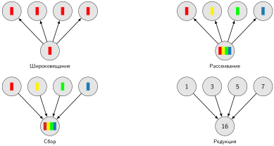

***Примитивы перемещения данных**: четыре базовых шаблона управляют потоком информации в вычислениях нейронных сетей. Широковещание (слева вверху) копирует одно значение во все адресаты; оно используется при разделении весов между элементами батча. Рассеивание (справа вверху) распределяет разные элементы по разным адресатам, что позволяет разбивать работу. Сбор (слева внизу) собирает распределенные значения в одно место, как при объединении внимания. Редукция (справа внизу) объединяет несколько значений агрегирующей операцией (сумма, максимум); она встречается при синхронизации градиентов и вычислении оценок внимания. Энергетическая цена перемещения данных (см. раздел «Примитивы доступа к памяти») делает эти шаблоны критичными целями оптимизации.*

Операции широковещания распределяют одинаковые данные от одного источника к нескольким параллельным адресатам. При пакетном выполнении GEMM стационарные тайлы весов рассылаются нескольким вычислительным ядрам, каждое из которых вычисляет независимый элемент батча. Ускорители ускоряют широковещание через выделенные коммутаторы на кристалле или многоадресные сетевые структуры, а компиляторы разбивают циклы на тайлы, чтобы максимально переиспользовать каждое широковещаемое значение.

Операции рассеивания разбивают исходный тензор на непересекающиеся сегменты и отправляют разные срезы разным адресатам. При пространственном или модельном параллелизме большой тензор активаций или весов рассеивается по вычислительным тайлам или узлам кластера. В больших языковых моделях архитектуры MoE вводят динамические шаблоны рассеивания, зависящие от входа: сеть гейтинга направляет отдельные токены к конкретным сетям-экспертам, распределенным по устройствам. Поскольку маршрутизация токенов зависит от входных данных во время выполнения, динамическое рассеивание часто порождает неравномерную загрузку: слабо загруженные ускорители простаивают, а перегруженные эксперты становятся узким местом конвейера.

Операции сбора собирают распределенные срезы тензора в один центральный адресат. В разреженных системах рекомендаций сбор извлекает векторы эмбеддингов, соответствующие разреженным индексам признаков, из распределенных узлов памяти. В самовнимании трансформера сбор происходит вдоль измерения последовательности: каждый запрос агрегирует представления «ключ — значение» по всем позициям последовательности.

Операции редукции объединяют несколько входных значений в агрегированный результат с помощью ассоциативных операторов, таких как суммирование или взятие максимума. Редукции повсеместны в нейронных сетях: они встречаются при вычислении послойной нормализации, при расчете нормировочных множителей softmax и при синхронизации градиентов весов между распределенными рабочими процессами параллелизма данных. Аппаратура ускорителей ускоряет редукции через выделенные древовидные сети редукции и регистры перестановки внутри варпа, сокращая задержку завершения с $\mathcal{O}(n)$ последовательных шагов до $\mathcal{O}(\log n)$ параллельных стадий.

В реальных нагрузках эти примитивы выполняются составными стадиями. Например, одна голова внимания трансформера с длиной последовательности $S = 512$ и размером батча $B = 32$ рассылает векторы запросов широковещанием, собирает пары «ключ — значение» вдоль измерения последовательности и редуцирует получающиеся скалярные произведения через знаменатель softmax. Когда размерности модели превышают пределы памяти одного ускорителя, коллективные коммуникации по каналам масштабирования вверх (например, NVLink или оптические структуры TPU) определяют сквозную пропускную способность, и примитивы перемещения данных становятся главным архитектурным ограничением.

<a id="sec-network-architectures-system-design-impact-500a"></a>

### Влияние на проектирование системы

Вычислительные примитивы, примитивы доступа к памяти и примитивы перемещения данных определяют распределение кремниевой площади и устройство компиляторов. Разработчики аппаратуры выделяют площадь кристалла под специализированные блоки только тогда, когда лежащий в основе математический примитив доминирует в типичных нагрузках.

Распространенность плотного матричного умножения и свертки побудила создать специализированные матричные движки, такие как TPU Google[^fn-tpu-systolic-execution] и тензорные ядра GPU (Tensor Cores). В главе [«Аппаратное ускорение»](11_hw_acceleration.md) разобрано, как эти блоки исполнения отображают алгоритмические примитивы непосредственно на кремниевые тракты данных, обменивая гибкость универсальных инструкций на плотность операций умножения с накоплением.

[^fn-tpu-systolic-execution]: **TPU (тензорный процессор)**: первый TPU Google отображал матричное умножение на большой систолический массив, обменивая универсальные возможности, такие как кеши и сложный управляющий поток, на эффективность вывода для конкретной области (Jouppi et al., 2017). Архитектурный урок здесь качественный: когда один примитив доминирует в нагрузке, специализированные тракты данных и локальное переиспользование могут превзойти универсальную гибкость. Подробные решения по точности, спецификации аппаратуры и компромиссы производительности разобраны в главе [«Аппаратное ускорение»](11_hw_acceleration.md).

Архитектуры памяти аналогично разделились, чтобы учитывать различающиеся профили примитивов. Поддержка предсказуемого потокового доступа наряду со случайным или шаговым доступом привела к появлению высокоскоростной памяти (**HBM**), в которой кристаллы DRAM укладываются вертикально и дают пропускную способность 2–3 ТБ/с — более чем на порядок выше стандартных каналов DDR. На кристалле ускорители предоставляют иерархии SRAM объемом в несколько мегабайт и явно управляемую **скретч-память (scratchpad)**, давая компиляторам предсказуемый контроль над промежуточным размещением данных рабочего набора.

Архитектуры межсоединений отражают примитивы перемещения данных. Чтобы выдерживать большие объемы широковещания, сбора и редукций, которые требуют модели на нескольких ускорителях, современные платформы включают высокоскоростные двухточечные связи и специализированные маршрутизаторы сети на кристалле, оптимизированные для коллективных шаблонов коммуникации.

[«Совместное проектирование примитивов и аппаратуры»](06_nn_architectures.md#tbl-sys-design-implications) сводит это совместное проектирование аппаратуры и программ: каждому вычислительному примитиву, примитиву памяти и коммуникационному примитиву сопоставлены выделенное аппаратное ускорение, оптимизация компилятора и главное физическое узкое место.

| **Примитив**                                       | **Влияние на аппаратуру**  | **Программная оптимизация** | **Ключевые трудности**     |
|:---------------------------------------------------|:--------------------------|:--------------------------|:---------------------------|
| **Матричное умножение**                            | Тензорные ядра            | Батчирование, библиотеки GEMM | Распараллеливание, точность |
| **Скользящее окно**                                | Специализированные тракты данных | Оптимизация раскладки данных | Обработка шага         |
| **Динамические вычисления**                        | Гибкая маршрутизация      | Исполнение динамических графов | Балансировка нагрузки   |
| **Последовательный доступ**                        | Пакетный режим DRAM       | Непрерывное выделение     | Задержка доступа           |
| **Случайный доступ**                               | Большие кеши              | Планирование с учетом памяти | Промахи кеша            |
| **Широковещание**                                  | Специализированные межсоединения | Слияние операций    | Пропускная способность     |
| **Сбор/рассеивание**                               | Высокоскоростная память   | Распределение работы      | Балансировка нагрузки      |

<a id="tbl-sys-design-implications"></a>

<em><strong>Совместное проектирование примитивов и аппаратуры</strong>: эффективные системы машинного обучения требуют тесной интеграции алгоритмических примитивов и лежащей в основе аппаратуры. Распространенные примитивы сопоставляются с конкретными аппаратными ускорениями и программными оптимизациями, и каждый из них создает отдельные трудности реализации. Специализированная аппаратура, такая как тензорные ядра, решает вычислительные задачи матричного умножения и скользящих окон, а программные приемы, такие как батчирование и исполнение динамических графов, дополнительно повышают производительность.</em>

Эти отображения примитивов определяют энергопотребление системы. Как показано в следующем разборе, физическая энергетическая стоимость переноса операнда через корпус памяти превышает энергию арифметики на порядки.

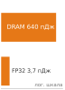

*Перенос 32-битного значения из DRAM стоит гораздо больше энергии, чем одно умножение FP32.*

Большие пакетные GEMM в MLP достигают высокой арифметической интенсивности, амортизируя загрузку весов на многие входы. Напротив, вывод MLP с малым батчем показывает минимальное переиспользование и большую часть энергии тратит на перемещение весов из внешней DRAM. Эталонное умножение FP32 стоит примерно 3,7 пДж на FLOP, тогда как извлечение одного 32-битного операнда из DRAM — 640 пДж (Horowitz, 2014); разница в энергии составляет 173 раза. Хотя полная энергия нагрузки зависит от числа операций и коэффициентов переиспользования, операции с низким переиспользованием по-прежнему подавляющим образом определяются энергией пересылок DRAM. Эта физическая реальность заставляет архитекторов ускорителей выделять большие пулы SRAM на кристалле и применять корпуса уровня пластины или с несколькими кристаллами, чтобы удерживать активные рабочие наборы на кристалле.

Операции свертки снижают энергию на выход, переиспользуя веса фильтра по $H \times W$ пространственным позициям. Однако реальную энергию определяют детали реализации. Понижение im2col упрощает исполнение, обращаясь к библиотекам GEMM производителей, но полная материализация развернутого тензора может увеличить временный трафик памяти до $K^2$ раз для фильтров с шагом 1. Алгоритмы прямой свертки и слитые ядра скользящего окна обходятся без этого промежуточного буфера, существенно снижая трафик памяти и рассеиваемую корпусом энергию.

Последовательная обработка в RNN демонстрирует временное переиспользование весов между шагами последовательности. Хранение компактного скрытого состояния целиком в SRAM на кристалле исключает повторные обращения к DRAM для рекуррентных активаций. Однако строгие последовательные зависимости не позволяют распараллелить вычисления по шагам времени, из-за чего блоки исполнения простаивают, а энергия на токен растет.

В трансформерах многоголовое внимание создает большие накладные расходы на перемещение данных. В стандартных неслитых реализациях материализация полной матрицы внимания $S \times S$ дает квадратичное число циклов чтения и записи в память (узкое место, разобранное в [«Системных последствиях» внимания](06_nn_architectures.md#sec-network-architectures-system-implications-05a3)). Блочные реализации вроде FlashAttention снимают эту нагрузку, сливая вычисление softmax в SRAM на кристалле и исключая промежуточные обращения к DRAM, а энергетический профиль внимания приближается к профилю матричных умножений, ограниченных вычислениями.

Архитекторы аппаратуры сталкиваются с фундаментальными инженерными компромиссами при оптимизации под эти примитивы. Выделение кремния под широкие плотные систолические массивы максимизирует пропускную способность и энергоэффективность для регулярных GEMM, но оставляет функциональные блоки недогруженными при разреженных выборках или динамической маршрутизации. И наоборот, расширение SRAM на кристалле для хранения огромных рабочих наборов трансформера увеличивает площадь кристалла и статическую мощность утечки, которые плотные регулярные нагрузки не требуют.

Профилирование вычислительных примитивов задает операционные границы каждого семейства архитектур. В промышленной системной инженерии задача смещается от анализа отдельных операторов к выбору и выделению ресурсов для полной архитектуры при жестких эксплуатационных ограничениях — баланс точности предсказаний против бюджетов платформы, установленных в главе [«Системы машинного обучения»](02_ml_systems.md#sec-ml-systems), и требований жизненного цикла, описанных в главе [«Рабочий процесс машинного обучения»](03_ml_workflow.md#sec-ml-workflow).

<a id="sec-network-architectures-architecture-selection-framework-a442"></a>

## Схема выбора архитектуры

Датчик мониторинга диких животных должен классифицировать снимки фотоловушек в строгом бюджете мощности в милливатты, а промышленный сервис рекомендаций — извлекать эмбеддинги терабайтного масштаба в пределах бюджета задержки хвоста меньше миллисекунды. Такие ограничения развертывания сразу исключают архитектуры, которые выглядят конкурентоспособными на эталонных тестах предсказаний без ограничений. Каждое архитектурное семейство воплощает свои физические предположения о структуре данных и вычислениях: MLP допускают произвольные попарные взаимодействия признаков, CNN используют локальную пространственную корреляцию через переиспользование весов скользящего окна, RNN навязывают строгую последовательную рекуррентность, а трансформеры вычисляют внимание «все со всеми» по контексту токенов. Выбор архитектуры — это дисциплина согласования этих вычислительных топологий с физическими бюджетами развертывания до оптимизации ядер или настройки гиперпараметров.

В таксономии D·A·M выбор архитектуры задает вычислительный граф алгоритма ($A$), который связывает инварианты входных данных ($D$) с физическим аппаратным исполнением ($M$). Структурное несоответствие на этой границе невозможно исправить последующими оптимизациями компилятора или настройкой ядер. Схема выбора оценивает кандидатные модели по трем связанным измерениям: статистической структуре входных данных ($D$), алгоритмической сложности и арифметической интенсивности модели ($A$) и границам исполнения аппаратуры — емкости памяти, пропускной способности памяти, вычислительной пропускной способности и тепловому бюджету ($M$), — которые заданы в главах [«Системы машинного обучения»](02_ml_systems.md#sec-ml-systems) и [«Рабочий процесс машинного обучения»](03_ml_workflow.md#sec-ml-workflow). Та же логика выбора управляет отбором данных (глава [«Отбор данных»](09_data_selection.md#sec-data-selection)) и развертыванием кластера (глава [«MLOps»](14_ml_ops.md#sec-ml-operations)).

<a id="sec-network-architectures-datatoarchitecture-mapping-fddb"></a>

### Сопоставление данных и архитектуры

Систематический выбор архитектуры начинается с сопоставления данных и архитектуры: согласования структурных симметрий и инвариантов входных данных с шаблонами вычислений и доступа к памяти семейства операторов. Архитектурные семейства, введенные в [«Архитектурных принципах»](06_nn_architectures.md#sec-network-architectures-architectural-principles-engineering-tradeoffs-362e), задают эту основу: MLP — для табличных записей с произвольными взаимодействиями признаков, CNN — для данных на сетке с локальной пространственной корреляцией, RNN — для потоковых входов с временной рекуррентностью, трансформеры — для реляционных контекстов, где токены имеют произвольные попарные зависимости, а разреженные архитектуры эмбеддингов вроде DLRM — для потоков категориальных рекомендаций высокой кардинальности.

Такое согласование отражает фундаментальные компромиссы памяти и вычислений. Когда архитектура кодирует инварианты данных прямо в свои вычислительные операторы — например, эквивариантность относительно сдвига через переиспользование сверточных весов, — ей не нужно эмпирически выучивать эти симметрии. Архитектура, которая соответствует симметриям данных, минимизирует число параметров, удерживает промежуточные активации в SRAM на кристалле и максимизирует арифметическую интенсивность. Напротив, развертывание архитектуры без подходящих индуктивных смещений вынуждает модель выучивать структуру через избыточное количество параметров, умножая трафик внешней DRAM и раздувая сложность выборки при обучении.

В промышленных системах эти структурные компромиссы определяют разбиение нагрузки по иерархии памяти:

- **MLP** обрабатывают плотные табличные признаки (например, телеметрию датчиков или актуарные таблицы), где размерности признаков не имеют геометрических метрик расстояния, что дает операции «матрица — вектор» с детерминированной задержкой.
- **CNN** обрабатывают пространственные сетки (например, изображения и спектрограммы), где локальные ядра свертки переиспользуют веса фильтров по карте признаков, максимизируя переиспользование регистров и кеша.
- **RNN** обрабатывают последовательные потоки с ограниченным временным состоянием, удерживая компактный рабочий набор в SRAM ценой последовательной пошаговой оценки.
- **Трансформеры** обрабатывают последовательности токенов и реляционные графы (Vaswani et al., 2017; Devlin et al., 2019; Wei et al., 2022) через динамическое внимание «все со всеми», что позволяет выразительное взаимодействие между последовательностями ценой квадратичного вычисления оценок и интенсивного трафика памяти активаций.
- **Разреженные архитектуры эмбеддингов (DLRM)** отделяют таблицы эмбеддингов, ограниченные емкостью памяти, от многослойных перцептронов, ограниченных вычислениями, направляя миллиарды разреженных категориальных идентификаторов через DRAM большой емкости до плотного взаимодействия признаков.

<a id="sec-network-architectures-computational-complexity-considerations-08da"></a>

### Вычислительная сложность

Согласование данных и архитектуры устанавливает функциональное соответствие, но физическую осуществимость определяет асимптотическое масштабирование при аппаратных ограничениях. Архитектура, чьи вычислительные требования или рабочий набор памяти опережают физические пределы ускорителя, нарушает соглашения об уровне обслуживания по задержке (SLA) или превышает емкость памяти устройства.

Как сведено в [«Сложности доступа к памяти»](06_nn_architectures.md#tbl-arch-complexity) и [«Сравнении вычислительной сложности»](06_nn_architectures.md#tbl-computational-complexity), каждое архитектурное семейство задает характерный профиль арифметической интенсивности, масштабирования рабочего набора и локальности доступа к памяти. Оценка этих профилей определяет главное аппаратное узкое место — пропускную способность памяти, вычислительную пропускную способность или последовательную задержку, — которое управляет промышленным развертыванием.

<a id="sec-network-architectures-scalability-production-considerations-68dd"></a>

#### Масштабируемость и промышленные соображения

Промышленное развертывание оценивает архитектуру по строгим соглашениям об уровне обслуживания: задержка хвоста, емкость памяти, энергия на запрос и накладные расходы на восстановление из контрольных точек. Эти эксплуатационные показатели — прямые физические следствия структурного проекта: плотной связности, пространственной локальности, последовательной зависимости или внимания «все со всеми». Структурные решения, которые определяют представительную емкость, одновременно управляют параллелизмом исполнения, закреплением данных в кеше и потреблением пропускной способности памяти.

MLP и CNN работают в более простом эксплуатационном режиме, поскольку вывод не хранит состояния между входными образцами, что позволяет линейно масштабировать пропускную способность за счет параллелизма данных. Однако их профили доступа к памяти заметно различаются. При размере батча $B=1$ вывод MLP строго ограничен пропускной способностью памяти: потоковая передача больших матриц весов из внешней DRAM ради одного произведения матрицы на вектор дает арифметическую интенсивность около 1 FLOP/байт, хотя задержка остается очень детерминированной. Напротив, исполнение CNN достигает высокого переиспользования весов по пространственным измерениям, но память промежуточных активаций растет с разрешением изображения ($H_{\text{img}} \times W_{\text{img}} \times c$) и доминирует в пиковой емкости SRAM и DRAM при выводе высокого разрешения и при обратных проходах обучения.

RNN и трансформеры создают трудные эксплуатационные режимы по противоположным физическим причинам. RNN сохраняет компактное рекуррентное скрытое состояние, но соотношение рекурренции $h_t = f(h_{t-1}, x_t)$ сериализует исполнение по временному измерению. Закон Амдала диктует, что добавление параллельных блоков исполнения не может сократить задержку этого критического пути; кроме того, исполнение с состоянием осложняет распределенное сохранение контрольных точек и восстановление конвейера. Трансформеры, напротив, устраняют последовательную рекуррентность, распараллеливая проекции токенов по всему измерению последовательности, чтобы насытить систолические массивы и тензорные ядра. Однако стандартное самовнимание дает квадратичный объем памяти и вычислений относительно длины последовательности $S$ ([«Системные последствия» внимания](06_nn_architectures.md#sec-network-architectures-system-implications-05a3)): материализация матрицы $S \times S$ быстро исчерпывает HBM и ограничивает максимальный размер батча обслуживания. Малые батчи обслуживания недогружают матричные блоки исполнения, тогда как большие батчи требуют разбиения памяти по нескольким устройствам. В главе [«Обучение моделей»](08_training.md#sec-model-training) эти распределенные стратегии исполнения формализованы через параллелизм данных, тензоров, конвейера и последовательности.

<a id="sec-network-architectures-hardware-mapping-optimization-strategies-ec3b"></a>

#### Отображение на аппаратуру и стратегии оптимизации

Отображение на аппаратуру сопоставляет алгебраическую структуру оператора с физическим трактом исполнения. Плотные матричные операции в MLP напрямую отображаются на систолические массивы и тензорные ядра GPU (глава [«Аппаратное ускорение»](11_hw_acceleration.md) подробно описывает эти кремниевые реализации). Такие нагрузки выигрывают от трех оптимизаций аппаратного уровня: иерархического тайлинга матриц (например, тайлы $64{\times}64$ для кеша L1, $256{\times}256$ для кеша L2 и микротайлы $16{\times}16$ для тензорных ядер), чтобы обеспечить закрепление данных в регистрах и кешах; исполнения смешанной точности (например, арифметики FP16 или BF16 с накоплением в FP32), чтобы удвоить арифметическую пропускную способность и вдвое сократить трафик памяти; и слияния операторов, которое устраняет промежуточные обращения к DRAM, выполняя поэлементные активации и прибавления смещений целиком в регистровых файлах. В главе [«Фреймворки машинного обучения»](07_frameworks.md#sec-ml-frameworks) рассмотрено, как компиляторы генерируют такие слитые запуски ядер на конкретных ускорителях.

CNN выигрывают от специализированных алгоритмов свертки и оптимизаций раскладки данных, которые заметно отличаются от плотных матричных операций. Преобразования im2col сводят свертки к матричному умножению, но могут умножать временное хранилище и трафик памяти — до $K^2$ раз для полностью материализованных фильтров $K{\times}K$ с шагом 1 вдали от границ. Алгоритмы Винограда[^fn-winograd-minimal-filtering] сокращают число умножений в 2,25 раза для сверток $3{\times}3$, но могут усиливать численную ошибку. Прямая свертка с пользовательскими ядрами позволяет избежать материализации im2col, но требует настройки под конкретную архитектуру.

[^fn-winograd-minimal-filtering]: **Алгоритм Винограда**: для одного выходного тайла $2{\times}2$ с фильтром $3{\times}3$ метод обменивает 36 прямых умножений на 16 поэлементных умножений в области Винограда плюс дополнительные преобразования и сложения. Преобразования могут усиливать ошибку округления, поэтому пригодность для низкой точности зависит от варианта, реализации и требований к точности.

Поскольку последовательную рекуррентную зависимость нельзя сократить добавлением вычислительной аппаратуры ([«Системные последствия» RNN](06_nn_architectures.md#sec-network-architectures-system-implications-18c3)), стратегии оптимизации сосредоточены на минимизации накладных расходов исполнения вдоль критического пути. Развертывание циклов устраняет инструкции ветвления и накладные расходы управления на каждом шаге ценой давления на кеш инструкций и хранения активаций. Векторизация состояний объединяет несколько независимых последовательностей по полосам векторных инструкций SIMD, амортизируя стоимость доступа к памяти по последовательностям, но не снижая задержку одной последовательности. Волновое распараллеливание перекрывает независимые прямой и обратный проходы в двунаправленных моделях, повышая насыщенность блоков исполнения там, где это позволяет топология модели. Эти приемы амортизируют накладные расходы исполнения, но оставляют фундаментальное ограничение сериализации нетронутым.

Самовнимание требует оптимизаций иерархии памяти, которые смягчают квадратичное промежуточное состояние. Поскольку вычисление и хранение сырых матриц внимания создает узкие места пропускной способности памяти, доминирующая стратегия оптимизации разбивает вычисление на тайлы внутри быстрой SRAM на кристалле. В разделе [«FlashAttention: оптимизация внимания с учетом ввода-вывода»](08_training.md#sec-model-training-flash-attention-ioaware-attention-optimization-3da0) главы [«Обучение моделей»](08_training.md#sec-model-training) FlashAttention[^fn-flashattention-tiling-kernel] рассматривается как учитывающий ввод-вывод метод тайлинга, тогда как структурированное разреженное внимание снижает арифметическую сложность, ограничивая внимание фиксированными рецептивными шаблонами.

[^fn-flashattention-tiling-kernel]: **FlashAttention**: учитывающий ввод-вывод алгоритм (Dao et al., 2022), который не материализует полную матрицу внимания $S{\times}S$ в HBM, объединяя вычисления в одно ядро, разбитое на тайлы, которые помещаются в SRAM. Результат: ускорение по реальному времени в 2–4 раза и снижение памяти с $\mathcal{O}(S^2)$ до $\mathcal{O}(S)$, что позволяет обучать на последовательностях в 4–16 раз длиннее, чем позволяет стандартное внимание. FlashAttention показывает, что алгоритмическая оптимизация перемещения данных $(D_{\text{vol}})$ может дать больший выигрыш в скорости, чем наращивание сырых вычислений $(R_{\text{peak}})$ — конкретное подтверждение члена данных железного закона.

Эти аппаратные компромиссы задают эксплуатационные границы каждой архитектуры: MLP обеспечивают детерминированное исполнение с низкой задержкой для непространственных векторов признаков; CNN максимизируют переиспользование данных по пространственным сеткам; RNN поддерживают минимальный объем состояния для потоковых последовательностей; а трансформеры обменивают квадратичную пропускную способность памяти на реляционную выразительность. Чтобы перевести эти аппаратные инварианты в промышленное развертывание, нужен структурированный протокол решений.

<a id="sec-network-architectures-decision-framework-a889"></a>

### Схема решений

Инженерные команды часто выбирают архитектуры по популярности, а не по физическим ограничениям: развертывают избыточно параметризованные трансформеры там, где достаточно линейных моделей или легковесных CNN, либо выбирают модели, нарушающие бюджеты задержки вывода. Систематический выбор заменяет эвристики упорядоченным протоколом удовлетворения ограничений, опирающимся на таксономию D·A·M.

Блок-схема решений в [«Схеме выбора архитектуры»](06_nn_architectures.md#fig-dnn-fm-framework) начинается с определения характеристик входных данных, направляет к кандидатным плотным архитектурам (трансформерам, RNN, CNN или MLP) и оценивает каждого кандидата по физическим аппаратным пределам. Нагрузки рекомендаций высокой кардинальности лежат вне этой плотной блок-схемы: их направляют к семейству разреженных эмбеддингов/DLRM ([«Разреженные архитектуры»](06_nn_architectures.md#sec-network-architectures-sparse-architectures-recommendation-systems-5d19)), прежде чем применить те же проверки памяти, вычислений, скорости, точности и развертывания. Если какое-либо ограничение не выполняется, путь решения возвращается к уменьшению емкости модели или к смене архитектурного семейства.

<a id="fig-dnn-fm-framework"></a>

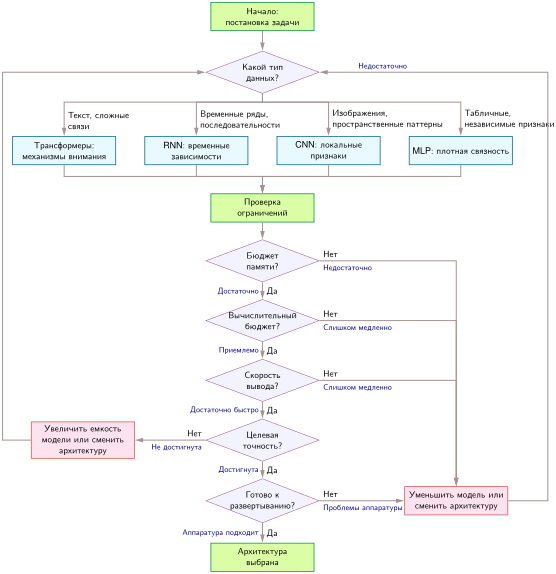

***Схема выбора архитектуры**: систематическая блок-схема выбора плотных нейросетевых архитектур по характеристикам данных и ограничениям развертывания. Процесс начинается с определения типа данных (текст, последовательности, изображения, табличные данные), чтобы выбрать начальных кандидатов (трансформеры, RNN, CNN, MLP), и затем итеративно оценивает бюджет памяти, вычислительную стоимость, скорость вывода, целевую точность и совместимость с аппаратурой. Нагрузки рекомендаций высокой кардинальности обрабатываются отдельно семейством разреженных эмбеддингов (DLRM) в разделе о разреженных архитектурах и затем возвращаются к тем же проверкам ограничений.*

Когда ограничения требуют уменьшения модели, методы сжатия модели из главы [«Сжатие моделей»](10_model_compression.md) дают систематические подходы к снижению памяти, вычислений и задержки с сохранением точности. Схема выполняется в три упорядоченных этапа:

1.  **Идентификация симметрии данных ($D$)**: определите структурные симметрии и инвариантности входных данных. Пространственная локальность направляет кандидатов к CNN; временная структура последовательности — к RNN; неограниченная зависимость между токенами — к трансформерам; табличные признаки без пространственной геометрии — к MLP; а категориальные идентификаторы высокой кардинальности — к таблицам разреженных эмбеддингов.
2.  **Последовательная фильтрация по физическим ограничениям ($A \times M$)**: отсейте кандидатные модели по аппаратным бюджетам: статическое хранение параметров во флеш-памяти или DRAM, пиковый объем динамических активаций в SRAM/HBM, арифметическую интенсивность относительно модели Roofline аппаратуры и крайние сроки задержки хвоста. Нарушение требует уменьшения ширины или глубины модели, квантования и сжатия (глава [«Сжатие моделей»](10_model_compression.md)) либо перехода к семейству архитектур с меньшими накладными расходами.
3.  **Эмпирическая проверка емкости и развертывания**: убедитесь, что емкость кандидата обеспечивает целевую точность на репрезентативных распределениях оценки. Если точность предсказаний недостаточна, увеличьте емкость модели и заново оцените физические аппаратные ограничения. Если целевой ускоритель не способен поддерживать требуемую арифметическую пропускную способность или пропускную способность памяти, выберите альтернативную архитектуру, а не полагайтесь на незначительные корректировки гиперпараметров.

<a id="sec-network-architectures-unified-framework-inductive-biases-257d"></a>

### Иерархия индуктивных смещений

Схема решений работает на непрерывной шкале структурных ограничений: иерархии индуктивных смещений, введенной в [«Архитектурных принципах»](06_nn_architectures.md#sec-network-architectures-architectural-principles-engineering-tradeoffs-362e). В теории машинного обучения индуктивное смещение охватывает предположения, которые модель использует для обобщения за пределы наблюдаемых обучающих примеров. В системной инженерии индуктивное смещение — главный рычаг эффективности: сужение пространства гипотез ограничивает объем параметров, задает границы рабочих наборов промежуточных активаций и открывает иерархиям памяти структурированные шаблоны переиспользования данных.

Архитектурные семейства образуют иерархию убывающих структурных ограничений:

- **CNN** обладают самым сильным архитектурным смещением благодаря локальной связности, разделению весов и эквивариантности относительно сдвига. Эти ограничения резко сокращают объем параметров и позволяют агрессивно размещать тайлы в регистрах и кеше, но ограничивают модель входами на сетке.
- **RNN** задают умеренное структурное смещение через временную рекуррентность и общие матрицы перехода, ограничивая объем памяти времени выполнения для произвольных длин последовательностей ценой сериализации исполнения.
- **Трансформеры** обладают адаптивным индуктивным смещением: вместо фиксированных пространственных или временных топологий они используют динамическое внимание на основе содержимого для всех пар токенов. Такая архитектурная гибкость позволяет обобщать на разные модальности данных, но переносит вычислительную нагрузку на квадратичные матрицы внимания и интенсивное использование пропускной способности памяти.
- **MLP** сохраняют минимальное индуктивное смещение, не предполагая топологических связей между входными признаками. Без структурных ограничений выучивание пространственных или временных шаблонов требует огромного избытка параметров и чрезмерного объема обучающих данных, что дает низкую арифметическую интенсивность и слабую локальность кеша.

Многие глубокие архитектуры реализуют иерархическое обучение представлений, но разными механизмами операторов: CNN — через постепенное расширение рецептивного поля ([«CNN»](06_nn_architectures.md#sec-network-architectures-cnns-spatial-pattern-processing-5b8d)), RNN — через эволюцию скрытого состояния ([«RNN»](06_nn_architectures.md#sec-network-architectures-rnns-sequential-pattern-processing-f804)), а трансформеры — через многоголовое внимание ([«Внимание»](06_nn_architectures.md#sec-network-architectures-attention-mechanisms-dynamic-pattern-processing-22df)). Эта иерархическая организация отражает фундаментальный физический принцип: сложные представления складываются из более простых примитивов. В системной инженерии такая композиция напрямую определяет эффективность исполнения. Конвейеры агрегации признаков должны составлять примитивы, не вызывая избыточных обращений к внешней DRAM. Промежуточное размещение в памяти должно соответствовать иерархиям представлений, чтобы максимизировать переиспользование SRAM на кристалле. Кроме того, параллельная диспетчеризация ядер должна подчиняться иерархическим зависимостям между слоями, поддерживая загрузку блоков исполнения на прямом и обратном проходах.

<a id="sec-network-architectures-putting-together-architecture-selection-practice-052f"></a>

### Выбор архитектуры на практике

Развертывание мониторинга диких животных в реальном времени иллюстрирует взаимодействие структуры данных, емкости модели и бюджетов физической аппаратуры. Прежде чем остановиться на кандидатной архитектуре, расчет потолка пропускной способности показывает, может ли целевая аппаратура поддерживать требуемую скорость обработки кадров.

<a id="nbk-nn-architectures-throughput-ceiling"></a>

> **Потолок пропускной способности**
>
> **Задача**: приложению реального времени нужно обрабатывать видео со скоростью 30 кадров в секунду (FPS) с помощью ResNet-50. Какая устойчивая вычислительная пропускная способность требуется?
>
> **Расчет**:
>
> 1.  **Стоимость модели**: ResNet-50 требует примерно 8,2 GFLOP на изображение $224{\times}224$.
> 2.  **Частота кадров**: требуется 30 FPS.
> 3.  **Устойчивая пропускная способность**: 30 FPS $\times$ 8,2 GFLOP = 246 GFLOP/s.
> 4.  **Эффективная пропускная способность**: пиковые 10 TFLOP/s $\times$ 50–60 процентов загрузки = 5 TFLOP/s–6 TFLOP/s.
> 5.  **Запас ResNet-50**: 5 TFLOP/s $\div$ 246 GFLOP/s = в 20,3 раза.
> 6.  **Проверка модели детекции**: 30 FPS $\times$ 100 GFLOP = 3 TFLOP/s, что оставляет запас в 1,7 раза при нижней оценке эффективной пропускной способности.
>
> **Системный вывод**: GPU среднего класса с теоретическим пиком 10 TFLOP/s в этом плановом сценарии достигает загрузки примерно 50–60 процентов, давая 5 TFLOP/s–6 TFLOP/s эффективной пропускной способности. Для ResNet-50 при 30 FPS у системы запас в 20,3 раза. Переход к модели детекции объектов со 100 GFLOP на кадр, однако, требует устойчивых 3 TFLOP/s и оставляет запас лишь в 1,7 раза. Ограничения размера батча или многопоточная обработка быстро приближают систему к потолку вычислений. ResNet-50 ограничена вычислениями, но запас зависит от ускорителя и достигнутой загрузки.

Потолок пропускной способности переводит абстрактное вычислительное требование в конкретный процент загрузки аппаратуры. Реальное развертывание добавляет физические ограничения, которые один лишь потолок не учитывает.

<a id="sec-network-architectures-worked-wildlife-monitoring"></a>

#### Разобранный пример: мониторинг диких животных в реальном времени

Задача проектирования — встроенная система машинного обучения, которая классифицирует виды диких животных по снимкам фотоловушек в изолированном национальном парке. Развертывание должно выполнять вывод полностью на устройстве без сетевого соединения, работать шесть месяцев от батареи, подзаряжаемой от солнечных панелей, и достигать точности 90 процентов по 50 целевым видам животных. Процесс выбора ведут пять этапов оценки: характеризация данных, профилирование ограничений развертывания, оценка кандидатных архитектур, проверка аппаратных бюджетов и оценка операционных рисков.

Входные данные — кадры фотоловушек (исходное разрешение сенсора $1920{\times}1080$, для вывода уменьшено до $224{\times}224$). Классификация видов опирается на визуальные признаки, которые обладают тремя инвариантными свойствами: пространственной локальностью (различительные шаблоны, такие как текстура шерсти или форма ушей, занимают ограниченные окрестности пикселей), эквивариантностью относительно сдвига (идентичность животного не зависит от его положения в кадре) и иерархической композицией (низкоуровневые границы складываются в текстуры, анатомические части и целые организмы). Эти инварианты прямо указывают на CNN, у которой разделение весов локальных ядер изначально кодирует эти геометрические симметрии, устраняя взрыв параметров, который понес бы неограниченный MLP.

Анализ ограничений переводит условия развертывания в жесткие аппаратные границы. [«Ограничения мониторинга диких животных»](06_nn_architectures.md#tbl-nn-architectures-wildlife-constraints) перечисляет эти физические ограничения вместе с архитектурными требованиями, которые каждое из них накладывает:

| **Ограничение** | **Требование**                 | **Следствие**                                            |
|:----------------|:-------------------------------|:---------------------------------------------------------|
| **Связь**       | Нет (офлайн)                   | Весь вывод должен выполняться на устройстве              |
| **Мощность**    | ~2 Вт в среднем (солнечные панели + батарея) | Исключает GPU; нужен маломощный MCU или периферийный NPU |
| **Задержка**    | <500 мс на обнаружение         | Допускает батч 1, без потоковой обработки в реальном времени |
| **Память**      | 512 МБ ОЗУ, 2 ГБ хранилища     | Модель, активации и буферы выполнения должны помещаться локально |
| **Точность**    | 90%+ по 50 видам               | Требует достаточной емкости модели                       |

<a id="tbl-nn-architectures-wildlife-constraints"></a>

<em><strong>Ограничения мониторинга диких животных</strong>: пять ограничений развертывания и их последствия для сценария с фотоловушкой. Отсутствие связи исключает вывод только в облаке, а требования к мощности, задержке, памяти и точности необходимо проверить на целевом устройстве.</em>

После того как физические ограничения определены, кандидатные архитектуры сравниваются с опорными базовыми моделями:

- **ResNet-50** (25,6 млн параметров, 8,2 GFLOP): вычисления и тепловой след недопустимы для бюджета 2 Вт. При 102,4 МБ в FP32 одни только веса исчерпывают большую часть выделенных 100 МБ еще до учета буферов активаций и накладных расходов ОС.
- **MobileNetV1** (4,2 млн параметров, 1138 MFLOP): приемлемые арифметическая интенсивность и объем. Хранение весов в INT8 сокращает объем модели до 4,2 МБ (16,8 МБ в FP32), а факторизованные раздельные по глубине свертки резко сокращают число арифметических операций.
- **KWS DS-CNN** (200 тыс. параметров, 20 MFLOP): недостаточная емкость. Рассчитанный на распознавание ключевых слов из 12 классов, его бюджет параметров не позволяет разделить 50 визуальных классов видов.

Хотя MobileNetV1 показывает жизнеспособность раздельных по глубине сверток, MobileNetV2 достигает большей эффективности по параметрам и лучшей локальности памяти благодаря инвертированным остаточным блокам с линейными bottleneck-слоями. При коэффициенте ширины 0,75× модель содержит около 2,6 млн параметров (10,4 МБ в FP32, 2,6 МБ с весами INT8) и требует около 418 MFLOP при входном разрешении $224{\times}224$. Эта модель без труда помещается в выделенный бюджет памяти, сохраняя представительную емкость для 50 целевых видов.

Аппаратная проверка сверяет выбранную модель с физическими бюджетами платформы. Объем памяти сверяется с доступной ОЗУ устройства:

$$
\underbrace{2{,}6 \text{ МБ}}_{\text{Модель}} + \underbrace{224 \times 224 \times 64 \times 4 \approx 12{,}8 \text{ МБ}}_{\text{Активации}} + \underbrace{50 \text{ МБ}}_{\text{ОС/буферы}} = 65{,}4 \text{ МБ} \ll 512 \text{ МБ}~\checkmark
$$

Вычислительный бюджет проверяется на целевой системе на кристалле (SoC) — ARM Cortex-A53 с частотой 1,2 ГГц и блоком SIMD NEON (около 2 GOPS INT8):

$$
\frac{418 \times 10^6 \text{ операций INT8}}{0{,}002 \times 10^{12} \text{ операций INT8/с}} = 209 \text{ мс задержки} \ll 500 \text{ мс цель}~\checkmark
$$

Активная мощность — последний физический барьер. При оценочной активной потребляемой мощности вывода около 200 мВт за 209 мс каждая классификация расходует 41,8 мДж. При частоте срабатываний по триггеру 100 выводов в сутки выполнение модели расходует 4,2 Дж в сутки. Этого хватает с большим запасом батареи на захват изображения сенсором, ток покоя в спящем режиме, журналирование в энергонезависимой памяти и управление периферией.

Пятый этап оценивает эксплуатационные риски в полевых условиях. [«Риски развертывания фотоловушек»](06_nn_architectures.md#tbl-nn-architectures-wildlife-risks) сопоставляет основные режимы отказа по точности, тепловому режиму и охвату видов с соответствующими системными мерами смягчения:

| **Риск**                             | **Смягчение**                                                                     |
|:-------------------------------------|:----------------------------------------------------------------------------------|
| **Точность 90% не достигнута**       | Обучение на расширенном наборе данных; при недостатке MobileNet рассмотреть EfficientNet-Lite |
| **Тепловое дросселирование в корпусе** | Пассивный радиатор; снижение частоты вывода при высокой температуре            |
| **Новые виды, добавленные после развертывания** | Расширить или переобучить выходной слой и предусмотреть механизм обновления по воздуху (OTA) |

<a id="tbl-nn-architectures-wildlife-risks"></a>

<em><strong>Риски развертывания фотоловушек</strong>: основные риски по точности, тепловому режиму и охвату видов для развертывания MobileNetV2 с выбранной для каждого из них мерой смягчения.</em>

В итоге развертывание использует MobileNetV2 (коэффициент ширины 0,75×), квантованную до INT8, на SoC ARM Cortex-A53 с 512 МБ ОЗУ. Эта конфигурация укладывается в бюджеты активных вычислений, объема памяти и мощности: каждый кадр обрабатывается примерно за 209 мс, при этом сохраняется значительный запас памяти для системного ПО. Окончательная полевая квалификация требует измерить точность классификации на целевых распределениях снимков камер и проверить долговечность батареи при сезонных колебаниях температуры.

Этот разбор переводит абстрактные архитектурные принципы в конкретное решение о размерах модели. Однако при промышленном выборе архитектуры часто возникают контринтуитивные компромиссы: модели с меньшим числом FLOP могут застревать на аппаратуре, ограниченной пропускной способностью, выразительные архитектуры могут деградировать на наборах данных без подходящей структуры, а лабораторные прототипы могут не выдержать иерархий памяти при развертывании. Привязка этих режимов отказа к аппаратной реальности выявляет главные заблуждения и ловушки системного проектирования.

<a id="sec-network-architectures-fallacies-pitfalls-96b4"></a>

## Заблуждения и ловушки

Выбор архитектуры — это системное решение, а не выбор по таблице лидеров. Типичные ошибки этого раздела возникают, когда команды рассматривают архитектурные семейства как взаимозаменяемые инструменты точности, игнорируя индуктивное смещение, трафик памяти, отображение на аппаратуру и состояние развертывания.

> **Заблуждение и ловушка**
>
> **Заблуждение**: *более сложные архитектуры всегда работают лучше более простых.*
>
> Инженеры часто полагают, что трансформеры превосходят более простые архитектуры во всех задачах. В промышленной практике сложность архитектуры должна соответствовать сложности задачи: алгоритм должен подходить и к структуре данных, и к стоимости машины. Сравнение на MNIST в разделе [«Разрыв обучаемости»](06_nn_architectures.md#sec-network-architectures-learnability-gap-universal-approximation-enough-0624) показывает, что пример CNN использует в 47 раз меньше параметров, чем пример MLP, потому что его смещение локальности соответствует структуре изображений. Точность, стоимость обучения и задержку вывода все равно необходимо измерять для конкретной реализации и задачи.

> **Заблуждение и ловушка**
>
> **Ловушка**: *выбор архитектуры только по метрикам точности без анализа вычислительных требований.*
>
> Практики выбирают архитектуры по статьям, где приводится точность на верхнем уровне, игнорируя вычислительные последствия. RNN создают последовательный критический путь, который ограничивает параллелизм, а трансформеры сталкиваются с квадратичным вычислением плотных оценок и, в наивных реализациях, с квадратичным хранением оценок. Длина последовательности 2 048 поэтому требует в 16 раз больше памяти под материализованные оценки, чем длина 512. Системы, которые игнорируют эти характеристики, могут не попасть в целевые показатели задержки, превысить бюджеты памяти и показать гораздо меньшую загрузку аппаратуры, чем ожидалось.

> **Заблуждение и ловушка**
>
> **Заблуждение**: *у архитектуры одно доминирующее узкое место в обучении и выводе.*
>
> Один и тот же граф вычислений может попадать в разные системные режимы. Обучение трансформера и предзаполнение обрабатывают многие позиции вместе и могут упираться в плотные вычисления внимания; авторегрессивное декодирование с малым батчем многократно передает веса и состояние KV-кеша и может упираться в пропускную способность памяти. Батчирование, длина последовательности, точность и раскладка кеша могут сместить эту границу. Поэтому тест в одном режиме не может определить узкое место другого; измеряйте каждый режим по железному закону.

> **Заблуждение и ловушка**
>
> **Ловушка**: *сочетание архитектурных шаблонов без анализа эффектов взаимодействия на уровне системы.*
>
> Инженеры добавляют внимание в CNN или свертки в трансформеры, ожидая аддитивного выигрыша. Каждый шаблон создает свои характеристики доступа к памяти: CNN используют пространственную локальность через скользящие окна, а плотное внимание вводит вычисление оценок «все со всеми». Их сочетание может увеличить промежуточный трафик и нарушить локальность, поэтому пропускную способность гибрида нельзя вывести, суммируя преимущества компонентов. Добавление рекуррентных связей в трансформеры точно так же вновь вводит последовательные зависимости. Успешные гибриды требуют профилирования доступа к памяти и поведения кеша до объединения шаблонов.

> **Заблуждение и ловушка**
>
> **Заблуждение**: *архитектура, успешная на аппаратуре для обучения, напрямую переносится на аппаратуру развертывания.*
>
> Команды проектируют под высокопроизводительные кластеры GPU, а затем обнаруживают сбои развертывания на целевой аппаратуре. Архитектура, использующая 8 GPU A100 (всего 640 ГБ памяти), не может быть развернута без изменений на типичном периферийном узле, таком как NVIDIA Jetson Orin NX (16 ГБ системной памяти). Как подчеркивается в разделе [«Схема решений»](06_nn_architectures.md#sec-network-architectures-decision-framework-a889), выбор архитектуры должен анализировать весь стек системы, поскольку бюджеты хранения, задержки и мощности различаются для разных целевых платформ.

> **Заблуждение и ловушка**
>
> **Ловушка**: *игнорирование роста KV-кеша при оценке стоимости обслуживания трансформера.*
>
> Команды планируют развертывание трансформера, опираясь только на память весов модели, и упускают из виду кеш ключей и значений (KV-кеш), который используется при авторегрессивной генерации (Pope et al., 2023; Kwon et al., 2023). Кеш растет как $\mathcal{O}(B \times N_L \times 2 \times N_{\text{heads}} \times S \times d_{\text{head}})$, где $B$ — число одновременных последовательностей, $N_L$ — число слоев, коэффициент 2 соответствует ключам и значениям, $N_{\text{heads}}$ — число голов, $S$ — длина последовательности, а $d_{\text{head}}$ — размерность головы. При длинных контекстах или высокой параллельности эти накладные расходы могут стать связывающим ограничением обслуживания. [«Авторегрессивное декодирование с малым батчем»](06_nn_architectures.md#sec-network-architectures-inference-memory-bandwidth-wall-98d1) пошагово разбирает пример главы с 32 слоями и 32 головами. При головах размерности 128, последовательностях по 2 048 токенов и хранении в FP16 каждый одновременный запрос занимает около 1 ГБ KV-кеша. При 2–4 пользователях один кеш занимает 2–4 ГБ еще до накладных расходов аллокатора, активаций и рабочей памяти. Эти значения не исчерпывают устройство на 80 ГБ, но съедают часть запаса после весов и растут линейно с контекстом и параллельностью. Поэтому планирование емкости должно закладывать веса, кеш и буферы выполнения вместе, а затем сокращать параллельность, контекст или объем кеша либо добавлять память, когда суммарный объем приближается к памяти устройства.

<a id="sec-network-architectures-summary-e642"></a>

## Итоги

*Архитектура — это инфраструктура.* Выбор между MLP, CNN, RNN, трансформерами и рекомендательными моделями (DLRM) фиксирует физические члены в записи железного закона машинного обучения ($T_{\text{exec}} = D_{\text{vol}}/\text{BW} + O / (R_{\text{peak}} \cdot \eta_{\text{hw}}) + L_{\text{lat}}$). Разбор каждой архитектуры через четырехчастный взгляд (потребности в обработке паттернов, алгоритмическая структура, вычислительное отображение и системные последствия) показывает, что математическое индуктивное смещение архитектуры сильно определяет, какой член железного закона ограничивает производительность аппаратуры.

Семейства архитектур и пять маячных моделей, представленных в начале главы, напрямую отображаются на эти физические границы. Пространственное переиспользование весов ResNet-50 повышает арифметическую интенсивность ($I = O/D_{\text{vol}}$), переводя исполнение в режим, ограниченный вычислениями ($O/R_{\text{peak}}$). Авторегрессивная генерация GPT-2 с малым батчем имеет низкую арифметическую интенсивность и привязывает исполнение к пропускной способности памяти ($D_{\text{vol}}/\text{BW}$). Временные рекурренции RNN создают непараллелизуемый последовательный критический путь, который поднимает нижнюю границу задержки ($L_{\text{lat}}$). Разреженные эмбеддинги DLRM упираются в стену емкости за пределами железного закона: их таблицы могут превышать память ускорителя раньше, чем какой-либо член исполнения станет первым тестом осуществимости. MobileNetV2 и KWS показывают, что малое число FLOP не гарантирует пропускной способности, если форма операций не насыщает функциональные блоки аппаратуры.

> **Архитектура — это инфраструктура**
>
> * **Индуктивное смещение — объединяющее понятие**: каждая архитектура кодирует структурные предположения, например локальность для CNN, последовательность для RNN и глобальный контекст для трансформеров. Эти смещения обменивают общность на эффективность выборки и определяют, какие задачи архитектура может решать эффективно.
> * **Арифметическая интенсивность помогает определить узкое место**: сравнение арифметической интенсивности нагрузки с балансом модели Roofline целевой аппаратуры помогает определить, вероятно ли ограничение вычислениями или пропускной способностью памяти.
> * **Квадратичные затраты — постоянные ограничения**: плотное внимание трансформера вычисляет $\mathcal{O}(S^2)$ взаимодействий оценок. Наивные реализации также используют квадратичное хранение оценок; точное блочное внимание устраняет эту стоимость хранения, но не плотное вычисление.
> * **Маячные модели выделяют разные узкие места**: ResNet-50 (вычисления), GPT-2 (пропускная способность), DLRM (емкость), MobileNetV2 (задержка), KWS (энергия). Эти архетипы диагностируют, какое физическое ограничение доминирует в данной системе.
> * **Глубина выигрывает от архитектурной поддержки**: остаточные связи и нормализация улучшают оптимизацию в очень глубоких сетях, а не служат универсальным условием сверх фиксированной глубины. Эти строительные блоки, возникшие в CNN, переносятся во многие глубокие архитектуры, включая трансформеры.
> * **FLOP не равны скорости**: MobileNetV2 использует в 13,7 раза меньше FLOP, чем ResNet-50, но может работать медленнее на некоторых дата-центровых GPU, если ее формы операций и арифметическая интенсивность плохо используют доступные вычислительные блоки. Скорость определяет соответствие архитектуры и аппаратуры, а не только число операций.
> * **Выбор архитектуры — это выбор развертывания**: выбор трансформера вместо CNN определяет требования к памяти, нижние границы задержки, загрузку аппаратуры и стоимость инфраструктуры. Архитектура и есть системное ограничение.

Индуктивное смещение и системная стоимость — два взгляда на один и тот же выбор. Предположения, которые помогают модели обобщать по ограниченной выборке, такие как локальность, рекуррентность или неограниченные взаимодействия токенов, также определяют форму, переиспользование и время жизни промежуточных данных. Поэтому алгоритмический выбор распространяется на требования к емкости памяти, пропускной способности и планированию еще до того, как фреймворк выберет ядра.

Выбор архитектуры подписывает физический контракт с аппаратурой. CNN берет обязательство по пространственной локальности и переиспользованию весов; плотное внимание — по вычислению оценок $\mathcal{O}(S^2)$; а RNN — по последовательным зависимостям между шагами времени. Эти топологические решения фиксируют основные члены нагрузки $O$, $D_{\text{vol}}$ и $L_{\text{lat}}$, а значит, определяют объем памяти, потребность в пропускной способности и параллельную эффективность. Приемы времени выполнения могут улучшить то, насколько эффективно выполняется этот контракт, но не могут его отменить: блочное точное внимание устраняет хранение промежуточных оценок, не меняя квадратичной нижней границы арифметики, а конвейерный параллелизм распределяет рекуррентную работу, не устраняя последовательного пути по шагам времени. Поэтому инженеры систем могут предвидеть вероятные сдвиги узких мест до реализации, согласовывая индуктивное смещение модели и геометрию данных с физикой кремния.

> **От чертежей к конструкции**
>
> Сырые вычислительные примитивы ([«Вычисления в нейронных сетях»](05_nn_computation.md#sec-neural-computation)) в этой главе становятся конкретными архитектурными контрактами. Перевод абстрактного чертежа в исполняемую среду выполнения требует связать математические графы с физической аппаратурой. Архитектура фиксирует, *какая* работа должна выполняться; фреймворк машинного обучения определяет, *как* эта работа планируется и диспетчеризуется. В главе [«Фреймворки машинного обучения»](07_frameworks.md#sec-ml-frameworks) рассмотрено, как PyTorch, TensorFlow и JAX превращают высокоуровневые архитектурные графы в вычислительные ориентированные ациклические графы (DAG), графы автоматического дифференцирования и оптимизированные ядра устройств, которые исполняются непосредственно на кремнии.
