<a id="sec-ml-frameworks"></a>

# Фреймворки машинного обучения

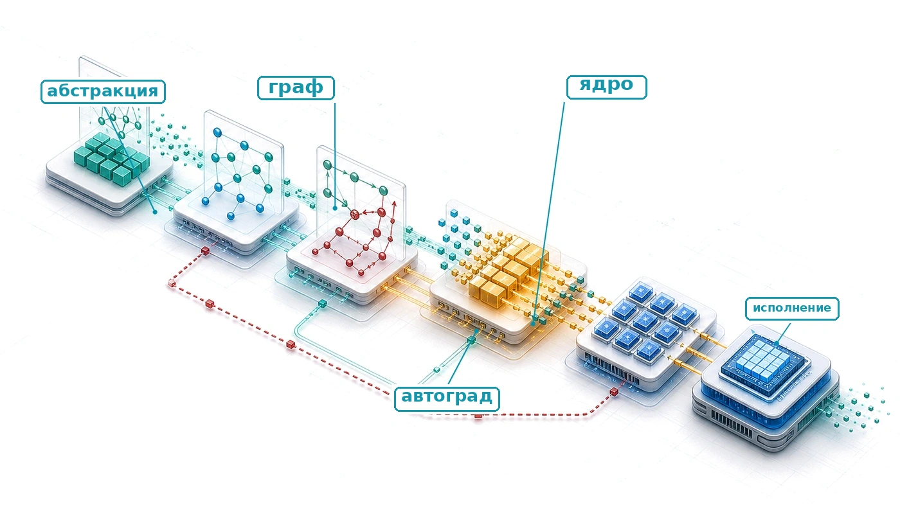

## Назначение

_Почему фреймворк незаметно ограничивает каждое решение, которое следует за ним?_

Уравнения модели сами себя не выполняют. Фреймворк переводит архитектуру в работу, которую может выполнить аппаратура, и этот перевод не нейтрален. Он определяет, когда выполняются операции, какое промежуточное состояние сохраняет обучение, как выделяется память и какие целевые платформы способны использовать получившийся артефакт. Эти решения влияют не только на скорость: они определяют, что можно отлаживать напрямую, что может оптимизировать компилятор и сохранится ли та же модель на пути от исследовательской среды до производственной среды исполнения. Абстракции, которые делают эксперименты удобными, поэтому создают долгосрочные обязательства. Когда в проекте накапливаются контрольные точки, модули, загрузчики данных, форматы обслуживания и экспертиза команды, связанные с фреймворком, его замена становится миграцией системы, а не заменой библиотеки. Фреймворк, хорошо подходящий для быстрого исследования, может раскрывать слишком мало структуры для эффективного развертывания, а ограниченный путь исполнения может пожертвовать гибкостью, нужной на этапе поиска. Поскольку исполнение, дифференцирование и абстракция встречаются в одном программном слое, локальное удобство может превратиться в последующее ограничение производительности или переносимости. Инженерный вопрос состоит не в том, какой фреймворк универсально лучший, а в том, какие компромиссы могут позволить себе нагрузка, команда и целевая машина, зафиксировав их заранее. Понимание фреймворков поэтому означает рассуждение о системных выборах, а не изучение сиюминутного синтаксиса API. В терминах D·A·M фреймворк опосредует совместное проектирование алгоритма и машины: он превращает алгоритмическое намерение и представление данных в исполняемую работу в рамках ограничений машины.

> **Цели обучения**
>
> - Объяснять, как фреймворки опосредуют совместное проектирование алгоритма и машины через исполнение, дифференцирование и абстракцию аппаратуры
> - Сравнивать стратегии исполнения по накладным расходам диспетчеризации, стоимости компиляции и ограничениям развертывания
> - Анализировать автоматическое дифференцирование и хранение активаций, чтобы выбрать между пересчетом и контрольными точками
> - Реализовывать паттерны абстракции модулей для обнаружения параметров, поведения в разных режимах, сериализации и хуков
> - Вычислять FLOP шага обучения, объем трафика памяти и накладные расходы диспетчеризации, чтобы находить узкие места слияния и раскладки
> - Выбирать TensorFlow, PyTorch, JAX или периферийные среды исполнения в зависимости от модели, аппаратуры, команды и требований развертывания

<a id="sec-ml-frameworks-three-problems-every-framework-must-solve-317d"></a>

## Три проблемы фреймворков

Архитектура — это граф обязательств: трансформер обязывает систему к вниманию, матричным умножениям, состоянию активаций и трафику памяти. Фреймворк — это слой, который превращает этот граф в работу, которую может выполнить машина. Несколько вызовов, таких как `logits = model(tokens)`, `loss = criterion(logits, targets)` и `loss.backward()`, скрывают миллиарды операций с плавающей запятой в иерархиях памяти, градиенты через миллионы параметров с помощью автоматического дифференцирования, тысячи запусков ядер GPU и гигабайты промежуточного состояния. Интерфейс выглядит простым, потому что фреймворк выступает компилятором для кремниевого контракта.

Архитектуры задают, какие вычисления выполняют нейронные сети, но знание того, *что* вычислять, совсем не равно знанию того, *как* вычислять это эффективно. Механизм внимания трансформера требует согласования вычислений по иерархиям памяти и ядрам ускорителя. Наивные реализации в таких шаблонах работают в 100 раз медленнее оптимизированных из-за несгруппированных обращений к памяти и повторных обменов с памятью с высокой пропускной способностью (HBM). Реализация этих операций с нуля для каждой модели сделала бы глубокое обучение экономически неосуществимым. ML-фреймворки существуют, чтобы закрыть этот разрыв: они преобразуют абстрактные графы моделей в согласованные с аппаратурой конвейеры исполнения, которые максимизируют загрузку вычислительных блоков и минимизируют внешний трафик памяти.

Фреймворк для машинного обучения — то же, что компилятор для традиционного программирования. Компилятор C переводит читаемый человеком код в оптимизированные машинные инструкции, управляя распределением регистров, планированием инструкций и раскладкой памяти. ML-фреймворк переводит высокоуровневые определения моделей в аппаратно-специфичные планы исполнения, управляя слиянием операторов, повторным использованием памяти и размещением на устройствах. Соответствие здесь операционное, а не образное: современные фреймворки включают оптимизирующие компиляторы (например, ускоренную линейную алгебру (XLA) или TorchInductor), которые преобразуют графовые представления непосредственно в машинный код целевой аппаратуры.

Каждый ML-фреймворк, независимо от API и философии проектирования, должен решить три основные задачи. Первая — *проблема исполнения*: решить, когда и как выполняется вычисление. Фреймворк может выполнять операции сразу в том виде, как они записаны (eager-исполнение[^fn-eager-execution-tradeoff]), либо построить вычислительный граф[^fn-computational-graph-frameworks] — структурированное промежуточное представление операций и зависимостей по данным, — чтобы оптимизировать его до запуска ядер на устройстве (исполнение по графу). Этот выбор определяет фундаментальный компромисс между интерактивной отладкой и оптимизацией программы целиком компилятором.

После выбора стратегии исполнения фреймворк должен решить *проблему дифференцирования*: автоматически вычислять градиенты. Поскольку обучение на основе градиентов требует производных скалярной функции потерь по миллионам или миллиардам параметров ([«Вычисления в нейронных сетях»](05_nn_computation.md#sec-neural-computation)), ручное дифференцирование невозможно в масштабе. Фреймворки реализуют автоматическое дифференцирование, регистрируя правила дифференцирования для поддерживаемых композиций операторов и перемножая векторно-якобиановы произведения. При этом они управляют численной точностью и накладными расходами памяти на промежуточные активации, которые сохраняются для обратных проходов.

Третья задача — *абстракция аппаратуры*: работа с разнообразным железом через единый интерфейс. Одно и то же описание модели должно выражаться на CPU, GPU, тензорных процессорах (TPU) и мобильных ускорителях, хотя у каждой цели свои иерархии памяти, наборы инструкций и пропускные способности межсоединений. В области GPU экосистемы фреймворков все чаще предоставляют языки для пользовательских ядер, такие как Triton (Tillet et al., 2019). Они позволяют разработчикам писать высокопроизводительные ядра на уровне блоков без ручного написания низкоуровневого CUDA или ассемблера устройств.

[^fn-computational-graph-frameworks]: **Вычислительный граф**: различие «оптимизировать до исполнения», упомянутое выше, — ключевое проектное решение. Представление программы в виде структуры данных позволяет фреймворку объединять совместимые операции в меньшее число ядер GPU до исполнения, сокращая накладные расходы на запуск и трафик промежуточной памяти. Инженерная цена этой прозрачности в том, что исполняемая программа отличается от исходного кода и отладка становится труднее. Каждый фреймворк на основе графов должен оправдать этот компромисс выигрышем в производительности.

[^fn-eager-execution-tradeoff]: **Eager-исполнение**: этот режим выполняет каждую операцию сразу, что позволяет напрямую отлаживать код стандартными инструментами, но жертвует общим взглядом, нужным для оптимизаций на уровне графа. Без захвата более крупной области вычислений eager-среда не может сливать операции через эту область или заранее планировать ее память. Поэтому возможности оптимизации, зависящие от нагрузки, остаются компиляторам вроде `torch.compile`.

Эти три задачи тесно связаны: модель исполнения определяет, когда записываются структуры данных для дифференцирования, а уровень абстракции аппаратуры определяет, какие преобразования графа можно понизить до кремния. Объединить исполнение, дифференцирование и абстракцию аппаратуры в рамках физических ограничений машины можно, только оценивая фреймворки через управляющее уравнение производительности машинного обучения.

<a id="psp-frameworks-ml-compiler"></a>

> **Компилятор машинного обучения**
>
> В контексте железного закона ([«Железный закон систем машинного обучения»](01_introduction.md#sec-introduction-iron-law-ml-systems-c32a)) фреймворк — это компилятор для кремниевого контракта.
>
> «Исходный код» — это архитектура модели (член $O$). Задача фреймворка — взять эту высокоуровневую математическую спецификацию и скомпилировать ее в последовательность аппаратно-специфичных запусков ядер, которые:
>
> 1.  Минимизируют перемещение данных $(D_{\text{vol}})$ с помощью таких приемов, как слияние ядер.
> 2.  Максимизируют загрузку $(\eta_{\text{hw}})$, сопоставляя операции со специализированными блоками аппаратуры, например тензорными ядрами.
> 3.  Минимизируют накладные расходы $(L_{\text{lat}})$ за счет эффективной асинхронной диспетчеризации и захвата графа.
>
> Выбор фреймворка означает выбор компилятора, который определяет аппаратную эффективность. Здесь важна точность: определение, охватывающее все три обязанности, отделяет настоящие фреймворки от численных библиотек, которые решают только одну из них.

<a id="dfn-frameworks-machine-learning-frameworks"></a>

> **Фреймворки машинного обучения**
>
> ***Фреймворки машинного обучения*** — это программные системы, которые переводят высокоуровневые математические определения моделей в аппаратно-оптимизированные планы исполнения. Они управляют вычислительным графом, автоматическим дифференцированием, диспетчеризацией ядер и распределением памяти по иерархии аппаратуры.
>
> 1.  **Значение**: фреймворки напрямую определяют член эффективности системы $(\eta_{\text{hw}})$ в железном законе. Слияние операторов, выполняемое компилятором, например, может устранить запись и последующее чтение промежуточных значений между совместимыми операциями. Слияние матричного умножения, добавления смещения и выпрямителя ReLU меняет то, как та же математика попадает на аппаратуру, не меняя модели.
> 2.  **Отличие**: в отличие от численной библиотеки вроде NumPy, которая обычно вычисляет каждую операцию по мере вызова, ML-фреймворк может захватывать или откладывать исполнение, чтобы анализировать больший вычислительный граф и применять межоператорные оптимизации: слияние операторов, преобразования раскладки памяти и параллельное планирование. Для этих оптимизаций нужна видимость за пределами отдельно диспетчеризуемых операций.
> 3.  **Распространенная ловушка**: частое заблуждение состоит в том, что фреймворки — взаимозаменяемые обертки над API. Выбор фреймворка определяет, какие пути компиляции доступны. PyTorch может восстановить оптимизацию на уровне графа из eager-кода через `torch.compile()`, а TensorFlow и JAX обычно опираются на пути компиляции на основе XLA, которые преобразуют операции в целевую аппаратуру. Переход от eager-исполнения к пути компиляции может заметно изменить пропускную способность, но выигрыш зависит от структуры модели, форм тензоров, поддержки операторов и аппаратуры.

ML-фреймворк переводит логическое намерение в физическое исполнение в рамках ограничений железного закона. Он решает, как разбить вычисление по иерархиям памяти, когда обменять численную точность на пропускную способность и как планировать операции, чтобы доминирующий член — перемещение данных ($D_{\text{vol}}$), арифметическое вычисление или задержка запуска ($L_{\text{lat}}$) — был минимальным. Фреймворк — это место, где управляющая физика, развитая в этой книге, становится исполняемым кодом.

Масштаб этого перевода становится очевидным под поверхностью API. Один вызов `loss.backward()` запускает запись операций, выделение памяти под градиенты, обход графа в обратном порядке и диспетчеризацию ядер, оптимизированных под аппаратуру. Этот механизм потребовал бы существенной ручной бухгалтерии даже для трехслойной сети. Для современной языковой модели фреймворк дополнительно координирует миллиарды операций с плавающей запятой на ускорителях, согласуя иерархии памяти, численную точность и, когда система выходит за пределы одного устройства, библиотеки коммуникации. Построить все это с нуля было бы экономически непосильно для большинства организаций, поэтому история ML-фреймворков — это история постепенной автоматизации этих слоев.

Три задачи — исполнение, дифференцирование и абстракция — возникли не одновременно. Каждая появилась как ответ на ограничения масштабирования предыдущего поколения инструментов. Так сложилась историческая последовательность абстракций: от низкоуровневых подпрограмм линейной алгебры до скомпилированных графовых сред исполнения.

<a id="sec-ml-frameworks-frameworks-evolved-ac68"></a>

## Лестница абстракций

В 1979 году написание умножения матриц на Fortran, которое эффективно использовало бы аппаратуру, требовало глубокого знания строк кэша, планирования регистров и векторных блоков. К 2016 году одна строка Python (`torch.matmul(A, W)`) могла диспетчеризоваться в высокооптимизированную реализацию без того, чтобы программист знал подробности кремния. Это сжатие усилий не произошло за один шаг. Оно накапливалось на протяжении четырех десятилетий абстракций, и каждый слой решал узкое место, которое делало предыдущее поколение непрактичным для масштабирования. Результат — **лестница абстракций**, где каждая ступень автоматизирует то, что открывала ступень ниже.

Первая ступень создала повторно используемые аппаратные примитивы (1979–1992). Базовые подпрограммы линейной алгебры (BLAS)[^fn-blas-routine-acceleration] стандартизировали низкоуровневые операции линейной алгебры (Lawson et al., 1979), а LAPACK[^fn-lapack-linear-algebra] (Bai et al., 2006) построил на этом фундаменте более высокоуровневые численные факторизации и решатели собственных значений. Наивные вложенные циклы не используют иерархии памяти: без блочной обработки кэша и регистровой блокировки пропускная способность памяти насыщается задолго до того, как арифметические блоки достигают пиковой производительности. BLAS и LAPACK решили эту проблему аппаратных примитивов, установив стабильные интерфейсы. Они позволяют численному программному обеспечению делегировать вычислительно тяжелые операции, такие как умножение матриц (`C = A @ B`)[^fn-gemm-hardware-utilization], библиотекам поставщиков, настроенным под размеры строк кэша, ширину SIMD (одна инструкция — много данных) и регистровые файлы. Так не требуется писать ассемблер для каждой целевой архитектуры.

Вторая ступень ввела унифицированные абстракции массивов ради скорости разработки (2005–2006). NumPy[^fn-numpy-array-abstraction] снял барьер производительности низкоуровневых языков, обернув BLAS и LAPACK в высокоуровневый Python (Harris et al., 2020). В модели strided-массивов NumPy Python управляет потоком управления и метаданными тензоров (форма, шаги и тип данных), а нижележащая среда C диспетчеризует векторные и матричные циклы по непрерывным буферам памяти. Этот контракт векторизации, при котором алгоритмическое намерение формулируется в интерпретируемом языке, а внутренние циклы делегируются скомпилированным нативным подпрограммам, стал архитектурным шаблоном для научных и численных вычислений.

Третья ступень автоматизировала вычисление градиентов (2007 — наши дни). Фреймворки глубокого обучения, такие как Theano,[^fn-theano-framework-origin] TensorFlow (Abadi et al., 2016) и PyTorch (Paszke et al., 2019), решили проблему масштабируемости ручного дифференцирования. Численные пакеты требовали, чтобы практики выводили и реализовывали аналитические градиенты обратного распространения вручную, а это процесс, подверженный ошибкам и неуправляемый для глубоких сетей. Современные фреймворки превратили автоматическое дифференцирование по вычислительным графам в базовый примитив среды исполнения. Захватывая операции в направленный ациклический граф во время прямого прохода, они автоматически строят обратный граф для вычисления векторно-якобиановых произведений. Так исчисление цепного правила превращается в автоматизированное исполнение в обратном режиме.

[^fn-blas-routine-acceleration]: **BLAS (базовые подпрограммы линейной алгебры)**: спецификация API 1979 года, которая образует нижнюю ступень описанной здесь лестницы. Она стандартизировала фиксированный набор векторных операций, вызываемых из Fortran, отделив публичные имена подпрограмм от решений о реализации, специфичных для машины. Каждый фреймворк выше наследует более общую версию этой договоренности: вызвать стандартный примитив линейной алгебры из любого языка и позволить настроенной библиотеке поставщика работать с кремнием. Для современного обобщенного умножения матриц (GEMM) на GPU NVIDIA такой настроенной цепочкой служит cuBLAS, а не сама спецификация BLAS 1979 года (NVIDIA, 2024).

[^fn-lapack-linear-algebra]: **LAPACK (пакет линейной алгебры)**: расширяет BLAS, предоставляя стандартный API для высокоуровневых подпрограмм (SVD, разложение на собственные значения, наименьшие квадраты). Поставщики реализуют их специфичным для чипа кодом поверх быстрых ядер GEMM. Эта слоистая конструкция — архитектурный шаблон, который наследует каждый ML-фреймворк: высокоуровневые операции делегируются вниз, к вручную настроенным примитивам. Поэтому вызов LAPACK, оптимизированный поставщиком, может выполняться более чем в 10 раз быстрее наивной реализации, и автору фреймворка не нужно писать ни одной строки аппаратно-специфичного кода.

[^fn-gemm-hardware-utilization]: **GEMM**: примитив «матрица на матрицу» за `C = A @ B`. Производители аппаратуры вручную настраивают GEMM под свои чипы, потому что плотные слои, проекции внимания и преобразование сверток к матричному умножению опираются на него. Поэтому эта подпрограмма становится нижней границей производительности для многих фреймворков на лестнице. Высокая арифметическая интенсивность делает GEMM операцией, которая лучше всего приближается к пиковой вычислительной пропускной способности, тогда как малые или невыровненные формы часто работают с гораздо меньшей загрузкой.

[^fn-numpy-array-abstraction]: **NumPy (численный Python)**: в 2005 году Трэвис Олифант (Travis Oliphant) объединил две конкурирующие библиотеки Python-массивов (Numeric и Numarray) в один пакет. Так научное сообщество получило единый стандарт массивов на основе BLAS в тот момент, когда ему нужно было масштабироваться. Созданный этим контракт «векторизации» (писать логику на Python, выполнять циклы на C и Fortran через BLAS) стал шаблоном проектирования для каждого последующего ML-фреймворка. Тензоры PyTorch и массивы TensorFlow — прямые потомки, которые распространяют ту же абстракцию $n$-мерного массива на GPU. Роль Python в ML-инфраструктуре во многом сформирована этим решением о консолидации.

[^fn-theano-framework-origin]: **Theano**: разработанный в Монреальском институте алгоритмов обучения (MILA) под руководством Йошуа Бенжио (Yoshua Bengio) начиная с 2007 года, Theano был ранним и влиятельным Python-фреймворком. Он компилировал символьные математические выражения в оптимизированный код CPU и GPU через вычислительные графы (Bergstra et al., 2010; Team et al., 2016). Он показал, что граф вычислений, определенный на Python, можно скомпилировать для исполнения на GPU без того, чтобы исследователь писал код CUDA. MILA прекратила активную разработку Theano в 2017 году (Mila, 2026).

Эта последовательность прослеживает четыре десятилетия абстракций численных вычислений: от подпрограмм, настроенных под ассемблер, до движков исполнения скомпилированных графов ([«Эволюция вычислительных библиотек»](07_frameworks.md#fig-mlfm-timeline)).

<a id="fig-mlfm-timeline"></a>

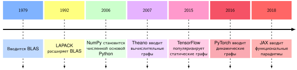

<em><strong>Эволюция вычислительных библиотек</strong>: временная шкала вех численных вычислений с 1979 по 2018 год. Каждая эпоха автоматизирует то, что открывал нижний слой, — от аппаратных подпрограмм BLAS и LAPACK до векторного синтаксиса NumPy и автоматического дифференцирования на основе графов в современных фреймворках. Ценой становится низкоуровневая прозрачность, зато растет скорость разработки.</em>

Каждое поколение абстрагировало детали, на которые раньше уходили инженерные усилия, но каждая абстракция вводила новые компромиссы. BLAS скрыл оптимизацию на уровне ассемблера, но зафиксировал интерфейс. NumPy скрыл управление памятью, но потребовал ручного дифференцирования. Современные фреймворки скрывают вычисление градиентов, но вводят выбор между моделями исполнения. Более глубокая закономерность в том, что каждая абстракция скрывает детали, сохраняя контракт о форме, типе данных, устройстве и иногда единицах измерения. Когда этот контракт становится неявным, корректные компоненты все еще могут сложиться в неправильную систему.

<a id="ws-frameworks-mars-climate-orbiter-units"></a>

> **Интерфейс, который забыл свои единицы (1999)**
>
> **Контекст**: наземное ПО NASA для Mars Climate Orbiter, бортовое ПО аппарата, навигационные команды и интерфейсы подрядчиков должны были согласованно понимать физический смысл передаваемых значений (Mars Climate Orbiter Mishap Investigation Board, 1999).
>
> **Механизм**: наземное ПО, поставленное Lockheed Martin, вычисляло импульс двигателей в английских единицах (фунт-силы на секунду), тогда как навигационное ПО JPL использовало эти значения, считая их в единицах СИ (ньютон-секундах). Получилось неявное несоответствие единиц в 4,45 раза.
>
> **Последствия**: 23 сентября 1999 года аппарат был потерян после входа в затмение. Скорректированный перицентр 57 км вместо запланированных 226 км был признан слишком низким для выживания.
>
> **Реакция**: комиссия рекомендовала проверки согласованности единиц, аудит спецификаций передаваемых данных и более строгую сквозную верификацию наземного ПО.
>
> **Системный урок**: абстракции фреймворков ценны, потому что несут контракты: форму, тип данных, размещение на устройстве и физические единицы. Если эти контракты неявны, два корректных фрагмента кода все равно могут сложиться в неправильную систему. ML-фреймворки сталкиваются с этим всякий раз, когда раскладки тензоров в памяти (например, NCHW и NHWC), масштабные коэффициенты квантования или физические единицы признаков различаются между этапами конвейера. Тогда возникают правдоподобные выходы, которые незаметно портят последующий вывод.

С учетом этого риска контрактов современные фреймворки сходятся на трех основных задачах: *как* исполнять вычисления, *как* их дифференцировать и *как* абстрагироваться от аппаратуры. Проблема исполнения идет первой, потому что ее решение определяет, какие оптимизации могут использовать две другие задачи.

<a id="sec-ml-frameworks-execution-problem-e1e1"></a>

## Проблема исполнения

Представьте двух инженеров, которые пишут одну и ту же нейронную сеть. Первый отлаживает интерактивно: печатает формы тензоров после каждой операции, проверяет промежуточные значения и проходит код по шагам с помощью `pdb`. Второй ждет 30 секунд компиляции, затем наблюдает, как модель работает в 3 раза быстрее, но теряет прямой построчный взгляд на промежуточное состояние. Оба правы: они сделали разный выбор в отношении **проблемы исполнения**, то есть вопроса о том, должны ли операции выполняться сразу, как записаны, или записываться для последующего исполнения. Этот выбор порождает каскад инженерных компромиссов, которые определяют каждый аспект поведения фреймворка: от рабочих процессов отладки до вариантов развертывания и пиковой загрузки аппаратуры.

<a id="sec-ml-frameworks-execution-strategy-matters-memory-wall-1ce8"></a>

### Почему стратегия исполнения важна: стена памяти

Стратегия исполнения ML-фреймворка принципиально ограничена расширяющимся разрывом между вычислительной мощностью и пропускной способностью, который описывает уравнение стены памяти ([«стена памяти»](02_ml_systems.md#eq-memory-wall)). Арифметика процессоров масштабируется гораздо быстрее пропускной способности памяти, и возникает стена памяти. Современные ускорители могут выполнять арифметику намного быстрее, чем получают данные. Поэлементные операции, такие как ReLU, используют лишь малую долю пиковой вычислительной мощности не потому, что аппаратура медленная, а потому, что почти все время они ждут данных. Раздел [«Модель Roofline»](appendix_machine.md#sec-appdx-machine-foundations-roofline-model-2529) приложения «Основы машины» формализует этот компромисс и показывает, когда операции ограничены памятью, а когда вычислениями.

Стена памяти делит операции на ограниченные вычислениями (ограниченные пропускной способностью арифметики) и ограниченные памятью (ограниченные перемещением данных). Большинство отдельных типов операций нейронной сети (активации, нормализации, поэлементные операции) ограничены памятью, хотя большие матричные умножения, которые доминируют в общем времени вычислений, могут быть ограничены вычислениями.

Ключевая оптимизация для операций, ограниченных памятью, — слияние ядер: объединение нескольких операций в одну функцию GPU (называемую *ядром*)[^fn-kernel-gpu-dispatch], чтобы устранить промежуточный трафик памяти. Слияние последовательности нормализации, dropout и активации в одно ядро может дать существенное ускорение, потому что исключает промежуточные записи между операциями. Ядра внимания[^fn-flashattention-fusion-fw] используют тот же принцип в большем масштабе. Вместо материализации полной матрицы внимания в HBM слитая реализация может держать блоки близко к вычислительным блокам. Так она сокращает обращения к HBM до 9 раз и дает ускорение для конкретных нагрузок от 15 процентов до 3 раз (Dao et al., 2022).

[^fn-kernel-gpu-dispatch]: **Ядро (GPU)**: в программировании GPU ядро — это функция, которая диспетчеризуется для параллельного выполнения в тысячах потоков. Каждый запуск ядра создает 5–20 мкс накладных расходов на стороне CPU на сборку параметров и сигнализацию GPU. Поэтому мелкие неслитые операции тратят на запуск больше времени $(L_{\text{lat}})$, чем на полезную арифметику. Уменьшение числа ядер слиянием — это прямая атака на член накладных расходов железного закона.

[^fn-flashattention-fusion-fw]: **Слитое ядро внимания**: такое ядро объединяет произведение $\mathbf{Q}\mathbf{K}^T$, softmax и взвешивание значений выхода в блочную реализацию. Она держит промежуточные значения во внутренней памяти чипа, а не материализует полную матрицу внимания в HBM. Каноническим именованным примером служит FlashAttention, введенный в разделе [«Архитектуры нейронных сетей»](06_nn_architectures.md#sec-network-architectures). Он сообщает о сокращении обращений к HBM до 9 раз и об ускорении для конкретных нагрузок от 15 процентов до 3 раз (Dao et al., 2022). Урок для фреймворков шире конкретного алгоритма: слияние может сдвинуть операцию на модели Roofline от исполнения, ограниченного пропускной способностью, к исполнению, ограниченному вычислительной мощностью, сокращая обмены с внешней памятью.

Фреймворки могут сливать только операции, видимые вместе. Отдельно диспетчеризуемые eager-операции скрывают межоператорные возможности, тогда как захват графа может их раскрыть. Отложенный граф позволяет фреймворку оптимизировать захваченные вычисления. Стратегия исполнения, таким образом, определяет, какие оптимизации возможны и каков их охват.

<a id="sec-ml-frameworks-computational-graph-00f7"></a>

### Вычислительный граф

Чтобы открыть компиляторам возможности оптимизации нескольких операций сразу, фреймворки представляют программы в виде вычислительного графа: направленного ациклического графа (DAG), в котором узлы представляют операции, а ребра — зависимости по данным. Этот граф служит внутренней моделью вычисления, которой пользуется фреймворк.

Математические операции можно отделить от физического исполнения через графовые представления. Вычислительный граф ([«Простой вычислительный граф»](07_frameworks.md#fig-comp-graph)) обосновывает эту абстракцию: тензорные переменные соответствуют узлам данных, а операции — узлам преобразования.

<a id="fig-comp-graph"></a>

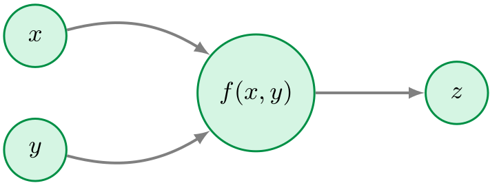

<em><strong>Простой вычислительный граф</strong>: представление $z = f(x, y)$ в виде направленного ациклического графа отделяет математические зависимости от физического порядка исполнения. Это структурный план, который фреймворкам нужен, чтобы отслеживать градиенты и планировать операции на разных устройствах.</em>

Реальные модели машинного обучения требуют гораздо более сложных графовых структур. [«Вычислительный граф и системные взаимодействия»](07_frameworks.md#fig-mlfm-comp-graph) расширяет это представление: он показывает граф вычислений нейронной сети рядом с системными компонентами, которые его анализируют. Левая панель изображает данные, текущие через шесть узлов операций в направленном ациклическом графе, где выход каждого узла становится входом следующего. Правая панель показывает, как среда исполнения взаимодействует с этим графом: она запрашивает времена жизни тензоров, чтобы планировать повторное использование памяти, и назначает операции потокам ускорителя исходя из зависимостей по данным, а не порядка программы. Ключевая мысль в том, что граф существует независимо от исполнения, и это позволяет фреймворку оптимизировать его еще до выполнения арифметики.

<a id="fig-mlfm-comp-graph"></a>

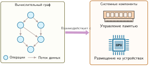

<em><strong>Вычислительный граф и системные взаимодействия</strong>: DAG нейронной сети (слева) взаимодействует с компонентами среды исполнения фреймворка (справа). Поддерживая явное представление графа, независимое от исполнения, фреймворк может анализировать времена жизни тензоров для повторного использования памяти и назначать операции целевым ускорителям до запуска арифметики.</em>

Это представление графа — не просто визуализация, а структура данных, которая обеспечивает и эффективное исполнение, и автоматическое дифференцирование. Момент его построения задает фундаментальный системный компромисс между отладкой, оптимизацией, развертыванием и гибкостью. Интерактивная отладка требует немедленного исполнения, чтобы разработчики могли проверять промежуточные значения и проходить логику стандартными инструментами. Глобальная оптимизация требует одновременно видеть крупные последовательности операторов, чтобы сливать ядра и планировать повторное использование памяти. Автономное развертывание предпочитает графы, которые работают без интерпретатора хост-программы, а динамические архитектуры требуют управления потоком, которое ветвится в зависимости от вычисленных значений тензоров.

Ни одна модель исполнения не оптимизирует все эти измерения. Фреймворки должны выбрать свою позицию в пространстве этих компромиссов, а практики должны понимать компромиссы, чтобы выбирать подходящие инструменты и писать эффективный код. Три семейства исполнения, которые идут дальше, — это разные ответы на один и тот же системный вопрос: сколько видимости графа фреймворк должен обменять на немедленное исполнение и отладку?

<a id="sec-ml-frameworks-three-execution-strategies-5934"></a>

### Три стратегии исполнения

Вычислительный граф открывает путь к глобальной оптимизации, но оставляет нерешенным важный проектный вопрос: *когда* среда исполнения строит граф. Рассмотрим элементарное выражение `y = x * 2`. Немедленное вычисление умножения сразу дает конкретный тензор в `y`. Такой императивный поток интуитивен и напрямую отлаживается, но среда видит только одну операцию за раз. Отложенное исполнение записывает операцию символически в граф зависимостей, который выполняется только по запросу. Такое разделение отделяет намерение от вычисления и дает компилятору сквозную видимость, необходимую для слияния операторов и планирования памяти.

Ни один подход не доминирует: каждый воплощает разные компромиссы между *гибкостью* и *потенциалом оптимизации*. Современные фреймворки исследовали три основные стратегии исполнения: eager-исполнение с динамическими графами, статические вычислительные графы и гибридные подходы, которые сочетают JIT-компиляцию (just-in-time) с интерактивной разработкой. У каждой стратегии свои системные следствия.

<a id="sec-ml-frameworks-eager-execution-dynamic-graphs-29c2"></a>

#### Eager-исполнение с динамическими графами

Eager-исполнение вычисляет каждую операцию сразу, как ее вызывает программа, и строит вычислительный граф динамически во время выполнения. Сравнение бок о бок показывает, как это отличается от исполнения по графу на уровне кода.

<a id="exmp-frameworks-eager-vs-graph-execution-code-comparison"></a>

> **Сравнение кода: eager-исполнение и исполнение по графу**
>
> **PyTorch (eager-исполнение)**:
> ```python
> import torch
>
> x = torch.tensor([1.0, 2.0])
> y = x * 2
> print(f"Промежуточное значение: {y}")  # Работает сразу
> z = y.sum()
> ```
>
> **TensorFlow 1.x (статический граф)**:
>
> ```python
> import tensorflow as tf
>
> x = tf.placeholder(tf.float32)
> y = x * 2
> # print(y) -> выводит Tensor("mul:0"...), а не значение!
> z = tf.reduce_sum(y)
>
> with tf.Session() as sess:
>     result = sess.run(z, feed_dict={x: [1.0, 2.0]})
> ```
>
> **Системный вывод**: eager-исполнение выводит промежуточные значения как обычное состояние среды, что делает отладку прямой. Статические графы выстраивают вычисления до исполнения, что позволяет оптимизировать граф целиком, но меняет модель отладки.

В этой модели define-by-run, когда хост-код вычисляет `y = x * 2`, среда сразу диспетчеризует ядро умножения в очередь команд устройства и делает полученный тензор доступным для последующих операций без задержки.

Это дает гибкость обычного программирования: разработчики могут печатать промежуточные значения, использовать условия, основанные на вычисленных результатах, и отлаживать стандартными инструментами. Фреймворк записывает операции по мере их выполнения и строит динамический граф, который отражает фактически пройденный путь исполнения.

Для вычисления градиентов фреймворк записывает историю операций в так называемую ленту autograd[^fn-autograd-tape-memory], временную структуру данных, которая строится во время исполнения. Каждая тензорная операция создает узел, который записывает выполненную операцию, ссылки на входные тензоры и способ вычисления градиентов. Эти узлы образуют DAG, который фиксирует фактически пройденный путь прямого прохода, а не граф, заданный заранее. [«Пример ленты autograd»](07_frameworks.md#lst-autograd-tape-example) показывает, как PyTorch записывает операции по мере их исполнения в своем режиме eager по умолчанию.

[^fn-autograd-tape-memory]: **Лента autograd**: временная структура данных, которая строится во время прямого исполнения. Узлы записывают операции, зависимости и обратные функции для вычисления по правилу цепочки. Ее память растет с глубиной модели и длиной последовательности, потому что сохраненные активации накапливаются до освобождения при обратном распространении ошибки. Для глубоких моделей фреймворки сохраняют часть активаций, а остальные пересчитывают через контрольные точки активаций, чтобы избежать сбоев из-за нехватки памяти (OOM).

<a id="lst-autograd-tape-example"></a>

**Построение ленты autograd**: каждая операция выполняется сразу, одновременно записывая обратный узел в ленту autograd для последующего вычисления градиентов.

```python
import torch

x = torch.tensor([1.0], requires_grad=True)
y = x * 2  # Выполняется сразу; записывает узел MulBackward
z = y + 1  # Выполняется сразу; записывает узел AddBackward
# Лента autograd существует уже сейчас, она строится во время исполнения
```

После этих двух операций фреймворк построил ленту autograd с двумя узлами: один для умножения, другой для сложения. Лента записывает, что `z` зависит от `y`, а `y` зависит от `x`.

Вызов `z.backward()` проходит по этой ленте в обратном топологическом порядке, применяя правило цепочки в каждом узле:

1. Вычислить $\frac{\partial z}{\partial z} = 1$ (начальный градиент)
2. Вызвать `AddBackward0.backward()` $\rightarrow \frac{\partial z}{\partial y} = 1$
3. Вызвать `MulBackward0.backward()` $\rightarrow \frac{\partial z}{\partial x} = 2$
4. Накопить градиент в `x.grad`

После завершения `backward()` граф autograd обычно освобождается, и следующий прямой проход строит новый граф. Значения, нужные для градиентов, сохраняются во время прямого прохода и остаются в памяти, пока их не использует обратный проход. Поэтому их стоимость по памяти охватывает обе фазы, а не появляется только во время обратного прохода.

<a id="exmp-frameworks-in-place-autograd-failure"></a>

> **Операции на месте могут сломать градиенты**
>
> **Сценарий**: инженер применяет мутацию на месте (`x += 1`) внутри пользовательской функции активации PyTorch, чтобы сократить число выделений памяти.
>
> **Диагностика**: операции на месте перезаписывают память тензора с активациями прямого прохода, которые лента autograd требует для вычисления градиентов обратного прохода. Это вызывает ошибку счетчика версий во время исполнения (PyTorch Contributors, 2026). PyTorch обеспечивает этот инвариант безопасности, поддерживая целочисленный счетчик версий у каждого тензора, который увеличивается при каждой записи на месте. Если версия сохраненного тензора в момент обратного прохода отличается от версии, зафиксированной в прямом проходе, autograd выдает ошибку: активация, нужная правилу дифференцирования, была изменена на месте.
>
> **Системный урок**: автоматическое дифференцирование фреймворка зависит от неизменяемых записей активаций прямого прохода. Непроверенные мутации памяти на месте ломают зависимости ленты autograd и приводят к остановке исполнения фреймворка.

В фреймворках с eager-исполнением операции выполняются императивно, по мере того как хост-код до них доходит. [«Ход исполнения динамического графа»](07_frameworks.md#fig-mlfm-dynamic-graph-flow) показывает этот цикл исполнения, иллюстрируя последовательность «определить и диспетчеризовать», которая отправляет отдельные операции прямо в очереди потоков устройства.

<a id="fig-mlfm-dynamic-graph-flow"></a>

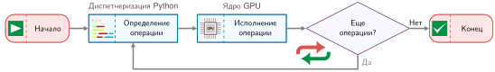

<em><strong>Ход исполнения динамического графа</strong>: при eager-исполнении каждая операция отправляется в тот момент, когда программа до нее доходит. Работа ускорителя может выполняться асинхронно после диспетчеризации. Эта модель define-by-run позволяет естественно отлаживать код и использовать управление потоком, зависящее от данных, но ограничивает оптимизацию между вызовами Python.</em>

##### Системные следствия: гибкость

Динамическая лента autograd выражает поведение, зависящее от данных, прямо на языке хоста. Условные операторы и циклы могут зависеть от значений тензоров, вычисленных во время исполнения. Это позволяет реализовывать алгоритмы вроде лучевого поиска, рекуррентные модели с динамической длиной или адаптивные вычислительные пути, которые подстраивают исполнение под промежуточные активации. Статические графы тоже могут представлять управление потоком и динамические размерности, зависящие от данных, через операции графа, но eager-исполнение делает такие паттерны естественными для написания и отладки на Python. Поскольку операции отправляются сразу, разработчики могут печатать тензоры, проверять значения и использовать стандартные отладчики (`pdb`, точки останова), чтобы диагностировать ошибки почти так же, как в любой другой программе на Python.

##### Системные следствия: накладные расходы

Эта гибкость создает задержки, которые напрямую соотносятся с железным законом ([«Железный закон систем машинного обучения»](01_introduction.md#sec-introduction-iron-law-ml-systems-c32a)). Каждый шаг обучения динамически строит ленту autograd, добавляя к $L_{\text{lat}}$ задержку диспетчеризации Python на стороне хоста и выделение памяти под ленту. Поскольку каждая операция проходит через диспетчер фреймворка до запуска ядра на устройстве, накладные расходы хоста быстро начинают доминировать, когда отдельные ядра выполняются за единицы микросекунд. Eager-исполнение также не видит граф целиком, поэтому фреймворк не может сливать цепочки поэлементных операций в один запуск на GPU или заранее выделять статическую область памяти под промежуточные активации ($D_{\text{vol}}$). Лента autograd должна удерживать каждый тензор, запрошенный зарегистрированными правилами обратного прохода, и хранить его в памяти до тех пор, пока обратное распространение ошибки его не использует. Вместе эти издержки задают потолок пропускной способности для мелкозернистых нагрузок, где задержка диспетчеризации затмевает арифметику устройства.

<a id="sec-ml-frameworks-dispatch-tax"></a>

##### Налог на диспетчеризацию: накладные расходы Python и реальность GPU

Потолок производительности eager-исполнения определяется фундаментальным системным несоответствием: скоростью интерпретатора на стороне хоста и скоростью кремния на стороне устройства. Налог на диспетчеризацию, который определяется как доля времени, потраченная на оркестрацию на стороне хоста (Python), относительно фактического исполнения на устройстве (GPU), количественно выражает это несоответствие.


*По мере роста работы полезные вычисления опережают фиксированную стоимость диспетчеризации; налог уменьшается.*

В иллюстративной модели eager-исполнения, которая здесь используется, каждая операция платит фиксированный «налог» около 15 мкс за диспетчеризацию на стороне хоста, проверку типов и запуск ядра. Фактические накладные расходы различаются в зависимости от фреймворка, бэкенда и аппаратуры, но их относительный вес все равно зависит от размера операции. Для малой операции, например ReLU на небольшом векторе, ядро может выполняться всего 1 мкс, поэтому смоделированный налог на диспетчеризацию достигает 94 процента, и GPU большую часть времени ждет следующей команды. Для крупной операции, например большого матричного умножения, ядро выполняется 100 мкс, смоделированный налог падает до 13 процентов, и система становится ограниченной вычислениями.

Налог на диспетчеризацию объясняет, почему модели со многими мелкими слоями работают заметно медленнее, чем предсказывает их сырое количество FLOP. Раздел [«Диагностика узкого места»](appendix_dam.md#sec-appdx-dam-taxonomy-bottleneck-diagnostic-3fc9) приложения «Таксономия D·A·M» помещает этот симптом в таксономию узких мест: нагрузка, которую доминирует диспетчеризация, классифицируется как ограниченная задержкой, а не вычислениями, и показано, какие оптимизации на самом деле ее сдвигают. Чтобы приблизиться к эффективному исполнению, фреймворки должны перейти от *диспетчеризации ядро за ядром* к *исполнению на уровне графа*, где налог на диспетчеризацию платится один раз за весь граф, а не за каждую операцию. Гибридные стратегии JIT и компиляции из раздела [«Гибридные подходы: JIT-компиляция»](07_frameworks.md#sec-ml-frameworks-hybrid-approaches-jit-compilation-8954) нужны именно для снижения этих накладных расходов.

Накладные расходы eager-исполнения мотивируют противоположный проект: захватывать всю вычислительную задачу до исполнения любой ее части. Именно это дают статические вычислительные графы.

<a id="sec-ml-frameworks-static-computation-graphs-e100"></a>

#### Статические вычислительные графы

Исполнение по статическому графу сначала определяет полный вычислительный граф как символическое представление, а затем исполняет его отдельно. Эта модель «сначала определить, потом выполнить» означает, что граф существует до того, как начнется какое-либо вычисление, и это позволяет агрессивно оптимизировать заранее. Когда весь вычислительный процесс виден до запуска ядер на устройстве, фреймворк может анализировать, преобразовывать и оптимизировать граф глобально. Такой видимости нет между отдельными eager-вызовами, если только компилятор их не захватывает. Раздел [«Слияние операторов»](appendix_algorithm.md#sec-appdx-algorithm-foundations-operator-fusion-5d73) приложения «Основы алгоритмов» разбирает каноническое глобальное преобразование, которое это дает: для $N$ элементов по $b$ байт каждый слияние цепочки из $k$ поэлементных операций в одно ядро снижает идеализированный трафик чтения и записи с $2kNb$ до $2Nb$ байт.

##### Двухфазное исполнение

Статические графы явно разделяют построение графа и его исполнение. [«Статический граф TensorFlow»](07_frameworks.md#lst-tf-static-graph) иллюстрирует две фазы на примере TensorFlow 1.x, который был типичным для этого подхода. Пример намеренно выполняет ту же цепочку `x * 2`, затем `+ 1`, что и eager-режим из [«пример ленты autograd»](07_frameworks.md#lst-autograd-tape-example). Арифметика остается неизменной, поэтому меняется только то, *когда* она выполняется: символическое определение создает заполнители и операции без вычислений, а явное исполнение запускает реальную арифметику.

<a id="lst-tf-static-graph"></a>

**Двухфазное исполнение статического графа**: построение графа (символическое определение) отделено от исполнения (реальных вычислений), что позволяет оптимизировать заранее.

```python
# Фаза 1: построение графа (символически, без вычислений)
import tensorflow.compat.v1 as tf

tf.disable_v2_behavior()

# Определяем граф символически
x = tf.placeholder(tf.float32, shape=[1])  # Просто заполнитель
y = x * 2  # Не выполняется, только записывается
z = y + 1  # Выполнения все еще нет
# На этом этапе ничего не вычислено

# Фаза 2: исполнение графа (реальные вычисления)
with tf.Session() as sess:
    result = sess.run(z, feed_dict={x: [1.0]})
    # Теперь происходят вычисления: result = [3.0]
```

Компиляция статического графа отделяет построение графа от исполнения тензоров. Жизненный цикл на [«Жизненный цикл исполнения статического графа»](07_frameworks.md#fig-mlfm-static-graph) иллюстрирует это разделение фаз: символическое определение графа слева предшествует оптимизации заранее и исполнению во время работы справа.

<a id="fig-mlfm-static-graph"></a>

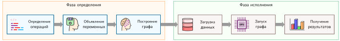

<em><strong>Жизненный цикл исполнения статического графа</strong>: отделение символического определения графа (слева) от конкретного исполнения (справа) дает глобальную видимость вычислений и позволяет компиляторам применять оптимизации заранее, например слияние операторов, повторное использование буферов и преобразования раскладки, еще до того, как материализуется хоть один тензор.</em>

Ключевое отличие от eager-исполнения в том, что во время построения `x`, `y` и `z` — это не тензоры со значениями, а символические узлы графа. Операторы `*` и `+` добавляют узлы преобразования в определение графа, не запуская арифметику. Вызов `print(y)` делает это различие видимым: он печатает символические метаданные тензора, а не числовые значения. Только когда хост вызывает `sess.run()`, среда анализирует, оптимизирует и исполняет захваченный граф на буферах устройства.

##### Оптимизация заранее

Поскольку фреймворк имеет полный граф до исполнения, он может выполнить оптимизацию заранее, недоступную для незахваченных eager-вызовов. Возможность слияния ядер, описанная в разделе [«Почему стратегия исполнения важна»](07_frameworks.md#sec-ml-frameworks-execution-strategy-matters-memory-wall-1ce8), здесь становится действенной: поскольку фреймворк видит `y = x * 2` и `z = y + 1` вместе в графе, он может слить их в `z = x * 2 + 1`, исключив промежуточный `y` и вдвое сократив идеализированный трафик памяти. Когда формы и времена жизни тензоров известны, компилятор может спланировать память до исполнения и повторно использовать буферы, времена жизни которых не пересекаются. Динамические размерности могут требовать границ или выделения во время исполнения. Раскладки тензоров тоже можно преобразовывать глобально (например, из NCHW в NHWC), чтобы соответствовать предпочтениям аппаратуры, хотя физические преобразования раскладки все равно могут требовать копирования. Устранение мертвого кода (DCE)[^fn-dce-graph-optimization] удаляет операции, результаты которых не используются, а свертка констант заранее вычисляет операции над константными значениями, когда их входы известны. Эти оптимизации напрямую соответствуют членам железного закона: слияние ядер снижает $D_{\text{vol}}$, избегая промежуточных записей в память; свертка констант уменьшает повторную работу; заранее спланированное выделение памяти может снизить накладные расходы во время исполнения; а устранение мертвого кода убирает работу и связанное с ней перемещение данных, когда присутствуют неиспользуемые вычисления.

[^fn-dce-graph-optimization]: **Устранение мертвого кода (DCE)**: удаляет узлы графа, результаты которых не влияют на наблюдаемые выходы или побочные эффекты. В ML-графах мертвый код возникает из неиспользуемых ветвей или артефактов после преобразований. Анализ побочных эффектов обеспечивает безопасное удаление, предотвращая исполнение мертвых операций и снижая накладные расходы на запуск ядер.

Компиляторы, такие как **XLA**[^fn-xla-graph-compiler] (Google, 2025), развивают этот подход: они компилируют захваченные подграфы в слитый машинный код, специализированный для целевой аппаратуры.

[^fn-xla-graph-compiler]: **XLA (ускоренная линейная алгебра)**: «оптимизированный машинный код» из предложения выше означает, что XLA может сливать подграфы, специализировать раскладки и понижать высокоуровневые операции до кода, специфичного для бэкенда. Слияние атакует одновременно накладные расходы на запуск $(L_{\text{lat}})$ и записи в промежуточную память $(D_{\text{vol}})$. Но реальное ускорение зависит от того, содержит ли граф достаточно сливаемой работы, ограниченной памятью, чтобы компилятор мог ее убрать. Большие области, насыщенные GEMM, могут уже быть ограничены вычислениями, а цепочки мелких поэлементных операций могут выиграть больше, потому что слияние убирает повторные обращения к внешней памяти. Выигрыш не является фиксированным множителем: XLA помогает, когда может сливать операции, специализировать раскладки и формы и снижать накладные расходы на запуск или память. Поэтому выигрыш зависит от структуры графа, поддержки бэкендом и стабильности форм входа.

##### Системные следствия

Статические графы могут достигать высокой производительности благодаря оптимизации заранее. Слияние ядер снижает требования к пропускной способности памяти, когда узким местом становится промежуточный трафик, а компиляция под конкретную аппаратуру может приближаться к высокой загрузке, когда формы, операторы и раскладки совпадают с эффективными путями бэкенда.

Ценой этой производительности становится меньшая гибкость. Стандартный поток управления Python (`if`, `for`) не может зависеть от вычисленных значений тензоров в статических графах. TensorFlow предоставляет примитивы управления потоком на уровне графа (`tf.cond` и `tf.while_loop`), которые поддерживают условия, зависящие от данных. Но для них нужен особый синтаксис, отличающийся от стандартного Python, и код становится труднее писать и понимать. Отладка затруднена, потому что трассировки стека указывают на код построения графа, а не на код исполнения. Сообщения об ошибках часто ссылаются на символические имена узлов, а не на операции, которые действительно завершились неудачей.

<a id="sec-ml-frameworks-hybrid-approaches-jit-compilation-8954"></a>

#### Гибридные подходы: JIT-компиляция

**JIT-компиляция** одновременно обеспечивает и eager-отладку, и оптимизацию графа, захватывая вычисления во время исполнения. Основной компромисс — *точность против общности*. Трассировка фиксирует путь исполнения во время пробного запуска, точно воспроизводя этот путь, но пропуская ветви, которые не были выполнены. Компиляция из исходного кода (скриптинг) анализирует поддерживаемую структуру программы и сохраняет поддерживаемый поток управления, но требует ограниченного подмножества языка. Оба подхода создают промежуточное представление (IR)[^fn-ir-intermediate-representation], которое позволяет выполнять оптимизации графа: слияние операторов, свертку констант, устранение мертвого кода и повторное использование буферов.

[^fn-ir-intermediate-representation]: **Промежуточное представление (IR)**: «промежуточное» отражает архитектурную роль этого формата. Это независимый от языка слой, который отделяет фронтенд (захват из Python) от бэкенда (генерация кода для аппаратуры), точно так же, как LLVM IR отделяет фронтенды C, Rust и Swift от бэкендов x86 и ARM. ML-фреймворки переняли этот паттерн компилятора, потому что он снижает стоимость поддержки $M$ фронтендов и $N$ бэкендов с $\mathcal{O}(M \times N)$ до $\mathcal{O}(M + N)$: единый механизм захвата графа (TorchDynamo, tf2xla) может выводить код для нескольких аппаратных бэкендов, не переписывая логику захвата.

Компромисс между eager-исполнением и компиляцией имеет прямое следствие для железного закона. JIT-компиляция распределяет $L_{\text{lat}}$ (накладные расходы диспетчеризации) по скомпилированной области. Чем длиннее скомпилированная область, тем меньше накладных расходов приходится на одну операцию, поэтому разрывы графа критичны для производительности: каждый разрыв возвращает исполнение к eager-диспетчеризации и обнуляет эту амортизацию.

Исторически TorchScript от PyTorch служил примером обеих стратегий (PyTorch Contributors, 2026). Сейчас TorchScript объявлен устаревшим в пользу более новых путей захвата и экспорта, таких как `torch.export` (PyTorch Contributors, 2026; PyTorch Contributors, 2026). Тем не менее он полезен здесь как конкретная иллюстрация трассировки и скриптинга из исходного кода. Трассировка выполняет функцию на примерах входов и записывает наблюдаемые на этом пути тензорные операции. [«Трассировка TorchScript»](07_frameworks.md#lst-torchscript-trace) показывает, как трассированный модуль можно сериализовать и исполнять независимо от интерпретатора Python.

<a id="lst-torchscript-trace"></a>

**Трассировка TorchScript**: захватывает тензорные операции, выполняя функцию на примерах входов и записывая путь исполнения в статический вычислительный граф.

```python
import torch

def forward(x):
    y = x * 2
    z = y + 1
    return z

# Трассируем функцию, запустив ее один раз
x_example = torch.tensor([1.0])
traced = torch.jit.trace(forward, x_example)

# traced теперь — скомпилированный модуль TorchScript
# Можно сериализовать: torch.jit.save(traced, "model.pt")
# Можно оптимизировать: слияние, свертка констант
# Можно запускать без интерпретатора Python
```

Критическое ограничение трассировки показывает компромисс между точностью и общностью на практике. Трассировка записывает операции наблюдаемого пути, а не сохраняет произвольный поток управления Python. [«Тихий сбой трассировки»](07_frameworks.md#lst-tracing-silent-failure) показывает возникающий риск корректности.

<a id="lst-tracing-silent-failure"></a>

**Трассировка ветви, зависящей от данных**: трассировка записывает путь, выбранный входным примером. PyTorch обычно выдает `TracerWarning`, когда значение тензора преобразуется в условие Python, потому что получившаяся трасса может не обобщаться.

```python
def conditional_forward(x):
    if x.sum() > 0:  # Условие, зависящее от данных
        return x * 2
    else:
        return x * 3

traced = torch.jit.trace(conditional_forward, torch.tensor([1.0]))
# Трассировка фиксирует ТОЛЬКО ветку x.sum() > 0
# Если позже вход окажется с суммой <= 0, трассированная версия
# все равно выполнит ветку x * 2
```

Трассировка записывает ветку, выполненную входным примером. В этом примере преобразование условного тензора в логическое значение Python обычно дает `TracerWarning`, а полученная трасса все равно может следовать за зафиксированной веткой для последующих входов, которым нужна другая ветка. Поэтому, когда в Python есть управление потоком, зависящее от данных, предупреждения трассировки нужно считать ошибками корректности.

Историческая альтернатива TorchScript, скриптинг, анализировала поддерживаемый исходный код Python напрямую и компилировала его в TorchScript IR без трассировки пути на примере (PyTorch Contributors, 2026). Компилятор скриптинга сохранял поддерживаемую структуру ветвления, но принимал только ограниченное подмножество Python. Текущим проектам следует опираться на рекомендации по поддерживаемому `torch.export` и целевым средам исполнения, а не выбирать между трассировкой и скриптингом TorchScript для новых конвейеров развертывания (PyTorch Contributors, 2026). В исторической схеме TorchScript трассировка подходила для прямых моделей, пути тензоров которых оставались стабильными для поддерживаемых входов, а скриптинг обрабатывал поддерживаемый поток управления, зависящий от данных, без интерпретатора Python. Ключевым преимуществом скриптинга была способность сохранять поддерживаемые условия в IR, как показано в [«Условный оператор TorchScript»](07_frameworks.md#lst-torchscript-conditional).

<a id="lst-torchscript-conditional"></a>

**Скриптованный поток управления**: в отличие от трассировки, скриптинг сохраняет обе ветки условных операторов в IR, что позволяет корректно исполнять код в зависимости от значений входа во время исполнения.

```python
@torch.jit.script
def conditional_forward(x: torch.Tensor) -> torch.Tensor:
    if x.sum() > 0:
        return x * 2
    else:
        return x * 3

# Обе ветки сохранены в IR
# Нужная ветка выполняется в зависимости от значений входа во время исполнения
```

Скриптинг накладывал ограничения, потому что TorchScript должен был анализировать код, который Python обычно интерпретирует динамически. Сигнатурам функций и переменным иногда требовались аннотации типов, а неподдерживаемые объекты Python, вызовы библиотек или метапрограммирование могли вызвать сбой компиляции. [«Исторические компромиссы трассировки и скриптинга TorchScript»](07_frameworks.md#tbl-tracing-vs-scripting) суммирует этот исторический проектный компромисс, а не действующие рекомендации по развертыванию.

| **Аспект**            | **Трассировка**              | **Скриптинг**                 |
|:----------------------|:-----------------------------|:------------------------------|
| **Требование ко входу** | Нужны примеры входов       | Входы не нужны                |
| **Управление потоком** | Не работает с условиями, зависящими от данных | Поддерживает условия, зависящие от данных |
| **Простота перевода**  | Проще (просто запустить функцию) | Сложнее (ограниченный Python) |
| **Аннотации типов**    | Не требуются                 | Требуются, когда вывод не удается |
| **Обнаружение ошибок** | Во время исполнения (неверные результаты) | На этапе компиляции (синтаксические ошибки) |
| **Лучше всего для**    | Прямых сетей (feed-forward)  | Моделей с условиями           |

<a id="tbl-tracing-vs-scripting"></a>

***Исторические компромиссы трассировки и скриптинга TorchScript**: трассировка записывала операции по примерам исполнения, а скриптинг сохранял поддерживаемый поток управления ценой ограниченного подмножества Python. TorchScript объявлен устаревшим для новых проектов.*

Чтобы понять, что производит компилятор, [«IR TorchScript»](07_frameworks.md#lst-torchscript-ir) напрямую показывает сгенерированное промежуточное представление, где одно выражение Python превращено в явные типизированные примитивные операции, которые среда исполнения может выполнять без интерпретатора. IR TorchScript представляет операции с помощью пространства имен `aten` для основных тензорных операций, пространства имен `prim` для примитивов и управления потоком, статических типов для каждого значения и формы SSA (статическое однократное присваивание), где каждой переменной присваивается ровно одно значение, что упрощает анализ компилятором. Этот IR позволяет выполнять оптимизации, независимые от Python: слияние операторов объединяет соседние операции в одно ядро, свертка констант вычисляет константные выражения на этапе компиляции, устранение мертвого кода удаляет неиспользуемые операции, а оптимизация памяти повторно использует буферы, когда это возможно.

<a id="lst-torchscript-ir"></a>

**Инспекция IR TorchScript**: сгенерированное промежуточное представление показывает примитивные операции и константы, что полезно для отладки и понимания результатов компиляции.

```python
@torch.jit.script
def example(x: torch.Tensor) -> torch.Tensor:
    return x * 2 + 1

# Инспекция сгенерированного IR:
print(example.graph)
# graph(%x : Tensor):
#   %1 : int = prim::Constant[value=2]()
#   %2 : Tensor = aten::mul(%x, %1)
#   %3 : int = prim::Constant[value=1]()
#   %4 : Tensor = aten::add(%2, %3, %3)
#   return (%4)
```

<a id="sec-ml-frameworks-modern-compilation-torchcompile-d025"></a>

#### Современная компиляция: JIT с захватом графа

Предыдущие подходы заставляют выбирать между гибким eager-исполнением и графами, видимыми компилятору. Современная JIT-компиляция сужает этот компромисс: она автоматически захватывает участки eager-кода в оптимизированные графы при ограниченном участии разработчика.

Системы JIT с захватом графа следуют одному архитектурному шаблону в разных фреймворках. Первое исполнение наблюдает тензорные операции и записывает область графа, защищенную предположениями о формах, типах данных, раскладках и пути управления. Затем эта область понижается до промежуточного представления, к ней применяются слияние и оптимизации раскладки, а исполняемый код кешируется для последующих вызовов, которые удовлетворяют тем же защитам. Неподдерживаемый код Python никуда не исчезает: он образует границу графа, где исполнение возвращается в eager-среду. `torch.compile` в PyTorch 2.0 (Ansel et al., 2024) — конкретный пример этого шаблона, но системная идея шире API: компиляция окупается, только когда захваченные области достаточно длинны и стабильны, чтобы амортизировать стоимость захвата, понижения, генерации кода и управления кешем.

Это объясняет, когда компиляция может помочь. Накладные расходы диспетчеризации, незаметные для одной операции (несколько микросекунд на запуск ядра), накапливаются на тысячах операций прямого прохода. Физика накладных расходов программного обеспечения в [«Физика накладных расходов программного обеспечения»](07_frameworks.md#nbk-frameworks-physics-software-overhead) моделирует эту диспетчеризацию и трафик памяти.

<a id="nbk-frameworks-physics-software-overhead"></a>

> **Физика накладных расходов программного обеспечения**
>
> **Связь с железным законом**:
> Член задержки $(L_{\text{lat}})$ в железном законе определяется накладными расходами программного обеспечения: диспетчеризацией инструкций из Python на GPU. Каждая операция платит стоимость диспетчеризации Python около 10 мкс плюс стоимость запуска ядра около 5 мкс. Вместе они задают накладные расходы на каждый запуск, которые применяются в сценариях ниже.
>
> **Сценарий первый: eager-режим («ловушка крошечных операций»)**
> Рассмотрим простой блок активации `y = relu(x + bias)`, в котором каждый тензор содержит $N$ элементов по $b$ байт каждый.
>
> *   **Операции**: две (сложение, ReLU).
> *   Исполнение:
>     1.  Запуск ядра `Add`: накладные расходы 15 мкс.
>     2.  Чтение и запись памяти: $2Nb$ байт.
>     3.  Запуск ядра `ReLU`: накладные расходы 15 мкс.
>     4.  Чтение и запись памяти: $2Nb$ байт.
> *   **Суммарные накладные расходы**: 30 мкс.
> *   **Суммарный трафик памяти**: $4Nb$ байт.
>
> **Сценарий второй: скомпилированный режим (слияние)**
> Компилятор сливает это в одно ядро: `FusedAddRelu`.
>
> *   Исполнение:
>     1.  Запуск слитого ядра `Fused`: накладные расходы 15 мкс.
>     2.  Чтение и запись памяти: $2Nb$ байт (промежуточный результат остается на чипе).
> *   **Суммарные накладные расходы**: 15 мкс (ускорение в 2 раза).
> *   **Суммарный трафик памяти**: $2Nb$ байт (эффективность пропускной способности в 2 раза).
>
> **Системный вывод**:
> Слияние выигрывает сразу на двух фронтах. Объединение двух запусков в один вдвое сокращает накладные расходы диспетчеризации на операцию в этом сценарии, а удержание промежуточного результата на чипе снижает идеализированный трафик памяти с $4Nb$ до $2Nb$ байт. Для мелких поэлементных операций избегаемый обмен с внешней памятью может значить больше, чем арифметика.

[«Налог Python»](07_frameworks.md#fig-python-tax) делает налог на диспетчеризацию видимым: eager-исполнение создает разрывы, в которых GPU простаивает, пока Python диспетчеризует следующее ядро. Синие области вычислений короткие, красные области диспетчеризации сравнительно длинные. Компиляция сливает эти операции в один запуск ядра, заменяя множество разрывов диспетчеризации одним блоком диспетчеризации и одним блоком слитых вычислений.

<a id="fig-python-tax"></a>


<em><strong>Налог Python</strong>: временные шкалы показывают, как eager-режим несет повторные накладные расходы диспетчеризации хоста ($L_{\text{lat}}$) между короткими ядрами GPU, оставляя ускоритель периодически простаивающим. Компиляция сливает эти операции в один запуск ядра, устраняя промежуточные разрывы диспетчеризации и повышая загрузку аппаратуры.</em>

Автоматизация этого слияния — цель проектирования компиляторов с захватом графа, таких как `torch.compile` в PyTorch 2.0.[^fn-torch-compile-hybrid] Они захватывают области тензорных операций eager-кода и компилируют их в слитые ядра, не требуя от инженеров писать собственный CUDA.[^fn-cuda-dispatch-overhead]

[^fn-torch-compile-hybrid]: **`torch.compile`**: реализация JIT-компиляции с захватом графа в PyTorch, появившаяся в 2020-х годах. Перехват байт-кода выделяет области тензорных операций из eager-программ, промежуточное представление передает эти области бэкендам компилятора, а сгенерированный код кешируется и переиспользуется, пока остаются в силе условия защит.

[^fn-cuda-dispatch-overhead]: **CUDA (compute unified device architecture)**: платформа параллельных вычислений NVIDIA (2007), которая служит базовым слоем между высокоуровневыми операциями Python и кремнием GPU. Когда PyTorch выполняет `torch.matmul(A, W)`, вызов проходит через диспетчер фреймворка, выбирает ядро cuBLAS и запускает его на GPU. Каждый запуск создает 5–20 мкс накладных расходов на стороне CPU. Для малых операций эти накладные расходы диспетчеризации $(L_{\text{lat}})$ превышают полезное время вычислений. Поэтому компиляция (слияние $N_{\text{ops}}$ операций в один запуск ядра) дает ускорение, пропорциональное сокращению числа запусков, а не сокращению арифметики.

Основные инженерные вопросы поэтому концептуальные, а не привязанные к конкретному API. Компилятору захвата нужен фронтенд, который находит области графа в eager-программе, промежуточное представление, которое отделяет захваченное вычисление от Python, и бэкенд, который понижает область до машинного кода конкретной аппаратуры. Ему также нужна система защит: скомпилированный артефакт остается действительным, только пока предположения о ранге тензоров, типе данных, раскладке и пути управления остаются истинными. Когда защита срабатывает, среда исполнения должна перекомпилировать код или вернуться к eager-исполнению.

Разрывы графа отмечают границу, за которой компиляция перестает применяться. Управление потоком Python, зависящее от данных, неподдерживаемые вызовы библиотек, ввод-вывод, пользовательские объекты Python и сильно меняющиеся формы укорачивают скомпилированные области. Каждый разрыв заново вводит накладные расходы диспетчеризации и может требовать перемещения тензоров между скомпилированным кодом и eager-средой. Механически разрыв графа заставляет движок захвата разбить программу на непересекающиеся скомпилированные подграфы, разделенные стандартным исполнением Python. На каждой границе промежуточные тензоры устройства нужно распаковать в объекты среды исполнения Python, и это стоит материализации памяти и накладных расходов интерпретатора, прежде чем можно войти в следующий скомпилированный подграф. Поэтому анализ разрывов графа относится к инженерии производительности: важна не сама включенность компиляции, а то, какая доля горячего пути остается внутри длинных и стабильных скомпилированных областей.

Бэкенды занимают разные точки на спектре «гибкость — производительность». **JIT**-компилятор трассирует выполнение модели во время работы, чтобы динамически генерировать оптимизированные ядра, и несет начальную задержку прогрева при первом проходе. **Опережающий (ahead-of-time, AOT)** компилятор, напротив, компилирует захваченное вычисление до развертывания, выводя компиляцию из горячего пути и позволяя автономную среду исполнения, если целевой экспорт ее поддерживает. Общий JIT-бэкенд оптимизирует обычные обучающие и обслуживающие нагрузки при умеренной стоимости компиляции. Специализированный бэкенд для вывода может применять более глубокое слияние, понижение точности и автонастройку, когда целевая платформа фиксирована. AOT-среда для мобильных или встраиваемых систем жертвует еще большей гибкостью ради объема и предсказуемости. Одно правило управляет всеми ними: чем уже цель и чем стабильнее граф, тем больше оптимизаций компилятор может безопасно выполнить.

Итоговый рабочий процесс — это системное решение. Быстрое прототипирование выигрывает от eager-исполнения, потому что изменения архитектуры и срабатывания защит делают стоимость перекомпиляции заметной. Длинные обучающие прогоны и вывод большого объема амортизируют стоимость компиляции на многих исполнениях, при условии стабильных форм и небольшого числа разрывов графа. Отладка обычно начинается в eager-режиме, потому что ошибки напрямую соответствуют исходному коду. Компиляцию вводят обратно, когда поведение модели уже корректно и узкое место производительности измеримо.

##### Сравнение моделей исполнения

[«Компромиссы моделей исполнения»](07_frameworks.md#tbl-framework-execution-models) сопоставляет три модели исполнения по шести измерениям и показывает, как гибридная JIT-компиляция может вернуть оптимизацию графа внутри захваченных областей, сохраняя eager-переход за их пределами.

| **Аспект**               | **Eager + лента autograd** **(по умолчанию в PyTorch)** | **Статический граф** **(TensorFlow 1.x)** | **JIT-компиляция** **(torch.compile)** |
|:-------------------------|:------------------------------------------------|:--------------------------------------------------------------------------|:----------------------------------------|
| **Модель исполнения**    | Немедленная                                     | Отложенная                                                                | Гибридная                               |
| **Построение графа**     | Во время прямого прохода                        | До исполнения                                                             | При первом исполнении (кешируется)      |
| **Оптимизация**          | Ядра для каждой операции                        | Заранее                                                                   | JIT-компиляция                          |
| **Динамическое управление потоком** | Управление потоком Python             | Управление потоком графа                                                  | Захваченные области или разрывы         |
| **Отладка**              | Легко (стандартный Python)                      | Сложно (символическая)                                                    | Средне (смешанная)                      |
| **Производительность**   | Базовая                                         | Высокая (оптимизированная)                                                | Высокая (скомпилированные области)      |

<a id="tbl-framework-execution-models"></a>

***Компромиссы моделей исполнения**: каждая модель исполнения занимает свое место в пространстве компромиссов между гибкостью и оптимизацией. Eager-исполнение максимизирует гибкость отладки, но ограничивает оптимизацию между операциями. Статические графы максимизируют оптимизацию, но требуют представлять управление потоком в графе. Гибридная JIT-компиляция компилирует захваченные области и переходит к eager-исполнению для неподдерживаемых паттернов.*

Основная ценность eager-режима — в цикле итераций, который количественно описан в разделе [«Жизненный цикл ML»](03_ml_workflow.md#sec-ml-workflow-understanding-ml-lifecycle-ca87) главы «Рабочий процесс машинного обучения»: он позволяет использовать стандартные отладчики Python (например, pdb), чтобы проверять переменные во время исполнения, тогда как отладка графового режима часто требует специальных инструментов фреймворка. Эта немедленная обратная связь ускоряет этап прототипирования в жизненном цикле ML.

Помимо этих основных компромиссов исполнения, [«Дополнительные компромиссы графов»](07_frameworks.md#tbl-mlfm-graphs) выделяет дополнительные системные различия между статическим и динамическим подходами.

| **Аспект**                       | **Статические графы**                                | **Динамические графы**                        |
|:---------------------------------|:-----------------------------------------------------|:----------------------------------------------|
| **Управление памятью**           | Точное планирование выделения, оптимизированное использование памяти | Гибко, но потенциально менее эффективно       |
| **Использование аппаратуры**     | Может генерировать сильно оптимизированный код под конкретную аппаратуру | Может жертвовать оптимизациями под конкретную аппаратуру |
| **Скорость исследований**        | Медленнее итерации из-за требования «сначала определить, потом выполнить» | Быстрее прототипирование и эксперименты с моделями |
| **Интеграция с унаследованным кодом** | Больше разделения между определением и исполнением | Естественная интеграция с императивным кодом |

<a id="tbl-mlfm-graphs"></a>

***Дополнительные компромиссы графов**: системные различия между статическими и динамическими графами, которые дополняют [«Компромиссы моделей исполнения»](07_frameworks.md#tbl-framework-execution-models). Эти компромиссы снова появляются при выборе фреймворка в разделе [«Выбор фреймворка»](07_frameworks.md#sec-ml-frameworks-selecting-framework-2949).*

Эти компромиссы не сводятся к бинарному выбору. Современные фреймворки предлагают спектр вариантов исполнения, что порождает количественный вопрос: в какой точке этого спектра должен работать данный проект.

<a id="sec-ml-frameworks-compilation-continuum-principle-c106"></a>

### Количественные принципы исполнения

Эти модели исполнения образуют спектр, и два количественных принципа делают выбор измеримым на практике. Принцип непрерывности компиляции спрашивает, когда выигрыш от компиляции оправдывает стоимость разработки, сравнивая производственные исполнения с итерациями разработки. Закон накладных расходов диспетчеризации показывает, почему eager-исполнение может тратить на диспетчеризацию мелких операций больше времени, чем на их вычисление.

<a id="sec-ml-frameworks-compilation-continuum-principle-7122"></a>

#### Принцип непрерывности компиляции

Проблема исполнения требует количественного принципа: когда проекту стоит компилироваться. Модели исполнения образуют непрерывность от максимальной гибкости до максимальной оптимизации. [«Непрерывность исполнения»](07_frameworks.md#eq-execution-continuum) задает четыре позиции на этой оси, а каждая стрелка с подписью называет механизм, который переносит проект на один шаг вправо, к аппаратуре.

<a id="eq-execution-continuum"></a>

$$
\text{Eager} \xrightarrow{\text{захват}} \text{Граф JIT} \xrightarrow{\text{экспорт}} \text{AOT-среда} \xrightarrow{\text{специализация}} \text{Аппаратура}
$$

Каждый шаг вправо жертвует гибкостью ради производительности. Практический вопрос в том, *где* на этой непрерывности должен находиться проект. Оптимальная стратегия компиляции зависит от производственных исполнений, повторных компиляций при разработке и их времени, которые объединяются в уравнении ([«Польза компиляции»](07_frameworks.md#eq-compilation-benefit)):

<a id="eq-compilation-benefit"></a>

$$
\text{Польза компиляции} = \frac{N_{\text{prod}} \cdot (T_{\text{eager}} - T_{\text{compiled}})}{T_{\text{compile}} + N_{\text{dev}} \cdot T_{\text{compile}}}
$$

где:

- $N_{\text{prod}}$ = число производственных исполнений (безразмерный счетчик: запросы вывода, шаги обучения)
- $N_{\text{dev}}$ = число итераций разработки, требующих перекомпиляции (безразмерный счетчик)
- $T_{\text{eager}}$ = время одного исполнения в eager-режиме (секунды)
- $T_{\text{compiled}}$ = время одного исполнения в скомпилированном режиме (секунды)
- $T_{\text{compile}}$ = время одной компиляции или перекомпиляции (секунды; считается постоянным)

Эта модель предполагает, что скомпилированный артефакт остается действительным между изменениями при разработке и что первичная компиляция и каждая перекомпиляция имеют одинаковую стоимость. При этих допущениях правило решения такое: компилировать, когда $\text{Польза компиляции} > 1$. Отношение безразмерно.

[«Иллюстративная пропускная способность обучения и вывода»](07_frameworks.md#tbl-training-benchmark) приводит гипотетический сценарий пропускной способности для разных режимов исполнения и архитектур моделей:

| **Модель**       | **Eager** **(примеров/с)** | **torch.compile** **(примеров/с)** | **TensorRT** **(примеров/с)** | **Время компиляции** **(с)** |
|:-----------------|:----------------------------:|:------------------------------------:|:-------------------------------:|:------------------------------:|
| **ResNet-50**    |            1 450             |                2 150                 |              3 800              |             15–30             |
| **BERT-Base**    |             380              |                 520                  |               890               |             30–60             |
| **ViT-B/16**     |             620              |                 950                  |              1 650              |             25–45             |
| **GPT-2 (124M)** |             180              |                 260                  |               420               |             45–90             |

<a id="tbl-training-benchmark"></a>

***Иллюстративная пропускная способность обучения и вывода**: гипотетические значения пропускной способности и времени компиляции для сравнения режимов исполнения на GPU NVIDIA A100 с размером батча 32. Эти значения — допущения, а не результаты измерений. В рамках этого сценария таблица подразумевает ускорение torch.compile в 1,4–1,5 раза относительно eager-режима, тогда как TensorRT — в 2,3–2,7 раза, но требует более долгой компиляции и применим только к выводу.*

Эти различия пропускной способности между режимами исполнения ставят практический вопрос: какая стратегия исполнения фреймворка лучше всего обслуживает каждый архетип нагрузки. Подходящая стратегия зависит от нагрузки, бэкенда и доминирующего члена железного закона. [«Стратегия исполнения фреймворка по типу нагрузки»](07_frameworks.md#tbl-framework-archetype-strategy) сопоставляет каждый повторяющийся архетип с кандидатной стратегией исполнения.

| **Архетип**                   | **Доминирующий член железного закона**                                     | **Кандидатная стратегия фреймворка**     | **Обоснование**                                                                                                                                                       |
|:------------------------------|:---------------------------------------------------------------------------|:-----------------------------------------|:----------------------------------------------------------------------------------------------------------------------------------------------------------------------|
| **ResNet-50 («вычислительный зверь»)** | $\frac{O}{R_{\text{peak}} \cdot \eta_{\text{hw}}}$ (вычисления)        | Скомпилированные плотные ядра            | Регулярные плотные ядра выигрывают от выбора раскладки, снижения точности и специализации под бэкенд; слияние полезнее всего в окружающих областях, ограниченных памятью или запуском |
| **GPT-2 («пожиратель полосы пропускания»)** | $\frac{D_{\text{vol}}}{\text{BW}}$ (пропускная способность памяти) | Слитое внимание + компиляция графа       | Слитое внимание и компиляция сокращают обмены с HBM и улучшают повторное использование кеша                                                                            |
| **DLRM («разреженный разброс»)** | $\frac{D_{\text{vol}}}{\text{BW}_{\text{random}}}+L_{\text{lat, network}}$ | Eager-исполнение со специализированными ядрами | Поиски по таблице эмбеддингов по природе нерегулярны и динамичны; выигрыш от компиляции мал                                                                            |
| **DS-CNN («жесткое ограничение»)** | $L_{\text{lat}}$ (накладные расходы)                                 | AOT-среда исполнения для микроконтроллера | Вывод менее 1 мс; каждая микросекунда накладных расходов Python недопустима                                                                                            |

<a id="tbl-framework-archetype-strategy"></a>

***Стратегия исполнения фреймворка по типу нагрузки**: кандидатные стратегии исполнения для каждого архетипа нагрузки, согласованные с доминирующим членом железного закона.*

<a id="lhs-frameworks-framework-strategy-by-archetype"></a>

> **Стратегия фреймворка по архетипам**
>
> Четыре повторяющихся архетипа в [«Стратегия исполнения фреймворка по типу нагрузки»](07_frameworks.md#tbl-framework-archetype-strategy) выражают один принцип для всего фреймворка: выгода от компиляции растет вместе с тем, какая доля нагрузки поддается оптимизации.
>
> **Системный вывод**: в иллюстративном сценарии вычислительные звери, такие как строка ResNet-50 в [«Иллюстративная пропускная способность обучения и вывода»](07_frameworks.md#tbl-training-benchmark), выигрывают, потому что их плотные ядра открывают большой простор для выбора раскладки, снижения точности и слияния. Нагрузки с разреженной выборкой, такие как DLRM, могут выиграть меньше, когда нерегулярные поиски по таблице эмбеддингов оставляют компилятору ограниченную область для работы.

Из этого принципа следуют конкретные выводы для трех режимов. В исследовательском прототипировании ($N_{\text{dev}} \gg N_{\text{prod}}$) командам стоит оставаться в eager-режиме. Если архитектура меняется каждые несколько минут, накладные расходы компиляции могут доминировать. При допущении сценария о 30-секундной компиляции десять компиляций в час съедают пять минут.

Для длинных обучающих прогонов ($N_{\text{prod}} \gg N_{\text{dev}}$) компиляция может окупиться, потому что ее разовая стоимость амортизируется на многих шагах. В гипотетическом сценарии ResNet-50 из [«Иллюстративная пропускная способность обучения и вывода»](07_frameworks.md#tbl-training-benchmark) torch.compile дает на 48,3 процента большую пропускную способность (2 150 изображений в секунду против 1 450). При стоимости компиляции 30 с из сценария это окупается в точке безубыточности по уравнению ([«точка окупаемости компиляции»](07_frameworks.md#eq-compile-breakeven)):

<a id="eq-compile-breakeven"></a>

$$
N_{\text{окупаемость}} = \frac{T_{\text{compile}}}{T_{\text{eager}} - T_{\text{compiled}}}
$$

Подставив гипотетические значения ResNet-50 в [«точка окупаемости компиляции»](07_frameworks.md#eq-compile-breakeven), получаем около 134 000 изображений. Это укладывается в один обучающий прогон любой реалистичной длины.

Для промышленного вывода ($N_{\text{dev}} \approx 0$, $N_{\text{prod}} \rightarrow \infty$) командам стоит максимизировать компиляцию. Без итераций разработки и при потенциально миллионах запросов важна каждая оптимизация. Агрессивная автонастройка может оказаться выгодной, даже когда компиляция занимает гораздо больше времени, потому что стоимость амортизируется на протяжении жизни развертывания.

Эти три режима создают отдельные области в пространстве решений о компиляции. [«Непрерывность компиляции»](07_frameworks.md#fig-compilation-continuum) показывает эти области, чтобы инженеры могли определить, где выигрывает каждая стратегия. Точки пересечения отмечают, где каждая стратегия становится оптимальной: крутую кривую eager-режима (самая высокая стоимость на исполнение) обгоняет умеренный наклон JIT, а пологая траектория скомпилированного режима (самая низкая стоимость на исполнение, но самые большие первоначальные вложения) доминирует при больших объемах исполнений. Наклоны показывают стоимость на исполнение; вертикальные смещения показывают накладные расходы компиляции. Объем исполнений проекта и измеренные стоимости определяют, какая стратегия минимизирует общее время.

<a id="fig-compilation-continuum"></a>


<em><strong>Непрерывность компиляции</strong>: иллюстративная модель стоимости показывает, как разовая стоимость компиляции и стоимость на исполнение создают области пересечения eager-, JIT- и AOT-режимов по мере роста числа производственных исполнений. Положение точек пересечения зависит от предполагаемых стоимостей компиляции и скоростей на исполнение.</em>

<a id="sec-ml-frameworks-dispatch-overhead-law-9e0a"></a>

#### Закон накладных расходов диспетчеризации

Второй принцип, закон накладных расходов диспетчеризации, следует из [«накладные расходы диспетчеризации»](07_frameworks.md#eq-dispatch-overhead). Он определяет режим, в котором накладные расходы фреймворка, а не вычисления или память, доминируют во времени исполнения. Пусть $N_{\text{ops}}$ — число операций (счетчик), $t_{\text{dispatch}}$ — накладные расходы диспетчеризации на операцию (секунды), а $T_{\text{compute}}$ и $T_{\text{memory}}$ — полное время вычислений и памяти (секунды). Отношение использует аддитивное приближение без перекрытия $T_{\text{hw}} \approx T_{\text{compute}} + T_{\text{memory}}$. Когда исполнение перекрывает эти затраты, вместо их суммы следует подставлять измеренное аппаратное время. Накладные расходы фреймворка доминируют, когда операции малы относительно стоимости диспетчеризации:

<a id="eq-dispatch-overhead"></a>

$$
\text{Коэффициент накладных расходов} = \frac{N_{\text{ops}} \cdot t_{\text{dispatch}}}{T_{\text{compute}} + T_{\text{memory}}}
$$

Когда коэффициент накладных расходов $> 1$, модель ограничена накладными расходами. Компиляция может дать наибольший выигрыш для нагрузок, ограниченных накладными расходами, потому что слияние сокращает число диспетчеризаций. Трасса шага обучения в разделе [«Анатомия шага обучения»](07_frameworks.md#sec-ml-frameworks-putting-together-anatomy-training-step-c7f1) разбирает этот эффект от начала до конца, предваряя его числами, которые приведены ниже.

Суммарно по $N_{\text{ops}}$ операциям стоимость диспетчеризации $t_{\text{dispatch}}$ на операцию накапливается в налог на каждый вызов, который платится при исполнении. Доминирует ли этот налог, зависит от того, как время исполнения аппаратуры $T_{\text{hw}}$ соотносится с программными накладными расходами $T_{\text{sw}}$ (оба в секундах). Режимы резко разделяются по размеру модели. Нагрузки из мелких операций непропорционально выигрывают от компиляции, когда диспетчеризация доминирует над исполнением. Одно лишь число параметров модели выигрыш не определяет. В разборе [«Налог на диспетчеризацию»](07_frameworks.md#nbk-frameworks-dispatch-tax) сравниваются малый многослойный перцептрон и большой слой трансформера, чтобы количественно определить, когда систему ограничивают накладные расходы хоста, а когда арифметика устройства.

<a id="nbk-frameworks-dispatch-tax"></a>

> **Налог на диспетчеризацию**
>
> **Задача**: когда накладные расходы Python губят производительность?
>
> **Сценарий первый: малый многослойный перцептрон (MLP) (ограничен накладными расходами)**
>
> *   **Вычисления**: 6 операций над малыми матрицами и поэлементными операциями.
> *   **Время аппаратуры**: $T_{\text{hw}} \approx$ 2,6 мкс (в основном задержка памяти).
> *   **Программные накладные расходы**: $T_{\text{sw}} \approx$ 6 операций $\times$ 15 мкс на операцию = 90 мкс.
> *   **Отношение**: 90 мкс / 2,6 мкс ≈ 34,6.
> *   **Итог для малой модели**: система тратит 97 процентов времени на накладные расходы диспетчеризации хоста и запуска ядер. Устранение всех смоделированных накладных расходов диспетчеризации дало бы верхнюю оценку ускорения в 35,6 раза.
>
> **Сценарий второй: слой GPT-3 (ограничен вычислениями)**
>
> *   **Вычисления**: огромные матричные умножения.
> *   **Время аппаратуры**: $T_{\text{hw}} \approx$ 100 мс = 100 000 мкс.
> *   **Программные накладные расходы**: $T_{\text{sw}} \approx 50 \, \text{мкс}$.
> *   **Отношение**: 50 мкс / 100 000 мкс ≈ 0,0005.
> *   **Итог для большой модели**: смоделированные накладные расходы Python ничтожны. Компиляция может все равно улучшить слияние, раскладку или специализацию бэкенда, но устранение диспетчеризации дает мало.
>
> **Системный вывод**: накладные расходы диспетчеризации зависят от режима. Компиляция может снизить накладные расходы на стороне хоста для нагрузок из мелких операций, сливая их в меньшее число запусков, тогда как большие модели выигрывают в основном от слитых ядер и сокращения перемещения данных.

Анализ налога на диспетчеризацию показывает, что мелкие операции становятся ограниченными накладными расходами, когда задержка диспетчеризации превышает время исполнения на устройстве. Это системное ограничение достигает логического предела на краю спектра развертывания, где объем памяти и задержка среды исполнения Python превышают физическую емкость целевой аппаратуры.

<a id="sec-ml-frameworks-tinyml-micro-runtimes-2a1b"></a>

### Фреймворки для периферии: TinyML и микросреды исполнения

Непрерывность компиляции достигает крайней точки на дальней периферии. Облачные фреймворки, такие как PyTorch и TensorFlow 2.x, отдают приоритет гибкости через eager-исполнение. Системы TinyML[^fn-tinyml-aot-extreme] на МК с килобайтами памяти не могут позволить себе накладные расходы интерпретатора Python или полностью динамической среды исполнения.

[^fn-tinyml-aot-extreme]: **TinyML**: системы, созданные для МК, не могут позволить себе интерпретатор Python. Вместо этого микросреды исполнения используют небольшие среды на C/C++, фиксированное планирование памяти и специфичные для модели операторы. TensorFlow Lite Micro по-прежнему основан на интерпретаторе: приложение предоставляет арену тензоров, буферы которой планируются и повторно используются без выделения кучи после настройки. Предсказуемая память обязательна, потому что превышение бюджета устройства в 256 КБ может помешать инициализации или выводу.

<a id="lhs-frameworks-lighthouse-example-smart-doorbell-tinyml"></a>

> **Маячный пример: KWS на TinyML**
>
> **Сценарий**: развертывание модели распознавания ключевых слов (KWS) для «умного дверного звонка», маячной модели DS-CNN с «жестким ограничением», на ARM Cortex-M4 с 256 КБ ОЗУ и 1 МБ флэш-памяти.
>
> **Ограничение**: полный стек PyTorch и Python превышает бюджет памяти устройства на порядки.
>
> **Решение фреймворка**:
> Микрофреймворки, такие как **TensorFlow Lite Micro (TFLM)** (David et al., 2021), решают эту задачу с помощью крошечной среды исполнения на основе интерпретатора с жесткой дисциплиной памяти:
>
> 1.  **Фиксированная арена памяти**: приложение предоставляет непрерывную арену тензоров. Фреймворк планирует буферы в этой арене и повторно их использует, не полагаясь на динамическое выделение памяти во время вывода.
> 2.  Выбор ядер: в среду исполнения нужно связать или зарегистрировать только те конкретные ядра, которые использует модель (например, Conv2D, DepthwiseConv).
> 3.  **Компактное исполнение интерпретатором**: МК исполняет небольшой интерпретатор на C/C++ над плоским представлением модели. Модель и арена связываются при инициализации, а не собираются динамически во время работы.
>
> **Кремниевый контракт**: на устройствах TinyML контракт строго ограничен памятью. Главная задача фреймворка — убедиться, что промежуточные активации модели («рабочий набор») помещаются в крошечную SRAM микроконтроллера.

Эти микросреды жертвуют динамической гибкостью ради меньшего объема и предсказуемой памяти. При компактных моделях, маломощном железе и циклическом включении эта дисциплина позволяет вывод на уровне милливатт с преимущественно внутрикристальным перемещением данных.

Спектр стратегий исполнения, от динамического eager-исполнения через статическую компиляцию графа до специализированных микросред, требует от разработчиков осознанных компромиссов. Ключевые решения о режиме исполнения подытоживают эти архитектурные выборы:

<a id="chk-frameworks-execution-models"></a>

> **Модели исполнения**
>
> Выбор режима исполнения определяет и скорость разработки, и производительность модели.
>
> **Отладка против скорости**
>
> - **Eager-режим (сначала Python)**: почему выполнение операций по одной делает отладку легкой, а оптимизацию трудной?
> - **Графовый режим (сначала компилятор)**: почему построение статического графа позволяет сливать ядра?
>
> **Современный компромисс**
>
> - **JIT-компиляция**: как `torch.compile` закрывает разрыв?
> - **Оценка накладных расходов диспетчеризации**: если шесть операций несут каждая налог на диспетчеризацию из главы, 15 мкс на операцию, а работа аппаратуры занимает 2,6 мкс, какой член доминирует?

Проблема исполнения определяет, *когда* происходит вычисление и *какие* оптимизации возможны. Однако обучение нейронных сетей требует возможности, которую не даст никакое умное планирование: способности вычислять градиенты автоматически.

Посмотрим, что на самом деле требуется для обучения: для каждого из миллионов параметров нужно вычислить, как крошечное изменение повлияло бы на функцию потерь. Делать это вручную даже для простой трехслойной сети означает вывести и реализовать десятки частных производных. Для современного трансформера с миллиардами параметров ручное дифференцирование экономически невозможно. Фреймворк, который эффективно исполняет вычисления, но не умеет дифференцировать, может выполнять вывод, но не может учиться.

<a id="sec-ml-frameworks-differentiation-problem-8b8a"></a>

## Проблема дифференцирования

**Проблема дифференцирования** — это задача автоматического вычисления градиентов[^fn-gradient-descent-memory]. Обучение нейронной сети требует производных скалярной функции потерь $\mathcal{L}$ по миллионам или миллиардам параметров. При исполнении прямого прохода среда записывает ленту исполнения и сохраняет буферы промежуточных активаций для последующих вычислений производных. Поскольку одна скалярная функция потерь зависит от многих параметров, автоматическое дифференцирование (AD) в обратном режиме[^fn-autodiff-reverse-mode] эффективно: один обратный проход вычисляет все нужные градиенты по параметрам, тогда как восстановление того же полного градиента прямым режимом требует одного направления касательной на каждый параметр. Поэтому основные ML-фреймворки для обычного обучения с одной скалярной функцией потерь используют AD в обратном режиме (Baydin et al., 2018).

[^fn-gradient-descent-memory]: **Автоматическое дифференцирование (AD)**: слово «автоматически» в предложении выше — ключевое. AD механизирует правило цепочки как обход графа и устраняет ручное вычисление производных, которое делало масштабирование за пределы игрушечных сетей непрактичным. Системный компромисс, который делает это осуществимым, — выбор обратного режима. Он использует топологию «многие к одному» обучения (много параметров, одна скалярная функция потерь), чтобы вычислить все градиенты за один обратный проход. Прямой режим потребовал бы один проход на параметр, что сделало бы обучение с миллиардами параметров вычислительно невозможным.

[^fn-autodiff-reverse-mode]: **AD в обратном режиме**: асимметрия $\mathcal{O}(1)$ против $\mathcal{O}(P)$ у обратного режима имеет конкретную цену. Обратный режим сохраняет значения, зависящие от операций, которые нужны правилам дифференцирования во время обратного обхода. Контрольные точки активаций меняют этот набор сохраненных значений: они опускают выбранные значения и пересчитывают их во время обратного прохода.

Опираясь на алгоритм обратного распространения ошибки, введенный в разделе [«Вычисления в нейронных сетях»](05_nn_computation.md#sec-neural-computation), системная инженерия дифференцирования отвечает на вопрос, как фреймворки представляют вычислительные графы, управляют памятью промежуточных значений и эффективно организуют обратный проход на ускорителях. Фреймворк механизирует правило цепочки как крупномасштабную системную бухгалтерию: он отслеживает зависимости операторов, подготавливает буферы активаций и диспетчеризует ядра обратного прохода для алгоритмов обучения, подробно описанных в главе [«Обучение моделей»](08_training.md#sec-model-training). [«Пример автоматического дифференцирования»](07_frameworks.md#lst-auto_diff_intro) иллюстрирует основную идею на простой функции из трех операций.

<a id="lst-auto_diff_intro"></a>

**Автоматическое дифференцирование**: AD раскладывает сложные функции на элементарные операции с известными локальными производными, что позволяет фреймворкам применять правило цепочки к записанному графу операций.

```python
def f(x):
    a = x * x  # Квадрат
    b = sin(x)  # Синус
    c = a * b  # Произведение
    return c
```

Фреймворки раскладывают эту функцию на элементарные операции, у каждой из которых есть известная локальная производная, а затем комбинируют эти локальные производные по правилу цепочки, чтобы вычислить градиенты через поддерживаемые композиции. Системная задача — выполнить это преобразование в условиях физических ограничений аппаратуры. Фреймворк должен записывать граф вычислений во время прямого исполнения, сохранять нужные промежуточные тензоры в памяти устройства и планировать ядра обратного прохода, не исчерпав HBM ускорителя. Промышленные среды исполнения решают эти задачи структурированной записью графа, кешируемыми аллокаторами и обходом в обратном режиме.

<a id="sec-ml-frameworks-forward-reverse-mode-differentiation-f70a"></a>

### Прямой и обратный режимы автоматического дифференцирования

Автоматическое дифференцирование работает в двух различных направлениях обхода: прямом и обратном режимах. Выбор между ними определяет, масштабируется ли стоимость вычисления градиента с числом входных или выходных измерений. Поскольку функции потерь в глубоком обучении вычисляют одну скалярную величину по отношению к миллионам или миллиардам параметров, эта математическая асимметрия задает объем памяти и расписание исполнения фреймворка.

<a id="sec-ml-frameworks-forward-mode-c3ff"></a>

#### Прямой режим

Автоматическое дифференцирование в прямом режиме вычисляет направленные производные одновременно с самой функцией (первичным значением). Для каждой промежуточной переменной $v_i$ среда вычисляет и первичное значение $v_i$, и его направленную производную (касательную) $\dot{v}_i = \sum_j \frac{\partial v_i}{\partial x_j} \dot{x}_j$. Поскольку касательные текут вниз по графу вместе с первичными значениями, прямой режим не требует ленты исполнения и никогда не сохраняет прямые активации для последующего обратного прохода.

Чтобы увидеть механизм конкретно, рассмотрим вычисление значения и производной $f(x) = x^2 \sin(x)$. [«Пример прямого режима AD»](07_frameworks.md#lst-forward_mode_ad) показывает, как прямой режим вычисляет локальные правила дифференцирования вместе с каждой элементарной операцией, применяя правила цепочки и произведения на каждом шаге:

<a id="lst-forward_mode_ad"></a>

**Прямой режим AD**: распространяет производные вперед по вычислительному графу, вычисляя одну направленную производную на каждый засеянный прямой проход.

```python
def f(x):  # Вычисляем одновременно значение и производную
    # Шаг 1: x -> x²
    a = x * x  # Значение: x²
    da = 2 * x  # Производная: 2x

    # Шаг 2: x -> sin(x)
    b = sin(x)  # Значение: sin(x)
    db = cos(x)  # Производная: cos(x)

    # Шаг 3: комбинируем по правилу произведения
    result = a * b  # Значение: x² * sin(x)
    dresult = a * db + b * da  # Производная: x²*cos(x) + sin(x)*2x

    return result, dresult
```

Прямой режим реализует эту парную трассировку через дуальные числа: значения вида $v + \dot{v}\epsilon$, где $\epsilon^2 = 0$. Вычисление арифметического оператора или элементарной функции над дуальными числами автоматически дает обновленные первичное значение и касательную без хранения графа. [«Пример трассировки дуальных чисел»](07_frameworks.md#lst-forward_mode_dual) демонстрирует эту трассировку, вычисленную при $x = 2{,}0$ с затравкой $\dot{x} = 1{,}0$:

<a id="lst-forward_mode_dual"></a>

**Трассировка дуальных чисел**: функция прямого режима из [«пример прямого режима AD»](07_frameworks.md#lst-forward_mode_ad), вычисленная при $x = 2{,}0$. Каждая строка хранит значение и его производную, поэтому один проход дает и $f(2{,}0)\approx 3{,}637$, и $f'(2{,}0)\approx 1{,}973$.

```python
x, dx = 2.0, 1.0  # затравка: отслеживаем производную по x

a = x * x  # значение:      4.0
da = 2 * x  # производная: 4.0
b = sin(x)  # значение:      0.9093
db = cos(x)  # производная: -0.4161
c = a * b  # значение:      3.637
dc = a * db + b * da  # производная: 1.973
```

Один прямой проход с засеянным вектором касательной $\dot{\mathbf{x}}$ вычисляет произведение Якобиана на вектор (JVP), $J\mathbf{v}$, где $J \in \mathbb{R}^{M \times P}$ — матрица Якобиана. Когда целевая функция отображает $P$ входных параметров в одну скалярную функцию потерь ($M = 1$), для восстановления полного градиента $\nabla f \in \mathbb{R}^P$ нужно поочередно задавать $\dot{\mathbf{x}}$ равным каждому из $P$ стандартных базисных векторов. Поэтому восстановление градиентов прямым режимом требует $P$ различных прямых вычислений (или распространения $P$-мерных пучков касательных), и стоимость вычислений и трафик памяти масштабируются как $\mathcal{O}(P)$ по числу параметров. Для сетей с миллионами или миллиардами параметров такое масштабирование делает вычисление градиента прямым режимом неразрешимым. Прямые JVP остаются очень полезными, когда входных измерений мало, или для вычисления направленных производных и произведений гессиана на вектор.

<a id="sec-ml-frameworks-reverse-mode-d328"></a>

#### Обратный режим

Автоматическое дифференцирование в обратном режиме меняет порядок обхода, чтобы использовать геометрию «многие к одному», характерную для обучения нейронных сетей. Вместо распространения касательных вниз от входов обратный режим распространяет сопряженные величины $\bar{v}_i = \partial \mathcal{L} / \partial v_i$ вверх от скалярной функции потерь $\mathcal{L}$ ко всем параметрам. Математически прямой режим вычисляет произведения Якобиана на вектор ($J\mathbf{v}$), а обратный режим вычисляет векторно-якобиановы произведения (VJP), $\mathbf{u}^T J$. Если затравить обратный проход значением $\bar{\mathcal{L}} = 1$, за один обратный проход получается полный вектор градиента параметров $\nabla_{\boldsymbol{\theta}}\mathcal{L}$, независимо от того, содержит ли модель десять параметров или десять миллиардов.

Обратный режим работает с той же функцией из трех операций $f(x) = x^2\sin(x)$ из [«пример автоматического дифференцирования»](07_frameworks.md#lst-auto_diff_intro), где $x$ достигает выхода по двум различным вычислительным путям: через квадрат и через синус. [«Алгоритм обратного режима»](07_frameworks.md#algo-reverse-mode-ad-trace) задает алгоритм обхода в обратном режиме над ориентированным ациклическим графом, прежде чем проследить это конкретное вычисление.

<a id="algo-reverse-mode-ad-trace"></a>

**Алгоритм. Автоматическое дифференцирование в обратном режиме**

```text
Вход:  ориентированный ациклический граф со скалярным выходом y; узлы v_1, …, v_n в топологическом порядке; локальное правило производной для каждого узла
Выход: сопряженные величины adj[v_i] = ∂y/∂v_i для запрошенных входных или параметрических узлов

для i = 1 … n:
    вычислить v_i, записать зависимости и сохранить значения, которые нужны его правилу производной    ▷ прямой проход
конец для
adj[v_i] ← 0 для всех i;  adj[y] ← 1
для i = n … 1:
    для каждого родителя u узла v_i:
        adj[u] ← adj[u] + adj[v_i] · ∂v_i/∂u    ▷ накопление по правилу цепочки
    конец для
    освободить сохраненные значения, как только выполнены все правила, которые в них нуждаются
конец для
вернуть сопряженные величины для запрошенных узлов
```

Алгоритмическая структура [«Алгоритма обратного режима»](07_frameworks.md#algo-reverse-mode-ad-trace) раскрывает его системную цену. Прямой проход записывает зависимости операторов и буферизует промежуточные значения, которые нужны правилам обратного прохода, пока обратный обход их не использует. Обратный режим обменивает хранение активаций и бухгалтерию графа на проходы градиента, число которых не зависит от числа параметров: $\mathcal{O}(1)$.

Для конкретной функции из [«пример автоматического дифференцирования»](07_frameworks.md#lst-auto_diff_intro) при $x=2{,}0$ прямой проход записывает $a=x^2=4{,}0$, $b=\sin(x)\approx0{,}9093$ и $c=ab\approx3{,}637$. Затравив $\bar{c}=1{,}0$, правило произведения дает сопряженные величины $\bar{a}=0{,}9093$ и $\bar{b}=4{,}0$. Ветвь квадрата вносит в $\bar{x}$ вклад $0{,}9093\cdot4{,}0\approx3{,}6372$, а ветвь синуса — вклад $4{,}0\cos(2{,}0)\approx-1{,}6646$. Сложив оба пути, получаем точную производную $\partial c/\partial x = \bar{x} \approx 1{,}973$.

Этот единственный обратный обход вычисляет $\partial c/\partial x$ независимо от того, сколько путей ветвления соединяют $x$ с $c$. В глубокой нейронной сети каждый тензор весов влияет на скалярную функцию потерь через тысячи расходящихся путей через последовательные слои. Обратный режим собирает все входящие сопряженные величины за один обратный проход. Именно эта эффективность делает вычислимым обучение модели с 175 млрд параметров, такой как GPT-3: обратному режиму нужно $\mathcal{O}(1)$ обратных проходов относительно числа параметров.

Выполнение этого обхода в аппаратуре раскрывает физическое ограничение: вычисление локальных производных в обратном проходе требует рабочей точки, установленной во время прямого исполнения. Поэтому фреймворк должен решать, какие прямые тензоры сохранять в памяти устройства, когда их выделять и когда освобождать. Современные фреймворки управляют этим жизненным циклом через динамические вычислительные графы и накопление градиентов.[^fn-gradient-accumulation-batch]

[^fn-gradient-accumulation-batch]: **Накопление градиентов**: фреймворк обрабатывает большой логический батч как меньшие мини-батчи, освобождая сохраненные активации каждого мини-батча после обратного прохода и одновременно накапливая градиенты размера параметров. Обработка 4 096 примеров мини-батчами по 64 может сократить зависящий от батча пик активаций до 64 раз там, где память активаций растет линейно с размером батча. Веса, градиенты, состояние оптимизатора и прочие фиксированные затраты при этом не уменьшаются. Цена — больше последовательной работы перед каждым шагом оптимизатора.

[«Пример обратного режима в нейронной сети»](07_frameworks.md#lst-reverse_simple_nn) иллюстрирует эти требования на двухслойной сети: прямой проход сохраняет промежуточные активации, а обратный проход их потребляет, чтобы вычислить градиенты параметров.

<a id="lst-reverse_simple_nn"></a>

**Обратный режим в нейронной сети**: прямой проход вычисляет и сохраняет промежуточные значения; обратный проход проходит вычисление в обратном порядке, чтобы получить градиенты для каждого параметра.

```python
def simple_network(x, w1, w2):
    hidden = x * w1  # Первый слой
    activated = max(0, hidden)  # Активация ReLU
    output = activated * w2  # Второй слой
    return output

# --- Прямой проход сохраняет промежуточные значения ---
x, w1, w2 = 1.0, 2.0, 3.0
hidden = x * w1
activated = max(0, hidden)
output = activated * w2

# --- Обратный проход их использует ---
d_output = 1.0  # Затравочный градиент
d_w2 = activated  # = 2.0
d_activated = w2  # = 3.0
d_hidden = d_activated * (1 if hidden > 0 else 0)  # Затвор ReLU: 3.0
d_w1 = x * d_hidden  # = 3.0
d_x = w1 * d_hidden  # = 6.0
```

Из этого примера следуют три требования к реализации. Во-первых, фреймворк должен отслеживать зависимости между операциями, чтобы определить правильный порядок обратного обхода. Во-вторых, промежуточные значения (`hidden`, `activated`) должны сохраняться в памяти устройства, пока обратный проход их не использует. Математически это сохранение необходимо, потому что правило цепочки вычисляет локальные производные в рабочей точке прямого прохода: например, для вычисления $\frac{\partial}{\partial z}\text{ReLU}(z) = \mathbb{I}(z > 0)$ нужна предактивация $z$, а для вычисления градиента весов плотного слоя $\frac{\partial \mathcal{L}}{\partial W} = X^T \delta$ нужен тензор входных активаций $X$ прямого прохода. В-третьих, каждая операция нуждается и в прямой реализации, и в соответствующем правиле обратного прохода. Эти требования задают инженерную поверхность автоматического дифференцирования, где сохранение памяти активаций составляет главное ограничение масштабирования.

<a id="sec-ml-frameworks-memory-management-strategies-b008"></a>

#### Стратегии управления памятью

Модель с 175 млрд параметров в FP16 требует 350 ГБ только под веса, что превышает физическую память любого отдельного ускорителя. Автоматическое дифференцирование в обратном режиме усиливает это давление на память, сохраняя зависящие от операций прямые активации для правил обратного прохода. В иллюстративной сети из 100 слоев, обучаемой с размером батча 64, сохраненные активации добавляют 8–12 ГБ наряду с весами, градиентами и состояниями оптимизатора. Объем памяти, а не сырая производительность с плавающей запятой, часто определяет границу осуществимости обучения.

Этот объем сохраненных активаций накапливается по последовательным слоям. [«Пример сохранения активаций по слоям»](07_frameworks.md#lst-reverse_memory) показывает, как каждый прямой слой добавляет тензор активации, который должен сохраняться до тех пор, пока обратный проход не дойдет до этого слоя.

<a id="lst-reverse_memory"></a>

**Сохранение активаций по слоям**: отмеченные промежуточные значения — это значения, сохраняемые для обратного прохода. Пиковый объем памяти сохраненных активаций зависит от их числа и размеров.

```python
def deep_network(x, w1, w2, w3):
    # Прямой проход: нужно сохранять промежуточные значения
    hidden1 = x * w1
    activated1 = max(0, hidden1)  # Сохранить для обратного прохода
    hidden2 = activated1 * w2
    activated2 = max(0, hidden2)  # Сохранить для обратного прохода
    output = activated2 * w3
    return output
```

Фреймворки смягчают эту стену памяти двумя основными архитектурными стратегиями. Первая — пересчет активаций, или контрольные точки активаций (gradient checkpointing): вместо буферизации каждой промежуточной активации среда сохраняет только выбранные тензоры на границах сегментов и пересчитывает отброшенные промежуточные значения по требованию во время обратного прохода. Основной системный механизм — контракт среды исполнения: фреймворк помечает граничные активации как постоянные и регенерирует промежуточные значения, когда обратное исполнение доходит до этого сегмента. Раздел [«Механика накопления градиентов и контрольных точек»](08_training.md#sec-model-training-gradient-accumulation-checkpointing-mechanics-fb09) главы «Обучение моделей» описывает политики размещения, которыми разбиваются сети. [«Пересчет при контрольных точках»](07_frameworks.md#lst-checkpoint-recompute) иллюстрирует этот контракт: прямой проход сохраняет только границы сегментов, а обратный проход заново исполняет сегмент прямого прохода, чтобы регенерировать активации вместо их загрузки из глобальной памяти.

<a id="lst-checkpoint-recompute"></a>

**Контрольные точки активаций**: прямой проход сохраняет только границы сегментов; обратный проход заново запускает каждый сегмент, чтобы регенерировать отброшенные активации, обменивая пересчет на память.

```python
# Стандартный обратный проход: каждая активация прямого прохода остается в памяти
h1 = layer1(x)  # сохраняется для обратного прохода
h2 = layer2(h1)  # сохраняется для обратного прохода
out = layer3(h2)  # сохраняется для обратного прохода

# С контрольными точками: сохраняем только границу h1, h2 отбрасываем. Обратный
# проход заново запускает обернутый сегмент, чтобы по требованию регенерировать
# h2, вместо того чтобы держать его в памяти.
h1 = layer1(x)  # граница: сохраняется
out = checkpoint(
    lambda a: layer3(layer2(a)), h1
)  # h2 пересчитывается в обратном проходе
```

Вторая стратегия — *слияние операций*.[^fn-operation-fusion-bandwidth] Вместо того чтобы исполнять умножение матриц, добавление смещения и функции активации отдельными ядрами, которые записывают промежуточные тензоры в глобальную память ускорителя (HBM), компиляторы сливают совместимые операторы в одно ядро. Оно передает промежуточные значения через регистры или разделяемую память на чипе.

[^fn-operation-fusion-bandwidth]: **Слияние операций**: когда совместимые операции исполняются как отдельные ядра, промежуточные результаты могут записываться в HBM и читаться обратно следующим ядром. Слияние может держать эти значения на чипе и избегать соответствующих переносов. Реальная выгода зависит от операций, форм, компилятора и аппаратуры.

Сам обратный проход опирается на специализированные ядра, оптимизированные под аппаратуру. Вместо того чтобы синтезировать обратные проходы из наивных элементарных операций, фреймворки вызывают настроенные ядра обратного прохода (например, примитивы cuDNN), которые оптимизируют шаги доступа к памяти и использование регистров на аппаратуре ускорителя (Chetlur et al., 2014). Сочетание контрольных точек, слияния ядер и специализированных ядер обратного прохода позволяет обучать большие архитектуры в пределах физических ограничений памяти ускорителя, не вызывая сбоев из-за нехватки памяти.

<a id="sec-ml-frameworks-framework-implementation-automatic-differentiation-1407"></a>

### Реализация автоматического дифференцирования во фреймворке

Контрольные точки, слияние и специализированные ядра решают физические узкие места автоматического дифференцирования, но промышленные фреймворки скрывают эти механизмы за высокоуровневыми циклами обучения. Стандартный шаг PyTorch — `optimizer.zero_grad()`, прямой проход, `loss.backward()` и `optimizer.step()` — выглядит как четыре последовательных вызова. За этим интерфейсом среда строит и обходит динамические вычислительные графы, выделяет и освобождает промежуточные буферы, планирует обратные ядра по потокам CUDA и управляет численной точностью. Та же машинерия графа поддерживает производные второго порядка через вложенные вызовы `torch.autograd.grad` и автоматическую смешанную точность через `autocast`, который диспетчеризует ядра пониженной точности, сохраняя мастер-веса FP32.

<a id="sec-ml-frameworks-pytorch-autograd-internals-4fa0"></a>

#### Внутреннее устройство autograd в PyTorch

Система autograd — это движок, который решает проблему дифференцирования, введенную в разделе [«Три проблемы фреймворков»](07_frameworks.md#sec-ml-frameworks-three-problems-every-framework-must-solve-317d). Три системных принципа определяют ее устройство: структура данных, которая позволяет эффективно вычислять градиенты, стоимость памяти для поддержания этой структуры и механизмы управления, которые нужны производственным рабочим процессам. Разбор этих принципов проясняет, почему память обучения существенно превышает память вывода для одинаковых архитектур, и как фреймворки управляют этими накладными расходами.

##### Структура графа с обратными ссылками

Во время прямого прохода autograd динамически строит направленный ациклический граф объектов `Node` (или `Function`). Каждый узел инкапсулирует логику обратного дифференцирования оператора и хранит ссылки на тензоры, необходимые для вычисления его векторно-якобиановых произведений. Поскольку ребра указывают назад, от выходов ко входам, движок начинает топологический обход сразу после получения сопряженной величины скалярной функции потерь.

Каждый тензор, созданный дифференцируемой операцией, содержит атрибут `grad_fn`, который ссылается на `Function`, вычислившую его. Каждая `Function` связана с предшествующими узлами через список `next_functions`, образуя цепочку от скалярной функции потерь к листовым тензорам параметров. [«Цепочка grad_fn»](07_frameworks.md#lst-grad-fn-chain) проверяет эту цепочку указателей для простого составного вычисления:

<a id="lst-grad-fn-chain"></a>

**Граф с обратными связями**: `grad_fn` каждого тензора ссылается на `Function`, которая его создала. Так образуется обратная цепочка от выхода до листовых параметров, что позволяет выполнять обратные проходы за $\mathcal{O}(1)$.

```python
import torch

x = torch.tensor([2.0], requires_grad=True)
y = x * 3
z = y.pow(2)

# Обходим граф с обратными связями
print(z.grad_fn)  # PowBackward0
print(z.grad_fn.next_functions)  # -> MulBackward0
print(
    z.grad_fn.next_functions[0][0].next_functions
)  # -> AccumulateGrad (листовой)
```

Проверка показывает путь обхода: `PowBackward0` (от `z = y.pow(2)`) ссылается на `MulBackward0` (от `y = x * 3`), который завершается на `AccumulateGrad` для листового тензора параметра `x`. Листовые тензоры — это стоки графа, куда накопленные градиенты записываются прямо в буфер `.grad`, а не распространяются дальше. Формат кортежа `(Function, index)` отслеживает конкретный индекс выхода для операций с несколькими выходами.

Эта структура с обратными ссылками накладывает фундаментальное ограничение на память: топология графа и все ссылающиеся на него тензоры прямого прохода должны оставаться в памяти устройства, пока обратный обход не выполнит соответствующие узлы. Метаданные графа (указатели и описатели узлов) занимают минимум памяти, но буферы тензоров, на которые они ссылаются, могут потреблять гигабайты емкости ускорителя, масштабируясь напрямую с глубиной модели и размером батча.

<a id="sec-ml-frameworks-principle-2-memorycompute-tradeoff-19f2"></a>

##### Компромисс между памятью и вычислениями

Каждая прямая активация, сохраненная для обратного прохода, остается закрепленной в памяти устройства до тех пор, пока не исполнится соответствующее правило дифференцирования. Эти сохраненные активации — главный источник накладных расходов памяти при обучении: они умножают объем весов, градиентов и состояний оптимизатора. Поскольку разные операции требуют разных прямых тензоров (например, умножение матриц требует входных активаций, а поэлементный ReLU — только знака предактивации), точный профиль памяти зависит от семантики оператора.

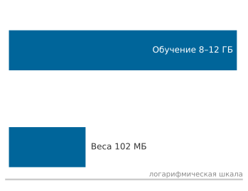

*Иллюстративный пик обучения многократно превышает одно лишь хранение весов.*

Рассмотрим иллюстративный сценарий обучения ResNet-50 с 25,6 млн параметров (около 102,4 МБ весов FP32), размером батча 64 и изображениями $224{\times}224$. При 8–12 ГБ сохраненных активаций градиенты добавляют около 102,4 МБ, а два буфера моментов оптимизатора Adam (Adaptive Moment Estimation) в FP32 добавляют около 204,8 МБ. Сложив эти четыре компонента, получаем сценарий обучения в 8,4–12,4 ГБ, что примерно в 82,1–121,2 раза превышает объем одних весов FP32. Эта метрика отражает пиковую память обучения, в отличие от памяти вывода, которой не нужны состояния оптимизатора, градиенты и буферы активаций обратного прохода.

Это расхождение показывает, почему емкость обучения ускорителя нельзя вывести только из числа параметров. Полная память обучения подчиняется четырехкомпонентной формуле ($M_{\text{total}} = M_{\text{weights}} + M_{\text{gradients}} + M_{\text{optimizer}} + M_{\text{activations}}$) плюс накладные расходы аллокатора, как выведено в разделе [«Истинная стоимость памяти обучения»](appendix_algorithm.md#sec-appdx-algorithm-foundations-true-cost-training-memory-e54e) приложения «Основы алгоритмов».

Фреймворки предоставляют три управляющих механизма на уровне графа для этого компромисса. Градиентные контрольные точки (Chen et al., 2016) меняют то, что граф сохраняет: движок хранит только грубые границы сегментов и регенерирует промежуточные активации во время обратного прохода. В терминах железного закона контрольные точки увеличивают число арифметических операций ($O$), чтобы сократить объем памяти и объем переносов ($D_{\text{vol}}$). Отсоединение тензоров — дополнительная оптимизация: вызов `.detach()` убирает тензор из отслеживания autograd, не давая движку сохранять активации на восходящих путях графа. Это важно при переносе обучения, где замороженные экстракторы признаков не требуют вычисления градиентов, что исключает ненужное хранение активаций ($D_{\text{vol}}$). Смешанная точность обучения дает третий рычаг: представление активаций и весов в 16-битных форматах напрямую вдвое сокращает объем тензоров ($D_{\text{vol}}$), одновременно ускоряя арифметику на тензорных ядрах ($R_{\text{peak}}$). Глава [«Обучение моделей»](08_training.md#sec-model-training) переводит эти механизмы графа в решения о размере кластера.

##### Расширяемость и управление

Промышленные системы обучения требуют детального контроля над распространением градиентов сверх стандартных обратных проходов. На практике нагрузки требуют трех основных возможностей: избирательного вычисления градиентов для заморозки слоев при переносе обучения через `requires_grad=False` или `.detach()`; инспекции и изменения градиентов для обрезки, отладки или логирования промежуточных сопряженных величин через хуки времени исполнения; и пользовательских правил дифференцирования для нестандартных операций, таких как специализированные ядра CUDA или новые функции активации.

Эти точки расширения работают через обратные вызовы, которые вызываются во время построения графа и обратного обхода, сохраняя путь исполнения ядра. В PyTorch эти возможности соответствуют конкретным механизмам среды исполнения: удерживаемым графам, буферам накопления градиентов, пользовательским реализациям `autograd.Function`, тензорным хукам и границам отсоединения. [«Механизмы управления autograd»](07_frameworks.md#tbl-autograd-control) сводит эти механизмы, их системную функцию и их компромиссы по памяти или корректности.

| **Механизм**                                                            | **Что контролирует**                                                                                          | **Цена или опасность**                                                                                         |
|:------------------------------------------------------------------------|:--------------------------------------------------------------------------------------------------------------|:---------------------------------------------------------------------------------------------------------------|
| **`retain_graph=True`** | Сохраняет состояние графа доступным для еще одного обратного обхода                                           | Удерживает память, которая иначе была бы освобождена; объем зависит от графа и сохраненных значений             |
| **Накопление градиентов**                                               | Последовательные обратные проходы суммируются в `.grad`, пока `zero_grad()` их не сбросит, что позволяет получать большие эффективные батчи | Забытый сброс незаметно смешивает градиенты разных шагов оптимизации                                           |
| **Пользовательская `autograd.Function`**                                | Определяемые пользователем правила прямого и обратного прохода для операций вне встроенной библиотеки         | Переносит контракт дифференцирования (что сохранять, как дифференцировать) на разработчика                     |
| **Хуки градиентов**     | Инспекция или изменение градиентов в процессе обхода (обрезка, логирование, отладка)                          | Выполняет произвольный код Python для каждого зарегистрированного тензора на каждом обратном проходе            |
| **`.detach()`**                  | Обрывает поток градиента на выбранной границе (замороженные слои, выходы вывода)                              | Устаревший атрибут `.data` обходит autograd и незаметно портит градиенты; клонируйте перед мутацией на месте   |

<a id="tbl-autograd-control"></a>

***Механизмы управления autograd**: повторяющиеся точки расширения, которые движок autograd открывает во время обхода графа. Указано, что каждая из них контролирует и какую цену по памяти или корректности несет.*

Пользовательские функции autograd открывают контракт дифференцирования напрямую, перенося ответственность за сохранение состояния с движка на программиста: реализация явно задает, какие прямые тензоры сохранять в `ctx.save_for_backward()`, и вычисляет соответствующие векторно-якобиановы произведения в `backward()`. [«Пользовательская функция autograd»](07_frameworks.md#lst-custom-autograd-function) демонстрирует этот интерфейс для пользовательской операции умножения со сложением:

<a id="lst-custom-autograd-function"></a>

**Пользовательская функция autograd**: реализуйте методы прямого и обратного прохода, чтобы определить пользовательские дифференцируемые операции, явно указывая тензоры для сохранения при вычислении градиентов.

```python
class MultiplyAdd(torch.autograd.Function):
    @staticmethod
    def forward(ctx, x, y, z):
        # Сохраняем тензоры, нужные для обратного прохода
        ctx.save_for_backward(x, y)
        return x * y + z

    @staticmethod
    def backward(ctx, grad_output):
        # Извлекаем сохраненные тензоры
        x, y = ctx.saved_tensors

        # Вычисляем градиенты по правилу цепочки
        grad_x = grad_output * y  # dL/dx = dL/dout * dout/dx
        grad_y = grad_output * x  # dL/dy = dL/dout * dout/dy
        grad_z = grad_output  # dL/dz = dL/dout * 1

        return grad_x, grad_y, grad_z

# Использование
x = torch.tensor([2.0], requires_grad=True)
y = torch.tensor([3.0], requires_grad=True)
z = torch.tensor([1.0], requires_grad=True)

output = MultiplyAdd.apply(x, y, z)
output.backward()

print(
    x.grad, y.grad, z.grad
)  # tensor([3.]), tensor([2.]), tensor([1.])
```

Эти механизмы autograd напрямую связаны с кремниевым контрактом. Граф с обратными связями определяет последовательность обратных ядер, которую должно выполнить устройство (член $O$). Компромисс между памятью и вычислениями управляет временем пребывания промежуточных тензоров и трафиком памяти по иерархии памяти (член $D_{\text{vol}}$). Точки расширения позволяют инженерам обрезать ненужные пути графа и перехватывать поток данных. Взаимодействие между удержанием графа и пропускной способностью памяти ведет прямо к обучению в смешанной точности, которое сокращает объем памяти и одновременно повышает эффективность исполнения на аппаратуре.

<a id="sec-ml-frameworks-mixedprecision-training-support-d31d"></a>

#### Поддержка обучения в смешанной точности

Смешанная точность использует специализацию аппаратуры, чтобы одновременно улучшить два члена железного закона. Тензорные ядра выполняют 16-битные умножения матриц с более высокой пропускной способностью, чем арифметические блоки FP32 (повышая $R_{\text{peak}}$ и снижая $O/(R_{\text{peak}} \cdot \eta_{\text{hw}})$), а 16-битные активации вдвое сокращают трафик глобальной памяти (снижая $D_{\text{vol}}$). Одновременное улучшение обоих членов встречается редко: большинство системных оптимизаций улучшают эффективность вычислений за счет объема памяти или наоборот.

Автоматические API смешанной точности динамически назначают численные точности на основе чувствительности оператора и возможностей аппаратуры. Вычислительно интенсивные операции, такие как свертки и линейные проекции, выполняются в FP16 или BF16, а численно чувствительные операции, такие как softmax, редукции и вычисление функции потерь, выполняются в FP32. Поскольку FP16 имеет узкий динамический диапазон (5 битов экспоненты, а нормальные значения снизу ограничены величиной $\approx 6{,}10 \times 10^{-5}$), значения градиентов в ходе обратного распространения могут обнуляться из-за антипереполнения (underflow). Масштабирование функции потерь борется с антипереполнением: скалярная функция потерь умножается на коэффициент масштаба $S$ перед обратным обходом, что переносит градиенты в представимый диапазон FP16, а градиенты параметров делятся на $S$ перед обновлениями оптимизатора.

Фреймворки поддерживают три основных формата пониженной точности: IEEE FP16, BF16[^fn-bf16-dynamic-range] и TF32 (внутренний формат NVIDIA начиная с Ampere, который сочетает 8-битную экспоненту FP32 с 10-битной мантиссой FP16 для умножения матриц). BF16 совпадает с динамическим диапазоном FP32 по 8 битам экспоненты ценой точности мантиссы (7 битов). Это предотвращает антипереполнение градиентов и во многих нагрузках устраняет необходимость динамического масштабирования функции потерь. Раздел [«Обучение в смешанной точности»](08_training.md#sec-model-training-mixedprecision-training-9218) главы «Обучение моделей» подробно описывает численную устойчивость и характеристики памяти этих форматов. [«Пример autocast»](07_frameworks.md#lst-autocast-usage) показывает API смешанной точности PyTorch: контекстный менеджер `autocast` в паре с `GradScaler` предотвращает антипереполнение.

[^fn-bf16-dynamic-range]: **Обоснование дизайна BF16**: BF16 разработан в Google Brain примерно в 2018 году специально для стабильности обучения на TPU. Он сохраняет 8-битную экспоненту FP32 и вдвое сокращает объем памяти. Это явный компромисс: точность мантиссы (7 битов против 10 у FP16) ради динамического диапазона. Наименьшее положительное нормальное значение FP16 составляет около $6{,}10 \times 10^{-5}$, но субнормальные значения простираются примерно до $5{,}96 \times 10^{-8}$. Масштабирование функции потерь особенно важно на аппаратуре или в режимах, которые обнуляют эти субнормальные значения. Экспонента BF16, совпадающая с FP32, в значительной мере избавляет от этого класса антипереполнения градиентов и во многих нагрузках устраняет необходимость масштабирования функции потерь. Поэтому BF16 и FP16 не взаимозаменяемы: BF16 предпочтителен, когда важна стабильность обучения, а FP16 — когда численная точность важнее устойчивости градиентов.

<a id="lst-autocast-usage"></a>

**API смешанной точности**: современные фреймворки предоставляют поддержку автоматической смешанной точности через контекстные менеджеры, которые управляют выбором точности и численной устойчивостью.

```python
import torch
from torch.amp import autocast, GradScaler

model = MyModel().cuda()
optimizer = torch.optim.Adam(model.parameters())
scaler = GradScaler("cuda")

for inputs, targets in dataloader:
    inputs, targets = inputs.cuda(), targets.cuda()
    optimizer.zero_grad()

    # Фреймворк автоматически выбирает точность для каждой операции
    with autocast(device_type="cuda", dtype=torch.float16):
        outputs = model(inputs)
        loss = criterion(outputs, targets)

    # GradScaler масштабирует градиенты для численной устойчивости
    scaler.scale(loss).backward()
    scaler.step(optimizer)
    scaler.update()
```

Обучение в BF16 полностью обходится без механизма масштабирования функции потерь. Как показано в [«обучение в BF16»](07_frameworks.md#lst-bf16-training) в сравнении с [«пример autocast»](07_frameworks.md#lst-autocast-usage), удаление `GradScaler` упрощает цикл обучения: динамический диапазон BF16 устраняет риск антипереполнения, позволяя напрямую выполнять обратный проход.

<a id="lst-bf16-training"></a>

**Обучение в BF16**: BF16 сохраняет динамический диапазон FP32, часто избавляя от масштабирования функции потерь, которое нужно при обучении в FP16.

```python
# Обучение в BF16, как правило, не требует масштабирования функции потерь
with torch.autocast(device_type="cuda", dtype=torch.bfloat16):
    outputs = model(inputs)
    loss = criterion(outputs, targets)
loss.backward()  # GradScaler не нужен
optimizer.step()
```

##### Состояние оптимизатора и контрольные точки

Возобновление обучения после прерывания или сбоя аппаратуры требует восстановить веса модели и состояния оптимизатора синхронно: векторы первых моментов, оценки дисперсии вторых моментов и счетчики шагов. Для Adam хранение двух состояний FP32 на параметр добавляет к памяти весов FP16 еще в 4 раза больше памяти, так что совокупный объем в 5 раз превышает базовый объем весов. Для модели с 7 млрд параметров веса и состояния оптимизатора требуют примерно 70 ГБ (14 ГБ весов и 56 ГБ состояний оптимизатора). Объем контрольных точек напрямую определяет задержку восстановления в распределенном хранилище, связывая отказоустойчивость с членом $D_{\text{vol}}$ железного закона.

Глава [«Обучение моделей»](08_training.md#sec-model-training) разбирает стратегии оптимизации памяти оптимизатора в распределенном обучении. На уровне фреймворка оптимизаторы открывают внутренние словари состояний через `state_dict()` для сериализации. [«Интерфейс state_dict»](07_frameworks.md#lst-state-dict-interface) показывает доступ к словарям состояний оптимизатора, а [«сохранение и загрузка контрольной точки»](07_frameworks.md#lst-checkpoint-save-load) — сохранение и восстановление параметров модели и состояний оптимизатора, чтобы сохранить непрерывность траектории обучения.

<a id="lst-state-dict-interface"></a>

**Словарь состояний**: оптимизаторы открывают внутреннее состояние через `state_dict()`, что позволяет сериализовать буферы моментов и оценки адаптивной скорости обучения для контрольных точек.

```python
import torch
import torch.nn as nn
import torch.optim as optim

model = nn.Linear(10, 5)
optimizer = optim.Adam(model.parameters(), lr=0.001)

# После шагов обучения оптимизатор накапливает состояние
loss = model(torch.randn(3, 10)).sum()
loss.backward()
optimizer.step()

# Доступ к состоянию для контрольной точки
state = optimizer.state_dict()
# Содержит: {'state': {...}, 'param_groups': [{'lr': 0.001, ...}]}
```

<a id="lst-checkpoint-save-load"></a>

**Сохранение и загрузка контрольной точки**: сохраните и параметры модели, и состояние оптимизатора, чтобы корректно возобновить обучение с правильными значениями моментов и адаптивной скорости обучения.

```python
# Сохранение контрольной точки
checkpoint = {
    "epoch": epoch,
    "model_state_dict": model.state_dict(),
    "optimizer_state_dict": optimizer.state_dict(),
}
torch.save(checkpoint, "checkpoint.pt")

# Возобновление обучения
checkpoint = torch.load("checkpoint.pt")
model.load_state_dict(checkpoint["model_state_dict"])
optimizer.load_state_dict(checkpoint["optimizer_state_dict"])
```

Математические основы автоматического дифференцирования существовали задолго до возрождения глубокого обучения; инженерная задача состояла в том, чтобы механизировать эти принципы в высокопроизводительную программную инфраструктуру. Вручную вывести и записать обратные ядра для одного слоя означает отслеживать промежуточные переменные, реализовывать локальные правила цепочки и управлять жизненным циклом буферов устройства. Для современных трансформерных архитектур с многоголовым самовниманием, слоевыми нормализациями и остаточными проекциями на сотнях слоев ручное дифференцирование по тысячам тензорных зависимостей невыполнимо. Движки autograd механизируют этот вывод для произвольных топологий, режимов точности и бэкендов ускорителей, превращая неразрешимую аналитическую задачу в автоматизированное исполнение графа.

<a id="sec-ml-frameworks-memory-management-gradient-computation-bb77"></a>

#### Управление памятью при вычислении градиентов

Стратегии управления памятью, разобранные в [«Стратегии управления памятью»](07_frameworks.md#sec-ml-frameworks-memory-management-strategies-b008) (контрольные точки, накопление градиентов), существуют потому, что автоматическому дифференцированию в обратном режиме нужно сохранять историю вычислений. Как показал [«пример сохранения активаций по слоям»](07_frameworks.md#lst-reverse_memory), каждый прямой слой добавляет тензор активации, который должен сохраняться, пока обратный обход его не использует. Так возникает волна памяти: она достигает пика на старте обратного распространения и спадает по мере накопления градиентов и освобождения промежуточных буферов. Современные среды исполнения отслеживают счетчики ссылок на тензоры, чтобы освободить активации в тот момент, когда их потребители обратного прохода завершают исполнение.

Помимо времен жизни тензоров, фреймворки сталкиваются с более низкоуровневым узким местом системы: задержкой выделения памяти на уровне драйвера. Синхронные выделения памяти устройства (например, `cudaMalloc`) несут значительные накладные расходы ОС и драйвера, вынуждая синхронизации хоста и устройства, которые опустошают очереди команд ускорителя. Чтобы устранить эту задержку, современные фреймворки перехватывают выделения с помощью **кеширующих аллокаторов**, которые поддерживают пулы заранее зарезервированных блоков памяти устройства между итерациями обучения. Суб-выделение из этих пулов амортизирует стоимость выделения на устройстве и снижает задержку запуска ядер, хотя меняющиеся времена жизни тензоров все равно могут вызывать фрагментацию памяти.

<a id="psp-frameworks-caching-allocator-utilization"></a>

> **Кеширующий аллокатор и утилизация**
>
> Кеширующие аллокаторы в первую очередь снижают накладные расходы выделения и улучшают повторное использование блоков. Остаются два соображения:
>
> 1.  Задержка выделения: повторное использование кешированного блока избавляет от повторных вызовов выделения памяти устройства, стоимость и поведение синхронизации которых зависят от аллокатора и среды исполнения.
> 2.  Фрагментация: классы размеров и разбиение блоков улучшают повторное использование, но могут оставлять свободную емкость в блоках, которые не удовлетворяют запрос. Поскольку тензорам нужны непрерывные физические адреса, внешняя фрагментация возникает, когда меняющиеся времена жизни тензоров оставляют в пуле маленькие несмежные свободные блоки. Большое выделение может вызвать ошибку нехватки памяти (OOM), даже когда суммарная свободная память во всех блоках превышает запрошенный размер.
>
> Ошибка нехватки памяти может отражать живые выделения, блоки, зарезервированные аллокатором, фрагментацию или другой процесс. `nvidia-smi` показывает использование на уровне устройства и сама по себе недостаточна для диагностики аллокатора фреймворка: нужна статистика памяти, специфичная для аллокатора.

<a id="sec-ml-frameworks-production-system-integration-challenges-cd6e"></a>

#### Проблемы интеграции производственной системы

Итерация обучения в производственной среде может работать медленнее, чем в изолированном профиле, потому что полный шаг координируется с аллокатором памяти, менеджером устройств, планировщиком операций, конвейером данных и оптимизатором. Полная стоимость системы включает работу, которую не измеряет микротест отдельного оператора или профиль изолированного ядра. Вычисление градиентов запускает ядра ускорителя и может требовать выделения памяти, синхронизации или переноса данных в зависимости от графа и реализации. Эти взаимодействия могут доминировать в нагрузках из мелких операций и остаются измеримыми в масштабе. Разрыв между тем, что пишет программист (цикл обучения из пяти строк), и тем, что исполняет система (выделения памяти, запуски ядер и точки синхронизации), — центральное напряжение проектирования системы AD.

Серьезность этих накладных расходов зависит от более глубокого архитектурного выбора: как система AD вообще записывает и воспроизводит вычисления. Фреймворк, который строит динамическую трассу во время исполнения, платит за учет каждой операции на каждом прямом проходе, а его кеширующему аллокатору приходится учитывать шаблоны выделения, которые могут меняться вместе с исполнением. Фреймворк, который захватывает стабильное вычисление, напротив, может заранее планировать буферы и переиспользовать память между прямым и обратным графами, потому что способен рассуждать о временах жизни до исполнения. Выигрыш зависит от полноты захвата, времен жизни тензоров, форм и поддержки бэкенда.

<a id="psp-frameworks-tape-based-vs-transform-based-autodiff"></a>

> **Ленточное и преобразовательное автоматическое дифференцирование**
>
> **PyTorch (на основе ленты)**: записывает операции на динамической «ленте» во время прямого прохода. Это гибко и легко отлаживается, но затрудняет для компилятора одновременное видение всего графа ради глобальной оптимизации.
>
> **JAX (на основе преобразований)**: рассматривает автоматическое дифференцирование как функциональное преобразование высокого уровня (`grad(f)`). JAX трассирует чистую функцию для абстрактных сигнатур входов, позволяя совместимым преобразованиям, таким как `jit(grad(f))` или `vmap(grad(f))`, комбинироваться до понижения. Это открывает компиляторам ускорителей более крупную преобразованную программу, не гарантируя одного ядра или универсального преимущества в скорости.

Система AD отслеживает зависимости, чтобы обходить независимые ветви графа в допустимом порядке и корректно накапливать градиенты. Хотя независимые потоки хоста или явные потоки CUDA могут открыть одновременность на устройстве, стандартная диспетчеризация autograd сериализует исполнение узлов на основном вычислительном потоке, если не указано иное. Одновременность ограничена зависимостями между потоками и пределами аппаратного планирования.

<a id="sec-ml-frameworks-different-frameworks-implement-ad-2f8e"></a>

#### Как разные фреймворки реализуют AD

Модели исполнения, разобранные в [«Проблема исполнения»](07_frameworks.md#sec-ml-frameworks-execution-problem-e1e1), — eager, статический граф и гибридная, — напрямую определяют, как фреймворки реализуют автоматическое дифференцирование. PyTorch (Paszke et al., 2019) строит ленту autograd динамически во время прямого исполнения. Его механизм цепочки `grad_fn`, разобранный в [«Внутреннее устройство autograd в PyTorch»](07_frameworks.md#sec-ml-frameworks-pytorch-autograd-internals-4fa0), дает неограниченный поток управления Python и прозрачную отладку с точками останова, но заставляет движок удерживать метаданные ленты и сохраненные тензоры до завершения обратного обхода. Напротив, ранний TensorFlow (Abadi et al., 2016) выполнял символическое дифференцирование заранее, во время построения графа, генерируя неизменяемый подграф обратного прохода. Такой подграф пригоден для устранения мертвого кода по всему графу и повторного использования памяти до исполнения. Современный TensorFlow 2.x принимает eager-исполнение как интерфейс по умолчанию, одновременно предоставляя `tf.function` для компиляции статических графов дифференцирования, когда этого требует пропускная способность (TensorFlow Developers, 2024). JAX[^fn-jax-functional-transforms] (Frostig et al., 2018) полностью отказывается от отслеживания ленты и рассматривает дифференцирование как преобразование чистой функции: `jax.grad()` принимает функцию и возвращает функцию производной, что позволяет бесшовно комбинировать ее с векторизацией (`jax.vmap()`) и компиляцией XLA (`jax.jit()`). Хотя эта функциональная парадигма требует строгой ссылочной прозрачности, она открывает компилятору чистое IR всей программы без побочных эффектов императивных лент.

[^fn-jax-functional-transforms]: **JAX**: JAX предоставляет `grad`, `jit` и `vmap` как преобразования функций. Их можно комбинировать, когда контракты входа и выхода согласованы, но порядок важен: векторизация градиентов в общем случае не то же самое, что дифференцирование результата с векторным значением. Компиляция может давать слитые области, вызовы библиотек и несколько ядер, а не одно универсальное ядро. Преобразованные функции должны быть чистыми: побочные эффекты Python могут происходить во время трассировки, но не представлены в скомпилированной программе, тогда как поддерживаемые обратные вызовы выражают намеренные эффекты времени исполнения.

Различия в реализации автоматического дифференцирования определяют, какой видимости при отладке, оптимизации компилятором и переносимости развертывания может ожидать команда от каждого фреймворка. Через каждое решение о проектировании AD проходит повторяющееся напряжение: математическая корректность требует хранить вычислительную историю, а аппаратура накладывает строгие лимиты памяти. Каждый фреймворк разрешает это напряжение по-своему, выбирая, какие активации сохранять в контрольных точках, какие операции сливать и насколько агрессивно обменивать пересчет на память. Эти выборы определяют, какие модели могут обучаться на каком железе, что делает проектирование системы AD одним из самых значимых инженерных решений в любом фреймворке.

<a id="chk-frameworks-systems-cost-gradients"></a>

> **Системная цена градиентов**
>
> Обучение по своей природе дороже вывода из-за автоматического дифференцирования.
>
> **Вычислительная реальность**
>
> - **Обратный режим AD**: почему он эффективен для скалярной функции потерь со многими параметрами?
> - **Налог на активации**: можете ли вы объяснить, как память сохраненных значений зависит от глубины графа, форм тензоров и контрольных точек?
>
> **Механика оптимизации**
>
> - **Градиентные контрольные точки**: как пересчет активаций экономит память?

Задачи исполнения и дифференцирования вместе обеспечивают цикл обучения: модель исполнения определяет, когда происходят вычисления, а автоматическое дифференцирование вычисляет градиенты, которые движут обучением. Однако обе задачи незаметно предполагают то, что нельзя принимать как данность: что один и тот же код может выполняться на разнообразной аппаратуре. Модель, обученная на NVIDIA A100, должна обслуживать вывод на ARM-процессоре мобильного телефона, на тензорном процессоре Google (TPU) или на микроконтроллере с килобайтами памяти. Один и тот же вызов `torch.matmul` должен диспетчеризоваться в cuBLAS на одном устройстве и во вручную настроенное ядро ARM NEON на другом. Это разнообразие аппаратуры порождает третью задачу.

<a id="sec-ml-frameworks-abstraction-problem-37a5"></a>

## Проблема абстракции

Это разнообразие аппаратуры архитектурно фундаментально. GPU предоставляют обильный параллелизм, ориентированный на пропускную способность, но имеют иную семантику памяти и исполнения, чем CPU. TPU отдают предпочтение регулярным тензорным программам и формам, видимым компилятору. В микроконтроллере килобайты там, где в сервере гигабайты. Поэтому **проблема абстракции** требует, чтобы фреймворки скрывали эту сложность за единым программным интерфейсом, но при этом позволяли эффективно использовать уникальные возможности каждой цели.

Проблема раскладывается на два взаимодействующих измерения. Первое — *представление данных*: как фреймворки кодируют тензоры, параметры и вычислительное состояние в формах, которые работают на разной аппаратуре. Второе — *отображение исполнения*: как высокоуровневые операции переводятся в аппаратно-специфичные реализации. Эти измерения не являются независимыми. Способ представления данных (раскладка в памяти, точность, размещение на устройстве) напрямую влияет на то, *какие* стратегии исполнения возможны. Тензор, хранящийся в построчном формате на GPU, требует иных ядер, чем тензор в поколоночном формате на CPU. Модель, квантованная в INT8, открывает совершенно иные пути исполнения, чем FP32.

Решение задачи абстракции требует сложной программной инфраструктуры: представлений тензоров, которые кодируют и математическую семантику, и аппаратные ограничения; промежуточных представлений, которые позволяют аппаратно-специфичную компиляцию; и систем времени исполнения, которые управляют переносами данных по иерархии памяти. Чтобы сделать это конкретным, проследим, что должно произойти, когда программист пишет `model(input)`. Фреймворк должен быстро разрешить пять решений: представление данных (форма тензора, раскладка в памяти, численная точность), размещение на устройстве (иерархия пропускной способности, соединяющая память CPU, GPU и ускорителя), доставка входа (конвейеры данных, поддерживающие сотни МБ/с, чтобы ускоритель не простаивал), организация модели (параметры, буферы и подмодули, которые должны перемещаться вместе) и исполнение ядер (диспетчеризация, планирование и оптимизация ресурсов). Эти решения строятся от контейнера данных вверх к слою исполнения на аппаратуре. Распределенное размещение демонстрирует ту же границу абстракции: фреймворки открывают области размещения, чтобы системные компоненты могли управлять границами устройств. Глава [«Обучение моделей»](08_training.md#sec-model-training) разбирает алгоритмы масштабирования и затраты на коммуникацию, которые делают эти области эффективными.

<a id="sec-ml-frameworks-data-structures-tensor-abstractions-9cbf"></a>

### Структуры данных и абстракции тензоров

Прямой проход ResNet-50 задействует 25,6 млн параметров, порождает промежуточные активации на каждом слое и должен координировать память между адресными пространствами CPU и GPU. Фреймворки организуют все эти данные так, чтобы единственный вызов `model(input)` выполнял миллионы операций без того, чтобы программист управлял хотя бы одним указателем. Для этого они последовательно решают четыре задачи: определяют универсальный контейнер данных (тензоры), размещают его на нужном устройстве (управление памятью), подают данные достаточно быстро (конвейеры данных) и диспетчеризуют нужное аппаратное ядро (базовые операции). Путь ведет от представления данных к исполнению на аппаратуре.

Вычислительные графы задают *логический* поток операций, а структуры данных определяют, как эти операции обращаются к данным и изменяют их в *физической* памяти. Это различие важно, потому что одна и та же математическая операция может отличаться по пропускной способности на порядок в зависимости от того, лежат ли данные непрерывно в кеше, закреплены ли они для прямого доступа к памяти (DMA) или разбросаны по страницам.

Первый шаг — сам контейнер данных. Структуры данных фреймворка должны поддерживать пропускную способность памяти (сотни ГБ/с на современных GPU), вмещать архитектуры от одномерных последовательностей до пятимерных видеотензоров и скрывать управление устройствами за понятными API. Ответ на все это — тензоры.

<a id="sec-ml-frameworks-tensors-1cb7"></a>

#### Тензоры

В основе представления данных любого фреймворка лежит единая абстракция: тензор, n-мерный массив, который объединяет числовые значения с информацией, необходимой для их интерпретации и размещения.

Каждое вычисление в нейронной сети оперирует тензорами.[^fn-tensor-hardware-contract] Обучающие батчи, карты активаций, градиенты параметров и состояния оптимизатора — все это тензоры. Такое единое представление позволяет фреймворкам оптимизировать одну структуру данных под аппаратуру, а не управлять отдельными контейнерами для каждой роли.

[^fn-tensor-hardware-contract]: **Тензор**: в математике тензоры подчиняются законам преобразования координат. В ML-фреймворках этот термин шире обозначает многомерные массивы, которые несут форму, тип данных, шаги, размещение на устройстве и часто метаданные автоматического дифференцирования. Транспонирование обычно создает представление с шагами (strided view), а reshape может вернуть либо представление, либо копию в зависимости от раскладки. Эта семантика хранения делает раскладку важной для выбора ядра и переноса данных.

<a id="dfn-frameworks-tensor"></a>

> **Тензор**
>
> ***Тензоры*** — это $n$-мерные массивы с метаданными формы, типа данных, шагов и устройства. Среды исполнения фреймворка используют эту информацию, чтобы выбирать совместимые операции и аппаратные ядра.
>
> 1.  **Значение**: непрерывный тензор FP32 формы $[1024, 1024]$ занимает $1024{\times}1024{\times}4 = 4\,194\,304$ байта (около 4,2 МБ). Представление без непрерывной раскладки может приниматься напрямую ядром с шагами или требовать материализации, когда операция требует поддерживаемой непрерывной раскладки.
> 2.  **Отличие**: массивы NumPy тоже несут метаданные формы, типа и шагов. Тензоры фреймворков дополнительно интегрируют размещение на устройстве, автоматическое дифференцирование и диспетчеризацию на ускорители.
> 3.  **Распространенная ловушка**: операции с тензорами могут возвращать новое выделение, представление, разделяющее существующее хранилище, или обновление на месте, в зависимости от операции и варианта API. Учет памяти должен различать эти случаи.

Абстракция тензора потребляет памяти гораздо больше, чем подсказывает один лишь объем весов модели. Инженеры, которые оценивают память по числу параметров, выделяют ее соответственно и сталкиваются с ошибками нехватки памяти, которые кажутся необъяснимыми. Быстрый учет памяти делает скрытую цену конкретной: градиенты, моменты оптимизатора и сохраненные активации сопровождают каждый тензор весов.

<a id="nbk-frameworks-administrative-tax"></a>

> **Административный налог**
>
> Иллюстративная разбивка ResNet-50 в [«Внутреннее устройство autograd в PyTorch»](07_frameworks.md#sec-ml-frameworks-pytorch-autograd-internals-4fa0) была в 82,1–121,2 раза больше одного лишь объема весов FP32. Следующий сценарий расширяет учет до градиентов, состояния оптимизатора и сохраненных активаций в масштабе миллиардов параметров.
>
> **Задача**: сколько памяти добавляет состояние обучения сверх весов FP16 в этом сценарии с миллиардами параметров?
>
> **Расчет**:
>
> 1.  Веса модели: 2 ГБ.
> 2.  Градиенты: 2 ГБ (тот же размер, что у весов).
> 3.  Состояния оптимизатора (Adam): 8 ГБ ($4 \times$ память весов FP16 под моменты и скорости, которые хранятся в FP32).
> 4.  Активации: для размера батча 32 и сети из 100 слоев обратный режим AD сохраняет зависящие от операций значения, которые нужны правилам производной. Контрольные точки активаций могут опускать выбранные значения и пересчитывать их во время обратного прохода.
>     $$ \text{Активации} \approx B \times N_L \times S \times d_{\text{model}} \times n_{\text{saved}} \times 2 \text{ байта} $$
>     Для последовательности из 1024 токенов, скрытого состояния шириной 1024 и 1 сохраненного тензора на слой: $32 \times 100 \times 1024 \times 1024 \times 1 \times 2 \approx \mathbf{6{,}7 \text{ ГБ}}$. Материализованные члены внимания могут добавлять отдельную компоненту $B \times N_{\text{heads}} \times S^2$, поэтому важны эффективные по памяти ядра внимания.
>
> **Системный вывод**: модель в 2 ГБ несет постоянное состояние обучения еще до обработки первого батча (2 ГБ градиентов и 8 ГБ состояния оптимизатора). Во время шага обучения зависящие от батча активации добавляют еще 6,7 ГБ, поднимая пиковый «административный налог» до примерно 16,7 ГБ сверх весов. Во время обучения перемещение данных включает сохранение и извлечение этих активаций.

<a id="sec-ml-frameworks-tensor-structure-dimensions-4a14"></a>

#### Структура тензора и размерности

Тензоры структурируют числовые данные, добавляя организационные оси к линейным раскладкам памяти. Проследите расширение ранга слева направо на [«Иерархия рангов тензора»](07_frameworks.md#fig-tensor-data-structure-a): видно, как скаляры ранга 0 превращаются в объемные тензоры ранга 3.

<a id="fig-tensor-data-structure-a"></a>

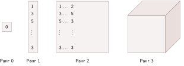

<em><strong>Иерархия рангов тензора</strong>: возрастающие ранги тензоров (от 0 до 3) обобщают многомерную индексацию от скаляров до объемных тензоров. Каждый дополнительный ранг добавляет организационную ось, которую фреймворк должен линеаризовать в физические адреса памяти через шаги.</em>

В задачах компьютерного зрения сырые входные изображения напрямую отображаются на многомерные раскладки тензоров. Посмотрите на структуру тензора ранга 3 на [«Изображение как RGB-тензор»](07_frameworks.md#fig-tensor-data-structure-b): видно, как красный, зеленый и синий каналы складываются по канальному измерению.

<a id="fig-tensor-data-structure-b"></a>

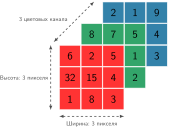

<em><strong>Изображение как RGB-тензор</strong>: разложение двумерного цветного изображения на сложенные измерения высоты, ширины и каналов образует тензор ранга 3. В ML-системах порядок этих измерений (например, сначала каналы или последними каналы) определяет локальность доступа к памяти и эффективность кеша в операциях свертки.</em>

Тензоры фреймворка несут больше, чем сырые числа. Каждый тензор хранит **метаданные тензора**, то есть информацию времени исполнения, которая используется для проверки операций и выбора быстрых путей исполнения: кортеж *формы* (например, `[64, 3, 224, 224]` для батча изображений), *тип данных* (литералы фреймворка вроде `float32`, `float16` или `int8`) и метку *устройства* (CPU, cuda:0). Умножение матриц, например, проверяет совместимость форм во время диспетчеризации и использует тип данных, чтобы направить вычисление к нужному аппаратному ядру: стандартному GEMM в FP32 или пути FP16 на тензорных ядрах.

Реализация раскладки в памяти порождает особые трудности в конструкции тензоров. Хотя тензоры дают абстракцию многомерных данных, физическая память компьютера остается линейной. Шаблоны шагов (stride) устраняют это расхождение, создавая отображения между многомерными индексами тензора и линейными адресами памяти. Эти шаблоны существенно влияют на производительность, определяя шаблоны доступа к памяти во время тензорных операций. [«Раскладка тензора в памяти»](07_frameworks.md#fig-tensor-memory-layout) делает это конкретным на тензоре $2{\times}3$: проследите, как одни и те же шесть значений отображаются в два разных линейных порядка, построчный (row-major) и поколоночный (column-major), и обратите внимание, как при этом меняются значения шагов, чтобы компенсировать различие.

<a id="fig-tensor-memory-layout"></a>

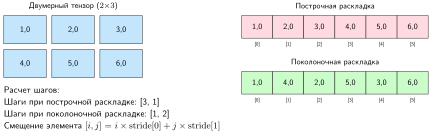

<em><strong>Раскладка тензора в памяти</strong>: тензор $2{\times}3$ можно хранить в линейной памяти в порядке «по строкам» (в стиле C) или «по столбцам» (в стиле Fortran). Шаги задают, сколько элементов пропустить по каждому измерению при движении по памяти, что позволяет фреймворкам вычислять адрес элемента tensor[i,j] как base_address + i $\times$ stride[0] + j $\times$ stride[1]. Выбор раскладки памяти существенно влияет на производительность кеша и вычислений.</em>

Выбор шагов — это выбор производительности. Построчная раскладка (используется NumPy и PyTorch) хранит элементы строка за строкой, что делает операции по строкам дружелюбнее к кешу. Поколоночная раскладка (используется в некоторых библиотеках BLAS) хранит элементы столбец за столбцом и оптимизирует шаблоны доступа по столбцам. Значения шагов кодируют эту информацию о раскладке: в построчной раскладке тензора $2{\times}3$ переход к следующей строке требует пропустить три элемента (stride[0] = 3), а переход к следующему столбцу — пропустить один элемент (stride[1] = 1).

Эти детали раскладки памяти напрямую влияют на производительность, но ни один порядок не является универсально лучшим. Эффективный доступ зависит от того, по какому измерению проходит операция, от раскладок, которые поддерживает ядро, от векторизации и от целевой иерархии памяти. Несовпадающая раскладка может потребовать доступа с шагом или преобразования, тогда как ядро, спроектированное под эту раскладку, обращается к ней эффективно. Важно, что геометрические операции вроде `.transpose()` работают без копирования: они лишь меняют метаданные шагов, создавая несмежное «представление» (non-contiguous view) поверх существующей памяти. Когда последующей операции (например, `.view()`) нужно, чтобы элементы лежали в памяти последовательно, вызов `.contiguous()` заставляет среду исполнения выделить новый буфер и физически скопировать элементы в последовательном порядке.

Тип данных — это уровень тензора, на котором численный диапазон обменивается на перенос данных. Стандартным выбором в машинном обучении долгое время была точность FP32, которая во фреймворках доступна через литералы типов вроде `float32` и дает баланс точности и эффективности. Современные фреймворки расширяют это несколькими численными типами для разных задач. Целочисленные типы поддерживают операции индексации и эмбеддингов. Типы пониженной точности, такие как FP16, позволяют эффективно развертывать модели на мобильных устройствах. Точность INT8 дает быстрый вывод на специализированной аппаратуре. Выбор численного типа влияет и на поведение модели, и на вычислительную эффективность: обучение нейронных сетей обычно требует точности FP32 для критичных накоплений, чтобы сохранить стабильность вычисления градиентов, тогда как вывод часто может использовать пониженную точность (литералы типов фреймворка вроде `int8` или даже `int4`, соответствующие INT8 и INT4), что сокращает использование памяти и повышает скорость обработки. Подходы смешанной точности обучения объединяют эти выгоды: FP32 используется для критичных накоплений, а большая часть вычислений выполняется в пониженной точности.

Преобразования типов — еще одна точка, где абстракция встречает физику. Операции с тензорами разных типов требуют явных правил преобразования, чтобы сохранить численную корректность. Эти преобразования вносят вычислительные затраты и рискуют потерей точности. Фреймворки предоставляют приведение типов, но полагаются на разработчика в вопросе сохранения численной точности между операциями.

Тензоры решают задачу представления данных, объединяя форму, раскладку и точность в одной абстракции. Однако идеально оформленный тензор на неверном устройстве или тот, которому нужно пересечь разрыв пропускной способности PCIe–HBM, чтобы добраться до GPU, может свести на нет любую оптимизацию раскладки. Следующая задача — размещение: где живут данные и как они перемещаются.

<a id="sec-ml-frameworks-device-memory-management-9404"></a>

#### Управление устройствами и памятью

Тензоры и их раскладки в памяти определяют, с чем работает фреймворк. Где физически находятся эти данные и как они перемещаются между местами, определяет, идут ли вычисления на полной скорости или ползут.

<a id="sec-ml-frameworks-os-interface"></a>

##### Фреймворк как интерфейс операционной системы

Пока высокоуровневый API сосредоточен на математике, бэкенд фреймворка выполняет роль операционной системы одноузловой конфигурации. Он управляет двумя критическими ресурсами одного узла: планированием вычислений и перемещением данных.

Среда выполнения CUDA (CUDA Runtime) служит этим слоем ОС, предоставляя низкоуровневые примитивы для запуска ядер и управления памятью устройства. Фреймворк координируется с этой средой, чтобы реализовать **DMA** через шину PCIe. Разрыв пропускной способности между хостом (CPU) и устройством (GPU) — главное «узкое место загрузки данных». Раздел [«Пропускная способность и задержка»](appendix_machine.md#sec-appdx-machine-foundations-bandwidth-vs-latency-5320) приложения «Основы машины» моделирует эту передачу, разделяя два ограничения, $T = L_{\text{lat}} + D_{\text{vol}}/\text{BW}$, которые определяют, ограничена ли стратегия загрузки данных задержкой отдельной передачи или устойчивой пропускной способностью. Фреймворки смягчают это через закрепленную память хоста (page-locked host memory), которая позволяет выполнять передачи DMA без промежуточного копирования через выгружаемую память. Этот интерфейс «аппаратура — ОС» и делает возможными высокопроизводительные циклы обучения на одной машине.

Каждый тензор находится на конкретном устройстве, и операции между устройствами несут затраты на перенос, которые могут доминировать во времени исполнения. PCIe 4.0 обеспечивает 32 ГБ/с между CPU и GPU, а HBM2e дает 2,04 ТБ/с внутри GPU. Разрыв в 63,7 раза означает, что один неверно размещенный перенос тензора может свести на нет весь выигрыш от ускорения на GPU.

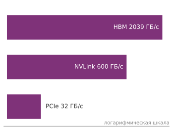

*Пропускная способность межсоединений различается примерно в 64 раза: HBM значительно выше NVLink, а NVLink значительно выше PCIe.*

Размещение на устройстве важно для проектирования фреймворка, потому что фреймворк должен отслеживать, где находится каждый тензор, и обеспечивать, чтобы операции объединяли тензоры только с одного устройства. Когда данные нужно переместить, фреймворк должен решить, блокировать ли исполнение или перекрыть перенос с другой работой. Эти решения, невидимые большинству пользователей, могут перевести цикл обучения из режима, ограниченного переносами, к существенно более высокой загрузке аппаратуры.

Три системных принципа определяют эффективное управление устройствами и памятью: понимание иерархии пропускной способности, которая ограничивает перенос данных; перекрытие вычислений с коммуникацией, чтобы скрыть задержку переноса; и тонкая синхронизация, которая поддерживает корректность, не жертвуя параллелизмом. Все это подкреплено количественным анализом на основе члена переноса данных железного закона. Иерархия пропускной способности задает первое ограничение.

Стоимость переноса данных между устройствами различается на порядки в зависимости от межсоединения.[^fn-nvlink-bandwidth-hierarchy] [«Накладные расходы передачи между устройствами»](07_frameworks.md#tbl-device-transfer-overhead) показывает времена переноса для тензора float32 размером $1000{\times}1000$ (4 МБ), примерно соответствующего типичному тензору активаций умеренной модели. Эти числа показывают, почему небрежное размещение на устройстве может свести на нет любое ускорение от GPU.

[^fn-nvlink-bandwidth-hierarchy]: **NVLink**: высокоскоростное соединение GPU с GPU от NVIDIA (см. главу [«Аппаратное ускорение»](11_hw_acceleration.md)). Оно обеспечивает 600 ГБ/с двунаправленной пропускной способности (NVLink 3.0 на A100) против 64 ГБ/с у PCIe 4.0 x16. Это преимущество примерно в 10 раз по пропускной способности решает, практичен ли тензорный параллелизм, то есть разбиение вычисления одного большого тензора между несколькими GPU, для данного размера модели. GPU, связанные только через PCIe, могут сделать член коммуникации $D_{\text{vol}}/\text{BW}$ доминирующим во времени обучения и свести на нет выигрыш от дополнительных вычислений.

| **Межсоединение** | **Пропускная способность** | **Время передачи** | **Путь** |
|:-----------------|:---------------------------------------------------------------------------------------------------------------------------------------------------------------------:|:-----------------------------------------------------:|:---------------|
| **PCIe 3.0 x16** | 15,8 ГБ/с | 0,254 мс | от хоста к устройству |
| **PCIe 4.0 x16** | 32 ГБ/с | 0,125 мс | от хоста к устройству |
| **NVLink 3.0**   | 300 ГБ/с в каждую сторону (600 ГБ/с двунаправленно) | 0,013 мс | от GPU к GPU |
| **Память GPU**   | 2039 ГБ/с | 0,002 мс | внутри устройства |

<a id="tbl-device-transfer-overhead"></a>

***Накладные расходы передачи между устройствами**: время передачи тензора 4 МБ через разные межсоединения. Показана однонаправленная пропускная способность PCIe (типичная для передач на GPU); полнодуплексная работа дает в 2 раза больше суммарной пропускной способности. Пропускная способность NVLink двунаправленная (300 ГБ/с в каждую сторону). Эти затраты на перенос могут доминировать в легковесных операциях, поэтому размещение на устройстве критично.*

Эти числа напрямую связаны с железным законом производительности. Каждый перенос между устройствами вносит вклад в $(D_{\text{vol}}/\text{BW})$ при доле пропускной способности внутри устройства. Деление 1 ГБ на заявленный пиковый показатель PCIe 4.0 дает 31,2 мс — нижнюю границу только по пропускной способности, которая не учитывает накладные расходы протокола, запуска, синхронизации, топологии и конкуренции. Переносы могут доминировать в легковесных нагрузках или нагрузках с малым батчем, поэтому реальную задержку нужно измерять, а не выводить только из пиковой пропускной способности.

Дисциплина размещения на устройстве защищает иерархию пропускной способности от случайного трафика PCIe. Каждый тензор несет атрибут устройства, и фреймворк соблюдает строгий инвариант: операции могут объединять только тензоры с одного устройства. Смешивание тензоров `cuda:0` и `cuda:1` вызывает `RuntimeError`, что не дает проходить скрытым переносам между устройствами.

Механизм переноса явный. Вызов `.to()` у тензора возвращает исходный тензор, если его тип данных и устройство уже совпадают с запрошенными. В противном случае возвращается преобразованная копия, если только `copy=True` не заставляет делать копию. Напротив, `nn.Module.to()` изменяет зарегистрированные параметры и буферы на месте и возвращает модуль.

Дисциплина производительности прямо следует из этого разрыва пропускной способности: выделять тензоры на целевом устройстве с самого начала, а не создавать их на хосте и переносить; переиспользовать память GPU между итерациями, а не выделять заново; размещать входы, метки и параметры модели на одном устройстве, чтобы исключить неявные переносы. При 32 ГБ/с нарушение любого из этих принципов вставляет переносы PCIe в критический путь, который может доминировать в итерации обучения, иначе работающей на 2,04 ТБ/с внутри устройства.

##### Перекрытие вычислений и коммуникации

Когда переносы неизбежны, следующая оптимизация — скрыть их задержку, выполняя их одновременно с вычислениями. Современные GPU содержат независимые аппаратные блоки для вычислений (кластеры SM) и переноса данных (копирующие движки), что позволяет по-настоящему одновременное исполнение. Абстракция фреймворка, которая открывает этот аппаратный параллелизм, — поток CUDA: независимая очередь исполнения, в которой операции выполняются последовательно внутри потока, но параллельно между потоками.

Без явного контроля параллелизма GPU сериализует все операции в одном потоке по умолчанию, оставляя блоки исполнения простаивающими, пока переносы данных завершаются. Если разместить переносы данных в одном потоке, а вычисления в другом, эффективная задержка приближается к теоретическому минимуму $\max(\text{время вычислений}, \text{время переноса})$, а не их сумме. Перекрытие на основе потоков эффективно скрывает штраф $D_{\text{vol}}/\text{BW}$, когда вычисление — более долгая операция (см. [«пример перекрытия вычислений и переноса»](07_frameworks.md#lst-overlap-compute-transfer)).

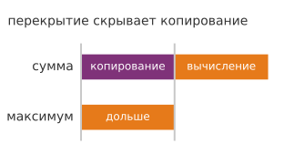

*Перекрытие копирования и вычисления стоит max(копирование, вычисление), а не их сумму.*

Флаг `non_blocking=True` запрашивает асинхронное копирование относительно хоста, когда бэкенд это поддерживает. Для копирований с хоста на устройство закрепленная память обычно требуется, чтобы перекрыть перенос с другой работой устройства. Выгружаемая память может промежуточно копироваться внутри, а поведение блокировки хоста при вызове зависит от реализации. Корректное перекрытие также требует совместимого оборудования, отдельных ресурсов исполнения и явного управления зависимостями.

Та же схема синхронизации возникает, когда стадии модели перекрываются между микробатчами. [«Пример конвейерного параллелизма на потоках»](07_frameworks.md#lst-pipeline-parallelism-streams) показывает, что каждая стадия работает на собственном потоке, а события обеспечивают только те зависимости «производитель — потребитель», которые нужны для корректности.

<a id="lst-overlap-compute-transfer"></a>

**Перекрытие вычислений и переноса**: отдельные потоки могут перекрывать подходящие копирования и вычисления, когда зависимости правильно синхронизированы. Закрепленная память хоста обычно позволяет переносам с хоста на устройство перекрываться с другой работой устройства.

```python
compute_stream = torch.cuda.Stream()
transfer_stream = torch.cuda.Stream()

# Переносим следующий батч, пока вычисляем текущий
# батч
with torch.cuda.stream(transfer_stream):
    next_batch = next_batch_cpu.to("cuda", non_blocking=True)

with torch.cuda.stream(compute_stream):
    output = model(current_batch)
    loss = criterion(output, labels)

# Закрепленная память хоста может включить перекрытие переноса
x_pinned = torch.randn(1000, 1000).pin_memory()
x_gpu = x_pinned.to("cuda", non_blocking=True)  # Асинхронно

# Выгружаемый источник может требовать промежуточного копирования,
# поэтому перекрытие на него нельзя считать гарантированным
y_regular = torch.randn(1000, 1000)
y_gpu = y_regular.to("cuda", non_blocking=True)
```

<a id="lst-pipeline-parallelism-streams"></a>

**Перекрытие стадий на потоках**: перекрывайте несколько стадий модели по микробатчам, используя потоки и события для синхронизации между стадиями.

```python
# Конвейерный параллелизм: размещаем стадии на разных GPU
devices = [torch.device(f"cuda:{i}") for i in range(3)]
stages = [
    Stage1().to(devices[0]),
    Stage2().to(devices[1]),
    Stage3().to(devices[2]),
]
streams = [torch.cuda.Stream(device=device) for device in devices]
events = [
    [torch.cuda.Event() for _ in range(num_microbatches)]
    for _ in stages
]
outputs = [[None] * num_microbatches for _ in stages]

for mb in range(num_microbatches):
    for stage_idx, (stage, stream, device) in enumerate(
        zip(stages, streams, devices)
    ):
        with torch.cuda.device(device), torch.cuda.stream(stream):
            if stage_idx > 0:
                # Ждем, пока предыдущая стадия
                # завершит этот микробатч
                events[stage_idx - 1][mb].wait()
                stage_input = outputs[stage_idx - 1][mb].to(
                    device, non_blocking=True
                )
            else:
                stage_input = inputs[mb].to(device, non_blocking=True)

            outputs[stage_idx][mb] = stage(stage_input)
            events[stage_idx][mb].record()
```

Этот принцип перекрытия естественно распространяется на перекрытие стадий модели внутри одного узла. Разные стадии модели на отдельных GPU могут одновременно обрабатывать разные микробатчи, и вычисление каждой стадии перекрывается с приемом данных следующей (см. [«пример конвейерного параллелизма на потоках»](07_frameworks.md#lst-pipeline-parallelism-streams)). Глава [«Обучение моделей»](08_training.md#sec-model-training) позже называет и разбирает стратегии распределенного обучения, построенные на этой схеме планирования. Здесь одноузловой реализации достаточно, чтобы показать принцип синхронизации, который сохраняется и в большем масштабе. Когда вычисления и коммуникация перекрыты, остается задача обеспечить корректность, когда операции завершаются в произвольном порядке.

##### Синхронизация и корректность

Параллельное исполнение создает ограничения порядка. Когда выход одного потока становится входом другого, система должна обеспечить отношение «happens-before» (предшествует), не сериализуя без нужды независимую работу. Существуют два механизма синхронизации с очень разными последствиями для производительности.

Полная синхронизация устройства (`torch.cuda.synchronize()`) блокирует все потоки и CPU до завершения каждой поставленной в очередь операции. Это создает глобальную точку сериализации, которая сводит на нет все выгоды перекрытия. Альтернатива — события CUDA: тонкая синхронизация, которая блокирует только зависимый поток, позволяя другим потокам и CPU продолжать исполнение (см. [«пример событий CUDA»](07_frameworks.md#lst-cuda-events)).

<a id="lst-cuda-events"></a>

**События CUDA для синхронизации**: события обеспечивают тонкие шаблоны «производитель — потребитель» между потоками без блокировки всего устройства.

```python
# Создаем потоки и событие
stream1 = torch.cuda.Stream()
stream2 = torch.cuda.Stream()
event = torch.cuda.Event()

# Поток 1: производитель
with torch.cuda.stream(stream1):
    result1 = expensive_computation(data1)
    event.record()  # Отмечаем точку завершения

# Поток 2: потребитель (ждет только событие потока 1)
with torch.cuda.stream(stream2):
    event.wait()  # Блокируем поток 2, пока событие не записано
    result2 = dependent_computation(result1)  # Безопасно использовать result1
```

Разница в производительности между этими подходами категориальна. Полная синхронизация после каждой операции превращает параллельный конвейер в последовательный и полностью сводит на нет аппаратный параллелизм, который открывают потоки. Синхронизация на основе событий сохраняет параллельную модель исполнения и обеспечивает только те зависимости, которые нужны для корректности.

Эта дисциплина синхронизации имеет одну эксплуатационную ловушку: отладочный код часто оставляет `torch.cuda.synchronize()` в горячем пути, превращая перекрытый конвейер в последовательный. Когда перекрытие остается слабым, профилирование должно отделить простои планирования от неэффективности ядер. NVIDIA Nsight Systems (`nsys profile`) показывает активность CPU, ядра GPU и переносы памяти на одной временной шкале. NVIDIA Nsight Compute (`ncu`) затем объясняет поведение ядер с помощью аппаратных счетчиков.

[«Метрики Nsight Compute»](07_frameworks.md#tbl-nsight-metrics) — диагностическая карта для второго шага. SM — потоковый мультипроцессор (streaming multiprocessor), блок GPU, который планирует группы потоков; варп (warp) — одна запланированная группа потоков.

| **Метрика**            | **Значение**               | **Цель оптимизации**               |
|:-----------------------|:---------------------------|:-----------------------------------|
| **Заполнение SM**      | Активные варпы / максимум варпов | Увеличьте параллелизм, если низко |
| **Пропускная способность памяти** | Достигнутая / пиковая пропускная способность | Оптимизируйте шаблоны доступа к памяти |
| **Пропускная способность вычислений** | Достигнутые / пиковые FLOP/s | Уменьшите узкие места памяти |
| **Активность тензорных ядер** | Время в операциях тензорных ядер | Проверьте загрузку смешанной точности |

<a id="tbl-nsight-metrics"></a>

***Метрики Nsight Compute**: ключевые метрики для диагностики ядер ML. Интерпретируйте каждое значение с учетом пригодности нагрузки и назначения ядра: Nsight Systems определяет, какие ядра доминируют во времени исполнения, а Nsight Compute показывает, почему эти ядра работают недостаточно эффективно.*

<a id="sec-ml-frameworks-domainspecific-data-organizations-48d9"></a>

#### Конвейеры данных и загрузка

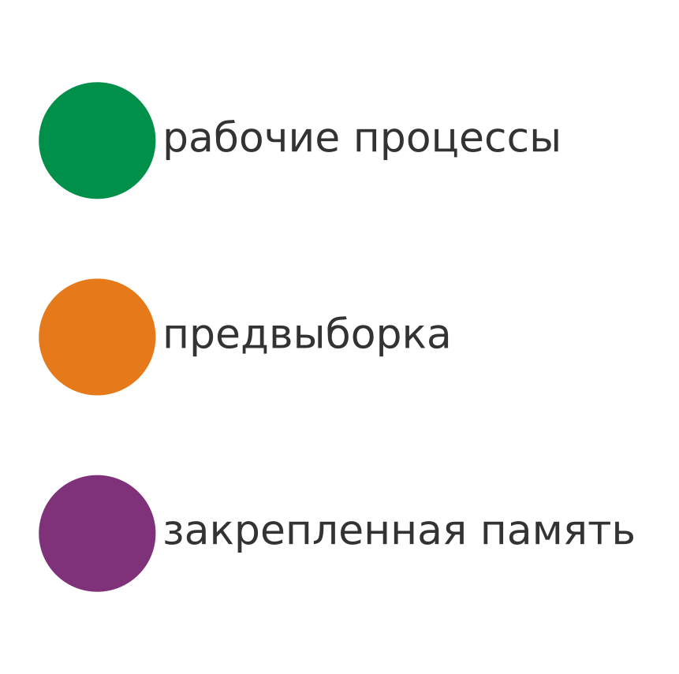

*Каждая ручка DataLoader снимает конкретное узкое место входа.*

Потоки и события решают задачи размещения и перемещения, перекрывая переносы с вычислениями, так что GPU редко простаивает из-за одного тензора. Однако одно лишь планирование не поможет, если данные вообще приходят слишком медленно. Следующее ограничение — доставка входа: данные должны поступать достаточно быстро, чтобы поддерживать пропускную способность. Основной системный принцип прост: конвейер данных должен поддерживать скорость потребления ускорителя. GPU, обрабатывающий 1 000 изображений в секунду при разрешении 224 на 224, требует около 150,5 МБ/с устойчивой пропускной способности сырых изображений uint8. Если конвейер не может поддерживать эту скорость, ускоритель простаивает, и член эффективной загрузки железного закона падает ниже 1.

Фреймворки решают эту задачу пропускной способности тремя механизмами. Первый — *параллельные рабочие процессы*: DataLoader порождает несколько процессов CPU, каждый из которых независимо загружает и предобрабатывает образцы. Когда доступ к хранилищу, декодирование, аугментация или нормализация делают один процесс загрузки слишком медленным, чтобы кормить ускоритель, несколько рабочих процессов могут перекрыть ожидание ввода-вывода с предобработкой. Когда конвейер входа удовлетворяет спрос, дополнительные рабочие процессы добавляют накладные расходы, а не пропускную способность. При `num_workers > 0` DataLoader распределяет индексы образцов между рабочими процессами через общую очередь, а рабочие процессы передают готовые образцы в очередь данных, из которой главный процесс собирает батчи.

Второй механизм — предвыборка. Когда многопроцессорность включена, `prefetch_factor` управляет тем, сколько батчей каждый рабочий процесс готовит заранее. Четыре рабочих процесса с `prefetch_factor=2` могут поддерживать до восьми предвыбранных батчей, повышая шанс, что работа с входом перекроется с вычислением ускорителя. Предвыборка не гарантирует, что ускоритель никогда не простаивает: хранилище, декодирование, аугментация и конкуренция все еще могут сделать производство медленнее потребления. Цена — дополнительная память хоста, пропорциональная объему данных в очереди.

Третий механизм — *закрепленная память для DMA-переносов*. Опция `pin_memory=True` размещает батчи в закрепленной (page-locked) памяти хоста. Это позволяет обойти промежуточное копирование через выгружаемую память и выполнять копирования с хоста на устройство параллельно с работой устройства. Для батча из 64 изображений FP32 размером $224{\times}224{\times}3$ (38,5 МБ) деление на заявленный пиковый показатель PCIe 4.0 x16 дает 1,2 мс. Это нижняя граница только по пропускной способности, а не измеренная задержка переноса через закрепленную память. Реальная выгода по сравнению с выгружаемой памятью зависит от платформы, размера батча, конвейера и перекрытия. Закрепленные страницы также уменьшают объем выгружаемой системной памяти.

Конфигурация DataLoader полезна, только когда каждый параметр привязан к узкому месту. В этой конфигурации `num_workers` включает параллельную загрузку, `prefetch_factor` управляет глубиной конвейера, а `pin_memory` включает DMA-переносы. Число рабочих процессов — это компромисс между пропускной способностью и памятью, а не универсальная константа. Практическая отправная точка — установить `num_workers` равным числу доступных ядер CPU, а затем корректировать в зависимости от того, ограничена ли загрузка вводом-выводом или CPU. Для нагрузок, ограниченных вводом-выводом, например чтения изображений из сетевого хранилища, больше рабочих процессов перекрывают задержку диска и повышают пропускную способность. Для нагрузок, ограниченных CPU, с тяжелой аугментацией выгода насыщается, когда заняты все ядра. Слишком много рабочих процессов тратит память, поскольку каждый хранит копию объекта Dataset.

Когда пропускная способность достаточно высока, управление рабочими процессами становится ограничением корректности. PyTorch назначает каждому рабочему процессу отдельный seed PyTorch. Функция `worker_init_fn` все равно полезна, когда код датасета или аугментации также использует NumPy или модуль `random` Python, как демонстрирует [«пример настройки пропускной способности DataLoader»](07_frameworks.md#lst-dataloader-throughput). Разделяемое состояние Python обычно локально для процесса, поэтому изменения в одном рабочем процессе не распространяются автоматически на другие или главный процесс. Явно разделяемое или отображаемое в память хранилище нужно, когда рабочим процессам требуется общее изменяемое состояние.

Выбор Dataset — еще одно решение о пропускной способности, поскольку он определяет, как можно планировать образцы. PyTorch поддерживает две парадигмы датасетов. Датасеты *в стиле отображения* (map-style) реализуют `__len__` и `__getitem__`, обеспечивая случайный доступ к образцам по индексу. Этот шаблон хорошо работает для датасетов, которые помещаются в память, или для дисков, поддерживающих эффективный случайный доступ. Датасеты *итерируемого стиля* (iterable-style) реализуют `__iter__` и выдают образцы последовательно, что подходит для потоковых источников данных, где случайный доступ непрактичен. Датасеты в стиле отображения поддерживают перемешивание через сэмплер, тогда как итерируемые датасеты должны реализовывать любое упорядочение или буферизованное перемешивание внутри итератора или источника данных.

<a id="lst-dataloader-throughput"></a>

**Конфигурация пропускной способности DataLoader**: каждый параметр решает конкретное узкое место пропускной способности. `num_workers` распараллеливает ввод-вывод и предобработку по ядрам CPU, `prefetch_factor` управляет глубиной конвейера, а `pin_memory` включает DMA-переносы в GPU.

```python
import random

import numpy as np
import torch
from torch.utils.data import DataLoader

def seed_worker(worker_id):
    worker_seed = torch.initial_seed() % 2**32
    np.random.seed(worker_seed)
    random.seed(worker_seed)

loader = DataLoader(
    dataset,
    batch_size=64,
    shuffle=True,
    num_workers=4,  # Параллельные рабочие процессы (механизм 1)
    prefetch_factor=2,  # Батчи, подготовленные заранее на каждый процесс (механизм 2)
    pin_memory=True,  # Закрепленная память для DMA (механизм 3)
    worker_init_fn=seed_worker,  # Воспроизводимая аугментация в каждом процессе
)

# Эффект конвейера: пока GPU обрабатывает батч N,
# 4 рабочих процесса загружают батчи N+1..N+8 в закрепленную память,
# готовые к DMA-переносу, когда GPU закончит.
```

Сборка батча (collation) — последний этап, на котором выбор представления определяет пропускную способность. Параметр `collate_fn` определяет, как отдельные образцы объединяются в батчи. По умолчанию тензоры складываются вдоль нового измерения батча, что работает, когда все образцы имеют одинаковую форму. Для данных переменной длины, таких как текстовые последовательности, пользовательская сборка выполняет дополнение (padding), сортировку по длине или создание масок внимания, что напрямую влияет и на использование памяти, и на пропускную способность обучения.

DataLoader, датасеты и функции сборки решают задачу доставки входа, поддерживая пропускную способность на уровне ускорителя за счет параллелизма, предвыборки и DMA. Однако эти структуры обрабатывают только эфемерные данные: образцы проходят через конвейер один раз за эпоху и отбрасываются. Следующая обязанность фреймворка — постоянное состояние, прежде всего собственные веса модели, когда они превышают память любого отдельного устройства.

#### Структуры параметров

Модель масштаба GPT-3 хранит 175 млрд параметров, занимающих 350 ГБ в FP16. Управление этими параметрами на устройствах, синхронизация градиентов и поддержание состояния оптимизатора (одно лишь состояние Adam может добавлять память, примерно в 4 раза превышающую веса FP16, как показал разбор «Административный налог») — основная обязанность фреймворка. Поскольку параметры сохраняются на протяжении всего обучения и вывода, фреймворки организуют их в компактные структуры, которые минимизируют память и одновременно обеспечивают быстрый доступ на чтение и запись. При обучении на нескольких GPU фреймворки могут реплицировать параметры между устройствами для параллельных вычислений, поддерживая синхронизированную мастер-копию. Серверы параметров — одна из коммуникационно эффективных схем, в которой рабочие процессы читают и записывают глобально общие параметры (Li et al., 2014). Синхронизация моделей с миллиардами параметров может требовать передачи десятков ГБ градиентов на шаг, поэтому фреймворки предоставляют коммуникационные бэкенды, которые эффективно синхронизируют тензоры. Глава [«Обучение моделей»](08_training.md#sec-model-training) позже называет конкретные коллективные операции и стратегии масштабирования.

Структуры параметров также должны адаптироваться к различным требованиям точности. Обучение обычно использует FP32 для устойчивости градиентов, но вывод и крупномасштабное обучение все чаще используют FP16 или INT8. Фреймворки реализуют приведение типов и управление смешанной точностью, чтобы включать эти оптимизации без потери численной точности.

#### Контексты распределенного исполнения

Вычислительный граф определяет, *что* вычислять, но *где* и *как* это вычисление выполняется на устройствах, решают контексты исполнения. На одном узле контексты исполнения управляют потоками и событиями CUDA (введенными в [«Управление устройствами и памятью»](07_frameworks.md#sec-ml-frameworks-device-memory-management-9404)), чтобы перекрывать вычисления и перенос данных между GPU.

Когда обучение масштабируется за пределы одной машины, эти же абстракции распространяются на именованные группы устройств. Фреймворки используют такие конструкции, как `ProcessGroup` (PyTorch) или `Mesh` (JAX), чтобы описывать, какие тензоры и операции принадлежат друг другу. Они полагаются на библиотеки коммуникации, такие как NCCL, чтобы выполнять коллективные примитивы: например, **ring-AllReduce** для агрегации градиентов и **AllGather** для сбора параметров. Среда исполнения управляет этими примитивами, чтобы максимизировать загрузку межсоединений. Внутриузловые линки NVLink обеспечивают до $900\text{ ГБ/с}$ двунаправленной пропускной способности на GPU, тогда как межузловые сети InfiniBand или Ethernet падают до $50\text{--}400\text{ Гбит/с}$ ($6{,}25\text{--}50\text{ ГБ/с}$). Поэтому эффективность коллективной коммуникации становится главным узким местом масштабирования распределенного обучения. Важная идея для фреймворка — граница абстракции: пользовательский код называет отношения размещения, а фреймворк сохраняет эти отношения, пока аппаратный путь меняется под ними.

Эти понятия появляются здесь, потому что они формируют проектирование API фреймворка еще до того, как книга попросит читателя рассуждать об алгоритмах распределенного обучения. Детали синхронизации градиентов, коммуникационных топологий и отказоустойчивости строятся на этих основах позже. Сейчас нужен только один момент: выразительность размещения. Когда модели превышают память одного устройства, фреймворки должны дать системе обучения больше одного способа разместить работу. Модель масштаба GPT-3, например, не помещается на одном GPU: одни ее 175 млрд параметров требуют 350 ГБ в FP16, что намного превышает память любого GPU. [«Измерения размещения на устройствах»](07_frameworks.md#fig-3d-parallelism) предваряет идею размещения в фреймворке, не требуя пока всей машинерии распределенного обучения: система может разделить работу между группами слоев, между реплицированными батчами или внутри очень больших тензоров. Раздел [«Масштабирование систем обучения»](08_training.md#sec-model-training-scaling-training-systems-adfd) главы «Обучение моделей» позже формализует эти измерения как стратегии обучения и разбирает их коммуникационные затраты.

<a id="fig-3d-parallelism"></a>

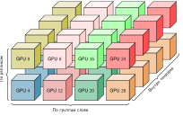

<em><strong>Измерения размещения на устройствах</strong>: сетка из восьми кластеров ускорителей в две строки и четыре столбца, каждый из которых содержит сложенные вычислительные блоки. Фигурные скобки предваряют три способа, которыми фреймворк может разместить работу, когда модель больше не помещается в одно устройство: между группами слоев, между реплицированными батчами и внутри очень больших тензоров.</em>

Структуры данных, рассмотренные до сих пор, — тензоры, менеджеры устройств, конвейеры данных, структуры параметров и контексты распределенного исполнения, — определяют, *какие* данные фреймворк управляет и *где* они находятся. Оставшаяся задача абстракции — исполнение: что на самом деле выполняется на аппаратуре.

<a id="sec-ml-frameworks-core-operations-914f"></a>

### Базовые операции

Когда инженер пишет `y = torch.matmul(x, w)`, расстояние между синтаксисом Python и исполнением на кремнии велико. Чтобы перекинуть мост от одного высокоуровневого вызова к тысячам параллельных потоков GPU, нужны три уровня операций, работающих согласованно. [«Стек базовых операций»](07_frameworks.md#fig-mlfm-core-ops) иллюстрирует этот стек. Операции абстракции аппаратуры управляют диспетчеризацией ядер под конкретную платформу и переносами памяти, базовые численные операции выполняют математические подпрограммы, а системные операции координируют планирование, времена жизни памяти и ресурсы ускорителей по всему вычислительному графу. Дальнейшее изложение разбирает это построение от аппаратно-специфичного пути ядра к оркестрации системы.

<a id="fig-mlfm-core-ops"></a>

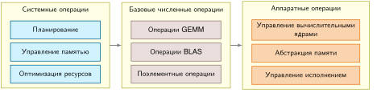

<em><strong>Стек базовых операций</strong>: три функциональных уровня связывают высокоуровневый код Python с физическим исполнением. Аппаратные операции управляют низкоуровневой диспетчеризацией ядер и переносами памяти, базовые численные операции выполняют плотные GEMM и поэлементные подпрограммы, а системные операции координируют планирование графа и времена жизни памяти на ускорителях.</em>

<a id="sec-ml-frameworks-hardware-abstraction-operations-1204"></a>

#### Операции абстракции аппаратуры

Слой абстракции аппаратуры изолирует код фреймворка от деталей конкретной платформы. Он решает три конкретные задачи: выбор подходящего вычислительного ядра, перемещение данных по иерархии памяти и координацию исполнения между блоками обработки.

##### Управление вычислительными ядрами

Менеджер ядер диспетчеризует каждую поддерживаемую операцию на реализацию для текущего бэкенда. Для умножения матриц это может быть бэкенд BLAS на CPU, например Intel oneMKL или OpenBLAS (Intel Corporation, 2026; OpenBLAS Project, 2026), cuBLAS на GPU NVIDIA (NVIDIA, 2024) или специфичные для ускорителя тензорные инструкции. Выбор зависит от размерностей, типа данных, раскладки, бэкенда и эвристик библиотеки. GEMM FP16 размером $4096{\times}4096$ на A100 может использовать путь тензорных ядер, опубликованный пиковый показатель которого здесь представлен величиной 312 TFLOP/s (Choquette et al., 2021; NVIDIA Corporation, 2020). Если бэкенд не имеет реализации для оператора, исполнение может откатиться, быть разбито на части или завершиться ошибкой, в зависимости от фреймворка и среды исполнения.

##### Абстракция системы памяти

Слой абстракции памяти перемещает тензоры между выгружаемой или закрепленной памятью хоста, памятью устройства и унифицированной памятью, а также преобразует раскладки данных под предпочтения аппаратуры. Например, сверточный слой может хранить активации в формате NCHW (батч, каналы, высота, ширина) на GPU NVIDIA, но преобразовывать их в NHWC для бэкенда Metal от Apple. Требования к выравниванию варьируются от 4 байт на CPU до 128 байт на некоторых ускорителях, а невыровненный доступ может вдвое снизить эффективную пропускную способность памяти. Среда исполнения также сохраняет порядок зависимостей, когда несколько блоков исполнения обращаются к одному тензору, предотвращая гонки во время параллельных операций.

##### Управление исполнением

Контроллер исполнения координирует работу между несколькими блоками обработки и пространствами памяти. На современном GPU графовые среды исполнения или явное использование потоков могут перекрывать независимые ядра, когда анализ зависимостей доказывает их готовность, а ядра оставляют достаточно неиспользованных ресурсов, чтобы работать одновременно. Eager-исполнение в потоке по умолчанию часто вместо этого сериализует эту работу. Контроллер вставляет барьеры синхронизации там, где зависимости по данным этого требуют, отслеживает завершение событий, чтобы запускать зависимые операции, и направляет аппаратные ошибки (сбои ECC, сторожевые таймеры таймаута) в путь обработки ошибок фреймворка.

<a id="sec-ml-frameworks-basic-numerical-operations-5516"></a>

#### Базовые численные операции

Когда абстракция аппаратуры управляет деталями конкретной платформы, фреймворки строят поверх нее слой математических операций. GEMM доминирует в вычислениях ML. Раздел [«Обобщенное матричное умножение (GEMM)»](appendix_algorithm.md#sec-appdx-algorithm-foundations-general-matrix-multiply-gemm-b55d) приложения «Основы алгоритмов» выводит, как арифметическая интенсивность GEMM масштабируется с размерностью матрицы, и предсказывает, ограничен ли данный слой вычислениями или памятью, еще до запуска профилировщика. Операция $\mathbf{C} = \alpha \mathbf{A}\mathbf{W} + \beta \mathbf{C}$ составляет подавляющую часть арифметики нейронных сетей: один прямой проход ResNet-50 выполняет около 8,2 GFLOP, почти все из которых сводятся к GEMM. Фреймворки оптимизируют GEMM с помощью учитывающей кеш **блочной обработки** (tiling; разбиения матриц на блоки, которые помещаются в кеш L1/L2), разворачивания циклов для параллелизма на уровне инструкций и ядер, специфичных для формы. Полносвязные слои используют стандартный плотный GEMM, а сверточные слои — преобразования im2col, которые переформируют патчи входа в столбцы матрицы и превращают свертку в GEMM.

Помимо GEMM, фреймворки реализуют операции BLAS (AXPY для сложения векторов, GEMV для произведения матрицы на вектор) и поэлементные операции (функции активации, нормализацию). Поэлементные операции *по отдельности дешевы*, но *в совокупности дороги* из-за пропускной способности памяти. Каждая операция читает и записывает весь тензор, поэтому последовательность из пяти поэлементных операций над тензором в 100 МБ переносит 1 ГБ данных. Слияние этих пяти операций в одно ядро сокращает трафик памяти до 200 МБ. Экономия пропускной способности в 5 раз напрямую переводится в более быстрое исполнение.

Численная точность добавляет еще одно измерение. Обучение в FP32 использует 4 байта на параметр; квантование в INT8 сокращает это до 1 байта, снижая память в 4 раза и давая прирост пропускной способности в 2–4 раза на аппаратуре с ускорением INT8. Обучение обычно сохраняет численно чувствительные накопления в более высокой точности, тогда как вывод часто может выполнять многие операции в FP16 или INT8 с небольшой потерей качества. Фреймворки поддерживают отдельные реализации ядер для каждого формата точности и обрабатывают сценарии, в которых разные слои работают с разной разрядностью в одном прямом проходе.

<a id="sec-ml-frameworks-systemlevel-operations-6a1c"></a>

#### Системные операции

Абстракция аппаратуры и численные операции дают строительные блоки, а системные операции их оркестрируют. Системный слой связывает планирование, управление памятью и оптимизацию ресурсов в связную среду исполнения.

Планировщик операций использует зависимости графа, чтобы найти допустимые порядки исполнения и возможную одновременность. Статический захват может раскрыть больше структуры зависимостей до исполнения, тогда как eager-среды обнаруживают работу постепенно. Ни одна из этих возможностей не гарантирует оптимального расписания или одновременного исполнения: перекрытие зависит от потоков, решений компилятора и среды исполнения, доступности ресурсов и самих операций.

Менеджер памяти выделяет и возвращает память GPU на протяжении жизни вычислительного графа. Параметры модели (модель с 7 млрд параметров занимает около 14 ГБ в FP16) сохраняются на весь прогон обучения, тогда как тензоры активаций живут только до тех пор, пока обратный проход их не использует. Кеширующий аллокатор PyTorch поддерживает пул памяти: он делит и переиспользует освобожденные блоки, не возвращая их CUDA. Это избавляет от повторных вызовов `cudaMalloc`, которые могут стоить десятков микросекунд и бывают еще хуже, когда синхронизируют устройство. Для моделей, превышающих память GPU, менеджер может применить контрольные точки, отбрасывая выбранные активации во время прямого прохода и пересчитывая их во время обратного. Вопрос политики (какие активации сохранять и сколько пересчета допустимо) относится к конвейеру обучения. Абстракция фреймворка делает эту политику исполнимой.

<a id="chk-frameworks-hardware-abstraction"></a>

> **Абстракция аппаратуры**
>
> Проблема абстракции — мост между *переносимым кодом* и *эффективным исполнением*.
>
> - **Два измерения**: можете ли вы различать представление данных (раскладка, тип данных, размещение) и отображение исполнения (выбор ядра, планирование) и объяснить, как они ограничивают друг друга?
> - **Диспетчеризация ядер**: можете ли вы объяснить, почему одной и той же высокоуровневой операции (например, GEMM) нужны несколько реализаций (векторный путь CPU и путь тензорных ядер GPU) и как формы и типы данных влияют на выбор?
> - **Абстракция памяти**: можете ли вы объяснить, почему фреймворки используют кеширующие аллокаторы и преобразования раскладки (NCHW↔NHWC), а не вызывают аллокаторы устройства для каждого тензора?
> - **Управление исполнением**: можете ли вы описать, что делает среда исполнения, когда перекрывает независимую работу (потоки) и вставляет синхронизацию только там, где этого требуют зависимости?

Оптимизатор ресурсов интегрирует решения о планировании и памяти с выбором ядер бэкенда. Библиотеки умножения матриц выбирают между реализациями GEMM с блочной обработкой в зависимости от форм, типа данных, раскладки, рабочей памяти и аппаратуры. Winograd, напротив, — преобразование, специфичное для свертки, а алгоритм Штрассена не является обычной альтернативой, которую выбирает основная диспетчеризация GEMM в ML. Плохое расписание может оставлять ресурсы простаивающими, а фрагментация пула памяти или избыточное живое состояние могут вызвать ошибку нехватки памяти, даже когда общая емкость устройства кажется достаточной.

Тензоры, потоки и диспетчеризация ядер работают на уровне отдельных буферов и операций. Хотя эти примитивы обеспечивают высокую эффективность исполнения на аппаратуре, масштабирование разработки моделей требует организационной абстракции: компоновки тысяч низкоуровневых операций в переиспользуемые вложенные строительные блоки, называемые *модулями*.

<a id="sec-ml-frameworks-nnmodule-abstraction-2622"></a>

## Абстракция nn.Module

Механизмы, обращенные к аппаратуре (тензоры, ядра, потоки и менеджеры памяти), гарантируют, что отдельные операции исполняются на кремнии эффективно. Однако сеть вроде ResNet-50, содержащая 25,6 млн параметров в пятидесяти слоях, требует обширной координации: регистрации весов в оптимизаторах, отслеживания размещения на устройствах, переключения режимов обучения и оценки, сериализации контрольных точек. Делать это вручную утопило бы разработку модели в подверженной ошибкам работе с тензорами. Организационный слой фреймворка решает эту задачу через иерархическую композицию.

Каждый крупный фреймворк реализует это через абстракцию модуля, которая связывает тензоры параметров, прямое вычисление и хуки жизненного цикла в единый интерфейс. `nn.Module` в PyTorch[^fn-nn-module-composition] — поучительный пример, потому что его шаблоны проектирования повторяются в других фреймворках: Keras использует похожие абстракции слоев (Chollet, 2018), Flax в JAX применяет аналогичные структуры модулей, а функциональный API TensorFlow имеет концептуальные параллели. Три устойчивых принципа проектирования повторяются независимо от синтаксиса и парадигмы программирования.

[^fn-nn-module-composition]: **nn.Module**: утверждение «шаблоны повторяются» верно, потому что `nn.Module` решает универсальную организационную задачу. Он автоматически регистрирует любой назначенный подмодуль или параметр в иерархическом дереве, позволяя одному вызову `.to('cuda')` рекурсивно разместить миллионы параметров на GPU. Слои Keras, модули JAX Flax и `tf.Module` в TensorFlow реализуют тот же шаблон обхода дерева. Без него управление состоянием модели требовало бы ручной бухгалтерии, которая растет линейно с глубиной архитектуры. Для моделей с сотнями слоев эта стоимость становится непомерной.

<a id="sec-ml-frameworks-nn-module-parameter-discovery-4a91"></a>

### Автоматическое обнаружение параметров

Современная нейронная сеть может содержать миллионы обучаемых параметров, распределенных по десяткам слоев. Без автоматизации программисту пришлось бы перечислять каждый тензор параметра и передавать его оптимизатору вручную. Это процесс, подверженный ошибкам и плохо масштабирующийся со сложностью модели. Фреймворки решают эту задачу через **автоматическое обнаружение параметров**: система обходит дерево модулей, собирая каждый тензор параметра, чтобы оптимизатор мог обновить их одним вызовом.

В основе это задача обхода дерева. `Module.__setattr__` в PyTorch регистрирует назначенный `nn.Parameter` или дочерний `nn.Module` во внутренних отображениях модуля. Вызов `.parameters()` рекурсивно обходит зарегистрированные подмодули и выдает зарегистрированные параметры. Другие фреймворки предоставляют аналогичные деревья или коллекции параметров, хотя их механизмы различаются.

Системное следствие значительно. Автоматическое обнаружение параметров дает оптимизатору полный набор параметров или группы параметров, что позволяет использовать сгруппированные, `foreach`- или слитые пути обновления, когда фреймворк и бэкенд их поддерживают. Немедленный выигрыш — корректность и компонуемость: вновь подключенные подмодули участвуют в переносах на устройства, сериализации и построении оптимизатора без отдельного ручного реестра. Это также позволяет оптимизированным путям обновления работать над коллекциями параметров без пользовательского кода для каждого параметра. [«Пример регистрации параметров»](07_frameworks.md#lst-parameter_registration) демонстрирует основной механизм: присваивание атрибута запускает регистрацию, а `.parameters()` возвращает все обнаруженные тензоры.

Различие между *параметрами* и *буферами* иллюстрирует тонкость обнаружения. Зарегистрированные параметры появляются в `.parameters()` независимо от того, обучаемы они или заморожены; `requires_grad` отдельно управляет тем, накапливает ли autograd для них градиент. Зарегистрированные буферы перемещаются вместе с модулем и могут появляться в его словаре состояния, но исключаются из `.parameters()` и обычного обнаружения оптимизатором. Скользящие статистики batch normalization — распространенный пример использования буфера.

<a id="lst-parameter_registration"></a>

**Регистрация параметров**: автоматическое отслеживание параметров через присваивание атрибутов дает оптимизатору доступ ко всем обучаемым весам без ручного перечисления.

```python
import torch
import torch.nn as nn

class CustomLayer(nn.Module):
    def __init__(self, input_size, output_size):
        super().__init__()
        self.weight = nn.Parameter(
            torch.randn(output_size, input_size)
        )
        self.bias = nn.Parameter(torch.randn(output_size))
        self.register_buffer("running_mean", torch.zeros(output_size))

    def forward(self, x):
        return torch.matmul(x, self.weight.t()) + self.bias

layer = CustomLayer(10, 20)
# Фреймворк сам обнаруживает оба параметра:
for name, param in layer.named_parameters():
    print(f"{name}: форма {param.shape}")
```

[«API обнаружения параметров в разных фреймворках»](07_frameworks.md#tbl-frameworks-parameter-discovery-apis) показывает, как один и тот же принцип проявляется в разных фреймворках. Несмотря на синтаксические различия, все фреймворки решают одну задачу: позволить оптимизаторам находить и обновлять обучаемые параметры, сохраняя необучаемое состояние между прямыми проходами.

| **Фреймворк**                                       | **Доступ к параметрам**                                      | **Необучаемое состояние**                                  |
|:----------------------------------------------------|:-------------------------------------------------------------|:-----------------------------------------------------------|
| PyTorch                                             | `model.parameters()`                                         | `register_buffer()`                                        |
| **Keras**                                           | `layer.trainable_weights`                                    | `layer.non_trainable_weights`                              |
| **JAX/Flax** | `variables["params"]` после `variables = model.init(key, x)` | Отдельные коллекции переменных (например, `batch_stats`)   |
| TensorFlow                                          | `module.trainable_variables`                                 | `module.non_trainable_variables`                           |

<a id="tbl-frameworks-parameter-discovery-apis"></a>

***API обнаружения параметров в разных фреймворках**: каждый фреймворк открывает свой интерфейс для отличения обучаемых параметров от необучаемых буферов, но все четыре решают одну базовую задачу: позволить оптимизаторам находить веса для обновления, сохраняя состояние (скользящие статистики, замороженные тензоры) между прямыми проходами. Во всех четырех строках устойчивый шаблон состоит из аксессора обучаемых параметров для оптимизатора и отдельного канала необучаемого состояния для значений, которые должны сохраняться, но не должны получать градиенты.*

### Поведение, зависящее от режима

Обучение и вывод требуют разного вычислительного поведения от одного и того же графа модели. Во время обучения слои dropout случайно обнуляют элементы с вероятностью $p_{\text{drop}} = \Pr(\text{сброс})$ для регуляризации сети, тогда как при выводе эти же слои должны выполнять тождественное отображение, чтобы получать детерминированные выходы. Batch normalization использует статистики текущего батча во время обучения, но переключается на накопленные скользящие статистики при выводе. Если эти изменения поведения оставить программисту, пропущенное переключение режима приводит к незаметно неверным предсказаниям в продакшене.

Фреймворки решают это с помощью *флага состояния*, который распространяется по иерархии модулей. Один вызов `.eval()` у корневого модуля рекурсивно устанавливает `self.training = False` у каждого потомка, и каждый слой читает этот флаг, чтобы выбрать свое поведение. Это пример более широкого системного принципа: один и тот же вычислительный граф должен давать разное поведение исполнения в зависимости от контекста. Компиляторы сталкиваются с той же задачей, когда один и тот же исходный код должен давать отладочные сборки (с проверкой границ и таблицами символов) или выпускные сборки (с агрессивной оптимизацией). Шаблон распространения флага обеспечивает корректность, централизуя решение о режиме в корне, а не требуя координации в каждом слое.

Этот принцип распространяется и на заморозку параметров при переносе обучения. Установка `requires_grad=False` не позволяет autograd накапливать градиенты в этих параметрах и убирает хранилище их градиентов. Однако это не обязательно убирает обратное вычисление слоя, потому что градиенты все еще могут проходить через его операции, чтобы достичь обучаемых входов или более ранних параметров. Экономия поэтому зависит от того, где находится замороженная область и какие тензоры требуют градиентов.

<a id="sec-ml-frameworks-nn-module-hierarchical-composition-6c13"></a>

### Иерархическая композиция и сериализация

Сложные модели собираются из переиспользуемых подмодулей, образуя древовидную структуру. ResNet реализуется не как монолитный блок операций, а как иерархия: корневой модуль содержит последовательность остаточных блоков, каждый блок содержит сверточные слои и слои нормализации, а каждый слой содержит тензоры параметров. Эта иерархическая композиция должна поддерживать две критические операции, показанные на [«примере вложенной композиции модулей»](07_frameworks.md#lst-nested_modules): рекурсивный сбор параметров для обучения и **сериализацию состояния** для контрольных точек и развертывания.

<a id="lst-nested_modules"></a>

**Вложенная композиция модулей**: иерархическая композиция модулей обеспечивает рекурсивный сбор параметров и плоское отображение состояния по всему дереву модулей.

```python
import torch
import torch.nn as nn

class ResidualBlock(nn.Module):
    def __init__(self, channels):
        super().__init__()
        self.conv1 = nn.Conv2d(channels, channels, 3, padding=1)
        self.bn1 = nn.BatchNorm2d(channels)
        self.conv2 = nn.Conv2d(channels, channels, 3, padding=1)
        self.bn2 = nn.BatchNorm2d(channels)

    def forward(self, x):
        residual = x
        x = torch.relu(self.bn1(self.conv1(x)))
        x = self.bn2(self.conv2(x))
        return torch.relu(x + residual)

class ResNet(nn.Module):
    def __init__(self, num_blocks, channels=64):
        super().__init__()
        self.conv_in = nn.Conv2d(3, channels, 7, padding=3)
        self.blocks = nn.ModuleList(
            [ResidualBlock(channels) for _ in range(num_blocks)]
        )
        self.fc = nn.Linear(channels, 10)

    def forward(self, x):
        x = self.conv_in(x)
        for block in self.blocks:
            x = block(x)
        x = x.mean(dim=[2, 3])  # Глобальное усреднение по пространству
        return self.fc(x)

model = ResNet(num_blocks=4)
total = sum(p.numel() for p in model.parameters())
print(f"Всего параметров: {total}")
# state_dict() разворачивает дерево в плоские ключи: 'blocks.0.conv1.weight' и т. д.
print(list(model.state_dict().keys())[:4])
```

Иерархическая композиция повторяет иерархию памяти аппаратуры в важном для системы смысле: параметры каждого подмодуля можно загружать независимо, что позволяет размещать их на разных устройствах. Когда модель слишком велика для одного GPU, фреймворк может назначить разные поддеревья иерархии модулей разным устройствам, а структура дерева задает естественные границы разбиения.

Метод `state_dict()` возвращает упорядоченное отображение, точечные ключи которого (например, `blocks.0.conv1.weight`) кодируют положение в иерархии модулей. Контрольная точка для 7 млрд параметров FP16 содержит около 14 ГБ полезной нагрузки весов до метаданных и дополнительного состояния, но формат файла и путь хранения определяют, как именно эти байты сериализуются. `load_state_dict()` копирует совпадающие значения параметров и буферов в уже построенный модуль и сообщает о пропущенных или лишних ключах в зависимости от настройки строгости. Он не восстанавливает иерархию модулей. Обмен между фреймворками требует совместимого представления графа и операторов в дополнение к весам.

Иерархическая структура также позволяет обходить модули систематически. Методы вроде `.named_modules()` перебирают все дерево, поддерживая массовые преобразования, такие как замена всех слоев BatchNorm на GroupNorm или применение инициализации Xavier ко всем слоям Linear. Эти операции обхода опираются на ту же структуру дерева, что и обнаружение параметров, и показывают, как одно проектное решение распространяет выгоды на несколько сценариев использования.

Эти три принципа (автоматическое обнаружение параметров, поведение, зависящее от режима, и иерархическая композиция с сериализацией) не специфичны для PyTorch. Каждый фреймворк должен их решать. Слои Keras, модули Flax в JAX и даже функциональные подходы решают те же задачи управления параметрами, отслеживания состояния и композиционного проектирования. Различия состоят не в том, *какие* задачи они решают, а в том, *как* они расставляют приоритеты между конкурирующими решениями. Два практических шаблона показывают, как эти принципы становятся системными средствами управления: избирательная заморозка параметров уменьшает ненужную работу с градиентами при переносе обучения ([«пример заморозки параметров»](07_frameworks.md#lst-parameter_freezing)), а хуки модулей обеспечивают неинвазивную инспекцию ([«пример хуков модуля»](07_frameworks.md#lst-module_hooks)).

<a id="lst-parameter_freezing"></a>

**Заморозка параметров**: демонстрирует избирательную заморозку параметров при переносе обучения, когда предобученные слои остаются фиксированными, а новые слои обучаются.

```python
from torchvision.models import ResNet18_Weights, resnet18

# Замораживаем все параметры предобученной
# модели
pretrained_model = resnet18(weights=ResNet18_Weights.DEFAULT)

for param in pretrained_model.parameters():
    param.requires_grad = False

# Заменяем последний слой обучаемыми параметрами
pretrained_model.fc = nn.Linear(512, 10)  # Новый слой обучаем

# Только fc.parameters() получат градиенты
# во время обучения
optimizer = torch.optim.Adam(
    filter(lambda p: p.requires_grad, pretrained_model.parameters()),
    lr=0.001,
)
```

Хуки модулей — инспекционный аналог заморозки параметров: они перехватывают промежуточные вычисления без изменения кода модели и позволяют диагностировать поток градиентов и отслеживать активации. [«Пример хуков модуля»](07_frameworks.md#lst-module_hooks) показывает оба типа хуков.

Вместе эти шаблоны (обнаружение параметров, заморозка и хуки) показывают, как три принципа превращаются в практические API. Эти шаблоны `nn.Module` иллюстрируют подход PyTorch к проблеме абстракции. Однако PyTorch — лишь один из нескольких крупных фреймворков, и его решения (изменяемое состояние, наследование классов, eager-исполнение по умолчанию) не единственно возможные точки проектирования. TensorFlow иначе централизует состояние, а JAX вовсе избегает изменяемого состояния. Это не поверхностные различия API: они отражают принципиально разные ответы на три задачи, с которых начинается глава.

<a id="lst-module_hooks"></a>

**Хуки модуля**: показывает forward- и backward-хуки для инспекции активаций и градиентов во время обучения.

```python
import torch
import torch.nn as nn

model = nn.Sequential(nn.Linear(10, 20), nn.ReLU(), nn.Linear(20, 5))

# Forward-хук для инспекции активаций
def forward_hook(module, input, output):
    print(
        f"Слой: {module.__class__.__name__}, "
        f"форма выхода: {output.shape}, "
        f"mean={output.mean():.3f}, "
        f"std={output.std():.3f}"
    )

# Backward-хук для инспекции градиентов
def backward_hook(module, grad_input, grad_output):
    print(f"Норма градиента: {grad_output[0].norm():.3f}")

# Регистрируем хуки на конкретном слое
handle_fwd = model[0].register_forward_hook(forward_hook)
handle_bwd = model[0].register_full_backward_hook(backward_hook)

# Выполняем прямой и обратный проход
x = torch.randn(32, 10)
y = model(x)
loss = y.sum()
loss.backward()

# Удаляем хуки по завершении
handle_fwd.remove()
handle_bwd.remove()
```

<a id="sec-ml-frameworks-major-framework-platform-analysis-fe96"></a>

## Анализ фреймворков-платформ

Команда, которая быстро прототипирует, но не может развернуть полученную модель, или которая надежно развертывает, но не может отлаживать сбои обучения, столкнулась с компромиссом проектирования фреймворка, а не с отсутствующим вызовом API. Каждый крупный фреймворк решает все три основные задачи, но делает акцент на разном пути через них. TensorFlow связывает eager-разработку с захватом графа и широкой экосистемой развертывания. PyTorch начинает с eager-исполнения и добавляет пути захвата, компиляции и экспорта. JAX организует дифференцирование, векторизацию и компиляцию как компонуемые преобразования функций. Это архитектурные акценты, а не исключительные возможности, и их ценность зависит от нагрузки и целевой платформы развертывания.

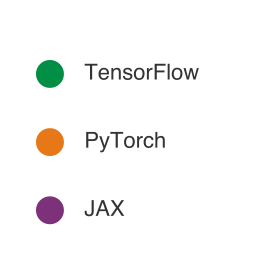

*Каждый фреймворк оптимизирован под свое системное узкое место.*

<a id="sec-ml-frameworks-tensorflow-ecosystem-063c"></a>

### TensorFlow: eager-разработка с развертыванием по графу

Архитектура TensorFlow охватывает eager-разработку и оптимизацию на основе графов на аппаратуре от облачных TPU до микроконтроллеров. TensorFlow 2 исполняется в eager-режиме по умолчанию. Чувствительные к производительности функции можно захватить через `tf.function`, а форматы развертывания направляют захваченные вычисления на серверные, мобильные и браузерные среды исполнения. Этот двойной путь сохраняет возможности производственного графа, унаследованные от TensorFlow 1.x, не требуя, чтобы каждая программа TensorFlow 2 строила полный граф перед запуском.

Внутри захваченной `tf.function` TensorFlow может применять оптимизации графа, такие как свертка констант, слияние операторов и планирование раскладки. [«Конвейер от обучения до развертывания в TensorFlow»](07_frameworks.md#fig-tensorflow-architecture) показывает более широкий конвейер от обучения до развертывания: от предобработки данных и распределенного обучения до экспорта SavedModel, TensorFlow Serving, TensorFlow Lite, TensorFlow.js и языковых привязок.

<a id="fig-tensorflow-architecture"></a>

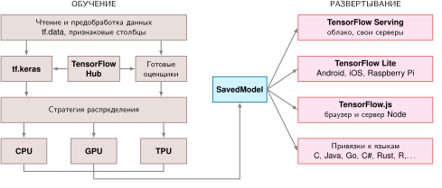

<em><strong>Конвейер от обучения до развертывания в TensorFlow</strong>: формат SavedModel служит центральной границей развязки между обучением и развертыванием. Он захватывает структуру графа, веса и сигнатуры из разнородных установок обучения (слева) и экспортирует их напрямую в среды исполнения для целевых платформ (справа), включая TF Serving, TF Lite и TF.js, без необходимости Python в продакшене.</em>

Хотя TensorFlow 2.0 ввел eager-исполнение, чтобы соединить исследования и продакшен, TensorFlow 2.x все еще предоставляет `tf.function` как путь преобразования в граф для чувствительного к производительности кода (TensorFlow Developers, 2024). Его ключевая сила остается в надежном, скомпилированном пути от исследований до развертывания в глобальном масштабе. Глава [«Обучение моделей»](08_training.md#sec-model-training) и глава [«Обслуживание моделей»](13_model_serving.md#sec-model-serving) позже разбирают инфраструктуру масштабирования и продакшена, которая использует эти пути экспорта.

<a id="sec-ml-frameworks-pytorch-85cd"></a>

### PyTorch: стандарт eager-исследований

Там, где графовый подход TensorFlow ставит на первое место *оптимизацию продакшена*, PyTorch делает противоположный выбор: он ставит на первое место *опыт разработчика*. Архитектура PyTorch представляет принципиально иной ответ на проблему исполнения, построенный на динамических графах («определение через исполнение», Define-by-Run). Вместо того чтобы строить план до исполнения, PyTorch строит вычислительный граф на лету, по мере выполнения кода. Facebook AI Research (FAIR) принял этот дизайн, потому что исследователям нужна немедленная обратная связь при экспериментах с новыми архитектурами. Цикл «сначала определить, потом выполнить» у статических графов вводил задержку на компиляцию, которая замедляла быстрое прототипирование, необходимое для исследовательских рабочих процессов.

Подход PyTorch подходит для исследовательского поиска по той же причине: он рассматривает глубокое обучение как обычное программирование на Python. Разработчики могут использовать циклы, условия и отладчики Python (например, `pdb`) прямо внутри прямого прохода модели, без особого синтаксиса, без отдельного шага компиляции и без ожидания, чтобы понять, работает ли код. Eager-исполнение обеспечивает быструю итерацию и интуитивное проектирование моделей, что важно, когда архитектуры и цели обучения еще меняются.

Ответ PyTorch на проблему дифференцирования — autograd на основе ленты ([«Внутреннее устройство autograd в PyTorch»](07_frameworks.md#sec-ml-frameworks-pytorch-autograd-internals-4fa0)): гибкий и удобный для отладки, но труднее оптимизируемый глобально, потому что лента перестраивается на каждой итерации. Его ответ на проблему абстракции скорее прагматичный, чем всеобъемлющий: сильная поддержка GPU через cuBLAS и cuDNN, с путями развертывания, включающими `torch.export`, ориентированный на периферию ExecuTorch, открытый формат обмена нейронными сетями (ONNX) и специализированные среды исполнения.

Поэтому компромисс состоит в более фрагментированном пути развертывания. Поскольку граф динамический, фреймворк не может легко выполнять глобальные оптимизации до исполнения. Модель, которая отлично работает в разработке, может упереться в стены производительности в продакшене, когда накладные расходы диспетчеризации доминируют над мелкими операциями. Чтобы преодолеть этот разрыв между исследованием и продакшеном, PyTorch ввел пути захвата графа и компиляции, от исторического TorchScript до `torch.compile` и рабочих процессов экспорта. Они позволяют разработчикам захватить динамическую модель и превратить ее в оптимизированное представление для развертывания. Эта эволюция показывает, как eager-фреймворк может двигаться к продакшен-концу непрерывности компиляции, сохраняя интерактивный опыт, ради которого был создан.

<a id="sec-ml-frameworks-jax-functional-transformation-engine-242e"></a>

### JAX: движок функциональных преобразований

Eager-исполнение PyTorch и графовая компиляция TensorFlow представляют две точки на спектре, но оба имеют императивное программистское наследие, где вычисление идет как последовательность операций с состоянием. JAX представляет принципиально иной пользовательский подход, построенный на принципах функционального программирования и компонуемых преобразованиях программ, а не на объектных лентах или графовых API, которые пишет пользователь (Bradbury et al., 2018). Разработанный в Google Research, JAX особенно полезен для задач, требующих пользовательского дифференцирования, передовых исследований оптимизации и крупномасштабного распределенного обучения.

Архитектура JAX рассматривает дифференцирование, векторизацию и компиляцию как преобразования функций. Функция `jax.grad` возвращает функцию, которая вычисляет градиенты, и ее затем можно снова преобразовать, когда интерфейсы совместимы. Например, `vmap(grad(f))` может вычислить поэкземплярные градиенты, а `jit(vmap(grad(f)))` может скомпилировать это батчевое вычисление. Порядок преобразований имеет семантический смысл, а не выбирается произвольно.

Функциональная парадигма JAX меняет модель программирования с «отслеживания состояния через объекты» на «преобразование чистых функций». Тогда как PyTorch и TensorFlow открывают autograd в основном через динамические ленты или пути компиляции графов, JAX просит пользователей написать чистые функции Python и затем применяет к ним преобразования. Автоматическое дифференцирование, векторизация и JIT-компиляция — все это *преобразования программ*, которые могут компоноваться. [«Пример трансформаций JAX»](07_frameworks.md#lst-jax-transformations) демонстрирует этот подход.

<a id="lst-jax-transformations"></a>

**Трансформации функций JAX**: JAX рассматривает дифференцирование, векторизацию и компиляцию как компонуемые преобразования функций, а не как операции графа, которые пишет пользователь.

```python
import jax
import jax.numpy as jnp

def loss_fn(params, x, y):
    pred = jnp.dot(x, params["w"]) + params["b"]
    return jnp.mean((pred - y) ** 2)

# Преобразование: вычисляем градиенты
grad_fn = jax.grad(loss_fn)

# Преобразование: векторизуем по измерению батча
batched_grad = jax.vmap(grad_fn, in_axes=(None, 0, 0))

# Преобразование: компилируем в XLA
fast_batched_grad = jax.jit(batched_grad)

# Комбинируем все три: быстрое батчевое вычисление градиентов
```

Такой функциональный подход требует **чистых функций** (без побочных эффектов) и **неизменяемых данных** (массивы нельзя менять на месте). Эти ограничения могут казаться жесткими тем, кто пришел из изменяемой объектной модели PyTorch, но они дают формальные гарантии: компилятор может безопасно переупорядочивать, сливать и распараллеливать операции, потому что выходы функции зависят только от входов. Ограничение и есть свойство: именно чистота делает возможной композицию преобразований.

Мощь JAX возникает из композиции. `jax.grad` возвращает функцию градиента; `jax.vmap` может векторизовать совместимую функцию по отображаемым осям; а `jax.jit` может трассировать и компилировать устойчивую преобразованную функцию для конкретной сигнатуры аргументов. В отличие от итеративного цикла Python, который последовательно выдает отдельные операции с повторной диспетчеризацией, `jax.vmap` переносит измерение батча прямо в базовые примитивы. Так поэкземплярные матрично-векторные операции превращаются в батчевые умножения матриц (GEMM), исполняемые в одном параллельном запуске ядра. `jax.pmap` отображает функцию на устройства, но синхронизацию или агрегацию градиентов нужно выражать через коллективные операции, такие как `lax.psum` или `lax.pmean`. Эти преобразования компонуются согласно своим типам и семантике, и разный порядок может вычислять разные величины.

Тот же минималистичный ядровой слой делегирует абстракции нейронных сетей сопутствующим библиотекам (Flax, Haiku, Equinox), а оптимизацию — Optax. Такое разделение отражает функциональную философию: ядро предоставляет преобразования, а библиотеки строят над ними привычные абстракции. Компромисс в том, что готовность к продакшену зависит не только от модели преобразований, но и от зрелости окружающих библиотек, путей экспорта и инструментов эксплуатации для целевой среды.

Функциональные ограничения, которые накладывает JAX, становятся преимуществами в отдельных областях. Пользовательское дифференцирование (градиенты высших порядков, пользовательские правила векторно-якобиановых произведений (VJP) и произведений Якобиана на вектор (JVP)) компонуется чисто, потому что чистые функции делают правила дифференцирования предсказуемыми. Исследования алгоритмов оптимизации выигрывают от преобразований, которые позволяют исследователям манипулировать вычислением градиента так же естественно, как данными. Вычислительно тяжелые нагрузки на ускорителях используют XLA, чтобы извлечь больше загрузки, когда программу можно выразить в этом функциональном стиле. Научные вычисления с требованиями AD выигрывают от функциональной чистоты, которая позволяет математически рассуждать о коде. JAX требует больших первоначальных вложений, чем PyTorch: у функциональной парадигмы есть кривая обучения, управление состоянием требует явных шаблонов, а отладка скомпилированного кода труднее, чем eager-исполнение. Командам стоит выбирать JAX, когда его сильные стороны совпадают с требованиями проекта, а не по умолчанию.

<a id="sec-ml-frameworks-quantitative-platform-performance-analysis-816d"></a>

### Компромиссы фреймворков при измерении

В предыдущих разделах философия проектирования каждого фреймворка описывалась качественно: граф в первую очередь или eager в первую очередь, с состоянием или функционально. Полезное сравнение — не то, какой фреймворк самый быстрый в абстракции, потому что ответ меняется в зависимости от формы модели, размера батча, бэкенда аппаратуры и конфигурации компилятора. Полезно то, что каждый дизайн позволяет системе увидеть и оптимизировать. [«Компромиссы проектирования фреймворков»](07_frameworks.md#tbl-mlfm-comparison) поэтому сопоставляет TensorFlow, PyTorch и JAX с тремя задачами фреймворка: видимостью исполнения, моделью дифференцирования и путем абстракции аппаратуры.

| **Аспект**                    | TensorFlow                               | PyTorch                                      | JAX                                  |
|:------------------------------|:-----------------------------------------|:---------------------------------------------|:-------------------------------------|
| **Тип графа**                 | Статический корень, динамический фронтенд в 2.x | Динамический                           | Функциональные преобразования        |
| **Модель программирования**   | Императивный фронтенд, путь захвата графа | Императивная                                | Функциональная                       |
| **Основная структура данных** | Тензор с управляемым фреймворком состоянием | Тензор с управляемым фреймворком состоянием | Неизменяемый массив                  |
| **Режим исполнения**          | По умолчанию eager, граф для оптимизации | По умолчанию eager                           | Трассировка и JIT-компиляция         |
| **Автоматическое дифференцирование** | Обратный режим над захваченными вычислениями | Обратный режим над eager-лентой          | Преобразования прямого и обратного режимов |
| **Абстракция аппаратуры**     | Широкие среды развертывания и пути XLA   | Нативный путь GPU плюс среды экспорта и компиляции | Компиляция ускорителей, центрированная на XLA |
| **Риск оптимизации**          | Захват графа и покрытие операторов       | Разрывы графа после eager-разработки         | Чистота, стабильность форм и трассировка |

<a id="tbl-mlfm-comparison"></a>

***Компромиссы проектирования фреймворков**: каждый столбец отражает отдельный ответ на три основные задачи. TensorFlow делает центральными развертывание и захват графа, PyTorch — eager-исполнение и отладку, а JAX — функциональные преобразования и видимость для компилятора. Таблица — диагностическая карта, а не рейтинг по производительности.*

Следствие для измерений прямое: профилируйте ограничение, которое каждый фреймворк делает наиболее видимым. В PyTorch проверьте, доминируют ли eager-диспетчеризация или разрывы графа. В TensorFlow проверьте, покрывает ли захваченный граф нужные операторы и целевую платформу развертывания. В JAX проверьте, позволяют ли формы и чистота XLA скомпилировать программу, которая реально исполняется. Сравнение фреймворков или таблица лидеров могут сориентировать решение, но не заменяют профилирование конкретной нагрузки на целевой аппаратуре.

Одна и та же простая сеть показывает, как каждая философия проектирования формирует код. [«Пример: привет, мир фреймворков»](07_frameworks.md#lst-framework-hello-world) реализует одну нейронную сеть, один линейный слой, отображающий десять входов в один выход, во всех трех фреймворках.

Эти три реализации решают одну и ту же математическую задачу, но показывают разные ответы на три задачи. Различия не косметические: они формируют рабочие процессы отладки, варианты развертывания и потенциал оптимизации.

PyTorch связывает состояние и вычисление через наследование классов (`nn.Module`), решая проблему исполнения через eager-вычисление: граф строится по мере выполнения Python, так что стандартные отладчики и поток управления работают естественно. Без захвата графа оптимизатор не видит полного вычисления до начала исполнения.

TensorFlow/Keras также исполняется eager по умолчанию в TensorFlow 2, но структурированные модели можно захватить через `tf.function` и экспортировать в поддерживаемые среды развертывания. Переносимость все равно зависит от покрытия операторов и конвертации для каждой цели.

JAX рассматривает модель как чистую функцию[^fn-pure-function-jax] с неизменяемыми данными и без внутреннего состояния. В этой модели `grad`, `vmap` (автоматическая векторизация) и `jit` (JIT-компиляция[^fn-jit-compilation-tradeoff]) — компонуемые преобразования функций без состояния, а не методы, прикрепленные к изменяемой объектной системе. Цена — явное управление параметрами и модель программирования, которая может быть непривычна инженерам, пришедшим из фреймворков с состоянием.

[^fn-jit-compilation-tradeoff]: **JIT-компиляция (just-in-time)**: трассирует функцию для сигнатуры аргументов и понижает ее до исполняемого кода, специфичного для бэкенда. Первый вызов несет затраты на трассировку и компиляцию, а совместимые последующие вызовы могут переиспользовать закешированный исполняемый файл. Новые формы, типы данных, устройства или статические аргументы могут вызвать еще одну компиляцию. И время компиляции, и накладные расходы закешированных вызовов зависят от программы, бэкенда и аппаратуры.

[^fn-pure-function-jax]: **Чистая функция**: возвращает выходы, определяемые только входами, без опоры на неотслеживаемые побочные эффекты. Преобразования JAX рассчитаны на чистые функции. Обычные эффекты Python могут выполниться во время трассировки, но не представлены в скомпилированном вычислении, а нечистый код может сломаться или вести себя неожиданно. Печать во время исполнения или внешние эффекты требуют поддерживаемых механизмов, таких как `jax.debug.print` или обратные вызовы; случайные выборки требуют явно управляемых ключей.

<a id="lst-framework-hello-world"></a>

**Сравнение фреймворков: привет, мир**: одна и та же простая нейронная сеть, реализованная в PyTorch (объектно-ориентированно), TensorFlow/Keras (декларативно) и JAX (функционально), иллюстрирует отличающуюся философию каждого фреймворка.

```python
# PyTorch — динамический, «питонический»
import torch.nn as nn

class SimpleNet(nn.Module):
    def __init__(self):
        super().__init__()
        self.fc = nn.Linear(10, 1)

    def forward(self, x):
        return self.fc(x)

# TensorFlow/Keras — высокоуровневый API
import tensorflow as tf

model = tf.keras.Sequential(
    [tf.keras.layers.Dense(1, input_shape=(10,))]
)

# JAX — функциональный подход
import jax.numpy as jnp
from jax import random

def simple_net(params, x):
    return jnp.dot(x, params["w"]) + params["b"]

key = random.PRNGKey(0)
key_w, key_b = random.split(key)
params = {
    "w": random.normal(key_w, (10, 1)),
    "b": random.normal(key_b, (1,)),
}
```

Ни один фреймворк не максимизирует все три цели одновременно. Программа на десять строк делает компромисс видимым в исходном коде, а не скрытым во внутренностях компилятора: где живет состояние, когда существует граф и что компилятору разрешено видеть. Базовая валюта — видимость для компилятора против задержки человеческой итерации. Захват графа и опережающая компиляция могут снизить накладные расходы исполнения и перенос промежуточных данных. Eager-вычисление сокращает цикл итераций человека (этот выигрыш лежит вне уравнения времени исполнения из железного закона), но ценой видимости для компилятора, пока не используется путь захвата графа. Функциональная чистота дает XLA больше свободы в преобразовании стабильной трассированной программы. Каждая философия формирует также синтаксис кода, командные рабочие процессы, практики отладки и конвейеры развертывания, поэтому стоимость миграции растет вместе с проектно-специфичными интеграциями и допущениями.

<a id="sec-ml-frameworks-quantitative-framework-efficiency-comparison-3b77"></a>

### Карта ограничений сред исполнения

Тот же принцип распространяется за пределы трех универсальных фреймворков. Семейства сред исполнения различаются тем, что они убирают разную степень гибкости в обмен на видимость для компилятора, меньшие бинарные файлы или исполнение для конкретной аппаратуры. [«Карта ограничений сред исполнения»](07_frameworks.md#tbl-framework-efficiency-matrix) поэтому является картой ограничений: каждая строка показывает, чем жертвует среда исполнения, какой путь оптимизации это открывает и какой режим отказа стоит проверить до выбора.

| **Семейство сред исполнения**   | **Где применяется**            | **Якорь ограничения**                                             | **Путь оптимизации**                          | **Ограничение для проверки**               |
|:--------------------------------|:-------------------------------|:------------------------------------------------------------------|:----------------------------------------------|:-------------------------------------------|
| **PyTorch eager**               | Исследования и итерации        | Базовая задержка; полный объем Python и среды исполнения          | Динамические графы, отладка в eager-режиме    | Накладные расходы диспетчеризации и отсутствие видимости графа |
| **Скомпилированные PyTorch/TensorFlow** | Обучение и обслуживание на серверах | Зависящий от нагрузки выигрыш, когда захват графа чистый   | Захват графа, слияние, планирование раскладки | Покрытие операторов и разрывы графа        |
| **TensorFlow Lite/Core ML**     | Мобильный и периферийный вывод  | Задержка на конкретной мобильной платформе и бюджеты размера пакета | Квантование, статические графы, делегаты NPU  | Ограничения конвертации для конкретной платформы |
| **TF Lite Micro/microTVM**      | Вывод на микроконтроллерах     | Бюджеты ОЗУ и флэш-памяти конкретного микроконтроллера            | Статическое выделение, ядра INT8              | Выбранные операторы и ограниченная память  |
| **ONNX Runtime**                | Кроссфреймворковое обслуживание | Зависит от бэкенда; может совпадать с нативными средами для поддерживаемых графов | Стандартный формат графа, провайдеры исполнения | Пробелы экспорта и откаты для пользовательских операторов |
| **TensorRT/TVM**                | Вывод, специализированный под аппаратуру | Зависящий от цели выигрыш относительно неподстроенных eager-базовых вариантов | Слияние ядер, понижение точности, автонастройка | Более узкие допущения о цели и конвертации |

<a id="tbl-framework-efficiency-matrix"></a>

***Карта ограничений сред исполнения**: читайте каждую строку слева направо как одну сделку: семейство жертвует гибкостью, получает путь оптимизации и приобретает новый способ отказа. Средний столбец фиксирует, где семейство находится относительно неподстроенной eager-базы, а не измеренный результат. Поэтому задержку, потребление памяти, энергию и загрузку все равно нужно измерять для конкретной модели, аппаратуры, точности, размера батча и конфигурации компилятора.*

Карта показывает один системный паттерн, а не рейтинг продуктов. Каждый шаг к более узкой среде исполнения обменивает гибкость на более предсказуемый план исполнения. Специализированные среды вывода, такие как TensorRT и Apache TVM, могут дать существенное снижение задержки, когда модель конвертируется чисто и целевая платформа известна. Мобильные и микроконтроллерные среды уменьшают объем, убирая машинерию обучения и полагаясь на статические графы, квантование, делегаты платформы или фиксированные арены памяти. Делегат — подключаемый модуль среды исполнения, который направляет поддерживаемые операторы на целевой ускоритель и откатывается, когда оператор не поддерживается. Инженерный вопрос всегда в том, что было удалено, чтобы оптимизация стала возможной, потому что неподдерживаемые операторы, динамические формы или разрывы графа могут свести на нет ожидаемое преимущество.

Эти разрывы в эффективности становятся жесткими ограничениями за пределами серверной. Кратный разрыв в задержке между eager-исполнением и специализированным движком вывода — это возможность оптимизации на облачном GPU. На микроконтроллере фреймворк, который превышает объем памяти устройства, не может работать вовсе. Критерий выбора смещается от сырой задержки к вопросу, помещается ли фреймворк в рамки памяти и среды исполнения.

<a id="sec-ml-frameworks-deployment-targets-13f1"></a>

## Целевые платформы развертывания

Вдоль спектра от облака до периферии выбор фреймворка перевешивает три основные задачи в зависимости от аппаратных границ. Разрывы производительности, измеренные в [«Компромиссы фреймворков при измерении»](07_frameworks.md#sec-ml-frameworks-quantitative-platform-performance-analysis-816d), определяют пропускную способность обучения и операционные затраты в дата-центре. Развертывание в периферийных средах превращает эффективность среды исполнения в бинарный тест осуществимости. Задача исполнения смещается от компромисса между отлаживаемостью и оптимизацией графа к жесткому размещению вычисления в рамках задержки и памяти. Задача дифференцирования исчезает для нагрузок, где выполняется только вывод, устраняя накладные расходы хранения стеков активаций и обратных графов. Тем временем задача абстракции обостряется, потому что программные цели гетерогенны: серверные CPU x86 и ARM, мобильные NPU, периферийные TPU и микроконтроллеры с десятками килобайт SRAM.

[«Карта ограничений целевых платформ развертывания»](07_frameworks.md#tbl-deployment-frameworks) сопоставляет эти допущения сред исполнения вдоль спектра от облака до периферии, детализируя рычаги оптимизации и обязательные физические ограничения, которые определяют каждый уровень аппаратуры.

| **Среда**                    | **Допущения среды исполнения, которые обычно подходят** | **Рычаг оптимизации**                        | **Обязательное ограничение**         |
|:-----------------------------|:-----------------------------------------|:---------------------------------------------|:-------------------------------------|
| **Облако/сервер**            | Полные фреймворки обучения и обслуживания | Компиляция графов, батчинг, пониженная точность | Пропускная способность, стоимость    |
| **Периферия**                | Статический граф или переносимая среда обслуживания | Статические графы, ядра пониженной точности | Специфичные для нагрузки задержка и память |
| **Мобильные устройства**     | Среда, интегрированная в приложение, с делегатами | Делегаты ускорителей, компактные форматы моделей | Ограничения батареи, теплового режима и размера приложения |
| **Микроконтроллер (TinyML)** | Миниатюрная среда с фиксированным выделением | Статическое выделение, малые целочисленные ядра | Жесткая ОЗУ, отсутствие динамической памяти |

<a id="tbl-deployment-frameworks"></a>

***Карта ограничений целевых платформ развертывания**: допущения среды исполнения, рычаги оптимизации и обязательные ограничения для каждого уровня развертывания, от серверов в облаке до микроконтроллеров.*

Эти границы показывают, почему выбор целевой платформы работает как жесткий фильтр архитектуры фреймворка, а не как поздняя деталь упаковки. Например, модель KWS «умного дверного звонка» из раздела [«Фреймворки для периферии»](07_frameworks.md#sec-ml-frameworks-tinyml-micro-runtimes-2a1b) иллюстрирует уровень микроконтроллера. Работа в пределах килобайт памяти требует среды исполнения с фиксированной предвыделенной ареной и компактным ядром на C/C++, полностью исключая динамическое выделение памяти и накладные расходы среды Python. Это физическое ограничение задает практическое разделение: инженерные команды обучают модели в выразительных динамических средах на облачных GPU, но должны развертывать их в средах с гораздо более узкими допущениями исполнения.

Формат **ONNX**[^fn-onnx-format-portability] решает эту фрагментацию, стандартизируя обмен моделями между средами исполнения (ONNX Contributors, 2019). Конвейер может обучить архитектуру в PyTorch, экспортировать граф вычислений в промежуточное представление ONNX и исполнить сериализованный граф в ONNX Runtime или скомпилировать его для целевого ускорителя. В отличие от этого, TensorFlow Lite опирается на собственный путь конвертации, переводя SavedModel TensorFlow во FlatBuffers, а не через ONNX. Хотя стандартные форматы обмена сокращают ручную конвертацию моделей между средами разработки и продакшена, они не устраняют проверку совместимости, пробелы в покрытии операторов и накладные расходы откатов на пользовательские ядра. Стратегии сжатия и обслуживания моделей, разобранные в главах [«Сжатие моделей»](10_model_compression.md) и [«Обслуживание моделей»](13_model_serving.md#sec-model-serving), строятся непосредственно на этой границе экспорта.

[«Взаимодействие фреймворков»](07_frameworks.md#fig-onnx) иллюстрирует эту топологию взаимодействия по схеме «звезда». Фреймворки обучения экспортируют графы вычислений в единое промежуточное представление, а нижестоящие среды исполнения и аппаратные бэкенды загружают это представление, чтобы исполнять его на гетерогенных целях.

[^fn-onnx-format-portability]: **ONNX**: «фрагментация», которую решает ONNX, состоит в том, что фреймворк для разработки модели может не совпадать со средой исполнения, наиболее подходящей для целевой платформы развертывания. ONNX определяет независимое от аппаратуры представление графа, которое разделяет эти два выбора и сокращает месяцы инженерного труда на ручную конвертацию моделей, которая иначе требовалась бы при каждой смене целевой платформы. Принятый компромисс: экспорт в ONNX может терять оптимизации, специфичные для фреймворка, или пользовательские операторы, требующие откатов на альтернативные реализации.

<a id="fig-onnx"></a>

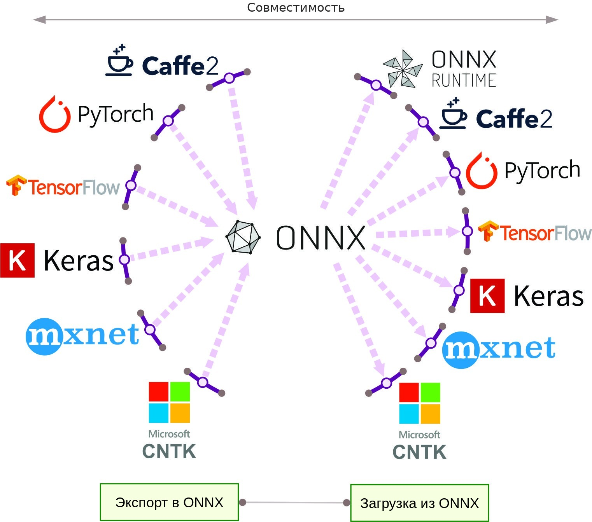

<em><strong>Взаимодействие фреймворков</strong>: входящие спицы представляют экспорт в общий формат ONNX, а исходящие — загрузку в совместимые инструменты и среды исполнения. Переносимость требует поддержки с обеих сторон этой границы.</em>

Форматы обмена смягчают фрагментацию фреймворков, но граница экспорта не может спасти архитектуру, которая нарушает физические пределы цели. Конвертация графа в ONNX или во встраиваемую среду после завершения разработки не устранит чрезмерный объем памяти, отсутствующие аппаратные операторы или неподдерживаемый динамический поток управления. Если откладывать мысли о развертывании на потом, дорогостоящие переписывания неизбежны, поэтому систематическая оценка компромиссов аппаратуры и среды исполнения необходима еще до написания первой строки кода модели.

<a id="sec-ml-frameworks-selecting-framework-2949"></a>

## Выбор фреймворка

Выбор фреймворка — это задача оптимизации с ограничениями по измерениям исполнения, дифференцирования и абстракции аппаратуры, введенным в этой главе. Вопрос не в том, какой фреймворк «лучший». Вопрос в том, какая модель исполнения, какая система дифференцирования и какой путь абстракции выдержат ограничения проекта.

<a id="sec-ml-frameworks-framework-selection-tradeoff-space-c76e"></a>

### Пространство компромиссов при выборе фреймворка

Выбор фреймворка включает три взаимосвязанных противоречия. Первое — между скоростью разработки и производительностью в продакшене: eager-исполнение ставит на первое место скорость итераций, тогда как компиляция графа ставит на первое место оптимизацию во время исполнения. Исследовательским командам, которым нужно проверять десять вариантов архитектуры в день, нельзя позволить себе минуты компиляции между экспериментами. Продакшен-командам, которые развертывают одну модель месяцами, нельзя позволить себе штраф пропускной способности от eager-диспетчеризации. Оптимальная точка сдвигается по мере того, как проект проходит свой жизненный цикл.

Это противоречие скорости и производительности ведет прямо ко второму: гибкость против глубины оптимизации. Eager-исполнение делает управление потоком на языке хоста естественным, но ограничивает область компилятора, пока не будет захвачена более крупная область. Статические графы могут представлять управление потоком, зависящее от данных, через специальные операторы графа. Они открывают более крупные подграфы для слияния ядер между операторами, которое устраняет промежуточные обмены с HBM и держит промежуточные активации в SRAM на чипе. Как показывает таблица [«Дополнительные компромиссы графов»](07_frameworks.md#tbl-mlfm-graphs), этот компромисс каскадом распространяется через управление памятью, использование аппаратуры и рабочие процессы отладки. Это архитектурное ограничение, которое управляет всем конвейером исполнения.

Противоречие гибкости и оптимизации, в свою очередь, открывает третье: широту экосистемы против специализации. Фреймворки общего назначения покрывают широкие каталоги операторов, но часто уступают специализированным средам исполнения на нагрузках, которые те могут глубоко оптимизировать. Такие системы, как TensorRT и TVM, оптимизируют под более узкие целевые платформы развертывания через агрессивное слияние ядер, выбор точности и планирование раскладки памяти, специфичной для аппаратуры (NVIDIA, 2024; Chen et al., 2018). Форматы обмена, такие как ONNX, перекрывают часть этого разрыва (ONNX Contributors, 2019). Но специализация среды исполнения вводит собственные режимы отказа: когда экспортированная модель встречает неподдерживаемый оператор, исполнение должно откатиться на неоптимизированные ядра или вызвать дорогие синхронизации хоста и устройства.

<a id="psp-frameworks-framework-selection-constraints"></a>

> **Ограничения выбора фреймворка**
>
> Вместо поиска «лучшего» фреймворка эффективный выбор сначала отсеивает кандидатов, которые не могут выполнить жесткие ограничения: целевую платформу развертывания, нужные операции, путь компиляции и экспертизу команды. Только затем мягкие предпочтения, такие как производительность, скорость разработки и экосистема, ранжируют оставшихся.

Экосистема TensorFlow наглядно показывает, как эти оси взаимодействуют. Ее три варианта (TensorFlow, TensorFlow Lite и TensorFlow Lite Micro) прослеживают одну философию проектирования через все более жесткие физические ограничения. [«Поддержка моделей вариантами TensorFlow»](07_frameworks.md#tbl-tf-comparison) показывает получающиеся компромиссы в выразительности моделей.

|                                    | TensorFlow | **TensorFlow Lite** | **TensorFlow Lite для микроконтроллеров** |
|:-----------------------------------|:----------:|:-------------------:|:----------------------------------------:|
| **Обучение**                       |    Да      |      Ограниченное   |                   Нет                    |
| **Вывод**                          |    Да      |         Да          |                   Да                     |
| **Покрытие операторов**            |  Широкое   | Ориентировано на вывод | Подмножество, выбранное моделью      |
| **Собственные средства пониженной точности** | Да |         Да          |                   Да                     |

<a id="tbl-tf-comparison"></a>

***Поддержка моделей вариантами TensorFlow**: четыре строки показывают, что может выразить каждый вариант, а не насколько он велик. Возможность обучения исчезает по мере снижения уровня, тогда как вывод и средства пониженной точности сохраняются полностью. Поэтому различающей строкой остается покрытие операторов: широкое в TensorFlow, ориентированное на вывод в TensorFlow Lite и сведенное к операторам, которые выбрала одна модель, в TensorFlow Lite Micro. Размер бинарного файла и объем памяти приведены в [«Аппаратные цели TensorFlow»](07_frameworks.md#tbl-tf-hw-comparison).*

Эта прогрессия показывает, что эффективность среды исполнения покупается ценой общности: меньшее число поддерживаемых операций позволяет получить меньшие бинарные файлы, детерминированные раскладки памяти и агрессивную оптимизацию в пониженной точности.

<a id="sec-ml-frameworks-model-requirements-2e01"></a>

### Критерии выбора фреймворка

Три измерения структурируют систематическую оценку фреймворка: что требует модель (поддерживаемые операции и семантику графа), что предоставляет программная среда (службы операционной системы, аллокаторы памяти и делегирование ускорителям) и что физически позволяет аппаратура (вычислительная пропускная способность, объем памяти и тепловые пределы мощности). Каждое измерение работает как фильтр: жесткие ограничения отсеивают нежизнеспособных кандидатов, а мягкие предпочтения ранжируют оставшихся.

<a id="sec-ml-frameworks-model-requirements-ca8b"></a>

#### Требования модели

Главное ограничение — может ли фреймворк выразить операции и семантику исполнения, которые нужны модели. Как показано в [«Поддержка моделей вариантами TensorFlow»](07_frameworks.md#tbl-tf-comparison), покрытие операторов сужается от широкого каталога TensorFlow общего назначения до набора TensorFlow Lite, ориентированного на вывод, и наконец до минимального подмножества, выбранного моделью и подключенного в TensorFlow Lite Micro. Каждое сужение убирает динамические операторы и машинерию обучения, концентрируя ресурсы компилятора на статических ядрах. Лежащий в основе системный принцип: алгоритмическая выразительность напрямую обменивается на машинную эффективность. Ограничение набора поддерживаемых операторов позволяет компиляторам убирать мертвый код, генерировать плотные внутренние циклы, держащие данные в регистрах, и устранять накладные расходы динамической диспетчеризации. Помимо покрытия операторов, требования модели также задают семантику графа: должно ли вычисление исполняться динамически или его можно захватить заранее.

<a id="psp-frameworks-dynamic-vs-static-computational-graphs"></a>

> **Динамические и статические вычислительные графы**
>
> Различие статических и динамических графов (разобранное в [«Проблема исполнения»](07_frameworks.md#sec-ml-frameworks-execution-problem-e1e1)) имеет прямые последствия для анализа требований модели. Статические графы требуют, чтобы управление потоком и динамическое поведение были представлены в формах, понятных среде исполнения графа, что позволяет оптимизацию заранее для развертывания. Eager-исполнение следует обычному потоку управления Python напрямую, тогда как пути захвата графа, такие как `torch.compile` и `tf.function`, возвращают возможности оптимизации, когда могут представить исполняемую программу.

<a id="sec-ml-frameworks-software-dependencies-5245"></a>

#### Программные зависимости

Когда выразительность модели подтверждена, фреймворк должен интегрироваться с целевой программной средой. [«Сравнение возможностей вариантов TensorFlow»](07_frameworks.md#tbl-tf-sw-comparison) показывает, как зависимости от операционной системы, механизмы загрузки моделей и делегирование ускорителям различаются между уровнями развертывания.

|                         |       TensorFlow      |        **TensorFlow Lite**        |   **TensorFlow Lite для микроконтроллеров**   |
|:------------------------|:---------------------:|:---------------------------------:|:--------------------------------------------:|
| **Нужна ОС**            |          Да           |                Да                 |                      Нет                     |
| **Доступ к модели**     | Файловая система или сервис | Отображение хранилища, специфичное для платформы | Скомпилированное или отображенное хранилище, специфичное для платформы |
| **Поддержка ускорителей** |          Да           |             Делегаты              |      Оптимизированные ядра и интеграции      |

<a id="tbl-tf-sw-comparison"></a>

***Сравнение возможностей вариантов TensorFlow**: возможности TensorFlow, TensorFlow Lite и TensorFlow Lite Micro в отношении зависимости от операционной системы, управления памятью и аппаратного ускорения. Последовательное ужесточение ограничений между вариантами позволяет выбирать по контексту развертывания: от полномасштабных серверов до периферийных устройств с ограниченными ресурсами.*

Эти различия показывают, как отказ от программных абстракций расширяет область развертывания. Стандартный TensorFlow опирается на полные службы POSIX-совместимой операционной системы, динамические разделяемые библиотеки и виртуальные аллокаторы памяти. TensorFlow Lite смягчает эти требования для мобильных платформ: он обращается к моделям через отображаемые в память файлы и делегирует операции аппаратным ускорителям через API среды исполнения от производителя. TensorFlow Lite Micro полностью убирает зависимость от операционной системы, позволяя исполнение без ОС (bare metal) на микроконтроллерах без файловой системы POSIX и динамической кучи (хотя он может работать вместе с RTOS, такой как FreeRTOS или Zephyr). Файл модели FlatBuffer компилируется прямо в константный массив байтов, размещенный во флэш-памяти только для чтения. Аппаратное ускорение опирается на статически связанные ядра CMSIS-NN или DSP-ассемблер, а не на динамические драйверные делегаты. Каждая отброшенная программная зависимость открывает более ограниченный уровень физической аппаратуры.

<a id="sec-ml-frameworks-hardware-constraints-e449"></a>

#### Аппаратные ограничения

Одной программной совместимости недостаточно для исполнения: среда исполнения фреймворка должна поместиться в физические пределы объема памяти, хранилища и вычислительной пропускной способности. Как сведено в [«Аппаратные цели TensorFlow»](07_frameworks.md#tbl-tf-hw-comparison), архитектуры целевых процессоров меняются по уровням развертывания: от серверных x86 CPU, GPU и TPU в дата-центрах через прикладные процессоры Arm Cortex-A на мобильной периферии до маломощных микроконтроллеров Arm Cortex-M и DSP.

|                             | TensorFlow                                | **TensorFlow Lite**                        | **TensorFlow Lite для микроконтроллеров** |
|:----------------------------|:------------------------------------------|:-------------------------------------------|:-----------------------------------------|
| **Базовый размер бинарного файла** | Зависит от сборки и упаковки        | Зависит от сборки и делегатов              | Зависит от выбора модели и операторов    |
| **Базовый объем памяти**    | Зависит от модели, среды и аллокатора     | Зависит от модели, делегатов и аллокатора  | Фиксированная арена плюс состояние среды |
| **Оптимизированные архитектуры** | x86, TPU, GPU                        | Arm Cortex-A, x86                          | Arm Cortex-M, DSP, MCU                   |

<a id="tbl-tf-hw-comparison"></a>

***Аппаратные цели TensorFlow**: варианты TensorFlow нацелены на все более ограниченное железо, переходя от x86, GPU и TPU к Arm Cortex-A, а затем к Arm Cortex-M, DSP и микроконтроллерам. Фактический размер бинарного файла и объем памяти зависят от сборки, выбранных операторов, делегатов, модели и конфигурации среды исполнения.*

Эти аппаратные границы отражают фундаментальные физические ограничения, такие как барьер скорости света, энергетическая стена и стена памяти, которые делят спектр развертывания на отдельные эксплуатационные режимы ([«Физические ограничения: почему существуют парадигмы»](02_ml_systems.md#sec-ml-systems-deployment-spectrum-71be)). В дата-центре многомегабайтные бинарные файлы среды исполнения и накладные расходы динамического управления памятью ничтожны по сравнению с гигабайтами высокоскоростной памяти устройства. На микроконтроллере с 256 КБ SRAM и 1 МБ флэш-памяти универсальную среду исполнения даже нельзя загрузить. Фреймворк должен заменить динамические аллокаторы кучи единой предвыделенной ареной памяти, размер которой задан заранее, чтобы вместить активации тензоров и буферы скретчпада.

<a id="sec-ml-frameworks-productionready-evaluation-factors-e088"></a>

#### Факторы оценки готовности к продакшену

Удовлетворение требований модели, программных зависимостей и аппаратных ограничений устанавливает техническую осуществимость, но жизнеспособность в продакшене требует оценки операционной надежности при устойчивых серверных нагрузках. Среды исполнения, которые опираются на динамическое выделение памяти или интерпретаторы языка хоста, вносят разброс хвостовой задержки (p99) из-за пауз сборки мусора и фрагментации кучи. Напротив, ориентированные на продакшен среды исполнения обеспечивают статические арены тензоров и опережающее понижение графа, чтобы гарантировать детерминированное время исполнения.

Оптимизация точности — центральный операционный рычаг. Понижение численной точности с FP32 до FP8 или INT8 вдвое сокращает потребление пропускной способности памяти и повышает арифметическую пропускную способность тензорных ядер ускорителя, но требует собственного инструментария квантования. Продакшен-фреймворк должен поддерживать как квантование после обучения (PTQ) с репрезентативными калибровочными наборами данных, так и квантование с учетом обучения (QAT), чтобы восстановить запас точности до развертывания. Помимо исполнения на отдельном устройстве, жизнеспособность в продакшене зависит от стабильности инструментов: сохраняют ли контрольные точки модели обратную совместимость при обновлениях среды исполнения, предоставляет ли фреймворк телеметрические хуки для профилирования исполнения ядер и может ли инфраструктура обслуживания развертывать обновленные определения графов без простоя.

<a id="sec-ml-frameworks-development-support-longterm-viability-assessment-d1d7"></a>

### Поддержка разработки и оценка долгосрочной жизнеспособности

Жизнеспособность фреймворка на протяжении многолетнего жизненного цикла в продакшене зависит от того, поддерживает ли окружающая экосистема выбранные пути исполнения, дифференцирования и абстракции в сопровождаемом состоянии. Состав сообщества напрямую формирует инженерные приоритеты: исследовательские экосистемы ставят на первое место скорость экспериментов, интерактивную отладку и быстрое прототипирование моделей; продакшен-ориентированные экосистемы инвестируют в среды обслуживания, обратную совместимость и интеграции с производителями аппаратуры; а ориентированные на компилятор экосистемы развивают математические преобразования и генерацию кода для новых ускорителей.

Операционная стоимость фреймворка часто зависит от окружающей инфраструктуры экосистемы больше, чем от базового API тензоров. Интеграция с реестрами моделей, системами обслуживания, оркестраторами кластеров и инструментами профилирования ускорителей ускоряет развертывание, но каждый слой вводит восходящую зависимость. Пользовательские реализации ядер на C++ или CUDA, специфичные форматы сериализации и вендорные проходы компиляции делают миграцию фреймворка непомерно дорогой, как только организация стандартизирует свой конвейер. Сохранение архитектурного пути выхода требует осознанной развязки: стандартизации промежуточных представлений через открытые форматы вроде ONNX, изоляции конвейеров загрузки данных от классов тензоров, специфичных для фреймворка, и поддержания модульных границ операторов.

Предыдущие разделы оценивали исполнение, дифференцирование и абстракцию аппаратуры как отдельные архитектурные выборы. Однако в работающей модели эти три системы действуют одновременно. Одиночный шаг обучения — место, где они сталкиваются: eager-диспетчеризация или планирование графа определяет, когда работа попадает на кремний, автоматическое дифференцирование в обратном режиме строит обратный проход, сохраняя промежуточные активации, а абстракции аппаратуры координируют раскладки тензоров и запуски ядер. Трассировка одного полного шага обучения от входного батча до обновления параметров показывает, как эти механизмы интегрируются при физических ограничениях машины.

<a id="sec-ml-frameworks-putting-together-anatomy-training-step-c7f1"></a>

## Анатомия шага обучения

Исполнение, дифференцирование и абстракция аппаратуры работают одновременно во время обучения модели. В примере [«Анатомия шага обучения»](07_frameworks.md#lst-training-step-anatomy) минимальный двухслойный многослойный перцептрон иллюстрирует эту конвергенцию на восьми исполняемых операторах. Трассировка каждого оператора через стек среды исполнения связывает количественные принципы, развитые в [«Три проблемы фреймворков»](07_frameworks.md#sec-ml-frameworks-three-problems-every-framework-must-solve-317d), с физическим исполнением: выделением тензоров, диспетчеризацией ядер, записью динамического графа, вычислением градиентов и обновлением параметров.

<a id="lst-training-step-anatomy"></a>

**Анатомия шага обучения**: минимальная итерация обучения для двухслойного MLP, использующая выделение тензоров, диспетчеризацию ядер, запись autograd, вычисление градиентов и обновление параметров.

```python
# Одиночный шаг обучения для двухслойного MLP
x = torch.randn(32, 784, device="cuda")  # Входной батч
y = torch.randint(0, 10, (32,), device="cuda")  # Метки

# Прямой проход
optimizer.zero_grad()
h = torch.relu(x @ W1 + b1)  # Скрытый слой
logits = h @ W2 + b2  # Выходной слой
loss = F.cross_entropy(logits, y)

# Обратный проход
loss.backward()
# Обновление параметров
optimizer.step()
```

### Фаза 1: прямой проход (решаем проблему исполнения)

Во время прямого прохода выполнение `h = torch.relu(x @ W1 + b1)` запускает последовательность eager-исполнения:

1. Диспетчеризация Python: интерпретатор Python вызывает `torch.matmul`, который через C++-диспетчер PyTorch выбирает бэкенд CUDA. Это несет несколько микросекунд накладных расходов CPU хоста, прежде чем работа будет отправлена на устройство.
2. Выбор ядра: cuBLAS выбирает ядро GEMM, настроенное для размеров 32 × 784 × 256, разбивая вычисление на блоки потоков, размер которых соответствует разделяемой памяти потокового мультипроцессора и блокам кеша L2.
3. Запуск ядра: поток хоста ставит дескриптор запуска в очередь команд GPU, расходуя задержку запуска драйвера, тогда как асинхронное исполнение позволяет хосту продолжать работу, не блокируясь на завершении.
4. Исполнение на GPU: потоковые мультипроцессоры передают `W1` из HBM[^fn-hbm-capacity-constraint] через кеш L2 в регистры и тензорные ядра, вычисляют матричное произведение и записывают выходные активации обратно в HBM.
5. Запись autograd: параллельно на хосте движок autograd PyTorch создает узел `MmBackward` на динамической ленте, сохраняя ссылки на входные тензоры `x` и `W1` в памяти устройства для дифференцирования в обратном режиме.

[^fn-hbm-capacity-constraint]: **HBM (high bandwidth memory)**: обеспечивает 2–3 ТБ/с пропускной способности на современных GPU, что делает ее уровнем памяти, который напрямую питает арифметику ускорителя. Пропускная способность HBM определяет, ограничена ли операция памятью или вычислениями. Ее емкость 80 ГБ на A100 задает жесткий потолок общего живого состояния обучения. Веса, активации, градиенты, состояние оптимизатора и временная рабочая память должны помещаться во время исполнения. Когда они не помещаются, фреймворк вынужден прибегать к выгрузке, избирательному пересчету или размещению на нескольких устройствах, и каждый из этих приемов добавляет сложности к тому, что программист воспринимает как единственный вызов `loss.backward()`.

Последующее добавление смещения (`+ b1`) и активация (`torch.relu`) идут по тому же eager-пути: каждая операция диспетчеризует отдельное ядро, выполняет обмены с HBM и добавляет узел в ленту.

### Фаза 2: обратный проход (решаем проблему дифференцирования)

Вызов `loss.backward()` выполняет автоматическое дифференцирование в обратном режиме в четыре этапа:

1. Обход ленты: движок autograd обходит записанный вычислительный граф в обратном топологическом порядке, начиная с узла скалярной функции потерь.
2. Вычисление градиентов: движок исполняет обратное ядро, зарегистрированное для каждого узла. Двигаясь назад, `CrossEntropyBackward` вычисляет $\frac{\partial \mathcal{L}}{\partial \text{logits}}$ с помощью производной softmax; `MmBackward` для $W_2$ вычисляет $\frac{\partial \mathcal{L}}{\partial W_2} = h^T \cdot \frac{\partial \mathcal{L}}{\partial \text{logits}}$ и $\frac{\partial \mathcal{L}}{\partial h}$; `ReluBackward` вычисляет маску активации, обнуляя градиенты там, где прямые активации удовлетворяют $h \leq 0$; а `MmBackward` для $W_1$ вычисляет $\frac{\partial \mathcal{L}}{\partial W_1} = x^T \cdot \frac{\partial \mathcal{L}}{\partial z_1}$. Поскольку входной батч `x` не задает `requires_grad=True`, обход завершается, не вычисляя $\frac{\partial \mathcal{L}}{\partial x}$.
3. Накопление градиентов: вычисленные градиенты параметров накапливаются на месте в полях `.grad` листовых тензоров ($W_1$, $b_1$, $W_2$, $b_2$).
4. Освобождение памяти: по мере завершения каждого узла обратного прохода фреймворк освобождает его сохраненные прямые активации (такие как $h$ и $x$), позволяя кеширующему аллокатору переиспользовать эти области памяти для последующих операций.

### Фаза 3: анализ трафика памяти (физика в действии)

Применяя [«накладные расходы диспетчеризации»](07_frameworks.md#eq-dispatch-overhead) к этому шагу, [«Покомпонентный анализ модели Roofline»](07_frameworks.md#tbl-training-step-roofline) разбирает FLOP, трафик памяти и арифметическую интенсивность для каждой операции:

| **Компонент**                            |                                           **Модельная работа**                                          |                 **Трафик памяти**                |            **Арифметическая интенсивность**           |
|:-----------------------------------------|:---------------------------------------------------------------------------------------------------:|:-------------------------------------------------:|:---------------------------------------------:|
| **MatMul (x @ W1)**                      |  2 × 32 × 784×256 = 12,8 MFLOP  |  0,9 МБ |  13,7 FLOP/байт |
| **ReLU**                                 | 32×256 = 8,2 KFLOP | 65,5 КБ | 0,125 FLOP/байт |
| **MatMul (h @ W2)**                      |  2 × 32 × 256×10 = 163,8 KFLOP  |  44,3 КБ |  3,7 FLOP/байт |
| **Перекрестная энтропия (упрощенно)**    |                           ~0,96 KFLOP                           |  2,6 КБ  |  0,4 FLOP/байт  |
| **Обратный проход (принят вдвое больше прямого)** |                           ~26 MFLOP                          |  3,1 МБ |  8,3 FLOP/байт |

<a id="tbl-training-step-roofline"></a>

***Покомпонентный анализ модели Roofline**: аналитические оценки работы и трафика памяти для шага обучения двухслойного MLP. Строка перекрестной энтропии приписывает по одной эквивалентной операции возведению в степень, накоплению и нормализации на каждый логит, а строка обратного прохода предполагает вдвое большую работу, чем прямой, и втрое больший трафик памяти. Это допущения моделирования, а не измеренные числа инструкций. Матричные умножения имеют гораздо более высокую арифметическую интенсивность, чем поэлементные операции, тогда как упрощенные модели ReLU и перекрестной энтропии остаются чувствительными к памяти.*

Столбец арифметической интенсивности показывает рабочий режим каждого слоя. Матричные умножения демонстрируют повторное использование операндов, которое толкает интенсивность к крыше вычислительной производительности. Напротив, поэлементный ReLU и редукция в перекрестной энтропии выполняют ничтожное вычисление на переносимый байт (от 0,125 до 0,375 FLOP/байт) и остаются строго ограниченными пропускной способностью памяти и задержкой запуска. При неслитом eager-исполнении каждая поэлементная операция влечет отдельную диспетчеризацию ядра и обмены промежуточных тензоров с HBM, не насыщая вычислительные блоки.

Аналитическая модель дает около 39,1 MFLOP общей арифметической работы и около 4,2 МБ трафика памяти. Деление этих величин на пиковые показатели аппаратуры A100 определяет идеализированные нижние границы:

- $T_{\text{compute}} \approx$ 39,1 MFLOP / 19,5 TFLOP/s (FP32) ≈ 2,0 мкс
- $T_{\text{memory}} \approx$ 4,2 МБ / 2,04 ТБ/с ≈ 2,1 мкс
- При 12 запусках ядер (операций) $T_{\text{overhead}} \approx$ 12 × 15 мкс ≈ 180 мкс

Поскольку $T_{\text{overhead}}$ превышает $T_{\text{compute}}$ и $T_{\text{memory}}$ более чем на порядок, шаг ограничен накладными расходами. Исполнительные блоки ускорителя простаивают, пока CPU хоста последовательно диспетчеризует работу. Системная инженерия в этом режиме направлена на налог на запуск, а не на эффективность арифметики:

- Слияние ядер (`torch.compile`): слияние последовательных ограниченных памятью операций в одно ядро устраняет промежуточные обмены с HBM и сворачивает границы запусков.
- Масштабирование размера батча: увеличение размера батча линейно наращивает арифметическую нагрузку, сохраняя накладные расходы диспетчеризации постоянными, и амортизирует фиксированную задержку запуска на большее число вычислительных операций.
- Захват графа: статическая компиляция или CUDA Graphs захватывают граф зависимостей однажды и воспроизводят исполнение через один вызов драйвера, полностью устраняя накладные расходы интерпретатора хоста.

### Фаза 4: абстракция аппаратуры (решаем проблему абстракции)

Тот же самый скрипт Python исполняется на гетерогенных архитектурах аппаратуры через слои абстракции бэкендов, как сводит [«Аппаратные бэкенды за единым путем кода»](07_frameworks.md#tbl-framework-backends).

Каждый бэкенд отображает общую семантику тензоров на примитивы конкретного кремния. Единственный вызов `loss.backward()` направляется по разным конвейерам исполнения в зависимости от размещения на устройстве. Различия в порядке суммирования с плавающей запятой, деревьях редукции и недетерминированных атомарных операциях вносят численные расхождения между бэкендами, поэтому эквивалентность нужно проверять по явным численным допускам, а не по побитовому совпадению.

| **Аппаратура**                                      | **Библиотека бэкенда**                                 | **Механизм исполнения**                                           |
|:----------------------------------------------------|:-------------------------------------------------------|:------------------------------------------------------------------|
| **CUDA GPU**                                        | cuBLAS (NVIDIA, 2024; Choquette et al., 2021)         | Ядра GEMM и потоки CUDA для асинхронного исполнения               |
| **CPU**                                             | Intel oneMKL или OpenBLAS (Intel Corporation, 2026; OpenBLAS Project, 2026) | Параллелизм на уровне потоков вокруг оптимизированных ядер |
| **TPU**                                             | XLA (Google, 2025)                                     | Компиляция в операции оптимизатора высокого уровня (HLO), специфичные для TPU |
| **Apple Silicon**                                   | Metal Performance Shaders                              | Бэкенд MPS                                                        |

<a id="tbl-framework-backends"></a>

***Аппаратные бэкенды за единым путем кода**: каждый бэкенд реализует одни и те же тензорные операции через разную библиотеку и механизм исполнения, поэтому одинаковый Python отображается на разный кремний.*

Решения о реализации (размещение на устройстве, размер батча, режим компиляции) каскадно проходят через слои исполнения, дифференцирования и абстракции одновременно. Когда системы рассматривают фреймворк как непрозрачный математический интерпретатор, а не как планировщик, учитывающий аппаратуру, эти взаимодействия вызывают голод запусков, фрагментацию памяти и обвал пропускной способности.

<a id="psp-frameworks-three-problems-action"></a>

> **Три проблемы в действии**
>
> В терминах D·A·M один шаг обучения показывает, как фреймворк балансирует алгоритм и машину:
>
> - Исполнение (планирование машины): eager-режим сохраняет императивную отладку построчно ценой задержки запуска и диспетчеризации для каждого ядра.
> - Дифференцирование (алгоритмический граф): автоматическое дифференцирование в обратном режиме удерживает промежуточные прямые активации в HBM, чтобы вычислять точные векторно-якобиановы произведения в обратном топологическом порядке.
> - Абстракция (переносимость аппаратуры): унифицированные тензорные API отделяют код модели от разнородного кремния, диспетчеризуя одинаковые операции на ядра cuBLAS, oneMKL или XLA HLO.
>
> Устранение трения между этими измерениями требует согласовать гранулярность операторов с крышами Roofline аппаратуры: сливать операции, чтобы убрать обмены с памятью, масштабировать батчи, чтобы амортизировать задержку запуска, и структурировать тензоры так, чтобы насыщать конвейеры исполнения ускорителя.

<a id="sec-ml-frameworks-fallacies-pitfalls-61ef"></a>

## Заблуждения и ловушки

Выбор фреймворка включает тонкие компромиссы, где интуиция из традиционной разработки ПО не работает. Стена памяти, ограничения слияния ядер и разнообразие целевых платформ развертывания создают ловушки, которые тратят инженерные усилия и заставляют продакшен-системы не попадать в целевые показатели задержки.

> **Заблуждение и ловушка**
>
> **Заблуждение**: *«Все фреймворки дают эквивалентную производительность для одной и той же архитектуры модели.»*
>
> Инженеры считают, что ResNet-50 дает одинаковую производительность во всех фреймворках, поскольку математика одна и та же, забывая, что производительность — эмерджентное свойство совместного проектирования алгоритма и машины. В продакшене реализация имеет значение. Скомпилированное исполнение может улучшить поддерживаемые eager-нагрузки, а специализированные движки вывода, такие как TensorRT или TVM, могут снизить задержку относительно неподстроенных eager-базовых вариантов, когда конвертация проходит чисто. Разница возникает из-за глубины слияния ядер, стратегий оптимизации графа, паттернов доступа к памяти, поддержки точности и библиотек бэкендов, которые различаются между фреймворками. Организации, которые предполагают эквивалентность, могут не выполнить соглашения об уровне обслуживания по задержке и вынуждены делать дорогостоящие миграции фреймворка в последний момент.

> **Заблуждение и ловушка**
>
> **Ловушка**: *выбор фреймворка на основе популярности, а не требований проекта.*
>
> Инженеры считают, что самый популярный фреймворк подходит для любого проекта. На деле доминируют ограничения развертывания. Мобильная среда, такая как ExecuTorch или TensorFlow Lite, и микроконтроллерная среда, такая как TensorFlow Lite Micro, по-разному предполагают распределение памяти, покрытие операторов и аппаратные делегаты: первые ориентированы на телефоны с памятью порядка гигабайт, а вторые часто нацелены на устройства с сотнями КБ ОЗУ, обычно меньше 256 КБ для небольших развертываний TinyML. Команды, которые прототипируют периферийные приложения, не проверив итоговую среду исполнения, могут столкнуться с раздуванием памяти сверх емкости устройства или с поздней миграцией фреймворка после завершения разработки. Оцените целевые платформы развертывания согласно разделу [«Целевые платформы развертывания»](07_frameworks.md#sec-ml-frameworks-deployment-targets-13f1) до выбора фреймворка обучения.

> **Заблуждение и ловушка**
>
> **Заблуждение**: *«Абстракции фреймворка устраняют необходимость системных знаний.»*
>
> Инженеры считают, что высокоуровневые API сами выполняют всю оптимизацию. Модель Roofline (раздел [«Модель Roofline»](appendix_machine.md#sec-appdx-machine-foundations-roofline-model-2529) приложения «Основы машины») доказывает обратное. Поэлементные операции, такие как ReLU, выполняют мало арифметики на байт перемещенных данных, поэтому трафик памяти и накладные расходы запуска могут доминировать даже на ускорителях с обильными вычислениями. [«Почему стратегия исполнения важна»](07_frameworks.md#sec-ml-frameworks-execution-strategy-matters-memory-wall-1ce8) объясняет, как этот дисбаланс может оставлять вычислительные ресурсы простаивающими. Инженеры должны определить лимитирующий ресурс, прежде чем выбирать оптимизации слияния, батчинга, раскладки или точности.

> **Заблуждение и ловушка**
>
> **Ловушка**: *игнорирование привязки к поставщику из-за форматов, специфичных для фреймворка.*
>
> Инженеры считают, что миграция фреймворка проста, потому что модели — это «просто математика». Конвертация SavedModel TensorFlow в PyTorch может потребовать переписывания пользовательских операций, проверки численной эквивалентности на больших наборах тестов и переобучения, когда операции не имеют точных эквивалентов. ONNX ([«Целевые платформы развертывания»](07_frameworks.md#sec-ml-frameworks-deployment-targets-13f1)) повышает переносимость, но пользовательские операторы, динамические формы и оптимизации, специфичные для бэкенда, все равно могут требовать ручной работы. Организации, которые игнорируют это при первоначальном выборе фреймворка, сталкиваются с дорогостоящими миграциями, когда требования развертывания меняются или появляются лучшие фреймворки.

> **Заблуждение и ловушка**
>
> **Заблуждение**: *выбор фреймворка для обучения не зависит от продакшен-инфраструктуры.*
>
> Инженеры считают, что выбор фреймворка обучения не зависит от инфраструктуры развертывания. На практике несоответствия между фреймворком и инфраструктурой могут создавать существенные операционные накладные расходы. Некоторые стеки обслуживания поддерживают атомарную замену моделей, а другие требуют перезапуска процесса или контейнера, если архитектура развертывания не добавляет маршрутизацию версий поверх них. Некоторые фреймворки и среды исполнения открывают хуки мониторинга напрямую, другие требуют собственной инструментации. Это последствия слоев обслуживания и эксплуатации, которые разбираются в главах [«Обслуживание моделей»](13_model_serving.md#sec-model-serving) и [«MLOps»](14_ml_ops.md#sec-ml-operations). Локальный урок в том, чтобы оценивать полный стек развертывания при выборе фреймворка, включая инфраструктуру обслуживания, мониторинг и инструменты эксплуатации.

> **Заблуждение и ловушка**
>
> **Ловушка**: *увеличение размера батча без моделирования памяти активаций.*
>
> Инженеры считают, что если память доступна, большие батчи всегда повышают пропускную способность. Большие мини-батчи действительно могут амортизировать фиксированные накладные расходы диспетчеризации, но они также масштабируют память активаций, которая должна оставаться живой во время обучения. Модель с 7 млрд параметров в FP16 занимает 14 ГБ, оставляя 71,9 ГБ на A100 с 80 ГБ до учета прочего состояния обучения. Увеличение размера батча с 8 до 32 учетверяет зависящий от батча объем активаций. Внимание трансформера добавляет большой член $\mathcal{O}(S^2)$ по длине последовательности, который делает каждый пример дорогим. Получившееся давление на память может запустить стратегии пересчета, чья дополнительная работа снижает пропускную способность, несмотря на больший батч. Команды, которые слепо максимизируют размер батча, могут получить меньшую пропускную способность, чем у меньших батчей, которые обходят эти пути управления памятью. Раздел [«Методы оптимизации на основе градиента»](08_training.md#sec-model-training-gradientbased-optimization-methods-9798) главы «Обучение моделей» формализует целевую пропускную способность.

> **Заблуждение и ловушка**
>
> **Заблуждение**: *накладные расходы компиляции пренебрежимо малы.*
>
> Инженеры считают, что накладные расходы компиляции — разовая стоимость, которая быстро окупается. Гипотетические значения в [«Иллюстративная пропускная способность обучения и вывода»](07_frameworks.md#tbl-training-benchmark) приписывают ResNet-50 более высокую пропускную способность в скомпилированном режиме и окно компиляции от 15 до 30 с на каждое изменение графа. При этих допущениях эксперимент на 10 000 изображений с 10 изменениями кода завершается за 6,9 с в eager-режиме и за 304,7 с в скомпилированном режиме, с учетом накладных расходов перекомпиляции. Поэтому скомпилированный рабочий процесс примерно в 44,2 раза медленнее в этом иллюстративном сценарии быстрого прототипирования. Команды, которые включают компиляцию во время быстрого прототипирования, могут терять время на ожидание перекомпиляций, которые сводят на нет выигрыш в пропускной способности.

> **Заблуждение и ловушка**
>
> **Ловушка**: *использование одной политики исполнения для исследования и продакшена.*
>
> Правильный режим фреймворка зависит от цикла. Во время исследования eager-исполнение и небольшие тесты сокращают обратную связь, избегая повторных захватов графа и перекомпиляций. Во время продакшен-обслуживания или длинных прогонов обучения компиляция может амортизировать настройку на многие запросы или образцы. Решающие факторы — длительность нагрузки и стабильность: компиляция окупается, когда структура графа и формы повторяются, тогда как изменение потока управления или форм входа может сделать закешированные артефакты недействительными и перезапустить амортизацию. Командам стоит выбирать политику по измеренной задержке итераций и устойчивой пропускной способности. Одна политика для обеих фаз либо замедляет исследовательские итерации, либо оставляет производственную пропускную способность неиспользованной.

<a id="sec-ml-frameworks-summary-07f0"></a>

## Итоги

Фреймворки машинного обучения решают три основные системные задачи, которые делают глубокое обучение осуществимым на современном железе. Первая — исполнение: решить, когда и как выполняются операции. Фреймворки балансируют компромисс между eager-вычислением для интерактивной отладки и исполнением по графу для компиляции программы целиком. Современные гибридные подходы, такие как `torch.compile`, захватывают графы динамически, не жертвуя управляющим циклом Python. Вторая — дифференцирование: автоматическое вычисление градиентов. Фреймворки реализуют автоматическое дифференцирование в обратном режиме, которое применяет правило цепочки к композициям операций, строит ленту autograd или обратный граф векторно-якобиановых произведений и сохраняет промежуточные активации в памяти. Этот примитив делает обучение больших моделей осуществимым через единственный вызов `loss.backward()`. Третья — абстракция: нацеливание на гетерогенную аппаратуру через единый интерфейс. Фреймворки предоставляют многомерные абстракции тензоров, промежуточные представления и системы диспетчеризации времени исполнения, которые связывают высокоуровневые определения моделей с оптимизированными ядрами устройств на CPU, GPU, TPU и специализированных ускорителях.

Эти задачи связаны через железный закон систем машинного обучения ([«Железный закон систем машинного обучения»](01_introduction.md#sec-introduction-iron-law-ml-systems-c32a)): стратегия исполнения определяет задержку диспетчеризации $(L_{\text{lat}})$, дифференцирование определяет трафик памяти $(D_{\text{vol}})$, а абстракция определяет эффективность загрузки аппаратуры $(\eta_{\text{hw}})$. Поскольку вычислительная пропускная способность ускорителей выросла гораздо быстрее пропускной способности памяти, исполнение часто ограничено пропускной способностью памяти ($D_{\text{vol}}/\text{BW}$), а не вычислениями. Фреймворки смягчают эту стену памяти через оптимизации компилятора. Слияние ядер объединяет соседние поэлементные операции, чтобы держать промежуточные значения в регистрах или во внутренней SRAM вместо обмена с глобальной памятью. Избирательный пересчет обменивает избыточные операции с плавающей запятой $(O)$ на снижение пикового давления на память активаций.

> **Слой между математикой и аппаратурой**
>
> * **Каждый фреймворк решает три задачи**: исполнение определяет диспетчеризацию во время работы, дифференцирование вычисляет градиенты, а абстракция нацеливается на гетерогенную аппаратуру. TensorFlow, PyTorch и JAX делают разные инфраструктурные ставки по этим осям, от захвата статического графа до динамической трассировки и функциональных преобразований. Эти архитектурные обязательства переживают синтаксис API.
> * **Стена памяти управляет оптимизацией**: вычислительные мощности ускорителей десятилетиями опережали пропускную способность памяти, поэтому перемещение данных за пределы чипа стало главным узким местом исполнения. Слияние ядер, избирательный пересчет и раскладки данных пониженной точности напрямую воздействуют на член трафика памяти ($D_{\text{vol}}/\text{BW}$) железного закона систем машинного обучения, а не просто уменьшают число операций.
> * **Компиляция должна амортизировать стоимость настройки**: принцип непрерывности компиляции в [«Польза компиляции»](07_frameworks.md#eq-compilation-benefit) количественно определяет, когда ускорение во время исполнения перевешивает накладные расходы компиляции. Пока динамические нагрузки выигрывают от eager-исполнения, многократно выполняемые графы выигрывают от JIT или опережающей компиляции. Закон накладных расходов диспетчеризации ([«накладные расходы диспетчеризации»](07_frameworks.md#eq-dispatch-overhead)) показывает, что мелкие операции выигрывают непропорционально, как только накладные расходы запуска на стороне хоста ($L_{\text{lat}}$) устранены.
> * **Абстракции модулей автоматизируют управление состоянием**: автоматическая регистрация параметров, исполнение, зависящее от режима (обучение или вывод), и иерархическая сериализация состояния позволяют обновлять модели с миллиардами параметров за один шаг оптимизатора на разных аппаратных бэкендах.
> * **Ограничения развертывания должны определять выбор**: специализированные среды исполнения обменивают покрытие операторов, статическое выделение памяти и задержку компиляции на жесткие бюджеты аппаратуры. Разрыв между памятью серверных ускорителей и SRAM микроконтроллеров требует оценить целевую платформу развертывания до выбора фреймворка для разработки.

Фреймворк выглядит как эргономичный программный интерфейс, но его истинная роль — перевод математических графов в физические операции аппаратуры. Этот перевод никогда не устраняет аппаратных затрат. Он лишь перераспределяет их между членами железного закона систем машинного обучения (принцип [«Железный закон систем машинного обучения»](part_build.md#pri-iron-law)). Eager-исполнение ставит на первое место скорость итераций разработчика ценой задержки диспетчеризации на стороне хоста ($L_{\text{lat}}$). Компиляция графа обменивает время предварительной оптимизации на устранение трафика глобальной памяти ($D_{\text{vol}}/\text{BW}$) за счет слитых ядер. Автоматическое дифференцирование обменивает память активаций ($D_{\text{vol}}$) на пересчитанную арифметику ($O$). То, что кажется удобством API, оказывается постоянным системным обязательством: фреймворк не может уменьшить фундаментальную физическую нагрузку, которую навязывает железный закон, а только определить, какой член ее несет.

> **От диспетчерской к электростанции**
>
> Фреймворки — программная основа, которая переводит абстрактные архитектуры в исполняемые ядра. Вычислительные графы, ленты autograd и конвейеры диспетчеризации ядер — это приборы диспетчерской: они дают инженеру видимость процесса обучения и контроль над ним. Машинерия построена, но каждое бюджетное решение, которое она выставляет на поверхность, остается не принятым: какие активации сохранять в контрольных точках, когда памяти не хватает, какой батч допускает аппаратура и в какой момент одного устройства перестает хватать. Глава [«Обучение моделей»](08_training.md#sec-model-training) — место, где эти счета приходят к оплате: там машинерия исполнения, дифференцирования и управления памятью фреймворка масштабируется в распределенные системы, которые обучают модели в больших масштабах.
