<a id="sec-model-training"></a>

# Обучение моделей

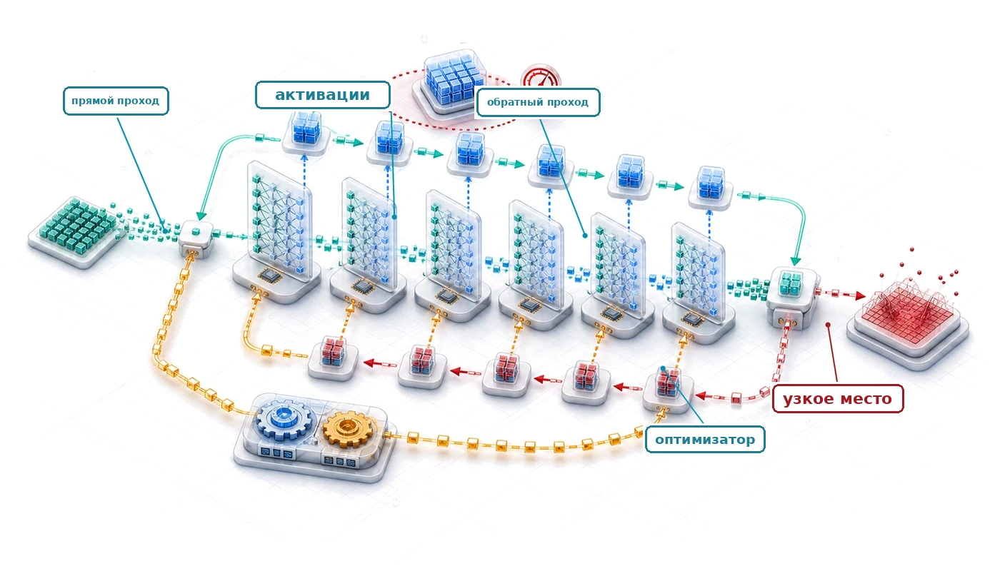

## Назначение

_Почему обучение модели может стоить на порядки дороже одного вывода?_

Вывод вычисляет прямой проход по мере того, как данные проходят через сеть, и на выходе появляется предсказание. Обучение добавляет обратный проход и шаг оптимизатора, сохраняет промежуточное состояние и повторяет эту работу для множества примеров и шагов оптимизации. Оптимизаторы также могут хранить оценки импульса и дисперсии, объем которых превышает объем весов модели. Соотношение зависит от модели, нагрузки, длительности обучения и объема вывода, но один прогон обучения обычно стоит на порядки дороже одного вывода. Лаборатория, которая обучает модель за три дня, может проверить больше вариантов, чем та, которой на это нужен месяц. Более быстрый шаг не означает более быстрого обучения, если он замедляет сходимость, поэтому пропускная способность важна только относительно времени до достижения целевого качества. В серии повторных экспериментов даже небольшие изменения сходимости или загрузки накапливаются в заметную разницу в сроках и стоимости. Центральная системная задача состоит в том, чтобы снабжать ускорители данными и полезной арифметикой, не исчерпывая память и не теряя время на синхронизацию. Какое вмешательство поможет, зависит от доминирующего ограничения по вычислениям, памяти, данным или коммуникации, поэтому профилирование должно предшествовать масштабированию или оптимизации. Размер батча, численная точность, контрольные точки, загрузка данных и параллелизм, следовательно, нужно рассматривать как связанные решения, а не как независимые ручки настройки. Для инженера систем обучение — это место, где аппаратура и параллелизм определяют, укладывается ли прогон в память, график и бюджет и ускоряет ли повторяющийся цикл оптимизации работу или останавливает ее. В терминах D·A·M каждое решение о точности и параллелизме согласует математику оптимизации с физикой исполнения.

> **Цели обучения**
>
> - Объяснять асимметрию стоимости обучения через затраты на прямой проход, обратный проход, состояние оптимизатора, данные и итерации
> - Вычислять FLOP, объем памяти под активации, состояние оптимизатора и денежную стоимость обучения нейронной сети
> - Сравнивать SGD, Adam и AdamW по поведению сходимости, накладным расходам памяти и вычислительной стоимости
> - Диагностировать узкие места обучения, ограниченного вычислениями, памятью или данными, с помощью анализа Roofline и данных профилирования
> - Применять смешанную точность, контрольные точки, накопление градиентов и FlashAttention, чтобы уложиться в ограничения памяти и пропускной способности ускорителя
> - Проектировать конвейеры обучения на одной машине с предвыборкой, перекрытием, батчингом и систематическим повторным профилированием
> - Оценивать, когда стоит выходить за пределы одной машины, с учетом ограничений памяти, длительности, коммуникации, энергии и стоимости

<a id="sec-model-training-training-systems-fundamentals-05d2"></a>

## Основы систем обучения

Запуск модели один раз и обучение ее с нуля находятся на противоположных концах кривой стоимости систем. Фреймворки предоставляют исполнительную основу: вычислительные графы планируют операции, автоматическое дифференцирование вычисляет градиенты, а аппаратные абстракции обеспечивают работу на разных ускорителях. Эти механизмы делают возможным один шаг обучения; системы обучения делают его воспроизводимым в масштабе. Тот же цикл «прямой проход, обратный проход, обновление» может выполняться многие тысячи или миллионы раз, сохраняя активации, питая ускорители и оставаясь в практических пределах памяти, времени и бюджета.

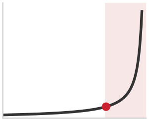

*Стоимость обучения остается плоской при росте масштаба, а затем резко растет после крупномасштабного излома.*

В этой главе используется внешняя оценка порядка величины примерно в \$50 000 для обучения уровня GPT-2 и публичная оценка около \$100 млн для прогона обучения класса GPT-4.[^fn-training-cost-scaling] Ни одна из этих цифр не была раскрыта как проверенный счет за обучение. Эта **асимметрия стоимости обучения** отражает разницу между оценкой обученной модели для заданного запроса и многократным выполнением прямого прохода, обратного прохода и обновления по всему корпусу обучения.

[^fn-training-cost-scaling]: **Масштабирование стоимости обучения**: отношение примерно в 2 000 раз между двумя стоимостными ориентирами этой главы иллюстрирует, как число параметров, бюджеты токенов обучения, поколения аппаратуры и парки ускорителей могут накапливаться в эффекте; это не контролируемое сравнение раскрытых счетов за обучение. OpenAI в отчете о GPT-2 описывает модель и настройку обучения, но не раскрывает стоимость обучения (Radford et al., 2019). Точные детали обучения GPT-4 также не раскрывались, поэтому цифра для класса GPT-4 явно является отраслевой оценкой, опирающейся на публичные сообщения и независимый анализ инфраструктуры (Knight, 2023; Patel and Wong, 2023).

Для GPT-2 в главе используется примерно 3,00 × 10⁹ операций с плавающей точкой на токен при прямом проходе по параметрическому учету, связанному с архитектурой из технического отчета GPT-2 (Radford et al., 2019). Общий бюджет 1,50 × 10²¹ FLOP соответствует примерно 167 млрд позиций токенов, если прямой и обратный проходы оценивать как работу, втрое большую прямого прохода. Эта оценка не означает, что GPT-2 выполнил столько полных вывод-запросов. Масштаб делает инженерию систем обучения отдельной дисциплиной и показывает, как доступ к инфраструктуре обучения может ограничивать участие в разработке ИИ.

<a id="dfn-training-training-systems"></a>

> **Системы обучения**
>
> ***Системы обучения*** — это программно-аппаратные системы, которые выполняют итеративный цикл оптимизации (прямой проход, вычисление функции потерь, обратный проход и обновление параметров), минимизируя функцию потерь на наборе данных для обучения.
>
> 1.  **Значение**: стоимость памяти обучения в 8 раз превышает стоимость памяти вывода на параметр в стандартной настройке адаптивной оценки моментов (Adam) со смешанной точностью: модели из 7 млрд параметров требуется 14 ГБ (веса FP16) + 14 ГБ (градиенты FP16) + 28 ГБ (мастер-веса FP32) + 56 ГБ (первый и второй моменты Adam в FP32) = не менее 112 ГБ без учета хранения активаций. Этот множитель — одна из главных причин, по которой модель, работающая на выводе на одном GPU, для обучения требует нескольких GPU.
> 2.  **Отличие**: в отличие от систем вывода, которые выполняют один прямой проход и отбрасывают промежуточные активации, стандартное обратное распространение ошибки сохраняет тензоры, нужные обратному проходу, и поэтому объем памяти растет с глубиной модели и размером батча.
> 3.  **Типичная ошибка**: частое заблуждение состоит в том, что сбои обучения — это проблемы вычислений. Типичный сбой — ошибка нехватки памяти (out-of-memory, OOM), то есть проблема управления памятью: тензоры, сохраненные для обратного распространения, накапливаются во время прямого прохода и могут исчерпать память до вычисления первого градиента.

Три свойства отличают нагрузки обучения от вычислений общего назначения:

- **Вычислительная интенсивность**: бюджет 1,50 × 10²¹ FLOP, распределенный на дни календарного времени, требует устойчивой пропускной способности масштаба PFLOP/s от аппаратуры, реальная пропускная способность которой для крупных моделей часто значительно ниже теоретического пика (Narayanan et al., 2021; Chowdhery et al., 2022).
- **Давление на память**: хранение весов модели на 1,5 млрд параметров требует 6 ГБ в FP32; оптимизатор Adam добавляет два тензора состояния на параметр, занимая еще 12 ГБ. Память под активации добавляет зависящий от нагрузки объем, который определяют архитектура, длина последовательности, размер батча, точность и контрольные точки, и совокупное состояние может превысить емкость одного ускорителя.
- **Зависимости по данным**: каждое обновление градиента зависит от результата предыдущего, создавая последовательные узкие места, которые ограничивают объем параллелизма, который система может использовать.

Каждая проблема указывает на свой тип решения. Вычислительная интенсивность подталкивает систему к более высокой загрузке ускорителя и арифметике с меньшей точностью. Давление на память требует таких приемов, как контрольные точки градиентов,[^fn-activation-checkpointing-tradeoff] — частный случай *ре-материализации* (отбрасывания и пересчета промежуточных значений ради экономии памяти), который обменивает пересчет на сокращение хранения активаций, — и смешанной точности обучения,[^fn-mixed-precision-training] которая уменьшает объем памяти под веса и активации. Зависимости по данным мотивируют конвейерные схемы, которые перекрывают вычисления с перемещением данных, опираясь непосредственно на пропускную способность загрузки данных, оптимизированную в главе [«Инженерия данных»](04_data_engineering.md#sec-data-engineering), чтобы ускоритель никогда не простаивал в ожидании следующего батча. Анализ здесь задает базовый уровень исполнения на одной машине и на одном узле с несколькими GPU; масштабирование через границы распределенной сети вводит многоузловые коммуникационные структуры и протоколы отказоустойчивости, которые рассматриваются в продвинутых распределенных системах.

<a id="sec-model-training-staged-pipeline"></a>

### Поэтапный системный конвейер: выявление «пузырей ускорителя»

Система обучения — это не один цикл, а **поэтапный системный конвейер**. Чтобы добиться высокой загрузки ускорителя, обучение нужно рассматривать как производственный цех, где четыре различных этапа согласуются друг с другом, чтобы держать АЛУ занятыми:

1.  **Загрузка и предобработка данных** (CPU/хранилище): извлечение сырых данных из энергонезависимой памяти NVMe (Non-Volatile Memory Express), декодирование и аугментация на ядрах CPU.
2.  **Передача с хоста на устройство** (PCIe): перемещение подготовленного батча по шине PCIe в память GPU через прямой доступ к памяти.
3.  **Прямой и обратный проход** (ускоритель): распространение активаций и градиентов по слоям на GPU.
4.  **Синхронизация параметров** (межсоединение): обмен градиентами между ускорителями по доступной структуре. NVLink обеспечивает до 900 ГБ/с в конфигурации H100, которая используется ниже, тогда как другие системы могут использовать PCIe или сетевое межсоединение.

Любое несоответствие в пропускной способности этих этапов создает **пузыри ускорителя** — интервалы, в которые часть ресурсов ускорителя простаивает или недоиспользуется, ожидая другого этапа. Инженер систем уменьшает эти пузыри с помощью таких приемов, как асинхронная предвыборка и перекрытие конвейера, стремясь сделать следующий батч доступным до того, как он понадобится текущему шагу. [«Выявление узких мест»](08_training.md#sec-model-training-identifying-bottlenecks-f57f) разрабатывает количественные инструменты для измерения и уменьшения этих пузырей.

[^fn-activation-checkpointing-tradeoff]: **Контрольные точки активаций (gradient checkpointing)**: обратное распространение ошибки сохраняет прямые значения, необходимые каждому правилу обратного прохода. Контрольные точки сохраняют выбранные значения и пересчитывают остальные во время обратного прохода, обменивая дополнительную работу на меньший объем памяти под активации. Размещение контрольных точек $\sqrt{N_L}$ и связанная с ним стоимость пересчета описывают классическое расписание, проанализированное Chen et al. (2016), а не каждую реализацию контрольных точек. [«Оптимальная стратегия размещения контрольных точек»](08_training.md#sec-model-training-optimal-checkpoint-placement-strategy-4a0d) разбирает это расписание для числа слоев GPT-2.

[^fn-mixed-precision-training]: **Смешанная точность обучения**: использует более низкую точность для выбранных вычислений и хранения, сохраняя более высокую точность там, где этого требуют накопление или диапазон чисел. Типичный рецепт FP16 хранит мастер-веса FP32 и применяет масштабирование функции потерь, чтобы уменьшить потерю градиентов из-за антипереполнения (Micikevicius et al., 2017). BF16 («Brain Floating Point», из Google Brain (Wang and Kanwar, 2019)) совпадает с 8-битным порядком FP32 по диапазону и поэтому обычно обходится без динамического масштабирования функции потерь, хотя точная точность состояния и накопления зависит от оптимизатора и реализации.

Эта цепочка архитектурных зависимостей задает операционную иерархию системы. Железный закон обучения ([«Железный закон систем машинного обучения»](01_introduction.md#sec-introduction-iron-law-ml-systems-c32a)) разделяет общее число операций, пиковую пропускную способность и загрузку аппаратуры и задает учетную основу для нагрузок нейронных сетей, динамики оптимизаторов, механики обратного распространения ошибки и арифметической интенсивности. В пределах конвейера исполнения загрузка данных, прямой проход, обратный проход и обновление параметров образуют последовательные зависимости, в которых каждый этап ограничивает пропускную способность последующих. Целевые меры воздействуют на конкретные члены уравнения пропускной способности: арифметику смешанной точности, блочные (тайловые) ядра внимания, накопление градиентов, контрольные точки активаций и асинхронную предвыборку. Когда пропускная способность одного ускорителя достигает насыщения, масштабирование на несколько устройств выводит на первый план пропускную способность межчипового межсоединения как определяющее ограничение.

Эти физические ограничения накапливаются при крупномасштабном исполнении: один неустраненный численный взрыв может обесценить тысячи часов работы ускорителей.

<a id="ws-training-palm-loss-spikes"></a>

> **Всплески функции потерь PaLM (2022)**
>
> **Контекст**: прогон PaLM с 540 млрд параметров использовал 6 144 чипа Tensor Processing Unit (TPU) v4, распределенных по двум подам по 3 072 чипа, соединенным сетью дата-центра Google, и испытывал сильные всплески нестабильности обучения, которых не было у меньших прогонов (Chowdhery et al., 2022).
>
> **Режим отказа**: функция потерь обучения резко подскакивала примерно в 20 раз, несмотря на отсечение градиентов. Всплески происходили через очень неравномерные промежутки, иногда ближе к концу обучения, никогда не появлялись у меньших моделей и не имели установленного принципиального способа устранения.
>
> **Последствия**: каждое восстановление отбрасывало недавний прогресс дорогостоящего прогона на 6 144 чипах, поэтому воспроизводимые контрольные точки и повторяемый порядок данных были условием для воспроизведения.
>
> **Реакция**: инженеры перезапускали обучение с неповрежденной контрольной точки примерно за 100 шагов до каждого всплеска и пропускали около 200–500 батчей данных в окне вокруг сбоя.
>
> **Системный урок**: отказоустойчивость на уровне эксплуатации напрямую определяет коэффициент загрузки $\eta_{\text{hw}}$ в железном законе обучения ([«железный закон обучения»](08_training.md#eq-training-iron-law)). Автоматическое обнаружение всплесков потерь, частота контрольных точек и пропуск батчей — это основные системные механизмы, необходимые для защиты эффективности вычислительного кластера.

<a id="sec-model-training-iron-law-training-performance-a53f"></a>

## Железный закон производительности обучения

Всплески функции потерь у PaLM показывают, что нестабильность на переднем крае масштаба — предсказуемое физическое следствие одновременного роста вычислительной интенсивности, давления на память и зависимостей по данным. Каждое из этих трех свойств по отдельности поддается управлению, однако их взаимодействие порождает режимы отказа, которых одного лишь операционного восстановления недостаточно, чтобы избежать. Чтобы диагностировать, какой фактор доминирует в данном сбое, и оценить стоимость каждого из них, нужна формальная декомпозиция времени обучения на физические составляющие.

Железный закон как раз и дает эту организующую рамку: он раскладывает время обучения так, что каждый метод оптимизации соотносится с конкретным членом уравнения. Это специализированное применение общего железного закона систем машинного обучения, введенного в [«Железный закон систем машинного обучения»](01_introduction.md#sec-introduction-iron-law-ml-systems-c32a), сфокусированное на максимизации вычислительной пропускной способности.

<a id="dfn-training-iron-law-training-performance"></a>

> **Железный закон производительности обучения**
>
> ***Железный закон производительности обучения*** выражает время обучения через число операций нагрузки и ее эффективную достигнутую пропускную способность:
> <a id="eq-training-iron-law"></a>
>
> $$T_{\text{train}} = \frac{O}{R_{\text{peak}} \times \eta_{\text{hw}}}$$
>
> Здесь $\eta_{\text{hw}}$ — эффективный сквозной коэффициент загрузки: достигнутая скорость модельных операций, деленная на пик аппаратуры. Простои данных, коммуникация, синхронизация, накладные расходы на запуск и неэффективные ядра снижают этот коэффициент. Предвыборка и перекрытие могут скрыть часть этих издержек, но не гарантируют их устранения.
>
> 1.  **Значение**: в таксономии D·A·M эти члены соответствуют разным рычагам оптимизации: $O$ определяется Данными (число токенов обучения) и Алгоритмом (архитектура модели или методы сжатия, такие как прунинг и дистилляция), $R_{\text{peak}}$ определяется Машиной (исполнительные блоки аппаратуры при выбранной численной точности), а $\eta_{\text{hw}}$ — эффективный системный коэффициент загрузки и главная инженерная цель (Narayanan et al. (2021) измерили 44–52 процента теоретического пика пропускной способности для моделей GPT, обученных на кластерах A100). Методы сжатия описаны в главе [«Сжатие моделей»](10_model_compression.md); здесь они нужны только для того, чтобы показать, где такие методы входят в этот учет.
> 2.  **Отличие**: общий железный закон раскрывает потери на перемещение данных, вычисления и задержку по отдельности. Эта форма обучения сводит все источники потерь пропускной способности к $\eta_{\text{hw}}$, что полезно для бюджетного учета, но недостаточно для диагностики того, какой базовый член за них отвечает.
> 3.  **Типичная ошибка**: частое заблуждение состоит в том, что $\eta_{\text{hw}}$ фиксирован аппаратурой. Эффективность системы — свойство конвейера: насыщение пропускной способности памяти, накладные расходы на запуск ядер и барьеры синхронизации независимо снижают $\eta_{\text{hw}}$, и выяснить, какой фактор доминирует, можно только профилированием, а не чтением спецификаций аппаратуры.

[«Железный закон обучения»](08_training.md#eq-training-iron-law) показывает три рычага улучшения: сократить общее число операций через алгоритмические инновации, повысить пиковую пропускную способность через выбор аппаратуры и форматов точности или улучшить загрузку через организацию конвейера. Основные методы оптимизации обучения воздействуют на один или несколько из этих рычагов, как показано в [«Соответствие методов оптимизации членам железного закона»](08_training.md#tbl-iron-law-mapping).

| **Метод**                       | **Затрагиваемый член**          | **Механизм**                                                                   |
|:--------------------------------|:--------------------------------|:-------------------------------------------------------------------------------|
| **Смешанная точность (FP16/BF16)** | Пиковая пропускная способность ↑ | Использует поддерживаемые пути вычислений с пониженной точностью               |
| **Предвыборка данных**          | Загрузка ↑                      | Сокращает простой ускорителя в ожидании данных                                 |
| **Контрольные точки активаций** | Память ↓, операции ↑            | Сокращает сохраненные активации, пересчитывая выбранные значения               |
| **Накопление градиентов**       | Память ↓, синхронизация ↓       | Формирует эффективный батч из последовательных микробатчей                     |
| **Слияние операторов**          | Трафик памяти ↓, накладные ↓    | Избегает промежуточных передач и сокращает число запусков ядер                 |
| **FlashAttention**              | Трафик памяти ↓, загрузка ↑     | Те же асимптотические FLOP, но гораздо меньше обращений к HBM; обратный пересчет может добавлять FLOP |

<a id="tbl-iron-law-mapping"></a>

*Соответствие методов оптимизации членам железного закона. Понимание того, какой член уравнения затрагивает метод, помогает выбрать стратегию оптимизации.*

Железный закон касается эффективности исполнения — того, насколько быстро аппаратура обрабатывает заданную нагрузку. Он не учитывает факторы со стороны данных, такие как качество данных, размер набора или дизайн учебной программы, которые влияют на то, сколько всего операций $O$ нужно для достижения целевой точности. Более чистый набор или лучший состав данных может уменьшить число нужных эпох и тем самым сократить $O$, не трогая аппаратуру вовсе. При фиксированной нагрузке вопрос в том, как выполнить ее как можно быстрее.

Реальная пропускная способность обучения остается ниже арифметического пика всякий раз, когда ядра, подача данных или коммуникация оставляют ресурсы незанятыми. Масштабирование на несколько ускорителей добавляет накладные расходы на коммуникацию — компромисс, который количественно оценен в разделе [«Масштабирование систем обучения»](08_training.md#sec-model-training-scaling-training-systems-adfd).

<a id="chk-training-physics-training"></a>

> **Физика обучения**
>
> Скорость обучения определяется загрузкой пиковых значений аппаратуры.
>
> **Разрыв загрузки**
>
> - **Пиковая и реальная**: почему устойчивая сквозная загрузка остается ниже арифметического пика?
> - **Потери загрузки**: какие простои конвейера, описанные выше, снижают $\eta_{\text{hw}}$ и какие из них может скрыть предвыборка или перекрытие?
> - **Порядок величины**: прогону на переднем крае нужно порядка $10^{23}$ FLOP при загрузке $\eta_{\text{hw}}$, заметно меньшей 1. Оцените, какой рычаг сократит календарное время сильнее: удвоение $R_{\text{peak}}$ или удвоение $\eta_{\text{hw}}$, и почему железный закон показывает, что на практике эти два варианта не взаимозаменяемы.

Железный закон дает статическую рамку для рассуждений о производительности обучения, но история глубокого обучения показывает, как сдвигалось решающее ограничение по мере совместного развития аппаратуры и алгоритмов. В 1986 году Румельхарт с коллегами популяризовал обратное распространение ошибки для многослойных нейронных сетей (Rumelhart et al., 1986). В 2012 году AlexNet обучил классификатор ImageNet за пять–шесть дней на двух GPU (Krizhevsky et al., 2012), показав, насколько хорошо параллелизм нейронных сетей ложится на графическую аппаратуру. К 2017 году трансформеры (Vaswani et al., 2017) сместили внимание к масштабному моделированию последовательностей и высокопроизводительным ядрам ускорителей. GPT-3 в 2020 году потребовал около $3{,}14 \times 10^{23}$ FLOP (Brown et al., 2020), что сделало загрузку $(\eta_{\text{hw}})$ критически важной. К 2023 году эффективность обучения выросла благодаря целевым системным оптимизациям: FlashAttention сокращает трафик памяти и одновременно повышает $\eta_{\text{hw}}$; контрольные точки градиентов обменивают дополнительное $O$ на объем памяти; смешанная точность повышает $R_{\text{peak}}$. Каждое нововведение устраняет конкретное узкое место железного закона.

<a id="sec-model-training-running-example-training-gpt2-19cd"></a>

### Сквозной пример: обучение GPT-2

В выводе GPT-2 служит маячной моделью «Пожиратель полосы». Здесь она возвращается как стабильная нагрузка главы, на которой проверяется стоимость каждой части обучения и каждая оптимизация.

<a id="lhs-training-lighthouse-example-training-gpt-2"></a>

> **Маячный пример: обучение GPT-2**
>
> **Контекст**: GPT-2 (1,5 млрд параметров) служит основным примером, потому что она достаточно велика, чтобы выявить значимые ограничения по вычислениям, активациям и состоянию оптимизатора, и при этом проще для анализа, чем модели масштаба переднего края. Нужно ли ей распределенное обучение, зависит от точности, состояния оптимизатора, памяти активаций, емкости аппаратуры и целевого времени обучения. [«Характеристики маячной модели GPT-2 (1,5 млрд параметров)»](08_training.md#tbl-training-gpt2-lighthouse-specs) сопоставляет каждое свойство модели с системным ограничением, которое оно создает:
>
> | **Свойство**     |                         **Спецификация**                         | **Системное следствие**                                                                                                                                        |
> |:-----------------|:-----------------------------------------------------------------:|:---------------------------------------------------------------------------------------------------------------------------------------------------------------|
> | **Параметры**    |       1,5 млрд (XL)       | Для одних только весов требуется примерно 3 ГБ (FP16) или примерно 6 ГБ (FP32). |
> | **Архитектура**  |                        48 слоев, размерность 1600                        | Глубокий конвейер создает сильное давление на память активаций. |
> | **Набор данных** | WebText (40 ГБ) | Предобработка, перемешивание и подача данных должны поддерживать выбранную конфигурацию обучения. |
> | **Вычисления**   |       ~ 1,50 × 10²¹ FLOP       | Длительность обучения зависит от достигнутой пропускной способности и числа ускорителей. |
>
> <a id="tbl-training-gpt2-lighthouse-specs"></a>
>
> ***Характеристики маячной модели GPT-2 (1,5 млрд параметров)**: число параметров, глубина архитектуры, размер набора данных и полный объем вычислений, сопоставленные с системными следствиями. Каждая строка связывает свойство модели с инженерным ограничением, которое оно создает: объем памяти под веса, давление активаций от глубины конвейера, требования к пропускной способности ввода-вывода и потребность в параллелизации.*
>
> **Механизм**: обучение GPT-2 связывает общее число операций $O \approx 6 \cdot P \cdot D_{\text{tokens}}$, или 1,50 × 10²¹ FLOP, со строгим объемом памяти $M_{\text{state}} = M_{\text{weights}} + M_{\text{grads}} + M_{\text{opt}} + M_{\text{act}}$. Балансировка времени исполнения $T_{\text{train}} = \frac{O}{R_{\text{peak}} \cdot \eta_{\text{hw}}}$ требует согласования загрузки данных, памяти активаций и пропускной способности вычислений в пределах емкости высокоскоростной памяти ускорителя (High Bandwidth Memory, HBM).

Не все нагрузки обучения ограничены вычислениями. Рекомендательные модели вроде DLRM определяются огромными таблицами эмбеддингов (от 100 млрд до 10 трлн параметров, в основном эмбеддинги), которые делают их ограниченными пропускной способностью памяти, а не вычислениями. Для таких нагрузок первая проблема масштабирования часто связана с емкостью: таблицы эмбеддингов нужно разбить по устройствам, чтобы модель вообще поместилась. Напротив, плотное, интенсивное по вычислениям обучение, примером которого служит маячная модель GPT-2, рассмотренная ниже, выявляет ограничения по вычислениям и памяти активаций, а не разбиение по емкости.

В рамках сквозного жизненного цикла ML системы обучения получают подготовленные данные из предшествующих конвейеров ([«Инженерия данных»](04_data_engineering.md#sec-data-engineering)) и выдают контрольные точки модели для развертывания. Качество данных напрямую определяет устойчивость обучения, а пропускная способность обучения задает скорость итераций. Это системное давление проявляется на трех разных масштабах. На уровне данных большие корпуса требуют конвейеров ввода-вывода высокой пропускной способности и распределенного хранилища, чтобы ускорители не простаивали. На уровне модели архитектуры с миллиардами параметров заставляют систему балансировать емкость памяти и коммуникацию, выбирая между репликацией весов на устройствах с параллелизмом данных[^fn-training-data-parallelism] и разбиением слоев по устройствам с параллелизмом моделей.[^fn-training-model-parallelism] На уровне инфраструктуры координация нескольких ускорителей вводит накладные расходы на синхронизацию, которые могут определять время обучения. Эти физические компромиссы делают контракты рабочего процесса из [«Рабочий процесс машинного обучения»](03_ml_workflow.md#sec-ml-workflow) необходимыми на этапе обучения: решения об оркестрации определяют и скорость итераций, и эффективность аппаратуры.

[^fn-training-data-parallelism]: **Параллелизм данных**: реплицирует полную модель на каждом устройстве, разделяя только данные. Каждое устройство вычисляет градиенты независимо, затем операция AllReduce их синхронизирует, добавляя на каждом шаге объем коммуникации, пропорциональный размеру модели. Этот налог на синхронизацию ограничивает эффективность масштабирования: удвоение числа ускорителей редко вдвое сокращает время обучения, когда коммуникация становится узким местом.

[^fn-training-model-parallelism]: **Параллелизм моделей**: разбивает слои модели между устройствами, когда она не помещается в память одного устройства. Активации должны передаваться между устройствами на каждой границе раздела, а наивное разбиение создает «пузыри конвейера», в которых последующие устройства простаивают в ожидании. Микробатчевый конвейер, как в GPipe и PipeDream, возвращает значительную часть этой потерянной эффективности (Huang et al., 2019; Narayanan et al., 2019).

Корпус WebText для GPT-2 объемом 40 ГБ находится в нижней части этого спектра масштабов данных. Более крупные корпуса качественно меняют путь данных.

<a id="psp-training-10-gb-10-tb-scale-factor"></a>

> **Масштабный фактор от 10 ГБ до 10 ТБ**
>
> В режиме, где данные помещаются в памяти, корпус может уместиться в системной оперативной памяти и избежать повторных чтений из хранилища после кэширования, хотя затраты на предобработку и передачу сохраняются. В потоковом режиме корпус превышает локальную память, и системе приходится организовывать чтение из хранилища, предобработку, кэширование и подачу данных на протяжении всего обучения. Подходящая конструкция может включать несколько рабочих процессов, предвыборку, локальные кэши или распределенное хранилище, в зависимости от того, какой этап ограничивает пропускную способность.
>
> Таким образом, масштаб меняет не только объем данных: он преобразует физику системы.

Эти ограничения масштабирования переводятся в конкретные требования к рабочему процессу. Процессы обучения состоят из взаимозависимых этапов — предобработки данных, прямого и обратного проходов и обновления параметров, — и это продолжает понятия нейронных сетей из главы [«Вычисления в нейронных сетях»](05_nn_computation.md#sec-neural-computation). Системные ограничения задают пределы исполнения: современные ускорители имеют арифметическую интенсивность, которая легко превышает пропускную способность HBM, и ядра, ограниченные памятью, остаются без операндов (Hennessy and Patterson, 2017). В конфигурациях с несколькими ускорителями синхронизация между устройствами вносит штрафы задержки, а пропускная способность межсоединения (PCIe, NVLink, InfiniBand) определяет соотношение коммуникации и вычислений.[^fn-transformer-compute-scaling]

Та же граница между аппаратурой и программным обеспечением, которую фреймворки раскрыли в главе [«Фреймворки машинного обучения»](07_frameworks.md#sec-ml-frameworks), здесь центральна. Смешанная точность обучения возникла из осознания того, что аппаратура тензорных ядер способна ускорять арифметику пониженной точности. Контрольные точки градиентов появились из-за ограничений емкости памяти. Инженерия систем обучения — это работа по согласованию этих алгоритмических решений с физическими пределами машины.

[^fn-transformer-compute-scaling]: **Чувствительность обучения трансформеров к межсоединению**: масштабирование памяти и вычислений самовнимания по $\mathcal{O}(S^2)$ увеличивает размер активаций с длиной последовательности. При конвейерном параллелизме активации пересекают устройства на границах разделов модели, тогда как параллелизм данных синхронизирует градиенты, объем которых растет с числом параметров. Итоговая стоимость коммуникации зависит от стратегии параллелизма, топологии, размера сообщений и степени перекрытия, поэтому выбор межсоединения — решение системы обучения первого порядка.

Каждое узкое место обучения в конечном счете восходит к стоимости исполнения конкретных математических операций. Плотное матричное умножение ограничено вычислениями и определяется пиковой арифметической пропускной способностью (Goto and Geijn, 2008), тогда как поэлементные функции активации и слои нормализации ограничены пропускной способностью памяти. Между тем состояние оптимизатора раздувает занимаемую память независимо от арифметической активности. Проектирование систем, которые выполняют эти операции эффективно, начинается с учета каждой категории стоимости отдельно.

<a id="sec-model-training-mathematical-foundations-d894"></a>

## Математические основы

Линейная алгебра компактно записывает матричное умножение как $\mathbf{C} = \mathbf{A}\mathbf{B}$. В аппаратуре обучение такой модели, как GPT-2, многократно выполняет эту операцию над тензорами, которые намного превышают десятки мегабайт доступной SRAM на кристалле, поэтому матричные блоки (тайлы) нужно непрерывно подавать из высокоскоростной памяти (High Bandwidth Memory, HBM). Плотные матричные умножения обладают высокой арифметической интенсивностью, что позволяет специализированным исполнительным блокам, таким как тензорные ядра, достигать высокой загрузки вычислений. Напротив, окружающие поэлементные операции, такие как активации, нормализации и остаточные сложения, имеют низкую арифметическую интенсивность и остаются ограниченными пропускной способностью памяти, поэтому здесь возникают возможности для слияния ядер, устраняющего избыточный трафик памяти. В [«Вычислениях в нейронных сетях»](05_nn_computation.md#sec-neural-computation) было установлено, *что* вычисляют операции нейронных сетей и *почему* они позволяют обучаться; системный вопрос состоит в том, *чего они стоят* в FLOP, памяти и пропускной способности, когда эти операции выполняются в масштабе.

Четыре измерения структурируют этот анализ стоимости:

- Число FLOP матричных операций, которые доминируют в плотном обучении нейронных сетей.
- Требования к памяти для одновременного хранения активаций и состояний оптимизатора.
- Требования к пропускной способности, которые определяют, ограничена ли операция вычислениями или памятью.
- Классы арифметической интенсивности, которые направляют выбор стратегии оптимизации.

Вместе эти измерения задают словарь для анализа вычислительной интенсивности, давления на память и зависимостей по данным, введенных в разделе [«Основы систем обучения»](08_training.md#sec-model-training-training-systems-fundamentals-05d2).

<a id="sec-model-training-neural-network-computation-5660"></a>

### Вычисления в нейронных сетях

Обучение нейронной сети состоит из повторяющихся матричных операций и нелинейных преобразований. Эти операции концептуально просты, но порождают системные задачи, которые определяют современную инфраструктуру обучения. Введение обратного распространения ошибки[^fn-backpropagation-rumelhart-provenance] Rumelhart et al. (1986) и развитие эффективных библиотек матричных вычислений, таких как Basic Linear Algebra Subprograms (BLAS)[^fn-blas-gemm-acceleration] (Dongarra et al., 1988), заложили основу современных архитектур обучения.

[^fn-backpropagation-rumelhart-provenance]: **Происхождение обратного распространения ошибки**: алгоритм независимо вывели Linnainmaa (1970) для автоматического дифференцирования компьютерных программ и Werbos (1974) в докторской диссертации Гарвардского университета по экономическому моделированию — более чем за десятилетие до того, как Rumelhart et al. (1986) популяризовали его для нейронных сетей. Такая задержка между выводом и широким применением повторяется в истории систем машинного обучения: механизмы внимания появились за десятилетия до трансформеров, но трансформер 2017 года показал, что модели с большой долей внимания могут эффективно обучаться на современных GPU-системах; позже кластеры TPU и GPU позволили развертывать гораздо большие модели. Обратный проход фреймворка обходит вычислительный граф в обратном топологическом порядке и применяет правило цепочки; независимые подграфы могут открывать параллельную работу во время этого обхода.

[^fn-blas-gemm-acceleration]: **BLAS (базовые подпрограммы линейной алгебры)**: исходная спецификация BLAS стандартизировала пригодные для повторного использования векторные операции, вызываемые из Fortran (Lawson et al., 1979); позже расширения BLAS добавили процедуры матрично-векторных и матрично-матричных операций, дав знакомую иерархию Level 1, Level 2 и Level 3 (Dongarra et al., 1988). В обучении доминируют операции Level 3, потому что их высокая арифметическая интенсивность — $\mathcal{O}(n)$ FLOP/байт — позволяет поддерживать высокую загрузку вычислений. Фреймворки обычно направляют плотное матричное умножение в оптимизированные библиотеки, такие как cuBLAS и oneDNN, или в ядра, сгенерированные компилятором.

<a id="sec-model-training-mathematical-operations-neural-networks-ddac"></a>

#### Математические операции в нейронных сетях

Прямое распространение в простейшем случае включает две операции: матричное умножение и применение функции активации. Матричное умножение реализует линейное преобразование на каждом слое. На слое $\ell$ вычисление можно описать так (в соответствии с соглашением о векторах-строках, введенным в [«Вычислениях в нейронных сетях»](05_nn_computation.md#sec-neural-computation)):

$$
\mathbf{A}^{(\ell)} = f\left(\mathbf{A}^{(\ell-1)}\mathbf{W}^{(\ell)} + \mathbf{b}^{(\ell)}\right)
$$

где:

- $\mathbf{A}^{(\ell-1)}$ — активации предыдущего слоя (или входного слоя для первого слоя), причем каждая строка — это образец в батче;
- $\mathbf{W}^{(\ell)} \in \mathbb{R}^{n_{\ell-1} \times n_\ell}$ — матрица весов слоя $\ell$, которая содержит параметры, выученные сетью;
- $\mathbf{b}^{(\ell)}$ — вектор смещения слоя $\ell$;
- $f(\cdot)$ — функция активации, применяемая поэлементно (например, ReLU или сигмоида) для введения нелинейности.

<a id="sec-model-training-matrix-operations-1f21"></a>

#### Матричные операции

[«Матричная формулировка умножения»](05_nn_computation.md#sec-neural-computation-matrix-multiplication-formulation-417c) показала, что прямое распространение сводится к цепочкам матричных умножений, а [«Базовые вычислительные примитивы»](06_nn_architectures.md#sec-network-architectures-core-computational-primitives-b853) перечислила вычислительные примитивы — общее матричное умножение, свертку и динамическое внимание, — которые разделяет каждая архитектура. Обучение усиливает эти паттерны: каждая операция выполняется не один раз, а миллиарды раз, и каждому прямому проходу соответствует обратный проход, который примерно удваивает вычислительную стоимость. Понимание того, какие матричные операции доминируют и как меняются их формы между прямым и обратным проходами, показывает, *почему* для обучения появились именно такие системные конструкции и оптимизации.

Доминирование матричного умножения определило и алгоритмические, и аппаратные инновации. Ранние реализации нейронных сетей опирались на стандартные библиотеки линейной алгебры для CPU, но масштаб современного обучения потребовал специализированных оптимизаций. Алгоритм Штрассена[^fn-strassen-matrix-multiplication] снизил наивную сложность $\mathcal{O}(n^3)$ примерно до $\mathcal{O}(n^{2{,}807})$ (Strassen, 1969), а современные аппаратно ускоренные библиотеки, такие как cuBLAS (NVIDIA, 2024), продолжают сдвигать пределы вычислительной эффективности.

[^fn-strassen-matrix-multiplication]: **Алгоритм Штрассена**: достигает $\mathcal{O}(n^{2{,}807})$, заменяя одно из восьми подматричных умножений сложениями, но системы обучения редко от этого выигрывают. Рекурсия нарушает регулярные паттерны доступа к памяти, которые используют тензорные ядра, а накопленные ошибки округления за миллиарды итераций обучения могут дестабилизировать сходимость. На практике основные библиотеки общего матричного умножения, такие как cuBLAS, оставляют доминирующие матричные умножения обучения высокооптимизированным блочным ядрам с асимптотикой $\mathcal{O}(n^3)$ и лучшей загрузкой аппаратуры, а не рекурсивным вариантам Штрассена.

Такое доминирование вычислений породило системные оптимизации: блочные матричные вычисления, которые распараллеливаются по нескольким блокам, и иерархии памяти, спроектированные под паттерны доступа прямого и обратного проходов. С ростом нейронных архитектур матрицы весов и активаций должны были оставаться доступными для обратного распространения ошибки, и аппаратура развивалась так, чтобы обслуживать эти плотные паттерны умножения в растущих бюджетах памяти. Чтобы конкретно показать масштаб этих операций, рассмотрим вычисления слоя внимания в маячной модели GPT-2.

Один слой GPT-2 делает масштаб этих вычислений конкретным.

<a id="nbk-training-gpt-2-attention-layer-computation"></a>

> **Вычисление слоя внимания GPT-2**
>
> Каждый слой GPT-2 выполняет вычисления внимания, которые иллюстрируют требования к плотному матричному умножению. Для одного трансформерного слоя GPT-2 (все головы вместе) при размере батча $B$ = 32, длине последовательности $S$ = 1024 и размерности скрытого состояния $d$ = 1600:
>
> **Проекции запроса, ключа и значения (Q, K, V)** (три линейных преобразования, которые создают входы внимания, то есть 3 отдельных матричных умножения):
> $$
> \begin{gathered}
> \text{FLOP} = 2 \times 3 \times (B \times S \times d \times d)
> \\
> = 2 \times 3 \times (32 \times 1024 \times 1600 \times 1600) \approx 503 \text{ млрд FLOP}
> \end{gathered}
> $$
> **Матричные умножения внимания** ($\mathbf{Q}\mathbf{K}^\top$ и $\mathbf{A}_{\text{attn}}\mathbf{V}$):
> $$
> \begin{gathered}
> \text{FLOP}_{QK} = 2 \times B \times N_{\text{heads}} \times S \times S \times d_{\text{head}}
> = 107{,}4 \text{ млрд FLOP}
> \\
> \text{FLOP}_{\text{Attn}\times V} = \text{FLOP}_{QK};\quad
> \text{итого за пару} \approx 214{,}8 \text{ млрд FLOP}
> \end{gathered}
> $$
> **Выходная проекция** (выход внимания $\rightarrow$ скрытое состояние):
> $$
> \text{FLOP} = 2 \times B \times S \times d \times d \approx 168 \text{ млрд FLOP}
> $$
> **Сеть прямого распространения** (два линейных преобразования с коэффициентом расширения 4):
> $$
> \text{FLOP} \approx 16 \times B \times S \times d^2
> $$
> **Масштаб вычислений**
>
> - Суммарный прямой проход на слой (QKV 503 + внимание 214,8 + выходная проекция 168 + FFN): примерно 2 228,01 GFLOP
> - При 48 слоях GPT-2: примерно 320,8 TFLOP на шаг обучения
> - В этом иллюстративном сценарии на 50 000 шагов: примерно 16 041,7 PFLOP
>
> **Системный вывод**: GPU V100 (пиковые 125 TFLOP/s с тензорными ядрами и 15,7 TFLOP/s без них) потребовал бы 2,6 с для смоделированной оценки шага обучения с вниманием и FFN при загрузке 100 процентов (теоретический пик; практическая пропускная способность будет ниже). Поэтому уложиться в шаг обучения длительностью 180–220 мс уже является задачей нижней границы для нескольких ускорителей: одна только идеальная арифметика требует примерно 12–15 V100, а практическим системам нужен дополнительный запас на потери загрузки, коммуникацию и накладные расходы конвейера.

Эти подсчеты FLOP — не академический учет. Они представляют собой вычислительный член железного закона, воплощенный в конкретных числах, и объясняют, почему стоимость обучения масштабируется как предсказуемая функция архитектуры модели и длины последовательности, а не как непредсказуемое эмерджентное свойство.

<a id="sec-model-training-matrixvector-operations-dbd8"></a>

#### Матрично-векторные и батчевые операции

Не все операции в нейронных сетях связаны с большими матрично-матричными умножениями. Слои нормализации, сложение смещений и некоторые рекуррентные вычисления выполняют матрично-векторные операции. Хотя вычислительно они проще матрично-матричного умножения, у них есть отдельные системные задачи: из-за ограниченного потенциала распараллеливания они дают меньшую загрузку аппаратуры. Одного вектора недостаточно, чтобы одновременно занять тысячи вычислительных ядер ускорителя. Эта особенность влияет и на проектирование аппаратуры, и на решения об архитектуре модели, особенно в сетях, которые обрабатывают последовательные входы или вычисляют статистики слоев.

Учитывая ограничения матрично-векторных операций, введение батчинга изменило матричные вычисления в нейронных сетях. Обрабатывая несколько входов одновременно, системы обучения превращают матрично-векторные операции в более эффективные матрично-матричные. Этот подход повышает загрузку аппаратуры, но увеличивает требования к памяти для хранения промежуточных результатов. Современные реализации должны балансировать размеры батчей с доступной памятью, что приводит к специфическим оптимизациям управления памятью и планирования вычислений.

Переход от матрично-векторных к батчевым матрично-матричным операциям помогает понять выбор проектных решений в современных ускорителях. Первый TPU от Google, разработанный для вывода, включал специализированный матричный блок и иерархию памяти для плотных операций (Jouppi et al., 2017). В другом масштабе обучение GPT-3 использовало распределенные ускорители, чтобы выполнять паттерны матричного умножения, которые открывают большие батчи (Brown et al., 2020).

<a id="psp-training-why-gpus-dominate-training"></a>

> **Почему GPU доминируют в обучении**
>
> Матричные операции, описанные в [«Матричных операциях»](08_training.md#sec-model-training-matrix-operations-1f21), напрямую объясняют архитектуру аппаратуры для обучения в дата-центрах. GPU стали центральными для обучения в большом масштабе по трем причинам:
>
> - Независимые вычисления элементов при умножении матриц хорошо отображаются на тысячи ядер GPU (у NVIDIA A100 6 912 ядер CUDA).
> - Специализированные блоки вроде тензорных ядер дают заметно более высокую пиковую пропускную способность для поддерживаемых матричных операций пониженной точности.
> - Блочные паттерны матричных вычислений позволяют эффективно использовать иерархию памяти GPU (кэши L1/L2, разделяемую память, глобальную память).
>
> Когда в одном из последующих иллюстративных сценариев GPT-2 предполагается ускорение смешанной точностью на V100 в 2,4 раза, одним из источников выигрыша становится ускорение подходящих матричных умножений на тензорных ядрах. Реальное сквозное соотношение зависит также от операций, не являющихся матричными, трафика памяти и накладных расходов на ввод и коммуникацию.

Матричные умножения доминируют в вычислениях обучения, но нейронным сетям нужно больше, чем линейные преобразования. Между матричными операциями каждого слоя функции активации вводят нелинейность, которая позволяет сетям выучивать сложные закономерности. По сравнению с матричным умножением эти функции выглядят вычислительно тривиальными, однако особенности их реализации влияют на эффективность обучения так, что на масштабе это важно.

<a id="sec-model-training-activation-functions-faa7"></a>

#### Функции активации

Функции активации, такие как sigmoid, tanh, ReLU и softmax, вводят нелинейность, но особенности их реализации также определяют производительность системы обучения. С точки зрения системы выбор функции активации определяет вычислительную стоимость, загрузку аппаратуры и паттерны доступа к памяти при обратном распространении ошибки.

Критический вопрос для инженеров ML-систем — не то, *что* эти функции делают математически, а то, *как* их стоимость ведет себя на масштабе. Бенчмарки и компромиссы, которые следуют дальше, подводят к одному системному тезису. Поскольку поэлементные активации перемещают гораздо больше байтов, чем вычисляют, их ядра часто ограничены пропускной способностью памяти, а не арифметикой, поэтому различия в стоимости одной операции важны меньше, чем кажется по их величинам.

Стоимость активаций может накапливаться по многим элементам и слоям, но ее вклад в сквозное время зависит от формы тензора, слияния, реализации, точности и аппаратуры. [«Иллюстративный снимок времени активаций»](08_training.md#fig-activation-perf) сохраняет один иллюстративный снимок времени на Apple M2 из истории разработки главы. Конфигурация его бенчмарка не была записана, поэтому значения не следует трактовать как воспроизводимое доказательство или переносить на другие системы. На ускорителях ядра активаций часто ограничены трафиком памяти, границами слияния и пропускной способностью специальных функций, а не задержкой скалярных инструкций CPU. Одна и та же активация может выполняться как отдельное ядро, сливаться с соседним оператором или использовать аппроксимацию, выбранную компилятором. Поэтому нанесенное на график скалярное время не может предсказать ее стоимость внутри скомпилированного шага обучения.

<a id="fig-activation-perf"></a>


*Иллюстративный снимок времени активаций: старый снимок времени на Apple M2 сравнивает четыре реализации активаций при неучтенной конфигурации бенчмарка. График сохраняет исходную относительную иллюстрацию, но не устанавливает переносимых соотношений производительности. Ось y обрезана и начинается с 0,40 с, поэтому высоты столбцов преувеличивают различия.*

Современные ускорители могут реализовывать эти функции через нативные инструкции, полиномиальные аппроксимации, табличные методы или слитые ядра. ReLU требует простой пороговой операции, тогда как формулировки sigmoid, tanh и точной функции GELU (Gaussian Error Linear Unit) требуют больше арифметики или поддержки специальных функций. Реальная разница в задержке все равно зависит от того, что является ограничивающим фактором: арифметика, трафик памяти или накладные расходы на запуск. ReLU может давать нули, которые последующая система способна использовать, но доля разреженности зависит от распределения активаций и обученной модели. Softmax[^fn-softmax-cross-entropy] добавляет редукцию и нормировку по выбранной оси. Эти зависимости требуют координации, хотя оптимизированные реализации остаются высокопараллельными.

[^fn-softmax-cross-entropy]: **Softmax**: вычисление численно устойчивого softmax требует редукции максимума, экспоненцирования, редукции суммы и нормировки по выбранной оси. Параллельные ядра реализуют эти этапы через согласованные редукции. FlashAttention перестраивает большое вычисление внимания так, что статистики softmax можно поддерживать, пока тайлы остаются рядом с вычислительными блоками.

[«Сравнение функций активации с точки зрения систем»](08_training.md#tbl-compare-activations) кратко показывает, как эти особенности переводятся в системные ограничения.

| **Функция** | **Ключевые преимущества**                                      | **Ключевые недостатки**                                              | **Системные следствия**                                                            |
|:-------------|:---------------------------------------------------------------|:---------------------------------------------------------------------|:-----------------------------------------------------------------------------------|
| **Sigmoid**  | Гладкая; ограниченный выход в $(0, 1)$.                        | Градиенты насыщаются при больших по модулю значениях; выход не центрирован в нуле. | Использует экспоненциальные или аппроксимирующие ядра, стоимость которых зависит от цели. |
| **Tanh**     | Гладкая; выход, центрированный в нуле, в $(-1, 1)$.            | Градиенты насыщаются при больших по модулю значениях.                | Использует ядра специальных функций или аппроксимаций, похожие по структуре на sigmoid. |
| **ReLU**     | Простая пороговая операция; не насыщается для положительных входов. | Может давать постоянно неактивные нейроны.                          | Часто дешева и допускает слияние; пригодность разреженности зависит от поддержки на последующих этапах. |
| **Softmax**  | Дает нормированное распределение по оси.                       | Требует редукций и координации между элементами.                     | Параллельные реализации координируют этапы максимума, суммы и нормировки.          |

<a id="tbl-compare-activations"></a>

*Сравнение функций активации с точки зрения систем. Функции активации различаются математическим поведением, стоимостью ядер, возможностями слияния и паттернами доступа к памяти.*

ReLU остается распространенной, потому что она проста и эффективна, а softmax необходим, когда модели нужно нормировать оценки в вероятности. GPT-2 иллюстрирует другой выбор — функцию GELU (Gaussian Error Linear Unit).

<a id="psp-training-gpt-2-gelu-activation-function"></a>

> **Выбор активации GELU**
>
> Помимо базовых функций активации, описанных в [«Вычислениях в нейронных сетях»](05_nn_computation.md#sec-neural-computation) (Sigmoid, Tanh, ReLU), современные архитектуры все чаще используют более гладкие альтернативы. GPT-2 использует активацию GELU (Radford et al., 2019), Gaussian Error Linear Unit, введенную Hendrycks and Gimpel (2016) и часто реализуемую через распространенную аппроксимацию на основе tanh из той же формулировки. Ее точное определение:
> $$
> \text{GELU}(x) = x \cdot \Phi(x) = x \cdot \frac{1}{2}\left[1 + \text{erf}\left(\frac{x}{\sqrt{2}}\right)\right]
> $$
> где $\Phi(x)$ — функция распределения стандартного нормального распределения.
>
> GELU применяет гладкое масштабирование, зависящее от входа, а не жесткий порог ReLU. Несмотря на формулировку через гауссову функцию распределения, она детерминирована. Улучшает ли она качество модели по сравнению с другой активацией, — эмпирическое свойство архитектуры и рецепта обучения, а не универсальная гарантия.
>
> Точный GELU использует `erf`, тогда как распространенные реализации используют аппроксимацию на основе tanh, например [«Аппроксимация GELU»](08_training.md#lst-gelu-approx). Аппроксимация меняет стоимость арифметики и вносит небольшое численное отличие от точной функции. Сквозное влияние зависит от слияния, размера тензора, точности, реализации ядра и доли времени исполнения, которая приходится на ядра активаций, поэтому фиксированного соотношения GELU к ReLU для всех систем не существует.

<a id="lst-gelu-approx"></a>

**Аппроксимация GELU**: быстрая аппроксимация избегает дорогого вычисления erf() и сохраняет свойства активации.

```python
# Быстрая аппроксимация GELU, используемая в промышленных системах
# Избегает дорогого вычисления erf() и сохраняет
# свойства активации
gelu_approx = (
    0.5 * x * (1 + tanh(sqrt(2 / pi) * (x + 0.044715 * x**3)))
)
```

Аппроксимация GELU подчеркивает более общий принцип: стоимость вычислений не всегда является главной проблемой. Для функций активации реальным узким местом часто оказывается пропускная способность памяти, а не арифметические операции. Это различие между операциями, ограниченными вычислениями, и операциями, ограниченными памятью, напрямую влияет на приоритеты оптимизации и повторяется на протяжении всего анализа узких мест обучения.

Плотное матричное умножение может повторно использовать операнды в огромном числе операций умножения с накоплением, тогда как неслитая поэлементная активация обычно выполняет мало работы на каждое прочитанное и записанное значение. Этот разрыв арифметической интенсивности часто делает отдельные ядра активаций чувствительными к памяти. Слияние может устранить промежуточный трафик памяти, а пропускная способность специальных функций все еще может иметь значение для ядер, арифметика которых не полностью скрыта. Поэтому замена одной активации другой не дает фиксированного эффекта на реальное время.

<a id="psp-training-memory-bandwidth-bottlenecks"></a>

> **Узкие места пропускной способности памяти**
>
> Функции активации раскрывают важный системный принцип: не все операции ограничены вычислениями. Матричные умножения насыщают вычислительные блоки ускорителя, тогда как функции активации часто становятся ограниченными пропускной способностью памяти по трем причинам:
>
> - Поэлементные операции выполняют мало вычислений на одно обращение к памяти; ReLU выполняет одну операцию на одну загрузку.
> - Простые операции завершаются быстрее, чем время передачи из памяти, что ограничивает выгоду от параллелизма.
> - Вычислительные возможности ускорителей выросли быстрее пропускной способности внешней памяти, что усиливает давление на повторное использование данных рядом с вычислительными блоками.
>
> Именно поэтому одно лишь число скалярных операций не предсказывает задержку ядра активации. Чтобы определить, ограничена ли пропускная способность памятью, прямой проход нужно анализировать с учетом слияния и хранения активаций, а не только стоимости вычисления самой функции.

Матричные умножения прямого прохода доминируют по числу операций с плавающей точкой, тогда как функции активации нагружают пропускную способность памяти. Чтобы эти прямые активации превратились в сходимость модели, ошибку нужно распространить назад по графу, чтобы обновить тензоры параметров. Этот шаг оптимизации вводит ограничения на хранение состояния, планирование обновлений и численную устойчивость, которые определяют эффективность обучения.

<a id="sec-model-training-optimization-algorithms-c6a9"></a>

### Алгоритмы оптимизации

Алгоритмы оптимизации переводят градиенты ошибки в обновления параметров, которые направляют модель к сходимости. Хотя математически они записываются как шаги по абстрактной поверхности потерь, каждый шаг оптимизатора вводит конкретные физические ограничения на исполнение ускорителя: постоянные тензоры состояния, которые занимают высокоскоростную память (High Bandwidth Memory, HBM), поэлементные обновления, ограниченные пропускной способностью памяти, и барьеры синхронизации. В таксономии D·A·M выбор алгоритма оптимизации связывает математическую траекторию (Алгоритм) напрямую с рабочим набором и трафиком памяти (Машина).

<a id="sec-model-training-gradientbased-optimization-methods-9798"></a>

#### Методы оптимизации на основе градиента

[«Алгоритмы обновления параметров»](05_nn_computation.md#sec-neural-computation-parameter-update-algorithms-b592) вводит градиентный спуск как фундаментальный алгоритм оптимизации: итеративная корректировка параметров в направлении наискорейшего спуска. Эта концептуальная формулировка предполагает скромные сети на одном устройстве. В масштабе аппаратуры градиентный спуск и его варианты сталкиваются с физическими узкими местами: емкость памяти ограничивает, сколько активаций и состояний оптимизатора может оставаться в памяти, а пропускная способность памяти ограничивает, как быстро обновляются параметры.

<a id="sec-model-training-gradient-descent-4034"></a>

##### Градиентный спуск

Градиентный спуск — математическая основа обучения нейронных сетей: итеративная корректировка параметров для минимизации функции потерь. В системах обучения эта математическая операция превращается в конкретные вычислительные паттерны. На каждой итерации система должна выполнить четыре зависимые операции:

1. Вычислить активации прямого прохода
2. Вычислить значение функции потерь
3. Вычислить градиенты через обратное распространение ошибки
4. Обновить параметры по значениям градиентов

Вычислительные требования градиентного спуска растут с размером модели и размером набора данных. Вычисление градиентов требует хранения промежуточных активаций прямого прохода для обратного распространения ошибки. Эти активации занимают память пропорционально глубине сети и числу обрабатываемых примеров.

Традиционный градиентный спуск обрабатывает весь набор данных перед каждым обновлением параметров. Для обучающего набора из миллиона примеров система должна вычислить совокупный градиент по всем примерам, прежде чем сделать один шаг. Пусть $D$ обозначает число примеров в обучающем наборе, $B_{\text{micro}}$ — число примеров, находящихся в памяти для одного прямого и обратного прохода, а $T_{\text{прямой+обратный проход на пример}}$ — амортизированное время прямого и обратного прохода на один пример при выбранном режиме микробатчей. Накопление градиентов объединяет несколько микробатчей в один больший эффективный батч. Соотношения для пиковой памяти в [«память градиентного спуска»](08_training.md#eq-gd-memory) и для времени шага в [«время шага градиентного спуска»](08_training.md#eq-gd-time) фиксируют различие между реализациями:

<a id="eq-gd-memory"></a>

$$ \text{Пиковая память активаций} \propto B_{\text{micro}} \times \text{Память активаций на пример} $$

<a id="eq-gd-time"></a>

$$ T_{\text{step}} \propto D \times T_{\text{прямой+обратный проход на пример}} $$

Раздел [«Истинная стоимость памяти обучения»](appendix_algorithm.md#sec-appdx-algorithm-foundations-true-cost-training-memory-e54e) приложения «Основы алгоритмов» формализует эту декомпозицию, выводя полное уравнение памяти обучения, включая накладные расходы на состояние оптимизатора. Обучение на полном батче не требует хранить активации всех примеров одновременно, если набор данных потоковый или разбит на микробатчи: пиковая память определяется примерами, которые одновременно находятся в памяти. Системная проблема при этом остается серьезной: обработка $D=1\,000\,000$ примеров перед каждым обновлением создает итерации длиной в миллион примеров, в которых параметры остаются замороженными, снижая скорость, с которой модель учится на данных.

Варианты, более дружественные к аппаратуре, снимают требование точного градиента по всему набору на каждом обновлении. Стохастический градиентный спуск (SGD)[^fn-sgd-robbins-monro] оценивает градиенты по выбранным примерам или мини-батчам, а не по всему набору данных. Это меняет частоту обновлений и дисперсию градиента, позволяя каждому обновлению работать с ограниченным рабочим набором.

[^fn-sgd-robbins-monro]: **Стохастический градиентный спуск**: «stochastic» происходит от греческого *stochastikos* («способный угадывать»); вместо ожидания точного градиента по всему набору данных SGD обновляется по выбранным примерам или мини-батчам. Полные батчи и стохастические методы могут одинаково пропускать данные через ограниченные микробатчи, поэтому их пиковая память активаций определяется резидентным микробатчем, а не только размером набора данных. Их ключевое различие — сколько выбранных градиентов вносят вклад в каждое обновление параметров.

Однако вычисление по одному примеру ($B=1$) разрушает эффективность ускорителя. Современные ускорители достигают пиковой пропускной способности, отображая крупные операции общего матричного умножения (GEMM) на систолические массивы и блоки SIMD (single instruction, multiple data). При $B=1$ операции слоя вырождаются в матрично-векторные произведения (GEMV), снижая арифметическую интенсивность до $O(1)$ операций на байт, переданный из памяти устройства. Вычислительные блоки простаивают, ожидая передач из DRAM или HBM. Одновременно обновления по одному примеру после каждого образца требуют читать тензоры параметров из памяти устройства, применять градиенты и записывать обновленные веса обратно, насыщая пропускную способность памяти без амортизации доступа к параметрам по нескольким входам.

<a id="sec-model-training-minibatch-processing-4eb0"></a>

##### Мини-батчевая обработка

Мини-батчевый градиентный спуск возникает как практический компромисс между полным батчем и стохастическими методами — совместное проектирование алгоритма и машины, которое вычисляет градиенты по небольшим батчам примеров, согласованным с архитектурой современных ускорителей (Dean et al., 2012). Размер батча $B$ становится ключевым системным параметром, влияющим и на вычислительную эффективность, и на требования к памяти.

<a id="dfn-training-batch-processing"></a>

> **Батчевая обработка**
>
> ***Батчевая обработка*** объединяет несколько обучающих примеров в тензорные операции, которые распределяют фиксированные накладные расходы на шаг между $B$ примерами и могут открывать больше параллельной работы. Увеличение $B$ может повысить загрузку и арифметическую интенсивность, но не гарантирует, что каждая операция станет ограниченной вычислениями.
>
> 1.  **Значение**: пропускная способность часто растет с размером батча, пока целевая аппаратура не будет достаточно загружена, тогда как число и качество обновлений, необходимых для сходимости, следуют отдельной кривой, зависящей от нагрузки. Goyal et al. продемонстрировали рецепт ResNet-50 на ImageNet при $B=8\,192$ с линейным масштабированием скорости обучения и прогревом (Goyal et al., 2017). Этот результат — демонстрация для конкретной конфигурации, а не универсальный критический размер батча.
> 2.  **Отличие**: обновление мини-батча усредняет градиенты по $B$ примерам. При независимых одинаково распределенных выборках стандартное отклонение этого среднего убывает примерно как $1/\sqrt{B}$. Обновление обрабатывает больше данных, чем обновление по одному примеру, поэтому чистый объем перемещения данных и время зависят от повторного использования, реализации и того, как размер батча меняет число необходимых обновлений.
> 3.  **Типичная ошибка**: частое заблуждение состоит в том, что линейное масштабирование скорости обучения (умножение $\eta$ на $B/B_0$) работает при любом размере батча. Это рецепт обучения, который обычно требует прогрева и эмпирической проверки, а его полезный диапазон зависит от модели, данных, оптимизатора и целевой точности.

Выбор размера батча $B$ напрямую определяет распределение памяти ускорителя. Декомпозиция в [«декомпозиция памяти батча»](08_training.md#eq-batch-memory-decomposition) отделяет фиксированное хранение параметров и градиентов от рабочего набора активаций, зависящего от батча:

<a id="eq-batch-memory-decomposition"></a>

$$
\text{Требуемая память} = \text{Память параметров}
                         + \text{Память градиентов}
                         + B \times \text{Память активаций}
$$

Поскольку член с активациями масштабируется с $B$, а память параметров и градиентов остается фиксированной, удвоение батча удваивает рабочий набор активаций, и модель, которая спокойно помещается при малом батче, может исчерпать 40–80 ГБ HBM на мощном ускорителе для обучения, когда батч вырастает. [«Управление памятью»](08_training.md#sec-model-training-memory-management-c1ec) разбирает этот бюджет послойно для ResNet-50.

Увеличение размера батча превращает операции над векторами, ограниченные памятью, в матричные умножения, ограниченные вычислениями. В плотных проекциях прямого распространения и внимания параметры, загруженные из HBM в SRAM на кристалле, повторно используются для всех $B$ образцов батча. Арифметическая интенсивность растет пропорционально $B$, насыщая конвейеры тензорных ядер и амортизируя накладные расходы на чтение параметров. Правила линейного масштабирования позволяют менять скорость обучения вместе с размером батча, чтобы сохранять темп сходимости до эмпирического предела (Goyal et al., 2017).

Поскольку память активаций растет линейно с $B$, емкость HBM ускорителя ограничивает максимальный размер батча, который может выполниться за один прямой и обратный проход. Когда размер батча, нужный для высокой загрузки аппаратуры или устойчивой сходимости, превышает память устройства, системы разделяют размер батча исполнения и размер батча оптимизации с помощью накопления градиентов. Система выполняет несколько меньших микробатчей ($B_{\text{micro}}$), последовательно обрабатывая их, чтобы держать пиковую память активаций ограниченной, как описано в [«память градиентного спуска»](08_training.md#eq-gd-memory), накапливает полученные градиенты на месте и запускает обновление оптимизатора только тогда, когда совокупный эффективный батч завершен.

<a id="sec-model-training-adaptive-momentumbased-optimizers-f079"></a>

#### Адаптивные оптимизаторы и оптимизаторы с импульсом

Базовый SGD применяет одну скалярную скорость обучения ко всем тензорам параметров, что может остановить обучение, когда кривизна функции потерь различается на порядки по разным измерениям. Импульс сглаживает обновления с помощью истории направлений градиента, RMSprop адаптирует размер отдельных шагов по величинам квадратов градиентов, а Adam сочетает отслеживание первого момента с адаптивным масштабированием второго момента (Kingma and Ba, 2015). Эти алгоритмические улучшения могут сокращать общее число шагов оптимизации, нужных для сходимости, но делают это, вводя постоянное вспомогательное состояние, которое напрямую повышает давление на память ускорителя и трафик шины памяти.

<a id="sec-model-training-momentumbased-methods-504c"></a>

##### Методы с импульсом

Методы с импульсом[^fn-momentum-polyak-acceleration] решают проблему колебаний SGD, накапливая вектор скорости по итерациям и гася высокочастотные колебания вдоль крутых оврагов. В аппаратуре это сглаживание требует выделения и поддержания постоянного тензора скорости, точно совпадающего по форме и точности с параметрами модели. Параметры и это вспомогательное состояние вместе занимают вдвое больше памяти, чем одни параметры, еще до учета градиентов и активаций.

[^fn-momentum-polyak-acceleration]: **Импульс**: заимствован из физики, где импульс (масса $\times$ скорость) описывает склонность тела продолжать движение. Метафора объясняет конструкцию: накопленная скорость сглаживает шумные градиенты и может сокращать число итераций, необходимых для сходимости. Системная цена — одно дополнительное значение скорости на параметр, тогда как Adam хранит два значения момента на параметр.

<a id="sec-model-training-adaptive-learning-rate-methods-1328"></a>

##### Адаптивные методы скорости обучения

Пока импульс сглаживает направление градиента, он не решает проблему разного масштаба градиентов у разных параметров. RMSprop[^fn-rmsprop-hinton-optimizer] решает ее, поддерживая скользящее среднее квадратов градиентов для каждого параметра и автоматически уменьшая шаги для параметров с исторически большими градиентами. Адаптация размера шага для каждого параметра требует хранить текущее среднее квадратов градиентов $s_t$, что, как и импульс, удваивает статический объем памяти относительно параметров. Кроме того, вычисление этого скользящего среднего вводит поэлементные ядра возведения в квадрат и извлечения квадратного корня на каждом обновлении параметров.

[^fn-rmsprop-hinton-optimizer]: **RMSprop**: предложен Джеффри Хинтоном в лекции 6e его курса на Coursera в 2012 году; никогда не публиковался в рецензируемой статье, что делает его, пожалуй, самым влиятельным оптимизатором, распространявшимся через слайды. RMSprop делит скорость обучения на скользящее среднее недавних величин градиентов, адаптируя размер шага для каждого параметра. Эту адаптацию по параметрам Adam унаследует как второй момент $v_t$, что напрямую вносит вклад в трехкратный множитель памяти Adam, описанные в разделе [«Системные следствия выбора оптимизатора»](08_training.md#sec-model-training-optimization-algorithm-system-implications-f9f2).

<a id="sec-model-training-adam-optimization-5c42"></a>

##### Оптимизация Adam

Adam[^fn-adam-optimizer-memory] сочетает преимущества импульса и RMSprop: сглаживание градиента из импульса решает проблему шумных обновлений, а адаптивное масштабирование из RMSprop учитывает размеры шагов, специфичные для параметра. Эта комбинация поддерживает два скользящих среднего для каждого параметра. Здесь $m_t$ и $v_t$ — буферы первого и второго моментов, $\beta_1$ и $\beta_2$ — их коэффициенты затухания, а $\epsilon$ — константа численной устойчивости в знаменателе:

$$
\begin{gathered}
m_t = \beta_1 m_{t-1} + (1-\beta_1)\nabla \mathcal{L}(\theta_t)
\\[0.5ex]
v_t = \beta_2 v_{t-1} + (1-\beta_2)\big(\nabla \mathcal{L}(\theta_t)\big)^2
\\[0.5ex]
\hat{m}_t = \frac{m_t}{1-\beta_1^t}, \qquad \hat{v}_t = \frac{v_t}{1-\beta_2^t}
\\[0.5ex]
\theta_{t+1} = \theta_t - \eta \frac{\hat{m}_t}{\sqrt{\hat{v}_t} + \epsilon}
\end{gathered}
$$

Поддержание обоих буферов моментов утраивает объем параметров вместе с состоянием оптимизатора: система обучения должна выделить два постоянных тензора состояния ($m_t$ и $v_t$) рядом с тензорами параметров. Для модели на 100 млн параметров одни только эти вспомогательные векторы добавляют 800 МБ к объему хранения весов.

[^fn-adam-optimizer-memory]: **Adam (адаптивная оценка моментов)**: два скользящих среднего — это первый момент (импульс) и второй момент (нецентрированная дисперсия) градиентов, которые хранятся для каждого параметра модели. Для модели на 7 млрд параметров одни только тензоры моментов Adam в FP32 занимают 56 ГБ; полное стандартное состояние обучения со смешанной точностью до учета активаций составляет 112 ГБ, если учесть вместе веса FP16, градиенты FP16, мастер-веса FP32 и моменты Adam.

<a id="sec-model-training-optimization-algorithm-system-implications-f9f2"></a>

#### Системные следствия выбора оптимизатора

Объем вспомогательного состояния растет последовательно: от SGD (без вспомогательного состояния) через Momentum и RMSprop (по одному вектору состояния на параметр) к Adam (два вектора состояния на параметр), как количественно показано в [«Занимаемая память оптимизатора»](08_training.md#tbl-optimizer-properties). Эти объемы памяти задают фундаментальный компромисс со скоростью сходимости:[^fn-convergence-rate-bounds] хотя Adam часто достигает целевой потери за меньшее число шагов оптимизации, его статический объем памяти ограничивает размер батча, который помещается в HBM ускорителя, и увеличивает трафик шины памяти на каждом обновлении. На масштабе GPT-2 эти накладные расходы становятся главным ограничением памяти первого порядка.

[^fn-convergence-rate-bounds]: **Сходимость**: прогон достигает критерия остановки, когда выбранная метрика обучения или валидации перестает улучшаться настолько, чтобы оправдывать дополнительную работу. Необходимое число шагов зависит от модели, данных, оптимизатора, расписания, размера батча и целевого качества. Меньше шагов может сократить календарное время и стоимость, но адаптивные оптимизаторы добавляют состояние, память и трафик которого нужно учитывать в системном бюджете.

| **Свойство**                    |         **SGD**          |     **Momentum**     |         **RMSprop**         |                 **Adam**                |
|:--------------------------------|:------------------------:|:--------------------:|:---------------------------:|:---------------------------------------:|
| **Накладные расходы памяти**    |           Нет            |    Члены скорости    |      Квадраты градиентов    |   И скорость, и квадраты градиентов     |
| **Параметры + состояние оптимизатора** |        1×         |      2×       |          2×          |                3×                |
| **Плотный доступ к состоянию**  | Параметры и градиенты    |  Добавляет скорость  | Добавляет состояние квадратов градиентов | Добавляет состояние первого и второго моментов |
| **Работа обновления**           |  Наименьшая вспомогательная работа | Добавляет обновление импульса | Добавляет адаптивное масштабирование | Добавляет обновления моментов и коррекцию смещения |
| **Эффективность аппаратуры**    |       Зависит от нагрузки |     Зависит от нагрузки | Зависит от нагрузки         |          Зависит от нагрузки            |
| **Поведение сходимости**        |       Зависит от нагрузки |     Зависит от нагрузки | Зависит от нагрузки         |          Зависит от нагрузки            |

<a id="tbl-optimizer-properties"></a>

*Занимаемая память оптимизатора. Разные алгоритмы оптимизации несут разную стоимость вспомогательного состояния из-за хранения промежуточных значений, таких как скорости и квадраты градиентов. Строка множителя считает параметры плюс вспомогательное состояние оптимизатора и не учитывает градиенты и активации; полная память обучения должна добавлять эти члены явно. Эти компромиссы определяют ограничения развертываний с ограниченными ресурсами и обучения крупных моделей.*

Затраты, количественно оцененные в [«Занимаемая память оптимизатора»](08_training.md#tbl-optimizer-properties), создают проектное противоречие. Два буфера моментов Adam могут улучшать оптимизацию для данной нагрузки, но их память может уменьшить размер модели или батча, который помещается на ускоритель. AdamW[^fn-adamw-decoupled-decay] (Loshchilov and Hutter, 2019) отделяет затухание весов от адаптивного обновления градиента Adam, не добавляя еще одного тензора состояния на параметр.

[^fn-adamw-decoupled-decay]: **AdamW (Adam с раздельным затуханием весов)**: стандартная $L_2$-регуляризация входит в градиент и поэтому перемасштабируется адаптивным обновлением Adam. AdamW применяет затухание весов как отдельное обновление параметров, восстанавливая задуманное различие между адаптивным масштабированием градиента и затуханием (Loshchilov and Hutter, 2019). Он использует ту же структуру буферов моментов, что и Adam, хотя его влияние на качество модели зависит от нагрузки.

<a id="nbk-gpt2-optimizer"></a>

> **Требования к памяти оптимизатора GPT-2**
>
> Типичная конфигурация обучения GPT-2 XL использует оптимизатор Adam с пятью гиперпараметрами:
>
> - β₁ = 0,9 (затухание импульса)
> - β₂ = 0,999 (затухание второго момента)
> - Скорость обучения: прогрев от 0 до 2,5e-4 за первые 500 шагов, затем косинусное затухание
> - Затухание весов: 0,01
> - Отсечение градиентов: отсечение по глобальной норме на уровне 1,0
>
> **Расчет**:
>
> Для 1,5 млрд параметров GPT-2 в FP32 (по 4 байта каждый) память распределяется по четырем компонентам:
>
> - Параметры: 1,5 млрд $\times$ 4 байта = 6 ГБ
> - Градиенты: 1,5 млрд $\times$ 4 байта = 6 ГБ
> - Состояние Adam (m, v): 1,5 млрд $\times$ 8 байт = 12 ГБ
> - Итого статическая память: 24 ГБ
>
> Это объясняет, почему одно только статическое состояние обучения GPT-2 объемом 24 ГБ почти достигает емкости V100 в 32 ГБ, еще до учета хранения активаций.
>
> **Системные решения, которые определяет оптимизатор**
>
> 1. Смешанная точность обучения (FP16) понижает точность операций, но требует хранить мастер-веса FP32, поэтому статический объем памяти остается около 24 ГБ.
> 2. Накопление градиентов (разбиение эффективных батчей на меньшие микробатчи) позволяет получить эффективный размер батча $B=512$ несмотря на ограничения памяти.
>
> **Системный вывод**: эта иллюстративная конфигурация показывает, как буферы моментов Adam ограничивают емкость. Любой выигрыш в сходимости относительно SGD или импульса нужно измерять при одинаковых модели, данных, расписании, размере батча и критерии остановки.

<a id="sec-model-training-framework-optimizer-interface-82ff"></a>

#### Интерфейс оптимизатора фреймворка и планирование

После того как память оптимизатора количественно оценена, важен интерфейс фреймворка, потому что он определяет, когда это состояние читается, записывается, очищается и сохраняется между шагами. Цикл обучения отделяет вычисление градиентов от обновления параметров, чтобы система могла накапливать градиенты, синхронизировать их или откладывать обновления без изменения уравнений оптимизатора. [«Цикл обучения Adam»](08_training.md#lst-adam-training) показывает, где оптимизация Adam входит в этот цикл.

<a id="lst-adam-training"></a>

**Цикл обучения Adam**: стандартный четырехшаговый цикл оптимизации с очисткой градиентов, прямым проходом, обратным проходом и обновлением параметров.

```python
import torch
import torch.nn as nn
import torch.optim as optim

# Инициализируем оптимизатор Adam с параметрами модели и скоростью обучения
optimizer = optim.Adam(
    model.parameters(), lr=0.001, betas=(0.9, 0.999)
)
loss_function = nn.CrossEntropyLoss()

# Стандартный цикл обучения, реализующий четырехшаговый цикл оптимизации
for epoch in range(num_epochs):
    for batch_idx, (data, targets) in enumerate(dataloader):
        # Шаг 1: очищаем накопленные градиенты с предыдущей итерации
        optimizer.zero_grad()

        # Шаг 2: прямой проход — вычисляем предсказания модели
        predictions = model(data)
        loss = loss_function(predictions, targets)

        # Шаг 3: обратный проход — вычисляем градиенты через автодифференцирование
        loss.backward()

        # Шаг 4: обновление параметров — применяем уравнения Adam
        optimizer.step()
```

Вызов `optimizer.zero_grad()` отмечает границу между одним обновлением и следующим. Градиенты накапливаются между вызовами `backward()`, поэтому явная очистка не дает устаревшим градиентам загрязнить следующий батч. То же накопление позже окажется полезным для больших эффективных размеров батча, но только тогда, когда цикл обучения намеренно управляет этой границей.

Метод `optimizer.step()` — это другая граница: он потребляет текущие градиенты и изменяет постоянное состояние оптимизатора. Для оптимизации Adam этот вызов реализует оценку импульса, отслеживание квадратов градиентов, коррекцию смещения и обновление параметров. Алгоритм ниже делает скрытое состояние явным, чтобы стоимость памяти оставалась видимой, а не пряталась за вызовом API.


*В этом упрощенном представлении статического состояния два буфера моментов Adam занимают вдвое больше места, чем параметры.*

**Алгоритм: обновление параметров Adam (один шаг оптимизатора)**

```text
Вход:  градиент g_t = ∇L(θ_t); шаг t; скорость η; затухания β₁, β₂; константа ε
Выход: обновленный параметр θ_{t+1}; буферы моментов m_t, v_t для следующего шага
m_t ← β₁ m_{t-1} + (1 − β₁) g_t                       ▷ первый момент (импульс)
v_t ← β₂ v_{t-1} + (1 − β₂) g_t²                      ▷ нецентрированный второй момент
m̂_t ← m_t / (1 − β₁^t);  v̂_t ← v_t / (1 − β₂^t)       ▷ коррекция смещения
θ_{t+1} ← θ_t − η m̂_t / (√v̂_t + ε)                   ▷ обновление параметра
```

Первые два шага алгоритма поддерживают два постоянных буфера моментов на параметр, поэтому параметры вместе с состоянием оптимизатора достигают примерно 3-кратного объема памяти параметров еще до учета градиентов, активаций и мастер-весов FP32. Помимо емкости, шаг оптимизатора создает жесткое узкое место пропускной способности памяти. С математической точки зрения обновление состоит из поэлементных операций с арифметической интенсивностью ниже $1\text{ FLOP/байт}$: в FP32 обновление каждого параметра читает четыре тензора ($g_t, \theta_t, m_{t-1}, v_{t-1}$) и записывает три ($m_t, v_t, \theta_{t+1}$), передавая 28 байт по шине памяти ради примерно десятка арифметических операций. Поскольку матричные исполнительные блоки (например, тензорные ядра) простаивают в этой фазе, ограниченной памятью, высокопроизводительные системы обучения используют слитые ядра оптимизатора: они объединяют обновления моментов, коррекцию смещения и запись весов в один запуск ядра на группу параметров, минимизируя обращения к памяти устройства.

<a id="sec-model-training-learning-rate-scheduling-integration-451b"></a>

#### Интеграция планирования скорости обучения

Хук планирования скорости обучения фреймворка меняет траекторию оптимизатора, не добавляя состояния на параметр. Он корректирует скорость обучения $\eta$ во время обучения, позволяя системе формировать поведение сходимости, оставляя при этом уравнения самого оптимизатора неизменными.

Расписания, такие как косинусное затухание, экспоненциальный спад или ступенчатое снижение, реализуют эту траекторию, меняя размер шага во времени. Планировщик отслеживает легковесное скалярное состояние (текущий шаг, эпоху, фазу прогрева), которое нужно сериализовать в контрольные точки вместе с состояниями оптимизатора, чтобы гарантировать возобновление с точным совпадением битов. [«Фреймворки машинного обучения»](07_frameworks.md#sec-ml-frameworks) описывает интерфейс планировщика фреймворка, который координирует эти шаги. Такое разделение позволяет инженеру систем сочетать базовые алгоритмы оптимизации (SGD, Adam) со стратегиями планирования (косинусное затухание, линейный прогрев), не меняя правил обновления тензоров.

Правила обновления параметров задают траектории по заданным векторам градиентов, но предполагают, что эти градиенты уже вычислены. Для сетей с миллиардами параметров вычисление градиентов составляет главную вычислительную нагрузку и нагрузку на память цикла обучения. Механика порождения градиентов, а не сам шаг оптимизатора определяет бюджеты памяти и время исполнения обучения.

<a id="sec-model-training-backpropagation-mechanics-0b64"></a>

### Механика обратного распространения ошибки

Обратное распространение ошибки вычисляет градиенты параметров, обходя вычислительный граф сети в обратном топологическом порядке. При прямом выводе ускоритель освобождает каждый тензор активации, как только следующий слой его использует. Обучение нарушает этот эфемерный жизненный цикл: вычисление градиента по параметрам слоя требует точного тензора активации, который предыдущий слой создал во время прямого прохода. Поэтому каждая прямая активация должна оставаться в HBM до тех пор, пока обратный обход не вернется к этому слою, и хранение активаций становится главным ограничением памяти в крупномасштабном обучении.

[«Вычисление градиентов и обратное распространение ошибки»](05_nn_computation.md#sec-neural-computation-gradient-computation-backpropagation-dacf) задает математическую основу: правило цепочки раскладывает вычисление градиентов на послойные произведения вектора на якобиан, протягивая сигналы ошибки назад от скалярной функции потерь к параметрам входных слоев. В системном масштабе центральный вопрос состоит не в том, *что* вычисляет обратное распространение ошибки, а в том, *чего оно стоит* по емкости памяти и пропускной способности вычислений. Операции слоев из [«Математических операций в нейронных сетях»](08_training.md#sec-model-training-mathematical-operations-neural-networks-ddac) создают прямые активации, которые нужно сохранить для обратного прохода. Вычисление $\frac{\partial \mathcal{L}}{\partial \mathbf{W}^{(\ell)}}$ требует прямого доступа к этим сохраненным активациям, и именно так возникает уравнение памяти обучения, которое позже использует контрольная точка градиентов.

Вычислительно обратное распространение ошибки через линейный слой $\mathbf{Z} = \mathbf{A}\mathbf{W}$ требует двух различных матричных умножений той же размерности, что и прямой проход: одно вычисляет градиент активации $\nabla_{\mathbf{A}}\mathcal{L} = (\nabla_{\mathbf{Z}}\mathcal{L})\mathbf{W}^\top$ для передачи сигнала ошибки вверх по сети, а другое вычисляет градиент параметров $\nabla_{\mathbf{W}}\mathcal{L} = \mathbf{A}^\top(\nabla_{\mathbf{Z}}\mathcal{L})$ для обновления весов. Поскольку обратный проход выполняет два матричных умножения той же размерности на каждое прямое матричное умножение, обратное распространение требует вдвое больше арифметической работы, чем прямой проход. Отсюда возникает стандартное системное соглашение: один полный шаг обучения требует примерно втрое больше FLOP, чем прямой проход (одна единица работы на прямой проход плюс две на обратный).

Простая трехслойная сеть, обрабатывающая MNIST, требует килобайтов хранения активаций. Напротив, GPT-2, обрабатывающая один батч, требует более 35,9 ГБ — больше общей емкости высокоскоростной памяти стандартного ускорителя. В разделе [«Истинная стоимость памяти обучения»](appendix_algorithm.md#sec-appdx-algorithm-foundations-true-cost-training-memory-e54e) приложения «Основы алгоритмов» выводится, как обратное распространение ошибки порождает эти затраты памяти, и формализуется полное уравнение памяти обучения ($M_{\text{total}} = M_{\text{weights}} + M_{\text{gradients}} + M_{\text{optimizer}} + M_{\text{activations}}$). Современные фреймворки автоматизируют вычисление градиентов через автоматическое дифференцирование ([«Фреймворки машинного обучения»](07_frameworks.md#sec-ml-frameworks)), но управление получающимся объемом памяти и расписанием вычислений остается неизбежной обязанностью инженера систем.

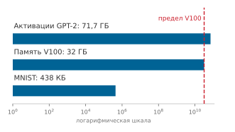

*Объем активаций простирается от игрушечного MNIST до обучения масштаба GPT.*

<a id="sec-model-training-activation-memory-requirements-f44c"></a>

#### Требования к памяти активаций

Память обучения делится на четыре различные категории состояния:

- сохраненные прямые активации, которые нужны правилам производных обратного прохода,
- параметры модели,
- градиенты параметров, и
- состояние оптимизатора и мастер-веса повышенной точности.

Рассмотрим батч обучающих примеров, проходящий через сеть. Прямой проход вычисляет и сохраняет:

$$
\begin{gathered}
\mathbf{Z}^{(\ell)} = \mathbf{A}^{(\ell-1)}\mathbf{W}^{(\ell)} + \mathbf{b}^{(\ell)}
\\
\mathbf{A}^{(\ell)} = f(\mathbf{Z}^{(\ell)})
\end{gathered}
$$

Чтобы вычислить градиент параметров $\nabla_{\mathbf{W}^{(\ell)}}\mathcal{L} = (\mathbf{A}^{(\ell-1)})^\top(\nabla_{\mathbf{Z}^{(\ell)}}\mathcal{L})$, правило обратного прохода должно прочитать входные активации слоя $\mathbf{A}^{(\ell-1)}$. Чтобы передать сигнал ошибки вверх по сети через нелинейную функцию активации по формуле $\nabla_{\mathbf{Z}^{(\ell)}}\mathcal{L} = (\nabla_{\mathbf{A}^{(\ell)}}\mathcal{L}) \odot f'(\mathbf{Z}^{(\ell)})$, ядру нужен либо тензор до активации $\mathbf{Z}^{(\ell)}$ (как в GELU), либо выход после активации $\mathbf{A}^{(\ell)}$ (когда $f'$ можно вычислить по выходу, как в sigmoid, или через булеву маску в один бит для ReLU). Слитые ядра и выборочный пересчет могут сжимать этот сохраненный объем. Тем не менее, поскольку активации масштабируются с размером батча $B$ и длиной последовательности $S$, их хранение растет с размерностью данных, тогда как память параметров и оптимизатора фиксирована архитектурой модели. Расчет для GPT-2 в [«Разборе памяти активаций GPT-2»](08_training.md#nbk-training-gpt-2-activation-memory-breakdown) раскладывает это давление памяти по блокам внимания, подслоям прямого распространения и состояниям оптимизатора.

<a id="nbk-training-gpt-2-activation-memory-breakdown"></a>

> **Разбор памяти активаций GPT-2**
>
> Для GPT-2 с размером батча $B$ = 4, длиной последовательности $S$ = 1024, размерностью скрытого состояния $d$ = 1600 и 48 слоями:
>
> **Расчет**:
>
> - Активации внимания: $B \times S \times d \times 4$ (Q, K, V, выход) = 4 × 1024 × 1600 × $4 \times 2$ байта (FP16) = 52,4 МБ
> - Активации FFN: $B \times S \times (4d)$ (расширение промежуточного слоя) = 4 × 1024 × 6400 × 2 байта = 52,4 МБ
> - Оценки внимания: $5 \times N_{\text{heads}} \times S^2 \times B$ байт для буферов $S{\times}S$ оценок, softmax и dropout. При 25 головах этот член достигает 524,3 МБ на слой — доминирующий член, квадратичный по длине последовательности и именно тот, который отбрасывает выборочный пересчет
> - Статистики слоя нормализации: минимальные (около 10 МБ на слой)
> - Итого на слой: примерно 639,1 МБ (внимание + FFN + оценки внимания + статистики нормализации)
>
> **Результат**:
>
> - Общий объем активаций (оценка по библиотеке, включает буферы остаточного потока и фреймворка сверх перечисленных статей): 35,9 ГБ
> - Параметры (FP16): 3 ГБ
> - Градиенты: 3 ГБ
> - Мастер-веса (FP32): 6 ГБ
> - Момент Adam (FP32): 12 ГБ
> - Пиковая память во время обучения: примерно 59,9 ГБ
>
> Это превышает емкость одного V100 в 32 ГБ.
>
> **Решения**:
>
> 1. Выборочный пересчет активаций: отбросить промежуточные результаты внимания и пересчитать их при обратном проходе, снизив этот член моделируемых активаций на 70,2 процента до примерно 10,7 ГБ; дополнительная работа зависит от реализации
> 2. Выгрузка активаций в CPU: хранить часть активаций в оперативной памяти CPU и передавать их во время обратного прохода
> 3. Смешанная точность: активации FP16 (уже применено) против FP32 (дали бы 71,7 ГБ)
> 4. Уменьшение микробатча и накопление градиентов: собрать больший эффективный батч из нескольких проходов вперед и назад, помещающихся в память
>
> **Системный вывод**: даже после выборочного пересчета смоделированные активации вместе со статическим состоянием составляют около 34,7 ГБ, что немного выше сырой емкости V100 в 32 ГБ до учета рабочей памяти и накладных расходов аллокатора. Поэтому для данного представления по-прежнему необходимы полный пересчет, шардирование, выгрузка или меньший микробатч.

Этот разбор иллюстрирует практические инженерные решения, которые требуются, когда памяти ускорителя не хватает. Тот же компромисс между сохраненными активациями, пересчетом и размером батча задает и анализ памяти и вычислений, который следует дальше.

<a id="chk-training-memory-compute-trade-off"></a>

> **Компромисс между памятью и вычислениями**
>
> Обучение больших моделей требует управления стеной памяти (узким местом пропускной способности, введенным в [«Вычислениях в нейронных сетях»](05_nn_computation.md#sec-neural-computation) и вновь рассмотренным в [«Почему стратегия исполнения важна: стена памяти»](07_frameworks.md#sec-ml-frameworks-execution-strategy-matters-memory-wall-1ce8)).
>
> **Узкое место**
>
> - **Память активаций**: понимаете ли вы, почему активации, сохраненные для обратного распространения ошибки, могут доминировать в использовании памяти и для некоторых форм моделей и рецептов обучения превышать размер параметров более чем в 10 раз?
> - **Стратегия оптимизации**: можете ли вы объяснить, как контрольные точки градиентов обменивают вычисления (пересчет активаций) на емкость памяти?
> - **Оценка памяти**: для GPT-2 (1,5 млрд параметров) в смешанной точности назовите одну значащую цифру для каждого члена в [«уравнении полной памяти обучения»](08_training.md#eq-total-training-memory): веса, градиенты, состояние оптимизатора и активации при размере батча 32. Какой член самый большой и поместится ли итог в ускоритель на 32 ГБ?
>
> **Ограничения масштабирования**
>
> - **Ограничения размера батча**: почему емкость памяти ограничивает максимальный размер батча и как накопление градиентов решает эту проблему без увеличения памяти?

<a id="sec-model-training-memorycomputation-tradeoffs-411e"></a>

#### Компромиссы между памятью и вычислениями

Системы обучения должны балансировать использование памяти и вычислительную эффективность. Каждый прямой проход порождает значения, которые правила обратного прохода могут запросить. Для упрощенной модели сети с $N_L$ слоями пусть $s_\ell$ обозначает байты сохраненного промежуточного состояния на пример на слое $\ell$, а $a_\ell$ — байты сохраненных выходов активаций на пример. При этом соглашении об объеме на пример их хранение растет линейно с размером батча и приближается уравнением:

<a id="eq-activation-memory-per-batch"></a>

$$ \text{Память на батч} = B \times \sum_{\ell=1}^{N_L} (s_\ell + a_\ell) $$

Эта потребность в памяти складывается с памятью весов, градиентов и оптимизатора, рассмотренной в разделе [«Системные следствия выбора оптимизатора»](08_training.md#sec-model-training-optimization-algorithm-system-implications-f9f2). [«Полная память обучения»](08_training.md#eq-total-training-memory) задает концептуальную декомпозицию состояния обучения:

<a id="eq-total-training-memory"></a>

$$ \text{Полная память} = \text{Память}_{\text{весов}} + \text{Память}_{\text{градиентов}} + \text{Память}_{\text{оптимизатора}} + \text{Память на батч} $$

Пиковое значение во время исполнения может превышать эту сумму, потому что рабочие буферы, буферы коммуникации, поведение аллокатора и служебные структуры фреймворка тоже занимают память. Чтобы уменьшить член активаций, системы обучения могут стратегически пересчитывать промежуточные значения во время обратного прохода, а не хранить их. Это увеличивает вычислительную работу, но позволяет использовать более глубокие сети или большие батчи на аппаратуре с ограниченной памятью (Chen et al., 2016). Алгоритм ниже делает компромисс явным: прямой проход хранит активации только в разреженном наборе контрольных точек, а обратный проход пересчитывает остальные по требованию.

**Алгоритм: контрольные точки градиентов (пересчет активаций)**

```text
Вход:  сеть из N_L слоев; набор контрольных точек 𝒞 ⊆ {1, …, N_L} (например, каждые √N_L слоев)
Выход: градиенты параметров при сниженном пиковом объеме памяти активаций
для ℓ = 1 до N_L:
    выполнить прямой проход слоя ℓ; сохранить его активацию, только если ℓ ∈ 𝒞      ▷ остальные отбрасываются
для ℓ = N_L до 1:
    если активация слоя ℓ была отброшена:
        пересчитать прямой сегмент от ближайшей сохраненной контрольной точки до слоя ℓ
    вычислить градиент слоя; освободить активацию
вернуть накопленные градиенты
```

Расстановка контрольных точек равномерно через каждые $\sqrt{N_L}$ слоев снижает пиковый объем активаций с $\mathcal{O}(N_L)$ до $\mathcal{O}(\sqrt{N_L})$ ценой одного дополнительного прямого прохода арифметики на шаг обучения (Chen et al., 2016). Это увеличивает полную вычислительную работу шага примерно с трехкратной до четырехкратной величины FLOP прямого прохода, обменивая дополнительные арифметические операции на заметно меньший объем активаций, который помещается в физическую память ускорителя.

Емкость — лишь одно из двух физических ограничений памяти; второе — пропускная способность. Ускорители дают огромную пропускную способность матричных вычислений, но перемещение тензоров промежуточных активаций между внешней HBM (High Bandwidth Memory) и SRAM на кристалле часто насыщает шину памяти (Jouppi et al., 2017). Даже когда активации помещаются в емкость HBM, время на их чтение и запись может намного превышать время арифметического исполнения. Чтобы снять давление на шину памяти, современные движки обучения сливают поэлементные операции непосредственно с предшествующими матричными умножениями и организуют вычисление градиентов через тайлы SRAM на кристалле, а не через глобальную память. На уровне среды выполнения кэширующие аллокаторы фреймворков отслеживают время жизни тензоров по вычислительному графу и переиспользуют блоки памяти, как только завершается последний обратный потребитель активации (Paszke et al., 2019).

Прямое распространение, вычисление градиентов и обновление параметров определяют, *что* системы обучения должны вычислить. Однако само название операции не показывает, *где* система простаивает. Форма матриц, слияние операторов, численная точность и иерархия памяти определяют, что ограничивает исполнение: арифметическая пропускная способность или перемещение данных. Арифметическая интенсивность дает аналитический инструмент, чтобы количественно оценить этот баланс.

<a id="sec-model-training-arithmetic-intensity-training-bottlenecks-4446"></a>

### Арифметическая интенсивность

Арифметическая интенсивность фиксирует это различие — отношение вычислений к перемещению данных, которое показывает, ограничена ли операция пропускной способностью вычислений или пропускной способностью памяти:

$$
\text{Арифметическая интенсивность} = \frac{\text{FLOP}}{\text{перемещенные байты}}
$$

Операции с высокой арифметической интенсивностью ограничены вычислениями: их производительность упирается в вычислительную пропускную способность процессора. Операции с низкой арифметической интенсивностью ограничены памятью: они тратят больше времени на перемещение данных, чем на вычисления. Раздел [«Модель Roofline»](appendix_machine.md#sec-appdx-machine-foundations-roofline-model-2529) приложения «Основы машины» дает формальное определение модели Roofline и показывает, как вычислить точку перехода аппаратуры.[^fn-ridge-point-precision]

[^fn-ridge-point-precision]: **Точка перехода и точность**: точка перехода Roofline — порог арифметической интенсивности, отделяющий операции, ограниченные памятью, от операций, ограниченных вычислениями, — сдвигается вместе с численной точностью. На том же ускорителе путь через тензорные ядра с пониженной точностью может открывать гораздо большую арифметическую пропускную способность примерно при той же пропускной способности памяти, заметно поднимая точку перехода. Переход от исполнения в стиле TF32 к смешанной точности BF16 поэтому может изменить то, какой метод оптимизации даст отдачу, и делает выбор точности неотделимым от анализа Roofline.

[«Условия классификации операций обучения»](08_training.md#tbl-training-arithmetic-intensity) описывает типичные тенденции, а не фиксированные измерения. Плотное матричное умножение может повторно использовать операнды достаточно, чтобы достичь высокой арифметической интенсивности, тогда как отдельные поэлементные и редукционные ядра часто выполняют меньше работы на байт перемещенных данных. Точка перехода целевой аппаратуры определяет получающийся режим.

| **Операция**             | **Тенденция арифметической интенсивности**                    | **Условие классификации**                            |
|:-------------------------|:--------------------------------------------------------------|:-----------------------------------------------------|
| **Плотное MatMul (большое)** | Высокая, когда формы и тайлинг дают значительное повторное использование операндов | Ограничено вычислениями, только если интенсивность превышает точку перехода |
| **Функции активации**    | Обычно низкая для отдельных поэлементных ядер                 | Часто чувствительны к памяти, если слияние не устраняет трафик |
| **LayerNorm/BatchNorm**  | Редукционная и поэлементная работа с несколькими проходами по тензорам | Зависит от слияния, формы и целевой точки перехода  |
| **Softmax внимания**     | Редукция и нормировка по оси внимания                         | Зависит от материализации, тайлинга и слияния        |

<a id="tbl-training-arithmetic-intensity"></a>

*Условия классификации операций обучения. Семейства операций демонстрируют общие тенденции арифметической интенсивности, но классификация требует сравнить измеренную реализацию с точкой перехода целевой аппаратуры. Ядра, чувствительные к памяти, могут выиграть от сокращения трафика или усиления слияния, тогда как ядра, ограниченные вычислениями, выигрывают от дополнительной арифметической пропускной способности.*

Загрузка аппаратуры при обучении модели напрямую зависит от арифметической интенсивности ядер. Найдите точки операций на [«Иллюстративной диаграмме Roofline для обучения»](08_training.md#fig-training-roofline) по логарифмической оси арифметической интенсивности, сравнивая операторы, ограниченные пропускной способностью памяти и лежащие на наклонном потолке, с операторами, ограниченными вычислениями и лежащими на плоском пике.

<a id="fig-training-roofline"></a>

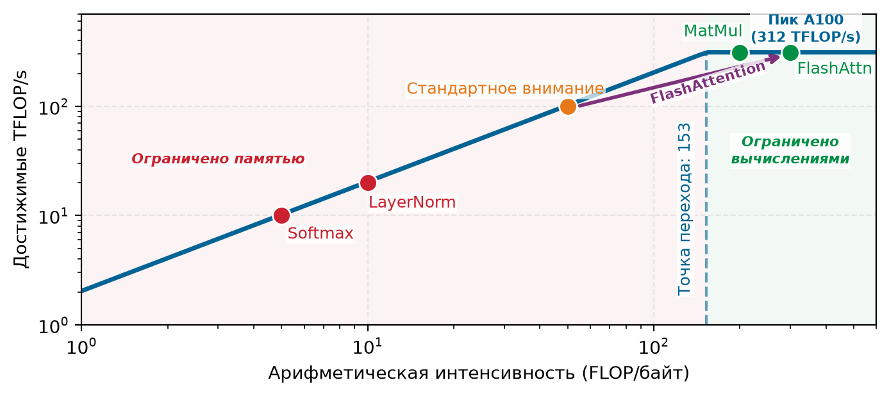

*Иллюстративная диаграмма Roofline для обучения: профиль A100 с предполагаемыми координатами операций показывает, как арифметическая интенсивность меняет потолок достижимой производительности. Точки не являются профилем одного исполнения GPT-2. FlashAttention показан смещенным вправо, потому что сокращает трафик HBM; пересекает ли реальное ядро внимания точку перехода, зависит от формы, точности, аппаратуры и реализации.*

Чтобы выработать интуицию для этих связей, изучите диаграмму Roofline на [«Иллюстративной диаграмме Roofline для обучения»](08_training.md#fig-training-roofline). Точка перехода отмечает «излом», где наклонная область, ограниченная памятью, встречается с плоским потолком, ограниченным вычислениями. Реализация, нанесенная левее этой точки, ограничена пропускной способностью при допущениях модели Roofline; нанесенная правее — ограничена вычислениями. Точки операций на этой диаграмме — иллюстративные размещения, которые показывают, как интерпретировать модель, а не измеренные координаты GPT-2.

Рассмотрим слой внимания GPT-2, который материализует матрицу оценок внимания $S{\times}S$. Для каждой головы произведение $\mathbf{Q}\mathbf{K}^\top$ стоит примерно $2S^2d_{\text{head}}$ FLOP, тогда как запись матрицы оценок в FP16 и ее последующее чтение перемещают около $4S^2$ байт. Если учитывать только этот трафик матрицы оценок, получается приближение $d_{\text{head}}/2$. Для GPT-2 Small ($d_{\text{model}}=768$ при 12 головах, так что $d_{\text{head}}=64$) такой ограниченный учет дает 32 FLOP/байт. Полный анализ ядра должен учитывать также трафик Q и K, работу softmax, дополнительные чтения и записи, повторное использование кэша и слияние. Трафик материализованной матрицы оценок $\mathcal{O}(S^2)$ остается тем членом, на который нацелен FlashAttention.

У ускорителей есть характерные аппаратные точки перехода, в которых операции переходят из ограниченных памятью в ограниченные вычислениями. У типичного ускорителя для дата-центра точка перехода достаточно высока, чтобы операции с низкой интенсивностью, например материализованный softmax внимания, оставались ограниченными памятью, даже когда большие матричные умножения ограничены вычислениями. Операции ниже точки перехода ограничены памятью; выше нее — вычислениями.

<a id="psp-training-peak-flops-vs-sustained-performance"></a>

> **Пиковая FLOP/s против устойчивой производительности**
>
> Пиковая TFLOP/s — это арифметический потолок, а не прогноз устойчивой производительности приложения. Для реализации, строго ограниченной пропускной способностью памяти, повышение только арифметического потолка не улучшает границу Roofline. Смешанная точность обучения может одновременно открывать более быстрые арифметические пути и сокращать трафик для тензоров, которые действительно хранятся и передаются в пониженной точности. Реальный выигрыш зависит от поддержки ядрами, накладных расходов на преобразование, численных требований и того, какой ресурс является ограничивающим. Поэтому оптимизация, направляемая Roofline, сначала измеряет реализацию, а потом выбирает слияние, изменение точности или дополнительные вычисления.

Размер батча может влиять на арифметическую интенсивность и загрузку, меняя формы матриц и объем повторного использования, доступного ядру. Универсальной границы на батче 32, которая отделяла бы выполнение, ограниченное памятью, от выполнения, ограниченного вычислениями, не существует: переход зависит от операции, размерностей, реализации, точности и аппаратуры.

Этот анализ направляет выбор стратегии оптимизации. Для операций, ограниченных памятью, наибольший выигрыш дает сокращение перемещения данных через слияние операторов, снижение точности или алгоритмические улучшения вроде FlashAttention. Для операций, ограниченных вычислениями, важнее повышать пропускную способность через тензорные ядра и параллельное исполнение. Различие практическое: в первом случае вопрос в том, как переместить меньше байт, во втором — как занять больше арифметических блоков.

На [«Иллюстративной диаграмме Roofline для обучения»](08_training.md#fig-training-roofline) FlashAttention[^fn-flashattention-tiling-sram] воплощает основную идею алгоритмического проектирования с учетом ввода-вывода. Никогда не материализуя всю матрицу внимания $S{\times}S$ в HBM и обрабатывая вместо этого тайлы, которые помещаются в быструю SRAM, FlashAttention сокращает вспомогательную память внимания с $\mathcal{O}(S^2)$ до $\mathcal{O}(S)$ и резко снижает трафик HBM. В оригинальной работе сообщается об ускорении до 3 раз на исследованных нагрузках (Dao et al., 2022), причем выигрыш зависит от формы тензоров, аппаратуры и базовой реализации. Алгоритм и условия его применимости подробно разобраны в разделе [«FlashAttention: оптимизация внимания с учетом ввода-вывода»](08_training.md#sec-model-training-flash-attention-ioaware-attention-optimization-3da0).

[^fn-flashattention-tiling-sram]: **FlashAttention**: основной механизм обрабатывает внимание небольшими тайлами, которые помещаются в быструю SRAM ускорителя на кристалле, избегая записи полной промежуточной матрицы $S{\times}S$ в более медленную HBM. Точная граница ввода-вывода HBM зависит от размера тайла и емкости SRAM, но практический эффект — большое сокращение трафика памяти и вспомогательного хранения активаций. В оригинальной работе сообщаются ускорения до 3 раз, зависящие от нагрузки.

Анализ арифметической интенсивности определяет, какой физический ресурс ограничивает конкретную реализацию. Плотное матричное умножение достигает режима, ограниченного вычислениями, когда формы тензоров обеспечивают достаточное повторное использование данных, тогда как отдельные ядра нормализации и поэлементных активаций остаются ограниченными пропускной способностью памяти. FlashAttention показывает, как тайлинг сокращает перемещение данных вне кристалла и повышает эффективную арифметическую интенсивность, сдвигая ограниченное памятью внимание к насыщению вычислений.

Оптимизация отдельных операций необходима, но недостаточна. Идеально настроенное матричное умножение не даст ничего, если ускоритель простаивает в ожидании следующего батча данных. Изолированные стоимости операций — FLOP плотного матричного умножения, активации, ограниченные памятью, и выделение под состояние оптимизатора — складываются внутри цикла исполнения. Устойчивая пропускная способность требует организовать эти дискретные операции в сбалансированный конвейер, где подача данных на входе и обновление параметров на выходе не дают ускорителю голодать.

<a id="sec-model-training-pipeline-architecture-81c9"></a>

## Архитектура конвейера

Шаг обучения — это не одна операция, а последовательность зависимых этапов: данные нужно загрузить до начала вычислений, прямые проходы должны завершиться до начала обратных, а градиенты должны вычислиться до обновления параметров. Скорость самого медленного этапа определяет скорость всей системы. Без конвейеризации эти этапы выполняются последовательно, и ускоритель простаивает, пока хост готовит данные или передает батчи по шине.

Пока графы исполнения моделей ([«Фреймворки машинного обучения»](07_frameworks.md#sec-ml-frameworks)) управляют арифметикой на ускорителе, устойчивое обучение требует подавать эти ядра через границы физических машин. Хост-CPU загружают сырые записи из хранилища и применяют предобработку в DRAM хоста, тогда как ускорители выполняют матричные умножения в HBM. Данные должны пересекать межсоединение — обычно линию PCIe, пропускная способность которой на порядок ниже пропускной способности памяти устройства. Когда подготовка данных на входе или передача по шине превышает длительность прямого и обратного проходов, вычислительные движки ускорителя голодают, снижая коэффициент загрузки аппаратуры $\eta_{\text{hw}}$ в железном законе производительности обучения.

Управление этими физическими границами делит систему обучения на три взаимосвязанные подсистемы, каждая из которых предъявляет свои требования к аппаратным ресурсам. Конвейер данных выполняет загрузку, преобразование и батчинг на хосте; цикл обучения координирует прямые проходы, обратные проходы и обновления параметров на ускорителе; а конвейер оценки периодически проверяет качество модели на отложенных данных. [«Обзор системы обучения»](08_training.md#fig-training-pipeline) показывает, как эти подсистемы взаимодействуют на протяжении жизненного цикла обучения. Интерфейсы между ними образуют критические границы синхронизации, где задержки ввода-вывода, передачи по межсоединению или синхронные паузы валидации могут сдерживать загрузку ускорителя.

<a id="fig-training-pipeline"></a>

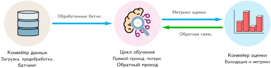

*Обзор системы обучения: жизненный цикл обучения координирует подготовку данных, основное прямое и обратное вычисление и оценку на валидации. Интерфейсы между этими тремя конвейерами являются критическими границами синхронизации, где задержки ввода-вывода или паузы оценки могут сдерживать загрузку ускорителя.*

<a id="sec-model-training-architectural-overview-5fc6"></a>

### Архитектурный обзор

Сквозная система обучения координирует три различные подсистемы: конвейер данных на стороне хоста, который готовит входные батчи, цикл исполнения на ускорителе, который выполняет математический шаг оптимизации, и периодический конвейер оценки, который отслеживает качество модели на валидационных данных. Эти подсистемы исполняются в разных аппаратных областях. Конвейер данных потребляет ядра CPU хоста и пропускную способность хранилища; цикл исполнения занимает вычислительные ядра ускорителя и память устройства; а оценка периодически вытесняет обучение, чтобы проверить обобщающую способность. Любой дисбаланс задержек между этими компонентами напрямую превращается в простаивающие такты ускорителя.

На границе ввода конвейер данных переносит сырые записи из постоянного хранилища в память хоста, применяет преобразования вроде аугментации и нормализации (LeCun et al., 2012) и упаковывает тензоры в плотные батчи. Эти батчи передаются по межсоединению хост–ускоритель (например, PCIe) в память ускорителя. На границе валидации конвейер оценки периодически пропускает отложенные данные через модель без вычисления градиентов. Поскольку валидация занимает те же ядра ускорителя, что нужны для обучения, частота ее запуска представляет прямой компромисс между разрешением мониторинга и общей пропускной способностью обучения.

Внутри ускорителя итерация обучения образует замкнутую петлю обратной связи, управляемую жесткими зависимостями по данным и памяти. Циклический путь данных на [«Итеративном цикле обучения»](08_training.md#fig-training-loop) отображает эти последовательные операции: прямой проход, вычисление градиентов через обратное распространение ошибки и обновление параметров.

<a id="fig-training-loop"></a>

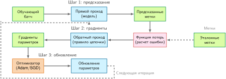

*Итеративный цикл обучения: каждая итерация последовательно выполняет прямое предсказание, вычисление градиентов обратным распространением ошибки и обновление оптимизатора. Обновленные параметры возвращаются в следующий прямой проход, а следующий батч остается отдельным входом. Зависимости по данным и резидентность памяти задают минимальное время шага и нижнюю границу памяти.*

Хотя [«Математические основы»](08_training.md#sec-model-training-mathematical-foundations-d894) формализует численные операторы этого цикла, физическое исполнение на аппаратуре определяют резидентность памяти и зависимости по данным. Во время прямого прохода промежуточные тензоры активаций должны оставаться в HBM ускорителя, потому что обратный проход требует их для вычисления производных по правилу цепочки. Когда градиенты вычислены, оптимизатор читает и параметры, и накопленные градиенты, чтобы применить правило обновления, и порождает новые веса для следующей итерации. Емкость памяти, необходимая для хранения активаций, весов и состояний оптимизатора, задает нижнюю границу памяти для всего шага обучения.

Этот цикл исполнения повторяется по батчам и эпохам, пока оптимизация не сойдется. Максимизация арифметической эффективности ускорителя требует перекрывать эти этапы конвейера на всей иерархии системы. Потоки CPU хоста заранее загружают и готовят батч $k+1$ в закрепленную память, пока ускоритель выполняет батч $k$, скрывая задержку хранилища и время передачи по PCIe за вычислениями матричного умножения. Когда эта конкурентность нарушается — будь то конвейер данных, ограниченный вводом-выводом, который лишает устройство входных тензоров, или частая оценка, останавливающая цикл обновления, — ускоритель простаивает и эффективная пропускная способность падает.

<a id="sec-model-training-data-pipeline-8e71"></a>

### Конвейер данных

Чтобы арифметические блоки ускорителя оставались загруженными, обучающие примеры нужно потоково передавать из постоянного хранилища в память устройства со скоростью не ниже скорости потребления модели. Пока восходящая инженерия данных ([«Инженерия данных»](04_data_engineering.md#sec-data-engineering)) готовит и разбивает наборы данных на носителях хранения, конвейер данных времени исполнения работает одновременно с вычислениями модели на CPU хоста.

Конвейер данных связывает сырое хранилище и исполнение на ускорителе через границу машины. [«Поток данных от CPU к GPU»](08_training.md#fig-data-pipeline) иллюстрирует это перемещение через три физические зоны.

<a id="fig-data-pipeline"></a>

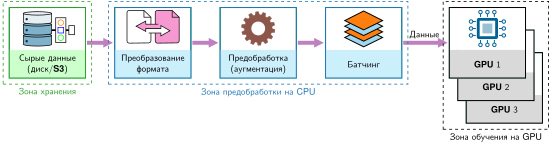

*Поток данных от CPU к GPU: обучающие данные проходят через зоны хранилища, предобработки на CPU и исполнения на GPU. Каждый этап — потенциальный ограничитель пропускной способности: скорость чтения с диска, задержка преобразований и передачи с хоста на устройство по PCIe должны вместе поддерживать скорость потребления GPU, чтобы ускорители работали на пиковой загрузке.*

В зоне хранилища сырые записи находятся на локальных дисках NVMe или в сетевых системах хранения. В зоне предобработки на CPU рабочие потоки хоста декодируют сырые байты, применяют преобразования вроде токенизации или аугментации данных и собирают отдельные записи в плотные тензоры мини-батчей. В зоне обучения на GPU ускорители передают эти тензоры по шине PCIe и выполняют прямой и обратный проходы. Поскольку три зоны образуют строгий конвейер, самый медленный этап определяет сквозную пропускную способность обучения.

<a id="sec-model-training-core-components-d28d"></a>

#### Основные компоненты

Пропускная способность конвейера данных начинается с подсистемы хранения. Решения о размещении данных на предыдущих этапах из [«Инженерии данных»](04_data_engineering.md#sec-data-engineering), например последовательное разбиение на части в колоночных или контейнерных форматах (Parquet, TFRecord, Arrow), определяют физические паттерны ввода-вывода, которые получает операционная система.

Пропускная способность хранения ограничена более медленным из двух аппаратных ограничений, что выражается в формуле [«пропускная способность хранения»](08_training.md#eq-storage-throughput):

<a id="eq-storage-throughput"></a>

$$R_{\text{storage}} =\min(\text{BW}_{\text{disk}}, \text{BW}_{\text{network}})$$

Здесь $\text{BW}_{\text{disk}}$ — физическая пропускная способность диска, а $\text{BW}_{\text{network}}$ — пропускная способность сети для распределенных систем хранения. На практике обучающие нагрузки редко достигают этого теоретического максимума, потому что перемешивание данных может превращать большие последовательные чтения в более мелкие и менее эффективные обращения. Эффективную пропускную способность хранения можно моделировать как $R_{\text{storage,eff}} = R_{\text{storage}} \times F_{\text{access}}$, где $F_{\text{access}}$ зависит от размера записи, раскладки файлов, кэширования и аппаратуры хранения. Когда небуферизованные случайные чтения снижают $F_{\text{access}}$, пропускная способность хранения падает на порядок, превращая систему ввода-вывода, которая на бумаге выглядит достаточной, в главное узкое место обучения.

<a id="sec-model-training-preprocessing-523c"></a>

#### Предобработка

После извлечения из хранилища сырые байты нужно преобразовать CPU в тензоры, готовые для модели. Статическое извлечение признаков может выполняться офлайн ([«Инженерия данных»](04_data_engineering.md#sec-data-engineering)), а динамические преобразования, такие как токенизация на лету и аугментация изображений, выполняются во время обучения. В идеальной модели независимых рабочих пропускная способность предобработки растет с числом рабочих, как выражено в формуле [«пропускная способность предобработки»](08_training.md#eq-preprocess-throughput):

<a id="eq-preprocess-throughput"></a>

$$R_{\text{preprocessing}} = \frac{N_{\text{workers}}}{T_{\text{transform}}}$$

Здесь $N_{\text{workers}}$ параллельных потоков обработки выполняют преобразования, каждое из которых требует $T_{\text{transform}}$ секунд. Архитектуры обучения используют несколько рабочих, чтобы предобработка поспевала за скоростью потребления ускорителя: один поток, выполняющий аугментацию изображений за 30 мс на батч, не может питать ускоритель, который выполняет прямой проход за 10 мс.

Предобработанные данные затем должны передаться на ускоритель, прежде чем начнутся вычисления. Общая пропускная способность обучения поэтому ограничена самым медленным из трех этапов, что явно показывает [«Узкое место обучения»](08_training.md#eq-training-bottleneck):

<a id="eq-training-bottleneck"></a>

$$R_{\text{training}} =\min\left(R_{\text{preprocessing}}, \frac{\text{BW}_{\text{GPU transfer}}}{D_{\text{vol}}^{(\text{batch})}}, \frac{R_{\text{compute}}}{O_{\text{batch}}}\right)$$

Здесь $D_{\text{vol}}^{(\text{batch})}$ — входные байты на батч, а $O_{\text{batch}}$ — работа прямого и обратного прохода на батч в FLOP. Все члены поэтому выражаются в батчах в секунду до взятия минимума.

<a id="exmp-training-gpt-2-language-model-data-pipeline"></a>

> **Конвейер данных языковой модели GPT-2**
>
> **Сценарий**: количественная оценка доступа к хранилищу, токенизации на CPU и передач с хоста на устройство по PCIe, которые снабжают кластер из 32 GPU V100, обучающий GPT-2.
>
> **Трассировка этапов**:
>
> 1. **Хранение сырого текста**: корпус WebText содержит примерно 40 ГБ сырого текста. Последовательное чтение с NVMe SSD достигает 7 ГБ/с. При выборке документов с коэффициентом доступа 0,1 пропускная способность случайного доступа падает до 0,70 ГБ/с, что дает $T_{\text{read}} = D_{\text{vol}} / \text{BW}_{\text{storage}} \approx 0{,}1\text{ мс}$.
> 2. **Токенизация**: BPE-токенизатор (словарь из 50 257 токенов) превращает текст в идентификаторы токенов. При размере батча $B = 32$ и длине последовательности $S = 1024$ (всего 32,8 тыс. токенов) одно CPU-ядро, обрабатывающее 500 тыс. токенов в секунду, тратит $T_{\text{tokenize}} \approx$ 65,5 мс на батч.
> 3. **Батчинг и паддинг**: паддинг и упаковка формируют тензор типа int64 формы 32 последовательности $\times$ 1 024 токена, то есть 262,1 КБ на батч.
> 4. **Передача по PCIe**: перенос тензора по шине PCIe Gen3 x16 (пропускная способность 15,75 ГБ/с) занимает $T_{\text{transfer}} =$ 0,017 мс, поэтому передача по шине пренебрежимо мала.
>
> **Системный вывод**: подготовка на одном ядре CPU ($T_{\text{prep}} \approx$ 65,6 мс) занимает большую часть бюджета шага ускорителя ($T_{\text{step}} \approx$ 84,4 мс), так что последовательный конвейер платит обе стоимости на каждом шаге, и $\eta_{\text{hw}}$ падает примерно до 56 процентов. Если подготовка станет хоть немного медленнее, ускоритель начнет полностью простаивать. Масштабирование до 8 параллельных рабочих процессов снижает задержку токенизации до $T_{\text{tokenize}} / N_{\text{worker}} \approx$ 8,2 мс, а предвыборка перекрывает $T_{\text{prep}}$ с $T_{\text{step}}$, восстанавливая загрузку аппаратуры до 95 процентов и давая 379 глобальных образцов в секунду на 32 GPU V100.

Это соотношение «минимума из трех» определяет проектирование конвейера обучения, потому что пропускная способность системы равна пропускной способности узкого места. Ускоритель с вычислительной мощностью 312 TFLOP/s не выполняет полезной работы, пока ждет данных. И наоборот, идеально оптимизированный конвейер данных не дает выигрыша, если ускоритель уже насыщен вычислениями. Сбалансированный проект конвейера согласует мощность предобработки, пропускную способность передачи и пропускную способность вычислений так, чтобы ни один этап не доминировал во времени итерации. Пример GPT-2 показывает, что токенизация на CPU, а не получение из хранилища или передача по шине, формирует главный барьер пропускной способности, пока параллельные рабочие и предвыборка не скрывают задержку подготовки на хосте.

Пропускная способность конвейера данных — не единственный поток, который может заморить ускоритель голодом. Обучение на нескольких GPU добавляет второй поток трафика: синхронизацию градиентов, необходимую после каждого шага. Как только время синхронизации превышает время вычислений, коммуникация становится ограничивающим фактором. [«Масштабирование за пределы одного узла»](08_training.md#sec-model-training-scaling-beyond-single-node-a671) количественно описывает эту сетевую стену в точке, где обучение выходит за границу узла.

<a id="sec-model-training-system-implications-2539"></a>

#### Системные следствия

Конвейер данных и вычислительный движок образуют связанную систему, пропускная способность которой равна пропускной способности более медленного из них, как задает [«системная пропускная способность»](08_training.md#eq-system-throughput):

<a id="eq-system-throughput"></a>

$$R_{\text{system}} =\min(R_{\text{pipeline}}, R_{\text{compute}})$$

Когда $R_{\text{pipeline}} < R_{\text{compute}}$, ускоритель простаивает в ожидании данных, и загрузка ускорителя падает пропорционально, как показывает [«загрузка GPU»](08_training.md#eq-gpu-utilization):

<a id="eq-gpu-utilization"></a>

$$\text{Загрузка ускорителя} = \min\left(1, \frac{R_{\text{pipeline}}}{R_{\text{compute}}}\right) \times 100\%$$

Модель ResNet-50 на современной аппаратуре ускорителя может обрабатывать 1 000 изображений в секунду, но если конвейер данных подает всего 200 изображений в секунду, загрузка ускорителя падает до 20 процентов: ускоритель простаивает 80 процентов времени. Переход на более быстрое железо здесь не помогает: ускоритель, способный на 2 000 изображений в секунду, при том же конвейере дал бы загрузку всего 10 процентов. Сбалансированный проект системы стремится обеспечить ускоритель данными, а не заставлять его ждать более раннего этапа.

<a id="sec-model-training-data-flows-0b2e"></a>

#### Потоки данных

Обучающие данные проходят три уровня памяти на пути от диска к ускорителю, и разрыв пропускной способности между этими уровнями, достигающий трех порядков величины, — центральная задача проектирования конвейера данных. Эффективная скорость передачи через иерархию ограничена ее самым медленным звеном, как показывает [«пропускная способность иерархии памяти»](08_training.md#eq-memory-hierarchy-bandwidth):

<a id="eq-memory-hierarchy-bandwidth"></a>

$$R_{\text{memory}} =\min(\text{BW}_{\text{storage}}, \text{BW}_{\text{system}}, \text{BW}_{\text{accelerator}})$$

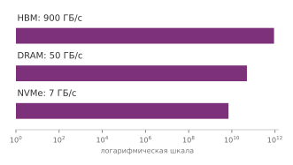

*Пропускная способность растет по иерархии: от хранилища к DRAM и затем к HBM.*

Локальное хранилище NVMe дает 7 ГБ/с, системная память — 50 ГБ/с, а HBM ускорителя — 900 ГБ/с или больше. Каждый уровень примерно на порядок быстрее нижележащего, поэтому данные, которые свободно текут внутри памяти ускорителя, создают жесткое узкое место, когда их нужно получить с диска. Эта каскадная иерархия пропускной способности объясняет, почему время итерации хорошо конвейеризованной системы определяется *максимумом* ее компонентных задержек, а не их *суммой*, как показывает [«время итерации»](08_training.md#eq-iteration-time):

<a id="eq-iteration-time"></a>

$$T_{\text{iteration}} =\max(T_{\text{fetch}}, T_{\text{process}}, T_{\text{transfer}})$$

Когда этапы конвейера перекрываются правильно (выборка следующего батча из хранилища во время предобработки текущего и передача предыдущего ускорителю), время итерации равно длительности самого медленного этапа, а не сумме всех этапов. Именно это перекрытие и обеспечивает предвыборка: она превращает последовательное узкое место в параллельный конвейер, где каждый уровень работает одновременно над разными батчами.

<a id="sec-model-training-practical-architectures-d54d"></a>

#### Практические архитектуры

Устройство NVMe с номинальной скоростью 7 ГБ/с обеспечит 3,50 ГБ/с, если нагрузка достигает половины пика. Мелкие случайные чтения и перемешивание могут снизить пропускную способность еще сильнее; штраф зависит от размера обращения, глубины очереди, раскладки файлов и кэширования.

Чтобы ускорители оставались питаемыми несмотря на это снижение пропускной способности, архитектуры конвейера одновременно держат несколько буферов данных: буферы предвыборки, которые загружают будущие батчи, буферы обработки, где данные преобразуются, и буферы передачи, которые подготавливают данные для потребления ускорителем. Общая память хоста растет пропорционально объему памяти на батч $M_{\text{batch}}$ в соответствии с [«памятью буферов»](08_training.md#eq-buffer-memory):

<a id="eq-buffer-memory"></a>

$$M_{\text{required}} = (N_{\text{prefetch}} + N_{\text{processing}} + N_{\text{transfer}}) \times M_{\text{batch}}$$

Чтобы не дать ускорителю голодать, среднее время обслуживания предобработки на батч должно удовлетворять [«условию конвейера»](08_training.md#eq-pipeline-condition):

<a id="eq-pipeline-condition"></a>

$$T_{\text{preprocessing}} \leq T_{\text{compute}}$$

Если предобработка занимает 40 мс на батч на одном рабочем, а ускоритель потребляет по одному батчу каждые 10 мс, при идеальном масштабировании нужно не менее четырех рабочих. Реальные требования зависят от хранилища, конкуренции за CPU и стоимости преобразований; [«Предвыборка данных и перекрытие»](08_training.md#sec-model-training-data-prefetching-pipeline-overlapping-e984) рассматривает предвыборку и параллельных рабочих.

<a id="sec-model-training-forward-pass-9695"></a>

### Прямой проход

Подготовленные батчи входят в цикл обучения через прямой проход, где входные данные распространяются через модель, чтобы получить предсказания. Концептуальный поток следует послойному преобразованию $\mathbf{A}^{(\ell)} = f\left(\mathbf{A}^{(\ell-1)}\mathbf{W}^{(\ell)} + \mathbf{b}^{(\ell)}\right)$, но физическая реализация должна планировать вычислительные ядра, пропускать активации через иерархию памяти и сохранять промежуточные тензоры для обратного распространения ошибки.

<a id="sec-model-training-compute-operations-83ee"></a>

#### Вычислительные операции

Прямой проход отображает слои нейронной сети на ядра матричного умножения, разобранные в [«Матричных операциях»](08_training.md#sec-model-training-matrix-operations-1f21). Для каждого плотного слоя ускоритель выполняет $N \times M \times B$ операций умножения с накоплением. Например, слой размером $512 \times 1024$, обрабатывающий батч из 64 образцов, выполняет примерно 33,6 млн операций умножения с накоплением (MAC), или примерно 67,1 MFLOP при соглашении о двух FLOP на одну операцию MAC.

<a id="psp-training-wave-quantization-tail-effects"></a>

> **Квантование волн и эффекты хвоста**
>
> Частая ошибка в ML-системах — игнорировать фиксированную гранулярность исполнения ядер GPU. Исполнение GPU квантуется в волны работы, но релевантная единица — отображение потоков или тайлов ядра, а не обязательно один образец на поток.
>
> NVIDIA GPU выполняет работу варпами по 32 потока. В иллюстративном частном случае, когда один независимый элемент работы отображается на один поток, 32 элемента заполняют один варп, а 33 элемента требуют второго, почти пустого варпа. Ядра нейронных сетей обычно отображают каждый образец на много потоков, поэтому один лишь размер батча не определяет эту загрузку.
>
> На крупном GPU, таком как NVIDIA H100 с 132 потоковыми мультипроцессорами (SM), где каждый SM планирует группы варпов, аппаратура обрабатывает тысячи потоков в одной волне. Если общая нагрузка немного превышает границу волны (например, 1,01 волны), аппаратура должна довести до конца вторую, почти пустую волну, прежде чем начнется следующая задача.
>
> [«Иллюстративная арифметика хвоста варпа»](08_training.md#tbl-training-wave-quantization) количественно оценивает эту иллюстрацию с одним элементом на поток. Это не общая модель производительности по размеру батча.
>
> | **Независимые элементы работы**                 |                    **Требуется варпов**               |              **Загрузка полос**                |                      **Относительное время**                |
> |:------------------------------------------------|:-----------------------------------------------------:|:----------------------------------------------:|:-----------------------------------------------------------:|
> | 32 | 1 |                      100%                      |                          1×                          |
> | 33 | 2 | 51,6% | ~2× |
> | 64 | 2 |                      100%                      |                          1×                          |
> | 65 | 3 | 67,7% | ~1,5× |
>
> <a id="tbl-training-wave-quantization"></a>
>
> ***Иллюстративная арифметика хвоста варпа**: при отображении «один элемент работы на поток» количество, чуть превышающее границу в 32 потока, запускает частично заполненный варп, поэтому 33 элемента используют два варпа, тогда как 64 заполняют те же два варпа. Реальные ядра обучения отображают тензоры на потоки и тайлы специфичными для реализации способами, часто назначая много потоков на каждый образец, поэтому эти значения нельзя вывести только из размера батча. Профилирование должно определить реальное отображение ядра и границы волн.*
>
> **Системный вывод**: выравнивайте размерности тензоров и тайлов с аппаратным отображением ядра, а затем проверяйте бенчмарком кандидатные размеры батча. Профилирование выявляет частично заполненные варпы и волны; один лишь размер батча этого не покажет.

Помимо плотного матричного умножения, разные архитектуры нейронных сетей вводят специализированные вычислительные паттерны. Сверточные сети, например, скользят пространственными фильтрами по многоканальным входным тензорам. Рассмотрим входной тензор размерности $64 \times 224 \times 224 \times 3$ (размер батча $\times$ высота $\times$ ширина $\times$ каналы), обрабатываемый ядрами $7 \times 7$. Каждая позиция требует 147 операций умножения с накоплением, а при 64 фильтрах, работающих по пространственным размерностям $218 \times 218$, вычислительная работа масштабируется до миллионов операций умножения с накоплением на изображение. Ускорители выполняют эти пространственные свертки либо приводя их к плотным GEMM через развертывание столбцов (`im2col`), либо применяя минимальную фильтрацию Винограда, которая обменивает трафик внешней памяти на хранение в scratchpad.

Архитектуры трансформеров вводят механизмы внимания ([«Архитектуры нейронных сетей»](06_nn_architectures.md#sec-network-architectures)), которые вычисляют оценки сходства по последовательностям. Внимание сочетает пакетные матричные умножения ($QK^T$ и $\text{Softmax}(...)V$) с построчными редукциями. Поскольку промежуточные матрицы оценок внимания растут квадратично с длиной последовательности, материализация этих активаций в глобальной памяти создает узкое место пропускной способности, если ядра не сливают матричные умножения и нормализацию внутри SRAM на кристалле.

Во всех этих сетях поэлементные операции имеют низкую арифметическую интенсивность. Отдельные реализации функций активации, таких как ReLU и sigmoid, преобразуют элементы тензора независимо, и потому их ограничивает пропускная способность памяти, а не производительность вычислений ([«Арифметическая интенсивность»](08_training.md#sec-model-training-arithmetic-intensity-training-bottlenecks-4446)). Пакетная нормализация усиливает этот трафик памяти, вычисляя статистики по батчу и пространственным измерениям, что требует глобальных барьеров синхронизации и нескольких проходов чтения и записи по памяти активаций.

Ускорители выполняют эти параллельные нагрузки, группируя потоки исполнения в единицы фиксированного размера: варпы[^fn-warp-execution-model] по 32 потока на архитектурах NVIDIA или волновые фронты (wavefronts) по 64 потока на архитектурах AMD. Эффективность исполнения на аппаратуре зависит от согласования размерностей тензоров и форм тайлов с геометрией блоков потоков и размерностями операндных матриц, которых требуют специализированные блоки вроде тензорных ядер.

[^fn-warp-execution-model]: **Варп (warp)**: термин из ткачества, где «warp» — это нити основы, натянутые на станке, между которыми проходит челнок. NVIDIA заимствовала его, потому что потоки GPU внутри варпа выполняют одну и ту же инструкцию синхронно, подобно параллельным нитям, движущимся вместе на станке. Варп NVIDIA содержит 32 потока.

Оптимизированные библиотеки операторов, такие как cuDNN (Chetlur et al., 2014), реализуют несколько вычислительных алгоритмов для каждого типа слоя и динамически выбирают между ними по размерностям тензоров, ограничениям памяти scratchpad и возможностям аппаратуры. Например, cuDNN выбирает между прямой сверткой, приведением к GEMM, сверткой через быстрое преобразование Фурье (FFT) и преобразованиями Винограда, оценивая компромисс между накладными расходами рабочей памяти и арифметическими операциями (NVIDIA Corporation, 2023). Эти паттерны загрузки аппаратуры усиливают связь между размером батча и эффективностью аппаратуры, установленную в разделе [«Методы оптимизации на основе градиента»](08_training.md#sec-model-training-gradientbased-optimization-methods-9798): большие размеры батча насыщают вычислительные блоки ускорителя и амортизируют передачи памяти, но увеличивают хранение промежуточных активаций.

<a id="sec-model-training-memory-management-c1ec"></a>

#### Управление памятью

Управление памятью проявляется в прямом проходе, когда промежуточные активации должны сохраняться в высокоскоростной памяти для вычисления градиентов при обратном распространении ошибки. Чтобы понять, как емкость памяти ограничивает обучение, рассмотрим занимаемую память при обучении модели на 7 млрд параметров на ускорителе с 24 ГБ с учетом весов, градиентов, состояния оптимизатора и сохраненных активаций.

<a id="nbk-training-estimating-vram-requirements"></a>

> **Оценка требований к VRAM**
>
> **Задача**: поместится ли модель на 7 млрд параметров в GPU на 24 ГБ для обучения?
>
> **Дано**: 7 млрд параметров, веса и градиенты FP16, мастер-веса FP32 и состояния Adam, а также 24 ГБ памяти GPU.
>
> **Расчет**:
>
> 1. **Веса (FP16)**: 7 млрд $\times$ 2 байта = 14 ГБ.
> 2. **Градиенты (FP16)**: тот же размер, что и веса = 14 ГБ.
> 3. **Состояние обучения FP32**: мастер-веса требуют 28 ГБ; моменты Adam (импульс и дисперсия) требуют еще 56 ГБ.
> 4. **Промежуточный итог (до активаций)**: 14 ГБ + 14 ГБ + 28 ГБ + 56 ГБ = 112 ГБ, что уже превышает GPU на 24 ГБ.
> 5. **Активации**: упрощенная оценка для трансформера — размер батча $\times$ длина последовательности $\times$ скрытая размерность $\times$ число слоев $\times$ байты $\times$ коэффициент активаций для сохраненных промежуточных результатов внимания, многослойного перцептрона и нормализации. При размере батча 1, длине последовательности 2048, скрытой размерности 4096, 32 слоях и коэффициенте (множителе) активаций около 57 сохраненные активации добавляют 30,6 ГБ.
>
> **Системный вывод**: обучение с полным набором параметров требует разбиения или выгрузки состояния через такие системы, как полностью шардированный параллелизм данных (FSDP) или ZeRO. Квантованные базовые веса снижают память для дообучения с эффективным использованием параметров, но не воспроизводят этот рецепт обучения полными параметрами в смешанной точности.

Только память активаций растет примерно линейно с размером батча ([«память активаций на батч»](08_training.md#eq-activation-memory-per-batch)); параметры модели и состояние оптимизатора остаются фиксированными. Практическая сложность в том, как эти затраты взаимодействуют между слоями.

Рассмотрим ResNet-50, обрабатывающую изображения разрешением 224 $\times$ 224 при размере батча 32. Первый сверточный слой выдает карты активаций размером 112 $\times$ 112 $\times$ 64; на одно изображение при одинарной точности (4 байта) это требует примерно 3,2 МБ. По 50 слоям промежуточная память активаций накапливается: полные активации прямого прохода в сумме составляют примерно 8 ГБ, обратный проход добавляет еще 4 ГБ рабочего набора активаций (эмпирическая рабочая память, отличная от хранимых градиентов параметров), а параметры модели занимают 102,4 МБ. Этот итог в 12,1 ГБ составляет около 15,1 процента емкости памяти GPU A100 объемом 80 ГБ для одного батча.

Удвоение размера батча до 64 удваивает хранение активаций: активации прямого прохода достигают 16 ГБ, рабочий набор активаций обратного прохода — 8 ГБ, а полная память — 24,1 ГБ. В моделях зрения с большим пространственным разрешением активации доминируют в занимаемой памяти, а хранение параметров (102,4 МБ) пренебрежимо мало. Для больших языковых моделей баланс меняется на противоположный: GPT-3 (175 млрд параметров) требует примерно 700 ГБ только для параметров в FP32 (350 ГБ в FP16), что превышает емкость одного ускорителя еще до выделения памяти под активации или состояние оптимизатора.

Поскольку память ускорителя (40–80 ГБ на современной аппаратуре) должна одновременно хранить активации, параметры, градиенты и состояния оптимизатора, емкость памяти, а не вычислительная пропускная способность, часто ограничивает допустимый размер батча. Две системные техники снимают это узкое место емкости: контрольные точки активаций отбрасывают промежуточные активации во время прямого прохода и пересчитывают их во время обратного, обменивая избыточную арифметику на меньший объем хранения; смешанная точность обучения вдвое сокращает трафик памяти и хранение на значение, переходя к 16-битным форматам с плавающей точкой. Обе техники подробно разобраны в разделе [«Оптимизации конвейера»](08_training.md#sec-model-training-pipeline-optimizations-cd9d).

Во время обратного распространения ошибки ([«Механика обратного распространения ошибки»](08_training.md#sec-model-training-backpropagation-mechanics-0b64)) обратный проход обходит сеть в обратном порядке, потребляя сохраненные прямые активации, чтобы вычислить градиенты параметров и активаций примерно вдвое большей арифметической стоимостью, чем у прямого прохода. Требования к памяти меняются по слоям динамически. В ResNet-50 промежуточные слои расширяются до 256 фильтров с исходных 64, где уменьшенные пространственные размеры карт частично компенсируют большую глубину каналов. По 50 слоям рабочий набор активаций обратного прохода достигает примерно 3,2 ГБ до учета градиентов параметров и состояния оптимизатора. Пиковый объем памяти отражает сохраненные прямые активации, активные буферы градиентов, временные рабочие области и расписание выделения памяти во время исполнения, а не только ширину одного слоя.

<a id="sec-model-training-parameter-updates-optimizers-b1a4"></a>

### Обновление параметров и оптимизаторы

Когда обратный проход заполняет буферы градиентов, система выполняет шаг оптимизатора, чтобы обновить параметры модели. Выбор оптимизатора определяет и математическую траекторию к минимуму функции потерь, и аппаратные ресурсы, которые требует каждая итерация. В стандартных фреймворках глубокого обучения эта фаза связывает вычисление градиентов с обновлением параметров ([«Обновление параметров»](08_training.md#lst-param_update)): `loss.backward()` обходит вычислительный граф в обратном порядке, заполняя тензоры градиентов, а `optimizer.step()` применяет правило обновления ко всем зарегистрированным параметрам.

<a id="lst-param_update"></a>

**Обновление параметров**: вычисляет градиенты и применяет шаг оптимизатора к параметрам модели. Повторение этого цикла стремится минимизировать целевую функцию обучения, хотя улучшение не гарантировано на каждом шаге или эпохе.

```python
loss.backward()  # Вычисляем градиенты
optimizer.step()  # Обновляем параметры
```

Хотя `optimizer.step()` выглядит как один вызов фреймворка, он запускает нагрузку, ограниченную памятью, по всей памяти ускорителя. В отличие от прямого и обратного проходов, где GEMM дают высокую арифметическую интенсивность за счет многократного повторного использования тайлованных данных в регистрах и разделяемой памяти, шаг оптимизатора состоит из низкоинтенсивной поэлементной арифметики. Для каждого параметра ускоритель должен передать веса, градиенты и вспомогательные состояния оптимизатора из HBM в регистры на кристалле, вычислить правило обновления и записать изменившиеся значения обратно в HBM. Поскольку каждый переданный байт участвует лишь в нескольких операциях с плавающей точкой, арифметическая интенсивность остается заметно ниже одного FLOP на байт, и время исполнения определяется пропускной способностью памяти, а не вычислительной пропускной способностью.

<a id="sec-model-training-optimizer-memory-training-loop-4383"></a>

#### Память оптимизатора в цикле обучения

Это узкое место пропускной способности памяти усиливается требованиями к вспомогательному состоянию, количественно оцененными в [«Занимаемой памяти оптимизатора»](08_training.md#tbl-optimizer-properties). Стохастический градиентный спуск не требует постоянного состояния помимо весов и градиентов, тогда как адаптивные оптимизаторы требуют значительного вспомогательного хранения. Для Adam поддержание скользящих оценок первого момента (импульса) и второго момента (нецентрированной дисперсии) требует двух дополнительных тензоров состояния FP32 на каждый параметр. При каждом обновлении ускоритель должен читать и записывать эти буферы состояния по шине памяти, что умножает трафик памяти и занимает емкость, которая иначе могла бы вместить батчи большего размера или более длинные последовательности.

На масштабе миллиардов параметров состояние оптимизатора доминирует в бюджете памяти. Как количественно показано в разборе GPT-2 ([«Системные следствия выбора оптимизатора»](08_training.md#sec-model-training-optimization-algorithm-system-implications-f9f2)), модели на 1,5 млрд параметров требуется 12 ГБ только для состояния оптимизатора Adam в FP32, помимо параметров и градиентов, до учета активаций. Эта задача мотивировала экономные по памяти варианты оптимизаторов: Adafactor факторизует состояние второго момента (Shazeer and Stern, 2018), 8-битные оптимизаторы квантуют статистики оптимизатора (Dettmers et al., 2022), а GaLore вычисляет обновления в низкоранговом пространстве (Zhao et al., 2024). [«Иллюстративная разбивка занимаемой памяти»](08_training.md#fig-galore-llm-memory-breakdown) сравнивает выделение памяти для модели на 7 млрд параметров в четырех конфигурациях оптимизатора и показывает, как низкоранговая проекция сокращает состояние оптимизатора до доли стандартного объема.

<a id="fig-galore-llm-memory-breakdown"></a>

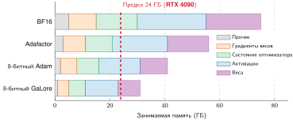

*Иллюстративная разбивка занимаемой памяти: объем памяти модели LLaMA на 7 млрд параметров в четырех конфигурациях экономных оптимизаторов (Adam в BF16, Adafactor, 8-битный Adam и 8-битный GaLore), разложенный на веса, активации, состояние оптимизатора, градиенты весов и прочие компоненты. Пунктирная красная линия отмечает предел памяти RTX 4090 в 24 ГБ. Стандартный Adam в FP32 (на столбцах не показан; для этой модели он требует заметно больше 70 ГБ) не помещается на один GPU на 24 ГБ; столбцы сравнивают относительное сокращение памяти, но даже наименьший показанный итог остается выше линии 24 ГБ, а 8-битный GaLore сокращает состояние оптимизатора наиболее сильно.*

BF16 Adam дальше всего выходит за пределы бюджета 24 ГБ одного ускорителя, тогда как Adafactor, 8-битный Adam и 8-битный GaLore постепенно сжимают вспомогательное состояние. Однако даже самая компактная конфигурация превышает 24 ГБ, что показывает: одного сжатия оптимизатора недостаточно, чтобы обойтись без управления активациями или разбиения модели при размещении больших моделей на фиксированных ускорителях.

<a id="sec-model-training-batch-size-parameter-updates-4d0b"></a>

#### Размер батча и обновления параметров

Увеличение размера батча повышает загрузку ускорителя, поднимая арифметическую интенсивность матричных умножений и снижая частоту синхронизации. Однако изменение размера батча меняет динамику оптимизации. Масштабирование батча без перенастройки расписания скорости обучения может ухудшить сходимость и создать разрыв оптимизации, при котором эффективность аппаратуры достигается ценой качества модели. [«Иллюстративный сценарий линейного масштабирования»](08_training.md#fig-linear-scaling-failure) иллюстрирует этот компромисс: при фиксированной скорости обучения и росте батча снижение функции потерь замедляется, тогда как масштабирование скорости обучения восстанавливает сходимость.

<a id="fig-linear-scaling-failure"></a>

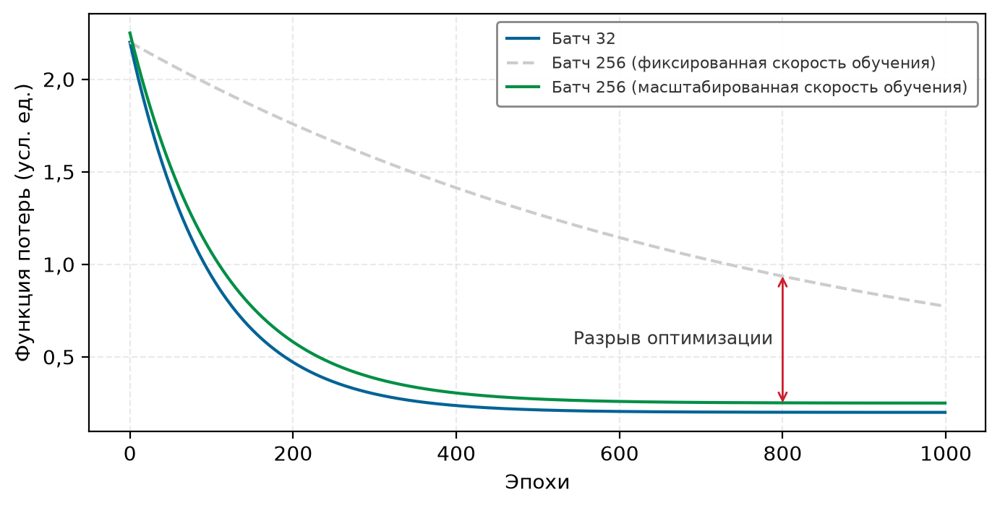

*Иллюстративный сценарий линейного масштабирования: синтетические кривые функции потерь обучения (условные единицы) сравнивают базовый батч 32 с батчем 256 при фиксированной или линейно масштабированной скорости обучения. Кривые иллюстрируют, почему увеличение размера батча может требовать перенастройки; они не являются измеренными трассами и не гарантируют, что линейное масштабирование сохраняет сходимость.*

При фиксированном бюджете токенов удвоение глобального размера батча вдвое сокращает число обновлений параметров за эпоху. Чтобы пройти сопоставимое расстояние в пространстве параметров меньшим числом обновлений, **правило линейного масштабирования** пропорционально масштабирует скорость обучения вместе с размером батча ($\eta_{\text{new}} = k \times \eta_{\text{base}}$). Хотя оно эффективно в умеренном диапазоне размеров батча в сочетании с прогревом скорости обучения, линейное масштабирование не гарантирует эквивалентной сходимости или обобщения. За критическим размером батча шум градиента в основном устраняется, и дальнейшее расширение батча дает убывающую отдачу на каждый обучающий образец, а давление на память при этом продолжает расти.

Помимо динамики сходимости, размер батча определяет частоту коммуникации в распределенных системах. Больший глобальный батч уменьшает число шагов оптимизатора и синхронизаций градиентов за эпоху. Поскольку объем коммуникации при плотной синхронизации all-reduce зависит от числа параметров, а не от размера батча, большие батчи амортизируют задержку межсоединения на большем числе FLOP вычислений. В распределенных условиях локальный размер микробатча и глобальный размер батча совместно определяют максимальную степень параллелизма данных. Когда емкость памяти ограничивает локальный микробатч, накопление градиентов ([«Накопление градиентов и контрольные точки»](08_training.md#sec-model-training-gradient-accumulation-checkpointing-0c47)) отделяет эффективный размер батча от памяти активаций на устройстве, накапливая градиенты по нескольким проходам вперед и назад перед запуском шага оптимизатора.

Каждое архитектурное решение в обучении — размер батча, точность, управление памятью и частота синхронизации — в конечном счете нацелено на минимизацию календарного времени на дорогих парках ускорителей. На переднем крае масштаба это время напрямую выражается в деньгах. Затраты на вычисления становятся жестким физическим и экономическим ограничением, которое определяет закупку аппаратуры и размер кластера. Блок [«Счет за вычисления»](08_training.md#nbk-utility-bill) переводит эти расчеты пропускной способности в экономику аренды и покупки для языковой модели на 70 млрд параметров, обучаемой на кластере из 1 024 ускорителей.

<a id="nbk-utility-bill"></a>

> **Счет за вычисления**
>
> **Задача**: при следующих упрощенных допущениях дешевле арендовать или купить кластер из 1 024 H100 для одного прогона обучения Llama 2 на 70 млрд параметров?
>
> **Расчет**:
>
> 1. Нагрузка: модель Llama 2 70B (70 млрд параметров, 2 трлн токенов).
> 2. **Требуемые вычисления**: $6 \times 70 \times 10^9 \times 2 \times 10^{12} \approx 8{,}4 \times 10^{23}$ FLOP. Ведущий множитель 6 следует из учета главы: примерно 2 FLOP на параметр на токен в прямом проходе (два FLOP на операцию умножения с накоплением), утроенные с учетом обратного прохода, который стоит примерно вдвое дороже прямого.
> 3. Аппаратура: NVIDIA H100 (пик: 989 TFLOP/s FP16). Предполагаемая загрузка: 50 процентов (494,5 TFLOP/s).
> 4. Время: $8{,}4 \times 10^{23} / (494{,}5 \times 10^{12}) \approx 1{,}70 \times 10^{9}$ с ≈ 53,8 года (на одном GPU).
> 5. **Кластер**: на 1 024 GPU — 19,2 дня.
>
> **Экономика**:
>
> *   **Аренда (\$3/ч)**: 1 024 GPU $\times$ 24 ч $\times$ 19,2 дня $\times$ \$3/ч ≈ \$1,42 млн.
> *   **Покупка (\$30 000 за GPU)**: 1 024 GPU $\times$ \$30 000 = \$30,7 млн.
>
> **Системный вывод**: в этом упрощенном сценарии загрузки и цены стоимость покупки равна примерно 21,7 арендным прогонам. Реальное сравнение владения должно также учитывать сетевую инфраструктуру кластера, хост-системы, помещения, электропитание, персонал, амортизацию, финансирование и загрузку между прогонами.

Декомпозиция конвейера обучения раскрывает структурную механику загрузки данных, прямого исполнения, обратного распространения ошибки и обновления параметров, а [«Математические основы»](08_training.md#sec-model-training-mathematical-foundations-d894) количественно описывают FLOP, объем памяти и пропускную способность, которые требует каждая фаза. Однако знание того, как исполняются этапы, не показывает, где останавливается конкретная нагрузка обучения. Конвейер не быстрее своего самого медленного этапа: если загрузка данных занимает 50 мс, а вычисления — 100 мс, ускорение вычислений на 20 процентов сэкономит 20 мс, но если узкое место сместится на прием данных, те же усилия по оптимизации не дадут выигрыша в календарном времени. Прежде чем применять методы оптимизации, инженеры систем должны профилировать временную шкалу исполнения, чтобы определить, какой ресурс ограничивает производительность: вычисления, пропускная способность памяти, ввод-вывод хранилища или синхронизация по сети.

<a id="sec-model-training-identifying-bottlenecks-f57f"></a>

## Выявление узких мест

Знание архитектуры — это еще не диагноз. Знание того, что операции внимания потребляют 50 процентов FLOP, а загрузка данных занимает 25 процентов календарного времени, не показывает, какое ограничение атаковать первым; это зависит от того, какой ресурс реально насыщен во время исполнения.

Методика диагностики, которая превращает знание архитектуры в действенные решения по оптимизации, начинается с содержательной меры эффективности обучения. Сырые проценты загрузки ускорителя могут вводить в заблуждение, потому что ускоритель может оставаться активным, выполняя пересчет, паддинг или другую работу вне учета FLOP модели. Утилизация FLOP модели (MFU)[^fn-mfu-hardware-utilization] дает такое сравнение.

[^fn-mfu-hardware-utilization]: **Утилизация FLOP модели (MFU)**: в статье PaLM (Chowdhery et al., 2022) MFU определяется как наблюдаемая пропускная способность, деленная на теоретический максимум пропускной способности при пиковых FLOP. Ее прогон на 540 млрд параметров показал MFU 46,2 процента на 6 144 чипах TPU v4. Остаток не засчитывается числителем FLOP модели, но сам по себе MFU не показывает, сколько приходится на трафик памяти, коммуникацию, пузыри конвейера, пересчет или другую работу.

<a id="dfn-training-model-flops-utilization-mfu"></a>

> **Утилизация FLOP модели (MFU)**
>
> ***Утилизация FLOP модели (MFU)*** — метрика эффективности $\text{MFU} = O_{\text{model}} / (R_{\text{peak}} \cdot T_{\text{step}})$, где $O_{\text{model}}$ — полезное число FLOP модели на шаг (прямой плюс обратный проход, без учета пересчета), а $T_{\text{step}}$ — измеренное календарное время одного шага обучения; она выражает, какая доля пиковой пропускной способности аппаратуры идет на полезные вычисления модели.
>
> 1.  **Значение**: MFU делает конкретным член эффективной пропускной способности в железном законе. Для трансформера на 7 млрд параметров, обрабатывающего 1 024 токена за шаг на A100 (пик тензорных ядер 312 TFLOP/s FP16/BF16), шаг длительностью 1,2 с дает отношение FLOP модели к доступному бюджету пиковой скорости примерно 0,11 (11,5 процента). Остальные 88,5 процента не засчитываются как FLOP модели и могут отражать трафик памяти, коммуникацию, пузыри, немодельные операции или простой. Хорошо ли это значение, зависит от модели, аппаратуры, точности и стратегии распараллеливания; диагностика требует профиля, а не универсального порога.
> 2.  **Отличие**: загрузка аппаратуры показывает, активны ли вычислительные движки устройства, тогда как MFU засчитывает аналитическую оценку FLOP модели, используемую в числителе. Поэтому он может исключать пересчет и паддинг, даже когда эти операции занимают устройство. Сравнения между ускорителями по-прежнему зависят от выбранной спецификации пиковой пропускной способности и соглашения о подсчете FLOP.
> 3.  **Типичная ошибка**: частое заблуждение состоит в том, что MFU 100 процентов — реалистичная устойчивая цель. Трафик памяти, коммуникация и работа, не относящаяся к матричным операциям, держат сквозные прогоны ниже пика, но универсального потолка 55–65 процентов не существует. Сообщаемые значения зависят от модели, точности, формы батча, аппаратуры и определения MFU и могут улучшаться с FlashAttention и тщательной настройкой.

Узкие места обучения можно исследовать через три категории, согласованные с таксономией D·A·M (Данные, Алгоритм, Машина; полную диагностическую рамку, матрицу устранения неполадок и карточку D·A·M см. в приложении [«Таксономия D·A·M»](appendix_dam.md#sec-appdx-dam-taxonomy)). [«Таксономия D·A·M, примененная к узким местам обучения»](08_training.md#tbl-dam-training-bottlenecks) связывает каждую ось с распространенным узким местом обучения, его наблюдаемыми симптомами и релевантными методами оптимизации. Это отправные точки диагностики, а не исключительные соответствия.

| **Ось D·A·M** | **Узкое место** | **Симптомы**                                                                                                          | **Основные решения**                                                   |
|:---------------|:---------------|:----------------------------------------------------------------------------------------------------------------------|:-----------------------------------------------------------------------|
| **Алгоритм**   | Ограничено вычислениями | Высокая активность арифметических блоков; дополнительная пропускная способность не повышает производительность; ограничивает арифметическая пропускная способность | Пониженная точность, более эффективные алгоритмы, более быстрое вычислительное железо |
| **Машина**     | Ограничено памятью | Высокое использование пропускной способности памяти относительно арифметики; ядра простаивают из-за перемещения данных | Слияние операторов, экономное по памяти внимание, форматы пониженной точности |
| **Данные**     | Ограничено данными | Периодическая загрузка ускорителя падает почти до нуля; CPU полностью занят в паузах; конвейер не успевает подавать GPU | Предвыборка, перекрытие конвейера, более быстрое хранилище, параллелизм DataLoader |

<a id="tbl-dam-training-bottlenecks"></a>

***Таксономия D·A·M, примененная к узким местам обучения**: каждая строка связывает ось D·A·M с одним распространенным узким местом и его характерными симптомами. Профилирование выявляет ограничивающий фактор нагрузки и направляет практиков к подходящему методу оптимизации.*

Среди этих трех режимов режим, ограниченный данными, чаще всего диагностируется неверно, потому что на ускорителе он проявляется как пустоты, а не как насыщенные вычислительные блоки. Когда прием, декодирование или предобработка на стороне хоста не могут поддерживать пропускную способность, которую требуют шины памяти устройства, ускоритель голодает.

<a id="exmp-training-gil-locked-gpu"></a>

> **GPU, заблокированный GIL**
>
> **Сценарий**: инженерная команда строит конвейер загрузки данных PyTorch на стандартном Python `threading` для предобработки изображений, ограниченной CPU, которая удерживает глобальную блокировку интерпретатора (GIL).
>
> **Диагностика**: GIL сериализует эти потоки предобработки на уровне Python, поэтому время подготовки на хосте ($T_{\text{prep}} \approx 250 \text{ мс}$) сильно превышает время исполнения на GPU ($T_{\text{step}} \approx 12 \text{ мс}$), и загрузка аппаратуры падает до $\eta_{\text{hw}} \approx 4{,}6\%$.
>
> **Системный урок**: работа Python на CPU, которая удерживает GIL, может сериализовать потоки и заморить GPU голодом; нативные операции могут его освобождать. Рабочие процессы (`num_workers > 0`) позволяют избежать сериализации интерпретатора, а NVIDIA DALI может переносить подходящую работу с хоста.

Инструменты профилирования показывают, какое узкое место доминирует в конкретной нагрузке. [«Трасса профилировщика при ограничении данными»](08_training.md#fig-tf-bottleneck-trace) фиксирует патологию ограничения данными из врезки: белые промежутки между повторяющимися вычислительными блоками отмечают интервалы, в которых на временной шкале устройства не видно ядер GPU.

<a id="fig-tf-bottleneck-trace"></a>


*Трасса профилировщика при ограничении данными: на этой временной шкале изолированные вычислительные блоки GPU разделены заметными белыми промежутками. Эти простои отмечают периоды, когда потоки ускорителя останавливаются, ожидая подготовки батчей на CPU и передач с хоста на устройство, — характерный признак конвейера, ограниченного вводом.*

Четыре инструмента, встроенные в фреймворки машинного обучения, дают подробный анализ узких мест. [«Инструменты профилирования узких мест обучения»](08_training.md#tbl-training-profiler-tools) разделяет инструменты временной шкалы на уровне фреймворка и инструменты исполнения на уровне GPU, потому что каждый показывает свою сигнатуру сбоя.

| **Инструмент**                          | **Охват**                         | **Лучший сигнал**                                                                  |
|:----------------------------------------|:----------------------------------|:-----------------------------------------------------------------------------------|
| **PyTorch Profiler** (`torch.profiler`) | Трасса операций на уровне фреймворка | Время в каждой операции, паттерны выделения памяти и исполнение ядер GPU        |
| **TensorFlow Profiler**                 | Временная шкала обучения на уровне фреймворка | Узкие места входного конвейера и размещение на устройствах                |
| **NVIDIA Nsight Systems**               | Трасса GPU на уровне системы      | Исполнение ядер, передачи памяти и точки синхронизации                             |
| **NVIDIA Nsight Compute**               | Анализ ядер GPU                   | Арифметическая интенсивность, пропускная способность памяти и заполненность        |

<a id="tbl-training-profiler-tools"></a>

***Инструменты профилирования узких мест обучения**: инструменты профилирования фреймворков показывают временные шкалы операций и простои входного конвейера, тогда как инструменты NVIDIA Nsight показывают исполнение GPU на уровне системы и поведение памяти на уровне ядер.*

Дисциплинированный процесс профилирования идет сверху вниз: от временных шкал системы к счетчикам производительности ядер, сопоставляя наблюдаемые трассы профилировщика с таксономией D·A·M из [«Таксономии D·A·M, примененной к узким местам обучения»](08_training.md#tbl-dam-training-bottlenecks). Сначала визуализация временной шкалы выявляет голод по входным данным: простои между запусками ядер указывают, что подготовка на хосте или задержка передачи по PCIe лишает очереди устройства работы. Чтобы снять это ограничение, связанное с данными, нужны асинхронная предвыборка, многопроцессорные рабочие или перенос предобработки на ускоритель, чтобы перекрыть перемещение данных с вычислениями. Во-вторых, когда ядра исполняются подряд без простоев, вызванных хостом, пропускная способность памяти относительно пика различает исполнение, ограниченное памятью, и исполнение, ограниченное вычислениями. Если трафик HBM насыщен, а арифметические блоки простаивают, нагрузка ограничена памятью; слияние операторов и экономное по памяти внимание снимают это ограничение, сохраняя промежуточные тензоры в SRAM на кристалле, а не записывая их обратно в глобальную память. Наконец, если тензорные ядра работают близко к теоретической мощности, а шины памяти имеют запас пропускной способности, нагрузка ограничена вычислениями, и рост производительности требует более низкой численной точности, такой как BF16 или FP8, чтобы повысить пиковую арифметическую пропускную способность.

<a id="sec-model-training-pipeline-optimizations-cd9d"></a>

## Оптимизации конвейера

Трассы профилирования определяют, какой ресурс насыщается во время исполнения, а таксономия D·A·M (приложение [«Таксономия D·A·M»](appendix_dam.md#sec-appdx-dam-taxonomy)) выделяет физическое ограничение, которым определяется ситуация: перемещение данных, арифметическая пропускная способность или емкость памяти. Чтобы сократить разрыв между реальной и теоретической пропускной способностью, нужно сопоставить целевые системные вмешательства каждому выявленному режиму сбоя.

Даже хорошо спроектированные архитектуры конвейера редко достигают пиковой пропускной способности аппаратуры без целевой оптимизации. Чтобы показать масштаб разрыва, применение утилизации FLOP модели в 30–50 процентов к пику A100 в 312 TFLOP/s дает 93,6–156 TFLOP/s пропускной способности FLOP модели. Это производные сценарные значения, а не измерения, сообщенные для одной нагрузки на A100. Опубликованные системы крупных моделей сообщают о похожих разрывах между пиковой и реализованной пропускной способностью (Narayanan et al., 2021; Chowdhery et al., 2022). Системы вроде SuperNeurons показывают одну версию этой проблемы: узкие места управления памятью могут не давать крупным сетям эффективно обучаться, если среда исполнения активно не оптимизирует хранение и передачу активаций (Wang et al., 2018). [«Дорожная карта методов оптимизации»](08_training.md#tbl-optimization-roadmap) расширяет классификацию узких мест на основе D·A·M из [«Таксономии D·A·M, примененной к узким местам обучения»](08_training.md#tbl-dam-training-bottlenecks), сопоставляя каждое узкое место конкретному методу оптимизации, который его решает.

| **Узкое место**              | **Основное решение**                             |
|:-----------------------------|:-------------------------------------------------|
| **Задержка перемещения данных** | Предвыборка и перекрытие конвейера            |
| **Пропускная способность вычислений** | Обучение в смешанной точности           |
| **Емкость памяти**           | Накопление градиентов и контрольные точки активаций |
| **Пропускная способность памяти (внимание)** | FlashAttention (тайлинг с учетом ввода-вывода) |

<a id="tbl-optimization-roadmap"></a>

***Дорожная карта методов оптимизации**: каждая основная категория узких мест имеет целевые решения, которые устраняют конкретные ограничения производительности; методы сопоставлены с результатами профилирования для систематической оптимизации.*

Хотя ограничивающий фактор меняется с масштабом системы — модель на 100 ГБ сталкивается с ограничениями емкости и межсоединения, которые никогда не связывают модель на 1 ГБ, — выявление и смягчение каждого узкого места следует последовательным физическим принципам. Задержка перемещения данных возникает, когда ввод-вывод хранилища на хосте и передачи по PCIe не могут подготавливать батчи достаточно быстро, чтобы держать вычислительные блоки ускорителя насыщенными. Вычислительная пропускная способность падает ниже пиковых аппаратных значений, когда операции выполняются в FP32 вместо использования более низкоточных тензорных ядер или когда неслитые ядра многократно передают промежуточные активации по шине памяти. Ограничения емкости памяти связывают исполнение, потому что HBM ускорителя должна одновременно хранить параметры модели, состояния оптимизатора, градиенты и прямые активации. Исчерпание этой памяти ограничивает и глубину модели, и размер батча на устройство.

Поскольку системные ресурсы тесно связаны, облегчение одного ограничения часто выявляет другое, что иллюстрирует эвристику сохранения сложности, введенную ранее в этой книге. Например, устранение простоев ввода-вывода на хосте агрессивной предвыборкой батчей расходует дополнительную память ускорителя на очереди входных данных. И наоборот, уменьшение размера батча на устройство, чтобы уложиться в лимиты HBM, снижает арифметическую интенсивность матричных умножений и переводит исполнение из матричной математики, ограниченной вычислениями, в простои из-за пропускной способности памяти. Рассмотрим типичный профиль GPT-2, где внимание занимает 50 процентов времени шага, загрузка данных — 25 процентов, а остальные операции, ограниченные вычислениями, — 25 процентов. Эта разбивка задает порядок оптимизации: тайлинг внимания с учетом ввода-вывода (FlashAttention) нацелен на доминирующее узкое место пропускной способности памяти во внимании, асинхронная предвыборка скрывает прием данных за вычислениями, а смешанная точность ускоряет тензорные операции, вдвое сокращая объем активаций. Задача оптимизации — по профилям исполнения определить ограничивающее узкое место и применить целевые вмешательства, не создав более серьезного ограничения в другом месте.

<a id="sec-model-training-systematic-optimization-framework-83b0"></a>

### Систематическая рамка оптимизации

Поскольку вычислительные движки ускорителя, подсистемы памяти и межсоединения хоста работают в условиях жесткой физической связи, оптимизация без эмпирической телеметрии рискует сдвинуть критический путь или растратить инженерные усилия на ресурсы, которые не являются ограничивающими. Принципиальная системная методология следует трем связанным этапам: профилирование, чтобы выявить ограничивающее физическое ограничение, выбор механизмов, специально спроектированных под этот предел ресурса, и композиция вмешательств так, чтобы вторичные потребности в ресурсах не сталкивались друг с другом.

На этапе профилирования используются инструменты инструментирования, такие как PyTorch Profiler, TensorFlow Profiler или NVIDIA Nsight Systems, которые записывают временные метки и аппаратные счетчики на каждой итерации. Трассы фиксируют время исполнения ядер на блоках ускорителя, прямой доступ к памяти (DMA) при передачах по шинам PCIe или NVLink и планирование потоков CPU хоста. Измерение затраченного времени выделяет подсистему, которая определяет критический путь. Например, трасса, показывающая, что 40 процентов времени шага уходит на загрузку данных, 35 процентов — на вычисления и 25 процентов — на операции с памятью, диагностирует голод данных на стороне хоста как главное ограничение. В таких условиях ускорение ядер матричного умножения дает пренебрежимо малый выигрыш в календарном времени, пока не решена проблема подачи данных.

На этапе выбора выявленное узкое место сопоставляется с архитектурным механизмом, нацеленным на это физическое ограничение. Когда профилирование показывает исполнение, ограниченное вводом, где ускоритель простаивает в ожидании батчей, асинхронная предвыборка и двойная буферизация через PCIe перекрывают прием данных на хосте с вычислениями на устройстве. Когда время ядер ограничено пропускной способностью памяти и определяется обращениями к HBM, а не арифметикой, слияние операторов и алгоритмы тайлинга, такие как FlashAttention, размещают промежуточные активации в SRAM на кристалле. Когда емкость памяти ограничивает модель, контрольные точки активаций отбрасывают активации во время обратного прохода и пересчитывают их, либо накопление градиентов делит батчи на несколько последовательных подшагов, чтобы ограничить пиковое выделение. Наконец, когда потоковые мультипроцессоры насыщаются плотной матричной математикой, форматы чисел пониженной точности (такие как FP16 или BF16) используют специализированные тензорные ядра, чтобы удвоить вычислительную пропускную способность, одновременно вдвое сократив трафик памяти.

На этапе композиции оценивается, как несколько вмешательств взаимодействуют на общих аппаратных ресурсах. Поскольку системные ресурсы тесно связаны, оптимизация, которая снимает одно узкое место, часто создает потребности в другом месте. Асинхронная предвыборка скрывает задержку перемещения данных за вычислениями, но поддержание очередей батчей с двойной буферизацией расходует закрепленную память хоста и HBM устройства. Напротив, синергетические сочетания усиливают друг друга: сочетание смешанной точности на 16 бит с контрольными точками активаций сокращает использование памяти настолько, что допускает больший размер батча на устройство и возвращает высокую арифметическую интенсивность недозагруженным тензорным ядрам. Успешная композиция поэтому требует проверить, что накладные расходы вторичных ресурсов не порождают новое ограничивающее условие.

[«Блок-схема выбора оптимизации обучения»](08_training.md#fig-optimization-flowchart) превращает эту рамку в структурированное дерево решений. Ветви сопоставляют сигналы профилирования с кандидатными вмешательствами напрямую, гарантируя, что инженерные усилия направлены на ограничивающее физическое узкое место, а не на побочные накладные расходы.

<a id="fig-optimization-flowchart"></a>

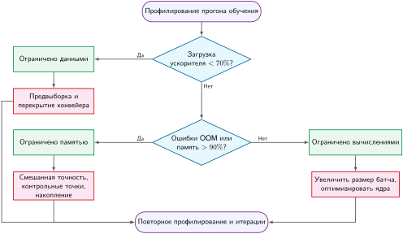

*Блок-схема выбора оптимизации обучения: эвристический путь от сигналов профилирования к кандидатным оптимизациям. Начните с загрузки ускорителя, затем отличите давление памяти от насыщения вычислений, прежде чем выбирать вмешательство. Пороги 70 процентов загрузки и 90 процентов памяти — иллюстративные значения для первичной оценки, а не универсальные определения исполнения, ограниченного данными, памятью или вычислениями.*

Поскольку устранение одного узкого места открывает следующее ограничение на пути исполнения, системная оптимизация — это итеративный процесс, управляемый законом Амдала. Например, устранение голода по входным данным асинхронной предвыборкой поднимает загрузку ускорителя, пока пропускная способность памяти или насыщение вычислений не начнут ограничивать время шага. Каждое вмешательство требует повторного профилирования, чтобы выявить новый критический путь, и цикл продолжается, пока блоки исполнения ускорителя не начнут работать близко к теоретическому пику или не будут достигнуты целевые показатели производительности приложения.

<a id="sec-model-training-data-prefetching-pipeline-overlapping-e984"></a>

### Предвыборка данных и перекрытие

Методы предвыборки и перекрытия иллюстрируют систематическую рамку в действии: они нацелены на узкое место задержки перемещения данных, координируя передачу данных с вычислениями. Эта оптимизация оказывается наиболее эффективной, когда профилирование показывает, что вычислительные блоки простаивают, ожидая завершения передач данных.

Обучение моделей машинного обучения включает значительное перемещение данных между хранилищем, памятью и вычислительными блоками. Конвейер данных состоит из последовательных передач: с дискового хранилища в память CPU, из памяти CPU в память GPU и затем через вычислительные блоки GPU. В ML-обучении операция «чтения» редко сводится к простой выборке с диска: для задач с изображениями она включает декодирование JPEG, случайные обрезки и цветовое дрожание, которые применяются на ядрах CPU, прежде чем тензор готов к передаче; для языковых задач она включает токенизацию, субсловное кодирование и паддинг последовательностей. [«Иллюстративная последовательная выборка данных»](08_training.md#fig-fetching-naive) показывает неэффективность последовательной передачи данных: GPU простаивает во время файловых операций (Open 1, Open 2), а шаги обучения не могут начаться, пока не завершатся эти операции чтения и предобработки, оставляя дорогие вычислительные ресурсы недозагруженными на значительной части каждой эпохи.

Предвыборка устраняет эту неэффективность, загружая данные в память до назначенного времени вычисления. Во время обработки текущего батча конвейеры данных фреймворков, такие как `tf.data`, загружают и готовят последующие батчи, поддерживая устойчивый запас готовых данных (Murray et al., 2021).

<a id="fig-fetching-naive"></a>

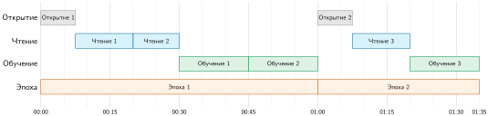

*Иллюстративная последовательная выборка данных: при принятых длительностях этапов открытие файла, чтение и обучение выполняются последовательно, а GPU простаивает во время файловых операций. Расписание занимает примерно 95 мин и служит схематичной базой для сравнения перекрытия.*

Перекрытие расширяет предвыборку, координируя несколько этапов конвейера для одновременного выполнения. Система обрабатывает текущий батч и одновременно готовит будущие батчи через загрузку и предобработку. Сравните иллюстративные расписания на [«Иллюстративной последовательной выборке данных»](08_training.md#fig-fetching-naive) и [«Иллюстративной перекрывающейся предвыборке данных»](08_training.md#fig-fetching-optimized). При их принятых длительностях этапов перекрытие сокращает время завершения примерно с 95 мин до 65 мин, то есть на 31,6 процента. Реальный выигрыш зависит от баланса этапов и доступной конкурентности.

<a id="fig-fetching-optimized"></a>

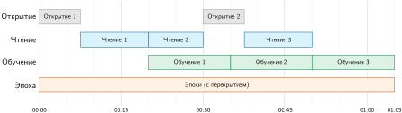

*Иллюстративная перекрывающаяся предвыборка данных: открытие файла и чтение перекрываются с обучением на ускорителе при сохранении тех же длительностей отдельных этапов, что и в последовательном расписании. Схематичное расписание занимает примерно 65 мин против 95 мин у последовательного.*

<a id="sec-model-training-prefetching-mechanics-2ba2"></a>

#### Механика предвыборки

Предвыборка окупается только тогда, когда профиль показывает перемещение данных на критическом пути. Обучающие данные по-прежнему проходят извлечение, преобразование и выполнение модели; оптимизация меняет момент, когда выполняются эти этапы. Неоптимизированный конвейер выполняет их последовательно, оставляя GPU простаивать во время выборки и предобработки. Загрузчики данных избегают этой остановки, готовя следующий батч в отдельных потоках или процессах, пока текущий батч обучается.

Перекрытие распространяет ту же идею на весь конвейер. Пока GPU обрабатывает один батч, предобработка начинается для следующего, а выборка данных стартует для последующего. Цель — постоянная активность на каждом этапе, чтобы самый медленный этап больше не заставлял остальные ждать.

Фреймворки машинного обучения (введенные в разделе [«Фреймворки машинного обучения»](07_frameworks.md#sec-ml-frameworks)) открывают управляющие переменные для этого компромисса. [«Конфигурация DataLoader»](08_training.md#lst-dataloader_usage) показывает конфигурацию DataLoader в PyTorch, где `num_workers = 4` задает параллелизм предобработки, а `prefetch_factor = 2` поддерживает буфер из 8 батчей, готовых к потреблению ускорителем.

<a id="lst-dataloader_usage"></a>

**Конфигурация предвыборки DataLoader**: четыре рабочих процесса с коэффициентом предвыборки два поддерживают до восьми батчей в окне предвыборки на стороне хоста.

```python
loader = DataLoader(
    dataset, batch_size=32, num_workers=4, prefetch_factor=2
)
```

Параметры `num_workers` и `prefetch_factor` — не общие переключатели производительности. Они определяют параллелизм CPU и глубину буфера, а значит, переносят нагрузку с простоя ускорителя на память хоста и планирование CPU. Помимо параллелизма рабочих, высокая пропускная способность передачи с хоста на устройство требует закрепленной (page-locked) памяти хоста. Обычная виртуальная память может выгружаться операционной системой, поэтому драйверу GPU приходится пропускать передачи через промежуточный буфер хоста перед копированием по PCIe; установка `pin_memory=True` в загрузчике данных выделяет тензоры в закрепленной физической оперативной памяти, позволяя GPU инициировать асинхронные передачи DMA (`tensor.to(device, non_blocking=True)`), которые перекрываются непосредственно с исполнением на ускорителе.

Управление буфером — главный компромисс. Слишком маленький буфер заставляет GPU ждать подготовки данных, возвращая простой, который предвыборка должна была устранить. Слишком большой буфер расходует память, которая иначе могла бы хранить параметры модели или более крупные батчи. Правильная конфигурация координирует подготовку на CPU, ввод-вывод хранилища и вычисления на GPU, так чтобы у каждого ресурса работа была готова в момент, когда он может ее использовать. Эти методы дают наибольшую выгоду, когда доступ к хранилищу медленный, предобработка сложна или наборы данных велики.

<a id="sec-model-training-pipeline-practical-considerations-4ba0"></a>

#### Практические соображения

Буферы предвыборки и глубина перекрытия настраиваемы, поэтому один и тот же механизм адаптируется к тому, какой этап ограничивает: медленное хранилище, ограниченная сетевая пропускная способность или вычислительная производительность. Предвыборка и перекрытие дают наибольший выигрыш, когда предобработка лежит на критическом пути, но может выполняться одновременно с вычислениями модели. В иллюстративном конвейере изображений случайная обрезка (10 мс), цветовое дрожание (15 мс) и нормализация (5 мс) в сумме дают 30 мс на батч. Перекрытие может скрыть не больше, чем длятся одновременные вычисления на ускорителе; любой избыток остается на критическом пути. Языковые нагрузки так же выигрывают, когда токенизация и субсловная обработка иначе блокировали бы цикл обучения.

Основной компромисс — память: буферы предвыборки занимают память хоста или, если используется отдельная очередь на стороне устройства, память устройства, пропорционально глубине буфера и размеру батча. Для батча из 256 изображений высокого разрешения ($1024\times 1024$ пикселя) один буферизованный батч требует примерно 3,2 ГБ. При `num_workers = 4` и `prefetch_factor = 2` окно предвыборки из 8 батчей может занимать около 25,8 ГБ. Настройка этих параметров требует эмпирической проверки, потому что избыточные рабочие конкурируют за CPU, хранилище и память, а недостаточная буферизация возвращает задержки данных. Начните со скромного числа рабочих, увеличивайте его, измеряя пропускную способность и память, и остановитесь, когда дополнительные рабочие перестают сокращать простой ускорителя. Когда входной конвейер уже превышает потребность вычислений, более глубокая предвыборка добавляет сложность без повышения пропускной способности.

<a id="sec-model-training-mixedprecision-training-9218"></a>

### Обучение в смешанной точности

Пока предвыборка оптимизирует перемещение данных, обучение в смешанной точности устраняет и ограничения вычислительной пропускной способности, и ограничения емкости памяти. Оно использует формат пониженной точности там, где это уместно, сохраняя более высокую точность для выбранных накоплений или обновлений. Раздел [«Численные представления»](appendix_machine.md#sec-appdx-machine-foundations-numerical-representations-c889) приложения «Основы машины» сравнивает компромиссы диапазона и точности FP32, FP16, BF16, FP8 и INT8. Рецепт обучения обычно сочетает FP32 с FP16 или BF16; в одном и том же пути обычно не используют FP16 и BF16 взаимозаменяемо. Итоговые эффекты для скорости, памяти и точности зависят от нагрузки и аппаратуры (Micikevicius et al., 2017; Wang and Kanwar, 2019; Kalamkar et al., 2019).

Хранимые веса FP32 нейронной сети требуют 4 байта на параметр, тогда как веса FP16 и BF16 используют 2 байта. Для модели с $10^9$ параметров тензор весов уменьшается с 4 ГБ до 2 ГБ. Полная память обучения сокращается меньше, если рецепт сохраняет мастер-веса FP32, состояния оптимизатора или выборочные активации.

Численные различия между этими форматами определяют сферы их применения. [«Сравнение форматов точности»](08_training.md#tbl-precision-comparison) показывает, что 8-битная экспонента BF16 дает ему примерно тот же диапазон нормальных экспонент, что и у FP32, тогда как 5-битная экспонента FP16 дает минимальное положительное нормальное значение около $6{,}1 \times 10^{-5}$ и максимальное конечное значение $65\,504$. Субнормальные значения FP16 простираются к $6 \times 10^{-8}$, хотя их обработка зависит от операции и аппаратного режима. FP32 дает около семи десятичных знаков точности, FP16 — около трех, а BF16 — около двух-трех. Поэтому BF16 обменивает точность мантиссы на диапазон экспоненты, который часто упрощает обучение глубоких сетей.

| **Свойство**                   |  **FP32**  |                              **FP16**                             |                              **BF16**                             |
|:-------------------------------|:----------:|:-----------------------------------------------------------------:|:-----------------------------------------------------------------:|
| **Биты экспоненты**            |     8      |                                 5                                 |                                 8                                 |
| **Биты мантиссы**              |     23     |                                 10                                |                                 7                                 |
| **Минимальное нормальное значение** | $10^{-38}$ |                        $6{,}1 \times 10^{-5}$                       |                             $10^{-38}$                            |
| **Отношение пиковой пропускной способности A100** | 1×  | 16× | 16× |

<a id="tbl-precision-comparison"></a>

*Сравнение форматов точности. Выбор между FP16 и BF16 зависит от того, важнее ли для конкретной нагрузки динамический диапазон (сильная сторона BF16) или точность (преимущество FP16). Показанные минимальные нормальные значения — практические пороги для обучения, поскольку субнормальные значения на многих GPU могут обнуляться. На A100 тензорные ядра FP16 и BF16 достигают пика, в 16 раз превышающего пик CUDA-ядер FP32.*

Выбор формата зависит от характеристик модели и поддержки аппаратуры. Более широкий диапазон экспоненты BF16 снижает проблемы переполнения и антипереполнения, тогда как FP16 дает больше битов мантиссы, но часто требует масштабирования функции потерь. Политики автокаста фреймворков и слитые ядра выбирают накопление с повышенной точностью для численно чувствительных операций, когда это нужно; сокращение функции потерь, softmax, нормализация и обновления оптимизатора — типичные кандидаты, но их точный тип исполнения зависит от реализации.

[«Традиционное обучение FP16 со смешанной точностью»](08_training.md#fig-mixed-precision) показывает традиционный рецепт смешанной точности FP16. Мастер-веса FP32 приводятся к более низкой точности для вычислений, функция потерь масштабируется перед обратным распространением ошибки, а градиенты размасштабируются перед обновлением в FP32. Современные реализации фреймворков могут по-разному хранить или накапливать отдельные тензоры, а рецепты BF16 обычно обходятся без масштабирования функции потерь из-за более широкого диапазона экспоненты.

<a id="fig-mixed-precision"></a>

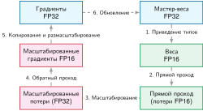

*Традиционное обучение FP16 со смешанной точностью: схематичный рецепт из шести шагов приводит мастер-веса FP32 к более низкой точности для вычислений, масштабирует функцию потерь, вычисляет масштабированные градиенты, а затем размасштабирует их для обновления в FP32. Реализации фреймворков могут различаться, а BF16 обычно не требует этого пути масштабирования функции потерь.*

Современные архитектуры ускорителей сочетают блоки плотного матричного исполнения с форматами чисел пониженной точности, чтобы максимизировать арифметическую пропускную способность. NVIDIA ввела тензорные ядра для операций FP16 в архитектуре Volta (NVIDIA, 2017) и добавила нативное исполнение BF16 в Ampere (NVIDIA Corporation, 2020), повторив нативную поддержку BF16, которую Google разработала для Tensor Processing Units (Wang and Kanwar, 2019). Эти специализированные функциональные блоки выполняют матричные операции умножения с накоплением в пониженной точности в четыре–шестнадцать раз быстрее стандартных 32-битных АЛУ с плавающей точкой.

Обучение в смешанной точности превращает эти аппаратные возможности в разделенный численный контракт. Подходящие матричные умножения и свертки выполняются в FP16 или BF16 на тензорных блоках, тогда как редукции, накопления и обновления параметров сохраняют более высокую точность. Выигрыш в производительности дает и арифметическая пропускная способность, и перемещение данных: функциональные блоки пониженной точности работают с более высокой плотностью тактов, а более узкие тензоры вдвое сокращают объемы передачи через кэши и HBM. Высокая точность остается необходимой там, где широкие редукции, малые обновления параметров или чувствительные нормализации могут накапливать ошибки округления. Политики автокаста фреймворков обеспечивают это разделение динамически, выбирая исполнение пониженной точности для вычислительно интенсивных матричных умножений и сохраняя FP32 для численно хрупких операций.

<a id="sec-model-training-loss-scaling-f9f5"></a>

#### Масштабирование функции потерь

Ограниченный 5-битной экспонентой динамический диапазон FP16 создает серьезную опасность антипереполнения при обратном распространении ошибки.[^fn-fp16-dynamic-range] При вычислении градиентов в глубоких сетях последовательные умножения по правилу цепочки часто дают величины градиентов меньше минимального положительного нормального значения FP16 ($2^{-14} \approx 6{,}1 \times 10^{-5}$). Хотя IEEE 754 FP16 определяет субнормальные числа до $\approx 6 \times 10^{-8}$, аппаратные ускорители часто обнуляют субнормальные входы и выходы, чтобы не допустить остановок конвейера. Когда градиенты антипереполняются до нуля, обновления весов останавливаются, и обучение не сходится.

[^fn-fp16-dynamic-range]: **FP16 (половинная точность с плавающей точкой)**: сниженный диапазон нормальных значений вызван использованием 5 битов экспоненты против 8 у FP32; наименьшее положительное нормальное значение составляет около $6{,}1 \times 10^{-5}$, но субнормальные значения простираются примерно до $6 \times 10^{-8}$. Поведение при антипереполнении зависит от операции и режима аппаратуры. Масштабирование функции потерь снижает вероятность того, что малые градиенты будут округлены или обнулены.

Масштабирование функции потерь борется с антипереполнением, используя линейность дифференцирования: $\nabla_{\mathbf{w}} (S \cdot \mathcal{L}) = S \cdot \nabla_{\mathbf{w}} \mathcal{L}$. Умножение скалярной функции потерь $\mathcal{L}$ на большой коэффициент масштабирования $S$ (например, $2^{10}$ или $2^{15}$) перед обратным распространением ошибки сдвигает распределение градиентов вправо, в диапазон нормальных значений, представимых в FP16. По завершении обратного распространения накопленные градиенты делятся на $S$ (размасштабируются) перед применением обновления оптимизатора.

Фреймворки глубокого обучения автоматизируют этот процесс через динамическое масштабирование функции потерь (`GradScaler`). Поскольку нормы градиентов колеблются в ходе обучения, статический коэффициент масштабирования рискует либо антипереполнением (если $S$ слишком мал), либо численным переполнением за максимальное конечное значение FP16, равное $65\,504$ (если $S$ слишком велик). Перед выполнением обновления параметров `GradScaler` размасштабирует градиенты в FP32 и проверяет буферы тензоров на нефинитные значения (`inf` или `NaN`). Если обнаружено переполнение, масштабировщик пропускает шаг оптимизатора, чтобы защитить мастер-веса FP32 от повреждения, и уменьшает коэффициент масштабирования (обычно вдвое). Если обучение продолжается без переполнения в течение настраиваемого окна роста (например, 2 000 последовательных шагов), масштабировщик удваивает $S$, чтобы держать градиенты у верхнего края динамического диапазона, не насыщая его.

<a id="sec-model-training-mixedprecision-benefits-d57b"></a>

#### Выгоды смешанной точности

Обучение в смешанной точности дает выигрыш по трем взаимодействующим системным измерениям: занимаемой памяти, арифметической пропускной способности и объему коммуникации. Сокращение ширины операндов вдвое уменьшает хранение весов на 50 процентов: модель на один миллиард параметров переходит с 4 ГБ в FP32 до 2 ГБ в FP16 или BF16 (хотя чистая экономия зависит от точности, сохраняемой для состояния оптимизатора и мастер-весов). С вычислительной стороны пониженная точность направляет ядра плотного матричного умножения на высокопроизводительные конвейеры тензорных ядер ([«Аппаратная поддержка смешанной точности»](08_training.md#sec-model-training-mixedprecision-hardware-support-d7c1)). В распределенных топологиях передача градиентов на 16 битах вместо 32 вдвое сокращает трафик коллективной AllReduce-синхронизации по межсоединению. Эти эффекты усиливают друг друга: освободившийся запас памяти позволяет брать большие микробатчи, тензорные ядра ускоряют исполнение ядер, а более узкие тензоры сокращают задержку обмена градиентами. Следующий разбор оценивает эту взаимодействующую экономию памяти на GPT-2 XL и показывает, как смешанная точность и выборочный пересчет помещают модель, которая в FP32 не умещается в память устройства, в емкость одного ускорителя.

<a id="nbk-training-gpt-2-mixed-precision-memory"></a>

> **Экономия памяти при смешанной точности GPT-2**
>
> **Задача**: можно ли обучить GPT-2 XL (1,5 млрд параметров) на одном GPU V100 и сколько памяти экономят смешанная точность и контрольные точки градиентов?
>
> **Базовый уровень FP32**:
>
> - Параметры и градиенты (FP32): 12 ГБ (6 ГБ параметров + 6 ГБ градиентов)
> - Активации (батч = 4): примерно 71,7 ГБ
> - Состояния оптимизатора (Adam m, v в FP32): 12 ГБ
> - Итого: примерно 95,7 ГБ (превышает любой отдельный GPU)
>
> **Смешанная точность FP16**:
>
> - Параметры (FP16): 1,5 млрд параметров по 2 байта каждый = 3 ГБ
> - Активации (FP16): примерно 35,9 ГБ
> - Градиенты (FP16): 3 ГБ
> - Мастер-веса FP32: 6 ГБ (для точных обновлений оптимизатора)
> - Состояния оптимизатора (Adam m, v в FP32): 12 ГБ
> - Итого: примерно 59,9 ГБ (все еще впритык, но управляемо с оптимизациями)
>
> **Смешанная точность + иллюстративное четырехкратное сокращение активаций**:
>
> - Активации сокращены примерно до 9 ГБ выборочным пересчетом
> - Оценка суммарных тензоров: примерно 33 ГБ при емкости V100 в 32 ГБ, до учета временных рабочих областей и накладных расходов аллокатора
>
> **Системный вывод**: смешанная точность в этом рецепте вдвое сокращает тензоры параметров и градиентов; контрольные точки затем обменивают пересчет на меньшее хранение активаций. При размере батча 4 упрощенная оценка тензоров приближается к емкости V100, поэтому реальному прогону может понадобиться дополнительное сокращение памяти с учетом рабочих областей и поведения аллокатора. При батче 32 та же оценка требует примерно 95,7 ГБ, что обосновывает техники масштабирования на несколько устройств.

Одной экономии памяти недостаточно для устойчивого обучения. При обучении в FP16 мастер-веса FP32 необходимы, потому что обновления параметров $\Delta w = -\eta \cdot g$ обычно на порядки меньше значений весов $w$. В FP16, где 10-битная мантисса дает примерно три десятичных знака точности, добавление обновления, которое более чем в $2^{11} \approx 2048$ раз меньше по модулю веса, приводит к арифметическому поглощению: обновление полностью выходит за пределы битов мантиссы и округляется до нуля. Хранение мастер-весов в FP32 сохраняет эти инкрементальные обновления на протяжении тысяч шагов оптимизатора, приводя веса к 16 битам только при подготовке к прямому проходу. Политики автокаста аналогично держат широкие редукции, слои нормализации и softmax в FP32, чтобы предотвратить катастрофическое вычитание.

Когда численная устойчивость обеспечена, арифметика пониженной точности и сокращение трафика памяти напрямую переходят в ускорение календарного времени и снижение стоимости кластера. Следующий сценарий моделирует эти совокупные выгоды в пропускной способности, расписании и стоимости инфраструктуры для распределенного прогона GPT-2 XL.

<a id="nbk-training-gpt-2-mixed-precision-throughput-cost"></a>

> **Пропускная способность и стоимость смешанной точности GPT-2**
>
> **Задача**: при следующих иллюстративных допущениях о пропускной способности и тарификации для задания GPT-2 XL какие различия в скорости и стоимости дает смешанная точность FP16?
>
> **Принятая пропускная способность V100**:
>
> - Пропускная способность FP32: примерно 90 образцов/с
> - Пропускная способность FP16: примерно 220 образцов/с
> - Ускорение: 220 образцов/с ÷ 90 образцов/с ≈ 2,4 раза быстрее
>
> Влияние на стоимость для кластера из 32 GPU:
>
> - Принятая стоимость FP32: \$50 000 за 2 недели
> - Принятая стоимость FP16: \$28 000 за 1,2 недели
> - Выигрыш в календарном времени: 2 недели ÷ 1,2 недели ≈ 1,7 раза, что ниже ускорения пропускной способности в 2,4 раза, поскольку принятое расписание включает работу, которую ядра FP16 не ускоряют
> - Сэкономленное время: 2 недели − 1,2 недели = 0,8 недели (5,6 дня)
> - Сэкономленная стоимость: \$50 000 − \$28 000 = \$22 000
>
> **Контрольный барьер**: сравнение стоимости корректно только при условии, что контрольный прогон валидации показывает, что рецепт FP16 удовлетворяет тем же критериям приемки, что и базовый уровень FP32. Сценарий не предполагает конкретной разницы перплексии.
>
> **Системный вывод**: при этих допущениях тот же кластер из 32 GPU переходит от 2 недель и \$50 000 к 1,2 недели и \$28 000. Это арифметика сценария, а не заявление о бенчмарке; реальное решение требует измеренной пропускной способности, стоимости и валидации качества для целевой нагрузки.

Получить эти ускорения можно только эмпирическим профилированием, а не допущением об автоматическом ускорении. Для небольших моделей или нагрузок, ограниченных памятью и в которых большие матричные умножения не доминируют, приведение типов данных и накладные расходы запуска ядер могут свести на нет преимущество арифметической пропускной способности. Кроме того, поддерживает ли ускоритель нативный BF16 или требует масштабирования функции потерь для FP16, зависит от нижележащей микроархитектуры.

<a id="sec-model-training-mixedprecision-hardware-support-d7c1"></a>

#### Аппаратная поддержка смешанной точности

Специализированные блоки матричного исполнения дают ускорение смешанной точности, обменивая численную точность и динамический диапазон на плотность арифметики.[^fn-tensor-core-training] Ускорители сочетают эти блоки умножения пониженной точности с регистрами накопления повышенной точности, чтобы сохранять численную устойчивость при плотных матричных редукциях.

[^fn-tensor-core-training]: **Тензорное ядро (Tensor Core)**: специализированный блок умножения матриц с накоплением, который принимает входы пониженной точности и накапливает результат с повышенной точностью. Поддерживаемые формы тайлов, ограничения выравнивания и соотношения пиковой пропускной способности различаются по архитектуре, типу данных, режиму разреженности и библиотечному ядру.

NVIDIA ввела тензорные ядра (Tensor Cores) в архитектуре Volta (2017) как выделенные блоки матричного умножения, оптимизированные для нагрузок смешанной точности. В отличие от стандартных CUDA-ядер, которые обрабатывают скалярные или малые векторные операции, тензорные ядра выполняют матричные операции умножения с накоплением $4{\times}4$ за один такт. Для входов FP16 одно тензорное ядро выполняет:

$$
\mathbf{D}_{\text{tc}} = \mathbf{A}_{\text{tc}} \times \mathbf{B}_{\text{tc}} + \mathbf{C}_{\text{acc}}
$$

где $\mathbf{A}_{\text{tc}}$ и $\mathbf{B}_{\text{tc}}$ — входы FP16, а $\mathbf{C}_{\text{acc}}$ и $\mathbf{D}_{\text{tc}}$ могут использовать накопление FP32. Накопление повышенной точности уменьшает ошибку округления, хотя не устраняет численную ошибку и вычитание полностью.

Спецификации пиковой аппаратной мощности задают теоретический потолок этого ускорения. GPU NVIDIA A100 дает 19,5 TFLOP/s FP32 на стандартных CUDA-ядрах и 312 TFLOP/s пропускной способности тензорных ядер в FP16 или BF16, то есть пиковое отношение составляет 16 раз. Ускорители класса H100 добавляют тензорные ядра FP8 с 1 979 TFLOP/s без разреженности, примерно в 2 раза больше скорости тензорных ядер FP16/BF16 на H100. Эти цифры представляют аппаратные потолки, а не гарантии сквозного обучения: матричные умножения напрямую отображаются на тензорные ядра, но остаются перемещение данных, ядра вне тензорных ядер, коммуникация, масштабирование функции потерь и обновления оптимизатора. Хотя пакетное матричное умножение $\mathbf{Q}\mathbf{K}^T$ в самовнимании трансформера ($2 \times B \times N_{\text{heads}} \times S^2 \times d_{\text{head}}$ FLOP) напрямую отображается на эти тензорные блоки, закон Амдала показывает, что оставшиеся поэлементные операции, ограниченные памятью, коллективная коммуникация и обновления оптимизатора ограничивают реализованное сквозное ускорение.

BF16 (Brain Float 16) сохраняет 8-битную экспоненту FP32, сокращая мантиссу до 7 битов. Такой выбор ставит сохранение динамического диапазона выше точности, что важно для обучения на градиентах, где значения охватывают много порядков величины. TPU от Google нативно поддерживают BF16, а архитектура NVIDIA Ampere (A100) и более новые обеспечивают полную аппаратную поддержку.

Преимущество BF16 по диапазону над FP16 проявляется, когда градиенты или промежуточные значения выходят за нормальный диапазон FP16. Наименьшее положительное нормальное значение FP16 равно $6{,}1 \times 10^{-5}$, а нижняя граница субнормальных чисел примерно $6 \times 10^{-8}$.[^fn-fp16-subnormal-underflow] Наименьшее положительное нормальное значение BF16 составляет примерно $10^{-38}$, совпадая с диапазоном экспоненты FP32. Поэтому BF16 обычно обходится без масштабирования функции потерь, которое нужно FP16, хотя точность накопления и округление по-прежнему важны.

[^fn-fp16-subnormal-underflow]: **Обработка субнормальных чисел FP16**: IEEE FP16 представляет субнормальные числа ниже $6{,}1 \times 10^{-5}$ вплоть до примерно $6 \times 10^{-8}$, но некоторые операции или режимы ускорителей обнуляют субнормальные входы или результаты. Поведение нужно проверять для целевой аппаратуры и ядра.

Архитектура NVIDIA Hopper (H100) вводит поддержку FP8 в двух форматах. E4M3 использует четыре бита экспоненты и три бита мантиссы (отдавая предпочтение точности для весов и активаций прямого прохода), а E5M2 использует пять битов экспоненты и два бита мантиссы (отдавая предпочтение динамическому диапазону для градиентов обратного прохода).

Обучение в FP8 еще раз удваивает пропускную способность тензорных ядер (1,98 PFLOP/s на H100 для плотных вычислений против 0,99 PFLOP/s для FP16 плотных, без разреженности). Однако крайне ограниченная точность FP8 требует коэффициентов масштабирования для каждого тензора, которые хранятся в более высокой точности, что добавляет алгоритмическую сложность. [«Руководство по выбору точности»](08_training.md#tbl-precision-decision-tree) кратко показывает, когда уместен каждый формат:

| **Точность** | **Когда использовать**                               |   **Требование к аппаратуре** |
|:--------------|:-----------------------------------------------------|---------------------------:|
| **FP8**       | Обучение, ориентированное на пропускную способность, с проверенным масштабированием | Поддерживаемая аппаратура FP8 |
| **BF16**      | Широкий диапазон экспоненты без масштабирования функции потерь FP16 | Поддерживаемый ускоритель BF16 |
| **FP16**      | Большая точность мантиссы при управляемом масштабировании функции потерь | Поддерживаемый ускоритель FP16 |
| **FP32**      | Повышенная точность или путь пониженной точности не поддерживается | GPU |

<a id="tbl-precision-decision-tree"></a>

*Руководство по выбору точности. Выбор формата зависит от поддержки аппаратуры, покрытия ядрами, численного поведения и результатов валидации. FP8 требует явной стратегии масштабирования; BF16 дает более широкий диапазон экспоненты, чем FP16; FP16 часто использует масштабирование функции потерь; а FP32 остается доступным для чувствительных операций или неподдерживаемых путей пониженной точности.*

Выбор между этими форматами требует баланса между арифметической пропускной способностью, сложностью реализации и численной устойчивостью.

Помимо ускорения вычислительно интенсивных матричных операций, пониженная точность снимает узкие места пропускной способности памяти, меняя операционную арифметическую интенсивность. На современных ускорителях большие матричные умножения находятся в режиме, ограниченном вычислениями, по модели Roofline, тогда как поэлементные операции (такие как добавление смещений, нормализация слоя и остаточные связи) прочно находятся в режиме, ограниченном памятью. GPU NVIDIA A100 иллюстрирует физический дисбаланс между арифметической способностью и пропускной способностью памяти:

- Пропускная способность HBM2e: 2 039 ГБ/с
- Производительность FP32 (19,5 TFLOP/s): худший случай — 78 ТБ/с, если каждому FLOP нужны новые данные
- Реальная потребность (с учетом повторного использования данных): значительно ниже, но ограничена пропускной способностью для операций с низкой арифметической интенсивностью

Для ядер, ограниченных памятью, время исполнения определяется байтами, переданными по шине памяти, а не тактами арифметики. Перевод 32-битных операндов в 16-битные FP16 или BF16 вдвое сокращает объем байтов, передаваемых по шине HBM, и теоретически вдвое повышает пропускную способность операций, ограниченных памятью, даже без задействования тензорных ядер. Реальный выигрыш по пропускной способности зависит от доли попаданий в кэш, слияния ядер и накладных расходов на преобразование формата.

Современные фреймворки скрывают эти микроархитектурные механизмы за автоматической маршрутизацией точности ([«Фреймворки машинного обучения»](07_frameworks.md#sec-ml-frameworks)). Как показано в [«Обучении в смешанной точности»](08_training.md#lst-mixed-precision), автоматическая смешанная точность PyTorch (`torch.amp`) оборачивает исполнение модели в контекст `autocast`, который назначает типы данных пониженной точности подходящим вычислительно интенсивным ядрам, а редукции и нормализации направляет в FP32. В пути FP16 `GradScaler` перехватывает вычисление функции потерь и обратное распространение ошибки, чтобы предотвратить антипереполнение, тогда как путь BF16 масштабирование градиентов опускает.

<a id="lst-mixed-precision"></a>

**Обучение в смешанной точности**: автокаст выбирает подходящие операции пониженной точности, а масштабирование градиентов включено для пути FP16 и опущено для BF16.

```python
import torch

model = TransformerModel().cuda()
optimizer = torch.optim.Adam(model.parameters(), lr=1e-4)
amp_dtype = (
    torch.float16
)  # torch.bfloat16 обычно не требует масштабирования функции потерь
scaler = torch.amp.GradScaler(
    "cuda", enabled=(amp_dtype == torch.float16)
)

for inputs, targets in dataloader:
    optimizer.zero_grad()

    # Автоматический выбор точности для каждой операции
    with torch.amp.autocast("cuda", dtype=amp_dtype):
        output = model(inputs)
        loss = criterion(output, targets)

    # Масштабируем функцию потерь, чтобы не допустить антипереполнения градиентов
    scaler.scale(loss).backward()

    # Размасштабируем градиенты перед шагом оптимизатора
    scaler.step(optimizer)
    scaler.update()  # Динамически корректируем коэффициент масштабирования
```

Поскольку поддержка низкоточных форматов в аппаратуре менялась от поколения к поколению ускорителей, оптимальный рецепт смешанной точности зависит от целевой архитектуры. [«Стратегия точности по архитектуре GPU»](08_training.md#tbl-hw-precision-strategy) описывает компромиссы точности для трех поколений GPU NVIDIA.

| **Архитектура**   | **Рекомендуемая точность**    | **Ключевые соображения**                                                                                             |
|:------------------|:-----------------------------|:---------------------------------------------------------------------------------------------------------------------|
| **V100 (Volta)**  | FP16 с масштабированием функции потерь | Нет нативного пути BF16 на тензорных ядрах; отсечение зависит от рецепта обучения                             |
| **A100 (Ampere)** | BF16 или FP16                | BF16 обходится без масштабирования функции потерь FP16; TF32 может ускорять подходящие матричные операции FP32        |
| **H100 (Hopper)** | BF16, FP16 или проверенный FP8 | FP8 требует рецепта с учетом FP8; 1 979 TFLOP/s — пиковый потолок |

<a id="tbl-hw-precision-strategy"></a>

*Стратегия точности по архитектуре GPU: V100 поддерживает обучение FP16 на тензорных ядрах, A100 добавляет нативный BF16, а H100 добавляет пути FP8, использование которых требует валидации, специфичной для рецепта.*

Иллюстративный сценарий для одного GPU с GPT-2 (1,5 млрд параметров) показывает, как архитектурные блоки исполнения и численные форматы усиливают друг друга: 18 образцов/с для V100 FP32, 45 образцов/с для V100 FP16, 165 образцов/с для A100 BF16 и 380 образцов/с для H100 FP8. Эти цифры — проекции сценария, а не изолированные бенчмарки, поскольку программные стеки, реализации ядер и размерности батчей тоже менялись от поколения к поколению. Системный принцип ясен: максимизация пропускной способности обучения требует совместного проектирования численного формата точности с нативными конвейерами матричного исполнения ускорителя.

<a id="sec-model-training-flash-attention-ioaware-attention-optimization-3da0"></a>

### FlashAttention: оптимизация внимания с учетом ввода-вывода

Обучение в смешанной точности решает два узких места: вычислительную пропускную способность, потому что тензорные ядра работают быстрее на FP16, и емкость памяти, потому что каждое значение занимает меньше байтов. Однако для трансформеров в процессе обучения часто доминирует третье узкое место — пропускная способность памяти. Промежуточные квадратичные матрицы механизма внимания приходится многократно загружать и сохранять во время прямого прохода и снова обращаться к ним при обратном распространении ошибки. Даже при пониженной точности сам объем трафика памяти может оставлять вычислительные блоки простаивающими, пока процессор ждет данных.

FlashAttention[^fn-flashattention-dao-origin] (Dao et al., 2022) решает эту проблему пропускной способности, оптимизируя то, как данные движутся между уровнями памяти. Обработка внимания тайлами размером с SRAM позволяет не материализовать полную матрицу $S{\times}S$ в HBM и сокращает трафик без изменения математического результата. В оригинальной работе сообщается об ускорении до 3 раз на исследованных нагрузках; выигрыш зависит от формы тензоров, аппаратуры и базовой реализации.

[^fn-flashattention-dao-origin]: **FlashAttention**: представлен Dao et al. (2022); он сохраняет точное внимание, сокращая трафик HBM за счет тайлинга размером с SRAM. Ключевая идея — рассматривать внимание как задачу ввода-вывода: не материализовать полную матрицу оценок $S{\times}S$ в HBM, сохраняя при этом плотное вычисление оценок $\mathcal{O}(S^2)$. Производительность зависит от формы, аппаратуры и базовой реализации. FlashAttention-2 (Dao, 2023) дополнительно улучшил параллелизм и распределение работы, сообщая о 50–73 процентах теоретического пика на A100.

<a id="sec-model-training-standard-attention-memory-bottleneck-6f39"></a>

#### Узкое место памяти стандартного внимания

Стандартное самовнимание ([«Архитектуры нейронных сетей»](06_nn_architectures.md#sec-network-architectures)) вычисляет связи между всеми позициями последовательности. Для входной последовательности длины $S$ механизм вычисляет матрицу внимания $S{\times}S$ согласно ([«формуле внимания»](08_training.md#eq-attention)):

<a id="eq-attention"></a>

$$ \text{Attention}(\mathbf{Q}, \mathbf{K}, \mathbf{V}) = \text{softmax}\left(\frac{\mathbf{Q}\mathbf{K}^T}{\sqrt{d_k}}\right)\mathbf{V} $$

Здесь $\mathbf{Q}$, $\mathbf{K}$ и $\mathbf{V}$ — матрицы запросов, ключей и значений для последовательности, а $d_k$ — размерность вектора ключа, которой масштабируются скалярные произведения перед softmax. Член $\mathbf{Q}\mathbf{K}^T$ порождает матрицу оценок $S{\times}S$, поэтому внимание становится задачей ввода-вывода, даже когда сама арифметика хорошо отображается на тензорные ядра.

Узкое место памяти возникает из материализации промежуточных матриц $S{\times}S$ для оценок и вероятностей. Для длины последовательности 4096 и размерности вложения 64 (типично для одной головы внимания) одна только матрица оценок внимания требует $4096^2 \times 4$ байта = 67,1 МБ в FP32. При 16 головах это вырастает до 1,1 ГБ только для промежуточных матриц внимания, без учета ключей, запросов, значений или выходных тензоров.

Иерархия памяти GPU создает возможность для внимания, учитывающего ввод-вывод. HBM дает большую внешнюю емкость, тогда как гораздо меньшая SRAM на кристалле имеет существенно более высокую пропускную способность и меньшую задержку. Реализации внимания, которые материализуют квадратичные промежуточные данные в HBM, должны записывать их и позже читать при обратном распространении ошибки. Доля времени, которую занимают эти передачи, зависит от длины последовательности, размерности головы, типа данных, аппаратуры и реализации ядра; это не фиксированное свойство моделей уровня GPT-2.

Обратный проход требует информации, которую представляют вероятности внимания, но реализация может либо сохранить эти промежуточные данные, либо пересчитать их. Для $\mathbf{A}_{\text{attn}} = \text{softmax}(\mathbf{Z}_{\text{attn}})$ и $\mathbf{Z}_{\text{attn}} = \mathbf{Q}\mathbf{K}^T/\sqrt{d_k}$ одно выражение градиента имеет вид:

$$
\frac{\partial \mathcal{L}}{\partial \mathbf{Q}} = \frac{1}{\sqrt{d_k}} \cdot \text{dsoftmax}\!\left(\frac{\partial \mathcal{L}}{\partial \mathbf{A}_{\text{attn}}},\, \mathbf{A}_{\text{attn}}\right) \cdot \mathbf{K}
$$

где $\text{dsoftmax}$ обозначает произведение якобиана softmax на вектор. Традиционная реализация может сохранять матрицу вероятностей для этого вычисления; сохранять одновременно и вероятности, и сырые оценки математически не обязательно. FlashAttention вместо этого сохраняет компактные статистики нормировки и пересчитывает тайловые блоки оценок и вероятностей во время обратного распространения ошибки, избегая полных квадратичных промежуточных данных в HBM.

<a id="sec-model-training-ioaware-attention-tiling-f02f"></a>

#### Внимание с учетом ввода-вывода через тайлинг

FlashAttention устраняет необходимость материализовать полные матрицы внимания $S{\times}S$ в HBM, вычисляя внимание инкрементально через тайлинг. Вместо того чтобы вычислять всю матрицу внимания сразу, алгоритм разбивает $\mathbf{Q}$, $\mathbf{K}$ и $\mathbf{V}$ на тайлы, достаточно малые, чтобы поместиться в быструю SRAM, вычисляет оценки внимания для этих тайлов и инкрементально накапливает результаты.

Ключевая алгоритмическая идея опирается на математическую структуру softmax-внимания. Стандартное внимание вычисляет:

$$
\text{Attention}(\mathbf{Q}, \mathbf{K}, \mathbf{V}) = \text{softmax}\left(\frac{\mathbf{Q}\mathbf{K}^T}{\sqrt{d_k}}\right)\mathbf{V}
$$

Алгоритм ниже раскладывает это вычисление, разбивая запросы и ключи/значения на тайлы, достаточно малые для SRAM, и затем проходя по тайлам ключей и значений, поддерживая скользящие статистики softmax, необходимые для сборки каждого выходного тайла, и никогда не формируя полную матрицу оценок.

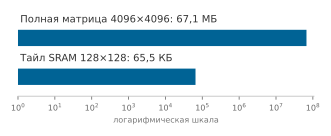

*FlashAttention заменяет полную матрицу внимания небольшими тайлами SRAM.*

В HBM не записывается никакой полной матрицы оценок или вероятностей $S{\times}S$. Тайл оценок FP32 размером $128{\times}128$, например, занимает 65,5 КБ, тогда как матрица $4096{\times}4096$ — 67,1 МБ. Остальные входы, выходы и скользящие статистики сохраняются, поэтому тайл не обязательно является самым большим тензором во всем ядре.

**Алгоритм: FlashAttention — тайловое внимание с онлайн-softmax**

```text
Вход:  запросы Q, ключи K, значения V для последовательности длины S; размер тайла b
Выход: выход внимания Y без материализации матрицы оценок S × S
для каждого тайла запросов Q_i:
    в SRAM: Y_i^acc ← 0, m_i ← −∞, l_i ← 0
    для каждого тайла ключей и значений (K_j, V_j):
        загрузить Q_i, K_j, V_j в SRAM; Z_ij ← Q_i K_j^T / √d_k
        m_i' ← max(m_i, rowmax(Z_ij))                      ▷ новый устойчивый максимум
        Y_i^acc ← Y_i^acc ⊙ e^{m_i − m_i'} + e^{Z_ij − m_i'} V_j
        l_i ← l_i ⊙ e^{m_i − m_i'} + rowsum(e^{Z_ij − m_i'}); m_i ← m_i'
        отбросить Z_ij                                      ▷ никогда не записывается в HBM
    Y_i ← Y_i^acc / l_i; записать Y_i в HBM
```

Алгоритм онлайн-softmax делает это разложение возможным. Традиционный softmax требует знать все входы до вычисления любого выхода: $\text{softmax}(x)_i = e^{x_i} / \sum_j e^{x_j}$. FlashAttention использует инкрементальную формулировку, которая обновляет статистики softmax по мере поступления новых блоков, отслеживая скользящий максимум $m$ (для численной устойчивости) и знаменатель $l$ по мере обработки каждого блока, а затем соответствующим образом перемасштабируя накопленные выходы.

<a id="sec-model-training-memory-io-complexity-analysis-5da5"></a>

#### Анализ сложности памяти и ввода-вывода

FlashAttention улучшает и память активаций, и ввод-вывод памяти, которые являются ограничивающими издержками во внимании, ограниченном пропускной способностью. Стандартному вниманию нужна память $\mathcal{O}(S^2)$ для хранения матриц оценок $\mathbf{Z}_{\text{attn}}$ и матриц вероятностей внимания $\mathbf{A}_{\text{attn}}$ по всем позициям последовательности. FlashAttention сокращает занимаемый объем сохраненных активаций до $\mathcal{O}(S)$, сохраняя только входные и выходные тензоры $(\mathbf{Q}, \mathbf{K}, \mathbf{V}, \mathbf{Y})$ плюс небольшой буфер SRAM для текущего тайла.

Для $S = 4096$, $d_{\text{head}} = 64$: стандартному вниманию нужно $4096^2 \times 4$ байта = 67,1 МБ на голову. FlashAttention требует только $(3 \times 4096{\times}64) \times 4$ байта ≈ 3,1 МБ на голову, то есть сокращение в 21,3 раза.

Паттерн ввода-вывода меняется по той же причине. Стандартное внимание читает $\mathbf{Q}$, $\mathbf{K}$ и $\mathbf{V}$ из HBM, записывает матрицы оценок, вероятностей и выходов во время прямого прохода, а затем перечитывает эти сохраненные матрицы при обратном проходе, прежде чем записать $d\mathbf{Q}$, $d\mathbf{K}$ и $d\mathbf{V}$. Результирующий трафик HBM включает тот же член $\mathcal{O}(S^2)$, из-за которого объем активаций велик. FlashAttention формирует блоки оценок и вероятностей в SRAM и никогда не записывает полные тензоры $S \times S$ в HBM. При обратном проходе он пересчитывает нужные блоки, а не читает сохраненные полные матрицы. Точная сложность ввода-вывода HBM зависит от размера тайла и доступной SRAM, потому что блоки ключей и значений многократно передаются по блокам запросов, поэтому граница не сводится просто к $\mathcal{O}(S \cdot d)$.

При больших длинах последовательности FlashAttention сокращает трафик HBM, избегая записи и повторного чтения матриц оценок и вероятностей $S \times S$. При $S = 4096$ и $d_{\text{head}} = 64$ занимаемая память активаций падает с сотен мегабайт на голову для сохраненных матриц внимания до нескольких мегабайт для тайловых входов и выходов, а точное сокращение пропускной способности зависит от аппаратуры и тайлинга ядра.

Оба подхода требуют асимптотически $\mathcal{O}(S^2 d)$ FLOP для плотного внимания. Обратный проход FlashAttention пересчитывает тайловые промежуточные данные внимания из сохраненных входов и статистик нормировки, а не хранит полные матрицы оценок и вероятностей. Получающееся сокращение трафика HBM может сдвинуть ядро к исполнению, ограниченному вычислениями, и дать чистое ускорение, но окончательное узкое место по-прежнему зависит от формы и аппаратуры.

<a id="sec-model-training-implementation-hardware-utilization-20a8"></a>

#### Реализация и загрузка аппаратуры

Выигрыш производительности FlashAttention проявляется через внимательное использование иерархии памяти GPU. Современные фреймворки могут направлять подходящие операции внимания на слитые или резервные реализации в зависимости от аппаратуры, входов и раскладок; профилирование показывает, какой путь сработал и помог ли он. [«Сравнение реализаций внимания»](08_training.md#lst-flash-attention-comparison) сопоставляет стандартную и оптимизированную реализации внимания.

<a id="lst-flash-attention-comparison"></a>

**Сравнение реализаций внимания**: стандартное внимание материализует полную матрицу $S{\times}S$ в HBM, тогда как FlashAttention использует оптимизированную реализацию PyTorch или выделенную библиотеку flash-attn.

```python
import torch
import torch.nn.functional as F

# Стандартное внимание (материализует матрицу n на n)
def standard_attention(q, k, v):
    # q, k, v: [batch, heads, seq_len, head_dim]
    scores = torch.matmul(q, k.transpose(-2, -1)) / (
        q.size(-1) ** 0.5
    )
    attn = F.softmax(scores, dim=-1)  # матрица n на n в HBM
    output = torch.matmul(attn, v)
    return output

# FlashAttention (без материализации матрицы n на n)
def flash_attention(q, k, v):
    # FlashAttention можно использовать, когда входы и аппаратура подходят
    output = F.scaled_dot_product_attention(q, k, v)
    return output

# Явный FlashAttention 2 (библиотека flash-attn)
from flash_attn import flash_attn_func

def flash_attn_2(q, k, v):
    # q, k, v: [batch, seq_len, heads, head_dim]
    # Другая раскладка для оптимизированного доступа к памяти
    output = flash_attn_func(q, k, v)
    return output
```

<a id="sec-model-training-benchmark-results-2c3f"></a>

#### Результаты бенчмарков

Преимущества FlashAttention становятся конкретными при измерении на реальной аппаратуре. Dao et al. (2022) сообщают об ускорении сквозного обучения в стиле GPT и отдельных бенчмарках ядер внимания, показывающих, что внимание с учетом ввода-вывода сокращает трафик памяти и улучшает время исполнения. [«Сравнение FlashAttention на бенчмарке»](08_training.md#tbl-flashattention-benchmarks) использует иллюстративный сценарий в стиле A100, чтобы показать тот же системный паттерн; его времена исполнения и значения памяти — иллюстративные числа главы, а не значения, приведенные Dao et al. (2022) дословно.

| **Длина последовательности** | **Стандартный прямой** | **Flash прямой** | **Стандартный обратный** | **Flash обратный** | **Память (стандарт)** | **Память (Flash)** |
|:----------------------------------------------|:----------------------------------------------------:|:------------------------------------------------------:|:----------------------------------------------------:|:------------------------------------------------------:|:---------------------:|:------------------:|
| 512                                           |                        12 мс                         |                          8 мс                          |                        35 мс                         |                         18 мс                          |         4,2 ГБ        |       2,8 ГБ       |
| 2048                                          |                        45 мс                         |                         15 мс                          |                       120 мс                         |                         35 мс                          |         18 ГБ         |        6 ГБ        |
| 4096                                          |                         OOM                          |                         32 мс                          |                         OOM                          |                         85 мс                          |        $>40$ ГБ      |       12 ГБ        |
| 8192                                          |                         OOM                          |                         68 мс                          |                         OOM                          |                         180 мс                         |        $>80$ ГБ      |       24 ГБ        |

<a id="tbl-flashattention-benchmarks"></a>

*Сравнение FlashAttention на бенчмарке: иллюстративное время одного вызова и пиковая память для стандартного внимания и FlashAttention в конфигурации в стиле A100 с 40 ГБ при разных длинах последовательности. OOM отмечает конфигурации, где стандартное внимание превышает бюджет памяти 40 ГБ; строка для 8192 токенов также показывает, что стандартное внимание превысило бы 80 ГБ.*

В этом иллюстративном сценарии в стиле A100 с 40 ГБ стандартное внимание исчерпывает память начиная с 2048 токенов, тогда как FlashAttention помещает последовательности до 8192 токенов. Даже при 2048 токенах, где помещаются оба варианта, FlashAttention дает ускорение прямого прохода в 3 раза и обратного — в 3,4 раза.

Последующие версии продолжили улучшать производительность: FlashAttention-2 (Dao, 2023) добавил еще примерно в 1,5–2 раза ускорения за счет лучшего параллелизма и распределения регистров, тогда как FlashAttention-3 (Shah et al., 2024) использует тензорные ядра FP8 и асинхронные операции с памятью на GPU Hopper и, как сообщается, достигает примерно 740 TFLOP/s на H100, около 75 процентов теоретического пика.

<a id="sec-model-training-use-flash-attention-375d"></a>

#### Когда использовать FlashAttention

Для обучения трансформеров на длинных последовательностях FlashAttention — обычно первая реализация внимания, которую стоит проверить. Она становится необходимой, когда длина последовательности переводит стандартное внимание в узкое место емкости или пропускной способности HBM, особенно в диапазоне в несколько тысяч токенов, где матрицы внимания $S{\times}S$ доминируют в памяти. Больше всего выигрывают GPU класса A100 и H100 с быстрой SRAM на кристалле. Отдача снижается для коротких последовательностей, где накладные расходы тайлинга не окупаются, на старых архитектурах GPU без сопоставимой пропускной способности SRAM и для архитектур без внимания, таких как сверточные сети и многослойные перцептроны.

На практике фреймворки глубокого обучения берут на себя большую часть интеграции FlashAttention, но решение по-прежнему зависит от раскладки, точности и бюджета памяти. Функция `scaled_dot_product_attention` в PyTorch может перенаправиться на FlashAttention, когда аппаратура, входы и ограничения бэкенда это позволяют; самописное внимание должно использовать подходящий примитив. Три практические проверки определяют, уместен ли FlashAttention:

1. Убедитесь, что раскладки тензоров соответствуют ожиданиям библиотеки (непрерывная память, правильный порядок измерений).
2. Используйте FP16 или BF16 для максимального ускорения (FlashAttention оптимизирован для смешанной точности).
3. Комбинируйте с контрольными точками градиентов, когда нужна дополнительная экономия памяти активаций.

Интеграция часто сводится к изменению одной строки: ручной вызов внимания заменяется на `F.scaled_dot_product_attention` (см. [«Сравнение реализаций внимания»](08_training.md#lst-flash-attention-comparison)). Инженерное решение остается тем же, что установлено анализом Roofline: использовать оптимизированный примитив, когда узкое место — трафик HBM, и позволить библиотеке управлять тайлингом и планированием SRAM, необходимыми для его устранения.

<a id="sec-model-training-systems-implications-broader-principles-c4f0"></a>

#### Системные следствия и общие принципы

FlashAttention служит примером фундаментального принципа системной инженерии: **проектирование алгоритмов с учетом ввода-вывода**. Многие ускорители располагают избытком вычислительной мощности относительно пропускной способности памяти. Для ядра, ограниченного пропускной способностью, трафик может определять время исполнения, даже когда число FLOP не меняется.

Этот принцип выходит за пределы внимания. В матричном умножении с учетом ввода-вывода алгоритмы тайлинга, подобные используемым в CUTLASS, сокращают трафик DRAM, максимизируя повторное использование данных в быстрых кэшах. Наивное умножение матриц $m{\times}m$ выполняет $\mathcal{O}(m^3)$ FLOP при $\mathcal{O}(m^2)$ трафике памяти, тогда как блочные алгоритмы сохраняют $\mathcal{O}(m^3)$ FLOP, но уменьшают число промахов кэша за счет оптимизации локальности.

Тот же принцип перемещения байтов возникает в эффективном по коммуникации распределенном обучении, где сжатие градиентов обменивает дополнительные вычисления (сжатие и распаковку) на сокращение потребления сетевой пропускной способности. Периферийные устройства с низким энергопотреблением и ограниченной пропускной способностью памяти выигрывают от алгоритмов с учетом ввода-вывода еще сильнее. Обмен 10 процентов дополнительной арифметики на вдвое меньший трафик памяти приближается к двукратному снижению энергии в пределе, когда перемещение данных составляет весь бюджет, и не достигает этого предела, если арифметика имеет заметную долю, поскольку сокращение одного слагаемого суммы вдвое не может уменьшить всю сумму более чем вдвое. Этот раздел вводит эвристику учета ввода-вывода; распределенные и периферийные развертывания используют ту же логику перемещения байтов.

Исключение матриц внимания размера $\mathcal{O}(S^2)$ из HBM освобождает память ускорителя и открывает три архитектурные возможности. Во-первых, оно позволяет использовать более длинные контексты последовательностей на фиксированной аппаратуре, сдвигая границу рабочего контекста с 2 тыс. до 8 тыс. токенов в иллюстрированной конфигурации A100. Во-вторых, освобожденная память активаций позволяет брать большие размеры микробатчей, что улучшает насыщение арифметики аппаратуры, при условии что динамика градиентов остается стабильной. В-третьих, сжатый объем активаций допускает более глубокие стеки трансформеров в заданном бюджете памяти, хотя осуществимость многомиллиардных моделей от начала до конца по-прежнему зависит от шардирования параметров, состояний оптимизатора и оставшихся активаций слоев.

Метод показывает, что системные алгоритмы могут использовать иерархию памяти для больших сокращений памяти активаций и ускорений, зависящих от нагрузки, сверх того, что дает одно только масштабирование аппаратуры. Рассмотрение пропускной способности памяти как главного ограничения, а вычислений как избыточного ресурса — повторяющийся паттерн в оптимизации производительности ML.

FlashAttention решает проблемы пропускной способности памяти во время вычислений, но существует другой класс ограничений памяти: сама емкость, нужная для одновременного хранения активаций и состояний оптимизатора. Когда модели или размеры батчей превышают емкость памяти GPU, два взаимодополняющих приема обменивают вычисления на память.

<a id="sec-model-training-gradient-accumulation-checkpointing-0c47"></a>

### Накопление градиентов и контрольные точки

Обучение больших моделей требует значительной памяти для активаций, градиентов и параметров. Когда память ограничивает размер батча или сложность модели, накопление градиентов[^fn-gradient-accumulation-training] формирует больший эффективный батч из последовательных микробатчей, тогда как контрольные точки отбрасывают и пересчитывают выбранные активации. Эти приемы становятся стандартными инструментами, когда память — связывающее ограничение.

<a id="sec-model-training-gradient-accumulation-checkpointing-mechanics-fb09"></a>

#### Механика накопления градиентов и контрольных точек

Накопление градиентов и контрольные точки активаций работают на разных принципах, но оба стремятся оптимизировать использование памяти при обучении, меняя способ обработки прямого и обратного вычислений. Накопление градиентов меняет то, сколько примеров вносят вклад в одно обновление; контрольные точки меняют то, какие активации остаются резидентными между прямым и обратным проходами.

<a id="sec-model-training-gradient-accumulation-308f"></a>

##### Накопление градиентов

Чтобы выполнять обучение с большими батчами на ускорителях с ограниченной памятью, системы делят эффективные батчи на меньшие последовательные микробатчи. На [«Накоплении градиентов»](08_training.md#fig-grad-accumulation) видно, как градиенты микробатчей $\delta_1, \delta_2, \delta_3$ накапливаются в один общий тензор градиента до запуска обновления оптимизатора.

<a id="fig-grad-accumulation"></a>

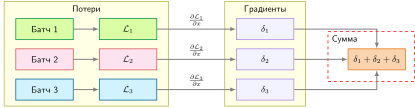

*Накопление градиентов: три микробатча каждый вычисляют независимые потери и градиенты, которые суммируются в один объединенный градиент для одного обновления параметров. Это имитирует обучение с батчем втрое большего размера без необходимости держать в памяти все образцы одновременно.*

В PyTorch накопление градиентов обычно реализуется делением потери каждого микробатча на число шагов накопления и вызовом `optimizer.step()` только после обработки всего эффективного батча. При таком соглашении об усреднении корректировка скорости обучения из-за одного лишь накопления не нужна. Реализация проходит пять шагов:

1. Выполнить прямой проход для микробатча.
2. Вычислить градиенты при обратном проходе.
3. Накопить градиенты в буфере без обновления параметров модели.
4. Повторить шаги 1–3 для всех микробатчей эффективного батча.
5. Обновить параметры модели накопленными градиентами после обработки всех микробатчей.

Накопление градиентов может воспроизвести градиент большего батча при контролируемых допущениях. Для эффективного размера батча $B = k \times b$, где $k$ — число шагов накопления, а $b$ — размер микробатча, [«равенство накопления градиентов»](08_training.md#eq-gradient-accumulation-equivalence) подтверждает, что накопленный градиент равен истинному градиенту батча:

<a id="eq-gradient-accumulation-equivalence"></a>

$$
\nabla \mathcal{L}_B = \frac{1}{B}\sum_{i=1}^{B} \nabla \mathcal{L}_i = \frac{1}{k}\sum_{j=1}^{k}\left(\frac{1}{b}\sum_{i \in \mathcal{B}_j} \nabla \mathcal{L}_i\right)
$$

Это равенство выполняется, когда вычисление для каждого примера одинаково и потеря усредняется согласованно. Правая часть показывает, что усреднение $k$ градиентов микробатчей (каждый вычислен по $b$ примерам) дает тот же результат, что и вычисление градиента по всем $B = kb$ примерам сразу. Состояние-зависимые слои, такие как BatchNorm, стохастические операции, такие как dropout и аугментация данных, порядок накопления при конечной точности и расписания, индексированные по шагам, могут нарушить точное равенство, поэтому накопление на больших батчах все равно требует валидации.

Накопление градиентов обменивает память на время вычислений. [«Компромиссы накопления градиентов»](08_training.md#tbl-gradient-accumulation-tradeoffs) отделяет выигрыш по памяти от вычислительных и планировочных издержек, которые остаются.

| **Измерение**   | **Эффект**                                                                                                                                    |
|:----------------|:----------------------------------------------------------------------------------------------------------------------------------------------|
| **Память**      | $\mathcal{O}(b)$ вместо $\mathcal{O}(B)$, что дает сокращение памяти активаций в $k$ раз                                                       |
| **Вычисления**  | Общее число FLOP не меняется, так как все $B$ примеров по-прежнему обрабатываются                                                              |
| **Время**       | $k$ проходов вперед и назад по микробатчам предшествуют каждому шагу оптимизатора; меньшие микробатчи могут снижать загрузку и добавлять накладные расходы на запуск |

<a id="tbl-gradient-accumulation-tradeoffs"></a>

*Компромиссы накопления градиентов. Накопление снижает резидентный объем памяти активаций и сохраняет общую арифметику на уровне примеров. Стоимость по времени зависит от эффективности микробатчей, накладных расходов на запуск ядер и того, откладывается ли распределенная синхронизация до накопленного обновления.*

Накопление сохраняет общую арифметику на уровне примеров, но может менять эффективность, потому что меньшие микробатчи иначе используют ускоритель и чаще запускают ядра. При распределенном накоплении с `no_sync()` одна синхронизация градиентов происходит после $k$ локальных микробатчей, а не после каждого. Модель из [«накладных расходов накопления градиентов»](08_training.md#eq-gradient-accumulation-overhead) задает время на одно обновление:

<a id="eq-gradient-accumulation-overhead"></a>

$$
T_{\text{effective}} = \sum_{j=1}^{k} T_{\text{micro},j} + T_{\text{sync}} + T_{\text{update}}
$$

Здесь $T_{\text{micro},j}$ — измеренное время прямого и обратного проходов для микробатча $j$, $T_{\text{sync}}$ — время синхронизации, уплачиваемое за накопленное обновление, а $T_{\text{update}}$ — время шага оптимизатора. При распределенном обучении с параллелизмом данных стандартные обертки фреймворков автоматически запускают асинхронные хуки синхронизации градиентов на каждом обратном проходе. Если накапливать градиенты по $k$ микробатчам, оставленные активными хуки вызовут избыточные операции AllReduce на каждом микробатче; обертывание первых $k-1$ микробатчей в контекст `model.no_sync()` подавляет эту коммуникацию, и единственная коллективная операция AllReduce выполняется только на последнем, $k$-м шаге.

Потеря времени относительно обработки эффективного батча сразу зависит от нагрузки. Ее нужно измерять, а не выводить из коэффициента сокращения памяти.

Когда накопление градиентов сочетается с распределенным параллелизмом данных на нескольких машинах, возникают дополнительные соображения по времени синхронизации градиентов и расчету эффективного размера батча на всем кластере. Продвинутые тексты по распределенным системам разбирают эти паттерны подробно.

<a id="sec-model-training-activation-checkpointing-2ee1"></a>

##### Контрольные точки активаций

Контрольные точки активаций снижают использование памяти при обратном проходе, отбрасывая и выборочно пересчитывая активации. В стандартном обучении активации прямого прохода хранятся в памяти для вычисления градиентов при обратном распространении ошибки. Однако эти активации могут занимать гигабайты памяти, особенно в глубоких сетях.

Память активаций можно сократить, обменивая FLOP на пропускную способность памяти при обратном распространении ошибки. Сравните прямой проход в верхней строке [«Контрольных точек активаций»](08_training.md#fig-activation-checkpointing) с обратным проходом в нижней строке: видно, как промежуточные активации отбрасываются и пересчитываются по требованию из сплошных зеленых тензоров контрольных точек.

<a id="fig-activation-checkpointing"></a>


*Контрольные точки активаций: обмен памяти на пересчет при обратном распространении ошибки позволяет обучать более глубокие нейронные сети. Сохраняя только часть активаций прямого прохода и пересчитывая остальные по требованию, метод снижает пиковые требования к памяти ценой увеличения времени обучения.*

Реализация делает компромисс по емкости явным. Система делит модель на сегменты, сохраняет активации только на границах сегментов во время прямого прохода и пересчитывает промежуточные активации при обратном проходе, когда это нужно.

Фреймворки вроде PyTorch предоставляют инструменты, такие как `torch.utils.checkpoint`, чтобы упростить этот процесс, но стоимость пересчета остается. Контрольные точки наиболее эффективны для глубоких архитектур с десятками или сотнями слоев, таких как трансформеры или большие сверточные сети, где хранение активаций превышает емкость GPU раньше, чем исчерпывается арифметическая пропускная способность.

Синергия накопления градиентов и контрольных точек позволяет обучать более крупные и сложные модели. Накопление градиентов управляет ограничениями памяти, связанными с размером батча, тогда как контрольные точки оптимизируют использование памяти под промежуточные активации. Вместе эти приемы расширяют круг моделей, которые можно обучать на имеющейся аппаратуре.

<a id="sec-model-training-optimal-checkpoint-placement-strategy-4a0d"></a>

#### Оптимальная стратегия размещения контрольных точек

Для сети с $N_L$ слоями, каждый из которых хранит $A$ байтов активаций, [«Компромиссы памяти и вычислений контрольных точек»](08_training.md#tbl-checkpoint-tradeoffs) количественно показывает, как число и расположение контрольных точек определяет компромисс памяти и вычислений. Сублинейные стратегии контрольных точек могут снизить потребление памяти с $\mathcal{O}(N_L)$ до $\mathcal{O}(\sqrt{N_L})$ при лишь частичном росте полного времени вычислений, что позволяет обучать гораздо более глубокие модели на имеющейся аппаратуре.

| **Стратегия**          |        **Стоимость памяти**   | **Стоимость пересчета** |
|:------------------------|:-----------------------------:|:----------------------|
| **Без контрольных точек** |         $N_L \times A$        | 0 прямых операций     |
| **Сохранить одну границу** |              $A$              | $(N_L-1)$ прямых операций |
| **k контрольных точек** | $k\times A + (N_L/k)\times A$ | $(N_L-k)$ прямых операций |

<a id="tbl-checkpoint-tradeoffs"></a>

*Компромиссы памяти и вычислений контрольных точек. Разные стратегии контрольных точек обменивают экономию памяти на накладные расходы пересчета. Оптимальное число контрольных точек балансирует эти факторы.*

Приравнивая производную полной стоимости памяти $(k \times A + (N_L/k) \times A)$ по $k$ к нулю, получаем аналитический оптимум при $k_{\text{optimal}} = \sqrt{N_L}$. В стандартной схеме контрольных точек с $\sqrt{N_L}$ это дает примерно треть дополнительных прямых вычислений в обмен на минимизацию объема активаций в рамках этой аналитической модели. Для GPT-2 с сорока восемью слоями трансформера операционная разница значительна: обучение без контрольных точек требует $48 \times A$ полного хранения активаций, тогда как равномерные контрольные точки ($\sqrt{48} \approx 7$ контрольных точек) требуют $7 \times A + (48/7) \times A \approx 14 \times A$, экономя 71 процент памяти активаций ценой примерно 33 процентов дополнительных вычислений шага (пересчетом одного прямого прохода по слоям без контрольных точек при обратном распространении ошибки).

Не все операции одинаково дороги для пересчета, что мотивирует выборочные контрольные точки. [«Выборочное размещение контрольных точек»](08_training.md#tbl-selective-checkpoint-placement) сравнивает, где объем памяти активаций достаточно велик, чтобы оправдать пересчет.

| **Тип слоя**            | **Стоимость памяти**                                                    | **Стоимость пересчета**            | **Стратегия контрольных точек**                                      |
|:------------------------|:------------------------------------------------------------------------|:-----------------------------------|:---------------------------------------------------------------------|
| **Блоки внимания**      | Зависит от формы; материализованное внимание может добавить квадратичные промежуточные данные | Высокая и зависящая от длины последовательности | Контрольные точки на границах блоков, когда сохраненное состояние оправдывает пересчет |
| **Блоки прямого распространения** | Часто определяется расширенными скрытыми активациями          | Высокая и зависящая от ширины      | Контрольные точки, когда расширенные активации доминируют в памяти    |
| **Нормализация**        | Малые самостоятельные выходы                                            | Низкая                             | Обычно обрабатывается внутри более крупного блока с контрольной точкой |

<a id="tbl-selective-checkpoint-placement"></a>

*Выборочное размещение контрольных точек. Размещение сравнивает состояние, сохраненное на границе блока, с работой, нужной для его восстановления. Стоимость внимания и прямого распространения зависит от длины последовательности, ширины, реализации ядра и от того, используется ли уже экономное по памяти внимание.*

Практическое правило — тратить пересчет на слои с высоким потреблением памяти, а не на операции, активации которых уже дешево сохранять.

<a id="sec-model-training-memory-computational-benefits-9372"></a>

### Память и вычислительные выгоды

Накопление градиентов создает эффективный батч, больший резидентного микробатча, не храня одновременно все его активации. Больший эффективный батч снижает дисперсию выборки, но не гарантирует более быстрой сходимости или лучшего обобщения. Прием особенно ценен, когда нужный эффективный батч не умещается в памяти целиком.

[^fn-gradient-accumulation-training]: **Накопление градиентов**: суммирует или усредняет градиенты по $k$ микробатчам перед одним шагом оптимизатора. Оно сокращает резидентный объем памяти активаций по сравнению с обработкой того же эффективного батча сразу, сохраняя общую арифметику на уровне примеров. Эквивалентность по времени исполнения и численная эквивалентность зависят от эффективности микробатчей, синхронизации, состояние-зависимых слоев, стохастических операций, точности и нормировки потерь.

Контрольные точки активаций значительно сокращают объем памяти промежуточных активаций при прямом проходе, позволяя обучать более глубокие модели. Отбрасывая и пересчитывая активации по мере необходимости, контрольные точки освобождают память для более крупных моделей, дополнительных слоев или данных более высокого разрешения. Этот компромисс критичен в архитектурах вроде трансформеров, которым нужна значительная память для промежуточных вычислений.

Оба приема повышают масштабируемость, сокращая память, необходимую до добавления аппаратуры. Возвращаясь к [«Маячному примеру: обучение GPT-2»](08_training.md#lhs-training-lighthouse-example-training-gpt-2), накопление градиентов необходимо, чтобы достичь целевого размера батча в рамках ограничений памяти V100.

<a id="nbk-training-gpt-2-gradient-accumulation-strategy"></a>

> **Стратегия накопления градиентов GPT-2**
>
> Этот иллюстративный сценарий уровня GPT-2 использует принятые цены и длительности, чтобы показать накопление градиентов; он не воссоздает историческую стоимость обучения GPT-2.
>
> **Ограничения памяти**
>
> - По упрощенному рецепту памяти главы V100 с 32 ГБ вмещает микробатч на GPU $B=4$.
> - Резидентный эффективный батч $B=512$ потребовал бы 512 ÷ 4 = 128 GPU.
>
> **Конфигурация накопления**
>
> - Используем 8 GPU и накапливаем 16 микробатчей по 4 примера каждый.
> - Каждый ускоритель обрабатывает 4 × 16 = 64 примера за обновление, давая глобальный эффективный батч 8 GPU × 64 = 512.
>
> Контекст `no_sync()` в распределенном обучении может отложить AllReduce до последнего микробатча.
>
> **Анализ компромиссов**
>
> - Идеализированное календарное время: в 16 раз дольше, потому что меньше ускорителей выполняют ту же арифметическую работу
> - Накладные расходы памяти: накопление обычно переиспользует буферы градиентов параметров, хотя служебные данные и временное хранение остаются
> - Коммуникация: обе конфигурации синхронизируются один раз на обновление из 512 образцов, но число участников и топология различаются
> - Стоимость при равной работе: \$688 тыс. в любом случае, до учета эффектов загрузки и коммуникации
>
> **Почему это работает**: при условиях эквивалентности, сформулированных выше, усредненные градиенты по примерам аддитивны. Каждый ускоритель сначала накапливает локальный градиент по своим 64 примерам:
>
> $$
> \frac{1}{16}\sum_{j=1}^{16} \left[\frac{1}{4}\sum_{k=1}^{4} \nabla \mathcal{L}(x_{jk})\right]
> $$
>
> Затем AllReduce усредняет эти локальные градиенты по 8 GPU, давая глобальный эффективный батч:
>
> $$
> \frac{1}{8}\sum_{g=1}^{8} \nabla \mathcal{L}_{\text{local}}^{(g)}, \qquad B_{\text{global}} = 8 \times 64 = 512
> $$
>
> **Операционное сравнение**
>
> Резидентная конфигурация:
>
> - 128 GPU × 4 примера = 512 резидентных примеров за обновление
> - Синхронизация градиентов охватывает 128 GPU
> - Почасовая стоимость: 128 GPU × \$16/час = \$2 048/час
>
> Конфигурация с накоплением:
>
> - 8 GPU × (4 примера × 16 микробатчей) = 512 примеров за обновление
> - Синхронизация градиентов происходит один раз за обновление на 8 GPU
> - Почасовая стоимость: 8 GPU × \$16/час = \$128/час
> - Снижение почасовой стоимости: \$1 920/час, или 93,8 процента
>
> **Контрольный барьер**
>
> - Сохраните примеры и их порядок, нормировку потерь, состояние оптимизатора и расписание шагов, а также поведение стохастических слоев.
> - Сравнивайте потерю или перплексию на отложенных данных и траекторию оптимизации по повторным прогонам, а не предполагайте, что один лишь эффективный батч гарантирует эквивалентное качество.
> - Ожидайте малых ошибок округления из-за измененного порядка суммирования; требуйте сходимости в заранее заданном допуске, а не побитовой идентичности. Результат по перплексии здесь не предполагается.
>
> **Системный вывод**: накопление снижает число ускорителей и почасовой расход, но идеальное масштабирование сохраняет объем машино-часов ускорителей; реальная стоимость зависит от загрузки и коммуникации.

[«Цикл обучения с накоплением градиентов»](08_training.md#lst-gradient-accumulation-loop) ставит одну операцию AllReduce после шестнадцати локальных микробатчей, делая границу синхронизации явной.

<a id="lst-gradient-accumulation-loop"></a>

**Цикл обучения с накоплением градиентов**: шестнадцать локальных микробатчей накапливаются перед одним AllReduce и обновлением оптимизатора.

```python
optimizer.zero_grad()
for step in range(16):  # Шаги накопления
    micro_batch = next(dataloader)  # 4 образца
    loss = model(micro_batch) / 16  # Усредняем потерю эффективного батча
    loss.backward()  # Накапливаем градиенты
# Теперь градиенты соответствуют 64 локальным образцам
all_reduce(gradients, op=SUM)  # Суммируем по 8 GPU
gradients /= 8  # Переводим сумму в глобальное среднее
optimizer.step()  # Обновляем с эффективным батчем 512
```

<a id="sec-model-training-gradient-accumulation-practical-considerations-a5a4"></a>

#### Практические соображения

Накопление градиентов наиболее ценно, когда оптимальные размеры батча превышают емкость памяти GPU. Языковые модели на трансформерах часто используют эффективные батчи из сотен тысяч или миллионов токенов; если память позволяет разместить на устройстве лишь небольшое число последовательностей, накопление закрывает разрыв без дополнительной аппаратуры. Контрольные точки активаций дополняют это, позволяя строить более глубокие архитектуры, и обычно используются при обучении в масштабе трансформеров, а также в двойных сетевых конфигурациях с большой долей активаций, таких как генеративно-состязательные сети.

Оба приема вводят явные компромиссы. Контрольные точки активаций пересчитывают отброшенные активации при обратном распространении ошибки; при обычном сегментном контрольном сохранении каждая отброшенная активация обычно восстанавливается один раз, тогда как рекурсивные расписания могут вести себя иначе. Накопление градиентов снижает частоту обновления параметров, потому что каждое обновление следует за $k$ микробатчами. Когда потеря каждого микробатча делится на $k$, накопленный градиент следует соглашению о среднем по эффективному батчу. Если же потери суммируются, градиенты нужно перемасштабировать перед шагом оптимизатора или соответственно изменить соглашение о скорости обучения. Соглашения фреймворков и кодовых баз различаются, поэтому нормировка — частый источник тонких ошибок.

<a id="sec-model-training-optimization-technique-comparison-a89a"></a>

### Сравнение методов оптимизации обучения

Каждая оптимизация обучения нацелена на отдельное физическое узкое место внутри иерархии памяти и вычислений ускорителя. Асинхронная предвыборка выстраивает передачи с хоста на устройство по шине PCIe в конвейер с исполнением на ускорителе, не давая вычислительным движкам простаивать из-за голода по входным данным. Обучение в смешанной точности вдвое сокращает объем передач тензоров по шине HBM для весов и активаций, одновременно направляя матричную арифметику на специализированные тензорные блоки пониженной точности. FlashAttention дополняет эти системные вмешательства, устраняя квадратичное узкое место пропускной способности памяти самовнимания: тайлируя запросы, ключи и значения в SRAM на кристалле, он сокращает вспомогательную память внимания с $\mathcal{O}(S^2)$ до $\mathcal{O}(S)$ и сообщает об ускорении до 3 раз на исследованных нагрузках. Наконец, контрольные точки активаций и накопление градиентов управляют емкостью памяти устройства: контрольные точки отбрасывают промежуточные активации, чтобы восстановить их пересчетом при обратном проходе, а накопление градиентов делит большой логический батч на временные микробатчи, ограничивая пиковую резидентную память.

Поскольку пропускная способность обучения определяется связывающим ограничением системы, применение оптимизации к несвязывающей подсистеме не дает сквозного ускорения. Ускорение тензорной арифметики пониженной точностью или FlashAttention не сократит время шага, если конвейеры вычислений простаивают в ожидании батчей с хоста. И наоборот, расширение буферов предвыборки не дает выигрыша, когда исполнение ограничено емкостью HBM или пересчетом при обратном проходе. Поэтому профилирование должно определить, ограничена ли нагрузка вводом данных, емкостью памяти, пропускной способностью памяти или арифметической пропускной способностью, прежде чем выбирать вмешательство.

[«Стратегии оптимизации»](08_training.md#tbl-optimization) сравнивает три из этих базовых стратегий по механизмам, требованиям к аппаратуре и операционным компромиссам; FlashAttention выступает алгоритмическим дополнением внутри самого ядра внимания.

| **Аспект**                    | **Предвыборка и перекрытие**                                       | **Обучение в смешанной точности**                                        | **Накопление градиентов и контрольные точки**                            |
|:------------------------------|:-------------------------------------------------------------------|:-------------------------------------------------------------------------|:-------------------------------------------------------------------------|
| **Основная цель**             | Минимизировать задержки передачи данных и максимизировать загрузку ускорителя | Сократить хранение тензоров и ускорить подходящие операции пониженной точности | Преодолеть ограничения памяти при обратном распространении ошибки и обновлении параметров |
| **Ключевой механизм**         | Асинхронная загрузка данных и параллельная обработка               | Сочетание вычислений пониженной и повышенной точности                    | Имитация больших размеров батча и выборочное хранение активаций          |
| **Влияние на память**         | Увеличивает память под буфер предвыборки                           | Может сократить веса, активации и передаваемые тензоры                   | Сокращает резидентные активации; размер градиентов параметров не меняется |
| **Скорость вычислений**       | Растет за счет сокращения простоя                                  | Может ускорять подходящие операции FP16/BF16 на поддерживаемой аппаратуре | Может замедлиться из-за пересчета в контрольных точках                   |
| **Масштабируемость**          | Высокая, особенно для больших наборов данных                       | Позволяет обучать более крупные модели                                   | Позволяет обучать более глубокие модели на ограниченной аппаратуре       |
| **Требования к аппаратуре**   | Выигрывает от быстрого хранилища и многоядерных CPU                | Поддерживаемые пути ускорителя пониженной точности                       | Работает на стандартной аппаратуре                                       |
| **Сложность реализации**      | Средняя (нужна настройка параметров предвыборки)                   | Низкая или средняя (при поддержке фреймворка)                            | Средняя (нужны аккуратная сегментация и накопление)                      |
| **Основные выгоды**           | Сокращает время обучения, повышает загрузку аппаратуры             | Более быстрое обучение, более крупные модели, меньше памяти              | Позволяет брать большие батчи и более глубокие модели                    |
| **Основные трудности**        | Настройка размеров буферов, рост потребления памяти                | Возможна численная нестабильность; FP16 может требовать масштабирования функции потерь | Рост вычислительных накладных расходов, более медленные обновления параметров |
| **Идеальные сценарии**        | Большие наборы данных, сложная предобработка                       | Крупные модели, особенно в NLP и компьютерном зрении                     | Батчи с ограничением памяти или модели с большой долей активаций         |

<a id="tbl-optimization"></a>

*Стратегии оптимизации. Таблица сравнивает предвыборку, смешанную точность и совместное использование накопления градиентов и контрольных точек. Первая нацелена на простои входа, вторая меняет хранение и подходящую арифметику, а третья обменивает меньшие резидентные наборы активаций на накладные расходы микробатчей или пересчета.*

Таблица сравнивает приемы по отдельности; разбор GPT-2 показывает, как эти приемы сочетаются, когда одна модель должна уместиться в памяти, работать достаточно быстро и оставаться в реалистичном бюджете стоимости.

<a id="sec-model-training-putting-together-gpt2-optimization-walkthrough-def7"></a>

### Разбор оптимизации GPT-2

Обучение GPT-2 (1,5 млрд параметров) на одном GPU V100 выявляет физические границы, которые определяют оптимизацию больших моделей: размещение тензоров сразу превышает емкость памяти ускорителя, а наивные входные конвейеры оставляют вычислительные движки без данных. Проследив этот диагностический путь на одном устройстве, мы устанавливаем осуществимость по памяти и насыщение вычислений до масштабирования на кластер из нескольких ускорителей.

<a id="nbk-training-gpt-2-optimization-v100"></a>

> **Оптимизация GPT-2 на V100**
>
> **Шаг 1**: установить исходный объем памяти.
>
> Трасса начинается с GPT-2 XL с 1,5 млрд параметров, размером батча 4, длиной последовательности 1024, тензорами FP32 везде и синхронным загрузчиком данных в один поток. Это намеренно ограниченная конфигурация: достаточно маленькая, чтобы обсуждать ее на одном V100, но достаточно большая, чтобы первый сбой был немедленным и однозначным. Этот разбор использует батч 4, ту же конфигурацию, что и в врезке о смешанной точности (прикидочный расчет: [«Экономия памяти при смешанной точности GPT-2»](08_training.md#nbk-training-gpt-2-mixed-precision-memory)); [«Иллюстративный сценарий обучения GPT-2»](08_training.md#tbl-gpt2-summary) приводит эквиваленты для батча 32 (базовый уровень FP32 — 597,8 ГБ, оптимизированный — 95,7 ГБ), которые превышают один GPU даже после оптимизации. При размере батча 4 базовый уровень FP32 требует 95,7 ГБ, поэтому прогон не проходит ограничение машины на V100 с 32 ГБ еще до того, как важна пропускная способность.
>
> **Шаг 2**: применить смешанную точность.
>
> Первое вмешательство нацелено на осуществимость по памяти, а не на скорость. Автоматическая смешанная точность (AMP) выполняет прямой и обратный проходы в 16-битной точности, вдвое сокращая динамический объем активаций. Поскольку численная устойчивость требует хранить 32-битные мастер-веса и моменты Adam в FP32, статическое хранение параметров и оптимизатора не меняется и остается 16 байтов на параметр. Сокращение объема активаций вдвое снижает пиковую память до 59,9 ГБ, то есть на 37,5 процента, но выделение все еще превышает физическую емкость ускорителя на 32 ГБ.
>
> **Шаг 3**: добавить контрольные точки градиентов.
>
> Поскольку статическое состояние не может уменьшиться дальше, не меняя динамику оптимизатора, контрольные точки градиентов атакуют оставшийся объем активаций. Вместо того чтобы сохранять активации прямого прохода на каждом слое для обратного распространения ошибки, среда исполнения отбрасывает промежуточные состояния и пересчитывает их по требованию при обратном проходе. Контрольная точка на каждом четвертом слое дает четырехкратное сокращение памяти активаций, доводя общий объем тензоров до 33 ГБ и наконец помещаясь в физическую емкость устройства. При модели пересчета по равным слоям это сокращение памяти требует примерно на 33 процента больше прямых арифметических операций; рабочий прогон должен проверить, что временные выделения рабочей памяти и фрагментация аллокатора остаются в пределах доступного запаса.
>
> **Шаг 4**: изучить иллюстративный профиль пропускной способности.
>
> Размещение модели в памяти устройства решает проблему емкости, но не гарантирует эффективного исполнения. Профилирование уже исполнимой модели показывает разбивку времени итерации по подсистемам:
>
> - Загрузка ускорителя: 45 процентов
> - Загрузка данных: 40 процентов времени итерации
> - Вычисления: 35 процентов времени итерации
> - Передачи памяти: 25 процентов времени итерации
>
> Эти измерения профиля сдвигают диагностический фокус с емкости памяти машины (M) на конвейер данных (D) в терминах D·A·M. Поскольку 40 процентов времени итерации уходят на ожидание батчей, подготовленных на хосте, дальнейшие оптимизации памяти ускорителя не улучшат календарную пропускную способность обучения, пока не будет решен голод данных.
>
> **Шаг 5**: применить предвыборку и оптимизацию конвейера данных.
>
> Устранение голода входных данных требует перекрытия подготовки данных на хосте с вычислениями на ускорителе. В этом сценарии настройка загрузчика данных на восемь рабочих процессов распараллеливает декодирование образцов на стороне CPU, закрепленная (page-locked) память хоста позволяет асинхронные передачи DMA по шине PCIe, а коэффициент предвыборки 2 удваивает буферизацию предстоящих батчей в очередях хоста и устройства. Скрытие задержек предобработки и передачи на хосте за выполнением ядер повышает загрузку ускорителя с 45 до 85 процентов, превращая нагрузку, голодающую по входным данным, в прогон с насыщенными вычислениями.
>
> [«Иллюстративный профиль оптимизации GPT-2»](08_training.md#tbl-training-gpt2-final-profile) сопоставляет неисполнимый наивный базовый уровень с оптимизированной конфигурацией на одном GPU.
>
> | **Показатель**              |                    **Наивный**                   |                   **Оптимизированный**                   |                          **Улучшение**                           |
> |:----------------------------|:------------------------------------------------:|:-------------------------------------------------:|:------------------------------------------------------------------:|
> | **Память**                  | 95,7 ГБ |  33 ГБ | снижение в 2,9 раза |
> | **Загрузка ускорителя**     |                       Н/Д                        | 85% |                             Станет обучаемым                              |
> | **Пропускная способность**  |                       Н/Д                        |                   1 200 токенов/с                  |                                 —                                  |
> | **Время на эпоху**          |                       Н/Д                        |                     8,3 часа                     |                                 —                                  |
>
> <a id="tbl-training-gpt2-final-profile"></a>
>
> ***Иллюстративный профиль оптимизации GPT-2**: значения памяти для батча 4 вычислены в разборе; загрузка, пропускная способность и время эпохи — принятые значения сценария, а не результаты бенчмарков. [«Иллюстративный сценарий обучения GPT-2»](08_training.md#tbl-gpt2-summary) приводит итоги сценария для батча 32.*
>
> **Системный вывод**: оптимизация обучения следует строгой цепочке диагностических зависимостей: сначала решить вопрос осуществимости по памяти, затем пропускной способности, а голод данных устранить раньше, чем настраивать ядра. Когда емкость и простои входа перестают ограничивать исполнение, повторное профилирование определяет, ограничена ли производительность ядер пропускной способностью памяти или арифметической пропускной способностью, прежде чем менять размер батча или архитектуру модели.

Этот разбор показывает, почему оптимизация обучения — последовательная диагностическая дисциплина, а не произвольный набор приемов. Каждое вмешательство напрямую устраняет связывающее физическое ограничение, выявленное предыдущим измерением: смешанная точность вдвое сокращает хранение активаций, контрольные точки градиентов принимают 33 процента дополнительных вычислений ради сокращения памяти в 2,9 раза, которое укладывается в физическую емкость устройства, а асинхронная предвыборка устраняет остановки передач по PCIe, как только исполнение начинается. Когда осуществимость на одном ускорителе и насыщение вычислений установлены, следующая задача — оценить, как эти накапливающиеся оптимизации масштабируются на кластер из нескольких ускорителей по времени исполнения, энергопотреблению и общей стоимости обучения.

<a id="sec-model-training-optimization-impact-summary-0213"></a>

### Сводка влияния оптимизаций

Пример GPT-2 показывает, как целевые приемы могут сочетаться. Его значения памяти следуют модели тензоров главы, тогда как входные данные о времени, мощности, цене электроэнергии и углеродоемкости сети задают иллюстративный сценарий работы, а не измеренный прогон GPT-2.

[«Иллюстративный сценарий обучения GPT-2»](08_training.md#tbl-gpt2-summary) собирает результаты, вытекающие из этих допущений по уровню кластера.

| **Показатель**                                                         |                 **Базовый FP32**                 |                   **Оптимизированный**                   | **Примененный метод**                                                     |
|:-----------------------------------------------------------------------|:-------------------------------------------------:|:-------------------------------------------------:|:--------------------------------------------------------------------------|
| **Параметры**                                                          |     6 ГБ     |     3 ГБ     | Смешанная точность (FP16)                                                 |
| **Градиенты**                                                          |      6 ГБ     |      3 ГБ     | Смешанная точность (FP16)                                                 |
| **Мастер-веса**                                                        |     0 ГБ    |     6 ГБ    | Накладные расходы AMP                                                     |
| **Состояние оптимизатора (Adam)**                                      |      12 ГБ      |      12 ГБ      | Без изменений (моменты FP32)                                              |
| **Активации (батч=32)**                                                |      573,8 ГБ      |      71,7 ГБ      | Контрольные точки градиентов + FP16                                       |
| **Итого память**                                                       | **597,8 ГБ** | **95,7 ГБ** | —                                                                         |
| **Время обучения (32 V100)**                                           |     14 дней    |     8,4 дня    | Предвыборка данных + загрузка                                             |
| **Энергопотребление**                                                  |    3 914 кВт·ч    |    2 348 кВт·ч    | Принятая постоянная мощность кластера на протяжении каждого прогона       |
| **Стоимость электроэнергии (\$0,10/кВт·ч)**                          |       \$391,4       |       \$234,8       | —                                                                         |
| **Углеродный след**                                                    |   1,7 т  |   1,0 т  | Средняя по региону сеть (0,43 кг/кВт·ч)                                 |

<a id="tbl-gpt2-summary"></a>

***Иллюстративный сценарий обучения GPT-2**: модель тензоров дает заявленные итоги по памяти. Длительность обучения, постоянная мощность кластера, PUE, цена электроэнергии и углеродоемкость сети — допущения сценария; при этих допущениях сокращение времени работы пропорционально снижает энергопотребление и выбросы, привязанные к местоположению.*

Как показано в [«Иллюстративном сценарии обучения GPT-2»](08_training.md#tbl-gpt2-summary), принятые входные данные дают сокращение памяти в 6 раз, сокращение календарного времени в 1,7 раза и снижение энергопотребления на 40 процентов при постоянной смоделированной мощности. На практике энергию и стоимость нужно считать по измеренному времени работы и мощности, поскольку более высокая загрузка может менять потребляемую мощность кластера.

Оптимизации одного ускорителя накапливаются, насыщая устройство: смешанная точность максимизирует пропускную способность тензорных ядер, FlashAttention устраняет трафик промежуточного внимания за пределами кристалла, контрольные точки градиентов сжимают объем активаций, а асинхронная предвыборка скрывает задержку ввода-вывода хоста. Однако даже полностью оптимизированные нагрузки с бюджетами в сотни экзафлоп остаются ограниченными арифметической пропускной способностью отдельного чипа.

Масштабирование за пределы емкости вычислений или памяти одного устройства требует распределения вычислений по нескольким ускорителям. Этот архитектурный переход вводит накладные расходы межустройственной коммуникации, барьеры коллективной синхронизации и ограничения отказоустойчивости, которые становятся главными факторами эффективности масштабирования кластера.

<a id="sec-model-training-scaling-training-systems-adfd"></a>

## Масштабирование систем обучения

Разбор GPT-2 моделирует, как смешанная точность и контрольные точки сводят бюджет тензоров батча 4 к 33 ГБ, близко к емкости V100 в 32 ГБ до учета рабочих областей и накладных расходов аллокатора. При батче 32 смоделированный итог снижается с 597,8 ГБ до 95,7 ГБ, но все еще превышает этот V100. Ускорители с большей памятью могут сдвинуть границу. Однако модель на 70 млрд параметров требует около 140 ГБ только для весов в FP16 и существенно больше для состояния полного обучения с полным набором параметров, что обосновывает шардирование, выгрузку или несколько устройств.

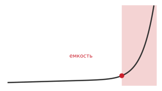

*Некоторые модели превышают память одного GPU раньше, чем что-либо еще становится важным.*

Когда выбранная нагрузка все еще превышает память или расписание одного устройства, распределение по устройствам дает совокупную память и вычислительную мощность. Другие ответы включают сокращение модели, батча, длины последовательности или объема обучения; выгрузку состояния; и эффективную по параметрам адаптацию. Масштабирование за пределы одного устройства начинается с конфигураций из нескольких GPU внутри одной машины и может распространяться на несколько узлов. Основные стратегии параллелизма имеют разные компромиссы по коммуникации; полное изложение реализации распределенного обучения выходит за рамки этой главы.

Не все нагрузки одинаково выигрывают от добавления GPU. Соотношение полезных вычислений, коммуникации, дисбаланса и синхронизации определяет эффективность масштабирования. [«Налог на коммуникацию»](08_training.md#fig-communication-tax) моделирует этот компромисс формулировкой в духе закона Амдала, где немасштабируемые накладные расходы создают связывающий потолок пропускной способности. Расширяющийся разрыв между идеальным линейным ускорением и достигнутым ускорением наглядно показывает налог на коммуникацию, уплачиваемый при масштабе.

<a id="fig-communication-tax"></a>

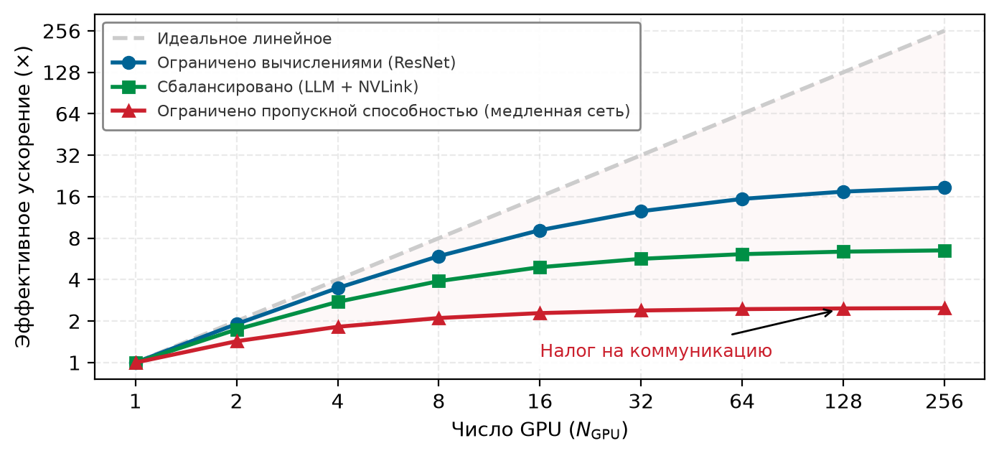

*Налог на коммуникацию: модель в духе закона Амдала сравнивает идеальное линейное масштабирование с нагрузками, имеющими разные доли немасштабируемой коммуникации и синхронизации. Реальные накладные расходы коммуникации динамически растут с числом устройств, топологией сети, размером сообщений и эффективностью перекрытия.*

Расширяющийся разрыв красной кривой от пунктирной идеальной линии — это налог на коммуникацию, сделанный видимым; сокращение этого разрыва именно и призваны обеспечивать распределенные стратегии из раздела [«Обучение на одном узле с несколькими GPU»](08_training.md#sec-model-training-singlenode-multigpu-training-c87f).

<a id="sec-model-training-singlenode-multigpu-training-c87f"></a>

### Обучение на одном узле с несколькими GPU

Обучение на нескольких GPU внутри одного узла закладывает базовые архитектурные паттерны распределенного исполнения. AlexNet[^fn-alexnet-two-gpu] (Krizhevsky et al., 2012) разделила свои сверточные слои между двумя GPU GTX 580, потому что ограничение памяти устройства в 3 ГБ не позволяло выполнить модель на одном чипе, и связность между GPU стала немедленным архитектурным ограничением. Ограничение многоускорительных топологий межсоединениями внутри одного узла (такими как PCIe или NVLink) позволяет выделить базовые стратегии параллелизма до введения сетевых структур между стойками.

[^fn-alexnet-two-gpu]: **AlexNet (2012)**: статья сообщает 60 млн параметров и потолок в 3 ГБ на один GPU, но не относит ограничение к одному компоненту памяти. Ее архитектура модельного параллелизма разместила примерно половину ядер на каждом GPU и разрешала коммуникацию только в отдельных слоях, явно обменивая емкость памяти на коммуникацию.

Две базовые стратегии — параллелизм данных и параллелизм моделей — представляют принципиально разные выборы разбиения: параллелизм данных реплицирует модель и делит данные, тогда как параллелизм моделей делит состояние или вычисления модели. Это различие определяет требования к памяти, паттерны коммуникации и поведение масштабирования.

<a id="sec-model-training-data-parallelism-ad1c"></a>

#### Параллелизм данных

Параллелизм данных реплицирует всю модель на каждом GPU, причем каждый обрабатывает разные батчи. После локального вычисления градиентов GPU синхронизируются усреднением градиентов. [«Параллелизм данных»](08_training.md#fig-train-data-parallelism) показывает поток данных: входные данные делятся на непересекающиеся батчи, каждый ускоритель независимо выполняет прямой и обратный проходы, затем градиенты агрегируются перед обновлением общей модели.

<a id="fig-train-data-parallelism"></a>

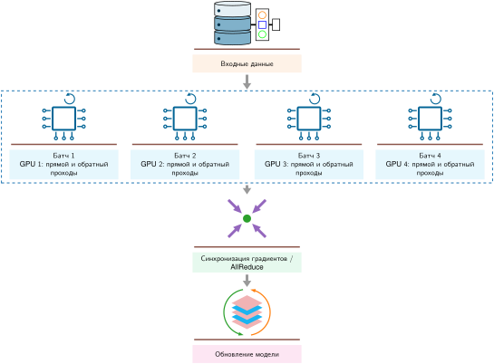

*Параллелизм данных: каждый GPU держит полную копию модели, обрабатывает свой шард данных и синхронизирует градиенты. Пропускная способность может приближаться к линейному масштабированию, только пока вычисления доминируют над издержками синхронизации, ввода и дисбаланса.*

Когда модель и ее состояние оптимизатора комфортно умещаются в памяти одного устройства, параллелизм данных служит основным базисом масштабирования, потому что локальные ядра прямого и обратного проходов работают на нативной пропускной способности памяти без синхронизации между устройствами. Коммуникация происходит исключительно при агрегации градиентов. Исторически фреймворки поддерживали исполнение на нескольких GPU внутри одного узла с помощью многопоточных оберток вроде `DataParallel` (DP) в PyTorch. Однако этот однопроцессный дизайн страдает от двух серьезных архитектурных узких мест: среда исполнения Python остается ограниченной глобальной блокировкой интерпретатора (GIL), а главный координатор (GPU 0) последовательно раздает мини-батчи и собирает выходы по PCIe, насыщая пропускную способность межсоединения хост–устройство и создавая сильные дисбалансы вычислений и памяти. Современные системы заменяют его многопроцессными архитектурами, такими как `DistributedDataParallel` (DDP) в PyTorch и `MirroredStrategy` в TensorFlow. Запуская независимый процесс Python на каждый ускоритель, DDP полностью устраняет конкуренцию за GIL; каждый процесс держит собственную реплику модели и локальный оптимизатор, полагаясь на децентрализованные коллективные операции AllReduce, которые группируют градиенты в непрерывные буферы и перекрывают синхронизацию непосредственно с вычислением обратного прохода.

У неразделенного параллелизма данных есть жесткое ограничение: каждый GPU держит полную реплику модели и, как правило, свое локальное состояние оптимизатора. Модель на 7 млрд параметров занимает 14 ГБ только под веса в FP16, до учета градиентов, состояний оптимизатора или активаций. Шардированный параллелизм данных (например, Zero Redundancy Optimizer, или ZeRO) распределяет это состояние по устройствам: ZeRO-1 шардирует состояние оптимизатора, ZeRO-2 — градиенты, а ZeRO-3 (или FSDP) — параметры модели; иначе модель, которая превышает локальную память, требует конвейерного или тензорного разбиения.

<a id="sec-model-training-model-parallelism-c97e"></a>

#### Параллелизм моделей

Параллелизм моделей разбивает саму модель между GPU, что становится необходимым, когда модель превышает память одного GPU. AlexNet применила раннюю форму этой стратегии: определенные сверточные слои выполнялись на GPU 1, а другие — на GPU 2, и активации передавались по PCIe только на границах слоев. [«Параллелизм моделей»](08_training.md#fig-model-parallelism) показывает пути прямого и обратного проходов: данные движутся через разделы модели на разных устройствах, а градиенты во время обучения текут назад.

<a id="fig-model-parallelism"></a>

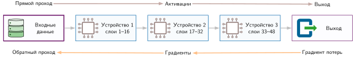

*Параллелизм моделей: модель разбита по устройствам, а промежуточные активации передаются между ними. Это позволяет обучать модели больше памяти одного GPU ценой последовательных зависимостей.*

<a id="psp-training-data-vs-model-parallelism"></a>

> **Параллелизм данных и параллелизм моделей**
>
> Когда выбранная нагрузка распределяется по $N_{\text{GPU}}$ устройствам, разбиение может делить примеры, состояние модели, слои или тензорные операции. Для модели с параметрами $P$ и размером батча $B$ параллелизм данных и параллелизм моделей дают две отправные точки.
>
> **Параллелизм данных (делим батч)**: при фиксированном глобальном батче каждый из $N_{\text{GPU}}$ рабочих обрабатывает примерно $1/N_{\text{GPU}}$ примеров, но каждый рабочий держит реплику модели и, как правило, связанное с ней состояние обучения. Плотная коммуникация градиентов пропорциональна $P$ на каждое обновление. Масштабирование отходит от идеала по мере уменьшения локальных батчей или роста затрат на синхронизацию и ввод.
>
> **Параллелизм моделей (делим вычисления модели)**: каждый ускоритель хранит и вычисляет часть модели. Равное разбиение может давать около $P/N_{\text{GPU}}$ параметров на рабочего, но эмбеддинги, буферы, дисбаланс и реплицированное состояние меняют эту оценку. Коммуникация зависит от разбиения: поэтапный конвейерный параллелизм обменивается активациями на границах стадий, тогда как тензорный параллелизм выполняет коллективные операции внутри разбитых слоев.
>
> **Системный вывод**: параллелизм данных — самый простой кандидат, когда полное состояние обучения помещается у каждого рабочего и нужна большая пропускная способность. Разбиение состояния модели, конвейерное или тензорное становится необходимым, когда не помещается, часто в сочетании с параллелизмом данных.

Когда модель превышает память одного ускорителя, ее глубину можно разбить по последовательным устройствам. [«Послойное разбиение модели»](08_training.md#fig-layers-blocks) иллюстрирует такое назначение стадий, отображая непрерывные группы блоков трансформера на разные устройства по цепочке исполнения.

<a id="fig-layers-blocks"></a>

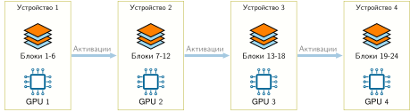

*Послойное разбиение модели: распределение последовательных слоев трансформера по последовательным устройствам ограничивает сетевую коммуникацию промежуточными активациями (прямой проход) и граничными градиентами (обратный проход). Однако последовательные зависимости слоев оставляют последующие устройства простаивающими во время прямого прохода, если микробатчи не конвейеризованы.*

Фундаментальное узкое место наивного послойного разбиения — сериализация устройств. Поскольку вычисление слоев строго последовательно, Устройство 1 считает слои 1–6, пока Устройства 2–4 простаивают в ожидании прямых активаций. При обратном проходе зависимость меняется на обратную: Устройство 4 считает первым, а вышестоящие устройства ждут возвращающихся градиентов. Эта длительность простоя составляет *пузырь конвейера*, который ограничивает теоретическую загрузку аппаратуры величиной $1/N_{\text{GPU}}$ при наивном последовательном исполнении. Чтобы смягчить этот простой, нужно либо конвейеризовать микробатчи по стадиям, либо разбивать размерности тензоров внутри слоев, чтобы все устройства вычисляли одновременно.

Внутри узла GPU могут обмениваться данными через высокоскоростные каналы, такие как NVLink[^fn-nvlink-switch-fabric] (до 900 ГБ/с совокупной двунаправленной пропускной способности для представленной конфигурации H100). Эффективная коллективная пропускная способность зависит от топологии и конкуренции и ниже необработанной совокупной спецификации канала. Параллелизм данных передает градиенты коллективными операциями AllReduce, тогда как послойный параллелизм моделей передает активации точка-точка на границах разделов. Выбор стратегии требует балансировать эти паттерны коммуникации и объемы памяти с физической пропускной способностью межсоединения топологии узла.

[^fn-nvlink-switch-fabric]: **NVLink**: высокоскоростное межсоединение GPU от NVIDIA. Его топология и поколение определяют пропускную способность между конкретной парой GPU и для коллективных операций. Стратегия параллелизма помогает, только когда стоимость ее коммуникации и синхронизации меньше полезного времени, которое она экономит.

<a id="sec-model-training-scaling-beyond-single-node-a671"></a>

### Масштабирование за пределы одного узла

Когда объем параметров модели, состояние оптимизатора или длительность обучения превышают емкость узла из 8 ускорителей, распределенное обучение распространяется на несколько машин. Этот шаг вводит фундаментальную иерархию пропускной способности: ускорители внутри узла обмениваются данными по плотным высокоскоростным структурам, таким как NVLink, тогда как распределенные рабочие должны синхронизироваться через внешние сетевые структуры (такие как Ethernet или InfiniBand), которые предлагают заметно меньшую пропускную способность, большую задержку и конкуренцию за коммутаторы. Получающийся разрыв пропускной способности превращает синхронную редукцию градиентов в параллелизме данных в повторяющееся узкое место перемещения данных на критическом пути.

<a id="psp-training-physics-synchronization"></a>

> **Физика синхронизации**
>
> Вспомните инвариант энергии перемещения из раздела [«Инженерия данных»](04_data_engineering.md#sec-data-engineering): перемещение данных стоит заметно больше энергии и времени, чем соседняя арифметика. В распределенном обучении эта асимметрия задает налог на коммуникацию.
>
> Синхронизация градиентов между ускорителями перемещает мегабайты и гигабайты по межсоединению на каждом шаге обучения. Непокрытое коммуникацией время напрямую снижает загрузку аппаратуры, а мощность приемопередатчиков и коммутаторов раздувает энергетический бюджет кластера; это разные системные издержки. Исполнение в смешанной точности ([«Обучение в смешанной точности»](08_training.md#sec-model-training-mixedprecision-training-9218)) и сжатие градиентов сокращают объемы передач за счет более узких численных форматов, разреженности, квантования или дельта-кодирования, снимая оба ограничения.

Внутри узла высокоскоростные межсоединения позволяют перекрывать синхронизацию градиентов с вычислением обратного прохода. Однако переход через границы узлов переводит коммуникацию в сетевую структуру, где доступная пропускная способность на один-два порядка ниже. При синхронном параллелизме данных AllReduce[^fn-allreduce-ring-synchronization] агрегирует градиенты между рабочими; когда пропускная способность сети не соответствует пропускной способности вычислений ускорителя, непокрытое коммуникационное время доминирует в шаге и останавливает арифметическое исполнение.

<a id="nbk-network-wall"></a>

> **Сетевая стена**
>
> **Задача**: команда масштабирует обучение на 8 GPU, по одному на узел, соединенные сетью 100 Гбит/с. Является ли сеть узким местом?
>
> **Механизм**: для модели на 7 млрд параметров с градиентами FP16:
>
> 1. **Размер градиента** (FP16): 14 ГБ за шаг.
> 2. **Стоимость AllReduce**: кольцевой AllReduce передает шарды градиента по логическому кольцу, поэтому каждый рабочий в итоге отправляет почти две полные копии градиента: $2(N_{\text{GPU}}-1)/N_{\text{GPU}}$, что для 8 GPU равно 1,75. Это дает 1,75 × 14 ГБ = 24,5 ГБ суммарно.
> 3. **Нижняя граница только по пропускной способности**: при 12,5 ГБ/с на рабочего в сети 100 Гбит/с задержка синхронизации составляет $T_{\text{comm}} = D_{\text{comm}} / \text{BW}_{\text{net}} =$ 24,5 ГБ / 12,5 ГБ/с $=$ 1,96 с.
> 4. **Сравнение с вычислениями**: если неперекрытая работа прямого и обратного проходов занимает $T_{\text{compute}} \approx$ 1 с, задержка коммуникации $T_{\text{comm}} \approx$ 1,96 с доминирует.
>
> **Системный вывод**: сеть становится стеной, когда $T_{\text{comm}} > T_{\text{compute}}$, и эффективность ускорителя $\eta_{\text{hw}} = \frac{T_{\text{compute}}}{T_{\text{compute}} + T_{\text{comm}}}$ падает примерно до 33,8 процента. Меры смягчения включают сжатие градиентов (сокращающее $D_{\text{comm}}$), примитивы кольцевого AllReduce (Sergeev and Balso, 2018) и иерархические топологии, которые ограничивают частые передачи быстрыми внутриузловыми каналами (NVLink на 900 ГБ/с против 12,5 ГБ/с между узлами).

Поскольку межузловые структуры ограничивают частую синхронизацию, масштабирование требует соотнести каждый паттерн коммуникации с подходящим уровнем пропускной способности. Конвейерный параллелизм разбивает слои модели между последовательными устройствами и решает проблему простаивающих пузырей конвейера наивного параллелизма моделей через микробатчи. Вместо последовательной обработки целого батча глобальный батч делится на меньшие микробатчи, которые проходят через стадии конвейера потоком. Пока последующая стадия выполняет прямой проход над ранним микробатчем, предыдущие стадии одновременно обрабатывают следующие. Расписание конвейера управляет этой конкурентностью: хранение большего числа микробатчей в полете сокращает простой ускорителя, но требует от каждой стадии держать активации в памяти до завершения соответствующего обратного прохода. GPipe[^fn-gpipe-pipeline-parallelism] выполняет все прямые микробатчи, прежде чем опустошить обратные проходы, тогда как PipeDream чередует один прямой проход с одним обратным (1F1B), ограничивая резидентный объем активаций (Huang et al., 2019; Narayanan et al., 2019).

[^fn-gpipe-pipeline-parallelism]: **GPipe (2019)**: GPipe реализует описанную стратегию микробатчей, сдвигая исполнение так, чтобы заполнить простаивающие «пузыри» в наивном параллелизме моделей и тем самым повысить загрузку (Huang et al., 2019). Ключевой компромисс, которым он управляет, — рост памяти для хранения активаций нескольких микробатчей в полете. Он сохраняет динамику обучения на больших батчах, накапливая градиенты перед обновлением весов; в статье сообщается почти линейное масштабирование пропускной способности трансформера, когда число микробатчей не меньше чем в четыре раза больше числа разделов.

Тензорный параллелизм работает на более мелкой гранулярности: вместо назначения целых слоев разным устройствам он шардирует отдельные матричные операции между устройствами внутри слоя. (Параллелизм последовательностей развивает этот принцип, шардируя тензоры активаций по измерению последовательности при обучении трансформеров с длинным контекстом.) В блоке прямого распространения трансформера Megatron-LM делит первую проекцию весов по столбцам, а вторую — по строкам (Shoeybi et al., 2019). Каждый ускоритель вычисляет на срезе скрытого измерения без промежуточной коммуникации; в конце блока требуется лишь одна операция AllReduce по группе тензорного параллелизма, чтобы сложить частичные выходы. Поскольку этот паттерн требует коллективной синхронизации на каждой операции прямого и обратного прохода, тензорный параллелизм накладывает экстремальную частоту коммуникации, что строго ограничивает его развертывание быстрыми внутриузловыми каналами, такими как NVLink.

Гибридные стратегии сочетают тензорный, конвейерный и параллелизм данных (3D-параллелизм), чтобы масштабировать большие модели на физических кластерах. [«Размещение гибридного параллелизма»](08_training.md#tbl-hybrid-parallelism-placement) кратко показывает получающуюся эвристику размещения: отображать самую частую коллективную коммуникацию на самые быстрые физические каналы, оставляя более медленные уровни для более грубых границ синхронизации.

| **Стратегия**            | **Типичное размещение**    | **Паттерн коммуникации**                                     |
|:-------------------------|:---------------------------|:-------------------------------------------------------------|
| **Тензорный параллелизм** | Внутри узла               | Частая коммуникация, использующая высокую пропускную способность NVLink |
| **Конвейерный параллелизм** | Между узлами в стойке   | Умеренная коммуникация на границах слоев                     |
| **Параллелизм данных**   | Между стойками            | Синхронизация градиентов один раз за итерацию                |

<a id="tbl-hybrid-parallelism-placement"></a>

*Размещение гибридного параллелизма. Распространенная эвристика размещает тензорный параллелизм внутри узлов, конвейерный — внутри стоек, а параллелизм данных — между стойками. Фактическое размещение зависит от модели и топологии.*

Разбиение вычислений по кластеру в итоге превращает обучение из чисто арифметической задачи в многоуровневую иерархию перемещения данных. Хотя коллективные алгоритмы коммуникации, серверы параметров и отказоустойчивое планирование позволяют моделям масштабироваться на тысячи ускорителей, их устойчивая эффективность остается ограниченной отношением пропускной способности вычислений ко времени сетевых передач. Чтобы понять, как современные платформы обучения балансируют эти ограничения, нужно рассмотреть историческое сближение высокопроизводительных научных вычислений и инфраструктуры масштаба складов, которое породило сегодняшние аппаратные структуры для ИИ.

[^fn-allreduce-ring-synchronization]: **AllReduce**: коллективный примитив коммуникации, который суммирует данные по всем устройствам и возвращает результат каждому устройству. Кольцевой AllReduce — одна распространенная реализация: устройства передают шарды градиента по логическому кольцу, так что каждый участник отправляет и получает ограниченные фрагменты, а не полную копию каждого тензора градиента сразу. Это примитив коммуникации, который делает практичным крупномасштабный параллелизм данных, но его подробная модель стоимости относится к распределенному обучению.

<a id="sec-model-training-evolution-training-infrastructure-f3a6"></a>

### Эволюция инфраструктуры обучения

Стратегии параллелизма в разделах [«Обучение на одном узле с несколькими GPU»](08_training.md#sec-model-training-singlenode-multigpu-training-c87f) и [«Масштабирование за пределы одного узла»](08_training.md#sec-model-training-scaling-beyond-single-node-a671) представляют сближение разных архитектурных традиций. Современные платформы обучения объединяют парадигмы, сложившиеся в четырех эпохах вычислений, каждая из которых сформирована физическими ограничениями и доминирующими нагрузками своего времени.

Обучение нейронных сетей сочетает требования, одновременно пришедшие из высокопроизводительных вычислений (HPC) и систем масштаба складов. От HPC обучение наследует ядра плотного матричного умножения (GEMM), работающие вблизи пределов вычислений ускорителя и требующие тесно синхронизированного параллельного исполнения между устройствами. От вычислений масштаба складов многодневные задания обучения наследуют необходимость оркестрации всего кластера, асинхронного приема данных и автоматического восстановления после сбоев на склонных к отказам узлах. Стандартное синхронное обучение с параллелизмом данных выполняет глобальную коллективную операцию AllReduce на каждом шаге оптимизатора. Чтобы ускорители получали арифметическую работу без простоев из-за коммуникации, нужны высокоскоростные межсоединения (такие как NVLink и InfiniBand) и среды исполнения прямого доступа к памяти, которые обходят накладные расходы операционной системы хоста. [«Эволюция систем вычислений»](08_training.md#fig-evolution-systems) прослеживает хронологическое развитие через эти эпохи вычислений.

<a id="fig-evolution-systems"></a>

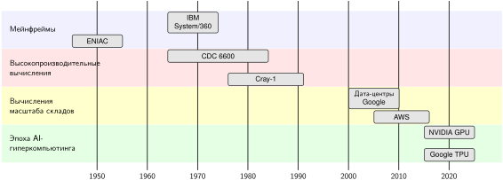

*Эволюция систем вычислений: четыре перекрывающиеся эпохи размещают представительные вехи систем на временной шкале. Перекрытие важно: AI-гиперкомпьютинг опирается на параллельные численные методы HPC и распределенную координацию вычислений масштаба складов, а не заменяет их.*

Этот переход к AI-гиперкомпьютингу отражает структурное расхождение в паттернах доступа к памяти и семантике синхронизации. Научные HPC-симуляции обычно проходят по регулярным пространственным сеткам с умеренным рабочим состоянием на степень свободы, тогда как сервисы масштаба складов обрабатывают независимые, слабо связанные запросы по стандартному Ethernet. Напротив, обучение нейронной сети сталкивается с огромным объемом состояния: ускоритель должен держать веса модели, градиенты, состояния оптимизатора (такие как буферы импульса и дисперсии) и промежуточные активации, сохраненные для обратного прохода. Когда это совокупное состояние превышает емкость High Bandwidth Memory (HBM) одного устройства, модель нужно разбить по нескольким ускорителям, меняя локальное давление на память на накладные расходы межустройственной коммуникации. [«Характеристики эпох вычислений»](08_training.md#tbl-computing-eras) сопоставляет требования к нагрузке, иерархии памяти и модели исполнения в этих четырех архитектурных эпохах.

| **Эпоха**              | **Основная нагрузка**       | **Паттерны памяти**           | **Модель обработки**          |
|:-----------------------|:----------------------------|:------------------------------|:------------------------------|
| **Мейнфрейм**          | Последовательная пакетная обработка | Простая иерархия памяти  | Один поток инструкций         |
| **HPC**                | Научное моделирование       | Регулярный доступ к массивам  | Синхронизированный параллелизм |
| **Масштаб складов**    | Интернет-сервисы            | Разреженный, нерегулярный доступ | Независимые параллельные задачи |
| **AI-гиперкомпьютинг** | Обучение нейронных сетей    | Тяжелые по параметрам, смешанный доступ | Гибридный параллелизм, распределенный |

<a id="tbl-computing-eras"></a>

*Характеристики эпох вычислений. Каждая эпоха была оптимизирована под свои паттерны нагрузки, и современные системы обучения наследуют требования от нескольких предшественников. AI-гиперкомпьютинг уникально сочетает параллельные численные вычисления HPC с распределенной обработкой масштаба складов, добавляя специализированную поддержку градиентной оптимизации и управления большим состоянием параметров, центральных для обучения нейронных сетей.*

<a id="sec-model-training-scale-physical-ceiling-e06c"></a>

### Когда масштабировать: физический потолок

Знать, как разбить вычисления по устройствам, — это не то же самое, что знать, *когда* распределенное исполнение оправдано. Распределение состояния вводит накладные расходы коммуникации, барьеры синхронизации и эксплуатационные режимы сбоев. Сначала исчерпав оптимизации одного узла, можно понять, является ли узкое место принципиально алгоритмическим или вызвано емкостью. Настройка по профилю должна оценить пути исполнения с пониженной точностью ([«Обучение в смешанной точности»](08_training.md#sec-model-training-mixedprecision-training-9218)), когда позволяет численная устойчивость, накопление градиентов ([«Накопление градиентов и контрольные точки»](08_training.md#sec-model-training-gradient-accumulation-checkpointing-0c47)), чтобы синтезировать целевые размеры батчей без взрыва активаций, контрольные точки активаций ([«Механика накопления градиентов и контрольных точек»](08_training.md#sec-model-training-gradient-accumulation-checkpointing-mechanics-fb09)), чтобы обменять избыточные прямые вычисления на запас памяти, и перекрывающуюся предвыборку данных ([«Предвыборка данных и перекрытие»](08_training.md#sec-model-training-data-prefetching-pipeline-overlapping-e984)), когда прием на хосте ограничивает критический путь.

[«Рекомендации по выбору масштаба»](08_training.md#tbl-scaling-decision) выстраивает эту последовательность как поиск ресурса, привязанный к измеренным аппаратным узким местам, а не к произвольным пороговым значениям параметров.

| **Наблюдаемое ограничение**                              | **Кандидатный подход**                 | **Обоснование**                                           |
|:---------------------------------------------------------|:---------------------------------------|:----------------------------------------------------------|
| Состояние обучения помещается в одно устройство, и время приемлемо | Один GPU                       | Минимизирует коммуникацию и операционную сложность        |
| Состояние или пропускная способность превышает одно устройство, но помещается в один узел | Один узел с несколькими GPU | Использует быстрые локальные межсоединения до выхода в сеть |
| Требуемое состояние или расписание превышает один узел   | Многоузловой кластер                   | Добавляет совокупную память или вычисления ценой коммуникации |
| Скорость подачи входа ниже потребности ускорителя        | Параллельный или распределенный входной конвейер | Добавляет входную пропускную способность там, где профилирование показывает необходимость |

<a id="tbl-scaling-decision"></a>

*Рекомендации по выбору масштаба. Выбирайте наименее распределенную конфигурацию, которая удовлетворяет измеренным требованиям памяти, пропускной способности и расписания. Архитектура модели, состояние обучения, входной конвейер, аппаратура и топология — все влияют на границу.*

Только когда профилирование выявляет стойкие узкие места вопреки этим оптимизациям, стоит рассматривать многоустройственные подходы. У каждого аппаратного устройства есть физический потолок: нагрузка, требующая $10^{24}$ FLOP, не может быть выполнена на одном ускорителе в практическом графике обучения, как бы тщательно он ни был настроен. Переход к обучению на нескольких устройствах становится необходимым, когда достигнут один из трех жестких пределов:

- **Исчерпание памяти**: веса модели, градиенты, состояния оптимизатора и активации превышают VRAM одного GPU. Для модели на 70 млрд параметров одни только веса в FP16 требуют примерно 140 ГБ, что превышает конфигурации 80 ГБ ускорителей A100 и H100 SXM и оставляет мало запаса или не оставляет его вовсе на более емких вариантах вроде H100 NVL (94 ГБ) и H200 (141 ГБ), как только учтено состояние обучения.
- **Календарное время обучения**: оценка времени на одном устройстве превышает фактический срок проекта. При устойчивых $10^{15}$ FLOP/s нагрузка, требующая $10^{24}$ FLOP, заняла бы около 32 лет.
- **Пропускная способность входа**: входной конвейер не может поддерживать совокупную скорость потребления ускорителями. Один лишь размер набора данных не определяет этот предел; важны повторное использование, сжатие, локальность, стоимость преобразований и пропускная способность хранилища.

Эти три предела технические, но масштабирование несет стоимость, выходящую за рамки сложности и емкости. Добавление устройств усиливает энергопотребление и воздействие обучения на окружающую среду, поэтому оптимизация эффективности становится экологической задачей не меньше, чем задачей производительности.

<a id="nbk-training-carbon-footprint-training"></a>

> **Углеродный след обучения**
>
> **Контекст**: обучение больших моделей требует значительной энергии и вычислений. Физический потолок проявляется в энергетическом следствии железного закона ($E_{\text{total}} = P_{\text{fleet}} \cdot T_{\text{train}}$), которое количественно выражает экологический масштаб:
>
> 1. Нагрузка: обучение модели на 7 млрд параметров на 1 трлн токенов.
> 2. Вычисления: $O \approx 4{,}2 \times 10^{22}$.
> 3. Эффективность: устойчивые 156 TFLOP/s на A100 (расчетная тепловая мощность 400 Вт).
> 4. **Время исполнения**: $T_{\text{train}} \approx$ 3,04 дня на 1 024 GPU.
> 5. **Энергетический след**: $E_{\text{total}} = P_{\text{cluster}} \cdot T_{\text{train}} = (N_{\text{GPU}} \cdot P_{\text{GPU}} + N_{\text{host}} \cdot P_{\text{host}}) \cdot T_{\text{train}}$ дает (1 024 GPU $\times$ 400 Вт + 128 хостов $\times$ 200 Вт) $\times$ 73 ч $\approx$ 31 784,2 кВт·ч.
>
> **Последствия**: потребленная энергия равна 35,3 месяца среднего бытового потребления электроэнергии.
>
> **Системный урок**: удвоение пропускной способности аппаратуры $\eta_{\text{hw}}$ при постоянной мощности кластера $P_{\text{cluster}}$ вдвое сокращает время исполнения $T_{\text{train}}$ и полную энергию $E_{\text{total}}$. При средней углеродоемкости сети удвоение эффективности экономит примерно 15 892,1 кВт·ч электроэнергии и предотвращает 6,8 т выбросов. Экологические аудиты должны измерять $E_{\text{total}} = \int P(t) dt$, а не полагаться только на метрики загрузки GPU.

Масштабирование меняет связывающее ограничение, а не убирает его: параллелизм данных покупает пропускную способность, параллелизм моделей — емкость памяти, конвейерный параллелизм — загрузку, а тензорный параллелизм — осуществимость на масштабе слоя, но каждый добавляет стоимость коммуникации и координации. Детали реализации распределенного обучения на нескольких узлах, включая примитивы коллективной коммуникации, механизмы отказоустойчивости и эластичное планирование, прямо опираются на принципы одной машины, рассмотренные во всей этой главе, и подробно разбираются в продвинутых текстах по распределенным системам.

<a id="chk-training-scaling-decisions"></a>

> **Решения о масштабировании**
>
> Масштабирование меняет вычислительные узкие места на коммуникационные.
>
> - **Жесткие пределы**: можете ли вы определить, какой предел связывает конкретный прогон обучения: емкость памяти, календарное время или скорость подачи входа?
> - **Сначала один узел**: можете ли вы объяснить, почему смешанную точность, накопление, контрольные точки и предвыборку нужно исчерпать, прежде чем добавлять устройства?
> - **Параллелизм данных или моделей**: для модели, которая не помещается на один GPU, можете ли вы обосновать, почему параллелизм данных не работает и что должен разбивать параллелизм моделей?
> - **Налог на коммуникацию**: можете ли вы объяснить, почему эффективность масштабирования падает с ростом числа GPU и какая величина (доля синхронизации) управляет потолком?
> - **Потолок масштабирования**: если синхронизация, которая не параллелизуется, составляет 10 процентов каждого шага, оцените потолок ускорения при большом числе GPU и примерный момент, когда удвоение устройств перестает окупаться.

<a id="sec-model-training-fallacies-pitfalls-cf7d"></a>

## Заблуждения и ловушки

Путь от оптимизации одного GPU через параллелизм на нескольких устройствах показывает, что каждый метод вводит компромиссы и новые ограничения. Подход, развитый во всей этой главе, количественно оценивает издержки через железный закон, диагностирует узкие места профилированием, применяет целевые оптимизации и масштабируется только тогда, когда это необходимо. Следующие заблуждения и ловушки фиксируют распространенные ошибки, которые впустую расходуют вычислительные ресурсы, задерживают исследовательский прогресс или вызывают сбои обучения в промышленной эксплуатации.

> **Заблуждение и ловушка**
>
> **Заблуждение**: *большие модели всегда дают лучшую производительность.*
>
> Команды иногда рассматривают масштаб как монотонный рычаг: если модель на 7 млрд параметров хорошо работает, модель на 20 млрд параметров должна работать лучше. Модели на 20 млрд параметров требуется примерно 320 ГБ состояния обучения без учета активаций в описанном рецепте **смешанной точности Adam** (40 ГБ параметров FP16 + 40 ГБ градиентов FP16 + 80 ГБ мастер-весов FP32 + 160 ГБ состояний Adam). Превзойдет ли она модель на 7 млрд параметров, зависит от объема и качества данных, вычислений на обучение, оптимизации и оценки. Из одного лишь числа параметров не следует ни универсального порога по числу примеров, ни штрафа в точности.

> **Заблуждение и ловушка**
>
> **Ловушка**: *считать, что распределенное обучение автоматически ускоряет разработку.*
>
> Больше ускорителей не гарантируют более быстрого обучения, потому что коммуникация, меньшие локальные батчи, ограничения входа и дисбаланс могут съесть выигрыш. В иллюстративном сценарии с 8 GPU синхронизация занимает 30–50 процентов времени шага, и ускорение достигает лишь 4–6 раз вместо идеальных 8. Значения гипотетические; решение требует измеренного сквозного времени и эффективности масштабирования.

> **Заблуждение и ловушка**
>
> **Заблуждение**: *гиперпараметры переносятся с экспериментов малого масштаба на обучение большого масштаба напрямую.*
>
> Скорость обучения, которая работает при размере батча 512, может не переноситься на размер батча 4 096. Правило линейного масштабирования (Goyal et al., 2017) для такого восьмикратного изменения повысило бы скорость с 0,1 до 0,8, часто вместе с прогревом, но это эмпирический рецепт, а не требование или гарантия сходимости. Прогоны большого масштаба должны совместно проверять скорость обучения, расписание, состояние оптимизатора и эффективный батч.

> **Заблуждение и ловушка**
>
> **Ловушка**: *рассматривать обучение в смешанной точности как простой переключатель без валидации.*
>
> Иллюстративные входные данные для V100 в главе подразумевают ускорение в 2,4 раза, но это не бенчмарк. FP16 обычно требует масштабирования функции потерь (Micikevicius et al., 2017), тогда как BF16 обычно не требует (Wang and Kanwar, 2019; Kalamkar et al., 2019) (см. [«Обучение в смешанной точности»](08_training.md#sec-model-training-mixedprecision-training-9218)). Любой из рецептов может изменить численное поведение, поэтому пропускная способность и сходимость должны проверяться на целевой нагрузке.

> **Заблуждение и ловушка**
>
> **Заблуждение**: *память и вычисления можно оптимизировать независимо.*
>
> Память *и* вычисления связаны: в этом иллюстративном профиле загрузка ускорителя падает с 90 процентов при батче 256 до 60–70 процентов при батче 16. Накопление градиентов (эффективный батч 512, физический батч 64) обменивает 5 процентов эффективности на сокращение памяти в 8 раз. Настройка этих параметров независимо друг от друга удлиняет время обучения на 20–40 процентов (см. [«Накопление градиентов и контрольные точки»](08_training.md#sec-model-training-gradient-accumulation-checkpointing-0c47)).

> **Заблуждение и ловушка**
>
> **Ловушка**: *планировать память обучения так, будто в ней есть только веса модели.*
>
> Оценка памяти обучения по одним весам пропускает градиенты, состояние оптимизатора, мастер-веса, когда они используются, активации, временные рабочие области и накладные расходы аллокатора. В описанном в главе рецепте Adam в смешанной точности веса FP16 (2 байта), градиенты FP16 (2), мастер-веса FP32 (4) и два момента FP32 (8) дают в сумме 16 байтов на параметр до учета активаций. Другие оптимизаторы и стратегии шардирования меняют этот бюджет. Память активаций затем зависит от размера батча, длины последовательности, архитектуры, ядер и контрольных точек; универсального кратного от объема весов не существует.

> **Заблуждение и ловушка**
>
> **Заблуждение**: *ускоритель всегда является узким местом обучения.*
>
> Загрузка данных часто создает простой, однако команды сначала оптимизируют вычисления. В этом иллюстративном профиле предвыборка с перекрытием конвейера сокращает календарное время на 47,6 процента (с 105 мин до 55 мин), перекрывая загрузку данных с вычислениями (см. [«Предвыборка данных и перекрытие»](08_training.md#sec-model-training-data-prefetching-pipeline-overlapping-e984)). Профилируйте, прежде чем считать, что GPU — узкое место.

> **Заблуждение и ловушка**
>
> **Ловушка**: *оптимизировать ядра до профилирования входного конвейера.*
>
> Настройка на уровне ядер привлекательна, потому что загрузку GPU легко посмотреть, но голодающий ускоритель может выглядеть как неэффективный ускоритель. Прежде чем менять точность, переписывать ядра или добавлять GPU, измерьте пропускную способность загрузчика данных, время предобработки на хосте, ожидание хранилища и перекрытие передачи с хоста на устройство. Если ускоритель ждет батчей, самая быстрая оптимизация — надежно подавать ему данные, а не делать его ядра чуть быстрее.

<a id="sec-model-training-summary-2d06"></a>

## Итоги

Обучение объединяет алгоритмы, управление памятью и аппаратное ускорение, чтобы превратить данные в параметры модели. В масштабе прямое и обратное распространение согласуют матричные операции, выделения памяти и градиенты в рамках аппаратных и производительных ограничений.

Предвыборка, смешанная точность, FlashAttention, накопление градиентов и контрольные точки решают разные ограничения пропускной способности, памяти и численные ограничения. Подбирайте прием под связывающее ограничение; когда одна машина исчерпана, параллелизм данных, моделей, конвейерный и тензорный обменивают больший масштаб на большую сложность.

Это совместное проектирование формирует крупномасштабное обучение: матричные паттерны породили тензорные ядра GPU, фреймворки открыли их через API смешанной точности, а такие приемы, как обучение FP16, повлияли на последующую аппаратуру. Учет FLOP и памяти затем поддерживает сравнение оптимизаторов, оценку стоимости и решения о том, поможет ли больше аппаратуры или лишь переместит узкое место.

> **Почему обучение стоит миллионы**
>
> * **Стоимость обучения — это бюджет железного закона**: $T_{\text{train}} = \frac{O}{R_{\text{peak}} \times \eta_{\text{hw}}}$ делает каждую оптимизацию подотчетной: сократить работу, повысить эффективную пропускную способность или улучшить загрузку. Изменение, которое не затрагивает доминирующий член, лишь перемещает стоимость внутри цикла обучения.
> * **Память определяет, помещается ли оптимизатор**: стандартный Adam в смешанной точности в описанном представлении использует в 8 раз больше памяти, чем веса FP16 для вывода, до учета активаций. Состояние оптимизатора и активации, зависящие от батча, — а не только веса — определяют, помещается ли обучение.
> * **Профили выбирают средство**: профилируйте, диагностируйте, исправляйте и профилируйте снова. Задачи, ограниченные вычислениями, нуждаются в лучшей арифметике или алгоритмах; ограниченные памятью — в меньшем состоянии или трафике; ограниченные данными и коммуникацией — в изменениях конвейера или параллелизма.
> * **Точность и ядра с учетом ввода-вывода сдвигают узкие места**: FP16 с накоплением в FP32 может повышать пропускную способность и экономию памяти, а FlashAttention избегает материализации полной матрицы $S{\times}S$ в HBM; реальный выигрыш зависит от нагрузки и аппаратуры.
> * **Контрольные точки покупают память пересчетом**: хранение меньшего числа активаций и их пересчет при обратном распространении сокращают память активаций в разборе в 3–4 раза, с 35,9 ГБ до 9 ГБ при батче 4. Применяйте, когда ограничивает память, а не вычисления.
> * **Сочетание оптимизаций может отложить масштабирование**: смешанная точность и контрольные точки превращают 95,7 ГБ в смоделированные 33 ГБ для GPT-2 при батче 4, до учета временных рабочих областей. Используйте подходящие локальные рычаги, прежде чем принимать распределенную коммуникацию и операционные издержки.

Железный закон относит медленную задачу к одной из категорий: ограниченная вычислениями (улучшить арифметику или алгоритмы), ограниченная памятью (сократить состояние или трафик), ограниченная данными (исправить входной конвейер) или ограниченная коммуникацией (настроить накопление или параллелизм). Увеличивать батч стоит, только когда аппаратура недогружена. Эта дисциплина не дает лечить симптомы добавлением аппаратуры и сохраняет практичность итераций по мере роста стоимости.

Обучение — место, где железный закон становится ежедневным инструментом. Смешанная точность меняет эффективную пропускную способность и трафик памяти; контрольные точки обменивают память на пересчет; масштабирование добавляет коммуникацию. Инженерная задача — определить доминирующий член и применить наименее затратное вмешательство, которое его меняет.

> **От обучения к отбору данных**
>
> Обучение порождает выученные параметры, тратя вычисления на каждый пример; оптимизированный прогон главы все равно требует 33 ГБ памяти. Когда цикл обучения становится эффективным, следующий вопрос — оправдывает ли каждый пример эту стоимость. Повторяющиеся или малоинформативные образцы потребляют тот же прямой проход, обратный проход, обновление оптимизатора и коммуникацию, что и примеры, которые добавляют охват или исправляют слабость.
>
> Глава [«Отбор данных»](09_data_selection.md) поэтому переводит внимание с исполнения на состав нагрузки. Она рассматривает, как избыточность, репрезентативность, неопределенность и покрытие классов определяют, какие примеры должны войти в конечный бюджет обучения. Полезное подмножество должно сокращать работу, не стирая редкие случаи и не сдвигая эффективное распределение обучения. Когда этот баланс соблюдается, тщательно отобранное подмножество может приблизиться к точности полного набора данных, снижая стоимость каждой эпохи и делая дополнительные эксперименты доступными. Цель оптимизации больше не только в том, насколько эффективно система обрабатывает пример, но и в том, какие примеры вообще стоит обрабатывать.

