<a id="sec-data-selection"></a>

# Отбор данных

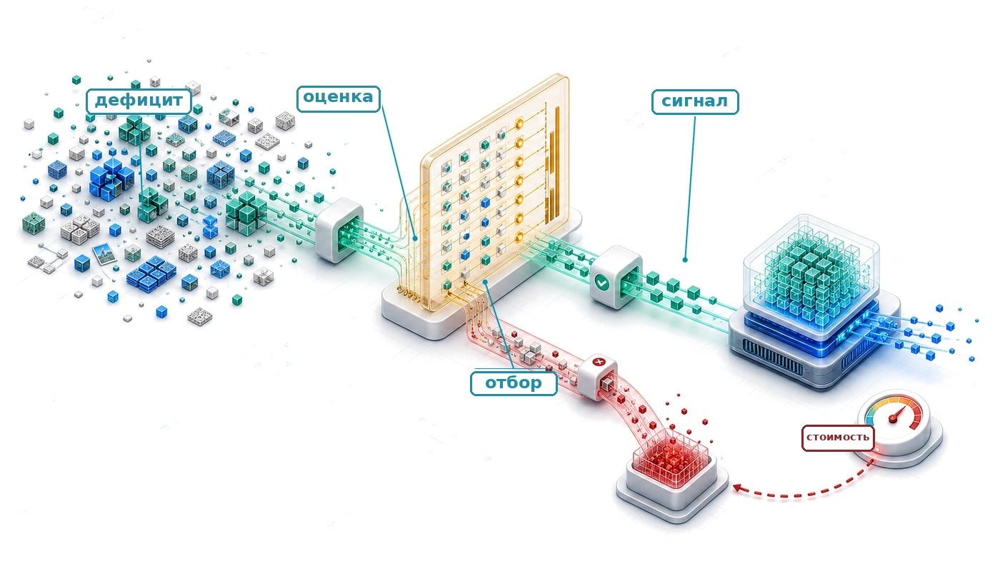

## Назначение

_Как тщательно отобранное подмножество может сохранить большую часть ценности гораздо большего набора данных?_

Обучение оплачивает получение, разметку, оценку, перемещение и обработку примеров, хотя их ценность для обучения различается. Большие наборы данных содержат избыточные, зашумленные или не соответствующие цели примеры, а редкие области могут не содержать тех случаев, которые нужны модели. Отбор данных превращает эту неоднородность в задачу системной оптимизации. Он может убрать излишнюю работу до обучения, направить разметку и шаги обучения на информативные случаи по мере того, как модель учится, либо создать недостающие примеры, когда главным ограничением становится дефицит. Он также может один раз инвестировать в обучение переиспользуемых представлений, если эта стоимость окупается на нескольких последующих задачах. Поэтому цель состоит не в самом маленьком наборе данных, а в наименьшей сквозной стоимости достижения целевого качества без потери редких случаев, недопредставленных групп и покрытия, важного для эксплуатации. Каждая стратегия добавляет собственные накладные расходы: примеры нужно оценить, сгенерировать, перемешать, сохранить или проверить, и эти затраты могут свести на нет обещанную экономию. Решение должно приниматься сквозным образом, потому что выигрыш в разметке или обучении может быть съеден задержкой отбора, доступом к хранилищу или координацией в распределенной системе. Метод оправдан только тогда, когда сохраненное или созданное им обучение превышает работу, необходимую для его применения. Это различие важно в серии повторных экспериментов, где полезные сокращения накапливаются, и при адаптации, где ценность примера меняется вместе с моделью и целевым распределением. Инженерия данных показала, что данные — исходный код систем машинного обучения; отбор данных спрашивает, какие свидетельства полезны сейчас и каких еще не хватает. В терминах D·A·M это совместное проектирование данных и алгоритма: нужно сформировать обучающий сигнал так, чтобы каждая единица машинной работы приносила больше полезного обучения.

> **Цели обучения**
>
> - Объяснять отбор данных как совместное проектирование данных и алгоритма, которое сокращает общее число операций до начала обучения
> - Вычислять отношение информации к вычислениям, чтобы решить, улучшают ли дополнительные примеры обучение в расчете на FLOP
> - Сравнивать дедупликацию, отбор коресетов и прореживание по качеству для сокращения избыточных данных предобучения
> - Проектировать стратегии учебного плана, активного обучения или синтетических данных для данных, ценность которых меняется во время обучения
> - Применять неравенство отбора, чтобы проверить, окупаются ли накладные расходы отбора по сравнению с затратами на обучение на полном наборе данных
> - Оценивать распределенные конвейеры отбора с учетом локальности хранения, согласованности и загрузки GPU
> - Выбирать инвестиции в отбор данных, используя ROI, амортизацию и диагностику по границе, оптимальной по вычислениям

<a id="sec-data-selection-data-selection-fundamentals-e839"></a>

## Основы отбора данных

Обучение оплачивает стоимость по железному закону за каждый обработанный пример, но не каждый пример приносит сигнал обучения, который стоит этой цены. Отбор данных ставит перед хорошо подготовленным набором данных системную задачу: сохранить примеры, которые дают наибольший вклад в обучение на единицу вычислений. Инженерия данных делает набор надежным благодаря корректным меткам, согласованным схемам и контролируемым записям. Отбор данных повышает ценность набора, извлекая максимум обучения из минимального числа примеров, и напрямую сокращает член общего числа операций $(O)$ в железном законе (принцип [«Железный закон систем машинного обучения»](part_build.md#pri-iron-law)). Различие важно: качество спрашивает, правильны ли данные, а ценность — стоит ли правильные данные тех вычислений, которые на них тратятся.


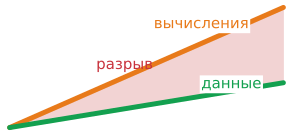

*Поставки вычислений могут опережать поставки качественных данных.*

Увеличение объема обучающих данных давно считается стандартным способом улучшить модели. Законы масштабирования[^fn-scaling-laws-origin] (Kaplan et al., 2020; Hoffmann et al., 2022) количественно описывают, как качество модели может расти вместе с размером набора данных, и команды отвечали на это сбором и генерацией все большего числа примеров. Парки ускорителей, однако, могут наращивать пригодные для использования вычисления быстрее, чем растет поток новых качественных текстов и изображений, созданных людьми. Большая часть легкодоступного публичного веба уже включена в крупные обучающие корпуса, а способность экспертов к разметке растет медленно. Этот перекос и есть **стена данных**,[^fn-data-wall-scaling] и внимание смещается от сбора новых данных к извлечению большей ценности из уже имеющихся. Следующие разделы описывают методы отбора и модели стоимости, необходимые для такого выбора.

[^fn-scaling-laws-origin]: **Законы масштабирования**: Джаред Каплан и его коллеги из Университета Джонса Хопкинса и OpenAI в 2020 году эмпирически показали, что функция потерь языковых моделей подчиняется степенным зависимостям от размера модели, размера набора данных и бюджета вычислений в изученных режимах (Kaplan et al., 2020). Подобранный показатель степени по данным составлял примерно $\alpha = 0{,}095$ в $\mathcal{L} \propto D^{-\alpha}$. Значение не универсально, но форма убывающей отдачи позволяет рассуждать о том, когда отбор становится выгоднее сбора новых данных.

[«Асимметрия масштабирования ресурсов ML»](09_data_selection.md#tbl-scaling-asymmetry) использует иллюстративный сценарий роста, в котором вычислительные мощности GPU растут в 10 раз каждые 3 года, а доступные качественные данные растут медленнее. Это входные данные сценария, а не измеренные универсальные темпы.

| **Ресурс**              |                                                                                                   **Темп роста** | **Следствие**                                                                      |
|:------------------------|------------------------------------------------------------------------------------------------------------------:|:----------------------------------------------------------------------------------|
| **Вычислительные мощности GPU** |               ~10× / 3 года | Производительность аппаратуры может быстро расти в данную эпоху                    |
| **Обучающие данные (веб)** |     ~2× / 5 лет | Качественный веб-текст ограничен; значительная часть уже собрана                    |
| **Размеченные данные**  | ~1,5× / 5 лет | Пропускная способность человеческой разметки ограничена по своей природе           |
| **Синтетические данные** |                                                                                                 Потенциально большой | Ограничен качеством генератора (модели, обученные на данных, сгенерированных моделями, могут деградировать) |

<a id="tbl-scaling-asymmetry"></a>

***Асимметрия масштабирования ресурсов ML**: в иллюстративном режиме масштабирования вычисления растут быстрее, чем поставки качественных данных, что создает дисбаланс вычислений и данных и делает отбор данных ценным.*

[^fn-data-wall-scaling]: **Стена данных**: в отличие от вычислений (которые растут за счет капитальных затрат) или алгоритмов (которые улучшаются благодаря исследованиям), запас качественного текста, созданного людьми, растет медленно. Обновленные прогнозы Epoch AI оценивали, что при смоделированных в статье предположениях о потреблении модели могли бы использовать наборы данных примерно того же объема, что и запас публичного текста, созданного людьми, в период между 2026 и 2032 годами (Villalobos et al., 2022). Для проектирования систем важно не фиксированное календарное ограничение, а то, что данные могут стать ограничением поставок, а не только экономическим ограничением. Это напрямую влияет на член общего числа операций $(O)$: когда качественные данные становятся дефицитными, дополнительные вычисления дают убывающую отдачу независимо от пропускной способности аппаратуры.

Масштабирование набора данных рано или поздно упирается в конечный запас качественной человеческой речи и текста. Проследите логарифмическую траекторию на [«Рост наборов данных у предела»](09_data_selection.md#fig-running-out-of-human-data): видно, как требования обучения фундаментальных моделей приближаются к оцененной верхней границе доступных публичных данных.

Разрыв между тем, что могут обработать вычисления, и тем, что способны поддержать доступные качественные данные, — это системная переменная, а не фиксированный закон. В режиме, иллюстрированном [«Асимметрия масштабирования ресурсов ML»](09_data_selection.md#tbl-scaling-asymmetry), вычислительные ресурсы растут быстрее доступных качественных данных, поэтому бюджеты ускорителей могут опередить корпус и оставить систему богатой вычислениями, но ограниченной данными. Поддержание актуальности модели требует регулярного обновления обучающего корпуса по мере изменения мира, а разумный отбор данных становится критичным, когда ограничением является качество данных, а не машинное время ускорителя.

<a id="fig-running-out-of-human-data"></a>

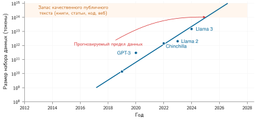

***Рост наборов данных у предела**: несколько наборов данных фундаментальных моделей выросли до оценок общего запаса качественного публичного текста. Прогноз стоит читать как датированный сценарий ограничения, а не как фиксированный прогноз: отбор данных, синтетическая генерация, мультимодальное обучение, лицензирование и политика фильтрации меняют доступный объем.*

Асимметрия вычислений и данных может обратить приоритеты оптимизации. Когда *данных* много, а *вычислений* мало, алгоритмическая эффективность может выжать больше точности из ограниченных циклов GPU. Когда *вычислений* много, а *качественных данных* мало, отбор данных может, наоборот, извлечь больше обучения из каждого примера. Отбор данных работает выше по потоку, чем оптимизации модели и машины. Устраняя избыточность и выбирая примеры с высокой ценностью, мы уменьшаем нагрузку до того, как она попадет в модель или аппаратуру, и тем самым напрямую сокращаем член общего числа операций $(O)$ в железном законе. Поэтому системный подход рассматривает отбор как сокращение работы на входе, а не как эвристику моделирования. Для команд, у которых бюджет ускорителей превышает их отобранный корпус, узкое место смещается от доступа к GPU к качеству, законности и разнообразию обучающих данных.

Инструментарий отбора данных следует осознанному порядку оптимизации: сначала спрашиваем, стоит ли вообще обрабатывать пример, а затем — как эффективно обработать оставшуюся нагрузку. Отбор данных воплощает принцип «сначала самая большая отдача», ища излишнюю работу до того, как упрощать или ускорять то, что остается. Статическое прореживание убирает примеры с низкой ценностью до вычисления первого градиента. Динамический отбор адаптирует рацион данных во время обучения с помощью учебного плана и активного обучения. Синтетическая генерация создает примеры высокой ценности через аугментацию, симуляцию или примеры, сгенерированные учителем, когда реальных данных не хватает.

Каждый этап может повышать информационную плотность данных, которые поступают в модель, если измеренный прирост качества оправдывает накладные расходы; вместе они образуют взаимодополняющий инструментарий: прореживание сокращает то, *что* содержит конвейер, отбор определяет, *как* конвейер его использует, а синтез расширяет то, *до чего* конвейер может добраться. Сравнение этих методов требует системного определения отбора данных и измеримой оценки его эффективности.

<a id="sec-data-selection-defining-data-selection-ef2f"></a>

### Определение отбора данных

Трехэтапному конвейеру нужна величина, которая позволяет инженерам сравнивать примеры до того, как они потратят на них машинное время ускорителя. Дублированное изображение, ошибочно размеченная запись и редкий пограничный случай могут стоить одинаковых прямого и обратного проходов, но вклад в сигнал обучения у них разный. Поэтому отбор данных начинается с явного определения ценности примера относительно стоимости вычислений. Отношение информации к вычислениям измеряет эту ценность как полученный сигнал обучения на единицу вычислений для обучения; формально оно введено в разделе [«Отношение информации к вычислениям»](09_data_selection.md#sec-data-selection-informationcompute-ratio-8c0b).

<a id="dfn-data-selection-data-selection"></a>

> **Отбор данных**
>
> ***Отбор данных*** — это процесс максимизации отношения информации к вычислениям (ICR) обучающего набора данных.
>
> 1.  **Значение**: отбор определяет данные, которые стоит сохранить, приоритизировать или сгенерировать для целевой задачи, сокращая общее число операций $(O)$, когда избыточные или зашумленные примеры можно исключить без потери необходимого покрытия.
> 2.  **Отличие**: в отличие от инженерии данных, которая занимается чистотой и согласованностью данных, отбор данных занимается информативностью и разнообразием примеров.
> 3.  **Типичная ошибка**: распространенное заблуждение состоит в том, что больше данных всегда лучше. Дополнительные данные низкого качества могут дать меньший прирост, чем гораздо меньший тщательно отобранный набор, поэтому объем сохраненных данных нужно оценивать вместе с покрытием и целевым качеством.

Чтобы сделать это конкретным, рассмотрим обучение авторегрессионной языковой модели из семейства маячных моделей GPT-2/Llama, описанного в разделе [«Состав маячных моделей: биографии моделей»](06_nn_architectures.md#sec-network-architectures-lighthouse-roster-model-biographies-a763). Сценарий использует модель с 70 миллиардами параметров, чтобы сделать разрыв между вычислениями и данными заметным в большом масштабе.

Бюджет вычислений (10 000 GPU H100 за 3 месяца) соответствует примерно \$86,4 млн по ценовому ориентиру облачного обучения, принятому в главе, и позволяет обработать около 73,2 трлн токенов при устойчивой утилизации FLOP модели 40 процентов. Оценки качественного публичного текста, созданного людьми, с учетом качества и повторяемости составляют порядка 300 трлн токенов, что заметно больше одного отобранного веб-корпуса. Практическое ограничение уже: насколько велика часть этого запаса доступна, законно пригодна, качественна, дедуплицирована и полезна для целевого распределения. Если у команды готов отфильтрованный корпус всего в 5 трлн токенов, то бюджета вычислений хватит, чтобы пройти этот корпус примерно 14,6 раза. Тогда кластер опережает доступный уникальный сигнал. Команда может повторять эпохи на одном и том же корпусе, но градиентные шаги по знакомым токенам дают все меньшее снижение потерь. Она может снизить пороги качества и взять необработанный веб-текст, но зашумленные и не соответствующие задаче токены ухудшают оценку на последующих задачах. Либо она может инвестировать в отбор данных — уточнять фильтры качества, строить учебные планы по сложности и синтезировать недостающие пограничные случаи — чтобы поднять отдачу обучения на FLOP. Когда вычислительные мощности опережают данные с высоким сигналом, отбор приносит большую отдачу на вложенный капитал, чем покупка дополнительных ускорителей.

Возможность применима к разным архитектурам моделей, хотя узкие места и безопасное сокращение различаются. В отличие от маячной модели ResNet-50, которая ограничена вычислениями, модели GPT-2/Llama могут упираться в пропускную способность памяти при выводе и в вычисления при обучении. Когда проверенный метод отбора удаляет примеры или токены без добавления компенсирующих шагов, меньшее число выборок означает меньше FLOP обучения. Поэтому правильная рамка — системная, а не чисто статистическая.

<a id="sec-data-selection-systems-perspective-bd61"></a>

### Системная перспектива

Стена данных задает физические пределы масштабирования необработанных наборов данных; системная перспектива определяет, как управлять этим ограничением на всем аппаратном стеке. Традиционная *ML-рамка* оценивает отбор данных через статистическую сложность выборки и теорию обобщения, спрашивая, сколько примеров нужно, чтобы получить заданную тестовую ошибку. Такая формулировка считает каждый пример математической абстракцией без стоимости, игнорируя физические ресурсы на загрузку, передачу и исполнение данных.

*Системная рамка* отбора данных спрашивает иначе: как минимизировать полную стоимость ресурсов для достижения целевой точности на всем жизненном цикле ML. Эта рамка переносит внимание с теоретической эффективности выборки на конкретное потребление ресурсов, как показано в [«ML- и системные перспективы отбора данных»](09_data_selection.md#tbl-ml-vs-systems-framing).

| **ML-рамка**                          |                         **Системная рамка** |
|:--------------------------------------|--------------------------------------------:|
| **«Меньше примеров для той же точности»** |             «Меньше FLOP для той же точности» |
| **«Лучшее обобщение»**           | «Ниже стоимость обучения (время, деньги, энергия)» |
| **«Границы сложности выборки»**        |            «Сквозная эффективность ресурсов» |
| **«Теория обучения»**                 |                          «Инженерия стоимости» |

<a id="tbl-ml-vs-systems-framing"></a>

***ML- и системные перспективы отбора данных**: ML-рамка оптимизирует сложность выборки; системная рамка оптимизирует полную стоимость ресурсов по всему конвейеру.*

В таксономии D·A·M отбор данных работает на уровне данных: он устраняет физическую работу до того, как ее выполнят алгоритмические и аппаратные оптимизации, что формализовано железным законом ML-систем ([«Железный закон систем машинного обучения»](01_introduction.md#sec-introduction-iron-law-ml-systems-c32a)).

<a id="psp-data-selection-data-selection-iron-law"></a>

> **Отбор данных и железный закон**
>
> В железном законе ML-систем $(T = \frac{D_{\text{vol}}}{\text{BW}} + \frac{O}{R_{\text{peak}} \cdot \eta_{\text{hw}}} + L_{\text{lat}})$ отбор данных сокращает число примеров или токенов, которые попадают в нагрузку. Последующие оптимизации на уровне модели уменьшают число операций на проход вперед и назад, а оптимизации на уровне машины повышают $R_{\text{peak}}$ (пиковую пропускную способность) и $\eta_{\text{hw}}$ (утилизацию). Отбор убирает работу до того, как ее выполнят последующие оптимизации.
>
> Поэтому отбор данных мультипликативно ценен в железном законе: когда все три уровня оптимизации действуют на одно и то же узкое место, сокращение набора данных в 2 раза, снижение числа операций на пример в 2 раза и рост эффективной пропускной способности в 2 раза дают общее сокращение стоимости в 8 раз, а не в 6.

При фиксированном числе эпох, размере батча и работе на пример сокращение набора данных на 50 процентов вдвое уменьшает число прямых проходов, обратных проходов и обновлений градиента. Для сценария со стоимостью \$100 млн это дает \$50 млн прямой экономии на вычислениях при условии, что график обучения не компенсирует ее добавлением шагов оптимизации.

Эта экономия распространяется по всей иерархии аппаратуры. Уменьшая общий объем данных ($D_{\text{vol}}$), дедупликация и отбор коресетов снижают нагрузку на пропускную способность хранилища, ввод сетевой фабрики и передачи между хостом и ускорителем по PCIe, из-за которых иначе простаивают тензорные ядра в ожидании ввода-вывода. На более раннем этапе активное обучение сокращает бюджеты разметки, направляя труд разметчиков только на примеры с высокой энтропией или высоким градиентом.

Однако отбор не бесплатен: каждая стратегия отбора несет собственные накладные расходы на оценку, фильтрацию, перемешивание или координацию примеров. Онлайн-алгоритм отбора, который выполняет дополнительные прямые проходы для ранжирования сложности примеров, легко может потратить больше циклов ускорителя, чем сэкономит, если накладные расходы на отбор превысят сокращение времени обучения. Конвейер отбора данных оправдан только тогда, когда сквозная стоимость фильтрации плюс обучения на отобранном подмножестве строго меньше стоимости обучения на полном необработанном наборе.

<a id="sec-data-selection-informationcompute-ratio-8c0b"></a>

### Отношение информации к вычислениям

Системная рамка, введенная в разделе [«Системная перспектива»](09_data_selection.md#sec-data-selection-systems-perspective-bd61), требует количественной метрики. Отбор данных балансирует на границе эффективности между точностью и стоимостью: сохранение каждого примера обеспечивает покрытие, но тратит вычисления на избыточный сигнал, а слишком агрессивное прореживание экономит FLOP ценой полноты редких срезов. Чтобы управлять этим компромиссом, нужно измерить предельный сигнал обучения, который приносит каждый пример на единицу работы аппаратуры. Эта метрика — **отношение информации к вычислениям** (ICR).

[«Таксономия D·A·M как карта оптимизации»](09_data_selection.md#fig-optimization-triad) переосмысляет таксономию D·A·M как карту оптимизации, где отбор данных играет роль оптимизации входа: сокращает общую нагрузку до того, как она попадет в модель или аппаратуру. Со стороны модели вопрос в том, сколько математики требует каждый пример. Со стороны машины — как быстро аппаратура может выполнить эту математику. Со стороны данных — стоит ли вообще обрабатывать пример. Три вершины треугольника отражают доминирующие узкие места: *ограничение вычислениями* описывает системы, ограниченные арифметической пропускной способностью, *ограничение вводом-выводом* — системы, ограниченные перемещением данных, а *эффективность выборки* — системы, ограниченные информативностью обучающих данных.

<a id="fig-optimization-triad"></a>

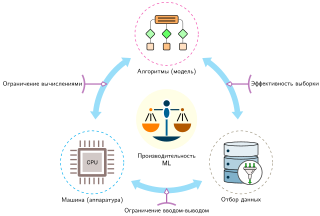

***Таксономия D·A·M как карта оптимизации**: производительность ML организована вокруг алгоритмов (модель), отбора данных и машины (аппаратура). Стороны треугольника отмечают связи «ограничение вычислениями», «ограничение вводом-выводом» и «эффективность выборки», а отбор данных сокращает нагрузку до выполнения на модели или аппаратуре.*

Формально отношение связывает предельную информационную ценность с предельными вычислениями:

$$\text{ICR} = \frac{\Delta I}{\Delta \text{FLOP}}$$

Большее значение ICR означает, что каждый FLOP обучения покупает больший сигнал обучения. Поскольку числитель нельзя напрямую наблюдать во время промышленных запусков, системные конвейеры опираются на операционные прокси: улучшение валидации на единицу вычислений, площадь под кривой обучения, снижение потерь на отложенных оценочных выборках, оценки примеров по неопределенности или градиенту и метрики покрытия на критичных для эксплуатации срезах. Эти прокси переводят абстрактную информационно-теоретическую цель в конкретные сигналы отбора до того, как запуск обучения исчерпает бюджет вычислений.

<a id="sec-data-selection-icr-frontier"></a>

### Граница ICR: когда данные становятся налогом


*За границей данные становятся налогом: вычисления растут, обучение останавливается.*

Отношение информации к вычислениям не постоянно: оно подчиняется закону убывающей отдачи. **Граница ICR** — это точка, в которой предельный сигнал обучения от дополнительных данных стремится к нулю.

Чтобы проиллюстрировать убывающую отдачу, пусть $I(D)$ — информационное содержание набора данных размера $D$, и предположим, что $I(D) \propto \log D$. Это упрощенная аналитическая модель, а не универсальный закон. Если стоимость вычислений линейно растет с числом операций на пример $O_{\text{sample}}$, то $C(D) = O_{\text{sample}} \cdot D$, и получающееся ICR следует из формулы ([«Убывание ICR»](09_data_selection.md#eq-icr-decay)):

<a id="eq-icr-decay"></a>

$$\text{ICR}(D) = \frac{\frac{d}{dD} I(D)}{\frac{d}{dD} C(D)} \approx \frac{1/D}{O_{\text{sample}}} = \frac{1}{O_{\text{sample}} \cdot D}$$

В рамках этой иллюстративной модели убывание $1/(O_{\text{sample}} \cdot D)$ создает стену данных. За границей, зависящей от рабочей нагрузки, дополнительные данные могут дать мало обучения, но по-прежнему добавляют вычисления. В этом режиме данные становятся **налогом на данные**, который раздувает член $O$ железного закона без соответствующего улучшения числителя точности в RoC (отдача от вычислений, см. [«Отдача от вычислений (RoC) как экономическая линза»](01_introduction.md#sec-introduction-roc-invariant)). Колено кривой — это практический компромисс между целевым качеством и предельной стоимостью, а не математический максимум ICR в этой модели.

Отбор данных превращает член общего числа операций $(O)$ железного закона из фиксированной константы в переменную. Улучшение измеренного ICR в 2 раза вдвое сокращает FLOP, необходимые для достижения того же измеренного прироста. Оно дает то же идеальное сокращение времени, что и рост пропускной способности в 2 раза, только если нагрузка ограничена вычислениями и сэкономленная работа лежит на критическом пути. ICR сосредоточен именно на вычислениях; модель стоимости в разделе [«Модель стоимости»](09_data_selection.md#sec-data-selection-cost-modeling-9b02) распространяет то же рассуждение на затраты на получение, разметку и хранение.

Случайный пакет исходных данных может иметь низкое ICR, если содержит избыточные, зашумленные или уже освоенные примеры. Конвейеры данных высокой эффективности ([«Конвейер отбора данных»](09_data_selection.md#fig-data-selection-pipeline)) могут повышать ICR в три этапа: статическое прореживание до обучения, динамический отбор во время обучения и синтетическая генерация по требованию. Для иллюстрации рассмотрим вычисление ICR на конкретной задаче отбора коресетов: специально отобранном подмножестве, которое должно сохранить сигнал обучения полного набора данных. В разделе [«Алгоритмы отбора коресетов»](09_data_selection.md#sec-data-selection-coreset-selection-algorithms-2c74) определены методы оценки EL2N и GraNd, которыми строятся такие подмножества, а раздел [«Система измерений»](09_data_selection.md#sec-data-selection-measurement-framework-733b) содержит полную систему измерений для оценки этих выигрышей в эффективности, включая диагностику границы, оптимальной по вычислениям, которая может показать, ограничено ли обучение данными или вычислениями.

<a id="fig-data-selection-pipeline"></a>

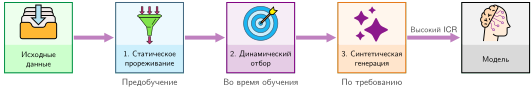

***Конвейер отбора данных**: структурированный подход к повышению ценности данных. Сначала необработанные данные прореживаются (статическое прореживание), затем отбираются во время обучения (динамический отбор) и наконец синтезируются (синтетическая генерация). Каждый этап может повысить отношение информации к вычислениям (ICR), если прирост качества оправдывает его вычислительную стоимость.*

<a id="chk-data-selection-data-selection-efficiency"></a>

> **Контрольная точка: эффективность отбора данных**
>
> Цель отбора данных — максимизировать ICR.
>
> Проверка метрик:
>
> - **Применение ICR**: даны два прогона обучения с одинаковым приростом точности, но разными бюджетами вычислений. Можете ли вы определить, у какого из них ICR выше?
> - **Эффективность данных**: при фиксированном протоколе оценки можете ли вы объяснить, когда набор данных на 50 процентов меньше с ICR в 2 раза выше дает тот же измеренный прирост при половине FLOP обучения?
>
> Проверка конвейера:
>
> - **Три этапа**: можете ли вы сопоставить статическое прореживание, динамический отбор и синтетическую генерацию с жизненным циклом обучения?

Практический вопрос — насколько большим может стать разрыв в эффективности на нагрузке, где размер набора данных, стоимость модели и стратегия отбора взаимодействуют с конкретными бюджетами FLOP. Приведенный ниже сценарий ResNet-50 масштаба ImageNet использует предполагаемые приросты точности для иллюстрации расчета; это не сообщенный результат EL2N.

<a id="nbk-data-selection-computing-icr-coresets"></a>

> **Пример: вычисление ICR для коресетов**
>
> **Задача**: Обучение маячной модели ResNet-50 из [«Состав маячных моделей: биографии моделей»](06_nn_architectures.md#sec-network-architectures-lighthouse-roster-model-biographies-a763) на ImageNet за одну эпоху стоит 3,15 × 10¹⁶ FLOP. При заявленных в сценарии приростах точности, как изменится отношение информации к вычислениям, если сохранить 50 процентов данных? Расчет фиксирует работу на пример и не учитывает накладные расходы на отбор.
>
> **Дано**:
>
> - Набор данных: ImageNet (1,28 млн изображений)
> - Модель: маячная ResNet-50 (примерно 8,2 GFLOP на прямой проход, около 24,6 GFLOP на шаг обучения с прямым и обратным проходом в зависимости от реализации)
> - Одна эпоха: 1,28 млн × 24,6 GFLOP = 3,15 × 10¹⁶ FLOP
> - Предполагаемый прирост точности за эпоху (раннее обучение): 5 процентных пунктов
>
> **Случайный отбор (базовый вариант)**:
>
> - Обработать все 1,28 млн примеров равномерно
> - Прирост точности: 5 процентных пунктов
> - $\text{ICR}_{\text{random}}$ = 5 процентных пунктов / (3,15 × 10¹⁶ FLOP) = $1{,}6 \times 10^{-16}$ на FLOP
>
> **Коресет EL2N** (Error L2-Norm, оценка по динамике обучения, разработанная в [«Алгоритмы отбора коресетов»](09_data_selection.md#sec-data-selection-coreset-selection-algorithms-2c74); 50 процентов данных):
>
> - Обработать 640,6 тыс. отобранных примеров
> - Предполагаемый прирост точности: 4,5 процентного пункта (90 процентов прироста на полных данных)
> - Вычисления: 640,6 тыс. × 24,6 GFLOP = 1,6 × 10¹⁶ FLOP
> - $\text{ICR}_{\text{coreset}}$ = 4,5 процентного пункта / (1,6 × 10¹⁶ FLOP) = $2{,}9 \times 10^{-16}$ на FLOP
>
> **Системный вывод**: при этих предположениях отобранное подмножество дает ICR, в 1,8 раза выше, при приросте точности, меньшем на 0,5 процентного пункта. Реальное решение требует измеренных приростов, учета накладных расходов на отбор и проверок покрытия.

Повышение отношения информации к вычислениям следует поэтапному порядку оптимизации: сначала убрать статические потери, затем направлять динамические батчи во время исполнения и синтезировать недостающее покрытие по требованию. Первый рычаг действует полностью до начала выполнения модели.

<a id="sec-data-selection-static-pruning-a390"></a>

## Статическое прореживание

Статическое прореживание и фильтрация перед предобучением устраняют неинформативные примеры выше по потоку от цикла обучения. Удаляя избыточные и поврежденные записи до вычисления первого градиента, статическая фильтрация сокращает число операций $(O)$, не меняя архитектуры моделей и ядра исполнения.

<a id="sec-data-selection-case-smaller-datasets-215e"></a>

### Довод в пользу меньших наборов данных

Эмпирические исследования масштабирования показывают, что один лишь объем данных не определяет точность модели: крупные корпуса содержат существенную избыточность. Во многих режимах заметная доля обучающих примеров почти не дает сигнала для градиента, но при этом потребляет полные вычисления прямого и обратного проходов.

На CIFAR-10 прореживание по EL2N убрало половину обучающих данных без снижения точности (Paul et al., 2021). На ImageNet-1K прототипная метрика самоконтролируемого обучения отбросила 20 процентов данных без потери качества (Sorscher et al., 2022). Закономерность распространяется на языковое моделирование, где веб-корпуса вроде The Pile[^fn-the-pile-diversity] и C4[^fn-c4-dataset-filtering] содержат достаточно дубликатов и шаблонного текста, чтобы дедупликация стала системной задачей. В наборах данных, изученных в работе (Lee et al., 2022), приблизительное удаление почти дубликатов затронуло 3,04 процента C4 и 13,63 процента RealNews, а дедуплицированное обучение снизило запоминание, сохранив или улучшив перплексию.

[^fn-the-pile-diversity]: **The Pile**: корпус английского текста примерно 886 ГБ (в источнике указано 825 гибибайт), объединяющий двадцать два подмножества, включая PubMed, ArXiv, GitHub, Project Gutenberg, Common Crawl, Stack Exchange, Википедию и патенты USPTO (Gao et al., 2020). Его многоисточниковая структура делает его полезным примером разнообразия данных: у каждого семейства источников свой профиль дублирования, качества и покрытия предметных областей, поэтому конвейеры отбора должны сохранять покрытие при удалении избыточного текста.

[^fn-c4-dataset-filtering]: **C4 (Colossal Clean Crawled Corpus)**: C4 применяет к данным Common Crawl фильтрацию, включая определение языка, дедупликацию повторяющихся трехпредложных фрагментов и удаление страниц, не прошедших эвристические проверки качества, в результате чего получается примерно 750 ГБ очищенного английского текста (Raffel et al., 2020). Фильтрация сама имеет вычислительную стоимость и может удалить полезный материал, поэтому ее ROI и влияние на качество нужно измерять, а не выводить из одного лишь размера корпуса.

Сообщенные выигрыши специфичны для бенчмарков. Эффективность прореживания зависит от внутренней избыточности набора данных, алгоритма отбора и емкости целевой модели; промышленные развертывания требуют проверки на конкретной задаче, прежде чем принимать агрессивную фильтрацию.

Отдельные точки данных не обязаны приносить одинаковую пользу для обучения. Эта неоднородность отчасти следует из того, как классификаторы учатся проводить границы решений. Многие примеры лежат далеко от границы: изображение собаки при хорошем освещении может стать легким, как только модель выучит его доминирующие признаки, тогда как неоднозначные и недопредставленные случаи могут оставаться информативными. Качество меток тоже влияет на требования к данным. В упрощенной модели симметричного бинарного шума доля перевернутых меток $\rho$ снижает коэффициент эффективного размера выборки до $(1 - 2\rho)^2$; при $\rho = 10\%$ для достижения границы, соответствующей чистым данным, требуется примерно в $1/(1-2\rho)^2 \approx 1{,}56$ раза больше примеров. Сопутствующий блокнот использует отдельную игрушечную модель кривой обучения для иллюстрации еще одного **множителя качества данных**; ни один из этих множителей не универсален.

<a id="nbk-data-selection-data-quality-multiplier"></a>

> **Пример: множитель качества данных**
>
> **Задача**: Сколько больше зашумленных данных нужно, чтобы достичь той же целевой ошибки, что и на чистых данных?
>
> **Расчет**: В этой иллюстративной модели ошибка на чистых данных масштабируется как $\mathcal{O}(1/D)$, поэтому $D_{\text{clean}} \propto 1/\epsilon$. Ошибка на зашумленных данных масштабируется как $\mathcal{O}(1/\sqrt{D})$, поэтому $D_{\text{noisy}} \propto 1/\epsilon^2$. Для целевой ошибки $\epsilon = 0{,}01$ (1 процент):
>
> *   $D_{\text{clean}}$ ≈ 100
> *   $D_{\text{noisy}}$ ≈ 10 000
>
> **Результат**: при этих предположениях зашумленные данные требуют в 100 раз больше примеров для той же целевой ошибки.
>
> **Системный вывод**: здесь очистка данных работает как ускоритель вычислений в 100 раз; реальный множитель зависит от нагрузки.

<a id="sec-data-selection-coreset-selection-algorithms-2c74"></a>

### Алгоритмы отбора коресетов

Определение того, какие примеры сохранить, требует систематических критериев отбора. **Отбор коресетов**[^fn-coreset-geometry-selection] превращает решение о статическом прореживании в задачу покрытия: сохранить наименьшее подмножество, которое сохраняет статистические свойства всего набора данных.

[^fn-coreset-geometry-selection]: **Коресет (core set)**: в вычислительной геометрии небольшое подмножество может аппроксимировать заданную геометрическую цель с контролируемым коэффициентом ошибки (Agarwal et al., 2005). Машинное обучение адаптирует эту идею как принцип отбора, но гарантия для целевой функции с эмбеддингами и расстоянием сама по себе не гарантирует точности нейронной сети. Сохраненное подмножество все равно необходимо проверить на целевой задаче.

Решение о системных затратах состоит в том, куда направить бюджет отбора: на дешевые метрики покрытия, которые сохраняют структуру распределения, или на более дорогие оценки динамики обучения, которые точнее попадают в границу решения. Решение также нуждается в защитном барьере до применения любой оценки: классы, демографические группы, временные окна и редкие режимы отказа, важные при эксплуатации, требуют минимального представительства, потому что подмножество с наибольшим средним ICR все равно может удалить примеры, определяющие производственный риск.

Методы на основе геометрии отбирают примеры, которые покрывают выбранное представление, не требуя обучения целевой модели. Алгоритм $k$-центров[^fn-k-center-coverage], целевая функция в духе задачи размещения объектов, выбирает примеры, которые уменьшают максимальное расстояние от любой точки до ближайшего выбранного центра в заданном эмбеддинге и метрике.

[^fn-k-center-coverage]: **Алгоритм k-центров**: его жадная стратегия на каждом шаге выбирает точку, наиболее удаленную от уже выбранных центров, в заданном эмбеддинге и метрике. Sener and Savarese используют эту постановку коресетов для активного обучения сверточных нейронных сетей (Sener and Savarese, 2018). Полученная оценка покрытия относится к этой геометрической цели, а не напрямую к точности на последующих задачах или сохранению редких классов.

Herding идет иным путем. Исходная процедура Welling строит итеративно представительные псевдообразцы, статистики признаков которых приближают наблюдаемые моменты (Welling, 2009). Родственные целевые функции сопоставления моментов могут направлять отбор подмножества из фиксированного пула. Эти методы вычислительно привлекательны, поскольку работают с признаковыми представлениями, но их оценки по своей природе не учитывают метки.

Методы динамики обучения используют прокси-модель, чтобы найти примеры, которые могут быть важными. GraNd (Gradient Normed) и **EL2N (error L2-norm)**[^fn-el2n-grand-scoring] оценивают примеры по величине градиента или ошибке предсказания на раннем этапе обучения (Paul et al., 2021). Теоретически ценность примера можно сформулировать через *функции влияния*, которые измеряют, как удаление примера меняет потери на валидации, с помощью обратного эмпирического гессиана ($H^{-1} \nabla_\theta \mathcal{L}$); однако вычисление $H^{-1}$ вычислительно неразрешимо ($\mathcal{O}(P^2)$ — $\mathcal{O}(P^3)$) для современных значений числа параметров $P$. GraNd обходит это, оценивая примеры по ожидаемой норме градиента ($\|\nabla_\theta \mathcal{L}\|_2$), а EL2N учитывает, что на раннем этапе обучения норма градиента по линейным слоям сильно коррелирует с ошибкой выхода ($\|p(x) - y\|_2$). Это позволяет находить пограничные примеры с высокой неопределенностью за один прямой проход без вычисления градиентов обратного прохода. Высокие оценки указывают на примеры, которые прокси считает трудными, но они могут указывать и на шум или нерепрезентативные примеры, поэтому нужны проверки покрытия и качества. Та же работа сообщает о полезном переносе оценок между несколькими архитектурами, что делает отбор на основе прокси менее дорогим. **События забывания**[^fn-forgetting-events-pruning] отслеживают, как часто пример сначала классифицируется верно, а затем ошибочно — в ходе обучения (Toneva et al., 2019).

[^fn-el2n-grand-scoring]: **EL2N (error L2-norm) и GraNd (gradient normed)**: эти методы оценивают примеры по их ошибке или норме градиента на раннем этапе обучения, выявляя примеры, которые модель считает наиболее трудными. Практичность подхода опирается на *переносимость*: оценки малой прокси-модели могут направлять отбор данных для гораздо большей целевой модели. Например, прокси, обученная за пять эпох, может создать оценки для отбора набора данных для полного производственного обучения на 90 эпохах (Paul et al., 2021).

[^fn-forgetting-events-pruning]: **События забывания**: этот метод находит ценные примеры, отслеживая, когда модель «забывает» их, то есть переходит от верной классификации к неверной в ходе обучения. Главный компромисс — высокая стоимость анализа, который требует полного прогона обучения. Однако полученные оценки важности надежно переносятся с малых прокси-моделей на большие целевые (например, с ResNet-18 на ResNet-50), и именно это делает стратегию «дешевого отбора на основе прокси» жизнеспособной (Toneva et al., 2019).

Каждый алгоритм в [«Сравнение алгоритмов отбора коресетов»](09_data_selection.md#tbl-coreset-comparison) балансирует вычисления на предварительную оценку против сокращения последующего обучения. Поскольку методы на основе геометрии и методы динамики обучения оптимизируют разные прокси, их относительный рейтинг зависит от масштаба набора данных, признаковых представлений, емкости целевой модели и бюджета на оценку; оценка вычислительно оправдана, только если сэкономленное обучение превышает накладные расходы на оценку.

| **Метод**      | **Вычислительная стоимость**            | **Требует обучения**  | **Лучше всего для**   | **Ограничение**           |
|:---------------|:----------------------------------------|:----------------------|:----------------------|:--------------------------|
| **k-Center**   | $\mathcal{O}(D^2)$ или $\mathcal{O}(DK)$ | Нет                   | Покрытие, исследование | Не учитывает информацию о метках |
| **Herding**    | $\mathcal{O}(DK)$                       | Нет                   | Сопоставление распределений | Предполагает гауссово-подобное распределение |
| **GraNd**      | $\mathcal{O}(\text{эпохи} \times D)$    | Да (несколько эпох)   | Границы решений       | Требует обучения прокси   |
| **Forgetting** | $\mathcal{O}(\text{полное обучение})$   | Да (полное)           | Трудные примеры       | Дорого вычислять          |
| **EL2N**       | $\mathcal{O}(\text{эпохи} \times D)$    | Да (несколько эпох)   | Выборка по неопределенности | Лучше всего с прокси-моделью |

<a id="tbl-coreset-comparison"></a>

***Сравнение алгоритмов отбора коресетов**: $D =$ размер набора данных, $K =$ размер коресета. Методы на основе геометрии и методы динамики обучения оптимизируют разные прокси, поэтому их рейтинг по качеству зависит от набора данных, представления, целевой модели и бюджета оценки.*

Хотя методы на основе геометрии ставят во главу угла равномерное покрытие признаковых представлений, методы динамики обучения сосредотачивают емкость модели на неоднозначных пограничных примерах. [«Иллюстративный отбор на основе неопределенности»](09_data_selection.md#fig-coreset-selection) показывает стратегию на основе неопределенности рядом с равномерной случайной выборкой: тогда как случайный отбор рассеивает примеры по пространству признаков, выборка по неопределенности концентрирует бюджет отбора в пограничной области, где предсказания модели остаются неустойчивыми.

<a id="fig-coreset-selection"></a>

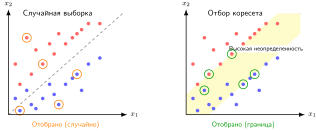

***Иллюстративный отбор на основе неопределенности**: обе панели отбирают по пять примеров, поэтому сравнивается распределение выбора, а не бюджет. Случайная выборка распределяет эти выборы по пространству признаков; иллюстративная стратегия неопределенности концентрирует их в затененной полосе вокруг текущей границы решений.*

EL2N с малой прокси-моделью дает один практичный баланс между стоимостью оценки и качеством отбора. Подход обучает облегченную модель несколько эпох, вычисляет оценки EL2N и выбирает подмножество с учетом проверок покрытия и качества. Прокси должна выдавать ранжирование, которое переносится на целевую модель, и вложения окупаются, только если сокращение обучения превышает накладные расходы на отбор. Конкретный сценарий иллюстрирует этот процесс, не утверждая, что его подмножество в 10 процентов сохраняет точность.

<a id="exmp-data-selection-coreset-selection-practice"></a>

> **Пример: отбор коресетов на практике**
>
> **Сценарий**: Инженерная команда хочет выбрать коресет на 100 000 примеров (10 процентов) из 1 млн обучающих изображений для более быстрой итерации модели.
>
> **Диагностика**: Наивное случайное подвыборочное прореживание теряет редкие классы и пограничные примеры. Обучение облегченной прокси-модели за 5 эпох вычисляет оценки ошибок EL2N и сохраняет примеры с высокой неопределенностью около границы решений.
>
> **Системный урок**: отбор коресетов на основе прокси заменяет часть проходов по полным данным целевым вычислением оценок. Он ускоряет обучение полной модели, только если ранжирование прокси переносится, а проверки покрытия сохраняют редкие классы и пограничные случаи.

[«Отбор коресета на основе EL2N»](09_data_selection.md#lst-el2n-coreset) показывает, как вычислить оценки EL2N и отобрать коресет с помощью облегченной прокси-модели. Механизм тратит небольшой объем вычислений на зондирование, чтобы найти примеры с высокой неопределенностью около границы решений, а затем обучает полную модель на сохраненном подмножестве, а не на избыточных легких примерах. Для примера нужен загрузчик без перемешивания, чтобы позиция каждой оценки оставалась согласованной с индексом примера в наборе данных.

Оценка на основе прокси превращает неопределенность в переиспользуемые индексы отбора: `compute_el2n_scores` измеряет, какие примеры все еще путают кратко обученную модель, а `select_coreset` сохраняет эти информативные примеры для полного прогона обучения.

<a id="lst-el2n-coreset"></a>

**Отбор коресета на основе EL2N**: функция `compute_el2n_scores` обучает прокси-модель несколько эпох, а затем измеряет ошибку предсказания через L2-расстояние от one-hot меток. Высокие оценки указывают на примеры, которые прокси считает трудными, в том числе потенциально зашумленные. Функция `select_coreset` иллюстрирует ранжирование по этой оценке; промышленное использование также требует проверки покрытия, шума и целевого качества.

```python
def compute_el2n_scores(model, dataloader, num_epochs=5):
    """Вычисляет оценки EL2N.

    Возвращает L2-норму (предсказание - one_hot_label).
    """
    # Обучаем прокси-модель несколько эпох, чтобы получить осмысленные предсказания
    train_proxy(model, dataloader, num_epochs)

    scores = []
    model.eval()
    for x, y in dataloader:
        logits = model(x)
        probs = softmax(logits, dim=1)
        # One-hot кодирование меток
        one_hot = zeros_like(probs).scatter_(1, y.unsqueeze(1), 1)
        # Оценка EL2N = L2-расстояние от уверенного предсказания
        el2n = (probs - one_hot).norm(dim=1)  # Высокое значение = неуверенность
        scores.extend(el2n.tolist())
    return scores

def select_coreset(scores, dataset, fraction=0.1):
    """Выбирает top-k примеров с наибольшей оценкой (наиболее неопределенные)."""
    k = int(len(dataset) * fraction)
    # Сортировка по убыванию оценки (сначала наибольшая неопределенность)
    indices = argsort(scores, descending=True)[:k]
    return Subset(dataset, indices)

# Иллюстративное подмножество 10%; перед использованием проверьте точность и покрытие
scores = compute_el2n_scores(proxy_model, full_loader)
coreset = select_coreset(scores, full_dataset, fraction=0.1)
train_full_model(model, coreset)
```

<a id="sec-data-selection-data-deduplication-6c20"></a>

### Дедупликация данных

Пока отбор коресетов определяет, какие примеры сохранить по их информативности, дополняющий подход нацелен на дубликаты, которые добавляют вычисления без добавления сигнала обучения. Дедупликация может дать немедленный выигрыш в эффективности, особенно для точных и почти точных дубликатов, и не требует обучения модели. Поэтому это одна из самых доступных оптимизаций в отборе данных, однако пороги почти дубликатов нужно проверять, чтобы конвейер не удалил полезный сигнал распределения.

Простейшая форма дедупликации (введенная как этап конвейера инженерии данных в разделе [«Систематическая обработка данных»](04_data_engineering.md#sec-data-engineering-systematic-data-processing-aebc) и здесь поднятая до уровня рычага оптимизации) использует хеширование для точных совпадений. Вычисляя криптографический хеш (MD5 или SHA-256) для каждого примера и удаляя примеры с одинаковыми хешами, можно устранить побайтовые дубликаты, которые неизбежно накапливаются в больших корпусах, собранных из веба. Этот процесс вычислительно дешев, растет линейно с размером набора данных и тривиально распараллеливается.

Обнаружение почти дубликатов решает задачу для содержимого, которое отличается на уровне байтов, но сохраняет значительное перекрытие токенов или символьных шинглов. Для текста MinHash[^fn-minhash-jaccard-dedup] с локально-чувствительным хешированием[^fn-lsh-hashing-dedup] (LSH) эффективно приближает сходство Жаккара[^fn-jaccard-similarity-dedup]. На практике конвейер превращает каждый документ в множество перекрывающихся символьных или словесных $k$-шинглов, сжимает эти множества в MinHash-сигнатуры фиксированной длины, где вероятность коллизии хешей равна сходству Жаккара, и разбивает сигнатуры на $b$ полос по $r$ строк с помощью LSH. Документы, совпадающие во всех строках одной полосы, попадают в один бакет, что ограничивает дорогую проверку сходства вероятными кандидатами и позволяет избежать невозможного попарного сравнения $\mathcal{O}(N^2)$ для миллиардов веб-документов. Метод находит слабо отредактированный контент с большим перекрытием, но не доказывает семантической эквивалентности перефразирований.

[^fn-jaccard-similarity-dedup]: **Сходство Жаккара**: определяется как $|A \cap B| / |A \cup B|$ и лежит от 0 (не пересекаются) до 1 (идентичны). Для дедупликации метрика сравнивает множества шинглов документов разной длины. Порог нужно калибровать под определение шинглов, корпус и последующее качество, потому что универсального порога, отделяющего дубликаты от законно связанных документов, не существует.

[^fn-lsh-hashing-dedup]: **Локально-чувствительное хеширование (LSH)**: LSH раскладывает MinHash-сигнатуры по бакетам так, что похожие сигнатуры с большей вероятностью совпадают. Генерация кандидатов избавляет от полного попарного сравнения, а время работы и память зависят от длины сигнатуры, разбиения на полосы, размеров бакетов и числа кандидатов, требующих проверки.

[^fn-minhash-jaccard-dedup]: **MinHash**: предложен (Broder, 1997) для выявления дубликатов веб-страниц в AltaVista; алгоритм строит компактные сигнатуры с помощью случайных хеш-функций так, что похожие документы с высокой вероятностью дают похожие сигнатуры. Каждая сигнатура сжимает документ в эскиз фиксированного размера, что позволяет оценивать попарное сходство за время $\mathcal{O}(s)$ для размера эскиза $s$.

Для изображений перцептивное хеширование дает сигнатуры, устойчивые к мелким преобразованиям вроде изменения размера и сжатия, и находит визуально похожих кандидатов, которые хранятся в разных форматах. Сходство на основе эмбеддингов может находить семантически близких соседей, вычисляя плотные представления (CLIP[^fn-clip-embedding-dedup] (Radford et al., 2021) для изображений, sentence transformers для текста). Однако близость сама по себе не доказывает дублирования, а подход требует больших вычислительных накладных расходов.

[^fn-clip-embedding-dedup]: **CLIP (Contrastive Language-Image Pretraining)**: предобучен на 400 миллионах пар «изображение — текст» и отображает семантически связанные изображения и тексты в общее пространство эмбеддингов (Radford et al., 2021). Эмбеддинги могут выдавать кандидатов на проверку, но семантическая близость не является доказательством дублирования двух примеров. Вычисление эмбеддингов также заметно дороже, чем вычисление перцептивных хешей, а соотношение зависит от модели и аппаратуры.

Дедупликация может уменьшать запоминание повторяющегося содержимого и не тратить FLOP на точные или почти точные дубликаты. Однако она может изменять намеренное эмпирическое взвешивание корпуса, поэтому пороги и последующее качество нужно проверять, а не исходить из того, что каждый дубликат вреден.

Системное влияние дедупликации меняется, когда входные примеры индексируют постоянное состояние модели, а не проходят через вычислительные слои без сохранения состояния.

<a id="lhs-data-selection-dlrm-embedding-deduplication"></a>

> **DLRM и дедупликация эмбеддингов**
>
> Маячная модель DLRM из [«Состав маячных моделей: биографии моделей»](06_nn_architectures.md#sec-network-architectures-lighthouse-roster-model-biographies-a763) ограничена емкостью памяти: таблицы эмбеддингов занимают терабайты для миллиардов пользовательских и товарных идентификаторов. Значительная часть этой емкости тратится на *холодные эмбеддинги*, то есть идентификаторы, которые редко встречаются в обучающих данных.
>
> Отбор данных для DLRM может включать дедупликацию взаимодействий и прореживание эмбеддингов для холодных идентификаторов. Удаление повторяющихся взаимодействий сокращает число обучающих примеров, но уменьшает таблицу эмбеддингов только тогда, когда идентификаторы исчезают или меняется политика размещения, хеширования или совместного использования.

<a id="sec-data-selection-data-pruning-quality-3d69"></a>

### Прореживание данных по качеству

Дедупликация удаляет избыточные примеры, но остается третья категория проблемных данных: примеры, которые активно вредят обучению. Прореживание по качеству устраняет примеры, которые либо не дают значимого сигнала, либо вносят противоречивую информацию, сбивающую оптимизацию.

Обнаружение ошибок в метках может быть прореживанием по качеству с наибольшим эффектом. Инструменты вроде Cleanlab находят примеры, для которых назначенная метка может быть неверной, исходя из паттернов уверенности модели в ходе обучения. Пример, который модель стабильно предсказывает как класс A, но который помечен как класс B, может быть трудным пограничным случаем, сдвигом распределения, слепым пятном модели или ошибкой разметки. Оценка должна запускать проверку, а не автоматическое удаление; подтвержденные ошибки затем можно исправить или удалить.

Удаление выбросов решает другую проблему: примеры, далекие от любого центра кластера в пространстве признаков. Такие точки могут указывать на шум, ошибки разметки или повреждение, но они также могут быть редкими пограничными случаями, которые определяют риск развертывания. Ключ — отличить информативные выбросы от недействительных примеров: нужны консервативные пороги и проверка срезов до удаления.

Фильтрация малоинформативных примеров применяет эвристики, специфичные для домена, чтобы удалить примеры, в которых недостаточно сигнала для обучения. Для текстовых корпусов это часто означает удаление искаженного текста с высокой перплексией (перплексия — мера того, насколько неожиданным для языковой модели является текст, поэтому высокие значения отмечают бессвязные строки) и, в некоторых конвейерах, шаблонного или повторяющегося текста с низкой перплексией. Для наборов изображений фильтрация нацелена на размытые, поврежденные или почти однородные примеры, которые дают мало визуальной информации.

Помимо эвристик и перплексии, промышленные конвейеры предобучения сильно опираются на *фильтрацию на основе классификатора*: обучается облегченный линейный классификатор с высокой пропускной способностью (например, fastText), в котором качественные эталонные тексты (например, Википедия, книги и научные статьи) служат положительными примерами, а необработанные веб-дампы — отрицательными. Классификатор присваивает каждому собранному документу непрерывную оценку качества, что позволяет конвейерам отфильтровать миллионы низкокачественных веб-страниц при скорости приема в гигабайты в секунду, без тяжелых вычислительных затрат на оценку полноценной нейронной языковой модели.

Вместе эти три техники статического прореживания — отбор коресетов, дедупликация и фильтрация по качеству — могут сократить объем работы до обучения. При фиксированном числе эпох, размере батча и работе на пример сокращение набора данных на 50 процентов означает на 50 процентов меньше прямых проходов, обратных проходов и обновлений градиента. Графики обучения, которые добавляют компенсирующие эпохи или шаги, уменьшают эту экономию.

Статическое прореживание отвечает на вопрос о том, *что* сохранить, но считает ответ фиксированным. Как только прореженный набор данных определен, каждая эпоха обучается на одном и том же подмножестве. Однако полезность примера может меняться по мере обучения модели: примеры, которые бросают вызов недообученной модели, могут стать легкими после достаточного числа градиентных шагов. Методы динамического отбора устраняют это ограничение, адаптируя обучающие данные на каждом этапе с учетом того, что модель уже освоила.

<a id="sec-data-selection-dynamic-selection-edaa"></a>

## Динамический отбор

Предельный сигнал обучения примера нестационарен в ходе обучения. В начале оптимизации широкое покрытие дает устойчивые градиенты, которые формируют общие представления признаков. По мере сходимости параметров нормы градиентов освоенных примеров стремятся к нулю. Прямые и обратные проходы на этих примерах продолжают тратить циклы ускорителя и передачи через высокоскоростную память (HBM), почти не обновляя параметры, и их эффективное ICR стремится к нулю. Динамический отбор снижает эти потери, адаптируя состав батча к текущему состоянию модели. Так отбор переходит из автономного этапа предобработки в активный цикл исполнения: он меняет число операций ($O$) во время работы, а загрузчикам данных приходится балансировать накладные расходы на оценку и пропускную способность ускорителя ($T$).

<a id="sec-data-selection-curriculum-learning-easy-hard-2c4e"></a>

### Учебный план: от простого к сложному

Первый метод динамического отбора, **учебный план**[^fn-curriculum-learning-order] (Bengio et al., 2009; Soviany et al., 2022), задает порядок, в котором данные предъявляются модели. Вместо случайного перемешивания он начинает с более простых примеров и постепенно вводит более сложные, как люди, которые сначала осваивают основы и лишь потом переходят к трудному материалу.

[^fn-curriculum-learning-order]: **Учебный план (curriculum learning)**: от латинского *currere* («бежать»), первоначально означавшего «дистанцию, которую нужно пройти», — метафора, которая напрямую соответствует методу: обучающие данные как дистанция, пройденная в заданном порядке, с простыми участками вначале. Учебный план может работать как метод продолжения для невыпуклой оптимизации: более простые примеры формируют раннюю траекторию оптимизации, прежде чем вводятся трудные. С системной точки зрения ICR примера может меняться в ходе обучения, что оправдывает изменение состава примеров со временем.

Учебный план может менять траекторию оптимизации, управляя тем, какие градиенты доминируют на каждом этапе. Простые примеры могут давать устойчивые ранние сигналы, а примеры с высокой оценкой сложности могут содержать полезную информацию о границе, шум меток или выбросы. Расписание от простого к сложному может сгладить обучение на некоторых нагрузках, но его польза зависит от оценки сложности, правила темпа, модели и данных; поэтому [«Иллюстративное сокращение эпох для учебного плана»](09_data_selection.md#tbl-curriculum-benchmarks) рассматривает экономию как иллюстративную, а не гарантированную.

Реализация учебного плана требует двух компонентов: оценщика сложности, который ранжирует примеры, и функции темпа, которая задает, насколько быстро вводятся трудные примеры. Распространенный выбор — линейный темп:
$$
\text{образцы}_{n_{\text{epoch}}} = \texttt{sort\_by\_difficulty}[:N_{\text{samples}} \cdot \min(1, n_{\text{epoch}}/N_{\text{warmup}})]
$$
где $n_{\text{epoch}}$ — текущая эпоха, $N_{\text{samples}}$ — общий размер набора данных, а $N_{\text{warmup}}$ — число эпох разогрева, по истечении которых полный набор данных становится доступным. В ранние эпохи обучение идет на самой простой доле $N_{\text{samples}} \cdot (n_{\text{epoch}}/N_{\text{warmup}})$; после разогрева обучение идет на полном наборе данных. С системной точки зрения пересортировка многотерабайтных наборов данных от эпохи к эпохе разрушает последовательное упреждающее чтение и заставляет ускорители простаивать из-за задержки хранилища. Промышленные загрузчики данных реализуют учебные планы, предварительно сортируя данные офлайн по дискретным шардам или корзинам с уровнями сложности. Во время обучения воркеры последовательно читают шарды из хранилища, сохраняя локальные буферы перемешивания внутри каждого уровня; так сохраняется высокая пропускная способность последовательного чтения при разнообразии батчей и устойчивости градиентов.

Выбор оценщика сложности — системное решение, поскольку он обменивает накладные расходы на зондирование на качество упорядочивания, как показано в [«Стратегии оценки сложности для учебного плана»](09_data_selection.md#tbl-difficulty-scoring). Оценка по потерям и уверенности дает лучший порядок ценой дополнительного вывода, эвристики не требуют вычислений, но требуют знания предметной области, а самостоятельный темп переносит адаптацию в сам цикл обучения.

| **Стратегия**         | **Оценка сложности**                      | **Лучше всего для**                         |
|:----------------------|:------------------------------------------|:--------------------------------------------|
| **На основе потерь**  | Потери прокси-модели (низкие = простые)   | Универсальный вариант; требует обучения прокси |
| **На основе уверенности** | Уверенность модели-учителя (высокая = простые) | Когда есть учитель; схемы дистилляции   |
| **Эвристики домена**  | Длина предложения, сложность изображения  | Без дополнительных вычислений; нужны знания домена |
| **Самостоятельный темп** | Потери текущей модели (обновляются каждую эпоху) | Адаптивный; прокси не нужна          |

<a id="tbl-difficulty-scoring"></a>

***Стратегии оценки сложности для учебного плана**: строки сравнивают источник сигнала каждого оценщика с системным требованием или компромиссом, который он вносит.*

[«Иллюстративное сокращение эпох для учебного плана»](09_data_selection.md#tbl-curriculum-benchmarks) использует гипотетические числа эпох, чтобы показать, как экономия от учебного плана вычислялась бы для разных нагрузок. Значения не являются измерениями из цитируемых исследований учебного плана.

| **Набор данных** | **Модель** | **Стратегия темпа**    | **Эпохи до целевой точности**        | **Сокращение эпох**    |
|:-----------------|:----------:|:-----------------------|:-------------------------------------|:----------------------:|
| **CIFAR-10**     | ResNet-18  | Линейный разогрев      | 115 против 150 в базовом варианте | 23,3% меньше эпох   |
| **CIFAR-100**    | ResNet-32  | Самостоятельный темп   | 180 против 220 в базовом варианте | 18,2% меньше эпох   |
| **ImageNet**     | ResNet-50  | На основе потерь       | 80 против 90 в базовом варианте   | 11,1% меньше эпох   |
| **ImageNet**     | ResNet-50  | Обученный (зашумленные метки) | 70 против 90 в базовом варианте | 22,2% меньше эпох   |

<a id="tbl-curriculum-benchmarks"></a>

***Иллюстративное сокращение эпох для учебного плана**: таблица применяет одно правило целевой точности к гипотетическим базовым и учебным числам эпох. Она демонстрирует арифметику, но не устанавливает рейтинг наборов данных или методов.*

Сценарий показывает, что полезный прирост от учебного плана нужно измерять при фиксированной целевой метрике. Порядок зависит от задачи: *антиучебный план* предъявляет сначала трудные примеры, а *самостоятельное обучение* (self-paced learning) подстраивает сложность под текущие потери модели. Ни один из этих порядков не является универсально лучшим.

<a id="sec-data-selection-active-learning-humanintheloop-6932"></a>

### Активное обучение: человек в контуре

Учебный план оптимизирует порядок, в котором предъявляются примеры, но предполагает, что все примеры уже размечены. Это допущение ломается в специализированных областях, где разметка требует существенной экспертизы, времени или денег. Вместо того чтобы размечать все заранее, активное обучение[^fn-active-learning-queries] (Settles, 2012; Ren et al., 2021) переносит цель оптимизации с выбора размеченных примеров для обучения на выбор неразмеченных примеров, которые стоит разметить.

[^fn-active-learning-queries]: **Активное обучение**: «активной» здесь является сама алгоритмическая часть, которая выбирает, какие неразмеченные примеры эксперт должен разметить следующими. Это переводит задачу из вычислительной оптимизации (обучение на данных, которые уже есть) в финансовую: максимизировать прирост модели на каждый доллар, потраченный на экспертную разметку. Запрос наиболее информативных примеров может существенно сократить потребность в разметке по сравнению со случайной выборкой, но множитель зависит от задачи, модели и оракула (разметчика).

Активное обучение превращает сбор данных из статического в итеративный процесс запросов. Проследите круговой путь на [«Замкнутом цикле активного обучения»](09_data_selection.md#fig-active-learning-loop): как метрики неопределенности модели выбирают неразмеченные примеры высокой ценности для экспертной разметки.

Эффективность активного обучения существенно зависит от стратегии запросов, которая выбирает примеры для разметки (Settles, 2009; Settles, 2012; Ren et al., 2021). Простейший подход — выборка по неопределенности: выбираются примеры, на которых модель наименее уверена, например предсказания с вероятностью около 0,5 для бинарной классификации. Оценивать такой критерий дешево, если есть одна модель, но он может чрезмерно концентрировать запросы в одной неоднозначной области. Запрос по комитету развивает эту идею, обучая несколько моделей и выбирая примеры, на которых они расходятся сильнее всего; так учитывается эпистемическая неопределенность, которую одна модель может упустить.

Практикам, готовым вложить больше вычислений, подходит ожидаемое изменение модели: выбираются примеры, которые при разметке вызвали бы наибольшее обновление градиента. Этот подход теоретически обоснован, но дорог. Выборка по разнообразию дополняет методы на основе неопределенности: она выбирает примеры, непохожие на уже размеченные, и улучшает покрытие, не концентрируя все запросы вокруг одной неоднозначной области.

Активное обучение особенно ценно в областях, где разметка требует экспертизы. Например, в медицинской визуализации система ИИ, которая ставит диагноз по рентгеновским снимкам, может уверенно распознавать частые состояния, но быть неуверенной в редких случаях. Направляя разметку экспертов на такие неоднозначные случаи, активное обучение оптимизирует использование дорогого времени специалистов и ускоряет улучшение модели.

<a id="fig-active-learning-loop"></a>

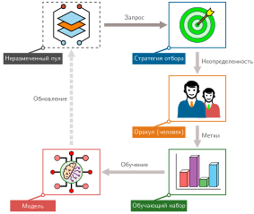

***Замкнутый цикл активного обучения**: цикл отбора обменивает вычисления на оценку прокси на запросы, выбранные из неразмеченного пула для разметки оракулом. Критерии неопределенности, разнообразия и покрытия ищут больше полезной информации на одну разметку, чем ненаправленная выборка.*

Экономические последствия могут быть существенными в узкоспециализированных областях, где стоимость разметки и сроки выполнения могут доминировать над вычислениями для оценки кандидатов. Эти стратегии запросов задают каждую итерацию цикла активного обучения на [«Замкнутом цикле активного обучения»](09_data_selection.md#fig-active-learning-loop), а простое сравнение бюджетов показывает, как активное обучение может сократить стоимость разметки и объем работы при обучении в заданных предположениях.

<a id="nbk-data-selection-active-learning-roi"></a>

> **Пример: рентабельность активного обучения**
>
> **Задача**: Команда больницы располагает 1 млн неразмеченных снимков, стоимостью разметки у специалиста \$5 за метку, бюджетом \$500 000 и сроком 1 месяц. Как выборка по неопределенности меняет стоимость разметки и объем работы обучения за эпоху по сравнению со случайным базовым вариантом того же бюджета?
>
> **Сценарий A: наивная разметка**
>
> - **Стоимость**: разметка всех 1 млн снимков стоила бы \$5\,000\,000 (в 10 раз больше бюджета).
> - **Базовый вариант того же бюджета**: \$500\,000 ÷ \$5 за метку = 100 000 случайных снимков.
> - **Итог наивной разметки**: случайный отбор не гарантирует покрытия редкой патологии.
>
> **Сценарий B: активное обучение**
>
> - **Стратегия**: выборка по неопределенности выбирает 50 000 снимков для разметки специалистом.
> - **Стоимость**: 50 000 × \$5 за метку = \$250\,000 (на 50 процентов ниже бюджета).
> - **Объем работы обучения**: 100 000 ÷ 50 000 = в 2 раза меньше примеров за эпоху, чем в базовом варианте того же бюджета.
> - **Итог активного обучения**: сопоставимость со 100 000 случайными снимками требует эмпирической проверки.
>
> **Системный вывод**: относительно базового варианта того же бюджета отбор экономит \$500\,000 − \$250\,000 = \$250\,000; точность все равно требует эмпирической проверки.

Целенаправленный отбор примеров может сократить объем разметки, необходимый для достижения целевой метрики. Сравните две иллюстративные траектории точности на [«Множитель активного обучения»](09_data_selection.md#fig-active-learning-multiplier), отмечая горизонтальный разрыв между активной выборкой по неопределенности и базовым случайным отбором по мере роста числа примеров.

<a id="fig-active-learning-multiplier"></a>

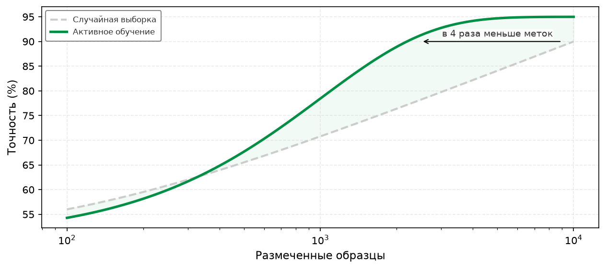

***Множитель активного обучения**: точность модели отложена против числа размеченных примеров на логарифмической оси. В этом иллюстративном сценарии активное обучение (сплошная зеленая линия) достигает той же точности меньшим числом меток, чем случайный отбор (серый пунктир); стрелка отмечает примерно четырехкратный разрыв в эффективности меток около 90 процентов точности.*

Рисунок отслеживает иную ось, чем прикидочный расчет в [«Пример: рентабельность активного обучения»](09_data_selection.md#nbk-data-selection-active-learning-roi). Он иллюстрирует эффективность меток, а врезка считает деньги на разметку при отдельных предположениях. Активное обучение также несет расходы на оценку, получение данных и повторное переобучение, поэтому сквозная экономия может быть меньше разрыва в числе меток.

Активное обучение может делать больше, чем экономить на разметке: подходящее правило запросов концентрирует проверку на неуверенных, разнообразных или связанных с отказами примерах.

<a id="exmp-data-selection-mining-hard-negatives"></a>

> **Пример: майнинг трудных негативов (hard negative mining) в умном дверном звонке**
>
> **Сценарий**: детектор зрения умного дверного звонка получает непрерывные видеопотоки, в которых преобладают пустые фоны (легкие негативы) и обычные позы пешеходов.
>
> **Диагностика**: случайная выборка кадров может пропустить редкие ложные срабатывания, например статуи, кучи белья и тени в форме человека. Активное обучение направляет неуверенные предсказания («Человек: 51%») и выборочные ошибки из эксплуатации проверяющим людям для целевой разметки.
>
> **Системный урок**: майнинг трудных негативов может повысить эффективность разметки, направляя усилия проверки на подозреваемые ложные срабатывания и другие трудные негативы. Поток запросов по-прежнему нуждается в проверках разнообразия и покрытия, чтобы не исключить уверенные, но систематически неверные случаи.

<a id="sec-data-selection-semisupervised-learning-using-unlabeled-data-51fc"></a>

### Полуконтролируемое обучение: использование неразмеченных данных

Рассмотрим иллюстративный сценарий медицинской визуализации: 50 000 рентгенограмм грудной клетки, из которых 500 просмотрены и размечены радиологами[^fn-labeling-economic-cost], то есть доля разметки составляет 1 процент. Достаточно ли такого исходного набора, зависит от задачи и распределения. Полуконтролируемое обучение может использовать оставшиеся 49 500 изображений, если неразмеченный пул соответствует целевому распределению, а метод проверен на размеченных данных.

[^fn-labeling-economic-cost]: **Иллюстративная экономика клинической разметки**: диапазоны доли просмотра и почасовой ставки — это предположения сценария, а не сообщенные измерения. При этих входных данных разметка 500 снимков требует 7–10 часов и стоит \$1 000–3 000; разметка всех 50 000 стоит \$94 000–300 000. Арифметика иллюстрирует, почему полуконтролируемое обучение может быть привлекательным, когда экспертные метки дороги, но реальное время просмотра, арбитраж, распространенность и требования к проверке нужно измерять.

Активное обучение оптимизирует, какие примеры размечать, но все равно требует человеческой разметки для каждого выбранного примера. Полуконтролируемое обучение переносит инженерный компромисс с человеческой разметки на вычисления ускорителя: оно использует небольшое размеченное подмножество, чтобы закрепить оптимизацию на большом неразмеченном пуле, извлекая сигналы контроля напрямую из неаннотированных входов. Это позволяет моделям приблизиться к точности полностью контролируемого обучения при значительно меньшем числе ручных меток, если неразмеченный пул отражает целевое распределение.

Основная идея полуконтролируемого обучения состоит в том, что неразмеченные данные, хотя не могут напрямую научить отображению входов в выходы, содержат структурную информацию о распределении входов $p(x)$, которая может ограничивать пространство гипотез. При допущениях гладкости и кластерности граница решения, которая проходит через плотную область, назначает разные метки близким входам и менее правдоподобна, чем граница в области низкой плотности. Полуконтролируемые методы опираются на эти допущения, которые нужно проверять на целевой задаче.

Три техники реализуют эту идею регуляризации распределения. **Псевдоразметка**[^fn-pseudo-labeling-ssl] обучается на размеченном подмножестве, получает предсказания модели на неразмеченном пуле и включает примеры, превышающие порог уверенности, как синтетическую эталонную истину для последующего переобучения. Порог уверенности задает критический системный компромисс: слишком низкий порог пропускает шум меток, который ухудшает обучение, а слишком высокий отбрасывает информативные примеры и тратит неразмеченный пул впустую.

[^fn-pseudo-labeling-ssl]: **Псевдоразметка**: использует уверенные предсказания обученной модели как эталонные метки для неразмеченных данных. Эффективность метода основана на положительной обратной связи: точные предсказания на легких неразмеченных примерах расширяют обучающий набор, что улучшает модель и позволяет точнее предсказывать на более трудных примерах. Режим отказа так же самоусиливается: неверные псевдометки закрепляют ошибки через *подтверждающее смещение*, и модель укрепляет собственные неверные классификации.

Регуляризация согласованности[^fn-consistency-reg-ssl] требует, чтобы модель выдавала инвариантные предсказания для возмущенных версий одного и того же входа. Поскольку семантика классов инвариантна к реалистичным преобразованиям, таким как обрезка, поворот или сдвиг цвета, функция потерь штрафует расхождение предсказаний между двумя стохастическими представлениями неразмеченного примера. Гибридные подходы вроде FixMatch[^fn-fixmatch-semi-supervised] объединяют оба механизма: они генерируют псевдометку по слабо аугментированному представлению, когда уверенность предсказания превышает порог, а затем обучают модель предсказывать эту метку для сильно аугментированного варианта того же входа.

[^fn-consistency-reg-ssl]: **Регуляризация согласованности**: основана на допущении гладкости: если два входа $x_1$ и $x_2$ близки в пространстве входов, их метки тоже должны быть близкими. Целевая функция обучения минимизирует расхождение между предсказаниями модели для входа и для его аугментированной версии. Концептуально это отличается от аугментации данных (которая создает больше обучающих примеров), поскольку явно навязывает согласованность предсказаний как член потерь, даже для неразмеченных данных, где «правильная» метка неизвестна. Системное следствие — дополнительные вычисления на генерацию и сравнение предсказаний при нескольких возмущениях; этот компромисс может быть выгоден в условиях, где вычислений много, а меток мало.

[^fn-fixmatch-semi-supervised]: **FixMatch**: генерирует псевдометку по слабо аугментированному изображению, а затем обучает модель предсказывать ту же метку для сильно аугментированной версии того же изображения. Это обучение согласованности ограничено порогом уверенности: псевдометка используется, только если предсказание модели на слабой аугментации очень уверенное (например, >0,95) (Sohn et al., 2020). Здесь прямой системный компромисс между дополнительными вычислениями обучения и меньшим числом ручных меток; величина зависит от базового варианта и модели стоимости.

Распространение меток трактует полуконтролируемое обучение как диффузию по графу: строится граф сходства по представлениям примеров, и метки распространяются от размеченных узлов к неразмеченным соседям. Подход хорошо работает, когда представления образуют хорошо разделенные кластеры, хотя построение и обход графа сходства на больших наборах данных требуют существенной памяти и накладных расходов на поиск ближайших соседей.

<a id="exmp-data-selection-fixmatch-cifar-10"></a>

> **Пример: FixMatch на CIFAR-10**
>
> **Сценарий**: конвейер полуконтролируемой классификации изображений обучается на CIFAR-10 всего с 250 размеченными примерами (по 25 на класс) и неразмеченными данными (Sohn et al., 2020).
>
> **Диагностика**: полностью размеченный обучающий набор CIFAR-10 содержит 50 000 меток. FixMatch генерирует псевдометки с высокой уверенностью (порог > 0,95) на слабо аугментированных неразмеченных изображениях и обеспечивает согласованность на сильно аугментированных вариантах, достигая точности 94,9 процента в цитируемом эксперименте.
>
> **Системный урок**: полуконтролируемое обучение обменивает дополнительные вычисления обучения на меньшее число ручных меток. При допущениях о стоимости разметки из главы сценарий FixMatch снижает затраты на подготовку набора данных в 8,1 раза; сквозная экономия зависит от стоимости неразмеченных данных и вычислений.

Системный компромисс полуконтролируемого обучения обменивает усилия по разметке на дополнительные вычисления над размеченными и неразмеченными примерами. Он может приблизиться к точности полностью контролируемого обучения при меньшем числе меток, но ни сокращение меток, ни рост вычислений не универсальны. Сравнение на CIFAR-10 делает один такой компромисс конкретным ([«Эффективность меток FixMatch на CIFAR-10»](09_data_selection.md#tbl-fixmatch-cifar10)).

| **Бюджет меток**      | **Метод**         | **Точность** | **Эффективность меток** |
|:----------------------|:------------------|:------------:|:------------------------|
| **50 000 (100%)** | Полный обучающий набор | ---     | Эталон по числу меток   |
| **4 000 (8%)**    | FixMatch          | 95,7%      | в 12,5 раза эффективнее   |
| **250 (0,5%)**    | FixMatch          | 94,9%      | в 200 раз эффективнее    |
| **40 (0,08%)**    | FixMatch          | 88,6%      | в 1250 раз эффективнее   |

<a id="tbl-fixmatch-cifar10"></a>

***Эффективность меток FixMatch на CIFAR-10**: при 250 метках (0,5 процента набора данных) FixMatch достигает точности 94,9 процента, используя в 200 раз меньше меток, чем содержит полный обучающий набор.*

Эти выигрыши в эффективности зависят от благоприятных допущений о распределении. Полуконтролируемое обучение предполагает, что неразмеченные данные взяты из того же распределения, что и размеченные, и оно испытывает трудности, когда неразмеченные данные содержат примеры вне распределения (модель уверенно их неверно размечает), когда дисбаланс классов сильный (псевдометки усиливают смещение к мажоритарному классу) или когда размеченное множество покрывает не все классы (что мешает распространению меток на невиденные классы). Всегда проверяйте на отложенной выборке с истинными метками, чтобы выявлять несоответствие распределений.

Несмотря на эти ограничения, полуконтролируемое обучение может снижать требования к меткам, сохраняя точность на подходящих задачах. Среди рассмотренных техник отбор коресетов и дедупликация прореживают малоценные примеры перед обучением; учебный план меняет порядок предъявления; активное обучение выбирает, какие примеры получат ручную разметку; а полуконтролируемое обучение извлекает дополнительный сигнал из неразмеченного пула. Каждая техника может снижать зависимость от меток, специфичных для задачи, но ни одна не устраняет необходимость в размеченной оценке. Этот ряд ведет к родственной возможности: метки, специфичные для задачи, возможно, не нужны для предобучения. Сама структура данных (то, что изображения кошек похожи на другие изображения кошек, а связные предложения следуют грамматическим закономерностям) может давать сигнал контроля, но качество на последующих задачах все равно требует проверки, согласованной с задачей.

<a id="sec-data-selection-selfsupervised-learning-7518"></a>

## Самоконтролируемое обучение

GPT обучали предсказывать следующий токен в последовательности. BERT обучали восстанавливать замаскированные токены. Ни одна из этих целей предобучения не требовала специфичных для задачи человеческих меток. **Самоконтролируемое обучение**[^fn-self-supervised-paradigm] (SSL) обобщает эту идею: проектируя *претекстовые задачи*, которые выводят контроль из структуры данных, модели могут выучивать переиспользуемые представления из неразмеченных данных в масштабе. Если активное и полуконтролируемое обучение снижают спрос на метки, то SSL меняет учет, делая неразмеченную структуру сигналом предобучения. На трехэтапной схеме это скорее расширение доступного пула, чем четвертый этап отбора: вопрос смещается от того, на каких размеченных примерах обучать, к тому, как неразмеченные примеры могут поддерживать предобучение. Это отвечает одному аспекту стены данных из раздела [«Граница ICR: когда данные становятся налогом»](09_data_selection.md#sec-data-selection-icr-frontier), расширяя понятие обучающего сигнала, но не отменяя требований к качеству корпуса, лицензированию, покрытию и размеченной оценке.

[^fn-self-supervised-paradigm]: **Самоконтролируемое обучение**: претекстовая задача, например предсказание следующего или замаскированного токена, дает сигнал контроля, выведенный из самих данных. Это снижает зависимость от специфичных для задачи человеческих меток, но может требовать существенных вычислений предобучения. Амортизация зависит от того, насколько широко переиспользуется полученная модель.

Метки — лишь одна форма контроля; претекстовая задача может также извлекать сигнал обучения из структуры данных, как обобщено в [«Самоконтролируемые претекстовые задачи по модальностям»](09_data_selection.md#tbl-self-supervised-tasks).

| **Модальность** | **Самоконтролируемая задача** | **Сигнал контроля**                          |
|:----------------|:------------------------------|---------------------------------------------:|
| **Текст**       | Маскированное языковое моделирование | Предсказать `[MASK]` по контексту     |
| **Текст**       | Предсказание следующего токена | Предсказать следующий токен в последовательности |
| **Изображения** | Контрастивное обучение        | То же изображение (с аугментацией) против других изображений |
| **Изображения** | Маскированное автокодирование | Восстановить замаскированные фрагменты        |
| **Мультимодальность** | Выравнивание в духе CLIP | Сопоставить пары «изображение — текст»        |

<a id="tbl-self-supervised-tasks"></a>

***Самоконтролируемые претекстовые задачи по модальностям**: каждая задача извлекает контроль из структуры данных, а не из человеческих меток, что позволяет предобучаться на крупных неразмеченных корпусах.*

Претекстовые задачи генерируют сигналы контроля автоматически. Цели с маскированными токенами могут побуждать модели выучивать грамматическую и семантическую структуру; предсказание следующего токена учит структуре продолжения; а контрастивные цели для изображений поощряют признаки, инвариантные к выбранным преобразованиям. Эти подходы опираются на семейства сверточных сетей и трансформеров из раздела [«Архитектуры нейронных сетей»](06_nn_architectures.md#sec-network-architectures), но системный учет важен: самоконтроль убирает аннотирование конкретной задачи со входа в предобучение, но не убирает стоимость данных. Предобучение может начинаться на неразмеченных корпусах без ожидания меток на уровне примеров, но сбор, фильтрация, лицензирование, хранение и обработка остаются. Отделение предобучения от разметки под конкретную задачу меняет экономику машинного обучения, когда представление переносится между задачами; адаптация под задачу и оценка все равно несут собственные требования к данным.

<a id="sec-data-selection-economics-amortization-98bb"></a>

### Экономика амортизации

Центральная роль самоконтролируемого обучения в рабочих процессах фундаментальных моделей напрямую следует из амортизации стоимости. Фундаментальная модель — это широко предобученная переиспользуемая базовая модель, которая адаптируется к последующим задачам через дообучение. Такая архитектура делит стоимость на две фазы: дорогие предварительные инвестиции в предобучение, которое выполняется один раз на неразмеченных данных, и облегченные адаптации под конкретные задачи, переиспользуемые во многих приложениях ([«Иллюстративная амортизация фундаментальной модели»](09_data_selection.md#tbl-cost-amortization)).

| **Подход**                     | **Метки на задачу**  | **Вычисления на задачу** | **Получение данных**     |
|:-------------------------------|:---------------------|:-------------------------|-------------------------:|
| **Обучение с нуля**            | 100 тыс.–1 млн размеченных | 100% полного обучения | Сбор под конкретную задачу |
| **Дообучение фундаментальной модели** | 100–1 тыс. размеченных | 1–5% полного обучения | Переиспользование корпуса предобучения |

<a id="tbl-cost-amortization"></a>

***Иллюстративная амортизация фундаментальной модели**: диапазоны меток и вычислений — это предположения сценария. Они показывают, почему переиспользование может снижать предельную стоимость задачи, когда представления переносятся, но это не универсальное соотношение для дообучения.*

Чтобы проиллюстрировать эту экономическую перемену, рассмотрим компанию, которая строит 10 специализированных классификаторов. При предположениях сценария каждая задача, обученная с нуля, требует 100 000 меток по \$1 за метку, то есть \$1 млн на все задачи. Смоделированная нагрузка на вычисления составляет 10 000 GPU-часов.

Сценарий дообучения один раз тратит 10 000 GPU-часов, а затем назначает каждой задаче 1 000 меток и 50 GPU-часов вычислений. По всем 10 задачам смоделированная стоимость меток для дообучения составляет \$10 тыс.

При этих входных данных стоимость разметки падает в 100 раз, а предельные вычисления на задачу — в 20 раз. Это следствия выбранных значений сценария, тогда как суммарные вычисления становятся выгодными только тогда, когда достаточное число последующих задач амортизирует предобучение.

Дообучение становится экономичным, когда представления эффективно переносятся, а число последующих задач превышает порог безубыточности. Сравнение стоимости бок о бок на [«Амортизация стоимости в фундаментальных моделях»](09_data_selection.md#fig-amortization-comparison) противопоставляет повторяющееся обучение с нуля слева и предобучение с последующим дешевым дообучением справа.

<a id="fig-amortization-comparison"></a>

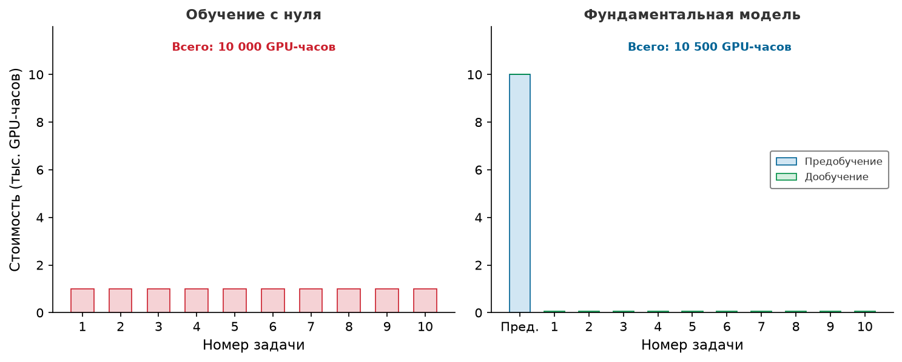

***Амортизация стоимости в фундаментальных моделях**: обучение с нуля (слева) требует 1 000 GPU-часов на задачу (всего 10 000 GPU-часов на 10 задач). Подход с фундаментальной моделью (справа) платит 10 000 GPU-часов заранее за предобучение, но сокращает каждую последующую задачу до 50 GPU-часов. При 10 задачах итоги сопоставимы (10 000 GPU-часов против 10 500 GPU-часов), но предельная стоимость задачи падает в 20 раз, а точка перехода в пользу фундаментальной модели находится примерно при 10,5 задачах. Нарисованный снимок для 10 задач поэтому остается чуть ниже этой точки безубыточности.*

<a id="sec-data-selection-foundation-model-paradigm-f0f1"></a>

### Парадигма фундаментальной модели

Экономика амортизации различается между самоконтролируемыми методами, поскольку каждая цель нагружает разные аппаратные узкие места на границе эффективности по стоимости. Контрастивное обучение требует больших пулов негативных примеров, чтобы предотвратить коллапс представлений. SimCLR (Chen et al., 2020) берет негативы непосредственно из образцов, присутствующих в одном мини-батче, что требует размеров батча до 4 096; распределение их по ускорителям означает существенное выделение памяти под промежуточные активации и частую коллективную коммуникацию (all-gather) по межпроцессорному соединению. MoCo (He et al., 2020) отделяет пул негативов от размера мини-батча, кэшируя представления в динамической очереди, которая обновляется через усредненный по моменту кодировщик; это позволяет использовать большие наборы негативов на скромных конфигурациях ускорителей, не насыщая память и пропускную способность соединения. Маскированное моделирование по-разному меняет память и арифметическую интенсивность: маскированные автокодировщики (MAE) отбрасывают до 75 процентов визуальных фрагментов до кодировщика, резко сокращая квадратичные накладные расходы памяти у самовнимания, тогда как маскированное языковое моделирование обрабатывает полные последовательности токенов с двунаправленным вниманием. Авторегрессионное генеративное предобучение обменивает сырые вычисления на широкий перенос на задачи, следуя эмпирическому степенному масштабированию по токенам, параметрам и вычислениям. Эти методы опираются на архитектуры из раздела [«Архитектуры нейронных сетей»](06_nn_architectures.md#sec-network-architectures); для отбора данных самоконтролируемое предобучение умножает полезность дефицитных размеченных данных, извлекая переиспользуемые представления непосредственно из структуры сырых данных.

Когда стоимость предобучения переиспользуется между задачами, SSL поддерживает **парадигму фундаментальной модели**[^fn-foundation-model-risk] (Bommasani et al., 2021). Основные принципы отбора данных (отбор коресетов, учебный план и активное обучение) остаются необходимыми и в этой парадигме. Кураторство корпуса предобучения применяет дедупликацию и фильтрацию по качеству в веб-масштабе, а последующий отбор определяет, какие примеры дообучения максимизируют перенос на конкретную задачу.

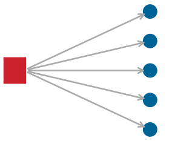

*Один дефект корпуса предобучения распространяется на множество последующих задач.*

[^fn-foundation-model-risk]: **Фундаментальная модель**: название подчеркивает, что такие модели служат общей основой для многих последующих задач, но это создает единую точку отказа. Дефекты данных предобучения фундаментальной модели (смещения, фактические ошибки, запомненное приватное содержимое) распространяются на каждое приложение, построенное на ней. С системной точки зрения этот риск гомогенизации означает, что качество отбора данных при предобучении имеет непропорционально большой радиус поражения: ошибка кураторства, которая в парадигме обучения с нуля затронула бы одну задачу, теперь затрагивает тысячи последующих развертываний.

Самоконтролируемое обучение решает проблему узкого места меток, извлекая обучение из структуры данных, а не из человеческой аннотации, но саму нехватку данных оно решить не может. Редким классам может не хватать примеров, пограничные случаи могут никогда не встретиться в природе, а ограничения приватности могут мешать собирать реальные образцы. Третий этап конвейера отбора данных решает этот разрыв, создавая новые данные по требованию, а не отбирая или курируя существующие.

<a id="sec-data-selection-synthetic-data-generation-415c"></a>

## Генерация синтетических данных

Сбор реальных данных упирается в физические и юридические границы: автономные парки не могут безопасно разбивать автомобили, чтобы получить траектории катастрофических столкновений, системы здравоохранения не могут передавать защищенную телеметрию пациентов через межведомственные барьеры, а периферийные устройства сталкиваются с акустическими условиями задолго до массового выпуска продукта. Когда целевые распределения обладают экстремальным дефицитом или нулевым эмпирическим покрытием, ни статическая фильтрация, ни динамическая приоритизация образцов не могут извлечь сигнал, которого нет в исходном корпусе. Синтетическая генерация данных решает это фундаментальное узкое место, создавая обучающие распределения напрямую. Инженерная стратегия переходит от *кураторства* (фильтрации и взвешивания существующих записей) к *созданию*: генерации новых входов, доменных возмущений или целевых меток контроля, чтобы удовлетворить ограничения статистического покрытия.

<a id="sec-data-selection-data-augmentation-transformationbased-synthesis-3aa7"></a>

### Аугментация данных: синтез на основе преобразований

Аугментация данных — самая дешевая по накладным расходам форма синтетической генерации: она расширяет эффективное обучающее распределение, динамически преобразуя существующие образцы при загрузке. Поскольку преобразования, сохраняющие метку, порождают новые входы без расширения постоянного хранилища, аугментация умножает разнообразие набора данных без дополнительной стоимости получения данных. Однако в конвейере обучения на ускорителях аугментация смещает вычислительное узкое место между центральным процессором хоста и ускорителем. При выполнении в рабочих потоках CPU хоста интенсивные декодирование и пространственные преобразования могут насытить ядра хоста и оставить ускоритель без данных по шине PCIe. Перенос преобразований в ядра ускорителя устраняет пузыри передачи «хост — устройство», но потребляет высокоскоростную память (HBM) и такты вычислений, которые иначе выполняли бы обновления градиентов.

Для данных изображений конвейеры преобразований обеспечивают инвариантности, нужные на этапе развертывания (Shorten and Khoshgoftaar, 2019). Геометрические операции (поворот, горизонтальное отражение, случайная обрезка и масштабирование) обеспечивают инвариантность к точке наблюдения, а фотометрические корректировки (яркость, контраст и цветовое дрожание) имитируют шум сенсора и изменчивое освещение. Более агрессивные стратегии напрямую меняют топологию входа: Cutout[^fn-cutout-data-augmentation] накладывает случайные прямоугольные нулевые маски, чтобы не допустить зависимости от локальных признаков; MixUp (Zhang et al., 2018) строит виртуальные образцы линейными комбинациями пар изображений и их one-hot меток ($\tilde{x} = \lambda x_i + (1 - \lambda) x_j$); а CutMix[^fn-cutmix-data-augmentation] вставляет прямоугольный фрагмент одного изображения в другое, смешивая метки пропорционально площади фрагмента. Поскольку CutMix и MixUp работают через линейные комбинации тензоров и блочные копирования памяти прямо в памяти устройства, они дают сильную регуляризацию в пространстве данных с ничтожными накладными расходами FLOP.

[^fn-cutout-data-augmentation]: **Cutout**: случайно маскирует квадратные области входных изображений во время обучения, заставляя модель распознавать объекты по частичной информации, а не по одной различительной области (DeVries and Taylor, 2017). В отличие от dropout (который обнуляет *нейроны* в пространстве признаков), Cutout действует во входном пространстве. Исходные эксперименты с Cutout дали прирост от 0,3 до 2,0 процентного пункта на CIFAR-10/100 и SVHN при ничтожных вычислительных накладных расходах, что делает его методом аугментации с высоким ICR, когда инвариантность к окклюзии соответствует задаче: больше информации на пример почти без дополнительной стоимости для конвейера.

[^fn-cutmix-data-augmentation]: **CutMix**: заменяет обнуленную область Cutout фрагментом из другого обучающего изображения, смешивая метки пропорционально площади фрагмента (если 30 процентов изображения A заменены изображением B, метки делятся 70/30) (Yun et al., 2019). Это устраняет слабость Cutout: обнуленные области тратят пиксельную информацию, которая могла бы нести сигнал обучения. В статье CutMix сообщается о приросте top-1 на ImageNet на 2,28 процентного пункта для ResNet-50 и на 1,70 процентного пункта для ResNet-101, а также об улучшении локализации. Метод дает более сильную регуляризацию, чем Cutout или MixUp по отдельности, при небольшой дополнительной стоимости конвейера данных.

Текстовая аугментация имеет другие ограничения, потому что дискретные словари токенов не образуют гладких геометрических многообразий. Обратный перевод[^fn-back-translation-nlp] дает семантическое перефразирование для задач «последовательность в последовательность», пропуская одноязычные корпуса целевого языка через промежуточную модель, чтобы сгенерировать синтетические пары с исходным языком. Более простые эвристические преобразования (например, замена синонимов через WordNet, случайная вставка или удаление токенов) вносят локальные возмущения, но рискуют испортить семантические метки, если их применять без проверки на конкретной задаче.

[^fn-back-translation-nlp]: **Обратный перевод**: в методе, описанном в (Sennrich et al., 2016), одноязычный текст на целевом языке переводится на исходный язык, а синтетический исходник сопоставляется с неизмененной целью для обучения машинному переводу. Системный компромисс — задержка, поскольку каждый синтетический исходник требует вывода модели перевода. Конвейеры могут предвычислять такие примеры офлайн, а не генерировать их в загрузчике данных.

Вместо ручной настройки расписаний преобразований автоматический поиск политик оптимизирует комбинации аугментаций напрямую. AutoAugment[^fn-autoaugment-policy-search] использует обучение с подкреплением по дискретным пространствам операций, но несет чрезмерные вычислительные накладные расходы. RandAugment[^fn-randaugment-simple-search] устраняет эту стоимость поиска, параметризуя политику всего двумя значениями: числом преобразований $N$ и общей величиной искажения $M$.

[^fn-autoaugment-policy-search]: **AutoAugment**: рассматривает проектирование политики аугментации как задачу поиска с подкреплением: контроллер выбирает операции (поворот, сдвиг, наклон, выравнивание гистограммы), их величины и вероятности применения, чтобы максимизировать точность на валидации (Cubuk et al., 2019). Исходный поиск для ImageNet использовал примерно 15 000 GPU-часов, что мотивировало более поздние методы, сокращающие пространство поиска.

[^fn-randaugment-simple-search]: **RandAugment**: сводит поиск политик AutoAugment к двум гиперпараметрам: числу преобразований $N$ и общей величине $M$ (Cubuk et al., 2020). Такое маленькое пространство поиска соответствует или превосходит AutoAugment на сообщенных бенчмарках при гораздо меньшей стоимости поиска, что делает его практичным, когда 15 000 GPU-часов на поиск политики не оправданы.

<a id="lhs-data-selection-mobilenet-aggressive-augmentation"></a>

> **MobileNetV2 и агрессивная аугментация**
>
> Маячная модель MobileNetV2 из [«Состав маячных моделей: биографии моделей»](06_nn_architectures.md#sec-network-architectures-lighthouse-roster-model-biographies-a763) показывает, как аугментация данных дополняет архитектуру с ограниченными ресурсами. Ее раздельные по глубине свертки заменяют стандартные пространственные свертки пространственными фильтрами по глубине с последующими поточечными проекциями $1 \times 1$, существенно сокращая число параметров и арифметическую интенсивность.
>
> Поскольку компактные архитектуры обладают ограниченной емкостью представлений, агрессивная аугментация регуляризирует представления признаков, не раздувая память параметров вывода и бюджеты задержки. Однако величину аугментации нужно тщательно балансировать: чрезмерное искажение может превысить емкость компактной сети и привести к недообучению на исходном распределении задачи.

<a id="sec-data-selection-generative-synthesis-creating-new-samples-a43d"></a>

### Генеративный синтез: создание новых образцов

Аугментация возмущает существующие обучающие точки в их локальных окрестностях. Генеративный синтез конструирует совершенно новые кортежи координат $(x, y)$, выбирая образцы из параметрических генеративных моделей или движков физической симуляции. Системный компромисс между генеративными парадигмами охватывает спектр «стоимость — точность»:

1. Генеративно-состязательные сети (GAN) обучают генератор против дискриминатора. После обучения вывод прямого генератора требует одного прямого прохода, что дает низкую задержку и высокую пропускную способность выборок. Однако обучение GAN уязвимо для коллапса мод, который подавляет хвостовое разнообразие, необходимое для надежного покрытия пограничных случаев.
2. Диффузионные модели формулируют синтез как итеративное шумоподавление по параметризованной цепи Маркова или непрерывному процессу на основе оценки градиента. Латентные диффузионные системы, такие как Stable Diffusion[^fn-stable-diffusion-synthesis], обеспечивают точное семантическое управление текстовыми подсказками, работая в сжатом латентном пространстве. Однако генерация каждого батча требует развертывания от 20 до 50 последовательных прямых проходов через большую основу, что создает серьезные затраты арифметической интенсивности и пропускной способности памяти, исключающие генерацию на лету в активных циклах обучения.
3. Движки физической симуляции (например, CARLA для автономного вождения или Isaac Sim и Unity для робототехники) полностью отделяют генерацию данных от нейросетевого вывода, исполняя конвейеры моделирования твердых тел, кинематики и рендеринга графики. Симуляторы выдают точные эталонные аннотации (включая трехмерные ограничивающие рамки, карты глубины и векторы скорости) из внутреннего состояния без стоимости человеческой разметки. Узкое место смещается на вычисления физики на CPU хоста и на пропускную способность растеризации графики или трассировки лучей на GPU.

[^fn-stable-diffusion-synthesis]: **Stable Diffusion**: выполняет итеративное шумоподавление в сжатом латентном пространстве, что позволяет создавать целенаправленные примеры «текст — изображение» (Rombach et al., 2022). Его итеративная генерация заметно более вычислительно затратна, чем геометрические преобразования, поэтому она подходит там, где важнее новизна, чем пропускная способность на пример.

Вне зависимости от генеративного движка синтетические образцы неизбежно расходятся со статистическими распределениями реальных сред развертывания. Это расхождение и определяет доменный разрыв.

<a id="sec-data-selection-bridging-domain-gap-100b"></a>

### Преодоление доменного разрыва

Доменный разрыв[^fn-domain-gap-shift] — это статистическое расхождение между синтетическими обучающими распределениями и данными промышленного развертывания. Когда модели оптимизируются исключительно на синтетических распределениях, границы решений подстраиваются под артефакты симулятора или генеративной модели, а не под физическую реальность. Как показано на [«Проблеме доменного разрыва»](09_data_selection.md#fig-domain-gap), классификатор, обученный на смещенном синтетическом распределении, может достичь почти нулевой ошибки на синтетическом обучении, но незаметно отказывать при оценке на реальных кластерах.

<a id="fig-domain-gap"></a>

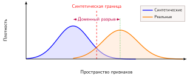

***Проблема доменного разрыва**: синтетические данные (синие) и реальные данные (оранжевые) занимают смещенные распределения признаков. Штриховая красная граница синтетических данных и пунктирная зеленая граница реальных данных иллюстрируют, как граница, выученная для одного распределения, может не совпадать с границей для другого.*

[^fn-domain-gap-shift]: **Доменный разрыв**: статистическое расхождение между распределениями синтетических и реальных данных, измеримое такими метриками, как maximum mean discrepancy (MMD) или Frechet Inception Distance (FID). Для систем ML разрыв превращается в перекос обучения и обслуживания: модель, обученная на симуляторе, может хорошо проходить валидацию на синтетических данных, но незаметно отказывать на реальных данных развертывания.

Два взаимодополняющих подхода решают это несоответствие распределений. Рандомизация домена[^fn-domain-randomization-sim] занимает агрессивную позицию: вместо точного воспроизведения реального мира она обучается на разнообразных синтетических данных, рандомизируя освещение, текстуры, фоны и параметры камеры во время генерации.

[^fn-domain-randomization-sim]: **Рандомизация домена**: намеренно разнообразит синтетические данные, рандомизируя текстуры, цвета, освещение и физические свойства. Цель — не фотореализм, а достаточное разнообразие, чтобы улучшить покрытие условий развертывания; это переносит узкое место стоимости с точности рендеринга на покрытие.

Цель состоит в том, чтобы условия развертывания попадали в диапазон вариаций, встреченных при обучении, но покрытие никогда не гарантируется одной лишь рандомизацией. Метод может быть эффективен в робототехнике и автономном вождении, когда симулятор охватывает нужные физические и визуальные факторы, а результат проверен на реальных данных.

Адаптация домена идет противоположным путем, явно выравнивая синтетическое и реальное распределения. Методы выравнивания признаков обучаются на синтетических данных и одновременно минимизируют расстояние между распределениями признаков синтетических и реальных данных, часто используя состязательное обучение для выучивания доменно-инвариантных представлений. Дообучение предлагает более простой путь: предобучить на обильных синтетических данных, чтобы выучить общие признаки, а затем дообучить на небольшом реальном наборе данных для адаптации к условиям развертывания. Самообучение объединяет эти идеи, используя модель, обученную на синтетике, для псевдоразметки реальных неразмеченных данных, а затем переобучая ее на объединенном размеченном наборе.

На практике смешивание синтетических и реальных данных дает якорь из реальных данных, сохраняя часть синтетического покрытия, но наилучшее соотношение зависит от нагрузки. [«Соотношения смешивания синтетических и реальных данных»](09_data_selection.md#tbl-synthetic-mix) обобщает компромисс для разных соотношений смешивания.

| **Доля синтетических данных** | **Типичный результат**                              |
|:------------------------------|:----------------------------------------------------|
| **100% синтетических**        | Нет якоря из реальных данных; проверьте доменный разрыв |
| **80% синтетических + 20% реальных** | Меньше спрос на реальные данные; проверка на данных развертывания |
| **50% синтетических + 50% реальных** | Больше привязки к реальным данным; выше стоимость сбора |
| **100% реальных**             | Нет разрыва «синтетика — реальность»; самая высокая стоимость сбора |

<a id="tbl-synthetic-mix"></a>

***Соотношения смешивания синтетических и реальных данных**: чисто синтетические данные могут страдать от сдвига распределения; чисто реальные данные дороги. Оптимальное соотношение зависит от домена, точности симулятора, семейства модели и протокола валидации, поэтому таблицу стоит читать как каркас сценария, а не как универсальный рецепт.*

<a id="exmp-data-selection-kws-data-selection"></a>

> **Пример: отбор данных для KWS**
>
> **Сценарий**: встраиваемая система распознавания ключевых слов (KWS) нацелена на развертывание на микроконтроллере с SRAM 256 КБ и требованием более 10 000 аудиообразцов.
>
> **Диагностика**: ручная запись 10 000 реальных высказываний разных дикторов и акустических условий стоит \$20–50 тыс. Поэтапный конвейер из пяти уровней (исходные записи → аугментация → внедрение шума → майнинг трудных негативов → TTS-симуляция) наращивает масштаб набора данных от 500 исходных образцов.
>
> **Системный урок**: многоуровневые стратегии данных могут снизить стоимость получения данных для периферийных развертываний ML с ограниченными ресурсами. В этом сценарии аугментация и внедрение шума снижают физическую стоимость сбора до 5 процентов от оценки полной записи; целевая точность и акустическое покрытие все равно требуют проверки.

Сценарий распознавания ключевых слов показывает, как аугментация, внедрение шума и симуляция могут расширять малый исходный набор, но та же стратегия создания становится рискованнее, когда образцы поступают из обученных генераторов. При рекурсивном обучении *коллапс модели*[^fn-model-collapse-mechanism] может усиливать ошибки и снижать разнообразие от поколения к поколению. Поэтому синтетические данные требуют отслеживания происхождения, контроля смеси и проверки на реальных данных развертывания, а не непроверенного предположения, что больше сгенерированных образцов всегда помогает.

[^fn-model-collapse-mechanism]: **Коллапс модели**: формально проанализирован в (Shumailov et al., 2024). Явление возникает, потому что генеративные модели систематически недопредставляют хвостовые распределения, то есть редкие, но важные паттерны, которые появляются в обучающих данных нечасто. Когда поколение $n+1$ обучается на выходе поколения $n$, каждое следующее поколение дополнительно сжимает хвосты, производя все более однородные данные. Деградация может быть быстрой в условиях рекурсивного обучения, поэтому обучение на неподкрепленных синтетических выходах рискует катастрофическим коллапсом хвостового разнообразия.

<a id="sec-data-selection-knowledge-distillation-compressing-information-ce68"></a>

### Дистилляция знаний: сжатие информации

В то время как аугментация данных ([«Аугментация данных: синтез на основе преобразований»](09_data_selection.md#sec-data-selection-data-augmentation-transformationbased-synthesis-3aa7)) и генеративный синтез ([«Генеративный синтез: создание новых образцов»](09_data_selection.md#sec-data-selection-generative-synthesis-creating-new-samples-a43d)) создают новые входные образцы, дистилляция знаний[^fn-distillation-dark-knowledge] (Hinton et al., 2015; Gou et al., 2021) синтезирует целевые метки контроля. Вместо обучения исключительно на разреженных эталонных метках (таких как one-hot вектор $[1, 0, 0]$) компактная сеть-ученик обучается на непрерывном распределении вероятностей, которое выдает большая модель-учитель (например, $[0{,}70, 0{,}20, 0{,}10]$). Мягкое целевое распределение, масштабированное параметром температуры $\tau$, раскрывает корреляции между классами, то есть «темное знание», которое отражает метрические сходства, выученные в пространстве представлений учителя.

[^fn-distillation-dark-knowledge]: **Дистилляция знаний**: мягкие вероятности учителя раскрывают структурные сходства между классами, которые one-hot кодирование опускает. Параметр температуры масштабирует сглаживание логитов ($\tau > 1$): чрезмерное сглаживание стирает различительный сигнал, а при $\tau \to 1$ распределение возвращается к предсказанию argmax. Дистилляция вносит стоимость вывода учителя, которая должна окупаться улучшением эффективности выборки или точности ученика.

Дистилляция выявляет фундаментальный системный компромисс между емкостью высокоскоростной памяти ускорителя (HBM) и пропускной способностью ввода-вывода вторичного хранилища:

- При *онлайн-дистилляции* модель-учитель находится прямо в памяти ускорителя вместе с моделью-учеником во время обучения. Система вычисляет прямые проходы учителя параллельно с исполнением ученика, что устраняет постоянные расходы хранилища на мягкие цели. Однако размещение избыточно параметризованного учителя рядом занимает память ускорителя и пропускную способность тензорных ядер, ограничивая максимальный размер батча ученика на один ускоритель и увеличивая задержку шага.
- При *офлайн-дистилляции* учитель генерирует предсказания по всему корпусу на этапе предвычисления и сохраняет плотные векторы логитов на диск. Это полностью освобождает память ускорителя для обучения ученика, но резко увеличивает объем хранилища набора данных и пропускную способность входного конвейера. Для словаря классификации из $V$ классов хранение несжатых логитов float32 увеличивает объем метки на один образец с одного целочисленного индекса ($\lceil \log_2 V \rceil$ бит) до $4V$ байт, то есть в тысячи раз для больших словарей.

Вместе аугментация на основе преобразований ([«Аугментация данных: синтез на основе преобразований»](09_data_selection.md#sec-data-selection-data-augmentation-transformationbased-synthesis-3aa7)), генеративный синтез ([«Генеративный синтез: создание новых образцов»](09_data_selection.md#sec-data-selection-generative-synthesis-creating-new-samples-a43d)) и дистилляция меток контроля завершают третий этап отбора данных. Если статическая фильтрация устраняет избыточные входные образцы, а динамический отбор оптимизирует порядок образцов во время обучения, то синтетическая генерация создает недостающие сигналы, когда эмпирический сбор упирается в физические, юридические или экономические ограничения. Согласование этих техник по измерениям данных, алгоритма и машины требует балансировки объема хранения данных, пропускной способности предобработки и утилизации ускорителя в едином системном бюджете.

<a id="sec-data-selection-decision-framework-0261"></a>

## Схема решения

Когда бюджет разметки, избыточность, редкие классы, приватность и скорость сходимости важны одновременно, практику нужно прежде всего определить, какое ограничение является связывающим. Каждый этап может повысить отношение информации к вычислениям, если измеренный прирост качества оправдывает его накладные расходы: прореживание убирает малоценные примеры до обучения, динамический отбор направляет вычисления на ценные примеры во время обучения, а синтез создает новые ценные примеры по требованию ([«Трехэтапный конвейер отбора данных»](09_data_selection.md#tbl-data-selection)).

| **Этап**                 | **Когда применяется** | **Техники**                                           | **Иллюстративный результат**                         |
|:-------------------------|:----------------------|:------------------------------------------------------|:-----------------------------------------------------|
| **Статическое прореживание** | До обучения       | Отбор коресетов, дедупликация, фильтрация по качеству | Сокращение набора данных на 30–50%                   |
| **Динамический отбор**   | Во время обучения     | Учебный план, активное обучение, полуконтролируемое обучение | Учебные планы на 10–30% быстрее; в 2–100 раз меньше меток |
| **Синтетическая генерация** | По требованию      | Аугментация, генеративные модели, дистилляция         | Расширение эффективных данных в 2–10 раз             |

<a id="tbl-data-selection"></a>

***Трехэтапный конвейер отбора данных**: диапазоны иллюстрируют возможные результаты, а не переносимые ожидания. Фактический выигрыш зависит от набора данных, модели, метода отбора и целевой метрики.*

Когда доминирующее ограничение названо, [«Руководство по выбору техники по основному ограничению»](09_data_selection.md#tbl-technique-selection) сравнивает, какая техника меняет это ограничение и почему.

| **Ограничение**                | **Кандидатная техника**   | **Почему**                                           |
|:-------------------------------|:--------------------------|:-----------------------------------------------------|
| **Ограниченный бюджет разметки** | Активное обучение       | Максимизирует рентабельность меток, выбирая информативные примеры |
| **Высокая избыточность данных** | Дедупликация + коресет  | Устраняет отходы до начала обучения                  |
| **Редкие классы или пограничные случаи** | Синтетическая генерация | Создает образцы, которых нет в сырых данных  |
| **Медленная сходимость**       | Учебный план              | Улучшает качество градиентов на раннем этапе обучения |
| **Требования приватности**     | Синтез с аудитом приватности | Снижает прямое использование реальных записей; проверяет утечки |
| **Большая модель, малый набор данных** | Дистилляция знаний | Использовать знания модели-учителя как «данные»      |

<a id="tbl-technique-selection"></a>

***Руководство по выбору техники по основному ограничению**: кандидатные техники отбора данных сопоставлены с доминирующим ресурсным ограничением конвейера ML. Таблица начинает диагностику; предпосылки и измеренная рентабельность определяют окончательный выбор.*

[«Руководство по выбору техники по основному ограничению»](09_data_selection.md#tbl-technique-selection) сопоставляет отдельные ограничения с техниками, но реальные проекты сталкиваются с несколькими ограничениями одновременно. Дерево решений на [«Дереве решений отбора данных»](09_data_selection.md#fig-technique-decision-tree) структурирует процесс выбора иерархически: сначала определяется основное узкое место, затем по ветвям сужается круг вариантов.

<a id="fig-technique-decision-tree"></a>

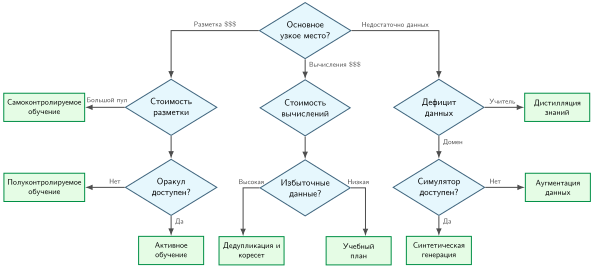

***Дерево решений отбора данных**: дерево начинается с основного узкого места (стоимость разметки, стоимость вычислений или дефицит данных) и сужает каждую ветвь, используя доступные пулы, оракулы, избыточность, учителей или симуляторы. Листья указывают кандидатные техники; проекты с несколькими связывающими ограничениями могут требовать более одной ветви.*

### Процесс решения

Каждый путь требует структурированной оценки, потому что один и тот же симптом в данных может указывать на разные узкие места. Выбор техники начинается с назначения связывающего ограничения, затем проверяется, существуют ли данные, метки и инфраструктура, которые нужны выбранному методу.

#### Шаг 1: оценить узкое место

Определите, какое ресурсное ограничение сильнее всего ограничивает конвейер обучения:

- **Стоимость разметки**: техники эффективности меток, такие как активное обучение, полуконтролируемое обучение и самоконтролируемое обучение, максимизируют ценность, извлекаемую из каждой человеческой аннотации.
- **Стоимость вычислений**: отбор коресетов и дедупликация могут сократить число обрабатываемых образцов, а проверенный учебный план может уменьшить число шагов, нужных для достижения целевой метрики.
- **Дефицит данных**: создание данных через аугментацию, синтез и дистилляцию расширяет эффективный обучающий набор за пределы того, что дает сырой сбор.

Этот диагностический шаг привязывает выбор техники к связывающему ресурсному ограничению, а не к самому знакомому алгоритму.

#### Шаг 2: проверить предпосылки

Когда узкое место определено, проверьте, осуществимы ли соответствующие техники при имеющихся инфраструктуре и данных. У каждого подхода есть конкретные требования, которые нужно выполнить до начала внедрения ([«Предпосылки техник»](09_data_selection.md#tbl-technique-prerequisites)).

| **Техника**                                          | **Предпосылки**                                             |
|:-----------------------------------------------------|:------------------------------------------------------------|
| **Активное обучение**                                | Доступ к оракулу, неразмеченный пул, инфраструктура переобучения |
| **Отбор коресетов**                                  | Прокси-модель или экстрактор эмбеддингов, доступ к полному набору данных |
| **Учебный план**                                     | Метод оценки сложности, график темпа                        |
| **Полуконтролируемое обучение**                      | Некоторые размеченные данные, неразмеченные данные из того же распределения |
| **Самоконтролируемое обучение**                      | Большой неразмеченный корпус, бюджет вычислений на предобучение |
| **Аугментация**                                      | Знание доменных инвариантностей, библиотека аугментаций     |
| **Синтетическая генерация**                          | Генеративная модель или симулятор, устранение доменного разрыва |

<a id="tbl-technique-prerequisites"></a>

***Предпосылки техник**: каждая техника требует специфичных инфраструктуры и данных, которые нужно проверить до внедрения. Техника с отличным теоретическим выигрышем, но невыполненными предпосылками, на практике провалится, поэтому этот перечень — первый шаг выбора техники.*

#### Шаг 3: оценить рентабельность

Прежде чем вкладывать инженерные ресурсы, оцените рентабельность инвестиций каждой кандидатной техники:

$$
\text{ROI} = \frac{\text{(Базовая стоимость)} - \text{(Стоимость техники + Стоимость внедрения)}}{\text{Стоимость техники + Стоимость внедрения}}
$$

Техника с высоким теоретическим выигрышем, но высокой стоимостью внедрения, может дать меньшую рентабельность, чем более простой подход. Точная дедупликация часто служит недорогим первым кандидатом, потому что хеширование просто, а повторяющиеся байты легко обнаружить, хотя последующая выгода по-прежнему зависит от избыточности корпуса и намеренного взвешивания образцов. Активное обучение требует доступа к оракулу, инфраструктуры переобучения и разработки алгоритма отбора, поэтому его рентабельность сильно зависит от того, сколько циклов разметки амортизируют эти вложения.

#### Шаг 4: комбинировать техники

Техники отбора данных не исключают друг друга, но их сочетание не гарантирует аддитивного выигрыша. Типичный рабочий процесс дедуплицирует сырой корпус, применяет коресетный фильтр с учетом покрытия, упорядочивает сохраненные батчи через эмпирический учебный план и применяет аугментации во время сборки батчей. Предобученные представления дополнительно меняют базовую траекторию. Каждый дополнительный этап должен оправдывать свои вычислительные накладные расходы, потому что каскадные фильтры часто отбрасывают перекрывающиеся подмножества, в то время как их задержки оценки накапливаются.

*Этапы могут усиливать выигрыш в эффективности, когда их эффекты не перекрываются, а накладные расходы остаются малыми; сквозную экономию нужно измерять, а не предполагать.*

Алгоритмическая фильтрация превращается в системное ускорение, только если накладные расходы на отбор остаются строго ограниченными. Проход коресета, на который уходит десять часов зондирующего вывода ради сокращения двухчасового обучения, дает чистый проигрыш по календарному времени и облачным расходам. Аналогично адаптивный учебный план, который сканирует весь корпус для оценки сложности на каждой эпохе, может остановить ускорители из-за узких мест центрального процессора хоста. Получение выигрыша в эффективности данных в промышленной эксплуатации требует инженерного чутья к физическому стеку: амортизации проходов оценки, потоковой передачи несеквенциальных батчей без срыва механизмов предвыборки и синхронизации состояний распределенного отбора без сериализационных простоев.

<a id="sec-data-selection-selection-engineering-a4eb"></a>

## Инженерия отбора

Наивный цикл активного обучения, который каждую эпоху сканирует весь набор данных, чтобы выбрать «лучшие» образцы, может превратить задание обучения, ограниченное вычислениями, в узкое место ввода-вывода. **Инженерия отбора** начинается там, где заканчивается схема решения: после выбора алгоритмов инженерия должна обеспечить, чтобы они давали обещанное ускорение на реальном оборудовании и реальных конвейерах данных. Перевод алгоритмической фильтрации в фактическую пропускную способность требует архитектурных шаблонов, которые ограничивают задержку оценки, сохраняют последовательный доступ к хранилищу и предотвращают голодание ускорителя.

<a id="sec-data-selection-selection-bottleneck-4d00"></a>

### Узкое место отбора

Динамический отбор данных создает новое узкое место: задержку отбора. Обычный загрузчик следует заранее заданному плану выборки, тогда как активное обучение или адаптивные учебные планы могут оценивать функцию отбора $f(x)$ по большому пулу кандидатов, прежде чем формировать последующие батчи. Конкретно, оценка набора из 1 млн примеров большой моделью может занять 2,8 часа и свести на нет выигрыш от коресета в 10 процентов, если ее не выполнить с меньшей прокси-моделью. Системный компромисс требует, чтобы стоимость отбора оставалась ниже объема обучения, который подмножество экономит; иначе число образцов падает, а сквозная стоимость растет.

При фиксированной целевой метрике отбор плюс обучение на подмножестве должны стоить меньше, чем обучение на полном наборе данных. Пусть $T_{\text{selection}}$ — календарное время, затраченное на оценку пула, $T_{\text{train}}(D)$ — время обучения на наборе размера $D$, а $D_{\text{subset}}$ и $D_{\text{total}}$ — число сохраненных и полных образцов. [«Неравенство отбора»](09_data_selection.md#eq-selection-inequality) выражает это условие безубыточности — **неравенство отбора**.

<a id="eq-selection-inequality"></a>

$$ T_{\text{selection}} + T_{\text{train}}(D_{\text{subset}}) < T_{\text{train}}(D_{\text{total}}) $$

Эквивалентно, выделяя допустимые накладные расходы на отбор, получаем $T_{\text{selection}} < T_{\text{train}}(D_{\text{total}}) - T_{\text{train}}(D_{\text{subset}})$. Верхняя граница задержки отбора строго зависит от того, сколько времени обучения исключает подмножество; произвольная доля накладных расходов для всех нагрузок не применима. Когда $f(x)$ многократно оценивает пул кандидатов с помощью основной архитектуры модели, повторяющиеся проходы оценки и распределенная координация могут поглотить сэкономленные такты обучения и превратить отбор данных в чистый штраф пропускной способности.

<a id="exmp-data-selection-selection-inequality-practice"></a>

> **Пример: неравенство отбора на практике**
>
> **Сценарий**: команда компьютерного зрения выбирает коресет на 100 тыс. примеров (10 процентов) из 1 млн изображений, чтобы сократить время обучения на кластере ускорителей.
>
> **Диагностика**: оценка полной моделью (вариант A: целевая ResNet-50) добавляет 2,8 ч накладных расходов на отбор, снижая чистую экономию до 247,2 ч. Оценка прокси-моделью (вариант B: ResNet-18) снижает накладные расходы на отбор до 0,6 ч и сохраняет 249,4 ч общего календарного времени.
>
> **Системный урок**: отбор коресета уменьшает задержку обучения, только если накладные расходы на отбор меньше экономии на обучении на полном наборе данных. Оценка прокси сохраняет чистую экономию FLOP, удерживая стоимость оценки образцов заметно ниже стоимости прямого прохода полной модели.

Сквозное календарное время делится на накладные расходы отбора и обучение на подмножестве. На [«Неравенство отбора»](09_data_selection.md#fig-selection-inequality) столбчатые диаграммы времени сравнивают базовое обучение на полном наборе данных с эффективным и дорогим режимами отбора.

<a id="fig-selection-inequality"></a>

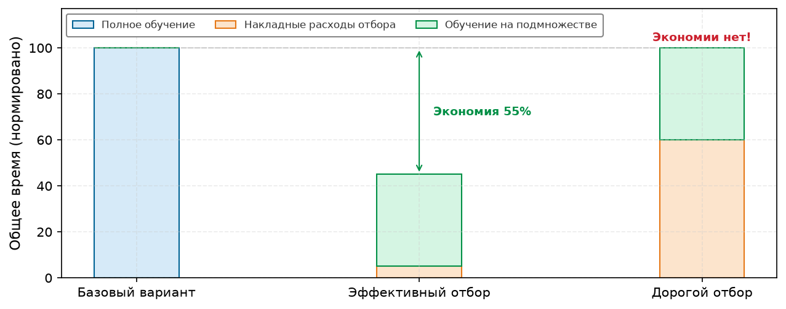

***Неравенство отбора**: отбор данных улучшает сквозную эффективность, только если накладные расходы на отбор плюс обучение на подмножестве меньше обучения на полном наборе данных. Легкая функция отбора (прокси-модель, кэшированные эмбеддинги) держит накладные расходы низкими; дорогая функция отбора (прямой проход полной модели) может свести экономию на нет.*

Эти накладные расходы накапливаются, когда отбор выполняется динамически по эпохам, а не один раз офлайн. Если повторная оценка на каждой эпохе приближается к объему обучения, сэкономленному обрезанным подмножеством, чистое системное преимущество исчезает.

Инженерные конвейеры управляют накладными расходами отбора с помощью прокси-моделей, кэшированных эмбеддингов и индексированного поиска. Меньшая прокси-модель сокращает задержку оценки, если ее ранжирование образцов точно переносится на целевую архитектуру. Выполнение прохода оценки в пониженной численной точности дополнительно уменьшает арифметическую работу и трафик памяти, когда точность ранжирования это допускает. Для отбора на основе сходства или разнообразия векторные индексы вроде FAISS[^fn-faiss-similarity-search] заменяют дорогие сканирования всего корпуса приближенным поиском ближайших соседей по предвычисленным эмбеддингам. Эти приемы отделяют оценку отбора от обучения основной модели и ограничивают $T_{\text{selection}}$, так что неравенство выполняется.

[^fn-faiss-similarity-search]: **FAISS (Facebook AI Similarity Search)**: обеспечивает поиск по сходству с ускорением на GPU, используя точные, приближенные и сжатые индексные структуры (Johnson et al., 2019). Johnson, Douze и Jegou сообщают о построении графа на миллиардах векторов на нескольких GPU, что показывает, почему инфраструктура векторных индексов важна для отбора в веб-масштабе. Для конвейеров отбора данных индексирование в духе FAISS поддерживает поиск $k$ ближайших соседей для отбора коресетов, дедупликацию на основе эмбеддингов и стратифицированную кластеризацию для сбалансированной выборки. Без такой инфраструктуры отбор на основе эмбеддингов чаще всего откатывался бы к дорогим сканированиям всего корпуса.

<a id="sec-data-selection-hardware-empathy-random-access-penalty-ef16"></a>

### Понимание аппаратуры: штраф за произвольный доступ

Неравенство отбора касается накладных расходов на вычисления, но алгоритмы отбора также меняют физические шаблоны ввода-вывода. Выборка, управляемая индексом, превращает крупные последовательные передачи шардов в разрозненные несеквенциальные чтения и теряет выгоду аппаратного упреждающего чтения, кэширования страниц операционной системы и массовой предвыборки контроллера. Поскольку головки диска физически должны перемещаться, а контроллеры флеш-памяти — выполнять поиск случайных блоков, подмножества одинакового размера могут давать резко разное время обучения в зависимости от локальности доступа. [«Иллюстративный штраф за мелкие чтения»](09_data_selection.md#tbl-io-performance) количественно оценивает этот штраф для разных уровней хранения при передачах по 4 КБ.

| **Уровень хранения** | **Последовательная пропускная способность** | **Произвольный ввод-вывод (IOPS)** | **Произвольная пропускная способность (прибл.)** | **Штраф за произвольный доступ** |
|:---------------------|:-------------------------------------------:|:----------------------------------:|:------------------------------------------------:|:--------------------------------:|
| **HDD (7.2k)**       | ~150 МБ/с                                 | ~100 IOPS                        | ~0,4 МБ/с                                      | 375×                           |
| **SATA SSD**         | ~550 МБ/с                                 | ~10 тыс. IOPS                        | ~40 МБ/с                                       | 13,8×                          |
| **NVMe SSD**         | ~3 500 МБ/с                               | ~500 тыс. IOPS                       | ~2 000 МБ/с                                    | 1,75×                          |
| **Облако (S3)**      | Зависит от конфигурации                     | Не сравнимо по IOPS                | Зависит от конфигурации                          | Потенциально чрезмерный          |

<a id="tbl-io-performance"></a>

***Иллюстративный штраф за мелкие чтения**: эталонные устройства сравнивают последовательную пропускную способность с произвольными чтениями по 4 КБ при упрощенном пересчете IOPS. Реальная пропускная способность зависит от размера запроса, глубины очереди, параллелизма, кэширования и конфигурации сервиса; строка про облако — лишь качественный сценарий.*

Загрузчики данных разрешают этот конфликт через совместное проектирование данных и машины. Форматы шардированных наборов данных, такие как WebDataset и FFCV, упаковывают тысячи отдельных примеров в непрерывные, последовательно читаемые фрагменты архива. Вместо выборки разрозненных отдельных образцов с диска загрузчик потоково передает крупные последовательные шарды в память хоста и заполняет **буфер перемешивания**. Цикл обучения псевдослучайно выбирает примеры из этого буфера в памяти, сохраняя пиковую пропускную способность чтения из хранилища и удовлетворяя статистическому требованию рандомизированных мини-батчей. При распределенном обучении на нескольких ускорителях каждый воркер ведет независимый буфер перемешивания над непересекающимся шардом. Поскольку рандомизация локальна для памяти воркера, а не глобальна по корпусу, редкие классы или пограничные случаи, сосредоточенные в определенных шардах, получают неравномерное представление у разных воркеров, если набор данных не стратифицирован и шарды не сбалансированы до распределения.

<a id="chk-data-selection-selection-inequality"></a>

> **Контрольная точка: неравенство отбора**
>
> Отбор данных не бесплатен. Он добавляет новый член в железный закон и новую стоимость ввода-вывода.
>
> Проверки уравнения:
>
> - **Стоимость отбора**: можете ли вы объяснить, почему $T_{\text{selection}} + T_{\text{train}}(\text{subset})$ должно быть меньше $T_{\text{train}}(\text{full})$, чтобы техника сокращала сквозное время обучения?
> - **Управление накладными расходами**: как прокси-модели и кэшированные эмбеддинги удерживают $T_{\text{selection}}$ на низком уровне?
>
> Системные следствия:
>
> - **Шаблоны ввода-вывода**: почему несеквенциальный доступ при динамическом отборе может снижать пропускную способность загрузчика данных по сравнению с последовательным чтением?

<a id="sec-data-selection-data-echoing-amortizing-io-costs-b4e0"></a>

### Эхо данных: амортизация затрат ввода-вывода

Даже когда пропускная способность хранилища сохранена, конвейеры динамического отбора часто переносят системное ограничение выше по потоку, на вычисления центрального процессора хоста. Тяжелые преобразования данных, такие как 3D-повороты, MixUp, декодирование JPEG или генеративный синтез на лету, требуют существенной обработки на хосте для каждого образца. Когда конвейер хоста выдает батчи медленнее, чем ускоритель выполняет прямые и обратные проходы, вычислительные ядра GPU простаивают без входных данных. Результирующее падение утилизации ускорителя увеличивает время обучения и нивелирует выигрыш в эффективности, полученный от прореживания набора данных.

Эхо данных[^fn-data-echoing-pipeline] (Choi et al., 2019) многократно использует данные, прежде чем получать новые образцы, обменивая свежесть на утилизацию ускорителя, когда входной конвейер медленнее обучения. Эхо перед рандомизированной аугментацией может давать разные преобразованные входы при каждом повторе, тогда как эхо в конце конвейера может повторять идентичные тензоры.

[^fn-data-echoing-pipeline]: **Эхо данных**: ключевая тонкость — *где* в конвейере вставить точку эха. Эхо до аугментации (эхо выше по потоку) может применять разные случайные аугментации к каждому повтору, а эхо после аугментации подает ускорителю идентичные тензоры. Полезные коэффициенты эха и реальное ускорение зависят от нагрузки, размера батча, точки вставки и политики перемешивания (Choi et al., 2019).

Оптимальный коэффициент эха зависит от отношения $R$ времени обработки на входе ко времени обучения на ускорителе:

$$
R = \frac{T_{\text{конвейер данных}}}{T_{\text{обучение GPU}}}
$$

Когда $R > 1$, конвейер данных становится узким местом обучения: коэффициент эха $e < R$ частично возвращает простаивавшие такты GPU, а $e \ge R$ насыщает мощность ускорителя при условии, что повторяющиеся образцы остаются статистически продуктивными. Увеличение $e$ сверх $R$ не дает дополнительного прироста утилизации и рискует снизить разнообразие градиентов. Наоборот, при $R < 1$ ускоритель уже ограничен вычислениями, и эхо данных не дает пользы.

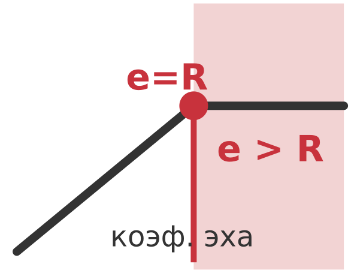

*Утилизация конвейера насыщается около порогового отношения; статистическая ценность остается зависящей от нагрузки.*

<a id="nbk-data-selection-worked-example-data-echoing-roi"></a>

> **Пример расчета: рентабельность эха данных**
>
> **Сценарий**: обучение ResNet-50 на ImageNet с сильной аугментацией (RandAugment + MixUp).
>
> **Измерения**:
>
> - Пропускная способность конвейера данных: 300 изображений/с (чтение, декодирование и аугментация на CPU)
> - Пропускная способность обучения на GPU: 800 изображений/с (прямой и обратный проход)
> - Отношение $R = T_{\text{конвейер}} / T_{\text{GPU}}$ = (1/300 изображений/с) / (1/800 изображений/с) = 800 изображений/с / 300 изображений/с ≈ 2,67 (GPU ждет 62,5 процента времени)
>
> **Без эха**:
>
> - Эффективная пропускная способность: 300 изображений/с (ограничена конвейером данных)
> - Время обучения на 90 эпох: $90 \times 1{,}28\text{ млн}$ / 300 изображений/с = 384 350 секунд (106,8 часа)
> - Утилизация GPU: 37,5 процента
>
> **С коэффициентом эха**: $e = 2$.
>
> - Каждый батч обрабатывается дважды с разными аугментациями
> - Эффективная пропускная способность: 600 изображений/с (все еще ниже мощности GPU)
> - Уникальных изображений в секунду: 300 (без изменений)
> - Время обучения: $90 \times 1{,}28\text{ млн}$ / 600 изображений/с = 192 175 секунд (53,4 часа), если повторно использованные данные столь же ценны
>
> **Компромисс**: повторные образцы не гарантированно так же полезны, как свежие; статья об эхе данных оценивает коэффициент эха, точку вставки и перемешивание, потому что эти выборы определяют, сохраняет ли повторное использование предсказательную эффективность. В одной конфигурации ResNet-50/ImageNet с подачей данных по сети Choi et al. (2019) сообщают о сокращении календарного времени до целевой метрики в 3,25 раза.
>
> **Системный вывод**: эхо данных может обменивать разнообразие образцов на утилизацию ускорителя, когда узкое место — входной конвейер. Полезный коэффициент эха нужно измерять для конкретной нагрузки, поскольку он зависит от размера батча, точки вставки, аугментации, перемешивания и целевой метрики.

Эхо может вносить корреляции, когда один и тот же пример встречается внутри близких батчей или между ними, поэтому реализации должны сохранять достаточное перемешивание и проверять целевую метрику. Choi et al. (2019) не наблюдали негативного взаимодействия с батч-нормализацией в экспериментах с ResNet-50 и Single Shot MultiBox Detector (SSD), однако этот результат не гарантирует такого же поведения для каждой нагрузки.

Эти шаблоны реализации определяют, дает ли отбор данных чистую системную пропускную способность. Отбор на основе прокси сокращает зондирующие вычисления, когда ранжирование оценок переносится на целевые архитектуры. Шардированные файловые форматы и буферы перемешивания согласуют псевдослучайное создание батчей с аппаратной последовательной потоковой передачей, а эхо данных возвращает простаивавшие такты ускорителя, когда пропускная способность ингеста ограничивает цикл обучения.

Однако операционная осуществимость не гарантирует экономической целесообразности. Инфраструктура дедупликации, которая стоит \$50 тыс. на разработку, но экономит лишь \$10 тыс. за всю кампанию обучения, дает чистый убыток. Внедрение техник отбора требует строгого финансового учета бюджетов на капитал, вычисления и человеческую разметку.

<a id="sec-data-selection-cost-modeling-9b02"></a>

## Модель стоимости

Систематическое моделирование стоимости определяет инвестиции в отбор данных. Инженерные команды сталкиваются с конкретными компромиссами распределения капитала: покупать ли еще 100 000 человеческих аннотаций или резервировать дополнительные кластеры GPU, когда конвейеры активного обучения достигают точки безубыточности и сколько запусков обучения нужно, чтобы амортизировать собственные инструменты кураторства.

<a id="sec-data-selection-quantifying-data-costs-roi-f0b4"></a>

### Количественная оценка стоимости данных и ROI

Полная стоимость обучающих данных складывается из получения, разметки, хранения и вычислений на ускорителе и выходит далеко за пределы счетов за объектное хранилище:

$$
C_{\text{total}} = C_{\text{acquire}} + C_{\text{label}} + C_{\text{store}} + C_{\text{process}}
$$

Разметка ($C_{\text{label}}$) — это расход, на который отбор данных нацелен наиболее прямо, тогда как хранение ($C_{\text{store}}$) и обработка ($C_{\text{process}}$) масштабируются механически с объемом сохраненных байтов и числом проходов ускорителя. [«Полная стоимость обучающих данных»](09_data_selection.md#tbl-cost-components) перечисляет эти четыре компонента вместе с их операционными драйверами.

| **Компонент**            | **Формула**                                                                  | **Иллюстративный диапазон**                    |
|:-------------------------|:----------------------------------------------------------------------------:|:----------------------------------------------|
| **$C_{\text{acquire}}$** | $D \times c_{\text{sample}}$                                                 | \$0,001–\$10 за образец (веб-сбор против лицензированного) |
| **$C_{\text{label}}$**   | $D_{\text{labeled}} \times c_{\text{label}}$                                 | \$0,01–\$200 за образец (краудсорсинг против эксперта) |
| **$C_{\text{store}}$**   | $D_{\text{vol,store}} \times c_{\text{storage}} \times T_{\text{months}}$   | \$0,02–\$0,10 за ГБ в месяц                    |
| **$C_{\text{process}}$** | $D \times N_{\text{epochs}} \times O_{\text{sample}} \times c_{\text{FLOP}}$ | Пропорционально FLOP обучения                  |

<a id="tbl-cost-components"></a>

***Полная стоимость обучающих данных**: четыре компонента стоимости охватывают весь жизненный цикл данных. Здесь $D$ — полное число образцов, $D_{\text{labeled}}$ — размеченное подмножество, $D_{\text{vol,store}}$ — объем сохраненных байтов, $T_{\text{months}}$ — время хранения, $N_{\text{epochs}}$ — число проходов обучения, а $O_{\text{sample}}$ — работа обучения на образец. Диапазоны служат ориентирами сценария, а не универсальными рыночными ценами.*

Взаимодействие этих четырех членов стоимости становится конкретным при оценке кампании обучения модели компьютерного зрения масштаба ImageNet.

<a id="nbk-data-selection-cost-breakdown-imagenet-scale-training"></a>

> **Пример: разбор стоимости обучения масштаба ImageNet**
>
> [«Иллюстративная разбивка стоимости масштаба ImageNet»](09_data_selection.md#tbl-data-selection-imagenet-cost-breakdown) разбирает один иллюстративный сценарий получения, разметки, хранения и вычислений в масштабе ImageNet. Итоговое соотношение следует из заданных предположений о лицензировании, аннотации, хранении, времени работы и стоимости вычислений; это не типичное соотношение для каждой контролируемой нагрузки.
>
> | **Компонент стоимости** | **Расчет** | **Сумма** |
> |:------------------------|:-----------|----------:|
> | **Исходные данные (1,2 млн изображений)** | Лицензированный набор данных, фиксированная плата | \$50 000 |
> | **Разметка (краудсорсинговая аннотация)** | 1,2 млн $\times$ \$0,05 за метку | \$60 000 |
> | **Хранение (облачное объектное хранилище)** | 150 ГБ $\times$ \$0,02 за ГБ в месяц $\times$ 12 месяцев | \$36 |
> | **Кампания обучения (30 запусков, каждый по 100 эпох за 24 ч на 8 A100)** | 5 760 GPU-часов $\times$ \$4 за GPU-час | \$23 040 |
> | **Итого** | | **\$133 076** |
> | **Соотношение данных и вычислений** | | 82,7% данные, 17,3% вычисления |
>
> <a id="tbl-data-selection-imagenet-cost-breakdown"></a>
>
> ***Иллюстративная разбивка стоимости масштаба ImageNet**: пункты стоимости получения, разметки, хранения и вычислений при заданных предположениях сценария. Каждая сумма следует из указанной рядом ставки по опубликованным в книге ставкам краудсорсинговой разметки, объектного хранилища и облачных GPU. Стоимость данных доминирует в этом расчете, потому что включены лицензирование и аннотация, а сама кампания обучения короткая.*
>
> **Системный вывод**: получение и разметка могут намного превышать стоимость вычислений в контролируемых нагрузках компьютерного зрения, как и в этих предположениях. Вычислительная цифра оценивает всю кампанию обучения, а не один запуск: опубликованная модель — это результат множества переборов, перезапусков и абляций, и расчет стоимости одного запуска занизил бы вычисления примерно в тридцать раз. Тем не менее получение и разметка остаются большей долей. Число запусков — такое же предположение, как и любое другое, поэтому полный расчет рентабельности должен его указывать и учитывать обе категории, а не предполагать, какая из них доминирует.

<a id="sec-data-selection-roi-framework-data-selection-techniques-dade"></a>

### Модель окупаемости техник отбора данных

Техники отбора данных вставляют алгоритмическую фильтрацию в конвейер обучения, чтобы снизить последующие расходы. Однако оценка важности примеров не бесплатна: оценка расходует такты ускорителя, создает трафик памяти между хостом и устройством или требует разработки специальных этапов конвейера. Оценить, экономически ли оправдана стратегия отбора, можно, сопоставив эти первоначальные накладные расходы с последующей экономией через рентабельность инвестиций (ROI):

$$
\text{ROI} = \frac{\text{Экономия} - \text{Инвестиции}}{\text{Инвестиции}} \times 100\%
$$

Соотношение между инвестициями и экономией различается у разных стратегий отбора. [«Профили ROI техник отбора данных»](09_data_selection.md#tbl-roi-profiles) показывает основные драйверы затрат и механизмы выгоды для четырех стандартных техник; их чистая отдача зависит от объема корпуса, масштаба модели и существующей инфраструктуры конвейера.

| **Техника**           | **Инвестиции (затраты)**                                | **Экономия (выгода)**                                        |
|:----------------------|:--------------------------------------------------------|:-------------------------------------------------------------|
| **Дедупликация**      | Разовые вычисления на хеширование + инфраструктура      | Меньше хранилища и обработки повторяющихся образцов          |
| **Отбор коресетов**   | Обучение прокси-модели + вычисления отбора              | Меньше сохраненных образцов, если сохраняются целевое качество и покрытие |
| **Активное обучение** | Вывод на неразмеченном пуле + задержка человека в контуре | Меньший спрос на разметку, если ранжирование запросов переносится |
| **Аугментация данных** | Такты CPU/GPU на преобразования                        | Рост эффективного размера набора данных без получения новых данных |

<a id="tbl-roi-profiles"></a>

***Профили ROI техник отбора данных**: таблица показывает затраты и возможную экономию. Ни одна техника не гарантирует положительного ROI; каждая должна удовлетворять неравенству отбора при измеренных условиях нагрузки.*

<a id="sec-data-selection-breakeven-analysis-9a38"></a>

### Анализ безубыточности

Алгоритмы отбора тратят вычисления и задержку конвейера, чтобы сократить последующую работу по разметке или обучению. **Точка безубыточности** отмечает рабочую границу, на которой финансовая экономия от пропущенных образцов в точности равна вычислительным и операционным накладным расходам на их отбор. Если оценка кандидатов требует много вычислений или пулы кандидатов огромны, политика отбора легко может израсходовать больше ресурсов, чем вернет.

Предположим, что разметка стоит \$10 за образец, активное обучение начинается с 1 000 размеченных образцов (\$10 000), выполняет 100 запросов за раунд при стоимости вывода \$50 за раунд, а базовая случайная разметка требует 5 000 образцов для целевой точности. Если активное обучение достигает целевой точности всего на 2 000 размеченных образцах, ROI получается сравнением стоимости разметки и вычислений:

\begin{gather*}
\text{Стоимость случайной разметки} = 5\,000 \times \$10 = \$50\,000
\\
\text{Стоимость активного обучения} = 2\,000 \times \$10 + 10 \times \$50 = \$20\,500
\\
\text{ROI} = \frac{\$50\,000 - \$20\,500}{\$20\,500} = 143{,}9\%
\end{gather*}

Безубыточность наступает, когда предотвращенные расходы на разметку равны накладным расходам отбора. Снижение разметки на 20 процентов все еще может дать отрицательный ROI, если оценка кандидатов и переобучение прокси-моделей требуют существенных часов работы ускорителей.

<a id="sec-data-selection-amortization-across-training-runs-f6b8"></a>

### Амортизация по запускам обучения

Статические техники отбора данных отделяют кураторство набора данных от цикла обучения модели. Вычислительные фильтры, такие как дедупликация MinHash, точное индексирование $n$-грамм или кластеризация эмбеддингов, требуют существенной первоначальной инженерной работы и вычислений на предобработку. Однако разработка промышленных моделей по своей природе итеративна: поиск гиперпараметров, поиск архитектуры нейронной сети, абляционные исследования и перебор затравок многократно обучаются на одном и том же отобранном корпусе. Оценка этих техник по одному изолированному запуску искажает их экономику. **Амортизированная рентабельность инвестиций (ROI)** учитывает, как первоначальные инвестиции в кураторство распределяются по всей кампании обучения:

$$
\text{Амортизированный ROI} = \frac{N_{\text{запусков}} \times \text{Экономия на запуск} - \text{Разовые инвестиции}}{\text{Разовые инвестиции}} \times 100\%
$$

[«Компоненты стоимости инфраструктуры дедупликации»](09_data_selection.md#tbl-dedup-costs) перечисляет первоначальные капитальные и вычислительные затраты в сопоставлении с экономией на запуск для иллюстративного конвейера дедупликации MinHash.

| **Компонент**                             | **Стоимость**                 |
|:------------------------------------------|------------------------------:|
| **Построение конвейера дедупликации**     | \$50 000 (инженерное время) |
| **Вычисление сигнатур MinHash (разово)**  | \$5 000                     |
| **Экономия на запуск**                    | \$10 000/запуск             |

<a id="tbl-dedup-costs"></a>

***Компоненты стоимости инфраструктуры дедупликации**: разовые инвестиции покрывают инженерные усилия и первоначальные вычисления; экономия на запуск возникает при каждом последующем запуске обучения на дедуплицированных данных.*

Поскольку первоначальные затраты на инфраструктуру и генерацию сигнатур фиксированы, каждый последующий запуск обучения увеличивает чистую финансовую отдачу. Три операционных фактора определяют, достигает ли инфраструктура кураторства безубыточности:

- **Повторные запуски обучения**: поиск гиперпараметров, итерации модели и плановое переобучение многократно используют одну и ту же инфраструктуру отбора.
- **Общие наборы данных**: очищенный или дедуплицированный корпус может обслуживать несколько команд или архитектур моделей.
- **Широко переиспользуемые техники**: такие методы, как дедупликация, переносятся между моделями, тогда как коресеты для конкретной задачи могут не перенестись.

[«Амортизированный ROI по нескольким запускам обучения»](09_data_selection.md#tbl-amortized-roi) показывает, как амортизированная отдача растет с числом запусков кампании при этих параметрах стоимости.

| **Число запусков** | **Амортизированный ROI**          |
|:-------------------|----------------------------------:|
| **1 запуск**       | −81,8% (чистый убыток)            |
| **5 запусков**     | −9,1% (близко к безубыточности)   |
| **10 запусков**    | +81,8% (положительный)          |
| **50 запусков**    | +809,1% (высокодоходный)        |

<a id="tbl-amortized-roi"></a>

***Амортизированный ROI по нескольким запускам обучения**: при этих стоимостях и экономии конвейер дедупликации, который теряет деньги при первом использовании, становится прибыльным при переиспользовании в достаточном числе запусков. Инвестиции в инфраструктуру стоит оценивать за ожидаемый срок службы, а не за одно использование.*

Дедупликация обладает высоким инвестиционным рычагом, потому что устранение избыточных последовательностей уменьшает объем хранилища на хосте и исключает потраченные впустую обновления градиентов для каждой последующей архитектуры. Напротив, методы отбора, основанные на градиентах прокси-модели или оценках неопределенности, плохо переносятся между разными архитектурами, поэтому окно их амортизации ограничено узкими переборами в фиксированном семействе моделей. Для исследовательских или разовых запусков обучения методы с низкими накладными расходами, такие как равномерная случайная выборка или базовая аугментация, дают лучший ROI, поскольку не требуют тяжелой инфраструктуры.

Стандартные модели стоимости предполагают централизованный конвейер данных, в котором один процесс хоста оценивает метрики важности по единому набору данных. Масштабирование до высокопроизводительного обучения на нескольких ускорителях разбивает наборы данных на шарды по независимым томам хранения и распределенным рангам воркеров, создавая узкие места связи и синхронизации, которые могут разрушить эту идеализированную экономику одного узла.

<a id="sec-data-selection-distributed-selection-d03e"></a>

## Распределенный отбор

Шардирование данных разрушает абстракцию одного процесса. В централизованном конвейере алгоритмы коресетов сортируют единое глобальное ранжирование, учебные планы задают единую последовательность, а циклы активного обучения оценивают общий пул кандидатов. Распределенное исполнение разносит хранилище по независимым узлам, вычисляет оценки на несинхронизированных контрольных точках модели и изолирует видимость данных для воркеров. Масштабирование отбора данных на кластеры вводит два физических ограничения: синтез представительных глобальных подмножеств из изолированных взглядов отдельных шардов и поддержание согласованных ранжирований примеров, когда состояния воркеров расходятся.

Остается ли распределенный отбор верным глобальному набору данных или вырождается в локальные эвристики шарда, зависит от того, сколько координации между воркерами требует каждая техника, относительно пропускной способности, которая для этого доступна. Поэтому задачу отбора нужно оценивать на границе, где статистическая ценность встречается с шардированием и локальностью.

Это независимые требования. Коресет может оставаться представительным, но стоить слишком дорого для координации, тогда как дешевый метод, работающий внутри шарда, может масштабироваться, но систематически пропускать редкие группы, видимые только во всем корпусе. Поэтому распределенный дизайн требует двух приемочных проверок: сравнить качество отобранных данных с централизованной или иначе проверяемой эталонной выборкой и сравнить накладные расходы отбора с временем сквозного обучения, которое он экономит. Прохождение только одной проверки недостаточно.

<a id="sec-data-selection-strategies-distributed-selection-6119"></a>

### Стратегии распределенного отбора

В базовой схеме параллелизма по данным каждый воркер обрабатывает свой шард, а синхронизация модели выполняется отдельно. Отбор данных может добавлять зависимости между шардами ([«Зависимости отбора в распределенном обучении»](09_data_selection.md#tbl-selection-dependencies)).

Зависимости отбора допускают несколько архитектурных решений, каждое из которых занимает свою точку на пространстве компромисса между согласованностью и масштабируемостью. Самый прямой подход централизует отбор, распределяя при этом обучение. Координирующий узел выполняет отбор по полному набору данных, а затем рассылает выбранные индексы воркерам. Это сохраняет качество отбора, но вводит единое узкое место:

```
Координатор: score_all_samples() → selected_indices
Рассылка: selected_indices → всем воркерам
Воркеры: обучение на subset(local_shard, selected_indices)
```

| **Техника**             | **Допущение для одного узла**   | **Проблема распределенного режима**          |
|:------------------------|:--------------------------------|:---------------------------------------------|
| **Отбор коресетов**     | Глобальный взгляд на набор данных | Каждый воркер видит только свой шард        |
| **Активное обучение**   | Централизованная оценка неопределенности | Оценка требует синхронизации модели  |
| **Учебный план**        | Глобальный порядок сложности    | У воркеров могут быть разные «самые трудные» примеры |
| **Дедупликация**        | Хеш-таблица помещается в памяти | Распределенные хеш-таблицы добавляют задержку |

<a id="tbl-selection-dependencies"></a>

***Зависимости отбора в распределенном обучении**: таблица исходит из общей централизованной постановки каждой техники и указывает проблему координации, которую вводит шардирование. Распределенные варианты могут ослаблять результат централизованной версии, а не воспроизводить его точно.*

Семантика остается чистой, но координатор становится единой точкой отказа и возможным узким местом пропускной способности. Приемлемы ли эти накладные расходы, зависит от объема полезной нагрузки отбора, частоты обновления, сетевого пути и размера кластера.

Иерархический отбор решает это ограничение масштабируемости, распределяя саму вычислительную работу отбора. Каждый воркер выполняет локальный отбор на своем шарде, а затем координатор объединяет результаты:

```
Воркеры: local_selected = select_top_k(local_shard)
Координатор: global_selected = merge_and_rerank(all local_selected)
Рассылка: final_indices → всем воркерам
```

Локальный отбор внутри шарда снижает нагрузку на координатора, но вносит компромисс по качеству: локальные квоты и распределения оценок могут не сохранить глобальное ранжирование или редкие группы, неравномерно распределенные по шардам. Поэтому на шаге слияния нужны нормализация, ограничения покрытия или второй глобальный проход.

Когда даже иерархические подходы оказываются слишком дорогими, запасным вариантом становится приближенный глобальный отбор. Эти методы обменивают точность на масштабируемость с помощью распределенных приближенных алгоритмов. Распределенный MinHash позволяет дедуплицировать, когда каждый воркер вычисляет сигнатуры MinHash независимо; затем сигнатуры агрегируются, чтобы найти почти дубликаты между шардами без того, чтобы какой-либо один узел видел все данные. Аналогично распределенная выборка по неопределенности позволяет воркерам вычислять локальные оценки неопределенности, а глобальный порог определяется статистикой распределения оценок, а не точным ранжированием.

<a id="sec-data-selection-consistency-challenges-active-learning-59c9"></a>

### Проблемы согласованности в активном обучении

Приближенные стратегии отбора предполагают статические критерии отбора, но активное обучение добавляет осложнение: модель меняется во время отбора. Рассмотрим, что происходит, когда воркер A оценивает образцы моделью на шаге $t$, а воркер B одновременно обновляет модель до шага $t+1$. Оценки воркера A теперь устарели и могут выбрать образцы, которые обновленная модель ранжировала бы иначе.

Расписание оценки, таким образом, определяет смысл запроса, а не только его стоимость. Воспроизводимая система версионирует вместе контрольную точку модели, снимок пула кандидатов, правило оценки и выбранные индексы. Затем она может измерить, насколько согласованность ранжирований убывает с возрастом контрольной точки, и выбрать интервал обновления по этим данным, а не по произвольному числу шагов.

Несколько стратегий смягчают проблему устаревания, каждая со своими накладными расходами:

- **Синхронная оценка**: все воркеры приостанавливают обучение и оценивают одновременно, что гарантирует согласованность, но существенно снижает утилизацию GPU.
- **Периодическое обновление оценок**: воркеры переоценивают каждые $k$ эпох, а не каждый батч, обменивая свежесть на сниженные накладные расходы.
- **Отбор, устойчивый к контрольным точкам**: система выбирает образцы, которые демонстрируют высокую неопределенность при нескольких контрольных точках модели, сохраняя валидность решений отбора по мере эволюции модели.

Иллюстративный сценарий кластера из 8 узлов с GPU показывает, как эти стратегии обновления взаимодействуют с пропускной способностью хранилища и вычислительной эффективностью.

<a id="exmp-data-selection-distributed-coreset-selection"></a>

> **Пример: распределенный отбор коресетов**
>
> **Сценарий**: кластер из 8 узлов A100 выбирает коресет в 10 процентов из ImageNet (1,3 млн изображений) на распределенных воркерах.
>
> **Диагностика**: централизованная оценка коресета на одном узле создает узкие места памяти и вычислений. Поэтапный распределенный конвейер (эмбеддинги внутри шарда → параллельная дедупликация → локальная оценка EL2N → централизованное слияние top-$k$) выполняет отбор набора данных за 67 минут.
>
> **Системный урок**: распределенный отбор коресетов может убрать ограничение памяти одного узла как предел оценки, как показано на [«Архитектуре распределенного отбора коресетов»](09_data_selection.md#fig-distributed-coreset-architecture). Шардирование эмбеддингов и оценки распределяет работу по кластеру, тогда как централизованное слияние остается стоимостью координации, которая должна удовлетворять неравенству отбора.

<a id="fig-distributed-coreset-architecture"></a>

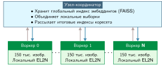

***Архитектура распределенного отбора коресетов**: параллельная оценка внутри шардов уменьшает работу, которая достается централизованному координатору слияния рангов. Воркеры передают локальные оценки EL2N наверх; координатор сливает их и рассылает итоговые индексы коресета. Такой дизайн выгоден, только если накладные расходы координации остаются меньше времени обучения, сэкономленного коресетом.*

Положительный ROI может быстро разрушиться, если воркеры часто координируются во время обучения. Распределенный отбор вводит налог на координацию, размер которого зависит от того, что синхронизируется и как часто. Этот налог должен оставаться меньше сэкономленного времени обучения; если он приближается к пределу, нужно упростить стратегию или увеличить интервал обновления.

Дополнительное ограничение возникает из топологии сети кластера. Синхронизация градиентов может использовать коллективные операции ускорителей по выделенным каналам, тогда как векторы эмбеддингов, массивы оценок и индексы коресетов могут идти по путям хоста или хранилища. Фактический маршрут зависит от архитектуры системы. Трафик отбора может поэтому выявить узкие места CPU, сетевого интерфейса, хранилища или коллективной сети, которые профиль одного только обучения не показывает.

Реальные системы ML одновременно сочетают отбор данных с эффективностью на уровне модели, пропускной способностью на уровне машины и распределенным обучением. Эти оптимизации взаимодействуют так, что могут усиливать или подрывать друг друга, и понимание этих взаимодействий необходимо для проектирования эффективных сквозных конвейеров.

<a id="sec-data-selection-crosslayer-interactions-1f39"></a>

## Межуровневые взаимодействия

В таксономии D·A·M (данные · алгоритм · машина) отбор данных работает по измерению данных, сокращая нагрузку обучения до начала вычислений. Однако время исполнения по железному закону ML-систем зависит от того, как сокращение входа меняет алгоритм (представления модели, ландшафт функции потерь и сжимаемость) и машину (пропускную способность памяти, арифметическую интенсивность ядер и межускорительные коммуникации). Эти межуровневые взаимодействия могут усиливать выигрыш по всему стеку или создавать неожиданные узкие места, которые обнуляют экономию выше по потоку. Системная эффективность требует совместного проектирования курирования данных вместе со сжатием модели и планированием аппаратуры, а не оптимизации каждого компонента в изоляции.

<a id="sec-data-selection-model-compression-9aef"></a>

### Эффективность на уровне модели

Эффективность на уровне модели уменьшает число параметров и арифметическую стоимость обученной модели с помощью таких приемов, как прореживание, представление с меньшей точностью и дистилляция. Состав обучающего корпуса формирует внутренние представления и тем самым определяет, насколько сеть поддается сжатию после обучения. Однако подсчет устраненных операций упускает то, как физические подложки исполнения реагируют на разреженные структуры ([«Ловушка задержки разреженности»](09_data_selection.md#psp-data-selection-sparsity-latency-trap)). Архитектурные основы сжатия моделей и аппаратного ускорения подробно рассмотрены в главах [«Сжатие моделей»](10_model_compression.md) и [«Аппаратное ускорение»](11_hw_acceleration.md).

<a id="psp-data-selection-sparsity-latency-trap"></a>

> **Ловушка задержки разреженности**
>
> **Контекст**: преимущество сжимаемости от отбора данных считают в арифметических операциях, но исследования сжатия моделей показывают, что прореживание уменьшает эти счетчики легче, чем сокращает измеренную по часам задержку.
>
> **Режим отказа**: FLOP могут резко снизиться, тогда как задержка вывода остается прежней или растет. Аппаратура плотного матричного умножения выигрывает от регулярной раскладки и повторного использования, а разреженные матрицы требуют нерегулярного доступа к памяти, проверок метаданных и скачков адресов. Пока шаблон разреженности не соответствует подложке исполнения, накладные расходы на управление разреженностью могут перевесить сокращение арифметики.
>
> **Системный вывод**: FLOP — это *не* задержка. Сокращение операций на 99 процентов может дать 0 процентов сокращения времени, если оставшиеся операции ограничены памятью или неэффективны для кэша. Оптимизацию нужно направлять на связывающее узкое место аппаратуры, а не только на абстрактную метрику (Hoefler et al., 2021).

Это взаимодействие отбора данных и сжатия модели восходит к тому, как сети кодируют представления в ходе обучения. Модель, обученная на повторяющихся данных, часто распределяет емкость между избыточными признаками, которые последующее прореживание отбрасывает, теряя вычисления, затраченные на их выучивание. И наоборот, модель, обученная на отобранном корпусе информативных и разнообразных примеров, часто с самого начала получает более компактные представления. Такая начальная эффективность может упростить последующее прореживание или квантование, однако это остается эмпирической гипотезой, которую нужно измерить, а не инвариантным свойством любого отобранного набора данных. Отбор данных и сжатие модели — взаимодополняющие рычаги в таксономии D·A·M; их взаимодействие нужно оценивать совместно, измеряя сквозную задержку обслуживания и качество на задаче, а не предполагая, что сокращение набора данных на входе автоматически гарантирует сжимаемость на выходе.

<a id="sec-data-selection-hardware-acceleration-cf40"></a>

### Пропускная способность на уровне машины

Если эффективность на уровне модели определяет вычислительную работу, оставшуюся после обучения, то пропускная способность на уровне машины определяет, насколько эффективно аппаратура исполняет сам цикл обучения. По железному закону ML-систем время обучения зависит от того, ограничено ли исполнение передачей входных данных ($D_{\text{vol}}/\text{BW}$), арифметическим исполнением ($O/(R_{\text{peak}} \cdot \eta_{\text{hw}})$) или задержкой планирования ($L_{\text{lat}}$). Прореживание образцов сокращает общее число операций с плавающей точкой, но неравномерная выборка и динамическая фильтрация меняют шаблоны доступа загрузчика данных и открывают новые аппаратные пределы. Таблица [«Диагностика узких мест после отбора данных»](09_data_selection.md#tbl-bottleneck-shifts) показывает, как стратегии отбора сдвигают доминирующее системное узкое место.

| **Наблюдаемое условие**                 | **Возможное узкое место**      | **Вероятный ответ**                       |
|:----------------------------------------|:-------------------------------|:------------------------------------------|
| **Входная скорость ниже потребности ускорителя** | Хранилище, декодирование или канал хоста | Шардирование, предвыборка, параллельное декодирование |
| **Ядра обучения с низкой интенсивностью** | Пропускная способность памяти ускорителя | Слияние, снижение трафика, более низкая точность |
| **Динамическая оценка доминирует в итерации** | Вычисления отбора или ввод-вывод индекса | Прокси-модели, кэшированные оценки или эмбеддинги |

<a id="tbl-bottleneck-shifts"></a>

***Диагностика узких мест после отбора данных**: изменения набора данных и шаблонов доступа могут выявить другое узкое место, но один лишь размер набора данных не определяет лимитирующий ресурс. Заново профилируйте конвейер и сопоставьте ответ с измеренным условием.*

Поэтому отбор данных может сместить режим исполнения аппаратуры. Техника, которая сокращает число образцов на 80 процентов, может снять нагрузку на вычисления тензорных ядер, но открыть задержку случайного доступа к хранилищу, пропускную способность PCIe от хоста к устройству или накладные расходы оценки как новый критический путь. Чтобы устранить это последующее узкое место, инженерный ответ должен соответствовать активному ограничению: кэшировать оценки отбора, объединять операции, ограниченные памятью, или заранее размещать непрерывные шарды в памяти хоста до передачи ускорителю. Прежде чем применять агрессивное сокращение данных, инженеры должны профилировать весь конвейер и проверить, какое узкое место действительно связывает исполнение.

<a id="sec-data-selection-distributed-training-9266"></a>

### Распределенное обучение

Анализ узких мест аппаратуры в разделе [«Пропускная способность на уровне машины»](09_data_selection.md#sec-data-selection-hardware-acceleration-cf40) сосредоточен на исполнении на одном ускорителе. При масштабировании на обучение на нескольких ускорителях, например на одном узле с двумя–восемью устройствами, отбор данных меняет и объем коммуникаций, и синхронизацию памяти.

При параллелизме по данным между ускорителями каждое устройство вычисляет прямой и обратный проходы на локальном микробатче, а затем синхронизирует градиенты параметров коллективной операцией all-reduce. При фиксированных размере батча на устройство и числе эпох прореживание обучающего корпуса сокращает общее число обновлений параметров за запуск, напрямую устраняя раунды коллективной коммуникации по соединениям PCIe или NVLink. Кроме того, меньшие шарды на воркер могут увеличивать долю набора данных, которая помещается в локальную оперативную память хоста или кэш ускорителя, сокращая повторную потоковую передачу из хранилища.

Эту экономию на коммуникациях нужно сопоставить с накладными расходами на координацию, разобранными в разделе [«Распределенный отбор»](09_data_selection.md#sec-data-selection-distributed-selection-d03e). Синхронизация градиентов использует выделенные высокоскоростные соединения, тогда как динамическая оценка образцов и обмен индексами часто идут через память хоста и потоки диспетчеризации CPU. Политика отбора, которая эффективно масштабируется на одном ускорителе, может создать узкие места сериализации или несбалансированную нагрузку шардов при разделении на восемь параллельных воркеров, останавливая устройства на барьерах синхронизации и съедая вычислительное время, сэкономленное прореживанием.

<a id="sec-data-selection-optimization-stack-ba66"></a>

### Стек оптимизации

Попарные взаимодействия выявляют локальные узкие места, но промышленные развертывания выполняют эти оптимизации как интегрированный конвейер. Как показано на схеме полного стека оптимизации ([«Стек оптимизации»](09_data_selection.md#fig-optimization-stack)), каждый этап от приема данных до исполнения на аппаратуре усиливает или ослабляет последующую эффективность.

<a id="fig-optimization-stack"></a>

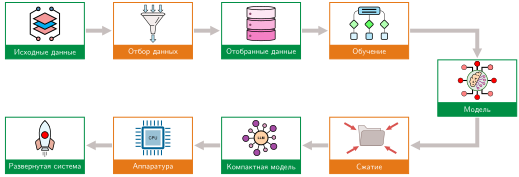

***Стек оптимизации**: артефакты данных проходят через отбор и обучение, прежде чем получившаяся модель попадает в сжатие и развертывание. Изменения на входе распространяют эффекты качества и стоимости вниз по потоку, но сокращение обучающих данных не упрощает модель и аппаратуру развертывания автоматически.*

Конвейер на [«Стеке оптимизации»](09_data_selection.md#fig-optimization-stack) показывает, почему отбор данных занимает стратегическое положение в голове стека оптимизации. При фиксированном графике обучения сокращение объема данных вдвое может вдвое сократить работу обучения на уровне образцов. Однако прореживание набора данных само по себе не уменьшает объем параметров, не улучшает запас для квантования и не ослабляет ограничения задержки обслуживания. Каждый следующий уровень наследует и вычислительную экономию, и любые представительные дефициты, созданные выше по потоку: агрессивный фильтр, который отбрасывает редкие, но критичные пограничные случаи, может заставить инженеров ниже по потоку дольше обучать модель или отказаться от агрессивного квантования, чтобы сохранить точность на задаче.

Чтобы количественно оценить эти совокупные компромиссы, нужно определить, переводится ли номинальное сокращение числа образцов в настоящую сквозную эффективность и не ухудшает ли оно обобщение незаметно. Ответ на этот вопрос требует дисциплинированной системы измерений: количественных метрик, которые балансируют арифметическую экономию, накладные расходы на перемещение данных и эмпирическое качество на задаче по всему конвейеру.

<a id="sec-data-selection-measurement-framework-733b"></a>

## Система измерений

Стек межуровневых взаимодействий делает систему измерений неизбежной: каждая техника отбора данных заявляет о повышении эффективности, но только строгие измерения отделяют реальную экономию от перенесенных затрат или скрытой потери качества. Ключевые метрики в разделе [«Основные метрики»](09_data_selection.md#sec-data-selection-core-metrics-32e9) связывают сокращение образцов с точностью, стоимостью и покрытием развертывания, так что меньший набор данных оценивается по тому, что он сохраняет, а не только по тому, что он удаляет.

<a id="sec-data-selection-core-metrics-32e9"></a>

### Основные метрики

Основные метрики связывают сокращение образцов с качеством модели, а не сообщают только точность. Они измеряют прирост точности на образец (производительность на данные), совокупную эффективность обучения по масштабам набора данных (площадь под кривой обучения) и сокращение набора данных при целевой точности (коэффициент сжатия данных).

#### Производительность на данные

Самая прямая метрика, **производительность на данные (PPD)**, измеряет прирост точности на образец:

$$
\text{PPD}(n) = \frac{\text{Точность}(n) - \text{Точность}(0)}{n}
$$

где $n$ — число обучающих образцов. Более высокое значение PPD означает больший средний прирост на образец на заданном интервале. Его форму нужно измерять, поскольку убывающая отдача и момент ее начала зависят от нагрузки.

#### Площадь под кривой обучения

Вместо сравнения в одной точке **площадь под кривой обучения** (AULC) интегрирует качество по всем размерам набора данных:

$$
\text{AULC} = \int_0^D \text{Точность}(n) \, dn
$$

где $n$ — размер набора данных, а $D$ — полный размер набора данных.

Для одной и той же метрики и диапазона интегрирования более высокий AULC означает, что стратегия достигает более сильного качества на меньшем числе образцов. Сравнения должны использовать один и тот же верхний предел $D$ или нормировать интеграл.

#### Коэффициент сжатия данных

Для методов коресетов **коэффициент сжатия данных** (DCR) измеряет, какое сокращение данных достигается при целевой точности:

$$
\text{DCR} = \frac{D_{\text{полный}}}{D_{\text{коресет}}} \text{ при } \text{Точность}_{\text{цель}}
$$

DCR, равный 5, означает, что коресет достигает целевой точности на 20 процентах данных.

<a id="sec-data-selection-computeoptimal-frontier-24ba"></a>

### Граница, оптимальная по вычислениям

Хотя основные метрики в разделе [«Основные метрики»](09_data_selection.md#sec-data-selection-core-metrics-32e9) измеряют отдельные техники, также нужна диагностика более высокого уровня, которая проверяет, ограничена ли общая стратегия обучения данными или вычислениями. Эксперименты с законами масштабирования нейронных сетей (Kaplan et al., 2020; Hoffmann et al., 2022) подбирают степенные зависимости для конкретных семейств моделей, наборов данных и диапазонов вычислений. Контролируемые серии запусков могут использовать эти подобранные зависимости, чтобы сравнивать распределение моделей и данных, но ни одно отдельное соотношение не диагностирует каждый запуск обучения.

Исследование Chinchilla[^fn-chinchilla-scaling-law] (Hoffmann et al., 2022) подобрало оптимальный по вычислениям баланс между размером модели и обучающими данными в пределах своего экспериментального режима. Распределения по обе стороны от подобранного баланса использовали бюджет вычислений исследования менее эффективно.

[^fn-chinchilla-scaling-law]: **Chinchilla**: Chinchilla — языковая модель с 70 миллиардами параметров, обученная на 1,4 трлн токенов. В экспериментах, описанных в (Hoffmann et al., 2022), она превзошла более крупную GPT-3 на большинстве оцененных задач при сопоставимом бюджете вычислений обучения. Подобранное оптимальное по вычислениям распределение масштабировало параметры и токены примерно с одинаковой скоростью в экспериментальном режиме исследования; это не универсальное предписание для каждой архитектуры, набора данных или рецепта обучения.

Оптимальный баланс задает **границу, оптимальную по вычислениям**: наилучшее достижимое качество при каждом бюджете вычислений, когда данные и размер модели сбалансированы надлежащим образом. [«Иллюстративная граница, оптимальная по вычислениям»](09_data_selection.md#fig-compute-optimal-frontier) показывает эту диагностику как концептуальную границу, а не подобранный результат Chinchilla.

<a id="fig-compute-optimal-frontier"></a>

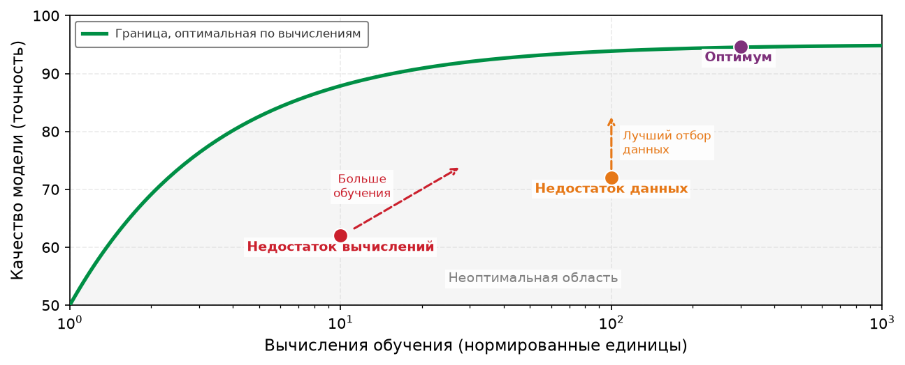

***Иллюстративная граница, оптимальная по вычислениям**: зеленая кривая — концептуальная граница по нормированным вычислениям, а не подобранный результат Chinchilla. Точки ниже нее иллюстрируют распределения, которые контролируемая серия перебора размера модели и числа токенов может определить как ограниченные данными или вычислениями.*

Относительно границы, подобранной по контролируемым сериям, положение точки может подсказать следующий эксперимент. Распределение, ограниченное данными, мотивирует проверку качества корпуса, покрытия или отбора; распределение, ограниченное вычислениями, — проверку эффективной пропускной способности, длительности или размера модели. Концептуальные точки на рисунке [«Иллюстративная граница, оптимальная по вычислениям»](09_data_selection.md#fig-compute-optimal-frontier) сами по себе не диагностируют реальный запуск, а точки вблизи подобранной границы остаются специфичными для семейства моделей, данных, целевой функции и диапазона вычислений, по которым ее оценили.

#### Интерпретация результата Chinchilla

В подобранном режиме Chinchilla оптимальные по вычислениям параметры модели и обучающие токены росли примерно с одинаковой скоростью.[^fn-chinchilla-token-ratio] В частности, обучение плотного трансформера требует около $6ND$ FLOP ($2ND$ на прямой проход и $4ND$ на обратный проход с пересчетом активаций, где $N$ — число параметров, а $D$ — число токенов). При режиме равного масштабирования, когда параметры и токены растут пропорционально ($N \propto D$), общие вычисления растут квадратично ($C \approx 6 D^2$), что напрямую означает: оптимальное число токенов масштабируется как корень из бюджета вычислений ($D_{\text{opt}} \propto \sqrt{C}$). Удвоение вычислений поэтому соответствует примерно $\sqrt{2} - 1$, или 41,4 процента, дополнительных токенов при этих предположениях. Часто приводимые 20 токенов на параметр — полезный ориентир из этого исследования, а не универсальный оптимум.

[^fn-chinchilla-token-ratio]: **Токены на параметр**: отношение $D/P$ сравнивает обучающие токены с параметрами модели; GPT-3 использовала примерно 1,7 токена на параметр (Brown et al., 2020), а Llama 2 70B — примерно 28,6 (Touvron et al., 2023). Эти описательные отношения не устанавливают, был ли какой-либо из запусков оптимальным по вычислениям при другой архитектуре, корпусе, целевой функции или бюджете аппаратуры. Для такой диагностики нужны контролируемые серии перебора размера модели и числа токенов.

#### Применение диагностики

Если обучение работает хуже ожиданий, продление одного запуска может показать, еще ли помогают дополнительные шаги оптимизации, но плато само по себе не указывает на голодание по данным. Графики скорости обучения, ограничения оптимизации, емкость модели и качество данных могут все вместе дать плато. Надежная диагностика сравнивает контролируемые запуски, которые варьируют размер модели, число токенов и распределение вычислений при фиксированном протоколе оценки.

На графике [«Иллюстративная убывающая отдача данных»](09_data_selection.md#fig-ppd-curve) две кривые расходятся: стратегия эффективного отбора данных (синяя) достигает плато качества на меньшем числе образцов, чем случайная выборка (серая). Горизонтальный разрыв отражает это сокращение числа образцов и может переходить в экономию вычислений, если работа на образец и график обучения остаются фиксированными; вертикальный разрыв, отмеченный красной стрелкой, представляет прирост качества при фиксированном размере набора данных.

<a id="fig-ppd-curve"></a>

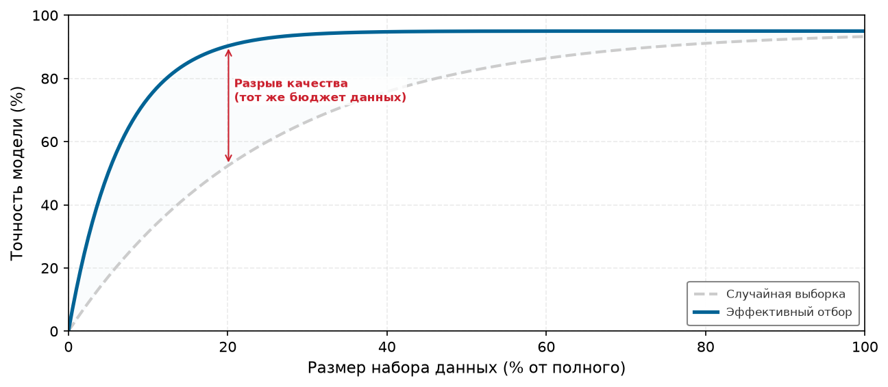

***Иллюстративная убывающая отдача данных**: синтетическая кривая эффективного отбора (синяя) достигает того же плато на меньшем числе образцов, чем случайная выборка (серая). Вертикальная красная стрелка отмечает модельный разрыв в качестве при фиксированном размере набора данных; измеренные кривые не обязаны иметь такую форму.*

Эти метрики оценки определяют точку перехода, в которой неизбирательный сбор данных уступает место целенаправленному кураторству, и показывают, когда предельные образцы тратят вычисления обучения впустую, а не улучшают обобщение. Однако алгоритмическая эффективность не гарантирует, что сокращенный набор данных сохранит качество модели на эксплуатационных пограничных случаях.

Техники отбора данных неявно ранжируют ценность образцов, и проверка того, что отобранный набор сохраняет качество модели, требует систематического бенчмаркинга по трем измерениям. Метрики покрытия подтверждают, что отбор коресетов сохранил представительность по классам и демографическим группам. Метрики согласованности распределений (такие как дивергенция KL и индекс стабильности популяции, которые определены в разделе [«Измерение дрейфа (расхождение)»](appendix_data.md#sec-appdx-data-foundations-measuring-drift-divergence-a6dd) приложения «Основы данных») выявляют, не сдвинулся ли отобранный обучающий набор относительно распределения развертывания. Метрики качества меток (согласованность между аннотаторами, уверенное обучение) подтверждают, что активное обучение не внесло систематических ошибок разметки. Сокращение набора данных на 50 процентов ценно лишь тогда, когда бенчмаркинг подтверждает, что модель сохраняет целевую точность, калибровку и устойчивость. Глава [«Бенчмаркинг»](12_benchmarking.md#sec-benchmarking) позднее обобщает эти идеи в более широкие протоколы оценки модели и данных; здесь мысль уже: отобранный набор данных нужно проверять по распределению задачи, а не по одному только коэффициенту сокращения.

Сама целевая метрика валидации может быть ненадежной. Точность на бенчмарке может завышать обобщение, когда тестовые наборы не отражают сдвигов распределения в эксплуатации, поэтому оценочные бенчмарки требуют такой же строгости, как и отобранные обучающие наборы.

<a id="exmp-data-selection-benchmark-replication-gap"></a>

> **Пример: разрыв воспроизведения бенчмарка**
>
> **Сценарий**: классификаторы, оцененные на заново собранных тестовых наборах, потеряли от 3 до 15 процентных пунктов точности на CIFAR-10 и от 11 до 14 пунктов на ImageNet (Recht et al., 2019).
>
> **Диагностика**: воспроизведенная выборка дала немного более сложные изображения, чем исходные тестовые наборы. Исследование показало, что адаптивность бенчмарка не объясняет разрыв, хотя многократное использование одного и того же тестового набора остается общим риском оценки.
>
> **Системный урок**: построение оценочного набора влияет на измеренное обобщение. Конвейеры отбора данных должны проверять отобранные подмножества на независимо собранных тестовых наборах, релевантных развертыванию, а не доверять одному бенчмарку, который использовался очень долго.

Выигрыш в эффективности, измеренный по одному бенчмарку, может исчезнуть при сдвиге распределения; отобранное подмножество должно демонстрировать стабильное качество на нескольких отложенных распределениях, прежде чем ему можно доверять заявленный коэффициент сокращения.

<a id="lhs-data-selection-lighthouse-data-selection"></a>

> **Отбор данных для маячных моделей**
>
> Принципы отбора данных применимы ко всем пяти маячным моделям, хотя доминирующее ограничение определяет технику. [«Приоритеты отбора данных по маячным моделям»](09_data_selection.md#tbl-data-selection-lighthouse-priorities) сопоставляет каждую нагрузку с приоритетом: например, ResNet-50, ограниченная вычислениями, выигрывает от отбора коресетов, GPT-2/Llama, ограниченная памятью, — от дедупликации, а крошечная модель KWS — от аугментации и синтеза.
>
> | **Маячная модель**   | **Основное узкое место** | **Приоритет отбора данных**                                                      |
> |:---------------------|:-----------------------|:---------------------------------------------------------------------------------|
> | **ResNet-50**        | Вычисления             | Отбор коресетов напрямую сокращает FLOP обучения                                 |
> | **GPT-2/Llama**      | Пропускная способность памяти | Дедупликация уменьшает размер корпуса; учебный план повышает эффективность токенов |
> | **MobileNetV2**      | Задержка/энергопотребление | Проверить аугментацию на целевой модели и инвариантностях развертывания          |
> | **DLRM**             | Емкость памяти         | Дедупликация взаимодействий и прореживание эмбеддингов уменьшают размер таблиц   |
> | **Распознавание ключевых слов (KWS)** | Экстремальные ограничения | Аугментация и синтез создают наборы данных из минимальных исходных образцов |
>
> <a id="tbl-data-selection-lighthouse-priorities"></a>
>
> ***Приоритеты отбора данных по маячным моделям**: основное узкое место и кандидатный приоритет отбора данных для каждой нагрузки. Такое сопоставление задает гипотезу для проверки; одного доминирующего ресурсного ограничения недостаточно, чтобы гарантировать окупаемость техники.*
>
> Для всех этих нагрузок отбор данных работает как системная оптимизация, настроенная на снятие того физического ресурса, который связывает конвейер.

На всем стеке оптимизации строгие метрики отделяют подлинную экономию вычислений от отложенного вычислительного долга. Стратегия отбора успешна, только если экономия на последующем обучении и обслуживании при целевом качестве превышает арифметические и пересылочные накладные расходы на оценку, фильтрацию и подготовку образцов.

<a id="sec-data-selection-fallacies-pitfalls-f4d0"></a>

## Заблуждения и ловушки

Отбор данных связан с контринтуитивной убывающей отдачей, которая противоречит интуиции «больше — лучше» из традиционного машинного обучения. Ошибки ниже делятся на три группы: концептуальные заблуждения о том, чего может достичь отбор данных, ловушки реализации, возникающие, когда правильные стратегии сталкиваются с инженерной реальностью, и ошибки переноса, возникающие, когда результаты бенчмарков применяются к новым доменам без критической проверки.

> **Заблуждение и ловушка**
>
> **Заблуждение:** *Данные — новая нефть, поэтому больше всегда лучше.*
>
> Больше данных не означает пропорционального роста точности, потому что кривые обучения демонстрируют убывающую отдачу по степенному закону. Функция потерь на тесте убывает сублинейно с объемом выборки ($L(N) \propto N^{-\alpha}$), то есть каждое следующее снижение ошибки требует экспоненциально большего корпуса. В сценарии, описанном в [«Асимметрия масштабирования ресурсов ML»](09_data_selection.md#tbl-scaling-asymmetry), увеличение набора данных в десять раз с 1 млн до 10 млн образцов дает всего 4 процентных пункта прироста точности. В системных терминах такое расширение в 10 раз требует десятикратного роста ввода-вывода хранилища, передач от хоста к устройству и FLOP ускорителей, тратя огромную энергию кластера на обработку избыточных примеров с малым градиентом, которые почти не добавляют информации к обновлению параметров. Команды должны измерять эмпирическую кривую обучения и предельную стоимость вычислений для своей конкретной нагрузки, а не предполагать, что масштабирование неотобранных данных даст пропорциональную ценность.

> **Заблуждение и ловушка**
>
> **Ловушка:** *Замена валидации на реальных данных обучением только на синтетике.*
>
> Инженеры часто полагают, что генеративные модели могут заменить эмпирический сбор данных неисчерпаемыми синтетическими образцами при нулевой предельной стоимости получения. Обучение только на синтетике терпит неудачу по двум основным режимам. Во-первых, как разобрано в [«Преодоление доменного разрыва»](09_data_selection.md#sec-data-selection-bridging-domain-gap-100b) и [«Соотношения смешивания синтетических и реальных данных»](09_data_selection.md#tbl-synthetic-mix), генеративные распределения страдают доменным разрывом: синтетические данные могут расходиться с физическим многообразием развертывания, смещая выученную границу решений на [«Проблеме доменного разрыва»](09_data_selection.md#fig-domain-gap) и вызывая катастрофические ошибки классификации на реальных входах. Во-вторых, рекурсивное обучение на данных, сгенерированных моделью, запускает коллапс модели (Shumailov et al., 2024). Как показывает диаграмма ниже, подача синтетических выходов обратно в последующие циклы обучения постепенно размывает хвосты распределения: в этом сценарии точность на оценке падает с 95 процентов до 78 процентов за пять рекурсивных поколений, то есть коллапс составляет 17 процентных пунктов. Хотя синтетическая аугментация дает полезное покрытие в иллюстративной смеси 50–80 процентов, синтетические смеси всегда нужно проверять и привязывать к отобранным реальным распределениям.

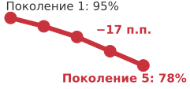

*Рекурсивное обучение на синтетических данных снижает точность от поколения к поколению.*

> **Заблуждение и ловушка**
>
> **Заблуждение:** *Отбор данных — это просто очистка данных.*
>
> Инженеры часто смешивают качество данных (исправление неверных схем, поврежденных меток и шумных токенов) с ценностью данных для конкретной процедуры обучения. Набор данных может быть полностью чистым, корректно размеченным и грамматически безупречным, но при этом математически избыточным: если модель уже минимизировала потери на кластере признаков, обработка дополнительных одинаковых образцов дает нулевой сигнал градиента, сжигая пропускную способность памяти и FLOP ускорителя. Очистка данных устраняет внутренние дефекты данных, тогда как отбор данных активно максимизирует отдачу обучения на потраченный FLOP. Как показывают граница неопределенности на [«Иллюстративном отборе на основе неопределенности»](09_data_selection.md#fig-coreset-selection) и геометрические цели в разделе [«Алгоритмы отбора коресетов»](09_data_selection.md#sec-data-selection-coreset-selection-algorithms-2c74), нацеливание на информативные пограничные примеры повышает ICR: в нашем разобранном сценарии коресета ICR выше в 1,8 раза. Очистка гарантирует правильность данных; отбор оптимизирует эффективность вычислений обучения.

> **Заблуждение и ловушка**
>
> **Ловушка:** *Рассмотрение отбора данных только как тактики для ограниченного бюджета.*
>
> Практики часто видят в отборе данных технику для развертываний с ограниченными ресурсами на периферии или для команд с ограниченным бюджетом и предполагают, что передовые фундаментальные модели могут просто достичь сходимости грубой силой, наращивая кластер. На самом деле крупномасштабное обучение фундаментально ограничено стеной данных ([«Рост наборов данных у предела»](09_data_selection.md#fig-running-out-of-human-data)), где доступная емкость ускорителей опережает поставки доступных качественных релевантных человеческих данных. Кроме того, экономическая отдача от отбора растет вместе с расходами кластера: прирост эффективности в 10 процентов на граничном обучении стоимостью \$100 млн при наших базовых предположениях экономит \$10 млн. Когда инфраструктура отбора, предвычисленные оценки важности и кэшированные эмбеддинги амортизируются по повторным запускам обучения и последующим адаптациям ([«Амортизация по запускам обучения»](09_data_selection.md#sec-data-selection-amortization-across-training-runs-f6b8)), интеллектуальная фильтрация становится фундаментальным экономическим рычагом крупномасштабных инженерных систем.

> **Заблуждение и ловушка**
>
> **Заблуждение:** *Накладные расходы отбора слишком малы, чтобы менять экономику обучения.*
>
> Стратегия отбора данных жизнеспособна, только если вычислительная стоимость оценки и фильтрации строго меньше вычислений обучения, которые она экономит. Как формализовано неравенством отбора в [«Неравенстве отбора»](09_data_selection.md#eq-selection-inequality), сквозная жизнеспособность требует $T_{\text{selection}} + T_{\text{train}}(\text{subset}) < T_{\text{train}}(\text{full})$. Рассмотрим базовый запуск обучения, который требует 8 часов, при этом обучение на оптимизированном коресете занимает 2 часа. Если сложный алгоритм отбора требует 10 часов на вычисление важности образцов, сам этап отбора потребляет в 5 раз больше времени, чем ускоренное обучение, и превышает базовое обучение на полном наборе, создавая чистый дефицит вычислений. Чтобы выполнить [«неравенство отбора»](09_data_selection.md#eq-selection-inequality), производственные конвейеры отделяют оценку от основной модели, используя кэшированные эмбеддинги или легкие прокси-сети. В нашем иллюстративном сравнении оценка EL2N на основе прокси завершается за 30 минут, всего 6,2 процента от базового обучения на полном наборе, выполняя неравенство и давая ощутимую экономию по календарному времени.

> **Заблуждение и ловушка**
>
> **Ловушка:** *Прореживание редких классов до полного исчезновения.*
>
> Стандартные целевые функции отбора минимизируют совокупные эмпирические потери, давая хвостовым срезам минимальное влияние на глобальные вероятности выборки. В наборе из 1 млн примеров, где редкие классы составляют 0,1 процента данных (1 000 примеров), нестратифицированный коресет в 10 процентов в среднем сохраняет лишь 100 примеров редких классов, что заметно ниже порога в 150 образцов, необходимого для выучивания устойчивых представлений признаков. Хотя **выборка с важностью** теоретически может компенсировать это, взвешивая вклад потерь обратными вероятностями отбора, экстремальные веса выборки раздувают дисперсию градиента. Эта дисперсия дестабилизирует траектории импульса оптимизатора и вынуждает брать меньшие скорости обучения, замедляя сходимость кластера. Как рекомендовано в разделе [«Алгоритмы отбора коресетов»](09_data_selection.md#sec-data-selection-coreset-selection-algorithms-2c74), промышленные конвейеры коресетов должны задавать жесткие нижние границы стратификации для каждого класса или критичного для развертывания среза до оптимизации оставшегося бюджета отбора.

> **Заблуждение и ловушка**
>
> **Заблуждение:** *Дедупликации обучающих данных достаточно, чтобы оценка была надежной.*
>
> Инженеры часто полагают, что устранение дубликатов последовательностей внутри обучающей части предотвращает запоминание и обеспечивает чистую оценку. Однако конвейеры приема в веб-масштабе собирают обучающие, валидационные и тестовые бенчмарки из общих веб-обходов, что вносит незаметную перекрестную утечку между частями. Когда оценочные наборы содержат дубликаты или почти дубликаты обучающих документов, метрики валидации измеряют запоминание, а не обобщение на данных вне распределения. Масштабное исследование дедупликации показало, что пересечение обучающих и тестовых данных затрагивает более 4 процентов валидационных примеров в стандартных бенчмарках языкового моделирования (Lee et al., 2022). Дедупликация обучающих данных в изоляции оставляет эту загрязненность оценки нетронутой. Строгая гигиена конвейера требует дедупликации между частями с помощью сопоставления $n$-грамм или MinHash LSH ([«Дедупликация данных»](09_data_selection.md#sec-data-selection-data-deduplication-6c20)), с калибровкой порогов сходства почти дубликатов, чтобы удалить утекшие последовательности во всех частях одновременно.

> **Заблуждение и ловушка**
>
> **Ловушка:** *Активное обучение без учета задержки разметки.*
>
> Теоретические постановки активного обучения предполагают оракула с нулевой задержкой, который мгновенно размечает запрошенные образцы, позволяя модели включить новые градиенты до выбора следующей партии запросов. В промышленных системах очереди человеческой разметки вносят существенные задержки, часто иллюстративные 14 дней между отправкой образца и возвратом метки. Эта задержка ломает цикл обратной связи активного обучения двумя способами. Если кластеры ускорителей останавливают обучение в ожидании меток, дорогое оборудование простаивает, разрушая утилизацию вычислительных ресурсов кластера. И наоборот, если обучение продолжается асинхронно на фоновых данных, пока аннотации ожидают, веса модели дрейфуют через шаги обучения; к моменту прихода меток оценки неопределенности, которые обосновывали запрос этих образцов, устаревают. Кроме того, отправка огромных партий для амортизации времени разметки создает информационную избыточность внутри партии запросов, если не применяются штрафы за разнообразие. Отдача от вложений в активное обучение ограничена не только ценой меток, но и отношением задержки аннотации к циклу переобучения модели.

> **Заблуждение и ловушка**
>
> **Заблуждение:** *Если техника работает на ImageNet, она сработает и на моем наборе данных.*
>
> Коэффициенты прореживания, выведенные из стандартных бенчмарков зрения, нельзя слепо переносить на специфичные для домена нагрузки. Наборы вроде CIFAR-10 и ImageNet обладают высокой семантической избыточностью среди канонических классов объектов, что допускает агрессивное прореживание коресетов (часто на 30–50 процентов) без измеримой деградации точности. Напротив, специализированные домены, такие как гистопатология, спутниковое дистанционное зондирование или обнаружение дефектов в промышленности, имеют тяжелохвостые распределения признаков, где критичные для безопасности паттерны появляются лишь в нескольких редких примерах. Отбрасывание 50 процентов примеров по эвристике ImageNet может устранить единственные пограничные примеры, которые отделяют тонкие патологии, и вызвать катастрофическую деградацию в домене. Кроме того, геометрические алгоритмы коресетов опираются на пространства эмбеддингов: если экстрактор признаков предобучен на естественных изображениях, его представления не содержат индуктивного смещения, нужного для различения тонких доменных отличий. Инженерные команды должны измерять избыточность собственных данных, оценивать представления на целевых последующих задачах и проверять доли сохранения на критичных для безопасности срезах до применения прореживания.

> **Заблуждение и ловушка**
>
> **Ловушка:** *Оптимизация метрик отбора вместо метрик развертывания.*
>
> Алгоритмы отбора оптимизируют суррогатные математические цели, такие как общее снижение потерь, площадь под кривой обучения (AULC) или производительность на данные (PPD, [«Основные метрики»](09_data_selection.md#sec-data-selection-core-metrics-32e9)), вычисленные как агрегированный скаляр по корпусу валидации. Политика отбора, сохраняющая коресет в 10 процентов, может достичь превосходного агрегированного PPD, отдавая предпочтение плотным кластерам распространенных легких образцов, которые ускоряют среднюю сходимость, и отбрасывая неоднозначные пограничные случаи и редкие срезы. В промышленной эксплуатации, однако, отказы системы происходят на хвостовых срезах, пограничных случаях и защищаемых подгруппах, а не на средних значениях набора данных. Максимизация агрегированной эффективности отбора без ограничений по подгруппам дает модели, которые проходят глобальные валидационные ворота, но катастрофически отказывают при развертывании. Как предписывает система измерений в [«Система измерений»](09_data_selection.md#sec-data-selection-measurement-framework-733b), политики отбора нужно оценивать стратифицированными бенчмарками по срезам, которые обеспечивают покрытие демографических групп, редких категорий и эксплуатационных пограничных случаев, даже если это немного снижает средний PPD.

<a id="sec-data-selection-summary-cf3e"></a>

## Итоги

Отбор данных рассматривает объем обучения как инженерную переменную, а не как неизменное ограничение. Там, где традиционное машинное обучение спрашивает, сколько примеров нужно для достижения целевой точности, системная инженерия оптимизирует полную стоимость по вычислениям, хранилищу, разметке, энергии и календарного времени. Отобранные наборы данных могут не уступать огромным неотобранным корпусам или превосходить их, потому что предельный сигнал обучения у сырых примеров различается на порядки. В порядке оптимизации отбор решает первый вопрос: устранение ненужной работы до начала обучения модели.

Этот системный подход становится практичным благодаря трем количественным инструментам: ICR, неравенству отбора и модели полной стоимости данных. Отношение информации к вычислениям измеряет обучение, полученное на единицу FLOP, и показывает, оправдывает ли пример свой проход обучения. Неравенство отбора требует, чтобы вычислительные и временные накладные расходы на оценку кандидатов оставались строго меньше времени обучения, сэкономленного на сохраненном подмножестве. Вместе с анализом окупаемости и безубыточности эти формулировки определяют, экономит ли предложенный механизм отбора ресурсы или лишь переносит расходы между этапами.

Трехэтапный конвейер оптимизации решает разные фазы этого уравнения стоимости: статическое прореживание убирает избыточность до обучения с помощью отбора коресетов и дедупликации; динамический отбор выделяет информативные примеры во время обучения с помощью учебного плана и активного обучения; а синтетическая генерация создает данные там, где их не было, с помощью аугментации, симуляции и дистилляции. Вместе эти стратегии отвечают на «стену данных», то есть структурную асимметрию между быстро растущими вычислительными мощностями и медленно растущими качественными данными.

Самоконтролируемое обучение представляет крайнюю точку спектра отбора данных. Предобучение переносит основную часть обучения представлений в неаннотированную восходящую фазу, позволяя последующим задачам достигать целевого качества с гораздо меньшим числом специфичных для задачи меток. Эта первоначальная инвестиция становится экономически убедительной, когда стоимость предобучения амортизируется по десяткам или сотням специализированных адаптаций.

Перевод этих стратегий отбора в промышленную эксплуатацию требует решения конкретных системных узких мест. Неравенство отбора в [«неравенстве отбора»](09_data_selection.md#eq-selection-inequality) контролирует каждую технику: любой проход оценки, превышающий календарное время, сэкономленное при обучении, дает чистый убыток. Прокси-модели и загрузчики на основе шардов согласуют динамический отбор с пропускной способностью последовательного хранилища, не давая случайному доступу к образцам останавливать исполнение на ускорителе. Когда входные конвейеры остаются узким местом пропускной способности, эхо данных переиспользует батчи, чтобы вернуть простаивающие такты GPU. Наконец, диагностические метрики (производительность на данные (PPD), площадь под кривой обучения (AULC) и коэффициент сжатия данных (DCR)) показывают, ограничена ли модель данными или вычислениями, и направляют инвестиции в связывающий ресурс.

> **Отбирать, а не накапливать**
>
> * **Отбор оптимизирует стоимость системы**: цель — минимизировать полную стоимость по вычислениям, хранилищу, разметке и энергии, а не только число образцов. Отношение информации к вычислениям выражает этот компромисс как полученное обучение на потраченный FLOP и переходит в ускорение по календарному времени только в условиях, ограниченных вычислениями.
> * **Начинайте с дедупликации**: точная дедупликация часто является самой безопасной первой техникой, поскольку удаляет повторяющиеся байты без обученного прохода оценки. Почти дубликаты и семантическую дедупликацию применяйте только после проверки порогов по метрикам качества на последующих задачах.
> * **Неравенство отбора регулирует каждую технику**: экономия на последующем обучении должна строго превышать накладные расходы отбора: $T_{\text{selection}} + T_{\text{train}}(\text{subset}) < T_{\text{train}}(\text{full})$. Легкие прокси-модели и кэшированные эмбеддинги удерживают $T_{\text{selection}}$ низким, тогда как неоптимизированные алгоритмы отбора могут съесть всю экономию.
> * **Динамический отбор адаптирует рацион данных**: учебный план меняет порядок предъявления, а активное обучение — какие образцы получают метки. Каждый из них повышает эффективность, когда проверены его правило оценки, покрытие и накладные расходы на обновление.
> * **Самоконтролируемое предобучение может амортизировать стоимость адаптации**: предобучение один раз и дообучение многократно распределяет стоимость предобучения по последующим задачам. Сценарий предполагает снижение меток в 100 раз и снижение предельных вычислений в 20 раз; реальная экономия зависит от качества переноса и повторного использования.
> * **Синтетические данные — дополнение, а не замена**: смесь 50–80 процентов синтетики иллюстративна и зависит от нагрузки, а не является универсальным оптимумом. Чисто синтетическое обучение рискует коллапсом модели и деградацией из-за доменного разрыва.
> * **Проверенное сокращение работы накапливает эффект ниже по потоку**: когда отбор безопасно устраняет примеры или токены без компенсирующих шагов, эта работа никогда не доходит до последующих оптимизаций модели или машины. Динамическая оценка и синтез добавляют собственные издержки, поэтому совокупную экономию нужно измерять, а не предполагать.

Определяющий инвариант отбора данных состоит в том, что обучающие примеры дают крайне неравный предельный сигнал обучения на переданный байт и выполненный FLOP. В таксономии D·A·M отбор работает в голове системы: каждый безопасно устраненный избыточный образец или неинформативный токен напрямую сокращает и объем данных ($D_{\text{vol}}$), и число операций ($O$) в железном законе ML-систем (принцип [«Железный закон систем машинного обучения»](part_build.md#pri-iron-law)). Это сокращение на входе навсегда убирает работу до начала последующего алгоритмического сжатия или аппаратного ускорения, при условии что накладные расходы отбора строго ограничены неравенством отбора.

> **От данных к алгоритмам**
>
> Отбор данных меняет то, *чему* учится система; даже лучшие данные не сделают неэффективную модель быстрой на ограниченном оборудовании. Фокус переносится на то, *как* система представляет усвоенное: Глава [«Сжатие моделей»](10_model_compression.md) рассматривает прореживание, квантование и дистилляцию знаний, снижающие вычислительную стоимость самого артефакта модели.
