<a id="sec-model-compression"></a>

# Сжатие моделей


## Назначение

_Почему модели, которые побеждают в бенчмарках, редко становятся моделями, которые работают в продакшене?_

Обучение дало способную модель, но сама по себе способность не гарантирует, что ее можно развернуть. Облако, периферийные устройства, мобильные телефоны и TinyML накладывают ограничения, которые исследовательские бенчмарки не учитывают: бюджеты памяти, измеряемые в мегабайтах, а не в гигабайтах, целевые задержки, измеряемые в миллисекундах, а не в секундах, и энергетические бюджеты, измеряемые в милливаттах, а не в киловаттах. Исследования оптимизируют точность на отложенных тестовых наборах; продакшен оптимизирует точность на доллар, точность на ватт и точность на миллисекунду. Модели, которые побеждают в бенчмарках, часто крупнее, медленнее и более требовательны к ресурсам, чем позволяют производственные ограничения. Чтобы преодолеть этот разрыв, нужна систематическая дисциплина сжатия, которая жертвует возможностями, не нужными развертыванию, ради ограничений, которые нельзя нарушить. Многие обученные модели содержат больше разрядов, связей или емкости, чем требует среда развертывания, и часть этого избытка можно убрать, сохранив нужное поведение. Однако меньшее представление не обязательно работает быстрее. Аппаратный и программный стек должен использовать новую числовую точность или структуру; иначе номинальное сокращение лишь переносит узкое место, а задержка остается прежней. При грамотном применении сжатие может существенно уменьшить размер модели и превратить исследовательский артефакт, который работает только в дата-центре, в продуктовый актив для телефона, датчика или микроконтроллера. Дисциплина состоит не просто в том, чтобы делать модели меньше, а в том, чтобы сделать возможными нужные модели для их физической среды. В терминах D·A·M сжатие реализует совместное проектирование алгоритма и машины на уровне самой модели: оно перестраивает ее математическую структуру под физические ограничения машины.

> **Цели обучения**
>
> - Объяснять сжатие как совместное проектирование алгоритма и машины, которое обменивает избыточную емкость на ограничения по памяти, задержке и энергии
> - Сравнивать прореживание, дистилляцию, квантование и поиск архитектуры по ограничению ресурса, которое каждый из них ослабляет
> - Вычислять снижение объема памяти параметров, разрядности и разреженности, чтобы оценить наилучший достижимый выигрыш от сжатия
> - Применять стратегии посттренировочного квантования, квантования с учетом обучения и квантования только весов при ограничениях по точности и аппаратуре
> - Выбирать структурное прореживание и операторы, которые соответствуют доступным ядрам ускорителя
> - Проектировать конвейеры сжатия, которые упорядочивают прореживание, дистилляцию и квантование так, чтобы сохранить точность при развертывании
> - Оценивать измеренные задержку, энергию и точность на целевой аппаратуре, а не полагаться на подсчет FLOP

<a id="sec-model-compression-optimization-framework-9e21"></a>

## Рамка оптимизации

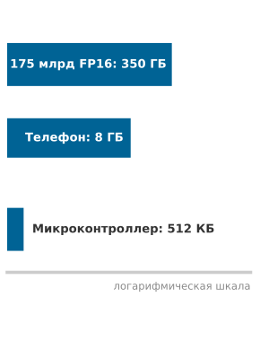

*Веса крупнейших моделей намного превышают память телефона и микроконтроллера; сжатие преодолевает этот разрыв.*

Языковой модели с 7 миллиардами параметров нужно 14 ГБ только для хранения весов в FP16. Целевое устройство — смартфон с 8 ГБ ОЗУ, которые делят операционная система, фоновые приложения и пользовательский интерфейс. Даже если бы операционная система отдала под один процесс весь пул памяти, 14 ГБ превышают физическую емкость устройства. Кроме того, авторегрессивная генерация токенов ограничена пропускной способностью памяти: для каждого сгенерированного токена нужно прочитать из DRAM в регистры процессора все параметры. По мобильной шине LPDDR с пропускной способностью около 50 ГБ/с чтение 14 ГБ занимает почти 300 мс на токен и потребляет несколько джоулей, быстро разряжая батарею и нарушая устойчивый тепловой режим устройства в 3–5 Вт. Это физическое несоответствие между размером модели и возможностями периферийного оборудования определяет основную инженерную задачу сжатия моделей.

Согласно принципу [«Кремниевый контракт»](part_build.md#pri-silicon-contract), каждая модель машинного обучения заключает со своим оборудованием физическую сделку по производительности: пропускная способность вычислений, пропускная способность памяти, емкость памяти и фиксированные накладные расходы на запуск определяют, какой физический ресурс упрется в предел первым. На этапе обучения сделка заключается на повышение: кластеры ускорителей серверного класса дают совокупную память и вычислительную мощность с плавающей точкой, нужные для широких слоев, высокой числовой точности и большого вспомогательного состояния. Обучение должно хранить градиенты, буферы моментов оптимизатора и кэши активаций между проходами назад. Развертывание для вывода меняет эти требования полностью: выполнение идет только вперед, промежуточные активации можно сразу перезаписывать, а состояния оптимизатора исчезают. Смешанная точность улучшает пропускную способность обучения, выборочно используя FP16 или BF16 ([«Обучение в смешанной точности»](08_training.md#sec-model-training-mixedprecision-training-9218)), тогда как развертывание позволяет снизить точность еще дальше, до INT8, INT4 или специализированных микроформатов, если их поддерживают целевые вычислительные блоки. В терминах D·A·M обучение совместно проектирует данные и алгоритм, чтобы максимизировать представительную емкость, а сжатие совместно проектирует алгоритм и машину, перестраивая математическую структуру под физические пределы аппаратуры развертывания. **Сжатие модели** — это систематический процесс пересмотра кремниевого контракта для ограниченной среды выполнения: он уменьшает объем параметров, трафик памяти или число арифметических операций, сохраняя точность решения задачи.

Физическое различие между средами развертывания охватывает шесть порядков величины: крупнейшая модель с 175 миллиардами параметров занимает более 350 ГБ только в представлении FP16, тогда как встроенный микроконтроллер располагает лишь 512 КБ встроенной SRAM. Чтобы преодолеть этот разрыв, нужна инженерная рамка с предсказуемыми физическими компромиссами. Каждый метод сжатия удаляет из модели определенную структуру: лишние веса, избыточные числовые биты или дублирующие подграфы операторов. Проектирование продуктового развертывания требует выявить, какой ресурс упрется в предел первым на целевой платформе, и понять, как последовательные приближения накапливаются по иерархии памяти.

Сжатие действует вдоль трех взаимодополняющих измерений. Структурная оптимизация убирает избыточность из самого графа модели: **прореживание** исключает параметры с малым влиянием, дистилляция знаний переносит поведение в меньшую архитектуру, а поиск нейронной архитектуры находит конструкции, настроенные под заданную цель. Оптимизация точности снижает разрядность весов и активаций; например, преобразование FP32 в INT8 уменьшает число байтов на значение в четыре раза. Поддерживаемые матричные блоки низкой точности также могут ускорять арифметику. Оптимизация на уровне оборудования отображает преобразованный граф на целевой процессор через слияние операторов и аппаратно поддерживаемую разреженность. Эти измерения образуют стек оптимизации: структурные изменения меняют, какие операции существуют, изменение точности меняет число байтов на значение, а отображение на аппаратуру определяет, станут ли теоретические выигрыши поддерживаемыми путями выполнения. В сверточных сетях слияние пакетной нормализации с предшествующими весами полностью устраняет отдельные обращения к памяти и арифметику на этапе вывода. Выгоды суммируются, только если преобразования снимают разные связывающие узкие места и среда выполнения поддерживает получившийся граф. Раздел [«Тензорные ядра»](11_hw_acceleration.md#sec-hardware-acceleration-tensor-cores-771f) главы [«Аппаратное ускорение»](11_hw_acceleration.md) объясняет механизмы ускорителей, которые стоят за путями выполнения с низкой точностью.

Конкретные бенчмарк-нагрузки иллюстрируют эти компромиссы в разных режимах работы: ResNet-50 и MobileNetV2 (маячные модели из [«Состав маячных моделей: биографии моделей»](06_nn_architectures.md#sec-network-architectures-lighthouse-roster-model-biographies-a763)) для задач зрения, трансформерные языковые модели для авторегрессивных последовательностей, DLRM для емкости памяти рекомендательных систем (Naumov et al., 2019) и сверточные сети с раздельной по глубине сверткой (DS-CNN) для распознавания ключевых слов в TinyML (Zhang et al., 2017). Каждая нагрузка нагружает свой член железного закона: от таблиц эмбеддингов, которые доминируют по параметрам, до матричных умножений, требующих много вычислений. Оценка сжатия на этих эталонных нагрузках показывает, как снижение числа параметров и разрядности переходит в реальную экономию задержки и энергии при одинаковых условиях выполнения.

<a id="dfn-model-compression-model-compression"></a>

> **Сжатие модели**
>
> ***Сжатие модели*** — это семейство методов, которые снижают вычислительную стоимость и объем памяти обученной модели за счет удаления избыточных параметров (прореживание), снижения числовой точности (квантование) или переноса выученного поведения в меньшую архитектуру (дистилляция), сохраняя по возможности предсказательную точность.
>
> 1.  **Значение**: сжатие напрямую уменьшает члены железного закона, отвечающие за перемещение данных и вычисления. INT8-квантование 175-миллиардной LLM уменьшает память весов с 350 ГБ (FP16) до 175 ГБ, то есть в 2 раза уменьшает $D_{\text{vol}}$, а выделенные матричные блоки низкой точности могут повысить пропускную способность вычислений, если ядра и раскладка данных используют поддерживаемый путь INT8. Неструктурированное прореживание до 50 процентов разреженности уменьшает число ненулевых элементов вдвое, но число выполняемых операций падает только тогда, когда среда выполнения может пропускать нули через поддерживаемый разреженный формат или ядро.
> 2.  **Отличие**: в отличие от методов посттренировочного сжатия, таких как прореживание и квантование, поиск нейронной архитектуры находит эффективные архитектуры с нуля, исследуя пространство проектирования. Здесь NAS рассматривается как родственный метод структурной оптимизации: он меняет представление до обучения, а не сжимает готовую модель постфактум.
> 3.  **Типичная ошибка**: методы сжатия не складываются без взаимных помех. Прореживание меняет распределения весов и профили операций; квантование добавляет ограничения калибровки и ядер. Их комбинация может потерять точность или не дать ускорения без совместной проверки.

Эти три измерения оптимизации образуют нисходящую иерархию абстракций от алгоритмической формулировки к физическому кремнию. Сначала оптимизация определяет, какие операции выполняет модель (представление), затем сколько битов кодирует каждый операнд (числовой формат), и наконец, как выполнение распределяется по структурам памяти и функциональным блокам ускорителя (реализация). [«Стек оптимизации»](10_model_compression.md#fig-3-sections) показывает эту последовательность от программного представления к выполнению на аппаратуре.

<a id="fig-3-sections"></a>

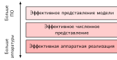

***Стек оптимизации**: оптимизация модели идет от представления программного уровня (прореживание, дистилляция, NAS) через числовую точность (квантование) к выполнению на аппаратуре (слияние ядер, движки разреженности). Чем ниже уровень абстракции, тем ближе оптимизации к физическому кремнию, где решения о представлении определяют достижимую эффективность выполнения.*

Верхний слой, эффективное представление модели, устраняет структурную избыточность внутри вычислительного графа. Такие методы, как прореживание, дистилляция знаний и поиск нейронной архитектуры (NAS)[^fn-nas-search-cost], напрямую меняют число параметров и топологию операторов. Прореживание удаляет веса или целые каналы, вклад которых в точность модели пренебрежимо мал. Дистилляция знаний обучает компактную модель-ученика воспроизводить выходные распределения или промежуточные представления переобученного учителя. NAS с учетом аппаратуры автоматизирует этот поиск: он оценивает кандидатные топологии слоев, коэффициенты расширения и размеры ядер, чтобы найти графы, Парето-оптимальные при явных ограничениях на задержку или память.

[^fn-nas-search-cost]: **Нейронный поиск архитектуры (NAS)**: (Zoph and Le, 2016) в Google Brain использовали обучение с подкреплением, чтобы выучить саму архитектуру, при стоимости 22 400 GPU-дней (800 GPU в течение 28 дней), что эквивалентно 537 600 GPU-часам. Подходы с разделением весов, такие как эффективный поиск нейронной архитектуры (ENAS), позже сократили стоимость поиска примерно в 1 000 раз, разделяя параметры между кандидатными архитектурами (Pham et al., 2018). Аппаратно-ориентированный NAS и методы масштабирования затем сделали результаты поиска практичными для развертываемых семейств архитектур, таких как EfficientNet и MobileNetV3 (Tan and Le, 2019; Howard et al., 2019).

Средний слой, эффективное представление числовой точности, оптимизирует разрядность, которой кодируется каждое значение тензора. **Квантование** отображает непрерывные значения с плавающей точкой высокой точности на низкоразрядные представления, например 8-битные или 4-битные целые, уменьшая объем весов и трафик шины DRAM ($D_{\text{vol}}$) в два–четыре раза. Помимо сокращения памяти, целочисленная арифметика снимает вычислительные узкие места: матричные блоки низкой точности выполняют целочисленные операции умножения с накоплением, требуя во много раз меньше площади кристалла и энергии, чем 32-битные ALU с плавающей точкой, и обеспечивают более высокую пиковую пропускную способность в том же тепловом режиме.

Нижний слой, эффективная аппаратная реализация, согласует оставшиеся операции с физической архитектурой ускорителя. Меньшее число операций не гарантирует более быстрого выполнения, если перемещение данных останавливает вычислительные ядра или несогласованные обращения к памяти сериализуют каналы DRAM. Слияние операторов объединяет соседние слои, например свертку, добавление смещения и функцию активации, в одно ядро, удерживая промежуточные активации в быстрой встроенной SRAM или регистрах, а не гоняя их туда и обратно через внешнюю DRAM с высокой задержкой. Аналогично, аппаратно поддерживаемые движки разреженности, например структурированные разреженные тензорные ядра 2:4, дают физическое ускорение, только если ненулевые элементы соответствуют ограничениям выравнивания и выборки конвейера выполнения.

Эти три слоя жестко связаны на границе компиляции и выполнения. Прореживание меняет распределения весов и профили активаций, а значит, и динамические диапазоны, которые нужны для последующей калибровки квантования. Квантование уменьшает объем перемещаемых данных по шине памяти и переводит ранее ограниченную памятью нагрузку к режиму, ограниченному вычислениями, где решают слияние ядер и планирование блоков. Чтобы получить совокупный прирост производительности, преобразования нужно согласовывать между всеми тремя слоями, а не применять изолированно; эта стратегия композиции формализована в разделе [«Схема принятия решений»](10_model_compression.md#sec-model-compression-decision-framework-0d69).

Какой слой стека оптимизации дает наибольшую отдачу, полностью зависит от физической машины, на которой работает нагрузка. Сервер дата-центра с несколькими ускорителями высокой пропускной способности памяти переносит модели в несколько гигабайт, но требует высокой пропускной способности токенов при параллельной работе. Смартфон или встроенный микроконтроллер работают при жестких физических ограничениях на емкость памяти, пропускную способность шины и тепловыделение на уровне милливатт. Определить границы оборудования на каждом физическом уровне и выяснить, какой ресурс упирается в предел первым в каждой среде, — необходимая отправная точка любой стратегии сжатия.

<a id="sec-model-compression-deployment-context-0d88"></a>

## Контекст развертывания

Серверный GPU с 80 ГБ памяти с высокой пропускной способностью (HBM) сталкивается с принципиально иными ограничениями, чем смартфон с общей оперативной памятью или микроконтроллер с несколькими сотнями килобайт SRAM. Физические цели развертывания определяют, какой ресурс упрется в предел первым ([«Ограничения развертывания»](10_model_compression.md#tbl-deployment-scenarios)).

| **Контекст**    |      **Память**      |                            **Задержка**                            | **Мощность** | **Основная цель** |
|:----------------|:--------------------:|:------------------------------------------------------------------:|:----------|:-----------------|
| **Облако**      |      десятки ГБ      |    100–500 мс    | Гибкая    | Пропускная способность, стоимость |
| **Мобильные/периферийные** | от сотен МБ до ГБ | 5–100 мс | Ватты     | Размер, задержка    |
| **TinyML**      |        КБ–МБ         |    1–10 мс     | мВт       | Размер, энергия     |

<a id="tbl-deployment-scenarios"></a>

***Ограничения развертывания**: каждый контекст развертывания задает собственные приоритеты оптимизации.*

<a id="sec-model-compression-deployment-scenarios-70c9"></a>

### Сценарии развертывания

Вывод в облаке ориентирован на пропускную способность (запросов в секунду на доллар): поддерживаемые целочисленные пути квантования повышают плотность обслуживания, а слияние операторов снижает накладные расходы на запуск ядер для каждого запроса (Choudhary et al., 2020; Dean et al., 2018). Мобильные и периферийные развертывания должны уложиться в жесткие физические границы памяти и одновременно выполнять детерминированные сроки реального времени. Камерный конвейер, обрабатывающий 30 кадров в секунду, имеет бюджет задержки 33 мс на кадр; превышение этого бюджета приводит к пропуску кадров и нарушает гарантии реального времени.

TinyML делает сжатие абсолютным требованием развертывания. Микроконтроллер с несколькими сотнями килобайт SRAM *не может* запустить модель в 100 МБ, какой бы ни была ее предсказательная точность (Banbury et al., 2020). Без виртуальной памяти и аппаратной подкачки веса модели и пиковые буферы активаций должны целиком помещаться в физической SRAM; если рабочий набор превышает физическую емкость, программа немедленно падает с ошибкой нехватки памяти.

Физические пределы памяти ограничивали глубокое обучение с самого его начала. AlexNet, модель, победившая в конкурсе ImageNet 2012 года, столкнулась со стеной памяти при обучении, и ее архитектура фиксирует возникшее решение о разделении на два GPU.

<a id="exmp-model-compression-alexnet-2012"></a>

> **Разделение AlexNet на два GPU (2012)**
>
> **Контекст**: в 2012 году Алекс Крижевский, Илья Суцкевер и Джеффри Хинтон хотели обучить модель зрения с 60 миллионами параметров на ImageNet (Krizhevsky et al., 2012).
>
> **Механизм**: GPU NVIDIA GTX 580 предоставлял всего 3 ГБ памяти GDDR5 — этого недостаточно, чтобы хранить 240 МБ весов модели вместе с активациями FP32 ($M_{\text{act}}$) и состояниями оптимизатора ($M_{\text{state}}$) для обучения на одном GPU.
>
> **Последствия**: модель вообще нельзя было обучить на одном устройстве, поэтому потолок памяти проник в саму архитектуру сети, а не остался проблемой закупки оборудования.
>
> **Решение**: они разделили модель на два GPU GTX 580 по 3 ГБ и ограничили связи между GPU так, чтобы рабочий набор помещался в границы памяти каждого устройства ($M_{\text{peak}} \le 3\text{ ГБ}$). Получившаяся архитектура из двух «башен» достигла победной ошибки top-5 в 15,3 процента, с отрывом в 10,8 процентного пункта.
>
> **Системный урок**: физические границы памяти ограничивали глубокое обучение с самого его начала. Стратегии развертывания (прореживание, квантование) решают те же физические ограничения, которые в AlexNet вынудили разбить модель на части.

Те же ограничения памяти, которые определили архитектуру обучения AlexNet, определяют, возможно ли развернуть модель на обычном мобильном оборудовании.

<a id="exmp-model-compression-mobilenet-win"></a>

> **Иллюстративный выигрыш MobileNet**
>
> **Сценарий**: развертывание модели сегментации видео для размытия фона в реальном времени на среднебюджетных смартфонах Android при 30 кадрах в секунду.
>
> **Диагностика**: несжатая модель MobileNetV3 в FP32 выдает лишь 8 кадров в секунду, что превышает задержку устройства и тепловые лимиты питания. Квантование весов в INT8 позволяет выполнять целочисленные матричные операции на NPU/DSP мобильного устройства.
>
> **Системный урок**: здесь INT8 уменьшает сырой объем параметров в 4 раза, а поддерживаемый целочисленный путь поднимает вывод с 8 до 35 кадров в секунду. Скорость и энергопотребление все равно нужно измерять на самом устройстве.

<a id="sec-model-compression-balancing-tradeoffs-6ae3"></a>

### Баланс компромиссов

[«Разрыв развертывания»](10_model_compression.md#tbl-model-vs-device) количественно описывает этот разрыв развертывания для маячных моделей из [«Состав маячных моделей: биографии моделей»](06_nn_architectures.md#sec-network-architectures-lighthouse-roster-model-biographies-a763). Даже MobileNetV2 в INT8 превышает память TinyML-устройства примерно в 6,7 раза, что показывает, как физические границы памяти ограничивают жизнеспособность модели:

| **Модель**             |               **Память весов при выполнении**          |              **Хранение весов в артефакте**           | **Облако (~107 ГБ)** |   **Мобильное (8 ГБ)**   |      **TinyML (~512 КБ)**       |
|:-----------------------|:------------------------------------------------------:|:------------------------------------------------------:|:-------------------------------------------------------------:|:-------------------------------------------------------------------:|:------------------------------------------------------------------------:|
| **DLRM**               |      100 ГБ      |      100 ГБ      |                               да                              | нет (11,6×) |    нет (190 734,9×)     |
| **GPT-2 XL**           |      6 ГБ      |      6 ГБ      |                               да                              |                                  да                                 |    нет (11 444,1×)     |
| **ResNet-50**          |     102,4 МБ     |     102,4 МБ     |                               да                              |                                  да                                 |   нет (195,3×)    |
| **MobileNetV2**        |   14 МБ    |   14 МБ    |                               да                              |                                  да                                 |  нет (26,7×)  |
| **MobileNetV2 (INT8)** | 3,5 МБ | 3,5 МБ |                               да                              |                                  да                                 | нет (6,7×) |
| **DS-CNN (KWS, INT8)** |     200 КБ      |     200 КБ      |                               да                              |                                  да                                 |                                    да                                    |

<a id="tbl-model-vs-device"></a>

***Разрыв развертывания**: требования к весам моделей в сравнении с типичной емкостью устройств. DLRM иллюстрирует нагрузку рекомендательных моделей на эмбеддинги (Naumov et al., 2019); DS-CNN иллюстрирует случай распознавания ключевых слов в TinyML (Zhang et al., 2017). Даже MobileNetV2, квантованная до INT8, превышает бюджет TinyML в ~512 КБ в 6,7 раза, тогда как специально построенный распознаватель ключевых слов DS-CNN после квантования до INT8 помещается. В этом подсчете, учитывающем только веса, память весов при выполнении равна объему весов в артефакте; накладные расходы на активации, рабочие буферы, упаковку и метаданные не учтены. Числа в скобках показывают, во сколько раз модель превышает память устройства.*

Этот разрыв делает неизбежным **компромисс между точностью и эффективностью**. Увеличение емкости модели в целом повышает предсказательную точность, но требует больших объемов весов, расширенного рабочего набора активаций и более высокой пропускной способности памяти при выводе. На оборудовании со строгими ограничениями по памяти или энергии эти требования заставляют выбирать точку на границе Парето.

<a id="psp-model-compression-compression-accuracy-tradeoff-curve"></a>

> **Кривая компромисса между сжатием и точностью**
>
> Граница не однородна: техники, сохраняющие структуру, находятся близко к верхней части и обменивают малую потерю точности или ее отсутствие на реальное ускорение, тогда как агрессивная структурная хирургия находится внизу, где каждый дополнительный выигрыш берет все более крутую плату в точности.
>
> Инженерное решение состоит в том, где остановиться. Сжатие должно прекращаться у «колена» кривой — точки, в которой предельная потеря точности впервые превышает предельный выигрыш эффективности. За этим коленом модель деградирует быстрее, чем ускоряется.

[«Компромиссы оптимизации»](10_model_compression.md#tbl-optimization-tradeoffs) суммирует основные методы сжатия по этим областям и сопоставляет их системный выигрыш с ценой для машинного обучения.

| **Техника**                  | **Системный выигрыш**                     | **Цена для ML**      | **Типичный эффект**    | **Зона**   |
|:-----------------------------|:------------------------------------------|:---------------------|:-----------------------|:----------:|
| **Слияние операторов**       | снижение задержки на 10–30 %              | Нет                  | Без потери точности    |     1      |
| **FP32 → BF16**              | в 2 раза меньше памяти, ~2× пропускная способность | Минимальная     | падение точности менее 0,1 % | 1 |
| **FP16 → INT8**              | в 2 раза меньше памяти, пропускная способность выше в 2–4 раза | Ошибка квантования | падение точности 0,5–1 % | 2 |
| **Прореживание 50 %**        | модель примерно в 2 раза меньше               | Потеря емкости       | падение точности 0,5–1 % | 2 |
| **Дистилляция знаний**       | ученик в 2–10 раз меньше                     | Потолок возможностей | падение точности 1–3 % | 2 |
| **4-битное квантование**     | снижение памяти в 4 раза                      | Существенная ошибка  | падение точности 2–5 % | 2–3 |
| **Прореживание 90 %**        | модель примерно в 10 раз меньше              | Серьезная потеря емкости | падение точности 5–15 % | 3 |
| **↑ Размер батча (8×)**      | выше пропускная способность, лучше загрузка GPU | Разрыв в обобщении | Требует масштабирования скорости обучения | — |

<a id="tbl-optimization-tradeoffs"></a>

***Компромиссы оптимизации**: зона 1 — «бесплатный обед», зона 2 — эффективный компромисс, зона 3 — опасная зона. Размер батча влияет на динамику обучения, а не на качество модели напрямую. Это представительные инженерные диапазоны, синтезированные по опубликованным работам о средах вывода, квантовании, прореживании, низкобитном квантовании LLM и дистилляции (NVIDIA, 2024; Jacob et al., 2018; Han et al., 2015; Lin et al., 2024; Hinton et al., 2015); фактические результаты зависят от архитектуры, задачи, калибровочных данных и качества реализации.*

Методы, которые сохраняют структуру модели, например слияние ядер и умеренное снижение точности (FP32 в BF16), дают выигрыш по задержке и памяти при пренебрежимо малой потере точности. Напротив, методы, которые меняют структуру сети, например прореживание и дистилляция, дают более крупное снижение объема памяти и арифметики, но рискуют существенно ухудшить качество без тщательного переобучения. Оптимизация начинается с определения связывающего аппаратного ограничения: памяти на мобильных устройствах, задержки кадра в интерактивных конвейерах или энергии на вывод в датчиках на батарейках. Стратегии сжатия затем целенаправленно бьют по этому узкому месту: структурные методы уменьшают число параметров и операций, квантование сокращает трафик памяти и повышает интенсивность арифметики, а слияние на уровне компилятора устраняет промежуточные обращения к памяти.

<a id="chk-model-compression-efficiency-frontier"></a>

> **Контрольная точка: граница эффективности**
>
> Оптимизация — это обмен одного ресурса на другой.
>
> **Компромиссы**
>
> - [ ] **Точность против стоимости**: сравните оптимизацию, сохраняющую структуру, и оптимизацию, которая ее меняет, назвав, какой ресурс каждая экономит и какой риск для качества вводит.
> - [ ] **«Бесплатный обед»**: можете ли вы указать на кривой компромисса между сжатием и точностью место, где метод покупает эффективность без потери точности, и объяснить, почему эта область существует?
> - [ ] **Колено**: объясните, почему агрессивную оптимизацию нужно останавливать там, где предельная потеря точности превышает предельный выигрыш эффективности.

<a id="sec-model-compression-structural-optimization-ee93"></a>

## Структурная оптимизация

Современные нейронные сети часто содержат больше параметров, чем нужно для развертывания.[^fn-overparameterization-compute-scale] Неиспользуемая емкость все равно расходует память, вычисления и энергию. Структурная оптимизация работает с первым измерением рамки оптимизации, **эффективным представлением модели**, меняя то, *что* вычисляет модель. Хотя дополнительная емкость может помогать оптимизации во время обучения, параметры, которые не улучшают развернутую модель, все равно создают стоимость развертывания.

[^fn-overparameterization-compute-scale]: **Сверхпараметризация**: (Zhang et al., 2017) показали, что сети, достаточно большие, чтобы подогнаться под ImageNet, могут также запомнить полностью случайные метки, то есть емкость для обучения может превышать структуру, нужную для естественных меток. Исследования прореживания затем показывают последствие для развертывания: обученные модели часто содержат много параметров, которые можно удалить или разредить с умеренной потерей качества на задаче, если прореживание и дообучение выполнены аккуратно (Gale et al., 2019; Blalock et al., 2020). Избыточность не является универсальной константой в 10 раз; она зависит от архитектуры, набора данных, шаблона разреженности и поддержки среды выполнения.

Каждый метод этой главы следует одной инженерной эвристике: **сохранению сложности**. Сжатие редко полностью уничтожает стоимость. Оно переносит ее между осями Данных, Алгоритма и Машины. Прореживание может уменьшить число параметров, но требует от среды выполнения использовать разреженную структуру; дистилляция может снизить стоимость вывода, добавив фазу обучения учителя и ученика; квантование может сократить перемещение данных, но расходует числовую точность. Задача инженера — перенести сложность туда, где стоимость минимальна при заданных ограничениях развертывания.

Системная задача состоит в том, чтобы удалить избыточную емкость, не жертвуя представлением, критичным для задачи. Работа на этой границе Парето[^fn-pareto-frontier-compression] требует решить, где должна находиться сложность: в поиске на этапе обучения, в разреженной индексации во время выполнения или в емкости модели-ученика.

[^fn-pareto-frontier-compression]: **Граница Парето**: названа в честь итальянского экономиста Вильфредо Парето (1848–1923), который заметил, что 80 процентов земли в Италии принадлежали 20 процентам населения. В многокритериальной оптимизации граница Парето — это множество решений, в которых улучшение одного критерия (например, скорости) обязательно жертвует другим (например, точностью). EfficientNet конкретно прослеживает эту границу: от B0 (точность 77,1 процента, 390 миллионов FLOP) до B7 (84,4 процента, 37 миллиардов FLOP), то есть рост вычислений в 95 раз ради прироста точности на 7,3 процентного пункта. Это показывает, насколько крутым становится компромисс на краю границы (Tan and Le, 2019).

Эти методы решают задачу через взаимодополняющие механизмы. Прореживание удаляет избыточные параметры из существующей сети; дистилляция знаний переносит выученные представления в независимо спроектированную компактную топологию; поиск нейронной архитектуры автоматизирует процесс структурного открытия с нуля (Hutter et al., 2019). В производственных конвейерах эти методы часто комбинируются: архитектура, найденная NAS и контролируемая дистиллированным учителем, прореживается перед финальным квантованием. Прореживание рассматривается первым в этом анализе, потому что оно наиболее прямо выявляет физическое узкое место: снижение числа параметров ускоряет выполнение, только если получающаяся структура отображается на поддерживаемые аппаратные ядра.

<a id="sec-model-compression-pruning-d1cb"></a>

### Прореживание

Рассмотрим MobileNet, обученную для классификации изображений в носимом медицинском мониторе. Обученная модель занимает 14 МБ, но целевой микроконтроллер предлагает только 2 МБ флеш-памяти. Переобучение меньшей архитектуры с нуля потребовало бы недель сбора и проверки данных — времени, которого не позволяет график продукта. Допустим, профилирование показывает, что около 85,7 процента весов модели близки к нулю и мало вносят вклад на валидационной выборке. Удаление этих весов и дообучение оставшихся в течение нескольких эпох дает модель, которая помещается в 2 МБ с приемлемой потерей точности. Эти числа служат опорой для инженерного компромисса, а не отчетом о каком-либо универсальном бенчмарке MobileNet.

Прореживание[^fn-pruning-lecun-1989] напрямую решает задачи эффективности памяти, устраняя параметры или структуры, которые мало вносят вклад в целевую функцию развертывания. Многие обученные сети содержат удаляемую емкость, но безопасная доля зависит от архитектуры, задачи, шаблона прореживания и процедуры восстановления. Центральные вопросы таковы: *что* прореживать (отдельные веса или целые структуры), *как* оценить, чем можно пожертвовать (по величине, градиентам или активациям), и *когда* прореживать (после обучения, во время обучения или даже при инициализации). Раздел [«Механика структурированной разреженности N:M»](11_hw_acceleration.md#sec-hardware-acceleration-nm-structured-sparsity-mechanics-9a71) главы [«Аппаратное ускорение»](11_hw_acceleration.md) разбирает микроархитектурное выполнение разреженных операндов, однако фундаментальное системное правило инвариантно: нулевые веса экономят физические ресурсы, только если базовое оборудование и путь выполнения в среде выполнения могут пропускать их загрузку или вычисление.

[^fn-pruning-lecun-1989]: **Optimal Brain Damage**: метод, предложенный (LeCun et al., 1989), позволил сократить число параметров в 4 раза (и пропорционально сэкономить память) в распознавателе рукописного текста. Для оценки роста функции потерь при удалении каждого веса использовалась диагональная аппроксимация информации о вторых производных (гессиана). Полный гессиан содержит $\mathcal{O}(n^2)$ элементов для $n$ параметров, но Optimal Brain Damage избегает хранения всей матрицы, аппроксимируя только ее диагональ. Прореживание в современных масштабах по-прежнему предпочитает более дешевые критерии, например величину, потому что даже оценка диагональной кривизны увеличивает стоимость обучения.

<a id="dfn-model-compression-pruning"></a>

> **Прореживание**
>
> ***Прореживание*** — это метод сжатия модели, который разреживает пространство параметров, удаляя веса, вносящие минимум информации в ландшафт функции потерь.
>
> 1.  **Значение**: оно может превращать плотные матрицы в разреженные структуры, уменьшая объем памяти и общий объем данных $(D_{\text{vol}})$, если разреженное представление, метаданные и процедура восстановления сохраняют приемлемое качество.
> 2.  **Отличие**: в отличие от квантования, которое снижает точность каждого веса, прореживание уменьшает число весов, выявляя и устраняя избыточность.
> 3.  **Типичная ошибка**: распространено заблуждение, что прореживание «автоматически» ускоряет выполнение. На деле без специальной поддержки разреженного выполнения получающиеся разреженные матрицы могут работать медленнее плотных из-за нерегулярного шаблона доступа к памяти; более высокий $R_{\text{peak}}$ сам по себе не делает нерегулярную разреженную раскладку эффективной.

Формальная задача прореживания ищет разреженный тензор параметров $\hat{\mathbf{W}}$, который минимизирует эмпирическую функцию потерь при бюджете параметров $k$:
$$
\min_{\hat{\mathbf{W}}} \mathcal{L}(\hat{\mathbf{W}}) \quad \text{при условии} \quad \|\hat{\mathbf{W}}\|_0 \leq k
$$
где $\|\hat{\mathbf{W}}\|_0$ — **L0-норма** (число ненулевых параметров). Решение этой оптимизации с ограничением на мощность множества комбинаторно, поэтому на практике используются эвристики[^fn-heuristic-magnitude-pruning], например **прореживание по величине**. [«Прореживание по величине»](10_model_compression.md#lst-pruning_example) демонстрирует этот подход: он удаляет веса с малыми абсолютными значениями и превращает плотную матрицу весов в разреженное представление, показанное на рисунке [«Преобразование разреженной матрицы»](10_model_compression.md#fig-sparse-matrix).

[^fn-heuristic-magnitude-pruning]: **Эвристика**: от греческого *heuriskein* («находить»), того же корня, что и «эврика» Архимеда. В прореживании доминирующая эвристика — больший модуль означает большую важность — эмпирически хорошо работает, но создает системную ловушку: прореживание по величине, примененное глобально, может удалить большую часть параметров из избыточно параметризованных слоев, оставив критичные узкие слои почти нетронутыми. Так создается видимость агрессивного сжатия при сохранении большей части вычислительной стоимости и стоимости памяти в тех слоях, которые важны (Blalock et al., 2020). Поэтому циклы «прореживание — переобучение» с бюджетами по слоям часто безопаснее наивного глобального прореживания по величине: каждый цикл позволяет сети перераспределить важность до следующего среза.

<a id="lst-pruning_example"></a>

**Прореживание по величине**: удаляет веса ниже порога, создавая разреженные матрицы, и уменьшает число ненулевых параметров с 9 до 4 $(k=4)$.

```python
import torch

# Исходная плотная матрица весов
weights = torch.tensor(
    [[0.8, 0.1, -0.7], [0.05, -0.9, 0.03], [-0.6, 0.02, 0.4]]
)

# Простое прореживание по величине: оставить только 4 наибольших веса
threshold = 0.5
mask = torch.abs(weights) >= threshold
pruned_weights = weights * mask

print("Исходная:", weights)
print("После прореживания (4 ненулевых):", pruned_weights)
```

<a id="fig-sparse-matrix"></a>

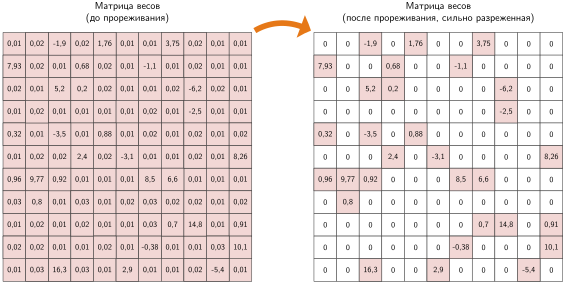

***Преобразование разреженной матрицы**: прореживание по величине заменяет веса ниже численного порога точными нулями (белые клетки), сохраняя значимые связи с большими модулями (цветные клетки). Получающаяся разреженность уменьшает число параметров, но для реального аппаратного ускорения нужно перевести эти неструктурированные нулевые элементы в разреженные форматы хранения или специализированные ядра выполнения.*

Получающаяся разреженная матрица сохраняет только значения с большим модулем (цветные клетки), а веса, близкие к нулю, становятся точными нулями. В моделях, пригодных для прореживания, после удаления весов с малым модулем значительная часть представительной емкости остается нетронутой, что делает пороговое отсечение по величине эффективной базовой эвристикой.

Чтобы сделать прореживание вычислительно выполнимым при градиентном обучении, на практике комбинаторное ограничение $\ell_0$ часто ослабляют непрерывными штрафами, например $\ell_1$-регуляризацией $(\lambda_{\text{L1}} \| \mathbf{W} \|_1)$, где $\lambda_{\text{L1}}$ задает масштаб штрафа за разреженность, применяемого к тензору весов $\mathbf{W}$. Штраф за величину весов приближает несущественные параметры к нулю и облегчает последующее пороговое отсечение. Обычно это сочетают с **итеративным прореживанием**: параметры удаляют последовательными порциями, чередуя их с циклами дообучения для восстановления потерянной точности (Gale et al., 2019; Blalock et al., 2020).

<a id="sec-model-compression-target-structures-1230"></a>

#### Целевые структуры

Выбор того, что прореживать, зависит от аппаратных ограничений целевой платформы и от того, какой ресурс является связывающим узким местом. Когда основной ограничитель — емкость памяти, **прореживание нейронов** может дать прямое облегчение в моделях, где полносвязные слои доминируют в хранении параметров: удаление целых нейронов вместе с их весами и смещениями уменьшает ширину слоя и число параметров. Профилирование должно сначала установить, что именно эти слои, а не эмбеддинги, активации или другой компонент, действительно являются узким местом.

Когда узкое место — задержка сверточного вывода на массовых ускорителях, сильным кандидатом становится **прореживание каналов** (также называемое прореживанием фильтров). Удаление целых каналов или фильтров уменьшает глубину карты признаков и число операций умножения с накоплением в последующих слоях. Получающаяся подсеть остается плотной и регулярной, поэтому ее можно отобразить на обычные ядра GPU и тензорных процессоров (TPU) без неструктурированного разреженного формата. Реальная задержка все равно зависит от получившихся размеров, ядер и трафика памяти.

Когда в модели есть удаляемые стадии, **прореживание слоев** убирает из сети целые слои. Каждое удаление исключает все вычисления этой стадии, но также уменьшает глубину представления и может изменить формы тензоров, остаточные пути или интерфейсы с последующими слоями. Оставшиеся слои должны принять на себя утраченную функцию, обычно через дообучение или переобучение. Номинальная экономия операций поэтому не гарантирует пропорциональной задержки: перезапись графа, формы ядер и трафик памяти по-прежнему определяют выполнение. Прореживание слоев требует тщательной проверки на задаче и сквозного профилирования. Сравнение бок о бок на рисунке [«Прореживание каналов и слоев»](10_model_compression.md#fig-channel-layer-pruning) показывает, почему прореживание каналов и прореживание слоев имеют разную стоимость реализации.

<a id="fig-channel-layer-pruning"></a>

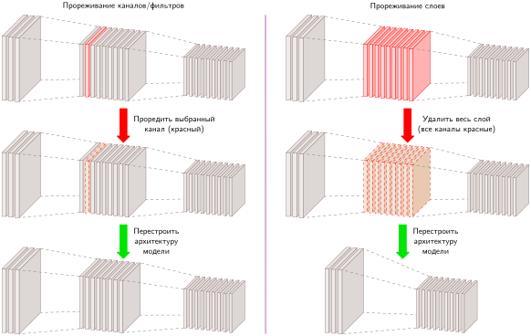

***Прореживание каналов и слоев**: структурное прореживание работает на разной архитектурной гранулярности. Прореживание каналов (слева) удаляет срезы карт признаков внутри сверточных слоев, сохраняя общую топологию сети и плотное выполнение, тогда как прореживание слоев (справа) убирает целые вычислительные стадии, требуя перестройки графа и рискуя большей потерей емкости ради большей экономии на операцию.*

Структурная механика на рисунке [«Прореживание каналов и слоев»](10_model_compression.md#fig-channel-layer-pruning) объясняет, почему эти гранулярности создают разные аппаратные компромиссы. Прореживание каналов сжимает внутренние размерности плотных операций обобщенного матричного умножения (GEMM): удаление выходных каналов слоя $l$ уменьшает размерность входных каналов слоя $l+1$. Тензоры остаются плотными и не требуют разреженных обращений по указателям, но обрезанные размерности должны оставаться выровненными по границам аппаратных тайлов (обычно кратными 8, 16 или 32 элементам для блоков SIMD «одна инструкция — много данных» и тензорных ядер), чтобы не допустить несогласованных обращений к памяти и простаивающих вычислительных линий. Прореживание слоев обходит выравнивание размерностей, полностью удаляя вычислительные стадии. Это устраняет задержку запуска ядер, трафик промежуточной памяти активаций и синхронизации по остаткам, но требует перестройки остаточных пропускающих связей и мирится с более крутым падением емкости представления.

<a id="sec-model-compression-unstructured-pruning-1c47"></a>

#### Неструктурированное прореживание

**Неструктурированное прореживание** удаляет отдельные веса, сохраняя общую архитектуру сети. Некоторые связи становятся избыточными во время обучения и мало вносят вклад в итоговый выход. Удаление этих слабых связей уменьшает число ненулевых элементов и может сохранить большую часть качества решения после восстановления.

Формализуем этот процесс: пусть $\mathbf{W} \in \mathbb{R}^{m \times n}$ — матрица весов в данном слое. Прореживание удаляет подмножество весов, применяя бинарную маску $\mathbf{M} \in \{0,1\}^{m \times n}$, и дает прореженную матрицу весов:
$$
\hat{\mathbf{W}} = \mathbf{M} \odot \mathbf{W}
$$
где $\odot$ обозначает поэлементное произведение Адамара. Маска $\mathbf{M}$ строится по критерию прореживания, обычно по модулю веса. Распространенный подход — прореживание по величине, которое удаляет долю $\rho_{\text{sparse}}$ весов с наименьшими модулями, задавая порог $\delta_{\text{prune}}$ так, что:
$$
M_{i,j} =
\begin{cases}
1, & \text{если } |W_{i,j}| > \delta_{\text{prune}} \\
0, & \text{в остальных случаях}
\end{cases}
$$
где $\delta_{\text{prune}}$ выбирается так, чтобы остались только наибольшие $(1 - \rho_{\text{sparse}})$ весов. Этот метод предполагает, что веса с большим модулем вносят больший вклад в функцию сети, поэтому их предпочтительно сохранять.

Неструктурированное прореживание уменьшает число ненулевых параметров, но чтобы превратить это уменьшение в реальную экономию места хранения, нужно индексированное разреженное кодирование, например разреженный строковый формат (CSR) или координатный список (COO). Поскольку эти форматы должны хранить позиционные метаданные, например индексы столбцов и указатели строк, рядом с ненулевыми значениями, накладные расходы на метаданные съедают экономию при низкой разреженности. Например, хранение 16-битного веса с 16-битным индексом столбца удваивает объем байтов на элемент, и чтобы просто выйти на ноль по размеру артефакта ($D_{\text{vol}}$), нужна разреженность свыше 50 процентов. Хранение плотного тензора с обнуленными элементами не экономит память вовсе.

Неструктурированная разреженность также не переходит напрямую в ускорение вывода на современном оборудовании. Массовые ускорители достигают пиковой пропускной способности ($R_{\text{peak}}$) через плотные систолические массивы и широкие блоки SIMD, которые требуют синхронного выполнения и объединенных обращений к памяти по соседним адресам. Произвольное распределение нулей заставляет ядра умножения разреженной матрицы на плотную (SpMM) выполнять непрямую адресацию и обход указателей. Эта нерегулярность памяти вызывает расхождение варпов (warp divergence), несогласованные глобальные обращения к памяти и сильное недоиспользование строк кэша. Если сеть не достигает экстремальной разреженности (часто свыше 80–90 процентов) и не выполняется на специализированных разреженных ядрах, неструктурированное прореживание дает модель, которая занимает меньше места на диске, но работает медленнее во время выполнения.

<a id="sec-model-compression-structured-pruning-9692"></a>

#### Структурированное прореживание

Если неструктурированное прореживание удаляет отдельные веса, то **структурированное прореживание** (Li et al., 2017) устраняет целые вычислительные единицы: нейроны, фильтры, каналы или слои. Такой подход создает меньшие плотные тензоры, которые выполняются на стандартных ядрах ускорителя. Поэтому его существенно проще превратить в экономию задержки, чем произвольную неструктурированную разреженность, хотя формы тензоров, выравнивание памяти и качество решения по-прежнему требуют тщательного профилирования.

Нейроны, фильтры и слои могут заметно различаться по вкладу в предсказания модели. Некоторые единицы несут избыточную или малозначимую информацию, но удаление безопасно, только когда валидация показывает, что оставшаяся структура сохраняет нужное поведение. Выявление таких структур остается основной задачей.

Аппаратно-ориентированные стратегии прореживания, например **структурированная разреженность N:M**,[^fn-nm-sparsity-a100] задают определенные шаблоны (например, требуя, чтобы ровно 2 из каждых 4 весов были нулевыми), чтобы совпасть со специализированными возможностями ускорителя. В этой главе в качестве примера сжатия используется шаблон 2:4; раздел [«Механика структурированной разреженности N:M»](11_hw_acceleration.md#sec-hardware-acceleration-nm-structured-sparsity-mechanics-9a71) главы [«Аппаратное ускорение»](11_hw_acceleration.md) позже показывает, как разреженные тензорные ядра используют его.

[^fn-nm-sparsity-a100]: **Структурированная разреженность N:M**: впервые коммерчески представленная с GPU NVIDIA A100 (2020), шаблон 2:4 был выбран потому, что он вдвое сокращает операции умножения с накоплением, сохраняя метаданные о позициях достаточно компактными для пути разреженных тензорных ядер (NVIDIA Corporation, 2020; Choquette et al., 2021). Это фиксированное соотношение — аппаратное ограничение, а не математический оптимум: путь разреженных тензорных ядер A100 ускоряет разреженные операнды 2:4, давая ускорение вычислений до 2 раз по сравнению с плотным выполнением, когда ядра и раскладки удовлетворяют ограничению. Другие соотношения этим конкретным аппаратным путем не ускоряются, что иллюстрирует, как кремниевый дизайн ограничивает, какие шаблоны разреженности дают реальное ускорение.

Методы прореживания меняют параметрическую экономию на регулярность аппаратного выполнения. Сравните три панели на рисунке [«Неструктурированное и структурированное прореживание»](10_model_compression.md#fig-structured-unstructured): слева — нерегулярное удаление весов, в центре и справа — структурное удаление нейронов и каналов.

<a id="fig-structured-unstructured"></a>

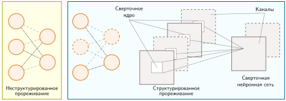

***Неструктурированное и структурированное прореживание**: компромисс между регулярностью и сжатием для разных гранулярностей прореживания. Неструктурированное прореживание (слева) удаляет произвольные отдельные связи и требует разреженного представления и соответствующего ядра, чтобы изменить выполнение. Структурное прореживание нейронов (в центре) или сверточных каналов (справа) может давать меньшие плотные тензоры, совместимые со стандартными ядрами, хотя реальная задержка зависит от получающихся форм и среды выполнения. Источник: (Qi et al., 2021).*

Структурированное прореживание устраняет штрафы за разреженные метаданные и расхождение памяти, свойственные неструктурированной разреженности, сжимая базовые матрицы в меньшие непрерывные плотные тензоры ([«Неструктурированное и структурированное прореживание»](10_model_compression.md#fig-structured-unstructured)). В полносвязных слоях (центр) прореживание нейронов удаляет соответствующие строки и столбцы в соседних матрицах весов. В сверточных слоях (справа) прореживание каналов удаляет целые трехмерные срезы фильтров. Поскольку получившаяся подсеть состоит только из плотных операций, она выполняется непосредственно на стандартных базовых подпрограммах линейной алгебры (BLAS) и сверточных движках, без специализированных разреженных библиотек. Главное системное требование — сохранять выравнивание размерностей: современные ядра ускорителей достигают пиковой пропускной способности памяти, когда размерности тензоров остаются кратными строкам кэша аппаратуры и размерам тайлов варпов (например, 32, 64 или 128 элементам).

Распространенный подход к структурированному прореживанию ранжирует целые нейроны или фильтры по величине связанных с ними весов. Малая групповая норма — это дешевый заместитель низкой важности, а не доказательство того, что единица избыточна. Оценка может использовать $\ell_1$- или $\ell_2$-норму по весам, связанным с каждой единицей; группы ниже выбранного порога становятся кандидатами на прореживание. Послойное ранжирование важно, потому что сырые масштабы могут различаться между слоями. Метод не требует прохода по репрезентативным данным, но вычисление оценок, выбор порога, материализация меньшего графа и проверка или дообучение результата по-прежнему требуют инженерных и вычислительных затрат.

Другая стратегия — **прореживание на основе активаций**, которое оценивает активации нейронов или фильтров на наборе данных. Единицы, которые остаются слабыми на репрезентативных входах, становятся кандидатами на удаление при условии проверки абляцией или дообучением. Этот метод учитывает поведение, зависящее от входа, а не только статические веса. Его ранжирование все же может пропустить редкие, но важные входы, зависеть от масштабирования активаций или измениться после удаления верхних по потоку единиц. Прореживание на основе активаций поэтому требует репрезентативных данных профилирования и проверки после удаления выбранных структур.

**Прореживание на основе градиентов** использует производные функции потерь, чтобы оценить, как удаление нейрона или фильтра изменит целевую функцию. Малая оценка первого порядка указывает на кандидата при текущем контрольном состоянии и на выбранных данных; она не доказывает постоянную ненужность и не учитывает все взаимодействия между единицами. Критерии на основе градиентов могут объединять значение единицы с ее градиентом, чтобы ранжировать ожидаемое локальное изменение потерь. Математически этот критерий аппроксимирует изменение функции потерь $\Delta \mathcal{L}$ при обнулении параметра $w_i$ через разложение Тейлора первого порядка: $\Delta \mathcal{L} \approx |w_i \cdot \frac{\partial \mathcal{L}}{\partial w_i}|$. Веса, которые близки к нулю или имеют пренебрежимо малые градиенты, мало влияют на целевую функцию, поэтому они первые кандидаты на удаление. В отличие от критериев только по величине весов, они требуют обратного прохода и обычно встраиваются в обучение или дообучение. Результат все равно нужно проверять на уровне задачи, потому что оценка — локальное приближение.

Эти критерии обменивают стоимость измерения на точность отражения поведения модели. Оценки по величине дешевы и дают полезную базовую линию, но не учитывают распределение входов. Оценки по активациям учитывают репрезентативные входы и выявляют единицы, которые «молчат» на этой нагрузке, тогда как оценки на основе градиентов учитывают также локальную поверхность функции потерь ценой дополнительных затрат на обучение. Ни один из них не доминирует для всех моделей, и ни один не доказывает, что удаление безвредно. Корректное сравнение прореживает до одной и той же структурной цели, применяет один и тот же бюджет восстановления и измеряет качество решения после удаления. Затем оно профилирует экспортированный граф, потому что лучшая оценка важности может сохранить качество, но дать формы, которые целевая среда выполнения не исполняет эффективно. Выбор поэтому зависит от доступных данных и вычислений, от удаляемой структуры и от запаса качества, который допускает развертывание.

<a id="sec-model-compression-dynamic-pruning-b794"></a>

#### Динамическое прореживание

Традиционные методы прореживания, неструктурированные или структурированные, дают **статическую маску прореживания** или подсеть, которая остается фиксированной во время развертывания, даже если маска постепенно выучивалась во время обучения. **Динамическое прореживание**, напротив, адаптирует, какие вычисления активны, в зависимости от входных данных или динамики обучения, поэтому выполняемая подсеть может меняться со временем.

Динамическое прореживание может использовать техники разреженности во время выполнения, когда модель выбирает параметры или структуры по характеристикам входа. Например, условное по активациям прореживание отключает нейроны или каналы для отдельных входов (Hu et al., 2023). Получающаяся разреженность, зависящая от входа, сокращает выполняемую работу, только если контроллер и среда выполнения могут пропускать эту работу дешевле, чем плотный путь ее выполнил бы.

Например, рассмотрим сверточную сеть, которая обрабатывает изображения разной сложности. При выводе на простом изображении с преимущественно однородными областями некоторые сверточные фильтры могут давать пренебрежимо малые активации. Динамическая политика может выявить таких кандидатов и временно исключить их из вычислений. Это исключение уменьшает номинальную работу, но контроллер, нерегулярное выполнение и любое изменение качества остаются частью результата. Метод становится полезным в чувствительном к задержке приложении, только если разнообразие входов достаточно велико, чтобы окупить эти издержки. Как описано в главе [«Бенчмаркинг»](12_benchmarking.md#sec-benchmarking), оценка таких выигрышей в эффективности требует измерять и задержку, и точность на одной и той же целевой нагрузке по всему распределению входов.

Другой класс динамического прореживания работает во время обучения, постепенно вводя и настраивая разреженность на протяжении всего процесса оптимизации. Постепенное прореживание по величине начинает с плотной сети и постепенно увеличивает долю удаленных параметров, одновременно дообучая оставшиеся веса. Варианты динамического разреженного обучения дополнительно позволяют сети восстанавливаться после потери емкости, вызванной прореживанием, отращивая связи, которые позже в обучении окажутся важными.

Динамическое прореживание может выделять разные объемы работы разным входам и повторно активировать емкость, которую статическая маска развертывания удалила бы навсегда. Эти свойства создают возможность, а не гарантированный выигрыш в эффективности или точности. Контроллер находится на критическом пути, маршрутизация, зависящая от входа, фрагментирует пакетное выполнение по полосам SIMD, а расширенное пространство поведения требует больше проверок. Обучению также может понадобиться штраф за маршрутизацию или регуляризация, чтобы политика действительно использовала свои более дешевые пути. Производственные развертывания должны отслеживать частоту маршрутов, хвосты задержек и качество по каждому маршруту; эти практики мониторинга и отката подробно разбираются в главе [«MLOps»](14_ml_ops.md#sec-ml-operations). Динамическое прореживание поэтому является кандидатом, когда разнообразие сложности входов достаточно, чтобы окупить накладные расходы контроллера и пакетирования, а не заменой статического прореживания по умолчанию.

<a id="sec-model-compression-pruning-tradeoffs-fada"></a>

#### Компромиссы прореживания

Три подхода к прореживанию занимают разные позиции на компромиссе между регулярностью и гранулярностью. Неструктурированное прореживание может удалять отдельные веса и поэтому выражает мелкозернистую разреженность, но ускорителям для пропуска этих нулей нужны соответствующие разреженные форматы и ядра. Структурированное прореживание удаляет каналы, фильтры или слои и может давать меньшие плотные операции, которые обычное оборудование уже поддерживает. Динамическое прореживание делает выполняемую структуру зависимой от входа, добавляя управляющие и пакетные накладные расходы в обмен на условное распределение вычислений. [«Стратегии прореживания»](10_model_compression.md#tbl-pruning) суммирует эти различия для развертывания.

Эти категории описывают выполняемое развертывание, а не взаимоисключающие алгоритмы обучения. Структурная подсеть может выучиваться по динамическому расписанию, а затем фиксироваться для обслуживания; классифицируйте артефакт по тому, что его среда выполнения реально выполняет.

| **Аспект**                 | **Неструктурированное прореживание**                                                    | **Структурированное прореживание**                                             | **Динамическое прореживание**                                 |
|:---------------------------|:----------------------------------------------------------------------------------------|:-------------------------------------------------------------------------------|:--------------------------------------------------------------|
| **Что удаляется?**         | Отдельные веса в модели                                                                 | Целые нейроны, каналы, фильтры или слои                                        | Меняет прореживание в зависимости от условий выполнения       |
| **Структура модели**       | Разреженные матрицы весов; исходная архитектура сохраняется                             | Архитектура модели меняется; прореженные слои полностью удаляются               | Структура адаптируется динамически                            |
| **Влияние на память**      | Уменьшает число ненулевых элементов; объем хранения падает только при подходящем разреженном представлении | Уменьшает объем модели за счет удаления целых компонентов | Зависит от прореживания в реальном времени                    |
| **Влияние на вычисления**  | Плотная работа остается, если поддерживаемый разреженный путь не пропускает нули        | Уменьшает номинальное число FLOP; задержка зависит от получающихся форм и ядер | Зависит от политики маршрутизации и накладных расходов контроллера |
| **Совместимость с аппаратурой** | Требует разреженных форматов и соответствующей поддержки выполнения             | Дает плотные подсети, но неудобные формы все равно могут недоиспользовать аппаратуру | Требует адаптивных движков вывода                       |
| **Нужно ли дообучение?**   | Часто используется для восстановления точности после прореживания                        | Часто используется после структурного изменения                                | Зависит от того, как обучаются политика маршрутизации и подсети |
| **Сценарии использования** | Экономичное по памяти сжатие моделей для облачного развертывания                        | Оптимизация вывода в реальном времени, мобильный и периферийный ИИ, эффективное обучение | Адаптивные приложения ИИ, системы реального времени          |

<a id="tbl-pruning"></a>

***Стратегии прореживания**: неструктурированное прореживание удаляет отдельные веса, но для выигрыша при развертывании нужно разреженное хранение и соответствующие ядра; структурированное прореживание удаляет целые компоненты, которые ближе отображаются на плотное аппаратное обеспечение, а динамическое прореживание добавляет адаптацию во время выполнения и накладные расходы.*

<a id="sec-model-compression-pruning-strategies-03f7"></a>

#### Стратегии прореживания

Расписание выполнения определяет, поглотит ли сеть потерю емкости или деградирует необратимо. Два основных расписания управляют удалением весов: итеративное прореживание и однократное прореживание.

<a id="sec-model-compression-iterative-pruning-ee12"></a>

##### Итеративное прореживание

Итеративное прореживание смягчает катастрофические падения точности, чередуя структурное удаление параметров с циклами переобучения ([«Производительность итеративного прореживания»](10_model_compression.md#fig-iterative-pruning)).

<a id="fig-iterative-pruning"></a>

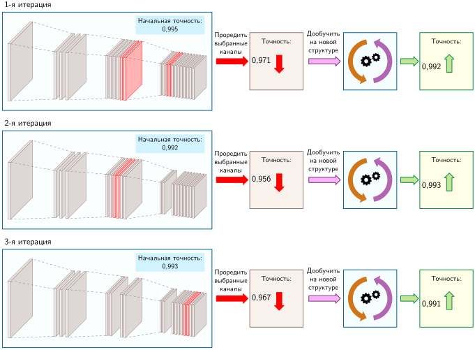

***Производительность итеративного прореживания**: три строки показывают последовательные циклы «прореживание — дообучение», каждый из которых убирает два из исходных двадцати двух каналов. Точность падает с 0,995 до 0,971 после первого прореживания, восстанавливается до 0,992 после дообучения и стабилизируется на 0,991 после всех трех циклов: потеря 0,4 процента при сокращении числа каналов на 27 процентов.*

Трехстрочный процесс на рисунке [«Производительность итеративного прореживания»](10_model_compression.md#fig-iterative-pruning) демонстрирует это постепенное приспособление на сверточной сети, прореженной на шесть каналов. Вместо удаления всех шести каналов за один проход конвейер убирает по два канала за цикл в течение трех итераций, дообучая оставшиеся параметры после каждого среза. Первый срез снижает точность с 0,995 до 0,971, но короткое дообучение возвращает ее к 0,992. Два последующих цикла «прореживание — настройка» дают финальную модель с точностью 0,991: пренебрежимо малое ухудшение на 0,4 процента при сокращении числа каналов на 27 процентов. Растягивание структурной операции на несколько интервалов переобучения позволяет оставшимся весам подстраивать свои представления вдоль ландшафта функции потерь.

<a id="sec-model-compression-oneshot-pruning-12a1"></a>

##### Однократное прореживание

**Однократное прореживание** удаляет несколько архитектурных компонентов за один шаг, после чего следует обширная фаза дообучения для восстановления точности модели. Такой агрессивный подход быстро сжимает модель, но несет больший риск деградации точности, поскольку сети приходится одновременно адаптироваться к значительным структурным изменениям.

Применение однократного прореживания к той же сети иллюстрирует опасность агрессивного структурного усечения. Вместо поэтапного удаления однократное прореживание срезает все шесть каналов одновременно ([«Влияние однократного прореживания»](10_model_compression.md#fig-oneshot-pruning)). Удаление 27 процентов емкости сети за один шаг снижает точность с 0,995 до 0,914. Последующее дообучение восстанавливает только до 0,943 — постоянная деградация на 5 процентов относительно исходного уровня. Хотя итеративное и однократное прореживание дают одинаковую итоговую геометрию тензоров, внезапная потеря представительной емкости загоняет дообучение после однократного прореживания в худший локальный минимум.

<a id="fig-oneshot-pruning"></a>

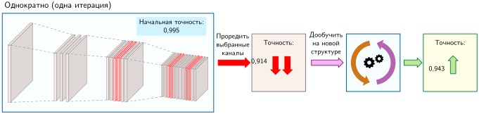

***Влияние однократного прореживания**: все шесть каналов (27 процентов) удаляются одновременно, из-за чего точность падает с 0,995 до 0,914. Дообучение восстанавливает только до 0,943, то есть деградация на 5 процентов от исходной точности.*

Выбор между стратегиями расписания определяют три эксплуатационных ограничения. Высокие целевые уровни разреженности требуют итеративных циклов, чтобы не допустить серьезной потери представительной емкости. И наоборот, жесткие вычислительные бюджеты во время оптимизации или агрессивные сроки развертывания делают предпочтительным однократное прореживание, принимая небольшую деградацию точности ради избежания нескольких дорогих переобучений. Наконец, целевая архитектура ускорителя определяет, оправдывает ли получающийся шаблон разреженности итеративные затраты.

<a id="sec-model-compression-lottery-ticket-hypothesis-1b3d"></a>

#### Гипотеза лотерейного билета

Стандартные процедуры прореживания предполагают полностью обученную плотную модель, из которой затем удаляют веса. Однако связь между структурой сети и динамикой оптимизации глубже: прореживание может выявить изначально эффективные, хорошо обучаемые подсети, заложенные в исходной случайной параметризации.

Эта точка зрения ведет к гипотезе лотерейного билета[^fn-lottery-ticket-sparsity] (LTH), которая оспаривает стандартные процедуры прореживания, предполагая, что в больших нейронных сетях есть малые, удачно инициализированные подсети («выигрышные билеты»), способные при обучении в изоляции достичь точности, сравнимой с полной моделью. Вместо того чтобы рассматривать прореживание как шаг сжатия после обучения, LTH предполагает, что оно может служить механизмом открытия, позволяющим найти эти эффективные подсети на ранней стадии обучения (Rachwan et al., 2022).

[^fn-lottery-ticket-sparsity]: **Гипотеза лотерейного билета**: название отражает интуицию, что обучение большой сети похоже на покупку множества лотерейных билетов: большинство проигрывает, но несколько «выигрышных билетов» (разреженных подсетей с удачной инициализацией) могут обучиться до сопоставимой точности самостоятельно. (Frankle and Carbin, 2019) установили эту гипотезу на меньших сетях для зрения и полносвязных сетях; позже работы обобщили и расширили эту идею на более крупные задачи (Rachwan et al., 2022). Системный вывод состоит в том, что часть памяти и вычислений, затраченных на обучение плотных сетей, может оказаться избыточными накладными расходами, которые можно выявить, однако практическая отдача зависит от того, можно ли найти выигрышную подсеть, прежде чем потратить большую часть исходной стоимости обучения.

Исходная процедура LTH находит эти подсети через итеративное прореживание по величине и откат ([«Цикл итераций лотерейного билета»](10_model_compression.md#fig-winning-ticket)). Сеть обучают до сходимости, удаляют веса с малой величиной, а оставшиеся параметры сбрасывают к исходным значениям $\boldsymbol{\theta}_0$, а не переинициализируют случайно. Повторение цикла может выделить разреженную подсеть, которая в описанных условиях обучается до точности, сравнимой с исходной сетью (Frankle and Carbin, 2019). Успех той же процедуры зависит от архитектуры, масштаба, оптимизатора и бюджета обучения.

<a id="fig-winning-ticket"></a>

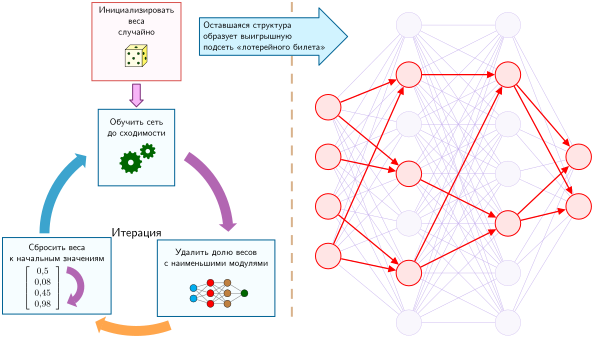

***Цикл итераций лотерейного билета**: исходная процедура многократно обучает сеть, прореживает веса с малой величиной и возвращает оставшиеся веса в их начальное состояние $\boldsymbol{\theta}_0$. Цикл проверяет, может ли получившаяся разреженная подсеть сравняться с плотной базовой моделью при обучении в изоляции; результат эмпирический, а не гарантированный.*

Гипотеза лотерейного билета предполагает, что компактные, обучаемые подсети могут существовать внутри переизбыточной инициализации. Это наблюдение мотивирует прямые исследования разреженного обучения, но стандартная процедура поиска не устраняет стоимость плотного обучения: сначала нужно оплатить один или несколько плотных или частично плотных прогонов, чтобы найти билет. Поэтому результат подчеркивает роль инициализации, но оставляет практический системный вопрос: можно ли выявить эту подсеть до того, как будет израсходована большая часть исходного бюджета обучения.

Итеративная процедура также разделяет два эффекта, которые однократное прореживание смешивает: какие веса выживают и сколько дообучения следует за каждым срезом. В одних условиях меньшие шаги прореживания дают сети больше возможностей восстановиться; в других дополнительные циклы не оправдывают своей стоимости. Поэтому сравнение для развертывания должно одновременно измерять итоговое качество, стоимость поиска или переобучения и реально полученную экономию во время выполнения.

На практике конвейер в стиле LTH нужно сравнивать с обучением меньшей плотной модели с нуля, однократным прореживанием с восстановлением и прямыми методами разреженного обучения. Учет должен включать каждый плотный или частично плотный поисковый прогон, каждый откат к контрольной точке, каждый цикл прореживания и каждую фазу восстановления, а не только итоговую подсеть. Выигрышный билет — это результат обучения; он становится системным выигрышем, только если суммарное время ускорителя, итоговый размер артефакта, целевая задержка и качество решения превосходят эти альтернативы.

<a id="sec-model-compression-pruning-practice-8059"></a>

#### Прореживание на практике

Хотя гипотеза лотерейного билета проясняет ландшафт оптимизации, практические системы обслуживания заботятся только об исполняемых артефактах. Прореживание на уровне фреймворка полезно, только если оно дает конкретную аппаратную экономию: меньший плотный тензор, структурированную разреженную матрицу, выровненную по аппаратуре, или индексированную разреженную раскладку вместе с соответствующими ядрами среды выполнения. Прореживание во время обучения часто начинается с применения маски: исходный тензор остается в памяти, а бинарная маска обнуляет выбранные веса во время прямого прохода. Этот механизм направляет поток градиентов во время восстановления, но сам по себе не дает ни снижения памяти, ни улучшения задержки. Измеримый выигрыш эффективности появляется только после того, как замаскированная структура экспортирована в физический артефакт, загруженный движком вывода.

Эта граница артефакта разделяет стратегии прореживания. Неструктурированное прореживание удаляет отдельные веса и требует разреженных ядер и подходящего формата хранения, чтобы превратить нули в скорость. Структурированное прореживание удаляет целые каналы, головы, нейроны или блоки, что может переформировать тензоры в меньшие плотные операции, которые обычные ускорители уже выполняют хорошо. Постепенное прореживание во время дообучения добавляет расписание обучения: разреженность растет со временем, чтобы оставшиеся веса могли восстанавливать точность по мере удаления емкости. Поэтому системный аудит конкретен: определите, что прореживается, определите формат среды выполнения и проверьте, есть ли на целевом оборудовании ядра, которые делают разреженность полезной.

Эти компромиссы становятся конкретными при рассмотрении реальных развертываний. Некоторые семейства моделей снижают стоимость развертывания за счет архитектуры, а не постфактум-прореживания: MobileNet использует раздельные по глубине свертки для мобильного и встроенного зрения (Howard et al., 2017), а EfficientNet применяет составное масштабирование, чтобы улучшить компромисс между точностью и эффективностью при ограничениях ресурсов (Tan and Le, 2019). Прореживание остается отдельным рычагом оптимизации. Трансформеры в стиле BERT[^fn-bert-pruning-scale] прореживали, удаляя избыточные головы внимания или промежуточные размерности, тогда как отдельные методы дистилляции, такие как DistilBERT и TinyBERT, обучают меньшие плотные модели-ученики, которые сохраняют значительную часть качества BERT (Sanh et al., 2019; Jiao et al., 2020).

[^fn-bert-pruning-scale]: **Прореживание BERT**: 12 голов внимания на слой в BERT могут содержать значительную избыточность: Michel et al. (2019) обнаружили на MultiNLI, что многие головы можно удалить без статистически значимого изменения производительности. Доля удаляемых голов зависит от слоя и задачи, поэтому прореживание для развертывания должно измерять и качество на задаче, и то, уменьшает ли получающаяся структура объем работы среды выполнения.

Прореживание имеет внутреннее ограничение: оно начинается с существующей архитектуры и отрезает от нее части. Прореженная модель наследует структуру исходной — те же типы слоев, те же шаблоны связности, только меньше параметров. Сама исходная архитектура может быть неэффективна для развертывания. Практику может понадобиться модель с совершенно другой структурой, например шестислойный трансформер вместо двенадцатислойного, который при этом сохраняет возможности исходной модели.

Когда ограничения развертывания требуют принципиально другой топологии, цель сжатия смещается от отрезания весов к обучению меньшей модели на выходах исходной. Дистилляция знаний решает эту задачу, рассматривая переизбыточную сеть как учителя, а не как артефакт развертывания.

<a id="sec-model-compression-knowledge-distillation-1842"></a>

### Дистилляция знаний

Представим, что медицинская модель ответов на вопросы превышает бюджет памяти и задержки серверного узла больницы с одним GPU. Если сделать ее существующие веса разреженными, все равно может остаться неподдерживаемое представление или архитектура, слишком большая для целевого устройства, поэтому развертыванию может понадобиться принципиально меньшая модель. Дистилляция знаний решает этот класс задач, обучая компактного «ученика» воспроизводить поведение более крупного «учителя»; часто ученик сохраняет значительную часть качества решения учителя при меньшей стоимости вывода (Hinton et al., 2015; Sanh et al., 2019). Термин *дистилляция* заимствован из химии, где процесс выделяет концентрированную суть из большей смеси,[^fn-distillation-etymology-chemistry] но системный вывод здесь конкретен: предсказания учителя могут нести информацию, выходящую за пределы исходных обучающих меток.

<a id="dfn-model-compression-knowledge-distillation"></a>

> **Дистилляция знаний**
>
> ***Дистилляция знаний*** — это метод сжатия модели, который обучает меньшую модель-*ученика* (*student*) воспроизводить поведение большей предобученной модели-*учителя* (*teacher*).
>
> 1.  **Значение**: дистилляция переносит стоимость из повторяющегося вывода в дополнительную фазу обучения. Ученик может быть существенно меньше учителя и при этом сохранять полезное качество решения задачи; например, DistilBERT сообщает об уменьшении числа параметров на 40 процентов, ускорении вывода на 60 процентов и сохранении 97 процентов качества BERT в понимании языка (Sanh et al., 2019). Этот компромисс ценен, когда стоимость обучения ученика амортизируется на множестве развернутых запросов.
> 2.  **Отличие**: в отличие от прореживания, которое удаляет параметры из существующей архитектуры, и квантования, которое снижает числовую точность, дистилляция обучает новую плотную архитектуру. Ученик наследует поведение из распределения выходов учителя или его промежуточных представлений, а не полное число параметров или структуру слоев учителя.
> 3.  **Типичная ошибка**: распространено заблуждение, что дистилляция — сжатие без потерь. На деле ученик ограничен собственной емкостью, качеством учителя и соответствием между данными дистилляции и распределением при развертывании; ученик может точно воспроизвести и знания, и ошибки учителя.

Учитель передает семантические знания через относительные вероятности, назначенные всем классам. Тогда как one-hot эталонная метка приписывает правильному классу вероятность единицу, а всем остальным — ноль, распределение выходов учителя на рисунке [«Мягкое целевое распределение»](10_model_compression.md#fig-kd-targets) фиксирует структурные связи между классами: вход, классифицированный как кошка, имеет больше семантических общих признаков с собакой, чем с лисой.

[^fn-distillation-etymology-chemistry]: **Дистилляция**: название заимствовано из химического процесса разделения смеси. В сжатии моделей ученик учится на смягченном распределении выходов учителя или на его внутренних представлениях, а не копирует его параметры. Мягкие цели могут кодировать отношения между классами, но ученик выучивает лишь то, что раскрывают его целевая функция и обучающие данные. Метафора полезна, но не буквальна: параметр температуры приходит из масштабирования softmax, а компромисс между размером и качеством зависит от ученика, данных, целевой функции и процедуры обучения (Hinton et al., 2015). Экономия при развертывании возникает из архитектуры ученика, а не из самой метафоры.

<a id="fig-kd-targets"></a>

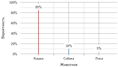

***Мягкое целевое распределение**: относительные уровни уверенности учителя показывают, какие классы семантически похожи (например, кошка и собака), и дают гораздо более богатый сигнал надзора, чем бинарная метка «правильно».*

Обучение ученика требует баланса между имитацией учителя и контролем по эталонным меткам задачи. Практически рабочий процесс требует четырех решений до начала обучения: выбрать учителя с нужным поведением, спроектировать ученика, плотная архитектура которого укладывается в бюджет памяти и вычислений целевого ускорителя, сгенерировать мягкие цели по обучающему корпусу и выбрать температуру и веса потерь, управляющие оптимизацией. [«Рабочий процесс дистилляции знаний»](10_model_compression.md#fig-kd-overview) иллюстрирует этот двухпутевой процесс обучения, в котором каждый входной образец проходит через обе сети, а обновления параметров ученика определяются комбинированной мягкой и жесткой функциями потерь.

<a id="fig-kd-overview"></a>

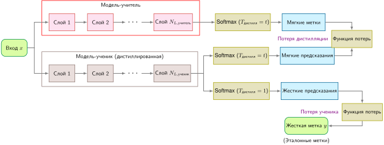

***Рабочий процесс дистилляции знаний**: входной образец проходит через сеть-учителя и сеть-ученика. Учитель выдает мягкие метки через softmax с температурным масштабированием, а выход ученика сравнивается и с мягкими метками (потеря дистилляции), и с жесткими метками (потеря ученика).*

При развертывании дистиллированного ученика недостаточно проверить только top-1 точность. Поскольку ученик может унаследовать систематические смещения и ошибки калибровки учителя так же легко, как его полезные представления, проверка должна измерять ошибку калибровки, поведение на подгруппах и фактическую задержку на целевой аппаратуре.

<a id="sec-model-compression-distillation-mathematics-4af6"></a>

#### Математика дистилляции

Стандартная нормировка softmax ([«Нелинейные функции активации»](05_nn_computation.md#sec-neural-computation-nonlinear-activation-functions-38bc)) превращает сырые логиты модели $z_i$ в вероятности. Введение **параметра температуры**[^fn-temperature-boltzmann-scaling] $T_{\text{distill}}$ смягчает получающееся распределение вероятностей по классам выхода:
$$
p_i^{(T_{\text{distill}})} = \frac{\exp(z_i/T_{\text{distill}})}{\sum_j \exp(z_j/T_{\text{distill}})}
$$

[^fn-temperature-boltzmann-scaling]: **Температура (softmax)**: термин происходит из распределения Больцмана в статистической механике. Деление логитов на температуру больше единицы дает более мягкое распределение и может выявить относительные вероятности среди нецелевых классов. При $T_{\text{distill}}{=}1$ выражение совпадает со стандартным softmax; увеличение температуры уменьшает разрывы между логитами, но не гарантирует, что раскрытые вероятности помогут ученику. Полезная степень смягчения зависит от масштаба логитов, калибровки учителя, емкости ученика, веса потерь и сопутствующего множителя $T_{\text{distill}}^2$. Поэтому температуру подбирают эмпирически, а не фиксируют в универсальном диапазоне.

Более высокая $T_{\text{distill}}$ сглаживает распределение softmax и выявляет **темное знание**: скрытую информацию, содержащуюся в относительных вероятностях классов, например когда учитель, классифицируя изображение кошки, назначает собаке малую, но ненулевую вероятность, а грузовику — почти нулевую. Полная потеря дистилляции $\mathcal{L}_{\text{distill}}$ уравновешивает стандартную перекрестную энтропию и дивергенцию Кульбака — Лейблера (KL) относительно смягченного распределения учителя:[^fn-kl-divergence-distillation]

[^fn-kl-divergence-distillation]: **Дивергенция KL**: введена Соломоном Кульбаком и Ричардом Лейблером в 1951 году; $\mathcal{D}_{\text{KL}}(p \lVert q)$ измеряет дополнительное число битов, нужное для кодирования выборок из распределения $p$ кодом, оптимизированным для $q$. Ключевое асимметричное следствие: $\mathcal{D}_{\text{KL}}(\text{teacher} \lVert \text{student})$ сильно штрафует ученика за назначение нулевой вероятности выходам, вероятным для учителя, вынуждая ученика сохранять широкое покрытие распределения учителя, включая малоправдоподобные «мягкие метки», которые несут выученную учителем неопределенность. Дистилляция может влиять на калибровку, которую нужно оценивать отдельно.

$$
\mathcal{L}_{\text{distill}} = (1 - \gamma_{\text{KD}}) \mathcal{L}_{\text{CE}}(\mathbf{p}_{\text{student}}, y) + \gamma_{\text{KD}} T_{\text{distill}}^2 \mathcal{D}_{\text{KL}}(\mathbf{p}_{\text{teacher}}^{(T_{\text{distill}})} \lVert \mathbf{p}_{\text{student}}^{(T_{\text{distill}})})
$$

Здесь $\mathbf{p}_{\text{teacher}}^{(T_{\text{distill}})}$ и $\mathbf{p}_{\text{student}}^{(T_{\text{distill}})}$ — векторы вероятностей, вычисленные при температуре $T_{\text{distill}}$, $y$ — one-hot эталонная метка, а $\gamma_{\text{KD}} \in [0,1]$ уравновешивает цели по жесткой метке и мягкой цели. Множитель $T_{\text{distill}}^2$ гарантирует, что величина градиента потери дистилляции остается соизмеримой с жесткой перекрестной энтропией: деление логитов на $T_{\text{distill}}$ масштабирует производную вероятностей softmax множителем $1/T_{\text{distill}}$, а градиент дивергенции KL по логитам ученика в пределе высокой температуры масштабируется как $1/T_{\text{distill}}^2$. Умножение на $T_{\text{distill}}^2$ не дает градиенту учителя исчезнуть относительно потери по жесткой метке при росте $T_{\text{distill}}$. Эта формулировка задает дистилляцию на основе ответов, которая согласует итоговые выходные распределения. Современные конвейеры также используют дистилляцию на основе признаков: промежуточные слои ученика обучаются напрямую воспроизводить скрытые представления или карты внимания учителя, используя среднеквадратичную ошибку или косинусное расстояние, чтобы направлять обновления градиента в глубоких магистралях.

<a id="sec-model-compression-efficiency-gains-tradeoffs-fb5b"></a>

##### Выигрыш в эффективности и компромиссы

Главное преимущество дистилляции перед неструктурированным прореживанием при развертывании состоит в том, что она дает меньшую *плотную* модель. Стандартные ускорители достигают пиковой арифметической интенсивности на непрерывных матричных умножениях; неструктурированные разреженные модели несут нерегулярный доступ к памяти и накладные расходы на декодирование индексов, которые часто сводят на нет теоретическое снижение FLOP, если разреженность не экстремальна. Компактный плотный ученик сохраняет объединенный доступ к памяти и выполняет оптимизированные поставщиком плотные ядра GEMM. Однако одно лишь снижение числа параметров не гарантирует меньшей задержки: операционная интенсивность, глубина слоев, длина последовательности внимания и пределы пропускной способности памяти по-прежнему определяют время выполнения. DistilBERT, например, добивается снижения задержки на 60 процентов главным образом за счет удаления половины трансформерных слоев BERT, что вдвое сокращает трафик памяти и последовательные зависимости между слоями, сохраняя при этом 97 процентов производительности BERT в понимании языка (Sanh et al., 2019).[^fn-distilbert-model-deployment] Компактные архитектуры зрения, такие как MobileNet, применяют тот же принцип при обучении под контролем учителя (Howard et al., 2017; Hinton et al., 2015).

[^fn-distilbert-model-deployment]: **DistilBERT**: сообщаемая модель имеет 66 миллионов параметров против 110 миллионов у BERT-Base, на 40 процентов меньше и на 60 процентов быстрее, и сохраняет 97 процентов производительности в понимании языка. Абсолютные память и задержка по-прежнему зависят от числового формата, размера батча, длины последовательности, среды выполнения и аппаратуры (Sanh et al., 2019).

Дистилляция естественно сочетается с прореживанием и квантованием в многоэтапных конвейерах сжатия. Например, практик может дистиллировать большого учителя в компактную архитектуру ученика, проредить избыточные головы внимания или каналы у этого ученика и квантовать оставшиеся веса из FP16 в INT8 для развертывания. Gordon et al. (2020) показывают, что BERT можно прореживать на этапе предобучения и переносить на последующие задачи, то есть структурное сжатие и дистилляция могут работать одновременно.

Эти выигрыши в эффективности вывода оплачиваются существенными накладными расходами на обучение. Дистилляция требует прогонять вывод через модель-учителя, чтобы генерировать мягкие цели, и распространять потери обратно через ученика на миллионах токенов. Для больших моделей эта вспомогательная фаза обучения потребляет значительные FLOP ускорителя и пропускную способность памяти, тогда как методы посттренировочного квантования завершаются за минуты на калибровочных подвыборках. Эффективность сжатия также ограничена емкостью ученика и точностью учителя: слишком маленький ученик не способен усвоить распределение учителя, а неточный или некалиброванный учитель передает ученику собственные систематические ошибки. Как разобрано в главе [«Бенчмаркинг»](12_benchmarking.md#sec-benchmarking), выбор стратегии оптимизации требует одновременно оценивать точность на задаче, объем параметров, задержку обслуживания и полную стоимость обучения.

[«Дистилляция и прореживание»](10_model_compression.md#tbl-kd-pruning) сопоставляет ключевые компромиссы между дистилляцией знаний и прореживанием по сохранению точности, стоимости обучения, скорости вывода, совместимости с аппаратурой и сложности реализации. DistilBERT и MobileBERT демонстрируют переработку архитектуры вместе с дистилляцией; прореживание можно комбинировать с дистилляцией и в других конвейерах оптимизации, но эти модели стоит понимать прежде всего как примеры плотных моделей-учеников.

| **Критерий**               | **Дистилляция знаний**                                            | **Прореживание**                                                              |
|:---------------------------|:------------------------------------------------------------------|:------------------------------------------------------------------------------|
| **Сохранение точности**    | Зависит от модели и ученика; часто высокое при сильном учителе    | Зависит от модели и разреженности                                             |
| **Стоимость обучения**     | Выше – нужен вывод учителя и обучение ученика                  | Часто ниже – нужны прореживание и обычно дообучение                           |
| **Скорость вывода**     | Часто благоприятна для меньшего плотного ученика                  | Зависит – структурное прореживание эффективно, неструктурное требует особой поддержки |
| **Совместимость с аппаратурой** | Высокая – работает на стандартных ускорителях                | Ограниченная – разреженным моделям может понадобиться специальное выполнение  |
| **Трудозатраты на реализацию** | Выше: вывод учителя, цель ученика и обучение              | Зависят: выбрать критерий, проредить, дообучить и экспортировать              |

<a id="tbl-kd-pruning"></a>

***Дистилляция и прореживание**: дистилляция тратит дополнительные усилия на обучение и проектирование ученика, чтобы получить меньшую плотную модель; прореживание изменяет существующую модель, но разреженные результаты требуют совместимого хранения и ядер, чтобы дать выигрыш при развертывании.*

Прореживание изменяет существующую параметризацию, тогда как дистилляция переносит поведение в выбранную архитектуру ученика. Ни один из этих подходов напрямую не представляет плотный тензор весов через низкоранговые множители. Для иллюстративной матрицы $4096{\times}4096$ факторизация ранга 128 хранит 6,25 процента от числа скалярных параметров плотной матрицы; точность такой аппроксимации зависит от спектра сингулярных значений матрицы. Методы структурированной аппроксимации используют именно эту форму математической избыточности.

<a id="sec-model-compression-structured-approximations-4798"></a>

### Структурированные аппроксимации

Структурированная аппроксимация решает иную задачу развертывания, чем прореживание или дистилляция: когда тензор весов слоя обладает математической избыточностью, прямое представление этой избыточности требует меньше памяти и пропускной способности, чем выборка плотного тензора из DRAM. Вместо удаления отдельных весов или переноса поведения в другую архитектуру структурные методы раскладывают большие матрицы весов и тензоры на компактные множители меньшей размерности. Низкоранговая матричная факторизация и разложение тензоров дают взаимодополняющие алгебраические стратегии для такого сжатия.

<a id="sec-model-compression-lowrank-factorization-955e"></a>

#### Низкоранговая факторизация

**Низкоранговая матричная факторизация (LRMF)** аппроксимирует матрицы весов представлениями меньшего ранга. Для матрицы весов $\mathbf{A} \in \mathbb{R}^{m \times n}$ LRMF находит матрицы-множители $\mathbf{U} \in \mathbb{R}^{m \times k}$ и $\mathbf{V} \in \mathbb{R}^{n \times k}$ такие, что:
$$
\mathbf{A} \approx \mathbf{U}\mathbf{V}^T
$$
где ранг аппроксимации $k \ll \min(m, n)$. Такое разложение обычно вычисляется через сингулярное разложение (SVD)[^fn-svd-rank-tradeoff]: сохраняются только $k$ наибольших сингулярных значений, а их величины включаются в множители. Во время вывода вычисление выхода слоя как $\mathbf{y} = \mathbf{U}(\mathbf{V}^T \mathbf{x})$ заменяет одно большое матрично-векторное произведение двумя последовательными умножениями меньшего размера. Главный системный вопрос в том, компенсирует ли сокращение объема параметров и арифметических операций накладные расходы на промежуточную активацию и запуск дополнительного ядра.

[^fn-svd-rank-tradeoff]: **Сингулярное разложение (SVD)**: теорема Эккарта — Янга (1936) доказывает, что сохранение $k$ наибольших сингулярных значений дает оптимальную аппроксимацию ранга $k$ в нормах Фробениуса и спектральной норме. Ключевой системный компромисс состоит в том, окупается ли однократная высокая вычислительная стоимость этой факторизации — $\mathcal{O}(mn \cdot \min(m,n))$ — экономией памяти и пропускной способности при многократных вызовах вывода с меньшей моделью.

<a id="psp-model-compression-bandwidth-compute-tradeoff"></a>

> **Компромисс между пропускной способностью и вычислениями**
>
> Низкоранговая факторизация может снижать и арифметическую, и пропускную способную нагрузку, если сохраняемый ранг мал, хотя она добавляет вторую операцию с множителем и возможные накладные расходы на запуск ядра. Хранение матрицы 4096 на 4096 требует 67,1 МБ (в FP32). Выборка этой матрицы для одного вывода создает значительный трафик памяти, особенно когда выполнение ограничено физической пропускной способностью памяти.
>
> Факторизация матрицы при ранге $k =$ 128 требует хранения двух меньших матриц (4096 на 128 и 128 на 4096), всего 4,2 МБ — сокращение сохраняемых значений в 16 раз. Если вывод использует два множителя напрямую, арифметика матрично-векторного умножения также падает с $\mathcal{O}(mn)$ до $\mathcal{O}(k(m+n))$ при малом $k$. Развертывание ускоряется, только если две операции с множителями и их промежуточный трафик обходятся дешевле исходного плотного ядра. Явное вычисление $\mathbf{U}\mathbf{V}^T$ добавило бы работу $\mathcal{O}(mkn)$ и свело бы смысл на нет.

Этот компромисс между пропускной способностью и вычислениями иллюстрирует стену памяти на уровне оператора: при малых размерах батча выполнение упирается во время, нужное для выборки байтов весов из DRAM, а не в время умножения с накоплением. Раздел [«Понимание стены памяти в ИИ»](11_hw_acceleration.md#sec-hardware-acceleration-understanding-ai-memory-wall-3ea9) главы [«Аппаратное ускорение»](11_hw_acceleration.md) рассматривает эту стену памяти с точки зрения архитектуры аппаратуры. В промышленных движках обслуживания вычисление факторизованного представления позволяет избежать материализации полного ранга. [«Низкоранговая факторизация»](10_model_compression.md#fig-matrix-factorization) иллюстрирует это разложение: исходная матрица $\mathbf{M}$ делится на компактные множители ранга $k$, $\mathbf{L}_k$ и $\mathbf{R}_k^T$.

<a id="fig-matrix-factorization"></a>

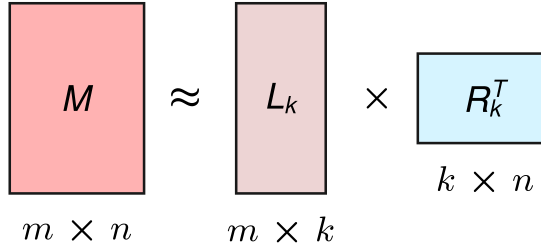

***Низкоранговая факторизация**: матрица весов $\mathbf{M}$ размера $m{\times}n$ аппроксимируется двумя меньшими множителями, которые на схеме обозначены $\mathbf{L}_k$ $(m{\times}k)$ и $\mathbf{R}_k^T$ $(k{\times}n)$ и соответствуют $\mathbf{U}_k$ и $\mathbf{V}_k^T$ в окружающих обозначениях. Объем хранения падает с $m \times n$ до $m \times k + k \times n$ параметров, а одна плотная операция превращается в две операции с множителями.*

LRMF применяется непосредственно к полносвязным проекционным слоям и к развернутым тензорам весов сверточных слоев. Вычисление факторизованного слоя заменяет одно плотное матрично-векторное произведение двумя последовательными умножениями и снижает объем хранения параметров и арифметических операций с $\mathcal{O}(mn)$ до $\mathcal{O}(k(m+n))$. На современных ускорителях, однако, такое разделение создает конкретные системные компромиссы: промежуточный вектор активаций $\mathbf{z} = \mathbf{V}^T \mathbf{x}$ нужно хранить в SRAM на кристалле или пересылать через память, а запуск двух отдельных ядер несет задержку, если операции не слиты. Кроме того, если ранг аппроксимации $k$ мал или не выровнен по размерам аппаратных тайлов (например, систолических массивов $16{\times}16$), вычислительные блоки работают заметно ниже пиковой пропускной способности. Выбор ранга $k$ поэтому балансирует сокращение памяти и пропускной способности с ошибкой аппроксимации, накладными расходами на запуск ядер и загрузкой аппаратных тайлов.

<a id="sec-model-compression-tensor-decomposition-5e9e"></a>

#### Разложение тензора

**Разложение тензора** распространяет низкоранговую аппроксимацию на многомерные массивы, например четырехмерные сверточные ядра ($C_{\text{out}} \times C_{\text{in}} \times K_h \times K_w$) и веса многоголового внимания. Развертывание этих параметров в двумерные матрицы отбрасывает пространственные и межканальные корреляции, что приводит к плохой точности аппроксимации при данном бюджете ранга. Разложения тензоров сохраняют многомерную структуру, представляя тензор через мультилинейные произведения множителей меньшей размерности. [«Разложение тензора»](10_model_compression.md#fig-tensor-decomposition) иллюстрирует каноническое полиадическое разложение трехмерного тензора и показывает, как внешние произведения векторов множителей восстанавливают отдельные элементы тензора по рангу $R$.

<a id="fig-tensor-decomposition"></a>

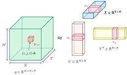

***Разложение тензора**: трехмерный тензор $y\in\mathbb{R}^{M{\times}N{\times}T}$ аппроксимируется матрицами множителей U, X и V. Выделенные векторы множителей $\mathbf{u}_i$, $\mathbf{x}_t$ и $\mathbf{v}_j$ комбинируются по рангу R, восстанавливая элемент $y_{ijt}$. Перенос низкоранговой аппроксимации из двух измерений в три переносит аргументы о хранении и вычислениях на сверточные слои. Источник: (Gholami et al., 2022).*

Разные форматы разложения по-разному обменивают сокращение параметров на сложность свертки. **CP-разложение** представляет тензор как сумму компонент ранга один, $\mathcal{X} \approx \sum_{r=1}^{k} \mathbf{u}_r \otimes \mathbf{v}_r \otimes \mathbf{w}_r$ (Lebedev et al., 2015), давая максимальное сокращение параметров, но часто страдая численной нестабильностью при оптимизации ранга. **Разложение Таккера** ослабляет это ограничение, сохраняя малое плотное ядро-тензор, умноженное по каждой моде на ортогональные матрицы множителей, $\mathcal{X} \approx \mathcal{G} \times _1 \mathbf{U} \times _2 \mathbf{V} \times _3 \mathbf{W}$. **Тензорный поезд (TT)** раскладывает тензор высокого порядка в линейную цепочку ядер-тензоров третьего порядка, свернутых по общим вспомогательным индексам, избегая экспоненциального роста по порядку тензора, который ограничивает ядра Таккера.

В системах глубокого обучения разложение тензоров сжимает четырехмерные сверточные фильтры, проекции многоголового внимания и большие таблицы эмбеддингов токенов. Однако выполнение тензорных свертков на промышленных ускорителях упирается в серьезный системный барьер: современная аппаратура сильно специализирована под плотное двумерное матричное умножение (GEMM). Свертка разложенных тензоров требует либо переупаковки раскладки памяти через явные ядра транспонирования, либо выполнения нескольких малых сверток с несогласованным доступом к памяти. Если не использовать специализированные слитые ядра свертки, перемещение памяти и задержка запуска ядер для разложенных операций могут легко свести на нет теоретическую экономию арифметики. [«Матричная и тензорная факторизация»](10_model_compression.md#tbl-lrmf-tensor) сравнивает LRMF и разложение тензоров по структурам данных, механизмам сжатия и компромиссам выполнения.

| **Признак**                   | **Низкоранговая матричная факторизация (LRMF)**                     | **Разложение тензора**                                                                                       |
|:------------------------------|:--------------------------------------------------------------------|:-------------------------------------------------------------------------------------------------------------|
| **Применимая структура данных** | Двумерные матрицы                                                 | Многомерные тензоры                                                                                          |
| **Механизм сжатия**           | Раскладывает матрицу на две или более матрицы меньшего ранга        | Раскладывает тензор на несколько компонент меньшего ранга                                                    |
| **Распространенные методы**   | Сингулярное разложение (SVD), попеременные наименьшие квадраты (ALS) | CP-разложение, разложение Таккера, тензорный поезд (TT)                                                      |
| **Вычислительная стоимость**  | Зависит от метода факторизации, выбранного ранга и ядер             | Зависит от разложения, выбранных рангов, процедуры оптимизации и ядер тензорных сверток                       |
| **Сокращение хранения**       | Сокращает хранение с $\mathcal{O}(mn)$ до $\mathcal{O}(mk + kn)$    | Зависит от разложения и выбранных рангов; хранит матрицы-множители и для некоторых методов ядро-тензор         |
| **Выполнение вывода**      | Заменяет одну плотную операцию двумя операциями с множителями       | Вводит тензорные свертки, задержка которых зависит от доступных ядер                                          |
| **Основные сценарии**         | Полносвязные слои, эмбеддинги, рекомендательные системы             | Сверточные фильтры, механизмы внимания, мультимодальное обучение                                              |
| **Сложность реализации**      | Проще в реализации, часто использует прямые методы факторизации     | Сложнее, требует итеративной оптимизации и выбора ранга                                                      |

<a id="tbl-lrmf-tensor"></a>

***Матричная и тензорная факторизация**: LRMF применима к двумерным матрицам, тогда как разложения тензоров распространяют низкоранговые представления на многомерные тензоры; реальные хранение и задержка зависят от выбора ранга и поддержки ядер.*

В промышленных конвейерах эти структурные аппроксимации часто комбинируют: LRMF применяют к большим линейным проекциям и таблицам эмбеддингов, а многомерные сверточные слои обрабатывают разложениями тензоров. В таксономии D·A·M структурная аппроксимация меняет Алгоритм, чтобы снять узкие места Машины по емкости и пропускной способности памяти. Когда задержка обслуживания строго ограничена памятью, как при авторегрессивной генерации токенов по одному батчу, сокращение байтов весов, передаваемых из DRAM, напрямую переходит в снижение задержки. Когда обслуживание ограничено вычислениями, накладные расходы на несколько операций с множителями и фрагментированный доступ к памяти могут обнулить эти выигрыши.

Прореживание и факторизация изменяют существующие параметризации моделей, тогда как дистилляция переносит поведение в независимо обученную модель-ученика. Поиск нейронной архитектуры идет принципиально другим путем: он находит архитектуры, которые эффективны по построению.

<a id="sec-model-compression-neural-architecture-search-cf12"></a>

### Поиск нейронной архитектуры

Прореживание, дистилляция и факторизация предполагают существующую топологию, созданную человеческой интуицией. Выбор конкурентоспособной конфигурации может требовать обширных экспериментов, а ручной перебор рискует оставить эффективные архитектурные варианты необнаруженными (Elsken et al., 2019). **Поиск нейронной архитектуры (NAS)** автоматизирует часть этого процесса, исследуя заданное пространство архитектур и целей. Ранний NAS на основе обучения с подкреплением оптимизировал точность на валидации (Zoph and Le, 2016), методы с разделением весов снизили стоимость оценки кандидатов (Pham et al., 2018), а NAS с учетом аппаратуры добавил в целевую функцию задержку на устройстве или эффективность платформы (Tan et al., 2019).

Цикл оптимизации на рисунке [«Поток поиска нейронной архитектуры»](10_model_compression.md#fig-nas-flow) формализует процедуру поиска. NAS[^fn-nas-hardware-aware] задает пространство поиска архитектурных компонентов и ограничений, применяет стратегию, например обучение с подкреплением (Zoph and Le, 2016), эволюционный поиск или оптимизацию на основе градиентов, и оценивает кандидатов по целям точности и эффективности. Каждая оценка возвращает метрики производительности контроллеру поиска, направляя дальнейшие предложения кандидатов в области, которые балансируют точность решения с бюджетами физических ресурсов.

[^fn-nas-hardware-aware]: **NAS с учетом аппаратуры**: оптимизирует измеренную задержку, а не FLOP, которые могут расходиться в 3–5 раз, когда доминируют доступ к памяти или поддержка операторов. Tan et al. (2019) подали задержку на устройстве в поиск и нашли архитектуры, которые в 1,8 раза быстрее MobileNetV2 при большей точности.

<a id="fig-nas-flow"></a>

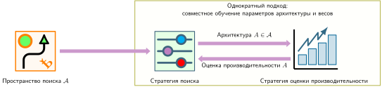

***Поток поиска нейронной архитектуры**: автоматизированный цикл оптимизации для открытия архитектур. Стратегия поиска выбирает кандидатные подсети из заранее заданного пространства поиска, а движок оценки производительности проверяет кандидатов по целевой точности и аппаратным ограничениям (таким как задержка или энергия), возвращая сигналы вознаграждения, чтобы направить дальнейший поиск к Парето-оптимальным решениям.*

<a id="sec-model-compression-nas-optimization-problem-7f8e"></a>

#### Задача оптимизации NAS

Эффективность NAS зависит от трех проектных решений: по каким архитектурам вести поиск (пространство поиска), как эффективно исследовать это пространство (стратегия поиска) и как оценивать пригодность каждого кандидата для развертывания. Задача оптимизации начинается с ограничения «что было раньше: курица или яйцо»: нельзя узнать, насколько хороша архитектура, пока ее не обучишь, а обучение дорого. Отсюда возникают два вложенных решения: какие операции включить (архитектура) и как найти лучшие параметры для этих операций (веса). Архитектура определяет, *что* оптимизировать; веса определяют, *насколько хорошо* эта архитектура может работать.

Поэтому NAS является **двухуровневой задачей оптимизации**.[^fn-bilevel-optimization-nas] Внешний цикл ищет по пространству архитектур $\mathcal{A}$, а внутренний цикл обучает кандидатные архитектуры для оценки качества. Формально мы ищем оптимальную архитектуру $\alpha^*$, которая минимизирует валидационную функцию потерь $\mathcal{L}_{\text{val}}$ при ограничениях $C$ (задержка, память):
$$
\alpha^* = \operatorname{arg\,min}_{\alpha \in \mathcal{A}} \mathcal{L}_{\text{val}}(\theta^*(\alpha), \alpha) \quad \text{при условии} \quad C(\alpha) \leq C_{\text{max}}
$$
где $\theta^*(\alpha)$ — оптимальные параметры модели для архитектуры $\alpha$, полученные минимизацией обучающей функции потерь:
$$
\theta^*(\alpha) = \operatorname{arg\,min}_{\theta} \mathcal{L}_{\text{train}}(\theta, \alpha)
$$

[^fn-bilevel-optimization-nas]: **Двухуровневая оптимизация**: постановка, в которой одна задача оптимизации находится внутри другой. В NAS внешний уровень выбирает архитектуру, а внутренний обучает веса этого кандидата, поэтому ранние методы платили полную стоимость обучения за каждую оцененную архитектуру. Это вложение объясняет, почему раннему NAS требовались 22 400 GPU-дня; методы с разделением весов амортизируют один прогон обучения на множество кандидатов, сокращая стоимость поиска примерно в 1 000 раз.

Вычислительное узкое место лежит во внутреннем цикле. Если оценка каждого кандидата требует независимого обучения с нуля, даже скромное пространство поиска из 10 вариантов операций на 20 слоях дает $10^{20}$ возможных архитектур, и полный перебор становится невозможен. Практические методы NAS преодолевают этот комбинаторный взрыв тремя механизмами: ограничением пространства поиска многоразовыми ячейками, амортизацией оценки через разделение весов или релаксацией дискретного выбора в непрерывную дифференцируемую формулировку.

<a id="sec-model-compression-search-space-design-62db"></a>

#### Проектирование пространства поиска

Пространство поиска определяет, какие архитектуры может открыть NAS. Хорошо спроектированные пространства поиска включают предметные знания, чтобы сосредоточить поиск на перспективных областях, оставаясь достаточно гибкими, чтобы открывать новые шаблоны.

Вместо поиска целых архитектур сетей многие системы NAS ищут многоразовые вычислительные блоки, или ячейки, которые можно складывать в полные сети. Сверточная ячейка может выбирать из операций вроде свертки $3{\times}3$, свертки $5{\times}5$, раздельной по глубине свертки, максимального пулинга или тождественных связей. Упрощенная ячейка с четырьмя узлами и двумя операциями на ребро дает примерно 10 000 возможных конструкций ячеек, что гораздо практичнее поиска полных архитектур. NASNet служит примером этого подхода: он открыл многоразовые нормальные и редукционные ячейки, которые складываются в полные сети разных размеров.

Пространства поиска также напрямую кодируют физические ограничения аппаратуры. Вместо произвольных топологических графов пространства поиска с учетом аппаратуры ограничивают кандидатные операции примитивами, у которых есть эффективные векторизованные реализации ядер на целевой платформе. Например, мобильные пространства поиска отдают предпочтение раздельным по глубине сверткам с ограниченными размерами ядер и выравниванием каналов, чтобы помещаться в строки кэша и минимизировать транзакции шины памяти (Zhang et al., 2020). MobileNetV3 сочетала такое структурированное пространство поиска на уровне блоков с NetAdapt, чтобы прореживать каналы слоев по измеренной задержке мобильного CPU (Howard et al., 2019).

<a id="sec-model-compression-search-strategies-84ad"></a>

#### Стратегии поиска

Стратегии поиска определяют, как эффективно исследовать пространство архитектур без полного перебора. [«Сравнение стратегий поиска NAS»](10_model_compression.md#tbl-nas-strategies) сопоставляет компромиссы между стоимостью поиска, разнообразием архитектур и гарантиями оптимальности для каждого подхода.

| **Стратегия**               | **Эффективность поиска** | **Когда применять**                 | **Ключевая проблема**                   |
|:----------------------------|:-------------------------|:------------------------------------|:----------------------------------------|
| **Обучение с подкреплением** | 22 400 GPU-дней         | Новые области, поиск без ограничений | Высокая вычислительная стоимость        |
| **Эволюционные алгоритмы**  | 3 150 GPU-дней           | Доступна параллельная инфраструктура | Требуются большие популяции             |
| **Градиентные (DARTS)**     | 1–4 GPU-дня              | Ограниченный бюджет вычислений      | Может сойтись к неоптимальным локальным минимумам |

<a id="tbl-nas-strategies"></a>

***Сравнение стратегий поиска NAS**: типичные компромиссы между эффективностью поиска, сценариями использования и ограничениями для разных подходов к NAS. Стоимости — результаты, специфичные для метода: ранних поисков с обучением с подкреплением и эволюционных поисков, а также DARTS, а не универсальные диапазоны для каждой стратегии (Zoph and Le, 2016; Real et al., 2019; Liu et al., 2019).*

NAS на основе обучения с подкреплением рассматривает поиск архитектуры как последовательное решение: контроллер генерирует архитектуры и получает награду за точность. Контроллер (обычно сеть с долгой краткосрочной памятью) учится предлагать лучшие архитектуры через оптимизацию градиента политики. Этот подход открыл высокоэффективные архитектуры вроде NASNet, но его внутренний цикл дорог, потому что каждая награда требует обучения кандидатной архитектуры: Zoph and Le (2016) оценили примерно 12 800 архитектур суммарно на 22 400 GPU-дней. Такая стоимость подтолкнула практический NAS к разделению весов и более дешевым предикторам производительности.

Эволюционные алгоритмы поддерживают популяцию кандидатных архитектур и итеративно применяют мутации (изменение операций, добавление связей) и кроссовер (комбинирование архитектур-родителей), чтобы порождать потомков. Отбор по пригодности сохраняет высокоэффективные архитектуры для следующего поколения, поэтому полезные компоненты, например пропускные связи или раздельные по глубине свертки, могут рекомбинироваться, а не открываться заново с нуля. AmoebaNet использовала эволюцию, чтобы на ImageNet достичь точности, сопоставимой с лучшими вручную спроектированными моделями, за 3 150 GPU-дней (Real et al., 2019). Это показывает и ценность популяционного поиска, и сохраняющуюся необходимость в прокси-задачах, разделении весов или массовом параллелизме для контроля стоимости поиска.

Градиентные методы, такие как DARTS (Differentiable Architecture Search; Liu et al., 2019), представляют пространство поиска как непрерывную релаксацию, в которой все возможные операции — взвешенные комбинации. Вместо дискретного сэмплирования DARTS оптимизирует веса архитектуры и веса модели совместно градиентным спуском. Делая поиск дифференцируемым, DARTS снижает стоимость поиска с сотен GPU-дней до одного–четырех GPU-дней, хотя непрерывная релаксация может пропускать дискретные архитектурные шаблоны, которые находят дискретные методы поиска.

NAS с учетом аппаратуры выходит за пределы теоретических подсчетов FLOP и оптимизирует напрямую метрики выполнения на целевом кремнии. Подсчет FLOP плохо коррелирует с временем выполнения, когда доминируют пропускная способность памяти, размещение в кэше или накладные расходы на запуск ядер: операция с малым числом FLOP и низкой арифметической интенсивностью простаивает в ожидании транзакций памяти и работает медленнее операции с большим числом FLOP, которая достигает насыщения вычислений по модели Roofline. MnasNet устраняет это расхождение, включая модель предсказания задержки, обученную на тысячах пар «архитектура — задержка», измеренных на мобильных телефонах. Целевая функция поиска сочетает точность и задержку через взвешенное произведение:
$$
\text{Награда}(\alpha) = \text{Точность}(\alpha) \times \left(\frac{L_{\text{lat,target}}}{L_{\text{lat}}(\alpha)}\right)^\beta
$$
где $L_{\text{lat}}(\alpha)$ — измеренная задержка, $L_{\text{lat,target}}$ — ограничение по задержке, а $\beta$ задает компромисс между точностью и задержкой. Такая формулировка штрафует архитектуры, которые превышают целевую задержку, и поощряет те, что достигают высокой точности в рамках бюджета. В описанном пространстве поиска MnasNet варьирование коэффициентов расширения инвертированных остаточных блоков давало более выраженный компромисс между точностью и задержкой, чем равномерное расширение; это показывает, как поиск может выявить неоднородные конструкции, которые узкий ручной перебор не проверил бы.

<a id="sec-model-compression-use-nas-2b47"></a>

#### Когда использовать NAS

Поиск нейронной архитектуры может найти архитектуры, превосходящие созданные вручную, но его вычислительная стоимость требует внимательно оценить, оправдано ли вложение. NAS может быть полезен для новых аппаратных платформ с необычными ограничениями, например новых архитектур ускорителей или сильно ограниченных периферийных устройств, где существующие архитектуры плохо оптимизированы. Он также может иметь смысл в масштабах развертывания, где небольшие выигрыши в эффективности оправдывают стоимость предварительного поиска, или когда семейства архитектур для облачного, периферийного и мобильного развертывания позволяют амортизировать один поиск на множество вариантов.

И наоборот, собственный NAS трудно оправдать, когда стандартные ограничения развертывания уже закрываются хорошо оптимизированными семействами архитектур. Если бюджет вычислений составляет лишь несколько GPU-дней, большие поиски с обучением с подкреплением или эволюционные поиски нереалистичны; дифференцируемые методы или методы с разделением весов, такие как DARTS, могут оставаться выполнимыми, но и им нужно обоснование масштабом развертывания и стоимостью валидации. Быстро меняющиеся требования также ослабляют аргумент, потому что цель может сдвинуться раньше, чем завершатся поиск и валидация.

Для большинства практиков готовые архитектуры, найденные NAS или созданные с его помощью, такие как EfficientNet (Tan and Le, 2019), MobileNetV3 (Howard et al., 2019) и MnasNet (Tan et al., 2019), дают сильные базовые линии до того, как финансировать поиск с нуля. Качество их переноса все равно зависит от задачи и аппаратуры. Собственный NAS стоит оставлять для необычных ограничений или масштабов развертывания, которые могут амортизировать вложения в поиск и валидацию.

<a id="sec-model-compression-architecture-examples-b1ce"></a>

#### Примеры архитектур

Исследования NAS выявили многоразовые шаблоны проектирования внутри своих пространств поиска. EfficientNet совместно масштабирует глубину, ширину и разрешение составными коэффициентами и сообщает о лучшем компромиссе между точностью и эффективностью во всем семействе моделей (Tan and Le, 2019). MobileNetV3 сочетает поиск с учетом аппаратуры и NetAdapt для целевых задержек на телефонах (Howard et al., 2019), а FBNet включает задержку конкретного устройства в целевую функцию поиска для мобильного CPU (Wu et al., 2019). Эти результаты показывают, что нашел поиск при конкретных пространствах, целях и измерениях; они не доказывают, что автоматизированный поиск универсально превосходит тщательное ручное проектирование.

Помимо сверточных сетей, NAS применяли к трансформерным архитектурам, включая поиски компактных языковых и визуальных моделей при ограничениях на вычисления или память. Общий системный урок уже, чем утверждение, что поиск всегда превосходит ручное проектирование: когда задержка, память или энергия входят в целевую функцию и измеряются на целевой платформе, поиск оценивает кандидатов по тому ресурсу, который реально ограничивает развертывание. Результат по-прежнему зависит от пространства поиска, качества прокси-оценок, бюджета оптимизации и финального переобучения.

Рассмотренные структурные методы (прореживание, дистилляция, факторизация и NAS) все оптимизируют то, *какие* вычисления выполняет модель, включая то, какие параметры существуют, какие связи сохраняются и как устроена архитектура. Эти методы могут существенно снизить число параметров и теоретические FLOP. Однако независимо от структурной эффективности каждый оставшийся вес и каждая активация по-прежнему должны храниться и обрабатываться с некоторой числовой точностью.

<a id="chk-model-compression-structural-optimization"></a>

> **Выбор структурного метода**
>
> Структурные методы по-разному перераспределяют стоимость развертывания.
>
> - [ ] **Структурное и неструктурированное прореживание**: сравните, как каждый шаблон взаимодействует с выполнением на GPU и TPU.
> - [ ] **Дистилляция и прореживание**: объясните, почему плотный ученик может сохранять точность лучше агрессивного прореживания, требуя дополнительного обучения.
> - [ ] **Выбор NAS**: определите, когда аппаратные ограничения и масштаб развертывания оправдывают поиск архитектуры вместо ручного проектирования.

Оставшиеся операции все равно должны выполняться в пределах физической пропускной способности памяти и емкости регистров. Второе измерение рамки оптимизации управляет числовой точностью этих операций. Структурные методы снижают число параметров и номинальные FLOP; оптимизация точности меняет трафик памяти и стоимость арифметики для каждого оставшегося значения. 32-битное значение с плавающей точкой занимает 4 байта, тогда как 8-битное целое — 1 байт, без учета метаданных масштаба или упаковки. Для вывода, ограниченного пропускной способностью, это меньшее представление напрямую снижает трафик памяти, если среда выполнения отображает операторы на поддерживаемые целочисленные вычислительные блоки. Хотя хорошо откалиброванные нагрузки INT8 часто сохраняют базовую точность, качество решения все же чувствительно к семейству модели, чувствительности слоев и аппаратной реализации (Jacob et al., 2018; Gholami et al., 2022).

Квантование часто является привлекательным первым экспериментом развертывания, потому что оно оставляет архитектуру нетронутой и может применяться посттренировочно. Его эффект максимален, когда связывающим ограничением становится трафик весов или активаций, а целевая платформа предоставляет эффективные низкоразрядные ядра; в противном случае оно может уменьшить артефакт, не ускорив запрос.

<a id="sec-model-compression-quantization-precision-cd46"></a>

## Квантование и числовая точность

Физический разрыв, определяющий сжатие, задается ограничениями памяти: языковая модель с 7 миллиардами параметров в FP16 требует 14 ГБ только для весов, тогда как целевой смартфон предлагает всего 8 ГБ общей оперативной памяти. Структурное прореживание может удалять слои или головы, но неструктурированные нули не уменьшают плотно хранимый артефакт развертывания без накладных расходов специального формата (Han et al., 2016). Дополнительный рычаг уменьшает разрядность, которой представляется каждый параметр: определение того, насколько можно снизить точность до того, как точность рухнет, задает практические границы квантования.

<a id="dfn-model-compression-quantization"></a>

> **Квантование**
>
> ***Квантование*** — это метод сжатия модели, который снижает точность информации, отображая непрерывные значения высокой точности на дискретное множество меньшей точности.
>
> 1.  **Значение**: преобразование FP32 в INT8 уменьшает сырой объем данных на квантованное значение в 4 раза. Реальный размер артефакта, трафик и задержка также зависят от масштабов, метаданных, упаковки, охвата операторов и целевых ядер.
> 2.  **Отличие**: в отличие от прореживания, которое уменьшает число параметров, квантование уменьшает разрядность выбранных весов и/или активаций.
> 3.  **Типичная ошибка**: распространено заблуждение, что квантование — это просто «округление». На деле это отображение с потерями, которое требует тщательной оценки диапазонов и часто квантования с учетом обучения (QAT), чтобы свести к минимуму влияние на точность.

Квантование[^fn-quantization-shannon-theory] касается каждого веса и активации нейронной сети, хранящихся с некоторой числовой точностью: FP32 (32 бита), FP16 (16 бит), INT8 (8 бит) или ниже. Поэтому разрядность становится критическим системным параметром. Она ограничивает сырой размер данных и занятость кэша, влияет на требования к пропускной способности, когда значения остаются упакованными, и определяет компромиссы по площади и пропускной способности специализированных матричных движков (раздел [«Числовая точность в ускорении ИИ»](11_hw_acceleration.md#sec-hardware-acceleration-numerics-ai-acceleration-f7be) главы [«Аппаратное ускорение»](11_hw_acceleration.md)).

[^fn-quantization-shannon-theory]: **Квантование**: восходит к теории Шеннона о представлении непрерывных сигналов дискретными значениями (Shannon, 1948). При переходе от FP32 к INT8 более четырех миллиардов представимых значений сжимаются всего до 256. Нейронные сети часто выдерживают это, потому что обученные веса сосредотачивают информацию в относительных величинах, а не в абсолютной точности: вывод INT8 при надлежащей калибровке или квантовании с учетом обучения может оставаться близким к базовой точности полного формата, тогда как методы INT4 и более низкой разрядности сильнее зависят от архитектуры и метода (Jacob et al., 2018; Gholami et al., 2022; Shen et al., 2020; Lin et al., 2024). Системное следствие в том, что жизнеспособность квантования нужно проверять для каждой модели и каждой задачи, а не предполагать по агрегированным бенчмаркам.

Могут меняться три системных свойства. Сырой объем весов падает в 4 раза при переходе от FP32 к INT8, до учета метаданных масштаба и упаковки. Трафик весов может упасть в сопоставимое число раз, если значения остаются упакованными по пути памяти, ускоряя вывод, ограниченный пропускной способностью, например декодирование некоторых больших языковых моделей (LLM) с малым батчем. Стоимость вычислений также может снизиться, если целевая платформа предоставляет эффективные ядра INT8; неподдерживаемые операторы, преобразования или запасные пути могут съесть часть выигрыша (Gupta et al., 2015; Wang et al., 2019).

Стоимость точности зависит от модели, задачи, квантователя, калибровочных данных и разрядности. Многие модели вывода сверточных нейронных сетей (CNN) хорошо переносят INT8; трансформеры, речевые модели и слои с большим числом выбросов могут требовать другой гранулярности, смешанной точности или методов с учетом обучения. Основные подходы — **посттренировочное квантование** (PTQ), **квантование с учетом обучения** (QAT) и **экстремальное квантование** для развертывания при меньшей разрядности. Они различаются стоимостью и контролем обучения, а не гарантированным порядком по точности.

Жизнеспособность каждого подхода зависит от того, насколько разрядность можно снизить у конкретной модели, прежде чем ухудшится качество. [«Иллюстративные режимы квантования»](10_model_compression.md#fig-quantization-free-lunch) показывает распространенный качественный паттерн: плато, на котором умеренное снижение разрядности почти не меняет измеряемый результат, и за ним обрыв, положение которого зависит от модели. Разрядность на любой из границ не универсальна.

<a id="fig-quantization-free-lunch"></a>

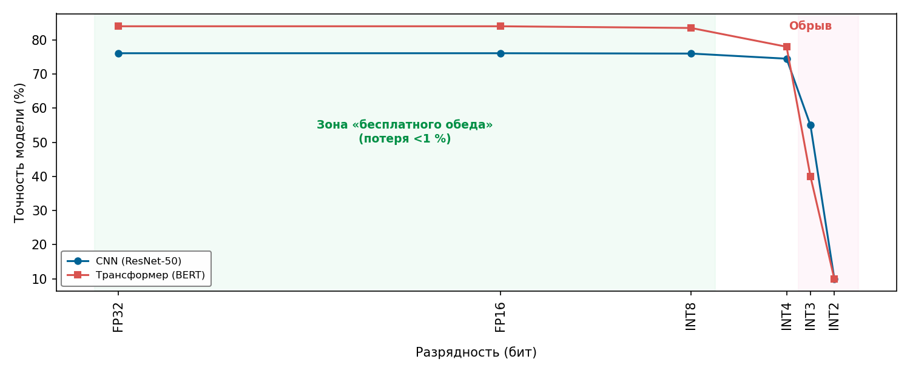

***Иллюстративные режимы квантования**: кривые показывают качественное плато, за которым следует обрыв точности при снижении разрядности. Положение точек излома иллюстративно; реальные границы зависят от модели, распределения слоев, квантователя, метода калибровки или обучения и задачи оценки.*

<a id="sec-model-compression-precision-energy-cc8e"></a>

### Точность и энергия

Выбор числовой точности — это решение об энергии, потому что физическое перемещение данных доминирует в тепловом и энергетическом бюджетах современных вычислительных систем. В кремнии энергия рассеивания прямо пропорциональна емкости проводников ($E \propto C V^2$), поэтому перемещение битов по длинным шинам памяти стоит на порядки больше джоулей, чем переключение логических элементов внутри арифметико-логического устройства. Перемещение 32-битного операнда с плавающей точкой из внешней DRAM в локальные регистры расходует заметно больше энергии, чем сама операция умножения с накоплением. Снижение числовой точности напрямую сокращает объем байтов, проходящих через иерархию памяти ($D_{\text{vol}}$), и уменьшает энергию переключения на одну операцию АЛУ ($E_{\text{compute}}$), ослабляя узкие места пропускной способности памяти и тепловые ограничения по всему аппаратному стеку.

<a id="psp-model-compression-physics-quantization"></a>

> **Физика квантования**
>
> Инвариант перемещения энергии $(E_{\text{move}} \gg E_{\text{compute}})$ означает, что в физике кремния каждый извлеченный бит несет энергетическую цену (Horowitz, 2014). Раздел [«Числа, которые нужно знать»](appendix_machine.md#sec-appdx-machine-foundations-numbers-know-b531) приложения «Основы машины» собирает эталонные энергетические соотношения, а раздел [«Числовые представления»](appendix_machine.md#sec-appdx-machine-foundations-numerical-representations-c889) того же приложения сравнивает компромиссы числовых форматов.
>
> Согласно железному закону $(T = \frac{D_{\text{vol}}}{\text{BW}} + \frac{O}{R_{\text{peak}} \cdot \eta_{\text{hw}}} + L_{\text{lat}})$, снижение разрядности меняет члены перемещения данных и вычислений только через путь выполнения, который использует новое представление. Модель упакованных значений первого порядка дает два полезных сравнения:
>
> 1.  **Перемещение памяти $(D_{\text{vol}} \times E_{\text{move}})$**: упакованный поток INT8 несет в четыре раза меньше сырых битов значений, чем FP32. Соответствующая оценка энергии предполагает, что полные транзакции амортизируются на упакованных значениях; кэши, метаданные, выравнивание и размер транзакции влияют на реально достигаемую стоимость.
> 2.  **Вычислительная работа $(O \times E_{\text{compute}})$**: умножение в 32 битах стоит ≈ 3,7 пДж/оп. Умножение в INT8 стоит ≈ 0,2 пДж/оп.
>
> [«Иерархия энергии»](10_model_compression.md#tbl-model-compression-energy-hierarchy) нормирует эти стоимости относительно сложения целых в 8 битах, чтобы показать разрыв в четыре порядка между арифметикой и доступом к DRAM.
>
> Для вывода переход от FP32 к INT8 сокращает сырое хранение значений в 4 раза, тогда как две приведенные выше стоимости умножения дают идеализированное снижение энергии умножения в 18,5 раза. Сквозная энергия также включает память, управление, датчики и потребление в простое. Раздел [«Модель Roofline»](appendix_machine.md#sec-appdx-machine-foundations-roofline-model-2529) приложения «Основы машины» придает этой связи формальный вид: нагрузки с малым числом арифметических операций на байт ограничены памятью, поэтому доминирует сокращение перемещения данных; нагрузки с большим числом операций на байт ограничены вычислениями, поэтому важнее экономия арифметики. Одного отношения арифметики недостаточно для предсказания времени работы батареи устройства.
>
> Та же физика действует и в масштабе дата-центра: распределенные системы обучения используют пониженную точность, чтобы уменьшить накладные расходы на коммуникацию градиентов, о чем рассказано в разделе [«Обучение в смешанной точности»](08_training.md#sec-model-training-mixedprecision-training-9218). Глава [«Аппаратное ускорение»](11_hw_acceleration.md#sec-hardware-acceleration) возвращается к аппаратным механизмам, которые используют эти энергетические различия.

Измерения энергии на уровне кремния объясняют, почему системы используют квантование, но сама аппаратная эффективность не определяет жизнеспособность развертывания. Рабочая область квантования зависит от двух взаимодействующих ограничений на границе D·A·M: от того, насколько алгоритм терпит численное возмущение до деградации точности на задаче, и от того, может ли машина превратить более узкие разрядности в снижение энергии и реальное ускорение. Чтобы количественно оценить аппаратную сторону этого компромисса, нужно измерить физическую энергию на каждом уровне иерархии памяти и выполнения.

<a id="sec-model-compression-energy-costs-d1d5"></a>

#### Стоимость энергии

[«Иерархия энергии»](10_model_compression.md#tbl-model-compression-energy-hierarchy) суммирует канонический разрыв между арифметикой и перемещением данных, нормируя стоимость операций относительно сложения целых в 8 битах. Перемещение данных через интерфейс памяти несет штраф в энергии, в четыре порядка превышающий выполнение арифметики на кристалле, что задает основную физическую мотивацию для снижения разрядности.

| **Операция**    |                              **Разрядность**                             |                         **Относительная энергия**                          |
|:----------------|:------------------------------------------------------------------------:|:--------------------------------------------------------------------:|
| **Сложение целых** |                                  8 бит                                   |                              1×                               |
| **Сложение с плавающей точкой** |                                  32 бита                                  | 30× |
| **Чтение DRAM** |                                  32 бита                                  | 21 333,3× |

<a id="tbl-model-compression-energy-hierarchy"></a>

***Иерархия энергии**: относительная стоимость энергии представительных арифметических операций и операций с памятью, нормированная к сложению целых в 8 битах. Сложение с плавающей точкой в 32 битах стоит в 30 раз больше своего целочисленного аналога в 8 битах, а одно чтение DRAM в 32 бита стоит в 21 333,3 раза больше, что ставит доступ к DRAM более чем на четыре порядка выше вычислений на кристалле. Именно этот разрыв делает так, что снижение разрядности, сокращающее перемещение данных, доминирует в энергетическом бюджете вывода гораздо сильнее, чем можно было бы ожидать по одной экономии арифметики (Horowitz, 2014).*

[«Энергия на операцию по точности»](10_model_compression.md#fig-quantized-energy) распространяет эту базовую линию на числовые точности и иерархию встроенной SRAM. В эталонной технологической модели на 45 нм сложение 32-битных целых стоит 0,1 пДж/оп, а сложение 8-битных целых расходует 0,03 пДж/оп. Арифметика с плавающей точкой следует той же прогрессии: сложение с плавающей точкой в 32 битах расходует примерно 0,9 пДж/оп, а в 16 битах требуется 0,4 пДж/оп. По отношению к INT8-сложению в 0,03 пДж чтения встроенной SRAM занимают от 5 до 50 пДж — множитель от 167 до 1 667 раз, — что показывает: размещение операндов в иерархии кэшей определяет энергию так же сильно, как сам формат арифметики. Доступ к внешней DRAM стоит еще дороже. В масштабе эти различия по операциям накапливаются по миллиардам параметров и операций. Для нагрузок, ограниченных памятью, перемещение неквантованных параметров по высокоемким шинам DRAM насыщает пропускную способность и доминирует в потреблении мощности ускорителя (Patterson et al., 2021); на энергетически ограниченных периферийных устройствах избыточная разрядность напрямую истощает запас батареи и нарушает тепловые пределы.

<a id="fig-quantized-energy"></a>

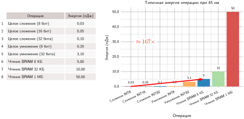

***Энергия на операцию по точности**: представительные стоимости энергии в технологии 45 нм лежат от 0,03 пДж для сложения INT8 до 3,10 пДж для умножения INT32 и от 5 до 50 пДж для показанных чтений SRAM. Диагональ отмечает чтение 8 КБ примерно в 167 раз дороже энергии сложения INT8; полный диапазон чтений SRAM составляет примерно от 167 до 1 667 раз относительно этой базовой линии. Значения энергии взяты из (Horowitz, 2014).*

<a id="sec-model-compression-energy-dividend"></a>

### Энергетический дивиденд: INT8 против FP32

Снижение объема памяти часто служит первой мотивацией квантования, но арифметика пониженной точности может также дать **энергетический дивиденд**. Переход от FP32 к INT8 уменьшает сырой объем значений ровно в 4 раза; отношение энергии на уровне операции может быть больше, тогда как сквозная энергия по-прежнему зависит от нагрузки и устройства.

Иерархия энергии в аппаратуре раскрывает эту операционную асимметрию. В используемой здесь эталонной технологической модели сложение FP32 стоит 0,9 пДж/оп, а сложение INT8 — 0,03 пДж/оп, то есть операция INT8 дешевле по энергии в 30 раз. Это отношение не является предсказанием времени работы батареи на уровне устройства: остаются доступ к памяти, точность накопления, управление, датчики и потребление в простое. Оно, однако, объясняет, почему многие ускорители добавляют специализированные блоки низкой точности и почему квантование может быть необходимо, когда связывающим ограничением становится энергия арифметики или памяти.


*Квантование окупается только тогда, когда ось машины содержит подходящие целочисленные блоки.*

Эти энергетические выигрыши фундаментально меняются, когда связывающим физическим ограничением становится емкость памяти, а не пропускная способность вычислений. Рекомендательные модели превращают энергетический аргумент в задачу размещения: квантование должно сжать доминирующие структуры памяти настолько, чтобы они помещались в физическую память машины-хоста.

<a id="lhs-model-compression-dlrm-embedding-quantization"></a>

> **DLRM и квантование эмбеддингов**
>
> Маячная модель DLRM ([«Разреженные архитектуры: рекомендательные системы»](06_nn_architectures.md#sec-network-architectures-sparse-architectures-recommendation-systems-5d19)) представляет задачу сжатия, в которой связывающим ограничением становится емкость памяти, а не пропускная способность вычислений или памяти (Naumov et al., 2019). Ее таблицы эмбеддингов могут достигать терабайтов, намного превышая память GPU.
>
> Для DLRM квантование нацелено на плотность хранения, а не на пропускную способность арифметики. Снижение точности таблиц эмбеддингов с FP32 до INT8 (или ниже) уменьшает объем памяти в 4–8 раз, позволяя более крупным таблицам помещаться на меньшем числе GPU, если точность и ядра поиска переносят пониженную точность. Сжатие таблиц поиска гарантирует, что физическая память устройства может вместить алгоритмическую модель.

Помимо прямой экономии вычислений, снижение числовой точности уменьшает энергию памяти, которая часто доминирует в общей мощности системы. Обращение к памяти, особенно к внешней DRAM, гораздо энергоемче вычисления арифметики: представительное чтение DRAM в 32 бита, используемое в этой главе, стоит 640 пДж, тогда как кэш и арифметические операции измеряются в масштабе пикоджоулей. Полная энергия инструкции поэтому определяется трафиком памяти, а не вычислениями АЛУ.[^fn-int8-energy-deployment]

Вместе DLRM и маячная модель TinyML ([«Императив квантования TinyML»](10_model_compression.md#lhs-model-compression-tinyml-quantization-imperative)) иллюстрируют два операционных крайних случая этого ограничения памяти. DLRM использует пониженную точность, чтобы уместить таблицы эмбеддингов терабайтного масштаба в память хоста; TinyML использует пониженную точность, чтобы держать каждый вывод внутри крошечного энергетического бюджета и нескольких сотен килобайт встроенной SRAM.

[^fn-int8-energy-deployment]: **Влияние INT8 на энергию**: доминирование энергии доступа к памяти экстремально: при используемых здесь константах Horowitz одно 32-битное чтение DRAM стоит примерно в 2 782,6 раза больше энергии умножения с накоплением INT8 (Horowitz, 2014). Квантование с FP32 до INT8 бьет по этому разрыву с двух сторон — в 4 раза меньше переносимых байтов *и* более дешевая арифметика на операцию, — хотя реальная экономия энергии зависит от иерархии памяти, ядер и нагрузки.

<a id="lhs-model-compression-tinyml-quantization-imperative"></a>

> **Императив квантования TinyML**
>
> Маячная модель распознавания ключевых слов (KWS), DS-CNN, находится на противоположном от DLRM краю железного закона (Zhang et al., 2017). Типичный бюджет TinyML составляет примерно 512 КБ SRAM, и даже специально построенный распознаватель ключевых слов DS-CNN превышает его в FP32: его веса занимают 800 КБ. После квантования в INT8 та же сеть уменьшается до 200 КБ и помещается с запасом для буферов времени выполнения. Более жесткий микроконтроллер умного дверного звонка с 256 КБ SRAM оставляет для весов модели около 100 КБ после буферов времени выполнения, аудиоокон и состояния извлечения признаков, что мотивирует более агрессивное сжатие в INT4 или бинарное.
>
> В FP32 даже компактная архитектура DS-CNN перемещает в 4 раза больше сырых байтов весов, чем в INT8, а арифметический путь может также стоить дороже на аппаратуре с эффективными целочисленными блоками. Для постоянно работающего устройства с батарейкой-таблеткой это снижение способствует большему времени работы батареи, но стоимость датчиков, пробуждения, извлечения признаков и потребления в простое может доминировать. Здесь квантование снижает член перемещения данных модели и может улучшить вычислительный член $(O / (R_{\text{peak}} \cdot \eta_{\text{hw}}))$, если поддерживается целочисленный путь.

Снижение числовой точности, таким образом, бьет по физической стоимости выполнения на двух разных фронтах: задержка арифметики в АЛУ и трафик байтов по шине памяти. То, как эти снижения переходят в реальное ускорение, напрямую зависит от того, ограничена ли нагрузка пропускной способностью вычислений или пропускной способностью памяти.

<a id="sec-model-compression-performance-gains-0656"></a>

#### Выигрыш в производительности

[«Иллюстративный сценарий квантования»](10_model_compression.md#fig-quantization-impact) сравнивает иллюстративные альтернативы FP32 и INT8. Парные столбцы не являются измерениями задержки на общей платформе; панель хранения показывает точное четырехкратное снижение с 32 до 8 бит.

<a id="fig-quantization-impact"></a>

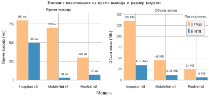

***Иллюстративный сценарий квантования**: парные столбцы разделяют альтернативы FP32 и INT8. Правая панель показывает сырое хранение весов, где снижение каждого веса с 32 до 8 бит дает точное уменьшение в четыре раза; левая панель показывает иллюстративные, зависящие от архитектуры изменения задержки.*

Большие языковые модели показывают, как точность весов определяет физическую осуществимость памяти в масштабе.

<a id="nbk-model-compression-quantization-savings"></a>

> **Экономия при квантовании**
>
> **Задача**: развертывание Llama 3 с 8 млрд параметров требует хранить 8 млрд параметров на устройстве. Сколько памяти занимает модель в FP16 и в INT4, и достаточно ли квантование сжимает ее, чтобы поместиться на одном потребительском GPU?
>
> **FP16**
>
> - **Размер сырых весов**: 8 $\times 10^9 \times$ 2 байта (16 бит) = 16 ГБ
> - **Бюджет времени выполнения**: 16 ГБ не оставляют запаса; практичен устройство класса 24 ГБ.
>
> **INT4**
>
> - **Размер сырых весов**: 8 $\times 10^9 \times$ 0,5 байта (INT4) = 4 ГБ
> - **Бюджет времени выполнения**: 4 ГБ оставляют около 4 ГБ на устройстве с 8 ГБ для метаданных, кэша, активаций и рабочей области.

Помимо экономии хранения, квантование ускоряет арифметику за счет параллелизма данных в аппаратных регистрах. Блоки векторного выполнения фиксированной ширины (SIMD) и систолические массивы обрабатывают больше операндов за такт, когда каждый операнд занимает меньше битов.

<a id="nbk-model-compression-simd-multiplier"></a>

> **Множитель SIMD**
>
> **Задача**: вычислительно ограниченный слой выполняется в INT8 вместо FP32 на том же процессоре. Откуда берется ускорение?
>
> **Механизм**: выполнение SIMD. Ядро CPU или GPU обрабатывает данные в векторных регистрах фиксированной ширины (например, AVX-512 имеет ширину 512 бит).
>
> **Расчет**:
>
> 1.  **Ширина регистра**: 512 бит.
> 2.  **Емкость FP32**: 512/32 = 16 элементов за векторную инструкцию.
> 3.  **Емкость INT8**: 512/8 = 64 элемента за векторную инструкцию.
>
> **Результат**: переход на INT8 упаковывает в тот же регистр в 4 раза больше элементов.
> $\text{Прирост пропускной способности} = \text{элементов INT8/инстр.} / \text{элементов FP32/инстр.}$ = 64/16 = 4 (в 4 раза)
>
> **Системный вывод**: квантование дает ускорение вычислительно ограниченных слоев до 4 раз только за счет упаковки векторов на аппаратуре, где целочисленные векторные инструкции INT8 имеют сопоставимую с FP32 пропускную способность, даже до учета экономии пропускной способности памяти.

Снижение числовой точности, однако, вносит компромиссы. Форматы низкой точности могут вызывать численную нестабильность и шум квантования, потенциально влияя на точность модели. [«Иллюстративные совокупные остатки квантования»](10_model_compression.md#fig-quantization-error-dist) показывает иллюстративное распределение остатков, агрегированное по значениям с разнородными масштабами и возможным отсечением. Для идеального равномерного квантователя ошибка округления внутри диапазона, напротив, ограничена интервалом $[-\Delta/2, \Delta/2]$; ошибки за пределами этого интервала возникают из-за отсечения или агрегирования разных размеров шага. Некоторые архитектуры, например большие трансформерные модели NLP, хорошо переносят квантование, тогда как другие могут заметно деградировать. Поэтому выбор подходящей числовой точности требует баланса между ограничениями по точности, поддержкой аппаратуры и выигрышами в эффективности.

<a id="fig-quantization-error-dist"></a>

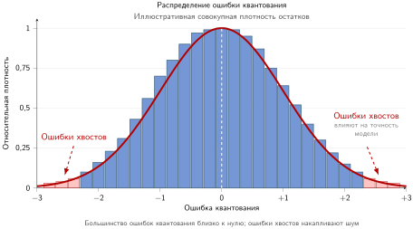

***Иллюстративные совокупные остатки квантования**: иллюстративное совокупное распределение остатков по разнородным масштабам и отсеченным значениям. Внутри одного неотсеченного равномерного квантователя ошибка округления ограничена интервалом $[-\Delta/2, \Delta/2]$; показанные хвосты представляют отсечение или агрегирование по разным размерам шага.*

Пока шум квантования удерживается в пределах, системная цель пониженной точности — ускорение по реальному времени. Величина и физическая природа этого ускорения напрямую зависят от того, ограничено ли выполнение вычислениями или памятью.

<a id="nbk-model-compression-quantization-speedup-compute-bound"></a>

> **Ускорение квантованием (ограниченное вычислениями)**
>
> **Задача**: вычислительно ограниченное матричное умножение (например, в блоке многослойного перцептрона трансформера) переходит с FP16 на INT8. Каково ожидаемое ускорение?
>
> **Расчет**: на современной аппаратуре с выделенными блоками INT8:
>
> 1. **Путь целочисленной пропускной способности**: эталонный ускоритель класса A100 оценивает свои выделенные матричные блоки INT8 в 624 TOPS против 312 TFLOP/s на пути FP16 (NVIDIA Corporation, 2020; Choquette et al., 2021). Прирост пиковой пропускной способности равен этому отношению из спецификации: 624 TOPS ÷ 312 TFLOP/s ≈ 2 (в 2 раза).
> 2. **Пропускная способность памяти**: веса INT8 вдвое меньше, поэтому их загрузка из памяти занимает вдвое меньше времени.
> 3. **Совокупный эффект**: для операций, ограниченных вычислениями, ускорение в основном дает пропускная способность вычислений: примерно в 2 раза.
>
> **Системный вывод**: ускорение от квантования зависит от узкого места. Операции, ограниченные вычислениями (большие батчи, высокая арифметическая интенсивность $I$), получают примерно двукратное ускорение от более быстрых блоков INT8, и выигрыш здесь происходит от целочисленного матричного пути, а не от сокращения трафика памяти. Случай, ограниченный пропускной способностью, работает наоборот: вдвое меньше перемещаемых байтов (с FP16 на INT8) дает выигрыш до 2 раз, а большие сокращения разрядности масштабируют выигрыш дальше, как показывает следующий разобранный пример.

Когда операция ограничена пропускной способностью, ускорение следует за сокращением байтов, передаваемых на токен, а не за пиковой пропускной способностью арифметики. При авторегрессивной генерации токенов с малыми батчами трафик шины памяти доминирует в задержке.

<a id="nbk-model-compression-quantization-speedup"></a>

> **Ускорение квантованием**
>
> **Задача**: сценарий развертывания требует запустить LLM с 7 млрд параметров на устройстве с 16 ГБ ОЗУ. Веса в FP16 (2 байта).
>
> **Расчет**:
>
> 1.  **Размер модели**: 7 $\times 10^9 \times$ 2 байта = 14 ГБ.
> 2.  **KV-кэш**: FP16 KV-кэш на 4 096 токенов использует два тензора (ключи и значения) по 32 слоям, 32 головам KV, 128 измерениям на голову и 2 байта на значение, что требует примерно 2,1 ГБ.
> 3.  **Полная память**: 14 ГБ + 2,1 ГБ = 16,1 ГБ. Это превышает емкость устройства еще до памяти операционной системы и рабочей области.
> 4.  **Стоимость пропускной способности**: в упрощенной модели полного трафика кэша загрузка весов и KV-кэша при 50 ГБ/с занимает 323 мс на токен. Это 3,1 токена/с — слишком медленно для диалога.
>
> **Исправление (INT4)**:
>
> 1.  **Квантование**: перевести веса в INT4 (0,5 байта).
> 2.  **Новый размер**: 7 $\times 10^9 \times$ 0,5 байта = 3,5 ГБ весов или 5,6 ГБ с учетом неизменного FP16 KV-кэша.
> 3.  **Новая скорость**: загрузка этого объема занимает 113 мс. Скорость растет до 9 токенов/с.
>
> **Системный вывод**: квантование весов делает конфигурацию пригодной по памяти и дает ускорение в 2,9 раза в заявленной модели трафика, что меньше четырехкратного выигрыша из-за неизменного трафика FP16 KV-кэша.

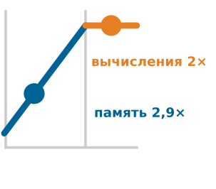

*Ускорение от квантования зависит от того, что ограничивает выполнение: пропускная способность памяти или пропускная способность вычислений.*

<a id="sec-model-compression-numerical-format-comparison-8fa2"></a>

### Сравнение числовых форматов

Ускоряет ли квантование выполнение, зависит напрямую от того, ограничен ли оператор пропускной способностью памяти или вычислениями. Для ядер, ограниченных памятью, сокращение разрядности уменьшает число байтов, переданных по шине памяти, и напрямую повышает эффективную пропускную способность. Для ядер, ограниченных вычислениями, ускорение требует специализированных арифметических блоков, способных выполнять больше операций низкой точности за такт. Поэтому выбор числового формата требует баланса между динамическим диапазоном и поддержкой выполнения на аппаратуре, с одной стороны, и трафиком памяти, с другой, а не слепой минимизации разрядности. [«Форматы числовой точности»](10_model_compression.md#tbl-numerics) сравнивает форматы точности, которые обычно применяют в архитектурах ускорителей, и сопоставляет сокращение объема хранения, выигрыш в арифметической пропускной способности и целевую аппаратуру относительно стандартного 32-битного формата с плавающей точкой (FP32).

| **Формат точности**              | **Разрядность** | **Сокращение хранения (относительно FP32)** |             **Скорость вычислений (относительно FP32)**            |         **Влияние на мощность**         | **Сценарии использования**                                  |
|:---------------------------------|:-------------:|:--------------------------------:|:---------------------------------------------------:|:--------------------------------:|:------------------------------------------------------------|
| **FP32**                         |     32 бита    |       Базовое (1×)       |                 Базовая (1×)                |             Базовое             | Обучение и вывод (универсальный)                      |
| **FP16**                         |     16 бит    |        в 2 раза меньше         | До 2× пиковой на выбранной поддерживаемой аппаратуре | Зависит от аппаратуры и нагрузки | Ускоренное обучение, вывод (тензорные ядра NVIDIA, TPU) |
| **BF16 (Brain Floating Point)**  |     16 бит    |        в 2 раза меньше         |           Зависит от аппаратуры и нагрузки          | Зависит от аппаратуры и нагрузки | Обучение на TPU, трансформерные модели                  |
| **TF32 (TensorFloat-32)**        |     19 бит    |      Нет (хранится как FP32)       |  До 8× пиковой на тензорных ядрах NVIDIA Ampere | Зависит от аппаратуры и нагрузки | Обучение на GPU NVIDIA                                     |
| **FP8 (8-битная плавающая точка)**   |     8 бит     |        в 4 раза меньше         |           Зависит от аппаратуры и нагрузки          | Зависит от аппаратуры и нагрузки | Эффективное обучение и вывод (H100, ИИ-ускорители)        |
| **INT8 (8-битное целое)**         |     8 бит     |        в 4 раза меньше         |           Зависит от аппаратуры и нагрузки          | Зависит от аппаратуры и нагрузки | Квантованный вывод (периферийный ИИ, мобильный ИИ, NPU)              |
| **INT4 (4-битное целое)**         |     4 бита     |        в 8 раз меньше         |           Зависит от аппаратуры и нагрузки          | Зависит от аппаратуры и нагрузки | Сверхнизкое энергопотребление, экспериментальное квантование               |
| **Бинарные/троичные (1–2 бита)** |    1–2 бита    |      в 16–32 раза меньше      |           Зависит от аппаратуры и нагрузки          | Зависит от аппаратуры и нагрузки | Предельная эффективность (бинарные и троичные нейронные сети)         |

<a id="tbl-numerics"></a>

***Форматы числовой точности**: отношения хранения отражают ширину сырого значения; скорость вычислений и влияние на мощность зависят от поддержки аппаратуры и поведения нагрузки.*

При 16 битах FP16 и BF16 вдвое уменьшают объем памяти по сравнению с FP32, одновременно используя специализированные блоки матричных вычислений, например тензорные ядра NVIDIA и TPU Google, для ускорения арифметики. Однако их внутреннее распределение битов по-разному обменивает числовой диапазон на точность мантиссы. BF16 сохраняет 8-битную экспоненту FP32 и поэтому динамический диапазон примерно от $10^{-38}$ до $10^{38}$, а дробная часть сокращается до 7 бит. FP16, напротив, отводит 5 бит на экспоненту и 10 бит на дробную часть; это дает большую точность, но ограничивает максимальное конечное значение числом 65 504, а нормальные значения при меньших величинах, чем примерно $6{,}1\times10^{-5}$, обнуляются (субнормальные — до $6{,}0\times10^{-8}$). Поэтому обучение в FP16 обычно требует масштабирования потерь и накопительных регистров FP32, чтобы не допустить исчезновения и переполнения градиентов, тогда как широкий диапазон экспоненты BF16 позволяет стандартной динамике обучения работать без масштабирования. TensorFloat-32 (TF32) представляет гибридный компромисс: он сохраняет 8-битную экспоненту FP32 и 10-битную дробную часть FP16, выполняется на тензорных ядрах для ускорения матричного умножения, а значения хранятся в стандартной 32-битной памяти. Сравнение битовых раскладок FP32, FP16 и BF16 показывает, как каждый формат распределяет поля знака, экспоненты и мантиссы, чтобы сбалансировать динамический диапазон и точность ([«Битовые раскладки чисел с плавающей точкой»](10_model_compression.md#fig-3float)).

<a id="fig-3float"></a>

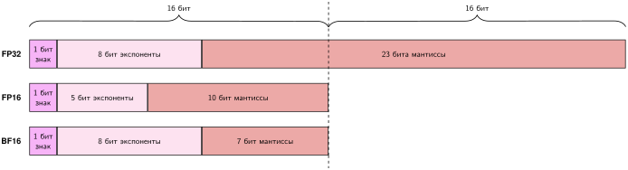

***Битовые раскладки чисел с плавающей точкой**: распределение битов обменивает динамический диапазон на точность мантиссы. FP32 использует 8 битов экспоненты и 23 бита дробной части. BF16 сохраняет 8-битную экспоненту FP32 и поэтому близкий числовой диапазон, но сокращает дробную часть до 7 бит. FP16 использует 5 битов экспоненты и 10 битов дробной части, обеспечивая большую точность мантиссы, чем BF16, но более узкий диапазон, который может требовать масштабирования потерь при обучении.*

Для нагрузок вывода точность INT8 дает четырехкратное сокращение сырого объема хранения по сравнению с FP32, сохраняя приемлемую точность предсказаний. Вывод обходит проход обратного распространения градиентов и устраняет малые по величине обновления с большим динамическим диапазоном, которые при обучении приводят к исчезновению значений. Поэтому активации и веса без труда отображаются на знаковые 8-битные целые ($[-128, 127]$) с помощью равномерного аффинного или симметричного масштаба квантования. В режимах вывода, ограниченных пропускной способностью, например при авторегрессивной генерации токенов языковой моделью, это сокращение объема в 4 раза разгружает шину памяти, уменьшая трафик DRAM и кэша. Для операторов, ограниченных вычислениями, выделенные блоки векторных и тензорных вычислений INT8 дают большую плотность арифметических операций за такт и на единицу площади кристалла, чем эквивалентные блоки с плавающей точкой.

Бинарные и троичные сети представляют теоретический предел снижения точности: веса и активации ограничиваются одним битом ($\{-1, +1\}$) или троичным набором ($\{-1, 0, +1\}$), чтобы заменить умножители с плавающей точкой побитовыми логическими операциями XNOR и подсчетом единиц. Однако поскольку стандартная память адресует байты, а не отдельные биты, представления менее байта требуют упаковки значений в 8- или 32-битные слова, что добавляет накладные расходы на побитовые сдвиги и маски, если пользовательские аппаратные тракты данных не поддерживают их напрямую. Сильная дискретизация также ограничивает распространение градиента при обучении, делая точность решения чувствительной к формулировке суррогатного градиента и стабилизации обучения. Маячная модель распознавания ключевых слов ([«Эффективные архитектуры: распознавание ключевых слов»](06_nn_architectures.md#sec-network-architectures-efficient-architectures-keyword-spotting-0625)) иллюстрирует режим работы, где экстремальное сжатие необходимо, чтобы уложиться в жесткий бюджет SRAM в ~512 КБ. INT8 задает базовую цель; INT4, бинарные или троичные представления обменивают дополнительный числовой динамический диапазон на соблюдение более строгих ограничений памяти и мощности.

Различия в энергии арифметики завершают физический аргумент в пользу квантования. Представления низкой точности снижают энергопотребление по двум разным физическим путям: сокращается перемещение памяти по шине и уменьшается энергия переключения, необходимая для каждой арифметической операции. Полное умножение с накоплением в INT8, например, использует примерно в 20 раз меньше энергии, чем его эквивалент в FP32. Ускорители с собственными блоками низкой точности, например тензорные ядра NVIDIA, TPU Google или мобильные NPU, умножают эту экономию арифметики на снижение трафика памяти. Напротив, универсальные процессоры без собственных конвейеров выполнения низкой точности теряют большую часть этого выигрыша на накладных расходах времени выполнения: распаковка битов, преобразование форматов и запасной скалярный путь. Поэтому точность — это решение о связке модели и аппаратуры, а не флаг конфигурации программы.

<a id="sec-model-compression-precision-reduction-strategies-db83"></a>

### Стратегии снижения точности

Уменьшение числовой разрядности снижает трафик памяти и энергию арифметики, но наивное отсечение вводит шум квантования, который ухудшает точность модели. Развертывание представлений низкой точности требует структурированных стратегий, которые контролируют, где и как меняется разрядность в вычислительном графе.

Существуют три подхода, которые образуют лестницу сложности. Посттренировочное квантование (PTQ) снижает точность после обучения, не требуя переобучения и минимальных инженерных усилий. Квантование с учетом обучения (QAT) включает эффекты квантования в цикл обучения, позволяя модели адаптироваться к более низкой точности и сохранять более высокую точность. Подходы смешанной точности назначают разным слоям разную разрядность, согласуя числовую точность с чувствительностью каждого оператора. [«Дорожная карта сложности квантования»](10_model_compression.md#fig-quantization-roadmap) распределяет методы квантования по трем последовательным уровням в зависимости от сложности реализации, требований к ресурсам и целевых сценариев использования.

<a id="fig-quantization-roadmap"></a>

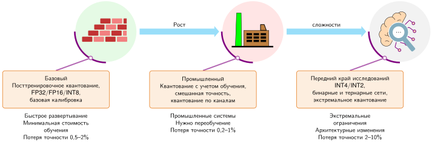

***Дорожная карта сложности квантования**: уровни упорядочивают методы по типичным инженерным усилиям и усилиям на валидацию, а не по гарантированной точности. PTQ дает недорогую отправную точку; QAT и смешанная точность добавляют контроль над обучением или ядрами; методы INT4, бинарные и троичные все сильнее требуют валидации, специфичной для модели и аппаратуры. Развертывание может остановиться на любом уровне, как только достигнуты измеренные критерии качества, задержки, памяти и энергии, а более сложный уровень не обязательно лучше.*

Дорожная карта служит инструментом для порядка развертывания, а не таксономией числовых форматов. PTQ стоит первым, потому что меняет представление с минимальной стоимостью обучения; QAT и смешанная точность переходят на промышленный уровень, поскольку требуют поддержки цикла обучения или ядер; методы INT4, бинарные и троичные находятся на переднем крае, потому что предположения о точности и аппаратуре становятся специфичными для архитектуры.

<a id="sec-model-compression-posttraining-quantization-bb5b"></a>

#### Посттренировочное квантование

Посттренировочное квантование (PTQ) снижает числовую точность после обучения, преобразуя выбранные веса или активации из FP32 в представления меньшей точности, например INT8, без полного переобучения (Choukroun et al., 2019). Оно надежно уменьшает объем сырых значений; задержка и энергия улучшаются только тогда, когда экспортированный граф отображается на эффективные ядра низкой точности (Wu et al., 2020).

Ключевое преимущество PTQ — низкая вычислительная стоимость: оно не требует переобучения и обычно не требует размеченного обучающего набора, хотя калибровка активаций обычно нуждается в небольшом репрезентативном калибровочном наборе данных. Однако снижение точности вносит ошибку квантования, которая может ухудшить точность, особенно в задачах, требующих мелкозернистой числовой точности. Фреймворки машинного обучения, такие как TensorFlow Lite, среда выполнения Open Neural Network Exchange и PyTorch, предоставляют встроенную поддержку PTQ.

Основной механизм PTQ — **равномерное квантование**, которое отображает значения с плавающей точкой на дискретные целые уровни с помощью единого масштабного коэффициента. Поскольку интервал между соседними квантованными значениями постоянен, равномерное квантование упрощает реализацию и позволяет эффективно выполнять его на аппаратуре. Для симметричной формы, показанной здесь, $s$ выбирается по максимальному абсолютному значению так, чтобы получающиеся целые оставались в целевом диапазоне. Квантованное значение $q$ вычисляется как:
$$
q = \text{round} \left(\frac{x}{s} \right)
$$
где:

- $q$ — квантованное целочисленное представление,
- $x$ — исходное значение с плавающей точкой,
- $s$ — масштабный коэффициент, который отображает диапазон значений с плавающей точкой на доступный целочисленный диапазон.

[«Равномерное квантование»](10_model_compression.md#lst-quantization_example) демонстрирует равномерное квантование из FP32 в INT8, которое сокращает сырой объем значений с 32 до 8 бит на вес и измеряет получающуюся ошибку квантования; метаданные масштаба и накладные расходы упаковки не учитываются. После квантования модели среда выполнения может использовать целочисленную арифметику там, где она поддерживается (Gholami et al., 2022).

<a id="lst-quantization_example"></a>

**Равномерное квантование**: преобразует веса FP32 в INT8, сокращая сырой объем на вес с 32 до 8 бит и измеряя ошибку квантования; метаданные масштаба и накладные расходы упаковки не учитываются.

```python
import torch

# Исходные веса FP32
weights_fp32 = torch.tensor(
    [0.127, -0.084, 0.392, -0.203], dtype=torch.float32
)
print(f"Исходные FP32: {weights_fp32}")
print(f"Память на вес: 32 бита")

# Простое равномерное квантование в INT8 (от -128 до 127)
# Шаг 1: найти масштабный коэффициент
max_val = weights_fp32.abs().max()
scale = max_val / 127  # 127 — максимальное положительное значение INT8

# Шаг 2: квантовать по нашей формуле q = round(x/s)
weights_int8 = torch.round(weights_fp32 / scale).to(torch.int8)
print(f"Квантованные INT8: {weights_int8}")
print(f"Память на вес: 8 бит (вместо 32)")

# Шаг 3: деквантовать для проверки
weights_dequantized = weights_int8.float() * scale
print(f"Деквантованные: {weights_dequantized}")
print(
    f"Ошибка квантования: "
    f"{(weights_fp32 - weights_dequantized).abs().mean():.6f}"
)
```

Альтернативное, неравномерное квантование назначает более мелкую точность тем диапазонам числовых значений, которые заполнены плотнее, что может сохранять точность для моделей, веса которых сосредоточены вокруг определенных значений. Неравномерные схемы требуют более сложной калибровки и реже встречаются в продакшене, но могут быть эффективны для моделей, особенно чувствительных к изменению точности.

PTQ — полезный первый эксперимент для многих моделей зрения, языка и речи, но чувствительность варьируется в зависимости от архитектуры, слоя и распределения. Если равномерная конфигурация PTQ не достигает целевого качества, следующими вариантами становятся более мелкая гранулярность, смешанная точность, методы квантования только весов, лучшая калибровка или QAT.

<a id="sec-model-compression-calibration-c650"></a>

##### Калибровка

Калибровка квантования оценивает вещественный диапазон отсечения $[\alpha, \beta]$ для каждого тензора. Неподходящий диапазон либо насыщает критичные значения отсечением, либо тратит доступные целые уровни на редкие выбросы. Калибровка минимизирует ошибку представления на выборке распределения, хотя не гарантирует границ для входов развертывания вне этого распределения.

Поскольку тензоры активаций меняются в зависимости от входных данных, профилирование требует пропустить через прямой проход неразмеченный калибровочный набор, чтобы зафиксировать динамические диапазоны. [«Конвейер посттренировочного квантования»](10_model_compression.md#fig-ptq-calibration) описывает этот автономный процесс преобразования, а приведенный ниже алгоритм формализует пошаговую процедуру калибровки по слоям, в которой наблюдатели активаций записывают распределения значений, чтобы вычислить метаданные масштаба и нулевой точки.

**Алгоритм: калибровка посттренировочного квантования**

```text
Вход: предобученная модель f_θ; репрезентативный калибровочный набор C; разрядность b;
      гранулярность (слой/группа/канал); метод (max, entropy, percentile)
Выход: квантованные веса и метаданные диапазонов по группам {(α_g, β_g, s_g, z_g)}
1. Подключить наблюдатели к весам и выбранным тензорам активаций с выбранной гранулярностью
2. Для каждого батча из C:                                         ▷ проход калибровки
   2.1 выполнить f_θ в режиме вывода; зафиксировать распределения значений по группам
3. Для каждой группы квантования g:
   3.1 выбрать диапазон отсечения [α_g, β_g] выбранным методом
   3.2 вычислить масштаб s_g и нулевую точку z_g, отображающие [α_g, β_g] в b-битный целочисленный диапазон
4. Квантовать статические веса; экспортировать метаданные диапазонов активаций для вывода
5. Если точность ниже производственного порога, расширить диапазоны, изменить гранулярность или перейти к QAT
```

<a id="fig-ptq-calibration"></a>

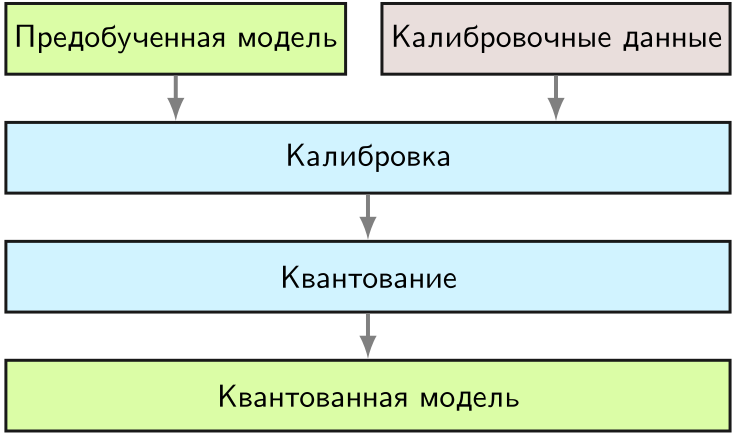

***Конвейер посттренировочного квантования**: PTQ преобразует обученную модель FP32 непосредственно в INT8 без переобучения. Репрезентативные калибровочные данные проходят через модель, чтобы зафиксировать диапазоны активаций $[\alpha, \beta]$, и вычисляют масштабный коэффициент $S$ и нулевую точку $Z$ для квантования параметров перед развертыванием.*

Один калибровочный проход по $C$ позволяет обойтись без переобучения, а квантование весов из FP32 в INT8 сокращает сырые значения весов в 4 раза до учета метаданных масштаба, нулевой точки и упаковки. Цена в том, что статические диапазоны активаций, зафиксированные в цикле, рискуют насыщением или потерей целых уровней, если калибровочные данные не охватывают хвосты распределения при развертывании. Шаг квантования затем переводит параметры модели в формат меньшей точности, создавая итоговую квантованную модель.

Отображение необоснованно широкого вещественного интервала на 256 дискретных значений 8-битного целого тратит числовое разрешение на пустой диапазон, тогда как слишком агрессивное отсечение обрезает сигнал. Три метода калибровки уравновешивают этот компромисс между отсечением и разрешением: **max** задает границы по абсолютному экстремуму (сохраняя крайние значения ценой уязвимости к выбросам), **entropy** выбирает границы, минимизируя дивергенцию Кульбака — Лейблера (KL) между исходным и квантованным распределениями, а **percentile** отсекает фиксированную долю хвоста (например, 99,9 процента). [«Распределение активаций»](10_model_compression.md#fig-resnet-activations-histogram) показывает, почему обработка выбросов критична: в активациях ResNet-50 длинные хвосты растягивают динамический диапазон и лишают плотный кластер около нуля доступных дискретных уровней.

<a id="fig-resnet-activations-histogram"></a>

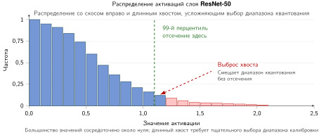

***Распределение активаций**: активации слоев ResNet-50 имеют длинный хвост с выбросами, которые могут привести к неэффективному использованию точности, если с ними не обращаться аккуратно. Источник: (Wu et al., 2020).*

Диапазоны калибровки могут быть **симметричными** (центрированными на ноль, обычно с нулевой точкой, равной нулю) или **асимметричными** (один масштаб с, как правило, ненулевой нулевой точкой, полезный, когда распределения скошены). Выбор метода и диапазона заметно влияет на точность квантованной модели.

<a id="sec-model-compression-tuning-quantization-ranges-439d"></a>

##### Настройка диапазонов квантования

Как только калибровка определила границы отсечения $[\alpha, \beta]$, диапазон нужно отобразить на целочисленные концы. [«Выбор диапазона калибровки»](10_model_compression.md#fig-calibration-ranges) сравнивает две основные стратегии отображения: симметричную калибровку, которая фиксирует вещественный ноль на целом нуле, и асимметричную калибровку, которая вводит явное смещение нулевой точки для скошенных распределений.

<a id="fig-calibration-ranges"></a>

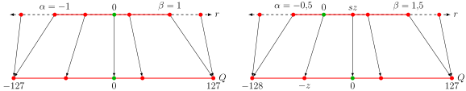

***Выбор диапазона калибровки**: симметричное и асимметричное аффинные отображения квантования. Симметричное квантование (слева) принуждает вещественный ноль отображаться в целый ноль, ограничивая выбор диапазона интервалом $[-\alpha, \alpha]$ ценой потери динамического диапазона для скошенных распределений активаций; асимметричное квантование (справа) использует явное смещение нулевой точки $Z$, чтобы эффективно отображать нецентрированные диапазоны $[\alpha, \beta]$.*

Симметричное квантование упрощает ядра целочисленного матричного умножения, потому что нулевая точка равна нулю ($z = 0$), и при аппаратном накоплении не нужны перекрестные слагаемые. Однако для активаций с асимметричными распределениями (например, карт признаков после ReLU, где все значения неотрицательны) симметричное квантование тратит примерно половину целочисленного динамического диапазона на неиспользуемые отрицательные значения. Асимметричное квантование возвращает этот диапазон, отображая $[\alpha, \beta]$ на $[0, 2^b - 1]$, но требует, чтобы аппаратура во время выполнения вычисляла поправки на смещение ($z \sum W$) при операциях умножения с накоплением.

<a id="sec-model-compression-granularity-93b3"></a>

##### Гранулярность

Гранулярность квантования определяет, насколько широко масштабные коэффициенты и нулевые точки разделяются по тензору, — это баланс между разрешением представления, накладными расходами на метаданные и сложностью выполнения. В сверточных фильтрах или матрицах проекций трансформера величины весов часто сильно различаются от канала к каналу. Использование одного масштабного коэффициента на весь тензор рискует свести динамический диапазон каналов малой величины к нулю; напротив, назначение масштабов по каналам сохраняет локальную дисперсию ценой отслеживания дополнительных векторов масштаба при матричном умножении.

<a id="nbk-model-compression-scale-zero-point"></a>

> **Вычисление масштаба и нулевой точки**
>
> **Формула аффинного квантования**: аффинное отображение переводит вещественный диапазон $[\alpha, \beta]$, содержащий ноль, в целочисленный диапазон $[0, 2^b-1]$ (например, UINT8) по следующей конструкции.
>
> **Анализ**:
> Аффинное квантование задает линейное отображение $x \approx s(x_q - z)$, где $s$ — **масштаб** (размер шага), а $z$ — **нулевая точка** (целое значение, соответствующее вещественному нулю). Отображение состоит из трех вычислительных шагов:
>
> 1.  **Вычислить масштаб $(s)$**: разделить вещественный диапазон на целочисленный по формуле [«Масштаб квантования»](10_model_compression.md#eq-quant-scale).
> <a id="eq-quant-scale"></a>
>
>     $$s = \frac{\beta - \alpha}{2^b - 1}$$
>
> 2.  **Вычислить нулевую точку $(z)$**: сдвинуть диапазон так, чтобы вещественный ноль отображался в целое, по формуле [«Нулевая точка квантования»](10_model_compression.md#eq-quant-zero-point).
> <a id="eq-quant-zero-point"></a>
>
>     $$z = \text{round}\left(\frac{-\alpha}{s}\right)$$
>
> 3.  **Квантовать $(x \to x_q)$** по формуле [«Квантование»](10_model_compression.md#eq-quantize):
> <a id="eq-quantize"></a>
>
>     $$x_q = \text{clamp}\left(\text{round}\left(\frac{x}{s} + z\right), 0, 2^b - 1\right)$$
>
> **Сценарий**:
> Допустим, активации лежат в диапазоне от $\alpha = -1$ до $\beta = 3$, а целевая точность — UINT8 $(b=8)$.
>
> * **Диапазон**: $\beta - \alpha = 4$.
> * **Шаги**: $2^8 - 1 = 255$.
> * **Масштаб**: $s = \frac{4}{255} \approx 0{,}0157$.
> * **Нулевая точка**: $z = \text{round}(-(\alpha)/s) = \text{round}\!\left(-(-1)/\frac{4}{255}\right) = \text{round}(63{,}75) = 64$.
>
> **Системный вывод**: вещественное значение $0{,}0$ представлено целым 64, что гарантирует точное представление нулевого дополнения (распространенного в CNN) и предотвращает «дрейф квантования», когда дополнение вносит ненулевой шум.

Когда каналы весов имеют расходящиеся стандартные отклонения, совместное использование одного порога отсечения на весь слой либо схлопывает каналы малой величины, либо обрезает более широкие каналы. [«Разброс диапазонов квантования»](10_model_compression.md#fig-quantization-granularity) показывает этот разброс от фильтра к фильтру по сверточным слоям, сопоставляя общую границу на слой с независимыми порогами по каналам.

<a id="fig-quantization-granularity"></a>

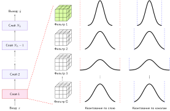

***Разброс диапазонов квантования**: разные сверточные фильтры могут иметь разные диапазоны весов, что мотивирует квантование по фильтрам для снижения ошибки квантования. Различные масштабы отсечения иллюстрируют выбор между одним диапазоном на слой и отдельными диапазонами по каналам. Источник: (Gholami et al., 2022).*

Гранулярность квантования обменивает накладные расходы калибровки и метаданных на ошибку представления. Более локальные диапазоны могут сохранять информацию, когда каналы различаются, но они не улучшают точность автоматически и могут не иметь эффективного пути ядер. Каждый дополнительный масштаб также нужно хранить, загружать и применять на той гранулярности, которую поддерживает бэкенд. [«Уровни гранулярности квантования»](10_model_compression.md#tbl-quantization-granularity) суммирует четыре распространенных уровня — от одного общего диапазона на слой до локальных диапазонов внутри фильтра.

| **Уровень**                                             | **Совместное использование диапазонов**  | **Компромисс**                                                                                     |
|:--------------------------------------------------------|:-----------------------------------|:--------------------------------------------------------------------------------------------------|
| **По слою**             | Один диапазон на слой                | Просто, но неоптимально, когда диапазоны фильтров сильно различаются                                              |
| **По группам**          | Фильтры объединяются с общими диапазонами | Использовано в Q-BERT (Shen et al., 2020) для слоев внимания трансформера                                       |
| **По каналам**          | Один диапазон на фильтр              | Распространенное значение по умолчанию; баланс между ошибкой квантования, метаданными масштаба и накладными расходами реализации    |
| **Внутри канала**       | Диапазоны внутри каждого фильтра     | Более локальные диапазоны могут снизить ошибку квантования, но увеличивают метаданные и накладные расходы реализации |

<a id="tbl-quantization-granularity"></a>

***Уровни гранулярности квантования**: гранулярность обменивает накладные расходы калибровки на точность — от одного диапазона на слой до поддиапазонов на фильтр.*

Квантование по каналам сохраняет точность лучше квантования по слою, когда динамические диапазоны каналов различаются, но ценой хранения дополнительных векторов масштаба и пересчета по каналам в конвейере ядра. Помимо гранулярности масштаба, эффективность выполнения зависит от различия между статическими весами и динамическими активациями, которые накладывают принципиально разные ограничения на память и задержку в системе развертывания.

<a id="sec-model-compression-weights-vs-activations-5efb"></a>

##### Веса и активации

Выполнение вывода в низкой точности требует преобразовать входы с плавающей точкой перед запуском ядра и пересчитать промежуточные выходы аккумулятора. При целочисленном матричном умножении произведение двух 8-битных целых дает 16-битный результат. Суммирование этих произведений по внутреннему измерению длины $K$ вызывает рост разрядности, который быстро переполняет 8-битные регистры; поэтому аппаратура накапливает результат в 32-битных целочисленных регистрах (`INT32`). Прежде чем передать результат в следующие слои, переквантование масштабирует 32-битную накопленную сумму эффективным масштабным коэффициентом слоя ($s_{\text{eff}} = \frac{s_W \cdot s_X}{s_Y}$) и приводит значения обратно в диапазон 8-битных целых. [«Конвейер квантованного матричного умножения»](10_model_compression.md#fig-weight-activations-quantization) иллюстрирует этот сквозной конвейер выполнения: входы с плавающей точкой проходят квантование в INT8, затем целочисленное матричное умножение SIMD или тензорных ядер, накапливаются в 32-битных регистрах и переквантуются обратно в INT8 перед нелинейной активацией.

<a id="fig-weight-activations-quantization"></a>

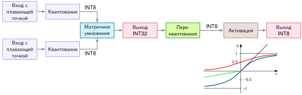

***Конвейер квантованного матричного умножения**: этапы вычислений выделены цветом. Вещественные веса и входы активаций квантуются в INT8 (фиолетовый), подаются в целочисленное умножение матриц SIMD или тензорных ядер (синий), накапливаются в 32-битных регистрах (красный) и переквантуются обратно в INT8 (зеленый) перед нелинейной активацией. Источник: курс HarvardX по TinyML.*

Квантование активаций отображает выходы слоев на представление меньшей точности во время вывода. Это уменьшает промежуточные объемы данных и может сокращать стоимость арифметики на аппаратуре с эффективным целочисленным путем, но также вносит ошибку между слоями. Например, CNN может преобразовать карты признаков FP32 в INT8 перед последующими свертками. Выигрыш максимален, когда последовательные операторы остаются на целочисленном пути; изолированные квантованные операторы могут нести стоимость преобразований, не сокращая работу достаточно. Поэтому то, улучшает ли квантование активаций задержку, зависит от поддерживаемых ядер, обработки масштабов, времени жизни тензоров и любых границ квантования и деквантования, которые остаются в экспортированном графе.

Активационно-зависимое квантование весов (AWQ)[^fn-awq-salient-weights] нацелено на трафик весов в выводе LLM. Этот подход актуален для маячной модели GPT-2/Llama, когда декодирование ограничено загрузкой весов модели. Защищая небольшую долю значимых каналов весов на основе величины активаций, AWQ поддерживает квантование весов класса INT4, контролируя деградацию на задаче. Упакованные низкоразрядные веса могут сокращать трафик памяти, необходимый при генерации токенов, если среда выполнения предоставляет соответствующее ядро (Lin et al., 2024).

[^fn-awq-salient-weights]: **Активационно-зависимое квантование весов (AWQ)**: значимость определяется величиной активаций, а не величиной весов, — это различие важно, потому что малый вес, умноженный на большую активацию, дает большой вклад в выход. AWQ защищает около 1 процента значимых каналов весов с помощью масштабирования, учитывающего активации, а большинство весов квантует в низкоразрядные форматы, так что набор весов FP16 на 7 миллиардов параметров, который занимал бы около 14 ГБ, может приблизиться к объему весов класса INT4 примерно в 3,5 ГБ до учета метаданных, масштабов и накладных расходов упаковки, специфичной для ядра (Lin et al., 2024).

<a id="sec-model-compression-static-vs-dynamic-quantization-4791"></a>

##### Статическое и динамическое квантование

Помимо формы и гранулярности диапазона отсечения, проект системы определяет, *когда* вычисляются диапазоны активаций. Квантование активаций делится на две основные модели выполнения: статическое и динамическое квантование.

При **статическом квантовании** диапазон отсечения вычисляется заранее во время автономной калибровки и остается фиксированным во время вывода. Такой подход не добавляет накладных расходов на оценку диапазона во время выполнения: входы масштабируются фиксированными коэффициентами и напрямую подаются в целочисленные блоки выполнения. Однако статические диапазоны рискуют насыщением или исчезновением значений, когда производственные входы отклоняются от калибровочного распределения (Jacob et al., 2018; Yao et al., 2021).

**Динамическое квантование**, напротив, вычисляет масштабные коэффициенты и нулевые точки динамически по тензорам активаций во время выполнения. Адаптация окна отсечения к каждому конкретному входу устраняет насыщение, вызванное сдвигами распределения. Цена — накладные расходы памяти и задержки во время выполнения: аппаратура должна выполнить проходы редукции по промежуточным тензорам активаций, чтобы получить минимумы и максимумы, прежде чем может начаться целочисленная арифметика. На операторах, ограниченных пропускной способностью памяти, этот проход редукции может съесть преимущество выполнения в низкой точности.

Эти решения о времени и гранулярности взаимодействуют с более широким выбором методологии квантования. [«Сравнение методов квантования»](10_model_compression.md#tbl-quantization_methods) сопоставляет посттренировочное квантование, квантование с учетом обучения и динамическое квантование, каждое из которых имеет свои сильные стороны и компромиссы для разных сценариев развертывания.

| **Метод**                             | **Инженерные усилия**                                 | **Сохранение точности**                | **Адаптивность к входу**  | **Когда применять**                                                          |
|:--------------------------------------|:-------------------------------------------------------|:-----------------------------------------|:------------------------|:-------------------------------------------------------------------------------|
| **Посттренировочное квантование (PTQ)**  | Низкие: без переобучения                                     | Зависит от модели; параметры не адаптируются | Фиксированный диапазон калибровки | откалиброванная модель достигает измеренных целевых показателей точности и производительности         |
| **Квантование с учетом обучения (QAT)** | Высокие: дополнительное обучение с моделированием квантования | Часто выше, когда PTQ не справляется      | Фиксированный диапазон калибровки | PTQ не достигает целевой точности, а бюджет обучения позволяет                  |
| **Динамическое квантование**              | Умеренные: диапазоны пересчитываются во время выполнения                 | Зависит от модели; диапазон подходит каждому входу    | Диапазон для каждого входа | диапазоны активаций сильно меняются от входа к входу, а накладные расходы выполнения приемлемы |

<a id="tbl-quantization_methods"></a>

***Сравнение методов квантования**: выбор зависит от трех определяющих вопросов — бюджета инженерных усилий, порога точности и изменчивости входов, — а не от списка возможностей.*

PTQ служит базовым вариантом с низкими усилиями; QAT тратит циклы обучения, когда PTQ снижает точность на задаче, а динамическое квантование расходует трафик памяти и вычисления во время выполнения, чтобы отслеживать динамические диапазоны, зависящие от входа.

<a id="chk-model-compression-quantization-gate"></a>

> **Выбор калибровки и диапазонов**
>
> Квантование удается, только если политика диапазонов соответствует данным развертывания и ограничениям среды выполнения.
>
> **Проектирование диапазонов**
>
> - [ ] **Калибровочные данные**: объясните, как нерепрезентативный калибровочный набор создает отсечение или тратит целые уровни впустую.
> - [ ] **Гранулярность**: сравните диапазоны на весь тензор и по каналам по компромиссу ошибки и метаданных, который каждый создает.
> - [ ] **Статические и динамические диапазоны**: выберите политику диапазонов, когда распределения активаций меняются от входа к входу, а накладные расходы выполнения ограничены.
>
> **Системная оценка**
>
> - [ ] **Выигрыш от квантования**: для модели с 7 млрд параметров, обслуживаемой из HBM, оцените память весов в FP16 и INT4, а также примерный прирост скорости декодирования для вывода, ограниченного пропускной способностью памяти.

<a id="sec-model-compression-ptq-practice-2800"></a>

##### PTQ на практике

Посттренировочное квантование балансирует скорость развертывания и контроль точности. PTQ не требует обратного распространения градиента или переобучения, что делает его стандартным первым шагом в конвейерах оптимизации развертывания. Достаточно ли автономной калибровки, зависит от архитектуры, распределения калибровочных данных, конструкции численного квантователя и ограничений целевой аппаратуры.

Основное ограничение PTQ в том, что оно замораживает параметры модели, не позволяя компенсировать потерю точности. Если квантованная модель опускается ниже производственного порога, средства смягчения включают повторную калибровку, уточнение гранулярности масштаба, переход на смешанную точность или переход к квантованию с учетом обучения. QAT встраивает ограничения точности непосредственно в граф обучения, используя **сквозную оценку (straight-through estimator, STE)**, чтобы пропускать градиенты через недифференцируемые операторы округления. Это позволяет весам адаптироваться к представлениям низкой разрядности при переобучении и восстанавливать точность ценой полных вычислений обучения ($O_{\text{train}}$) и подбора гиперпараметров.

<a id="sec-model-compression-quantizationaware-training-4032"></a>

#### Квантование с учетом обучения

Квантование с учетом обучения включает численный шум округления непосредственно в граф оптимизации. [«Конвейер квантования с учетом обучения»](10_model_compression.md#fig-qat) показывает этот рабочий процесс обучения: узлы фиктивного квантования моделируют ошибки отсечения и округления низкой точности в прямом проходе, а сквозные оценки направляют градиенты обратно к мастер-весам с плавающей точкой при обратном распространении.

<a id="fig-qat"></a>

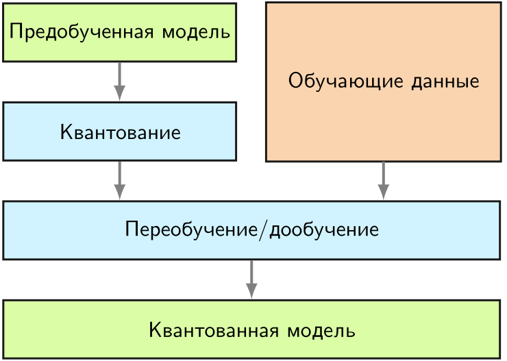

***Конвейер квантования с учетом обучения**: QAT вставляет узлы фиктивного квантования в прямой граф, чтобы моделировать ошибки отсечения и округления низкой точности во время обучения. Обратное распространение обновляет вещественные мастер-веса через сквозные оценки (STE), позволяя параметрам сети адаптироваться к числовому шуму до экспорта фиксированных целочисленных масштабов для вывода.*

Вместо обучения с нуля или холодного старта параметров масштаба производственные рабочие процессы часто инициализируют QAT масштабными коэффициентами, полученными при первом проходе калибровки PTQ. [«Конвейер от PTQ к QAT»](10_model_compression.md#fig-ptq-qat) иллюстрирует эту двухэтапную последовательность: автономная калибровка задает базовые метаданные диапазонов, а дообучение затем корректирует мастер-веса, компенсируя шум квантования.

<a id="fig-ptq-qat"></a>

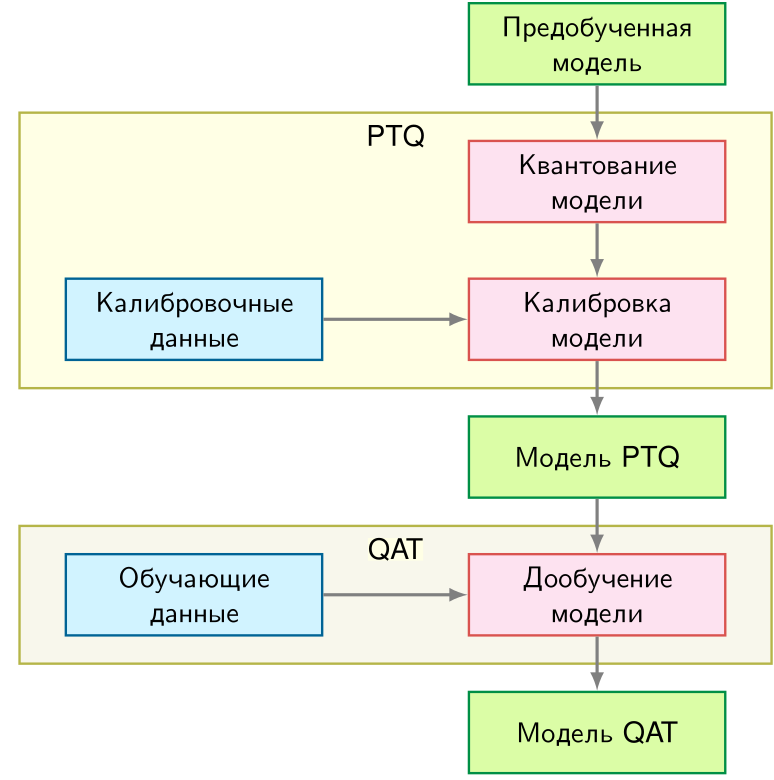

***Конвейер от PTQ к QAT**: калибровка PTQ может инициализировать диапазоны и масштабы до того, как QAT дообучит предобученные веса с моделированием квантования. Калибровочные данные подаются на этап PTQ, а обучающие данные — на QAT.*

<a id="sec-model-compression-training-mathematics-699e"></a>

##### Математика обучения

При прямом распространении веса и активации квантуются и деквантуются, имитируя пониженную точность. Пусть $x$ — значение полной точности, $s$ — масштабный коэффициент, который отображает значения с плавающей точкой в диапазон меньшей точности, а $q$ — смоделированное квантованное значение. Этот процесс обычно записывают так:
$$
q = \text{round} \left(\frac{x}{s} \right) \times s
$$
где $q$ — смоделированное квантованное значение, $x$ — вес или активация полной точности, а $s$ — масштабный коэффициент, отображающий значения с плавающей точкой в целые меньшей точности.

Хотя прямой проход выполняется с моделированным квантованием, вычисление градиентов требует обратного распространения через оператор округления $\text{round}(\cdot)$. Поскольку округление — кусочно-постоянная ступенчатая функция, ее производная равна нулю почти всюду и не определена в точках перехода, что обнулило бы градиенты и остановило бы градиентный спуск. Сквозная оценка (Straight-Through Estimator, STE) устраняет это узкое место, подставляя тождественную функцию вместо оператора округления при обратном распространении (Bengio et al., 2013):[^fn-ste-gradient-trick]

[^fn-ste-gradient-trick]: **Сквозная оценка (STE)**: предложена (Bengio et al., 2013). STE подставляет тождественную функцию вместо истинного градиента округления, который равен нулю почти всюду, поскольку округление кусочно-постоянно. Распространенная тождественная STE переносит входящий градиент через квантователь без изменений. Это смещенная эвристика, а не истинная производная.

Учет эффектов квантования при обучении позволяет модели адаптировать веса и диапазоны активаций к моделируемой ошибке низкой точности. QAT может восстановить качество, которое теряет посттренировочный путь, особенно при агрессивной разрядности, но преимущество зависит от модели, квантователя, калибровки и процедуры обучения (Krishnamoorthi, 2018).

<a id="sec-model-compression-fake-quantization-nodes-implementation-e822"></a>

##### Узлы фиктивного квантования и реализация

Реализация QAT опирается на операции фиктивного квантования, которые моделируют квантование во время прямого распространения, сохраняя полную точность для вычисления градиентов. Эти операции вставляют пары квантования — деквантования в вычислительный граф, создавая моделирование во время обучения поведения при выводе.

Узел фиктивного квантования должен воспроизводить те же ошибки, что увидит среда выполнения вывода, поэтому его три операции моделируют путь развертывания во время обучения:

1. **Квантование**: отобразить значение с плавающей точкой на дискретный уровень квантования
2. **Отсечение**: применить ограничения диапазона на основе разрядности
3. **Деквантование**: вернуть значение к плавающей точке для последующих операций

Математически для симметричного квантования с разрядностью $b$ при входном значении с плавающей точкой $x$:
$$
\begin{aligned}
q_{\text{level}} &= \text{clip}\left(\text{round}\left(\frac{x}{s}\right), -2^{b-1}, 2^{b-1} - 1\right) \\
x_{\text{fake}} &= q_{\text{level}} \times s
\end{aligned}
$$
где $s = \frac{\max(|x|)}{2^{b-1} - 1}$ — масштабный коэффициент, вычисленный по распределению входа, а $x_{\text{fake}}$ — выход с фиктивным квантованием, который имитирует значения INT8, но остается в формате с плавающей точкой.

Для асимметричного квантования с беззнаковыми целыми предположим, что наблюдаемый диапазон расширен так, чтобы включать ноль:
$$
\begin{aligned}
s &= \frac{\max(x) - \min(x)}{2^b - 1} \\
z &= \text{round}\left(-\frac{\min(x)}{s}\right) \\
q_{\text{level}} &= \text{clip}\left(\text{round}\left(\frac{x}{s} + z\right), 0, 2^b - 1\right) \\
x_{\text{fake}} &= (q_{\text{level}} - z) \times s
\end{aligned}
$$
где $z$ — смещение нулевой точки, которое позволяет представлять асимметричный диапазон.

[«Прямой проход свертки QAT»](10_model_compression.md#lst-qat-conv-forward) показывает прямой проход QAT: фиктивное квантование применяется к входам и весам перед сверткой, моделируя численные значения INT8 при сохранении тензоров с плавающей точкой для обучения.

<a id="lst-qat-conv-forward"></a>

**Прямой проход свертки QAT**: применяет фиктивное квантование к активациям и весам перед сверткой, чтобы моделировать численные значения развертывания во время обучения.

```python
# Прямой проход с фиктивным квантованием
def qat_conv_forward(x, weight):
    # Фиктивное квантование входных активаций
    x_scale = compute_scale(x, bits=8, symmetric=False)
    x_zero = compute_zero_point(x, x_scale, bits=8)
    x_quant = fake_quantize(x, x_scale, x_zero, bits=8)

    # Фиктивное квантование весов (обычно симметричное)
    w_scale = compute_scale(weight, bits=8, symmetric=True)
    w_quant = fake_quantize(weight, w_scale, zero=0, bits=8)

    # Свертка с фиктивно квантованными значениями
    output = conv2d(x_quant, w_quant)
    return output
```

При обратном распространении узлы фиктивного квантования аппроксимируют градиенты через сквозную оценку с учетом отсечения:
$$
\frac{\partial x_{\text{fake}}}{\partial x} = \begin{cases}
1 & \text{если } x \in [x_{\text{min}}, x_{\text{max}}] \\
0 & \text{в остальных случаях}
\end{cases}
$$
Внутри диапазона отсечения $[x_{\text{min}}, x_{\text{max}}]$ оценка трактует квантование как тождественное отображение, передавая входящий градиент $\frac{\partial \mathcal{L}}{\partial x_{\text{fake}}}$ без изменений мастер-весу $x$. За границами отсечения производная равна нулю, блокируя градиенты от насыщенных выбросов, которые иначе дестабилизировали бы обновления оптимизатора.

На практике фреймворки вроде PyTorch и TensorFlow реализуют фиктивное квантование как пользовательские операторы автоградиента, прямой проход которых выполняет цикл квантования — деквантования, а обратный проход применяет STE. Обработка масштабов зависит от метода: наблюдатели могут отслеживать распределения и затем замораживаться, либо масштабы могут выучиваться. Пакетная нормализация также требует согласованной с развертыванием обработки: рабочие процессы сворачивают пакетную нормализацию в веса предшествующей свертки ($W_{\text{fused}} = \frac{\gamma}{\sigma} W$) и замораживают ее накопленные статистики перед экспортом квантования, гарантируя, что масштабы фиктивного квантования при обучении совпадают со статическими параметрами слитого ядра, выполняемого при выводе.

<a id="sec-model-compression-qat-tradeoffs-e8ef"></a>

##### Компромиссы QAT

Главное преимущество QAT[^fn-qat-accuracy-gap] — дополнительный контроль качества при низкой точности. Включая смоделированный шум квантования во время обучения или дообучения, модель может адаптироваться к развернутому численному пути. Процессоры с выделенными целочисленными блоками затем могут использовать арифметику INT8 для более быстрого или менее энергоемкого вывода, если экспортированные операторы поддерживаются (Wu et al., 2020; Gholami et al., 2022). Выигрыш нужно измерять относительно PTQ для той же модели и цели, включая дополнительную стоимость обучения и любые различия в калибровке, покрытии графа или выборе ядер.

[^fn-qat-accuracy-gap]: **Квантование с учетом обучения (QAT)**: QAT моделирует поведение низкой точности во время обучения или дообучения, чтобы обновления весов могли адаптироваться к ошибкам отсечения и округления. Исследования BERT сообщают, что методы с учетом обучения или учетом гессиана могут оставаться ближе к базовым результатам полной точности на General Language Understanding Evaluation (GLUE), чем более простые посттренировочные пути, в проверенных условиях (Zafrir et al., 2019; Shen et al., 2020). Точный разрыв зависит от модели, задачи, квантователя, разрядности, бюджета обучения и распределения оценки; более близкий результат бенчмарка — это свидетельство в пользу попытки QAT, а не гарантия того, что его дополнительная стоимость обучения или экспортированная среда выполнения удовлетворят производственную цель.

Ценой служит дополнительная инженерная сложность. QAT встраивает моделирование квантования в обучение, поэтому команды должны проверять схемы квантования, поведение масштабов и восстановление точности на целевой модели. Эти накладные расходы могут сделать QAT менее практичным для очень больших моделей, когда бюджеты обучения уже ограничены. Посттренировочные пути дают дополнительный вариант, который исключает эти накладные расходы переобучения при ограниченных бюджетах обучения (Choukroun et al., 2019).

На практике выбор между PTQ и QAT следует простому правилу. Начните с PTQ и измерьте точность на валидационной выборке. Если точность достигает производственного порога, инженерные затраты на QAT не оправданы. Если PTQ не дотягивает, инвестируйте в QAT, чтобы закрыть разрыв. Гибридный подход — начать с калибровки PTQ и применять дообучение QAT только к критичным по точности слоям — часто дает полезный баланс.

PTQ и QAT обычно нацелены на точность 8 или 4 бита, но сохранение точности зависит от модели, задачи и метода квантования. Однако некоторые сценарии развертывания требуют еще более агрессивного сжатия, подталкивая точность к абсолютным пределам того, что нейронные сети могут выдерживать.

<a id="sec-model-compression-extreme-quantization-aba4"></a>

### Экстремальное квантование

Экстремальное квантование снижает числовую точность до 1 или 2 битов на значение для сред развертывания, где даже INT8 или INT4 не укладываются в бюджеты памяти или энергии (Courbariaux et al., 2015; Zhu et al., 2017). Бинаризация ограничивает веса и активации двумя значениями, обычно записываемыми как $\{-1, +1\}$. В цифровой логике отображение $-1$ в двоичный $0$, а $+1$ в двоичную $1$ делает скалярное умножение изоморфным побитовой операции `XNOR`. В результате дорогие блоки умножения с накоплением (MAC) в плавающей или целочисленной арифметике заменяются побитовой логикой и подсчетом единичных битов (`popcount`) (Rastegari et al., 2016). 64-битный регистр упаковывает 64 двоичных значения. Одна инструкция `XNOR` выполняет 64 умножения параллельно за один такт, а последующая аппаратная инструкция `popcount` считает совпадающие биты, накапливая скалярное произведение ($2 \times \text{popcount}(\mathbf{w} \text{ XNOR } \mathbf{a}) - 64$). Это полностью исключает аппаратные умножители. Однако однобитные представления сильно ограничивают выразительность модели, что приводит к резкой деградации точности в сложных задачах восприятия и языка (Hubara et al., 2018).

Тернаризация смягчает эту потерю емкости, допуская три значения: $\{-1, 0, +1\}$ (Zhu et al., 2017). Нулевое состояние вводит разреженность и упрощает арифметику: умножение активации на $+1$ требует сложения, на $-1$ — вычитания, а умножение на $0$ пропускается полностью. Это исключает универсальные умножители и сводит арифметический блок к условному накопителю со сложением и вычитанием. Однако троичные значения нельзя упаковать по одному биту на значение. Им нужно как минимум два бита на вес в стандартной памяти с выравниванием по байтам (тогда одно из четырех возможных 2-битных состояний не используется) или многотритное кодирование (например, упаковка пяти тритов в один байт, поскольку $3^5 = 243 < 256$), которое добавляет накладные расходы на декодирование во время выполнения.

И бинарное, и тернарное квантование вводят ступенчатые функции, производная которых почти всюду равна нулю ($\frac{d}{dx}\text{sign}(x) = 0$ при $x \neq 0$), из-за чего градиенты при обратном распространении исчезают. Чтобы обучать такие представления, квантование с учетом обучения использует методы аппроксимации градиента, главным образом сквозную оценку (STE) (Bengio et al., 2013; Choi et al., 2018). При обратном проходе STE подменяет недифференцируемый квантователь тождественным или отсекающим оператором и передает градиенты непосредственно полноточным латентным весам, которые накапливают малые шаги оптимизатора, пока не пересекут пороги квантования.

<a id="sec-model-compression-challenges-limitations-a99c"></a>

#### Проблемы и ограничения

Перевод подбайтовой точности в реальное ускорение ограничен стандартными архитектурами процессоров. Массовые CPU и GPU содержат АЛУ и тензорные конвейеры, рассчитанные на 8-, 16- и 32-битные регистры; у них нет собственных инструкций матричного умножения на одном или двух битах. Выполнение подбайтовых операндов на таких универсальных архитектурах требует подпрограмм побитовых сдвигов, масок и распаковки. Накладные расходы этих манипуляций с битами часто съедают экономию пропускной способности памяти, если только нагрузки не выполняются на специализированных битово-последовательных ускорителях, программируемых вентильных матрицах (FPGA) или аппаратуре с собственными побитовыми блоками выполнения (Umuroglu et al., 2017).

Качество модели создает не менее серьезный барьер. Экстремальное квантование резко сжимает представительную емкость сети. Хотя низкоэнтропийные нагрузки, например KWS на бюджете SRAM микроконтроллера, могут переносить бинарные или тернарные веса, сложные модели восприятия и генеративные модели страдают от резкой деградации точности. Бинарное и тернарное квантование становятся жизнеспособными кандидатами, только когда представления повышенной точности, такие как INT8 или INT4, не укладываются в физические бюджеты памяти или энергии, и когда аппаратура развертывания может выполнять упакованные побитовые операции нативно (Rastegari et al., 2016; Hubara et al., 2018; Zhu et al., 2017; Umuroglu et al., 2017). Промышленное развертывание требует сравнения бинарных и тернарных базовых линий с INT8, INT4, структурным прореживанием и компактными архитектурными переделками на одной и той же нагрузке с измерением полного размера бинарного артефакта, сквозной задержки, энергии на вывод и точности на задаче на целевой аппаратуре.

Управляющая инженерная проверка состоит в том, напрямую ли разрядность, аппаратные арифметические пути и выбор калибровки или обучения выполняют физические ограничения развертывания.

<a id="chk-model-compression-quantization-precision"></a>

> **Контрольная точка: квантование и точность**
>
> Критерии проверки проекта квантования:
>
> - [ ] **Память INT8 против энергии**: можете ли вы объяснить, почему квантование INT8 дает примерно четырехкратное снижение памяти, но потенциально более чем четырехкратное снижение энергии? Учитывайте энергетическую стоимость блоков арифметики с плавающей точкой и целочисленной арифметики.
> - [ ] **QAT против PTQ**: понимаете ли вы ключевое преимущество квантования с учетом обучения (QAT) перед посттренировочным квантованием (PTQ) и когда дополнительная стоимость обучения оправдана?
> - [ ] **Ускорение за счет разрядности**: можете ли вы объяснить, почему квантование весов дает почти линейное ускорение при снижении разрядности для вывода LLM, ограниченного пропускной способностью памяти? Подумайте, какой ресурс является узким местом при авторегрессивной генерации.

Первые два измерения оптимизации отвечают на разные вопросы: структурная оптимизация (прореживание, дистилляция, NAS) определяет, *что* вычислять, а оптимизация точности (квантование) определяет, *насколько точно* это представлять и выполнять. Выигрыш на бумаге нужно выражать в ресурсе, который он реально меняет, — числе ненулевых элементов, FLOP или сырых байтах — прежде чем переводить эти сокращения в задержку или энергию.

В продакшене устойчиво возникает разрыв между теоретическими оценками и измеренным ускорением. Этот иллюстративный сценарий сочетает коэффициент прореживания 50 процентов с уменьшением разрядности INT8 для прикидочной цели в 8 раз, а затем предполагает, что реализуется только 1,5 раза. Это примерно 18,8 процента от цели на бумаге. Сценарий показывает, почему *теоретическое сжатие не подразумевает пропорционального ускорения*. Оптимизация должна выходить за пределы графа модели и охватывать то, как операции выполняются по всей физической иерархии памяти.

Разрыв возникает из-за нескольких архитектурных и программных несоответствий. Разреженные матрицы, хранящиеся в плотных форматах, тратят пропускную способность памяти на передачу нулей — аппаратура не может пропускать неиндексированные нули. Операции, которые могли бы выполняться одновременно, стоят последовательно, когда планирование или зависимости среды выполнения мешают перекрытию. Единый граф выполнения назначает каждому входу одинаковую вычислительную глубину независимо от сложности. Преодоление разрыва между сокращением на бумаге и измеренным аппаратным ускорением — задача третьего измерения оптимизации: **архитектурной эффективности**. Оно оценивает, превращаются ли структурная оптимизация и оптимизация точности в реальный выигрыш выполнения, когда вычислительные графы взаимодействуют с физическими блоками выполнения.

<a id="sec-model-compression-architectural-efficiency-8dd3"></a>

## Архитектурная эффективность

Архитектурная эффективность начинается с трассы выполнения. В предыдущем разделе количественно оценили разрыв между теоретическим и измеренным ускорением; профилировщик объясняет, куда он уходит: разреженные тензоры все еще могут проходить через плотные ядра, операторы пониженной точности могут требовать преобразований, которые аппаратура не способна скрыть, а маленькие слои могут тратить больше времени на запуск ядер и перемещение промежуточных данных, чем на арифметику. Модель на бумаге стала меньше, но трасса выполнения все равно заставляет машину выполнять неэффективную последовательность обращений к памяти и операций.

Если представление определяет, *какие* вычисления выполнять, а точность определяет, *насколько точно* их выполнять, то архитектурная эффективность определяет, *как* эти вычисления укладываются в машину. Измеренные узкие места определяют, какой архитектурный ответ полезен. Проектирование с учетом аппаратуры меняет модель до обучения, чтобы ее слои соответствовали бюджету развертывания. Использование разреженности делает удаленные веса видимыми для ядер, которые могут их пропускать. Динамические вычисления позволяют простым входам выходить раньше, вместо того чтобы платить за наихудший случай. Слияние операторов сокращает трафик памяти, когда соседние операции иначе записывали бы один и тот же тензор и читали его снова.

<a id="sec-model-compression-hardwareaware-design-c561"></a>

### Проектирование с учетом аппаратуры

Проектирование с учетом аппаратуры начинается до сжатия. Если целевое устройство не может постоянно снабжать свертки данными, не может хранить активации без выгрузки или не укладывается в энергетический бюджет при выбранном разрешении входа, прореживание и квантование лишь лечат симптомы. Сама архитектура должна раскрывать такой тип работы, который аппаратура может выполнять эффективно. Это означает выбор форм слоев, правил масштабирования и шаблонов операторов, при которых пропускная способность памяти, параллелизм и энергия — это первоклассные ограничения, а не проверки развертывания постфактум.

<a id="sec-model-compression-efficient-design-principles-b015"></a>

#### Принципы эффективного проектирования

Первый шаг проектирования — определить, какой ресурс трасса показывает как ограничивающий. Модель может не достичь цели, потому что каждый слой слишком дорог, потому что одно семейство сверток доминирует в арифметике, потому что активации или параметры не помещаются в иерархию памяти, или потому что кандидатная архитектура игнорирует предпочитаемые платформой операторы. [«Принципы проектирования с учетом аппаратуры»](10_model_compression.md#tbl-hardware-efficient-design) упорядочивает распространенные ответы по устраняемому узкому месту, а не по семейству моделей.

| **Наблюдаемое узкое место**   | **Архитектурный ответ**                                                                                                                            | **Примеры сетей**    |
|:------------------------------|:---------------------------------------------------------------------------------------------------------------------------------------------------|:---------------------|
| **Превышение бюджета модели** | Согласованно изменять глубину, ширину и разрешение, чтобы модель оставалась в пределах бюджета задержки, памяти и мощности.                       | EfficientNet, RegNet |
| **Избыточные вычисления**     | Заменять дорогие плотные операции факторизованными или групповыми, которые сохраняют полезное смешивание каналов при меньшей арифметике.            | MobileNet, ResNeXt   |
| **Нагрузка на память**        | Сокращать хранение параметров и активаций или повторно использовать признаки, чтобы рабочий набор помещался в доступный кэш, SRAM или память устройства. | DenseNet, SqueezeNet |
| **Несоответствие платформе**  | Включать измеренную задержку устройства, поддержку операторов и поведение энергопотребления в поиск архитектуры или цикл проектирования вместо оптимизации одних FLOP. | MobileNetV3, MnasNet |

<a id="tbl-hardware-efficient-design"></a>

***Принципы проектирования с учетом аппаратуры**: профильная трасса должна определять, какой архитектурный ответ уместен. MobileNet отвечает на избыточные сверточные вычисления раздельными по глубине свертками, DenseNet и SqueezeNet отвечают на нагрузку на память повторным использованием признаков и сокращением параметров, а NAS с учетом аппаратуры встраивает измеренное поведение платформы прямо в целевую функцию поиска.*

Эти ответы взаимодействуют. Сокращение сверточных FLOP раздельными по глубине свертками[^fn-depthwise-separable-mobile] помогает, только если целевая среда выполнения имеет эффективные ядра для получающихся операторов. Уменьшение модели слоями с сокращением параметров помогает, только если объем активаций или трафик памяти были частью измеренной проблемы. Проектирование с учетом аппаратуры поэтому не заменяет профилирование; оно переносит информацию профилирования раньше, внутрь самой архитектуры.

[^fn-depthwise-separable-mobile]: **Раздельные по глубине свертки**: этот прием снижает вычисления, раскладывая стандартную свертку на отдельные раздельные по глубине (поканальные) операции и поточечные $(1{\times}1)$ операции. Архитектуры MobileNet используют такую факторизацию, чтобы обменять емкость модели и точность на меньшее число операций для зрения на устройстве (Howard et al., 2017; Sandler et al., 2018).

<a id="sec-model-compression-scaling-optimization-6ad9"></a>

#### Оптимизация масштабирования

Первый архитектурный ответ — глобальный: когда каждый этап профиля превышает бюджет, проблема не в одном плохом слое; модель масштабирована неправильно для бюджета развертывания. Задача проектирования тогда — распределить емкость между глубиной, шириной и разрешением входа, а не выбирать одно число параметров. Глубина увеличивает последовательную работу и хранение активаций. Ширина открывает больше параллельной работы, но повышает потребление памяти. Разрешение улучшает пространственные детали, но увеличивает число позиций, которые должна обработать каждая свертка. Правильный баланс зависит от машины: сильно параллельный ускоритель часто может использовать ширину, тогда как маленькое периферийное устройство может быть ограничено емкостью памяти и энергией на каждое обращение.

Математически общее число FLOP сверточной модели можно приблизить так:
$$
\text{FLOP} \propto N_L \cdot w^2 \cdot r^2,
$$
где $N_L$ — глубина (число слоев), $w$ — ширина, а $r$ — разрешение входа. Это выражение показывает, почему наивное масштабирование не работает: одновременное увеличение ширины и разрешения быстро умножает работу, и получившаяся модель может превысить бюджет пропускной способности памяти или мощности, даже если число параметров выглядит разумным.

Составное масштабирование превращает этот баланс в управляемое правило проектирования. Вместо независимой настройки глубины, ширины и разрешения составное масштабирование увеличивает все три измерения в фиксированных пропорциях $(\alpha, \beta, \gamma)$ относительно базовой модели:
$$
N_L = \alpha^\phi N_{L,0}, \quad w = \beta^\phi w_0, \quad r = \gamma^\phi r_0
$$
Здесь $\phi$ — коэффициент масштабирования, а $\alpha$, $\beta$ и $\gamma$ — масштабные множители, определяемые по эмпирическим измерениям точности и эффективности. Правило важно, потому что не дает одному измерению израсходовать бюджет раньше, чем остальные смогут внести полезный вклад в точность.

EfficientNet ([«Поиск нейронной архитектуры»](10_model_compression.md#sec-model-compression-neural-architecture-search-cf12)) подтвердил этот принцип, использовав поиск, чтобы найти базовую архитектуру, а затем масштабировав ее сбалансированными коэффициентами глубины, ширины и разрешения (Tan and Le, 2019). Урок не в том, что каждое развертывание должно использовать EfficientNet. Системный урок в том, что масштабирование — это решение о распределении ресурсов: одна и та же цель по точности может подразумевать разные компромиссы глубины, ширины и разрешения в зависимости от того, какой ресурс целевая платформа делает дефицитным. Более поздний материал по бенчмаркингу формализует измерение этих компромиссов; здесь принцип проектирования состоит в том, чтобы масштабировать измерения относительно связывающего ресурса.

Та же логика распространяется за пределы сверточных моделей. Слои трансформера, головы внимания, длина последовательности и ширина эмбеддинга играют роли, аналогичные глубине, ширине и разрешению: каждое увеличивает емкость, но каждое по-разному нагружает вычисления, пропускную способность памяти или хранение активаций. Масштабирование с учетом аппаратуры привязывает эти измерения к измеренному узкому месту, а не рассматривает размер модели как одну скалярную величину.

<a id="sec-model-compression-computation-reduction-13de"></a>

#### Сокращение вычислений

Если профиль показывает, что небольшой набор сверточных операторов доминирует в арифметике, равномерное сокращение всей модели расточительно. Лучший ответ — заменить дорогой оператор. Современные эффективные архитектуры делают это, факторизуя плотные вычисления на более дешевые части, которые сохраняют представление, необходимое для точности.

Раздельные по глубине свертки, популяризованные MobileNet, служат примером этого подхода: они раскладывают стандартную свертку на два этапа — раздельную по глубине свертку (отдельные фильтры применяются к каждому входному каналу независимо) и поточечную свертку ($1{\times}1$, смешивающую выходы по каналам). Для размера батча один, единичного шага, дополнения, сохраняющего пространственный размер $h{\times}w$, и квадратного ядра ширины $k$ вычислительная сложность стандартной свертки с $C_{\text{in}}$ входными и $C_{\text{out}}$ выходными каналами составляет:
$$
\mathcal{O}(h w C_{\text{in}} C_{\text{out}} k^2)
$$
где $k$ — размер ядра. Раздельные по глубине свертки сводят это к:
$$
\mathcal{O}(h w C_{\text{in}} k^2) + \mathcal{O}(h w C_{\text{in}} C_{\text{out}})
$$
исключая множитель $k^2$ из операций смешивания каналов и часто давая сокращение FLOP в 5–10 раз. Выигрыш во времени зависит от поддержки ядер и поведения памяти: мобильная среда выполнения с оптимизированными раздельными ядрами может превратить большую часть этого сокращения арифметики в экономию задержки, тогда как слабо поддержанный бэкенд может представить факторизованные операции как множество малых ядер, ограниченных памятью.

Другие шаблоны факторизации отвечают на тот же диагноз. Групповые свертки, использованные в ResNeXt, разбивают карты признаков на независимые группы перед их объединением, сокращая избыточную работу между каналами. Бутылочные слои, использованные в ResNet, применяют свертки $1{\times}1$, чтобы уменьшить размерность признаков перед дорогими операциями. SqueezeNet использует ту же идею $1{\times}1$ для сокращения параметров. Эти приемы повышают эффективность, когда сокращают операцию, которая действительно доминирует в трассе; они дают гораздо меньше пользы, когда новым узким местом становятся трафик памяти, накладные расходы запуска или неподдерживаемые ядра.

Сокращение арифметики — лишь один из возможных ответов. Когда профилирование вместо этого указывает, что связывающим ресурсом на целевом устройстве становятся емкость памяти или перемещение данных, архитектура должна решать это узкое место памяти напрямую.

<a id="sec-model-compression-memory-optimization-8c43"></a>

#### Оптимизация памяти

Когда профиль указывает на память, а не на арифметику, архитектура должна уменьшить рабочий набор или число дорогих обращений к памяти. Активации, карты признаков и параметры могут превышать объем кэша, SRAM, памяти ускорителя или хранилища периферийного устройства, даже если число FLOP приемлемо. Поэтому архитектуры, эффективные по памяти, стараются сохранить полезную информацию, одновременно храня или перемещая меньше данных.

DenseNet иллюстрирует ответ через повторное использование признаков (Huang et al., 2017). В традиционной сверточной сети каждый слой вычисляет новый набор карт признаков, и объем активаций растет по мере углубления сети. DenseNet соединяет слои так, что последующие вычисления могут переиспользовать ранее полученные карты признаков, вместо того чтобы заново выучивать похожие представления. В стандартной сверточной сети с $N_L$ слоями, если каждый слой порождает $g$ новых карт признаков, общее число карт растет линейно:
$$
\mathcal{O}(N_L g)
$$

DenseNet сокращает избыточность параметров за счет повторного использования признаков, но конкатенация сохраненных признаков может увеличивать хранение активаций и трафик памяти. Получающийся рабочий набор и среду выполнения нужно измерять на целевой аппаратуре.

Контрольная точка активаций дополняет повторное использование признаков, обменивая вычисления на память во время обучения. Для $N_L$ сравнимых слоев с объемом активаций $A_{\text{layer}}$ на слой равномерно расставленная контрольная точка сокращает член сохраненных активаций с $\mathcal{O}(N_L A_{\text{layer}})$ до $\mathcal{O}(\sqrt{N_L}\,A_{\text{layer}})$, пересчитывая пропущенные активации при обратном распространении. В контексте сжатия контрольные точки позволяют обучать большие модели в фиксированных бюджетах памяти, что, в свою очередь, дает больше емкости для последующего прореживания или дистилляции.

Сокращение параметров применяет ту же логику к хранению. SqueezeNet использует свертки $1{\times}1$, чтобы уменьшить число входных каналов перед стандартными свертками, заставляя дорогой слой работать с меньшим представлением (Iandola et al., 2016). Число параметров стандартного сверточного слоя равно:
$$
\mathcal{O}(C_{\text{in}} C_{\text{out}} k^2)
$$

Уменьшая $C_{\text{in}}$ свертками $1{\times}1$, SqueezeNet сокращает число параметров и достигает уровня точности AlexNet из статьи с гораздо меньшим числом параметров, чем у AlexNet. Этот компромисс привлекателен, когда ограничение развертывания — флеш-память, размер загрузки модели или пропускная способность параметров; он менее решающий, когда доминируют память активаций или накладные расходы операторов.

Повторное использование признаков, контрольные точки активаций и сокращение параметров поэтому не являются взаимозаменяемыми рецептами. Каждый меняет свою часть проблемы памяти. Повторно используемые признаки сокращают избыточные представления, контрольные точки сокращают хранение активаций при обучении, а бутылочные слои $1{\times}1$ сокращают перемещение параметров. Правильный выбор следует из того, какой член памяти профиль показывает как связывающий.

Помимо минимизации объема хранимых тензоров, существенная эффективность выполнения возникает при перестройке графиков доступа к памяти. Объединение соседних операций в составные ядра выполнения устраняет возвраты в DRAM вне кристалла для промежуточных карт признаков.

<a id="sec-model-compression-operator-fusion-ac1d"></a>

#### Слияние операторов

Рассмотрим типичный слой нейронной сети: свертка, затем батч-нормализация, затем ReLU. Без слияния каждая операция записывает свой выход в глобальную память GPU, а следующая операция читает этот выход обратно. Для того, что можно вычислить целиком в быстрых регистрах на кристалле, происходят три возврата в память. Сливая эти операции в одно ядро, компиляторы и движки вывода устраняют избыточные обращения к памяти и повышают пропускную способность и снижают задержку на нагрузках, ограниченных памятью (Chen et al., 2018; NVIDIA, 2024).

<a id="dfn-model-compression-operator-fusion"></a>

> **Слияние операторов**
>
> ***Слияние операторов*** — это оптимизация компилятора и среды выполнения, которая объединяет соседние тензорные операции в одно слитое ядро, так что промежуточные значения остаются в регистрах или в памяти на кристалле, а не записываются в глобальную память ускорителя и не читаются из нее снова.
>
> 1.  **Значение**: в идеальной цепочке из $N$ поэлементных операций над одним и тем же тензором размером $M$ байт отдельные ядра могут переместить около $2NM$, тогда как слитое ядро может приблизиться к $2M$, сохраняя промежуточные значения на кристалле. Реальный трафик также включает веса, кэши, выравнивание и выгрузки, поэтому профилирование должно подтвердить сокращение.
> 2.  **Отличие**: в отличие от прореживания, квантования или дистилляции слияние операторов не меняет параметры, точность или архитектуру модели. Оно меняет расписание выполнения математически эквивалентных операций, сохраняя выходы модели и улучшая задержку и пропускную способность на нагрузках, ограниченных памятью.
> 3.  **Типичная ошибка**: распространено заблуждение, что больше слияния всегда лучше. Слияние ограничено зависимостями данных, формами тензоров, давлением на регистры и емкостью кэша; чрезмерное слияние может снизить заполненность или вынудить выгрузки обратно в память, сведя выигрыш на нет.

Современные нейронные сети состоят из последовательностей операций: свертки, батч-нормализации, функций активации и поэлементных операций. При независимом выполнении каждая операция требует четыре шага:

1. Загрузка входных тензоров из глобальной памяти
2. Вычисление
3. Запись выходных тензоров обратно в глобальную память
4. Запуск следующего ядра

Цикл «чтение — вычисление — запись» создает узкие места пропускной способности памяти для операций с малой арифметической интенсивностью (FLOP/байт). Для идеальной последовательности из $N$ операций над одним и тем же промежуточным тензором размером $M$ байт трафик без слияния равен:
$$
D_{\text{vol,unfused}} = 2NM
$$
где каждая операция читает и записывает промежуточный тензор. Если последовательность законно сливать и промежуточные значения остаются на кристалле, трафик может приблизиться к:
$$
D_{\text{vol,fused}} = 2M
$$
поскольку промежуточный вход читается один раз, а итоговый выход записывается один раз. Веса, вспомогательные входы, эффекты кэша и выгрузки регистров выходят за пределы этой простой оценки. Тем не менее несколько паттернов вывода приближаются к ней достаточно близко, чтобы слияние имело значение.

##### Слияние свертки, батч-нормализации и ReLU

Распространенный паттерн Conv-BN-ReLU в [«Слияние Conv-BN-ReLU»](10_model_compression.md#lst-conv-bn-relu-fusion) может заменить три запуска и промежуточные возвраты одним слитым путем, когда компилятор может законно свернуть батч-нормализацию и объединить активацию.

<a id="lst-conv-bn-relu-fusion"></a>

**Слияние Conv-BN-ReLU**: объединение трех операций в одно ядро сокращает трафик памяти с 6 передач до 2 и устраняет промежуточные записи в память.

```python
# Псевдокод: API среды выполнения и законность слияния
# зависят от реализации.
# === БЕЗ СЛИЯНИЯ: 3 запуска ядер, 6 передач памяти ===
conv_out = conv2d(input, weight)
bn_out = batch_norm(conv_out, ...)
relu_out = relu(bn_out)

# === СО СЛИЯНИЕМ: 1 запуск ядра, 2 передачи памяти ===
def conv_bn_relu_fused(input, weight, gamma, beta, mean, var):
    # Читаем вход и веса один раз
    conv = conv2d(input, weight)

    # Применяем батч-норм в регистрах (без записи в память)
    bn = gamma * (conv - mean) / sqrt(var + eps) + beta

    # Применяем ReLU в регистрах (без записи в память)
    output = relu(bn)

    # Записываем итоговый результат один раз
    return output
```


*Слияние операторов сокращает число передач памяти с шести до двух.*

Арифметические операции остаются теми же, но трафик памяти падает с 6 передач до 2 (сокращение в 3 раза). Для слоя ResNet-50 с 256 каналами и пространственным размером $28{\times}28$ это устраняет $4 \times 256 \times 28 \times 28 \times 4\,\text{байта} \approx 3{,}2\,\text{МБ}$ промежуточного трафика памяти на слой.

Тот же принцип распространяется за пределы CNN. Слияние GEMM с смещением и активацией устраняет промежуточные записи в линейных слоях трансформера, вычисляя поэлементные операции в регистрах сразу после каждого элемента выхода матричного умножения. Тайлинг внимания, как в FlashAttention,[^fn-flashattention-kernel-fusion] сокращает трафик HBM, обрабатывая внимание блоками размером с SRAM и не материализуя полную матрицу внимания $S{\times}S$, как подробно описано в разделе [«FlashAttention: оптимизация внимания с учетом ввода-вывода»](08_training.md#sec-model-training-flash-attention-ioaware-attention-optimization-3da0).

[^fn-flashattention-kernel-fusion]: **FlashAttention**: демонстрирует силу слияния для ограниченного памятью внимания: вычисления тайлятся под SRAM, полная матрица внимания не материализуется, и сообщается о многократном ускорении на длинных последовательностях (Dao et al., 2022). Это показывает, как слияние операторов меняет узкие места памяти: арифметика математически эквивалентна, но шаблон доступа к памяти меняется, делая внимание на более длинном контексте выполнимым на аппаратуре, которая иначе не могла бы позволить себе полную промежуточную матрицу.

Анализ пропускной способности памяти количественно оценивает эти выгоды слияния. Рассмотрим последовательность Conv-BN-ReLU над картой признаков $28{\times}28{\times}256$ (802,8 КБ). Без слияния каждая операция совершает собственный возврат в память: свертка читает вход (802,8 КБ) плюс веса (2,4 МБ) и записывает выход (802,8 КБ), всего 4 МБ. Затем BN читает этот выход, добавляет свои параметры (2 КБ) и записывает снова, что дает 1,6 МБ. ReLU повторяет эту схему еще на 1,6 МБ. Общий трафик памяти без слияния составляет 7,2 МБ. При слиянии вся последовательность читает вход и веса один раз и записывает итоговый выход один раз, требуя всего 4 МБ — сокращение пропускной способности на 44,5 процента.

При смоделированной пропускной способности HBM 900 ГБ/с эти объемы трафика подразумевают идеальные нижние границы 8 мкс до слияния и 4,5 мкс после слияния, то есть отношение 1,8 раза только для компонента трафика. Это не полные задержки слоя, потому что нужно учитывать также вычисления свертки, эффекты кэша и накладные расходы запуска.

Как показывает [«Иллюстративная выгода от слияния операторов по нагрузкам»](10_model_compression.md#tbl-fusion-speedup), выгода от слияния зависит от нагрузки. Наибольшую пользу получают операции, ограниченные памятью, тогда как операции, ограниченные вычислениями, почти не улучшаются.

| **Нагрузка**                | **Относительная выгода от слияния** | **Почему**                                                    |
|:----------------------------|:---------------------------:|:--------------------------------------------------------------|
| **Поэлементные операции**   |             Высокая         | Сильно ограничены памятью, низкая арифметическая интенсивность |
| **Паттерны Conv-BN-Act**    |           Умеренная         | Смешанные характеристики памяти и вычислений                  |
| **Операции на основе GEMM** |             Низкая          | Ограничены вычислениями; слияние сокращает хвост, ограниченный памятью |
| **Механизмы внимания**      |             Высокая         | Длинные последовательности умножают избегаемый трафик промежуточных матриц внимания |

<a id="tbl-fusion-speedup"></a>

***Иллюстративная выгода от слияния операторов по нагрузкам**: нагрузки, ограниченные памятью, обычно выигрывают больше, чем ограниченные вычислениями; реальный выигрыш зависит от графа, среды выполнения, формы последовательности и аппаратуры.*

Слияние также сокращает накладные расходы запуска ядер. Каждый запуск ядра CUDA несет задержку порядка микросекунд. В гипотетическом графе с пятьюдесятью тремя подходящими тройками Conv-BN-ReLU выполнение без слияния запускает 159 ядер, тогда как выполнение со слиянием запускает 53 ядра, экономя повторные накладные расходы запуска в дополнение к трафику памяти. ResNet-50 не содержит пятидесяти трех прямых троек, потому что остаточные сложения прерывают многие такие паттерны.

Реализация слияния охватывает весь программный стек: от сопоставления паттернов на уровне фреймворка через оптимизацию компилятора, такую как Accelerated Linear Algebra (XLA), TVM и TensorRT, до слияния во время выполнения, которое адаптируется к формам входов и характеристикам аппаратуры. Процесс становится выполнимым, когда фреймворк может экспортировать или трассировать соответствующее вычисление как граф, узлы которого — тензорные операции, а ребра фиксируют зависимости данных. Компилятор может затем сопоставить законные паттерны, такие как Conv→BN→ReLU, и переписать их как слитые операции, проверяя формы, алиасы и числовые ограничения. Динамический управляющий поток, модификация на месте или неподдерживаемые операции могут помешать такой перезаписи графа, поэтому экспортированный план нужно проверять, а не предполагать. Раздел [«Слияние ядер»](11_hw_acceleration.md#sec-hardware-acceleration-kernel-fusion-7faf) главы [«Аппаратное ускорение»](11_hw_acceleration.md) подробно разбирает измерения слияния, относящиеся к компилятору и аппаратуре, включая давление на регистры, сопоставление графов и компромиссы для конкретных платформ GPU, TPU и периферийных ускорителей.

Тогда как слияние операторов минимизирует перемещение данных между статическими этапами конвейера, адаптивные вычисления ставят под сомнение допущение, что каждый вход требует полной глубины или ширины вычислительного графа. Модулируя активные подсети в зависимости от сложности входа или бюджетов времени выполнения, системы обменивают детерминированные расписания выполнения на меньшую усредненную задержку и энергию.

<a id="sec-model-compression-adaptive-computation-methods-d164"></a>

### Методы адаптивных вычислений

Проектирование архитектуры с учетом аппаратуры и слияние операторов оптимизируют фиксированный граф выполнения: при отсутствии управления, зависящего от входа, каждый вход проходит одинаковый запланированный путь. На статических графах **Алгоритм** навязывает **Машине** неизменную вычислительную нагрузку: 24-слойный трансформер выполняет одинаковые операции MAC и выгружает весь объем параметров из HBM или внешней DRAM как для очевидного, легко классифицируемого примера, так и для неоднозначного. **Адаптивный вывод** заменяет этот разомкнутый конвейер управляющим контуром, зависящим от входа: промежуточные представления или бюджеты времени выполнения определяют динамические решения, которые прекращают выполнение или направляют активации через специализированные подсети. Хотя динамические пути могут снижать среднее число арифметических операций и трафик памяти, они вводят накладные расходы времени выполнения на логику маршрутизации, управление батчами, калибровку уверенности и разброс задержки.

<a id="sec-model-compression-dynamic-schemes-e9ff"></a>

#### Динамические схемы

Поскольку входные данные имеют неравномерную семантическую сложность, выделение неизменного вычислительного бюджета тратит пропускную способность памяти и такты выполнения на простые примеры. Динамические схемы модулируют пути выполнения, чтобы снизить усредненные вычисления, сохраняя глубокую сеть для наихудших входов. Эта архитектурная гибкость охватывает четыре основные управляющие переменные: глубину сети (раннее завершение), структурную маршрутизацию (условный пропуск слоев), подсети-эксперты (смесь экспертов) и непрерывное распределение вычислений.

Для управления глубиной выполнения архитектуры **раннего выхода** прикрепляют вспомогательные классификационные головы к промежуточным слоям и прекращают выполнение, когда промежуточные представления дают достаточную уверенность предсказания (Teerapittayanon et al., 2017). BranchyNet реализует этот механизм в сверточных магистралях с помощью мелких ветвей выхода, тогда как многовыходные визуальные трансформеры прикрепляют линейные пробы и оценщики энтропии между блоками трансформера (Xin et al., 2021). Когда вход удовлетворяет критерию выхода, например энтропия предсказания softmax опускается ниже заранее настроенного порога, среда выполнения прекращает вычисления и возвращает промежуточное предсказание. Чистая операционная выгода требует, чтобы арифметические операции и передачи памяти, которых удалось избежать в последующих слоях, превышали вычислительные накладные расходы на оценку промежуточных классификаторов и пороговых фильтров.

Системный компромисс резко различается на разных целевых платформах развертывания. На периферийных процессорах с одним примером (размер батча $B=1$, типично для микроконтроллеров и мобильных NPU) раннее завершение немедленно прекращает поток выполнения (Hu et al., 2020). Пропуск оставшихся слоев устраняет как арифметические операции, так и транзакции DRAM вне кристалла, необходимые для загрузки весов последующих слоев в кэш SRAM на кристалле. И наоборот, на параллельных ускорителях пропускной способности (GPU и TPU), обрабатывающих батчи ($B > 1$), раннее завершение вводит серьезную фрагментацию батча (Chen et al., 2024). Если только часть примеров в батче достигает порога выхода, остальные все равно должны пройти более глубокие слои. Если только среда выполнения не выполняет динамическое уплотнение батча — сбор нерешенных тензоров активаций в непрерывный буфер памяти с помощью копирований и синхронизаций ядер, — неактивные примеры остаются выделенными в памяти, либо ускорителю приходится маскировать неактивные полосы SIMD или SIMT. Следовательно, задержка хвоста батча определяется самым глубоким проходящим примером. [«Архитектура раннего выхода»](10_model_compression.md#fig-early-exit-transformers) показывает этот конвейер решений: каждый промежуточный блок оценивает оценщик уверенности, прежде чем направить нерешенные представления в последующие слои.

<a id="fig-early-exit-transformers"></a>

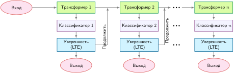

***Архитектура раннего выхода**: слои трансформера динамически регулируют вычисления, классифицируя выход каждого слоя и разрешая раннее завершение при достаточной уверенности, что снижает среднюю задержку и мощность, когда многие входы могут выйти до последнего слоя. Источник: (Xin et al., 2021).*

Помимо усечения глубины выполнения вдоль одного линейного конвейера, **условные вычисления** динамически модулируют топологическую маршрутизацию активаций через граф сети (Bengio et al., 2015). Вместо выполнения каждого блока в заранее заданной последовательности функции управления оценивают тензоры активаций, чтобы обойти остаточные слои, изменить ядра операторов или выбрать специализированные функциональные блоки. Это превращает статический ориентированный ациклический граф (DAG) в динамический граф, зависящий от входа.

Архитектурные реализации нацелены на разные структурные гранулярности. SkipNet использует легковесные рекуррентные или прямые контроллеры затворов, чтобы условно обходить остаточные блоки в сверточных сетях, сохраняя полную глубину сети только для вычислительно сложных входов (Wang et al., 2018). Динамические сети фильтров генерируют зависящие от образца веса сверточных фильтров непосредственно из входа, изменяя шаблоны извлечения признаков напрямую, а не пропуская статические веса (Jia et al., 2016). Капсульные сети используют итеративную маршрутизацию по согласию, чтобы направлять низкоуровневые векторы признаков к совместимым высокоуровневым капсулам (Sabour et al., 2017). С точки зрения системного оборудования условная маршрутизация дает реальное ускорение только тогда, когда такты, сэкономленные за счет обхода операторов, превосходят задержку на вычисление сети затворов, синхронизацию управления между хостом и устройством и управление нескомпонованными обращениями к памяти.

Масштабирование плотных трансформерных моделей жестко связывает емкость параметров с вычислениями с плавающей точкой на токен: увеличение емкости модели заставляет каждый токен вычислять против каждой матрицы весов, что повышает и арифметическую нагрузку, и требования к пропускной способности памяти. Архитектура **смеси экспертов (MoE)** отделяет емкость параметров от вычислений на токен, заменяя плотные полносвязные сети прямого распространения (FFN) банком параллельных подсетей-экспертов, которыми управляет параметризованный маршрутизатор (Shazeer et al., 2017). Switch Transformer от Google[^fn-switch-transformer-scaling] масштабирует этот принцип разреженной маршрутизации, направляя каждый токен к одному эксперту ($k=1$), что резко снижает накладные расходы на коммуникацию по сравнению с маршрутизацией top-$k$ (Fedus et al., 2022).

[^fn-switch-transformer-scaling]: **Switch Transformer**: (Fedus et al., 2022) масштабируется примерно до 1,6 триллиона общих параметров при маршрутизации каждого токена к одному эксперту; в эксперименте с согласованными вычислениями Switch-Base с 64 экспертами достиг целевого качества T5-Base примерно за одну седьмую времени обучения; сравнение для триллионного масштаба сообщило о примерно четырехкратном ускорении относительно T5-XXL. Маршрутизация каждого токена к одному эксперту снижает коммуникацию по сравнению с маршрутизацией top-$k$, однако дисбаланс нагрузки требует вспомогательных потерь и коэффициентов емкости. Этот компромисс — огромная емкость параметров при низкой стоимости вычислений на токен, но со сложной системной инженерией балансировки нагрузки — определяет пространство проектирования MoE.

Такая разреженная активация создает фундаментальный компромисс между пропускной способностью памяти и емкостью на аппаратных ускорителях. Пока токен выполняет арифметику только над долей $1/E$ общих параметров экспертов, все $E$ матриц экспертов должны оставаться резидентными в памяти устройства (HBM или SRAM). При малых операционных размерах батча, например при однопоточной авторегрессивной генерации, маршрутизация расходящихся токенов к разным экспертам дробит матрично-матричные умножения ($GEMM$) на матрично-векторные операции ($GEMV$) с низкой арифметической интенсивностью, что приводит к насыщению пропускной способности памяти. Кроме того, неравномерное распределение токенов создает вычислительные горячие точки: перегруженные эксперты отбрасывают токены сверх своего коэффициента емкости, а недозагруженные эксперты оставляют конвейеры тензорных ядер простаивать.

Разреженные архитектуры смеси экспертов заменяют монолитные полносвязные сети (FFN) динамически маршрутизируемыми подсетями. Сравните структуру блока трансформера слева на [«Архитектура Switch Transformer»](10_model_compression.md#fig-switch-transformer) с расширенным маршрутизатором затворов справа: каждый входной токен активирует только один экспертный блок FFN.

<a id="fig-switch-transformer"></a>

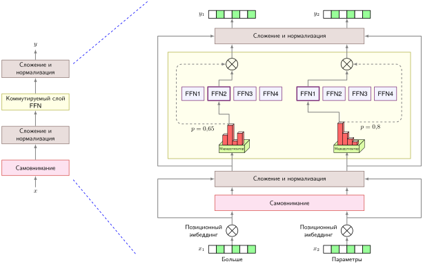

***Архитектура Switch Transformer**: замена плотных полносвязных слоев слоем коммутируемой FFN (слева) обеспечивает разреженную условную маршрутизацию. Сеть затворов направляет каждый токен к одному эксперту (справа) из большого пула, отделяя общую емкость модели (параметры) от стоимости вычислений на токен (FLOP). Источник: (Fedus et al., 2022).*

Поскольку маршрутизатор лежит на критическом пути выполнения, среда выполнения ускорителя должна динамически распределять и собирать активации между экспертными блоками, не вызывая задержек синхронизации между хостом и устройством. На архитектурах SIMD и SIMT, таких как GPU и TPU, эффективное выполнение разреженных экспертных слоев требует перестановки токенов: токены, назначенные одному эксперту, собираются в непрерывные тайлы памяти, чтобы поддерживать высокую загрузку тензорных ядер при последующих матричных умножениях (Lepikhin et al., 2021). Если распределение маршрутизации сильно перекошено, буферы токенов популярных экспертов переполняют фиксированные выделения емкости, и системе приходится либо обрезать токены (что ухудшает представления), либо запускать неравномерные ядра, оставляя параллельные векторные полосы простаивать.

Хотя раннее завершение и маршрутизация MoE делают дискретный выбор ветвей, адаптивный вывод может работать и непрерывно, постепенно модулируя глубину или число итераций в зависимости от сложности задачи в реальном времени (Yang et al., 2020). Быстрые нейронные сети динамически подстраивают число активных слоев согласно оценщикам сложности во время выполнения (Wu et al., 2019), а динамическое масштабирование слоев распределяет вычисления постепенно, пока неопределенность выхода не опустится ниже калиброванного порога. Рассмотрим встроенную систему зрения, обрабатывающую поток данных с датчиков: кадры с высоким контрастом и четкой геометрией дороги разрешаются минимальным префиксом слоев извлечения признаков, тогда как ухудшенные кадры с перекрытыми препятствиями запускают более глубокие рекуррентные блоки обработки. Физический системный выигрыш реализуется, только если оценка управления остается вычислительно легковесной, а среда выполнения параллельно планирует кадры с согласованной глубиной выполнения, чтобы поддерживать высокую загрузку аппаратуры.

<a id="sec-model-compression-implementation-challenges-1184"></a>

#### Проблемы реализации

Реализация выигрышей эффективности адаптивных вычислений требует преодоления критических проблем на уровне обучения модели, оркестровки времени выполнения и выравнивания с аппаратурой. Во время обучения дискретные решения маршрутизации (например, недифференцируемый выбор $\mathrm{argmax}$) ломают стандартное обратное распространение. Практикам приходится применять непрерывные релаксации, такие как оценщик Gumbel-Softmax, градиенты политики обучения с подкреплением или вспомогательные потери балансировки нагрузки, чтобы предотвратить коллапс маршрутизации, когда маршрутизатор перегружает один эксперт или один выход (Shazeer et al., 2017).

Во время выполнения ветвление потока управления фундаментально противоречит модели параллельного выполнения с синхронизацией блоков, характерной для современных ускорителей. Когда параллельные потоки внутри варпа GPU сталкиваются с расходящимися ветвями выполнения, аппаратура сериализует выполнение ветвей и маскирует неактивные потоки, что сводит на нет теоретическое сокращение FLOP. Кроме того, вычисление сетей затворов вводит управляющие зависимости, которые препятствуют слиянию операторов, вносят барьеры синхронизации между хостом и устройством и требуют промежуточных копий памяти для перестановки токенов. Если эти накладные расходы на диспетчеризацию превышают время вычислений, сэкономленное пропуском слоев, динамическая модель демонстрирует более высокую сквозную задержку, чем плотная базовая модель. Раздел [«Динамическое выполнение ядер»](11_hw_acceleration.md#sec-hardware-acceleration-dynamic-kernel-execution-33fc) главы [«Аппаратное ускорение»](11_hw_acceleration.md) рассматривает аппаратно-ориентированные стратегии времени выполнения, включая неравномерный батчинг и очереди динамического запуска ядер, предназначенные для управления такими шаблонами выполнения.

Помимо эффективности систем, динамическое управление вводит серьезные режимы отказа по качеству и безопасности. Поскольку политики затворов направляют входы на основе статистических эвристик, плохо откалиброванные затворы систематически недораспределяют вычисления в редкие хвосты распределения, ухудшая точность предсказаний именно в критичных для безопасности граничных случаях. Кроме того, вычисления, зависящие от входа, создают поверхность атаки: состязательные возмущения могут намеренно манипулировать затворами маршрутизации, вызывая атаки на отказ в качестве (принудительно направляя входы в усеченные ранние выходы, где они ошибаются) или атаки на отказ в обслуживании (принудительно направляя все входы в максимально глубокие или несбалансированные пути, чтобы насытить очереди ускорителя). Следовательно, оценка адаптивных моделей не может опираться только на средние числа FLOP. Строгое системное профилирование должно сообщать гистограммы распределения путей, задержку хвоста (P99), точность, разбитую по сложности входа, и стабильность пропускной способности при динамическом батчинге. Там, где динамические вычисления решают, выполнять ли определенные операции, использование разреженности отвечает на дополняющий вопрос: как ускорить вычисления, когда многие операнды равны нулю.

<a id="sec-model-compression-sparsity-exploitation-48a6"></a>

### Использование разреженности

Напомним, что прореживание (из раздела [«Прореживание»](10_model_compression.md#sec-model-compression-pruning-d1cb)) вводит нули в матрицы весов. Использование разреженности спрашивает, как ускорить вычисления, когда эти нули присутствуют. Прореживание создает нули или удаляет структуру; разреженные форматы могут сокращать хранение, а соответствующие ядра — вычисления. **Разреженность**[^fn-sparsity-hardware-gap] в машинном обучении — это состояние, при котором значительная часть элементов тензора, например матриц весов или тензоров активаций, равна нулю или близка к нулю.

[^fn-sparsity-hardware-gap]: **Разреженность**: от латинского *sparsus* («рассеянный»), причастие от *spargere* («рассеивать»); в машинном обучении L1-регуляризация, например лассо, может создавать точные нули, а не просто малые значения (Tibshirani, 1996). Программное обеспечение может представлять произвольные шаблоны разреженности, тогда как эффективное аппаратное выполнение обычно требует поддерживаемого формата или структурированного шаблона (например, разреженности 2:4 от NVIDIA). Разрыв между представимой и выполнимой разреженностью отделяет теоретическое сжатие от реального ускорения.

Формально для разреженной матрицы весов $\mathbf{W}_{\text{sparse}} \in \mathbb{R}^{m \times n}$ коэффициент разреженности $\rho_{\text{sparse}}$ можно записать так:
$$
\rho_{\text{sparse}} = \frac{\Vert \mathbf{1}_{\{(\mathbf{W}_{\text{sparse}})_{ij} = 0\}} \Vert_0}{m \times n}
$$
где $\mathbf{1}_{\{(\mathbf{W}_{\text{sparse}})_{ij} = 0\}}$ — индикаторная функция, которая равна единице, если элемент $(i,j)$ равен нулю, и нулю в остальных случаях, а $\Vert \cdot \Vert_0$ — норма L0, которая считает число ненулевых элементов. Точный ноль представим в плавающей точке, но пороговые определения также объединяют значения малой величины, если метод прореживания считает их подлежащими удалению. Пороговый коэффициент разреженности имеет вид:
$$
\rho_{\text{sparse},\epsilon} = \frac{\Vert \mathbf{1}_{\{|(\mathbf{W}_{\text{sparse}})_{ij}| < \epsilon\}} \Vert_0}{m \times n}
$$
где $\epsilon$ — малое пороговое значение.

Точная разреженность может возникнуть во время обучения благодаря регуляризации или быть введена намеренно прореживанием, которое принудительно обнуляет выбранные элементы. Она дает экономию памяти, вычислений или энергии, только если формат хранения и путь выполнения пропускают эти нули с меньшими накладными расходами, чем плотное выполнение. Эта оговорка особенно важна на устройствах с ограниченными ресурсами, где индексные метаданные и нерегулярные обращения потребляют ту же дефицитную пропускную способность и мощность.

<a id="sec-model-compression-sparsity-types-793d"></a>

#### Типы разреженности

Аппаратное решение начинается с шаблона нулей. Разреженность в нейронных сетях делится на две широкие категории: неструктурированную и структурированную разреженность.

Неструктурированная разреженность возникает, когда отдельные веса обнуляются без какого-либо определенного шаблона, обычно через прореживание по величине. Будучи очень гибкой, неструктурированная разреженность менее эффективна на аппаратуре, поскольку у нее нет предсказуемой структуры.[^fn-sparsity-vectorization-penalty] Ее использование требует специализированных оптимизаций аппаратуры или программного обеспечения.

[^fn-sparsity-vectorization-penalty]: **Неструктурированная разреженность и потери SIMD**: современные CPU и GPU обрабатывают данные векторными или тензорными группами; неструктурированная разреженность разбрасывает ненулевые элементы по памяти нерегулярно, поэтому векторная загрузка может вернуть в основном нули, оплатив при этом полную стоимость обращения к памяти. Процессор не может пропускать нулевые элементы, не зная сначала, где находятся ненулевые, а метаданные для ответа на этот вопрос также потребляют пропускную способность. Поэтому структурированная разреженность может давать ускорение при меньших уровнях разреженности, чем произвольная неструктурированная, тогда как неструктурированной разреженности часто нужны очень высокие доли нулей и специализированные ядра, прежде чем экономия арифметики перекроет накладные расходы индексации и загрузки полос (Hoefler et al., 2021).

Структурированная разреженность удаляет регулярные группы, такие как фильтры, нейроны, каналы, блоки или фиксированные шаблоны внутри группы. Регулярность делает хранение и выполнение более предсказуемыми, но ускорение все равно зависит от того, поддерживает ли цель такую структуру и используют ли получающиеся формы ее вычислительные блоки эффективно. Поэтому она является кандидатом, а не автоматическим предпочтением, когда развертывание требует предсказуемого использования ресурсов.

<a id="sec-model-compression-sparsity-utilization-methods-04c3"></a>

#### Методы использования разреженности

Разреженная модель, в которой 90 процентов весов обнулены, все равно может работать почти с полной вычислительной стоимостью на аппаратуре, не предназначенной для нерегулярного доступа к памяти. Критический вопрос — как превратить теоретические нули в реальное ускорение. Процессор *не может* пропустить умножение, если не знает, что операнд равен нулю, а узнать это можно, только загрузив операнд из памяти. Преодоление этого разрыва требует специализированных методов использования и аппаратной поддержки, которые эффективно пропускают вычисления с нулевыми значениями (Hoefler et al., 2021). Работа Han et al. (2015) по прореживанию — канонический пример превращения плотных сетей в разреженные за счет удаления неважных связей, но ускорение на ускорителях зависит от того, соответствует ли получающийся шаблон разреженности аппаратно поддерживаемым форматам.

Самый простой метод использования — разреженная матричная операция, которая хранит ненулевые значения и использует их индексы, чтобы пропускать арифметику над нулями. Рассмотрим разницу: умножение плотной матрицы $4{\times}4$ на вектор обычно требует 16 умножений, тогда как реализация с учетом разреженности вычисляет шесть ненулевых произведений, дополнительно обрабатывая разреженные метаданные:
$$
\begin{bmatrix}
2 & 0 & 0 & 1 \\
0 & 3 & 0 & 0 \\
4 & 0 & 5 & 0 \\
0 & 0 & 0 & 6
\end{bmatrix}
\begin{bmatrix} x_1 \\ x_2 \\ x_3 \\ x_4 \end{bmatrix}
=
\begin{bmatrix} 2x_1 + x_4 \\ 3x_2 \\ 4x_1 + 5x_3 \\ 6x_4 \end{bmatrix}
$$

Развертывание, таким образом, — не общее стремление к меньшему числу параметров, а выбор между представлениями, которые среда выполнения может выполнять эффективно. Низкоранговая аппроксимация, рассмотренная ранее в разделе [«Низкоранговая факторизация»](10_model_compression.md#sec-model-compression-lowrank-factorization-955e), заменяет плотную матрицу меньшими плотными множителями, тогда как использование разреженности пропускает буквальные нулевые веса. Обучение с учетом разреженности и разреженный градиентный спуск могут помочь моделям выучить или сохранить шаблоны нулей, но ускорение во время выполнения появляется только тогда, когда развернутое представление использует форматы и ядра, которые пропускают нули. Поэтому следующий вопрос проектирования — не просто насколько разрежена матрица, а какова структура ее нулей.

<a id="sec-model-compression-structured-patterns-c3f4"></a>

#### Структурированные шаблоны

Чтобы получить реальное ускорение от разреженности, нужна аппаратура, которая эффективно пропускает вычисления с нулевыми значениями. Разные архитектуры процессоров по-разному справляются с разреженными шаблонами: например, разреженные тензорные ядра Ampere используют мелкозернистые структурированные шаблоны 2:4, тогда как систолическим массивам нужны плотные блочные структуры; аппаратная механика описана в разделе [«Механика структурированной разреженности N:M»](11_hw_acceleration.md#sec-hardware-acceleration-nm-structured-sparsity-mechanics-9a71) главы [«Аппаратное ускорение»](11_hw_acceleration.md). Программные библиотеки, такие как cuSPARSE, могут помочь преодолеть этот разрыв, переформулируя разреженные вычисления в шаблоны, которые текущая аппаратура обрабатывает эффективно. Например, MegaBlocks (Gale et al., 2022) переформулирует обучение разреженной смеси экспертов в блочно-разреженные операции, группируя работу «эксперт — токен» в плотные тайлы, чтобы специализированные ядра могли поддерживать высокую загрузку ускорителя несмотря на нерегулярные шаблоны разреженности.

Разреженный шаблон получает аппаратное ускорение, только если он достаточно регулярен, чтобы ядра могли его предсказать. Два заметных формата делают эту регулярность явной: блочно-разреженные матрицы и шаблоны разреженности N:M. Блочно-разреженные матрицы выделяют блоки нулевых и ненулевых плотных подматриц, так что операции над большой разреженной матрицей можно выразить как меньшее число плотных операций над подматрицами. Такая структура поддерживает более эффективное хранение плотных подматриц при сохранении совместимости форм для матричных или векторных произведений. Например, [«Блочно-разреженное представление»](10_model_compression.md#fig-block-sparse-gemm) показывает, как библиотека cuSPARSE от NVIDIA (NVIDIA, 2020) поддерживает блочно-разреженные матричные операции и хранение. Несколько других работ, например матрицы Monarch (Dao et al., 2022), опирались на этот подход блочной разреженности, чтобы добиться лучшего баланса между выразительностью матриц и эффективностью вычислений и памяти.

<a id="fig-block-sparse-gemm"></a>

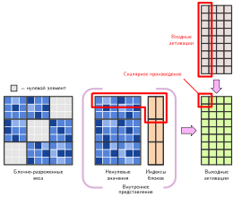

***Блочно-разреженное представление**: группировка ненулевых весов в плотные подблоки ($3\times3$ тайла) и хранение вспомогательного массива индексов позволяет вычислять разреженные матрицы регулярными ядрами GEMM над подблоками, восстанавливая высокое выравнивание памяти GPU и загрузку тензорных ядер. Адаптировано из документации NVIDIA cuSPARSE (NVIDIA, 2020).*

Аналогично, разреженность $N$:$M$ сохраняет не более $N$ ненулевых элементов в каждой группе из $M$ последовательных элементов; аппаратно ориентированное прореживание часто принудительно сохраняет ровно $N$ значений, чтобы у каждой группы было одинаковое представление (Zhou et al., 2021). Детерминированный формат позволяет поддерживаемому ядру предсказать расположение значений и метаданных, сохраняя при этом больше емкости, чем при удалении целых каналов или блоков. Эта регулярность создает выполнимый компромисс между произвольными масками и плотными вычислениями, но только для целей с соответствующим путем выполнения. Поскольку из каждого непрерывного блока из четырех элементов выбираются ровно два ненулевых значения, каждому сохраненному значению нужен лишь 2-битный индекс ($00_2$ — $11_2$), чтобы записать его исходную координату внутри блока. Эти компактные метаданные добавляют лишь 16 бит накладных расходов на каждый отрезок строки из 16 элементов, что гораздо меньше многобайтовых массивов указателей, требуемых общими форматами CSR или COO, и позволяет тензорным ядрам потоково читать сжатые операнды без раздувания трафика памяти. [«Умножение матриц с разреженностью 2:4»](10_model_compression.md#fig-2-4-gemm) сравнивает плотное умножение и умножение 2:4, а STEP рассматривает обучение более общих масок $N$:$M$ для вывода (Lu et al., 2023).

На уровне ускорителя действует то же правило, специфичное для шаблона: аппаратная поддержка — это контракт между разреженным форматом и путем выполнения.

<a id="fig-2-4-gemm"></a>

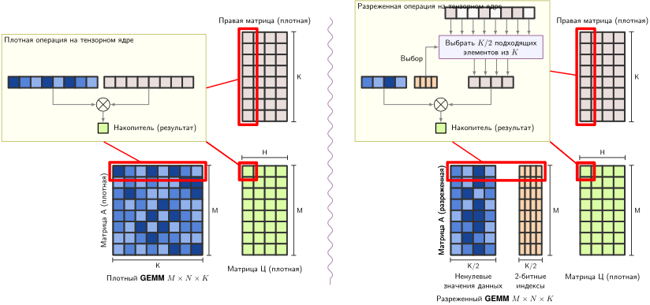

***Умножение матриц с разреженностью 2:4**: слева — стандартное плотное умножение матриц на тензорных ядрах с полными строками из 8 элементов. Справа — разреженное умножение 2:4 сохраняет два ненулевых элемента в каждой группе из четырех и использует компактные индексы, чтобы выбрать соответствующие элементы из плотной правой матрицы. Поддерживаемый разреженный внутренний цикл может вдвое уменьшить число перемножаемых значений, хотя обработка метаданных и остальной путь выполнения определяют сквозное ускорение. Источник: блог PyTorch (PyTorch, 2022).*

Поддерживаемые пути разреженных тензорных ядер на NVIDIA Ampere и более поздних архитектурах могут ускорять разреженность 2:4, пропуская предписанные нули и неся компактные метаданные, с идеальным улучшением арифметической скорости до 2 раз (NVIDIA Corporation, 2020). Напротив, **неструктурированное прореживание** обнуляет произвольные отдельные веса. Такие нерегулярные позиции могут нарушать объединение обращений к памяти и загрузку полос, а метаданные Compressed Sparse Row (CSR) или Coordinate (COO) добавляют хранение и обращения с шагом, отличным от единицы. Поэтому неструктурированная разреженная модель может работать медленнее плотного аналога, когда метаданные и недозагрузка перевешивают пропущенную арифметику. TPU служат полезным контрастным случаем для ускорения плотных систолических массивов (Jouppi et al., 2021), но ускорение разреженных вычислений все равно зависит от конкретного пути аппаратуры и программного обеспечения, а не принимает произвольные маски. Программируемые вентильные матрицы (FPGA) могут реализовать специфичные для приложения разреженные форматы, однако их эффективность зависит от выбранного потока данных и бюджета ресурсов; программируемость не гарантирует универсального ускорения разреженных вычислений.

На всех платформах разреженные операции могут снижать требования к пропускной способности памяти и энергопотребление, когда разреженное представление и ядра действительно пропускают перемещение данных, а не только арифметику. Эта выгода складывается с квантованием: разреженная модель INT8 может требовать меньше трафика памяти, чем любой из методов по отдельности, если накладные расходы формата достаточно малы (Hoefler et al., 2021; Gale et al., 2020).

<a id="sec-model-compression-challenges-limitations-975f"></a>

#### Проблемы и ограничения

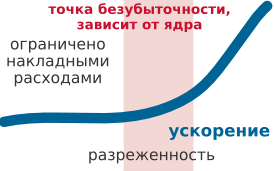

*Неструктурированная разреженность окупается только после перехода через точку безубыточности, специфичную для аппаратуры и ядра.*

Тот же контракт формата и аппаратуры объясняет, почему разреженность часто разочаровывает на практике. Центральная проблема — разрыв между теоретическим и практическим ускорением. Неструктурированное прореживание удаляет отдельные веса по их важности, создавая нерегулярные шаблоны, которые распространенные плотные пути ускорителей не могут использовать; пропуск этих нулей требует разреженного представления и совместимого ядра. Само прореживание добавляет стоимость обучения или анализа, поскольку выявление удаляемых весов может требовать сложной оценки важности на больших моделях. Даже после достижения разреженности форматы хранения добавляют индексы, накладные расходы которых могут перекрыть сэкономленные значения и арифметику. Раздел [«Форматы разреженных матриц»](appendix_algorithm.md#sec-appdx-algorithm-foundations-sparse-matrix-formats-0bd0) приложения «Основы алгоритмов» подробно описывает раскладку сжатых разреженных строк и показывает, как ее метаданные на каждый ненулевой элемент делают выигрыш по памяти зависимым от плотности. Точка безубыточности по производительности зависит от формы тензора, разреженного формата, ядра, размера батча и аппаратуры; универсального порога разреженности не существует.

Компромисс между точностью и эффективностью требует измерения на разных уровнях разреженности. Модель может переносить один уровень с малым измеримым влиянием, а затем резко деградировать после сравнительно небольшого дополнительного шага прореживания. Рабочая точка — это наибольшая полезная разреженность, при которой и качество на задаче, и производительность при развертывании удовлетворяют своим порогам.

Энергетическая эффективность не гарантирована. Хотя разреженные операции сокращают арифметику, накладные расходы разреженной индексации и нерегулярного доступа к памяти могут увеличить энергопотребление на аппаратуре, не оптимизированной под разреженные шаблоны. На периферийных устройствах с жесткими энергетическими бюджетами эти накладные расходы могут перевесить выигрыш.

Наконец, выгода от разреженности зависит от слоя, модели и цели выполнения. Нагрузка, полезные тензоры которой остаются плотными, или цель без соответствующего разреженного пути может не получить улучшения и даже ухудшиться после учета накладных расходов на метаданные и нерегулярный доступ.

<a id="sec-model-compression-combined-optimizations-99fd"></a>

#### Комбинированные оптимизации

Прореживание, квантование, слияние операторов, динамические вычисления и разреженное выполнение разделяют веса, представления и физические ресурсы. Развертывание может сочетать их, когда один метод не может удовлетворить все ограничения, но комбинированный результат не гарантированно превосходит лучший отдельный метод. Каждое преобразование может изменить точность, формы, распределения и узкие места, предполагаемые следующим, поэтому комбинации требуют совместного измерения качества и производительности, а не обещанного коэффициента сжатия (Hoefler et al., 2021).

Взаимодействие разреженности и прореживания самое прямое: прореживание создает разреженность, но шаблон определяет аппаратную эффективность. Удаление целых фильтров или слоев может давать меньшие плотные формы, тогда как фиксированные шаблоны внутри групп могут отображаться на поддерживаемые разреженные ядра. Неструктурированное прореживание создает нерегулярные шаблоны, для реализации ускорения которым нужны специализированные форматы и ядра (Elsen et al., 2020; Gale et al., 2019).

Сочетание разреженности с квантованием может умножать сокращения сырого объема значений, но развернутое представление несет одновременно метаданные разреженности и квантования. GPU со специализированными разреженными тензорными ядрами могут ускорять поддерживаемые структурированные шаблоны, тогда как результаты на CPU зависят от выбранного формата, разреженного ядра низкой точности, формы тензора и накладных расходов индексации (NVIDIA Corporation, 2020; Hoefler et al., 2021; Gale et al., 2020).

Повторяющаяся тема всех комбинаций — согласование с аппаратурой. Эффективные архитектуры, такие как раздельные по глубине свертки (Howard et al., 2017), динамические вычисления и разреженность помогают, только если целевая аппаратура поддерживает получающиеся шаблоны операций (Hoefler et al., 2021). Выбор комбинаций техник требует понимания возможностей целевой платформы, как рассмотрено в главе [«Аппаратное ускорение»](11_hw_acceleration.md).

Проблемы координации, присущие сочетанию разреженности с другими методами, указывают на более широкий принцип: методы оптимизации редко срабатывают изолированно, а их эффективность зависит от решений о порядке применения и от согласования с аппаратурой.

<a id="psp-model-compression-optimization-composition-problem"></a>

> **Проблема композиции оптимизаций**
>
> Методы оптимизации взаимодействуют через общие представления и физические ресурсы, а не компонуются как независимые функции. Прореживание меняет распределение выживших значений, формы тензоров или разреженный формат; квантование добавляет масштабы и меняет доступные ядра; слияние меняет, какие промежуточные значения материализуются, и может изменить профиль, который обосновывал более ранние решения. Поэтому эффективная оптимизация рассматривает связку «модель — среда выполнения — аппаратура» как связанную систему, измеряет ее после каждого преобразования и пересматривает последовательность, когда появляется новое узкое место. Это делает сжатие задачей системной инженерии в той же мере, что и задачей машинного обучения.

<a id="sec-model-compression-technique-selection-ba16"></a>

## Выбор техники

Выбор техник сжатия для промышленного развертывания требует определить связывающее физическое ограничение целевой среды выполнения. Рассмотрим развертывание трансформера, в котором параметры модели превышают память устройства в 3 раза, задержка вывода превышает целевой уровень обслуживания в 4 раза, а тепловой бюджет ограничивает рассеивание величиной не более 2 Вт в устойчивом режиме. Решение о том, квантовать ли, проредить, дистиллировать в компактную архитектуру или комбинировать несколько методов, зависит от того, какая аппаратная граница насыщена, какая потеря точности на задаче допустима и каков доступный бюджет обучения.

Три основных рычага оптимизации воздействуют на разные уровни системного стека. Дистилляция меняет алгоритмическую архитектуру, обучая компактного плотного ученика имитировать большего учителя; он эффективно выполняется на стандартной аппаратуре без специальной поддержки среды выполнения. Прореживание меняет топологию тензоров и шаблоны операций, но дает ускорение по реальному времени, только если получающаяся разреженность совпадает с блоками выполнения аппаратуры, например с ядрами структурированной разреженности $2:4$ или подматрицами, выровненными по каналам. Квантование меняет представление данных, уменьшая разрядность чисел; оно непосредственно снижает трафик шины памяти и занятость кэша, одновременно задействуя целочисленные пути данных с более высокой пропускной способностью. [«Компромиссы техник оптимизации»](10_model_compression.md#tbl-optimization-comparison) суммирует компромиссы первого порядка между этими техниками по риску для качества, стоимости обучения и зависимости от аппаратуры.

| **Техника**      | **Основная цель**      |   **Риск для качества**  |      **Стоимость обучения**      | **Зависимость от аппаратуры** | **Сценарий применения**               |
|:-----------------|:-----------------------|:-------------------:|:---------------------------:|:-----------------------:|:--------------------------------|
| **Прореживание** | Снизить FLOP и размер  |  Зависит от шаблона  |  Часто включает дообучение | Высокая для ускорения разреженности | Удаляемые структуры или веса    |
| **Квантование** | Снизить байты и точность | Зависит от разрядности | Низкая для PTQ; выше для QAT |  Высокая для скорости выполнения | Путь, ограниченный памятью или пропускной способностью |
| **Дистилляция** | Обучить меньшую модель    |  Зависит от ученика  |   Работают учитель и ученик   | Низкая для плотного выполнения | Возможен новый прогон обучения  |

<a id="tbl-optimization-comparison"></a>

***Компромиссы техник оптимизации**: строки определяют кандидатов первого порядка, а не гарантированные результаты. Риск для качества и стоимость обучения зависят от модели и метода, а зависимость от аппаратуры определяет, меняет ли прореживание или квантование задержку. Прореживание может удалять структуру или создавать разреженные тензоры, квантование напрямую уменьшает число байтов значений, а дистилляция тратит вывод учителя и прогон обучения ученика, чтобы получить обычную плотную модель. Кандидат все равно нужно оценивать по той же задаче и порогам развернутой системы.*

<a id="sec-model-compression-mapping-constraints-techniques-ff2c"></a>

### Сопоставление ограничений с техниками

Связывающее аппаратное ограничение определяет, какое семейство оптимизации нужно развернуть первым. В таксономии D·A·M методы сжатия перераспределяют потребности в ресурсах между Алгоритмом (топология сети и структурное прореживание), Данными (числовая точность и калибровочные наборы) и Машиной (блоки выполнения и иерархии памяти). [«Измерения оптимизации»](10_model_compression.md#tbl-constraint-opt-mapping) сопоставляет каждое системное ограничение с основным измерением оптимизации, способным его ослабить.

| **Системное ограничение**      | **Представление модели** | **Числовая точность** | **Архитектурная эффективность** |
|:---------------------------|:------------------------:|:-----------------------:|:----------------------------:|
| **Вычислительная стоимость**     |            ✓             |       $\triangle$       |              ✓               |
| **Память и хранение**     |            ✓             |            ✓            |         $\triangle$          |
| **Задержка и пропускная способность** |            ✓             |       $\triangle$       |              ✓               |
| **Энергоэффективность**      |            ✓             |            ✓            |              ✓               |
| **Масштабируемость**            |            ✓             |       $\triangle$       |              ✓               |

<a id="tbl-constraint-opt-mapping"></a>

***Измерения оптимизации**: системные ограничения направляют оптимизацию по трем основным измерениям — представлению модели, числовой точности и архитектурной эффективности, — каждое из которых устраняет свои ограничения ресурсов и цели производительности. ✓ отмечает прямой рычаг, а $\triangle$ — выгоду, зависящую от нагрузки или аппаратуры; например, арифметика низкой точности помогает, только когда ускоритель и среда выполнения предоставляют поддерживаемый путь.*

Эти измерения взаимодействуют через железный закон ML-систем: одна оптимизация часто сдвигает сразу несколько физических узких мест. Например, квантование весов из FP32 в INT8 напрямую снижает требования к емкости хранения на устройстве. Однако его влияние на задержку вывода зависит от операционной интенсивности: для операторов, ограниченных пропускной способностью памяти, сокращение передаваемых байтов дает пропорциональное снижение задержки; для операторов, ограниченных вычислениями, задержка улучшается, только если базовый процессор предоставляет более высокую пиковую пропускную способность INT8 и среда выполнения избегает накладных расходов на деквантование. И наоборот, неструктурированное прореживание устраняет арифметические FLOP, не снижая задержку на стандартных ускорителях, поскольку накладные расходы разреженной индексации и неслитые обращения к памяти ухудшают эффективность пропускной способности памяти.

<a id="sec-model-compression-decision-framework-0d69"></a>

### Схема принятия решений

Когда связывающим ограничением развертывания становится постоянная память или емкость памяти устройства — например, ограничения на размер пакета для обновления по воздуху или бюджет флеш-памяти микросхемы, — квантование дает самое прямое сокращение полезной нагрузки. По сравнению с хранением FP32 посттренировочное квантование INT8 (PTQ) сокращает сырое хранение весов в 4 раза без циклов переобучения. INT4 сокращает сырую полезную нагрузку в 8 раз, хотя агрессивное снижение разрядности повышает риск деградации точности. Если равномерное низкоразрядное квантование вызывает неприемлемую потерю точности в чувствительных слоях, дистилляция знаний в меньшую плотную архитектуру с последующим умеренным квантованием сохраняет точность и при этом удовлетворяет бюджету хранения.

Когда задержка ограничена вычислениями, нагрузка работает выше точки перехода по арифметической интенсивности ускорителя, насыщая блоки выполнения. Устранение этого узкого места требует уменьшить число выполняемых операций или повысить пропускную способность арифметики. Структурное прореживание удаляет каналы, головы внимания или целые слои, давая меньшие плотные матрицы, которые выполняются на стандартных библиотеках без накладных расходов разреженной среды выполнения; однако прореживание до размерностей, не совпадающих с размерами варпов или тайлов аппаратуры (например, с числом каналов, не делящимся на 8 или 16), снижает эффективность тензорных ядер и уменьшает выигрыш по реальному времени. Если целевая платформа предоставляет выделенные целочисленные блоки выполнения, квантование INT8 повышает скорость выполнения инструкций и напрямую ускоряет ядра, ограниченные вычислениями. Архитектуры раннего выхода дают альтернативный алгоритмический путь, динамически прекращая вывод на более простых входах, при условии что накладные расходы маршрутизации и синхронизации конвейера не нарушают пакетную обработку.

Генерация трансформера с малым батчем создает совсем другое узкое место: авторегрессивное декодирование ограничено пропускной способностью памяти, а не вычислениями. Генерация каждого токена требует загрузки больших матриц параметров из HBM или внешней DRAM для выполнения операций матрично-векторного умножения с операционной интенсивностью примерно один FLOP на байт. Поскольку арифметические блоки простаивают в ожидании передач памяти, квантование только весов (например, веса INT4 или INT8 в паре с активациями FP16) дает ускорение задержки примерно пропорционально сокращению числа загружаемых байтов весов. Это преимущество пропускной способности сохраняется, пока трафик KV-кэша, накладные расходы ядер деквантования в регистрах или большие одновременные размеры батча не вернут операционную интенсивность в режим, ограниченный вычислениями.

Когда связывающим ограничением становятся энергия или тепловое рассеивание, квантование дает существенный выигрыш, потому что перемещение данных по шинам внешней памяти расходует на бит на порядки больше энергии, чем арифметика на кристалле или доступ к локальной SRAM. Снижение разрядности операндов напрямую уменьшает энергию заряда емкости шины, а целочисленные АЛУ потребляют меньше энергии переключения, чем тракты с плавающей точкой. Структурное прореживание усиливает эту экономию, полностью устраняя операции и обращения к памяти. Аудиты энергопотребления всей системы все равно должны измерять периферийные компоненты, включая обновление памяти, обмен по шине хоста и статическую утечку в простое, чтобы убедиться, что экономия энергии на уровне ядер переходит в увеличение времени работы.

Выбор также зависит от инженерного и вычислительного бюджета, доступного для оптимизации. Посттренировочное квантование служит исходной базовой линией, потому что откалиброванное PTQ требует лишь небольшого репрезентативного набора данных и пренебрежимо малых вычислений. Если PTQ не проходит порог точности и есть ресурсы на дообучение, квантование с учетом обучения (QAT) моделирует ошибку квантования во время обратного прохода, чтобы вернуть потерянную точность. Дистилляция знаний влечет более высокие вычислительные затраты: нужны прямые проходы учителя и значительные циклы обучения, чтобы оптимизировать меньшую модель-ученика. NAS с учетом аппаратуры занимает самый дорогой уровень и оправдан только тогда, когда массовое развертывание амортизирует большие вычислительные затраты на исследование пространства архитектурного поиска.

Проверка того, что выбранная техника достигает целевой производительности, требует систематического профилирования и измерения на целевом кремнии ([«Измерение эффективности»](10_model_compression.md#sec-model-compression-efficiency-measurement-2424)). Реальные развертывания редко опираются на одну изолированную оптимизацию: сочетание прореживания, квантования и дистилляции вводит межслойные взаимодействия, которые диктуют строгие протоколы последовательности.

<a id="sec-model-compression-optimization-strategies-f2f6"></a>

## Стратегии оптимизации

Ограничения промышленного развертывания редко позволяют опираться на изолированную оптимизацию. Чтобы уместить языковую модель на 110 миллионов параметров в мобильный бюджет памяти и тепла, требуется сочетать структурное прореживание, дистилляцию знаний и квантование точности. В этом смоделированном мобильном конвейере поэтапная оптимизация сокращает объем BERT-Base с 440 МБ до 28 МБ, достигая сокращения сырого объема в 16 раз. Каждый этап устраняет свое узкое место в иерархии D·A·M: структурное прореживание убирает избыточные матричные умножения, чтобы сократить арифметику, дистилляция знаний направляет компактного ученика на восстановление представительной емкости, а квантование упаковывает веса и активации в целые меньшей разрядности, снимая нагрузку на пропускную способность памяти.

<a id="exmp-model-compression-bert-base-mobile-deployment-pipeline"></a>

> **Мобильный конвейер развертывания BERT-Base**
>
> **Сценарий**: смоделированное развертывание запускает языковую модель BERT-Base на 110 миллионов параметров на мобильном оборудовании с ограниченными ресурсами (Sanh et al., 2019).
>
> **Диагностика**: применение техник сжатия в произвольном порядке ухудшает качество представлений. Если квантование INT8 идет раньше прореживания, последующее удаление весов нарушает откалиброванные масштабы и нулевые точки, увеличивая потерю точности до 2,1 процента. Постановка структурного прореживания и дистилляции до квантования стабилизирует распределение весов.
>
> **Системный урок**: в этом смоделированном конвейере последовательное структурное сокращение, дистилляция и квантование с учетом обучения дают снижение объема в 16 раз (440 МБ до 28 МБ), ограничивая потерю точности на задаче 0,6 процента. Поскольку распределения тензоров и эффективность аппаратных ядер различаются между архитектурами, каждый промежуточный артефакт нужно профилировать на целевой среде выполнения.

Порядок имеет значение, потому что эти преобразования взаимодействуют через общие параметры и распределения активаций. Структурное прореживание удаляет каналы или головы внимания, меняя динамический диапазон и дисперсию оставшихся тензоров весов. Если сначала квантовать модель, последующее прореживание весов обнуляет значения, которые определяли откалиброванный масштабный коэффициент и нулевую точку, искажая дискретную сетку. Кроме того, вычисление градиентов для квантованных целочисленных весов при дообучении вносит серьезные ошибки дискретизации. Выполнение структурного прореживания сначала в плавающей точке позволяет сети адаптировать оставшиеся параметры. Затем дистилляция переносит представления из плотного учителя в ученика, восстанавливая потерянную точность до того, как квантование с учетом обучения (QAT) зафиксирует окончательные параметры в дискретных ячейках. [«Методы сжатия в одной из опубликованных постановок»](10_model_compression.md#fig-compression-methods) иллюстрирует эти компромиссы для техник сжатия, оцененных на бенчмарках компьютерного зрения (Han et al., 2016). Пока разложение по сингулярным значениям (SVD) и одно прореживание резко теряют точность при больших коэффициентах сокращения, сочетание прореживания с квантованием дает наибольшее сжатие при точности, близкой к базовой. Порядок и величина этих выигрышей остаются специфичными для модели и среды выполнения, поэтому инженерам нужно проверять каждый этап преобразования отдельно.

<a id="fig-compression-methods"></a>

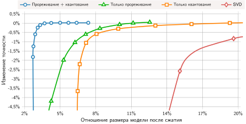

***Методы сжатия в одной из опубликованных постановок**: цитируемое сравнение показывает изменение точности в зависимости от отношения размеров модели для прореживания, квантования, их комбинации и SVD. В этой постановке прореживание плюс квантование достигает наименьшего отношения размера при точности, близкой к базовой; порядок зависит от модели и реализации. Источник: (Han et al., 2016).*

Совокупное сокращение объема на бумаге не гарантирует пропорционального ускорения выполнения на аппаратуре. Прореженные размерности могут не совпадать с шириной векторов SIMD, а квантованные тензоры требуют поддерживаемых аппаратных ядер, чтобы избежать накладных расходов на деквантование. Проверка того, что многоэтапный конвейер оптимизации достигает целевых показателей задержки, памяти и энергии, требует систематического профилирования и измерения на целевом кремнии ([«Измерение эффективности»](10_model_compression.md#sec-model-compression-efficiency-measurement-2424)).

<a id="sec-model-compression-efficiency-measurement-2424"></a>

## Измерение эффективности

Раздел [«Архитектурная эффективность»](10_model_compression.md#sec-model-compression-architectural-efficiency-8dd3) проследил разрыв между коэффициентом сжатия на бумаге и ускорением, которое модель реально получает. Этот разрыв задает обязательство эмпирического измерения. Хотя INT8 сокращает сырую полезную нагрузку тензоров в 4 раза относительно FP32, ускорение задержки не масштабируется пропорционально. Реальная пропускная способность зависит от ограничений иерархии памяти, арифметической интенсивности и реализации целевых ядер, которые номинальные коэффициенты сжатия предсказать не могут. Чтобы перевести теоретическое сжатие в реальное ускорение, нужно определить, какие физические узкие места управляют каждым компонентом модели, установить многомерные базовые линии на целевой аппаратуре и выделить, как сокращения арифметики взаимодействуют с накладными расходами системного уровня.

<a id="sec-model-compression-profiling-opportunity-analysis-477f"></a>

### Профилирование и анализ возможностей

Профилирование раскладывает выполнение модели по физическим границам ускорителя: емкость памяти (SRAM, DRAM/HBM), пропускная способность шины памяти и пропускная способность арифметики. Выделение памяти делится на статический объем (тензоры весов и постоянные буферы) и динамическое выделение (тензоры активаций и KV-кэши во время прямого прохода). Статический объем определяет, помещаются ли параметры модели в быструю встроенную память или в DRAM устройства без выгрузки через соединения хост — ускоритель с высокой задержкой, такие как PCIe. Динамическое выделение определяет пиковую занятость памяти, ограничивая максимальный размер батча и параллелизм обслуживания. На уровне операторов профилирование измеряет теоретические операции (FLOP) вместе с реальным временем выполнения. Поскольку операторы различаются на порядки по арифметической интенсивности ($I = \text{FLOP} / \text{байт}$), их узкие места выполнения расходятся: плотные матричные умножения насыщают блоки выполнения, тогда как операторы, ограниченные памятью (например, нормализация слоя и поэлементные активации), простаивают в ожидании потоковой передачи тензоров в память и из нее, расходуя реальное время несоразмерно своему числу FLOP.

Профиль Vision Transformer (ViT) на периферийном ускорителе иллюстрирует эту операционную неоднородность. Слои проекций внимания составляют 65 процентов всех FLOP, нормализация слоя занимает 8 процентов времени выполнения, хотя дает лишь 2 процента FLOP, а финальная голова классификации — 1 процент вычислений, но занимает 15 процентов памяти параметров. Профилирование выделяет управляющее физическое узкое место для каждого компонента, диктуя точечные оптимизации, а не равномерное сжатие: структурное прореживание ослабляет вычислительно ограниченные проекции внимания, слияние операторов устраняет промежуточные обращения к глобальной памяти для ограниченных памятью слоев нормализации, а квантование INT8 сокращает статический объем тяжелой по параметрам головы классификации.

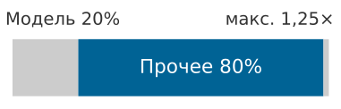

*Сквозной потолок сжатия достигается, когда работа вне модели доминирует в конвейере.*

Перевод метрик профилирования на уровне слоев в сквозное системное ускорение требует учета полного конвейера обслуживания. В промышленных системах обслуживания выполнение модели часто составляет лишь долю общей задержки, а остальное занимают декодирование изображений, токенизация, десериализация RPC или передача по сети. Как показывает рисунок выше, оптимизация модели в изоляции упирается в потолок Амдала, когда этапы вне модели доминируют в бюджете задержки.

<a id="psp-model-compression-flops-speedup"></a>

> **Снижение FLOP не означает пропорционального ускорения**
>
> Снижение FLOP модели на 50 процентов не гарантирует снижения задержки на 50 процентов. Операции, ограниченные памятью, мало выигрывают от сокращения арифметики, потому что их время задает перемещение данных, а не умножение. Критически важно, что закон Амдала применяется на системном уровне (раздел [«Закон Амдала и закон Густафсона»](appendix_machine.md#sec-appdx-machine-foundations-amdahls-law-gustafsons-law-b741) приложения «Основы машины» выводит его форму сильного масштабирования): если вывод модели составляет лишь 20 процентов сквозной задержки (остальные 80 процентов уходят на загрузку данных, предобработку и постобработку), то даже идеальная оптимизация модели дает не более чем в 1,25 раза общего ускорения. Токенизация и передача по сети могут занимать внемодельную долю в обслуживании языковых моделей; декодирование изображений, изменение размера и нормализация могут делать то же в конвейерах зрения. Профилируйте полный путь на целевой аппаратуре, прежде чем оценивать выгоду от оптимизации.

Дополнительно к профилям задержки и пропускной способности анализ чувствительности по слоям количественно показывает, как отдельные слои переносят возмущения. В глубоких сетях распределения параметров разных слоев имеют неравную устойчивость к снижению точности или удалению весов. Профилирование деградации точности при систематическом возмущении одного слоя за раз — оценка шума квантования или влияния удаления весов — выявляет, какие компоненты требуют представления высокой точности, а какие могут выдержать агрессивное квантование в 4 бита или структурное прореживание без ущерба для точности на задаче.

<a id="sec-model-compression-measuring-optimization-effectiveness-a3b2"></a>

### Измерение эффективности оптимизации

Оценка сжатия требует баланса между статистическим качеством и физической стоимостью выполнения по осям Данных, Алгоритма и Машины (D·A·M). Единственная скалярная метрика — например, top-1 точность или число параметров — не отражает пригодность к развертыванию. Базовые линии качества должны учитывать совокупную точность, калибровку уверенности (проверку того, что предсказанные вероятности отражают эмпирическую правильность) и производительность на недопредставленных срезах входа. Одновременно базовые линии эффективности должны фиксировать пиковую занятость памяти, распределения задержки (включая задержку хвоста $p99$), насыщение шины памяти и энергию на один вывод.


*Иллюстративный профиль INT8 должен проверять и размер, и точность.*

Квантование ResNet-50 из FP32 в INT8 показывает, как решения о сжатии распространяются по физическим и статистическим измерениям. Вместо оценки перехода на INT8 по одной изолированной метрике точности [«Иллюстративный профиль развертывания ResNet-50 в INT8»](10_model_compression.md#tbl-resnet50-int8-profile) представляет смоделированный профиль развертывания по вычислениям, памяти, энергии и статистической калибровке. Как показывает рисунок выше, проверка сжатия требует подтвердить, что сжатие артефакта не вызывает недопустимой деградации качества.

| **Метрика**              | **Базовый FP32**                                         | **Результат INT8**                                                                                               | **Что это значит при развертывании**                                                |
|:-------------------------|:----------------------------------------------------------|:--------------------------------------------------------------------------------------------------------------|:----------------------------------------------------------------------|
| **Top-1 точность**       | 76,1%              | 75,8% (падение на 0,3 п.п.)           | Общая точность в основном сохраняется, но проверки подгрупп по-прежнему важны.    |
| **Модельная задержка на V100** | 1,56 мс        | 0,39 мс                                                            | Задержка на GPU улучшается, когда среда выполнения отображает INT8 на быстрые ядра.      |
| **Размер модели**        | 102,4 МБ           | 25,6 МБ (4×)      | Артефакт становится проще кэшировать, передавать и развертывать на периферии.   |
| **Энергия на вывод**  | 0,25 Дж          | 0,06 Дж (4×) | Низкая точность снижает и энергию арифметики, и энергию перемещения данных в памяти.   |
| **Ошибка калибровки**    | 2,1% | 3,4%                                                     | Калибровка уверенности может сместиться, даже когда точность выглядит приемлемой. |

<a id="tbl-resnet50-int8-profile"></a>

***Иллюстративный профиль развертывания ResNet-50 в INT8**: значения образуют модельный сценарий, а не измерения одного запуска на аппаратуре. Реальный профиль должен измерять точность, задержку, размер артефакта, энергию и калибровку на целевой системе.*

Смоделированный профиль показывает, что перевод весов и активаций в INT8 сжимает объем модели в 4 раза (с 102,4 МБ до 25,6 МБ), снижая трафик DRAM и обеспечивая четырехкратное снижение энергии на вывод. Модельная задержка выполнения на V100 падает с 1,56 мс до 0,39 мс при условии, что среда выполнения отображает операции INT8 на нативные ядра тензорных ядер, а не вызывает деквантование во время выполнения. Важно, что при падении агрегированной top-1 точности всего на 0,3 процентного пункта (с 76,1 процента до 75,8 процента) ошибка калибровки растет с 2,1 процента до 3,4 процента. Распределения вероятностей после квантования смещаются, и это может подорвать критичные для безопасности пороги уверенности, даже когда точность топ-1 классификации выглядит сохраненной. Поскольку эти значения представляют смоделированный сценарий, решения о промышленном развертывании требуют эквивалентных эмпирических измерений на целевой аппаратуре.

Получить эти выигрыши в продакшене можно, только оценив взаимодействия нескольких техник сжатия. Последовательное применение прореживания, квантования и дистилляции может давать невзаимные выигрыши или накапливать деградацию; например, неоткалиброванное квантование весов на агрессивно прореженной разреженной матрице может вызвать катастрофическое обрушение точности. Оценка этих накопленных компромиссов требует отображения моделей на границу Парето «эффективность — качество», как описано в разделе [«Проверка сжатия: граница эффективности и качества»](12_benchmarking.md#sec-benchmarking-compression-validation-efficiencyquality-frontier-e9c4) главы «Бенчмаркинг». Выполнение этого систематического профилирования и многоэтапного конвейера преобразований, в свою очередь, зависит от автоматизированных программных инструментов, которые координируют компиляцию, генерацию ядер и бенчмаркинг аппаратуры.

<a id="sec-model-compression-implementation-tools-4990"></a>

## Инструменты реализации

Квантовать модель на 175 миллиардов параметров вручную означает изменять тысячи мест вызова операторов, чтобы вставить масштабные коэффициенты и отслеживать динамические диапазоны активаций. Без автоматизированных инструментов фреймворка даже равномерное посттренировочное квантование INT8 требует вручную перехватывать жизненный цикл тензоров по всему вычислительному графу, а прореживание требует вести маски разреженности вместе с матрицами весов. В масштабе ручная манипуляция графом не может гарантировать согласованность автоградиента при переобучении и не может обеспечить ограничения выравнивания памяти, которые требует аппаратура ускорителя.

Выбор инструмента следует за тем уровнем программного стека, который владеет преобразованием. API фреймворков работают с высокоуровневым вычислительным графом во время обучения и калибровки, где движок выполнения видит веса, активации и состояние автоградиента. На этом этапе квантование обычно моделируется: узлы фиктивного квантования ограничивают и округляют значения внутри регистров с плавающей точкой, моделируя потерю численной точности и сохраняя дифференцируемость. Однако сами инструменты фреймворка не могут реализовать физическое ускорение выполнения. Компиляторы и движки времени выполнения берут управление после экспорта графа, преобразуя смоделированные операции в нативные для ускорителя планы выполнения. Компилятор времени выполнения сливает арифметику масштабных коэффициентов непосредственно в вычислительные тайлы матричного умножения и упаковывает разреженные веса в аппаратно-специфичные раскладки метаданных (например, форматы структурированной разреженности 2:4). Такое преобразование устраняет возвраты в HBM, которые иначе свели бы на нет выгоды от снижения точности. Программная инфраструктура закрепляет эту границу, фиксируя данные калибровки, расписания прореживания и слияния операторов, которые породили развертываемый двоичный файл, а не полагаясь на неотслеживаемые правки скриптов.

Во всем этом многоэтапном конвейере операционный императив — воспроизводимость. Сжатие модели меняет ее числовые представления на уровнях алгоритма и машины таксономии D·A·M. Незаписанные входы калибровки или несогласованные режимы округления могут незаметно ухудшить точность без ошибок времени выполнения. Глава [«MLOps»](14_ml_ops.md#sec-ml-operations) позже расширяет эту дисциплину на версионирование моделей, мониторинг, управление артефактами и процедуры отката; здесь базовое требование состоит в том, чтобы каждый развернутый артефакт детерминированно прослеживался от исходной контрольной точки обучения до скомпилированного аппаратного графа выполнения.

<a id="sec-model-compression-model-optimization-apis-tools-1849"></a>

### API и инструменты оптимизации модели

На уровне разработки модели алгоритмы сжатия требуют доступа к состоянию времени выполнения, которое последующие компиляторы развертывания отбрасывают: истории градиентов, переменные состояния оптимизатора и динамические распределения активаций. Когда посттренировочное квантование или однократное прореживание снижает точность ниже приемлемых рабочих порогов, восстановление требует переобучения или итеративного дообучения. Фреймворки, такие как PyTorch и TensorFlow, предоставляют API оптимизации именно для управления этой границей преобразования графа. Эти API вставляют узлы квантования, переписывают параметризацию тензоров весов масками разреженности и сохраняют метаданные калибровки вместе с обученными параметрами. Хотя [«Фреймворки машинного обучения»](07_frameworks.md#sec-ml-frameworks) всесторонне описывает движки выполнения фреймворков, сжатие модели опирается на эти специализированные мутации графа, чтобы связать алгоритмическую функцию потерь с ограничениями выполнения на уровне машины.

Пример квантования с учетом обучения показывает это вмешательство на уровне графа. Квантование непрерывных весов с плавающей точкой в дискретные целые вводит разрывную ступенчатую функцию, производная которой почти всюду равна нулю ($d\lfloor x \rceil / dx = 0$), и стандартный градиентный спуск останавливается. API оптимизации преодолевают этот математический барьер, вставляя операторы фиктивного квантования в вычислительный граф. При прямом проходе эти операторы ограничивают значения целевым динамическим диапазоном и округляют их до дискретных целых, подвергая последующие активации шуму усечения низкой точности. При обратном проходе оператор реализует сквозную оценку: он рассматривает шаг округления как тождественную функцию, беспрепятственно направляя градиенты к нижележащим 32-битным мастер-весам. [«Квантование с учетом обучения»](10_model_compression.md#lst-qat_example) описывает последовательность преобразований графа и отслеживания метаданных, необходимых для получения развертываемого артефакта низкой точности.

<a id="lst-qat_example"></a>

**Квантование с учетом обучения**: преобразование на уровне механизма, которое обучает через моделируемое поведение низкой точности и экспортирует метаданные калибровки, необходимые для развертывания.

```text
выбрать целевую точность и политику калибровки
вставить границы квантования и деквантования вокруг выбранных тензоров
обучать на смоделированных значениях низкой точности, сохраняя непрерывность потока градиентов
записать масштабы, нулевые точки, точность аккумулятора и неподдерживаемые операции
экспортировать откалиброванный граф и метаданные как один воспроизводимый артефакт
```

Параллельная стратегия мутации графа управляет прореживанием в API фреймворков. Физическая аппаратура не может ускорить произвольное удаление параметров во время обучения: динамическое удаление несмежных весов фрагментировало бы выделения памяти и разрушило бы объединенные обращения к памяти по полосам SIMD. Поэтому API прореживания фреймворков не уменьшают размерности тензоров во время дообучения. Вместо этого они переписывают параметризацию слоя, сохраняя исходный плотный тензор весов $W$ и выделяя вспомогательный бинарный тензор маски $M$ той же формы, а прямой проход выполняют поэлементным умножением ($W_{\text{pruned}} = W \odot M$). Такой дизайн сохраняет раскладки плотных тензоров в памяти и обновления градиентов во время оптимизации. Только когда обучение завершено, проход экспорта окончательно выполняет преобразование: либо физически срезает ненужные каналы при структурном прореживании, либо кодирует ненулевые элементы в разреженные контейнерные форматы, совместимые с аппаратными ускорителями. [«Граница артефакта прореживания»](10_model_compression.md#lst-pytorch_pruning) иллюстрирует жизненный цикл оценки параметров, маскирования и экспорта.

<a id="lst-pytorch_pruning"></a>

**Граница артефакта прореживания**: применяет правила неструктурированного или структурированного удаления, затем записывает маску и контекст дообучения, необходимые для воспроизведения сжатой модели.

```text
выбрать гранулярность прореживания: отдельные веса, каналы, блоки или головы внимания
оценить кандидатные параметры по величине, чувствительности или влиянию на валидационную потерю
удалить или замаскировать выбранную структуру по правилу, совместимому с аппаратурой
дообучить сжатую модель на исходной валидационной цели
экспортировать веса, маски, шаблон разреженности и данные калибровки вместе
```

Инженерная ценность этих API заключается в воспроизводимости экспериментов на всей иерархии D·A·M. Вместо реализации специальных манипуляций с графом практики используют встроенные модули оптимизации как стандартизированные контрольные точки. Инженеры могут систематически перебирать коэффициенты разреженности, схемы масштабирования квантования, калибровочные наборы данных и расписания скорости обучения, сохраняя неизменным базовый конвейер выполнения. Упаковка получающихся масштабов, нулевых точек, масок и архитектурных изменений в единые артефакты экспорта гарантирует, что последующие среды выполнения вывода могут воспроизвести точную численную семантику, проверенную во время обучения.

<a id="sec-model-compression-hardwarespecific-optimization-libraries-3ab1"></a>

### Библиотеки оптимизации для конкретного оборудования

Экспорт оптимизированной модели из фреймворка обучения дает промежуточное графовое представление, а не исполняемый двоичный файл. Компиляторы и движки времени выполнения, такие как TensorRT, XLA, OpenVINO и TVM, отвечают за финальный шаг трансляции: компиляцию прореженного, квантованного или слитого графа в машинные инструкции, адаптированные под целевой ускоритель. Хотя глава [«Аппаратное ускорение»](11_hw_acceleration.md) подробно описывает микроархитектурные структуры, на которые нацелены эти инструменты, управляющий системный принцип опирается на иерархию D·A·M: алгоритмическое сжатие остается теоретическим, пока граф не отображается на ядра, которые физически используют иерархию памяти и блоки выполнения целевой машины.

Проход компиляции проверяет, дает ли номинальное сжатие физическое ускорение. Прореживание удаляет из графа нулевые веса, но если аппаратура не предоставляет раскладки памяти и пути выполнения, учитывающие разреженность (например, поддержку структурированной разреженности 2:4), матричные блоки передают и умножают нули так же, как ненулевые значения, и трафик памяти или задержка не снижаются. Квантование снижает разрядность, но если ускоритель не имеет нативных вычислительных конвейеров INT8 или INT4, среда выполнения должна распаковать операнды в регистры с плавающей точкой перед арифметикой, заменяя узкое место памяти накладными расходами инструкций. Кроме того, ядра низкой точности требуют специализированных раскладок тензоров, например тайловых или чередующихся каналов памяти, чтобы обеспечить объединенную загрузку в разделяемую память или регистровый файл. Слияние операторов устраняет промежуточные возвраты в DRAM вне кристалла, размещая промежуточные активации непосредственно в SRAM на кристалле или в регистрах. Если неподдерживаемая последовательность операторов блокирует слияние, узкое место пропускной способности памяти остается на месте. Оптимизации на уровне фреймворка лишь открывают возможности; компиляторы под конкретное оборудование определяют, сохраняются ли эти возможности при переводе в эффективный машинный план выполнения.

<a id="sec-model-compression-diagnostic-visualization"></a>

### Диагностическая визуализация

Граница инструментов разделяет обязанности: API фреймворков создают и калибруют сжатую модель, библиотеки оптимизации под аппаратуру переводят ее в субстрат выполнения, а диагностический осмотр проверяет численную целостность. Системная валидация и мониторинг артефактов относятся к последующей инфраструктуре развертывания, но непосредственная диагностическая задача состоит в том, чтобы убедиться, что отсечение квантования, маски прореживания или шаблоны разреженности не исказили внутренние распределения признаков сверх допустимой ошибки на задаче.

Гистограммы ошибки квантования показывают, распределена ли ошибка широко или сосредоточена в выбросах. Визуализация активаций помогает обнаружить отсечение, переполнение и насыщение. [«Паттерны первого сверточного слоя»](10_model_compression.md#fig-color-mapping) схематически группирует ядра первого сверточного слоя по визуальному паттерну. Ядра, близкие к нулю, или фильтры со стабильно пренебрежимо малыми активациями, а не просто фильтры с однородным видом, являются кандидатами на прореживание, поэтому диагностика должна сочетать визуализацию весов с измеренным поведением активаций. Отладчики и наблюдатели фреймворков могут показывать диапазоны квантования и ошибку тензоров, тогда как инспекторы компилятора или среды выполнения могут показывать граф и ядра, которые экспортированная модель действительно выполняет.

<a id="fig-color-mapping"></a>

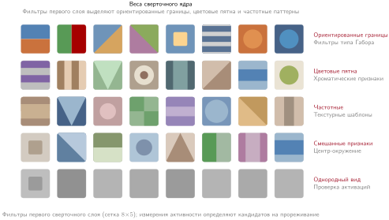

***Паттерны первого сверточного слоя**: сетка $8\times5$ группирует стилизованные ядра в паттерны краев, цвета, частот, смешанные и однородные на вид. Внешний вид сам по себе не доказывает бездействия; для прореживания требуются измеренные данные об активациях или важности помимо низкой дисперсии весов.*

Диагностика разреженности отвечает на вопрос развертывания: какие слои действительно стали достаточно разреженными, чтобы среда выполнения могла их использовать? [«Распределение разреженности по слоям»](10_model_compression.md#fig-sparse-heat-map) показывает, как тепловая карта по слоям и блокам выявляет, где концентрируется разреженность, а графики трендов отслеживают ее динамику по итерациям прореживания. Профилирование ядер все равно должно определить, дает ли шаблон ускорение. Для этого есть такие инструменты, как TensorBoard, Netron и SparseML.

<a id="fig-sparse-heat-map"></a>

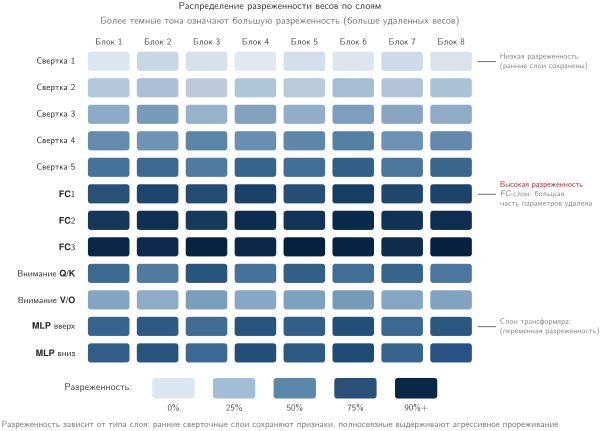

***Распределение разреженности по слоям**: тепловая карта по блокам, визуализирующая неоднородное удаление параметров. Более темные клетки означают более высокую плотность разреженности и показывают, какие слои сети сохраняют плотные признаки, а какие концентрируют нулевые веса ради экономии памяти или планирования разреженных ядер.*

Диагностическая ценность — в неоднородности, а не в точном оттенке отдельной клетки. Если поздние слои намного разреженнее ранних экстракторов признаков, политика прореживания концентрирует сжатие там, где представления более избыточны; если первыми темнеют ранние слои, политика, возможно, разрушает признаки низкого уровня раньше, чем модель получит достаточную глубину для компенсации.

Инструменты реализации делают сжатие повторяемым, но не устраняют компромиссы. Квантование может следовать за прореживанием или дистилляцией в многослойном конвейере: прореживание меняет структуру модели или число параметров, квантование меняет числовое представление, а дистилляция может обучать меньший артефакт на поведении учителя. Эти преобразования могут накапливать сокращения сырого объема, но ни фиксированный коэффициент сжатия, ни результат по качеству не переносятся между моделями и развертываниями; каждый этап нужно оценивать относительно целевой задачи и профилировать на целевом пути выполнения.

<a id="sec-model-compression-fallacies-pitfalls-1b5e"></a>

## Заблуждения и ловушки

Самые поучительные уроки сжатия моделей часто дает не то, что работает, а то, что проваливается. Сценарии ниже иллюстрируют типичные режимы отказа; точные результаты зависят от модели, метода сжатия, нагрузки и целевой аппаратуры.

Оптимизация моделей включает контринтуитивные взаимодействия между техниками, которые кажутся независимыми. Инженеры часто предполагают, что стратегии компонуются линейно и что теоретические метрики предсказывают производительность развертывания; эти допущения тратят усилия оптимизации, ухудшают точность или не выполняют требования развертывания, несмотря на значительные инвестиции.

> **Заблуждение и ловушка**
>
> **Заблуждение:** *Техники оптимизации можно применять независимо, не учитывая их взаимодействия.*
>
> Инженеры предполагают, что стратегии оптимизации складываются аддитивно: прореживание на 50 процентов плюс квантование в 4 раза дают совокупный выигрыш. На деле техники взаимодействуют нелинейно и умножают потери. В репрезентативном сценарии сжатия в стиле BERT прореживание до разреженности 70 процентов может сохранять большую часть качества решения, но последующее квантование INT8 может потерять больше точности, чем QAT прореженной модели. Дистилляция из сильно прореженных учителей может также передавать вырожденные шаблоны внимания, которые снижают точность ученика по сравнению с дистилляцией из плотных учителей. Как показывает раздел [«Стратегии оптимизации»](10_model_compression.md#sec-model-compression-optimization-strategies-f2f6), успешная оптимизация требует согласованного применения, где техники выстроены в последовательность. Организации, которые применяют агрессивные комбинации без измерения взаимодействий, тратят недели на восстановление утраченной точности.

> **Заблуждение и ловушка**
>
> **Ловушка:** *Оптимизация под теоретические метрики вместо реальной производительности развертывания.*
>
> Команды могут существенно снизить FLOP, не получив пропорционального выигрыша в задержке. В одном гипотетическом трейсе прореженная модель с 40 процентами меньшим числом параметров дает лишь 12 процентов снижения задержки, потому что нерегулярная разреженность мешает эффективному выполнению. Во втором сценарии трансформер уменьшается с 440 МБ до 110 МБ, но накладные расходы преобразования на аппаратуре без быстрого пути низкой точности съедают выигрыш в задержке. Эти значения иллюстрируют режимы отказа и не являются измерениями для ARM или GPU. Пропускная способность памяти, поведение кэша, ядра и параллелизм на уровне инструкций определяют реальную производительность, поэтому промышленным развертываниям нужны измерения времени выполнения на целевой аппаратуре.

> **Заблуждение и ловушка**
>
> **Заблуждение:** *Агрессивное квантование сохраняет производительность модели при минимальной потере точности.*
>
> Инженеры предполагают, что ошибка квантования растет равномерно с разрядностью. На практике снижение точности может давать пороговые эффекты, а порог зависит от модели, слоя, квантователя, калибровки и метода обучения. Значения для ResNet и BERT в этой главе иллюстративны, а не являются универсальными полосами деградации. Даже такие операции, как LayerNorm и Softmax, можно реализовать целочисленными приближениями, поэтому они не требуют обязательно FP16; сохраняет ли низкоточная реализация качество на задаче, нужно измерять. Как показывает раздел [«Стратегии снижения точности»](10_model_compression.md#sec-model-compression-precision-reduction-strategies-db83), смешанные подходы к точности могут сохранять более высокую точность там, где равномерное квантование не справляется.

> **Заблуждение и ловушка**
>
> **Ловушка:** *Использование FP32 везде, чтобы избежать риска квантования.*
>
> FP32 расходует в два раза больше сырого хранения и пропускной способности, чем BF16, но выполнение в низкой точности само по себе не гарантирует сходимости или точности. Обучение в смешанной точности часто сохраняет накопители FP32 или мастер-веса и может требовать масштабирования потерь, тогда как точность вывода нужно проверять для каждой модели и каждого оператора. Правильный вопрос — какая самая низкая точность сохраняет качество на распределении оценки и эффективно отображается на целевую аппаратуру.

> **Заблуждение и ловушка**
>
> **Заблуждение:** *Посттренировочной оптимизации всегда достаточно.*
>
> Команды часто начинают с посттренировочного квантования (PTQ), потому что оно избавляет от переобучения. Если получившийся артефакт соответствует порогам задачи и развертывания, этот простой путь может оказаться достаточным. Когда этого не происходит, квантование с учетом обучения (QAT) может восстановить часть разрыва в качестве, адаптируя модель к моделируемому поведению низкой точности. Посттренировочное прореживание и апостериорная дистилляция могут аналогично уступать расписаниям с учетом обучения при агрессивной разреженности или разрядности. Как подробно описано в разделе [«Стратегии снижения точности»](10_model_compression.md#sec-model-compression-precision-reduction-strategies-db83), решение определяет производственный порог, а не презумпция, что один из путей универсально превосходит другой.

> **Заблуждение и ловушка**
>
> **Ловушка:** *Предположение, что коэффициенты сжатия напрямую переходят в пропорциональный выигрыш развертывания.*
>
> Команды могут получить четырехкратное снижение сырой полезной нагрузки весов через квантование INT8 и ожидать такого же выигрыша при развертывании. На практике масштабы, метаданные, неподдерживаемые операторы, преобразования и разреженная индексация съедают эту выгоду. Сквозное улучшение в 18,8 процента от цели в 8 раз на бумаге в этой главе — гипотетический трейс, а не бенчмарк BERT. Промышленные процессы должны профилировать задержку в развернутом виде на целевой аппаратуре, а не экстраполировать из коэффициентов сжатия.

> **Заблуждение и ловушка**
>
> **Заблуждение:** *Разреженные матрицы всегда экономят память.*
>
> Разреженные форматы добавляют метаданные в виде массивов индексов, которые съедают экономию при умеренной плотности. При значениях FP32 и индексах INT32 подходы CSR достигают точки безубыточности примерно при плотности 50 процентов до учета накладных расходов указателей строк, тогда как COO хранит дополнительные координаты и пересекает точку безубыточности при меньшей плотности. У производительности нет универсального порога разреженности, потому что форма тензора, формат, ядро, батч и аппаратура определяют, опережает ли разреженное выполнение плотное. Специализированные форматы, такие как разреженность 2:4 от NVIDIA, сокращают метаданные и дают поддерживаемый путь выполнения, тогда как произвольная неструктурированная разреженность на массовом оборудовании может не дать ни экономии памяти, ни экономии задержки (см. раздел [«Профилирование и анализ возможностей»](10_model_compression.md#sec-model-compression-profiling-opportunity-analysis-477f)).

> **Заблуждение и ловушка**
>
> **Ловушка:** *Выбор разреженного хранения до проверки порога плотности.*
>
> Команды иногда преобразуют тензоры в разреженные форматы, как только прореживание создает видимые нули. Это преобразование может сделать систему медленнее и крупнее, если метаданные, накладные расходы сбора и рассеивания и плохая локальность кэша перевешивают сэкономленные значения. Промышленный проход сжатия должен измерять реализованную плотность, выбирать разреженный формат только после пересечения точки безубыточности и предпочитать структурированную разреженность, когда целевая аппаратура имеет ядра, которые ее используют.

<a id="sec-model-compression-summary-8229"></a>

## Итоги

Сжатие модели — инженерная дисциплина, построенная на трех взаимодополняющих измерениях: *структурная оптимизация* определяет, что вычисляет модель, *оптимизация точности* определяет, насколько точно она вычисляет, а *архитектурная оптимизация* определяет, насколько эффективно эти вычисления выполняются на физической аппаратуре. Эти измерения могут накапливаться, но их выигрыши не перемножаются автоматически. Прореживание, дистилляция и квантование вместе дают иллюстративному конвейеру сокращение объема в 16 раз — с 440 МБ до 28 МБ; метаданные, неподдерживаемые операторы и отображение на аппаратуру определяют реально достигнутый выигрыш при развертывании. Сокращение параметров дает такое же сокращение задержки, только если затронутая работа находится на критическом пути и среда выполнения может использовать новое представление. Профилируйте на целевой аппаратуре, а не по метрикам на бумаге.

В сочетании с техниками отбора данных из раздела [«Отбор данных»](09_data_selection.md#sec-data-selection) эти оптимизации, ориентированные на модель, завершают набор инструментов эффективности со стороны модели: отбор данных максимизирует обучение на доступных примерах, а сжатие модели минимизирует ресурсы, нужные для развертывания. Превратятся ли эти сбережения в реальное ускорение, по-прежнему зависит от аппаратуры и среды выполнения, которые запускают сжатую модель.

> **От победителя бенчмарка к продуктовой модели**
>
> * **Сжатие расходует избыточную емкость**: продуктовые модели обменивают неиспользуемые параметры, точность и емкость на ограничения по задержке, памяти, мощности или стоимости, которые развертывание не может нарушить. Цель — наименьший артефакт, который сохраняет требуемое поведение на задаче при ограничениях развертывания.
> * **Выигрыши перемножаются только при согласовании**: структурное прореживание, дистилляция, квантование и изменения архитектуры могут совокупно сокращать сырой объем, как показывает сокращение в 16 раз в смоделированном мобильном конвейере BERT. Выигрыш становится реальным, только когда качество на задаче сохраняется, а получающиеся операторы соответствуют целевой среде выполнения и ускорителю.
> * **Точность — это контракт развертывания**: там, где целевая среда выполнения ее поддерживает, посттренировочное квантование INT8 — полезный первый эксперимент, потому что оно снижает сырую полезную нагрузку весов FP32 в 4 раза без переобучения. QAT, дистилляция или смешанная точность становятся кандидатами, когда калибровка или чувствительность слоев выявляют недопустимую ошибку.
> * **Аппаратура задает курс обмена**: неструктурированная разреженность и теоретическое сокращение FLOP не означают выигрыша задержки, если ядра и раскладки памяти не могут их использовать. Гипотетическая цель в 8 раз на бумаге против реализованных 1,5 раза в главе показывает, почему профилирование на целевой аппаратуре обязательно.
> * **Сквозная задержка ограничивает выигрыш модели**: сжатие ценно только на критическом пути. Когда вывод составляет 20 процентов общей задержки запроса, закон Амдала ограничивает даже идеальное ускорение модели величиной в 1,25 раза, поэтому предобработка, диспетчеризация и перемещение данных могут быть истинной целью оптимизации.

Техники этой главы различаются почти во всех деталях, но под всеми ними лежит одно правило. Каждая покупает более компактную, быструю или холодную модель за счет чего-то другого: прореживание расходует емкость, квантование расходует числовую точность, а дистилляция расходует вычисления обучения. Там, где у модели нет избытка, за который можно заплатить, счет может быть оплачен качеством решения. Сжатие не делает работу исчезающей; оно переносит стоимость или риск из одной части системы в другую, а курс обмена задает аппаратура. Поэтому техника, которая окупается на телефоне, может оказаться бесполезной на GPU дата-центра. Это эвристика сохранения сложности на уровне одной модели. Промышленный артефакт — это модель, структура, представление и путь выполнения которой спроектированы вместе до тех пор, пока компромисс не уравновесится с аппаратными и прикладными ограничениями, управляющими развертыванием.

> **От математики к физике**
>
> Эти техники оптимизации сжимают логику модели, уменьшая работу, которую алгоритм поручает машине. Логика, однако, в конечном счете должна выполняться на физическом кремнии. Глава [«Аппаратное ускорение»](11_hw_acceleration.md#sec-hardware-acceleration) рассматривает, как GPU, TPU и NPU — с их систолическими массивами, разреженными тензорными ядрами и иерархиями памяти SRAM/HBM — отображают поддерживаемые сжатые представления на пропускную способность вычислений и перемещения данных, доступных в аппаратуре.
