<a id="sec-hardware-acceleration"></a>

# Аппаратное ускорение

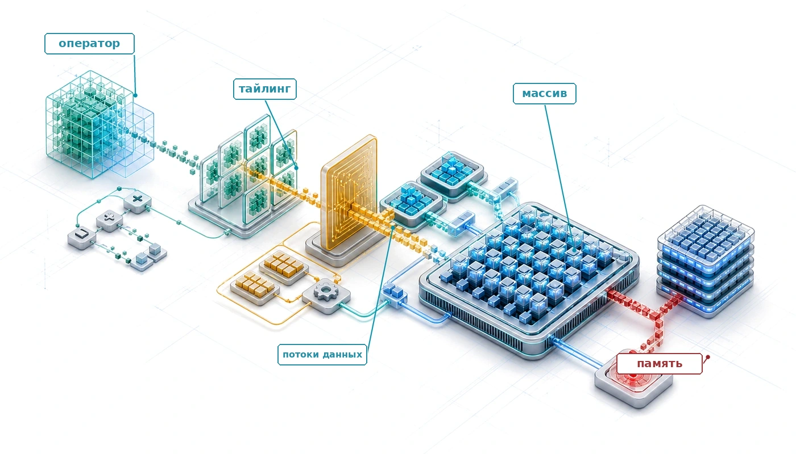

## Назначение

_Почему перемещение данных обходится дороже, чем их вычисление?_

Арифметика дешева по сравнению со многими обращениями к памяти. За то время, которое уходит на выборку одного значения из основной памяти, процессор может выполнить много вычислений. Этот дисбаланс, «стена памяти», отражает задержку, пропускную способность и энергетические затраты на перемещение данных по системе. Он объясняет, почему специализированные ускорители не просто быстрее считают, а устроены так, чтобы скрывать, амортизировать и снижать стоимость перемещения данных через глубокую иерархию памяти, массовый параллелизм и специализированные пути передачи данных. Аппаратное ускорение позволяет расти многим большим нагрузкам ИИ там, где одного масштабирования процессоров общего назначения недостаточно. Оно также объясняет, почему некоторые оптимизации, которые сокращают теоретический объем вычислений, не ускоряют выполнение. Если операция ограничена памятью, сокращение вычислений может не помочь, потому что вычисления не являются узким местом. Поэтому выбор аппаратуры нельзя свести к сравнению пиковых FLOP/s. Важно, совпадают ли шаблоны перемещения данных нагрузки с тем, что аппаратура спроектирована ускорять. Модели с большими таблицами эмбеддингов и нерегулярными выборками нужен другой ускоритель, чем модели, которые выполняют плотные матричные умножения над компактными тензорами весов. Программное обеспечение должно выявлять доступное повторное использование данных и планировать его; иначе специализированные блоки простаивают, пока данные перемещаются, и заявленная пропускная способность остается теоретической. Совпадение нагрузки и аппаратуры определяет, останется ли выполнение на доле теоретического пика или приблизится к практическому потолку аппаратуры. В терминах D·A·M ускоритель делает ограничение машины конкретным и определяет, какие алгоритмы остаются практичными в промышленной эксплуатации.

> **Цели обучения**
>
> - Объяснять аппаратное ускорение как специализацию по оси машины для тензорных нагрузок, повторного использования данных и производительности на ватт
> - Вычислять арифметическую интенсивность и потолки Roofline, чтобы относить ядра к вычислительно-ограниченным или ограниченным памятью
> - Диагностировать узкие места «стены памяти» по пропускной способности, иерархии кэшей, передаче данных между хостом и устройством и энергии перемещения данных
> - Сравнивать тензорные ядра, систолические массивы, блоки SIMD/SIMT и разреженное выполнение как примитивы вычислений для ML
> - Выбирать стратегии потоков данных, тайлинга и отображения, которые максимизируют повторное использование при ограничениях на объем памяти
> - Анализировать оптимизации компилятора и среды выполнения, которые сливают ядра, планируют память и распределяют работу по ускорителям
> - Оценивать выбор ускорителя по пропускной способности, задержке, мощности, стоимости и ограничениям среды развертывания

<a id="sec-hardware-acceleration-ai-hardware-acceleration-fundamentals-9b28"></a>

## Основы ускорения

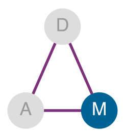

*Аппаратное ускорение включается по оси машины.*

Сокращение параметров, точности или числа операций имеет смысл только тогда, когда машина способна эффективно выполнить полученное представление. Отбор данных сократил член данных, сжатие сократило объем работы алгоритма; аппаратное ускорение спрашивает, что машина может реально выдать. Ответ начинается со стены памяти: арифметика часто дешева по сравнению с перемещением данных. Обращение к памяти за пределами кристалла может занимать много тактов процессора и расходовать на порядки больше энергии, чем арифметическая операция низкой точности; точное соотношение зависит от устройства и уровня памяти. Специализированная аппаратура важна, потому что она повышает пропускную способность вычислений и одновременно организует память, потоки данных и параллелизм так, чтобы арифметические блоки оставались загруженными.

<a id="dfn-hw-acceleration-hardware-acceleration"></a>

> **Аппаратное ускорение**
>
> ***Аппаратное ускорение*** — это практика переноса работы с выполнения общего назначения на специализированные процессоры или функциональные блоки, оптимизированные для более узкого класса операций. Для нагрузок машинного обучения такая специализация обычно обменивает часть программируемости на плотность вычислений $(R_{\text{peak}})$ и выигрыш производительности на ватт, которые способны использовать регулярные тензорные операции.
>
> 1.  **Значение**: ускоритель A100 дает 312 TFLOP/s при умножении матриц в FP16/BF16; относительно эталонной базы этой главы, процессора на 1–2 TFLOP/s, это разрыв в 156–312 раз. Его 54,2 млрд транзисторов отданы параллельной арифметике гораздо больше, чем предсказанию ветвлений, внеочередному планированию и большим кэшам (NVIDIA Corporation, 2020; Choquette et al., 2021).
> 2.  **Отличие**: процессор общего назначения рассчитан на гибкое выполнение, низкую задержку управления и разнородные нагрузки. Ускоритель же концентрирует ресурсы на более узком классе операций, поэтому получает выигрыш, только когда нагрузка открывает поддерживаемые операции и достаточно параллельной работы, чтобы занять арифметические блоки.
> 3.  **Типичная ошибка**: распространенное заблуждение состоит в том, что заявленная пиковая пропускная способность ускорителя — это та пропускная способность, которую получает нагрузка. Реальная производительность определяется меньшим из двух потолков: вычислительного и того, что может подать пропускная способность памяти, то есть ограничением Roofline. Ядро с низкой арифметической интенсивностью может работать на малой доле пиковых FLOP/s, как бы быстро ни была оценена кремниевая схема, потому что оно ждет данных, а не арифметики.

Это определение задает центральный инженерный компромисс главы. Процессоры общего назначения отдают площадь кристалла сложной логике управления, спекулятивному выполнению, предсказанию ветвлений и многоуровневым иерархиям кэшей, чтобы обрабатывать произвольный поток управления. Ускоритель направляет этот бюджет транзисторов на плотные массивы арифметики, выделенные регистровые файлы и пути высокой пропускной способности к памяти, настроенные под более узкий класс нагрузок. Когда программный путь раскрывает достаточный тензорный параллелизм, такая специализация дает улучшения энергоэффективности и производительности на ватт на порядки.

Одна аппаратура этих выигрышей не дает. Алгоритмы должны структурировать операции так, чтобы раскрывать повторное использование данных и регулярный доступ к памяти, а кремниевые архитектуры должны выделять физические блоки под математические примитивы и числовые форматы, которые алгоритмы действительно выполняют. Этот симбиоз порождает дополняющий принцип: совместное проектирование аппаратуры и программного обеспечения.

<a id="dfn-hw-acceleration-hardware-software-co-design"></a>

> **Совместное проектирование аппаратуры и программного обеспечения**
>
> ***Совместное проектирование аппаратуры и программного обеспечения*** — это метод разработки ускорителей для ML, который пересекает обычные границы абстракций: ограничения алгоритма влияют на кремниевый проект, а возможности аппаратуры формируют постановку алгоритма.
>
> 1.  **Значение**: на поддерживаемом пути тензорных ядер целочисленное квантование INT8 может дать многократный прирост пропускной способности, потому что аппаратура выполняет операции низкой точности плотнее и перемещает меньше байтов, чем путь FP32; точный выигрыш зависит от архитектуры и нагрузки (NVIDIA Corporation, 2020; Dally et al., 2021; Dally, 2023).
> 2.  **Отличие**: в отличие от послойной абстракции, где программа вызывает аппаратный API, не зная деталей кремния, совместное проектирование напрямую открывает ограничения аппаратуры авторам алгоритмов и компиляторов: требования к выравниванию данных, форматы точности и шаблоны доступа к памяти становятся видимыми входами для глобальной межслойной оптимизации.
> 3.  **Типичная ошибка**: распространенное заблуждение состоит в том, что совместное проектирование — это однократный выбор аппаратного решения. На практике поддерживаемые возможности продолжают развиваться: тензорные ядра NVIDIA начинались с умножения матриц в FP16, затем появились TF32 и более широкая поддержка целых чисел, а Ampere добавил ускорение для структурированной разреженности 2:4 (NVIDIA, 2017; NVIDIA Corporation, 2020).

Совместное проектирование объясняет, почему методы сжатия, описанные в главе [«Сжатие моделей»](10_model_compression.md#sec-model-compression), дают реальное ускорение. Методы квантования из раздела [«Квантование и числовая точность»](10_model_compression.md#sec-model-compression-quantization-precision-cd46) показывают, почему перевод FP32 в INT8 ускоряет выполнение на поддерживаемой аппаратуре: пониженная точность сокращает трафик памяти, а специализированные арифметические блоки выполняют за такт больше низкоточных операций, чем эквивалентных операций FP32 (NVIDIA Corporation, 2020). Структурное прореживание повышает производительность, когда оно дает более компактные плотные формы или шаблон разреженности, который распознает кремний, тогда как произвольная неструктурированная разреженность требует обработки метаданных и несогласованных обращений к памяти, которые часто съедают теоретический выигрыш. Оценка производительности ускорителя требует проследить путь от нагрузки до кремния: примитивы вычислений, иерархии памяти, диагностику по Roofline, отображение и поток данных, планирование компилятором. Повторяющийся вопрос таков: почему алгоритмические улучшения часто не дают пропорционального сквозного ускорения? Ответ дает закон Амдала.

<a id="thrm-hw-acceleration-fundamental-limit-acceleration-amdahls-law"></a>

> **Фундаментальный предел ускорения (закон Амдала)**
>
> Аппаратное ускорение *не ускоряет систему целиком*; оно ускоряет только ту долю базового времени, которая идет по ускоренному пути. Для этой доли $p$ и выигрыша пути $G_{\text{accel}}$ **закон Амдала для ИИ** (Amdahl, 1967) задает границу в ([уравнении Амдала](11_hw_acceleration.md#eq-amdahl)):

<a id="eq-amdahl"></a>

$$ \text{Ускорение} = \frac{1}{(1 - p) + \frac{p}{G_{\text{accel}}}} $$

> *   **Ускоренная доля** ($p$): доля базового времени, которая получает заявленный выигрыш, часто это умножение матриц или другое поддерживаемое ядро.
> *   **Выигрыш ускорителя** ($G_{\text{accel}}$): чистое преимущество в скорости GPU или тензорного процессора (TPU) над CPU на ускоренной части нагрузки.
> *   **Неускоренная доля** ($1-p$): работа вне выбранного пути, например загрузка данных, накладные расходы хоста, неподдерживаемые операторы и задержка запуска ядер.
>
> **Ловушка:** *неускоренная работа ограничивает общее ускорение.* Если 10 процентов базового времени не затронуты ($p=0{,}9$), даже бесконечный выигрыш пути ($G_{\text{accel}}=\infty$) дает не больше чем в 10 раз общего ускорения. Когда ускоренная часть становится достаточно быстрой, доминирует незатронутая работа.

Аппаратное ускорение действует на конкретные члены железного закона ML-систем ([«Железный закон систем машинного обучения»](01_introduction.md#sec-introduction-iron-law-ml-systems-c32a)), который раскладывает сквозное время на объем данных $(D_{\text{vol}}/\text{BW})$, вычисления $(O/(R_{\text{peak}} \cdot \eta_{\text{hw}}))$ и фиксированную задержку $(L_{\text{lat}})$. Отбор данных сократил общий объем данных, а сжатие модели сократило операции $O$ на образец, тогда как аппаратное ускорение повышает скорость выполнения, улучшая $R_{\text{peak}}$, $\eta_{\text{hw}}$ и $\text{BW}$. Раздел [«Физика вычислений»](appendix_machine.md#sec-appdx-machine-foundations-physics-computing-c77f) приложения «Основы машины» дает аналитические модели производительности, которые диагностируют, какой из этих членов доминирует в данной нагрузке, включая размерный анализ, подтверждающий, что каждый член железного закона выражается в секундах. Но ускорение упирается в жесткий потолок, который задает закон Амдала.[^fn-amdahls-law-acceleration]

[^fn-amdahls-law-acceleration]: **Закон Амдала**: отображается на железный закон только после того, как предлагаемое изменение задано точно. Если более быстрый тензорный блок сокращает член вычислений $(O/(R_{\text{peak}} \cdot \eta_{\text{hw}}))$, но оставляет без изменений передачу данных и фиксированную задержку, эти незатронутые члены ограничивают общее ускорение. Другой ускоритель или система памяти может улучшить и пропускную способность. Поэтому неускоренная доля определяется вмешательством, а не постоянной классификацией каждого члена как последовательного.

Эта динамика объясняет, почему обновления аппаратуры часто не дают пропорционального сквозного ускорения. [«Тепловая карта железного закона»](11_hw_acceleration.md#fig-iron-law-heatmap) показывает эту **стену ускорения**: пока остается неускоренная доля $1-p$, асимптотический потолок $1/(1-p)$ навязывает резко убывающую отдачу от выигрыша пути $G_{\text{accel}}$, если только $p$ не приближается к единице.

<a id="fig-iron-law-heatmap"></a>

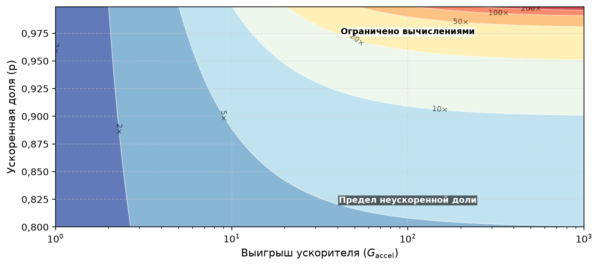

*Тепловая карта железного закона: общее ускорение системы как функция выигрыша ускорителя ($G_{\text{accel}}$) и ускоренной доли ($p$). Высокое ускорение возникает только в правом верхнем углу, где высоки и выигрыш ускорителя, и ускоренная доля. При $p=0{,}9$, например, даже бесконечный выигрыш на ускоренном пути не может дать сквозное ускорение больше 10 раз. Контуры охватывают ускорение примерно от 1 до 200 раз.*

Сырое ускорение ускорителя переходит в системную пропускную способность только после того, как неускоренная доля минимизирована. Ускоренная доля $p$ заметно различается между типами нагрузок, работающих на одинаковой аппаратуре, и именно она определяет, окупаются ли инвестиции в ускоритель или он простаивает на операциях, которые не являются матричными.

<a id="chk-hw-acceleration-parallelism-gate"></a>

> **Фильтр параллелизма**
>
> Эти проверки превращают границу Амдала в тест выбора аппаратуры.
>
> **Реальность закона Амдала**
>
> - [ ] **Последовательные узкие места**: с помощью границы Амдала объясните, почему GPU, который в 1 000 раз быстрее, может ускорить обучение лишь в 5 раз, если загрузка данных медленная.
> - [ ] **Потолок ускорения**: для $p=0{,}95$ и $G_{\text{accel}}=100$ оцените общее ускорение и сравните его с потолком для бесконечного ускорителя.
> - [ ] **Различие нагрузок**: сравните ускоренные доли ResNet-50 и MobileNet для предлагаемого изменения аппаратуры, затем предскажите, какая из них выиграет больше.

Последовательное узкое место становится конкретным на реальной аппаратуре, где тот же ускоритель, который приближается к своему параллельному потолку на одной нагрузке, может простаивать на другой. Раздел [«Числа, которые нужно знать»](appendix_machine.md#sec-appdx-machine-foundations-numbers-know-b531) приложения «Основы машины» собирает справочные значения $R_{\text{peak}}$ для разных поколений ускорителей и иерархию задержек, которые переводят эти сравнения аппаратуры в порядки величин. Оценка NVIDIA H100 на вычислительно-ограниченной свертке и на ограниченном памятью авторегрессивном декодировании показывает, как разные неускоренные доли определяют реальное ускорение.

<a id="lhs-amdahl-h_h100"></a>

> **Иллюстративный бюджет Амдала для H100**
>
> **Иллюстративный вывод ResNet-50 на NVIDIA H100**:
>
> - Допустим, H100 дает $G_{\text{accel}} = 247\times$ на умножении матриц относительно эталонного процессора без матричных расширений (1979 TOPS INT8 против примерно 8 TOPS) (Choquette, 2023).
> - Допустим, $p = 0{,}95$: 95 процентов базового времени получают этот выигрыш, а 5 процентов остаются за загрузкой данных, предобработкой, постобработкой и прочей работой.
>
> $$
> \text{Ускорение} = \frac{1}{(1-0{,}95) + \frac{0{,}95}{247}} = \frac{1}{0{,}05 + 0{,}0038} \approx 18{,}6\times
> $$
>
> Выигрыш пути в 247 раз дает лишь 18,6-кратное сквозное ускорение, потому что незатронутая доля 5 процентов задает потолок.
>
> **Сравнение с GPT-2 (авторегрессивный)**:
>
> - Для генерации токенов GPT-2 допустим $p = 0{,}80$; оставшиеся 20 процентов включают накладные расходы хоста, семплирование и декодирование вне ускоренного матричного пути.
>
> $$
> \text{Ускорение} = \frac{1}{(1-0{,}80) + \frac{0{,}80}{247}} = \frac{1}{0{,}20 + 0{,}0032} \approx 4{,}9\times
> $$
>
> Меньшая часть времени генерации токенов получает предполагаемый выигрыш, поэтому даже бесконечный выигрыш пути дает не больше $1/(1-p) = 5\times$. Оптимизации обслуживания решают это ограничение иначе: батчирование повышает загрузку при обработке нескольких запросов, а спекулятивное декодирование использует черновую модель, чтобы сократить число последовательных шагов целевой модели.

Ограничена ли операция скоростью вычислений или перемещением данных, определяет и выбор аппаратуры, и программную оптимизацию. Переход на ускоритель с пиковой вычислительной мощностью в 10 раз выше дает пренебрежимо малое ускорение, если узким местом является подача данных. Модель Roofline дает аналитическую основу для такой диагностики (Williams et al., 2009); она вводится формально в разделе [«Модель Roofline»](appendix_machine.md#sec-appdx-machine-foundations-roofline-model-2529) приложения «Основы машины», а раздел [«Модель Roofline»](11_hw_acceleration.md#sec-hardware-acceleration-roofline-model-42ff) этой главы применяет ее к нагрузкам ИИ. Она сопоставляет арифметическую интенсивность операции[^fn-arithmetic-intensity-roofline], определенную как отношение операций с плавающей точкой к байтам трафика памяти (FLOP/байт), с возможностями аппаратуры и показывает, ограничена ли производительность вычислениями или пропускной способностью. Плотное умножение матриц с высокой арифметической интенсивностью выигрывает от дополнительных TFLOP/s; LayerNorm с низкой интенсивностью выигрывает только от большей пропускной способности памяти. Свертки ResNet-50 с высоким повторным использованием работают в вычислительно-ограниченном режиме, а авторегрессивное внимание при малом батче работает в режиме, ограниченном памятью. Следовательно, вычислительно-ограниченным нагрузкам нужны стратегии, которые максимизируют пропускную способность арифметики и загрузку функциональных блоков, тогда как ядра, ограниченные памятью, требуют слияния операторов и поэтапной работы с иерархией памяти, чтобы минимизировать трафик за пределами кристалла.

[^fn-arithmetic-intensity-roofline]: **Арифметическая интенсивность**: отношение вычислительных операций к байтам, переданным через моделируемый интерфейс памяти (FLOP/байт). Нагрузки выше точки перехода этого уровня аппаратуры, например хорошо разбитые на тайлы умножения матриц с существенным повторным использованием, ограничены вычислениями и могут выиграть от большего числа TFLOP/s. Операции с низкой интенсивностью, включая часть операций внимания и декодирования при малом батче, на этом уровне ограничены пропускной способностью и нуждаются в большей пропускной способности или повторном использовании, а не только в большей вычислительной мощности.

Архитектурное проектирование начинается с физических ограничений, которые вынудили к специализации: распад классического масштабирования напряжения Деннарда и непомерная энергетическая стоимость перемещения данных по иерархиям памяти. Когда микроархитектуры общего назначения столкнулись с этими тепловыми барьерами и барьерами памяти, основным инженерным путем стала специализация аппаратуры под предметную область, позволившая поддерживать рост производительности.

<a id="sec-hardware-acceleration-evolution-hardware-specialization-fdb7"></a>

## Специализация аппаратуры

Когда компания Google развернула в производственных дата-центрах свой первый тензорный процессор (TPUv1) наряду с GPU NVIDIA K80, сравнение показало фундаментальный разрыв в эффективности. Процессоры общего назначения отдают значительную площадь кристалла и бюджет мощности аппаратуре выборки инструкций, предсказания ветвлений и когерентности кэшей, рассчитанной на произвольный код. Для нагрузок глубокого обучения, в которых доминирует регулярная плотная линейная алгебра, эти накладные расходы управления дают низкую плотность арифметики. Когда алгоритмический шаблон становится достаточно доминирующим и структурированным, специализированная аппаратура опережает платформы общего назначения: она заменяет динамические механизмы управления выделенными массивами арифметики и перемещением данных под управлением программного обеспечения. Производственная оценка вывода в Google измерила этот разрыв в эффективности (пример [«Шок эффективности TPUv1 против K80»](11_hw_acceleration.md#exmp-hw-acceleration-tpuv1-vs-k80-efficiency-shock)).

<a id="exmp-hw-acceleration-tpuv1-vs-k80-efficiency-shock"></a>

> **Шок эффективности TPUv1 против K80**
>
> **Сценарий**: в 2015 году компания Google развернула свой первый тензорный процессор (TPUv1) в производственных дата-центрах и сравнила его пропускную способность и энергоэффективность с GPU общего назначения NVIDIA K80 (Jouppi et al., 2017).
>
> **Диагностика**: K80 был программируемым GPU, рассчитанным на более широкий набор графических и вычислительных нагрузок. Предметно-специализированная архитектура (DSA) TPUv1 сделала более узкую ставку на вывод: большой 8-битный систолический матричный блок в паре с памятью под управлением программного обеспечения и более простым управлением.
>
> **Системный урок**: на шести вывод-нагрузках Google и на современных базовых CPU/GPU, которые оценивались в статье о TPU, подгонка кремния под доминирующие матричные операции дала в 15–30 раз более высокую пропускную способность и в 30–80 раз лучшую производительность на ватт (Jouppi et al., 2017). Эти соотношения описывают оцененные системы, а не любую нагрузку.

[^fn-tpu-google-origin]: **TPU (тензорный процессор)**: первый TPU сделал намеренно узкую ставку, сосредоточив проект на одном систолическом массиве $256{\times}256$ для 8-битного умножения матриц и отказавшись от значительной части механизмов управления, нужных универсальному ядру (Jouppi et al., 2017). Такой выбор дает высокую плотность вычислений на плотном умножении матриц ценой гибкости. Нерегулярный код и код с большим числом ветвлений по-прежнему плохо подходит; то, насколько полно загружен массив, определяют тайлинг компилятора, дополнение нулями и размеры слоев.

В терминах D·A·M этот выигрыш в эффективности возникает за счет подгонки ресурсов машины под алгоритмическую структуру. Заменяя аппаратные кэши scratchpad-буферами под управлением программного обеспечения и направляя данные напрямую между соседними арифметическими блоками систолического массива, специализированные архитектуры максимизируют арифметическую интенсивность и минимизируют трафик памяти за пределами кристалла. Однако такая специализация навязывает архитектурный компромисс: жесткие конвейеры выполнения теряют гибкость. Когда нагрузки вносят нерегулярный доступ к памяти, динамический поток управления или неподдерживаемые числовые форматы, пути данных с фиксированной функцией простаивают, и дорогой кремний остается без работы.

Современные ускорители для ML, включая нейросетевые ускорители класса DianNao (Chen et al., 2014), GPU с тензорными ядрами, TPU от Google[^fn-tpu-google-origin] и Neural Engine от Apple, отражают это непрерывное балансирование между арифметической специализацией и программируемой гибкостью. Их конструкции возникли из исторической траектории, которая охватывает четыре отдельные фазы: истоки специализированных вычислений, параллельную обработку графики, предметно-специализированные архитектуры и появление аппаратуры, специфичной для ML. Каждая фаза решала конкретное узкое место ресурса, которое сдерживало масштабирование в свою эпоху.

<a id="sec-hardware-acceleration-specialized-computing-22ce"></a>

### Специализированные вычисления

Аппаратная специализация возникает тогда, когда конкретные вычислительные шаблоны становятся главным узким местом системы и не дают процессорам общего назначения масштабироваться эффективно. Эта история выделяет три повторяющихся ограничения: медленная реализация скалярной арифметики с плавающей точкой, недостаточная пропускная способность для параллельной графики и плохая интеграция памяти с параллельными вычислениями.

Первая фаза, узкое место точности, возникла тогда, когда научные и инженерные приложения потребовали арифметики с плавающей точкой на микропроцессорах с арифметико-логическими устройствами только для целых чисел. В конце 1970-х годов CPU эмулировали операции с плавающей точкой с помощью многоинструкционных программ, которые распаковывали поля знака, порядка и мантиссы, сдвигали биты для выравнивания двоичной точки и нормализовали результат. Такая программная эмуляция создавала сильные накладные расходы скалярных инструкций даже для одного умножения и породила первую крупную волну аппаратной специализации: математический сопроцессор.

Intel 8087 (1980)[^fn-intel-8087-specialization] решил это узкое место, выполняя инструкции с плавающей точкой прямо на выделенных аппаратных конвейерах (Palmer, 1980). Замена многоинструкционных программных процедур жестко заданной арифметикой закрепила базовый принцип системного проектирования: если во внутреннем цикле доминирует определенная операция, специализированный кремний устраняет накладные расходы инструкций общего назначения и сдвигает потолок производительности.

[^fn-intel-8087-specialization]: **Intel 8087**: сопроцессор реализовал логику арифметики с плавающей точкой прямо в кремнии, избегая медленной многоинструкционной программной эмуляции каждого вычисления. Его выгода зависела от того, сколько времени приложение проводило в поддерживаемых операциях с плавающей точкой, что показывает, почему специализация помогает больше всего, когда ускоряемая работа доминирует в выполнении.

По мере того как специализированные функции доказывали свою полезность, они следовали повторяющемуся шаблону интеграции. Intel 486DX (1989) перенес FPU прямо на кристалл CPU, устранив задержку шинной связи вне кристалла и сделав высокоточную математику стандартной функцией, а не дополнительным сопроцессором (Hennessy and Patterson, 2017). Этот цикл, в котором специализация устраняет острое узкое место, а затем следует архитектурная интеграция, повторяется в разных эпохах аппаратуры.

[«Хронология специализации аппаратуры»](11_hw_acceleration.md#fig-timeline) прослеживает этот путь через пять эпох, показывая, как повторяющиеся вычислительные узкие места привели эволюцию аппаратуры от сопроцессоров с плавающей точкой и цифровых сигнальных процессоров к программируемым GPU, кодекам мультимедиа и тензорным ускорителям для глубокого обучения. Современные нагрузки машинного обучения напрямую опираются на принципы, сложившиеся в этих эпохах: выделение кремния под доминирующие матричные операции, размещение операндов в локальной памяти и минимизацию перемещения данных за пределами кристалла.

<a id="fig-timeline"></a>

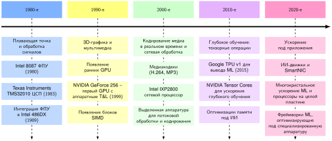

*Хронология специализации аппаратуры: вычислительные архитектуры развиваются через повторяющиеся циклы специализации и интеграции в пяти эпохах. Каждая эпоха вводит аппаратуру под предметную область, чтобы устранить важное узкое место памяти или арифметики: от внешних FPU к GPU, кодекам и блокам массивов TPU и тензорных ядер. Многие из этих возможностей позже появляются рядом с CPU в более широких системах, даже если специализированные блоки остаются отдельными.*

<a id="sec-hardware-acceleration-parallel-computing-graphics-processing-4654"></a>

### Параллельные вычисления и обработка графики

Процессоры общего назначения отдают большую часть бюджета кремния логике управления, предсказанию ветвлений и многоуровневым кэшам, которые минимизируют задержку выполнения одного потока инструкций. Когда нагрузка демонстрирует массовый, однородный параллелизм данных, то есть одинаковую арифметику над миллионами независимых элементов, эта архитектура, ориентированная на задержку, тратит площадь кристалла и тепловой бюджет на структуры управления, которые не повышают вычислительную пропускную способность. Специализированные ускорители устраняют этот дисбаланс, перераспределяя кремний от кэша и управления к плотным массивам арифметико-логических устройств (ALU), ставя совокупную пропускную способность выше задержки одного потока.

Трехмерная графика реального времени двигала эту ориентированную на пропускную способность специализацию на протяжении 1990-х. Ранние графические ускорители разгружали фиксированные задачи растеризации, например передачу растровых изображений и заполнение многоугольников. В 1999 году GeForce 256 от NVIDIA включил аппаратно ускоренные преобразования и освещение (T&L), переложив преобразования координат с хостового CPU на выделенный кремний на кристалле. Хотя эти первые графические процессоры (GPU) еще не были программируемыми, они показали, как специализированные конвейеры могут ускорять фиксированные математические операции, такие как преобразование вершин и наложение текстур. Однако жесткие конвейеры с фиксированной функцией создавали сильный дисбаланс загрузки: сложная геометрия оставляла аппаратуру растеризации простаивающей, а плотное затенение фрагментов не давало работы конвейерам вершин. Переход к программируемым шейдерам в GeForce 3 (2001) и к унифицированной архитектуре шейдеров в GeForce 8 (2006) устранил этот дисбаланс, заменив разделенные функциональные блоки массивами одинаковых программируемых вычислительных ядер. Такое структурное объединение отделило аппаратуру от фиксированных этапов графики и сделало GPU универсальным параллельным процессором, способным выполнять плотную матричную арифметику. К 2004 году мощные GPU могли обрабатывать более 100 миллионов многоугольников в секунду (Owens et al., 2008).

Параллельно с графической аппаратурой цифровые сигнальные процессоры (DSP) решали другое физическое ограничение: детерминированное выполнение с низкой задержкой в жестких энергетических бюджетах. Универсальные иерархии кэшей вносят переменную задержку при каждом промахе кэша, что нарушает строгие сроки реального времени в обработке сигналов. DSP заменяли непредсказуемые кэши scratchpad-памятью под управлением программного обеспечения и сочетали выделенные блоки умножения с накоплением (MAC) с буферами кольцевой адресации, чтобы выполнять непрерывную фильтрацию и преобразования Фурье без дрожания из-за простоя памяти. Texas Instruments TMS32010 (1983) показал, как предметно-специфичные наборы инструкций и выделенные пути MAC могут опережать процессоры общего назначения на векторных операциях (Lyons, 2011).

Сетевая обработка сталкивалась с еще более жестким сроком задержки: поддерживать инспекцию пакетов на полной скорости линии. Когда пакеты приходят каждые несколько наносекунд, задержка обращения к памяти за пределами кристалла приводит к потере пакетов. Сетевой процессор Intel IXP2800 показывает последствия этого жесткого ограничения: соблюдение сроков пакетов на полной скорости линии не оставляет запаса на промахи кэша, поэтому проект располагает много параллельных ядер вокруг ярусной памяти на кристалле, чтобы держать данные рядом с вычислениями. Такая организация «память рядом с вычислениями», навязанная сроками прихода пакетов, предвосхитила иерархии памяти, которые современные ускорители машинного обучения используют, чтобы массивы процессорных элементов постоянно получали тензорные тайлы.

Эти области разошлись в реализации, потому что их вычислительные профили различались. DSP оптимизировались под потоки сигналов одномерной природы с низкой задержкой в тепловых рамках милливатт, тогда как сетевые процессоры оптимизировались под маршрутизацию пакетов с минимальным хранением состояния. Напротив, в нагрузках глубокого обучения доминируют плотные матричные умножения и многомерные свертки. Эти операции обладают высокой арифметической интенсивностью и массовым параллелизмом данных. Унифицированный GPU стал идеальным соответствием машине: тысячи параллельных ALU-линий, поддержанные широкими шинами памяти, с многопоточностью под управлением аппаратуры, которая скрывает задержку обращения к памяти за пределами кристалла во время плотных тензорных операций.

Практическое значение этого архитектурного совпадения стало очевидным в 2012 году, когда AlexNet[^fn-alexnet-gpu-era] (Krizhevsky et al., 2012) выиграл соревнование ImageNet с отрывом более десяти процентных пунктов. Обучение проводилось на двух потребительских графических картах NVIDIA GTX 580, в каждой из которых было всего 3 ГБ видеопамяти. Лежащий в основе алгоритм, сверточные сети, обученные градиентным спуском, существовал десятилетиями, но пропускная способность CPU делала крупномасштабное обучение вычислительно непрактичным. Отобразив плотные двумерные свертки прямо на исполнительные блоки GPU, авторы сжали месяцы вычислений на CPU до пяти-шести дней. В терминах D·A·M ограничение машины раньше определяло, какие алгоритмы осуществимы; совпадение параллельной структуры сверток с GPU, ориентированным на пропускную способность, сделало глубокие модели практичными для обучения на больших наборах данных.

[^fn-alexnet-gpu-era]: **AlexNet**: 60-миллионная сверточная нейронная сеть (CNN) Крижевского, Суцкевера и Хинтона выиграла ImageNet 2012 с отрывом более десяти процентных пунктов на двух потребительских GPU GTX 580 с 3 ГБ видеопамяти у каждого. Поскольку модель не помещалась в память одного GPU, авторы разделили сеть между двумя картами и ограничили обмен между ними; это ранняя форма параллелизма моделей, которая предвосхитила систематический тензорный и конвейерный параллелизм. Сообщаемое обучение заняло пять-шесть дней (Krizhevsky et al., 2012).

<a id="sec-hardware-acceleration-emergence-domainspecific-architectures-e56e"></a>

### Появление предметно-специализированных архитектур

Эти разнообразные паттерны ускорения сошлись в более широком архитектурном сдвиге. Появление **архитектур, специализированных под предметную область (DSA)**[^fn-dsa-domain-efficiency] обозначает переход в проектировании компьютерных систем, вызванный замедлением традиционных выгод масштабирования (Esmaeilzadeh et al., 2011) и растущими вычислительными требованиями специализированных нагрузок. Закон Мура[^fn-moores-law-scaling] описывал длительный рост плотности транзисторов (Moore, 1998). Масштабирование Деннарда[^fn-dennard-scaling-power] (Dennard et al., 1974) позволяло напряжению падать по мере уменьшения транзисторов; его распад убрал сопутствующий путь к обычному росту частоты при постоянной плотности мощности. Вместе эти сдвиги ограничили производительность и эффективность процессоров общего назначения. Как утверждали (Hennessy and Patterson, 2019) в Тьюринговской лекции 2017 года, ответом стала новая эра предметно-специфичных решений, оптимизированных под важные нагрузки.

[^fn-dsa-domain-efficiency]: **DSA (архитектура, специализированная под предметную область)**: аппаратура, оптимизированная под класс приложений, которая жертвует частью программируемости общего назначения ради эффективности. TPUv1 Google достиг в 15–30 раз более высокой производительности и в 30–80 раз лучшей производительности на ватт, чем современные CPU- и GPU-системы, которые оценивались на вывод-нагрузках Google, благодаря тому, что в центре конструкции стоят систолический массив и память под управлением программного обеспечения (Jouppi et al., 2017). DSA, который хорошо справляется с плотным умножением матриц, может работать хуже CPU на нерегулярных нагрузках, таких как обход графов, поэтому ограничения нагрузки и выигрыш в эффективности должны оправдывать стоимость программного обеспечения, компилятора и экосистемы (Hennessy and Patterson, 2019); (Hennessy and Patterson, 2017).

Масштаб этой проблемы становится очевиден на [«Системном разрыве»](11_hw_acceleration.md#fig-systems-gap), который показывает иллюстративный разрыв между спросом моделей и предложением аппаратуры; иногда его обсуждают под неформальным названием закон Хуанга.[^fn-huangs-law-gpu] Нормированный сценарий предполагает, что предложение GPU растет примерно в 1,7 раза в год, а спрос моделей примерно в 6 раз в год, что дает разрыв, который расширяется примерно в 3–4 раза каждый год. Опубликованные тенденции вычислений мотивируют качественное расхождение, но построенные темпы являются сценарными допущениями, а не прогнозом (Amodei and Hernandez, 2018); (Epoch AI, 2024).

[^fn-huangs-law-gpu]: **Закон Хуанга**: наблюдение, что производительность GPU для нагрузок ИИ улучшается благодаря архитектурным новшествам, таким как тензорные ядра, а также масштабированию транзисторов. Нормированный рисунок использует иллюстративные кривые предложения GPU и спроса моделей, чтобы показать, как неравные темпы роста создают расширяющийся системный разрыв; это не прогноз ни одного из темпов (Amodei and Hernandez, 2018); (Epoch AI, 2024); (NVIDIA Corporation, 2020); (Choquette, 2023).

<a id="fig-systems-gap"></a>

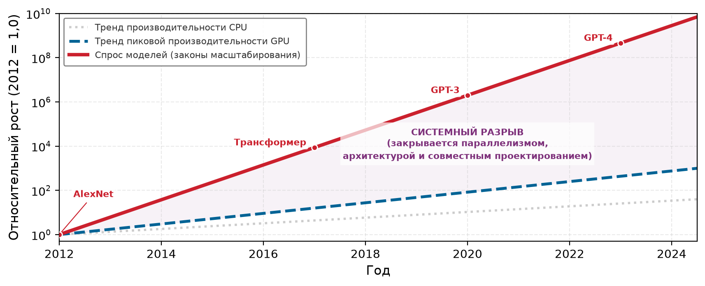

*Системный разрыв: относительный рост вычислений (логарифмическая шкала), сравнивающий спрос моделей с предложением аппаратуры, нормированный к 2012 = 1,0. Серая пунктирная линия (CPU) и синяя штриховая линия (GPU) отражают прогресс аппаратуры, который отстает от экспоненциальной красной сплошной линии (спрос моделей). Фиолетовая область — «системный разрыв», который нужно преодолеть через параллелизм и совместное проектирование.*

[^fn-moores-law-scaling]: **Закон Мура**: в иллюстративных допущениях, использованных на [«Системном разрыве»](11_hw_acceleration.md#fig-systems-gap), вычислительный спрос моделей растет примерно в 6,1 раза в год, а пиковое предложение ускорителей улучшается примерно в 1,7 раза в год, расширяя смоделированный разрыв спроса и предложения примерно в 3,5 раза в год. Опубликованные тенденции вычислений мотивируют расхождение, но построенные темпы являются допущениями, а не прогнозами. Поэтому рисунок показывает, насколько чувствителен системный разрыв к устойчивым различиям в темпах роста, а не фиксированную траекторию будущего. При таком разрыве методы алгоритмической эффективности, такие как сжатие, квантование и разреженность, становятся все более ценными (Amodei and Hernandez, 2018); (Epoch AI, 2024).

[^fn-dennard-scaling-power]: **Масштабирование Деннарда**: модель масштабирования 1974 года утверждала, что рабочее напряжение может падать по мере уменьшения размеров транзисторов, сохраняя плотность мощности примерно постоянной (Dennard et al., 1974). Ее распад примерно после 2005 года ограничил дальнейший рост тактовой частоты в рамках расчетной тепловой мощности чипа; литература о **темном кремнии** оценила, для смоделированных передовых техпроцессов и проектных допущений, что тепловые пределы могут не давать работать одновременно большим долям доступных транзисторов. Эта доля не является универсальной константой, но ограничение по мощности устойчиво: специализированные блоки делают активный бюджет кремния полезнее, выделяя его под классы операций с высокой ценностью (Esmaeilzadeh et al., 2011).

График нормирован к базе 2012 года, чтобы подчеркнуть относительный рост. Фиолетовая область выделяет это расхождение: системный разрыв нельзя закрыть одними лишь успехами техпроцесса; он требует архитектурных новшеств, параллельного распределения и совместного проектирования аппаратуры и программного обеспечения.

<a id="sec-hardware-acceleration-technology-scurve-must-shift-42e0"></a>

### Технологическая S-кривая: почему архитектуры меняются

Многие вычислительные технологии описываются жизненным циклом: брожение (начальный медленный прогресс), взлет (быстрый рост) и насыщение (убывающая отдача вблизи физических или экономических пределов). [«Две S-кривые специализированных вычислений»](11_hw_acceleration.md#fig-tech-s-curve) использует две концептуальные S-кривые, чтобы выразить этот шаблон: когда выигрыши одного проектного подхода сходят на нет, архитектуры под предметную область могут открыть новую кривую эффективности для нагрузок со стабильной вычислительной структурой.

<a id="fig-tech-s-curve"></a>

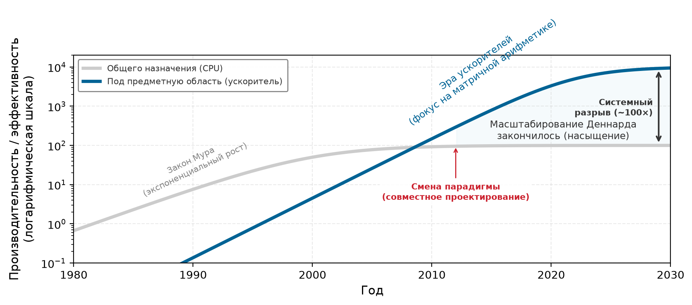

*Две S-кривые специализированных вычислений: концептуальная схема показывает, как подход общего назначения (серый) выходит на убывающую отдачу, в то время как специализированный подход (синий) начинает новую кривую эффективности. Это схема архитектурного перехода, а не измеренный ряд исторической производительности. Специализация аппаратуры под устойчивые нагрузки линейной алгебры может дать большие выигрыши ценой общей программируемости.*

Привычные выигрыши, которые раньше связывали с уменьшением транзисторов, замедлились, в то время как вычислительный спрос моделей ИИ вырос быстрее, чем емкость аппаратуры общего назначения. Закрыть этот разрыв нельзя, дожидаясь следующих уменьшений техпроцесса CPU; для этого нужны архитектурные изменения, которые перестраивают то, как нагрузки используют площадь кремния, пропускную способность памяти и тепловой бюджет.

В фазе роста S-кривой общего назначения полупроводниковое масштабирование давало предсказуемый прирост производительности существующему программному обеспечению. По классическому масштабированию Деннарда уменьшение размеров транзисторов позволяло пропорционально снижать рабочее напряжение, сохраняя плотность мощности постоянной при росте тактовых частот. Когда масштабирование Деннарда распалось в середине 2000-х, токи утечки ниже порога не дали снижать напряжение дальше, и тактовые частоты уперлись в тепловой барьер рассеивания. Архитекторы сначала ответили добавлением процессорных ядер, но расширение числа ядер упиралось в две физические границы: закон Амдала и темный кремний, то есть тепловое ограничение, при котором лишь часть транзисторов чипа может переключаться одновременно на полной частоте. Кроме того, CPU общего назначения тратят подавляющую часть энергетического бюджета на накладные расходы управления: выборку и декодирование инструкций, предсказание ветвлений, спекулятивное внеочередное выполнение и когерентность кэшей, а не на арифметику. Для регулярных нагрузок линейной алгебры выполнение одной инструкции на ядре CPU может расходовать сотни пикоджоулей энергии управления ради операции с плавающей точкой стоимостью 3 пикоджоуля.

Архитектуры под предметную область переходят на новую кривую эффективности, устраняя эти накладные расходы управления и отдавая кремний согласованным путям данных. Главное архитектурное новшество — настроенный путь данных: блоки матричного умножения в ускорителях ИИ, например, реализуют **систолические массивы**, решетчатые сети процессорных элементов, которые вычисляют и передают данные непосредственно соседним блокам. Вместо того чтобы постоянно записывать промежуточные результаты обратно в регистровые файлы или кэши, систолический массив проталкивает активации и веса через соседние ячейки, так что значение, однажды прочитанное из локальной памяти на кристалле, используется повторно по всей строке или столбцу операций умножения с накоплением. Когда такой путь данных установлен, иерархию памяти можно напрямую подогнать под шаблоны повторного использования нагрузки: аппаратно управляемые кэши заменяются программно управляемыми scratchpad-буферами, логикой предвыборки и контроллерами памяти, рассчитанными на детерминированные потоки тензоров.

Специализированные наборы инструкций усиливают эту физическую специализацию. Вместо того чтобы выбирать и декодировать скалярные операции по одной, наборы инструкций под предметную область кодируют крупнозернистые тензорные примитивы в одну макроинструкцию, которая настраивает тысячи арифметических блоков одновременно и амортизирует накладные расходы декодирования и диспетчеризации. Блоки схемы с фиксированной функцией полностью обходят программное выполнение для неизменных операций, таких как функции активации и слои нормализации. Итоговая эффективность возникает из согласованной специализации аппаратуры на каждом слое: перемещение данных, локальность памяти, накладные расходы инструкций и реализация схемы выравниваются вокруг одних и тех же вычислительных инвариантов.

Системы на кристалле (SoC) для мобильных устройств прямо показывают этот компромисс эффективности. Современные смартфоны декодируют видео высокого разрешения в тепловых рамках милливатт, хотя обработка видео требует миллиардов операций в секунду. Такая эффективность достигается благодаря выделенным аппаратным видеокодекам[^fn-codec-etymology-hardware], которые реализуют отраслевые стандарты, такие как H.264/AVC и H.265/HEVC (Sullivan et al., 2012). Эти специализированные схемы дают прирост производительности на ватт на порядки по сравнению с программным декодированием на ядрах CPU общего назначения, а точный выигрыш зависит от профиля кодека, разрешения, техпроцесса и базового CPU.

[^fn-codec-etymology-hardware]: **Кодек**: сокращение от «кодировщик-декодировщик», отражающее двойную функцию аппаратуры. Кодирование (сжатие) требует много вычислений, поскольку ищет оптимальные представления, тогда как декодирование (распаковка) требует пропускной способности, поскольку восстанавливает кадры полного разрешения из сжатых потоков. Выделенный кремний кодеков реализует оба пути в аппаратуре с фиксированной функцией, поэтому ни один из путей не тратит транзисторы на ненужную логику управления общего назначения.

Этот архитектурный сдвиг повторяется в областях вычислений с интенсивными данными всякий раз, когда вычислительное ядро нагрузки стабилизируется. Геномная обработка использует специализированные ускорители, потому что сборка длинных прочтений содержит фиксированные ядра динамического выравнивания, которые выделенный аппаратный конвейер реализует прямо в кремнии (Turakhia et al., 2018). Криптографические нагрузки породили специализированные интегральные схемы (ASIC)[^fn-asic-custom-hardware] по той же причине: фиксированные алгоритмы хеширования оправдывают выделенные кремниевые конвейеры, которые жертвуют всякой программируемой гибкостью ради максимальной энергоэффективности (Bedford Taylor, 2017).

[^fn-asic-custom-hardware]: **ASIC (специализированная интегральная схема)**: такие схемы достигают предельной эффективности, реализуя один алгоритм прямо в кремнии, часто улучшая производительность на ватт в $10^3$–$10^5$ раз. Примеры включают криптографическое хеширование для майнинга блокчейна и выравнивание последовательностей в геномике. Компромисс — полная негибкость: если основной алгоритм меняется, ASIC нельзя перепрограммировать, и он устаревает, привязывая проект аппаратуры к той версии задачи, под которую его создали.

Эти переходы подчеркивают центральный принцип современного системного инжиниринга: эпоха автоматического роста производительности за счет масштабирования процессоров общего назначения закончилась. Десятилетиями разработчики программного обеспечения могли полагаться на закон Мура и ускорять существующие программы без изменения структуры кода. С распадом масштабирования Деннарда вычислительные узкие места уже нельзя устранить, дожидаясь более быстрых ядер общего назначения; их нужно решать, проектируя машину под алгоритм. В терминах D·A·M ускоритель делает физическое ограничение машины явным. Производительность определяется совместным проектированием аппаратуры и программного обеспечения: эффективность выполнения зависит от того, насколько хорошо тензорные размерности алгоритма, шаблоны доступа к памяти и параллелизм отображаются на специализированные физические структуры архитектур под предметную область.

<a id="sec-hardware-acceleration-machine-learning-hardware-specialization-09c5"></a>

### Специализация аппаратуры для машинного обучения

Многие важные нейросетевые нагрузки содержат регулярные тензорные операции, существенный параллелизм данных и возможности для пониженной точности. Плотные матричные умножения и свертки — яркие примеры, поскольку их структура цикла раскрывает повторяющиеся операции и предсказуемое повторное использование. Эти характеристики породили специализированные архитектуры, которые были бы неэффективны для произвольного кода, но дают существенный выигрыш на подходящих ядрах ML. Другие операции ML остаются нерегулярными, ограниченными пропускной способностью, последовательными или слишком малыми, чтобы загрузить широкий движок, поэтому одно и то же устройство не обязано ускорять каждую часть модели. Аппаратура, построенная для использования регулярной части, составляет класс устройств, известных как ускорители ML, а экономический повод для специализации возникает тогда, когда поддерживаемая нагрузка важна в масштабе парка серверов, а не только в бенчмарке.

<a id="exmp-hw-acceleration-google-tpu-voice-search"></a>

> **Обрыв емкости TPU**
>
> **Сценарий**: в 2013 году компания Google рассчитала, что рост пользовательского спроса на голосовой поиск (3 минуты в день на пользователя) потребует удвоения глобальной емкости дата-центров для вывода нейросетей на CPU (Jouppi et al., 2017).
>
> **Диагностика**: емкость серверов на CPU общего назначения экономически не могла вместить экспоненциальный рост FLOP на вывод, что грозило узким местом капитальной инфраструктуры.
>
> **Системный урок**: специализированное аппаратное ускорение становится обязательным, когда объем нагрузки пересекает экономические пороги уровня парка. Совокупная арифметическая интенсивность и совокупная стоимость владения серверами определяют решения о развертывании специализированных ASIC.

Вычислительные требования ML выявляют ограничения традиционных процессоров. В иллюстративном сценарии, где эталонный CPU удерживает от 5 до 10 процентов своего пика на нейросетевой нагрузке, верхняя граница дает примерно 100 GFLOP/s (миллиардов операций с плавающей точкой в секунду). Эта неэффективность возникает из-за архитектурных несоответствий: CPU оптимизированы под производительность одного потока и нерегулярный доступ к памяти, тогда как нейросети требуют массового параллелизма и предсказуемых потоков данных. Ограничение пропускной способности памяти усугубляет проблему: один слой нейросети может требовать доступа к гигабайтам параметров, что перегружает иерархии кэшей CPU, рассчитанные на меньшие рабочие наборы.

Энергетическая экономика перемещения данных влияет на проектирование ускорителей. На одно событие обращение к 32-битному значению из DRAM может стоить порядка $10^2$ раз больше энергии, чем одно умножение FP32 (точные значения зависят от техпроцесса и проекта), что делает перемещение данных главной целью оптимизации (Horowitz, 2014); (Sze et al., 2017). Это расхождение помогает объяснить переход от перепрофилированных графических процессоров к нейросетевым ускорителям специального назначения. TPU и другие специализированные ускорители могут поддерживать высокую загрузку на плотных ядрах, реализуя систолические массивы и другие архитектуры, которые максимизируют повторное использование данных и минимизируют их перемещение.

Обучение и вывод имеют разные вычислительные профили, которые влияют на проектирование ускорителей. Обучение вычисляет градиенты и обновляет веса: FP32 и FP16 — стандартизованные двоичные форматы с плавающей точкой (IEEE Standards Association, 2019), а смешанная точность использует низкоточные тензорные операции с накоплением в более высокой точности, когда это позволяет точность (Micikevicius et al., 2017). Обратное распространение также сохраняет или пересчитывает активации (см. [«Требования памяти для активаций»](08_training.md#sec-model-training-activation-memory-requirements-f44c)), что повышает требования к памяти. Вывод требует только прямого прохода и может использовать INT8 или INT4, когда это поддерживают модель и ядра. Интерактивный вывод может ставить приоритетом хвостовую задержку, тогда как офлайн или пакетный вывод может ставить приоритетом пропускную способность, стоимость или энергию; выбор ускорителя следует фактической цели обслуживания. Эти профили часто благоприятствуют высокоемким системам обучения с ориентацией на пропускную способность и энергоэффективным путям вывода, но размер батча и политика обслуживания могут обратить кажущееся предпочтение.[^fn-latency-throughput-hw]

[^fn-latency-throughput-hw]: **Задержка против пропускной способности в проектировании ускорителей**: обучение обычно использует выполнение, ориентированное на пропускную способность, и большие батчи, чтобы амортизировать работу, тогда как вывод, чувствительный к задержке, должен контролировать задержку одного запроса и хвостовую задержку. Это цель обслуживания, а не универсальное разделение обучения и вывода: пакетный вывод тоже может быть ориентирован на пропускную способность, а малые или интерактивные циклы обучения могут заботиться о задержке шага. Глубина конвейера, задержка накопления батча, настройка ядер и очереди могут сделать путь, ориентированный на обучение, менее подходящим для интерактивного запроса, даже если его пиковая FLOP/s выше, поэтому проект должен соответствовать реальному потоку запросов, возможностям формирования батчей и цели.

<a id="dfn-hw-acceleration-ml-accelerator"></a>

> **Ускоритель ML**
>
> ***Ускорители машинного обучения*** — это процессоры или специализированные блоки, предназначенные в первую очередь для распространенных тензорных операций нейросетей и потоков данных. Они добиваются высокого $R_{\text{peak}}$ и повторного использования данных на подходящих нагрузках, выделяя больше ресурсов арифметике и локальному перемещению данных, чем это может сделать путь выполнения общего назначения.
>
> 1.  **Значение**: определяющая черта ускорителя ML — не одна лишь сырая арифметика, а сбалансированный путь, который подает операнды и удерживает пригодные для повторного использования значения рядом. A100 дает 2,04 ТБ/с пропускной способности памяти устройства, примерно в 10,2 раза больше, чем иллюстративный путь 200 ГБ/с к DRAM хоста, используемый здесь (NVIDIA Corporation, 2020; Choquette et al., 2021). Это сравнение потолков, а не гарантия: чтобы приблизиться к его пику 312 TFLOP/s для FP16/BF16, по-прежнему нужны достаточная арифметическая интенсивность, параллелизм и повторное использование.
> 2.  **Отличие**: выигрыши зависят от поддержки операций, параллельной работы, регулярного доступа к данным и программного стека, который выбирает нужный путь. Ускоритель ML может быть на порядки быстрее эталонного CPU на больших плотных умножениях матриц, но терять большую часть преимущества на малых, нерегулярных, насыщенных синхронизацией или управлением нагрузках. Передачи данных и неподдерживаемые операторы могут доминировать даже тогда, когда ускоряемое ядро само по себе быстрое.
> 3.  **Типичная ошибка**: распространенное заблуждение состоит в том, что ускорители ML всегда ускоряют машинное обучение. Чтобы приблизиться к пиковой пропускной способности, нужны совместимая точность, форма операции, раскладка, реализация и достаточно параллельной работы, чтобы занять нужные блоки. Загрузка также зависит от того, способны ли пути памяти и межсоединений поддерживать эту работу. Поэтому авторегрессивный запрос с батчом 1 может использовать лишь малую долю арифметической мощности большого ускорителя для обучения, хотя то же устройство хорошо работает на пакетном префилле или обучении.


*Один доступ к DRAM стоит более чем в 100 раз дороже одного умножения FP32 на событие.*

Контекст развертывания определяет архитектурный выбор, указывая на связывающее ограничение. В дата-центрах таким ограничением часто выступает время до результата при обучении массивных моделей. NVIDIA H100 обменивает сотни ватт мощности на высокую пропускную способность (Choquette, 2023); снижает ли этот обмен общую стоимость, зависит от загрузки, цены аренды, масштабирования нагрузки и тарифа на электроэнергию. TPUv4 от Google делает похожий архитектурный выбор, ставя пропускную способность выше за счет систолических массивов и памяти с высокой пропускной способностью (Jouppi et al., 2023).

<a id="chk-hw-acceleration-accelerator-gate"></a>

> **Фильтр ускорителя**
>
> Используйте иерархию энергии, чтобы решить, когда специализация окупается.
>
> **Энергетическая инверсия**
>
> - [ ] **Стоимость перемещения данных**: можете ли вы объяснить, почему перемещение данных из DRAM стоит в 100 раз больше энергии, чем вычисления над ними?
> - [ ] **Архитектурный ответ**: объясните, как систолические массивы (TPU) и тензорные ядра (GPU) сокращают повторное перемещение одних и тех же операндов.
>
> **Логика выбора**
>
> - [ ] **Обучение против вывода**: почему чипам обучения нужна огромная пропускная способность HBM, тогда как чипы вывода ставят приоритетом низкую задержку и операции INT8?

На периферии приоритет часто смещается к энергии на один вывод и жестким ограничениям по задержке и мощности, хотя пропускная способность остается важной для непрерывных потоков с камер, аудио или датчиков. Камера смартфона или аудиотракт, работающий постоянно в бюджете в несколько ватт, не может просто взять высокомощную систему памяти ускорителя центра обработки данных. Периферийные архитектуры вместо этого сокращают перемещение данных через локальные scratchpad-буферы, плотно интегрированные ускорители, динамическое изменение напряжения и частоты и событийную обработку, когда нагрузка это позволяет. Тот же принцип «стены памяти» действует в обоих случаях: чипы центров обработки данных вкладываются в емкость и пропускную способность памяти с высокой пропускной способностью (HBM), тогда как периферийные чипы в значительной мере полагаются на близость и повторное использование.

Ни одна архитектура не доминирует во всех нагрузках ML. Периферийные устройства ценят энергоэффективность и ограниченную задержку, тогда как обучение в облаке ценит пропускную способность, емкость и производительность межсоединений. Облачный вывод может подчеркивать стоимость запроса или хвостовую задержку, а периферийное устройство все же может нуждаться в устойчивой пропускной способности для потока реального времени. Специализированные архитектуры поэтому отражают свой контекст развертывания, но все они подчинены энергетическим и временным затратам на перемещение данных.

[«Тенденции специализации аппаратуры»](11_hw_acceleration.md#tbl-hw-evolution) подытоживает эти вехи специализации аппаратуры. Сопроцессоры с плавающей точкой ускорили арифметику, которую раньше выполняли программно, ранние GPU повысили графическую пропускную способность, а медиаблоки показали, как стабильные конвейеры могут оправдывать блоки с фиксированной функцией. Ускорители ИИ сочетают плотные тензорные блоки с иерархиями памяти и программной поддержкой, так что интеграция перемещения данных и параллельного выполнения становится центральной задачей.

Современное ускорение ИИ, таким образом, выходит за пределы кристалла. Полезным ускорителям нужна поддержка фреймворков, компилятора, библиотек, драйверов и среды выполнения для преобразований графа, выбора ядер, слияния, планирования памяти и развертывания в средах от дата-центров до периферийных устройств. Неподдерживаемые операции или окружающие передачи данных могут свести на нет выигрыш на уровне ядра.

| Эпоха                             | **Вычислительный шаблон** | **Примеры архитектур** | **Характеристики**                                                |
|:----------------------------------|:------------------------------------------------------------------|:------------------------------------------------------------------|:----------------------------------------------------------------------------------------------------|
| **1980-е** | Арифметика с плавающей точкой и обработка сигналов                | FPU, DSP                                                          | • Однозадачные движки<br>• Узкие наборы инструкций<br>• Интерфейсы сопроцессоров                  |
| **1990-е** | Трехмерная графика и мультимедиа                                  | GPU, блоки SIMD                                                   | • Много одинаковых вычислительных блоков<br>• Регулярные шаблоны данных<br>• Широкие интерфейсы памяти               |
| **2000-е** | Кодирование мультимедиа в реальном времени                        | Медиакодеки, сетевые процессоры                                   | • Конвейеры с фиксированной функцией<br>• Высокая пропускная способность<br>• Оптимизация производительности и мощности      |
| **2010-е** | Тензорные операции глубокого обучения                             | TPU, тензорные ядра GPU                                           | • Блоки матричного умножения<br>• Массовый параллелизм<br>• Оптимизация пропускной способности памяти           |
| **2020-е** | Специализированное ускорение под приложения                       | Движки ML, Smart NIC, ускорители предметных областей              | • Пути данных под конкретные нагрузки<br>• Настроенные иерархии памяти<br>• Конструкции под приложения |

<a id="tbl-hw-evolution"></a>

*Тенденции специализации аппаратуры: последовательные эпохи вычислений постепенно интегрируют специализированную аппаратуру, чтобы ускорять распространенные нагрузки, переходя от CPU общего назначения к архитектурам под предметную область и далее к настраиваемым ускорителям ИИ. Подгонка аппаратуры под вычислительные шаблоны повышает производительность и энергоэффективность и стимулирует развитие систем машинного обучения.*

<a id="sec-hardware-acceleration-integration-bottleneck-ai-needs-specialized-hardware-0b41"></a>

### Узкое место интеграции

Эволюция от числового сопроцессора Intel 8087 к современным графическим и ИИ-ускорителям обнаруживает устойчивую закономерность: аппаратура развивается, подстраиваясь под доминирующее узкое место алгоритма (Palmer, 1980); (Goodfellow et al., 2016); (Sze et al., 2017); (Jouppi et al., 2017). Там, где 8087 разгружал арифметику с плавающей точкой, которая перегружала универсальные CPU в научных вычислениях, современные ИИ-ускорители нацелены на плотное умножение матриц и свертки. В этой области подключить сырые арифметические блоки несложно; сложно другое, подавать в них данные. Современные ИИ-архитектуры должны устранить **узкое место интеграции**: переносить операнды и результаты через иерархию памяти достаточно быстро и эффективно, чтобы загрузить тысячи параллельных вычислительных блоков. Специализированный кремний дает существенный выигрыш производительности на ватт по сравнению с процессорами общего назначения только тогда, когда вычислительная нагрузка концентрируется в регулярные операции, которые совпадают с физическими путями данных аппаратуры.

Три свойства ядер нейросетей делают это узкое место решаемым. Во-первых, большие матричные умножения и свертки открывают обширный параллелизм данных, который массивы процессорных элементов могут использовать одновременно. Во-вторых, статические или скомпилированные тензорные графы имеют предсказуемый поток данных, что позволяет компилятору разбивать передачи на тайлы и размещать их в локальной scratchpad-памяти[^fn-scratchpad-sram-memory], а не полагаться только на аппаратно управляемые кэши. Это дает программному обеспечению явный контроль над регулярными рабочими наборами, а аппаратные кэши сохраняются для нерегулярного доступа. В-третьих, многие тензорные операции допускают снижение точности, поэтому поддерживаемые 8-битные или 4-битные пути повышают плотность вычислений и уменьшают число байтов на значение (Dally et al., 2021); (Dally, 2023). И наоборот, нагрузки, в которых доминируют динамический поток управления, большие таблицы эмбеддингов, мелкие тензоры, переменные формы или строгие требования к точности, нарушают эти допущения и остаются ограниченными задержкой памяти и нерегулярным доступом.

[^fn-scratchpad-sram-memory]: **Scratchpad-память**: когда компилятор может определить шаблон доступа тензорного ядра, он может явно разместить тайлы в быстрой локальной памяти под программным управлением. Это избавляет от части механизмов тегов, замещения и когерентности, но передачи, синхронизацию, разбиение на банки и емкость нужно планировать правильно. Scratchpad-память дополняет кэши, а не заменяет их повсеместно, потому что нерегулярные или общие данные все еще могут выигрывать от аппаратного управления. Например, TPU v1 Google использовал 24 МБ буфера Unified Buffer под управлением программного обеспечения для промежуточных активаций, тогда как веса и инструкции шли по другим путям (Jouppi et al., 2017).

Когда арифметической мощности становится достаточно, центральной инженерной задачей становится удержание данных достаточно близко, чтобы ее использовать. Обращение к DRAM может потреблять более чем в 100 раз больше энергии, чем арифметическая операция низкой точности, при физических ограничениях, которые проанализировал (Horowitz, 2014). Эта крутая энергетическая иерархия объясняет, почему архитектуры ускорителей вкладывают площадь кремния и бюджет мощности в HBM, SRAM на кристалле и scratchpad-память под управлением программного обеспечения, а не только в добавление арифметико-логических устройств.[^fn-hbm-bandwidth-cost]

[^fn-hbm-bandwidth-cost]: **HBM**: поколения A100 и H100 дают 2,0–3,4 ТБ/с пропускной способности памяти устройства благодаря стекованной памяти и широким интерфейсам, тогда как эталонная память GDDR6X, используемая здесь, дает 760 ГБ/с (NVIDIA Corporation, 2020); (Choquette, 2023). Повышение потолка пропускной способности может сдвинуть часть ядер в сторону вычислительно-ограниченной области на диаграмме Roofline, но только если шаблон доступа и арифметическая интенсивность позволяют этим воспользоваться. HBM также повышает стоимость корпуса и системы, поэтому ее ценность зависит от требований нагрузки к пропускной способности.

Аппаратное ускорение устраняет узкое место интеграции с помощью специализированной пространственной раскладки и многоярусных иерархий хранения. Как показано на архитектурном чертеже в [«Устройство современного ИИ-ускорителя»](11_hw_acceleration.md#fig-accelerator-anatomy), высокоскоростная память устройства питает общее хранилище на кристалле, которое, в свою очередь, снабжает локальную scratchpad-память, окружающую решетку исполнительных блоков.

<a id="fig-accelerator-anatomy"></a>

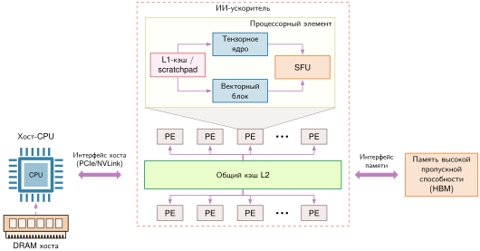

*Устройство современного ИИ-ускорителя: этот обобщенный схематический чертеж объединяет распространенные компоненты, а не изображает один продукт. Интерфейс хоста связывает ускоритель с CPU, интерфейс высокоскоростной памяти устройства питает общее хранилище на кристалле, а процессорные элементы содержат матричные, векторные блоки и блоки специальных функций с локальной памятью. Реальные ускорители различаются набором блоков и тем, является ли хранилище аппаратно управляемым кэшем или программно управляемой scratchpad-памятью.*

На обобщенной схеме в [«Устройство современного ИИ-ускорителя»](11_hw_acceleration.md#fig-accelerator-anatomy) массив **процессорных элементов** содержит блоки, специализированные под разные классы операций: матричные блоки выполняют плотное умножение матриц, векторные блоки — поэлементную арифметику, а блоки специальных функций аппроксимируют трансцендентные операции, такие как экспоненты и активации. Число, группировка и фирменная номенклатура этих блоков различаются у разных архитектур, но все они стремятся использовать параллелизм данных на тензорных тайлах. В некоторых конструкциях блоки организованы в явную двумерную систолическую решетку; в других матричные движки распределены среди широких параллельных вычислительных ядер. Схема отражает функциональные обязанности, а не физическую раскладку одного производителя.

Дополняя исполнительные блоки, иерархия памяти амортизирует задержку и энергетическую стоимость переноса данных на нескольких уровнях. Высокоскоростная память дает внешнюю емкость и совокупную пропускную способность, а общая память на кристалле и кэши или scratchpad-память отдельных элементов снижают трафик за пределами кристалла. Конкретные реализации различаются: одни опираются на аппаратно управляемые кэши, другие открывают программно управляемую SRAM, многие сочетают оба подхода, но физический принцип постоянен: перенос тензорного тайла через границы корпуса стоит на порядки больше энергии, чем его хранение на кристалле. Компиляторы и ядра среды выполнения должны координировать емкость тайлов, повторное использование, предвыборку и двойную буферизацию, чтобы операнды оставались в быстрой локальной памяти. Расширение пропускной способности HBM поднимает потолок внешнего трафика, но без временного и пространственного повторного использования в локальной SRAM блоки исполнения простаивают в ожидании операндов. В разделе [«Физика вычислений»](appendix_machine.md#sec-appdx-machine-foundations-physics-computing-c77f) приложения «Основы машины» собраны справочные характеристики современных ускорителей, включая H100 и TPU v5, и сведена иерархия задержек.

Хостовый интерфейс связывает ускоритель с CPU хоста и более широкой системной памятью. CPU хоста координирует графы выполнения, асинхронный ввод-вывод и операции с откатом на CPU, тогда как ускоритель выполняет отправленные ему вычислительные ядра. Это разделение не абсолютно: современные ускорители могут самостоятельно планировать очереди работ, а CPU могут вычислять тензорные операции. На практике пропускная способность системы зависит от того, где выполняется каждый оператор, и от объема передач, запусков ядер и барьеров синхронизации между ними. Блоки прямого доступа к памяти (DMA) и аппаратно управляемые очереди могут совмещать передачи между хостом и устройством с активным выполнением, но неподдерживаемые операторы вынуждают дорогие обращения обратно к CPU. Граница обмена между памятью хоста и хранилищем ускорителя поэтому задает реальный предел ускорения: время выполнения ядра почти не важно, если передачи между хостом и устройством доминируют в сквозной задержке.

Специализация, видимая в процессорных элементах, векторных конвейерах и многоярусных scratchpad-буферах, отражает вычислительный профиль нейросетей: модели многократно вызывают компактный набор линейно-алгебраических и поэлементных примитивов. В рамках D·A·M алгоритмические изменения дают ускорение по реальному времени только тогда, когда их вычислительная структура и шаблоны доступа к памяти напрямую отображаются на эти специализированные аппаратные примитивы. Алгоритмические оптимизации, которые сокращают теоретические операции, не совпадая с путями данных аппаратуры, оставляют блоки вычислений без работы и превращают заявленный выигрыш в чисто теоретический.

<a id="sec-hardware-acceleration-ai-compute-primitives-2c99"></a>

## Примитивы вычислений ИИ

Во всех полносвязных, сверточных слоях и слоях внимания обучаемые линейные преобразования сводятся к повторяющимся операциям MAC. Большой слой может выдать миллионы или миллиарды MAC, а его регулярная тензорная структура открывает параллельную работу и повторное использование, что делает его естественной целью для специализации. MAC доминируют не во всех моделях и не на всех фазах: нормализация, маршрутизация, индексирование, коммуникация и поэлементные операции могут стать ограничивающими, однако именно MAC составляют большую часть пиковой арифметической мощности современных ускорителей ML. Доминируют ли они реальное время выполнения, по-прежнему зависит от формы тензоров, перемещения данных и окружающих операторов.

Аппаратные блоки, которые используют эти шаблоны, — это **примитивы вычислений ИИ**: специализированные функциональные блоки, каждый из которых оптимизирован под определенный класс операций. Три примитива особенно распространены в ускорителях, и каждый нацелен на свой вычислительный шаблон в нейросетях.

На уровне фреймворка одно декларативное утверждение инкапсулирует тысячи арифметических операций ([«Абстракция плотного слоя»](11_hw_acceleration.md#lst-dense_layer_def)).

<a id="lst-dense_layer_def"></a>

**Абстракция плотного слоя**: высокоуровневые API фреймворков инкапсулируют 131 072 MAC (256 входов умножить на 512 выходов) в одном вызове функции, скрывая вычислительную сложность от разработчика и одновременно позволяя автоматическую оптимизацию аппаратуры.

```python
# Фреймворк абстрагирует вычислительно емкие операции
dense = Dense(512)(input_tensor)  # 256x512 MAC на образец
```

Под этим вызовом API движок автоградиента или компиляции понижает слой до вычислительного графа. [«Раскрытие операции умножения матриц»](11_hw_acceleration.md#lst-dense_expansion) показывает эту декомпозицию: объемное матричное умножение, широковещательное добавление смещения и поэлементную активацию.

<a id="lst-dense_expansion"></a>

**Раскрытие операции умножения матриц**: каждый плотный слой раскладывается на матричное умножение и поэлементные операции, раскрывая доминирующий вычислительный шаблон, на котором построено множество ядер нейросетей.

```python
# Работа линейного преобразования растет как input_dim x output_dim x
# batch.
output = (
    matmul(input, weights) + bias
)  # Умножение матриц доминирует в стоимости
output = activation(
    output
)  # Поэлементно: пропорционально output_dim x batch
```

Графовые представления объединяют эти шаги в крупные тензорные операторы, но выполнение на физической аппаратуре требует планирования отдельных скалярных операций. При понижении умножения матриц до вложенных циклов ([«Исполнение на уровне процессора»](11_hw_acceleration.md#lst-loop_level_dense)) структура выполнения становится явной: три вложенных итерации проходят по измерениям батча, выходных признаков и редукции, задавая арифметическую сложность $\mathcal{O}(B \times d_{\text{in}} \times d_{\text{out}})$.

<a id="lst-loop_level_dense"></a>

**Исполнение на уровне процессора**: вложенные циклы выявляют операции умножения с накоплением $\mathcal{O}(B \times d_{\text{in}} \times d_{\text{out}})$, которые должны выполнять ускорители; для конфигурации $B = 32$, $d_{\text{in}} = 256$, $d_{\text{out}} = 512$ это 4,2 млн MAC.

```python
# Общее число операций: batch_size × output_size × input_size MAC
for n in range(batch_size):  # Измерение батча: распараллеливаемо
    for m in range(output_size):  # Выходные нейроны: распараллеливаемо
        sum = bias[m]  # Инициализация аккумулятора
        for k in range(input_size):  # Измерение редукции: последовательно
            sum += input[n, k] * weights[k, m]  # Операция MAC
        output[n, m] = activation(sum)  # Нелинейное преобразование
# Объем работы растет как batch_size × output_size ×
# input_size операций умножения с накоплением
```

Эти вложенные циклы выявляют три повторяющихся вычислительных шаблона: поэлементные операции вдоль векторов, редукции умножения с накоплением на уровне матриц и нелинейные преобразования. Их повсеместность оправдывает выделенные пути аппаратного выполнения: векторные конвейеры потоково обрабатывают независимые элементы и редукции, матричные движки организуют решетки умножения с накоплением по пространственным тайлам, а блоки специальных функций аппроксимируют нелинейную математику. Границы между этими блоками архитектурные, а не математические: оптимизирующий компилятор часто сливает операции по всем трем путям в одном вызове ядра, чтобы устранить трафик промежуточной памяти.

<a id="sec-hardware-acceleration-vector-operations-19bf"></a>

### Векторные операции

Векторные операции ускоряют вычисления, выполняя одну инструкцию над несколькими элементами данных одновременно. В скалярной формулировке [«Исполнение на уровне процессора»](11_hw_acceleration.md#lst-loop_level_dense) обработка батча из 32 образцов через плотный слой 256→512 требует 4,2 млн MAC. Скалярный процессор выдает отдельную инструкцию на загрузку каждой пары вход-вес, выполнение умножения и обновление аккумулятора, неся полные накладные расходы выборки, декодирования и предсказания ветвлений на каждом элементе. Векторные конвейеры устраняют эти накладные расходы инструкций, работая с векторными регистрами, которые охватывают несколько параллельных линий выполнения.

RISC-V,[^fn-riscv-ai-customization] открытая архитектура набора инструкций (ISA) со стандартизованным векторным расширением (Waterman et al., 2013), дает конкретное воплощение этой модели выполнения. В векторном ассемблере RISC-V ([«Векторный цикл скалярного произведения»](11_hw_acceleration.md#lst-riscv_vector_mac)) векторные инструкции выражают операции над массивами длины, которая задается во время выполнения, отделяя программное обеспечение от физической ширины линий процессора.

[^fn-riscv-ai-customization]: **RISC-V (reduced instruction set computer V)**: открытая ISA позволяет командам аппаратуры добавлять собственные инструкции для ML, включая векторные скалярные произведения, функции активации и операции над разреженными тензорами, не меняя базовую ISA. Компромисс — зрелость программной экосистемы: пользовательские расширения требуют соответствующей поддержки компилятора, библиотек и среды выполнения, что может ограничивать переносимость и увеличивать объем работ по интеграции.

<a id="lst-riscv_vector_mac"></a>

**Векторный цикл скалярного произведения**: этот иллюстративный цикл обрабатывает несколько пар элементов за итерацию и сводит их к одному скалярному произведению.

```c
fmv.w.x fa0, zero          # Скалярный аккумулятор скалярного произведения
fmv.w.x ft1, zero          # Нулевое начальное значение для векторной редукции
loop_feature:
    vsetvli t0, feature_cnt, e32, m1, ta, ma
    vle32.v v1, (in_ptr)
    vle32.v v2, (wt_ptr)
    vfmul.vv v3, v1, v2
    vfmv.v.f v0, ft1
    vfredusum.vs v4, v3, v0
    vfmv.f.s ft0, v4
    fadd.s fa0, fa0, ft0
    slli t1, t0, 2         # Четыре байта на элемент FP32
    add in_ptr, in_ptr, t1
    add wt_ptr, wt_ptr, t1
    sub feature_cnt, feature_cnt, t0
    bnez feature_cnt, loop_feature
```

Векторный цикл редукции в [«Векторный цикл скалярного произведения»](11_hw_acceleration.md#lst-riscv_vector_mac) проходит пять аппаратно видимых этапов:

1. **Настройка длины вектора**: `vsetvli` настраивает векторные блоки на 32-битные элементы (`e32`), динамически вычисляя, сколько элементов (`t0`) помещается в аппаратные векторные регистры (`VLEN`).
2. **Инициализация вектора**: обнуляется скалярный аккумулятор, который будет хранить накопленное скалярное произведение.
3. **Векторные загрузки**: `vle32.v` загружает смежные 32-битные элементы в векторные регистры `v1` и `v2`, отправляя широкие запросы к памяти через интерфейс памяти.
4. **Векторное умножение и редукция**: `vfmul.vv` перемножает пары элементов параллельно по векторным линиям, а `vfredusum.vs` сводит произведения в частичную скалярную сумму.
5. **Арифметика указателей и ветвление цикла**: сдвигаются базовые адреса, оставшееся число элементов уменьшается на размер обработанного фрагмента `t0`, и при оставшихся элементах выполняется переход.

За итерации векторная инструкция умножения обрабатывает несколько элементов данных одновременно, а широкие загрузки амортизируют накладные расходы декодирования инструкций и запросов к памяти. Поскольку длина вектора во время выполнения динамически подстраивается под аппаратную ширину реализации (`VLEN`), один и тот же бинарный файл корректно работает и на узких встроенных векторных блоках, и на широких конвейерах дата-центров. Для этой нагрузки из 256 признаков реализация с 8 линиями разбивает редукцию примерно на 524 288 векторных фрагментов по батчу.

Помимо плотных внутренних произведений, нагрузки глубокого обучения опираются на более широкий набор векторных инструкций. [«Векторные операции»](11_hw_acceleration.md#tbl-vector) сопоставляет эти примитивные векторные операции с конкретными слоями нейросетей, которые от них зависят.

| **Векторная операция**            | Описание                                                  | **Применение в нейросетях**                                                 |
|:----------------------------------------------------------------------|:----------------------------------------------------------|:----------------------------------------------------------------------------|
| **Редукция**                      | Сводит элементы вектора (например, сумма, максимум)       | Слои пулинга, вычисление оценок внимания                                    |
| **Сбор (gather)**                 | Загружает несколько несмежных элементов памяти            | Поиск эмбеддингов, разреженные операции                                     |
| **Рассеивание (scatter)**         | Записывает в несколько несмежных ячеек памяти             | Обновление градиентов эмбеддингов                                           |
| **Маскированные операции**        | Выборочно работает с элементами вектора                   | Маски внимания, обработка заполнения                                        |
| **Широковещание скаляра**         | Применяет скаляр ко всем элементам вектора                | Добавление смещения, операции масштабирования                               |

<a id="tbl-vector"></a>

*Векторные операции: базовые векторные операции напрямую соответствуют примитивам глубокого обучения: редукции реализуют слои пулинга, сборка обеспечивает поиск эмбеддингов, рассеивание обновляет градиенты эмбеддингов, а маскированные операции обрабатывают маски внимания. Эти соответствия показывают, как векторная аппаратура поддерживает распространенные примитивы ML.*

Выгода выходит за рамки числа инструкций. Смежные векторные загрузки могут эффективно использовать интерфейсы памяти, а накладные расходы управления амортизируются на несколько элементов данных. Сбор, рассеивание, маскирование и короткие хвосты могут использовать меньше линий или требовать дополнительных обращений к памяти, поэтому сама ширина вектора не гарантирует пропорционального ускорения. Архитектурный шаблон не нов. Cray-1[^fn-cray-vector-legacy] использовал векторные регистры и конвейеризованные функциональные блоки для научных вычислений в 1970-е (Jordan, 1982); современные процессоры ML применяют родственные принципы в гораздо большем коммерческом масштабе.

[^fn-cray-vector-legacy]: **Наследие векторов Cray-1**: Cray-1 (1975) использовал 64-элементные векторные регистры с конвейеризованными функциональными блоками, что позволяло потоку элементов проходить через арифметические операции без выдачи одной скалярной инструкции на каждый элемент. Современные ускорители распространяют те же принципы широких регистров, конвейерного выполнения и повторного использования данных на векторные и матричные тайлы.

Векторные операции хорошо подходят для поэлементных преобразований, таких как функции активации, где каждый выход зависит только от *своего соответствующего входа*. Однако нейросетям также нужны структурированные вычисления, в которых каждый выход зависит от *всех входов*, — взвешенные суммы, которые задают преобразования слоя. Эти операции «многие ко многим» естественно выражаются как матричные умножения, второй вычислительный примитив.

<a id="sec-hardware-acceleration-matrix-operations-508d"></a>

### Матричные операции

Умножение матриц составляет большую часть арифметики во многих плотных нейронных сетях, преобразуя многомерные данные через структурированные шаблоны весов, активаций и градиентов (Goodfellow et al., 2016). Если векторные операции обрабатывают элементы независимо или сводят их, то матричные операции организуют работу сразу по нескольким измерениям. Аппаратура и библиотеки разбивают эти измерения на тайлы, чтобы блоки весов и активаций можно было повторно использовать, а частичные суммы накапливались локально. Эта регулярная структура задает важные аппаратные стратегии, однако малые или нерегулярные матрицы могут оставлять емкость тайлов неиспользованной.

<a id="sec-hardware-acceleration-matrix-operations-neural-networks-527a"></a>

#### Матричные операции в нейронных сетях

Вычисления нейросетей раскладываются на иерархические матричные операции. [«Иерархия операций линейного слоя»](11_hw_acceleration.md#lst-linear_matrix_hierarchy) показывает эту иерархию на примере линейного слоя, который преобразует входные признаки в выходные нейроны по батчу.

<a id="lst-linear_matrix_hierarchy"></a>

**Иерархия операций линейного слоя**: пример раскрывает линейный слой в матричное умножение и широковещательное добавление смещения, затем применяет поэлементный ReLU, разделяя матричную и векторную работу, которую должна выполнить аппаратура.

```python
layer = nn.Linear(256, 512)  # Слой преобразует 256 входов в 512 выходов
output = layer(input_batch)  # Обрабатываем батч из 32 образцов

# Внутреннее представление фреймворка: базовые операции (соглашение о батче по столбцам)
Z = matmul(weights, input)  # Матрица: преобразует [256×32]
# вход в выход [512×32]
Z = Z + bias  # Вектор: добавляет смещение к каждому
# выходу независимо
output = relu(Z)  # Вектор: применяет активацию к
# каждому элементу независимо
```

Это вычисление показывает масштаб матричных операций в нейросетях. Каждый выходной нейрон (всего 512) должен обработать все входные признаки (всего 256) для каждого образца батча (32 образца). Одна только матрица весов содержит 256 × 512 = 131 072 параметра, которые задают эти преобразования, что объясняет, почему эффективное умножение матриц доминирует в вопросах производительности.

Нейросети используют матричные операции и в архитектурных шаблонах за пределами простых линейных слоев. Свертки превращаются в матричные умножения методом im2col,[^fn-im2col-memory-tradeoff] что позволяет эффективно выполнять их на матрично-оптимизированной аппаратуре. [«Матричные шаблоны в архитектурах»](11_hw_acceleration.md#lst-matrix_patterns) иллюстрирует эти применения.

[^fn-im2col-memory-tradeoff]: **Im2col (image-to-column)**: преобразует свертку в матричное умножение, укладывая значения рецептивных полей в столбцы. Явная материализация может дублировать перекрывающиеся значения и увеличивать объем хранения примерно до площади ядра свертки, прежде чем учитываются эффекты краев, шага и каналов. Промышленные библиотеки часто используют неявный GEMM или прямые ядра свертки, чтобы получить выполнение, дружественное матрицам, без материализации полной расширенной матрицы.

<a id="lst-matrix_patterns"></a>

**Матричные шаблоны в архитектурах**: линейные слои, механизмы внимания и свертки сводят ключевую работу к матричным умножениям, поэтому матричная аппаратура становится общим примитивом современных нейросетевых архитектур.

```python
hidden = matmul(weights, inputs)
# weights: [out_dim x in_dim], inputs: [in_dim x batch]
# Результат объединяет все входы для каждого выхода

# Механизмы внимания — несколько матричных операций
Q = matmul(Wq, inputs)
# Проецируем входы в пространство запросов [query_dim x batch]
K = matmul(Wk, inputs)
# Проецируем входы в пространство ключей [key_dim x batch]
attention = matmul(Q.T, K)
# Сравниваем все токены-запросы со всеми токенами-ключами [batch x batch]

# Свертки — умножение матриц после изменения формы
patches = im2col(input)
# Преобразуем изображение [H x W x C] в матрицу патчей
output = matmul(kernel, patches)
# Применяем ядра ко всем патчам одновременно
```

Эти примеры различаются формой тензоров и шаблоном повторного использования, а от этого зависит, насколько эффективно каждое умножение загружает матричный блок. Линейные слои повторно используют одну матрицу весов по всему батчу; внимание формирует проекции, а затем матрицу оценок от токена к токену; свертка повторно использует каждое ядро на множестве патчей изображения. Выражение всех трех через умножение матриц дает аппаратуре общий интерфейс, но не делает их стоимость выполнения одинаковой. Размер батча, длина последовательности, число каналов и тайлинг определяют, переиспользуются ли операнды локально или многократно загружаются из памяти.

<a id="sec-hardware-acceleration-matrix-operations-hardware-acceleration-514a"></a>

#### Аппаратное ускорение матричных операций

Этот повсеместный шаблон умножения матриц имеет прямые последствия для проектирования аппаратуры: ускорителям нужны специализированные блоки, которые справляются с такими вычислениями в больших масштабах. [«Иллюстративная операция матричного блока»](11_hw_acceleration.md#lst-matrix_unit) показывает типичный выделенный матричный блок, который обрабатывает весь блок $16{\times}16$ за один раз, и объясняет, почему матричные инструкции и тензорные ядра могут давать гораздо большую пропускную способность, чем скалярные или чисто векторные пути выполнения (NVIDIA, 2017); (Intel Corporation, 2021).

<a id="lst-matrix_unit"></a>

**Иллюстративная операция матричного блока**: типичные инструкции загрузки, умножения с накоплением и записи работают с матричными блоками, а не с отдельными скалярными элементами.

```c
mload mr1, (weight_ptr)     # Загрузка, например, блока 16x16
                            # матрицы весов
mload mr2, (input_ptr)      # Загрузка соответствующего блока входов
matmul.mm mr3, mr1, mr2     # Умножение с накоплением сразу
                            # по целым блокам
mstore (output_ptr), mr3    # Запись вычисленного блока выходов
```

Иллюстративный блок работает с матричными тайлами, а не с отдельными элементами. Полное произведение тайла $16{\times}16{\times}16$ содержит $16^3=4\,096$ операций умножения с накоплением, но число тактов зависит от конкретной инструкции и архитектуры. Устойчивая пропускная способность зависит также от числа матричных блоков, точности операндов, частоты выдачи инструкций, поведения конвейера и того, успевает ли память снабжать блоки данными. Матричные блоки дополняют векторное выполнение, ускоряя структурированные преобразования «многие ко многим».

Как и векторная обработка, матричное ускорение имеет глубокие исторические корни: DSP и GPU, оптимизированные под матричные вычисления в 1980–1990-е для обработки изображений, научных расчетов и трехмерного рендеринга (Owens et al., 2008); (Hwu, 2011). Нейросети сделали умножение матриц коммерчески доминирующим и привели к интеграции двумерных систолических массивов и матричных движков (таких как тензорные ядра NVIDIA и TPU Google) прямо в тракты данных процессоров.

Линейная алгебра составляет лишь часть конвейера выполнения нейросетей. Между линейными преобразованиями нейросети вводят нелинейные функции активации и слои нормализации. Кусочно-линейные функции, такие как ReLU, отображаются на простые векторные инструкции сравнения, тогда как трансцендентные вычисления (например, экспоненты в softmax и GELU или обратные квадратные корни в нормализации) нельзя напрямую вычислить на путях умножения с накоплением без серьезных штрафов по тактам. [«Характеристики операций»](11_hw_acceleration.md#tbl-matrix) сводит характеристики выполнения трех основных вычислительных примитивов и их отображение на операции нейросетей.

| **Тип операции**                                    | Лучше всего подходит      | Примеры                                                           | **Ключевая характеристика**                                 |
|:----------------------------------------------------|:--------------------------|:------------------------------------------------------------------|:------------------------------------------------------------|
| **Матричные операции**                              | Преобразования «многие ко многим» | Преобразования слоев, внимание, свертки                    | Каждый выход зависит от нескольких входов                   |
| **Векторные операции**                              | Векторная и редукционная работа | Функции активации, нормализация слоя, поэлементные градиенты | Использует поэлементные операции и векторные редукции      |
| **Пути специальных функций**                        | Трансцендентная арифметика | Экспонента, логарифм, обратный квадратный корень                  | Использует аппаратно-специфичную аппроксимацию или выделенную логику |

<a id="tbl-matrix"></a>

*Характеристики операций: матричные операции лучше всего справляются с преобразованиями «многие ко многим», тогда как векторные блоки обрабатывают поэлементные операции и редукции, такие как активация и нормализация. Пути специальных функций обрабатывают трансцендентную арифметику через аппаратно-специфичную аппроксимацию или выделенную логику. Структура операции определяет, какой аппаратный примитив подходит.*

<a id="sec-hardware-acceleration-special-function-units-ed00"></a>

### Блоки специальных функций

Блоки специальных функций (SFU) или специализированные пути инструкций ускоряют нелинейные функции и связанную с ними арифметику, завершая триаду процессорных примитивов главы. Эта потребность не нова: сопроцессоры с плавающей точкой решали узкие места скалярной арифметики (Palmer, 1980), а цифровые сигнальные процессоры добавляли специализированную арифметику для задач обработки сигналов (Smith, 1997). Реализация может использовать отдельный блок, векторные инструкции аппроксимации или библиотечную последовательность, обменивая точность, задержку и пропускную способность. В нейросетях операции активации, нормализации и softmax могут стать важными между матричными ядрами, особенно когда повторные проходы по памяти или трансцендентные функции ограничивают пропускную способность.

<a id="sec-hardware-acceleration-nonlinear-functions-cc93"></a>

#### Нелинейные функции

Типичная последовательность слоев показывает, как нематричные операторы входят в конвейер выполнения (Goodfellow et al., 2016). [«Последовательность линейного и нелинейного слоя»](11_hw_acceleration.md#lst-nonlinear_layer) связывает линейное преобразование с активацией ReLU и пакетной нормализацией, то есть с операциями, которые в коде фреймворка на Python выглядят тривиально, но накладывают на аппаратуру разные арифметические ограничения и ограничения по памяти.

<a id="lst-nonlinear_layer"></a>

**Последовательность линейного и нелинейного слоя**: линейный слой, ReLU и BatchNorm объединяют матричную работу, поэлементные операции и нормализацию в одной типичной последовательности слоев.

```python
layer = nn.Sequential(
    nn.Linear(256, 512), nn.ReLU(), nn.BatchNorm1d(512)
)
output = layer(input_tensor)
```

[«Раскрытие нелинейной операции»](11_hw_acceleration.md#lst-nonlinear_math) раскрывает эту последовательность на арифметические примитивы, выделяя поэлементное пороговое преобразование ReLU из межбатчевых редукций и обратного квадратного корня, которые требует пакетная нормализация.

<a id="lst-nonlinear_math"></a>

**Раскрытие нелинейной операции**: раскрытие последовательности слоев показывает сравнение ReLU, редукции BatchNorm, вычисление дисперсии и нормализацию через квадратный корень вокруг матричного умножения.

```python
Z = matmul(weights, input) + bias  # Линейное преобразование
H = max(0, Z)  # Активация ReLU
mean = reduce_mean(H, axis=0)  # Статистики BatchNorm
var = reduce_mean((H - mean) ** 2)  # Вычисление дисперсии
output = gamma * (H - mean) / sqrt(var + eps) + beta  # Нормализация
```

<a id="sec-hardware-acceleration-hardware-implementation-nonlinear-functions-1e39"></a>

#### Аппаратная реализация нелинейных функций

Перенос этих математических функций в кремний выявляет резкие различия в трафике памяти, числе инструкций и загрузке конвейера. Например, пакетная нормализация (Ioffe and Szegedy, 2015) требует многопроходного сбора статистик по памяти, накопления дисперсии и обратного квадратного корня, а softmax требует вычисления экспонент по всему измерению нормировки. Хотя выпрямительная линейная функция (ReLU) математически проста, наивная скалярная реализация создает накладные расходы на ветвления или лишние обращения к памяти, если ее не слить с соседними ядрами. [«Операции ReLU и BatchNorm»](11_hw_acceleration.md#lst-traditional_overhead) сопоставляет накладные расходы памяти и зависимостей у поэлементной активации и многопроходной нормализации в развернутой модели цикла без слияния.

Метка *нелинейный* скрывает три разных контракта выполнения. Поэлементные функции, такие как ReLU, оставляют элементы независимыми и поэтому естественно отображаются на векторные линии или параллельные потоки. Редукции, такие как среднее и дисперсия в пакетной нормализации, вводят зависимости между элементами: частичные результаты нужно объединить, прежде чем продолжится следующий этап. Трансцендентные функции, такие как экспонента, логарифм и обратный квадратный корень, добавляют числовой контракт, поскольку их реализации обменивают задержку, точность и допустимый диапазон входов. Шаблон зависимостей, а не одна лишь математическая метка, определяет, уместны ли векторная арифметика, дерево редукции или специализированный путь аппроксимации. Более быстрый путь специальных функций ускоряет только ту операцию, которую реализует; он не устраняет окружающий трафик тензоров и синхронизацию.

[«Операции ReLU и BatchNorm»](11_hw_acceleration.md#lst-traditional_overhead) намеренно явно показывает зависимости и не является моделью оптимизированного ядра. Циклы выявляют три времени жизни состояний: активации для каждого элемента, аккумуляторы для каждого признака и итоговые нормированные выходы. Параметры нормализации нельзя применить, пока не будут доступны нужные статистики, поэтому реализации должны либо сохранять промежуточные активации, либо пересчитывать их. Обучение выводит эти статистики из текущего батча, тогда как вывод может использовать сохраненные статистики и свести нормализацию к поэлементному аффинному преобразованию. Компиляторы могут сливать допустимые этапы, но зависимости данных определяют, какие преобразования сохраняют вычисление. Поэтому чтение листинга как графа зависимостей выявляет долговечные аппаратные вопросы: сколько раз каждый тензор пересекает интерфейс памяти, какие промежуточные значения остаются локально и где редукции вводят синхронизацию.

<a id="lst-traditional_overhead"></a>

**Операции ReLU и BatchNorm**: нейросети обрабатывают входные данные поэлементным выбором и несколькими проходами нормализации, что выявляет проблемы эффективности наивных реализаций.

```python
for batch in range(32):
    for feature in range(512):
        # ReLU: наивное скалярное сравнение и выбор; оптимизированные ядра
        # обычно реализуют это без ветвлений.
        z = matmul_output[batch, feature]
        h = max(0.0, z)  # Условная операция

        # BatchNorm: несколько проходов по данным
        mean_sum[feature] += h  # Первый проход для среднего
        var_sum[feature] += h * h  # Дополнительный проход для дисперсии

        temp[batch, feature] = h  # Нужно дополнительное хранение в памяти

# Нормализация требует сложной арифметики
for feature in range(512):
    mean = mean_sum[feature] / batch_size
    var = (var_sum[feature] / batch_size) - mean * mean

    # Вычисление квадратного корня: несколько итераций
    scale = gamma[feature] / sqrt(var + eps)  # Итеративное
    # приближение
    shift = beta[feature] - mean * scale

    # Дополнительный проход по данным для финального вычисления
    for batch in range(32):
        output[batch, feature] = temp[batch, feature] * scale + shift
```

Структура зависимостей в [«Операции ReLU и BatchNorm»](11_hw_acceleration.md#lst-traditional_overhead) показывает, почему наивное выполнение обрушивает производительность: арифметическая интенсивность резко падает. Поэлементный ReLU и масштабирование со сдвигом в нормализации выполняют лишь одну-две арифметические операции на каждое четырехбайтовое обращение к памяти, загоняя нагрузку глубоко в режим, ограниченный памятью. Кроме того, поскольку статистики батча нельзя окончательно вычислить, пока не обработаны все образцы, промежуточный тензор `temp` приходится записать обратно в память и перечитать на последующем проходе, что раздувает потребление пропускной способности памяти и нагрузку на кэш. Одновременно вычисление $1/\sqrt{\mathrm{var} + \epsilon}$ требует итеративного извлечения корня и деления, которые могут останавливать конвейер на десятки тактов, если выполняются на стандартных целочисленных или арифметико-логических блоках с плавающей точкой. Снижение этих накладных расходов требует двух взаимодополняющих стратегий: аппаратных блоков специальных функций (SFU), которые аппроксимируют трансцендентную арифметику за однозначное число тактов, и слияния ядер на уровне компилятора, которое удерживает промежуточные значения в регистрах, а не выгружает их через шину памяти.

<a id="sec-hardware-acceleration-sfu-hardware-implementation-90ff"></a>

#### Аппаратная реализация SFU

SFU решают проблему арифметических узких мест, реализуя нелинейные и трансцендентные операции в специализированных функциональных блоках, а не в многоинструкционных программных процедурах. Ускорители используют выделенные схемы тракта данных, такие как квадратичные полиномиальные интерполяторы и небольшие таблицы поиска (LUT), которые вычисляют функции вроде экспоненты, обратного квадратного корня и логарифма за несколько ступеней конвейера. [«Иллюстративные операции SFU»](11_hw_acceleration.md#lst-sfu_vector_ops) показывает, как набор инструкций выставляет эти операции наряду с векторными обращениями к памяти.

<a id="lst-sfu_vector_ops"></a>

**Иллюстративные операции SFU**: псевдокод показывает векторные нелинейные операции, которые могут отображаться на специализированные пути выполнения; имена инструкций и задержка зависят от реализации.

```c
vld.v v1, (input_ptr)    # Загрузка вектора значений (псевдокод)
vrelu.v v2, v1           # Векторный путь ReLU
vsigm.v v3, v1           # Векторный путь сигмоиды
vtanh.v v4, v1           # Векторный путь tanh
vrsqrt.v v5, v1          # Векторный путь обратного квадратного корня
```

Пути специальных функций балансируют площадь схемы против математической точности. Кусочно-линейные активации, такие как ReLU, требуют лишь однотактной логики сравнения и выбора (максимума) в тракте данных, тогда как трансцендентные функции обменивают размер таблицы поиска и степень полиномиальной интерполяции на ошибку аппроксимации. [«Блоки специальных функций»](11_hw_acceleration.md#tbl-sfu) сводит типичные аппаратные механизмы и их качественные характеристики задержки для этих примитивов.

| **Функциональный блок** | Операция                | **Стратегия реализации**                                              | **Иллюстративная задержка**                                     |
|:--------------------------------------------------------|:------------------------|:----------------------------------------------------------------------|:----------------------------------------------------------------|
| **Блок активации**      | ReLU                    | Сравнение и выбор или максимум                                        | Низкая; зависит от архитектуры                                  |
| **Блок статистик**      | Среднее, дисперсия      | Параллельные деревья редукции                                         | Растет с глубиной редукции                                      |
| **Блок экспоненты**     | exp, log, sigmoid, tanh | Аппроксимация, поиск по таблице и интерполяция                        | Зависит от архитектуры                                          |
| **Блок корней и степеней** | sqrt, rsqrt          | Итеративное или аппроксимирующее аппаратное обеспечение               | Зависит от архитектуры                                          |

<a id="tbl-sfu"></a>

*Блоки специальных функций: выделенные пути сокращают накладные расходы инструкций для нелинейных примитивов и редукций. Реализации и задержка зависят от архитектуры; таблица описывает механизмы, а не универсальные числа тактов.*

Векторные операции, матричные операции и пути специальных функций образуют базовые арифметические примитивы ускорителей ML, однако одни функциональные блоки не определяют устойчивую пропускную способность. Эти примитивы задают, *что* вычисляет кремний; модель выполнения и иерархия памяти задают, *как* данные поступают в тракт данных. Матричный блок с номинальной мощностью в сотни TFLOP/s будет простаивать, если пропускная способность памяти не способна поддерживать подачу операндов, если размеры тайлов не совпадают с регистровым блокированием или если синхронизация потоков сводит выполнение к последовательному. Пиковые аппаратные характеристики описывают производительность при идеализированной доступности операндов; модель выполнения архитектуры определяет, какая часть этого пика достижима на реальных нагрузках нейросетей.

<a id="sec-hardware-acceleration-compute-units-execution-models-f406"></a>

## Вычислительные блоки и модели выполнения

Применение ReLU к вектору из 512 элементов показывает, почему модели выполнения важны: операция проста, но пропускная способность зависит от того, рассматривает ли аппаратура эти 512 сравнений как скалярные инструкции, линии SIMD, потоки GPU или фрагменты тензорной программы. Современные процессоры ИИ объединяют три вычислительных примитива в различные исполнительные блоки: блоки «одна инструкция, много данных» (SIMD), тензорные ядра и процессорные элементы, которые определяют, как вычисления структурированы и как они открыты программисту. Понимание этой организации раскрывает как теоретические возможности, так и практические характеристики, определяющие реальную пропускную способность.

<a id="sec-hardware-acceleration-mapping-primitives-execution-units-ccb6"></a>

### Отображение примитивов на исполнительные блоки

Отображение вычислительных примитивов на исполнительные блоки определяется физической энергией проводников и повторным использованием данных. Чтение операнда из регистрового файла и его передача по проводникам на кристалле стоит в несколько раз больше энергии, чем сама арифметическая операция. Аппаратные ускорители справляются с этим физическим ограничением, выделяя специализированные исполнительные блоки под характер повторного использования каждого примитива:

- Векторные операции → блоки SIMD и «одна инструкция, много потоков» (SIMT). Они выполняют одномерные поэлементные примитивы, такие как сложение, масштабирование и смещения, на параллельных ALU, которые разделяют логику выборки и декодирования инструкций. Поскольку у векторных операций арифметическое повторное использование на каждый загруженный операнд составляет $O(1)$, их пропускная способность остается ограниченной пропускной способностью портов регистрового файла и подачей из памяти.
- Матричные операции → тензорные ядра[^fn-dally-gpu-precision] и систолические массивы. Они отображают двумерные примитивы внутреннего произведения на плотные двумерные решетки схем умножения с накоплением. Направляя активации и веса напрямую между соседними процессорными элементами по локальным проводникам, например в потоках «стационарные веса» или «стационарный выход», матричные блоки повторно используют данные в полете. Такое пространственное повторное использование отделяет арифметическую пропускную способность от пропускной способности основного регистрового файла и поддерживает пиковую вычислительную плотность в управляемом тепловом режиме.
- Специальные функции → блоки специальных функций (SFU). Они отображают трансцендентные и нелинейные примитивы, такие как $\exp$, $\ln$ и обратные квадратные корни, на выделенные конвейеры, которые используют кусочно-полиномиальную аппроксимацию и таблицы поиска. Вычисление трансцендентных функций на ALU общего назначения требует итеративных численных алгоритмов, которые занимают десятки тактов; выделенные SFU вычисляют эти функции вне основного пути выполнения с меньшей пропускной способностью, не давая слоям активации останавливать векторные конвейеры.

В таксономии D·A·M такое разделение определяет, как алгоритмические примитивы связываются с физическими путями выполнения машины. Прогон плотных матричных умножений через стандартные векторные конвейеры быстро насыщает порты чтения регистрового файла и снижает пропускную способность до малой доли пиковой мощности ускорителя. И наоборот, пропуск поэлементных операций с низкой арифметической интенсивностью или нерегулярных активаций через матричные массивы оставляет линии обработки незагруженными. Устойчивая производительность системы зависит от того, что каждый вычислительный примитив сопоставлен с исполнительным блоком, поток данных и иерархия хранения которого соответствуют его арифметической интенсивности.

<a id="sec-hardware-acceleration-evolution-simd-simt-architectures-e1fd"></a>

### Эволюция от SIMD к SIMT

В скалярных процессорных архитектурах выполнение поэлементной операции над вектором активаций из 512 элементов требует 512 отдельных итераций цикла. Каждая итерация выбирает, декодирует и отслеживает инструкцию в конвейере, расходуя на логику управления инструкциями заметно больше энергии, чем арифметико-логическое устройство (ALU) тратит на само сравнение или сложение. При фиксированных бюджетах расчетной тепловой мощности (TDP) скалярное выполнение тратит площадь кремния и мощность на управление инструкциями, а не на пропускную способность арифметики. Модель SIMD Флинна амортизирует эти накладные расходы фронтенда, выдавая одну декодированную инструкцию над несколькими элементами данных, упакованными в широкие векторные регистры (Flynn, 1966). Например, 512-битный регистр SIMD обрабатывает одновременно шестнадцать 32-битных значений с плавающей точкой за один такт, сокращая трафик выборки и декодирования инструкций в шестнадцать раз.

Традиционные SIMD-архитектуры фиксированной ширины привязывают скомпилированный машинный код к конкретным ширинам регистров, например 128, 256 или 512 бит. Когда размерность тензора не совпадает с фиксированной шириной вектора, компиляторам приходится генерировать скалярные циклы очистки или вставлять дополнение памяти, что увеличивает размер бинарного файла и сложность ветвлений. Расширение Arm Scalable Vector Extension (SVE) снимает эту жесткость с помощью выполнения, не зависящего от длины вектора (VLA), и поканальной предикации (Stephens et al., 2017). Вместо того чтобы зашивать физические ширины регистров в кодировку инструкций, SVE опирается на регистры предикатов, которые динамически настраивают активные линии, как показано в последовательности векторной арифметики в [«Векторное выполнение Arm SVE»](11_hw_acceleration.md#lst-arm_sve_vector).

<a id="lst-arm_sve_vector"></a>

**Векторное выполнение Arm SVE**: предицированный векторный ассемблер загружает, умножает и складывает элементы с плавающей точкой, используя регистры, не зависящие от длины.

```
ptrue p0.s              # Создаем предикат для длины вектора
ld1w z0.s, p0/z, [x0]   # Загружаем вектор входов
fmul z1.s, z0.s, z0.s   # Умножаем элементы
fadd z2.s, z1.s, z0.s   # Складываем элементы
st1w z2.s, p0, [x1]     # Сохраняем результаты
```

Инструкция `ptrue` активирует все доступные линии предиката, не кодируя фиксированную длину вектора. Эта модель программирования, не зависящая от длины вектора, позволяет одному и тому же бинарному файлу SVE работать на реализациях от 128 до 2048 бит без перекомпиляции (Stephens et al., 2017). Расширения Intel Advanced Matrix Extensions (AMX) делают специализацию еще на шаг дальше: выделенные тайловые регистры и ускорители умножения матриц работают непосредственно над двумерными блоками данных, а не над одномерными векторами (Intel Corporation, 2021). Вместе SVE и AMX представляют адаптации на стороне CPU для нагрузок ML: переносимое векторное выполнение и конвейеры матриц с фиксированными тайлами.

Несмотря на гибкость длины вектора, SIMD-архитектуры CPU сталкиваются с фундаментальными физическими ограничениями при масштабировании на большие нагрузки нейросетей. CPU отдают значительную площадь кремния предсказателям ветвлений, логике внеочередного выполнения и многоуровневым иерархиям кэшей, чтобы минимизировать задержку для нескольких последовательных потоков. При потоковой обработке гигабайтов тензорных данных промахи кэша заставляют конвейер ждать сотни тактов выборки из основной памяти. Буфер переупорядочивания инструкций CPU быстро заполняется во время простоев памяти, оставляя широкие конвейеры SIMD без работы. Кроме того, условное ветвление внутри вектора требует вычисления обоих путей под битовыми масками, что снижает полезную загрузку линий.

Модели «одна инструкция, много потоков» (**SIMT**) снимают эти узкие места, отделяя логическую абстракцию программирования от физического выполнения на аппаратуре (Lindholm et al., 2008); (Nickolls et al., 2008). Вместо того чтобы требовать от программиста упаковывать данные в явные векторные регистры, SIMT предоставляет модель выполнения из независимых скалярных потоков. В архитектурах GPU каждый потоковый мультипроцессор (SM)[^fn-sm-gpu-block] координирует тысячи одновременных потоков. Аппаратные планировщики варпов группируют эти потоки в **варпы**,[^fn-warp-divergence-branching] которые представляют собой блоки выполнения из 32 потоков (или волновые фронты в архитектурах AMD) и выполняют инструкции синхронно на параллельных ALU. Вместо того чтобы полагаться на большие кэши для снижения задержки памяти, GPU скрывают задержку за счет массового параллелизма потоков. SM статически распределяет регистровый файл на кристалле между всеми активными потоками, устраняя накладные расходы на сохранение контекста: когда один варп простаивает, ожидая сотни тактов выборки из памяти за пределами кристалла, планировщик варпов в следующем же такте выбирает и выдает инструкции из другого готового варпа. Базовое ядро матричного умножения в [«SIMT-выполнение»](11_hw_acceleration.md#lst-cuda_simt) показывает, как эта модель скалярных потоков отображается на аппаратуру.

[^fn-dally-gpu-precision]: **Вычисления ML с пониженной точностью**: уменьшение ширины операндов вдвое сокращает число байтов на сохраненный элемент и может поддерживать более плотную арифметику, хотя реальная пропускная способность зависит от доступного тракта данных и ядра (Dally et al., 2021); (Dally, 2023). Переход NVIDIA от векторной арифметики Pascal P100 к смешанно-точным тензорным ядрам Volta V100 поднял номинальную пиковую производительность FP16 примерно с 21,2 до 125 TFLOP/s, то есть примерно в 6 раз между этими продуктами (NVIDIA, 2017). Выбор точности должен сохранять численное поведение и использовать эффективный поддерживаемый путь; самый маленький формат не всегда лучший.

[^fn-sm-gpu-block]: **SM (streaming multiprocessor)**: физический аппаратный движок, который реализует модель SIMT, используя планировщики варпов для координации множества параллельных потоков. Поддержание достаточного числа активных варпов помогает скрывать задержку инструкций и памяти, но сама по себе заполненность не определяет узкое место. Низкая заполненность может быть вызвана использованием регистров, использованием разделяемой памяти, размерами блоков или недостаточной параллельной работой, тогда как ядро, ограниченное памятью, может иметь высокую заполненность.

[^fn-warp-divergence-branching]: **Варп**: на GPU NVIDIA варп — это группа планирования из 32 потоков, которые выполняют общую инструкцию, когда их пути управления совпадают. Если потоки идут по разным путям, аппаратура выполняет нужные пути под разными масками, снижая полезную загрузку линий. Штраф зависит от длины пути и от того, сколько линий идет по каждому пути, поэтому ядра ML часто предпочитают однородный или предицированный поток управления.

<a id="lst-cuda_simt"></a>

**SIMT-выполнение**: каждый поток вычисляет уникальный выходной элемент параллельно, что показывает, как SIMT обеспечивает эффективное матричное умножение на GPU.

```c
__global__ void matrix_multiply(float* C, float* A, float*
                                B, int N) {  // Ядро CUDA
    // Каждый поток обрабатывает один выходной элемент
    int row = blockIdx.y * blockDim.y + threadIdx.y;
    int col = blockIdx.x * blockDim.x + threadIdx.x;

    float sum = 0.0f;
    for (int k = 0; k < N; k++) {
        // Потоки в варпе выполняются параллельно
        sum += A[row * N + k] * B[k * N + col];
    }
    C[row * N + col] = sum;
}
```

[^fn-cuda-software-ecosystem]: **CUDA (compute unified device architecture)**: выпущенная NVIDIA в 2006 году CUDA устранила необходимость маскировать вычисления общего назначения под графические операции и открыла GPU для научных и ML-нагрузок через модель программирования, похожую на C. Экосистема, которую она создала, включая cuBLAS, cuDNN и TensorRT, образует программный барьер, способный привязать стек обучения ML к аппаратуре NVIDIA: переход требует переписать или заменить тысячи оптимизированных для GPU ядер, а эта стоимость часто превышает экономию на железе у конкурирующих платформ. Именно такая программная привязка, а не одна лишь кремниевая производительность, помогает объяснить, почему многие крупные стеки обучения ML остаются центрированными на CUDA.

В [«SIMT-выполнение»](11_hw_acceleration.md#lst-cuda_simt) ядро CUDA[^fn-cuda-software-ecosystem] назначает каждому потоку один выходной элемент $C[\text{row}, \text{col}]$. Соседние потоки в варпе имеют один и тот же индекс строки и последовательные индексы столбцов (`threadIdx.x`). Когда потоки читают $B[k \cdot N + \text{col}]$, их запросы к памяти обращаются к смежным четырехбайтовым адресам с плавающей точкой. Контроллер памяти объединяет эти 32 отдельные четырехбайтовые загрузки в одну объединенную транзакцию памяти размером 128 байт, максимизируя эффективность шины DRAM. Одновременно все потоки варпа читают один и тот же элемент $A[\text{row} \cdot N + k]$, что позволяет аппаратуре передать это единственное считанное значение во все 32 линии. Однако это наивное ядро иллюстрирует железный закон ML-систем: арифметическая интенсивность ограничивает доставляемую пропускную способность. Поскольку каждая итерация внутреннего цикла выполняет всего две операции с плавающей точкой, перезагружая операнды из глобальной памяти без подготовки в SRAM на кристалле, ядро остается сильно ограниченным памятью. Кроме того, выполнение плотного матричного умножения на скалярных ALU SIMT требует одного цикла выборки, декодирования и выдачи инструкции на каждое умножение с накоплением, насыщая порты чтения регистрового файла. Преодоление этого машинного узкого места требует перехода от выполнения «вектор скаляров» к специализированным двумерным матричным блокам.

<a id="sec-hardware-acceleration-tensor-cores-771f"></a>

### Тензорные ядра

Рассмотрим одну голову внимания трансформера, которая вычисляет произведение $\mathbf{Q} \times \mathbf{K}^T$ для последовательности из 2 048 токенов с эмбеддингами размерности 64. Эта операция требует умножить матрицу $2048{\times}64$ на матрицу $64{\times}2048$: примерно 268,4 млн MAC, или около 536,9 MFLOP, если умножение и сложение считать отдельно. На скалярном процессоре, который выполняет одну операцию с плавающей точкой за такт на частоте 2 ГГц, эта одна голова внимания заняла бы около 268,4 мс. SIMT-выполнение на GPU может распределить эту работу между многими потоками, но тензорные ядра идут дальше: за одну инструкцию они обрабатывают целые матричные тайлы. При иллюстративном допущении, которое используется здесь, тайловый путь выполняет ту же операцию за 0,5 мс, то есть примерно в 536,9 раза быстрее скалярного выполнения. Это ускорение возникает не из-за более высоких тактовых частот, а из-за того, что повторное использование данных на уровне тайла встроено прямо в тракт выполнения.

Пока блоки SIMD и SIMT эффективно выполняют векторную работу, большие матричные вычисления выигрывают от блоков, организованных вокруг многомерных тайлов. Выделенные матричные движки амортизируют загрузку операндов по многим операциям умножения с накоплением, повторно используя тайлы на кристалле. GPU NVIDIA предоставляют тензорные ядра, тогда как TPU Google используют матричные блоки на основе систолических массивов. Оба выполняют блочное умножение матриц с накоплением.[^fn-tensor-core-alignment] Выигрыш зависит от повторного использования тайлов, их формы, точности и поведения памяти.

[^fn-tensor-core-alignment]: **Выравнивание размерностей для тензорных ядер**: тензорные ядра NVIDIA работают наиболее эффективно, когда размерности матриц кратны значениям, специфичным для точности и архитектуры, например кратны 8 или 16 для распространенных путей FP16/BF16/INT8. Современные cuBLAS и cuDNN все еще могут использовать тензорные ядра для многих невыровненных размерностей, но плохо выровненные формы могут вызвать менее эффективные ядра, потребовать дополнения нулями или снизить эффективную пропускную способность (NVIDIA, 2024); (NVIDIA Corporation, 2021). Поэтому архитекторы моделей часто выбирают размерности эмбеддингов и каналов, например 512, а не 500, а вывод с батчем 1 может не достигать пиковой загрузки тензорных ядер: выравнивание и арифметическая интенсивность совместно определяют, заполнены ли матричные движки аппаратуры.

Параллельное выполнение NVIDIA (PTX) открывает эту архитектуру через матричные инструкции, синхронные на уровне варпа.[^fn-tensor-core-origin] В [«Операция тензорного ядра»](11_hw_acceleration.md#lst-tensor_core_op) все 32 потока варпа совместно выполняют `mma.sync`, чтобы вычислить произведение матричного тайла $D = A \times B + C$.

[^fn-tensor-core-origin]: **Тензорное ядро**: одна инструкция тензорного ядра выполняет полную операцию умножения матриц с накоплением над небольшим тайлом данных на выделенном аппаратном блоке (NVIDIA, 2017); (NVIDIA Corporation, 2020). Такой подход обходит накладные расходы на выборку и планирование десятков отдельных арифметических инструкций на универсальных CUDA-ядрах. Поскольку эти блоки составляют значительную долю заявленной тензорной пропускной способности современного ускорителя, отказ от их использования может оставить нагрузке большую часть теоретического пика кристалла.

<a id="lst-tensor_core_op"></a>

**Операция тензорного ядра**: умножения матриц выполняются параллельно по целым блокам матриц, что повышает вычислительную эффективность обучения нейросетей.

```c

Операция тензорного ядра (пример PTX для GPU):
mma.sync.aligned.m16n8k16.row.col.f32.f16.f16.f32
  {d0,d1,d2,d3},     // Регистры результата
  {a0,a1,a2,a3},     // Исходная матрица A
  {b0,b1},           // Исходная матрица B
  {c0,c1,c2,c3};     // Аккумулятор
```

В этой инструкции варп выполняет операцию умножения с накоплением для матриц $M=16$, $N=8$, $K=16$ в смешанной точности: входы $A$ ($16{\times}16$) и $B$ ($16{\times}8$) имеют формат FP16, а аккумулятор $C$ и результат $D$ ($16{\times}8$) используют FP32. Вместо того чтобы планировать 64 отдельные скалярные инструкции слитного умножения с накоплением (`fma`) на поток, планировщик варпа выдает одну инструкцию, которая вычисляет 2 048 операций умножения с накоплением по тракту тензорного ядра. Распределение фрагментов матрицы по регистрам потоков и накопление промежуточных сумм в выделенных деревьях сумматоров снимают два ключевых аппаратных узких места обычного SIMT-выполнения: пропускную способность выдачи инструкций и конкуренцию за порты чтения регистрового файла.

Приоритеты проектирования определяют, как матричные движки выглядят в разных семействах процессоров. Тензорные ядра GPU сохраняют программируемость, ускоряя универсальные ядра глубокого обучения. Конструкции в духе TPU используют крупные матричные блоки, организованные в систолические массивы, чтобы максимизировать устойчивую пропускную способность обучения на плотных тензорных ядрах. Мобильные NPU[^fn-npu-ondevice-strategy] сжимают ту же идею в маломощные блоки вывода, а серверные CPU добавляют расширения матричных инструкций (тайлы класса AMX) для вывода и смешанных нагрузок. Каждая версия меняет один и тот же контракт: сколько гибкости аппаратура сохраняет, сокращая перемещение данных вокруг плотных матричных операций.

[^fn-npu-ondevice-strategy]: **NPU (нейронный процессор)**: мобильные NPU добиваются маломощного вывода, реализуя распространенные тензорные операции в аппаратуре с фиксированной функцией или с узко программируемой логикой, а не как полностью универсальные ядра GPU. Такая архитектурная приверженность может дать большой выигрыш энергоэффективности для поддерживаемых ядер, но делает развертывание зависимым от покрытия операторов: неподдерживаемые функции должны уходить на путь CPU или GPU, который для этой нагрузки может быть гораздо менее эффективным (Sze et al., 2017).

[«Заявленная пиковая мощность GPU по поколениям»](11_hw_acceleration.md#fig-ai-performance) показывает, как специализация, пониженная точность и поддержка разреженности изменили заявленную пиковую мощность. От K20X FP32 до H100 FP8 с структурированной разреженностью показанные значения вырастают примерно на три порядка величины (NVIDIA Corporation, 2017); (NVIDIA Corporation, 2020); (Choquette, 2023); (NVIDIA Corporation, 2024). Точки не измеряют одну и ту же величину: они смешивают форматы точности и сочетают FLOP/s с операциями INT8 в секунду. Поэтому кривая сравнивает самый заметный заявленный путь каждого поколения, а не производительность приложения при одинаковой точности. [«Сводная матрица характеристик ускорителей»](appendix_assumptions.md#tbl-appdx-assumptions-accelerator-matrix) из приложения «Допущения» дает соответствующие спецификации точности, пропускной способности и ограничений по мощности.

<a id="fig-ai-performance"></a>

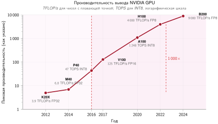

*Заявленная пиковая мощность GPU по поколениям: значения одного чипа отложены на логарифмической шкале. Подпись точности у каждой точки существенна: кривая сочетает архитектурные выигрыши с разными числовыми форматами и для части точек — с допущениями о разреженности, а не измеряет масштабирование приложения при одинаковой точности (NVIDIA Corporation, 2017); (NVIDIA Corporation, 2020); (Choquette, 2023); (NVIDIA Corporation, 2024).*

<a id="sec-hardware-acceleration-processing-elements-daa1"></a>

### Процессорные элементы

На следующем уровне иерархии выполнения ускорители объединяют несколько тензорных ядер с локальной памятью в модульные процессорные элементы (PE). Высокопроизводительные матричные блоки нельзя питать напрямую из глобальной памяти: DRAM за пределами кристалла и HBM в корпусе не обладают пропускной способностью и низкой задержкой, которые нужны, чтобы подавать операнды в плотные массивы арифметики каждый такт. Процессорный элемент устраняет этот дефицит пропускной способности, размещая разнородные вычислительные конвейеры — тензорные ядра для умножения матриц, векторные блоки для поэлементных операций и блоки специальных функций для нелинейных преобразований — рядом с высокоскоростными регистровыми файлами и scratchpad-SRAM. Подготовка операндов внутри PE держит данные рядом с функциональными блоками и амортизирует задержку и энергетическую стоимость внешних обращений к памяти по многократному арифметическому повторному использованию.

Конструкция процессорных элементов различается, поскольку каждая архитектура выбирает свой баланс между плотностью вычислений, емкостью локальной памяти и длиной межсоединений. Intelligence Processing Unit (IPU) от Graphcore распределяет вычисления по 1 472 тайлам, каждый из которых содержит независимый процессорный элемент с выделенной локальной SRAM, чтобы использовать мелкозернистый параллелизм без конкуренции за память (Graphcore, 2020). Cerebras развивает этот принцип локального хранения в системе CS-2, интегрируя примерно 850 000 оптимизированных для ИИ ядер на устройстве масштаба пластины, чтобы полностью обойти интерфейсы памяти за пределами кристалла в пользу сетки SRAM на кристалле (Cerebras Systems, 2021). Процессор Tesla D1 отдает значительную площадь кремния локальной SRAM и высокопроизводительным интерфейсам маршрутизации внутри своих процессорных элементов, отдавая приоритет быстрому обмену данными между плотно связанными массивами вычислений (Tesla, Inc., 2021).

Во всех этих конструкциях связывающее физическое ограничение — это компромисс между плотностью вычислений и локальностью данных: площадь кремния под арифметические блоки не может одновременно вмещать SRAM и проводники маршрутизации. Размещение большего числа исполнительных блоков повышает теоретический пик FLOP/s, но эти блоки простаивают, если пропускная способность памяти и каналы маршрутизации не могут доставить операнды. Эффективность, которую выдает процессорный элемент, поэтому зависит от его локальной иерархии памяти и стратегии межсоединений не меньше, чем от сырой арифметической способности.

Та же зависимость от локальности определяет, какие алгоритмические оптимизации аппаратура может реально использовать. Регулярная решетка процессорных элементов ускоряет разреженность, только если оставшиеся ненулевые значения сохраняют предсказуемые шаблоны доступа, от которых зависит решетка, и именно это ограничение призвана выполнить структурированная разреженность N:M.

<a id="sec-hardware-acceleration-nm-structured-sparsity-mechanics-9a71"></a>

### Механика структурированной разреженности N:M

Неструктурированное прореживание сокращает число параметров модели, но редко переходит в ускорение аппаратуры, потому что произвольное размещение ненулевых значений разрушает локальность памяти. Аппаратные ускорители решают эту задачу структурированной разреженностью N:M,[^fn-sparsity-nm-regularity] которая ограничивает разреженность детерминированным мелкозернистым шаблоном. Обозначение «$N{:}M$» означает, что ровно $N$ значений должны быть ненулевыми в каждом смежном блоке из $M$ значений вдоль измерения редукции. Ограничение ненулевых значений фиксированными локальными интервалами гарантирует равномерный доступ к памяти и предсказуемую индексацию между параллельными исполнительными блоками.

[^fn-sparsity-nm-regularity]: **Структурированная разреженность N:M**: соотношение 2:4 (плотность 50 процентов), которое используют разреженные тензорные ядра NVIDIA Ampere, — аппаратно удобный компромисс: в каждой смежной группе из четырех значений сохраняются два ненулевых значения, что сохраняет регулярную индексацию и вдвое сокращает полезную нагрузку по плотным значениям (NVIDIA Corporation, 2020). При 2:4 накладные расходы метаданных достаточно компактны, чтобы хранить их рядом с весами, не перекрывая экономию трафика памяти; именно это ограничение делает заявленный двукратный выигрыш на пути тензорной математики правдоподобным, когда ядра и веса модели соответствуют шаблону.

Параллельным архитектурам нужна структурная регулярность из-за того, как разреженные матрицы должны кодироваться в памяти. Классические форматы, такие как Compressed Sparse Row (CSR) и Block Compressed Sparse Row (BSR), которые формально рассмотрены в разделе [«Форматы разреженных матриц»](appendix_algorithm.md#sec-appdx-algorithm-foundations-sparse-matrix-formats-0bd0) приложения «Основы алгоритмов», опираются на вспомогательные массивы индексов, чтобы найти ненулевые элементы. Когда разреженность неструктурирована, соседние потоки в варпе SIMT обращаются к несмежным адресам памяти, порождая несогласованные транзакции памяти, которые насыщают шину памяти, выбирая в основном пустые строки кэша. Кроме того, разное число ненулевых элементов в строках вызывает расхождение ветвлений, и потокам приходится выполняться последовательно. Хотя грубая блочная разреженность группирует ненулевые элементы в более крупные плотные тайлы, чтобы уменьшить расхождение, она ухудшает точность модели, когда приходится прореживать целые блоки. [«Раскладки разреженных матриц»](11_hw_acceleration.md#fig-sparse-formats) сравнивает эти шаблоны заполненности и показывает, сколько метаданных нужно, чтобы индексировать нерегулярные или блочные ненулевые элементы.

<a id="fig-sparse-formats"></a>

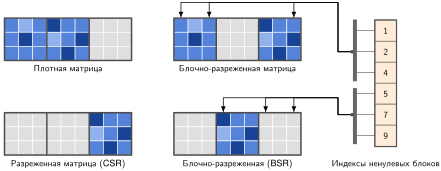

*Раскладки разреженных матриц: четыре панели сравнивают шаблоны заполненности плотной, CSR, блочно-разреженной и BSR матриц. Отдельный столбец индексов ненулевых блоков представляет метаданные, которые нужны, чтобы найти сохраненные блоки в блочно-разреженных случаях. Регулярная блочная структура делает эти метаданные предсказуемыми и компактными, поэтому аппаратура может пропускать нулевые блоки и эффективно выбирать сохраненные.*

Разреженные тензорные ядра NVIDIA реализуют конкретный пример мелкозернистой структурированной разреженности: ограничение 2:4, которое требует, чтобы ровно два из каждого смежного блока из четырех значений вдоль измерения редукции были ненулевыми (NVIDIA Corporation, 2020); (NVIDIA, 2020). В памяти матрица весов хранится в сжатом виде: сохраняются только два ненулевых значения, а вместе с ними метка метаданных размером 4 бита на блок (2 бита на значение), которая указывает исходную позицию каждого ненулевого элемента внутри четырехэлементного вектора. Во время выполнения иерархия памяти передает только сжатые веса и их метаданные, что вдвое сокращает требуемую пропускную способность памяти весов по сравнению с плотным выполнением. Внутри тракта данных разреженного тензорного ядра 4-битные метаданные управляют внутренней сетью мультиплексоров, которая выбирает два совпадающих значения из несжатого четырехэлементного вектора активаций. Выбранные активации и два ненулевых веса затем направляются в вдвое меньшее дерево умножения скалярных произведений. Поскольку аппаратура вычисляет только над ненулевыми элементами, потоково читая сжатые веса, эта конструкция удваивает пиковую пропускную способность арифметических инструкций, давая заявленное ускорение тензорной математики в 2 раза по сравнению с плотными операциями, когда веса дообучены под этот шаблон.

Шаблон 2:4 подкрепляет центральную реальность стены памяти: аппаратные ускорители выигрывают в эффективности не потому, что быстрее считают нули, а потому, что полностью исключают их передачу. Вдвое меньшая полезная нагрузка весов снижает трафик через HBM и кэши SRAM на кристалле и смещает нагрузку к более высокой операционной арифметической интенсивности на кривой Roofline.

Разреженные тензорные ядра ускоряют умножение матриц, пропуская операнды через мультиплексоры внутри тракта SIMT, тогда как альтернативные архитектуры обходят ограничения пропускной способности памяти, меняя то, как данные перемещаются в пространстве. Вместо того чтобы многократно перебрасывать активации между исполнительными блоками и централизованными регистровыми файлами, систолические массивы передают промежуточные значения напрямую между соседними процессорными элементами по физической решетке.

<a id="sec-hardware-acceleration-systolic-arrays-6fa8"></a>

### Систолические массивы

Тензорные ядра упаковывают матричные операции в небольшие специализированные инструкционные тайлы, тогда как систолические массивы организуют процессорные элементы в большие двумерные решетки, оптимизированные под непрерывный поток данных и повторное использование операндов. Подавая входы горизонтально, а частичные суммы вертикально через массив, систолические архитектуры минимизируют дорогие выборки из DRAM, что позволяет низкоточным квантованным весам достигать максимальной вычислительной плотности. Основная мотивация систолических архитектур связана с той же энергетической проблемой, которая определяет проектирование ускорителей: минимизацией штрафов за обращение к памяти через физическое повторное использование операндов. Простое сравнение энергии в пределах массива показывает, почему эта архитектура стала центральной для современных ИИ-ускорителей.

<a id="nbk-hw-acceleration-energy-advantage-pulsing-data"></a>

> **Энергетическое преимущество пульсирующих данных**
>
> **Сценарий**: систолическая архитектура повышает энергоэффективность, сохраняя операнды локально, пока работа «пульсирует» через массив; метафора «систолический» (от сердечного ритма) отражает эту выгоду локального повторного использования операндов. Этот модельный расчет сравнивает систолический поток данных с наивной реализацией, которая прогоняет каждый операнд через DRAM:
>
> 1.  **Базовый вариант с потоковой передачей через DRAM**: загружает $\mathbf{A}$, загружает $\mathbf{B}$, вычисляет $\mathbf{A} \times \mathbf{B} + \mathbf{C}$ и записывает $\mathbf{C}$ без повторного использования кэша или регистров.
>     - **Перемещение данных**: 3 загрузки + 1 запись = 4 обращения к DRAM (на операцию).
>     - **Энергия**: ≈ 4 × 640 пДж + 1 пДж (вычисления) = 2 561 пДж на операцию.
> 2.  Систолический массив (размер 128 × 128): загружает A и B один раз по краям. Данные «пульсируют» через 128 процессорных элементов.
>     - **Перемещение данных**: 2 загрузки на 128 операций = 0,016 обращения к DRAM (на операцию).
>     - **Энергия**: ≈ 0,016 × 640 пДж + 1 пДж (вычисления) ≈ 11 пДж на операцию.
>
> **Системный вывод**: при этом намеренно наивном базовом варианте с потоковой передачей через DRAM модельный расчет дает систолическому массиву преимущество по энергии в 232,8 раза. Это соотношение измеряет локальность, а не врожденный разрыв между векторной и систолической арифметикой.
>
> - Конкретно, массив 128 × 128 может поддерживать 16 384 MAC за такт с большим энергетическим выигрышем за счет пропускания данных через процессорные элементы вместо многократной загрузки их из DRAM (Horowitz, 2014); (Jouppi et al., 2023).
> - Такая локальность позволяет плотным массивам поддерживать много одновременных операций MAC, не платя обращением к DRAM за каждую операцию.
> - **Ограничение**: сравнение предполагает отсутствие эффективного повторного использования в базовом варианте и полное повторное использование по всему массиву. Кэши, регистровое блокирование, недозагрузка массива и другие потоки данных существенно меняют это соотношение.

Систолический массив располагает процессорные элементы в виде решетки, в которой данные ритмично текут между соседними блоками синхронным образом, позволяя каждому операнду участвовать в нескольких вычислениях по мере распространения по массиву. Такое структурированное движение минимизирует обращения к внешней памяти, максимизируя локальное повторное использование данных. Один весовой элемент может участвовать в десятках операций, проходя через процессорные элементы, и это переводит энергетический профиль из режима, ограниченного памятью, в режим эффективного вычисления.

Кунг и Лейзерсон[^fn-systolic-array-dataflow] (Kung and Leiserson, 1979) впервые ввели систолические массивы и формализовали их использование в архитектурах параллельных вычислений для эффективных матричных операций (Kung, 1982). В отличие от универсальных исполнительных блоков, систолические массивы используют пространственную и временную локальность, повторно применяя операнды по мере их распространения по решетке. Архитектурный подход TPU Google служит примером: в TPUv4 систолический массив умножения с накоплением размером 128 × 128 обрабатывает матричные операции, прогоняя данные через массив конвейерным образом (Jouppi et al., 2023). [«Архитектура потоков данных систолического массива»](11_hw_acceleration.md#fig-systolic-array) показывает эти пути данных: блок управления питает входные буферы, которые потоково подают данные горизонтально в массив, а частичные суммы каждой ячейки текут вертикально вниз к цепочке аккумуляторов внизу, которая собирает готовые результаты. Каждый процессорный элемент выполняет одно умножение с накоплением за такт и передает свои операнды соседям, поэтому значение, загруженное однажды, используется по всей строке или столбцу, а не загружается из памяти заново.

[^fn-systolic-array-dataflow]: **Систолический массив**: от греческого *systole* («сжатие»), заимствовано из кардиологии для передачи ритмичного сокращения. Кунг и Лейзерсон использовали этот термин для массивов, в которых данные продвигаются через соседние процессорные элементы по регулярному расписанию (Kung and Leiserson, 1979). Заполнение конвейера позволяет одновременные волновые фронты и локальное повторное использование. Выигрыш зависит от стационарного операнда, тайла, буферов и загрузки; он не гарантирует фиксированной экономии обращений к DRAM. Нерегулярные нагрузки и плохо выровненные формы подходят хуже, потому что заполнение, опустошение и простаивающие элементы расходуют емкость.

<a id="fig-systolic-array"></a>

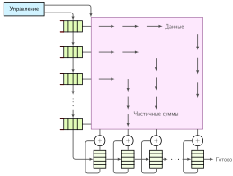

*Архитектура потоков данных систолического массива: конвейерная решетка процессорных элементов (PE) передает операнды и частичные результаты между соседями. Показанное движение — один из возможных потоков данных умножения матриц; конструкции выбирают, какой операнд или частичная сумма остается стационарной, чтобы соответствовать повторному использованию, буферам и форме тензора. Загрузка зависит от отображения и размерностей.*

<a id="sec-hardware-acceleration-tiling-principle"></a>

### Принцип тайлинга: мост между графом и кремнием

Между *вычислительным графом* (который видит одно матричное умножение 4 096 × 4 096) и *физическим кремнием* (который обладает фиксированным систолическим массивом 128 × 128) существует фундаментальное несоответствие. Преодоление этого разрыва требует тайлинга: разбиения больших тензорных операций на «тайлы», которые точно помещаются в быструю локальную память аппаратуры (SRAM или scratchpad-память).

Чтобы обработать слой с шириной 4 096 из рабочего примера на систолическом массиве шириной 128, компилятор раскладывает результат на 1 024 выходных тайла. Каждый выходной тайл накапливается по 32 тайлам измерения редукции, поэтому полное умножение матриц выполняет 32 768 произведений тайлов $\mathbf{A}$ на тайлы $\mathbf{B}$. Такая декомпозиция — физическое требование, навязанное пределами иерархии памяти: тайлы операндов выбираются из высокоемкой, высокозадержной HBM, размещаются в быстрой SRAM и прогоняются через систолический массив.

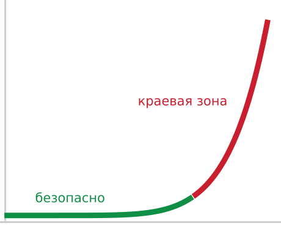

*Одно лишнее измерение сверх ширины тайла обрушивает загрузку с обрыва.*

Размеры тайлов балансируют емкость кристалла и арифметическую интенсивность. Больший тайл повторно использует каждый загруженный байт в большем числе операций умножения с накоплением, повышая арифметическую интенсивность ядра и сдвигая его в вычислительно-ограниченный режим модели Roofline; потолок емкости определяется тем, сколько из $\mathbf{A}$, $\mathbf{B}$ и $\mathbf{C}$ одновременно помещается в быструю память на кристалле. Тайлинг поддерживает высокую эффективность аппаратуры $(\eta_{\text{hw}})$, обеспечивая, что на каждый байт, загруженный из основной памяти, данные повторно используются 128 раз внутри систолической решетки. И наоборот, нарушение этого выравнивания ломает контракт с кремнием: если размерности слоя не кратны размеру тайла (например, ширина 129 на массиве 128), система платит *краевой налог* недозагруженным кремнием, когда 127 блоков простаивают, пока один блок дорабатывает остаточный тайл. Алгоритм «Блочное умножение матриц» формализует вложенный цикл, который компилятор выпускает для организации такого размещения на кристалле и накопления.

**Блочное умножение матриц (псевдокод)**

```text
Вход:  A ∈ R^{M×K}, B ∈ R^{K×N}; размеры тайлов T_M, T_N, T_K
Выход: C = AB
Для каждого тайла строк i0 (размер T_M)
    Для каждого тайла столбцов j0 (размер T_N)
        обнулить аккумулятор C-тайла на кристалле
        Для каждого k0 по K с шагом T_K
            загрузить A-тайл [i0,k0] и B-тайл [k0,j0] на кристалл
            накопить произведение тайлов на кристалле  ▷ повторное использование T_N/T_M на байт
        Конец цикла по k0
        записать C-тайл обратно в память
    Конец цикла по j0
Конец цикла по i0
```

Когда тайлы операндов оказались в быстрой локальной SRAM, аппаратура выполняет произведение тайлов без дальнейшего трафика памяти за пределами кристалла. Систолические массивы достигают вычислительной эффективности, направляя операнды через структурированную двумерную решетку процессорных элементов (PE), которые обмениваются данными напрямую с соседями по выделенным регистрам, обходя конкуренцию за общую шину памяти. В конструкции со стационарными весами, которая является каноническим потоком данных TPU и показана в [«Архитектура потоков данных систолического массива»](11_hw_acceleration.md#fig-systolic-array), веса из $\mathbf{B}$-тайла заранее загружаются в локальные регистры PE и удерживаются на месте. Входные активации из $\mathbf{A}$-тайла потоком идут по строкам слева направо, а частичные суммы накапливаются вертикально вниз по столбцам. На каждом такте каждый активный PE умножает входящую активацию на свой стационарный вес, прибавляет результат к поступившей сверху частичной сумме и передает активацию вправо своему соседу для следующего такта.

Поскольку операнды распространяются на один переход за такт, синхронное выполнение требует намеренного временного сдвига. Рассмотрим минимальное произведение тайлов $2{\times}2$, где выходной элемент $C_{ij} = A_{i0}B_{0j} + A_{i1}B_{1j}$ требует двух произведений и одного сложения. Матрица весов $\mathbf{B}$ удерживается стационарно на четырех PE: $\text{PE}_{00}$ хранит $B_{00}$, $\text{PE}_{01}$ хранит $B_{01}$, $\text{PE}_{10}$ хранит $B_{10}$, а $\text{PE}_{11}$ хранит $B_{11}$. Если активация $A_{00}$ входит в $\text{PE}_{00}$ на такте 0, ее частичное произведение $A_{00}B_{00}$ перемещается вниз в $\text{PE}_{10}$ на такте 1. Чтобы совместиться с приходящей частичной суммой, активация $A_{01}$ должна быть подана с задержкой в один такт. Входы вдоль каждой последовательной строки и столбца смещены так, чтобы операнды, встречающиеся в любой физической координате, соответствовали одинаковым индексам редукции. Локальное повторное использование амортизирует начальное заполнение и опустошение: каждая загруженная активация используется по всей строке из $T_N$ процессорных элементов, а каждый стационарный вес обслуживает целую последовательность входных векторов до вытеснения. Однако устойчивая пропускная способность остается ограниченной пропускной способностью памяти за пределами кристалла всякий раз, когда пополнение операндов не успевает за выдачей результатов массивом ([«Понимание стены памяти в ИИ»](11_hw_acceleration.md#sec-hardware-acceleration-understanding-ai-memory-wall-3ea9)).

Систолический массив 128 × 128, способный выполнять 16 384 операции за такт, требует непрерывного потока операндов для поддержания загрузки. Буферы на кристалле подают активации и веса к краям массива и пополняются из памяти за пределами кристалла по мере необходимости; повторное использование внутри массива избавляет от выборки каждого операнда из HBM на каждом такте. Пропускная способность HBM2 у TPU v4 на уровне 1 200 ГБ/с помогает поддерживать этот поток, но пропускная способность за пределами кристалла все еще может ограничивать модели, рабочие наборы и шаблоны повторного использования которых превышают емкость кристалла.

Методы квантования из раздела [«Квантование и числовая точность»](10_model_compression.md#sec-model-compression-quantization-precision-cd46) сокращают объем памяти модели, переводя веса FP32 в представление INT8. Перевод 32-битных весов с плавающей точкой в 8-битные целые сокращает трафик весов в 4 раза; меняет ли это ядро с ограниченного пропускной способностью на вычислительно-ограниченное, зависит от исходной арифметической интенсивности операции, точки перехода INT8 у ускорителя (порога интенсивности, на котором его вычисления INT8 насыщаются), и накладных расходов на квантование и деквантование. Аналогично, структурированное прореживание удаляет целые строки или столбцы матриц весов, сокращая как объем данных, который должен пройти по иерархиям памяти, так и требуемые вычисления. В таксономии D·A·M эти алгоритмические оптимизации оказываются ценными именно потому, что они нацелены на узкое место памяти, которое на практике ограничивает производительность ускорителя.

<a id="psp-hw-acceleration-matching-architecture-workload"></a>

> **Соответствие архитектуры нагрузке**
>
> **Задача**: систолические массивы должны выбрать, какие данные держать стационарными (в регистрах), чтобы минимизировать перемещение. Этот выбор жестко закладывает предпочтение аппаратуры к определенным типам моделей. [«Стратегии потоков данных систолического массива»](11_hw_acceleration.md#tbl-hw-acceleration-systolic-dataflow) предваряет три стратегии стационарного операнда и нагрузки, которым каждая благоприятствует; [«Оптимизация потоков данных»](11_hw_acceleration.md#sec-hardware-acceleration-dataflow-optimization-strategies-ce52) разрабатывает каждую из них полностью как общее решение об отображении.
>
> | Стратегия                                                        | **Стационарный объект** | **Оптимизирована для** | Пример нагрузки                                                                         |
> |:-----------------------------------------------------------------|:------------------------------------------------------|:--------------------------------------------------|:----------------------------------------------------------------------------------------|
> | **Стационарные веса** | Веса ($\mathbf{W}$)                                   | Высокое повторное использование весов             | CNN (Conv2D): фильтры малы и повторно используются по всему изображению.                |
> | **Стационарный выход** | Частичные суммы ($\mathbf{C}$)                        | Высокое повторное использование аккумуляторов     | Большой батч MatMul: накопление результатов для многих входов против большой матрицы весов. |
> | **Стационарный вход**  | Входы ($\mathbf{A}$)                                  | Высокое повторное использование активаций         | Трансформеры: одни и те же активации подаются во многие матрицы весов по головам внимания. |
>
> <a id="tbl-hw-acceleration-systolic-dataflow"></a>
>
> ***Стратегии потоков данных систолического массива**: три варианта стационарного операнда для систолических массивов, шаблон повторного использования, который каждый из них максимизирует, и класс нагрузок, который выигрывает, — это показывает, как фиксированный выбор потока данных жестко задает сродство ускорителя к определенным моделям.*
>
> Ни одна архитектура ускорителя не подходит для всех нагрузок. Кристалл, оптимизированный под поток данных со стационарными весами (как ранние TPU), хорошо работает на CNN, где фильтры весов малы и повторно используются по многим патчам изображения. Та же архитектура буксует на авторегрессивном выводе больших языковых моделей (LLM) при батче 1, где вся матрица весов должна один раз прочитываться из памяти за пределами кристалла на каждый сгенерированный токен без повторного использования в батче, что толкает архитектуры к стационарному выходу или гибридным шаблонам потоков данных.

<a id="sec-hardware-acceleration-numerics-ai-acceleration-f7be"></a>

### Числовая точность в ускорении ИИ

Систолические массивы и тензорные ядра часто поддерживают арифметику пониженной точности. FP16 вдвое сокращает число байтов на значение по сравнению с FP32, а цель может выделять больше емкости под умножение с накоплением в низкой точности. Ускорение в 2 раза не возникает автоматически: для него нужны поддерживаемое ядро и достаточно параллельной работы без другого узкого места. Опираясь на [«Сжатие моделей»](10_model_compression.md#sec-model-compression), можно сказать, что пониженная точность — это решение на стыке аппаратуры и программного обеспечения. Форматы входа и накопления могут различаться, влияя на точность, пропускную способность, энергию и перемещение данных.

<a id="sec-hardware-acceleration-precision-tradeoffs-8fa8"></a>

#### Компромиссы точности

Низкая точность не бесплатна. У FP16 пять бит порядка и 10 сохраненных бит мантиссы, поэтому по точности значащих разрядов он превосходит BF16, но динамический диапазон у него гораздо меньше, чем у FP32. Наименьшее нормальное значение составляет около $6{,}1\times10^{-5}$, а наибольшее конечное значение равно 65 504; субнормальные числа расширяют диапазон вниз, но с пониженной точностью. BF16 сохраняет восьмибитный порядок FP32 и использует 7 бит мантиссы, сохраняя близкий динамический диапазон при меньшей точности. У INT8 нет порядка с плавающей точкой, и он зависит от выбора масштаба, нулевой точки и отсечения. Аппаратура и программное обеспечение должны балансировать эти свойства против пропускной способности и трафика.

Эволюция аппаратуры ИИ отражает совместное проектирование численных методов и возможностей аппаратуры. Более ранние поколения GPU не имели выделенных матричных путей смешанной точности, которые сегодня используются в глубоком обучении, даже когда другие блоки поддерживали несколько форматов. Когда методы обучения и вывода показали приемлемую точность при выборочных операциях пониженной точности, производители добавили нативные тензорные пути FP16, BF16 и целочисленные. Фреймворки и библиотеки открывают их через совместимые ядра, автоматическое приведение типов, квантование и калибровку. Выигрыш программного обеспечения появляется только тогда, когда модель выбирает эффективный путь; одно изменение хранения может сократить число байтов, но не даст заявленного ускорения арифметики.

Поддержка точности встроена в исполнительные блоки и пути памяти. Линии SIMD и SIMT могут поддерживать несколько скалярных форматов, тогда как тензорные ядра ([«Тензорные ядра»](11_hw_acceleration.md#sec-hardware-acceleration-tensor-cores-771f)) и систолические блоки ([«Систолические массивы»](11_hw_acceleration.md#sec-hardware-acceleration-systolic-arrays-6fa8)) открывают специфичные для архитектуры комбинации входа и накопления. Низкая точность сокращает число байтов на операнд и может повысить число операций за такт. Определяют повторное использование тайлы и поток данных, а не сама точность, тогда как накладные расходы на преобразование, масштабирование или откат могут съесть часть выигрыша. Формат полезен, только если ядро и числовая политика могут применять его безопасно.

Несмотря на преимущества пониженной точности, модели глубокого обучения не всегда могут опираться только на низкоразрядные представления. Чтобы решить эту задачу, современные ИИ-ускорители реализуют вычисления смешанной точности, при которых разные числовые форматы используются на разных стадиях выполнения. Эти решения о точности влияют на надежность вычислений: матричные умножения могут выполняться в FP16 или BF16, а накопления сохраняются в FP32, чтобы не терять точность. Аналогично движки вывода используют арифметику INT8, сохраняя ключевые активации в более высокой точности там, где это необходимо.

<a id="sec-hardware-acceleration-mixedprecision-computing-656f"></a>

#### Вычисления в смешанной точности

Современные ИИ-ускорители все чаще поддерживают выполнение в смешанной точности, позволяя использовать разные числовые форматы на разных этапах вычисления. Нагрузки обучения часто используют FP16 или BF16 для матричных умножений, сохраняя накопления в FP32, чтобы сберечь точность (Micikevicius et al., 2017); (Mellempudi et al., 2019). Программная реализация обучения в смешанной точности, включая масштабирование потерь и поддержку фреймворков, описана в разделе [«Обучение в смешанной точности»](08_training.md#sec-model-training-mixedprecision-training-9218). Нагрузки вывода, напротив, оптимизируются под INT8 или даже INT4, достигая высокой эффективности при сохранении приемлемой точности.

Сдвиг к разнообразию точностей заметен в эволюции ИИ-аппаратуры. Ранние архитектуры, такие как NVIDIA Volta, предлагали ограниченную поддержку пониженной точности сверх FP16, тогда как более поздние архитектуры, включая Turing и Ampere, расширили набор поддерживаемых форматов. [«Эволюция поддержки точности»](11_hw_acceleration.md#tbl-nvidia-numerics) прослеживает этот путь: GPU Ampere ввели TF32 как гибрид FP32 и FP16 (NVIDIA, 2020), а вместе с ним более широкую поддержку BF16, INT8 и INT4 (NVIDIA Corporation, 2017); (NVIDIA Corporation, 2018); (NVIDIA Corporation, 2020).

| Архитектура                                  | Год  | **Поддерживаемые точности тензорных ядер** | **Поддерживаемые точности CUDA-ядер** |
|:---------------------------------------------|-----:|:----------------------------------------------------------------------------------------|:-----------------------------------|
| **Volta**            | 2017 | FP16                                                                                    | FP64, FP32, FP16                   |
| **Turing**          | 2018 | FP16, INT8, INT4, INT1                                                                  | FP64, FP32, FP16, INT8             |
| **Ampere** | 2020 | FP64, TF32, BF16, FP16, INT8, INT4                                                      | FP64, FP32, FP16, BF16, INT8       |

<a id="tbl-nvidia-numerics"></a>

*Эволюция поддержки точности: от Volta до Ampere поддержка тензорных ядер расширилась с FP16 до TF32, BF16 и целочисленных форматов, расширив выбор точностей для обучения и вывода; колонка CUDA-ядер показывает отдельные скалярные и векторные форматы, которые поддерживает каждое поколение.*

Новые архитектуры включают растущее разнообразие численных форматов, потому что разные нагрузки упираются в разные точки компромисса между точностью, пропускной способностью и энергией. Поддержка точности, таким образом, — это еще одна форма согласования с нагрузкой, а не универсальный список возможностей.

Формат с плавающей точкой, выбранный при проектировании аппаратуры, имеет каскадные последствия для всей системы. Переход с FP32 на FP16 сокращает трафик памяти вдвое, и это важнее, чем кажется: поскольку доступ к памяти доминирует в энергопотреблении, сокращение трафика вдвое может заметно снизить энергию на вывод, когда узким местом является перемещение данных (Horowitz, 2014). Одновременно тензорные ядра и систолические массивы могут упаковать больше блоков умножения с накоплением пониженной точности в ту же площадь кремния, повышая пиковую пропускную способность (Dally et al., 2021); (Dally, 2023). Целочисленная арифметика низкой точности также потребляет меньше энергии, чем FP32, в типичных исследованиях техпроцессов (Horowitz, 2014), а ориентированный на вывод TPUv1 был построен вокруг 8-битных блоков умножения (Jouppi et al., 2017). Системный вывод таков: пониженная точность не просто «экономит биты», а одновременно снимает ограничение пропускной способности памяти *и* повышает плотность вычислений, атакуя обе стороны кривой Roofline сразу.

По мере того как модели ИИ продолжают масштабироваться, поддержка точности связывает обсуждение вычислительных примитивов обратно со стеной памяти: низкоразрядные форматы важны, когда сокращают объем передаваемых данных и поддерживают загрузку матричных движков аппаратуры. Оставшийся архитектурный вопрос состоит в том, как эти исполнительные блоки, форматы точности и пути памяти объединяются в законченные системы ускорителей. Архитектурная интеграция определяет, насколько эффективно вычислительные примитивы превращаются в пригодную пропускную способность ускорителя. Линии SIMD, тензорные ядра и систолические массивы — строительные блоки, но их организация на уровне всего кристалла заметно различается у ИИ-процессоров; выбор исполнительных блоков, поддержка числовой точности и связность определяют, насколько эффективно аппаратура может масштабироваться для нагрузок глубокого обучения.

<a id="sec-hardware-acceleration-interconnects"></a>

### Межсоединения внутри узла: масштабирование стека

Освоение стека одной машины требует понимания того, как биты перемещаются между GPU и CPU. В диапазоне от 1 до 8 GPU масштабирование достигается благодаря высокоскоростным межсоединениям внутри узла, таким как NVLink, и передачам между хостом и устройством по PCIe, которые смягчают стену памяти. Эти связи образуют **сужение пропускной способности**: скорость перемещения данных падает на каждом шаге от вычислительных блоков: от HBM в корпусе через мост NVLink между GPU к хостовому каналу PCIe. Шаг через PCIe намного медленнее локальной памяти ускорителя и структуры связи между GPU, поэтому любой путь данных, который обращается к CPU, может стать источником падения производительности — «стеной PCIe», которой и призван избегать NVLink (NVIDIA Corporation, 2020). [«Топология межсоединений узла»](11_hw_acceleration.md#sec-hardware-acceleration-nodelevel-interconnect-topology-b45b) развивает эту иерархию количественно, где главной задачей становится обмен между хостом и ускорителем.

Современные ИИ-процессоры демонстрируют набор проектных компромиссов в зависимости от целевых приложений, и сравнение их конфигураций показывает, как ограничения развертывания ведут к расхождению архитектур. Ускоритель, оптимизированный под обучение, например NVIDIA A100, содержит много потоковых мультипроцессоров с широкими блоками SIMD и тензорными ядрами FP16, потому что пропускная способность обучения масштабируется вместе с совокупной емкостью умножения с накоплением (NVIDIA Corporation, 2020). TPUv4 от Google делает принципиально иную ставку: всего два ядра на чип, каждое из которых содержит массивные систолические массивы BF16, что обменивает гибкость программиста на эффективность в плотных умножениях матриц (Jouppi et al., 2023). На стороне вывода Sapphire Rapids от Intel выделяет блоки тайлов Advanced Matrix Extensions (AMX) под INT8 и BF16, что отражает вывод из [«Сжатие моделей»](10_model_compression.md#sec-model-compression): модели вывода выдерживают пониженную точность (Intel Corporation, 2021). Мобильные нейронные движки идут еще дальше, уменьшая матричные движки до маломощных блоков SoC и ставя энергоэффективность на операцию выше пикового быстродействия. [«Конфигурации процессоров ИИ»](11_hw_acceleration.md#tbl-execution-units) сравнивает эти архитектурные конфигурации.

| Процессор                                       | **Векторные вычисления** | **Матричный движок** |  Процессорные элементы  | **Основные нагрузки** |
|:------------------------------------------------|:-------------------------------------------------------:|:-------------------------------------------------:|:---------------------:|:----------------------------------------------------------|
| **NVIDIA A100**   |                    Линии CUDA FP/INT                    |           Инструкционные тайлы тензорных ядер           |        108 SM        | Обучение, HPC                                             |
| **Google TPUv4** |                       Векторный блок                       |       Систолические массивы BF16 $128{\times}128$       |      2 ядра на чип     | Обучение                                                  |
| **Intel Sapphire Rapids** |                     512-битный AVX-512                     |     Тайлы AMX (до 16 строк по 64 байта каждый)    |     До 60 ядер    | Вывод                                                 |
| Мобильный NPU                                      |                   Векторы CPU/GPU/DSP                   |                Небольшие матричные движки               | Встроенные блоки NPU | Мобильный вывод                                          |

<a id="tbl-execution-units"></a>

*Конфигурации процессоров ИИ: современные ИИ-процессоры по-разному расставляют приоритеты характеристик исполнительных блоков под конкретные нагрузки: NVIDIA A100 использует широкий SIMD и тензорные ядра для обучения, Google TPUv4 делает упор на высокопроизводительное матричное умножение BF16, Intel Sapphire Rapids ориентирован на вывод с оптимизацией под INT8, а мобильные NPU ставят приоритетом маломощное исполнение. Эти различия в ширине SIMD, размере тензорных ядер и числе процессорных элементов отражают растущее разнообразие архитектур ИИ-аппаратуры.*

Закономерность в этих конфигурациях показывает последовательный инженерный принцип: каждая конструкция жертвует универсальностью ради оптимизации под доминирующую операцию и точность целевой нагрузки. Обучающие чипы вкладывают кремний в широкие тракты данных с плавающей точкой; чипы вывода обменивают точность на пропускную способность; мобильные чипы обменивают пропускную способность на энергоэффективность. Ни одна конструкция не доминирует во всех нагрузках, поэтому выбор аппаратуры зависит от анализа нагрузки, а не от заголовочных спецификаций.

<a id="sec-hardware-acceleration-costperformance-analysis-e925"></a>

### Анализ стоимости и производительности

Архитектурные спецификации определяют вычислительный потенциал, но решения о развертывании требуют анализа стоимости и производительности. Сырые вычисления — лишь один вход: реальная производительность может упираться в арифметическую пропускную способность, пропускную способность памяти, задержку межсоединений, накладные расходы программного обеспечения или низкую операционную загрузку.

Физический энергетический разрыв, описанный в [«Специализация аппаратуры для машинного обучения»](11_hw_acceleration.md#sec-hardware-acceleration-machine-learning-hardware-specialization-09c5), где перенос операндов из DRAM за пределами кристалла стоит на порядки больше энергии, чем арифметика, движет специализацию ускорителей. Поскольку стоимость доступа к памяти превышает стоимость вычислений, ускорители на ядрах, ограниченных памятью, выдают лишь долю своей пиковой пропускной способности. И наоборот, архитектуры, которые максимизируют повторное использование данных, например систолические массивы при выполнении плотных матричных умножений, поддерживают заметно более высокую загрузку, распределяя каждое обращение к памяти между несколькими арифметическими операциями.

Рассмотрим инженерную команду, которая выбирает между развертыванием большего кластера старых ускорителей или меньшего кластера новых. Пиковые значения FLOP/s вводят в заблуждение всякий раз, когда доминирующие ядра ограничены пропускной способностью памяти или коммуникациями. В большом конвейере модели плотные прямые проходы и слои проекции внимания могут оставаться вычислительно-ограниченными, тогда как поиск эмбеддингов, нормализация слоя, остаточные сложения и шаги авторегрессивного декодирования строго ограничены памятью. Решающая метрика — это производительность нагрузки на доллар при реалистичной загрузке кластера, ограничениях емкости памяти, доступной пропускной способности памяти и эффективности межсоединений при горизонтальном масштабировании.

Эти архитектурные и экономические ограничения объясняют быстрое внедрение новых ускорителей, несмотря на существенный рост номинальной цены за единицу. Для нагрузок, ограниченных памятью, поколенческие улучшения пропускной способности памяти и генерации кода компилятором доминируют во времени выполнения от начала до конца. Облачные развертывания вносят дополнительные компромиссы: почасовые тарифы аренды, динамическая загрузка экземпляров и накладные расходы инфраструктуры непрерывно сдвигают точку безубыточности между покупкой собственного оборудования и арендой облачных мощностей.

[«Иллюстративная таблица стоимости ускорителей»](11_hw_acceleration.md#tbl-accelerator-economics) предлагает иллюстративную таблицу стоимости для распространенных ускорителей. Прайс-листы различаются по поставщику, региону, условиям контракта и объему закупок. Кроме того, строки пропускной способности соответствуют различным режимам числовой точности, поэтому показатель цены за пиковую операцию осмыслен только внутри одной строки и не годится как межустройственный бенчмарк. Таблица задает рамку для того, чтобы делать экономические допущения явными, а не предлагает универсальный рейтинг аппаратуры.

| Ускоритель                                        |   **Прайс-лист**   |       **Представительная пиковая пропускная способность (с указанием точности)**       |                    Пропускная способность памяти                   | **Цена/производительность** |
|:--------------------------------------------------|:-----------------------------------------------:|:----------------------------------------------------------------:|:-----------------------------------------------------:|:---------------------------------------------------------:|
| **NVIDIA V100**                |  ~\$10 000 |       125 TFLOP/s       |  900 ГБ/с |      \$80/(TFLOP/s)      |
| NVIDIA A100                    |  ~\$15 000 |    312 TFLOP/s     |  2 039 ГБ/с |      \$48,1/(TFLOP/s)      |
| **NVIDIA H100**     |  ~\$25 000–30 000 | 494 TFLOP/s (TF32) |  3 350 ГБ/с |      ~\$50,6/(TFLOP/s)      |
| Google TPUv4                                      |  ~\$8 000*  |   275 TFLOP/s (BF16)   | 1 200 ГБ/с |       ~\$29,1/(TFLOP/s)      |
| **Intel Gaudi 2** | ~\$12 000 |   865 TFLOP/s (FP8)    | 2 450 ГБ/с |      \$13,9/(TFLOP/s)     |

<a id="tbl-accelerator-economics"></a>

*Иллюстративная таблица стоимости ускорителей: каждая строка делит приблизительное допущение о цене закупки на показанный представительный пиковый режим. Поскольку точность, допущения о разреженности и источники цен различаются, эти отношения нельзя сравнивать как производительность нагрузки. Полная стоимость включает загрузку, емкость памяти, мощность, охлаждение, межсоединения, программное обеспечение и инфраструктуру; стоимость приобретения TPU оценена по ценам облака.*

Таблица показывает, почему выбор ускорителя нельзя свести к одной заголовочной спецификации. Нагрузка, ограниченная пропускной способностью, выигрывает от подсистемы памяти H100 с 3 350 ГБ/с сильнее, чем от постепенного роста пиковой арифметики, тогда как вычислительно-ограниченное общее умножение матриц (GEMM) показывает противоположную чувствительность. Емкость памяти устройства определяет, помещаются ли рабочие наборы на кристалл без выгрузки или разбиения, а зрелость компилятора и драйверов определяет, может ли приложение действительно достичь заявленного тракта данных.

Выбор программной платформы напрямую влияет на эти экономические компромиссы: графовые компиляторы, проходы слияния операторов и диспетчеры среды выполнения определяют эффективность, с которой высокоуровневые описания моделей отображаются на физические исполнительные блоки. Конкретные стратегии оптимизации на уровне фреймворков рассмотрены в разделе [«Фреймворки машинного обучения»](07_frameworks.md#sec-ml-frameworks), а эмпирические методы измерения и бенчмаркинга разработаны в главе [«Бенчмаркинг»](12_benchmarking.md#sec-benchmarking).

Векторные конвейеры, движки матричных тайлов и тензорные ядра обеспечивают огромную пиковую арифметическую мощность. NVIDIA A100 заявляет 312 TFLOP/s на своем тензорном пути FP16, а последующие конструкции ускорителей добавляют режимы выполнения в узких форматах FP8 (NVIDIA Corporation, 2020); (Kuzmin et al., 2022); (Micikevicius et al., 2022). Архитектура Blackwell (B200) от NVIDIA продолжает эту траекторию с тензорным трактом данных FP4, номинально до 9 PFLOP/s плотной и 18 PFLOP/s разреженной пиковой пропускной способности на чип (NVIDIA Corporation, 2024). Чтобы достичь этих теоретических потолков, нужны числовые представления, реализации ядер и шаблоны разреженности, которые точно совпадают с путями специализированной аппаратуры. Более узкие числовые форматы расширяют пространство проектирования, но требования к численной устойчивости и динамическому диапазону определяют, может ли нагрузка безопасно использовать FP4.

Деление общего числа операций модели на пиковую арифметическую пропускную способность дает идеализированную нижнюю границу времени выполнения, а не реалистичную задержку вывода. Для A100 деление арифметических операций ResNet-50 на 312 TFLOP/s дает оценку в масштабе микросекунд. Реальный вывод ResNet-50, однако, занимает миллисекунды. Это расхождение на порядки выявляет центральное противоречие систем машинного обучения: арифметическая пропускная способность намного опередила пропускную способность памяти, необходимую для подачи исполнительных блоков. *Перенос данных из памяти стоит на порядки больше энергии, чем арифметика, а пропускная способность памяти растет медленнее, чем пропускная способность тензорной арифметики.* Этот физический дисбаланс определяет, дает ли заявленные 312 TFLOP/s высокую устойчивую загрузку аппаратуры или остаются почти незадействованными на конкретной нагрузке (Horowitz, 2014); (Gholami et al., 2024).

Преодоление этого разрыва в производительности требует анализа иерархий памяти, которые питают вычислительные блоки. Подсистема памяти — это не пассивный каркас; вместе с арифметической интенсивностью и планированием ядер она определяет долю пиковых вычислений, которую алгоритм может извлечь из машины.

<a id="sec-hardware-acceleration-ai-memory-systems-0057"></a>

## Системы памяти ИИ

ResNet-50 может показать разрыв между арифметикой ускорителя и памятью: веса сверток, активации и промежуточные результаты должны поступать вовремя. Современные ускорители достигают сотен TFLOP/s и более на выбранных путях пониженной точности (NVIDIA Corporation, 2020); (Choquette, 2023); (NVIDIA Corporation, 2024), но ядро не может использовать эту мощность, когда требуемый трафик превышает соответствующую пропускную способность памяти. **Стена памяти в ИИ** называет растущее несоответствие между спросом арифметики и системой памяти, которая ее питает.

В отличие от обычных нагрузок, модели ML требуют частого доступа к большим объемам параметров, активаций и промежуточных результатов, что ведет к существенным требованиям к пропускной способности памяти. Эта задача пересекается со стратегиями управления данными, рассмотренными в главе [«Инженерия данных»](04_data_engineering.md#sec-data-engineering). Современная ИИ-аппаратура решает эти задачи с помощью продвинутых иерархий памяти, эффективных методов перемещения данных и стратегий сжатия, которые способствуют эффективному выполнению.

<a id="sec-hardware-acceleration-understanding-ai-memory-wall-3ea9"></a>

### Понимание стены памяти в ИИ

<a id="dfn-hw-acceleration-ai-memory-wall"></a>

> **Стена памяти в ИИ**
>
> ***Стена памяти в ИИ*** — это ограничение производительности ускорителей ML, которое возникает, когда пиковая арифметическая пропускная способность $(R_{\text{peak}})$ опережает пропускную способность памяти $(\text{BW})$. Основной вопрос в том, успевает ли система памяти подавать операнды и принимать результаты достаточно быстро, чтобы поддерживать специализированные примитивы, введенные в разделе [«Вычислительные блоки и модели выполнения»](11_hw_acceleration.md#sec-hardware-acceleration-compute-units-execution-models-f406).
>
> 1.  **Значение**: нагрузка достигла стены памяти, когда одно лишь увеличение FLOP/s перестает сокращать время выполнения, потому что член $\frac{D_{\text{vol}}}{\text{BW}}$ доминирует в общем времени работы.
> 2.  **Отличие**: в отличие от общей стены памяти, которая затрагивает все вычисления, стена памяти в ИИ определяется большими объемами параметров и тензорами промежуточных активаций, которые требует глубокое обучение.
> 3.  **Типичная ошибка**: распространенное заблуждение состоит в том, что стену памяти «устраняет» больше памяти. На деле это разрыв между пропускной способностью и задержкой: даже при бесконечной емкости скорость перемещения данных между памятью и вычислениями остается фундаментальным физическим узким местом.

Доступ к данным может доминировать в энергетическом бюджете ядра, интенсивного по памяти.[^fn-von-neumann-bottleneck] [«Иерархия энергии»](11_hw_acceleration.md#fig-energy-hierarchy) сравнивает типичные стоимости операций из одного исследования техпроцессов и показывает многопорядковый разрыв между простой локальной арифметикой и обращением к DRAM за пределами кристалла.

[^fn-von-neumann-bottleneck]: **Узкое место фон Неймана**: разделение хранилища и вычислений требует, чтобы инструкции и данные пересекали интерфейсы, а не оставались в локальных регистрах. В типичных оценках 45 нм (Horowitz, 2014) обращение к DRAM расходует более чем в 20 000 раз больше энергии, чем сложение INT8. Точное соотношение меняется с техпроцессом и операцией, но локальность остается главной проблемой проектирования первого порядка.

<a id="fig-energy-hierarchy"></a>

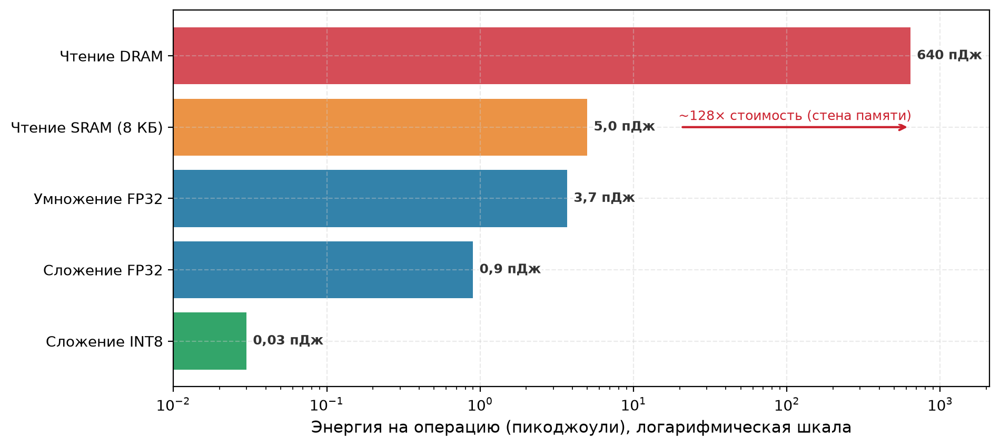

*Иерархия энергии: типичные оценки энергии для техпроцесса 45 нм на логарифмической шкале по данным (Horowitz, 2014). Обращение к DRAM за пределами кристалла стоит примерно в 128 раз больше, чем чтение 8-килобайтной SRAM, и более чем в 20 000 раз больше, чем сложение INT8, в этой модели. Значения не являются универсальными характеристиками устройств; они иллюстрируют, почему повторное использование в регистрах и SRAM может важнее, чем одно лишь сокращение числа арифметических операций.*

<a id="sec-hardware-acceleration-quantifying-computememory-performance-gap-1526"></a>

#### Количественная оценка разрыва между вычислениями и памятью

Энергетическое неравенство, которое фиксирует [«Иерархия энергии»](11_hw_acceleration.md#fig-energy-hierarchy), с каждым поколением аппаратуры становится острее. За последние два десятилетия пиковые вычислительные возможности выросли заметно быстрее пропускной способности DRAM (Gholami et al., 2024). Это расхождение вызвано физическими ограничениями масштабирования: хотя масштабирование транзисторов и плотные систолические массивы умножают арифметическую пропускную способность, пропускная способность памяти остается ограниченной числом выводов, плотностью трассировки в подложке корпуса и мощностью сигнализации интерфейса. Типичные высокопроизводительные ускорители могут выдавать порядка $10^3$ TFLOP/s пиковой тензорной пропускной способности (например, NVIDIA H100 выдает 989 TFLOP/s в FP16 или почти 2 000 TFLOP/s в плотном FP8), предоставляя при этом примерно 3,35 ТБ/с пропускной способности памяти (Choquette, 2023). Отсюда следует, что для полного использования вычислений на каждый перемещенный байт нужно порядка $10^2$ FLOP работы, и это может превышать арифметическую интенсивность многих практических нейросетевых нагрузок.

Когда арифметическая интенсивность нагрузки падает ниже этого порога, бюджет времени полностью смещается в сторону передачи данных ($\frac{D_{\text{vol}}}{\text{BW}}$). Ускорители пытаются терпеть задержку памяти, обычно сотни тактов для DRAM за пределами кристалла, поддерживая тысячи одновременных потоков выполнения и переключаясь между активными варпами, пока запросы к памяти находятся в полете. Однако когда пропускная способность памяти насыщается или когда давление на регистры ограничивает заполненность, планировщику не хватает независимых инструкций для выдачи. Конвейеры вычислений затем простаивают, оставляя высокопроизводительные тензорные ядра без работы в ожидании операндов. Одновременно управление широкими шинами памяти за пределами кристалла по емкостным дорожкам печатных плат и физическим интерфейсам (PHY) потребляет существенную долю расчетной тепловой мощности (TDP) кристалла, напрямую ограничивая энергетический бюджет, доступный арифметической логике (Horowitz, 2014); (Sze et al., 2017).

<a id="sec-hardware-acceleration-hardware-balance"></a>

### Аппаратный баланс ($I_{\text{ridge}}$): разбиение по парадигмам

Разные устройства проводят границу между вычислениями и пропускной способностью на разных интенсивностях. **Аппаратный баланс $(I_{\text{ridge}})$** — это отношение пиковой арифметической пропускной способности к пиковой пропускной способности памяти. В модели Roofline это точка перехода, в которой пересекаются потолки вычислений и пропускной способности:

$$ I_{\text{ridge}} = \frac{R_{\text{peak}}}{\text{BW}} $$

Это отношение задает границу, специфичную для устройства. В зависимости от выбранной точности высокопроизводительному ускорителю вроде H100 может понадобиться примерно $150$–$300$ FLOP на байт, чтобы достичь своего арифметического потолка, тогда как у микроконтроллера точка перехода может быть гораздо ниже. Одно и то же ядро поэтому может быть ограничено пропускной способностью на плотном по вычислениям ускорителе и вычислительно-ограниченным на периферийном процессоре. Аппаратный баланс не объявляет ни одно из устройств универсально эффективным; он показывает, сколько повторного использования данных нагрузке нужно на этом устройстве.

Пиковая вычислительная способность расширялась быстрее, чем производительность шины памяти, на протяжении поколений ускорителей, и величина этого расхождения определяет, сколько повторного использования данных нужно ядру, чтобы его снабжали операндами. [«Расхождение вычислений и пропускной способности»](11_hw_acceleration.md#fig-compute-memory-imbalance) разделяет два темпа роста, которые порождают точку перехода, каждый из которых нормирован к базе V100, так что расширяющийся промежуток между ними можно прочитать напрямую.

<a id="fig-compute-memory-imbalance"></a>

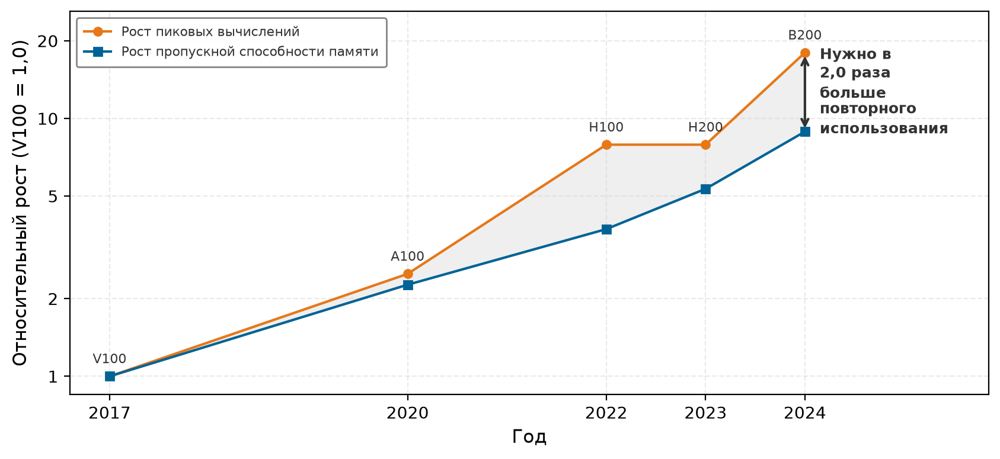

*Расхождение вычислений и пропускной способности: пиковая плотная производительность FP16 и пропускная способность памяти для пяти поколений дата-центровых GPU NVIDIA, каждая нормирована к базе V100 на логарифмической шкале. За 2017–2024 годы вычисления выросли в 18 раз, а пропускная способность — в 8,9 раза, поэтому заштрихованный промежуток между кривыми расширился в 2,0 раза. Этот промежуток — повторное использование данных, которое ядро должно обеспечивать, чтобы арифметические блоки оставались занятыми. Шаг H200 — поучительное исключение: пропускная способность выросла, а пиковые вычисления остались на месте, что на одно поколение сузило разрыв.*

Порог, при котором ядро становится вычислительно-ограниченным, сдвинулся по поколениям ускорителей. По последовательным архитектурам дата-центров ([«Растущая точка перехода»](11_hw_acceleration.md#fig-rising-ridge)) аппаратные точки перехода поднимаются от V100 до B200, постепенно увеличивая арифметическую интенсивность, необходимую для насыщения пиковой вычислительной пропускной способности.

<a id="fig-rising-ridge"></a>

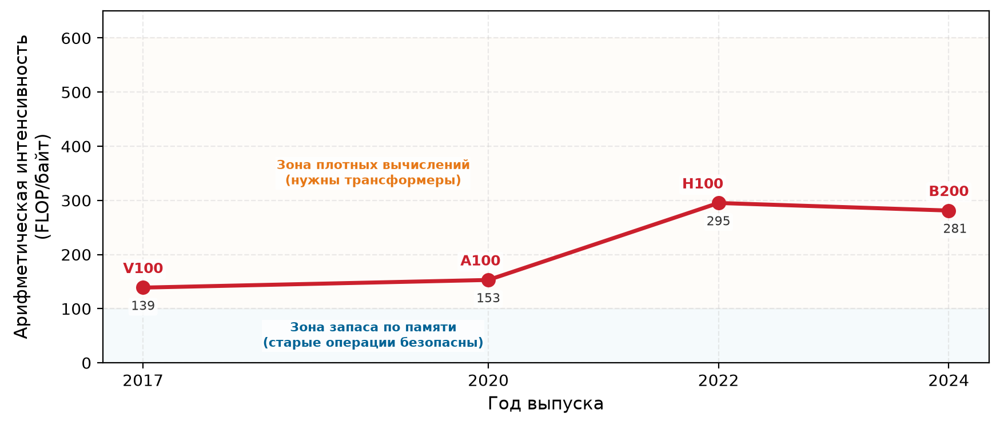

*Растущая точка перехода: аппаратная арифметическая интенсивность (FLOP/байт) во времени, вычисленная как пиковая плотная тензорная производительность FP16 каждого чипа, деленная на его пропускную способность памяти. Это арифметическая интенсивность, которой ядру нужно достичь, прежде чем его начнут ограничивать вычисления, а не пропускная способность. Поскольку вычислительные возможности растут быстрее пропускной способности памяти, точка перехода поднимается от V100 через H100 и остается высокой на B200. Эта тенденция объясняет, почему архитектуры с высоким повторным использованием данных процветают, а нагрузки с низким повторным использованием сталкиваются с растущим аппаратным налогом.*

Помимо ограничений производительности, доступ к памяти стоит дорого по энергии. Выборка данных из DRAM за пределами кристалла расходует на порядки больше энергии, чем арифметические операции на кристалле (Horowitz, 2014). Арифметический блок передает сигналы по проводникам микрометрового масштаба на кремнии, тратя десятки фемтоджоулей на операцию; выборка операнда из DRAM требует управления макроскопическими дорожками печатной платы и корпусными соединениями, что стоит десятков пикоджоулей. В моделях машинного обучения, где миллиарды параметров и активаций проходят по шине, перемещение данных быстро доминирует в общем энергетическом бюджете. Это энергетическое различие определяет архитектурные решения: TPUv1 Google достиг в 30–80 раз лучшей производительности на ватт, чем современные CPU и GPU, на бенчмарках вывода, сведя к минимуму перемещение данных за пределами кристалла благодаря систолическим массивам и большой SRAM на кристалле (Jouppi et al., 2017). Эти проектные решения показывают, что энергетические бюджеты, не меньше чем бюджеты тактов, определяют, какие архитектуры способны работать в промышленной эксплуатации.

<a id="sec-hardware-acceleration-memory-access-patterns-ml-workloads-a960"></a>

#### Шаблоны доступа к памяти в нагрузках ML

Помимо сырой вычислительной пропускной способности, устойчивая эффективность ускорителя зависит от того, как операнды подаются исполнительным блокам без простоев конвейера. Глубокие нейронные сети предъявляют к этой подаче данных три одновременных требования. Во-первых, параметры модели (веса и смещения) могут достигать сотен миллиардов значений (Brown et al., 2020). При авторегрессивной генерации с батчем 1 каждый параметр нужно передавать из памяти на каждый сгенерированный токен, и арифметическая интенсивность падает примерно до 1 FLOP/байт. Во-вторых, промежуточные активации, создаваемые на каждом слое, должны буферизоваться в памяти для последующих операций; при обучении глубокие архитектуры должны сохранять эти активации на протяжении всего прямого прохода, пока обратное распространение их не использует. В-третьих, обучение добавляет трафик градиентов и оптимизатора: обратное распространение вычисляет градиенты для каждого параметра, а такие алгоритмы, как адаптивная оценка моментов (Adam), читают и записывают многословные состояния моментов, умножая объем перемещения данных на каждое обновление параметра (Narayanan et al., 2021); (Kwon and Rhu, 2018).

Физическая стоимость этого перемещения данных зависит от того, где в иерархии памяти находится каждый тензор. Если доступ к регистру на кристалле завершается за один такт с энергией менее пикоджоуля, то выборка из DRAM за пределами кристалла останавливает выполнение на сотни тактов и тратит на порядки больше энергии. Проследить один тензор по уровням памяти во время прохода вывода — значит сделать это различие конкретным, как показано на примере конвейера распознавания ключевых слов (KWS) из иллюстративной модели ([«Жизнь тензора»](11_hw_acceleration.md#lhs-hw-acceleration-life-tensor-kws-journey)).

<a id="lhs-hw-acceleration-life-tensor-kws-journey"></a>

> **Жизнь тензора: KWS на GPU**
>
> Вспомним иллюстративную модель распознавания ключевых слов, кратко описанную в [«Пять иллюстративных моделей»](02_ml_systems.md#tbl-ml-systems-lighthouse-archetypes). Если тот же односекундный аудиофрагмент обрабатывается пакетом на пути вывода на GPU, его физический путь через иерархию памяти выглядит так:
>
> 1.  **DRAM (HBM)**: тензор начинается здесь.
>     -   **Размер**: 16 000 отсчетов × 2 байта (FP16) = 32 КБ.
>     -   **Задержка**: выборка из памяти за пределами кристалла занимает около 300 нс (плюс задержка в очереди).
>     -   **Энергия**: стоимость около 20 пДж/бит. Высокая.
> 2.  **Кэш L2**: запросы к памяти устройства могут обслуживаться здесь, если нужные строки кэша находятся в нем.
>     -   **Задержка**: около 4 нс.
>     -   **Доступ**: общий для нескольких потоковых мультипроцессоров (SM).
> 3.  **Кэш L1 / разделяемая память**: конкретный SM работает с тайлом аудио, используя аппаратно управляемый кэш или явно размещенную разделяемую память.
>     -   **Задержка**: около 1 нс.
>     -   **Локальность**: если запрос к L1 промахивается, его все еще может обслужить L2 до того, как понадобится обращение к HBM.
> 4.  **Регистры**: здесь работает тензорное ядро.
>     -   **Задержка**: обычно несколько тактов, в зависимости от инструкции и архитектуры.
>     -   **Пропускная способность**: 312 TFLOP/s.
>     -   **Энергия**: стоимость около 0,1 пДж/бит.
>
> **Системный вывод**: производительность ограничена меньшим из двух значений: пиковой вычислительной пропускной способностью и произведением пропускной способности на арифметическую интенсивность. Какое звено памяти поставляет нужную пропускную способность, зависит от того, где находится рабочий набор; путь от HBM до L2 — лишь один возможный ограничивающий путь, а не единственный фактор, определяющий Roofline.

Граница между выполнением, ограниченным памятью, и вычислительно-ограниченным выполнением возникает непосредственно из баланса между временем передачи данных и временем арифметического выполнения. Для нагрузки, которой нужен объем данных $D_{\text{vol}}$ (байт) при доступной пропускной способности $\text{BW}$ (байт/с), и которая выполняет $O$ операций с плавающей точкой на аппаратуре с пиковой пропускной способностью $R_{\text{peak}}$ (FLOP/s) при фактической загрузке аппаратуры $\eta_{\text{hw}}$, времена выполнения равны:

$$ T_{\text{mem}} = \frac{D_{\text{vol}}}{\text{BW}} $$

$$ T_{\text{compute}} = \frac{O}{R_{\text{peak}} \cdot \eta_{\text{hw}}} $$

В строго последовательной модели без перекрытия $T_{\text{mem}} > T_{\text{compute}}$ означает выполнение, ограниченное памятью. Когда аппаратура перекрывает передачи памяти с вычислениями, большее из двух значений задает теоретическую нижнюю границу времени выполнения. На практике, однако, зависимости данных, очереди контроллера памяти и частичное перекрытие конвейера определяют, сколько арифметической аппаратуры простаивает в ожидании операндов.

Структурное расхождение между размерами моделей и доступной пропускной способностью памяти и превращает $T_{\text{mem}}$ в связывающее ограничение на протяжении поколений. [«Размер модели против пропускной способности аппаратуры»](11_hw_acceleration.md#fig-memory-wall) количественно показывает это расхождение для публичных эталонных моделей и архитектур ускорителей (Krizhevsky et al., 2012); (Brown et al., 2020); (Chowdhery et al., 2022); (Dubey et al., 2024). Даже ускорители с высокой пропускной способностью, такие как NVIDIA B200 и AMD MI300X/MI325X, не могут закрыть этот разрыв темпов роста одним лишь масштабированием пропускной способности (NVIDIA Corporation, 2024); (AMD, 2023). Число параметров закрытых систем, таких как GPT-4 и Gemini, официально не раскрывается, поэтому их не наносят как фактические точки данных.

<a id="fig-memory-wall"></a>

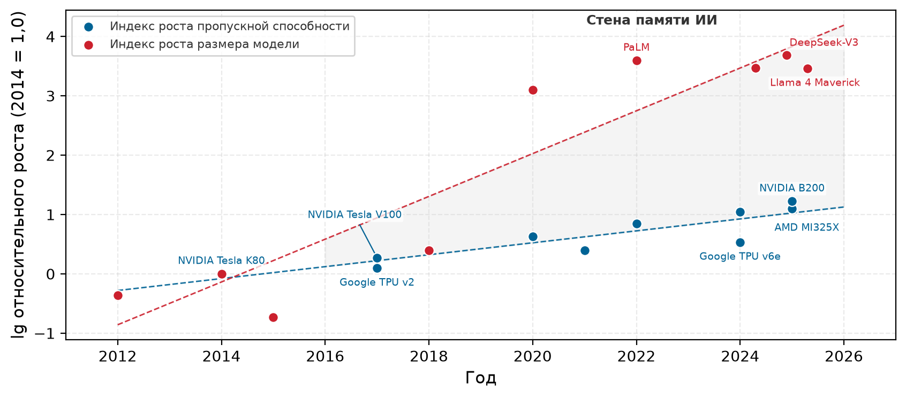

*Размер модели против пропускной способности аппаратуры: обе серии — это десятичный логарифм роста относительно 2014 года, поэтому каждая единица на вертикальной оси соответствует десятикратному увеличению. За отображенное десятилетие число параметров вырастает примерно в 4 900 раз, тогда как пропускная способность — в 17 раз. Заштрихованная полоса — это разрыв между логарифмами, а не разность, поэтому ее ширина читается как отношение, а две подогнанные тенденции расходятся с постоянной скоростью.*

<a id="sec-hardware-acceleration-irregular-memory-access-c6ec"></a>

#### Нерегулярный доступ к памяти

Производственные нагрузки машинного обучения сочетают регулярные плотные матричные ядра с нерегулярными шаблонами доступа к памяти, которые обходят обычную аппаратуру кэширования и предвыборки. Плотные операции, такие как GEMM и свертка, потоково читают смежные блоки, которые чисто ложатся на аппаратные кэши и систолические массивы, тогда как нерегулярные операции зависят от косвенных, разреженных или зависящих от входа адресов памяти. [«Регулярный и нерегулярный доступ к памяти»](11_hw_acceleration.md#tbl-traditional-vs-ml-mem) сопоставляет эти два режима памяти по геометрии доступа, локальности кэша и аппаратному давлению.

| Признак                                                     | **Регулярные плотные ядра** | **Нерегулярные компоненты ML** |
|:------------------------------------------------------------|:------------------------------------------------------------------|:----------------------------------------------------------------------|
| **Шаблон доступа**         | Смежный или тайловый                                              | Косвенный, разбросанный или зависящий от входа                        |
| **Локальность кэша**       | Часто высокая после тайлинга                                      | Часто ниже и зависит от нагрузки                                      |
| **Повторное использование данных** | Структурированное по тайлам или батчам                    | Разреженное или динамическое, в зависимости от оператора              |
| Зависимости                                                 | Статические вложенные циклы                                       | Маршрутизация, зависящая от входа, или переменные формы               |
| Примеры                                                     | GEMM, свертка, плотное внимание                                   | Поиск эмбеддингов, неструктурированная разреженность, маршрутизация MoE |
| **Основное давление**      | Вычисления или пропускная способность, в зависимости от арифметической интенсивности | Задержка, пропускная способность, метаданные и дисбаланс нагрузки |
| **Энергетические последствия** | Зависят от повторного использования и уровня памяти           | Дополнительное перемещение и метаданные могут увеличивать энергию     |

<a id="tbl-traditional-vs-ml-mem"></a>

*Регулярный и нерегулярный доступ к памяти: регулярные плотные ядра раскрывают повторное использование, которое можно разбить на тайлы, и предсказуемые адреса, тогда как нерегулярные компоненты ML опираются на косвенный или зависящий от входа доступ, ослабляя кэширование и предвыборку и добавляя накладные расходы на метаданные или балансировку нагрузки. Одна модель может содержать оба режима.*

Внутри одной нейронной сети поведение доступа к памяти резко различается по типам слоев. Сверточные слои демонстрируют высокую пространственную локальность и повторное использование регистров, поскольку небольшие ядра весов скользят по картам признаков входа. Полносвязные слои и плотное внимание выполняют регулярные матричные умножения, но их большие матрицы параметров или кэши ключей и значений могут превышать емкость SRAM на кристалле и стать ограниченными пропускной способностью, когда повторное использование в вычислениях мало. Переменная длина последовательностей осложняет выделение буферов памяти, однако операции внимания внутри каждой последовательности остаются регулярными смежными умножениями матриц.

Настоящая нерегулярность памяти возникает из трех различных архитектурных шаблонов: неструктурированной разреженности,[^fn-sparsity-memory-access] поиска эмбеддингов и динамической маршрутизации токенов. При неструктурированной разреженности ненулевые веса или активации хранятся в сжатых форматах (например, CSR или COO), которые требуют косвенной адресации указателями для декодирования координат операндов. В таблицах эмбеддингов разреженные категориальные идентификаторы выбирают произвольные строки из таблиц размером в десятки гигабайт в DRAM, превращая последовательные передачи памяти в несогласованные разбросанные чтения. В моделях смеси экспертов (MoE) шлюзы маршрутизации направляют токены в разные сети-эксперты в зависимости от контекста входа; будучи детерминированным для данного входа, назначение токенов меняется от батча к батчу, нарушая конвейеры предвыборки и разбалансируя очереди выполнения между параллельными ядрами.

[^fn-sparsity-memory-access]: **Разреженность и нерегулярность памяти**: неструктурированные разреженные форматы обычно собирают ненулевые элементы через косвенную адресацию, что может ослаблять последовательный доступ и делать накладные расходы метаданных значительными. Структурированная разреженность сохраняет блоки, удобные для аппаратуры, поэтому ее поведение доступа отличается от произвольного прореживания. Без подходящих ядер или поддержки аппаратуры неструктурированная разреженная модель может работать медленнее своего плотного аналога, несмотря на меньшее число арифметических операций.

Нерегулярность снижает производительность через разные механизмы, и рассмотрение их как одну проблему памяти может указать на неверную оптимизацию. Разбросанные адреса могут превращать одно логическое обращение в несколько транзакций памяти, так что каждая выбранная строка кэша несет мало полезных байтов. Косвенность также может сериализовать генерацию адресов: системе нужно выбрать индекс или указатель, прежде чем она узнает, какие данные запросить, что ограничивает параллелизм памяти, даже когда общая пропускная способность доступна. Маршрутизация, зависящая от входа, создает третий вид отказа, когда одни процессорные элементы получают более длинные очереди, чем другие; время завершения определяется самой медленной очередью, пока соседние блоки простаивают. Выделения переменного размера могут фрагментировать емкость, но фрагментация не является ни необходимым, ни достаточным условием нерегулярного доступа. Последовательный поток может насытить пропускную способность и при этом не быть нерегулярным, тогда как цепочка зависимых поисков может остановиться намного ниже пиковой пропускной способности.

Диагностика поэтому должна начинаться с механизма, который мешает продвижению вперед. Низкое отношение полезных байтов полезной нагрузки к переданным байтам указывает на плохую пространственную утилизацию или объединение транзакций. Долгие остановки памяти при неиспользованной пропускной способности указывают на зависимые промахи или на слишком малое число одновременных запросов, чтобы скрыть задержку. Неравные глубины очередей или работа по маршрутам выявляют дисбаланс нагрузки, а не проблему емкости кэша. Одна лишь доля попаданий в кэш не позволяет различить эти случаи, потому что промах может тратить пропускную способность, открывать задержку или то и другое сразу. Каждая диагностика подсказывает другое средство: упаковка или блочное разбиение улучшают пространственную утилизацию, переупорядочивание и предвыборка открывают одновременные запросы, структурированные разреженные форматы сокращают накладные расходы индексации, а маршрутизация или разбиение балансируют работу. Иерархия памяти определяет стоимость оставшихся обращений, а выбор потока данных и раскладки тензоров определяет, сколько нерегулярности программное обеспечение может устранить до того, как выполнение доберется до аппаратуры.

Порядок оптимизации следует из этой диагностики. Представление идет первым, когда формат находится под контролем системы, поскольку блочно-структурированный разреженный формат или сгруппированная маршрутизация могут убрать косвенность до запуска ядра. Затем следует организация запросов: обращения, выданные вместе, должны указывать на соседние адреса, а достаточно независимых запросов должно оставаться в полете, чтобы скрыть неизбежную задержку. Дополнительная емкость кэша или пропускная способность помогают только тогда, когда профилирование показывает, что упорядоченный поток запросов все еще исчерпывает этот ресурс. Больше пропускной способности не устранит последовательную зависимость по указателю, а больше емкости не перебалансирует перекошенную работу. Цель — выставить как можно больше регулярной структуры, сводя неизбежную нерегулярность к наименьшей части выполнения.

Программное обеспечение может смягчить нерегулярный доступ, регуляризуя раскладки тензоров, навязывая структурированную разреженность и сортируя динамические маршруты в однородные батчи. Однако перестройка программы не может устранить физический штраф за перемещение данных: независимо от того, является ли запрос памяти смежным или разбросанным, каждый переданный байт должен пройти по физическим проводникам, ограниченным конечной пропускной способностью, задержкой распространения и рассеиванием энергии. Чтобы ограничить эти физические издержки, хранилище организуют в каскадные аппаратные ярусы. Вместо того чтобы считать память единым пулом, архитектуры ускорителей развертывают многоуровневые иерархии памяти, которые на каждом ярусе обменивают емкость на задержку и энергию.

<a id="sec-hardware-acceleration-memory-hierarchy-1839"></a>

### Иерархия памяти

Ни одна технология хранения не может одновременно обеспечить многотерабайтную в секунду пропускную способность, которую требуют плотные исполнительные блоки, и десятки гигабайт емкости, нужные для хранения параметров современных моделей. Ускорители разрешают это противоречие с помощью многоуровневых иерархий памяти. Вместо того чтобы считать память монолитным адресным пространством, машина организует хранилище в отдельные физические ярусы, каждый из которых оптимизирован под определенный баланс емкости, задержки доступа, пропускной способности и энергетических затрат.

На вершине иерархии регистровые файлы и кэши SRAM на кристалле подают операнды арифметическим блокам с задержкой менее наносекунды и энергией в единицы пикоджоулей, но их емкость жестко ограничена площадью кристалла. У основания энергонезависимая флеш-память хранит сотни гигабайт контрольных точек моделей и обучающих наборов данных, но для доступа к ней нужны миллисекунды или микросекунды. Между этими границами программно управляемые scratchpad-буферы размещают активные тайлы тензоров, а локальная память устройства (HBM или GDDR) служит основной рабочей памятью для параметров и активаций.

Такая организация задает обратную зависимость между ярусами: по мере роста емкости хранилища и физического расстояния до арифметических блоков пропускная способность падает, задержка растет на порядки, а энергия на бит возрастает. [«Компромиссы иерархии памяти»](11_hw_acceleration.md#tbl-memory-hierarchy) сравнивает эти ярусы по задержке, пропускной способности, емкости и функциональным ролям в нагрузках глубокого обучения.

| Уровень памяти                                            | **Относительная задержка** |      Пропускная способность      | **Относительная емкость** | **Пример использования в глубоком обучении**                     |
|:----------------------------------------------------------|:--------------------------------------------------------|:-------------------:|:----------------------------------------------------------|:-----------------------------------------------------------------|
| Регистры                                                  | Наименьшая                                              |       Наивысшая     | Крошечная                                                 | Хранение операндов для немедленных вычислений                    |
| **Кэши L1/L2 (SRAM)**          | Очень низкая                                            |         Высокая     | Малая                                                     | Кэширование часто используемых активаций и небольших блоков весов |
| **Scratchpad-память** | Очень низкая                                            |         Высокая     | Малая или средняя                                         | Программно управляемое хранение промежуточных вычислений         |
| **DRAM устройства (HBM, GDDR или LPDDR)**                 | Высокая                                                 | Средняя–очень высокая | Большая                                                   | Хранение параметров модели и активаций, которые не помещаются на кристалле |
| **DRAM хоста (обычно DDR)**                               | Высокая локально; передача добавляет задержку           |       Средняя       | Большая или очень большая                                 | Подготовка или выгрузка данных за пределы памяти ускорителя      |
| **Флеш-хранилище (SSD/NVMe)**                             | Очень высокая                                           |         Низкая      | Очень большая                                             | Хранение предобученных моделей и контрольных точек для последующей загрузки |

<a id="tbl-memory-hierarchy"></a>

*Компромиссы иерархии памяти: ускорители ИИ используют многоуровневую иерархию памяти, чтобы сбалансировать производительность и емкость. Каждый уровень обеспечивает свои характеристики задержки, пропускной способности и емкости, которые определяют, как компоненты нейросети (веса, активации и промежуточные результаты) следует размещать, чтобы минимизировать узкие места и максимизировать пропускную способность. Относительные обозначения описывают типичный порядок; точные значения зависят от архитектуры. Справочные значения задержек приведены в разделе [«Задержки, которые должен знать каждый программист»](appendix_machine.md#sec-appdx-machine-foundations-latencies-every-programmer-know-e89f) приложения «Основы машины».*

Повторяющийся системный вопрос состоит в том, почему ускорители не могут полностью обойти SRAM на кристалле и потоково читать все операнды напрямую из высокоемкой DRAM за пределами кристалла. Физическое ограничение, которое этому мешает, — это нижняя граница задержки, накладываемая геометрией кристалла, распространением электрических сигналов и динамикой доступа к ячейкам DRAM.

<a id="nbk-hw-acceleration-speed-light-limit"></a>

> **Предел скорости света**
>
> **Задача**: почему нужна SRAM на кристалле, а не выборка всех данных из HBM?
>
> **Расчет**:
>
> 1.  **Расстояние**: на кристалле класса H100 площадью 814 мм² сигналы проходят около 20 мм.
> 2.  **Задержка распространения**: при $\approx 0{,}5c$ в кремнии $20\text{ мм}/(0{,}5c) \approx 130\text{ пс}$.
> 3.  **Такт**: при 2 ГГц $1/(2\text{ ГГц}) = 500\text{ пс}$.
> 4.  **DRAM**: HBM за пределами кристалла находится в миллиметрах от него на корпусе, но задержка доступа к DRAM плюс накладные расходы протокола составляют 100 и более тактов.
>
> **Системный вывод**: оценка распространения на 20 мм составляет около 130 пс, что меньше одного такта в 500 пс, поэтому одно лишь расстояние не доказывает невозможность доступа за один такт. Реальный доступ к HBM включает задержку массива DRAM, сериализацию, прохождение протокола, задержку межсоединений и очередь, что дает путь доступа длиной 100 и более тактов. Поэтому локальные регистры и SRAM необходимы, чтобы питать вычислительные блоки на частоте 2 ГГц. Для трансформеров именно этот полный путь доступа объясняет, почему веса должны размещаться в SRAM тайлами, а не читаться по требованию из HBM, и почему многократная потоковая передача всего KV-кэша может обрушить пропускную способность вывода, если его трафик памяти нельзя скрыть за арифметикой.

<a id="sec-hardware-acceleration-onchip-memory-72d1"></a>

#### Память на кристалле

Подсистема **памяти на кристалле** объединяет регистры, кэши статической памяти с произвольным доступом (SRAM) и программно управляемые scratchpad-буферы непосредственно на кристалле ускорителя. Регистровые файлы обеспечивают хранение непосредственных операндов и аккумуляторов, которые нужны конвейерам выполнения. Современные ускорители выделяют значительную суммарную емкость регистров по всему кристаллу, но динамически распределяют этот пул между одновременными потоками или варпами. Увеличение регистровой выделенности на поток позволяет отдельным потокам сохранять более крупные матричные тайлы, но ограничивает общее число одновременно запланированных варпов и снижает способность аппаратуры скрывать задержку памяти. И наоборот, недостаточное выделение регистров вынуждает компилятор выгружать значения в память за пределами кристалла, превращая однотактные обращения к регистрам в многотактные простои. Эффективное проектирование ядер балансирует выделение регистров так, чтобы сохранять максимальную заполненность, удерживая горячие операнды в регистрах.

Аппаратно управляемые кэши L1 и L2 обеспечивают быструю буферизацию часто используемых данных с помощью автоматической проверки тегов и аппаратных политик вытеснения. Однако автоматические кэши плохо подходят для потоковой обработки многогигабайтных тензорных операций: проход по большим тензорам активаций может вытеснить пригодные для повторного использования тайлы весов раньше, чем арифметические блоки их переиспользуют. Кроме того, специализированные конвейеры выполнения накладывают жесткие ограничения на раскладку и типы данных, которые общие кэши не могут выполнить автоматически. Как показано в примере [«Контракт тензорного ядра»](11_hw_acceleration.md#exmp-hw-acceleration-tensor-core-contract), аппаратные матричные движки требуют определенных выравниваний и условий работы с памятью; нарушение этих требований приводит к откату выполнения на неускоренные пути.

<a id="exmp-hw-acceleration-tensor-core-contract"></a>

> **Контракт тензорного ядра**
>
> **Сценарий**: инженерная команда переносит нагрузку трансформера на GPU NVIDIA A100, рассчитывая на автоматическое ускорение тензорными ядрами, но профилирование показывает, что тензорные ядра простаивают (NVIDIA Corporation, 2020).
>
> **Диагностика**: нагрузка использовала формы и типы данных, которые выбирали менее эффективные ядра вместо предполагаемого пути тензорных ядер.
>
> **Системный урок**: специализированные пути имеют требования к оператору, точности, раскладке и форме. Библиотеки часто могут справиться с невыровненными размерностями через дополнение нулями или альтернативные ядра, но для высокой загрузки нужно проверить, какой путь был выбран на самом деле.

Чтобы избежать накладных расходов на вытеснение и непредсказуемости автоматических кэшей, ускорители ИИ включают scratchpad-память. В отличие от аппаратных кэшей, scratchpad-память представляет собой программно управляемые структуры SRAM, отображенные прямо в адресное пространство ядра, без каталогов тегов и аппаратной логики замещения. Компилятор или программист явно управляет тем, когда тензорные тайлы загружаются из внешней DRAM, как долго они находятся на кристалле и когда обновленные значения записываются обратно. В сверточных моделях scratchpad-память удерживает карты входных признаков и ядра весов на протяжении скользящих рецептивных окон, устраняя избыточные чтения DRAM (Chen et al., 2017). На GPU NVIDIA scratchpad-память доступна как *разделяемая память*: быстрый SRAM-банк под управлением программиста, общий для всех потоков блока потоков. Пользовательские ядра, написанные на CUDA или Triton, управляют разделяемой памятью явно. FlashAttention демонстрирует силу этого механизма: вместо того чтобы материализовать полную матрицу оценок внимания $S{\times}S$ в HBM за пределами кристалла, ядро разбивает запросы, ключи и значения на тайлы через разделяемую память и обновляет статистики softmax онлайн (Dao et al., 2022). Ускорение полностью происходит из устранения обращений к HBM с высокой задержкой, а не из сокращения арифметических операций; более того, алгоритм пересчитывает промежуточные значения внимания при обратном проходе, чтобы не сохранять их в памяти за пределами кристалла.

<a id="sec-hardware-acceleration-offchip-memory-ecdb"></a>

#### Память за пределами кристалла

Когда рабочие наборы тензоров превышают емкость SRAM на кристалле, операнды и параметры размещаются в локальной DRAM устройства. Это не последовательные уровни иерархии, а альтернативные архитектуры памяти, рассчитанные на разные бюджеты стоимости, пропускной способности и мощности: высокоскоростная память (HBM), графическая DDR (GDDR) и маломощная DDR (LPDDR). Высокопроизводительные ускорители используют HBM, которая стекует кристаллы DRAM вертикально через сквозные межсоединения в кремнии (TSV) и связывается с кристаллом ускорителя по широкому кремниевому интерпозеру (например, 1 024–8 192 бита). Эта широкая шина дает пропускную способность в несколько терабайт в секунду при меньших тактовых частотах и меньшей энергии на бит по сравнению с обычной DRAM, но требует сложной корпусировки 2.5D. Там, где кремниевые интерпозеры слишком дороги, ускорители используют GDDR с более узкими шинами (например, 256–384 бита), работающими на высоких скоростях вывода по стандартным печатным платам. Мобильные и встроенные ускорители используют LPDDR, обменивая сырую пропускную способность на низкое рабочее напряжение и сниженную мощность в режиме ожидания.

Когда объемы параметров и активаций превышают емкость DRAM устройства, системе нужно выгружать состояние в DRAM хоста (обычно стандартная DDR). Доступ к памяти хоста требует пересечения интерфейса ввода-вывода, такого как PCIe, или когерентной структуры, такой как NVLink или Compute Express Link (CXL). Поскольку пропускная способность PCIe (десятки гигабайт в секунду) на один-два порядка ниже пропускной способности DRAM ускорителя, неуправляемая выгрузка останавливает арифметическое выполнение. Эффективные среды выполнения смягчают этот штраф, перекрывая асинхронные копирования прямого доступа к памяти (DMA) с выполнением ядер и предвыбирая параметры следующих слоев, пока текущие слои вычисляются.

У основания иерархии энергонезависимая флеш-память и твердотельные накопители (SSD) обеспечивают постоянную емкость в несколько терабайт для наборов данных и контрольных точек обучения (Narayanan et al., 2021). Поскольку задержки чтения измеряются десятками микросекунд, а пропускная способность шины ограничена однозначным числом гигабайт в секунду, флеш-устройства не могут напрямую участвовать в выполнении ядер. Конвейеры контрольных точек и загрузки данных рассматривают флеш-хранилище как асинхронный потоковый источник, подготавливая батчи через DRAM хоста в памяти ускорителя до начала вычислений.

Физические ярусы иерархии памяти задают нижние границы задержки и верхние границы емкости ускорителя. Насколько близко приложение подходит к пиковой производительности аппаратуры, зависит от того, может ли программное обеспечение поддерживать высокую загрузку на каждом ярусе: заявленная пропускная способность памяти — лишь теоретический предел, тогда как достижимая пропускная способность определяется регулярностью доступа, раскладкой тензоров и локальностью повторного использования.

<a id="sec-hardware-acceleration-memory-bandwidth-architectural-tradeoffs-435c"></a>

### Пропускная способность памяти и архитектурные компромиссы

Заявленная пропускная способность памяти — это только потолок; достижимая пропускная способность зависит от шаблона доступа, батчинга, локальности и хостового интерфейса, который питает ускоритель. Типичные ускорители дата-центров обеспечивают пропускную способность памяти порядка нескольких ТБ/с при десятках ГБ высокоскоростной памяти. Пиковые значения предполагают непрерывный объединенный доступ с шагом 1 по всем каналам памяти. Реальные нагрузки нейросетей существенно отклоняются от этого идеала: слои трансформерного внимания, свертки и полносвязные слои достигают разных долей пиковой пропускной способности, поскольку их шаги доступа к памяти, размеры тайлинга и операционное повторное использование различаются. Полносвязные слои приближаются к пиковой пропускной способности, только когда батчи достаточно велики, чтобы амортизировать стоимость загрузки матриц весов, — это напрямую связано с чувствительностью к размеру батча, которую разбирает модель Roofline в разделе [«Модель Roofline»](11_hw_acceleration.md#sec-hardware-acceleration-roofline-model-42ff). При малых батчах выполнение ограничивается задержкой памяти и недозагруженными каналами, и эффективная пропускная способность остается заметно ниже заявленных потолков.

Доступ к памяти на кристалле обычно расходует энергию порядка единиц–десятков пикоджоулей за обращение, тогда как внешняя DRAM — порядка сотен пикоджоулей за обращение, то есть штраф по энергии на порядок ([«Понимание стены памяти в ИИ»](11_hw_acceleration.md#sec-hardware-acceleration-understanding-ai-memory-wall-3ea9)). Поскольку управление физическими интерфейсами за пределами кристалла доминирует в тепловом и энергетическом бюджете, ускорители строят свои конвейеры выполнения вокруг пространственного повторного использования данных. Вместо того чтобы многократно перебрасывать тензоры через DRAM, архитектуры принимают определенные стационарные потоки данных. В конструкции со стационарными весами параметры модели остаются зафиксированными в регистрах процессорных элементов, пока через них проходят входные активации, амортизируя загрузку параметров по нескольким токенам или пространственным позициям. В конструкции со стационарным входом активации буферизуются локально, пока через них проходят веса, максимизируя повторное использование по фильтрам ядра. В конструкции со стационарным выходом частичные суммы накапливаются прямо в локальных аккумуляторах до завершения окончательных редукций, устраняя промежуточные обращения к внешней DRAM для частично вычисленных карт признаков.

Физические ограничения на границах кремния и корпуса определяют, как пропускная способность памяти масштабируется по классам ускорителей. HBM достигает пропускной способности в несколько терабайт в секунду за счет вертикальной укладки кристаллов DRAM друг на друга со сквозными межсоединениями в кремнии (TSV) и связи с процессором через кремниевый интерпозер. Такая компоновка корпуса дает широкие параллельные интерфейсы — порядка 1 ТБ/с в массовых продуктах и несколько ТБ/с в мощных системах, но при существенно более высокой стоимости корпуса и тепловой плотности. Конструкции класса TPU сочетают высокоскоростную память с большими буферами на кристалле и двумерными систолическими массивами, обменивая универсальную гибкость памяти на плотное пространственное повторное использование в плотных умножениях матриц. На противоположном конце мобильные SoC работают в рамках мощности в несколько ватт и не могут вместить стоимость или тепловую нагрузку стеков на интерпозере. Такие периферийные процессоры опираются на унифицированную память массового класса LPDDR с общей пропускной способностью порядка сотен ГБ/с, которую нужно строго распределять между ядрами CPU, GPU и нейронного ускорителя, чтобы не допустить конкуренции за шину памяти и теплового троттлинга.

Ограничения пропускной способности выходят за пределы корпуса ускорителя и затрагивают интерфейс «хост–устройство». Если вход должен пройти через канал PCIe 64 ГБ/с, прежде чем его использует ускоритель с 2 ТБ/с пропускной способности HBM, интерфейс имеет примерно в 30 раз меньшую пропускную способность и может доминировать в мелких частых передачах (NVIDIA Corporation, 2020). Для запросов вывода с малой задержкой или для мелкозернистой выгрузки ядер сериализация передач по хостовой шине легко может оказаться длиннее, чем вычисления ядра. Чтобы снять это узкое место интерфейса, нужно держать параметры модели и промежуточные состояния активаций резидентными в памяти ускорителя на протяжении шагов выполнения или обходить хостовый канал целиком через прямые одноранговые (peer-to-peer) пути данных для хранилища и сети.

<a id="sec-hardware-acceleration-hostaccelerator-communication-bb7a"></a>

### Обмен между хостом и ускорителем

В дискретных системах с ускорителями хостовый CPU и ускоритель работают как отдельные вычислительные домены, соединенные периферийной шиной. Хост управляет вводом-выводом хранилища, сетевыми потоками и оркестрацией среды выполнения, тогда как ускоритель выполняет плотные математические ядра над высокоскоростной памятью устройства. Поскольку системная память CPU и память ускорителя (HBM или GDDR) занимают разные физические адресные пространства, вычисления не могут начаться, пока тензоры не пройдут через межсоединение «хост–ускоритель». Перемещение данных между хостом и ускорителем, таким образом, задает эксплуатационную границу: если передачи по периферийной шине не могут подавать вычислительные ядра ускорителя с линейной скоростью, устройство простаивает независимо от своей сырой производительности в FLOP/s.

[«Последовательность передачи данных хост–ускоритель»](11_hw_acceleration.md#fig-host-accelerator-data-movement) показывает четырехфазную последовательность выполнения, которая управляет этим взаимодействием хоста и устройства. Перед началом вычислений входные тензоры должны быть скопированы из DRAM хоста по шине PCIe в память ускорителя (шаг 1) через DMA.[^fn-dma-memory-overlap] Затем CPU отправляет команды запуска ядер в очередь команд ускорителя (шаг 2), заставляя вычислительные блоки обрабатывать тайлы параллельно из локальной памяти (шаг 3). После завершения выполнения ускоритель сохраняет выходные тензоры в памяти устройства и копирует результаты обратно по PCIe в DRAM хоста (шаг 4). В наивной синхронной модели выполнения каждый шаг передачи лежит прямо на критическом пути и останавливает либо хост, либо ускоритель, пока каждая транзакция памяти не завершится.

<a id="fig-host-accelerator-data-movement"></a>

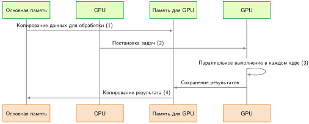

*Последовательность передачи данных хост–ускоритель: четырехшаговый поток выполнения между хостом CPU и устройством GPU: (1) копирование входных данных по PCIe, (2) выдача инструкций ядер, (3) вычисления на GPU и (4) передача результатов обратно в память хоста. Низкая пропускная способность PCIe и задержки отправки на хост могут легко доминировать во времени выполнения, если время вычислений ядра не превышает накладных расходов на передачу данных.*

[^fn-dma-memory-overlap]: **DMA (прямой доступ к памяти)**: выделенный аппаратный блок, который управляет копированием данных (шаг 1) без прямого управления CPU, освобождая CPU для немедленной выдачи команд вычислений (шаг 2). Эта одновременность критична: без нее ускоритель может простаивать между батчами вычислений, особенно когда перемещение данных с хоста на устройство находится на критическом пути.

Сквозная задержка запуска ядра раскладывается на время передачи, накладные расходы диспетчеризации очереди и время арифметического выполнения. Когда тензорные передачи малы или часты, фиксированные накладные расходы отправки драйвером и обращений по шине доминируют во времени выполнения. Когда передачи велики, низкая пропускная способность PCIe относительно HBM на корпусе создает устойчивое узкое место ввода-вывода. В терминах D·A·M граница «Машина» между хостом и ускорителем вынуждает «Алгоритм» максимизировать арифметическое повторное использование на устройстве, как только тензоры прибыли.

<a id="sec-hardware-acceleration-nodelevel-interconnect-topology-b45b"></a>

#### Топология межсоединений узла

Оптимизация перемещения данных требует понимания физической топологии вычислительного узла. Типичный ИИ-сервер — это не плоская сеть связанных устройств, а иерархия пропускных способностей, которая сужается по мере удаления данных от кристалла.

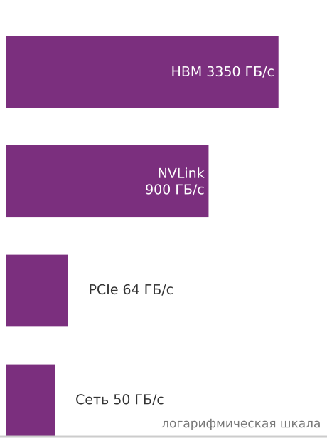

*Пропускная способность резко сужается по мере удаления данных от ускорителя.*

В пределах сервера с несколькими ускорителями три уровня межсоединений определяют это сужение пропускной способности:

1. **Межсоединение между устройствами (NVLink/Infinity Fabric)**: современные узлы с несколькими GPU используют специализированные высокоскоростные мосты, например NVLink,[^fn-nvlink-interconnect-bandwidth] чтобы соединять ускорители напрямую, минуя хостовый CPU. Пропускная способность составляет от 600 до 900 ГБ/с на GPU (NVIDIA Corporation, 2020); (Choquette, 2023). Эта связь важна всякий раз, когда тензоры должны перемещаться между ускорителями внутри одного сервера, включая разбиение модели, обмен активациями и синхронизацию градиентов при обучении.[^fn-allreduce-gradient-sync] Архитектурный принцип — это граница: трафик, который остается в структуре ускорителей, намного дешевле трафика, который уходит через хост.
2. **Межсоединение «хост–устройство» (PCIe)**: связь между CPU и ускорителем. Пропускная способность составляет от 32 до 64 ГБ/с (PCIe Gen4/Gen5). Обучающие данные, подготовленные на хосте, могут упираться в это место, хотя резидентные данные, прямой ввод-вывод хранилища или сети и когерентные связи ускорителей могут использовать другие пути. Серверы с несколькими GPU могут также предоставлять несколько линий PCIe, а не один общий путь на 64 ГБ/с.
3. **Сетевой интерфейсный адаптер**: связь хоста с внешним миром, соединяющая с другими узлами. Пропускная способность составляет от 25 до 50 ГБ/с (Ethernet/InfiniBand на 200–400 Гб/с[^fn-infiniband-rdma-interconnect]). Это межсоединение — первый шаг от рассуждений о железе одного узла к следующему рубежу: масштабированию. Выход в сеть переносит трафик на самый узкий путь с наибольшей задержкой во всей системе.

[^fn-nvlink-interconnect-bandwidth]: **NVLink (NVIDIA Link)**: прямое межсоединение GPU с GPU существует затем, чтобы удерживать трафик между ускорителями вне PCIe, когда тензоры должны перемещаться внутри сервера. Его совокупная двунаправленная пропускная способность 600–900 ГБ/с соответствует примерно 300–450 ГБ/с в каждом направлении при сбалансированном полнодуплексном трафике, что в несколько раз выше направленной пропускной способности стандартной линии PCIe, поэтому нагрузки с частым перемещением тензоров между устройствами могут оставаться в быстрой части сужающейся иерархии пропускной способности (NVIDIA Corporation, 2020); (Choquette, 2023). Алгоритмы обучения, которые определяют, сколько тензорного трафика должно проходить по этой связи, рассматриваются позже; здесь нужен только аппаратный факт — разрыв пропускной способности.

[^fn-allreduce-gradient-sync]: **AllReduce**: коллективная операция из MPI, которая агрегирует значения между процессами («reduce») и распределяет результат обратно каждому процессу («all»). Здесь термин указывает, почему пропускная способность между ускорителями важна для распределенных нагрузок обучения. В масштабе алгоритмы, выбор топологии и протоколы среды выполнения определяют, насколько дорогой становится эта синхронизация.

[^fn-infiniband-rdma-interconnect]: **InfiniBand**: его ключевая особенность для масштабирования на несколько узлов — RDMA (удаленный прямой доступ к памяти). С путем, учитывающим GPU, таким как GPUDirect RDMA, и зарегистрированной памятью GPU сетевой адаптер может передавать данные напрямую между GPU разных узлов, не пропуская их через память хоста. Это снижает участие хоста и накладные расходы протокола, поэтому масштабирование чаще ограничено физической пропускной способностью, топологией и реализацией коллективных операций, а не обработкой пакетов, которой управляет CPU.

Эти три уровня создают характерное сужение пропускной способности:

$$
\begin{aligned}
\text{HBM (3 350 ГБ/с)} &\gg \text{NVLink (900 ГБ/с)} \\
&\gg \text{PCIe (64 ГБ/с)} \gg \text{Сеть (50 ГБ/с)}
\end{aligned}
$$

Эффективность системы зависит от того, удается ли держать тензоры на самых быстрых доступных связях. Поскольку PCIe и сетевые связи дают на порядки меньшую пропускную способность и большую задержку, чем память на корпусе, размещение и планирование должны минимизировать пересечения этих границ.

<a id="sec-hardware-acceleration-transfer-optimization-85a8"></a>

#### Оптимизация передачи данных

Две взаимодополняющие стратегии смягчают накладные расходы передач через интерфейс «хост–ускоритель»: асинхронное перемещение данных и абстракцию унифицированной памяти.

В асинхронном конвейере программное обеспечение выделяет закрепленную (page-locked) память хоста и ставит в очередь неблокирующие копии памяти на выделенные движки DMA. Поскольку движки копирования работают независимо от вычислительных блоков, следующий входной батч может передаваться по PCIe одновременно с тем, как ускоритель обрабатывает текущий батч в локальной памяти. Такая двойная буферизация скрывает задержку передачи за временем арифметического выполнения всякий раз, когда время вычислений превышает время передачи ($T_\text{compute} \ge T_\text{transfer}$). Когда длительность вычислений слишком мала, чтобы амортизировать передачу, выполнение остается ограниченным шиной, и вычислительные блоки неизбежно простаивают.

Унифицированная память (Unified Memory) предлагает альтернативную абстракцию, представляя единое виртуальное адресное пространство, охватывающее DRAM хоста и HBM устройства. Вместо ручного выделения буферов и явных промежуточных копий драйвер среды выполнения переносит страницы памяти по требованию через аппаратные страничные ошибки, когда любой из процессоров обращается к адресу. Хотя это устраняет шаблонный код промежуточной подготовки, миграция по требованию вносит сильную непредсказуемость производительности. Страничные ошибки вызывают прерывания драйвера, которые останавливают конвейеры выполнения, а рассеянные шаблоны доступа могут вызвать «трэшинг» страниц по шине PCIe. Поэтому высокопроизводительные промышленные нагрузки опираются на явные конвейерные передачи DMA для детерминированной производительности, оставляя унифицированную память для быстрого прототипирования или приложений, где продуктивность программиста важнее устойчивой загрузки аппаратуры.

Эти ограничения межсоединений и памяти определяют, как архитектуры нейросетей ложатся на физический кремний. Свертка демонстрирует высокое пространственное повторное использование, которое амортизирует стоимость передач через тайлинг в регистрах и SRAM на кристалле. Плотное самовнимание обладает регулярной матричной структурой, но квадратичный рост по длине последовательности создает сильное давление на емкость и пропускную способность памяти корпуса. Разреженные эмбеддинги, маршрутизация смеси экспертов и авторегрессивные кэши ключей и значений создают еще другие шаблоны доступа к памяти, сдвигая связывающее ограничение с арифметической пропускной способности на емкость памяти, задержку шины или пропускную способность межсоединений.

<a id="sec-hardware-acceleration-model-memory-pressure-f95e"></a>

### Давление модели на память

Архитектура модели определяет, какой член памяти становится связывающим. Многослойные перцептроны (MLP), сверточные нейронные сети (CNN) и трансформеры демонстрируют принципиально разные профили потоков данных: одни ограничены емкостью весов, другие — объемом промежуточных активаций, пропускной способностью памяти устройства или пропускной способностью хостового интерфейса. Поэтому каждая нагрузка требует своей иерархии памяти ускорителя и своей стратегии выполнения.

Маячные модели, введенные в разделе [«Маячные модели как эталонные нагрузки»](01_introduction.md#tbl-lighthouse-examples), обосновывают этот анализ: ResNet-50 представляет нагрузки CNN с высоким пространственным повторным использованием и большим объемом активаций; GPT-2 и Llama иллюстрируют давление трансформеров на память, охватывающее одновременно емкость параметров и промежуточные состояния внимания; DLRM показывает разреженные выборки эмбеддингов, которые нагружают пропускную способность памяти с произвольным доступом, а не плотные вычисления; MobileNetV2 демонстрирует архитектуры, оптимизированные по эффективности, где раздельные по глубине свертки меняют арифметическую интенсивность на меньший объем параметров. Их характеристики памяти показывают, как структура вычислительного графа определяет использование физической аппаратуры.

<a id="sec-hardware-acceleration-multilayer-perceptrons-0bbc"></a>

#### Многослойные перцептроны

Слой MLP — это плотное матричное умножение с необязательными смещением, активацией и нормализацией. Его операционная интенсивность напрямую зависит от размера батча: при батче $B = 1$ каждый параметр, загруженный из памяти за пределами кристалла, обслуживает только одну операцию умножения с накоплением, что дает низкую арифметическую интенсивность (часто $\le 1\text{ FLOP/байт}$), из-за которой АЛУ простаивают без данных, а выполнение остается ограниченным пропускной способностью памяти. Увеличение размера батча повторно использует каждую загруженную матрицу весов по $B$ независимым входным векторам, масштабируя арифметическую интенсивность, пока матричное умножение не достигнет вычислительно-ограниченного потолка Roofline ускорителя.

Плотные матрицы весов регулярно превышают десятки мегабайт, доступных в SRAM на кристалле, поэтому параметры должны находиться в локальной DRAM устройства (HBM или GDDR). Хостовый интерфейс (например, PCIe) входит в критический путь, только когда потоково передаются динамические входы или когда параметры и активации превышают емкость памяти устройства и требуют выгрузки на хост.

Поскольку шаблоны доступа к памяти у MLP регулярны и предсказуемы, ускорители разбивают матричные операции на блоки, которые помещаются в SRAM на кристалле и регистровые файлы. Аппаратная двойная буферизация предвыбирает последующие тайлы весов и активаций из DRAM в SRAM одновременно с арифметическим выполнением текущих тайлов. Достижимая пропускная способность поэтому зависит от того, обеспечивает ли размер батча достаточную арифметическую интенсивность и выравниваются ли размерности матриц по границам аппаратных тайлов (Chen et al., 2017).

<a id="sec-hardware-acceleration-convolutional-neural-networks-3085"></a>

#### Сверточные нейронные сети

Сверточный слой обрабатывает карты входных признаков небольшими ядрами фильтров, которые скользят по пространственным измерениям. Эта локализованная структура скользящего окна дает высокую арифметическую интенсивность через три разные формы повторного использования данных: сверточное повторное использование (соседние пространственные окна разделяют входные активации), повторное использование фильтров (одни и те же веса ядра вычисляются в каждой пространственной позиции) и повторное использование каналов (входные каналы вычисляются для нескольких выходных фильтров). В отличие от MLP, где матрицы весов доминируют в объеме памяти, ранние слои CNN содержат компактные тензоры параметров, но создают огромные карты промежуточных активаций.

Поскольку тензоры промежуточных активаций часто превышают емкость SRAM на кристалле, неоптимизированное послойное выполнение постоянно выгружало бы карты признаков в DRAM устройства, и конвейер упирался бы в пропускную способность памяти. Ускорители предотвращают эти обращения туда и обратно через пространственный тайлинг: активации и фильтры делятся на тайлы, размер которых подобран под буферы SRAM на кристалле (Chen et al., 2017). Размещение перекрывающихся граничных пикселей непосредственно в локальной памяти позволяет соседним сверткам потреблять активации, не перечитывая их по шине DRAM устройства.

Специализированные ускорители CNN настраивают аппаратный поток данных вокруг этих шаблонов повторного использования. Архитектура Eyeriss ввела поток данных со стационарными строками (row-stationary), который отображает одномерные строки фильтров и активаций на регистры вычислительных блоков, удерживая строки фильтров неподвижными и накапливая частичные суммы в локальной памяти, чтобы минимизировать энергоемкий трафик межсоединений (Chen et al., 2016). В более широкой таксономии [«Оптимизация потоков данных»](11_hw_acceleration.md#sec-hardware-acceleration-dataflow-optimization-strategies-ce52) эта конструкция служит примером гибридного потока данных, который использует многомерное сверточное повторное использование через регистры, буферы SRAM и исполнительные блоки.

<a id="sec-hardware-acceleration-transformer-networks-638c"></a>

#### Трансформерные сети

Архитектура трансформера, введенная в разделе [«Трансформеры»](06_nn_architectures.md#sec-network-architectures-transformers-attentiononly-architecture-1b56), заменяет локальные скользящие окна глобальным самовниманием[^fn-attention-memory-pressure] и плотными блоками прямой связи, создавая двойные узкие места памяти: квадратичные промежуточные матрицы внимания и огромный объем параметров.

[^fn-attention-memory-pressure]: **Механизм внимания**: Bahdanau, Cho и Bengio ввели внимание для моделей «последовательность в последовательность»; самовнимание трансформера позже позволило каждому токену обращаться ко всем токенам последовательности (Bahdanau et al., 2015); (Vaswani et al., 2017). Материализация полных оценок внимания для последовательности длины $S$ требует матрицы $S{\times}S$, что создает квадратичное промежуточное хранилище. FlashAttention разбивает вычисления на тайлы, чтобы не материализовать эту полную матрицу в HBM (Dao et al., 2022). Кэш ключей и значений при выводе — отдельная тема: его емкость растет линейно с длиной последовательности на слой, хотя на каждом шаге декодирования читается все более длинный кэш (см. раздел [«Память и KV-кэш»](13_model_serving.md#sec-model-serving-memory-kv-cache-d1ea) главы [«Обслуживание моделей»](13_model_serving.md#sec-model-serving)).

Глобальное взаимодействие токенов создает разные проблемы памяти при обучении и выводе. В стандартном многоголовом внимании вычисление попарного сходства токенов порождает матрицу оценок $S \times S$ для длины последовательности $S$. Материализация этой промежуточной матрицы в HBM многократно читает и записывает $O(S^2)$ данных по шине памяти, насыщая пропускную способность, даже когда арифметические блоки матричного умножения недозагружены. Алгоритмы тайлового внимания, такие как FlashAttention (Dao et al., 2022), устраняют это узкое место, размещая блоки запросов, ключей и значений в SRAM на кристалле, вычисляя онлайн-редукции softmax локально и передавая выходы напрямую в HBM без материализации квадратичной промежуточной матрицы в DRAM устройства.

При авторегрессивном выводе давление памяти смещается на кэш ключей и значений (KV) (см. раздел [«Память и KV-кэш»](13_model_serving.md#sec-model-serving-memory-kv-cache-d1ea) главы [«Обслуживание моделей»](13_model_serving.md#sec-model-serving)). Для генерации каждого следующего токена нужно читать накопленные исторические состояния KV из HBM ради одной операции «вектор–матрица», работая с очень низкой арифметической интенсивностью и напрямую привязывая скорость генерации к пропускной способности памяти.

На масштабах больших языковых моделей (Brown et al., 2020) число параметров превышает физическую емкость HBM любого отдельного ускорителя. Распределение таких моделей по нескольким ускорителям требует разбиения весов и активаций между GPU. Внутри узла сервера высокоскоростные межсоединения, такие как NVLink, обеспечивают пропускную способность, необходимую для устойчивых коллективных операций all-reduce и all-gather во время тензорного и последовательностного параллелизма, где стандартные линии PCIe ограничили бы выполнение. Системные среды выполнения планируют асинхронные передачи, чтобы перекрывать эти фазы межускорительной коммуникации с локальными арифметическими умножениями матриц (Narayanan et al., 2021).

<a id="sec-hardware-acceleration-ml-accelerators-implications-c962"></a>

### Следствия для проектирования ускорителей

Проект ускорителя под конкретную нагрузку диктуется требованиями к памяти и потокам данных целевых архитектур нейросетей. В таксономии D·A·M алгоритмическая постановка напрямую определяет шаблоны перемещения данных по физической иерархии памяти, поэтому единая жесткая аппаратная архитектура неэффективна для разных классов моделей. [«Доступ к памяти моделей ML»](11_hw_acceleration.md#tbl-model-mem-compare) сравнивает получающиеся размерности тензоров, профили повторного использования, регулярность доступа и основные аппаратные узкие места для базовых семейств моделей.

| **Тип модели** | **Размер весов**      | **Повторное использование активаций** | **Шаблон доступа к памяти** | Основное узкое место        |
|:--------------------------------------------|:----------------------------------------------------|:--------------------------------------------------------|:------------------------------------------------------------------|:----------------------------|
| **MLP (плотный)**                           | Большой, плотный                                    | Низкое                                                  | Регулярный, последовательный (потоковый)                          | Пропускная способность (вне кристалла) |
| CNN                                         | Малый, повторно используемый                        | Высокое                                                 | Пространственная локальность                                      | Перемещение карт признаков  |
| Трансформер                                 | Большой, обычно плотный; разреженный в вариантах MoE/с прореживанием | Низкое–среднее                        | В основном регулярное GEMM плюс трафик KV-кэша и внимания        | Емкость памяти + пропускная способность |

<a id="tbl-model-mem-compare"></a>

*Доступ к памяти моделей ML: разные модели машинного обучения демонстрируют разные шаблоны доступа к памяти и узкие места из-за различий в размере весов, повторном использовании активаций и перемещении данных. Стандартные плотные трансформеры требуют высокой пропускной способности и емкости, потому что большие веса, KV-кэши и трафик внимания доминируют в давлении на память; разреженные варианты MoE или с прореживанием добавляют соображения маршрутизации и разреженности. CNN выигрывают от пространственной локальности и высокого повторного использования активаций, что снижает давление на память.*

Каждая архитектура модели по-разному нагружает подсистему памяти. При выводе многослойного перцептрона (MLP) на малом батче доминируют матрично-векторные умножения (GEMV): каждый элемент весов передается из памяти за пределами кристалла, чтобы взаимодействовать с одним вектором активаций, что дает арифметическую интенсивность около одного FLOP на байт, насыщает пропускную способность памяти за пределами кристалла, а матричные блоки простаивают. Увеличение размера батча превращает ядро в умножение матриц на матрицы (GEMM), амортизируя загрузку весов по нескольким входным векторам. В CNN компактные ядра фильтров скользят по пространственным картам признаков, что дает высокое арифметическое повторное использование; ускорители используют эту пространственную локальность, размещая тайлы признаков в статической памяти с произвольным доступом на кристалле (SRAM) или scratchpad-памяти, чтобы не допустить избыточного трафика за пределами кристалла. Трансформеры создают разные узкие места на разных фазах выполнения: распределенное обучение ограничено удержанием активаций для обратного распространения и межускорительной коммуникацией, тогда как авторегрессивное декодирование ограничено пропускной способностью памяти, потому что каждый генерируемый токен потоково читает весь набор параметров и растущий кэш ключей и значений (KV) из памяти устройства.

Архитекторы аппаратуры отвечают на эти разнородные требования многоярусными иерархиями памяти. SRAM на кристалле (кэши и scratchpad-память) обеспечивает десятки терабайт в секунду пропускной способности при низкой задержке, удерживая активации с высоким повторным использованием и блоки матриц, разбитые на тайлы. HBM обеспечивает емкость и пропускную способность, необходимые для размещения огромных тензоров весов и динамических состояний последовательностей. Когда масштаб модели превышает физическую емкость памяти отдельного ускорителя, высокоскоростные межсоединения, такие как NVLink, дают пропускную способность между ускорителями для распределенного тензорного и конвейерного параллелизма, минуя более узкую хостовую шину PCIe.

Перемещение данных также доминирует в энергетическом бюджете аппаратных ускорителей. Перенос операндов из внешней динамической памяти (DRAM) расходует примерно на два порядка больше энергии, чем выполнение арифметической операции на локальных блоках вычислений. Поэтому эффективность аппаратуры зависит от максимизации вычислений на каждый байт, считанный из внешней памяти. Чтобы определить, ограничено ли выполнение ядра пропускной способностью вычислений или пропускной способностью памяти, нужна аналитическая граница. Модель Roofline устанавливает эту связь, сравнивая операционную интенсивность с пределами производительности аппаратуры, и гарантирует, что оптимизации нацелены на истинное физическое узкое место.

<a id="sec-hardware-acceleration-roofline-model-42ff"></a>

## Модель Roofline


*Низкая арифметическая интенсивность удерживает нагрузку в режиме, ограниченном памятью.*

Пиковые FLOP/s показывают, что могут выдать исполнительные блоки, когда операнды уже находятся на кристалле, но устойчивая пропускная способность ускорителя в конечном счете ограничена скоростью, с которой иерархия памяти доставляет данные. Модель Roofline[^fn-roofline-performance-model] (Williams et al., 2009) формализует эту связь, откладывая достижимую производительность относительно арифметической интенсивности и определяя, ограничена ли операция вычислениями или памятью. Вместо того чтобы оценивать вычислительную мощность изолированно, модель пересекает арифметическую пропускную способность аппаратуры с пропускной способностью памяти и показывает, какой физический потолок связывает выполнение раньше, чем инженер вкладывает усилия в оптимизацию.

[^fn-roofline-performance-model]: **Модель Roofline**: введена в Калифорнийском университете в Беркли (Williams et al., 2009) и опирается на более ранние работы 1980-х по сложности ввода-вывода. Их конкретный вклад состоял в том, чтобы сделать компромисс между вычислениями и пропускной способностью *наглядным* и *действенным*: характерный график Roofline сразу показывает, ограничено ли ядро вычислениями (упирается в плоский потолок) или памятью (упирается в наклонную линию пропускной способности), и количественно определяет разрыв до аппаратных пределов. Ядро, которое работает только на 50 процентах своего потолка, имеет явный двукратный разрыв загрузки, который нужно закрыть, поэтому модель стала стандартным диагностическим инструментом для оптимизации ускорителей.

Производительность ограничена двумя потолками, как формализует [«уравнение Roofline»](11_hw_acceleration.md#eq-roofline). Здесь достижимая производительность $R_{\text{attain}}$ и пиковые вычисления $R_{\text{peak}}$ выражаются в FLOP/s (часто в TFLOP/s), пиковая пропускная способность $\text{BW}$ — в байтах/с (часто в ТБ/с), а арифметическая интенсивность $I$ — в FLOP/байт:

<a id="eq-roofline"></a>

$$R_{\text{attain}} = \min(R_{\text{peak}}, \text{BW} \times I)$$

<a id="dfn-hw-acceleration-arithmetic-intensity"></a>

> **Арифметическая интенсивность**
>
> ***Арифметическая интенсивность*** — это отношение операций к байтам, переданным через моделируемый интерфейс памяти ($\text{FLOP}/\text{байт}$). Вместе с пропускной способностью этого уровня и соответствующим пиком вычислений она определяет, какой из идеализированных потолков Roofline ниже.
>
> 1.  **Значение**: граница между двумя потолками — это точка перехода $R_{\text{peak}} / \text{BW}$. Для A100 (312 TFLOP/s в FP16/BF16, 2,04 ТБ/с) она составляет примерно 153 FLOP/байт. При заданных моделях трафика большое хорошо разбитое на тайлы умножение $1024$ $\times$ $1024$ достигает около 341,3 FLOP/байт, тогда как отдельная операция ReLU — около 0,125 FLOP/байт. Поэтому на одном и том же оборудовании они упираются в разные потолки.
> 2.  **Отличие**: в отличие от общего числа FLOP (счета операций), арифметическая интенсивность — это отношение, которое характеризует форму аппаратных требований нагрузки. Два ядра с одинаковым числом FLOP, но разными шаблонами доступа к памяти имеют разную арифметическую интенсивность и упираются в разные аппаратные ресурсы.
> 3.  **Типичная ошибка**: распространенное заблуждение состоит в том, что арифметическая интенсивность — фиксированное свойство операции. На практике она зависит от деталей реализации: наивное умножение матриц, которое перезагружает операнды из DRAM для каждого выходного элемента, имеет низкую арифметическую интенсивность; блочная (тайловая) реализация, которая повторно использует данные из быстрой SRAM, достигает высокой интенсивности — та же математическая операция, но на порядки разная аппаратная эффективность.

Пусть $O$ — число операций, а $D_{\text{vol}}$ — объем данных в байтах; тогда [«арифметическая интенсивность»](11_hw_acceleration.md#eq-arithmetic-intensity) задает определение в операционном виде.

<a id="eq-arithmetic-intensity"></a>

$$I = \frac{O}{D_{\text{vol}}}$$

На визуализации Roofline производительность (TFLOP/s) откладывается по вертикальной оси, а арифметическая интенсивность (FLOP/байт) — по горизонтальной. При низкой арифметической интенсивности производительность растет линейно вдоль наклона пропускной способности памяти ($\text{BW} \times I$), где выполнение ограничено памятью. Выше точки перехода производительность упирается в пиковые вычисления ($R_{\text{peak}}$), где выполнение ограничено вычислениями. Раздел [«Диагностика узких мест»](appendix_dam.md#sec-appdx-dam-taxonomy-bottleneck-diagnostic-3fc9) приложения «Таксономия D·A·M» сопоставляет каждый режим с оптимизациями, которые окупаются, и с теми, которые тратят усилия впустую, поэтому классификация нагрузки как ограниченной памятью или вычислениями прямо показывает инженеру, нужен ли более быстрый ускоритель или больше пропускной способности.

<a id="sec-hardware-acceleration-hardware-ridge-points-b5b6"></a>

### Аппаратные точки перехода

Точка перехода — аппаратный баланс $I_{\text{ridge}}$, введенный в разделе [«Аппаратный баланс»](11_hw_acceleration.md#sec-hardware-acceleration-hardware-balance), — это порог арифметической интенсивности, при котором ускоритель переходит от выполнения, ограниченного памятью, к вычислительно-ограниченному. [«Аппаратные точки перехода»](11_hw_acceleration.md#tbl-ridge-points) количественно показывает эту границу для трех поколений ускорителей NVIDIA:

| **Ускоритель NVIDIA** |    **Пиковая FP16**     |                  Пропускная способность                  |              Точка перехода              |
|:------------------------------------------------------------|:------------------------------------------------:|:-------------------------------------------:|:-------------------------------------:|
| **V100 (2017)**             |   125 TFLOP/s    | 0,9 ТБ/с | 138,9 FLOP/байт |
| **A100 (2020)**             | 312 TFLOP/s | 2,04 ТБ/с | 153 FLOP/байт |
| **H100 (2022)**             | 989 TFLOP/s | 3,35 ТБ/с | 295,2 FLOP/байт |

<a id="tbl-ridge-points"></a>

*Аппаратные точки перехода: опубликованные производителем пиковые значения FP16 и пропускная способность памяти для трех поколений NVIDIA и точка перехода, которую задает каждая пара. Точка перехода растет от V100 к H100, потому что вычислительная пропускная способность растет быстрее пропускной способности памяти; эти значения специфичны для аппаратуры, а не универсальные средние по поколению.*

Поскольку арифметическая пропускная способность растет намного быстрее пропускной способности памяти от поколения к поколению, аппаратная точка перехода постепенно сдвигается вправо. Поэтому нагрузка должна демонстрировать существенно большее повторное использование данных, чтобы насытить новое оборудование; алгоритм, который на старой архитектуре был вычислительно-ограниченным, может легко стать ограниченным памятью на новой.

<a id="nbk-hw-acceleration-utilization-gap"></a>

> **Разрыв в загрузке**
>
> **Задача**: почему получить 100 процентов загрузки на H100 труднее, чем на V100?
>
> **Метрика**: точка перехода $I_{\text{ridge}} = R_{\text{peak}} / \text{BW}$ (FLOP/байт) из раздела [«Аппаратный баланс»](11_hw_acceleration.md#sec-hardware-acceleration-hardware-balance): сколько математических операций аппаратура должна выполнить на каждый байт загруженных данных, чтобы занять вычислительные блоки.
>
> **Эволюция**:
>
> -   **V100 (2017)**: 125 TFLOP/s / 0,9 ТБ/с ≈ 138,9 FLOP/байт.
> -   **A100 (2020)**: 312 TFLOP/s / 2,04 ТБ/с ≈ 153 FLOP/байт.
> -   **H100 (2022)**: 989 TFLOP/s / 3,35 ТБ/с ≈ 295,2 FLOP/байт.
>
> **Результат**: интенсивность, нужная для достижения тензорного пика, выросла. По этой простой модели Roofline для HBM ядро с $I$ = 200 FLOP/байт лежит выше точки перехода A100, но ниже точки перехода H100. Если его интенсивность и реализация не меняются, его идеализированный выигрыш ближе к отношению пропускных способностей (в 1,6 раза, 3,35 / 2,04), чем к отношению пиковых вычислений (в 3,2 раза, 989 / 312).
>
> **Системный вывод**: отдельная операция ReLU при модели трафика «одно чтение, одна запись» FP32 выполняет примерно одну операцию на 8 байт, что намного ниже тензорной точки перехода H100. Хорошо разбитое на тайлы плотное умножение $1024$ $\times$ $1024$ достигает около 341,3 FLOP/байт по своей идеализированной модели трафика. Слияние полезно для цепочек с низкой интенсивностью, потому что может убрать промежуточные обращения туда и обратно; но это не автоматически лучшая оптимизация для каждого ядра.

Такие операции, как раздельная по глубине свертка, поиск эмбеддингов, LayerNorm и softmax, служат ориентирами низкой интенсивности: данные в них почти не используются повторно, поэтому время выполнения определяют передачи из памяти. [«Операции на модели Roofline»](11_hw_acceleration.md#tbl-roofline-operations) сопоставляет распространенные операции нейросетей с моделью Roofline.

| Операция                                            | Арифметическая интенсивность | **Классификация** | **Иллюстративная модель** |
|:----------------------------------------------------|:---------------------|:----------------------------------------------------|:------------------------------------------------------------|
| **Conv2D (плотная)**                                | 50–200 FLOP/байт     | Пересекает точку перехода; случаи с высоким повторным использованием вычислительно-ограничены | ResNet-50                                                   |
| **Плотное умножение (большой батч, хорошо разбитое на тайлы)** | 64–256+ FLOP/байт | Часто вычислительно-ограничено при большом батче     | GPT-2 (пакетные проекции)                                   |
| **Раздельная по глубине свертка** | 10–20 FLOP/байт      | Ограничено памятью                                  | MobileNet                                                   |
| Softmax внимания                                    | Зависит от соглашения | Ограничено памятью                                 | GPT-2 (генерация)                                           |
| LayerNorm                                           | 1–2 FLOP/байт        | Ограничено памятью                                  | GPT-2/Llama                                                 |
| Поиск эмбеддингов                                   | $<1$ FLOP/байт       | Ограничено памятью                                  | DLRM                                                        |

<a id="tbl-roofline-operations"></a>

*Операции на модели Roofline: слои нейросетей охватывают широкий диапазон арифметических интенсивностей. Большие хорошо разбитые на тайлы свертки и пакетные GEMM могут быть вычислительно-ограниченными, тогда как слои раздельных по глубине сверток в MobileNet, softmax внимания, нормализация и эмбеддинги DLRM часто ограничены памятью. Чтобы увидеть, как эти значения интенсивности переходят в реальные прогнозы производительности, слой трансформера дает полный расчет арифметической интенсивности по его основным подоперациям.*

<a id="nbk-transformer-layers"></a>

> **Анализ слоя трансформера**
>
> Для трансформера с hidden_dim = 768, батчем 32 и длиной последовательности 512:
>
> **Проекция QKV внимания**:
>
> -   FLOP: 2 × 3 × 32 × 512 × 768 × 768 = 58 GFLOP
> -   Байты: (вход + веса + выход) = (32 × 512 × 768 + 3 × 768 × 768 + 32 × 512 × 768 × 3) × 2 ≈ 104,2 МБ
> -   $I$ = 58 GFLOP / 104,2 МБ = 556,4 FLOP/байт; это вычислительно-ограничено на A100 (выше точки перехода 153 FLOP/байт)
>
> **Softmax**:
>
> -   FLOP: 32 × 12 × 512 × 512 × 3 ≈ 302 MFLOP (экспонента, сумма, деление)
> -   Байты: 32 × 12 × 512 × 512 × 2 × 2 = 402,7 МБ
> -   $I$ = 302 MFLOP / 402,7 МБ = 0,75 FLOP/байт при таком простом подсчете операций; это ограничено памятью. Подсчеты, которые учитывают экспоненты и деление как несколько операций, дают большее числовое значение интенсивности, не меняя классификации узкого места.
>
> **Системный вывод**: этот анализ объясняет, почему FlashAttention сосредоточен на сокращении трафика памяти во внимании, а не на сокращении FLOP.

Классификация по Roofline определяет, какая физическая подсистема ограничивает производительность и какие оптимизации могут ее снять. Для операций, ограниченных памятью, во времени выполнения доминируют передачи данных по шине памяти за пределами кристалла; конвейеры АЛУ тратят простаивающие такты, ожидая операндов. Оптимизация поэтому должна фокусироваться на экономии пропускной способности памяти: слияние соседних операторов держит промежуточные активации в регистрах на кристалле или разделяемой памяти (SRAM), более низкие числовые форматы сокращают физическое число байтов при передачах памяти, а алгоритмические перестройки, такие как FlashAttention, перестраивают шаблоны доступа, так что вычисления идут внутри тайлов SRAM. Для вычислительно-ограниченных операций пропускная способность за пределами кристалла уже не является узким местом, потому что высокое повторное использование данных снабжает блоки выполнения. Производительность здесь зависит от насыщения конвейеров арифметического выполнения: структурирования матричных тайлов, чтобы поддерживать пропускную способность тензорных ядер, скрытия задержек инструкций программной конвейеризацией и масштабирования размеров батчей, чтобы распределять работу по всем доступным потоковым мультипроцессорам.

<a id="sec-hardware-acceleration-calculating-memory-bandwidth-bounds-7fc0"></a>

### Расчет границ пропускной способности памяти

Область, ограниченная памятью, в модели Roofline определяется внешней пропускной способностью памяти ускорителя. Чтобы поддерживать операционную пропускную способность $R_{\text{ops}}$ (FLOP/s) для нагрузки с арифметической интенсивностью $I$ (FLOP/байт), подсистема памяти должна передавать данные со скоростью, которую задает формула ([«требуемая пропускная способность»](11_hw_acceleration.md#eq-required-bandwidth)):

<a id="eq-required-bandwidth"></a>

$$\text{BW}_{\text{req}} = \frac{R_{\text{ops}}}{I} \text{ байт/с}$$

Когда эта требуемая пропускная способность превышает пиковую пропускную способность памяти аппаратуры $\text{BW}$, передачи памяти ограничивают достижимую пропускную способность согласно формуле ([«достижимая пропускная способность»](11_hw_acceleration.md#eq-attainable-throughput)):

<a id="eq-attainable-throughput"></a>

$$R_{\text{attain}} = \text{BW} \times I$$

Сопоставление операции с точкой перехода аппаратуры определяет, ограничено ли выполнение пропускной способностью памяти или арифметической пропускной способностью. Когда повторное использование данных велико, арифметическая интенсивность превышает точку перехода, и ядро попадает в вычислительно-ограниченный режим. Двумерная свертка демонстрирует это поведение.

<a id="nbk-conv-analysis"></a>

> **Анализ сверточного слоя**
>
> Рассмотрим слой Conv2D с входной формой (батч = 32, каналы = 128, высота = 56, ширина = 56), выходными каналами = 256 и ядром $3{\times}3$ на GPU A100:
>
> **Вычислительные требования**:
>
> - Размер выхода: $32 \times 256 \times 56 \times 56$ = 25,7 млн элементов
> - FLOP на выходной элемент: $128 \times 3 \times 3 \times 2$ = 2 304 (умножение со сложением)
> - Всего FLOP: 25,7 млн $\times$ 2 304 = 59,2 GFLOP
>
> **Анализ трафика памяти**:
>
> - Вход: $32 \times 128 \times 56 \times 56 \times 2$ = 25,7 МБ (FP16)
> - Веса: $256 \times 128 \times 3 \times 3 \times 2$ ≈ 0,6 МБ (FP16)
> - Выход: $32 \times 256 \times 56 \times 56 \times 2$ = 51,4 МБ (FP16)
> - Итого: 77,7 МБ
>
> **Арифметическая интенсивность**:
> $I$ = 59,2 GFLOP / 77,7 МБ = 762,2 FLOP/байт
>
> **Системный вывод**: это намного выше точки перехода A100 в 153 FLOP/байт, поэтому простая модель Roofline помещает операцию в область, ограниченную вычислениями. Пик примерно 312 TFLOP/s (FP16 с тензорными ядрами) является потолком, но реальная производительность по-прежнему зависит от тайлинга, заполненности, состава инструкций и эффективности библиотеки.

Высокая арифметическая интенсивность свертки возникает из-за пространственного повторного использования весов: одно и то же ядро $3{\times}3$ применяется в каждой пространственной позиции карты признаков, амортизируя стоимость загрузки весов из памяти за пределами кристалла на миллионы операций умножения с накоплением. Поскольку промежуточные значения и веса ядра остаются в быстрых регистрах на кристалле и в разделяемой памяти, шина памяти за пределами кристалла простаивает, пока конвейеры арифметики остаются насыщенными.

Не все слои нейросетей демонстрируют такое обширное повторное использование данных. Полносвязные (плотные) слои — например, классификационные головы, сети прямой связи и линейные проекции в блоках внимания трансформера — не имеют пространственных измерений. При малых размерах батча их арифметическая интенсивность заметно падает, и выполнение переходит в режим, ограниченный памятью:

<a id="nbk-hw-acceleration-dense-layer-analysis"></a>

> **Анализ плотного слоя**
>
> Рассмотрим полносвязный слой: вход (батч = 32, признаки = 2048) → выход (батч = 32, признаки = 2048) на том же A100:
>
> **Вычислительные требования**:
>
> - Умножение матриц: $(32 \times 2048) \times (2048 \times 2048)$
> - Всего FLOP: $2 \times 32 \times 2048 \times 2048$ = 268,4 MFLOP
>
> **Анализ трафика памяти**:
>
> - Вход: $32 \times 2048 \times 2$ = 131,1 КБ (FP16)
> - Веса: $2048 \times 2048 \times 2$ = 8,4 МБ (FP16)
> - Выход: $32 \times 2048 \times 2$ = 131,1 КБ (FP16)
> - Итого: 8,7 МБ
>
> **Арифметическая интенсивность**:
> $I$ = 268,4 MFLOP / 8,7 МБ = 31 FLOP/байт
>
> Эта интенсивность лежит ниже точки перехода A100 в 153 FLOP/байт, что делает операцию ограниченной памятью. Достижимая производительность:
> $R_{\text{attain}}$ = 2 039 ГБ/с $\times$ 31 FLOP/байт = 63,3 TFLOP/s
>
> **Системный вывод**: реальная пропускная способность достигает лишь 20,3 процента пиковой вычислительной мощности, что демонстрирует эффект стены памяти при малых размерах батча.

Более низкая арифметическая интенсивность плотного слоя возникает из-за ограниченного повторного использования параметров. Ядро сверточного слоя переиспользуется в каждой пространственной позиции карты активаций, тогда как плотная матрица весов переиспользуется только по измерению батча. При батче 32 каждый параметр веса, переданный из HBM, умножается всего 32 раза, прежде чем будет вытеснен. Поскольку шина памяти за пределами кристалла не может передавать операнды достаточно быстро, чтобы кормить тензорные ядра, арифметические блоки тратят более 80 процентов тактов в простое, ограничивая пропускную способность 20,3 процента пиковой вычислительной мощности. Это структурное ограничение объясняет, почему вывод трансформеров при малых размерах батча определяется пропускной способностью памяти, а не арифметическими возможностями.

Если матричные умножения малых батчей страдают от ограниченного повторного использования параметров, то поэлементные операторы и операторы редукции создают еще более острое узкое место памяти. Такие операции, как нормализация слоя, функции активации и остаточные сложения, выполняют лишь несколько арифметических операций на каждый элемент, загруженный из памяти, и прижимают арифметическую интенсивность к физическому минимуму:

<a id="nbk-hw-acceleration-layernorm-analysis"></a>

> **Анализ LayerNorm**
>
> LayerNorm с входной формой (батч = 32, длина последовательности = 512, скрытая размерность = 768):
>
> **Вычислительные требования**:
>
> - Элементы: $32 \times 512 \times 768$ = 12,6 млн
> - Примерное число операций на элемент: редукция среднего (1 сложение), дисперсия (2 сложения, 1 умножение), нормализация и аффинное преобразование (2 сложения, 2 умножения) ≈ 8; накладные расходы обратного квадратного корня распределяются по каждому скрытому вектору
> - Всего FLOP: 12,6 млн $\times$ 8 = 100,7 MFLOP
>
> **Трафик памяти**:
>
> - Вход: 12,6 млн $\times$ 2 = 25,2 МБ
> - Параметры (масштаб, смещение): $768 \times 2 \times 2$ = 3,1 КБ (незначительно)
> - Выход: 12,6 млн $\times$ 2 = 25,2 МБ
> - Итого: 50,3 МБ
>
> **Арифметическая интенсивность**:
> $I$ = 100,7 MFLOP / 50,3 МБ = 2,0 FLOP/байт
>
> Эта арифметическая интенсивность заметно ниже точки перехода A100 (в 77 раз ниже). Производительность ограничена величиной:
> $R_{\text{attain}}$ = 2 039 ГБ/с $\times$ 2,0 FLOP/байт = 4,1 TFLOP/s
>
> **Системный вывод**: простая модель Roofline для HBM ограничивает эту отдельную операцию LayerNorm примерно 1 процентом пика тензорных вычислений A100. Фактическая задержка также зависит от слияния, стратегии редукции, накладных расходов на запуск и того, какой уровень памяти поставляет данные.

Отдельная нормализация выполняет минимум арифметики относительно порождаемого ею трафика памяти, что и демонстрирует анализ LayerNorm. В неслитой реализации каждый элемент активации передается из HBM за пределами кристалла по глобальной шине, редуцируется и записывается обратно в память; арифметическая интенсивность составляет около 2 FLOP/байт, а вычислительные блоки простаивают 99 процентов времени. В рамках D·A·M, когда ограничение машины — это непреодолимая стена пропускной способности памяти, алгоритмический ответ — слияние операторов: схлопывание соседних операций, таких как линейные проекции, добавление смещений, нормализация и активации, в одно ядро. Слияние удерживает промежуточные активации в быстрой SRAM на кристалле или в регистрах, устраняя обращения туда и обратно по шине памяти и превращая нагрузки, которым не хватает пропускной способности, в эффективное вычислительное выполнение.

<a id="sec-hardware-acceleration-optimization-intensity-regime-cb3a"></a>

### Оптимизация по режимам интенсивности

Анализ по Roofline напрямую определяет приоритеты оптимизации, которые сведены в [«Оптимизация по режимам арифметической интенсивности»](11_hw_acceleration.md#tbl-optimization-intensity-regime).

| **Режим интенсивности** | **Типичные операции** | **Приоритет оптимизации** | **Распространенные приемы**                             | **Ожидаемый эффект**                          |
|:--------------------------------------------------------|:------------------------------------------------------------|:------------------------------------------------------------------|:--------------------------------------------------------------------------------------|:-------------------------------------------------------------------------------|
| **Высокая интенсивность ($>200$ FLOP/байт)**            | Большие свертки                                             | Максимизировать загрузку вычислений.                              | Тензорные ядра, настройка блоков потоков и высокая заполненность.                     | Повышает устойчивую загрузку вычислений, когда ядро уже превышает точку перехода. |
| **Средняя интенсивность (20–200 FLOP/байт)**            | Плотные слои среднего размера                               | Сбалансировать оптимизацию вычислений и памяти.                   | Большие батчи, регистровый тайлинг и слияние с соседними операциями.                  | Может сместить главное узкое место между памятью и вычислениями.               |
| **Низкая интенсивность ($<20$ FLOP/байт)**              | Малые плотные слои и поэлементные операции                  | Сократить трафик памяти.                                          | Агрессивное слияние операторов, пониженная точность (FP16 → INT8) и алгоритмические изменения. | Сокращает трафик внешней памяти, когда слияние или изменения раскладки допустимы. |
| **Очень низкая интенсивность ($<2$ FLOP/байт)**         | Слои нормализации и функции активации                       | Исключить обращения к памяти туда и обратно.                      | Слияние с соседними операциями и вычисления на месте, где это допустимо.              | Убирает промежуточные обращения, когда соседние операции можно слить.          |

<a id="tbl-optimization-intensity-regime"></a>

*Оптимизация по режимам арифметической интенсивности: положение на Roofline определяет, должна ли оптимизация гнаться за загрузкой вычислений, сокращением трафика памяти или полным устранением обращений к памяти туда и обратно. Чем ниже арифметическая интенсивность, тем ценнее становятся слияние и избегание перемещения данных.*

Для операций с низкой арифметической интенсивностью слияние операторов часто оказывается решающей оптимизацией: например, LayerNorm в сочетании с функцией ошибки Гаусса (GELU) может стать одним слитым ядром. Один из самых доступных рычагов сдвинуть операцию вверх и вправо по Roofline — батчинг.

<a id="nbk-hw-acceleration-batch-size-arithmetic-intensity"></a>

> **Размер батча и арифметическая интенсивность**
>
> Увеличение размера батча повышает арифметическую интенсивность матричных операций, амортизируя загрузку весов. [«Батч и арифметическая интенсивность»](11_hw_acceleration.md#eq-batch-ai) формализует эту связь для идеализированного плотного слоя FP16/BF16 $(B{\times}M){\times}(M{\times}N)$, учитывая по одному чтению входа и весов и одну запись выхода, где $B$ — размер батча, а $M$ и $N$ — входная и выходная размерности:
>
> <a id="eq-batch-ai"></a>
>
> $$I = \frac{2BMN}{2BM + 2MN + 2BN} \approx \frac{2BMN}{2MN} = B \quad (\text{когда } 2MN \gg 2B(M+N))$$
>
> Пример: плотный слой с $M=N=2048$ (FP16)
>
> - Батч = 1: $I$ ≈ 1 FLOP/байт (ограничено памятью)
> - Батч = 32: $I$ ≈ 31 FLOP/байт (ограничено памятью)
> - Батч = 256: $I$ ≈ 204,8 FLOP/байт (вычислительно-ограничено на A100)
>
> **Системный вывод**: это объясняет, почему батчинг может дать большой прирост пропускной способности в промышленных системах вывода, как показывает MLPerf Inference, стандартизованный набор бенчмарков, разобранный в главе [«Бенчмаркинг»](12_benchmarking.md#sec-benchmarking), разделяя прогоны на максимальную пропускную способность и прогоны с ограничением задержки (Reddi et al., 2019).

Анализ размера батча объясняет, почему системы обслуживания вывода строятся вокруг батчинга: он меняет режим арифметической интенсивности нагрузок, ограниченных памятью. Однако батчинг вносит компромиссы по задержке, поскольку запросы должны ждать в очереди, пока сформируется батч. Это напряжение между пропускной способностью (которой благоприятствуют большие батчи) и задержкой (которой благоприятствуют малые батчи) — центральная проблема систем обслуживания ML, которую подробно рассматривает раздел [«Компромиссы задержки и пропускной способности при динамическом батчинге»](13_model_serving.md#sec-model-serving-dynamic-batching-latencythroughput-tradeoffs-986d) главы [«Обслуживание моделей»](13_model_serving.md#sec-model-serving).

Когда задержка обслуживания ограничивает батчинг, декодирование LLM с батчем 1 или малым батчем часто сохраняет низкое повторное использование весов и низкую арифметическую интенсивность. Следующая разобранная модель количественно описывает именно этот режим, а не считает весь вывод LLM одинаковым.

<a id="nbk-hw-acceleration-throughput-ceiling"></a>

> **Потолок пропускной способности**
>
> **Задача**: расчет GPT-2 с батчем 1 делает этот потолок пропускной способности конкретным: какова максимально возможная загрузка NVIDIA A100 при выводе GPT-2 (размер батча 1)?
>
> **Аппаратные ограничения (знаменатели)**
>
> -   **Пиковые вычисления**: 312 TFLOP/s (тензорное ядро FP16).
> -   **Пиковая пропускная способность**: 2,04 ТБ/с (HBM2e).
> -   **Точка перехода $(R_{\text{peak}}/\text{BW})$**: 312 TFLOP/s / 2,04 ТБ/с = 153 FLOP/байт (для тензорного ядра FP16).
>
>     **Интерпретация**: чтобы насытить этот чип при точности FP16, нужно 153 FLOP на каждый загруженный байт. Точка перехода зависит от точности: операции FP32 (пик 19,5 TFLOP/s) имеют точку перехода всего примерно 9,6 FLOP/байт.
>
> **Характеристики нагрузки (числитель)**
>
> -   **Модель**: GPT-2 XL (1,5 млрд параметров).
> -   **Операция**: авторегрессивная генерация (по одному токену за раз).
> -   **Перемещение данных**: нужно загружать все веса (3 ГБ в FP16) для каждого токена.
> -   **Вычисления**: умножение «вектор–матрица». 2 × параметры ≈ 3 GFLOP.
> -   **Арифметическая интенсивность**:
>     3 GFLOP / 3 ГБ = 1 FLOP/байт
>
> **Прогноз (железный закон)**
>
> Поскольку фактическая интенсивность (1) $\ll$ точки перехода (153 FLOP/байт), система ограничена пропускной способностью.
>
> -   **Максимальная пропускная способность**: 1 FLOP/байт $\times$ 2,04 ТБ/с = 2,04 TFLOP/s.
> -   **Потолок загрузки**:
>     2,04 TFLOP/s (фактически) / 312 TFLOP/s (пик) ≈ 0,7 %
>
> **Системный вывод**: без батчинга GPU стоимостью \$15 000 работает с загрузкой вычислений менее 1 процента в этой модели декодирования с потоковой передачей весов. Батчинг и квантование весов закрывают этот разрыв; кэширование ключей и значений, напротив, избавляет от пересчета предыдущих состояний внимания.

Благодаря этому выводу модель Roofline служит диагностической основой, которая определяет, являются ли операции вычислительно-ограниченными или ограниченными памятью. Знание, что нагрузка ограничена памятью при загрузке 0,7 процента, — лишь первый шаг; следующая задача — перевести этот диагноз в эффективные планы выполнения, которые используют архитектуры ускорителей.

<a id="sec-hardware-acceleration-hardware-mapping-fundamentals-neural-networks-f9a9"></a>

## Отображение на аппаратуру

Рассмотрим свертку $3{\times}3$, которая выполняется на тайле ускорителя. Математическая операция фиксирована, а план выполнения — нет. Одно расписание может держать фильтр в локальных регистрах, пока через него проходят многие выходные пиксели; другое продвигается пиксель за пикселем и многократно перезагружает те же значения фильтра из более медленного уровня памяти. Оба расписания вычисляют один и тот же тензор. Только одно из них превращает повторное использование в свертке в реальную экономию пропускной способности.

<a id="dfn-hw-acceleration-mapping-ai-acceleration"></a>

> **Отображение в ускорении ИИ**
>
> ***Отображение в ускорении ИИ*** — это процесс компилятора ускорителя, который связывает логический вычислительный граф с физической топологией аппаратуры, решая, какие операции выполняются на каких процессорных элементах, какие данные находятся на каком уровне памяти и в каком временном порядке.
>
> 1.  **Значение**: в таксономии D·A·M отображение — это решение по оси машины, которое помогает определить, насколько близко операция подходит к границе Roofline $\min(R_{\text{peak}},\; \text{BW} \times I)$. Неудачный выбор тайлинга, который вынуждает к лишним обращениям к DRAM, может снизить эффективную арифметическую интенсивность настолько, что номинально вычислительно-ограниченная операция переходит в режим, ограниченный пропускной способностью.
> 2.  **Отличие**: традиционная компиляция часто делает упор на выбор инструкций, распределение регистров и планирование для процессоров общего назначения. Отображение на ускоритель придает равное значение пространственному размещению и явному перемещению данных по архитектуре потоков данных. Причина физическая: в сравнении при 45 нм, представленном ранее, обращение к DRAM за пределами кристалла расходовало примерно в 200 раз больше энергии, чем локальное целочисленное умножение с накоплением, хотя это соотношение зависит от техпроцесса и операции.
> 3.  **Типичная ошибка**: распространенное заблуждение состоит в том, что отображение автоматически выполняется фреймворками. Для общих нагрузок GPU компиляторы, такие как Accelerated Linear Algebra (XLA), могут находить сильные отображения для распространенных ядер; для специализированных ускорителей (систолических массивов, заказных ASIC) сгенерированные компилятором отображения могут все еще отставать от настроенных вручную расписаний, потому что пространство поиска компилятора ограничено бюджетом времени на компиляцию.

Пример со сверткой выявляет три решения, которые повторяются на протяжении всей компиляции для ускорителей. Размещение назначает работу умножения с накоплением процессорным элементам, так что параллелизм не превращается в простой или в перегрузку межсоединений. Выделение держит веса, активации и частичные суммы на том уровне памяти, где произойдет их следующее использование, не позволяя повторному использованию выливаться обратно в DRAM. Планирование упорядочивает циклы и ядра так, чтобы выбранные размещение и выделение оставались корректными во времени. Неудачный выбор в любом из этих измерений может вернуть операцию с высокой арифметической интенсивностью к выполнению, ограниченному пропускной способностью. На практике эти решения слишком связаны, чтобы разработчики могли управлять ими вручную в масштабе модели, поэтому такие системы, как XLA, TVM и TensorRT, понижают уровень высокоуровневых моделей и ищут или выбирают планы выполнения в пределах своих бюджетов времени компиляции и аппаратуры. Подробно эти системы рассматривает раздел [«Поддержка компиляторов»](11_hw_acceleration.md#sec-hardware-acceleration-compiler-support-172e).

<a id="sec-hardware-acceleration-computation-placement-23d2"></a>

### Размещение и выделение

Перевод вычислительного графа модели в эффективное аппаратное выполнение требует решения двух тесно связанных задач. Размещение вычислений определяет, какие операции выполняются на каких процессорных элементах, уравновешивая параллелизм и стоимость коммуникаций. Выделение памяти определяет, где данные находятся внутри иерархии памяти, обменивая емкость на задержку доступа. Эти два решения взаимодействуют: размещение операций на удаленных процессорных элементах увеличивает пропускную способность памяти, необходимую для перемещения данных между ними, а выделение данных в быструю, но малую память на кристалле ограничивает, какие операции могут выполняться одновременно. Ошибка в любом из них оставляет тысячи процессорных элементов простаивающими — без работы или в ожидании данных.

<a id="sec-hardware-acceleration-computation-placement-e03f"></a>

#### Размещение вычислений

Размещение вычислений — это назначение операций процессорным элементам (PE) ускорителя, чтобы раскрыть параллелизм, ограничить простои и сократить лишнее перемещение данных. Современные ускорители содержат множество таких ресурсов: NVIDIA H100 имеет более 16 000 ядер CUDA и более 500 тензорных ядер (Choquette, 2023), TPU организуют тысячи блоков умножения с накоплением в систолические массивы (Jouppi et al., 2017), а процессоры масштаба целой кремниевой пластины, такие как CS-2 от Cerebras, интегрируют более 850 000 ядер (Cerebras Systems, 2021). На таких масштабах неэффективность размещения становится измеримой, потому что простаивающие ядра и избыточные передачи тратят и время, и энергию.

Сложность размещения зависит от регулярности нагрузки. Сверточные сети и плотные операции трансформеров имеют регулярные шаблоны доступа, которые предсказуемо разбиваются на тайлы, хотя архитектуры трансформеров смешивают операции с разными формами тензоров и профилями повторного использования. Графовые нейросети (GNN) создают большие трудности: разреженные, зависящие от входа агрегации по соседям вносят дисбаланс нагрузки и неравномерную коммуникацию между процессорными элементами. [«Проблемы размещения вычислений»](11_hw_acceleration.md#tbl-placement-challenges) сводит эти основные проблемы размещения и их операционное влияние.

| **Проблема**                                           | **Влияние на выполнение**                                                      | **Ключевые соображения для размещения**                                                        |
|:------------------------------------------------------------------------------------|:-------------------------------------------------------------------------------------------------------------------|:--------------------------------------------------------------------------------------------|
| **Дисбаланс нагрузки**                         | Одни процессорные элементы заканчивают рано, а другие остаются перегруженными, что ведет к простою вычислительных ресурсов. | Равномерно распределять операции, чтобы предотвратить остановки и обеспечить полную загрузку PE.          |
| **Нерегулярные вычислительные шаблоны** | Разреженные графы, маршрутизация и переменные формы могут создавать неравномерную работу, которая усложняет статическое размещение. | Использовать адаптивное размещение, когда характеристики нагрузки меняются во время выполнения.                      |
| **Избыточное перемещение данных**               | Частые передачи памяти вносят задержку и повышают энергопотребление.                                        | Держать часто используемые данные близко к вычислительным блокам и сводить к минимуму обращения к памяти за пределами кристалла. |
| **Ограниченная пропускная способность межсоединений** | Плохо размещенные операции могут создавать перегрузку и замедлять перемещение данных между PE.                                 | Оптимизировать пространственное и временное размещение, чтобы сократить накладные расходы на коммуникацию.                   |
| **Потребности, специфичные для модели** | CNN, трансформеры и GNN требуют разных шаблонов выполнения, поэтому одна стратегия размещения неэффективна. | Подбирать стратегии размещения под вычислительную структуру каждого типа модели.        |

<a id="tbl-placement-challenges"></a>

*Проблемы размещения вычислений: эффективное развертывание нейросети требует стратегического распределения вычислений по процессорным элементам с балансом распределения нагрузки, стоимости перемещения данных и аппаратных ограничений, чтобы максимизировать эффективность выполнения. Эти проблемы задают проектирование стратегий отображения, которые оптимизируют использование ресурсов и сводят к минимуму накладные расходы на коммуникацию.*

Статические пространственные отображения достаточны для регулярных плотных операций, форма и границы циклов которых известны заранее. Нагрузки с динамическими формами, разреженностью или маршрутизацией смеси экспертов, напротив, требуют планирования во время выполнения, чтобы балансировать работу между процессорными элементами. Однако даже оптимальное размещение вычислений останавливается, если нужные операнды не подготовлены вовремя: вычислительные блоки могут работать только так быстро, как операнды поступают из иерархии памяти.

<a id="sec-hardware-acceleration-memory-allocation-faec"></a>

#### Выделение памяти

Если размещение вычислений определяет, где выполняются операции, то выделение памяти определяет, где находятся данные и как они проходят через иерархию. Цель состоит в том, чтобы держать повторно используемые данные рядом с процессорными элементами, не превышая емкость более быстрого уровня. GPU предоставляют глобальную память, разделяемую память, кэши и регистры, которыми ядра управляют через тайлинг (NVIDIA Corporation, 2020). TPU используют буферы на кристалле, чтобы подготавливать активации и веса для выполнения на систолическом массиве ([«Архитектура потоков данных систолического массива»](11_hw_acceleration.md#fig-systolic-array)) (Jouppi et al., 2017), тогда как процессоры масштаба целой пластины разделяют память и вычисления, чтобы контролировать трафик межсоединений (Cerebras Systems, 2021). Процессоры общего назначения и ускорители используют иерархии памяти, но многие ускорители открывают больше решений по размещению компиляторам и ядрам. Когда выделение не использует локальность, процессорные элементы простаивают в ожидании операндов, снижая загрузку и рассеивая энергию по шине памяти.

Серьезность этих штрафов зависит от нагрузки. Сверточные сети опираются на структурированные, локализованные шаблоны доступа и выигрывают от четко заданных раскладок памяти, которые облегчают предсказуемое повторное использование (Chen et al., 2016). Трансформерам нужен доступ к большим наборам параметров и промежуточным активациям, поэтому они чувствительны к емкости и пропускной способности. Графовые нейросети добавляют нерегулярные разреженные структуры, которые усложняют выделение и предвыборку.

Емкость — лишь первая проверка выделения. Тензор может помещаться в память ускорителя и все же доминировать в выполнении, если каждое ядро перечитывает его из удаленного уровня; и наоборот, тайлинг может сохранять эффективность большего рабочего набора, поддерживая повторное использование локально. Поэтому диагностика выделения — это трафик, а не только емкость: компиляторы должны отслеживать, как часто значения пересекают каждую границу памяти, и держать тензоры с высоким повторным использованием на самом быстром допустимом уровне. Системы сочетают статические планы памяти для известных форм с динамическим управлением буферами, когда формы меняются, а емкость устройства ограничивает, какие модели помещаются без разбиения или выгрузки. [«Проблемы выделения памяти»](11_hw_acceleration.md#tbl-memory-allocation) сводит эти проблемы выделения по всей иерархии.

| Проблема                                                                               | Влияние на выполнение                                                                    | **Ключевые соображения для выделения**                                                             |
|:----------------------------------------------------------------------------------------|:---------------------------------------------------------------------------------------|:--------------------------------------------------------------------------------------------------|
| **Высокая задержка памяти**                           | Медленный доступ к данным задерживает выполнение и снижает пропускную способность.                              | Приоритетно размещать часто используемые данные в более быстрых ячейках памяти.                           |
| **Ограниченное хранилище на кристалле**                   | Малая локальная память ограничивает объем данных, доступных рядом с вычислительными блоками.         | Эффективно распределять хранилище, чтобы максимизировать доступность данных, не превышая аппаратные ограничения.     |
| **Высокий спрос на пропускную способность за пределами кристалла**     | Частый доступ к внешней памяти увеличивает задержки и энергопотребление.             | Сокращать ненужные передачи памяти, тщательно управляя тем, когда и как перемещаются данные.             |
| **Нерегулярные шаблоны доступа к памяти** | Некоторые модели требуют непредсказуемого доступа к данным, что ведет к неэффективному использованию памяти. | Организовывать раскладку памяти так, чтобы она соответствовала шаблонам доступа и минимизировала лишние перемещения данных.      |
| **Потребности в памяти, специфичные для модели**           | Разные модели требуют разных стратегий выделения для оптимизации производительности.      | Подбирать решения о выделении под структуру и характеристики выполнения нагрузки. |

<a id="tbl-memory-allocation"></a>

*Проблемы выделения памяти: эффективное управление памятью в ускорителях ИИ балансирует скорость доступа к данным с аппаратными ограничениями и снижает узкие места производительности, вызванные задержкой, ограничениями пропускной способности и нерегулярными шаблонами данных. Сложные модели, такие как трансформеры и графовые сети, предъявляют переменные и высокие требования к памяти, которые усиливают эти проблемы.*

<a id="sec-hardware-acceleration-combinatorial-complexity-ea33"></a>

### Комбинаторная сложность

Небольшой пример со сверткой показывает, почему отображение аппаратуры становится задачей комбинаторного поиска. Удержание фильтра в локальной памяти улучшает повторное использование, только если назначенные процессорные элементы имеют достаточно памяти и если расписание циклов возвращается к этому фильтру до вытеснения. Аналогично, распараллеливание на большее число процессорных элементов повышает пропускную способность только до тех пор, пока накладные расходы синхронизации и конкуренция в межсоединениях не съедят выигрыш. Поскольку изменение одного решения меняет допустимые и эффективные варианты для остальных, компиляторы должны оценивать размещение, выделение и планирование совместно, а не по отдельности. [«Компромиссы размещения, выделения и планирования»](11_hw_acceleration.md#tbl-combinatorial-complexity) сводит эти повторяющиеся компромиссы по всему стеку выполнения.

| Измерение                                                                                 | **Соображения о размещении**                                  | **Соображения о выделении и планировании**                                                         |
|:------------------------------------------------------------------------------------------|:---------------------------------------------------------------------------------------------------------|:-----------------------------------------------------------------------------------------------------|
| **Гранулярность вычислений**                 | Мелкогранулярное размещение дает больше параллелизма, но увеличивает накладные расходы синхронизации.               | Крупногранулярное планирование снижает накладные расходы синхронизации, но может ограничивать гибкость.                |
| **Пространственное и временное отображение**                                                          | Пространственное размещение усиливает параллельное выполнение, но может приводить к конкуренции за ресурсы и перегрузке памяти. | Временное планирование балансирует разделение ресурсов, но может снижать общую пропускную способность.                     |
| **Память и локальность данных**                                                              | Размещение данных ближе к вычислительным блокам сокращает задержку, но может уменьшать общую доступность памяти.       | Выделение данных по нескольким уровням памяти увеличивает емкость, но вводит более высокие затраты доступа. |
| **Коммуникация и синхронизация** | Совместное размещение вычислительных блоков снижает задержку коммуникации, но может вводить конкуренцию.                    | Планирование механизмов синхронизации смягчает простои, но может добавлять накладные расходы.        |
| **Поток данных и порядок выполнения**                                                       | Статическое размещение упрощает выполнение, но ограничивает адаптивность к колебаниям нагрузки.                    | Динамическое планирование улучшает адаптивность, но добавляет сложность планирования.                             |

<a id="tbl-combinatorial-complexity"></a>

*Компромиссы размещения, выделения и планирования: производительность ускорителя ИИ зависит от отображения вычислений на аппаратуру, выделения данных по уровням памяти и планирования выполнения во времени. Тщательный учет этих взаимозависимых факторов необходим для максимизации пропускной способности и минимизации энергопотребления.*

Оценка этих компромиссов требует навигации по неограниченному пространству поиска, которое определяют три структурных решения: порядок выполнения циклов, пространственное распараллеливание по процессорным элементам и выделение памяти по иерархии. Чтобы понять, почему исчерпывающий поиск непрактичен, рассмотрим комбинаторный рост каждого измерения по отдельности.

<a id="sec-hardware-acceleration-ordering-computation-execution-59e5"></a>

#### Порядок вычислений и выполнения

Нагрузки машинного обучения обычно записываются как вложенные циклы, которые проходят по измерениям тензоров. Например, ядро умножения матриц перебирает размер батча ($B$), входные признаки ($C_{\text{in}}$) и выходные признаки ($C_{\text{out}}$). Порядок выполнения циклов определяет, какие элементы тензоров остаются в регистрах или SRAM между итерациями, и тем самым напрямую задает локальность данных и повторное использование.

Если не учитывать зависимости и эквивалентные порядки, число способов упорядочить $n_{\text{loops}}$ циклов имеет игрушечную верхнюю границу:

$$
N_{\text{order}} = n_{\text{loops}}!
$$

которая быстро растет. Типичный сверточный слой может включать до семи измерений циклов, что дает:

$$
7! = 5\,040 \text{ возможных порядков выполнения.}
$$

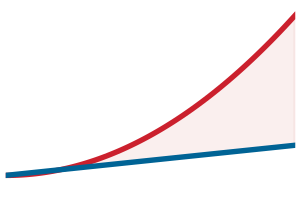

*Варианты отображения комбинаторно растут по мере увеличения измерений циклов.*

Если бы каждый уровень памяти мог выбирать порядок независимо, соответствующая игрушечная верхняя граница расширилась бы до:

$$
(n_{\text{loops}}!)^{N_{\text{mem}}}
$$

где $N_{\text{mem}}$ — число уровней иерархии памяти. Это быстрое расширение показывает, почему важна оптимизация порядка выполнения: субоптимальный порядок циклов преждевременно вытесняет значения и умножает трафик DRAM, тогда как оптимизированный порядок максимизирует повторное использование в локальной SRAM и кэшах (Sze et al., 2017).

<a id="sec-hardware-acceleration-parallelization-across-processing-elements-ee26"></a>

#### Параллелизация по процессорным элементам

Современные ускорители ИИ используют тысячи процессорных элементов, чтобы выполнять итерации циклов одновременно. Однако распараллеливание внутреннего цикла редукции требует синхронизации между ядрами и коллективной коммуникации, тогда как распараллеливание внешних независимых циклов (таких как батч или каналы выходных признаков) позволяет каждому ядру выполняться самостоятельно без трафика межсоединений. Определение того, какие циклы отображать пространственно, требует тщательного разбиения.

До применения ограничений на допустимость и емкость число упорядоченных способов выбрать циклы для параллельного выполнения имеет верхнюю границу:

$$
\mathcal{P}_{\text{parallel}} = \frac{n_{\text{loops}}!}{(n_{\text{loops}}-k_{\text{parallel}})!}
$$

где $n_{\text{loops}}$ — число циклов, а $k_{\text{parallel}}$ — число циклов, выбранных для параллельного выполнения. Для вычисления с шестью циклами, из которых три выбраны, это неограниченное число равно:

$$
\frac{6!}{(6-3)!} = 120.
$$

Даже для одного слоя число кандидатов достигает сотен до удаления недопустимых или эквивалентных стратегий. Каждое кандидатное расписание предъявляет разные требования к барьерной синхронизации, пропускной способности межсоединений и загрузке PE.

<a id="sec-hardware-acceleration-memory-placement-data-movement-b47a"></a>

#### Размещение в памяти и перемещение данных

Физическая иерархия памяти заставляет компиляторы определять, какие тензоры находятся в регистрах, разделяемой памяти или глобальной DRAM на каждом этапе выполнения. Выборка операндов из DRAM за пределами кристалла стоит на порядки больше энергии и задержки, чем чтение из локальной SRAM, поэтому размещение данных становится главным фактором достигаемой арифметической интенсивности.

Если бы каждое вычислительное измерение имело $n$ независимых вариантов на каждом уровне памяти, соответствующая игрушечная верхняя граница выглядела бы так:

$$
\mathcal{M}_{\text{placement}} = n^{N_{\text{comp}} \times N_{\text{mem}}}
$$

где:

- $n$ — число вариантов размещения на уровень,
- $N_{\text{comp}}$ — число вычислительных измерений,
- $N_{\text{mem}}$ — число уровней иерархии памяти.

Для модели с:

- $N_{\text{comp}} = 5$ вычислительными измерениями,
- $N_{\text{mem}} = 3$ уровнями памяти,
- $n = 4$ возможными вариантами размещения на уровень,

$$
4^{5 \times 3} = 4^{15} = 1\,073\,741\,824.
$$

<a id="sec-hardware-acceleration-mapping-search-space-b150"></a>

#### Пространство поиска отображений

Этот пример без ограничений превышает миллиард комбинаций, хотя многие из них недопустимы, связаны или эквивалентны. Перемножение игрушечных счетов дает иллюстрацию верхней границы пространства поиска отображений:

$$
\mathcal{S}_{\text{mapping}} = \left( n^{N_{\text{comp}}} \times n_{\text{loops}}! \times \frac{n_{\text{loops}}!}{(n_{\text{loops}}-k_{\text{parallel}})!} \right)^{N_{\text{mem}}}
$$

где:

- $n^{N_{\text{comp}}}$ задает варианты размещения в памяти,
- $n_{\text{loops}}!$ учитывает варианты порядка вычислений,
- $\frac{n_{\text{loops}}!}{(n_{\text{loops}}-k_{\text{parallel}})!}$ отражает возможности распараллеливания,
- $N_{\text{mem}}$ — число уровней иерархии памяти.

Это уравнение не является точным подсчетом допустимых расписаний, потому что варианты взаимодействуют, а аппаратные ограничения отсекают пространство. Оно иллюстрирует, почему пространства кандидатов быстро растут и почему исчерпывающий поиск становится непрактичным. Даже в небольшом слое изменение одного решения о порядке может дать разницу на порядок в трафике памяти.

<a id="exmp-hw-acceleration-loop-ordering-small-convolution"></a>

> **Порядок циклов в небольшой свертке**
>
> Рассмотрим свертку, которая применяет 16 фильтров размера $3{\times}3$ к одноканальному входу $8{\times}8$. Вычисление можно выразить пятью вложенными циклами, которые перебирают строки выхода ($H_{\text{out}}$), столбцы выхода ($W_{\text{out}}$), число фильтров ($C_{\text{out}}$), высоту фильтра ($F_h$) и ширину фильтра ($F_w$). Перестановки $5! = 120$ — это верхняя граница без ограничений: допустимые порядки сохраняют математический результат, хотя порядок редукции в вычислениях с плавающей точкой может менять округление, и они порождают разный трафик памяти.
>
> **Порядок A (стационарные веса)**: поставим циклы фильтров ($C_{\text{out}}$, $F_h$, $F_w$) внешними, а пространственные циклы ($H_{\text{out}}$, $W_{\text{out}}$) — внутренними. Каждый фильтр $3{\times}3$ загружается в регистры один раз и затем применяется ко всем 36 выходным позициям, прежде чем загрузится следующий фильтр. Всего загрузок весов: $16 \times 9 = 144$ значения, каждое загружено ровно один раз.
>
> **Порядок B (стационарный выход)**: поставим пространственные циклы внешними, а циклы фильтров — внутренними. Для каждой выходной позиции все 16 фильтров нужно загрузить, применить и накопить их частичные суммы, прежде чем перейти к следующей позиции. Если регистровый файл не может вместить все 16 фильтров одновременно, фильтры многократно выбираются из кэша или DRAM. В худшем случае каждая из 36 выходных позиций перезагружает все 144 веса фильтров, что дает $36 \times 144 = 5\,184$ чтений весов.
>
> **Системный вывод**: при этих двух предельных допущениях Порядок A сокращает смоделированные чтения весов в 36 раз относительно худшего случая для Порядка B. Реальные ядра также учитывают трафик активаций и частичных сумм, емкость регистров, поведение кэша и векторизацию. Тем не менее пример показывает, почему два математически эквивалентных порядка циклов могут предъявлять очень разные требования к системе памяти.

Этот комбинаторный взрыв ставит центральную загадку систем ML: если пространство поиска без ограничений содержит миллиарды кандидатов, как компиляторы и разработчики ядер регулярно достигают эффективности, близкой к пиковой для аппаратуры? Вместо того чтобы перебирать произвольные перестановки, промышленные системы ограничивают поиск небольшим семейством канонических шаблонов потоков данных — пространственных и временных расписаний, спроектированных под конкретные свойства повторного использования операторов нейросетей.

<a id="sec-hardware-acceleration-dataflow-optimization-strategies-ce52"></a>

## Оптимизация потоков данных

Пространственное и временное отображение ([«Отображение на аппаратуру»](11_hw_acceleration.md#sec-hardware-acceleration-hardware-mapping-fundamentals-neural-networks-f9a9)) определяет, где выполняются операции и где находятся операнды, но **оптимизация потоков данных** управляет точными траекториями и расписаниями движения данных через процессорные элементы и иерархию памяти. В систолическом массиве или тайловом векторном блоке временное расписание и пространственная маршрутизация весов, входов и частичных сумм определяют, как часто операнды приходится выбирать из энергоемкой DRAM, а не переиспользовать из локальных регистров или scratchpad-памяти. Управляя трафиком за пределами кристалла, поток данных задает эффективную операционную интенсивность ядра и определяет, достигает ли выполнение вычислительно-ограниченного плато модели Roofline или застревает в режиме, ограниченном памятью. Оптимизирующие компиляторы ([«Поддержка компиляторов»](11_hw_acceleration.md#sec-hardware-acceleration-compiler-support-172e)) и системы среды выполнения ([«Поддержка среды выполнения»](11_hw_acceleration.md#sec-hardware-acceleration-runtime-support-f94f)) поэтому подгоняют шаблоны потоков данных под характеристики повторного использования каждого слоя и аппаратные ограничения целевого ускорителя.

Пространство проектирования структурируют три повторяющихся архитектурных решения:

1. **Локальность**: выбор стационарного операнда (стационарные веса, стационарный выход или стационарный вход) определяет, какой тензор закреплен в локальных регистрах или scratchpad-буферах процессорных элементов, что обменивает трафик памяти на давление на регистры.
2. **Организация**: физические раскладки тензоров (например, channels-last `NHWC` против channels-first `NCHW`) определяют, совпадают ли обращения к памяти с размерами пакетов контроллера памяти и шириной векторов SIMD, предотвращая несогласованные транзакции памяти.
3. **Комбинация**: слияние ядер и тайлинг циклов разбивают пространства итераций и объединяют соседние операции, чтобы устранить обращения к внешней памяти туда и обратно для промежуточных тензоров.

Вместе эти шаблоны дают компактный словарь для навигации по выбору потоков данных без исчерпывающего перебора миллиардов кандидатных расписаний.

<a id="sec-hardware-acceleration-building-blocks-mapping-strategies-4932"></a>

### Строительные блоки стратегий отображения

Эти три решения переходят в четыре базовых приема: шаблоны перемещения данных, которые закрепляют конкретные операнды рядом с арифметическими блоками (стационарные веса, стационарный выход и стационарный вход), эффективные по памяти раскладки тензоров (channels-last против channels-first), слияние ядер, которое удерживает промежуточные активации в SRAM на кристалле между операциями, и тайлинг циклов, который ограничивает размеры рабочих наборов, чтобы они помещались в локальную память. Вместо того чтобы заново изобретать расписания с нуля, эвристические компиляторы и фреймворки автонастройки компонуют эти строительные блоки, чтобы создавать эффективные планы выполнения для слоев глубоких нейронных сетей.

<a id="sec-hardware-acceleration-data-movement-patterns-3b06"></a>

#### Шаблоны перемещения данных

На современных ускорителях выборка операнда из DRAM за пределами кристалла стоит примерно от двух до трех порядков больше энергии, чем выполнение арифметической операции или выборка из локального регистрового файла (Chen et al., 2016). Выполняет ли нагрузка плотные матричные операции, превышающие емкость кэша на кристалле, или нерегулярные разреженные выборки, стратегия перемещения данных определяет общую задержку выполнения и полное энергопотребление. Если данные нельзя подготовить и подать в процессорные элементы с той скоростью, которой требует их арифметическая пропускная способность, блоки выполнения останавливаются на задержке памяти, теряя теоретическую вычислительную мощность и раздувая энергию подсистемы памяти.

Чтобы конвейеры арифметики не останавливались, стратегия перемещения данных должна улавливать присущее тензорным операциям алгоритмическое повторное использование внутри локального, энергетически экономного хранилища. [«Наивный поток данных умножения матриц»](11_hw_acceleration.md#lst-matmul_data_movement) иллюстрирует канонический вариант реализации умножения матриц тремя вложенными циклами, раскрывая повторное использование операндов по весам, входам и частичным суммам, которое отображение на аппаратуру должно удерживать в локальном хранилище.

<a id="lst-matmul_data_movement"></a>

**Наивный поток данных умножения матриц**: вложенный цикл многократно обращается к строкам весов, столбцам входа и аккумуляторам выхода, раскрывая повторное использование, которое отображение должно сохранить в локальной памяти.

```python
## Умножение матриц, где:
## weights: [512x256] — параметры модели
## input:   [256x32]  — батч активаций
## Z:       [512x32]  — выходные активации

## Вычисление каждого выходного элемента Z[i,j]:
for i in range(512):
    for j in range(32):
        for k in range(256):
            Z[i, j] += weights[i, k] * input[k, j]
```

Это вычисление выявляет несколько критических проблем потока данных. Первая проблема — число требуемых обращений к памяти. Для каждого выходного $Z_{ij}$ вычислению нужно выбрать целую строку весов из матрицы весов и полный столбец активаций из входной матрицы. Поскольку матрица весов содержит 512 строк, а входная матрица — 32 столбца, возникают повторные обращения к памяти, которые создают большую нагрузку на пропускную способность памяти.

Вторая проблема связана с повторным использованием весов. Одни и те же веса применяются к нескольким входам, поэтому идеальная стратегия отображения должна максимизировать локальность весов, чтобы избежать избыточных выборок из памяти. Без должного повторного использования ускоритель тратил бы пропускную способность на многократную загрузку одних и тех же весов (Chen et al., 2018).

Третья проблема касается накопления промежуточных результатов. Поскольку каждый элемент $Z_{ij}$ требует вклада от 256 различных пар вес–вход, частичные суммы нужно сохранять и извлекать, прежде чем будет вычислено окончательное значение. Если эти промежуточные значения хранятся неэффективно, система потребует частых обращений к памяти, что еще сильнее повысит требования к пропускной способности.

Один из способов смягчить эти проблемы — использовать модели выполнения SIMD и SIMT, которые позволяют выбирать несколько значений параллельно. Однако даже с этими оптимизациями перемещение данных остается узким местом. Главное узкое место — не только скорость выборки, но и частота передач и размещение в иерархии памяти (Han et al., 2016).

Поскольку перемещение данных доминирует в энергетическом бюджете, который отображает [«Иерархия энергии»](11_hw_acceleration.md#fig-energy-hierarchy), самая важная цель ускорителя — минимизировать обращения к памяти. Стратегии потоков данных достигают этого, максимизируя повторное использование данных. Центральное решение — какие данные выгоднее всего держать локально. Ускорители отвечают на него, определяя, какие данные остаются зафиксированными в памяти, а какие передаются динамически: стационарные веса удерживают параметры модели локально, стационарный вход сохраняет данные активаций, а стационарный выход сохраняет промежуточные результаты. Каждый подход обменивает разные шаблоны доступа к памяти, чтобы максимизировать повторное использование данных и сократить энергоемкие передачи, которые составляют главное узкое место в ускорении ИИ.

<a id="sec-hardware-acceleration-weight-stationary-156a"></a>

##### Стационарные веса

Стратегия стационарных весов удерживает веса фиксированными в локальной памяти, тогда как входные активации и частичные суммы проходят через систему потоком. Подходы со стационарными весами особенно выгодны в CNN и умножениях матриц, где один и тот же набор весов применяется к нескольким входам. Закрепляя веса, этот метод сокращает избыточные выборки из памяти, что помогает снимать узкие места пропускной способности и повышает энергоэффективность.

Ключевое преимущество стационарных весов в том, что они максимизируют повторное использование весов и снижают частоту обращений к внешнему хранилищу. Поскольку параметры весов часто разделяются между несколькими вычислениями, их хранение в локальной памяти устраняет ненужное перемещение данных и снижает общую энергетическую стоимость вычислений. Это делает подход особенно эффективным для архитектур, где веса составляют главную часть накладных расходов памяти, например для систолических массивов и заказных ускорителей, созданных для машинного обучения. [«Поток данных со стационарными весами»](11_hw_acceleration.md#lst-weight_stationary) показывает, как выполнение со стационарными весами держит веса фиксированными в локальной памяти, пока входы передаются потоком, а частичные суммы накапливаются.

<a id="lst-weight_stationary"></a>

**Поток данных со стационарными весами**: веса остаются в локальной памяти, пока через систему проходят входы и частичные суммы; минимизирует трафик чтения параметров и лучше всего подходит для CNN и умножений матриц с интенсивным повторным использованием весов.

```python
## Умножение матриц со стационарными весами
## - Веса остаются фиксированными в локальной памяти
## - Входные активации проходят потоком
## - Частичные суммы накапливаются для итогового выхода

for weight_block in weights:  # Загрузка и удержание весов как стационарных
    load_to_local(weight_block)  # Фиксированы в локальном хранилище
    for input_block in inputs:  # Динамически передаем входы потоком
        for output_block in outputs:  # Вычисляем результаты
            output_block += compute(weight_block, input_block)
            # Повторно используем веса для разных входов
```

При потоке данных со стационарными весами веса загружаются в локальную память один раз и остаются фиксированными на протяжении всего вычисления, а входы динамически проходят потоком, сокращая избыточные обращения к памяти. Частичные суммы накапливаются эффективно, сводя к минимуму ненужное перемещение данных. Поскольку веса не нужно перезагружать для каждого нового вычисления, требования к пропускной способности значительно падают, что делает этот поток данных очень эффективным для нагрузок с интенсивным повторным использованием весов, таких как CNN и умножения матриц.

Однако хотя эта стратегия сокращает трафик, связанный с весами, она вносит компромиссы в перемещение входов и выходов. Поскольку входы должны динамически проходить потоком, пока веса остаются фиксированными, эффективность подхода зависит от того, насколько хорошо входные активации можно доставлять вычислительным блокам без остановок. Частичные суммы, представляющие промежуточные результаты, тоже нужно аккуратно накапливать, чтобы не допустить чрезмерного трафика памяти. Общий выигрыш производительности зависит от размера доступной памяти на кристалле, поскольку хранение больших матриц весов локально может стать ограничением для моделей с миллионами или миллиардами параметров.

Стратегия стационарных весов хорошо подходит для нагрузок, где веса демонстрируют высокое повторное использование и пропускная способность памяти является ограничивающим фактором. Она обычно применяется в CNN, систолических массивах и ядрах умножения матриц, где структурированное повторное использование весов приводит к измеримому росту производительности. Однако для моделей, в которых важнее повторное использование входов или выходов, лучшие компромиссы могут дать альтернативные потоки данных — стационарный выход или стационарный вход.

<a id="sec-hardware-acceleration-output-stationary-54e5"></a>

##### Стационарный выход

Стратегия стационарных весов держит веса локально и пропускает входы через систему. Однако доминирующая стоимость меняется, когда узким местом оказывается не загрузка весов, а частые записи частичных сумм. В полносвязных слоях и механизмах внимания трансформера каждый выходной элемент накапливает вклад сотен или тысяч пар вес–вход. Запись этих промежуточных частичных сумм во внешнюю память после каждого шага накопления создала бы узкое место пропускной способности записи, гораздо более серьезное, чем накладные расходы на чтение, которые решает стратегия стационарных весов. Стратегия стационарного выхода меняет приоритеты: она удерживает частичные суммы фиксированными в локальной памяти, пропуская через систему и веса, и входные активации, так что каждый выходной элемент записывается во внешнюю память только один раз, после накопления всех своих вкладов (Chen et al., 2016).

[«Поток данных со стационарным выходом»](11_hw_acceleration.md#lst-output_stationary) показывает, как локальное накопление частичных сумм минимизирует записи в память и повышает эффективность умножения матриц. В этой реализации буфер аккумулятора остается в локальных регистрах или scratchpad-памяти на протяжении всего внутреннего цикла; веса и входы проходят потоком, вносят вклад в текущую сумму и отбрасываются. Итоговый результат записывается только один раз на выходной элемент, что устраняет повторяющийся трафик записи, который иначе доминировал бы в пропускной способности.

Этот подход естественно согласуется с систолическими массивами, где вычисление продвигается через решетку процессорных элементов, а частичные суммы могут течь вдоль одной оси, не покидая кристалл. Компромисс в том, что теперь и веса, и активации должны передаваться динамически, поэтому системе приходится поддерживать высокую пропускную способность чтения для двух потоков данных одновременно. Параллельные реализации также требуют аккуратной синхронизации, когда несколько PE вносят вклад в один и тот же выходной элемент. Стационарный выход поэтому наиболее эффективен для нагрузок, где доминирует накопление, например для полносвязных слоев и механизмов внимания, но хуже подходит, когда критическим узким местом является повторное использование входов.

<a id="lst-output_stationary"></a>

**Поток данных со стационарным выходом**: частичные суммы остаются в локальной памяти, пока через нее проходят веса и входы, поэтому каждый выход записывается только один раз, что минимизирует трафик записи при накоплении; лучше всего подходит для полносвязных слоев и внимания.

```python
## - Частичные суммы остаются в локальной памяти
## - Веса и входные активации проходят потоком динамически
## - Итоговые выходы записываются только один раз

for output_block in outputs:  # Удерживаем частичные суммы как стационарные
    accumulator = 0  # Инициализируем буфер накопления
    for weight_block, input_block in zip(weights, inputs):
        accumulator += compute(weight_block, input_block)
        # Накапливаем частичные суммы
    store_output(accumulator)  # Одна запись в память
```

<a id="sec-hardware-acceleration-input-stationary-6c7b"></a>

##### Стационарный вход

Две рассмотренные стратегии фиксируют в локальной памяти разные операнды: стационарные веса фиксируют веса, чтобы снизить пропускную способность чтения параметров, а стационарный выход фиксирует частичные суммы, чтобы снизить пропускную способность записи накоплений. Третья стратегия завершает картину, фиксируя оставшийся операнд — входные активации. В слое трансформера одна активация может питать несколько проекций или голов внимания; следующий слой получает уже новое вычисленное представление, а не ту же активацию токена. Когда повторное использование активаций составляет главную стоимость памяти, удержание входов стационарными и потоковая передача весов через систему может снизить энергию и пропускную способность. [«Поток данных со стационарным входом»](11_hw_acceleration.md#lst-input_stationary) иллюстрирует этот подход.

<a id="lst-input_stationary"></a>

**Поток данных со стационарным входом**: входные активации остаются в локальной памяти, пока через нее проходят веса, что сокращает трафик чтения активаций, когда один тайл активаций питает несколько вычислений.

```python
## - Входные активации остаются в локальной памяти
## - Веса проходят потоком динамически
## - Частичные суммы накапливаются и записываются

for input_block in inputs:  # Удерживаем входные активации как стационарные
    load_to_local(input_block)  # Фиксированы в локальном хранилище
    for weight_block in weights:  # Динамически передаем веса потоком
        for output_block in outputs:  # Вычисляем результаты
            output_block += compute(weight_block, input_block)
            # Повторно используем входы для разных весов
```

Здесь входные активации загружаются один раз и удерживаются фиксированными в локальном хранилище, пока через него проходят веса. Частичные суммы накапливаются и в итоге записываются, но в отличие от потока со стационарным выходом выгоду от локальности получает не буфер накопления, а входные активации.

Компромисс повторяет устройство двух других стратегий: веса передаются динамически, требуя устойчивой пропускной способности чтения из памяти, а частичные суммы нужно буферизовать перед записью обратно. Стационарный вход наиболее эффективен, когда один тайл активаций питает несколько проекций, голов внимания или вычислений гейтов до вытеснения.

В совокупности три потока данных дают основу для принятия решений, а не иерархию качества. Стационарные веса минимизируют трафик чтения параметров и подходят сверточным сетям с компактными, интенсивно используемыми фильтрами. Стационарный выход минимизирует трафик записи накоплений и подходит полносвязным слоям с широким входным веером. Стационарный вход минимизирует трафик чтения активаций и подходит трансформерам и выводу с большим батчем при высоком повторном использовании активаций. Ни одна стратегия не доминирует; оптимальный выбор зависит от того, какое измерение тензора дает наибольшее отношение повторного использования к емкости локального хранилища. Аппаратные компиляторы выбирают между этими стратегиями, исходя из размерностей нагрузки и ограничений иерархии памяти. Сверточные конструкции добавляют четвертую метку — стационарные строки (как в Eyeriss), но это гибрид, который удерживает строки входов и частичных сумм локально, когда такое отображение дает большее повторное использование, чем фиксация любого одного операнда ([«Сверточные нейронные сети»](11_hw_acceleration.md#sec-hardware-acceleration-convolutional-neural-networks-3085)).

<a id="sec-hardware-acceleration-memoryefficient-tensor-layouts-e250"></a>

#### Эффективные по памяти раскладки тензоров

Стратегии потоков данных из раздела [«Шаблоны перемещения данных»](11_hw_acceleration.md#sec-hardware-acceleration-data-movement-patterns-3b06) определяют, какие операнды остаются рядом с вычислительными блоками; раскладки тензоров определяют, можно ли эффективно обращаться к этим операндам, когда они поступили. Даже удачно выбранное расписание со стационарными весами останавливается, если веса разложены в формате, который порождает шаговые, несогласованные выборки из памяти. Раскладка тензора — это контракт ядра: физический порядок многомерных данных в линейной памяти должен совпадать с шагом доступа, который ожидают исполнительные блоки ускорителя, иначе процессор платит остановками памяти, недоиспользованием кэша и лишними транзакциями шины.

Аппаратные ускорители выбирают данные из памяти устройства транзакциями фиксированного размера, обычно от 32 до 128 байт на транзакцию. Когда вычислительные блоки запрашивают несмежные адреса, каждая транзакция доставляет лишь долю полезной нагрузки, ухудшая эффективную пропускную способность памяти. Согласование раскладки тензора с моделью выполнения аппаратуры обеспечивает, что параллельные потоки или линии SIMD обращаются к смежным ячейкам памяти в одной объединенной транзакции (NVIDIA Corporation, 2021).

Фреймворки машинного обучения и компиляторы часто управляют выбором раскладки автоматически. Инструменты оптимизации, такие как cuDNN для GPU NVIDIA, XLA для TensorFlow и JAX и стеки компиляторов на основе MLIR, преобразуют раскладки тензоров, когда понижают операции до ядер конкретного бэкенда (NVIDIA Corporation, 2021); (Google, 2025); (Lattner et al., 2020). В высокоуровневых фреймворках преобразования раскладки обычно применяются прозрачно, но разработчикам, которые пишут собственные ядра или работают с низкоуровневыми API, такими как CUDA, Metal или OpenCL, приходится управлять форматами тензоров напрямую.

В PyTorch, например, операции представления вроде `tensor.permute()` меняют шаги тензора без перемещения данных в памяти, и для материализации упакованного буфера, когда последующему ядру нужно непрерывное хранение, требуется явный вызов `tensor.contiguous()` (PyTorch Contributors, 2026). И наоборот, TensorFlow по умолчанию использует channels-last (NHWC) для сверточных моделей на GPU NVIDIA и предупреждает, что входы NCHW вносят накладные расходы автоматической транспозиции при понижении до ядер GPU (TensorFlow Developers, 2024). Библиотеки с аппаратной оптимизацией, такие как cuDNN на GPU и oneDNN на CPU, реализуют специальные форматы памяти, чтобы максимизировать использование строк кэша и пропускную способность SIMD. Руководящий принцип таков: раскладку памяти нужно считать внутренним свойством пути выполнения бэкенда; самый быстрый формат тензора тот, который минимизирует накладные расходы на преобразование раскладки и делает обращения к памяти непрерывными для аппаратных блоков выполнения.

<a id="sec-hardware-acceleration-rowmajor-layout-741f"></a>

##### Раскладка channels-last

В раскладке NHWC channels-last индекс канала меняется быстрее всего в непрерывном тензоре, поэтому значения каналов для каждой пространственной координаты располагаются в памяти рядом. NHWC задает логический порядок измерений, а не соглашение о линейном хранении; и тензоры NHWC, и NCHW представляют собой линейные последовательности хранения в соответствующем порядке измерений.

Рассмотрим тензор RGB-изображения формы $(\text{Высота}, \text{Ширина}, \text{Каналы}) = (3, 3, 3)$. Элементы в линейной памяти располагаются так:

$$
\begin{gathered}
I(0,0,0), I(0,0,1), I(0,0,2), I(0,1,0), I(0,1,1), \\
I(0,1,2), I(0,2,0), I(0,2,1), I(0,2,2), \ldots
\end{gathered}
$$

Все значения каналов для данного пикселя смежны, а адреса памяти продвигаются по ширине, прежде чем перейти вниз по высоте. Такая раскладка поддерживает векторизованное выполнение, когда вычислительное ядро обрабатывает несколько каналов одновременно: регистры SIMD CPU и тензорные ядра GPU могут загружать смежные векторы каналов напрямую, без перетасовки внутри регистра.

Преимущество хранения channels-last зависит от целевого оператора и вычислительного блока. TensorFlow использует NHWC по умолчанию, тогда как PyTorch предоставляет отдельный формат памяти channels-last, который отделяет логический порядок измерений от физического хранения. Современные ядра cuDNN для тензорных ядер предпочитают NHWC, потому что блоки умножения матриц упаковывают измерения каналов прямо в тайлы аккумуляторов. Когда ядрам нужны входы с непрерывными каналами, передача несовместимого формата заставляет среду выполнения фреймворка вставлять явную транспозицию памяти, что влечет штраф по пропускной способности до начала вычислений.

<a id="sec-hardware-acceleration-channelmajor-layout-d6a9"></a>

##### Раскладка channels-first

В непрерывной раскладке NCHW channels-first индекс пространственной ширины меняется быстрее всего, и все пространственные значения по целому каналу хранятся подряд, прежде чем начнется следующий канал. Ускорители обрабатывают данные параллельно по варпам потоков или линиям SIMD; когда соседние потоки в варпе обращаются к соседним адресам памяти, контроллер памяти объединяет эти запросы в одну транзакцию памяти (**объединение обращений к памяти**, memory coalescing).[^fn-memory-coalescing-gpu]

[^fn-memory-coalescing-gpu]: **Объединение обращений к памяти (memory coalescing)**: аппаратный механизм GPU, который сливает запросы к памяти от потоков одного варпа в одну транзакцию, когда эти потоки обращаются к непрерывной памяти. Раскладка тензора влияет на объединение, но знак эффекта зависит от ядра: NCHW может быть эффективным для некоторых реализаций свертки, тогда как NHWC/channels-last часто предпочтительнее для современных путей свертки и слияния на тензорных ядрах. Неудачный выбор раскладки все же может создать многократный разрыв в производительности, но правильное решение — согласовать раскладку с бэкендом, а не заучивать один универсальный формат.

Рассмотрим тот же RGB-тензор изображения с измерениями, переупорядоченными в порядке channels-first: $(\text{Каналы}, \text{Высота}, \text{Ширина}) = (3, 3, 3)$. Сохраняя $I(h,w,c)$ как семантическую координатную нотацию, данные хранятся в порядке channels-first так:

$$
\begin{gathered}
I(0,0,0), I(0,1,0), I(0,2,0), I(1,0,0), I(1,1,0), I(1,2,0), \ldots, \\
I(0,0,1), I(0,1,1), I(0,2,1), \ldots, I(0,0,2), I(0,1,2), I(0,2,2), \ldots
\end{gathered}
$$

В этом формате сначала хранятся все значения красного канала для всего изображения, затем все зеленые и затем все синие значения. Такое расположение позволяет ядрам, которые распараллеливают по пространственным координатам $(H, W)$, выполнять объединенные чтения вдоль строк изображения, что подходило более ранним алгоритмам свертки на GPU и конвейерам выполнения SIMD (Chetlur et al., 2014).

Относительное преимущество NCHW перед NHWC зависит от того, как базовое ядро отображает вычисления на аппаратные потоки. Сверточные слои вычисляют фильтры по пространственным и канальным измерениям одновременно. В классических прямых или основанных на FFT свертках порядок channels-first позволял эффективно скользить по пространству без скачков шага. Однако современные свертки, понижаемые до GEMM, и конвейеры тензорных ядер отображают редукцию по каналам прямо в аккумуляторы умножения матриц, поэтому предпочитают структуры channels-last. Когда модель работает в NCHW, но вызывает бэкенд, оптимизированный под тензорные ядра, среда выполнения должна либо запустить неоптимизированное запасное ядро, либо динамически транспонировать тензор в NHWC; в обоих случаях тратится пропускная способность памяти.[^fn-nhwc-nchw-layout]

[^fn-nhwc-nchw-layout]: **NHWC против NCHW**: NHWC перечисляет измерения как батч, высота, ширина, канал; NCHW — как батч, канал, высота, ширина. Физический формат памяти определяет, читают ли соседние потоки соседние адреса, поэтому эффект для производительности зависит от бэкенда. Несоответствие раскладки и аппаратуры — это не микрооптимизация; оно может создать многократный разрыв в производительности, особенно когда преобразование не дает использовать пути свертки или слияния на тензорных ядрах.

<a id="sec-hardware-acceleration-comparing-rowmajor-channelmajor-layouts-e410"></a>

##### Сравнение раскладок channels-last и channels-first

Раскладки channels-last (NHWC) и channels-first (NCHW) рассчитаны на разные аппаратные шаблоны доступа, и их эффективность определяется тем, распараллеливает ли ядро по пространственным координатам или векторизует по измерениям каналов. Выбор раскладки напрямую управляет использованием строк кэша, числом транзакций шины памяти и загрузкой вычислительных блоков. [«Стратегии раскладки данных»](11_hw_acceleration.md#tbl-major) сопоставляет компромиссы производительности и аппаратную совместимость двух подходов.

| Признак                                                               | **Channels-last (NHWC)**                                       | **Channels-first (NCHW)**                                      |
|:----------------------------------------------------------------------|:---------------------------------------------------------------|:---------------------------------------------------------------|
| **Порядок хранения в памяти**  | Пиксели хранятся построчно, каналы чередуются                  | Все значения данного канала хранятся вместе                    |
| Лучше всего для                                                       | Циклы CPU, поэлементные операции, многие ядра channels-last    | Многие устаревшие пути свертки на GPU и код моделей channels-first |
| **Эффективность кэша**             | Высокая локальность кэша для последовательного доступа по строкам и каналам | Может улучшать объединение для ядер channels-first        |
| **Производительность свертки** | Часто предпочтительна для современных путей свертки и слияния на тензорных ядрах | Эффективна для многих ядер cuDNN и фреймворков              |
| **Выборка из памяти**                | Хорошо, когда ядра векторизуют по соседним данным каналов      | Хорошо, когда ядра обрабатывают тайлы, упорядоченные по каналам |
| **Значение по умолчанию во фреймворках** | Распространенное соглашение TensorFlow; опция channels-last в PyTorch | Распространенное соглашение о форме тензоров в PyTorch   |

<a id="tbl-major"></a>

*Стратегии раскладки данных: раскладки channels-last (NHWC) и channels-first (NCHW) оптимизируют шаблоны доступа к памяти для разных ядер бэкенда. NHWC часто подходит для векторизации CPU и современных путей свертки и слияния на тензорных ядрах, тогда как NCHW остается распространенным в коде моделей PyTorch и во многих ядрах GPU. Выбор подходящей раскладки напрямую влияет на производительность, максимизируя использование кэша и эффективность пропускной способности памяти.*

Хотя такие компиляторы, как XLA, TensorRT и PyTorch Inductor, автоматизируют распространение раскладки и вставляют преобразования раскладки, когда это выгодно, преобразования форматов не бесплатны: транспонирование тензора требует прочитать каждый элемент из памяти и записать его обратно в другом порядке, расходуя пропускную способность памяти без полезной арифметики. В промышленных развертываниях согласование раскладки памяти модели с родным форматом ядра ускорителя полностью устраняет эти преобразования.

Даже когда раскладка тензора идеально согласована с аппаратурой, выполнение операций как изолированных ядер вносит отдельное узкое место: промежуточные значения все равно должны ходить к памяти устройства и обратно между операциями. Чтобы устранить это узкое место, нужно менять не раскладку тензоров, а то, как операции планируются.

<a id="sec-hardware-acceleration-kernel-fusion-7faf"></a>

#### Слияние ядер

Сокращение промежуточного перемещения данных между операциями — один из главных механизмов смягчения стены памяти. Слияние ядер[^fn-kernel-fusion-memory] объединяет несколько последовательных операций в одно исполняемое ядро, устраняя промежуточные обращения к памяти туда и обратно.

[^fn-kernel-fusion-memory]: **Слияние ядер**: отдельные ядра GPU передают промежуточные результаты через память устройства, хотя кэши могут поглотить часть трафика. Слитое ядро может держать промежуточные значения в регистрах или локальном хранилище и избежать соответствующих циклов записи и чтения во внешней памяти. Итоговое ускорение зависит от поведения кэша, заполненности, накладных расходов на запуск и от того, был ли трафик памяти узким местом; оно не обязательно пропорционально сокращению числа байтов.

<a id="sec-hardware-acceleration-intermediate-memory-write-f140"></a>

##### Промежуточная запись в память

Выполнение нейросетей часто ограничено пропускной способностью памяти, а не арифметической производительностью. Когда операции выполняются как изолированные ядра, каждый промежуточный результат записывается в память устройства (DRAM или HBM), а затем читается обратно следующим оператором. Этот цикл туда и обратно вносит задержку памяти, останавливает вычислительные блоки и расходует пропускную способность шины на данные, которые не используются повторно за пределами этой пары операций.

Эта аппаратная реальность дает физическое обоснование для методов слияния операторов, введенных в разделе [«Слияние операторов»](10_model_compression.md#sec-model-compression-operator-fusion-ac1d). Если в разделе [«Понимание стены памяти в ИИ»](11_hw_acceleration.md#sec-hardware-acceleration-understanding-ai-memory-wall-3ea9) анализировались ограничения пропускной способности через низкую операционную интенсивность, то цепочки поэлементных операций усугубляют стену памяти, умножая глобальные транзакции памяти (NVIDIA Corporation, 2017).

В наивной модели выполнения каждая операция выполняется как отдельное ядро GPU, и промежуточные тензоры совершают путь туда и обратно через память устройства ([«Наивное выполнение»](11_hw_acceleration.md#lst-naive_execution)). В цепочке из трех операций, таких как ReLU, пакетная нормализация и аффинное масштабирование, промежуточные выходы $X_1$ и $X_2$ записываются в DRAM только для того, чтобы сразу же быть повторно прочитанными следующим ядром. Для поэлементных операторов, где арифметическая интенсивность низка ($I \ll 1\text{ FLOP/байт}$), время перемещения данных по шине памяти превышает время вычислений (Jia et al., 2019). Кроме того, удержание таких неслитых промежуточных буферов в памяти раздувает объем живых тензоров во время выполнения ([«Хранение промежуточных тензоров»](11_hw_acceleration.md#tbl-memory-footprint)).

<a id="lst-naive_execution"></a>

**Наивное выполнение**: каждый шаг записывает промежуточные результаты в память перед обработкой следующего, что ведет к росту использования пропускной способности и снижению эффективности.

```python
import torch
import torch.nn.functional as F

## Входной тензор
X = torch.randn(1024, 1024).cuda()
running_mean = torch.zeros(1024, device=X.device)
running_var = torch.ones(1024, device=X.device)

## Пошаговое выполнение (наивный подход)
X1 = torch.relu(X)  # Промежуточный тензор хранится в памяти
X2 = F.batch_norm(
    X1, running_mean, running_var, training=False
)  # BatchNorm при выводе с замороженными статистиками
Y = 2.0 * X2 + 1.0  # Итоговый результат
```

<a id="sec-hardware-acceleration-kernel-fusion-memory-efficiency-f227"></a>

##### Слияние ядер для эффективности памяти

Два промежуточных тензора занимают емкость памяти, пока остаются живыми, и создают внешний трафик, когда отдельные ядра их материализуют. Слияние ядер может устранить эти промежуточные записи и повторные загрузки (Jia et al., 2019), передавая значения через регистры или локальную память внутри одного ядра.

| Тензор       |   **Размер (МБ) для тензора $1024{\times}1024$**   |
|:-------------|:-----------------------------------------------:|
| **X**        |   4,2 МБ  |
| **X'**       |   4,2 МБ  |
| **X''**      |   4,2 МБ  |
| **Y**        |   4,2 МБ  |
| Итого        | **16,8 МБ** |

<a id="tbl-memory-footprint"></a>

*Хранение промежуточных тензоров: если все четыре названных тензора остаются живыми в этом наивном примере, они занимают 16,8 МБ; оптимизирующая среда выполнения может переиспользовать буферы, когда более ранние значения больше не нужны. Слияние в первую очередь гарантирует устранение внешней записи и чтения для каждого исключенного промежуточного значения, а не универсальное сокращение пикового выделенного объема памяти.*

Типичная последовательность вывода машинного обучения может применять ReLU, пакетную нормализацию с замороженными статистиками и затем аффинное масштабирование с множителем $\alpha$ и смещением $\beta$. В наивной реализации каждое отдельное ядро порождает промежуточный тензор, который записывается в память и читается обратно следующим ядром:

$$
\begin{aligned}
\mathbf{X}' &= \text{ReLU}(\mathbf{X}) \\
\mathbf{X}'' &= \text{BatchNorm}(\mathbf{X}') \\
\mathbf{Y} &= \alpha \cdot \mathbf{X}'' + \beta
\end{aligned}
$$

При слиянии ядер эти операции объединяются в один вычислительный шаг, и все преобразование выполняется без порождения ненужных промежуточных тензоров:

$$
\mathbf{Y} = \alpha \cdot \text{BatchNorm}\big(\text{ReLU}(\mathbf{X})\big) + \beta
$$

[«Выгоды слияния операций»](11_hw_acceleration.md#tbl-fusion-benefits) показывает влияние слияния операций на эффективность памяти. Удерживая промежуточные результаты в регистрах или локальной памяти вместо записи в основную память, слияние сокращает внешний трафик. Для трех отдельных поточечных ядер вывода наивный идеализированный путь читает и записывает один тензор на операцию, тогда как слитый путь читает вход один раз и записывает выход один раз.

| Модель выполнения                                     | **Внешние передачи тензоров** |              **Трафик (МБ)**              |
|:------------------------------------------------------|:-----------------------------------------------------------------------:|:------------------------------------------:|
| **Наивное выполнение** |                            3 чтения + 3 записи                           | 25,2 МБ |
| **Слитое выполнение** |                             1 чтение + 1 запись                            | 8,4 МБ |

<a id="tbl-fusion-benefits"></a>

*Выгоды слияния операций: в этой идеализированной последовательности вывода слияние сокращает внешний трафик тензоров с 25,2 МБ до 8,4 МБ, то есть в 3 раза. Фактический трафик зависит от поведения кэша и переиспользования буферов компилятором.*

<a id="sec-hardware-acceleration-performance-benefits-constraints-1b74"></a>

##### Выгоды и ограничения производительности

Слияние ядер дает несколько ключевых преимуществ, которые повышают эффективность памяти и пропускную способность вычислений. Сокращая обращения к памяти, слитые ядра удерживают промежуточные значения внутри регистров, а не записывают их в память и не читают оттуда многократно. Это заметно снижает трафик памяти, который является одним из главных узких мест нагрузок машинного обучения. GPU и TPU в особенности выигрывают от слияния ядер, потому что высокоскоростная память — дефицитный ресурс, а сокращение транзакций памяти приводит к лучшей загрузке вычислительных блоков (NVIDIA Corporation, 2020).

Однако не все операции можно сливать произвольно. Поэлементные операции и нормализация при замороженном выводе — сильные кандидаты, потому что их вычисления не требуют редукций по всему батчу. Пакетная нормализация в режиме обучения вычисляет статистики батча и не является чисто поэлементной. Умножения матриц и свертки ограничивают слияние, потому что включают редукции и большие перемещения данных; их часто сливают с поэлементными завершающими этапами, такими как смещение или активация, но свободно сливать с несвязанными глобальными операциями нельзя.

Еще одно важное соображение — давление на регистры. Слияние нескольких операций означает, что все временные значения должны держаться в регистрах, а не в памяти. Это устраняет избыточные записи в память, но увеличивает потребность в регистрах. Если слитое ядро превышает доступные регистры на поток, компилятор может выгрузить лишние значения в локальную память потока, которая опирается на память устройства и может кэшироваться; это вносит дополнительную задержку и потенциально сводит на нет выгоды слияния. На GPU, где заполненность потоков (число потоков, которые могут работать параллельно) ограничена доступными регистрами, чрезмерное слияние может снизить параллелизм и привести к убывающей отдаче.

Разные ИИ-ускорители и компиляторы обрабатывают слияние по-разному. GPU NVIDIA, например, благоприятствуют параллелизму на уровне варпа, где поэлементное слияние несложно (NVIDIA Corporation, 2020). TPU, напротив, отдают приоритет выполнению на систолическом массиве для плотных матричных операций (Jouppi et al., 2017). Стеки компиляторов и вывода, такие как TVM, XLA, TensorRT и MLIR, применяют переписывание графов, проходы понижения уровня или эвристики построения движков, чтобы уравновесить экономию памяти с ограничениями выполнения (Chen et al., 2018); (Google, 2025); (NVIDIA, 2024); (Lattner et al., 2020).

Несмотря на свои преимущества, слияние не всегда полезно. Некоторые фреймворки ИИ позволяют разработчикам выборочно отключать слияние, особенно при отладке проблем производительности или при частых изменениях модели. Решение о слиянии операций должно учитывать компромиссы между эффективностью памяти, использованием регистров и аппаратными ограничениями выполнения, чтобы слияние давало ощутимый прирост производительности.

<a id="chk-hw-acceleration-data-movement-kernel-fusion"></a>

> **Перемещение данных и слияние ядер**
>
> Строительные блоки потоков данных теперь на месте: локальность данных, раскладка тензоров и слияние ядер. Эти решения о слиянии в конечном счете касаются локальности данных, которая связывает основные стратегии перемещения данных этой главы:
>
> - [ ] **Выбор локальности**: при потоках данных со стационарными весами, стационарным выходом и стационарным входом определите, какой тензор держится рядом с вычислительными блоками и как этот выбор смещает место, где приземляется трафик памяти.
> - [ ] **Соответствие раскладки**: ядро работает на бэкенде, который ожидает NHWC, но получает тензор NCHW. Предскажите, что произойдет с его шаблоном доступа к памяти и с достигаемой пропускной способностью.
> - [ ] **Допустимость слияния**: для Conv2D, BatchNorm и ReLU, выполняемых последовательно, решите, какие пары стоит сливать, и определите, что делает слияние окупаемым.
> - [ ] **Оставшийся разрыв**: локальность, раскладка и слияние выбраны хорошо, но операция все равно останавливается на памяти. Какого преобразования не хватает и почему остальные три его не решают?

<a id="sec-hardware-acceleration-memoryefficient-tiling-strategies-9fce"></a>

#### Эффективные по памяти стратегии тайлинга

Хотя современные ИИ-ускорители обеспечивают высокую вычислительную пропускную способность, их производительность часто ограничивается пропускной способностью памяти, а не сырой вычислительной мощностью. Если данные нельзя подать вычислительным блокам достаточно быстро, возникают остановки выполнения, приводящие к потерянным тактам и неэффективному использованию аппаратуры.

Тайлинг[^fn-tiling-cache-reuse] смягчает эту проблему, перестраивая вычисления в меньшие, дружественные к памяти подзадачи. Когда пропускную способность памяти нельзя увеличить напрямую, системы должны сократить обращения к основной памяти. Вместо того чтобы обрабатывать целые матрицы или тензоры сразу, что ведет к избыточному трафику памяти, тайлинг разбивает вычисления на меньшие блоки (тайлы), которые помещаются в быструю локальную память (например, кэши, разделяемую память или регистры) (Lam et al., 1991).

[^fn-tiling-cache-reuse]: **Тайлинг (блокировка циклов)**: эта перестройка разбивает вычисление на блоки, размер которых подобран под быстрый локальный уровень. Наивный цикл многократно обращается к одним и тем же элементам; кэши могут перехватить часть обращений, тогда как блокировка намеренно концентрирует повторное использование до вытеснения (Lam et al., 1991). Это сокращение трафика на нижних уровнях — главный источник разрыва между наивным умножением матриц и оптимизированными процедурами GEMM.

Умножение матриц, широко используемое в моделях ИИ, при наивной реализации демонстрирует неэффективный доступ к памяти. [«Наивное умножение матриц»](11_hw_acceleration.md#lst-naive_matmul) показывает, как без тайлинга повторные обращения к одним и тем же данным ведут к ненужному потреблению пропускной способности.

<a id="lst-naive_matmul"></a>

**Наивное умножение матриц**: прямая реализация делает $\mathcal{O}(N^3)$ обращений к массивам для матриц $N{\times}N$. Кэши могут обслуживать часть обращений, но порядок циклов не блокирует повторное использование намеренно для иерархии памяти.

```python
for i in range(N):
    for j in range(N):
        for k in range(N):
            C[i, j] += A[i, k] * B[k, j]  # Многократные выборки
            # A[i, k] и B[k, j]
```

Цикл многократно обращается к элементам $\mathbf{A}$ и $\mathbf{B}$. Некоторые обращения могут попадать в кэш, но большие матрицы и неблагоприятный порядок обхода по-прежнему могут вызывать избыточный трафик на нижних уровнях.

Тайлинг решает эту проблему, обеспечивая, что меньшие части матриц загружаются в быструю память, эффективно переиспользуются и записываются обратно в основную память только при необходимости. Этот прием особенно важен в ИИ-ускорителях, где обращения к памяти доминируют во времени выполнения. [«Механика тайлинга матриц»](11_hw_acceleration.md#fig-tiling-diagram) обозначает произведение $\mathbf{C} = \mathbf{A}\mathbf{B}$ тремя его измерениями: $M$ строк и $K$ столбцов в $\mathbf{A}$, $K$ строк и $N$ столбцов в $\mathbf{B}$, и $M{\times}N$ в выходе $\mathbf{C}$. Каждый выделенный тайл — это рабочий набор, который в данный момент помещается в быструю память: зеленая полоса строк $\mathbf{A}$ размером $M_{\text{tile}}{\times}K_{\text{tile}}$ умножается на розовую полосу столбцов $\mathbf{B}$ размером $K_{\text{tile}}{\times}N_{\text{tile}}$, чтобы накопить один синий выходной блок $\text{Block}_{m,n}$ размером $M_{\text{tile}}{\times}N_{\text{tile}}$ матрицы $\mathbf{C}$. Выполнение всех вычислений одного тайла до перехода к следующему позволяет не платить раз за разом штраф за обращение к DRAM.

<a id="fig-tiling-diagram"></a>

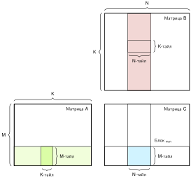

*Механика тайлинга матриц: разбиение большого умножения матриц ($\mathbf{C}=\mathbf{A}\mathbf{B}$) на блоки $M_{\text{tile}}\times K_{\text{tile}}$ и $K_{\text{tile}}\times N_{\text{tile}}$ выравнивает объем памяти под быструю SRAM на кристалле и регистры. Максимизация повторного использования регистров внутри каждого тайла амортизирует медленные обращения к DRAM за пределами кристалла и поддерживает вычислительные движки на пиковой пропускной способности.*

<a id="sec-hardware-acceleration-tiling-fundamentals-e9e6"></a>

##### Основы тайлинга

Тайлинг разбивает вычисление на меньшие тайлы, которые помещаются в доступную быструю память, вместо того чтобы работать сразу со всей структурой данных. Такая структура максимизирует повторное использование данных, сокращая избыточные обращения к памяти и повышая эффективность.

Рассмотрим умножение матриц, ключевую операцию нагрузок машинного обучения. Операция вычисляет $\mathbf{C} = \mathbf{A} \times \mathbf{B}$, где каждый элемент $C_{ij} = \sum_{k} A_{ik} \times B_{kj}$. [«Наивное умножение матриц»](11_hw_acceleration.md#lst-naive_matmul) показывает основную проблему: на каждой итерации самого внутреннего цикла элементы матриц $\mathbf{A}$ и $\mathbf{B}$ выбираются из памяти, выполняется умножение и обновляется матрица $\mathbf{C}$. Поскольку матрицы большие, процессор многократно перезагружает одни и те же значения из памяти, хотя они только что использовались в предыдущих вычислениях.

Эти накладные расходы на перемещение данных дороги: доступ к DRAM имеет гораздо большую задержку и энергетическую стоимость, чем доступ к кэшу или регистрам на кристалле (Horowitz, 2014); (Sze et al., 2017). Решение — тайлинг.

<a id="sec-hardware-acceleration-performance-benefits-tiling-e7bd"></a>

##### Выгоды тайлинга для производительности

Вместо того чтобы вычислять по одному элементу и постоянно перемещать данные туда и обратно из медленной памяти, тайлинг обрабатывает подматрицы (тайлы) по одной, удерживая часто используемые значения в быстрой памяти. Идея в том, чтобы разбить матрицы на меньшие блоки, которые помещаются в кэш процессора или разделяемую память, так что однажды загруженный блок используется многократно, прежде чем перейти к следующему. [«Блочное умножение матриц с учетом кэша»](11_hw_acceleration.md#lst-tiled_matmul) демонстрирует блокировку циклов, дружественную к кэшу: границы циклов разбивают матрицы на тайлы, а иерархия кэшей аппаратуры держит недавно использованные данные тайла рядом с вычислительными блоками, когда порядок доступа обладает локальностью.

<a id="lst-tiled_matmul"></a>

**Блочное умножение матриц с учетом кэша**: этот подход блокировки циклов высокого уровня делит матрицы на меньшие диапазоны индексов, чтобы аппаратные кэши могли переиспользовать данные внутри каждого тайла, повышая вычислительную эффективность без явных загрузок в scratchpad.

```python
TILE_SIZE = 32  # Выбираем размер тайла по аппаратным ограничениям

# Блокировка по кэшу: разбиение данных через границы циклов.
# Загрузки неявные, через иерархию кэшей аппаратуры.
for i in range(0, N, TILE_SIZE):
    for j in range(0, N, TILE_SIZE):
        for k in range(0, N, TILE_SIZE):
            # Каждый тайл вычисляется независимо
            for ii in range(i, min(i + TILE_SIZE, N)):
                for jj in range(j, min(j + TILE_SIZE, N)):
                    for kk in range(k, min(k + TILE_SIZE, N)):
                        C[ii, jj] += A[ii, kk] * B[kk, jj]
```

Такая перестройка заметно повышает производительность благодаря трем взаимно усиливающим эффектам. Повторное использование памяти улучшается, потому что подход многократно обращается к небольшому тайлу, пока он вероятнее всего остается в кэше, прежде чем перейти к следующему тайлу, а не выбирает элементы $\mathbf{A}$ и $\mathbf{B}$ снова и снова из медленной памяти, что минимизирует избыточные обращения. Использование пропускной способности памяти падает как прямое следствие: поскольку каждый тайл используется многократно, прежде чем будет вытеснен, большинство нужных данных доступны в кэше L1/L2 или разделяемой памяти, а не в DRAM, поэтому трафик сокращается и выполнение ускоряется. Эффективность вычислений растет в свою очередь, потому что процессоры меньше времени ждут данных и больше времени выполняют полезную работу; в архитектурах вроде GPU и TPU, где тысячи параллельных вычислительных блоков работают одновременно, тайлинг обеспечивает структурированное чтение и обработку данных, которое избегает ненужных остановок.

Этот прием особенно эффективен в ИИ-ускорителях, где нагрузки машинного обучения состоят из больших умножений матриц и преобразований тензоров. Без тайлинга такие нагрузки быстро становятся ограниченными памятью, то есть производительность определяется скоростью получения данных, а не сырой вычислительной мощностью процессора.

<a id="sec-hardware-acceleration-tiling-methods-6257"></a>

##### Методы тайлинга

Хотя общий принцип тайлинга остается тем же, то есть разбиение больших вычислений на меньшие подзадачи для улучшения повторного использования памяти, существуют разные способы применения тайлинга в зависимости от структуры вычисления и аппаратных ограничений. Две основные стратегии тайлинга — пространственный и временной. Они оптимизируют разные аспекты вычислений и доступа к памяти, а на практике их часто комбинируют для достижения наилучшей производительности.

Пространственный тайлинг разбивает структуры данных на меньшие блоки, которые помещаются в быструю память. Тайловое умножение матриц в [«Блочное умножение матриц с учетом кэша»](11_hw_acceleration.md#lst-tiled_matmul) демонстрирует блокировку циклов, дружественную к кэшу: код не выдает явных загрузок в scratchpad, но шаблон доступа в форме тайлов позволяет аппаратным кэшам переиспользовать близкие значения до их вытеснения. Эта стратегия особенно полезна для больших тензоров, которые превышают емкость быстрой памяти: разбивая вычисления на меньшие тайлы, минимизируют перемещение данных между уровнями памяти и держат операции локализованными внутри иерархий кэша.

Временной тайлинг дополняет пространственный, явно размещая данные в разделяемой памяти или регистрах и переупорядочивая вычисления вокруг этих подготовленных данных. Многие нагрузки ML обращаются к одним и тем же данным повторно на разных итерациях — без временного тайлинга это приводит к избыточным выборкам из памяти. Временной тайлинг перестраивает вычисление так, чтобы часто используемые данные оставались в быстрой памяти как можно дольше до начала следующего вычисления.

Классический пример, где временной тайлинг полезен, — сверточные операции, в которых один и тот же набор весов применяется к нескольким областям входа. Без блокировки циклов эти веса могли бы загружаться из памяти несколько раз на каждое вычисление. С временным тайлингом вычисление переупорядочивается так, что веса остаются в быстрой памяти для нескольких входов, что сокращает ненужные выборки и повышает общую эффективность. [«Явная подготовка тайлов (псевдокод)»](11_hw_acceleration.md#lst-loop_blocking) иллюстрирует явную подготовку тайлов: код загружает блоки $\mathbf{A}$ и $\mathbf{B}$ во временное быстрое хранилище, а затем переиспользует их в нескольких операциях внутреннего цикла.

<a id="lst-loop_blocking"></a>

**Явная подготовка тайлов (псевдокод)**: бэкенд отображает временные тайловые объекты на быстрое хранилище и переиспользует их в операциях внутреннего цикла.

```python
# Явная подготовка тайлов: загрузка данных в быструю
# временную память перед внутренними циклами.
for i in range(0, N, TILE_SIZE):
    for j in range(0, N, TILE_SIZE):
        for k in range(0, N, TILE_SIZE):
            # Псевдокод: отображаем эти тайловые объекты на быструю память
            A_tile = A[i : i + TILE_SIZE, k : k + TILE_SIZE]
            B_tile = B[k : k + TILE_SIZE, j : j + TILE_SIZE]

            # Повторно используем загруженные тайлы для всех внутренних итераций
            for ii in range(A_tile.shape[0]):
                for jj in range(B_tile.shape[1]):
                    for kk in range(A_tile.shape[1]):
                        C[i + ii, j + jj] += (
                            A_tile[ii, kk] * B_tile[kk, jj]
                        )
```

Явная подготовка тайлов повышает производительность, когда бэкенд размещает временные тайлы в быстрой памяти и переиспользует их до вытеснения. Псевдокод включает укороченные граничные тайлы, когда $N$ не делится на `TILE_SIZE`.

Этот прием особенно полезен в нагрузках, где определенные значения используются многократно, например в свертках, рекуррентных нейронных сетях (RNN) и механизмах самовнимания трансформеров. Применяя блокировку циклов, ИИ-ускорители могут заметно сократить остановки памяти и повысить пропускную способность выполнения.

<a id="sec-hardware-acceleration-tiling-challenges-tradeoffs-e9c9"></a>

##### Сложности и компромиссы тайлинга

Тайлинг повышает производительность только тогда, когда тайл соответствует бюджету локальности аппаратуры. Если тайл слишком мал, выборки из памяти по-прежнему доминируют во времени выполнения, потому что повторное использование слишком ограничено. Если тайл слишком велик, он не помещается в быструю память и вызывает трэшинг кэша или выгрузку в scratchpad. Поэтому выбор правильного размера тайла прямо определяет вычислительную эффективность и использование пропускной способности памяти.

Размер тайла также управляет балансировкой нагрузки. В таких архитектурах, как GPU и TPU, вычисления выполняются параллельно на тысячах вычислительных блоков. Если тайлы распределены неравномерно, часть блоков простаивает, пока другие перегружены, что ведет к неоптимальному использованию вычислительных ресурсов. Эффективное планирование тайлов поддерживает сбалансированное и эффективное параллельное выполнение.

Перемещение данных остается определяющей стоимостью даже после тайлинга. Хотя тайлинг сокращает число медленных обращений к памяти, перенос тайлов между уровнями иерархии по-прежнему несет задержку и энергетическую стоимость, особенно когда данные выпадают из кэша или scratchpad обратно в DRAM. Эффективные стратегии предвыборки и планирования памяти сводят это остаточное перемещение к минимуму и гарантируют, что данные доступны, когда они нужны.

Гибридный тайлинг сочетает пространственные и временные стратегии, когда ни одно измерение в отдельности не отражает шаблон повторного использования нагрузки. Некоторые ИИ-ускорители используют пространственный тайлинг для умножения матриц, а для повторного использования весов в сверточных слоях применяют временной тайлинг, динамически подстраивая размеры тайлов или переупорядочивая вычисления в зависимости от условий выполнения в реальном времени.

Регистровая блокировка, двойная буферизация и иерархический тайлинг расширяют тот же принцип локальности на более мелкие и более крупные уровни памяти. ИИ-компиляторы и системы среды выполнения, такие как TensorFlow XLA, TVM и MLIR, автоматически выбирают эти стратегии тайлинга по аппаратным ограничениям, позволяя тонко настраивать производительность без ручного вмешательства. [«Стратегии тайлинга»](11_hw_acceleration.md#tbl-tiling-strategies) дает сравнительный обзор пространственного, временного и гибридного подходов к тайлингу, выделяя их преимущества и компромиссы.

По мере роста размера и сложности моделей машинного обучения тайлинг остается критически важным инструментом повышения эффективности аппаратуры, позволяя ИИ-ускорителям работать близко к своему практическому потенциалу. Хотя ручные стратегии тайлинга могут давать существенную выгоду, компиляторы и методы оптимизации с учетом аппаратуры дополнительно повышают производительность, автоматически выбирая эффективные стратегии тайлинга для конкретной нагрузки.

| Аспект                                                    | **Пространственный тайлинг (разбиение данных)**                                            | **Временной тайлинг (блокировка циклов)**                              | **Гибридный тайлинг**          |
|:----------------------------------------------------------|:-------------------------------------------------------------------------------------------|:-----------------------------------------------------------------------|:---------------------------------------------------------------|
| Основная цель                                             | Сократить обращения к памяти, удерживая данные в быстрой памяти дольше                     | Повысить повторное использование данных между итерациями циклов         | Адаптироваться динамически к ограничениям нагрузки              |
| Фокус оптимизации                                         | Разбиение структур данных на меньшие дружественные к памяти блоки                          | Переупорядочивание вычислений для максимизации повторного использования до вытеснения | Балансировка стратегий пространственного и временного повторного использования |
| **Использование памяти**           | Улучшает локальность кэша и сокращает обращения к DRAM                                      | Удерживает часто используемые данные в быстрой памяти на несколько итераций | Минимизирует перемещение данных при высоком повторном использовании |
| **Типичные случаи применения**   | Умножение матриц, CNN, самовнимание в трансформерах                                         | Свертки, рекуррентные нейронные сети (RNN), итеративные вычисления     | ИИ-ускорители с иерархической памятью, смешанные нагрузки      |
| **Прирост производительности** | Сниженные требования к пропускной способности памяти, лучшая загрузка кэша                | Меньшая задержка выборки из памяти, лучшая локальность данных          | Максимальная эффективность на разных типах аппаратуры          |
| Сложности                                                 | Требует аккуратного выбора размера тайла, неэффективен для нагрузок с минимальным пространственным повторным использованием | Может повышать давление на регистры, требует перестройки циклов        | Сложность настройки размера тайла и порядка выполнения в динамике |
| **Лучше всего, когда**                 | Данные велики и требуют разбиения для эффективной обработки                                | Одни и те же данные обращаются многократно на разных итерациях         | Важны и разбиение данных, и повторное использование по итерациям |

<a id="tbl-tiling-strategies"></a>

*Стратегии тайлинга: пространственный, временной и гибридный тайлинг оптимизируют шаблоны доступа к памяти для повышения производительности. Пространственный тайлинг максимизирует повторное использование данных в быстрой памяти, временной тайлинг использует структуру цикла для сокращения обращений, а гибридный тайлинг сочетает оба подхода. Компиляторы и системы среды выполнения ИИ используют эти методы для автоматической оптимизации выполнения моделей на разнообразной аппаратуре.*

<a id="sec-hardware-acceleration-applying-mapping-strategies-neural-networks-3110"></a>

### Применение стратегий отображения к нейронным сетям

Хотя эти базовые приемы отображения применимы широко, их эффективность меняется в зависимости от вычислительной структуры, шаблонов доступа к данным и возможностей распараллеливания разных архитектур нейросетей. Каждая архитектура накладывает свои ограничения на перемещение данных, иерархию памяти и планирование вычислений, требуя подходящих стратегий отображения для оптимизации производительности.

Для систематического выбора стратегий отображения нужен структурированный подход, поскольку при назначении вычислений ИИ-ускорителям возникает комбинаторный взрыв вариантов. Вместо того чтобы рассматривать каждую модель как отдельную задачу оптимизации, одни и те же принципы применимы к разным архитектурам; меняется лишь то, какой приоритет получает каждый из них в зависимости от характеристик нагрузки. Цель состоит в том, чтобы систематически выбирать и применять стратегии отображения, которые максимизируют эффективность для разных типов моделей машинного обучения.

Эти принципы применяются к трем репрезентативным нагрузкам ИИ, каждая из которых характеризуется своими вычислительными требованиями. CNN выигрывают от пространственного повторного использования данных, поэтому выполнение со стационарными весами и тайлинг особенно эффективны. Поведение трансформеров зависит от фазы и формы: умножения матриц при обучении и префилле могут быть вычислительно-ограниченными, тогда как декодирование при малом батче часто зависит от пропускной способности весов и KV-кэша. MLP включают значительное умножение матриц и выигрывают от структурированного тайлинга, оптимизированных раскладок весов и выполнения с учетом памяти.

Несмотря на различия, каждая из этих моделей следует общему набору принципов отображения, с отличиями в расстановке приоритетов оптимизаций. [«Стратегии отображения по архитектурам»](11_hw_acceleration.md#tbl-mapping-strategies) сводит пригодность разных стратегий оптимизации для CNN, трансформеров и MLP.

<a id="sec-hardware-acceleration-convolutional-neural-networks-resnet50-3eb6"></a>

#### Сверточные нейронные сети (ResNet-50)

Для ResNet-50 и подобных CNN ключевая возможность отображения — пространственное повторное использование весов. Небольшой фильтр применяется во многих пространственных позициях, поэтому его веса участвуют во многих операциях умножения с накоплением. Отображения со стационарными весами могут захватить это повторное использование, удерживая тайлы фильтров локально, тогда как отображения со стационарными строками или стационарным выходом на других архитектурах могут лучше балансировать трафик активаций и частичных сумм. Благоприятные формы свертки могут достигать высокой арифметической интенсивности, что делает их хорошо подходящими для матричных и систолических путей выполнения. Семейство моделей не определяет один универсальный поток данных: форма слоя, размер батча, емкость локального хранилища и поддерживаемые ядра целевой платформы решают, какой шаблон повторного использования стоит удерживать.

| **Оптимизационный прием**           | CNN                                                                                  | Трансформеры                                      | MLP                        | Обоснование                                                                                                                                                                                            |
|:------------------------------------------------------------------------------|:-------------------------------------------------------------------------------------|:--------------------------------------------------|:----------------------------|:-----------------------------------------------------------------------------------------------------------------------------------------------------------------------------------------------------|
| **Поток данных**                     | Стационарные веса, строки или выход                                                  | Зависит от фазы и ядра                            | Стационарные веса или выход | CNN открывают повторное использование фильтров и пространственное повторное использование; блоки внимания трансформера и MLP создают иной трафик; плотные MLP повторно используют веса по батчу и накапливают выходы.                                 |
| **Раскладки тензоров с учетом памяти** | Зависит от бэкенда (часто NCHW для сверток cuDNN, channels-last на тензорных ядрах) | Зависит от бэкенда (типичны активации row-major) | Обычно row-major           | Выбор раскладки зависит от пути ядра бэкенда и режима точности (см. раздел [«Эффективные по памяти раскладки тензоров»](11_hw_acceleration.md#sec-hardware-acceleration-memoryefficient-tensor-layouts-e250)); в ячейках указаны распространенные умолчания, а не универсальные предписания. |
| Слияние ядер                                                                  | Свертка + активация                                                                  | Слитое внимание                                   | Слияние GEMM               | CNN оптимизируют слияние свертки и активации; трансформеры сливают механизмы внимания; MLP выигрывают от слитых умножений матриц.                                                                 |
| **Тайлинг для эффективности памяти**                                              | Пространственный тайлинг                                                                       | Временной тайлинг                                   | Блочный тайлинг              | CNN разбивают на тайлы по пространственным измерениям; трансформеры используют блокировку циклов для эффективности памяти по последовательности; MLP используют блочный тайлинг для больших умножений матриц.                                  |

<a id="tbl-mapping-strategies"></a>

*Стратегии отображения по архитектурам: каждая архитектура нейросети выигрывает от разных приоритетов оптимизации в зависимости от ее вычислительных характеристик и характеристик памяти.*

Эта пространственная регулярность также позволяет агрессивно сливать операции и тайлить вычисления. Для вывода с замороженной статистикой BatchNorm компиляторы могут свертывать или сливать свертку, нормализацию и активацию, чтобы избежать ненужных промежуточных записей. BatchNorm в режиме обучения требует редукций по статистикам батча и не имеет того же контракта поэлементного слияния. Пространственный тайлинг разбивает карту признаков на подобласти, размер которых подобран под SRAM на кристалле, поэтому слитое ядро обрабатывает каждый тайл из быстрой памяти, прежде чем перейти к следующему.

<a id="sec-hardware-acceleration-transformer-architectures-gpt2llama-dd9a"></a>

#### Архитектуры трансформеров (GPT-2/Llama)

Если CNN определяются повторным использованием весов, то трансформеры определяются давлением на память со стороны кэша ключей и значений (KV). Во время вычисления внимания каждый вектор запроса должен обращаться к сохраненным парам ключей и значений по всей длине последовательности. По мере роста последовательностей полный KV-кэш обычно находится в HBM или DRAM устройства, тогда как ядра внимания разбивают активные блоки на тайлы в SRAM, регистрах или разделяемой памяти. Этот шаблон доступа мотивирует выполнение со стационарными активациями: удерживать текущие тайлы KV рядом с вычислительными блоками, пропуская через них запросы, вместо того чтобы многократно материализовать большие промежуточные результаты внимания во внешней памяти.

Трафик памяти, который создают стандартные реализации внимания, объясняет, почему слитые ядра внимания, такие как FlashAttention (Dao et al., 2022), дают большой прирост производительности: сливая скалярное произведение запроса и ключа, нормализацию softmax и взвешенную по значениям сумму в одно ядро, которое разбивает вычисления на тайлы по измерению последовательности, эти реализации не материализуют полную матрицу внимания в основной памяти. Такой подход временного тайлинга обрабатывает блоки последовательности, которые помещаются в SRAM на кристалле, существенно сокращая трафик HBM при сохранении вычисления внимания $\mathcal{O}(S^2)$. Отображение трансформера зависит от фазы и формы: GEMM при обучении и префилле могут быть вычислительно-ограниченными, тогда как авторегрессивное декодирование при малом батче обычно ограничено пропускной способностью весов и KV-кэша.

<a id="sec-hardware-acceleration-multilayer-perceptrons-dlrm-7c0d"></a>

#### Многослойные перцептроны и DLRM

MLP представляют самую прямую задачу отображения, потому что их вычисление в основном сводится к плотному GEMM.[^fn-gemm-ml-primitive] Каждый полносвязный слой умножает матрицу активаций на матрицу весов. Матрица весов фиксирована для всех образцов, поэтому батчинг повторно использует каждый загруженный вес по большему числу активаций и повышает арифметическую интенсивность. Батч из одного образца дает мало повторного использования весов между образцами и часто недозагружает широкие матричные движки, тогда как большие батчи могут сдвинуть выполнение в вычислительно-ограниченный режим. Раздел [«Обобщенное матричное умножение (GEMM)»](appendix_algorithm.md#sec-appdx-algorithm-foundations-general-matrix-multiply-gemm-b55d) приложения «Основы алгоритмов» выводит масштабирование, которое определяет эту чувствительность.

[^fn-gemm-ml-primitive]: **GEMM**: операция $\mathbf{C} = \alpha \mathbf{A}\mathbf{B} + \beta \mathbf{C}$ — это примитив плотной линейной алгебры, к которому сводятся многие слои глубокого обучения. Оптимизированные библиотеки GEMM, такие как cuBLAS и oneDNN, используют регистровое блокирование, векторизацию и иерархический тайлинг, чтобы приблизиться к аппаратным пределам на благоприятных формах (NVIDIA, 2024); (Intel Corporation, 2021). Современные ИИ-ускорители сильно специализированы под тайлы, похожие на GEMM: тензорные ядра, систолические массивы и матричные расширения существуют, чтобы ускорять этот примитив, поэтому производительность GEMM служит важным предиктором сквозной пропускной способности на разных архитектурах.

Поскольку слои MLP обычно сопровождаются функциями активации и добавлением смещений, слияние GEMM объединяет эти шаги в одно ядро, избегая промежуточных записей в память. Блочный тайлинг разбивает большие умножения матриц на подблоки, размер которых подобран под разделяемую память ускорителя, обеспечивая высокую загрузку кэша на всем протяжении вычисления. Простота отображения MLP, где доминирует один примитив с предсказуемыми шаблонами доступа, как раз и объясняет, почему производители аппаратуры так агрессивно оптимизируют библиотеки GEMM: прирост производительности GEMM напрямую переходит в пропускную способность MLP. Однако DLRM — не чисто MLP-нагрузка. Ее большие разреженные таблицы эмбеддингов и этап взаимодействия признаков могут доминировать в емкости и трафике памяти, поэтому описанное здесь плотное отображение относится к нижней и верхней башням MLP, а не ко всей модели (Naumov et al., 2019).

<a id="sec-hardware-acceleration-hybrid-mapping-strategies-3e8c"></a>

### Гибридные стратегии отображения

Предыдущие архитектурные подразделы рассматривают каждую архитектуру изолированно, однако реальные модели редко состоят из слоев одного типа. Визуальный трансформер, например, сочетает этап встраивания патчей, слои самовнимания и блоки MLP (Dosovitskiy et al., 2021). Эти слои создают разные шаблоны повторного использования: этап встраивания может выиграть от отображения со стационарными весами, внимание делает упор на движение активаций и тайлинг, а блоки MLP требуют блочного тайлинга GEMM и слияния. Ни одна стратегия потока данных не оптимальна для всех этих слоев, поэтому аппаратное отображение становится гибридным и зависящим от слоя.

Гибридное отображение решает эту неоднородность, позволяя ускорителю переключать стратегии на границах слоев. Каждый слой представляет свой баланс вычислительной интенсивности, повторного использования данных и шаблона доступа к памяти, и оптимальное отображение должно меняться соответственно (Sze et al., 2017). Вместо того чтобы фиксироваться на одном потоке данных для всей модели, гибридные подходы выбирают выполнение со стационарными весами для слоев с высоким повторным использованием весов, выполнение со стационарными активациями для слоев внимания с большими KV-кэшами и выполнение со стационарным выходом для слоев, где важнее всего минимизировать трафик записи.

Современные ускорители предоставляют архитектурные возможности, необходимые для реализации гибридного отображения на практике. Систолические массивы в духе TPU, GPU NVIDIA и ускорители на основе тайлов открывают разные сочетания локальной памяти, раскладок тензоров, слияния и средств планирования, позволяя компиляторам и средам выполнения выбирать стратегии для конкретных слоев, а не один глобальный поток данных для всей модели (Jouppi et al., 2023); (NVIDIA Corporation, 2020); (Chen et al., 2018). Эти реализации требуют программируемых иерархий памяти, эффективных межсоединений и специализированных конвейеров выполнения, что подкрепляет принцип совместного проектирования аппаратуры и программного обеспечения.

Однако гибридное отображение остается оптимизацией на этапе проектирования. В промышленных нагрузках условия выполнения меняются динамически из-за различных размеров входов, конкуренции за память и доступности аппаратных ресурсов. Компиляторы машинного обучения и системы среды выполнения расширяют эти статические решения об отображении, вводя динамическое планирование, оптимизации памяти и автонастройку, что обеспечивает эффективную работу глубоких нейронных сетей на разных ускорителях и в разных средах развертывания.

<a id="sec-hardware-acceleration-compiler-support-172e"></a>

## Поддержка компиляторов

Одна свертка может быть реализована десятками допустимых стратегий тайлинга, вариантами ядер и раскладками памяти, большинство из которых плохо работают на данной целевой платформе. **Компиляторы машинного обучения** справляются с этой сложностью, переводя высокоуровневые представления потоков данных в исполняемый код для конкретной целевой платформы. Компиляция ResNet-50 для вывода на GPU иллюстрирует основные этапы компилятора:

1. **Оптимизация графа** сливает повторяющиеся шаблоны Conv2D–BatchNorm–ReLU в единые составные ядра, устраняя промежуточные обращения туда и обратно к HBM.
2. **Выбор ядра** подбирает специализированные реализации тензорных ядер для совместимых умножений матриц, используя высокую арифметическую интенсивность плотных сверток.
3. **Планирование памяти** определяет времена жизни активаций, чтобы безопасно перекрывать и переиспользовать выделения промежуточных буферов.
4. **Планирование вычислений** конвейеризует копирования памяти с выполнением по независимым аппаратным очередям, скрывая задержки передачи данных.

В этом сценарии задержка вывода падает с 47 мс до 8 мс, то есть в 5,9 раза, без изменения математического выхода модели. Эти цифры отражают, как переписывание графа, выбор ядер, планирование памяти и расписание систематически применяют слияние ядер ([«Слияние ядер»](11_hw_acceleration.md#sec-hardware-acceleration-kernel-fusion-7faf)) и эффективный по памяти тайлинг ([«Эффективные по памяти стратегии тайлинга»](11_hw_acceleration.md#sec-hardware-acceleration-memoryefficient-tiling-strategies-9fce)), чтобы превратить теоретические FLOP/s аппаратуры в реально достигаемую пропускную способность (Chen et al., 2018); (NVIDIA, 2024).

Этот конвейер воплощает принцип совместного проектирования аппаратуры и программного обеспечения, введенный в разделе [«Основы ускорения»](11_hw_acceleration.md#sec-hardware-acceleration-ai-hardware-acceleration-fundamentals-9b28). Компиляторы машинного обучения соединяют высокоуровневые спецификации моделей с низкоуровневыми движками выполнения, перестраивая вычисления, выбирая ядра, специализированные под аппаратуру, и планируя времена жизни тензорного хранилища (Chen et al., 2018). Они опираются на классические основы компиляторов, добавляя преобразования на уровне тензоров и графов.

<a id="sec-hardware-acceleration-compiler-design-differences-ml-workloads-0698"></a>

### Конструкция компиляторов ML

Компиляторы машинного обучения специализируют традиционные техники компиляции для программ, выраженных как тензорные графы и библиотеки операторов. Компиляторы общего назначения оптимизируют скалярный поток управления, векторные инструкции, распределение регистров и локальность кэша; стеки компиляторов ML работают на более высоком семантическом уровне, оптимизируя топологию графа, раскладки тензорной памяти, специализацию по формам, диспетчеризацию ядер ускорителя и планирование выполнения между устройствами (Li et al., 2021).

[«Приоритеты оптимизации компиляторов»](11_hw_acceleration.md#tbl-ml-vs-traditional-compilers) сопоставляет акценты этих двух слоев компиляции. Граница взаимодополняющая, а не непересекающаяся: стек компилятора ML понижает высокоуровневые тензорные операции до промежуточных представлений, которые передаются в бэкенд LLVM, GPU или специфичный для вендора.

| Аспект                                                                | **Традиционный компилятор**  | **Компилятор машинного обучения** |
|:----------------------------------------------------------------------|:-----------------------------------------------------------------|:--------------------------------------------------------------------------|
| **Входное представление**       | Программа на исходном языке или в промежуточном представлении    | Тензорный граф или тензорное промежуточное представление                  |
| Модель выполнения                                                     | Поток управления, циклы, потоки, векторы и задачи                | Тензорные операторы, ядра, графы и потоки ускорителя                      |
| **Приоритеты оптимизации** | Выбор инструкций, преобразования циклов, векторизация, регистры | Переписывание графа, слияние, раскладки, формы и выбор ядер              |
| **Управление памятью**             | Объекты, стек/куча, кэши, локальность и предвыборка              | Времена жизни тензоров, переиспользование буферов, раскладки, тайлинг и передачи между устройствами |
| Целевое оборудование                                                  | CPU, GPU и другие программируемые цели                           | CPU, GPU, TPU и заказные ускорители                                       |
| **Результат компиляции**           | Машинный код или промежуточное представление более низкого уровня | Ядра плюс аппаратно-специфичный граф или план выполнения                  |

<a id="tbl-ml-vs-traditional-compilers"></a>

*Приоритеты оптимизации компиляторов: стеки компиляторов ML добавляют решения на уровне тензоров и графов к традиционной компиляции на уровне инструкций и циклов. В промышленной цепочке инструментов оба слоя обычно работают вместе, а не заменяют друг друга.*

Различие, описанное в [«Приоритеты оптимизации компиляторов»](11_hw_acceleration.md#tbl-ml-vs-traditional-compilers), объясняет, почему конфигурация компилятора определяет достигаемую производительность, даже если исходный код нейросети не меняется. Компиляторы ML управляют слоем трансляции между высокоуровневыми тензорными операциями и исполнительными блоками аппаратуры; когда это отображение не оптимизирует повторное использование данных или выравнивание раскладки, вычислительные блоки простаивают, а шины памяти насыщаются.

<a id="psp-hw-acceleration-hidden-optimization-layer"></a>

> **Скрытый слой оптимизации**
>
> Большинство практиков никогда не работают с компиляторами ML напрямую, однако качество компилятора определяет, какую долю пиковой пропускной способности ускорителя достигает модель. Вызов `model.compile()` в Keras, `torch.compile()` в PyTorch или развертывание движка через TensorRT запускает многоэтапные конвейеры оптимизации, которые выполняют четыре преобразования:
>
> - **Слияние операций**, которые разработчик сам не объединял (например, слияние Conv2D, BatchNorm и ReLU в одно ядро)
> - **Переупорядочивание вычислений** для максимизации повторного использования данных в быстрой локальной памяти (например, тайлинг умножений матриц)
> - **Выбор ядер** из библиотек, содержащих сотни настроенных вручную реализаций для конкретных архитектур
> - **Преобразование раскладок тензоров** между тем, что ожидает API фреймворка, и тем, что требуют контроллеры памяти аппаратуры
>
> Одно и то же определение модели работает с существенно разной пропускной способностью в зависимости от бэкенда компиляции, выбора понижения графа, выбора ядер и конфигурации среды выполнения. Когда задержка выполнения превышает целевые показатели обслуживания, конфигурация компилятора и понижение до бэкенда становятся основными рычагами оптимизации, которые не требуют изменения архитектуры модели или параметров обучения.

<a id="sec-hardware-acceleration-ml-compilation-pipeline-7676"></a>

### Конвейер компиляции ML

Модели машинного обучения, определенные в современных фреймворках, представлены как высокоуровневые графы потоков данных, описывающие операции над многомерными тензорами. Перевод этих представлений в исполняемый код для CPU, GPU, TPU или заказных ASIC требует конвейера компиляции ML (Chen et al., 2018); (Google, 2025); (Lattner et al., 2020).

Стандартный конвейер компиляции выполняет пять взаимосвязанных обязанностей:

1. Оптимизация графа перестраивает вычисление, устраняя избыточную работу и сокращая трафик данных.
2. Выбор ядра сопоставляет математические операции с оптимизированными реализациями под конкретную целевую платформу.
3. Планирование памяти назначает раскладки тензоров, статические смещения буферов и границы времени жизни.
4. Планирование вычислений упорядочивает ядра и передачи памяти, чтобы максимизировать параллелизм и скрыть задержки передач.
5. Генерация кода выпускает машинные инструкции, ассемблер или интерпретируемый байт-код для конкретной целевой платформы.

На всех этих этапах компилятор применяет стратегии потоков данных, разобранные в разделе [«Оптимизация потоков данных»](11_hw_acceleration.md#sec-hardware-acceleration-dataflow-optimization-strategies-ce52): слияние ядер, тайлинг памяти и размещение вычислений. Аппаратное ускорение дает свою теоретическую пропускную способность, только когда эти преобразования, управляемые компилятором, открывают достаточную арифметическую интенсивность и согласуют доступ к памяти с иерархией аппаратуры.

<a id="sec-hardware-acceleration-graph-optimization-f888"></a>

### Оптимизация графа

Фреймворки машинного обучения представляют модели как высокоуровневые вычислительные графы, где узлы — математические операторы (например, свертки, умножения матриц и активации), а направленные ребра — зависимости тензорных данных. Выполнение этого графа узел за узлом, как его задают фронтенды фреймворков, влечет серьезные штрафы памяти: каждое ребро требует выделения памяти и транзакции во внешней памяти (запись в DRAM или HBM с последующим чтением), а каждый узел — накладных расходов на запуск ядра и синхронизацию. На ускорителях, где арифметическая пропускная способность опережает пропускную способность памяти на порядок, материализация ненужных промежуточных тензоров доминирует в общем времени выполнения.

Оптимизация графа преобразует этот вычислительный граф в эффективный план выполнения до генерации аппаратного кода (Chen et al., 2018); (Jia et al., 2019). Работая в основном на независимом от целевой платформы промежуточном представлении (IR) до понижения ([«Генерация кода»](11_hw_acceleration.md#sec-hardware-acceleration-code-generation-85c8)), проходы графа применяют четыре основных преобразования:

Слияние операторов объединяет соседние операции в одно составное ядро, чтобы устранить обращения к внешней памяти туда и обратно и накладные расходы запуска. В сверточных сетях слияние Conv2D, пакетной нормализации и ReLU в одно ядро сохраняет активации в локальных регистрах или разделяемой SRAM на протяжении всей последовательности ([«Слияние ядер»](11_hw_acceleration.md#sec-hardware-acceleration-kernel-fusion-7faf)). В архитектурах трансформеров сопоставители шаблонов заменяют многооператорные подграфы самовнимания (умножение матриц, масштабирование, маскирование, softmax и проекцию) монолитными ядрами внимания с учетом ввода-вывода (IO-aware), которые разбивают вычисления на тайлы полностью внутри быстрой памяти на кристалле (Dao et al., 2022).

Устранение избыточных вычислений и свертка констант находят и удаляют ненужные операции. Во время компиляции вывода параметры статических слоев, например векторы масштаба и смещения пакетной нормализации, сворачиваются прямо в веса и смещения предыдущих линейных или сверточных слоев, что убирает операторы нормализации из выполнения во время работы. Проходы графа также обрезают мертвые подграфы и объединяют одинаковые параллельные пути через исключение общих подвыражений.

Алгебраическое упрощение и корректировки раскладки переупорядочивают операции там, где они математически эквивалентны, чтобы минимизировать перемещение данных. Например, транспонирования можно протащить через поэлементные операции или сократить с обратными перестановками, уменьшая накладные расходы на изменение формы во время выполнения.

Переупорядочивание узлов с учетом памяти оценивает зависимости данных по топологическим сортировкам графа, чтобы планировать независимые операции в порядке, который минимизирует пиковый объем живых тензоров. Переупорядочивание узлов гарантирует, что промежуточные активации своевременно потребляются и освобождаются, не давая давлению на память вынуждать выгрузку в память хоста.

Компиляторы XLA, TVM, TensorRT и MLIR выполняют эти переписывания через правила сопоставления шаблонов и насыщение равенств. Устраняя ненужные обращения к памяти туда и обратно и раскрывая крупнозернистый параллелизм, оптимизация графа производит граф выполнения, который согласуется с ограничениями пропускной способности ускорителя. После того как граф перестроен в оптимизированные составные операции, компилятор должен связать каждый узел с конкретной аппаратно-специфичной процедурой выполнения.

<a id="sec-hardware-acceleration-kernel-selection-df01"></a>

### Выбор ядер

Выбор ядра связывает каждый узел оптимизированного графа с конкретной аппаратной реализацией. Ускорители предоставляют десятки допустимых реализаций ядер для одной тензорной операции, каждая из которых параметризуется размерами тайлов, конфигурацией блоков потоков, шаблонами разбиения на память и целевой точностью. Выбор оптимального ядра определяет, достигает ли движок выполнения высокой загрузки вычислений или простаивает на несогласованных обращениях к памяти и пузырях конвейера (Chen et al., 2018); (Zheng et al., 2020).

В большинстве промышленных конвейеров компиляторы берут реализации из библиотек ядер, оптимизированных вендорами, а не синтезируют ядра с нуля. cuDNN и cuBLAS от NVIDIA предоставляют подобранные вручную подпрограммы для GPU, oneDNN от Intel ориентирована на архитектуры x86, Arm Compute Library (ACL) — на процессоры Arm, а BLIS дает оптимизированные примитивы матричных вычислений для CPU. Эти библиотеки кодируют детали микроархитектуры, такие как емкость регистрового файла, задержку иерархии кэшей и ширину векторных линий, позволяя компилятору вызывать заранее настроенные реализации.

Компиляторы ИИ используют три основные стратегии для выбора среди кандидатных ядер:

Выбор на основе правил опирается на статические эвристики[^fn-heuristic-kernel-selection], которые отображают операторы по формам тензоров, типам данных и целевым платформам. Например, XLA выбирает реализации GEMM с поддержкой тензорных ядер на GPU NVIDIA, когда размерности матриц кратны 8 или 16, а точность установлена в FP16 или BF16. Эвристики не требуют накладных расходов времени компиляции, хотя могут пропустить неочевидные оптимальные конфигурации на нерегулярных формах тензоров.

Выбор на основе модели стоимости оценивает задержку выполнения ядра и трафик памяти с помощью аналитических моделей архитектуры аппаратуры. Фреймворки вроде MLIR предоставляют инфраструктуру для моделей стоимости, которые предсказывают давление на регистры, долю попаданий в кэш и арифметическую интенсивность в пространстве параметров, отсекая неперспективные кандидаты без запуска физических бенчмарков (Lattner et al., 2020).

Выбор, управляемый профилированием, оценивает кандидатные ядра эмпирически на целевой аппаратуре. Системы TVM AutoTVM и Ansor измеряют задержку выполнения непосредственно на ускорителе, перебирая размеры тайлов, коэффициенты разворачивания циклов и конфигурации потоков с помощью статистического поиска, чтобы сойтись к самой быстрой реализации (Chen et al., 2018); (Zheng et al., 2020). Аналогично TensorRT строит аппаратно-специфичные движки выполнения, сравнивая варианты тактик непосредственно с целевыми размерами батчей и ограничениями памяти.

Выбор с учетом точности интегрирует численные требования в процесс выбора. Обучение требует FP32 или BF16, чтобы сохранять численную устойчивость при накоплении градиентов, тогда как конвейеры вывода используют FP16 или INT8, чтобы максимизировать арифметическую пропускную способность и вдвое сократить трафик памяти. Ошибка выбора здесь влияет и на корректность, и на скорость: направление некалиброванной модели на ядро INT8 ухудшает точность модели, тогда как выбор FP32 по умолчанию оставляет движки тензорных ядер недозагруженными.

Когда ядра выбраны, планирование памяти и планирование вычислений определяют точные выделения буферов, последовательности запусков и параллельность потоков.

[^fn-heuristic-kernel-selection]: **Эвристика в выборе ядер**: практическое правило, которое выбирает перспективную реализацию без исчерпывающего бенчмаркинга всего пространства кандидатов. Размеры тайлов, раскладки, режимы точности, выбор слияния и ограничения формы могут создавать много допустимых вариантов GEMM. Эвристики снижают стоимость настройки, но могут пропустить более быстрого кандидата, поэтому автотюнеры, такие как AutoTVM, профилируют выбранные варианты на целевой аппаратуре.

<a id="sec-hardware-acceleration-memory-planning-fb9f"></a>

### Планирование памяти

Планирование памяти назначает физические места хранения, смещения буферов и времена жизни тензоров по иерархии памяти ускорителя (Roesch et al., 2018); (Chen et al., 2018). Высокопроизводительные планы выполнения терпят неудачу, если управление памятью вносит несогласованные транзакции памяти, конфликты банков или ненужные выделения, которые исчерпывают память ускорителя.

Компилятор координирует три основных механизма управления памятью.

Оптимизация раскладки тензоров определяет физическое расположение измерений тензора в памяти. Разные аппаратные архитектуры и вычислительные движки требуют конкретных раскладок памяти, чтобы обеспечить объединенный доступ к глобальной памяти и векторизацию ([«Эффективные по памяти раскладки тензоров»](11_hw_acceleration.md#sec-hardware-acceleration-memoryefficient-tensor-layouts-e250)). Например, тензорные ядра NVIDIA достигают пиковой пропускной способности с раскладкой channels-last `NHWC` для сверток FP16 и INT8, где измерения каналов совпадают с 16-байтными транзакциями памяти, тогда как устаревшие CUDA-ядра FP32 исторически предпочитали channels-first `NCHW` (NVIDIA Corporation, 2021); (Google, 2025). Компиляторы выполняют назначение раскладок глобально по всему графу, чтобы не допустить последовательных ядер преобразования раскладки, которые расходуют пропускную способность памяти.

Анализ живости и повторное использование буферов предотвращают ошибки нехватки памяти, разделяя физическую память между неперекрывающимися тензорами. Глубокие нейронные сети порождают десятки промежуточных тензоров активаций во время прямого распространения. Выделение уникального буфера памяти для каждого тензора быстро превысило бы емкость памяти устройства (например, 16–80 ГБ на типичных ускорителях-GPU). Компилятор анализирует граф, чтобы вычислить интервал живости каждого тензора — от его создания до завершения последнего потребителя. Моделируя выделение памяти как задачу раскраски графа интервалов или двумерной упаковки в контейнеры, компилятор назначает несколько неперекрывающихся промежуточных тензоров на одни и те же физические смещения памяти (Roesch et al., 2018). Такое статическое повторное использование снижает требования к пиковой памяти устройства до размера рабочего набора одновременно активных тензоров, избегая накладных расходов на выделение во время выполнения и фрагментации.

Размещение в иерархии памяти оптимизирует подготовку данных между внешней памятью (HBM или GDDR) и scratchpad-памятью на кристалле (SRAM или разделяемой памятью). Пропускная способность внешней памяти — дефицитный ресурс; перемещение промежуточных тайлов туда и обратно по шине памяти создает остановки, ограниченные памятью. Компиляторы синтезируют параметры тайлинга, которые гарантируют, что промежуточные блоки остаются резидентными в SRAM на кристалле до завершения всех локальных вычислительных операций, минимизируя трафик туда и обратно по шине памяти.

Когда раскладки памяти зафиксированы и адреса буферов назначены, компилятор планирует выполнение операций на аппаратных вычислительных ресурсах.

<a id="sec-hardware-acceleration-computation-scheduling-7ccd"></a>

### Планирование вычислений

Планирование вычислений определяет временную шкалу выполнения и привязку аппаратных ресурсов для операций в скомпилированном графе (Zheng et al., 2020). Современные ускорители имеют глубокие аппаратные конвейеры, несколько независимых вычислительных движков и выделенные движки копирования DMA. Эффективное планирование координирует эти ресурсы, чтобы максимизировать заполненность аппаратуры, сохранить зависимости данных и предотвратить остановки конвейера (Chen et al., 2018).

<a id="sec-hardware-acceleration-implementation-ai-compilers-ff25"></a>

#### Реализация в ИИ-компиляторах

Компиляторы реализуют планирование по трем различным архитектурным измерениям.

Разбиение задач отображает вычислительные подграфы на исполнительные блоки целевой платформы. На GPU вычисления разбиваются на сетки блоков потоков, распределяемых по потоковым мультипроцессорам (SM). На TPU умножения матриц разбиваются на последовательности тайлов, согласованные с физическими размерами систолических массивов (например, $128 \times 128$ или $256 \times 256$ процессорных элементов) (Norrie et al., 2021). На CPU задачи разделяются на пулы потоков, соответствующих физическим ядрам, и векторизуются, чтобы заполнять регистры SIMD.

Порядок выполнения разрешает зависимости, одновременно минимизируя давление живой памяти. Операции, которые зависят от предыдущих результатов, должны ждать завершения ядер-производителей, но независимые ветви — например, проекции голов многоголового внимания или параллельные остаточные пути — могут выполняться одновременно или чередоваться, чтобы поддерживать равномерную загрузку вычислений. Компиляторы анализируют граф зависимостей, чтобы планировать операции в порядке, который поддерживает конвейеры вычислений заполненными, одновременно сокращая времена жизни активаций и предотвращая раздувание буферов.

Асинхронное перекрытие скрывает задержку памяти, выполняя передачи данных одновременно с вычислительными ядрами. Ускорители имеют выделенные движки DMA, которые работают независимо от арифметических конвейеров. Компиляторы используют это архитектурное разделение, планируя передачи памяти (например, веса от хоста к устройству или обмены «гало» между ускорителями) в отдельных аппаратных очередях или потоках CUDA, перекрывая задержку передачи с длительными вычислительными операциями (Chen et al., 2018); (NVIDIA, 2024). Когда вычисления и передачи полностью перекрываются, стоимость перемещения данных скрывается за арифметическим выполнением.

Плохое планирование создает пузыри выполнения, в которых арифметические блоки простаивают, ожидая выдачи ядер или последовательных копирований данных. Синхронизация ядер через явные события, которые генерирует компилятор, и расписания потоков обеспечивает устойчивое выполнение аппаратуры без вмешательства драйвера CPU (NVIDIA, 2024); (Zheng et al., 2020).

<a id="sec-hardware-acceleration-code-generation-85c8"></a>

#### Генерация кода

После завершения планирования последний этап компиляции переводит расписанный план выполнения в машинные инструкции, специфичные для целевой платформы. Генерация кода применяет традиционные проходы бэкенд-компилятора — выбор инструкций, распределение регистров, планирование инструкций и локальную оптимизацию (peephole) — адаптированные под архитектуры ускорителей.

Решающим является то, что выбор инструкций для целей ML должен выдавать инструкции, которые напрямую задействуют специализированные расширения матричного ISA. На GPU NVIDIA генераторы кода выдают инструкции PTX, например `mma.sync.aligned`, чтобы напрямую вызвать тензорные ядра, как показано в [«Операция тензорного ядра»](11_hw_acceleration.md#lst-tensor_core_op). На CPU Intel с Advanced Matrix Extensions (AMX) бэкенд нацелен на инструкции тайлового умножения, работающие с двумерными регистровыми тайлами. На архитектурах Arm с Scalable Matrix Extension (SME) целью является накопление внешних произведений по масштабируемым векторным тайлам. Бэкенд, который выдает общие инструкции векторной арифметики с плавающей точкой вместо этих матричных расширений, оставляет основные вычислительные движки неиспользованными и снижает эффективную пропускную способность на порядок.

Для CPU и GPU компиляторы выдают машинный код или оптимизированный ассемблер; для TPU, программируемых пользователем вентильных матриц (FPGA)[^fn-fpga-reconfigurable-logic] и проприетарных NPU результатом часто становится оптимизированный байт-код или бинарный пакет выполнения, который запускается специализированной аппаратной средой выполнения.

[^fn-fpga-reconfigurable-logic]: **Программируемая пользователем вентильная матрица (FPGA)**: «программируемая пользователем» означает, что логическую структуру можно настраивать после производства, в отличие от ASIC с фиксированной функцией. FPGA могут повысить производительность для сервисов дата-центров с жесткими требованиями к задержке, реализуя заказные конвейеры под конкретную нагрузку (Putnam et al., 2014). Эта перенастраиваемость делает FPGA привлекательными для быстро развивающихся архитектур ML, где выбор ASIC рискует устареть, однако необходимость в языках описания аппаратуры (Verilog/VHDL) и времена компиляции, измеряемые часами, создают барьер производительности, который ограничивает применение развертываниями, где выигрыш в эффективности оправдывает инженерные затраты.

<a id="sec-hardware-acceleration-compilationruntime-support-0206"></a>

### От компиляции к среде выполнения

Компилятор преобразует высокоуровневую модель в план выполнения, адаптированный под целевую аппаратуру, однако этот план содержит статические допущения о условиях выполнения: формах тензоров, пределах выделения рабочей памяти, возможностях устройства и параллелизме выполнения. Компиляция заранее (AOT) оптимизирует структуры графа, границы слияния и раскладки памяти для фиксированных форм и известных конфигураций аппаратуры. Хотя компиляция «точно в срок» (JIT) может динамически компилировать специализированные варианты по мере поступления новых форм, каждое скомпилированное ядро все равно выполняется по фиксированному плану.

Однако промышленные среды обслуживания ИИ работают в динамических условиях, которые отличаются от статических допущений компилятора. Интенсивность поступления запросов колеблется, размеры батчей меняются динамически, несколько нагрузок вывода конкурируют за общую память ускорителя, а тепловой троттлинг может снижать тактовые частоты ниже номинальных значений. Среды выполнения обслуживания управляют этими колебаниями через динамический батчинг запросов, конкурентность по нескольким потокам, контроль допуска и выбор движка выполнения, а не пересчитывают на лету стратегии слияния ядер или тайлинга. Глава [«Обслуживание моделей»](13_model_serving.md#sec-model-serving) рассматривает динамический батчинг, контроль допуска и цели уровня обслуживания как задачи системного инжиниринга; непосредственная системная задача — как среда выполнения ускорителя эффективно запускает скомпилированные планы выполнения, когда батч достигает аппаратуры.

<a id="sec-hardware-acceleration-runtime-support-f94f"></a>

## Поддержка среды выполнения

Среда выполнения ИИ соединяет статическую компиляцию графов с динамическими реалиями выполнения на ускорителе. Компиляторы оптимизируют и понижают вычислительные графы при фиксированных структурных допущениях, но в промышленных системах встречаются переменные размеры батчей, колеблющиеся длины последовательностей и ограниченные бюджеты памяти. Среда выполнения запускает скомпилированные движки, одновременно управляя формами тензоров, зависящими от входа, выделениями scratchpad-памяти, асинхронными аппаратными потоками и предварительно скомпилированными профилями выполнения. В промышленных стеках вывода, таких как NVIDIA TensorRT, офлайн-построитель оптимизирует сеть и сравнивает тактики-кандидаты, чтобы построить движок выполнения, а движок среды выполнения связывает входные буферы, выбирает допустимые профили оптимизации и отправляет ядра на ускоритель (NVIDIA Corporation, 2026).

Этот жизненный цикл выполнения охватывает три основные обязанности. Во-первых, среда выполнения выбирает и отправляет предварительно скомпилированные варианты ядер, соответствующие размерностям тензоров во время выполнения и возможностям аппаратуры. Во-вторых, она управляет памятью устройства через арена-аллокаторы и статическое повторное использование буферов, устраняя дорогую синхронизацию хоста и устройства во время выполнения. В-третьих, в распределенных средах фреймворки выполнения координируют границы выполнения между устройствами, как показано в фреймворках конвейерного параллелизма, таких как GPipe (Huang et al., 2019), и системах автоматического размещения по устройствам (Mirhoseini et al., 2017). Пока планировщики обслуживания управляют батчингом запросов и контролем допуска в кластерах, среда выполнения ускорителя управляет локальным выполнением на устройстве.

Сравнение сред выполнения ИИ с традиционными средами программного выполнения проясняет, почему нагрузкам машинного обучения нужны специализированные стратегии выполнения.

<a id="sec-hardware-acceleration-runtime-architecture-differences-ml-systems-932e"></a>

### Архитектура среды выполнения ML

Среды выполнения общего назначения управляют потоками, вытесняющими задачами, выделениями в куче и асинхронным вводом-выводом по произвольным путям управления. Напротив, среда выполнения ИИ работает над графами потоков данных, составленными из многомерных тензоров, заранее расписанных сеток ядер, арен памяти устройства и аппаратных очередей команд.

Архитектурные различия между традиционными программными средами выполнения и средами ИИ сопоставлены в [«Модели выполнения среды выполнения»](11_hw_acceleration.md#tbl-runtime-comparison).

| Аспект                                                | **Традиционная среда выполнения** | **Среда выполнения ИИ**                   |
|:------------------------------------------------------|:--------------------------------------------------------------|:--------------------------------------------------------------|
| Модель выполнения                                     | Функции, потоки, задачи, события и асинхронный ввод-вывод     | Тензорные графы, ядра, потоки и события устройства            |
| **Планирование задач** | Потоки и задачи по ресурсам процессора                        | Диспетчеризация ядер и передач с учетом зависимостей          |
| Управление памятью                                    | Объекты, стеки, кучи, пулы и виртуальная память               | Тензорные буферы, рабочие области, память устройства и повторное использование буферов |
| Приоритеты оптимизации                                | Отзывчивость, пропускная способность, локальность и совместное использование ресурсов | Совместимость форм, перекрытие передач, повторное использование и загрузка |
| **Адаптивность**       | Динамическое планирование и выделение в рамках семантики программы | Выбор среды выполнения внутри скомпилированных графов и доступных ядер |
| Целевое оборудование                                  | CPU и гетерогенные устройства                                 | CPU, GPU, TPU и заказные ускорители                           |

<a id="tbl-runtime-comparison"></a>

*Модели выполнения среды выполнения: среды выполнения ИИ добавляют к стандартным службам среды выполнения управление ресурсами, учитывающее тензоры, графы и ускорители. Точная граница между фреймворком, средой выполнения компилятора, библиотекой устройства и планировщиком обслуживания различается в разных стеках.*

Управление тензорной памятью представляет основное архитектурное расхождение. В традиционных системах универсальные аллокаторы управляют объектами кучи переменного размера, используя метаданные времени выполнения. На ускорителях ИИ динамические выделения памяти через вызовы драйвера устройства (например, `cudaMalloc`) вызывают ловушки драйвера хоста, которые останавливают конвейер ускорителя. Среды выполнения ИИ устраняют эти накладные расходы, сочетая офлайн-анализ времени жизни с арена-выделением. Для графов с фиксированными формами компилятор вычисляет статические смещения памяти, отображая неперекрывающиеся промежуточные тензоры на общие физические буферы. Для тензоров переменной формы среда выполнения выделяет память из предварительно выделенных пулов scratchpad, ограничивая пиковый объем памяти без вызовов выделения во время выполнения.

Аппаратные среды выполнения также накладывают физические рабочие границы, которые отличаются от настроек офлайн-бенчмаркинга.

Промышленные среды вводят физические ограничения, которые отличаются от офлайн-бенчмарков. Например, ускоритель NVIDIA A100 SXM работает с максимальным TDP в 400 Вт, тогда как вариант A100 PCIe ограничен рамками 300 Вт TDP. Поскольку устойчивые тактовые частоты масштабируются с доступной мощностью и тепловым рассеянием, ядро, настроенное для модуля SXM, может испытывать тепловой троттлинг или не укладываться в границы задержки на карте PCIe. Среда выполнения не может заново синтезировать структуры циклов или динамически менять размеры блоков потоков в ответ на тепловые ограничения; она должна выполняться в пределах предварительно скомпилированных профилей, пока система обслуживания управляет батчингом запросов и контролем допуска.

<a id="sec-hardware-acceleration-dynamic-kernel-execution-33fc"></a>

### Динамическое выполнение ядер

Пока статическая компиляция генерирует высокопроизводительный машинный код для фиксированных форм, промышленный вывод требует выполнения запросов с динамическими размерностями. В языковых моделях длина входной последовательности $S$ и размер батча $B$ меняются от запроса к запросу. Повторная компиляция вычислительного графа динамически, когда приходит неожиданная форма, непрактична: исследование разворачивания циклов, тайлинга в разделяемой памяти и выделения регистров занимает секунды или минуты, тогда как сроки обслуживания измеряются миллисекундами.

Среды выполнения ИИ решают это несоответствие с помощью предварительно скомпилированных профилей оптимизации. Профиль оптимизации задает допустимые границы размерностей (минимальную, оптимальную и максимальную формы) для динамических осей тензора. Во время построения движка построитель выделяет рабочее пространство scratchpad, рассчитанное на максимальную форму, и выбирает тактики ядер, которые максимизируют арифметическую интенсивность по всему заданному рабочему диапазону. Во время выполнения:

- Когда входящие формы тензоров совпадают с активным профилем, среда выполнения связывает указатели тензоров с предварительно выделенными буферами и запускает соответствующие предварительно скомпилированные ядра без накладных расходов JIT.
- Когда входные размерности выходят за пределы всех скомпилированных профилей, среда выполнения не может синтезировать новые стратегии тайлинга на лету; система обслуживания должна либо дополнить входы до допустимой границы размерности, либо разбить батч, либо направить запрос на более медленное ядро общего назначения в качестве запасного варианта.

Динамическая обработка запросов также нагружает межсоединение «хост–ускоритель». Если входные передачи выполняются синхронно, вычислительные движки ускорителя простаивают во время перемещения данных. Чтобы перекрыть коммуникацию с вычислениями, среда выполнения использует асинхронные потоки и двойную буферизацию. Подготавливая входные тензоры в закрепленной (pinned) памяти хоста, выделенные движки копирования DMA передают батч $n{+}1$ по PCIe или NVLink одновременно с выполнением батча $n$ на ядрах ускорителя. Эта конвейеризация скрывает задержку передачи, если длительность вычислений превышает длительность передачи; если доминирует перемещение памяти, конвейер ускорителя останавливается.

<a id="sec-hardware-acceleration-runtime-kernel-selection-1ffe"></a>

### Выбор ядер во время выполнения

В выбранном профиле оптимизации операцию могут выполнять несколько предварительно скомпилированных реализаций ядер, называемых тактиками. Среда выполнения выбирает оптимальную тактику по размерностям тензоров, арифметической интенсивности и доступной памяти scratchpad.

Рабочий размер батча напрямую определяет оптимальную стратегию выполнения. Для малых батчей ($B=1$ при авторегрессивной генерации токенов) умножение матрицы на вектор ограничено пропускной способностью памяти и имеет низкую арифметическую интенсивность. Среда выполнения выбирает ядра потоковой передачи из памяти (GEMV), оптимизированные под пропускную способность чтения глобальной памяти. Для крупных батчей обработки промпта ($B \ge 64$) нагрузка переходит в вычислительно-ограниченный GEMM. Среда выполнения отправляет тактики, предназначенные для систолических массивов тензорных ядер, используя двумерный регистровый тайлинг и тайлинг в разделяемой памяти, чтобы максимизировать повторное использование данных из SRAM на кристалле.

Доступность рабочей памяти scratchpad дополнительно ограничивает выбор тактики. Когда у GEMM малая выходная размерность, но большая размерность редукции $K$, стандартный тайлинг недозагружает ускоритель, потому что запускается слишком мало блоков потоков, чтобы занять все потоковые мультипроцессоры (SM). В этом режиме построитель предоставляет тактику split-$K$, которая распределяет размерность редукции между отдельными блоками потоков, работающими одновременно на разных SM. Однако выполнение split-$K$ требует вспомогательного рабочего буфера в памяти устройства (HBM), чтобы хранить частичные суммы редукции до финального прохода накопления. Если память устройства ограничена параллельными запросами, среда выполнения должна отклонить вариант split-$K$ и отправить не-split ядро, жертвуя параллельной заполненностью ради соблюдения предела памяти.

Выбор среды выполнения остается строго ограниченным числовыми форматами, установленными во время компиляции. В системах обучения и вывода в смешанной точности, таких как Megatron-LM, выполнение умножений матриц в FP16 или BF16 на тензорных ядрах с накоплением в FP32 является архитектурным инвариантом, проверяемым до развертывания (Shoeybi et al., 2019). Среда выполнения не отслеживает значения потерь и не меняет точность динамически; она выбирает только среди проверенных тактик, которые реализуют заданную числовую точность.

<a id="sec-hardware-acceleration-kernel-scheduling-utilization-99d6"></a>

### Планирование ядер и загрузка

Отправка ядер представляет собой заключительный этап выполнения в среде выполнения, который координирует очереди задач на стороне хоста с выполнением на стороне устройства.

Программная среда выполнения управляет очередями команд на стороне хоста (например, потоки CUDA или кольца команд TPU) и записывает аппаратные события или семафоры, чтобы асинхронно выполнять зависимости потоков данных. Когда независимые операции, например параллельные проекции голов многоголового внимания, не имеют взаимных зависимостей данных, среда выполнения отправляет их в отдельные потоки, чтобы обеспечить одновременное выполнение на ускорителе. Однако после передачи в очередь устройства управление выполнением полностью переходит к аппаратным планировщикам. На GPU аппаратный планировщик варпов и движок распределения работы назначают блоки потоков SM на основе доступности регистрового файла, емкости разделяемой памяти и максимальной заполненности варпов; программная среда выполнения не может планировать отдельные потоки или диктовать политики замещения кэша L1/L2. Аналогично, среды выполнения TPU отправляют макроинструкции в очереди команд на кристалле, а аппаратные секвенсоры подают систолические матричные блоки и векторные блоки (Jouppi et al., 2017).

Управление памятью напрямую поддерживает загрузку ускорителя. Вызов выделителей памяти драйвера устройства (например, `cudaMalloc`) во время выполнения запроса вызывает глобальную синхронизацию устройства, опустошая конвейер выполнения. Среды выполнения ИИ устраняют эту задержку, поддерживая предварительно выделенные арены памяти и статически управляя жизненным циклом тензоров. Промежуточные активации выделяются из памяти scratchpad, причем перекрывающиеся времена жизни отображаются на одинаковые физические адреса, что обеспечивает нулевые накладные расходы на выделение на горячем пути вывода.

Даже при агрессивном слиянии ядер, оптимальном выборе тактик и повторном использовании памяти без выделений емкость выполнения одного ускорителя физически ограничена площадью кремния, пределом теплового рассеивания и емкостью высокоскоростной памяти. Масштабирование за эти физические границы требует распределения вычислений между несколькими ускорителями.

Рассмотрим оценочные $3{,}14 \times 10^{23}$ операций с плавающей точкой, связанных с обучением GPT-3 (Brown et al., 2020). Для сравнения масштаба разделим это историческое число операций на пиковую скорость FP8 более позднего H100, равную 1,98 PFLOP/s. Нижняя арифметическая граница составляет около 5 лет на одном устройстве, а при иллюстративном диапазоне загрузки 40–60 процентов — 8,4–12,6 года (Choquette, 2023). Это не реконструкция обучения GPT-3: точность, аппаратура, коммуникация и нагрузка здесь контрфактические. Расчет лишь показывает, почему масштаб вычислений модели или объем запросов в сервисе может превышать полезную емкость одного ускорителя.

<a id="sec-hardware-acceleration-multichip-scaling-c649"></a>

## Масштабирование на несколько кристаллов

Один H100 имеет большой пик FP8, однако цель по времени обучения или пропускной способности все равно может требовать множества ускорителей. Методы, рассмотренные ранее, остаются основой масштабирования на несколько кристаллов: каждому устройству по-прежнему нужен эффективный поток данных. Новый урок состоит в том, что коммуникация добавляет дополнительные границы иерархии. Перемещение данных через хранилище на кристалле, HBM, межсоединение внутри узла и кластерную структуру, как правило, увеличивает задержку и энергетические затраты, поэтому масштабирование — это не просто добавление кристаллов.

Когда емкости одного ускорителя оказывается недостаточно, инженерная задача смещается от питания одного кристалла к выбору границы коммуникации, которую нагрузка может выдержать. Практики сталкиваются с этими границами в промышленной эксплуатации, даже когда большая часть работы по оптимизации остается внутри одного ускорителя.

<a id="sec-hardware-acceleration-multichip-scaling-approaches-1b9d"></a>

### Подходы к масштабированию на несколько кристаллов

Большие системы ИИ масштабируются за пределы отдельных ускорителей, перенося границу коммуникации наружу, и каждая граница меняет доминирующий компромисс. Последовательность начинается внутри корпуса. Архитектуры на основе чиплетов разбивают большие конструкции на меньшие модульные кристаллы, соединенные внутри одного корпуса; это обходит производственные ограничения монолитных кристаллов и сохраняет относительно низкую задержку коммуникации. Следующая граница — узел: серверы с несколькими ускорителями соединяют несколько чипов межсоединениями на уровне платы или сервера. Каждый ускоритель имеет выделенные ресурсы памяти и вычислений, поэтому нагрузки распределяются через параллелизм данных (каждый ускоритель обрабатывает свои батчи) или параллелизм моделей — либо конвейерный параллелизм, при котором разные ускорители обрабатывают последовательные слои сети, либо тензорный параллелизм, при котором отдельные матричные умножения нарезаются между устройствами внутри доменов высокоскоростных межсоединений. Внутриузловые межсоединения с высокой пропускной способностью могут обеспечивать эффективную синхронизацию градиентов, хотя реальная производительность зависит от топологии и эффективности коллективной коммуникации.

За пределами узла граница расширяется до кластера. Специально построенные структуры дата-центров координируют сотни ускорителей, поэтому топология и алгоритмы коллективной коммуникации становятся центральными факторами эффективности масштабирования; почти линейное масштабирование достижимо на некоторых нагрузках, когда накладные расходы на коммуникацию контролируются. Интеграция на уровне пластины — встречный ход: вместо того чтобы выносить границу наружу, она собирает больше вычислений обратно в одно большое устройство. Платформы класса Cerebras WSE объединяют чрезвычайно большое число транзисторов и ядер на одном устройстве, сокращая накладные расходы межчиповой коммуникации, но при этом создают собственные проблемы с теплоотводом, отказоустойчивостью и выходом годных изделий при производстве.

<a id="sec-hardware-acceleration-scaling-introduces-new-constraints-4d27"></a>

### Почему масштабирование вносит новые ограничения

Переход от одного чипа к нескольким вносит накладные расходы коммуникации и другие ограничения, которые меняют оптимизацию. Коммуникация, синхронизация, балансировка нагрузки и объем параллельной работы на устройство могут ограничивать масштабирование. Закон Амдала[^fn-amdahls-law-scaling] дает одну модель первого порядка для неперекрытой работы, которая не уменьшается при добавлении устройств. Для моделей со ста миллиардами параметров полная полезная нагрузка градиентов без шардирования может занимать сотни гигабайт за шаг, и AllReduce[^fn-allreduce-gradient-sync] должен ее агрегировать; точность, шардирование, сжатие и алгоритм коллективной операции меняют объем байтов, который передает каждое устройство.

[^fn-amdahls-law-scaling]: **Закон Амдала (предел масштабирования)**: раздел [«Закон Амдала и закон Густафсона»](appendix_machine.md#sec-appdx-machine-foundations-amdahls-law-gustafsons-law-b741) приложения «Основы машины» формализует границу для фиксированной неускоренной доли. Если 5 процентов фиксированной нагрузки остаются неперекрытыми и не зависят от числа устройств, эта модель ограничивает ускорение значением в 20 раз. Распределенное обучение сложнее, потому что коммуникация может перекрываться с вычислениями, а ее стоимость сама может меняться с масштабом, но пример объясняет, почему неперекрытую синхронизацию нужно сокращать или скрывать.

Величина первого порядка — это полезная нагрузка градиентов. Для модели с $P$ параметрами эта нагрузка приблизительно равна числу параметров, умноженному на число байтов, хранимых для каждого элемента градиента, до учета состояния оптимизатора, выравнивания и накладных расходов протокола. Масштабирование поэтому улучшается только тогда, когда сэкономленное время вычислений превышает время передачи этой нагрузки через выбранное межсоединение и алгоритм коллективной операции.

Эти накладные расходы объясняют, почему большое число ускорителей может давать убывающую отдачу, если система не сокращает обмениваемые данные, не перекрывает коммуникацию с полезными вычислениями или не выбирает лучший шаблон распараллеливания. Меняется и модель памяти: отдельные памяти ускорителей обычно управляются явно, а коллективные операции задают нужную синхронизацию, а не предоставляют единое полностью когерентное пространство памяти для всего кластера. Когерентные связи есть в некоторых системах, но их охват и стоимость зависят от архитектуры.

Когда вычисления охватывают много связей, чипов и стеков памяти, надежность и энергия становятся частью той же истории масштабирования. Крупные системы должны корректно переживать отказы компонентов, потому что вероятность хотя бы одного отказа растет с размером системы. Архитектурный принцип фундаментален: распределенные системы TPU должны переносить отказы компонентов на системном масштабе (Jouppi et al., 2023), тогда как Cerebras использует избыточные ядра и связи структуры, чтобы заменять ядра с производственным браком и восстанавливать логическую сетку пластины (Lie, 2021). Перемещение данных также дорожает с расстоянием, превращая распределенное обучение в тщательный баланс между параллелизмом вычислений и эффективностью коммуникации.

Масштабирование в дата-центре и развертывание на периферии представляют противоположные концы спектра развертываний, однако разделяют одни и те же основные принципы. Масштабирование в дата-центре координирует множество высокопроизводительных ускорителей, тогда как периферийное масштабирование укладывает полезный ИИ в несколько ограниченных ватт. Оба случая требуют согласования характеристик нагрузки с возможностями аппаратуры при минимизации перемещения данных. Принципы специализации вычислений, оптимизации иерархии памяти и отображения нагрузки применяются на обоих масштабах; различаются только ограничения. Дата-центры оптимизируют совокупную пропускную способность в рамках бюджетов мощности, измеряемых в мегаваттах; периферийные устройства оптимизируют отзывчивость в жестких границах батареи и тепла. Одна и та же модель зрения, которая комфортно работает в дата-центре, может требовать принципиально иной стратегии отображения на смартфоне или микроконтроллере.

<a id="sec-hardware-acceleration-heterogeneous-soc-ai-acceleration-b1bb"></a>

## Проектирование гетерогенных SoC

Периферийные, мобильные и автомобильные развертывания работают в жестких физических ограничениях: запечатанные корпуса без активного охлаждения ограничивают тепловыделение несколькими ваттами, а емкость батареи ограничивает общее энергопотребление. Чтобы обеспечивать возможности машинного обучения в этих границах, гетерогенные архитектуры SoC объединяют на одном кремниевом кристалле ядра CPU общего назначения, шейдерные массивы GPU, цифровые сигнальные процессоры (DSP) и специализированные нейронные процессоры (NPU) с общей подсистемой памяти. Задача отображения нагрузки, введенная для дискретных ускорителей, сохраняется, но расширяется: к ней добавляются покрытие аппаратных операторов, накладные расходы передач между движками, сроки реального времени и динамический тепловой троттлинг.

<a id="sec-hardware-acceleration-mobile-soc-architecture-evolution-6ca8"></a>

### Эволюция архитектуры мобильных SoC

Архитектуры мобильных систем на кристалле реализуют гетерогенные вычисления, связывая различные движки выполнения — многоядерные CPU, широкие ядра шейдеров SIMD GPU, DSP с фиксированной точкой и выделенные нейронные процессоры (NPU)[^fn-npu-efficiency-tradeoff] — через внутрикристальную сеть, подключенную к общей маломощной DRAM (LPDDR). Распределение работы направляет сенсорные и перцептивные задачи на вычислительный движок, лучше всего соответствующий их арифметической структуре: непрерывное извлечение аудиопризнаков и распознавание ключевых слов работают на маломощных DSP, плотные слои свертки и умножения матриц выполняются на систолических или тензорных массивах NPU, параллельная графика и постобработка изображений отображаются на GPU, а последовательный поток управления выполняется на CPU. Чтобы уложиться в сроки кадров реального времени, не вызывая агрессивного теплового троттлинга, нужно планировать выполнение по этим движкам с учетом их различных профилей мощности.

<a id="exmp-hw-acceleration-heterogeneous-microcontrollers"></a>

> **Гетерогенные микроконтроллеры**
>
> **Сценарий**: встроенный умный дверной звонок должен выполнять периодическое распознавание человека в жестких бюджетах памяти, энергии и задержки.
>
> **Диагностика**: на поддерживаемом развертывании путь общего назначения на Cortex-M не укладывается в измеренную цель по энергии или задержке. Микро-NPU, например Arm Ethos-U, может разгружать совместимые операторы свертки, тогда как CPU сохраняет управление потоком и неподдерживаемые операции.
>
> **Системный урок**: специализация микро-NPU может улучшить энергию и задержку поддерживаемых операторов, но осуществимость нужно измерять для всего конвейера, включая запасные пути и обработку сенсоров.

[^fn-npu-efficiency-tradeoff]: **NPU (нейронный процессор)**: специализированные матричные движки NPU оптимизированы под плотные тензорные операции и дают аппаратную основу для описанного распределения нагрузки. Эта специализация создает критическое ограничение для планировщика: любой оператор ИИ, не отображенный на поддерживаемые пути данных NPU, должен «откатиться» на GPU или CPU. Такой откат может свести на нет энергетическое преимущество NPU, усложнить бюджеты задержки реального времени и добавить тепловое давление на мобильные устройства.

Современные мобильные SoC используют архитектуры с унифицированной памятью, в которых все вычислительные блоки делят общее физическое адресное пространство в LPDDR. В отличие от дискретных архитектур ускорителей, которые несут явные задержки передач по PCIe, унифицированная память позволяет передавать буферы без копирования между процессором обработки изображений (ISP), CPU, GPU и NPU. Однако совместное использование физической DRAM не гарантирует нулевых программных накладных расходов. Если движок NPU не имеет аппаратного отслеживания кэша (snooping), передача промежуточного тензора от CPU требует явного сброса и инвалидации кэша. Кроме того, специализированные NPU часто требуют аппаратно-специфичных раскладок тензоров — например, channels-last (`NHWC`) с выравниванием каналов по 16 или 32 байта, чтобы питать линии векторных регистров, — что приводит к транспонированиям, ограниченным памятью, при взаимодействии со слоями CPU в формате channels-first (`NCHW`).

Архитекторы SoC настраивают вычислительные блоки под физические ограничения конкретной области. Смартфонные SoC высокого класса делают упор на пиковую импульсную производительность и низкие токи утечки в простое для интерактивных задач, таких как вычислительная фотография в реальном времени и генерация текста на устройстве. Напротив, встроенные и автомобильные SoC ставят приоритетом детерминированный доступ к памяти, аппаратное обнаружение неисправностей и ограниченную задержку в худшем случае, чтобы удовлетворять ограничениям управления в реальном времени.

<a id="sec-hardware-acceleration-strategies-dynamic-workload-distribution-a421"></a>

### Стратегии динамического распределения нагрузки

Распределение нейросетевых нагрузок по ядрам гетерогенного SoC требует сопоставления арифметической интенсивности и регулярности памяти каждого оператора вычислительного графа с микроархитектурой, лучше всего приспособленной для его выполнения. Рассмотрим конвейер обнаружения объектов в реальном времени, работающий на мобильном SoC со встроенными CPU, GPU и NPU. Конвейер состоит из трех последовательных этапов: магистраль MobileNet для извлечения признаков, подавление не-максимумов (NMS) для постобработки кандидатных ограничивающих рамок и наложение изображения на экран, чтобы вывести итоговые детекции поверх видеопотока с камеры. Сверточная магистраль демонстрирует регулярный детерминированный доступ к памяти и плотную арифметику, подходящую для фиксированного тензорного движка NPU, хотя раздельные по глубине слои имеют меньшую арифметическую интенсивность, чем стандартные свертки. NMS, напротив, опирается на сортировку по оценкам и условные циклы пересечения над объединением, вычисляемые по кандидатным спискам переменной длины. Этот нерегулярный поток управления с большим числом ветвлений плохо отображается на пространственный массив NPU, но эффективно выполняется на внеочередных ядрах CPU с предсказанием ветвлений и аппаратным кэшированием. Наконец, наложение на экран требует растеризации по пикселям и альфа-смешивания по кадру высокого разрешения — это задача, легко распараллеливаемая и ограниченная пропускной способностью памяти, которая напрямую отображается на растеризаторы и текстурные блоки GPU. Разбиение конвейера по трем движкам — NPU для извлечения признаков, CPU для NMS и GPU для композиции экрана — минимизирует сквозную задержку и общее энергопотребление по сравнению с выполнением всего конвейера на любом отдельном процессоре.

Такое разбиение конвейера отражает более широкую связь между алгоритмическими структурами и архитектурами машин. Регулярные матричные произведения и свертки аккуратно отображаются на систолические или векторизованные пути данных NPU, тогда как зависящий от данных поток управления отображается на ресурсы выполнения CPU. Слои внимания трансформера охватывают обе парадигмы: проекционные GEMM ($Q, K, V, O$) и матричные произведения оценок внимания ($Q K^T$ и $A V$) эффективно выполняются на матричных блоках NPU, но промежуточные редукции softmax, каузальное маскирование и нормализации слоя включают поэлементные операции. Если среда выполнения NPU не может слить эти поэлементные операции в scratchpad-память SRAM на кристалле, промежуточные тензоры должны выгружаться в LPDDR, что съедает преимущество ускорителя в пропускной способности.

Оптимальное назначение процессоров динамично, а не статично. Когда тепловые условия устройства ухудшаются или запас батареи падает, среда выполнения должна адаптировать свою политику планирования. Однако перенос выполняющейся модели между бэкендами процессоров несет нетривиальные накладные расходы: веса нужно заново связать в памяти, промежуточные буферы могут требовать переформатирования раскладки, а драйверы устройств добавляют задержку отправки ядер. Если накладные расходы на синхронизацию состояния между процессорами превышают экономию вычислений от разгрузки, сохранение выполнения на одном неоптимальном движке может дать меньшую общую задержку и энергию, чем непрерывная миграция между движками.

Общие подсистемы памяти вносят взаимные помехи между движками при одновременном выполнении. Поскольку CPU, GPU, NPU, ISP камеры и движок дисплея делят одну шину памяти LPDDR, контроллер памяти SoC обеспечивает приоритеты качества обслуживания (QoS), чтобы удовлетворять аппаратным срокам реального времени. Движку дисплея и ISP камеры нужна гарантированная пропускная способность памяти и ограниченная задержка, чтобы предотвратить мерцание экрана и переполнение FIFO сенсора; поэтому контроллер памяти отдает приоритет транзакциям дисплея и камеры перед трафиком NPU и GPU. Во время фаз, интенсивных по памяти, — например, авторегрессивного декодирования языковой модели, где веса модели должны читаться из DRAM для каждого сгенерированного токена, — высокоприоритетный трафик ISP или дисплея снижает эффективную пропускную способность памяти NPU и увеличивает задержку генерации токенов.

<a id="sec-hardware-acceleration-power-thermal-management-6c00"></a>

### Управление мощностью и теплом

Мобильные устройства без вентилятора работают в строгих непрерывных бюджетах мощности и тепловых границах, обычно рассеивая не более 3–5 Вт в устойчивом режиме по всему корпусу, прежде чем температура поверхности превысит безопасные пороги. Хотя кратковременные всплески могут потреблять 10–15 Вт, непрерывный вывод быстро исчерпывает тепловую емкость устройства, нагревая кремниевый переход и требуя активного управления мощностью по всему SoC.

Гетерогенные SoC управляют мощностью отдельных кремниевых разделов с помощью **динамического изменения напряжения и частоты (DVFS)**. Поскольку динамическая мощность масштабируется квадратично с напряжением питания и линейно с рабочей частотой ($P_{\text{dyn}} \propto V^2 f$), снижение тактовой частоты позволяет понизить напряжение ядра и получить существенное сокращение мощности. В гетерогенном SoC кластеры CPU, ядра шейдеров GPU и движки NPU занимают отдельные домены мощности и напряжения. Повышение напряжения и частоты NPU, чтобы уложиться в жесткий срок задержки, потребляет электрический ток и тепловой запас, которые иначе были бы доступны CPU или GPU. Системные регуляторы мощности непрерывно корректируют эти рабочие точки на основе очередей нагрузки, показаний датчиков температуры и целевых сроков кадров.

Когда устойчивые вычисления превышают скорость рассеивания корпуса, платформа запускает тепловой троттлинг. Поскольку специализированные NPU достигают более высокой энергоэффективности (TOPS/Вт) для тензорной математики, чем универсальные ядра, перенос матричных нагрузок на CPU или GPU во время теплового события часто увеличивает общее тепловыделение и усиливает тепловое накопление. Вместо этого среды выполнения управляют тепловыми пределами, ограничивая тактовые частоты, снижая частоту запусков вывода (например, уменьшая частоту модели восприятия с 30 до 15 кадров в секунду) или переключаясь на меньшую, прореженную контрольную точку модели. Миграция задач применяется выборочно, чтобы переносить нетензорную предобработку с локальных горячих точек кремния на кристалле.

Состояние батареи также влияет на планирование выполнения. Когда заряд батареи падает ниже критических порогов или устройство переходит в режим низкого энергопотребления, системный планировщик обменивает точность вывода на время работы батареи: квантует операции до меньших разрядностей (например, переход от 16-битной плавающей точки к 8-битному целому), повышает разреженность выполнения или объединяет асинхронные запросы вывода в батчи, чтобы максимизировать время, которое ядра проводят в глубоких состояниях сна с низким энергопотреблением.

<a id="sec-hardware-acceleration-automotive-heterogeneous-ai-systems-deda"></a>

### Гетерогенные ИИ-системы автомобилей

Автомобильные вычислительные платформы работают по двойному мандату: они должны обеспечивать сотни тера-операций в секунду (TOPS) для восприятия с нескольких камер и слияния сенсорных данных, одновременно удовлетворяя строгим стандартам функциональной безопасности (например, ISO 26262). В отличие от мобильных систем, где тепловой троттлинг плавно ухудшает пользовательский опыт, автомобильные системы работают при жестких сроках реального времени, и пропуск срока кадра может поставить под угрозу управление автомобилем. Однако не все бортовые ИИ-нагрузки требуют самого высокого уровня безопасности: модели инфотейнмента и комфорта водителя делят вычислительные платформы с критичными к безопасности конвейерами восприятия.

Чтобы поддерживать такое выполнение со смешанной критичностью, автомобильные SoC обеспечивают свободу от взаимного влияния между критичными к безопасности нагрузками (например, автоматическим экстренным торможением) и некритичными приложениями (например, голосовыми помощниками салона). Аппаратно обеспеченная виртуализация, блоки управления памятью ввода-вывода (IOMMU) и резервирование полосы пропускной способности шины памяти изолируют вычислительные ядра и каналы LPDDR. Без резервирования пропускной способности непроверенная модель удобства, потоково читающая веса из DRAM, могла бы насытить каналы памяти и задержать доставку кадра сертифицированному ядру восприятия экстренных ситуаций с сертифицированным временем выполнения в худшем случае (WCET). Операционные системы реального времени планируют критичные конвейеры нейросетей диспетчеризацией по времени, а не очередями приоритета по средней пропускной способности.

Автомобильные архитектуры также решают задачу сквозной задержки в распределенных и централизованных топологиях сенсоров. Автономные платформы одновременно получают высокопропускные потоки данных с камер высокого разрешения, автомобильного радара и лидара. Прием, упаковка и передача этих данных по автомобильному Ethernet (например, 10GBASE-T1) или последовательным линиям десериализатора (SerDes) вносят задержку передачи и джиттер. Алгоритмы слияния сенсоров требуют потоков данных с аппаратными временными метками, синхронизированных по общим микросекундным часам (через IEEE 802.1AS). Ускорители не могут начать межсенсорное слияние, пока не придет самый медленный кадр сенсора во временном окне, поэтому выравнивание сенсоров, накладные расходы сериализации и задержки DMA-приема должны учитываться в бюджете наряду со временем вывода нейросети.

Внешние входы «автомобиль–все» (V2X) вносят недетерминированные задержки связи и переменную скорость доставки пакетов. Поскольку беспроводные сигналы подвержены потере пакетов, многолучевому затуханию и враждебной подмене, критичные к безопасности алгоритмы восприятия не могут рассматривать входы V2X как синхронные потоки сенсоров. Вместо этого конвейеры планирования включают полезную нагрузку V2X как асинхронные контекстные подсказки, ограничивая их влияние, чтобы безопасность автомобиля оставалась гарантированной бортовыми детерминированными сенсорами.

<a id="sec-hardware-acceleration-software-stack-challenges-255c"></a>

### Проблемы программного стека

Гетерогенность переносит основную системную задачу из проектирования кремния в координацию программного обеспечения. Стандартные модели программирования, такие как OpenCL и Vulkan, предоставляют переносимые низкоуровневые абстракции выполнения для вычислительных устройств, но не устраняют необходимость настройки ядер под микроархитектуру. Среды выполнения вывода машинного обучения разбивают вычислительные графы через аппаратно-специфичные делегаты или бэкенды, нацеленные на CPU, GPU, DSP и NPU. Когда модель содержит оператор, не поддерживаемый делегатом NPU, — например, заказную активацию, динамическую форму тензора или нестандартную редукцию, — среда выполнения разбивает граф на подграфы, вставляя запасные пути на CPU или GPU. Каждое пересечение границы требует синхронизации выполнения и преобразования представлений данных, превращая алгоритмический граф во фрагментированную последовательность аппаратных отправок.

Общие подсистемы памяти требуют явного управления кэшем и памятью в некогерентных доменах выполнения. Хотя CPU поддерживают когерентность кэшей между собственными ядрами через аппаратные протоколы отслеживания, мобильные NPU и DSP часто обращаются к системной памяти как некогерентные ведущие устройства шины DMA. Когда CPU записывает входные тензоры в кэшируемую DRAM и передает управление NPU, программное обеспечение должно явно сбросить «грязные» строки кэша CPU в DRAM до начала выполнения на NPU. Аналогично, по завершении работы NPU CPU должен инвалидировать свои строки кэша в диапазоне памяти назначения, чтобы не прочитать устаревшие кэшированные данные. Если неподдерживаемые операторы заставляют граф вывода многократно перебрасываться между CPU и NPU, задержка обслуживания кэша и промежуточные обращения к DRAM туда и обратно могут превысить время выполнения самих операторов.

Среды выполнения справляются с этой сложностью планирования с помощью компиляции заранее, баз профилей, полученных эмпирически, и эвристик динамической диспетчеризации. Телеметрия устройства — мониторинг времени завершения кадров, температуры ядер и разряда батареи — информирует решения среды выполнения о тактовом троттлинге или замене делегатов выполнения. Однако динамическая адаптация не может заменить детерминированное понижение графа для чувствительных к задержке приложений; развертывание требует проверки скомпилированного раздела после понижения уровня на физическом целевом кремнии в худших тепловых условиях и при конкуренции за память.

Гетерогенное ускорение показывает, что эффективность системы — это по существу задача координации, а не перечень специализированных исполнительных блоков. В таксономии D·A·M SoC представляет собой составной слой «Машина», компоненты которого имеют разные иерархии памяти, арифметические сильные стороны и тепловые границы. Железный закон ML-систем диктует, что общее время выполнения и энергопотребление определяются перемещением данных: когда программная координация не может сохранить локальность тензоров или вызывает частые откаты между движками, в энергетических потерях доминирует трафик межсоединений и DRAM, а не арифметика. Максимизация производительности на гетерогенных SoC требует сокращения перемещения данных через границы доменов при сопоставлении каждой алгоритмической операции со специализированным трактом данных, созданным для ее ускорения.

<a id="sec-hardware-acceleration-hardware-sustainability-e902"></a>

## Экологичность аппаратуры

В масштабе парка энергия на полезный вывод становится важным критерием выбора аппаратуры. Эксплуатационные выбросы зависят от пропускной способности нагрузки, измеренной мощности системы, загрузки, накладных расходов на охлаждение и структуры электроэнергии; встроенные выбросы добавляют еще одну составляющую жизненного цикла. Поэтому пиковая производительность на ватт — это показатель предварительного отбора, а не замена сквозной энергии на запрос. Следующий сценарий показывает, как допущения накапливаются при сравнении парка универсальных CPU со специализированными ускорителями.

<a id="nbk-hw-acceleration-carbon-roi-specialized-silicon"></a>

> **Иллюстративное сравнение операционной энергии**
>
> **Задача**: при заданном допущении об эквивалентности пропускной способности, как меняется операционная энергия, когда парк CPU заменяют специализированными NPU (нейронными процессорами)?
>
> **Допущения**: это упрощенное сравнение принимает перечисленные пиковые значения за полезную пропускную способность нагрузки, допускает, что оба парка работают непрерывно на указанной мощности, и не учитывает мощность хоста, охлаждение, встроенный углерод и различия в загрузке. Это расчет чувствительности, а не измеренный результат закупки.
>
> -   **Вывод на CPU**: 100 Вт при 1 TFLOP/s (эффективность 0,01 TFLOP/s/Вт).
> -   **Вывод на NPU**: 5 Вт при 10 TFLOP/s (эффективность 2 TFLOP/s/Вт).
> -   **Предполагаемый разрыв пиковой эффективности**: в 200 раз.
>
> **Расчет**:
>
> 1.  **Нагрузка**: 1 млрд выводов в день.
> 2.  **Энергия парка CPU**: 1 000 серверов CPU × 100 Вт × 24 ч ≈ 2 400 кВт·ч в сутки.
> 3.  **Энергия парка NPU**: 100 чипов NPU × 5 Вт × 24 ч ≈ 12 кВт·ч в сутки.
> 4.  **Экономия углерода**: при 0,429 кг/кВт·ч переход на NPU сокращает выбросы примерно на 373,9 т CO₂ в год.
>
> **Системный вывод**: специализированные ускорители могут снизить операционную энергию, когда нагрузка использует их эффективный путь и для обеспечения нужной пропускной способности сервиса требуется меньше устройств. Прежде чем использовать результат для закупки или учета углерода, замените эти допущения измеренными запросами в секунду и мощностью по стене.

Перспектива устойчивости подкрепляет центральную тему: выбор аппаратуры определяется не только пиковой скоростью. Энергия на полезный результат, углеродоемкость, встроенное воздействие и совокупная стоимость владения должны стоять рядом с задержкой, пропускной способностью и емкостью памяти. Следующий шаг — выявить заблуждения, которые приводят команды к выбору неверного пути аппаратного обеспечения.

<a id="sec-hardware-acceleration-fallacies-pitfalls-dc1f"></a>

## Заблуждения и ловушки

Аппаратное ускорение демонстрирует контринтуитивные характеристики производительности, потому что заголовочные спецификации часто скрывают узкие места, специфичные для нагрузки. Заблуждения и ловушки здесь фиксируют ошибки выбора, масштабирования и оптимизации, которые оставляют дорогие вычислительные ресурсы недозагруженными.

> **Заблуждение и ловушка**
>
> **Заблуждение**: *более специализированная аппаратура всегда дает лучшую производительность, чем универсальные альтернативы.*
>
> Специализированные ускорители достигают высокой эффективности только тогда, когда шаблоны доступа нагрузки совпадают с лежащими в основе путями выполнения данных: это центральный принцип совместного проектирования алгоритма и машины. В модели Roofline ([«Модель Roofline»](11_hw_acceleration.md#sec-hardware-acceleration-roofline-model-42ff)) операция должна превысить точку перехода аппаратуры, чтобы стать вычислительно-ограниченной. У GPU A100 точка перехода составляет 153 FLOP/байт, то есть операции с арифметической интенсивностью ниже этого порога остаются ограниченными памятью, каким бы ни был пиковый показатель чипа в 312 TFLOP/s. Softmax внимания трансформера с арифметической интенсивностью от 2 до 5 FLOP/байт достигает на A100 лишь от 4,1 до 10,2 TFLOP/s (загрузка не более 3,3 процента). CPU с точками перехода около 10–20 FLOP/байт также выполняют это ядро в режиме, ограниченном памятью, но та же арифметическая интенсивность насыщает от 10 до 50 процентов вычислительной мощности CPU. Когда нагрузки демонстрируют нерегулярный доступ к памяти, крошечные батчи или динамический поток управления, массивно параллельные конвейеры выполнения останавливаются на задержке памяти и расхождении потоков. Универсальные CPU с большими иерархиями кэшей, внеочередным выполнением и предсказателями ветвлений в таких условиях часто обеспечивают лучшую задержку и эффективность использования ресурсов. Выбор аппаратуры требует сопоставления арифметической интенсивности нагрузки и регулярности потока данных с точками перехода архитектуры, а не допущения, что специализация гарантирует скорость.

> **Заблуждение и ловушка**
>
> **Ловушка**: *игнорирование ограничений пропускной способности памяти при выборе стратегий ускорения.*
>
> Решения о закупке часто ориентируются на пиковую арифметическую пропускную способность, упуская из виду ограничения интерфейса памяти. Перемещение данных за пределами кристалла несет серьезные штрафы по производительности и энергии: выборка операнда из DRAM стоит примерно 640 пДж против 0,5 пДж для обращения к SRAM L1 на кристалле ([«Понимание стены памяти в ИИ»](11_hw_acceleration.md#sec-hardware-acceleration-understanding-ai-memory-wall-3ea9)). Рассмотрим ускоритель с 300 TFLOP/s вычислительной мощности и 2 ТБ/с пропускной способности памяти, что задает точку перехода в 150 FLOP/байт. Ядро нормализации, такое как LayerNorm, с арифметической интенсивностью 1,5 FLOP/байт достигает лишь 3 TFLOP/s (загрузка вычислений 1 процент). Поскольку LayerNorm проводит полные тензоры активаций через память, чтобы вычислить простые статистики редукции, пропускная способность памяти строго ограничивает производительность. Добавление вычислительных блоков без расширения пропускной способности памяти оставляет время выполнения без изменений и тратит площадь кремния впустую.

> **Заблуждение и ловушка**
>
> **Заблуждение**: *выигрыш от аппаратного ускорения масштабируется линейно с добавлением ускорителей.*
>
> Распределенное обучение не дает 8-кратной пропускной способности на восьми ускорителях, потому что накладные расходы межчиповой коммуникации снижают параллельную эффективность. Синхронизация градиентов между рангами через кольцевой AllReduce ([«Масштабирование на несколько кристаллов»](11_hw_acceleration.md#sec-hardware-acceleration-multichip-scaling-c649)) требует, чтобы каждый ранг передавал объем, в $2(N-1)/N$ раз превышающий объем градиентов модели: для восьми устройств это в 1,75 раза больше полезной нагрузки. При межсоединении вроде NVLink с двунаправленной пропускной способностью 600 ГБ/с (вдвое меньше в каждом направлении) передача полезной нагрузки градиентов в 1 ГБ занимает 5,83 мс. Для модели с шагом вычислений 50 мс этот обмен данными добавляет 11,7 процента накладных расходов на коммуникацию до учета программной задержки коллективных операций. Без конвейеризации вычислений и коммуникации узел из восьми ускорителей достигает лишь 7,2-кратного ускорения (параллельная эффективность 89,6 процента). Отстающие устройства, барьерная синхронизация и накладные расходы коллективных протоколов расширяют разрыв между линейными ожиданиями и физическим масштабированием кластера.

> **Заблуждение и ловушка**
>
> **Ловушка**: *планирование емкости ускорителей по спецификациям пиковых FLOP/s.*
>
> Пиковые FLOP/s измеряют емкость арифметических блоков при идеальных смесях инструкций и непрерывной доступности операндов, а не реальную пропускную способность приложения. Достижимая производительность зависит от арифметической интенсивности ядра, размеров матриц, объединения обращений к памяти и накладных расходов запуска в среде выполнения. Модель Roofline ([«Модель Roofline»](11_hw_acceleration.md#sec-hardware-acceleration-roofline-model-42ff)) ограничивает разрыв между пиковыми вычислениями и выполнением, ограниченным пропускной способностью. На A100 GPU с пиком 312 TFLOP/s плотное обучение трансформера поддерживает 120–180 TFLOP/s (от 40 до 60 процентов загрузки FLOP модели). И наоборот, разреженная рекомендательная модель поддерживает лишь 10–30 TFLOP/s (от 3,2 до 9,6 процента загрузки), потому что поиски в разреженных таблицах эмбеддингов порождают несогласованные чтения памяти, из-за которых блоки тензорной арифметики остаются без данных. Определение емкости кластера по пиковым FLOP/s приводит к серьезной нехватке ресурсов; планирование емкости должно опираться на измеренную устойчивую пропускную способность или на проекции ядер, ограниченные Roofline.

> **Заблуждение и ловушка**
>
> **Заблуждение**: *любой рейтинг FLOP/s может оценить нагрузку в низкой точности.*
>
> У ускорителей есть отдельные тракты данных для разных точностей, и пиковая пропускная способность резко меняется между ними. H100 дает примерно 989 TFLOP/s в тензорных операциях FP16, но лишь около 67 TFLOP/s в операциях CUDA-ядер FP32: разрыв примерно в 15 раз на одном и том же чипе (Choquette, 2023). Оценка времени обучения по числу FP32, когда нагрузка фактически использует BF16, дает показатели загрузки, которые выглядят серьезно деградировавшими без физической причины, а сопоставление с неверной моделью Roofline классифицирует ядра как вычислительно-ограниченные, когда они ограничены памятью (или наоборот). Всегда сопоставляйте пиковую константу с точностью, которую нагрузка действительно выполняет, и явно указывайте точность при сообщении загрузки FLOP модели.

> **Заблуждение и ловушка**
>
> **Ловушка**: *развертывание вывода с малым батчем на высокопроизводительных ускорителях.*
>
> Вывод с малым батчем сильно недозагружает высокопроизводительные ускорители, потому что выполнение одного образца не дает повторного использования параметров. Для плотной линейной проекции с размерностью $M=N=2048$ один запрос ($B=1$) требует потокового чтения всего тензора весов из памяти устройства, чтобы выполнить произведение матрицы на вектор, что дает арифметическую интенсивность всего 1 FLOP/байт. При размере батча $B=256$ повторное использование весов амортизирует передачи памяти по токенам и поднимает арифметическую интенсивность до 204,8 FLOP/байт. При $B=1$ пропускная способность памяти ограничивает достигаемую производительность значением 2,04 TFLOP/s на A100 и 0,3 TFLOP/s на T4. Хотя T4 имеет меньший пик — 65 TFLOP/s и точку перехода 203,1 FLOP/байт, — его фактическая пропускная способность при $B=1$ составляет около одной седьмой от A100 (0,3 против 2,04 TFLOP/s), зато стоимость закупки и тепловой след у него в разы меньше. Развертывание A100 для вывода в реальном времени без батчинга оставляет дорогие вычислительные блоки простаивать; архитекторам систем нужно согласовывать выбор ускорителя с операционными размерами батчей и целями задержки.

> **Заблуждение и ловушка**
>
> **Заблуждение**: *оптимизации под конкретного производителя не несут долгосрочной стоимости переносимости.*
>
> Оптимизация исключительно под среду выполнения одного производителя дает немедленную эффективность ядер, но создает серьезную архитектурную привязку ([«Поддержка компиляторов»](11_hw_acceleration.md#sec-hardware-acceleration-compiler-support-172e)). Кодовые базы, насыщенные проприетарными внутренними функциями устройств, ассемблером конкретного вендора и нестандартными раскладками памяти, требуют месяцев инженерного труда для переноса, когда появляются новые и более экономичные ускорители. Этот технический долг задерживает переход на новую аппаратуру и исключает стратегии закупок у нескольких вендоров. Чтобы сохранить гибкость, системы должны изолировать микроядра, настроенные под вендора, за слоями аппаратной абстракции или ориентироваться на промежуточные представления компиляторов (такие как Triton или MLIR). Сохранение переносимых путей выполнения позволяет инфраструктуре следовать за инновациями в аппаратуре, не жертвуя выгодами оптимизации специализированных блоков выполнения.

<a id="chk-hw-acceleration-feasibility-assessment-can-you-run-it"></a>

> **Проверка осуществимости: можно ли это запустить?**
>
> Перед закупкой аппаратуры проверьте каждое физическое ограничение. Эти режимы отказа превращаются в конкретный тест осуществимости:
>
> - [ ] **Емкость памяти**: вычислите $M_{\text{req}} = \text{Веса} + \text{KV-кэш} + \text{Буфер активаций}$ и проверьте $M_{\text{req}} < M_{\text{device}}$ для модели Llama с 7 миллиардами параметров и весами FP16 объемом 14 ГБ на GPU с 16 ГБ.
> - [ ] **Пропускная способность**: вычислите $T_{\text{token}} = D_{\text{vol}} / \text{BW}$ для модели с 70 миллиардами параметров (140 ГБ) при пропускной способности памяти 1 ТБ/с, затем сравните результат с целевой задержкой 50 мс.
> - [ ] **Вычисления**: вычислите $T_{\text{process}} = O / (R_{\text{peak}} \cdot \eta_{\text{hw}})$ и сравните его с целевой пропускной способностью. Обработка видео с 30 кадрами в секунду требует завершения вывода за 33,3 мс.
> - [ ] **Размещение на Roofline**: для ускорителя с пиком примерно 2 TFLOP/s и пропускной способностью 200 ГБ/с оцените арифметическую интенсивность точки перехода, затем поместите ядро с 10 FLOP/байт относительно нее: ограничено оно вычислениями или памятью и поможет ли ему более высокая тактовая частота?

Этот контрольный список переводит архитектурные принципы в строгую инженерную практику. Оценка системы требует дисциплинированной диагностической привычки: охарактеризовать арифметическую интенсивность нагрузки, определить метрику физического узкого места, сопоставить выполнение с подходящим трактом данных и учесть затраты на межсоединения, масштабирование и переносимость.

<a id="sec-hardware-acceleration-summary-a5f8"></a>

## Итоги

Аппаратное ускорение совместно проектирует вычислительные движки, иерархии памяти, числовые форматы и потоки данных. Для выбранного интерфейса памяти железный закон сравнивает время вычислений $O/(R_{\text{peak}}\eta_{\text{hw}})$ с временем перемещения $D_{\text{vol}}/\text{BW}$; Roofline выражает это соперничество как $\min(R_{\text{peak}}, \text{BW}I)$. Сквозная задержка также включает запуск, синхронизацию, коммуникацию и фиксированные накладные расходы. Ускорители повышают эффективность только тогда, когда поддерживаемые пути используют повторное использование данных локально. Выбор аппаратуры поэтому начинается с измеренного или смоделированного узкого места нагрузки, а не с пикового показателя поставщика.

> **Перемещение данных стоит дороже вычислений**
>
> * **Модель Roofline выявляет узкие места**: сравните измеренную интенсивность ядра с точкой перехода для конкретной точности целевой платформы (здесь 153 FLOP/байт). Ниже нее сокращайте трафик памяти; выше — повышайте загрузку вычислений.
> * **Пропускная способность памяти ограничивает производительность**: вычислительная мощность GPU выросла быстрее пропускной способности памяти. Многие фазы вывода ограничены памятью, особенно декодирование при малом батче и поиск эмбеддингов, тогда как GEMM с большим батчем могут оставаться вычислительно-ограниченными.
> * **Совместное проектирование аппаратуры и программного обеспечения умножает производительность**: сопоставление алгоритмических шаблонов с возможностями архитектуры, таких как плотный GEMM на систолических или тензорных блоках и поддерживаемая разреженность на разреженных путях, может дать большие улучшения.
> * **Тензорные ядра требуют совместимого пути**: точность, размерности, раскладки и поддержка библиотек должны соответствовать архитектуре. Батч и форма влияют на повторное использование и загрузку, но никакой единый порог батча не гарантирует пиковую производительность.
> * **Сквозное ускорение останавливается на следующем узком месте**: ускорение одного ядра оставляет без изменений запуск, передачи, синхронизацию, коммуникацию и неподдерживаемую работу. Используйте закон Амдала и профилирование, чтобы решить, поможет ли дальнейший кремний, лучшее отображение или меньшее перемещение данных улучшить всю нагрузку.

Ускоритель — это не равномерно более быстрый компьютер; он предоставляет эффективные пути для отдельных операций и потоков данных. Тайлинг, слияние, планирование с учетом иерархии и систолическое выполнение снижают трафик через моделируемый интерфейс только тогда, когда нагрузка, числовой формат и программный путь могут их использовать.

Модель Roofline дает первичную диагностику: используя арифметическую интенсивность и точку перехода, она сужает вероятное узкое место; затем профилирование учитывает задержку, заполненность, коммуникацию и накладные расходы реализации. Результат — проверяемая гипотеза, а не предсказание.

> **От оптимизации к проверке**
>
> Стек оптимизации ML опирается на три взаимодополняющие стратегии эффективности: отбор данных ([«Отбор данных»](09_data_selection.md#sec-data-selection)) минимизирует требования к объему обучающих образцов, сжатие моделей ([«Сжатие моделей»](10_model_compression.md#sec-model-compression)) снижает сложность параметров и точности алгоритма, а аппаратное ускорение максимизирует пропускную способность физической машины. Однако оптимизация без эмпирического измерения остается неполной. Глава [«Бенчмаркинг»](12_benchmarking.md#sec-benchmarking) переходит от теоретических границ FLOP к задержке, измеренной в календарном времени, применяя стандартизованные наборы бенчмарков и статистические протоколы, чтобы проверить утверждения об оптимизации на эксплуатационной реальности.
