

# Бенчмаркинг

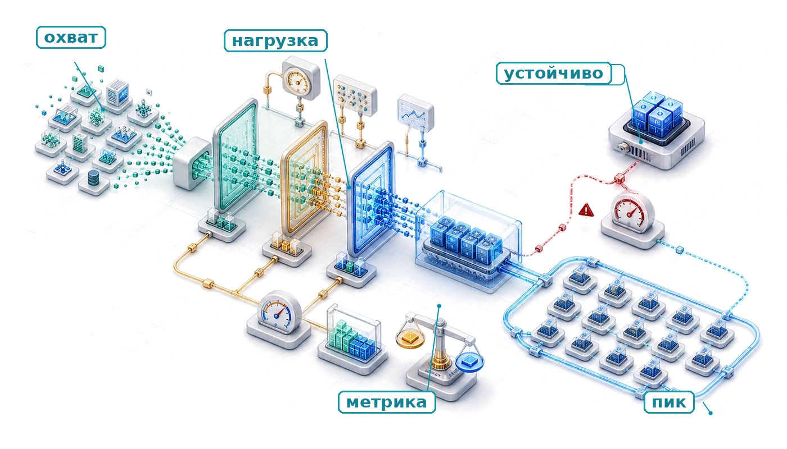

## Назначение

_Как честно сравнивать системы машинного обучения, когда аппаратура, модели, данные и развертывание влияют друг на друга?_

Бенчмаркинг сводит воедино решения, которые уже приняты при отборе данных, сжатии модели и аппаратном ускорении, и проверяет, сохраняются ли их выигрыши в условиях, похожих на развертывание. Каждое решение влияет на одно измерение (задержку, точность, пропускную способность или энергопотребление), но система машинного обучения является результатом всех этих измерений одновременно. Сжатая модель работает быстрее на одном ускорителе и медленнее на другом. Больший размер батча повышает загрузку ускорителя, но может нарушить соглашение об уровне обслуживания по задержке. Краевое устройство может заявлять пиковую пропускную способность, которую троттлинг из-за нагрева заметно снижает при длительной нагрузке. Задача состоит не в том, улучшилась ли локальная метрика, а в том, улучшилась ли вся система в условиях, которые действительно важны. Бенчмаркинг делает такие сравнения систематическими, а не анекдотическими. Он требует определить, что измерять (точность, задержку, пропускную способность, энергию), на каком уровне детализации (отдельное ядро, модель целиком или сквозной конвейер) и при каких условиях (размер батча, распределение входных данных, тепловое состояние, параллельная нагрузка). Без такой структуры команды сравнивают числа, которые никогда не измерялись на одних и тех же условиях, а решения, выглядевшие разумно в таблице, рассыпаются под рабочей нагрузкой. Предыдущие главы оптимизировали модель, отбирали данные и подбирали аппаратуру. Бенчмаркинг проверяет эти оптимизации, сопоставляя заявления с доказательствами и измеряя разрыв между обещанным и поставленным. В терминах D·A·M бенчмаркинг проверяет совместное проектирование: видно, согласованы ли данные, алгоритм и машина или лишь собраны вместе.

> **Цели обучения**
>
> - Объяснить бенчмаркинг как проверку D·A·M, которая показывает, выдерживают ли заявленные оптимизации репрезентативные условия
> - Сравнить бенчмарки обучения и вывода по пропускной способности, перцентилям задержки, энергии, точности и охвату нагрузки
> - Выбрать микро-, макро- или сквозной уровень детализации в зависимости от проверяемого инженерного решения
> - Применить единые правила запуска бенчмарков, чтобы согласовать наборы данных, метрики, конфигурацию аппаратуры и отчетность
> - Спроектировать протоколы измерений, которые контролируют границы измерения мощности, распределения входных данных, размеры батчей и статистическую дисперсию
> - Оценить качество модели и данных с помощью калибровки, устойчивости, репрезентативности и метрик по срезам
> - Диагностировать разрывы между бенчмарком и эксплуатацией, вызванные дрейфом, тепловым троттлингом, динамической нагрузкой и незаметной деградацией

## Рамка бенчмаркинга машинного обучения

Модель, квантованная в INT8, может показать ускорение в 2 раза на синтетической нагрузке, но не дать выигрыша при реальных потоках запросов с переменными размерами входа и параллельными запросами. Прореженная модель может сохранить точность на тестовом наборе, но сломаться на крайних случаях, которые бенчмарк не покрывал. Отбор данных обещает более эффективное обучение, сжатие модели обещает меньшие и быстрые модели, а аппаратное ускорение обещает более высокую пропускную способность. Проверка того, что эти утверждения выполняются в эксплуатации, сама по себе является инженерной дисциплиной.

> ***Бенчмаркинг машинного обучения*** — это эмпирическое измерение нагрузок машинного обучения при заданных условиях. Он используется, чтобы проверить утверждения о компонентах, моделях или сквозных системах по репрезентативным данным, а не только по пиковым спецификациям.
>
> 1.  **Значение**: разрыв между пиковой и устойчивой производительностью может быть большим. Ускоритель A100 дает 312 TFLOP/s (BF16) в пике, но в иллюстративном сценарии с долей использования FLOP модели (MFU) 30–50 процентов, то есть отношением вычислительной работы модели в секунду к заявленной пиковой производительности аппаратуры, он выдает 93,6–156 TFLOP/s. Разрыв в 2–3,3 раза возникает из-за задержек памяти, пузырей в конвейере и накладных расходов на запуск ядер. Бенчмаркинг измеряет фактический разрыв $\eta_{\text{hw}}$ для конкретной нагрузки, а спецификации производителя этого не делают.
> 2.  **Отличие**: бенчмаркинг машинного обучения охватывает несколько уровней. Микробенчмарки изолируют отдельные операции, например умножение матриц. Бенчмарки уровня модели оценивают обучение или вывод целиком. Сквозные бенчмарки включают окружающую работу: загрузку данных, предобработку, оптимизацию, ввод-вывод контрольных точек или инфраструктуру обслуживания. Охват измерения должен соответствовать инженерному утверждению.
> 3.  **Типичная ошибка**: распространенное заблуждение состоит в том, что числа бенчмарков — стабильные эталоны. И нагрузка (новые архитектуры моделей), и аппаратура (новые поколения GPU) меняются, поэтому результат, который лидирует в одной версии бенчмарка, часто становится базовой линией в следующей. Сравнение год к году имеет смысл только при неизменной версии бенчмарка.

Бенчмаркинг — место, где физические законы из предыдущих глав сталкиваются с эмпирической реальностью. **Разрыв между бенчмарком и эксплуатацией** измеряет разницу между ожидаемым по модели и наблюдаемым в эксплуатации поведением. Чтобы его закрыть, нужны измерения, которые превращают теоретические утверждения в проверенное инженерное знание.

Бенчмаркинг машинного обучения охватывает три взаимозависимых измерения, которые напрямую соответствуют компонентам любой развернутой системы. **Системный бенчмаркинг** проверяет, выполняет ли аппаратура обещанную производительность при реалистичных нагрузках или насыщение пропускной способности памяти и накладные расходы на диспетчеризацию программного обеспечения съедают выигрыш. **Бенчмаркинг модели** проверяет, сохраняют ли методы оптимизации качество модели на всем распределении входных данных, а не только на отобранных тестовых наборах. **Бенчмаркинг данных** проверяет, обобщается ли модель на реальные данные со всеми их шумами, смещениями и сдвигом распределения. Каждое измерение может независимо выявить проблемы, невидимые остальным, а система, которая проходит все три проверки, заслуживает гораздо большего доверия при развертывании, чем оцененная по одной оси.

Бенчмарк машинного обучения фиксирует снимок нагрузки и распределения данных, а не постоянную спецификацию. Разрыв между пиковой и устойчивой производительностью тоже не фиксирован: он меняется по мере развития нагрузок и поколений аппаратуры, поэтому любой результат бенчмарка привязан к моменту времени и не является универсальным.

> **Бенчмарки как движущиеся цели**
>
> В традиционных системах (например, SPEC CPU) бенчмарк — это *жесткая спецификация*. Алгоритм сортировки корректен, если он сортирует список. Корректность абсолютна и неизменна. В системах машинного обучения бенчмарк — это *мягкая спецификация*: корректность задается конечным набором примеров (ImageNet), а мир меняется. Модель, которая хорошо показывает себя на ImageNet, все равно может уступать на пользовательских фотографиях, снятых через годы после создания бенчмарка.
>
> В архитектуре компьютеров инженеры проектируют под бенчмарк, потому что бенчмарк представляет нагрузку. В инженерии машинного обучения проектирование только под бенчмарк — это *переобучение*. Устойчивость возникает тогда, когда признается, что бенчмарк — лишь прокси для меняющейся реальности.

Проверка развертывания MobileNetV2 делает трехмерную рамку конкретной. Этот пример проходит через всю главу, потому что охватывает все три измерения оценки и показывает, как каждое из них выявляет проблемы, которые остальные не видят.

> **Проверка развертывания MobileNetV2**
>
> MobileNetV2 (введена в [«Состав маячных моделей: биографии моделей»](06_nn_architectures.md#sec-network-architectures-lighthouse-roster-model-biographies-a763)) служит маячным примером для проверки всего конвейера оптимизации. MobileNetV2 развивает раздельную по глубине свертку из v1, добавляя инвертированные остаточные связи и линейные узкие места, и сохраняет близкий масштаб параметров (Sandler et al., 2018). Она показывает, где бенчмаркинг решает успех или неудачу развертывания: сжатие уменьшает размер модели, аппаратное ускорение снижает задержку вывода, и только бенчмаркинг покажет, сохранились ли эти выигрыши на всем пути развертывания.
>
> 1. **Сжатие модели** ([«Сжатие моделей»](10_model_compression.md#sec-model-compression)): INT8-квантование уменьшает этот рабочий пример MobileNetV2 с 14 МБ до 3,5 МБ (сжатие в 4 раза)
> 2. **Аппаратное ускорение** ([«Аппаратное ускорение»](11_hw_acceleration.md#sec-hardware-acceleration)): иллюстративный сценарий EdgeTPU дает вывод за 2 мс против 15 мс на CPU
> 3. Проверка бенчмарком: убедиться, что конвейер работает на практике
>
> Систематическая оценка отделяет задержку EdgeTPU от накладных расходов на предобработку и передачу данных, подтверждает, что INT8-квантование сохраняет точность на краевых случаях вроде необычного освещения, и проверяет, что пропускная способность держится на реальных потоках данных с датчиков смартфона, а не только на отобранных тестовых наборах ImageNet.

Строгая оценка начинается с установки, которая отделяет значимые доказательства от вводящих в заблуждение метрик. Три принципа отличают эффективных практиков.

Во-первых, *бенчмарки — это прокси, а не истина.* Каждый бенчмарк измеряет конкретные условия, которые могут не совпадать с целевым развертыванием. Система может показывать высокую пропускную способность по образцам в режиме Offline (массовая пропускная способность при доступности всех входных данных) и заметно меньше запросов в секунду (QPS) в режиме Server (запросы с ограничением по задержке, которые поступают во времени). Ключевой вопрос всегда в том, что бенчмарк не измеряет.

Во-вторых, закон Гудхарта действует повсюду.[^fn-goodharts-law-metric] «Когда мера становится целью, она перестает быть хорошей мерой». Команды, которые оптимизируют места в рейтингах бенчмарков, часто создают системы, отлично проходящие оценку, но не работающие в эксплуатации. Оптимизации под конкретный бенчмарк нередко ухудшают свойства, важные для развертывания: устойчивость, калибровку и эффективность.

В-третьих, сквозная метрика важнее метрик компонентов. В этом иллюстративном конвейере ускорение вывода в 3 раза на этапе модели длительностью 10 мс внутри запроса в 50 мс дает сквозное улучшение лишь примерно в 1,2 раза, а при усилении давления на память может оказаться и хуже. Эти принципы повторяются в методологии бенчмаркинга и подробно разобраны в разделе [«Заблуждения и ловушки»](12_benchmarking.md#sec-benchmarking-fallacies-pitfalls-9781).

*Ускорение компонента редко сохраняется как сквозное ускорение бенчмарка.*

[^fn-goodharts-law-metric]: **Закон Гудхарта**: (Goodhart, 1984) сформулировал исходное наблюдение Банка Англии 1975 года о денежно-кредитной политике; (Strathern, 1997) обобщил его в приведенной выше форме. Исходный контекст был макроэкономическим: когда денежный агрегат становился официальной целью политики, банки меняли поведение, чтобы обыграть показатель, и тот терял прогностическую силу. В машинном обучении тот же сбой возникает структурно: BLEU вознаграждает совпадение n-грамм (Papineni et al., 2002), ImageNet вознаграждает результаты на фиксированном визуальном распределении (Deng et al., 2009); (Recht et al., 2019), а таблицы лидеров могут поощрять настройку под конкретный тестовый набор.

Однако знать, *что* измерять, — лишь половина задачи. Измерение с ошибками (на неподходящих нагрузках, с предвзятыми базовыми линиями или при неконтролируемых переменных) дает числа, которые кажутся точными, но вводят в заблуждение. История бенчмаркинга в вычислениях полна примеров технически корректных метрик, применявшихся с порочной методикой: от баллов Whetstone, которые компиляторы подгоняли под тест, до выборочно подобранных тестов GPU, которые ничего не говорят об устойчивой нагрузке. Понимание того, как развивалась методология измерений и где она давала сбои, необходимо для проектирования бенчмарков, которые отличают настоящие улучшения от артефактов измерения.

Исторические основы бенчмаркинга[^fn-benchmark-etymology-surveying] важны, потому что вскрывают сбои проверки, которые и сегодня повторяются в машинном обучении: оптимизированные метрики перестают предсказывать реальные нагрузки, числа аппаратуры игнорируют устойчивое рабочее состояние, а оценки моделей не учитывают стоимость развертывания. Та же последовательность проверок управляет современной практикой: сначала проверяется, что аппаратура выдает обещанную производительность, затем — что оптимизации модели и данных, построенные на этой аппаратуре, дают обещанный выигрыш.

[^fn-benchmark-etymology-surveying]: **Бенчмарк**: термин происходит из геодезии, где «bench mark» было горизонтальной меткой на камне, служившей неизменной отметкой высоты. В вычислительную технику он пришел в 1970-х для обозначения стандартных точек сравнения, но геодезическая метафора несет системный урок: так же как измерение высоты бессмысленно без откалиброванной опоры, число пропускной способности ML бессмысленно без контролируемых нагрузок, теплового состояния и настроек точности.

## Исторические основы

В 1976 году, когда Whetstone стал одним из первых стандартизированных бенчмарков, производители начали оптимизировать компиляторы именно под его синтетические циклы с плавающей точкой, и пиковые результаты перестали предсказывать производительность реальных приложений. Похожие подгонки регулярно подрывали оценки по одной метрике и по отдельным компонентам. Чтобы понять, почему современная оценка ML требует таксономии D·A·M (Данные · Алгоритм · Машина), нужно проследить, как развивались методики измерений в истории вычислительной техники. Каждое поколение бенчмарков возникало тогда, когда существующие метрики не выявляли критических узких мест системы, и эти случаи служат прямыми прецедентами для оценки ML.

Прежде чем начнется эта история, важно одно граничное условие: бенчмарк полезен только тогда, когда называет уровень системы, утверждение о котором он проверяет.

> **Бенчмаркинг как доказательство на разных уровнях**
>
> Бенчмарк машинного обучения имеет смысл, только если указано, какой уровень системы он проверяет. Метрики отбора данных, такие как PPD, площадь под кривой обучения (AULC) и коэффициент сжатия данных (DCR), все введены в главе [«Отбор данных»](09_data_selection.md#sec-data-selection) и измеряют, может ли меньшее число примеров сохранить сигнал обучения. Метрики сжатия ([«Сжатие моделей»](10_model_compression.md#sec-model-compression)) показывают, сохраняют ли качество меньшее число параметров или более низкая точность. Аппаратные метрики, такие как положение на кривой Roofline и TOPS/W ([«Аппаратное ускорение»](11_hw_acceleration.md#sec-hardware-acceleration)), показывают, эффективно ли машина выполняет нагрузку. Системные бенчмарки, от [«Системных бенчмарков»](12_benchmarking.md#sec-benchmarking-system-benchmarks-393c) до [«Разбора MLPerf по энергопотреблению»](12_benchmarking.md#sec-benchmarking-mlperf-power-case-study-a554), связывают эти уровни, проверяя, сохраняются ли локальные улучшения в сквозной нагрузке.

Эта роль на разных уровнях объясняет, почему важна история бенчмарков: измерение производительности развивалось всякий раз, когда практики обнаруживали, что существующие метрики не предсказывают сквозного поведения. Эволюция от ранних синтетических тестов к современным наборам для ML показывает три методологических сдвига: от изолированных ядер к репрезентативным наборам приложений, от пропускной способности по одной метрике к многокритериальным профилям энергии и от универсальных вычислительных метрик к ограничениям выполнения, специфичным для предметной области.

### Бенчмарки производительности

Самые ранние вычислительные бенчмарки выявили устойчивую уязвимость эмпирической оценки: подгонку под бенчмарк. Whetstone (Curnow and Wichmann, 1976) использовал синтетическую смесь научных операций, а LINPACK[^fn-whetstone-linpack-history] (Dongarra et al., 1979) измерял решение плотных линейных систем. Поскольку эти нагрузки опирались на предсказуемые вычислительные циклы, производители компиляторов и аппаратуры могли оптимизировать именно ядра бенчмарка, например разворачивая синтетические циклы или подгоняя блочный обход кэша под точные размеры матриц, и не улучшать при этом производительность общих приложений. SPEC CPU (1989) преодолел это ограничение, оценивая полные переносимые программные наборы, которые нагружают ветвления целых чисел, нерегулярную иерархию памяти и конвейеры вычислений с плавающей точкой (Dixit, 1993). Эта линия напрямую важна для систем ML: заявления о сжатии моделей из [«Сжатия моделей»](10_model_compression.md#sec-model-compression) нельзя проверять на изолированных ядрах умножения матриц, их нужно проверять на репрезентативных задачах вроде ResNet-50 и BERT во всей программной среде выполнения.

[^fn-whetstone-linpack-history]: **Whetstone и LINPACK**: Whetstone (Curnow and Wichmann, 1976) назван по лаборатории English Electric в Уэтстоуне (Лестершир), где создавался исходный компилятор ALGOL; LINPACK (Dongarra et al., 1979) был пакетом и бенчмарком для плотных линейных систем, позже использовавшимся в списке Top500. Фиксированный синтетический набор операций Whetstone и узкая направленность LINPACK на линейную алгебру делали каждый из них полезным, но слишком узким по сравнению с разнообразным набором приложений. Бенчмаркинг ML унаследовал ту же уязвимость: подгонка ядра под конкретную модель может переобучиться на одной нагрузке, поэтому MLPerf использует несколько нагрузок из области зрения, языка и рекомендаций (Mattson et al., 2020); (Reddi et al., 2019).

По мере расширения вычислений в интерактивные и мобильные среды оценка по одной метрике оказалась недостаточной. Графические бенчмарки сопоставляли частоту кадров с качеством отрисовки, а мобильные оценки считали потребление батареи равноправным с задержкой. Этот компромисс нескольких целей повторяется в обслуживании ML, где оптимизация только задержки может вызвать катастрофическое падение точности модели или энергоэффективности ([«Введение»](01_introduction.md#sec-introduction)).

Третий сдвиг произошел тогда, когда распределенные вычисления показали, что микробенчмарки уровня компонентов не предсказывают пропускную способность кластера. Оценка процессора или ускорителя в отрыве не передает динамику выполнения, когда задержка сетевых соединений, накладные расходы на сериализацию и коллективные коммуникации определяют время выполнения. Распределенное обучение ML так же зависит от тесного взаимодействия матричных блоков ускорителей ([«Аппаратное ускорение»](11_hw_acceleration.md#sec-hardware-acceleration)), пропускной способности PCIe между хостом и устройством, конвейеров предвыборки входных данных и синхронизации градиентов по сетевым структурам.

Чтобы учесть эти взаимодействия, DAWNBench (Coleman et al., 2019) первым ввел оценку «время до точности», связав сырую пропускную способность аппаратуры с алгоритмической сходимостью. Максимизировать число обработанных образцов в секунду бессмысленно, если численная нестабильность или неудачный размер батча не дают модели достичь целевой точности на валидации. Эти эмпирические уроки вылились в MLPerf[^fn-mlperf-benchmark-suite] (2018), который закрепил измерение всей системы, ограничения по нескольким критериям и репрезентативные нагрузки из области зрения, языка и рекомендательных систем (Mattson et al., 2020); (Reddi et al., 2019).

[^fn-mlperf-benchmark-suite]: **MLPerf**: запущен в 2018 году консорциумом промышленных и академических организаций; название образовано от «ML» и «Perf» (производительность) и перекликается с традицией SPEC. Принципы MLPerf — репрезентативные нагрузки, измерение всей системы и открытая подача результатов — напрямую отвечают на подгонку, которая преследовала Whetstone и LINPACK: производители, которые раньше могли сообщать пиковую производительность ядра на выбранных размерах задач, теперь должны сообщать сквозную производительность системы на стандартных задачах (Mattson et al., 2020); (Reddi et al., 2019).

### Бенчмарки энергопотребления

Парадигма оценки по нескольким критериям распространилась на энергоэффективность, когда вычисления вышли за пределы мейнфреймов и охватили мобильные устройства с ограниченным запасом батареи и дата-центры мегаваттного масштаба. Поскольку энергопотребление напрямую определяет время работы батареи на краю сети и операционные расходы в кластерах масштаба склада, энергия стала метрикой оценки первого класса наравне с производительностью. Этот сдвиг породил стандартизированные энергетические бенчмарки, такие как SPEC Power[^fn-spec-power-benchmark] для серверов и Green500[^fn-green500-energy-efficiency] для суперкомпьютеров.

[^fn-spec-power-benchmark]: **SPEC Power**: введен в 2007 году, измеряет производительность на ватт на 11 уровнях нагрузки от простоя (0 процентов) до 100 процентов с шагом 10 процентов (Lange, 2009). Такая детализация важна для обслуживания ML: нагрузки вывода редко держат 100-процентную загрузку, а серверы, эффективные на пике, но расточительные на частичной нагрузке, раздувают энергетическую стоимость реального развертывания.
[^fn-green500-energy-efficiency]: **Green500**: начатый в 2007 году как спутник Top500, Green500 ранжирует системы по FLOP/s на ватт, а не по сырой производительности (Feng and Cameron, 2007). Его урок для систем ML методологический: самый экономичный кластер для обучения необязательно самый быстрый, а тот, который дает полезную работу на ватт в нужных нагрузке и границах измерения.

Оценка энергопотребления ML-нагрузок сталкивается с особыми физическими трудностями измерения. Ускорители демонстрируют резкие колебания мощности: переключение между слоями активаций, ограниченными памятью, и блоками матричного умножения с высокой плотностью мощности создает быстрые скачки тока ($\frac{dI}{dt}$), которые простые измерители средней мощности не различают. Кроме того, чтобы отделить потребление ускорителя от активности центрального процессора хоста, межсоединений PCIe и вентиляторов охлаждения, нужны строгие границы измерения. MLPerf Power (MLCommons, 2024) решает эти задачи, сочетая стандартизированные нагрузки с жесткой физической методикой измерения и откалиброванными внешними анализаторами мощности.

Измерение энергии выходит за пределы телеметрии аппаратуры и оценивает эффективность алгоритмов. Методы сжатия моделей (прореживание, квантование, дистилляция знаний) снижают энергопотребление, уменьшая число арифметических операций и трафик к памяти вне кристалла, а не полагаясь только на более экономичный кремний. Например, архитектуры MobileNet заменяют стандартные свертки раздельными по глубине свертками, что резко сокращает обращения к DRAM и число операций по сравнению с базовыми сверточными сетями (CNN) вроде ResNet (Howard et al., 2017); (Sandler et al., 2018); (He et al., 2016). Как сказано в [«Сжатие моделей»](10_model_compression.md#sec-model-compression) и подсчитано в [«Стоимость энергии»](10_model_compression.md#sec-model-compression-energy-costs-d1d5), чтение операнда из DRAM вне кристалла стоит на порядки дороже арифметической операции, поэтому сокращение трафика памяти на уровне алгоритма — основной рычаг энергоэффективных вычислений.

### Бенчмарки для предметных областей

Когда для обхода узких мест универсальных процессоров появились специализированные ускорители, общие бенчмарки перестали отражать ограничения выполнения, специфичные для предметных областей. Три рабочие оси определили эту специализацию и задали, как системы оцениваются в реальных условиях.

Ограничения развертывания определяют приоритеты метрик исходя из физических пределов. Кластеры для обучения в дата-центрах оптимизируют совокупную пропускную способность в рамках мощности стойки и объекта. Напротив, мобильный ИИ работает в жестких порогах теплового троттлинга (обычно до 5 Вт), а встраиваемые микроконтроллеры работают в бюджетах мощности в милливаттах. Эти физические границы, опирающиеся на принципы эффективности из [«Введения»](01_introduction.md#sec-introduction), определяют, ставит ли бенчмарк на первое место пропускную способность (образцов в секунду) или энергоэффективность (джоулей на вывод).

Требования приложений накладывают функциональные ограничения помимо сырой скорости. Клинические модели ИИ требуют строгой калибровки и интерпретируемости наряду с точностью классификации; высокочастотные торговые системы задают жесткие границы хвостовой задержки вместе с детерминированным выполнением; автономные автомобили требуют ограниченной задержки в худшем случае и формальной проверки функциональной безопасности. Эти требования расширяют критерии оценки за пределы пропускной способности; глава [«Ответственная инженерия»](15_responsible_engr.md#sec-responsible-engineering) формализует соответствующие инженерные принципы безопасности, соответствия требованиям и справедливости.

Условия эксплуатации определяют устойчивость в реальном мире. Краевые устройства должны укладываться в сроки вывода при колебаниях температуры окружающей среды и шумных потоках датчиков; инфраструктура обслуживания в дата-центрах должна выдерживать внезапные всплески запросов и потери пакетов в сети без отбрасывания запросов; узлы промышленного интернета вещей должны работать без присмотра годами. Возможности аппаратного ускорения ([«Аппаратное ускорение»](11_hw_acceleration.md#sec-hardware-acceleration)) приносят пользу в эксплуатации только тогда, когда они устойчиво держатся в этих условиях.

Машинное обучение наглядно показывает эту расходящуюся специализацию. Поскольку ML-нагрузки создают сложное взаимодействие между блоками выполнения тензоров, пропускной способностью иерархии памяти и сетями распределенных коммуникаций, никакая отдельная метрика или нагрузка не может описать систему целиком. MLPerf формализует эту специализацию через различные наборы для развертывания: MLPerf Training оценивает масштабирование на несколько узлов и межсоединения высокой пропускной способности по целевому времени до качества (Mattson et al., 2020); MLPerf Inference измеряет пропускную способность и перцентили задержки в рамках соглашений об уровне обслуживания (SLA) для серверных и клиентских систем (Reddi et al., 2019); MLPerf Tiny тестирует сверхмаломощные микроконтроллеры с жесткими ограничениями памяти (Banbury et al., 2021); а сквозной трек MLPerf Power оценивает энергоэффективность во всех средах. Если читать [«Варианты набора MLPerf»](12_benchmarking.md#tbl-mlperf-suites) сверху вниз по колонке ограничений, видно, как метрики подстраиваются под физические пределы: пропускная способность межсоединений кластера уступает место перцентилям задержки на краю сети и, наконец, жестким ограничениям памяти на микроконтроллерах.

| **Вариант MLPerf**   | **Целевая область** | **Ключевые ограничения**                              | **Основные метрики**                            |
|:---------------------|:--------------------|:------------------------------------------------------|:------------------------------------------------|
| **MLPerf Training**  | Дата-центр          | Масштабирование на несколько узлов, межсоединения высокой пропускной способности | Время до качества, пропускная способность (образцов/с) |
| **MLPerf Inference** | Сервер/край сети    | Ограничения SLA по задержке, требования к пропускной способности | QPS, перцентили задержки, сохранение точности   |
| **MLPerf Tiny**      | MCU/IoT             | Сверхнизкое энергопотребление вывода, ограниченная память | Задержка, точность, энергия на вывод            |
| **MLPerf Power**     | Общий для всех сред | Энергетические бюджеты, тепловые ограничения          | Производительность/Вт, энергия на запрос         |

*Варианты набора MLPerf: каждый вариант обращен к своему контексту развертывания, от обучения масштаба дата-центра до вывода на сверхограниченных микроконтроллерах, и измеряет метрики, относящиеся к его сценарию и его рабочим ограничениям.*

Во всех вариантах MLPerf Power измеряет полезную работу на ватт, а не только сырую пропускную способность. Доменные наборы гарантируют, что архитектурные оптимизации приводят к успеху развертывания, а не остаются в рамках изолированных синтетических бенчмарков.

Наборы бенчмарков ML унаследовали эти исторические уроки, но ML-нагрузки вносят статистическую и зависящую от данных изменчивость, которой нет в традиционных детерминированных вычислениях. Помимо обычного системного шума, такого как прерывания операционной системы, активность фоновых демонов и троттлинг из-за нагрева, выполнение ML обладает собственной недетерминированностью. Редукция чисел с плавающей точкой в параллельных потоках не ассоциативна, поэтому при смене порядка суммирования возникают небольшие числовые расхождения; конвейеры загрузки данных применяют псевдослучайные аугментации; а стохастический градиентный спуск движется по невыпуклым поверхностям потерь, чувствительным к инициализации весов. Поэтому строгая оценка ML требует явных статистических мер контроля: повторения с несколькими начальными значениями генератора случайных чисел (seed), отчетности о дисперсии и детерминированных правил загрузки данных.

Стандартизация превращает эти эмпирические уроки в общую инженерную методологию. Когда одна команда измеряет задержку вывода с учетом предобработки на хосте, а другая начинает отсчет только после того, как тензоры оказались в памяти ускорителя, или когда измерители мощности проводят разные физические границы вокруг блока питания, полученные числа несопоставимы. Стандартизированные наборы заменяют разрозненное тестирование проверенными обвязками, единообразными границами измерения и проверяемыми правилами подачи результатов, что позволяет обоснованно закупать аппаратуру и сравнивать алгоритмы во всей отрасли. [«Эволюция бенчмарков»](12_benchmarking.md#tbl-benchmark-evolution) подытоживает эту историю: от ранних синтетических циклов до многомерной оценки систем ML.

| **Бенчмарк**   | **Год** | **Основной фокус**                  | **Ключевые метрики**                    | **Урок для бенчмаркинга ML**                                                  |
|:---------------|:-------:|:------------------------------------|:----------------------------------------|:-----------------------------------------------------------------------------|
| **Whetstone**  |  1976   | Синтетические операции с плавающей точкой | MWIPS                              | Подгонка под синтетические тесты подрывает достоверность оценки              |
| **LINPACK**    |  1979   | Линейная алгебра (матричные операции) | FLOP/s                                | Изолированные операции не отражают сложность системы и узкие места          |
| **SPEC CPU**   |  1989   | Реальные прикладные нагрузки        | SPECrate, SPECspeed                     | Репрезентативные нагрузки показывают истинную производительность развертывания |
| **SPEC Power** |  2007   | Энергоэффективность серверов        | ssj_ops/Вт по уровням нагрузки          | Энергоэффективность требует оценки на нескольких уровнях нагрузки, а не только на пике |
| **Green500**   |  2007   | Энергоэффективность HPC             | GFLOP/s на ватт                         | Рейтинги эффективности дополняют рейтинги сырой производительности           |
| **MLPerf**     |  2018   | Системы ML (обучение и вывод)       | Время до качества, QPS, задержка, точность | Объединяет все уроки: репрезентативные нагрузки, несколько критериев и систему целиком |

*Эволюция бенчмарков: развитие вычислительных бенчмарков от синтетических операций к оценке, специфичной для ML. Каждое поколение устраняло ограничения предшественников; кульминация — MLPerf, который объединяет репрезентативные нагрузки, многокритериальные метрики и измерение интегрированной системы.*

## Наборы системных бенчмарков

Команда, которая оценивает аппаратуру для краевого развертывания, должна сравнить пять разных систем на кристалле (SoC) для продукта «умная камера». Поставщик A заявляет 8 TOPS при INT8; поставщик B — 15 TOPS при INT4; поставщик C — задержку вывода на собственной модели; поставщик D ссылается на результаты MLPerf двухпоколенной давности; поставщик E дает только пиковую пропускную способность при максимальном размере батча. Ни одну из этих цифр нельзя напрямую сопоставить. Команда не может принять обоснованное решение о закупке, потому что каждый поставщик выделяет выгодную метрику в особых условиях и скрывает реальные рабочие компромиссы. Наборы бенчмарков устраняют эту фрагментацию: они задают единые измерительные обвязки и стандартные правила оценки.

Три урока из истории бенчмарков — репрезентативные нагрузки, многокритериальная оценка и измерение интегрированной системы — сходятся в требовании, уникальном для машинного обучения: управление статистической приближенностью. В традиционных вычислительных бенчмарках допустимые системные оптимизации должны сохранять результаты арифметики побитно. В системах ML низкоуровневые инженерные решения регулярно меняют численный выход: агрессивное квантование весов, прореживание ядер или аккумуляторы пониженной точности обменивают точность на скорость выполнения и меньшую нагрузку на пропускную способность памяти. Поэтому бенчмарк ML не может оценивать время выполнения в отрыве: точность выхода служит неприкосновенным эксплуатационным ограничением. Современные наборы бенчмарков кодируют эти ограничения в стандартизированные рамки, и благодаря этому возможны строгие сравнения между платформами.

Поэтому оценка системы ML требует анализа связанного взаимодействия в пространстве совместного проектирования Данных, Алгоритма и Машины (D·A·M), а не измерения сырой вычислительной пропускной способности. Ранние бенчмарки сосредоточивались главным образом на точности алгоритма на изолированных наборах данных (LeCun et al., 1998). По мере роста моделей узкие места вычислений расширили бенчмаркинг до эффективности выполнения на аппаратуре (Jouppi et al., 2017), а сбои развертывания показали, что узкие места конвейера данных и сдвиги распределения входа определяют поведение в реальном мире (Gebru et al., 2021). Энергопотребление пересекает все три измерения: структура алгоритма задает арифметическую интенсивность и вычислительную сложность (Hernandez and Brown, 2020), микроархитектура машины определяет энергию одной арифметической операции и обращения к памяти, а схемы загрузки данных задают загрузку шины. Надежный набор бенчмарков проверяет все эти измерения одновременно, гарантируя, что заявленные оптимизации сохраняются в эксплуатационных условиях.

### Проблемы измерения в ML

ML-системы сочетают несколько источников изменчивости измерений, которые классические программные бенчмарки не были рассчитаны оценивать вместе. Эти колебания возникают и на уровне машины, и на алгоритмическом уровне. Со стороны машины длительное выполнение подводит ускорители к тепловым и энергетическим пределам и запускает динамическое масштабирование напряжения и частоты (DVFS), которое снижает тактовую частоту процессора прямо во время работы. Активность операционной системы хоста, в том числе дрожание планирования потоков, подкачка памяти и конкуренция за шину PCIe при подготовке батчей, дополнительно вносит разброс задержки между запусками. Со стороны алгоритма недетерминированный порядок редукций чисел с плавающей точкой в параллельных потоках, перемешивание мини-батчей и стохастические маски дропаута искажают числовые траектории. Чтобы отличить реальную системную оптимизацию от фонового шума измерений, нужно выделить эти перекрывающиеся источники дисперсии.

Чтобы изолировать изменчивость между запусками, протоколы бенчмарков требуют повторных экспериментов с контролируемыми начальными значениями генератора псевдослучайных чисел (seed). Число запусков должно соответствовать явным целям статистической мощности, а не случайной выборке. Отчетность должна выходить за рамки единственного лучшего из N результатов или отдельных арифметических средних: выборочная дисперсия, стандартные отклонения и доверительные интервалы показывают устойчивость и помогают понять, превышает ли наблюдаемое ускорение фоновое дрожание системы. Без этих мер контроля бенчмаркинг дает вводящие в заблуждение выводы. В обучении с подкреплением заявленные преимущества производительности часто растворяются в статистическом шуме случайной инициализации весов и динамики среды (Henderson et al., 2018). Аналогично, нестандартизованные оценки генеративно-состязательных сетей дают обратный порядок рейтингов при разных начальных значениях генератора, что показывает: неучтенная дисперсия подрывает сравнительные утверждения (Lucic et al., 2018).

Даже когда изменчивость выполнения полностью контролируется, бенчмаркинг сталкивается со структурным ограничением самого набора данных для оценки: емкостью измерения тестового набора. Тестовый набор работает как измерительный прибор с конечной разрешающей способностью. Поскольку точность на конечной выборке — это биномиальная доля, эмпирические оценки несут внутреннюю выборочную дисперсию, которая обратно пропорциональна размеру выборки. Если оптимизация меняет точность на один-два процентных пункта, оценка на слишком маленьком тестовом наборе не может определить, отражает ли изменение реальный алгоритмический эффект или случайное колебание выборки. Как показывает рисунок ниже с индикатором обнаруживаемости и разбирает сопутствующий блокнот, попытка оценить тонкие различия точности на тестовом наборе из тысячи образцов прямо попадает в эту статистическую ловушку достоверности.

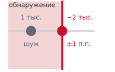

*Тестовый набор из 1 000 образцов не позволяет надежно увидеть регресс в один пункт.*

> **Статистическая ловушка достоверности**
>
> **Задача**: базовый классификатор набирает 95 процентов, а сжатая версия — 94 процента на 1 000 изображениях. Подтверждает ли это падение на один пункт регресс?
>
> **Расчет**:
>
> 1.  **Ожидаемые ошибки**: эти оценки соответствуют 50 ошибкам и 60 ошибкам. При биномиальной модели базовой версии число ошибок имеет стандартное отклонение около 7 ошибок.
> 2.  **Интервал разности** (95 процентов): пусть $\hat p_1$ и $\hat p_2$ обозначают оценки точности базовой и сжатой моделей, а $N$ — число изображений, на которых оценивалась каждая модель. Считая оценки независимыми, стандартная ошибка их разности равна
>
>     $$ \operatorname{SE}(\hat p_1-\hat p_2) = \sqrt{\frac{\hat p_1(1-\hat p_1)}{N} + \frac{\hat p_2(1-\hat p_2)}{N}}. $$
>
>     Наблюдаемая разность в 1 процентный пункт имеет приблизительный интервал от −1 до 3 процентных пунктов, который включает ноль.
>
>     **Следствие**: поскольку интервал включает ноль, результат не доказывает регресса на один пункт. Если обе модели работали с одними и теми же изображениями, сохраните количества расхождений между ними и используйте парный тест, например тест Макнемара; сравнения по отдельным точностям недостаточны. Оценка по 1 825 образцам для одной доли с точностью ±1 процентный пункт не обеспечивает мощности для этого сравнения.
>
> **Системный вывод**: небольшие бенчмарки демонстрируют то, что по сути является лабораторной ошибкой. Тестовый набор как измерительный прибор должен быть достаточно большим, чтобы соответствовать точности изменения, которое он призван обнаружить.

Помимо статистической мощности, валидность бенчмарка зависит от репрезентативности нагрузки. Синтетические микробенчмарки генерируют однородные тензоры фиксированного размера прямо в памяти с высокой пропускной способностью (HBM) ускорителя. Выполняя непрерывные вычислительно-ограниченные операции обобщенного матричного умножения (GEMM) в изолированном цикле, микробенчмарки измеряют теоретический пик арифметической пропускной способности. Однако они скрывают иерархии памяти и узкие места планирования, которые определяют эксплуатацию. Синтетические нагрузки обходят передачу данных по PCIe между хостом и устройством, конвейеры декодирования входа, динамическое выделение памяти и вытеснение из кэша GPU. Напротив, **бенчмаркинг на трассах** воспроизводит журналы запросов с отметками времени, записанные на работающих кластерах обслуживания. Производственные трассы сохраняют распределения поступления запросов (пуассоновские и пакетные), переменные длины последовательностей и параллельные потоки запросов. Воспроизведение живых трасс заставляет инфраструктуру обслуживания справляться с динамическим батчингом, выделением кэша ключей и значений (KV) под давлением памяти и задержками в очередях, то есть проверяет систему в условиях эксплуатации, которые скрывают синтетические циклы установившегося режима.

Даже репрезентативная нагрузка может вводить в заблуждение, если метрика оценки не отражает ограничения развертывания. Такой сбой означает разрыв в согласованности метрики. Когда инженерная команда оптимизирует одну алгоритмическую меру качества, например офлайн-BLEU, top-1 точность классификации или перплексию токенов, отрываясь от целевых показателей обслуживания (SLO), метрика перестает измерять реальную пригодность системы к работе. Это расхождение воплощает закон Гудхарта: как только алгоритмический прокси-показатель становится единственной целью оптимизации, он перестает служить мерой здоровья системы в целом. Пример ниже иллюстрирует эту патологию в нейронном машинном переводе (NMT), где офлайн-оптимизация точности создает катастрофический штраф по задержке.

> **Закон Гудхарта в действии**
>
> **Сценарий**: инженерная команда оптимизирует модель NMT по офлайн-BLEU, увеличивая размер луча поиска (beam search) с 1 до 10.
>
> **Диагностика**: больший луч дает прирост BLEU на 0,5 пункта на бумаге, но увеличивает число оценок кандидатов в 10 раз, а задержку вывода — с 50 мс до 200 мс (замедление в 4 раза), что выходит за срок обслуживания.
>
> **Системный урок**: оптимизация офлайн-точности без ограничений по задержке провоцирует сбои по закону Гудхарта. Производственные бенчмарки должны задавать жесткие SLO для задержки обслуживания (например, задержка меньше 100 мс).

Компромисс с переводом обнажает фундаментальное напряжение в пространстве совместного проектирования Данных, Алгоритма и Машины (D·A·M): алгоритмическое изменение (расширение луча в десять раз) умножает вычислительную нагрузку и трафик памяти, давая незначительный прирост качества, но нарушая аппаратные сроки по задержке. Помимо рассогласования метрик, оценка систем на статических наборах данных вносит более глубокое ограничение: фиксированные бенчмарки оценивают выполнение при неизменном распределении входа и скрывают, как системы деградируют при сдвиге распределения в эксплуатации. Поэтому честная оценка ML-системы требует отделить эффективность выполнения инфраструктуры от архитектуры модели и вариаций набора данных. Стандартные наборы вроде MLPerf задают такую базу, фиксируя и веса моделей, и входные наборы данных, что позволяет напрямую и воспроизводимо измерять эффективность выполнения связки «аппаратура — программное обеспечение» на конкурирующих платформах.

### Системные бенчмарки

Системные бенчмарки измеряют вычислительную основу, которая обеспечивает возможности моделей: как архитектура аппаратуры, системы памяти и межсоединения влияют на общую производительность. Эта проверка критически важна, потому что спецификации аппаратуры часто описывают теоретические пики, которых прикладные нагрузки не выдерживают. Расхождение настолько распространено, что заявления о пиковой производительности неполны. Системные бенчмарки выявляют эти разрывы, запуская стандартизированные нагрузки ML, а не полагаясь только на пиковые арифметические скорости.

> **Заблуждение о пиковой производительности**
>
> Дэйв Паттерсон часто говорит о пиковой производительности как о «производительности, которую производитель гарантирует, что вы не превысите». Для систем ML разрыв может быть большим из-за стены памяти: модель, ограниченная памятью, оставляет недостижимой значительную часть заявленных FLOP/s, как бы быстро ни работали арифметические блоки. Стандартизированные бенчмарки вроде MLPerf требуют, чтобы системы запускали заданные модели и данные, и показывают устойчивую производительность в задокументированной рабочей точке, а не универсальную скорость для любой нагрузки.

Для ограниченных памятью нагрузок разрыв между пиком и устойчивой производительностью следует из стены памяти; вычислительно-ограниченные нагрузки могут приближаться к пику. Это различие превращает оценку поставщика из догадок в перечень конкретных критериев.

> **Расшифровка заявлений поставщиков о бенчмарках**
>
> При оценке аппаратуры или программного обеспечения по бенчмаркам поставщика проверьте, называет ли заявление нагрузку, границы измерения и условия работы.
>
> - Измеряемая величина: включает ли число задержки предобработку и постобработку, а не только выполнение модели?
> - Граница точности: можно ли определить точность, на которой достигнута заявленная пропускная способность, например INT4, INT8 или FP16?
> - Граница нагрузки: указаны ли явно модель, размер батча и распределение входных данных, использованные для сравнения?
> - Исключенные затраты: учтены ли передачи памяти, загрузка модели, инициализация, устойчивое тепловое поведение и энергопотребление на заявленном уровне производительности?
> - Заявлено и достигнуто: при заявленном пике 1 000 TFLOP/s и бенчмарке, который устойчиво выдает 350 TFLOP/s, оцените MFU и скажите, достаточно ли одного этого отношения загрузки, чтобы определить узкое место.

Инженер должен отклонять любое заявление о бенчмарке, если нельзя восстановить его границу нагрузки, точность и исключенные затраты. Заглавное число пропускной способности или задержки становится полезным только тогда, когда его можно сопоставить с реальной моделью, формой батча, перемещением данных, устойчивой рабочей точкой и энергетическим бюджетом.

Аппаратная основа (центральные процессоры, графические процессоры, тензорные процессоры (TPU),[^fn-tpu-benchmark-evaluation] и специализированные интегральные схемы (ASIC)[^fn-asic-hardware-benchmark]) определяет скорость, эффективность и масштаб систем ML. Системные бенчмарки дают стандартизированные методы сравнения аппаратуры на ИИ-нагрузках по вычислительной пропускной способности, пропускной способности памяти, энергоэффективности, покрытию операторов и масштабированию (Reddi et al., 2019); (Mattson et al., 2020).

[^fn-tpu-benchmark-evaluation]: **TPU (тензорный процессор)**: специализированная ASIC Google для нейросетевых нагрузок (детали архитектуры в [«Аппаратное ускорение»](11_hw_acceleration.md#sec-hardware-acceleration)). Модуль TPU v4 (4 096 чипов) дает пиковые 1,1 EFLOP/s в BF16 (Jouppi et al., 2023), но бенчмаркинг TPU требует осторожности: их архитектура систолических массивов благоприятствует регулярным тензорным операциям, поэтому пиковые FLOP/s завышают производительность на нерегулярных нагрузках, таких как разреженное внимание или динамическое управление потоком.

[^fn-asic-hardware-benchmark]: **ASIC (специализированная интегральная схема)**: пиковое число TOPS у ASIC относится только к тем операторам, для которых она спроектирована. Один неподдерживаемый слой заставляет откатываться на процессор общего назначения и может свести на нет все преимущество в эффективности. Поэтому первый вопрос в любом бенчмарке ASIC касается покрытия операторов: разрыв между пиковой и достигнутой пропускной способностью — это ограничение совместимости с нагрузкой, а не ограничение аппаратуры.

[«Расшифровка заявлений поставщиков о бенчмарках»](12_benchmarking.md#tbl-benchmarking-vendor-claims) переводит типичные маркетинговые формулировки в технические оговорки, которые стоят за каждой из них.

| **Заявление поставщика**       | **Что это часто означает**                                         |
|:-------------------------------|:-------------------------------------------------------------------|
| **«До 10 000 изображений в секунду»** | Пиковая пропускная способность при максимальном размере батча, INT8, без предобработки |
| **«Задержка меньше миллисекунды»**    | Только вычисления ускорителя, без передачи данных                  |
| **«В 5 раз эффективнее»**             | Эффективность на операцию, а не эффективность системы в целом      |
| **«Оптимизировано для ИИ»**           | Может ускорять только отдельные операции или точности              |

*Расшифровка заявлений поставщиков о бенчмарках: четыре распространенные маркетинговые формулировки и технические оговорки, которые определяют, описывает ли заявление сквозную производительность, узкое измерение ускорителя или необоснованное сравнение эффективности.*

Системные бенчмарки выполняют две функции. Для практиков они позволяют обоснованно выбирать аппаратуру, сравнивая данные по разным конфигурациям. Для производителей они измеряют прирост между поколениями и направляют разработку ускорителей. По мере роста внедрения GPU быстро росла и точность, что показывает, как успехи аппаратуры и алгоритмов могут двигать прогресс вместе.

> ***Бенчмарки систем машинного обучения*** — это стандартизированные протоколы оценки, которые фиксируют нагрузку и целевое качество, меняя стек «аппаратура — программное обеспечение», и измеряют $\eta_{\text{hw}} = R_{\text{устойчивая}} / R_{\text{пик}}$ и $L_{\text{lat}}$, чтобы отделить эффективность инфраструктуры от алгоритмических улучшений.
>
> 1.  **Значение**: одна и та же модель ResNet-50 может давать очень разную пропускную способность на разных стеках аппаратуры, форматах точности, размерах батча и конфигурациях компилятора, но при этом сообщать одну и ту же точность Top-1 на ImageNet. Системные бенчмарки фиксируют этот разрыв в реализации, который невидим алгоритмическим бенчмаркам, сообщающим только точность.
> 2.  **Отличие**: в отличие от алгоритмических бенчмарков (которые меняют архитектуры моделей и процедуры обучения, чтобы улучшить точность сходимости), системные бенчмарки фиксируют алгоритм и меняют реализацию (библиотеки ядер, форматы квантования, размеры батчей и поколения аппаратуры), чтобы измерить, насколько эффективно связка «аппаратура — программное обеспечение» выполняет член $O/(R_{\text{пик}} \cdot \eta_{\text{hw}})$ железного закона.
> 3.  **Типичная ошибка**: распространенное заблуждение состоит в том, что результат системного бенчмарка обобщается на любые нагрузки. Ускоритель с высокой загрузкой на ResNet-50 (нагрузке в области зрения, где доминируют вычисления) может показать гораздо меньшую загрузку в рекомендательной системе (нагрузке, ограниченной пропускной способностью памяти). Системные бенчмарки привязаны к нагрузке; ни одна метрика не описывает аппаратную платформу целиком.

*Большие батчи переводят вывод трансформеров из режима, ограниченного памятью, в вычислительно-ограниченный.*

Чтобы правильно интерпретировать бенчмарк, нужно знать производительностные характеристики целевой аппаратуры. Ограничена ли конкретная ИИ-нагрузка вычислениями или памятью, — важнейшая подсказка для решений по оптимизации. Вычислительная интенсивность, измеряемая в FLOP/байт,[^fn-flops-throughput-metric] задает пределы производительности. Рассмотрим NVIDIA A100 с производительностью тензорных ядер FP16 312 TFLOP/s (у FP32 — 19,5 TFLOP/s) и пропускной способностью памяти 2,04 ТБ/с (вариант SXM). Деление пиковых вычислений на пиковую пропускную способность дает порог арифметической интенсивности 153 FLOP/байт. Нагрузки ниже этого порога ограничены пропускной способностью памяти, а выше — вычислительной мощностью. Модель Roofline в [«Модель Roofline»](11_hw_acceleration.md#sec-hardware-acceleration-roofline-model-42ff) дает архитектурную основу для интерпретации этих результатов бенчмарка. Раздел [«Модель Roofline»](appendix_machine.md#sec-appdx-machine-foundations-roofline-model-2529) приложения «Основы машины» выводит уравнение Roofline и порог точки перехода из первых принципов, поэтому границу арифметической интенсивности, использованную здесь, можно восстановить для любого ускорителя.

[^fn-flops-throughput-metric]: **FLOP/s (операций с плавающей точкой в секунду)**: разрыв между заявленными пиковыми FLOP/s и достигнутыми FLOP/s — главное напряжение в аппаратном бенчмаркинге. A100 заявляет 312 TFLOP/s FP16 на тензорных ядрах, но реальные нагрузки достигают разной доли пика в зависимости от арифметической интенсивности, шаблонов доступа к памяти, точности и накладных расходов среды выполнения. Указание пиковых FLOP/s без контекста загрузки — самое частое искажение в бенчмаркинге.

Положение на кривой Roofline[^fn-roofline-performance-bound] зависит от нагрузки. В этом расчете для A100 иллюстративная нагрузка прямого прохода ResNet-50 с высокой интенсивностью при большом размере батча имеет арифметическую интенсивность около 300 FLOP/байт, что выше точки перехода A100, и поэтому относится к вычислительно-ограниченным ядрам (He et al., 2016); (Choquette et al., 2021). Операции с меньшей интенсивностью попадают ниже точки перехода, в режим, ограниченный памятью: вывод BERT при размере батча один, если учитывать только трафик загрузки весов, имеет арифметическую интенсивность около 100 FLOP/байт и более низкий потолок производительности, чем пик. Увеличение размера батча переводит ту же нагрузку через точку перехода из режима, ограниченного памятью, в вычислительно-ограниченный режим (Pope et al., 2023). Раздел [«Конкретный пример: анализ A100»](appendix_machine.md#sec-appdx-machine-foundations-concrete-example-a100-analysis-5b30) приложения «Основы машины» проводит расчет от интенсивности к загрузке на A100 полностью, сопоставляя вычислительно-ограниченное ядро умножения матриц с ограниченным памятью поэлементным ядром, поэтому шаги переносятся на любую пару модели и аппаратуры.

[^fn-roofline-performance-bound]: **Модель Roofline**: (Williams et al., 2009) ввели модель Беркли, названную по визуальной форме ее потолка производительности. Ее точка перехода (пиковые FLOP/s, деленные на пиковую пропускную способность) отделяет нагрузки, ограниченные памятью, от вычислительно-ограниченных и показывает, нужно ли оптимизировать перемещение данных или арифметику.

Пример расчета вывода BERT показывает, как эти принципы Roofline переходят в конкретные прогнозы развертывания.

> **Анализ Roofline для вывода BERT**
>
> **Задача**: модель BERT-Base нужно развернуть для вывода на GPU A100. Руководство ожидает высокой загрузки GPU. Какую производительность стоит прогнозировать и как ее повысить?
>
> **Шаг 1**: пределы аппаратуры.
>
> - Пиковые вычисления: 312 TFLOP/s (тензорные ядра FP16)
> - Пропускная способность памяти: 2,04 ТБ/с
> - Точка перехода: 312 TFLOP/s ÷ 2,04 ТБ/с = 153 FLOP/байт
>
> Любая нагрузка с арифметической интенсивностью ниже 153 FLOP/байт ограничена памятью, выше — вычислениями.
>
> **Шаг 2**: характеристики BERT-base.
>
> - Параметры: 110 млн = 220 МБ (FP16)
> - FLOP на вывод: около 22 GFLOP (прямой проход при длине последовательности $S=128$)
> - Перемещение данных: около 220 МБ (нужно загрузить все веса из памяти)
> - Арифметическая интенсивность: $(22 \times 10^{9}) \div (220 \times 10^{6})$ = 100 FLOP/байт (модель только по весам; см. примечание в основном тексте)
>
> **Шаг 3**: прогноз производительности.
> Поскольку 100 FLOP/байт меньше 153 FLOP/байт, BERT при батче 1 ограничен памятью:
>
> $$
> \begin{gathered}
> \text{Достижимая производительность} = 100 \text{ FLOP/байт} \times 2{,}04 \text{ ТБ/с} = 203{,}9 \text{ TFLOP/s} \\
> \text{Загрузка GPU} = 203{,}9 \text{ TFLOP/s} / 312 \text{ TFLOP/s} = 65{,}4\%
> \end{gathered}
> $$
>
> **Шаг 4**: оптимизация через батчинг.
> Увеличим размер батча до 32:
>
> - Те же 220 МБ весов, но в 32 раза больше вычислений
> - Новые FLOP: $22 \times 10^{9} \times 32$ = 704 GFLOP
> - Новая интенсивность: $(704 \times 10^{9}) \div (220 \times 10^{6})$ = 3 200 FLOP/байт
>
> Поскольку 3 200 FLOP/байт больше 153 FLOP/байт, батч 32 ограничен вычислениями. Если реализация выдает 85 процентов пика:
>
> $$
> \begin{gathered}
> \text{Достижимая производительность} \approx 85\% \times 312 \text{ TFLOP/s} = 265{,}2 \text{ TFLOP/s} \\
> \text{Загрузка GPU} \approx 85\%
> \end{gathered}
> $$
>
> **Системный вывод**: размер батча может превратить вывод, ограниченный памятью, в вывод, ограниченный вычислениями, за счет роста арифметической интенсивности. Показанные 85 процентов — допущение об эффективности реализации, а не прогноз модели Roofline. Батчинг также увеличивает задержку, потому что системе приходится ждать, пока накопятся запросы. Это фундаментальный компромисс между пропускной способностью и задержкой, который отражают сценарии MLPerf: SingleStream (батч = 1, оптимизация задержки) и Offline (максимальный батч, оптимизация пропускной способности).

Системные бенчмарки оценивают производительность на разных масштабах: от конфигураций из одного чипа до больших распределенных систем, и охватывают как обучение, так и вывод. На рисунке [«Ошибка ImageNet и внедрение GPU»](12_benchmarking.md#fig-imagenet-gpus) сопоставлены приведенные по источникам частоты ошибок top-5 на ImageNet (Russakovsky et al., 2015); (Krizhevsky et al., 2012) и реконструкция роста использования GPU среди участников соревнования по данным о числе заявок, которые NVIDIA приводила для этого соревнования (Gray, 2015). Два ряда показывают одновременные тенденции, а не причинную оценку того, какая часть роста точности пришла от аппаратуры, а не от алгоритмов, данных или практики обучения.

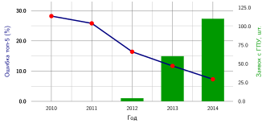

*Ошибка ImageNet и внедрение GPU: приведенные по источникам частоты ошибок top-5 показаны рядом с долей GPU среди участников соревнования. Совпадение во времени не выделяет причинный вклад аппаратуры. Источники частот ошибок: (Russakovsky et al., 2015); (Krizhevsky et al., 2012). (Gray, 2015) приводит число заявок с GPU по годам.*

Пример с ImageNet ставит внедрение GPU рядом со снижением частоты ошибок, не выделяя вклада ни одного из них; [«Бенчмаркинг модели»](12_benchmarking.md#sec-benchmarking-model-benchmarking-4847) возвращается к этой динамике через архитектурные вехи конкретных моделей. Однако эффективный системный бенчмаркинг требует понимать связь между характеристиками нагрузки и загрузкой аппаратуры. Современные ИИ-системы редко достигают теоретического пика производительности из-за взаимодействия вычислительных шаблонов, иерархий памяти и архитектур систем. Этот разрыв между теоретической и достигнутой производительностью определяет, каким должен быть осмысленный системный бенчмарк.

Реалистичные шаблоны загрузки аппаратуры необходимы для практичного проектирования бенчмарков. Как показал предыдущий анализ Roofline, загрузка GPU меняется с размером батча и архитектурой модели: значение 85 процентов для вычислительно-ограниченного случая — допущение, а при одиночном запросе, ограниченном памятью, загрузка составляет 65,4 процента. Эти шаблоны распространяются и на пропускную способность памяти: трансформеры с большим числом параметров и сверточные нагрузки с интенсивными активациями нагружают разные части иерархии памяти и по-разному влияют на достижимую производительность при разных уровнях точности.

Эффективные системные бенчмарки должны измерять реалистичную загрузку, а не теоретический пик, и это требование задает несколько границ охвата. Первое измерение — энергия: производительность на ватт сильно различается между платформами, а недогруженный ускоритель тратит непропорционально много энергии на единицу результата, что бьет и по операционным расходам, и по экологическому следу. Второе — распределение: обучение на нескольких узлах добавляет узкие места коммуникаций, эффекты сетевой топологии и накладные расходы на координацию, которые бенчмарки одного узла не отражают и которые заслуживают отдельного рассмотрения за пределами этой книги. В рамках одной машины, рассматриваемых здесь, бенчмаркинг нескольких GPU фокусируется на коммуникациях внутри узла, утилизации пропускной способности памяти между ускорителями и эффективности синхронизации градиентов между отдельными памятями ускорителей, связанными через NVLink или PCIe. Во всех этих случаях бенчмарк приобретает ценность только тогда, когда его рабочая точка совпадает с рабочей точкой развертывания, а не с той, что указана в спецификации.

### Стандартизация силами сообщества

Метрики загрузки аппаратуры теряют смысл для сравнительной оценки систем без жестких, общих границ измерения. Если один бенчмарк включает предобработку данных на хосте и передачи по PCIe, а другой измеряет только выполнение ядра на устройстве, полученные задержки отражают несовместимые системные границы, а не архитектурную эффективность. Точно так же измерение мощности только на шине питания ускорителя не учитывает значительное энергопотребление процессоров хоста и вентиляторов корпуса. Независимые организации не могут решить это расхождение в одиночку, потому что у отдельных поставщиков есть коммерческие стимулы подгонять границы измерения под сильные стороны своей аппаратуры.

Надежные стандарты бенчмарков требуют широкого согласия многих организаций, чтобы исключить избирательную отчетность. В зрелых инженерных областях такое согласие оформляется в работе органов вроде рабочих групп IEEE (IEEE Standards Association, 2024) и технических комитетов ISO/IEC (ISO, 2024), которые задают строгие спецификации измерений, например IEEE 2416 (IEEE Standards Association, 2019) для моделирования энергопотребления систем. В системах машинного обучения, где архитектуры аппаратуры и структуры моделей быстро меняются, консорциумы вроде MLCommons дают операционную рамку, необходимую для поддержки живых наборов бенчмарков. Предоставляя открытые эталонные реализации вместе со строгими правилами проверки соответствия, эти консорциумы гарантируют, что числа производительности, полученные в разных лабораториях, отвечают одной и той же вычислительной работе.

Стандартизация системных бенчмарков требует формализовать таксономию D·A·M, чтобы оценки изолировали Машину без наложения изменений Алгоритма или Данных. Бенчмарк MLPerf Training обеспечивает это разделение, измеряя время обучения до заданного целевого качества, а не сырую пропускную способность в операциях с плавающей точкой или длительность эпохи (Mattson et al., 2020). Платформа, которая достигает высоких TFLOPS за счет агрессивного масштабирования низкой точности, не дает системной выгоды, если численный дрейф ухудшает сходимость модели или требует лишних эпох обучения. В своем закрытом дивизионе стандарт фиксирует и архитектуру модели, и численные гиперпараметры, чтобы наблюдаемый выигрыш производительности происходил от реальной эффективности аппаратуры и компилятора, например от утилизации пропускной способности межсоединений и слияния ядер, а не от непроверенных алгоритмических компромиссов.

Бенчмарк MLPerf Inference переносит эту дисциплину на ограничения развертывания в эксплуатации (Reddi et al., 2019). Ускоритель не может просто сообщать пиковую пропускную способность при бесконечном батчинге, если интерактивный сервис требует гарантированной отзывчивости. Бенчмарк задает разные сценарии оценки для разных физических режимов работы. Для интерактивных сред режим Server подает запросы по пуассоновскому процессу поступления при строгом соглашении об уровне обслуживания (SLA) по 99-му перцентилю задержки, а режим SingleStream измеряет минимальную задержку при размере батча один. Для неинтерактивной пропускной способности режим Offline насыщает вычислительные блоки заранее подготовленными батчами. Стандартизируя эти границы выполнения, бенчмарки сообщества учитывают задержки в очередях и передачи по PCIe между хостом и устройством, не позволяя поставщикам показывать числа пропускной способности, которые рушатся под производственным трафиком.

Стандарты сообщества задают воспроизводимые границы измерения, но не определяют физический масштаб, на котором проводится оценка. Измерение может быть направлено на изолированное ядро умножения матриц или профилировать сквозной запуск обучения на нескольких ускорителях, и каждый масштаб диагностирует свои физические узкие места. Глубина измерения определяет, какие архитектурные ограничения можно выделить, и на этом основана роль уровня детализации бенчмаркинга.

## Уровни детализации бенчмаркинга

GPU-ядро, которое работает в 3 раза быстрее в изоляции, может не дать никакого сквозного ускорения, если конвейер загрузки данных не может насытить пропускную способность памяти устройства. Такое несоответствие диагностики делает уровень детализации оценки фундаментальным системным решением. Стандартизация задает, *как* поддерживать согласованность измерения, а **уровень детализации бенчмаркинга** задает, *какую* физическую границу измеряют. Системная проверка охватывает несколько архитектурных масштабов, от отдельных тензорных операций до распределенных производственных конвейеров, и каждый уровень диагностирует свои узкие места:

- Микробенчмарки изолируют отдельные компоненты: время выполнения ядра, утилизацию пропускной способности памяти и численное поведение одного слоя. Они показывают, *где* возникают низкоуровневые аппаратные неэффективности.
- Макробенчмарки оценивают составные подсистемы модели: сходимость обучения всей модели, пропускную способность конвейера вывода и метрики точности на наборе данных. Они выявляют, *какие* архитектурные компромиссы возникают при сочетании слоев.
- Сквозные бенчмарки измеряют полные рабочие конвейеры: задержку от запроса клиента до ответа, включая предобработку, время обучения до точности, включая ввод-вывод хранилища, и устойчивость модели на производственных распределениях данных. Они показывают, выполняет ли объединенная система требования сервиса в реальных условиях.

Методы оптимизации работают на разных уровнях детализации: слияние ядер воздействует на микроуровень выполнения, структурное прореживание меняет параметры на макроуровне, а отбор данных определяет сквозное обобщение. Системная проверка должна соответствовать этим границам. Изолированный микробенчмарк может показать значительное ускорение ядра, но макробенчмарк покажет, что возросший объем памяти активаций вынуждает уменьшить размер батча и снижает общую пропускную способность. Аналогично сквозной бенчмарк обнаруживает простои хранилища или десериализации на хосте, которые полностью невидимы на уровне ядра ускорителя.

[«Уровни детализации бенчмаркинга»](12_benchmarking.md#fig-granularity) раскладывает эти уровни на стек ML, разделяя оценку на четыре физические области. Каждая область расширяет границу измерения: микробенчмарки изолируют выполнение ядра, макробенчмарки оценивают составные топологии моделей, прикладные бенчмарки включают управление данными на хосте и вспомогательную логику среды выполнения, а сквозные бенчмарки охватывают полное распределенное развертывание.

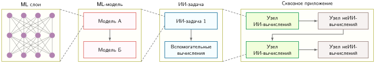

*Уровни детализации бенчмаркинга: четырехпанельная блок-схема с уровнями микро-, макро-, прикладной и сквозной оценки. Каждая панель задает свою область оценки, от изолированных операций ядра до развертывания всей системы, что позволяет целенаправленно оптимизировать каждый уровень стека ML.*

### Микробенчмарки

Пока сквозные метрики регулируют соглашения об уровне обслуживания, оптимизация конвейера ускорителя требует выделить конкретные математические операции, которые тратят время выполнения и энергию. Микробенчмарки выполняют эту диагностическую роль, оценивая отдельные тензорные операции в изоляции и измеряя аппаратные примитивы, введенные в [«Аппаратном ускорении»](11_hw_acceleration.md#sec-hardware-acceleration). Когда профилируется медленный сервис вывода, макробенчмарки показывают суммарные нарушения задержки, но только микробенчмарки выявляют, доминирует ли во времени выполнения умножение матриц, проекции самовнимания, копирование памяти через межсоединение хост–ускоритель или поэлементные ядра функций активации.

Тензорные операции — главная цель микробенчмаркинга, потому что умножение матриц и свертки доминируют в арифметическом бюджете глубоких нейронных сетей. Высокооптимизированные библиотеки времени выполнения, такие как cuDNN[^fn-cudnn-library-kernel] (Chetlur et al., 2014), дают вручную настроенные реализации ядер под конкретные микроархитектуры. Микробенчмарки также оценивают отдельные функции активации (например, ReLU, Sigmoid и GELU) и структурные подмодули (например, проекции многоголового внимания или блоки прямого распространения трансформера) на стандартизированных формах входа. Наборы бенчмарков вроде DeepBench от Baidu (Baidu Research, 2016) формализовали эту методику: они оценивают сырые примитивы GEMM, свертки и коллективных коммуникаций на разных аппаратных платформах и отделяют эффективность выполнения на уровне кремния от накладных расходов диспетчеризации высокоуровневого фреймворка.

[^fn-cudnn-library-kernel]: **cuDNN (библиотека CUDA для глубоких нейронных сетей)**: выпущена NVIDIA в 2014 году и содержит вручную настроенные реализации ядер для сверток, пулинга и нормализации. Для бенчмаркинга это значит, что заявленные задержки вывода сильно зависят от версии cuDNN и настроек автонастройки алгоритмов, поэтому версия cuDNN обязательна в любой воспроизводимой спецификации бенчмарка.

Измерение изолированных ядер требует строгого экспериментального контроля. Без дисциплинированных протоколов измерения динамическое изменение частоты аппаратуры, асинхронные очереди выполнения и состояние кэша вносят переходные артефакты, которые искажают время выполнения ядра.

> **Правила микробенчмаркинга**
>
> Чтобы измерять производительность ядра, а не артефакты аппаратуры, следуйте *правилам системного детектива*:
>
> 1.  *Правило прогрева*: не измеряйте итерации холодного старта как установившуюся производительность. Современная аппаратура использует DVFS (динамическое масштабирование напряжения и частоты) и динамический разгон; кэши, ядра и тактовые частоты нужно прогреть, прежде чем измеряемый цикл станет отражать устойчивое поведение.
> 2.  *Правило дисперсии*: сообщайте коэффициент вариации (CV) $(\text{CV} = \sigma_{\text{прогон}} / \mu_{\text{прогон}})$, где $\sigma_{\text{прогон}}$ и $\mu_{\text{прогон}}$ — стандартное отклонение и среднее по повторным запускам. Разбирайтесь со значениями выше допуска протокола для конкретной нагрузки; частыми причинами служат фоновое дрожание ОС, тепловой троттлинг и конкуренция за память. Пять процентов не являются универсальной границей.
> 3.  *Проверка «скорости света» (SOL)*: сравните достигнутую пропускную способность с Roofline. Если ядро выдает 10 TFLOP/s на H100 (пик около 989 TFLOP/s FP16 или около 1 979 TFLOP/s FP8 без разреженности), диагностический шаг — найти причину низкой загрузки (часто это задержка запуска ядер из-за слишком большого числа мелких ядер), прежде чем оптимизировать сам код.
> 4.  *Правило состояния кэша*: задавайте состояние кэша в соответствии с утверждением. Сбрасывайте или вытесняйте кэш L2, когда измеряете холодную пропускную способность динамической памяти с произвольным доступом (DRAM); сохраняйте прогретый кэш, когда измеряете повторное использование в установившемся режиме. Иначе номинальный результат DRAM может отражать пропускную способность кэша (около 5–10 ТБ/с), а не DRAM (около 1–2 ТБ/с).
> 5.  *Правило барьера синхронизации*: запуски ядер ускорителя асинхронны относительно центрального процессора хоста. Замер времени операций GPU часами процессора без явного барьера устройства (например, `torch.cuda.synchronize()`) измеряет задержку постановки в очередь на хосте, а не выполнение ядра; ставьте барьеры синхронизации сразу до и после измеряемого участка или используйте события меток времени на стороне GPU (`cudaEventRecord`).

Профилировщик переводит эти правила измерения в физическую диагностику, раскладывая время выполнения ядра на три управляющих члена железного закона: перемещение данных, пропускную способность вычислений и накладные расходы задержки ([«Железный закон систем машинного обучения»](01_introduction.md#sec-introduction-iron-law-ml-systems-c32a)).

> **Измерение членов железного закона**
>
> Переход от теории к трассе означает сопоставление уравнения железного закона из [«Железного закона систем машинного обучения»](01_introduction.md#sec-introduction-iron-law-ml-systems-c32a) с временной шкалой профилировщика (например, Nsight Systems или PyTorch Profiler).
>
> **Измерение члена данных** $\left(\frac{D_{\text{объем}}}{\text{BW}}\right)$
>
> *   Признак: ищите строку «Memory Throughput» или «DRAM Bandwidth».
> *   **Формула**: $\text{BW}_{\text{эфф}} = \frac{D_{\text{объем}}}{T_{\text{ядро}}}$.
> *   **Диагностика**: если $\text{BW}_{\text{эфф}} \approx \text{BW}_{\text{пик}}$ (например, близко к пику A100 в 2,04 ТБ/с), ядро ограничено памятью. Оптимизация вычислений ($O$) ничего не даст.
>
> **Измерение достигнутой вычислительной пропускной способности $(R_{\text{пик}} \cdot \eta_{\text{hw}})$**
>
> *   Признак: ищите «SM Active» или «Compute Throughput».
> *   **Формула**: $\text{Достигнуто TFLOP/s} = \frac{O}{10^{12}\,T_{\text{ядро}}}$.
> *   **Диагностика**: если $\text{Достигнуто TFLOP/s} \ll \text{Пик TFLOP/s}$ И $\text{BW}_{\text{эфф}} \ll \text{BW}_{\text{пик}}$, система находится в *«ловушке загрузки»*: вероятно, ограничена задержкой (ядра слишком малы) или сеткой (недостаточно потоков).
>
> **Измерение члена задержки $(L_{\text{lat}})$**
>
> *   Признак: ищите разрывы (пустое место) между цветными полосами ядер на временной шкале.
> *   **Формула**: $\text{Доля накладных расходов} = \frac{T_{\text{разрыв}}}{T_{\text{ядро}} + T_{\text{разрыв}}}$.
> *   **Диагностика**: пилообразный узор (вычисления, разрыв, вычисления, разрыв) указывает на высокие программные накладные расходы. Решение — слияние операторов, описанное в [«Слиянии ядер»](11_hw_acceleration.md#sec-hardware-acceleration-kernel-fusion-7faf), или CUDA Graphs, которые фиксируют повторяющуюся последовательность запусков GPU, чтобы среда выполнения воспроизводила ее с меньшими накладными расходами на диспетчеризацию центральным процессором.

Пока стандартизированные бенчмарки измеряют совокупную пропускную способность, профилировщики показывают физические механизмы, из-за которых выполнение останавливается. Системная диагностика использует два взаимодополняющих уровня инструментирования: профилировщики фреймворков и профилировщики ядер.

#### Профилировщики фреймворков

Профилировщики фреймворков, такие как PyTorch Profiler, фиксируют логическую трассу выполнения итерации обучения или вывода. Они отслеживают диспетчеризацию операторов на центральном процессоре хоста, определяют, перекрывается ли подготовка на хосте асинхронно с работой ускорителя, и выявляют, не остаются ли очереди вычислений без данных из-за конвейера загрузчика. Главная диагностическая метрика — разбивка времени шага по загрузке данных, задержке запуска на хосте, вычислениям устройства и коммуникации между устройствами. Эта разбивка показывает, какая подсистема ограничивает задержку итерации, прежде чем исследовать отдельные ядра.

#### Профилировщики ядер

Профилировщики ядер, такие как NVIDIA Nsight Systems и Nsight Compute, фиксируют физическое выполнение на кремнии ускорителя. Nsight Systems строит общую временную шкалу по потокам центрального процессора, вызовам API CUDA, передачам памяти и длительностям ядер и показывает пузыри сериализации. Nsight Compute проводит углубленный анализ отдельных вызовов ядер: измеряет заполненность варпов мультипроцессоров (SM), остановки выдачи инструкций и эффективность объединения обращений к памяти относительно аппаратного Roofline. Профилировщики ядер берут эти диагностики напрямую из блоков мониторинга производительности (PMU) на кристалле, снимая аппаратные счетчики трафика HBM, доли попаданий в кэш L2 и причины остановок конвейера без искажения динамики выполнения программной инструментацией.

Строгий процесс профилирования идет сверху вниз. Инженер начинает с профилировщика фреймворка, чтобы выделить доминирующий слой на временной шкале выполнения (например, выяснить, что блок многоголового внимания занимает 65 процентов задержки шага). Затем инженер применяет профилировщик ядер, чтобы разобрать этот слой до кремния (например, проверить, что ядро softmax достигает лишь малой доли пиковой пропускной способности памяти из-за несогласованных обращений к DRAM). Такой двухэтапный процесс предотвращает неверно направленную оптимизацию, потому что инженерные усилия направлены на лимитирующее физическое узкое место.

Эти гранулярные измерения позволяют точно оптимизировать ядра, но не показывают, как компоненты взаимодействуют при сборке полных моделей. Этот пробел закрывают макробенчмарки.

### Макробенчмарки

Микробенчмарки проверяют, что изолированные операторы достигают высокой вычислительной эффективности и эффективности по памяти. Макробенчмарки определяют, сохраняются ли эти выигрыши, когда слои собраны в полную модель. Сборка слоев вводит физические взаимодействия, которые изолированные бенчмарки не видят: промежуточные тензоры активаций увеличивают пиковый объем памяти, последовательные запуски ядер открывают накладные расходы драйвера CPU на диспетчеризацию, а потоки обращений к памяти от предыдущих операций вытесняют общие строки кэша до того, как их смогут использовать последующие ядра.

Макробенчмарки решают центральную инженерную задачу: оценивают архитектуры моделей и конфигурации среды выполнения на стандартизированных нагрузках. Оценка модели фиксирует компромиссы, которые возникают при сборке слоев: точность обобщения на непросмотренных валидационных данных, динамическое выделение памяти при разных размерах батчей и длинах контекста, а также суммарную пропускную способность при разных шаблонах поступления запросов. Эти измерения взаимодействуют напрямую: архитектура с более высокой точностью может требовать объема активаций, который вынуждает уменьшить размер батча под ограничениями памяти устройства, и тогда падает вычислительная пропускная способность, которая оправдывала ее выбор.

Полную оценку модели требуют стандартизированных наборов данных, фиксированных эталонных задач и воспроизводимых определений метрик. В компьютерном зрении стандартные бенчмарки оценивают модели на ImageNet (Deng et al., 2024), измеряя точность классификации top-1 вместе с задержкой вывода при фиксированных размерах батча. В обработке естественного языка стандартизированные задачи оценивают перевод «последовательность в последовательность» и авторегрессивную генерацию, сопоставляя качество выхода со скоростью генерации токенов при заданных длинах контекста.

Несколько отраслевых наборов обеспечивают воспроизводимые сравнения моделей на разных платформах. Набор MLPerf стандартизирует оценку в дата-центрах, краевых устройствах, мобильных устройствах и микроконтроллерах, как описано в [«Бенчмарках вывода MLPerf»](12_benchmarking.md#sec-benchmarking-mlperf-inference-benchmarks-e878). Для ресурсно-ограниченных встраиваемых целей MLMark от EEMBC измеряет пропускную способность вывода и энергопотребление при жестких бюджетах памяти, а набор AI-Benchmark (Ignatov and Timofte, 2024) оценивает мобильные системы на кристалле с гетерогенными вычислительными блоками.

### Сквозные бенчмарки

Сквозные бенчмарки охватывают весь производственный конвейер, фиксируя все этапы, необходимые для приема сырых данных, получения предсказаний модели и доставки результатов потребителям. Микро- и макробенчмарки сосредоточены на выполнении в ускорителе, но реальные конвейеры обслуживания часто находят основные узкие места за пределами самой модели.

Предобработка данных — первая фаза конвейера, которая превращает сырые внешние входные данные в тензорные представления, готовые для модели. В конвейерах компьютерного зрения прием изображений требует декодирования сжатых форматов (например, распаковки JPEG), изменения размера, обрезки и нормализации цвета. Когда эти шаги выполняются на центральных процессорах хоста без аппаратного ускорения, они могут занимать в несколько раз больше времени, чем вывод модели на современном ускорителе, и простаивающие тензорные ядра ждут передач из памяти хоста. Аналогично в конвейерах для естественного языка токенизация подслов и динамическое дополнение последовательностей на центральном процессоре хоста часто ограничивают пропускную способность обслуживания. Постобработка создает похожие узкие места задержки: в детекции объектов нужны подавление не-максимумов (NMS) и преобразования координат ограничивающих рамок, которые создают последовательные остановки выполнения, если их плохо встроить в граф выполнения.

Инфраструктура распределенной системы накладывает дополнительные ограничения производительности помимо вычислительной сети. Удаленные хранилища ограничивают пропускную способность обучения при чтении больших мультимодальных наборов данных, а насыщение сетевой карты (NIC) в распределенных кластерах тормозит коллективные коммуникации. Сквозные бенчмарки должны измерять пропускную способность конвейера при реалистичных сетевых задержках, параллельных потоках запросов и реальных ограничениях ввода-вывода хранилища, чтобы обеспечить воспроизводимую оценку развертывания как интегрированной системы.

Публичные наборы бенчмарков редко измеряют хранилище, сеть и вычисления в рамках одного единого протокола. MLPerf Training и Inference оценивают сквозные сценарии ближе, чем изолированные тесты операторов, однако их закрытые дивизионы намеренно стандартизируют загрузку входных данных, чтобы изолировать производительность ускорителя от изменчивости хранилища и сети. Поэтому сквозной бенчмаркинг в продакшене остается преимущественно внутренней инженерной практикой, которая опирается на распределенную трассировку и телеметрию эксплуатации на живых распределениях запросов.

### Компромиссы уровней детализации и критерии выбора

[«Сравнение уровней детализации бенчмарков»](12_benchmarking.md#tbl-benchmark-comparison) сопоставляет диагностический фокус, охват и инженерные компромиссы трех уровней детализации бенчмаркинга. Микробенчмарки изолируют низкоуровневые операции, чтобы направлять оптимизацию ядер и выбор аппаратуры, макробенчмарки оценивают полные модели, чтобы направлять архитектурные решения, а сквозные бенчмарки измеряют полные конвейеры, чтобы производственные развертывания удовлетворяли требованиям реального сервиса.

| **Компонент**   | **Микробенчмарки**                                        | **Макробенчмарки**                                     | **Сквозные бенчмарки**                                 |
|:----------------|:----------------------------------------------------------|:-------------------------------------------------------|:-------------------------------------------------------|
| **Фокус**       | Отдельные операции                                        | Полные модели                                          | Полный системный конвейер                              |
| **Охват**       | Тензорные операции, слои, активации                       | Архитектура модели, обучение, вывод                    | Извлечение, преобразование, загрузка; модель; инфраструктура |
| **Пример**      | Производительность сверточного слоя в cuDNN               | ResNet-50 на ImageNet                                  | Промышленная рекомендательная система                  |
| **Преимущества**  | Точная идентификация узких мест, оптимизация компонентов | Сравнение архитектур моделей, стандартизированная оценка | Реалистичная оценка производительности, системные выводы |
| **Ограничения**   | Может пропускать эффекты взаимодействия                   | Ограниченные сведения об инфраструктуре                | Сложно стандартизировать, часто закрыты               |
| **Типичное применение** | Выбор аппаратуры, оптимизация операций              | Выбор модели, сравнение в исследованиях                | Оценка производственной системы                        |

*Уровни детализации бенчмарков: разные области бенчмарка нацелены на разные этапы разработки системы ML. Микробенчмарки изолируют отдельные операции для низкоуровневой оптимизации, макробенчмарки оценивают полные модели, чтобы направлять архитектурный выбор, а сквозные бенчмарки оценивают производительность всей системы в эксплуатации.*

Выбор одного уровня детализации редко бывает достаточным, потому что бенчмаркинг содержит внутренний компромисс между диагностической изоляцией и точностью отражения эксплуатации. На рисунке [«Изоляция и репрезентативность»](12_benchmarking.md#fig-benchmark-tradeoffs) показан этот спектр: микробенчмарки располагаются на границе высокой изоляции, а сквозные бенчмарки — на границе высокой репрезентативности. Микробенчмарки точно указывают физический предел ядра (например, насыщение пропускной способности памяти или низкую заполненность варпов), но не улавливают давление памяти между слоями или накладные расходы хоста. Напротив, сквозные бенчмарки отражают реальную задержку эксплуатации при живом распределении трафика, но скрывают первопричины, когда резко растет хвостовая задержка.

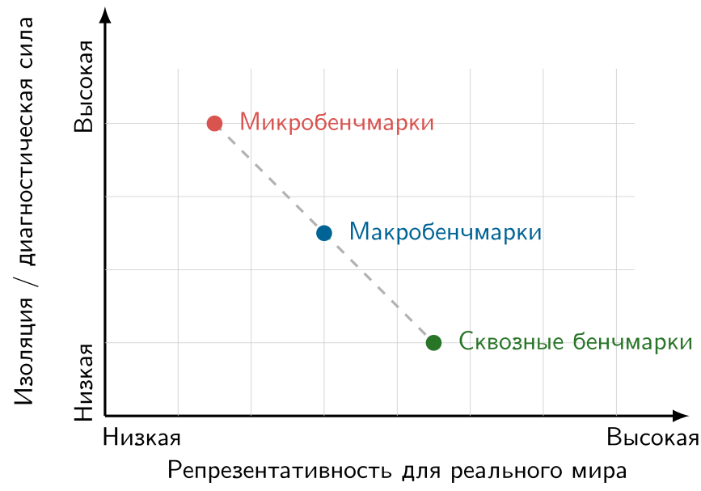

*Изоляция и репрезентативность: ключевой компромисс в гранулярности бенчмаркинга. Микробенчмарки дают высокую диагностическую точность, но ограниченную связь с реальностью, а сквозные бенчмарки отражают реальное поведение системы, но дают менее точные сведения о компонентах. Эффективная оценка ML-системы требует стратегического сочетания всех трех уровней.*

Этот компромисс напрямую ложится на таксономию D·A·M. Микробенчмарки оценивают физическую способность Машины ($M$) выполнять примитивный Алгоритм ($A$). Макробенчмарки оценивают, как Алгоритм ($A$) организует потоки тензорных данных по составным слоям на Машине ($M$). Сквозные бенчмарки оценивают, как прием исходных Данных ($D$) из внешнего хранилища и сетевой инфраструктуры взаимодействует и с Алгоритмом, и с Машиной под производственной нагрузкой. Систематическая инженерия производительности требует оценивать все три уровня, чтобы локальные оптимизации ядер переходили в ускорение всей системы.

Выбор подходящего уровня детализации задает физическую границу измерения, но ее задание — лишь первый шаг. Полный бенчмарк также требует определить операционные составляющие: постановку задачи, репрезентативные наборы данных, целевые модели и метрики оценки. Без этих конкретных компонентов измерения на любом уровне детализации не дают выводов, на которые можно опереться в инженерной работе.

## Компоненты бенчмарка

Выбор между микро-, макро- и сквозной детализацией определяет, что бенчмарк способен диагностировать, но каждый бенчмарк должен задавать задачу, данные, модель, метрики, обвязку, системный контекст и правила запуска, которые делают результаты интерпретируемыми. Микробенчмарки изолируют конкретные аппаратные ограничения выполнения, например пропускную способность потоковой памяти или пропускную способность тензорных ядер, с помощью синтетических тензорных операций. Макробенчмарки оценивают выполнение полного графа на стандартизированных наборах данных вроде ImageNet. Сквозные бенчмарки охватывают весь конвейер: прием данных, передачи между хостом и устройством, сборку батчей и выполнение вывода. На всех трех уровнях компоненты бенчмарка нельзя выбирать изолированно: каждый из них задает физические и алгоритмические граничные условия для следующего.

Эти компоненты связаны между собой в конвейер оценки, структурированный таксономией D·A·M (Данные, Алгоритм и Машина). Рабочий процесс на рисунке [«Компоненты рабочего процесса бенчмарка»](12_benchmarking.md#fig-benchmark-components) проходит девять этапов промышленного бенчмарка обнаружения аномалий звука, от постановки задачи через квантование до развертывания на встраиваемом микроконтроллере ARM. Каждый этап задает граничные условия для следующего: постановка задачи определяет частоту дискретизации звука и представление входа (Данные); свойства набора данных и цель задачи определяют допустимые архитектуры моделей (Алгоритм); а аппаратные пределы микроконтроллера, такие как емкость SRAM, энергетический бюджет и сроки задержки реального времени, диктуют квантование INT8 и компиляцию ядер с эффективным использованием памяти (Машина). Обнаружение аномалий наглядно показывает эту связанность всего стека: бенчмарк, который измеряет только точность классификации или только сырую задержку вывода, пропускает взаимодействия между этапами, где решение на любом этапе сужает пространство допустимых решений на последующих.

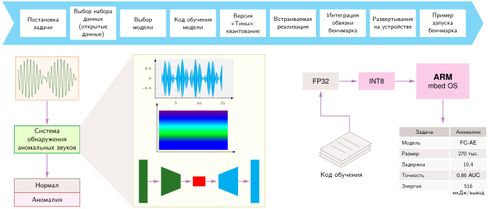

*Компоненты рабочего процесса бенчмарка: читайте слева направо. Каждый этап задает допущения для следующего и ведет задачу обнаружения аномалий звука от определения проблемы до воспроизводимого запуска бенчмарка на встраиваемом устройстве.*

Оценка ML-системы требует совмещать статистические метрики задачи с метриками физической эффективности. Квантование и прореживание уменьшают объем параметров и трафик шины памяти, но меняют численное представление и рискуют ухудшить точность задачи. Бенчмарк, который фиксирует время выполнения без статистической точности (например, AUC или ошибки классификации), вознаграждает агрессивные приближения, которые дают некорректные выходы; и наоборот, отчетность о точности без задержки или потребления памяти скрывает, удовлетворяет ли модель физическим ограничениям целевой системы. Интерпретация этих результатов требует связать арифметическую интенсивность нагрузки (отношение операций к байтам, переданным из памяти) с точкой перехода машины по модели Roofline и определить, снимает ли оптимизация узкое место пропускной способности памяти или узкое место вычислительной пропускной способности.

Обвязка измерений и правила запуска задают экспериментальный контроль, который делает эти оценки воспроизводимыми. Без строгих протоколов выполнения измеренное время отражает шум операционной системы и аппаратуры, а не стоимость выполнения алгоритма. Строгая обвязка бенчмарка задает итерации прогрева кэшей, чтобы выйти на установившееся поведение памяти, фиксирует тактовые частоты процессора, чтобы динамическое масштабирование напряжения и частоты (DVFS) не вносило переходных скачков задержки, закрепляет выделения памяти хоста, чтобы не тратить время на страничные ошибки, и записывает распределения хвостовой задержки ($p95$, $p99$) наряду со средней задержкой, чтобы выявить конкуренцию за шину памяти и задержки в очередях. Эти операционные компоненты гарантируют, что измерения отражают истинные физические пределы системы и создают основу для рассмотрения каждого компонента подробно, начиная с постановки задачи.

### Постановка задачи

Каждый бенчмарк начинается с фиксации вычислительных и эксплуатационных границ нагрузки. Без явной спецификации задачи оптимизации аппаратуры и программного обеспечения нельзя оценить на равных: изменение разрешения входа, численного типа данных или срока задержки принципиально меняет физическую работу, которую требуется выполнить машине. Как показано на примере системы обнаружения аномалий звука в [«Компонентах рабочего процесса бенчмарка»](12_benchmarking.md#fig-benchmark-components), приложение превращает сырые сигналы датчиков в эксплуатационные решения. В любой области, будь то задачи обработки естественного языка, такие как машинный перевод, ответы на вопросы (Hirschberg and Manning, 2015) и классификация текстов, или задачи компьютерного зрения, такие как детекция объектов и сегментация изображений (Everingham et al., 2009); (Lin et al., 2014), полная постановка задачи задает три конкретные спецификации: спецификацию входа, спецификацию выхода и спецификацию производительности.

Спецификации входа и выхода устанавливают контракт перемещения данных и определяют точную область измеряемого выполнения. Спецификация входа фиксирует размерности тензоров, поведение батчинга, численные представления (например, FP16 или INT8) и скорости приема. В конвейере обнаружения аномалий звука потоковая передача одноканального звука с частотой 16 кГц в фиксированных окнах по одной секунде задает жесткую скорость приема и требования к буферу памяти еще до начала извлечения признаков. Спецификация выхода, напротив, определяет границу окончания вычислений. Бенчмарки часто вносят смещение измерения, засекая только прямой проход ускорителя и игнорируя постобработку на центральном процессоре, которая превращает сырые выходы тензоров в пригодные для использования решения. Надежная спецификация выхода определяет, выдает ли система сырые логиты, промежуточные эмбеддинги или окончательные бинарные флаги аномалий, учитывая любые последующие ядра пороговой обработки или редукции, которые потребляют пропускную способность памяти хоста.

Спецификация производительности задает эксплуатационные рамки, которые определяют, жизнеспособна ли оптимизация. Цифры неограниченной пропускной способности бессмысленны, если статистическая точность падает ниже приемлемых порогов, а высокая средняя пропускная способность не спасает систему, которая нарушает соглашения об уровне обслуживания (SLA) по задержке. Для обнаружения аномалий в реальном времени спецификация производительности связывает целевую метрику качества (например, площадь под ROC-кривой) с аппаратными пределами выполнения: детерминированный потолок хвостовой задержки (например, время ответа на уровне 99-го перцентиля $p_{99} \le 10\text{ мс}$), устойчивая пропускная способность, соответствующая скорости поступления данных, и строгий объем резидентной памяти, который предотвращает нехватку памяти на ускорителях с ограниченным ресурсом. Задавая эти три границы заранее, бенчмарк гарантирует, что последующие этапы, от построения набора данных до настройки обвязки измерений, оценивают оптимизации системы относительно истинных эксплуатационных ограничений развертывания.

### Стандартизированные наборы данных

Постановка задачи настолько хороша, насколько хороши данные, на которых ее оценивают. Стандартизированные наборы данных обеспечивают, что все модели проходят проверку в одинаковых условиях, что позволяет напрямую сравнивать разные подходы. Без них каждая команда оценивала бы модели на закрытых данных, и сравнение между лабораториями стало бы невозможным.

В компьютерном зрении эталонными стандартами служат ImageNet (Deng et al., 2024); (Deng et al., 2009), COCO (Lin et al., 2014) и CIFAR-10 (Krizhevsky, 2009); в обработке естественного языка схожую роль играют SQuAD[^fn-squad-question-answering] (Rajpurkar et al., 2016), GLUE[^fn-glue-benchmark-saturation] (Wang et al., 2018) и WikiText (Merity, 2016); (Merity et al., 2016), каждый из которых охватывает набор уровней сложности и краевых случаев.

[^fn-squad-question-answering]: **SQuAD (Stanford Question Answering Dataset)**: представлен в 2016 году, содержит более 100 000 пар «вопрос — ответ» по материалам Википедии (Rajpurkar et al., 2016). К 2018 году системы ИИ превзошли базовый уровень человека в SQuAD 1.1, равный 91,2 процента F1 (Devlin et al., 2019). Однако этот «сверхчеловеческий» результат показывает типичный сбой бенчмаркинга: экстрактивный формат задачи (ответы — фрагменты текста внутри отрывка) делает ее проще открытых вопросов и завышает воспринимаемые возможности по сравнению с промышленными системами NLP.

[^fn-glue-benchmark-saturation]: **GLUE (General Language Understanding Evaluation)**: представлен в 2018 году как широкий бенчмарк понимания языка (Wang et al., 2018). GLUE быстро насытили такие системы, как BERT (Devlin et al., 2019). Это закон Гудхарта в действии: как только GLUE стал целью, оптимизация под таблицу лидеров снизила его способность различать модели. Эта закономерность привела к появлению более трудных последующих оценок, таких как SuperGLUE и BIG-bench.

Выбор набора данных — первое место, где бенчмарк может потерять связь с реальностью эксплуатации. В примере обнаружения аномалий звука ([«Компоненты рабочего процесса бенчмарка»](12_benchmarking.md#fig-benchmark-components)) набор данных должен включать репрезентативные записи нормальной работы вместе с полноценными примерами аномальных состояний. Для разных аудиозадач существуют специализированные коллекции: ToyADMOS[^fn-toyadmos-anomaly-benchmark] (Koizumi et al., 2019) поддерживает контролируемые исследования обнаружения аномалий, а Google Speech Commands (Warden, 2018) — распознавание ключевых слов. Хорошие наборы данных для бенчмарков должны уравновешивать два конкурирующих требования: точно отражать вызовы реального мира и сохранять достаточную сложность, чтобы различать производительность моделей. Упрощенные наборы вроде ToyADMOS ценны для разработки методики, но могут не передавать всей сложности производственных сред.

[^fn-toyadmos-anomaly-benchmark]: **ToyADMOS**: создан NTT Communications в 2019 году для обнаружения акустических аномалий и содержит записи звуков работы игрушечных автомобилей, игрушечных конвейеров и других миниатюрных машин (Koizumi et al., 2019). Приставка «toy» здесь намеренная: контролируемая среда делает бенчмарк воспроизводимым, но может создавать разрыв между областями, когда модели переносят в более шумную промышленную среду с другими машинами, датчиками, вибрацией и фоновыми звуками.

### Выбор модели

Когда задача и набор данных зафиксированы, бенчмарк должен задать архитектуру модели и ее базовые реализации. В системном бенчмаркинге модель определяет нагрузку на выполнение: ее вычислительный граф задает арифметическую интенсивность, объем памяти и топологию коммуникаций. Выбор модели для бенчмарка определяет, отражают ли измеренные различия архитектурную эффективность, оптимизации среды выполнения или чистую мощность ускорителя. Оценка архитектурной модификации требует, чтобы среда выполнения и целевая аппаратура оставались неизменными, как установлено в [«Архитектурах нейронных сетей»](06_nn_architectures.md#sec-network-architectures). Наоборот, оценка аппаратных платформ или программных движков выполнения, рассмотренных в [«Фреймворках машинного обучения»](07_frameworks.md#sec-ml-frameworks), требует стандартизации на фиксированном репрезентативном графе модели, чтобы различия в пропускной способности отражали эффективность выполнения, а не математические изменения нагрузки.

Базовые модели задают эмпирическую точку отсчета для целевой области. Системные бенчмарки опираются не на игрушечные алгоритмы, а на канонические нагрузки, вычислительные профили и шаблоны доступа к памяти которых хорошо изучены. В обработке языка BERT[^fn-bert-benchmark-evaluation] служит стандартной базой, потому что его многоголовое самовнимание и плотные блоки прямого распространения нагружают одновременно матричные умножения, ограниченные вычислениями, и редукции, ограниченные пропускной способностью памяти. Однако спецификация базовой модели не может ограничиваться математическим графом. Две реализации одной архитектуры в разных фреймворках или средах выполнения часто ведут себя по-разному. Различия в слиянии операторов, например в слиянии нормализации и активации непосредственно в выходные эпилоги GEMM, чтобы не обращаться в HBM, а также различия в накладных расходах запуска ядер и поведении аллокатора памяти, могут превышать эффект небольших архитектурных изменений. Поэтому бенчмарк должен стандартизировать реализацию среды выполнения наряду с математической моделью.

[^fn-bert-benchmark-evaluation]: **BERT (двунаправленные энкодерные представления от трансформеров)**: BERT-Large (340 млн параметров) — нагрузка обработки естественного языка в MLPerf Inference. Бенчмарк фиксирует задачу, данные, целевое качество и применимые сценарии выполнения, чтобы системы можно было сравнивать на одной нагрузке. Задержка BERT по-прежнему зависит от длины последовательности, батчинга и реализации.

Бенчмарк должен оценивать модель в двух различных эксплуатационных режимах, каждый из которых определяется своими физическими узкими местами. При обучении главное ограничение — емкость памяти и пропускная способность межсоединений: хранение активаций прямого прохода, градиентов обратного прохода и состояний оптимизатора на нескольких ускорителях ограничивает размер батча и требует высокоскоростных коллективных коммуникаций. Поэтому бенчмарки обучения измеряют время до точности при фиксированных критериях сходимости, а не только скорость итераций. При выводе обратные проходы и состояния оптимизатора исчезают, и узкое место смещается к хвостовой задержке при строгих соглашениях об уровне обслуживания (SLA) или к пропускной способности памяти во время авторегрессивного декодирования. Перевод модели в производство часто требует снижения точности: квантования весов и активаций из FP32 или BF16 в INT8 или FP8. Квантование вдвое уменьшает трафик памяти и удваивает пропускную способность тензорных ядер, но требует калибровки, чтобы численная ошибка не ухудшила качество на валидации. Поскольку архитектура может эффективно обучаться, но не выдерживать строгих SLA по задержке, бенчмарк должен оценивать оба эксплуатационных режима с помощью отдельных доменных метрик.

### Метрики оценки

Метрики оценки[^fn-metric-etymology-measurement] переводят поведение модели в числа, которые можно сравнивать, ранжировать и использовать для инженерных решений. Задача состоит в выборе правильных чисел: метрика, которая учитывает точность, но игнорирует задержку, может признать победителем модель, слишком медленную для производства; метрика, которая вознаграждает пропускную способность и игнорирует энергию, может оптимизировать бюджет развертывания, которого не существует.

[^fn-metric-etymology-measurement]: **Метрика**: в математике метрика — это функция расстояния, удовлетворяющая строгим аксиомам, включая неравенство треугольника. В ML термин используется свободно для количественных мер вроде BLEU и перплексии, которые являются правилами подсчета баллов, а не математическими метриками. Рейтинги в таблице лидеров могут меняться при изменении протокола оценки, среза данных или весов метрик, поэтому выбор метрики — инженерное решение, которое определяет, какая система побеждает, а не только то, как измеряется производительность.

[«Таксономия метрик бенчмаркинга ML»](12_benchmarking.md#tbl-metric-taxonomy) классифицирует меры оценки по сбою, который каждая из них выявляет, и контексту развертывания, который она обслуживает.

| **Категория**  | **Метрика**                  | **Единица**            | **Основной случай применения** |
|:---------------|:-----------------------------|:-----------------------|:-------------------------------|
| **Точность**   | Top-1/Top-5 точность         | Процент                | Классификация                  |
|                | mAP (средняя точность)       | Оценка от 0 до 1       | Детекция объектов              |
|                | BLEU/ROUGE                   | Оценка от 0 до 100     | Генерация текста (NLP)         |
|                | Перплексия                   | Оценка (меньше — лучше) | Языковое моделирование        |
| **Пропускная способность** | Образцов в секунду | Образцы/с              | Пакетный вывод                 |
|                | Пропускная способность по токенам | Токены/с        | Вывод LLM                      |
|                | Время обучения               | Часы/дни               | Бенчмарки обучения             |
| **Задержка**   | Задержка p50                 | Миллисекунды           | Медианное время ответа         |
|                | Задержка p99                 | Миллисекунды           | Хвостовая задержка (SLA)       |
|                | Задержка первого токена      | Миллисекунды           | Отзывчивость LLM               |
| **Эффективность** | Образцов в секунду на ватт | Образцы/с/Вт           | Энергоэффективность            |
|                | Точность на FLOP             | Процент/PFLOP          | Алгоритмическая эффективность  |
|                | TCO на вывод                 | \$/вывод               | Экономическая эффективность    |

*Таксономия метрик бенчмаркинга ML: метрики, сгруппированные по категории оценки, единице измерения и основному случаю применения. Метрики точности описывают качество модели, метрики пропускной способности и задержки отражают скорость системы, а метрики эффективности объединяют несколько измерений. Выбор метрики, подходящей для контекста развертывания, часто важнее, чем доведение любой отдельной метрики до максимума.*

Метрики из [«Таксономии метрик бенчмаркинга ML»](12_benchmarking.md#tbl-metric-taxonomy) выявляют физические компромиссы, которые определяются архитектурой ускорителя. Пропускная способность измеряет совокупную мощность обработки, а задержка измеряет время завершения отдельного запроса. Эти две цели прямо конфликтуют на границе аппаратуры. Максимизация пропускной способности требует объединять запросы в большие батчи, чтобы амортизировать пропускную способность памяти при загрузке весов на несколько входов, повышая арифметическую интенсивность на тензорных блоках. Этот механизм батчинга увеличивает задержку на один образец: отдельные запросы ждут в очереди, пока формируется батч, а большие матричные операции дольше выполняются. Кроме того, средняя арифметическая задержка маскирует поведение хвоста. Дрожание очередей, остановки выделения памяти и тепловой троттлинг ускорителя заставляют времена выполнения расходиться: система со средней задержкой 10 мс может показывать задержку 99-го перцентиля (p99) в 500 мс, которая нарушает соглашения об уровне обслуживания. Поэтому бенчмарки должны сообщать распределения перцентилей (p50, p95, p99), а не средние значения. Составные метрики вроде образцов в секунду на ватт сводят несколько измерений в один скаляр, что облегчает высокоуровневое сравнение, но скрывает, где находятся узкие места. Отчетность по атомарным метрикам (распределениям задержки, пропускной способности и потреблению мощности) наряду с составными показателями позволяет выделить, какое физическое ограничение сдерживает систему.

Метрики конкретной задачи оценивают алгоритмическое измерение, показывая, решает ли модель статистическую задачу. Задачи классификации оценивают точность (долю правильных предсказаний), precision, recall и F1-меру (Sokolova and Lapalme, 2009). Precision и recall отделяют долю истинно положительных срабатываний от ложных тревог, что необходимо при несбалансированных классах. Задачи непрерывной оценки опираются на среднеквадратичную ошибку (MSE) или среднюю абсолютную ошибку (MAE), а генерация последовательностей использует специализированные правила подсчета, такие как BLEU[^fn-bleu-score-translation], который измеряет модифицированную точность n-грамм относительно эталонных человеческих переводов (Papineni et al., 2002).

[^fn-bleu-score-translation]: **BLEU (bilingual evaluation understudy)**: предложен в IBM в 2002 году. BLEU измеряет качество перевода через модифицированную точность n-грамм со штрафом за краткость относительно эталонных переводов (Papineni et al., 2002). BLEU — канонический пример закона Гудхарта в ML: оптимизация совпадений n-грамм может вознаграждать поверхностное совпадение слов даже тогда, когда смысл, беглость или полезность при развертывании расходятся с целью.

Метрики задачи оценивают алгоритмическое качество изолированно, но жизнеспособность развертывания зависит от физических ограничений машины. Емкость модели, измеряемая числом параметров и объемом памяти, определяет, помещаются ли веса в SRAM на кристалле или в память ускорителя, или же они переходят через высокоуровневые межсоединения с большой задержкой. Задержка выполнения на один вывод определяет, укладывается ли система в сроки реального времени, а энергопотребление на вывод (в джоулях или милливаттах) ограничивает тепловыделение и время работы батареи. Эксплуатационные задачи поддержания этих метрик в производственных средах рассматриваются в стратегиях развертывания (глава [«MLOps»](14_ml_ops.md#sec-ml-operations)).

Бенчмарки также должны учитывать чувствительность измерений к программным средам выполнения. Как установлено в [«Обучении моделей»](08_training.md#sec-model-training), разные фреймворки по-разному обрабатывают вычисление функции потерь, слияние операторов и накопление градиентов, что меняет опубликованные числа бенчмарков. Тонкие различия реализации, например то, использует ли пакетная нормализация в режиме оценки статистики генеральной совокупности или скользящие моменты мини-батчей, либо как переупорядочиваются неассоциативные сложения чисел с плавающей точкой в ядрах редукции, сдвигают измеряемую точность и задержку настолько, что при узком разрыве между моделями рейтинг бенчмарка может перевернуться.

Эта взаимозависимость статистического качества и аппаратных ограничений хорошо видна на обнаружении аномалий. В промышленном мониторинге сильный дисбаланс классов делает сырую точность обманчивой: если аномалии составляют лишь 0,1 процента рабочих образцов, тривиальная модель, которая постоянно предсказывает нормальную работу, достигает точности 99,9 процента, но не обнаруживает ни одной неисправности. Поэтому бенчмарк должен сообщать площадь под ROC-кривой (AUC), чтобы оценивать различение на всем диапазоне порогов решения, наряду с физическими метриками ресурсов.

Такой подход с несколькими метриками управляет конвейером обнаружения аномалий, который сбалансирован по четырем одновременным ограничениям: размер модели 270 тыс. параметров, помещающийся в встраиваемую SRAM, время обработки 10,4 мс на вывод для поддержания дискретизации в реальном времени, точность обнаружения 0,86 по AUC и энергопотребление 516 мкДж на вывод в рамках целевого бюджета батареи. Оценка по всем четырем осям не дает объявить модель лучшей, если ее выигрыш в точности получен за счет архитектуры, слишком большой для памяти, или слишком прожорливой, чтобы выдержать постоянное развертывание.

### Обвязка бенчмарка

Метрики определяют, *что* измерять, а обвязка бенчмарка определяет, *как* это измерять. Обвязка — это программный и инструментальный каркас, который подает входы в тестируемую систему, координирует выполнение, собирает трассы времени и мощности и обеспечивает воспроизводимость. В системе ML измерение выполнения до уровня железа требует учитывать асинхронную границу между центральным процессором хоста и ускорителем. Когда программа на хосте запускает шаг вывода или обучения, среда выполнения фреймворка лишь ставит команды в очередь работы ускорителя (например, поток CUDA или буфер команд аппаратуры) и сразу возвращает управление. Наивный таймер, обернутый вокруг вызова на уровне хоста, измеряет только эту диспетчеризацию в очередь длительностью в доли микросекунды, а не реальное выполнение на устройстве. Строгая обвязка вставляет аппаратные барьеры синхронизации или считывает события меток времени на устройстве, так что записанные времена отражают полное выполнение ядер и передачи памяти по шине.

Архитектура обвязки должна соответствовать эксплуатационному режиму целевого развертывания. В серверных средах обвязка создает параллельный поток запросов с помощью генератора нагрузки с открытым циклом, часто задавая интервалы между поступлениями по распределению Пуассона.[^fn-poisson-arrival-benchmark] Обвязка с открытым циклом отправляет запросы по независимому расписанию поступления, невзирая на отзывчивость сервера. Такое разделение выявляет задержки в очередях и хвостовую задержку (например, время ответа на уровне p99), когда всплески поступления насыщают доступные вычисления. Напротив, обвязка с замкнутым циклом, которая дожидается ответа перед отправкой следующего запроса, вносит скоординированный пропуск (coordinated omission): она искусственно регулирует трафик и скрывает накопление очереди во время деградации сервера. Наоборот, пакетная обработка офлайн вовсе исключает расписание поступления. Обвязка заранее готовит большие входные батчи в памяти, чтобы насытить исполнительные блоки ускорителя, максимально загрузить пропускную способность памяти и измерить устойчивую пиковую пропускную способность.

[^fn-poisson-arrival-benchmark]: **Распределение Пуассона**: названо в честь Симеона Дени Пуассона, который сформулировал его в 1837 году, моделируя частоту ошибочных осуждений во французских судах. Распределение описывает независимые события с постоянной средней частотой $(\lambda_{\text{arr}})$ и служит обычной базой для поступления запросов к серверу. Реальный трафик ML-сервисов часто нарушает эти допущения из-за пакетности, корреляций и меняющихся во времени частот. Поэтому обвязка на пуассоновском потоке может неверно оценить хвостовую задержку, если трассы или стресс-тесты не покрывают такие производственные шаблоны.

В встраиваемых и краевых развертываниях нагрузки не являются ни стохастическими сетевыми потоками, ни неограниченными пакетными очередями. Входы поступают последовательно от физических датчиков (например, аудиопреобразователя или датчика изображения) по фиксированным аппаратным тактам дискретизации. Обвязка должна подавать эти потоки датчиков через прямой доступ к памяти (DMA) в ограниченные буферы SRAM на кристалле и проверять, что каждый вывод завершается до срока поступления следующего отсчета, иначе буфер переполнится. Кроме того, краевые обвязки должны включать физическую инструментацию, например шунтирующие резисторы или внешние анализаторы мощности, чтобы измерять напряжение и ток в активных циклах выполнения и в состояниях низкого энергопотребления, фиксируя реальную энергию, затраченную на вывод.

Воспроизводимость требует изолировать бенчмарк от вариаций среды выполнения между запусками. Современные ускорители и среды выполнения демонстрируют значительные переходные процессы холодного старта. Первые проходы вывода запускают выделение памяти по требованию, динамическую JIT-компиляцию, инициализацию драйвера и перенос весов из вторичного хранилища в память ускорителя. Воспроизводимая обвязка должна выполнить неизмеряемые итерации прогрева, пока кэши не заполнятся, распределители памяти не стабилизируются и кремний не выйдет на тепловой установившийся режим, и только потом начинать измеряемый цикл. Чтобы предотвратить дрейф измерений, среда испытаний должна фиксировать тактовые частоты ускорителя и центрального процессора, отключая динамическое масштабирование напряжения и частоты (DVFS) и завершая конкурирующие фоновые процессы. Наконец, телеметрия должна минимизировать эффект наблюдателя, записывая метки времени выполнения и счетчики производительности в неблокирующие, заранее выделенные буферы памяти. Так инструментация измерения не отнимает пропускную способность памяти и не меняет конвейер выполнения тестируемой системы.

### Спецификации системы

Спецификации системы дополняют обвязку, которая управляет условиями выполнения: они описывают вычислительную среду, то есть физический и программный стек, который задает границы Машины ($M$) системы. Без полных спецификаций измеренную пропускную способность или задержку нельзя интерпретировать. Метрика выполнения отражает взаимодействие арифметической интенсивности алгоритма и физических пределов машины: пиковой арифметической пропускной способности, пропускной способности иерархии памяти и задержки межсоединений. Цифра пропускной способности, приведенная без модели ускорителя, пропускной способности памяти или рабочих тактовых частот, скрывает, происходит ли наблюдаемое ускорение от эффективности алгоритма или от более производительного кремния.

Строгие спецификации аппаратуры фиксируют ограничения, которые определяют выполнение ядер и перемещение данных. На уровне ускорителя документация должна содержать микроархитектуру, вычислительные возможности, число активных ядер, базовые и разогнанные тактовые частоты и пределы мощности (расчетная тепловая мощность, TDP), а также иерархию памяти устройства: объем HBM, ширину шины памяти и пиковую пропускную способность памяти. Для многоускорительных конфигураций, масштабируемых от одного до восьми устройств, спецификации должны описывать интерфейс шины между хостом и устройством (например, линии PCIe) и межускорительную структуру: идут ли коммуникации по выделенным линкам «точка — точка» (например, NVLink) или через общие коммутаторы PCIe. Поскольку распределенные коллективные операции, например all-reduce (редукция по всем узлам), ограничены топологией межсоединений и бисекционной пропускной способностью, отсутствие спецификаций межсоединений скрывает источник узких мест коммуникации.

Программный стек не менее важен, поскольку он определяет, как математические операции отображаются на исполнительные блоки. Спецификации должны фиксировать ядро операционной системы, драйверы устройств, низкоуровневые вычислительные среды выполнения (например, CUDA или ROCm) и библиотеки математики поставщика (например, cuBLAS или CUTLASS). На уровне фреймворка учет версий среды выполнения (например, PyTorch или JAX), режимов исполнения (жадного режима eager и компиляции на уровне графа через `torch.compile`) и оптимизаций слияния ядер отделяет накладные расходы фреймворка от производительности модели. Наконец, спецификации должны количественно описывать эксплуатационные показатели мощности и энергии: устойчивую мощность платы, события теплового троттлинга и энергию на токен или образец. Документирование этих рабочих рамок гарантирует, что измеренное ускорение не является артефактом неограниченного энергопотребления или кратковременного разгона тактовой частоты.

### Правила запуска

Спецификации системы описывают, *на чем* запускается бенчмарк, а правила запуска определяют, *как* он запускается. Эти процедурные ограничения делают результаты интерпретируемыми и повторяемыми, что сложнее, чем кажется, в области, где стохастические процессы (инициализация весов, перемешивание данных и маски дропаута) означают, что два запуска на одинаковой аппаратуре могут дать разные числа. Протокол может фиксировать зерновые значения генератора и порядок данных, когда изолируются системные эффекты, или требовать повторных запусков и пороги качества, когда стохастическая вариация входит в нагрузку. В любом случае политика зерновых значений и известные источники недетерминированности должны быть явными.

Документирование гиперпараметров столь же важно. Изменение скорости обучения может сдвинуть сходимость и итоговую точность, поэтому воспроизводимый результат фиксирует каждую настройку конфигурации, которая может повлиять на исход. Аналогично нужно указывать версии наборов данных, разбиения и предобработку. Когда конфиденциальность или лицензия не позволяют передавать данные напрямую, отчет должен прямо указывать это ограничение и сохранять достаточно сведений о происхождении данных и преобразованиях, чтобы судить о сопоставимости.

Происхождение кода завершает цепочку воспроизводимости. Строгие протоколы бенчмарков сохраняют версию реализации, а не только модель: важен также код предобработки, обучения и оценки, и должно быть указано, может ли этот код быть передан. Эталонные наборы могут распространяться в виде контейнеризованных сред, которые инкапсулируют зависимости и конфигурации, а экспериментальные журналы сохраняют метрики обучения, контрольные точки и любые корректировки в ходе запуска. Вместе эти записи превращают однократное измерение в свидетельство, которое другая команда может проверить и, если доступ позволяет, воспроизвести.

### Интерпретация результатов

Получить сырые числа бенчмарка может любой, для их интерпретации нужно понимать условия, в которых они получены, статистическую достоверность и эксплуатационные границы, определяющие, переносятся ли эти числа на поведение в эксплуатации. 

Одна отдельная метрика, такая как задержка или точность, редко показывает, успешна ли оптимизация в развертывании. Оценка модели компьютерного зрения на устройстве с ограниченными ресурсами показывает, как пропускная способность, объем памяти и точность модели взаимодействуют при жестких аппаратных границах.

> **Бенчмаркинг модели компьютерного зрения для краевого развертывания**
>
> **Сценарий**: команда краевого ИИ оценивает MobileNetV2 для фотоловушки на Raspberry Pi 4 при жестких ограничениях по задержке и размеру модели (Sandler et al., 2018).
>
> **Диагностика**: выполнение в FP32 дает задержку 120 мс (8,3 FPS) и размер 14 МБ. INT8-квантование ускоряет вывод в 3,4 раза до 35 мс (28,6 FPS) и уменьшает размер модели в 4 раза, ценой снижения точности Top-1 на 0,9 процентного пункта.
>
> **Системный урок**: бенчмаркинг краевых моделей требует оценки многомерных компромиссов между задержкой, точностью и объемом памяти. Квантование позволяет добиться высокой пропускной способности на краю сети, когда умеренное падение точности устраивает требования продукта.

Чтобы перевести числа бенчмарка в инженерные решения, нужны две методологические проверки: архитектурное равенство и статистическая строгость. Во-первых, сравнения должны обеспечивать строгое архитектурное равенство. Сравнение ResNet-50 с MobileNet смешивает эффективность сверточных операторов с числом параметров. Аналогично сравнение выполнения в FP32 и INT8 смешивает алгоритмическую точность с трафиком памяти и пропускной способностью исполнительных блоков: INT8 уменьшает передачи DRAM в $4\times$ и выполняется на выделенных конвейерах целочисленной арифметики. Корректные сравнения требуют держать постоянными архитектуру модели, численный формат, размер батча, модель аппаратуры и программную среду выполнения. Во-вторых, измерения должны изолировать установившееся выполнение от артефактов инициализации. Один запуск смешивает накладные расходы холодного старта (компиляцию ядер, ошибки страниц и прогрев кэшей) с устойчивой пропускной способностью. С другой стороны, длительные стресс-тесты могут вызвать тепловой троттлинг и опустить тактовые частоты ускорителя ниже базовых спецификаций. Статистически значимые результаты требуют отбрасывать итерации прогрева, фиксировать дисперсию по нескольким испытаниям и сообщать доверительные интервалы или перцентили задержки вместо отдельных средних. Применение этих критериев к изолированному заявлению о пропускной способности показывает, как пропущенные параметры выполнения скрывают реальное поведение системы.

> **Интерпретация заявления о бенчмарке**
>
> Поставщик заявляет: «Наша система выполняет 10 000 выводов в секунду на ResNet-50». Само по себе это число не годится для планирования развертывания, потому что условия, определяющие его смысл, не указаны.
>
> Смысл заявления определяют четыре не названных условия:
>
> 1. Размер батча: большие батчи амортизируют передачи весов и повышают загрузку вычислительных блоков, но увеличивают задержку в очереди; батч 1 минимизирует задержку, но оставляет исполнительные блоки недогруженными.
> 2. Точность: выполнение в INT8 использует целочисленные конвейеры с более высокой пропускной способностью и снижает трафик памяти, но требует калибровки, которая может поставить под угрозу численную точность.
> 3. Граница измерения: окно измерения должно указывать, изолирует ли оно чистое выполнение ядер ускорителя или включает передачи между хостом и устройством, декодирование JPEG и преобразования формата тензоров.
> 4. Точность модели: заявление должно указывать, сохраняет ли оптимизированная модель базовую точность на валидации (например, 76,1 процента Top-1 на ImageNet), или ради сырой скорости выполнения пожертвовано качеством задачи.
>
> **Пример**: «10 000 выводов в секунду на ResNet-50 при размере батча 32, точности INT8, точности Top-1 76 процентов, включая декодирование JPEG, на NVIDIA H100 с TDP 700 Вт».
>
> **Системный вывод**: чтобы оценить, значима ли разница в производительности, нужны и статистическая строгость, и проверка в контексте. Цифра пропускной способности без размера батча, точности, области измерения и целей по точности — это маркетинговая метрика, а не инженерная спецификация.

Помимо заявлений поставщиков, ограничения развертывания определяют, какие метрики управляют жизнеспособностью системы. В критичных к безопасности приложениях, таких как медицинская визуализация или автономное вождение, прирост точности на 1 процент оправдывает значительные вычислительные затраты; в интерактивном поиске или распознавании речи доминирует хвостовая задержка в жестком соглашении об уровне обслуживания, и небольшой прирост точности не важен, если он нарушает бюджет задержки. Оценка систем также должна защищать от *переобучения под бенчмарк*, когда оптимизация настраивается на особенности стандартизированного набора в ущерб производственным нагрузкам. Например, агрессивное слияние ядер или тайлинг операторов, настроенные исключительно под фиксированные длины последовательностей в обвязке бенчмарка, могут снизить пропускную способность при работе с динамическими запросами пользователей переменной длины. Надежная интерпретация требует проверять производительность на разных распределениях входа, при различных размерах батчей и в реалистичных рабочих циклах эксплуатации.

### Пример бенчмарка

Конвейер обнаружения аномалий на [рисунке «Компоненты рабочего процесса бенчмарка»](12_benchmarking.md#fig-benchmark-components) показывает, как компоненты бенчмарка взаимодействуют на этапе выхода. Бенчмарк дает три взаимодополняющих измерения: размер модели 270 тыс. параметров и 10,4 мс на вывод (вычислительные ресурсы), точность обнаружения 0,86 по AUC при различении нормальных и аномальных звуковых шаблонов (эффективность задачи) и энергопотребление 516 мкДж на вывод (эксплуатационная эффективность).

Какая из этих метрик определяет жизнеспособность, полностью зависит от среды развертывания и ее физических ограничений. Энергия на вывод определяет время работы автономных краевых устройств, а также пределы распределения питания и затраты на охлаждение в серверных стойках. Размер модели определяет, полностью ли веса помещаются в быструю SRAM на кристалле или переливаются во внешнюю DRAM; в облачных ускорителях с несколькими арендаторами объем параметров определяет, сколько реплик модели помещается в HBM. Задержка вывода определяет, укладывается ли система в сроки реального времени на потоковом аудио без пропуска кадров, тогда как батчинг обменивает задержку на отдельный образец на более высокую пропускную способность, амортизируя накладные расходы передачи весов на несколько входов. Эти метрики показывают прямые инженерные компромиссы: уменьшение модели ниже 270 тыс. параметров сокращает трафик памяти и время выполнения, но рискует ухудшить точность обнаружения 0,86 AUC. Считается ли набор этих измерений прошедшим бенчмарком, зависит от эксплуатационных рамок: спецификация бенчмарка стандартизирует протокол оценки, а пороги приемки задают требования приложения.

Две категории бенчмарков повторяются в конвейере оптимизации достаточно часто, чтобы заслуживать специальных чек-листов: бенчмарки сжатия, которые прореженная или квантованная модель должна пройти перед развертыванием, и мобильные и краевые бенчмарки, где мощность и тепловые границы жестко ограничивают работу. Каждый из них складывается из задачи, данных, модели, метрик, обвязки и правил запуска и задает свои ограничения. Проверка сжатия требует многометрического протокола, который балансирует уменьшение размера с точностью и задержкой ([«Проверка сжатия»](12_benchmarking.md#sec-benchmarking-compression-validation-efficiencyquality-frontier-e9c4)), а краевое развертывание требует измерения устойчивой мощности в реалистичных тепловых условиях и рабочих циклах ([«Методы измерения мощности»](12_benchmarking.md#sec-benchmarking-power-measurement-techniques-bcc2)).

### Бенчмарки сжатия

Сжатие нейронных сетей (прореживание, квантование, дистилляция знаний и оптимизация архитектуры) требует специальных бенчмарков, потому что сжатие меняет ландшафт компромиссов: каждый сохраненный байт или исключенная операция должны взвешиваться против возможной потери точности и совместимости с аппаратурой. Самая базовая метрика сжатия — сырое уменьшение размера: число параметров, объем памяти в байтах и требования к сжатому хранению. Но один размер вводит в заблуждение. На ImageNet MobileNetV2 достигает около 72 процентов точности Top-1 при 3,5 млн параметров, тогда как ResNet-50 — 76 процентов при 25,6 млн параметров: примерно в 7,3 раза меньше параметров при сопоставимой точности, или около 6,9 раза больше точности на параметр (Sandler et al., 2018); (He et al., 2016).

Бенчмарки прореживания должны различать структурированные и неструктурированные подходы, потому что на реальной аппаратуре они дают качественно разные результаты. Структурированное прореживание удаляет целые нейроны или фильтры, давая меньшие плотные операции, которые может использовать обычное ядро (Li et al., 2017). Неструктурированное прореживание устраняет отдельные веса и может давать очень разреженные модели, но для реального ускорения нужна специальная поддержка разреженных вычислений, поэтому протоколы бенчмарков должны указывать аппаратную платформу и программную реализацию (Han et al., 2015); (Gale et al., 2019).

Бенчмарки квантования оценивают снижение точности для разных типов данных. В иллюстративном сценарии MobileNetV2 INT8 уменьшает объем весов в 4 раза, а принятые значения задержки дают показанное ускорение; реальная производительность зависит от аппаратуры и реализации. Компромисс между точностью и прецизионностью разобран в [«Метриках вывода»](12_benchmarking.md#sec-benchmarking-inference-metrics-78d4), а энергетические последствия — в [«Границах измерения мощности»](12_benchmarking.md#sec-benchmarking-power-measurement-boundaries-982c) (Jacob et al., 2018). Смешанная точность идет дальше, применяя разные уровни точности к разным слоям: критические слои сохраняют FP16, а вычислительно емкие используют INT8 или INT4, что позволяет тонко оптимизировать эффективность. Дистилляция знаний добавляет еще одно измерение: меньшая модель-ученик может сохранить большую часть поведения учителя, уменьшая размер и стоимость вывода, но бенчмаркинг должен проверить, что ученик действительно обобщает, а не просто запоминает выходы учителя (Hinton et al., 2015).

Важно, что ускорение сильно зависит от аппаратной платформы: разреженные модели, модели пониженной точности и эффективные архитектуры дают прирост только тогда, когда целевая среда выполнения имеет ядра, раскладки памяти и поддержку ускорителя, которые их используют. Текущие наборы бенчмарков вроде MLPerf сосредоточены в основном на стандартизированных эталонных моделях, тогда как эксплуатационные развертывания часто используют сжатые или специфичные для аппаратуры варианты. Этот разрыв между тем, что измеряют бенчмарки, и тем, что реально выполняется в эксплуатации, остается одним из самых весомых слепых пятен области.

### Мобильные и краевые бенчмарки

В отличие от дата-центров с энергоснабжением на уровне киловатт и активным охлаждением, мобильные и краевые развертывания работают в жестких рамках мощности от милливатт до ватт и при пассивном рассеивании тепла. Бенчмаркинг таких систем требует учитывать взаимозависимый треугольник: энергопотребление, задержка вывода и точность модели, где оптимизация любых двух обычно ухудшает третье. [«Ограничения краевого и облачного развертывания»](12_benchmarking.md#tbl-edge-vs-cloud-constraints) сопоставляет эти эксплуатационные ограничения с облачной средой.

| **Ограничение** | **Влияние в облаке**   | **Влияние на краю**            |
|:----------------|:-----------------------|:-------------------------------|
| **Мощность**    | Эксплуатационные расходы | Энергетический бюджет устройства |
| **Задержка**    | Целевой уровень сервиса | Локальный срок ответа          |
| **Точность**    | Целевое качество задачи | Баланс с мощностью и задержкой |

*Ограничения краевого и облачного развертывания: типичные облачные развертывания рассматривают мощность как эксплуатационные расходы, а задержку как целевой уровень сервиса, тогда как краевые развертывания часто сталкиваются с более жесткими пределами энергии и времени ответа, которые ограничивают достижимую точность.*

Рассмотрим смартфонную камеру, которая выполняет детекцию объектов в реальном времени на 30 кадрах в секунду в тепловом бюджете 3–5 Вт. В этих условиях эффективная архитектура вроде MobileNet служит реалистичной целью бенчмарка, тогда как более крупная ResNet нарушит тепловые ограничения, несмотря на ее превосходную точность в облачной оценке. Поэтому краевой бенчмарк должен оценивать точность совместно с устойчивой мощностью и тепловым рассеиванием. Разрыв между пиком и устойчивой производительностью, описанный в [«Рамке бенчмаркинга машинного обучения»](12_benchmarking.md#sec-benchmarking-machine-learning-benchmarking-framework-70b8), на краю обостряется по физической причине, которой нет в дата-центре: устройство с пассивным охлаждением не может бесконечно отводить тепло непрерывного вывода через корпус. По мере роста температуры кристалла контроллер динамического теплового управления (DTM) снижает напряжение и тактовую частоту, и устойчивая пропускная способность резко падает ниже пиков пакетного режима. Именно этот тепловой механизм, а не небрежность измерений, делает краевой бенчмаркинг принципиально другим упражнением, чем серверный.

> **Бенчмаркинг на краю сети**
>
> **Сценарий**: команда краевой инженерии оценивает чип для умного дверного звонка, для которого поставщик заявил спецификацию «1 Вт на ИИ».
>
> **Диагностика**: ранние испытания в пакетном режиме подтверждают заявления поставщика, но непрерывный цикл вывода накапливает тепло в кристалле, запускает тепловой троттлинг и снижает устойчивую пропускную способность.
>
> **Системный урок**: короткие пакетные бенчмарки скрывают долгосрочный тепловой троттлинг. Бенчмаркинг краевых ML-нагрузок требует непрерывных испытаний в устойчивом режиме, чтобы отражать реальные аппаратные пределы.

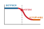

*FPS в пакетном режиме обваливается, когда включается тепловой троттлинг.*

> **Проверка реальности краевого бенчмарка**
>
> При оценке заявлений о краевом железе четыре фактора определяют, переходят ли заявленные поставщиком числа в реальную производительность:
>
> 1. **Пиковая и устойчивая производительность**: поставщик может заявлять пиковую пропускную способность 45 TOPS, а устойчивый тепловой прогон дает ближе к 20 TOPS. Всегда запускайте бенчмарк под устойчивой нагрузкой длительнее 30 с.
> 2. **Мощность в покое и в работе**: в этом сценарии устройство потребляет 50 мВт в покое и 2 Вт в работе. Маркетинг может приводить мощность в работе, но если приложение выполняет вывод в 1 процент времени, эффективная мощность составит около 69,5 мВт, а не 2 Вт.
> 3. **Тепловая оболочка**: краевые устройства часто работают в узком бюджете TDP. Превышение его вызывает троттлинг, поэтому отчеты без тепловых условий неполны.
> 4. **Сквозная или только ускорителя**: бенчмарки NPU часто исключают накладные расходы передачи данных. Перенос данных изображения с камеры на NPU и обратно может превысить время вывода для малых моделей.

Поскольку пассивное рассеивание тепла ограничивает устойчивую мощность, архитекторы мобильных систем на кристалле не могут полагаться на монолитные ядра с высокой частотой. Вместо этого они распределяют выполнение между специализированными вычислительными блоками, настроенными под разные арифметические шаблоны. Такая специализация аппаратуры переводит краевой бенчмаркинг от оценки отдельного ядра к описанию координации нескольких процессоров во всей системе на кристалле.

#### Координация гетерогенных процессоров

Современная мобильная система на кристалле объединяет на одном кристалле центральные процессоры, графические процессоры, цифровые сигнальные процессоры (DSP) и нейронные процессоры (NPU), которые делят системную память и общий тепловой бюджет. Каждый блок нацелен на свой вычислительный шаблон: центральные процессоры обрабатывают нерегулярный поток управления, динамический батчинг и последовательную постобработку; графические процессоры выполняют параллельные операции с плавающей точкой и неквантованные резервные слои; DSP обрабатывают маломощные потоковые векторные вычисления для постоянного сенсорного мониторинга; а NPU выполняют плотные квантованные матричные умножения (обычно INT8 или INT4) на специализированных систолических массивах или блоках умножения с накоплением.

Бенчмаркинг должен оценивать оркестрацию конвейера, а не пропускную способность изолированного ядра. Например, в сквозном голосовом помощнике сверхмаломощный DSP непрерывно следит за аудио микрофона на предмет слова пробуждения; при обнаружении система будит NPU, чтобы выполнить извлечение акустических признаков и распознавание речи, а затем передает последовательности токенов центральному процессору для понимания языка и логики диалога. Бенчмарки отдельных процессоров оценивают только изолированное время вычислений каждого этапа и пропускают три главных источника накладных расходов системы: задержку пробуждения ускорителей из глубоких состояний сна, конкуренцию за шину, когда несколько движков одновременно обращаются к общей DRAM, и пропускную способность памяти, которую расходует перестановка раскладки тензоров (например, перевод раскладки NCHW центрального процессора в плитчатую NHWC, которую требует NPU). Бенчмарки, которые сообщают только время вычислений, скрывают эти штрафы за перемещение данных и планирование.

#### Бенчмаркинг батареи и температуры

Разряд батареи зависит от суммарной энергии, израсходованной за время, а не от пиковой мгновенной мощности. Вычислительная фотография выдает всплески в несколько ватт на сотни миллисекунд во время съемки, тогда как фоновая обработка сенсоров должна укладываться в бюджет на уровне милливатт, чтобы обеспечить работу от батареи в несколько дней. Чтобы оценить влияние на батарею, нужно измерить полное энергопотребление $E = \int P(t)\,dt$ на репрезентативных эксплуатационных профилях.

Главная эксплуатационная переменная — коэффициент загрузки нагрузки $\alpha$, то есть доля времени, в течение которого ускоритель активно выполняет вывод. Для мощности в активном режиме $P_{\text{active}}$ и мощности в режиме ожидания $P_{\text{idle}}$ средняя мощность равна:

$$P_{\text{avg}} = \alpha P_{\text{active}} + (1 - \alpha) P_{\text{idle}}$$

Для прерывистых нагрузок вроде умной камеры дверного звонка ($\alpha \ll 0{,}01$) время работы батареи определяют мощность ожидания $P_{\text{idle}}$ и мощность удержания памяти, а эффективность активного вывода оказывается второстепенной. Для непрерывных конвейеров вроде видеоаналитики ($\alpha \approx 1{,}0$) доминирует энергия активного вывода $E_{\text{inf}} = P_{\text{active}} \cdot t_{\text{inf}}$. Кроме того, повышенные рабочие температуры увеличивают ток утечки полупроводников, и статическое рассеивание мощности растет по мере нагрева устройства. Поэтому бенчмаркинг влияния на батарею требует измерять и активную, и дежурную мощность на протяжении рабочего цикла, одновременно следя за температурой кристалла в многоминутных прогонах.

#### Координация «край — облако»

Когда краевые устройства переносят вычисления на удаленные серверы по сетям 5G или Wi-Fi, бенчмаркинг должен оценивать совокупный конвейер «край — облако», а не локальное выполнение в отрыве. Хотя сотовые стандарты вроде URLLC[^fn-urllc-latency-guarantee] задают агрессивные целевые значения задержки радиоинтерфейса, реальные сотовые и Wi-Fi каналы вносят джиттер пакетов, хвостовую задержку и кратковременные разрывы связи. Поэтому бенчмарки разделения нагрузки должны оценивать четыре поведения системы в условиях эмулированных сетевых помех: границу решения о локальном или удаленном выполнении, накладные расходы на передачу промежуточных активаций в сравнении с сырыми сенсорными входами, механизмы отката при потере связи (например, переход на компактную модель на устройстве) и политики конфиденциальности, ограничивающие выдачу сырых данных.

[^fn-urllc-latency-guarantee]: **URLLC (сверхнадежная связь с низкой задержкой)**: ITU-R задает целевую задержку пользовательской плоскости радиоинтерфейса в 1 мс и доставку 99,999 процента успешных пакетов за 1 мс для пакета в 32 байта при заданных условиях испытаний. Эти цели радиоинтерфейса не являются гарантией сквозной задержки приложения менее 1 мс. Бенчмарки краевого вывода должны сообщать задержку радио или сети и задержку вычислений отдельно и вместе, наряду с качеством модели.

В системах, критичных к безопасности и регулируемых стандартами уровня полноты безопасности автомобильных систем (ASIL), это разделение между локальными и удаленными вычислениями ограничено жесткими сроками. Стек восприятия автономного автомобиля, работающий с контурным сроком управления 10–30 мс, не может выдержать многосотмиллисекундную хвостовую задержку широкополосного сотового канала. Вывод, критичный к безопасности, должен выполняться полностью на локальном автомобильном кремнии с закаленным температурным режимом и синхронизацией нескольких датчиков, а каналы «край — облако» должны использоваться только для некритичной телеметрии и обновлений карт.

Во всех облачных дата-центрах и краевых устройствах методика бенчмаркинга делится по фундаментальной эксплуатационной границе: выполняет ли система обучение или вывод. Обучение требует прямых проходов, хранения промежуточных активаций в памяти, обратных проходов для вычисления градиентов и обновления весов модели через распределенные межсоединения. Вывод выполняет только прямые проходы, позволяя среде выполнения сразу отбрасывать промежуточные активации, сливать соседние ядра операторов и квантовать веса в низкоточные целочисленные форматы. Поскольку шаблоны доступа к памяти, арифметические интенсивности и вычислительные зависимости обучения и вывода полностью расходятся, каждому нужна отдельная методика бенчмаркинга.

## Обучение и вывод

Один и тот же ускоритель может выйти из строя в противоположных эксплуатационных режимах: прогон обучения может встать, когда синхронизация градиентов между ускорителями насыщает межсоединение, а сервис вывода может нарушить свой SLO, когда всплески запросов создают задержки в очередях. Требования к оценке обучения и вывода настолько различаются, что для каждого существуют отдельные наборы бенчмарков: MLPerf Training и MLPerf Inference (Mattson et al., 2020); (Reddi et al., 2019). Теоретический пик TFLOP/s дает мало сведений о любой из этих нагрузок. Обучение итеративно уточняет параметры на миллиардах образцов ([«Обучение моделей»](08_training.md#sec-model-training)), требуя устойчивых вычислений высокой мощности, большой емкости памяти для состояний оптимизатора и эффективных коллективных коммуникаций между ускорителями. Вывод оценивает фиксированные параметры на входящих запросах (глава [«Обслуживание моделей»](13_model_serving.md#sec-model-serving)) при ограниченном времени ответа, требуя ограниченной хвостовой задержки, минимальной задержки инициализации холодного старта и высокой энергоэффективности; глава [«MLOps»](14_ml_ops.md#sec-ml-operations) связывает эти ограничения обслуживания с развертыванием и мониторингом в эксплуатации.

Это разделение меняет распределение памяти и арифметическую интенсивность. При обучении память устройства должна хранить параметры модели, градиенты, состояния оптимизатора (например, аккумуляторы моментов и дисперсии) и промежуточные активации, сохраненные для обратного распространения. Эти динамические требования к состоянию создают нагрузку на память, которая в разы превышает объем одних весов, и зависят от контрольных точек активаций, численной точности и размеров батча. Обучение опирается на смешанную точность и сжатие градиентов, чтобы снять узкие места емкости и межсоединений. Вывод полностью отбрасывает обратный граф и состояния оптимизатора; спрос на память определяют статические веса и динамические буферы выполнения (например, кэши ключей и значений в авторегрессивных моделях). Поэтому сервисные нагрузки могут применять агрессивное снижение точности (подробно в [«Метриках вывода»](12_benchmarking.md#sec-benchmarking-inference-metrics-78d4)), квантование после обучения и прореживание весов. Аппаратная загрузка отражает этот контраст: обучение максимизирует насыщение арифметики ускорителя большими батчами, тогда как движки вывода должны обрабатывать непредсказуемые потоки запросов с низкой конкурентностью, которые оставляют исполнительные блоки недогруженными, как показывает анализ Roofline в [«Системных бенчмарках»](12_benchmarking.md#sec-benchmarking-system-benchmarks-393c).

Энергопотребление учитывается в двух фазах по-разному. Энергия обучения представляет собой капитальные вложения, амортизируемые за весь срок службы модели: крупные прогоны обучения потребляют тысячи мегаватт-часов (обучение GPT-3 потребовало около 1 287 МВт·ч) (Patterson et al., 2021). Энергия вывода непрерывно накапливается вместе с объемом запросов и доминирует в полной стоимости жизненного цикла, когда число запросов растет до миллионов. Энергия на запрос подчиняется физическому соотношению $E = P \times t$, где $P$ — средняя эксплуатационная мощность, а $t$ — задержка обслуживания. Например, если измеренная средняя мощность ускорителя в окне вывода составляет 300 Вт, вывод длительностью 10 мс расходует $300 \text{ Вт} \times 0{,}01 \text{ с} = 3 \text{ Дж}$, или около 0,0008 Вт·ч; при 100 мс это уже около 0,0083 Вт·ч. Расчетная тепловая мощность (TDP) ускорителя — это предел охлаждения, а не динамическое энергопотребление, поэтому для точного бенчмаркинга необходимо эмпирически измерять мощность во время выполнения.

Эти различные физические требования формируют методику бенчмарков через призму D·A·M. Бенчмарки обучения оценивают, эффективно ли алгоритмические обновления сходятся при масштабировании через распределенные межсоединения ускорителей под непрерывным приемом данных; главная мера качества здесь — время до целевой точности. Бенчмарки вывода оценивают, удовлетворяет ли фиксированный алгоритмический артефакт перцентилям задержки (например, временам ответа p95 и p99) и целевой пропускной способности при пакетном потоке запросов на выделенной аппаратуре. Поскольку алгоритмическая сходимость при обучении задает верхнюю границу точности модели, оценка эффективности обучения предшествует характеризации вывода в жизненном цикле бенчмаркинга.

## Бенчмарки обучения

В одном показательном провале закупки команда покупает более крупный кластер GPU, рассчитывая на пропорциональное ускорение обучения, и обнаруживает, что накладные расходы коммуникации и узкие места памяти ограничивают реальное ускорение. **Бенчмарки обучения** существуют, чтобы поймать такой разрыв до закупки. Они делятся на три категории: метрики сходимости, которые измеряют прогресс обучения, метрики пропускной способности, которые измеряют вычислительную эффективность, и метрики масштабируемости, которые измеряют производительность распределенных систем.

> ***Бенчмарки обучения ML*** — это бенчмарки систем машинного обучения, которые измеряют время достижения целевой метрики качества (например, заданной точности на валидации или порога функции потерь) на фиксированном наборе данных и модели и количественно оценивают скорость сходимости на единицу ресурса.
>
> 1.  **Значение**: бенчмарки обучения выявляют большие разрывы, невидимые в спецификациях аппаратуры. При фиксированных модели и целевом качестве время сходимости может сильно различаться между стеками «аппаратура — программное обеспечение», потому что производительность обучения зависит от всего конвейера: загрузки данных $(D_{\text{объем}}/\text{BW})$, загрузки вычислений $(\eta_{\text{hw}})$, синхронизации градиентов $(L_{\text{lat}})$ и накладных расходов на восстановление после сбоев. Спецификация пиковых FLOP/s не отражает ни одного из этих взаимодействий.
> 2.  **Отличие**: в отличие от бенчмарков вывода, которые измеряют задержку на запрос и пропускную способность под нагрузкой, бенчмарки обучения измеряют время до точности по всему циклу оптимизации: загрузку данных, прямой проход, обратный проход, синхронизацию градиентов и шаг оптимизатора. Ограничивающий фактор смещается от вычислений $(R_{\text{пик}})$ при малом масштабе к коммуникациям $(\text{BW})$ при большом.
> 3.  **Типичная ошибка**: распространенное заблуждение состоит в том, что бенчмарки обучения измеряют «насколько быстро работает GPU». При большом масштабе пропускная способность межсоединений $(\text{BW})$ для синхронизации градиентов и накладные расходы отказоустойчивости (ввод-вывод контрольных точек, смягчение отстающих узлов) часто определяют результат бенчмарка сильнее, чем пиковые FLOP/s.

Бенчмарки обучения проверяют, дает ли аппаратное ускорение обещанную пропускную способность обучения. Кластеры GPU, поды TPU и стратегии распределенного обучения, рассмотренные в [«Аппаратном ускорении»](11_hw_acceleration.md#sec-hardware-acceleration), заявляют о впечатляющем ускорении, а бенчмарки обучения показывают, какие заявления выполняются на реалистичных нагрузках. Они оценивают, как конфигурации аппаратуры, механизмы загрузки данных и стратегии распределенного обучения работают при обучении моделей производственного масштаба. Эти бенчмарки жизненно важны, потому что обучение — самая крупная капитальная статья расходов в системах ML, и только строгое измерение времени до точности показывает, приносят ли эти вложения пропорциональную отдачу, а не растворяются в неэффективности масштабирования, узких местах памяти или накладных расходах коммуникации.

Например, крупные модели вроде GPT-3 от OpenAI[^fn-gpt3-benchmark-scale] (Brown et al., 2020), которая содержит 175 млрд параметров и обучалась на примерно 570 ГБ отфильтрованного текста CommonCrawl (из исходного набора около 45 ТБ, дополненного другими источниками до 300 млрд обучающих токенов), показывают колоссальные вычислительные потребности современного обучения. Стандартизированные бенчмарки обучения ML дают систематическую оценку базовых систем, чтобы убедиться, что аппаратные и программные конфигурации способны эффективно покрыть эти беспрецедентные потребности.

[^fn-gpt3-benchmark-scale]: **GPT-3 (Generative Pre-trained Transformer 3)**: языковая модель OpenAI 2020 года (175 млрд параметров, 300 млрд обучающих токенов), по оценкам, потребила 3 640 петафлопс-дней на 10 000 GPU V100 (Patterson et al., 2021). Такой масштаб показывает, почему бенчмарки обучения нужны, чтобы прогнозировать эксплуатационную осуществимость запланированного прогона обучения до того, как тратить вычисления.

### Мотивация бенчмарков обучения

MLPerf Training (Mattson et al., 2020); (MLCommons, 2024) задает стандартизированную рамку для такого измерения времени до качества. На [рисунке «Прогресс MLPerf Training»](12_benchmarking.md#fig-mlperf-training-improve) видно, что улучшение производительности от версии к версии бенчмарка опережает построенную базовую линию закона Мура, а некоторые нагрузки достигают многолетнего ускорения в несколько раз (Tschand et al., 2024). Сравнение иллюстрирует базовый принцип: что измеряется, то и улучшается. Стандартизированная рамка бенчмаркинга создает конкурентное давление, которое ускоряет оптимизацию по всему стеку вычислений ML.

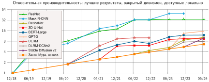

*Прогресс MLPerf Training: линии нагрузок показывают накопленную относительную производительность по версиям бенчмарка относительно построенной накопленной базовой линии закона Мура. Последняя точка каждой нагрузки превышает базовую линию на ту же дату, а Mask R-CNN дает наибольший выигрыш на графике — 48,8×. Сравнение отражает совокупный прогресс аппаратуры и программного обеспечения, а не только масштабирование железа. Источник: (Tschand et al., 2024).*

Помимо отображения этого прогресса, бенчмарки обучения выявляют неэффективности, которые систематическая оценка делает видимыми: медленную загрузку данных, недогруженные ускорители, избыточные накладные расходы памяти и узкие места коммуникации, которые снижают эффективность масштабирования. Теоретические возможности аппаратуры, описанные в [«Аппаратном ускорении»](11_hw_acceleration.md#sec-hardware-acceleration) (например, TFLOP/s GPU или тензорная пропускная способность TPU), превращаются в реальное ускорение обучения только тогда, когда бенчмарки подтверждают их в реалистичных условиях.

Бенчмарки обучения выполняют четыре взаимосвязанные функции. Во-первых, они способствуют оптимизации аппаратуры и программного обеспечения, давая сравнения между архитектурами ускорителей и фреймворками (TensorFlow, PyTorch) на стандартизированных задачах без привязки к поставщику и помогая выбирать аппаратуру для дата-центров и облака. Программные оптимизации, включая обучение в смешанной точности[^fn-bench-mixed-precision] и эффективную по памяти загрузку данных, также количественно оцениваются. Во-вторых, они оценивают масштабируемость: добавление GPU должно пропорционально сокращать время обучения, но накладные расходы коммуникации, задержки синхронизации и узкие места памяти на практике ограничивают эффективность масштабирования. Бенчмарки обучения измеряют эти потери и показывают, дают ли инфраструктурные вложения пропорциональную отдачу. В-третьих, они обеспечивают учет стоимости и энергии: поскольку крупные прогоны обучения потребляют тысячи мегаватт-часов, бенчмарки, которые отслеживают стоимость прогона и энергопотребление на единицу прогресса, помогают организациям сочетать вычислительную мощность с целями устойчивого развития. Наконец, стандартизированные критерии оценки, контролируемая случайность, правила подачи результатов и аудиты делают сравнения более воспроизводимыми и ограничивают обходные пути, специфичные для реализации.

[^fn-bench-mixed-precision]: **Обучение в смешанной точности**: большая часть арифметики выполняется в низкой точности, а накопление там, где это нужно, ведется в более высокой (Micikevicius et al., 2017). Для бенчмаркинга это значит, что прогоны в смешанной и полной точности напрямую несопоставимы, потому что сниженный трафик памяти и допустимые большие батчи могут менять динамику сходимости. MLPerf решает эту проблему, фиксируя целевую точность, так что сопоставимой величиной становится время до точности независимо от стратегии точности.

### Метрики обучения

С системной точки зрения бенчмарки обучения оценивают, насколько эффективно модель достигает заданного порога точности. Метрики пропускной способности и масштабируемости имеют смысл только относительно того, достигает ли модель целевой точности; без этого ограничения оптимизация сырой скорости может вводить в заблуждение. MLPerf Training кодифицирует это, задавая конкретные целевые точности для каждой задачи: система, которая обучается быстро, но не достигает цели, считается невалидной, а та, что сходится точно, но слишком медленно, непрактична. Эффективный бенчмаркинг балансирует скорость, эффективность и точность сходимости.

#### Время и пропускная способность

Одна из главных метрик эффективности обучения — время, требуемое для достижения заданного порога точности. Время обучения $(T_{\text{обуч}})$ измеряет, сколько времени модели нужно, чтобы сойтись к приемлемому уровню производительности, и отражает общую вычислительную эффективность системы. Пусть $\text{Точность}(t)$ — точность модели в момент времени обучения $t$, а **целевая точность** — порог, заданный бенчмарком (например, 75,9 процента точности top-1 для ResNet-50 на ImageNet в MLPerf). Формально эту метрику определяет [«время обучения»](12_benchmarking.md#eq-training-time-benchmark); она держит бенчмарк сфокусированным на том, как быстро система получает содержательный результат:

$$T_{\text{обуч}} = \inf \big\{t \geq 0 : \text{Точность}(t) \geq \text{целевая точность} \big\}$$

Прогон, который никогда не достигает цели, не имеет конечного времени до точности, поэтому сырая скорость обучения не вознаграждает систему, которая не проходит критерий качества бенчмарка.

Пропускная способность,[^fn-throughput-etymology-capacity] которую часто выражают числом обработанных образцов обучения в секунду, дает дополнительную меру производительности системы. Пусть $N_{\text{образцы}}$ — общее число обработанных обучающих образцов, а $T_{\text{обуч}}$ — время обучения из [«времени обучения»](12_benchmarking.md#eq-training-time-benchmark). Формула [«пропускной способности»](12_benchmarking.md#eq-throughput-benchmark) делает скорость явной, деля обработанные образцы на время обучения:

$$\text{Пропускная способность} = \frac{N_{\text{образцы}}}{T_{\text{обуч}}}$$

[^fn-throughput-etymology-capacity]: **Пропускная способность (throughput)**: термин пришел из производства, где измерял число единиц продукции за единицу времени, а в вычисления вошел в эпоху пакетной обработки 1960-х годов. Производственное происхождение несет системный урок: пропускная способность и задержка по природе противоположны, потому что батчинг увеличивает пропускную способность (больше единиц в час) ценой ожидания каждой единицы. В обслуживании ML это проявляется как компромисс по размеру батча: большие батчи повышают загрузку GPU, но увеличивают задержку на запрос.

Сама по себе пропускная способность не гарантирует содержательного результата: модель может быстро обработать много образцов, не достигнув желаемой точности. Например, MLPerf Training задает целевые показатели качества для каждой нагрузки; результат ResNet-50 на ImageNet будет валидным, только если точность top-1 достигнет 75,9 процента (Mattson et al., 2020); (MLCommons, 2024). Гипотетическая система, которая обрабатывает много изображений в секунду, но не достигает цели, — невалидный результат бенчмарка, тогда как более медленная система, которая эффективно сходится, может быть предпочтительнее. Поэтому пропускную способность нужно оценивать в связи со временем до точности, а не как самостоятельную меру производительности.

#### Масштабируемость и параллелизм

Масштабируемость измеряет, насколько эффективно производительность обучения растет при добавлении ресурсов. В идеале удвоение числа GPU должно вдвое сокращать время обучения. На практике накладные расходы коммуникации, ограничения пропускной способности памяти и неэффективность распараллеливания ограничивают масштабирование заметно ниже линейного.

> **Расчет эффективности масштабирования**
>
> **Задача**: команда обучает ResNet-50 на ImageNet. Обучение на одном GPU занимает 24 часа. С 8 GPU обучение занимает 4 часа. Это хорошее масштабирование? Куда делась эффективность?
>
> **Шаг 1**: определение эффективности масштабирования.
> Для сильного масштабирования (фиксированный размер задачи, больше процессоров) пусть $T(1)$ — время обучения на одном GPU, $T(N_{\text{GPU}})$ — время обучения на $N_{\text{GPU}}$ GPU, а $N_{\text{GPU}}$ — число GPU. Эффективность [«масштабирования»](12_benchmarking.md#eq-scaling-efficiency) определяется так:
> 
>
> $$\text{Эфф}_{\text{масш}} = \frac{T(1)}{N_{\text{GPU}} \times T(N_{\text{GPU}})} \times 100\%$$
>
> **Шаг 2**: расчет эффективности.
> $\text{Эфф}_{\text{масш}}(8) = \frac{24\,\text{ч}}{8 \times 4\,\text{ч}} \times 100\%$ = 24/32 = 75 процентов
>
> При идеальном масштабировании 8 GPU завершили бы обучение за 3 часа (24 часа / 8 GPU). Фактические 4 часа соответствуют 75-процентной эффективности.
>
> **Шаг 3**: учет потерь эффективности. [«Источники потерь эффективности масштабирования»](12_benchmarking.md#tbl-benchmarking-scaling-efficiency-loss) раскладывает «недостающие» 25 процентов на измеримые категории накладных расходов: синхронизацию градиентов, копирование памяти, дисбаланс нагрузки и эффекты размера батча. Каждая категория измеряется отдельным сигналом профилирования.
>
> | **Источник**                              | **Пример вклада** | **Измерение**                       |
> |:------------------------------------------|:-----------------:|:------------------------------------|
> | **Синхронизация градиентов**              |      10–15%       | Время AllReduce на шаг              |
> | **Копирование памяти (CPU$\leftrightarrow$GPU)** |       3–5%        | Профилирование передачи данных      |
> | **Дисбаланс нагрузки**                    |       2–5%        | Дисперсия времени шага по GPU       |
> | **Эффекты размера батча**                 |       2–5%        | Большие батчи сходятся иначе        |
>
> 
>
> *Источники потерь эффективности масштабирования: иллюстративная раскладка недостающего бюджета эффективности по измеримым категориям накладных расходов и соответствующий сигнал измерения, которым определяется вклад каждой потери. Фактические проценты зависят от модели, межсоединений, хранилища, графика батчей и реализации фреймворка.*
>
> **Шаг 4**: системный вывод.
> Эффективность масштабирования падает с ростом $N_{\text{GPU}}$, потому что накладные расходы коммуникации растут с числом GPU, а вычисления на один GPU уменьшаются. В этом расчете восемь GPU дают 75-процентную эффективность; при больших масштабах та же арифметика показывает, почему становятся необходимыми сложные коммуникации и оптимизация конвейера входных данных.
>
> MLPerf сообщает сырую производительность, тогда как эффективность масштабирования можно вычислить по сопоставимым заявкам: система с ускорением 2× при эффективности 50 процентов может уступать системе с ускорением 1,5× при эффективности 90 процентов, в зависимости от ограничений по стоимости.

Когда OpenAI обучала крупные модели вроде GPT-3, она использовала большой кластер GPU NVIDIA V100 в распределенной установке (Brown et al., 2020); (Patterson et al., 2021). Системы TPU v4 от Google демонстрируют тот же урок распределенных систем в масштабе дата-центра: добавление вычислительных ресурсов дает больше сырой мощности, но производительность и устойчивость зависят от сетевых коммуникаций, топологии и эксплуатационного управления (Jouppi et al., 2023); (Zu et al., 2024). Бенчмарки вроде MLPerf количественно показывают, насколько хорошо система масштабируется на нескольких ускорителях, и помогают понять, где в распределенном обучении возникают неэффективности.

Параллелизм в обучении делится на параллелизм данных, параллелизм модели и конвейерный параллелизм (см. [«Обучение моделей»](08_training.md#sec-model-training)), и каждый из них создает свои трудности. Параллелизм данных, самый распространенный подход, состоит в разделении обучающего набора данных между несколькими вычислительными узлами. Эффективность этого подхода зависит от механизмов синхронизации и накладных расходов на передачу градиентов. Напротив, параллелизм модели разбивает саму нейронную сеть, и требует эффективной координации между процессорами. Бенчмарки оценивают, насколько хорошо система управляет этими стратегиями параллелизма, не ухудшая сходимость по точности. Ключевая метрика для оценки параллелизма — **эффективность масштабирования**, которая показывает, какая доля добавленной вычислительной мощности превращается в реальное ускорение. Сильное масштабирование проверяет, сокращает ли добавление процессоров время обучения при фиксированном общем объеме работы, тогда как **слабое масштабирование** пропорционально увеличивает размер задачи вместе с числом процессоров, чтобы нагрузка на одно устройство оставалась постоянной, и измеряет, способен ли кластер обучить более крупные модели или обработать более большие наборы данных за фиксированный бюджет времени, не давая коммуникациям стать доминирующим узким местом.

#### Загрузка ресурсов

Эффективность обучения машинного обучения зависит не только от скорости и масштабируемости, но и от того, насколько хорошо используется доступная аппаратура. Вычислительная загрузка показывает, в какой степени блоки обработки, такие как GPU или TPU, активно заняты во время обучения. В современных бенчмарках обучения вычислительная загрузка формально выражается как утилизация FLOPs модели (MFU), то есть отношение теоретических операций модели к пиковой мощности машины за время. MFU противопоставляется утилизации аппаратных FLOPs (HFU), которая учитывает все выполненные операции, включая пересчет активаций; пересчет активаций повышает HFU, оставляя MFU прежним, и это показывает, представляют ли лишние FLOPs реальный прогресс обучения или работу, затраченную на обход ограничений емкости памяти. Низкая загрузка может указывать на узкие места в перемещении данных, доступе к памяти или неэффективном планировании нагрузки.

Например, при обучении BERT на кластере TPU неэффективность конвейера входных данных может ограничивать общую пропускную способность, даже когда у ускорителей высокая сырая вычислительная мощность. Если извлечение из хранилища или предобработка не успевают, система не может держать TPU полностью загруженными. Профилирование загрузки ресурсов выявляет узкое место, а такие оптимизации, как предвыборка, кэширование и более параллельная обработка входных данных, улучшают устойчивую производительность.

Пропускная способность памяти — еще один критический фактор, потому что модели глубокого обучения часто обращаются к большим объемам данных во время обучения. Если пропускная способность памяти становится ограничивающим фактором, одно только наращивание вычислительной мощности не ускорит обучение. Бенчмарки оценивают, насколько эффективно модели используют доступную память, и проверяют, что скорости передачи данных между хранилищем, основной памятью и вычислительными блоками не становятся узкими местами производительности.

Производительность ввода-вывода тоже напрямую влияет на эффективность обучения, особенно при работе с большими наборами данных, которые не помещаются в память целиком. Бенчмарки оценивают эффективность конвейеров загрузки данных, включая операции предобработки, механизмы кэширования и скорость извлечения из хранилища. Системы, которые не оптимизируют загрузку данных, могут заметно замедляться, независимо от вычислительной мощности.

#### Энергоэффективность и стоимость

Обучение крупных моделей машинного обучения требует значительных вычислительных ресурсов, что ведет к заметному энергопотреблению и финансовым затратам. Метрики энергоэффективности количественно описывают энергопотребление нагрузок обучения и помогают находить системы, которые оптимизируют вычислительную эффективность и минимизируют потери энергии. Растущее внимание к устойчивому развитию привело к появлению энергетических бенчмарков, например в MLPerf Training, которые измеряют потребление мощности на прогон обучения. Тот же учет мощности управляет и выводом, где точность становится главным рычагом энергии; в [«Методах измерения мощности»](12_benchmarking.md#sec-benchmarking-power-measurement-techniques-bcc2) разобрано, почему квантование INT8 снижает энергию на вывод, воздействуя одновременно на трафик памяти и стоимость арифметики.

Обучение GPT-3, по оценкам, потребило 1 287 МВт·ч электроэнергии (Patterson et al., 2021). Если система достигает той же точности за меньшее число итераций обучения, она напрямую снижает потребление энергии. Бенчмарки, учитывающие энергию, помогают направлять разработку аппаратуры и стратегий обучения, которые оптимизируют энергоэффективность и при этом сохраняют целевую точность.

Стоимость включает не только электроэнергию, но и расходы на аппаратуру, облачные вычисления и обслуживание инфраструктуры. Бенчмарки обучения дают представление об экономической эффективности разных аппаратных и программных конфигураций, измеряя время обучения относительно затрат ресурсов. Организации могут использовать эти бенчмарки, чтобы сбалансировать производительность и бюджетные ограничения при выборе инфраструктуры обучения.

#### Отказоустойчивость и надежность

Задачи обучения часто идут долго, иногда дни или недели, поэтому отказоустойчивость — важное соображение. Устойчивая система должна переживать неожиданные сбои (аппаратные неисправности, перебои в сети и ошибки памяти), не ставя под угрозу сходимость по точности.

В крупномасштабном облачном обучении отказы узлов — эксплуатационная реальность. Если узел GPU в распределенном кластере выходит из строя, обучение должно продолжаться, не повреждая модель. Производственные системы создают контрольные точки для отказоустойчивости, периодически сохраняя прогресс, чтобы сбой не запускал прогон заново. Однако для обучения больших языковых моделей (LLM) сама контрольная точка становится системным узким местом: одна контрольная точка должна записать на сетевое хранилище веса модели и состояния оптимизатора, что при масштабе 100 миллиардов параметров может означать сотни гигабайт записи до возобновления обучения. Во время такой записи ускорители могут простаивать, и время до точности ухудшается из-за удлинения эффективного времени итерации. Производственные системы обучения LLM решают это, совмещая ввод-вывод контрольных точек со следующим шагом обучения (асинхронные контрольные точки) или используя высокоскоростные параллельные файловые системы, которые сокращают простой. Сам MLPerf Training в первую очередь измеряет время до качества на стандартизированных нагрузках и не бенчмаркирует восстановление после сбоев напрямую, но накладные расходы контрольных точек — существенная часть любого реального устойчивого значения пропускной способности.

#### Воспроизводимость и стандартизация

Исследования воспроизводимости неоднократно показывали, что скромные выигрыши бенчмарков могут исчезнуть, когда меняются зерновые значения генератора случайных чисел, аппаратура, версии фреймворков или детали реализации (Henderson et al., 2018). Этот сбой показывает распространенную проблему: в бенчмарках обучения участвуют стохастические процессы (инициализация весов, перемешивание данных, маски дропаута), которые взаимодействуют с особенностями аппаратуры (округление чисел с плавающей точкой, раскладка памяти, оптимизации компилятора) и дают результаты, которые могут заметно различаться в разных средах.

Более глубокий слой недетерминированности приходит от самой параллельной аппаратуры. Операции вроде параллельных атомарных сложений, которые используются при накоплении градиентов для разреженных эмбеддингов в моделях вроде графовых нейронных сетей, выполняются в недетерминированном порядке между потоками, когда одновременные обновления попадают в одну и ту же ячейку памяти. Порядок суммирования чисел с плавающей точкой меняется от запуска к запуску, и градиенты отличаются побитово даже при одинаковых входах и зерновых значениях. Для побитовой воспроизводимости в таких случаях нужно отключить параллельные пути накопления, что снижает пропускную способность обучения: это прямой компромисс между воспроизводимостью и производительностью, который протоколы бенчмарков должны явно учитывать. Без явного контроля над всеми этими источниками изменчивости числа бенчмарка отражают конкретное сочетание условий, а не подлинную способность системы.

MLPerf Training решает эту задачу стандартизированной предобработкой данных, правилами целевого качества и повторными принятыми прогонами, которые описывают стохастическую вариацию (Mattson et al., 2020). Важно не просто получить быстрый прогон, а показать, что заявленная производительность отражает способность системы, а не удачное сочетание стохастических факторов.

Для бенчмарка обучения воспроизводимость — это вся рамка прогона, а не только зерновое значение генератора. Достоверный отчет должен сохранять коммит модели, контрольную сумму набора данных, конвейер предобработки, план зерновых значений, версии фреймворка и компилятора, политику точности, график батчей, топологию аппаратуры, тепловые и энергетические ограничения и поведение контрольных точек. Он также должен сообщать распределение принятых прогонов, а не один лучший прогон. Только так бенчмарк отделяет реальное улучшение системы от благоприятного сочетания версии программного обеспечения, состояния аппаратуры и стохастического пути обучения.

### Оценка производительности обучения

Всесторонний бенчмарк обучения учитывает несколько измерений поведения системы, потому что каждое измерение показывает, другой способ, которым аппаратные инвестиции могут не превратиться в сходимость. [«Измерения бенчмарка обучения»](12_benchmarking.md#tbl-training-metrics) сводит основные категории и связанные метрики, которые обычно используют для бенчмаркинга производительности обучения на уровне системы, и дает рамку для понимания того, как системы обучения ведут себя при разных нагрузках и конфигурациях.

| **Категория**                           | **Ключевые метрики**                                                                                                         | **Пример применения бенчмарка**                             |
|:----------------------------------------|:-----------------------------------------------------------------------------------------------------------------------------|:------------------------------------------------------------|
| **Время обучения и пропускная способность** | Время до точности (секунды, минуты, часы); пропускная способность (образцов/с)                                             | Сравнение скорости обучения на разных архитектурах GPU      |
| **Масштабируемость и параллелизм**      | Эффективность масштабирования (доля от идеального ускорения); накладные расходы коммуникации (задержка, пропускная способность) | Анализ производительности распределенного обучения крупных моделей |
| **Загрузка ресурсов**                   | Вычислительная загрузка (процент загрузки GPU/TPU); пропускная способность памяти (ГБ/с); эффективность ввода-вывода (скорость загрузки данных) | Оптимизация конвейеров данных для повышения загрузки GPU   |
| **Энергоэффективность и стоимость**     | Энергопотребление прогона (МВт·ч, кВт·ч); пропускная способность на ватт (FLOP/s/Вт)                                        | Оценка энергоэффективных стратегий обучения                 |
| **Отказоустойчивость и надежность**     | Накладные расходы контрольных точек (время на сохранение); доля успешных восстановлений (процент)                            | Оценка восстановления после сбоев в облачных системах обучения |
| **Воспроизводимость и стандартизация**  | Разброс между прогонами (процентная разница по точности и времени обучения); согласованность фреймворков (TensorFlow, PyTorch, JAX) | Обеспечение согласованности результатов бенчмарка на разной аппаратуре |

*Измерения бенчмарка обучения: ключевые категории и метрики для оценки систем машинного обучения сверх простой скорости. Они охватывают эффективность ресурсов, воспроизводимость и общие компромиссы производительности для разных подходов к обучению и конфигураций инфраструктуры.*

Эти измерения взаимодействуют так, как таблицы не могут показать. Более высокая пропускная способность при сниженной точности (например, TF32) бессмысленна, если она увеличивает число итераций, нужных для целевой точности, поэтому главной поправочной метрикой становится время до точности. Эффективность масштабирования может выглядеть почти линейной при малом числе узлов, но снижаться, когда стоимость синхронизации градиентов начинает доминировать. Метрики загрузки ресурсов показывают причину: предобучение BERT с умеренной загрузкой GPU может упираться в конвейер данных, а не в ускорители. Контрольные точки для отказоустойчивости вносят собственные накладные расходы, и нужен баланс между устойчивостью и производительностью.

Во всех измерениях точность измерений зависит от контроля аппаратной изменчивости. Поведение тактовой частоты с разгоном GPU[^fn-gpu-boost-clock] и тепловой троттлинг[^fn-thermal-throttling-clock] может сдвигать результаты настолько, что тонут небольшие заявленные выигрыши, поэтому повторные прогоны и статистическая строгость (как было установлено ранее) необходимы, чтобы отличить реальные различия производительности от шума.

[^fn-gpu-boost-clock]: **Разгон тактовой частоты GPU (boost clock)**: динамическое масштабирование частоты поднимает тактовые частоты выше базовых, когда позволяют тепловой и энергетический запас. Ловушка бенчмаркинга: короткие прогоны могут зафиксировать производительность при разгоне, тогда как устойчивое обучение ML может установиться на более низких стационарных частотах по мере роста температуры кристалла. Отчет о фазе всплеска завышает пропускную способность, которую может устойчиво выдерживать производственная нагрузка.

[^fn-thermal-throttling-clock]: **Тепловой троттлинг**: снижение частоты, которое срабатывает, когда температура кристалла превышает безопасные пределы. В краевых устройствах без активного охлаждения троттлинг может начаться во время устойчивого вывода, поэтому пиковые значения пропускной способности из коротких бенчмарков могут искажать устойчивую производительность.

Несмотря на наличие хорошо определенных методик бенчмаркинга, вводящие в заблуждение выводы возникают снова и снова, когда команды принимают одну метрику обучения за замену всему циклу оптимизации. Следующие ловушки показывают, где бенчмарк должен удерживать вместе скорость, сходимость, масштабирование и воспроизводимость.

Провалы бенчмарков обучения обычно начинаются тогда, когда пропускную способность принимают за цель, а не за одну из частей процесса обучения. Система может увеличить число примеров в секунду, используя более низкую численную точность, сокращая синхронизацию или даже обходя некоторые вычисления, но эти изменения помогают, только если сохраняется сходимость. Прогон TF32 может опережать FP32 по времени шага и все равно проигрывать в целом, если численная нестабильность увеличивает число итераций, нужных для целевой точности. Поэтому бенчмарк должен сообщать пропускную способность в связи со временем до точности, гарантируя, что оптимизации скорости не происходят за счет эффективности сходимости.

Масштабирование создает вторую ловушку: результат на малом числе узлов может выглядеть линейным, пока коммуникация и синхронизация не начнут доминировать. Предыдущий расчет для восьми GPU показывает, почему результаты малых узлов нельзя экстраполировать линейно, когда синхронизация становится связывающим фактором.

Как показал расчет эффективности масштабирования в [«Масштабируемости и параллелизме»](12_benchmarking.md#sec-benchmarking-scalability-parallelism-1124) (где 8 GPU дали лишь 75-процентную эффективность), экстраполяция результатов одного узла на кластеры — распространенная ошибка. Опыт Google с кластерами TPU v4 из 4 096 узлов показывает этот эффект в экстремальном масштабе, где трудности синхронизации становятся доминирующим фактором производительности. Надлежащий бенчмаркинг должен измерять эффективность масштабирования явно, а не предполагать линейный рост.

Та же дисциплина относится к сбоям и взаимным помехам. Многие бенчмарки предполагают идеализированные условия, в которых аппаратные сбои, нестабильность сети и помехи между нагрузками не происходят, хотя в масштабе эти события рутинны. Эффективный бенчмаркинг учитывает накладные расходы контрольных точек, эффективность восстановления после сбоев и конкуренцию за ресурсы, а не сообщает только результат в лучшем случае.

Воспроизводимость создает еще одну угрозу. Результаты должны воспроизводиться на разных стеках: прогон TensorFlow с оптимизациями Accelerated Linear Algebra может показывать иную динамику сходимости, чем та же модель, обученная в PyTorch с автоматической смешанной точностью (AMP), потому что арифметика с плавающей точкой, раскладки памяти и стратегии оптимизации могут сдвигать и время обучения, и точность.

Чтобы избежать этих ловушек, нужно оценивать пропускную способность в связи со сходимостью по точности, оценивать эффективность масштабирования целостно и учитывать реальные сбои, а не предполагать идеализированные условия. Однако эффективно обученная модель все равно требует проверки эксплуатационной производительности, и это полностью меняет рамку оценки.

## Бенчмарки вывода

Бенчмарки обучения измеряют, как быстро система учится; бенчмарки вывода измеряют, насколько надежно она обслуживает. Этот сдвиг меняет почти все в оценке. Обучение терпит переменное время итераций, пока сходимость идет; вывод требует стабильной задержки, потому что пользователь замечает каждый медленный ответ. Обучение оптимизирует совокупную пропускную способность за часы; вывод должен справляться с непредсказуемыми шаблонами запросов и сроками, заданными сценарием. Обучение в крупных бенчмарках обычно использует выделенную высокопроизводительную аппаратуру, тогда как вывод охватывает среды от GPU дата-центров до мобильных телефонов и микроконтроллеров.

Здесь сходятся главы об оптимизации: ускоренная аппаратура из [«Аппаратного ускорения»](11_hw_acceleration.md#sec-hardware-acceleration) запускает сжатые модели из [«Сжатия моделей»](10_model_compression.md#sec-model-compression), чтобы выдавать предсказания в реальном времени. Бенчмарки вывода показывают, превращаются ли теоретические ускорения в реальное снижение задержки в реалистичных условиях развертывания.

> ***Бенчмарки вывода ML*** — это бенчмарки систем машинного обучения, которые количественно оценивают способность системы укладываться в ограничения по задержке $(L_{\text{lat}})$ при заданных уровнях пропускной способности, измеряя статистику задержки, определенную сценарием, пропускную способность (запросов в секунду) и энергоэффективность в репрезентативных сценариях обслуживания.
>
> 1.  **Значение**: бенчмарки вывода показывают разрыв, специфичный для нагрузки и системы, между неограниченной пропускной способностью и пропускной способностью при соблюдении целевого уровня обслуживания (SLO), например целевой задержки p99. Очереди при высокой нагрузке могут поднять хвостовую задержку выше цели, и этот разрыв невидим без бенчмарка, который проверяет целевые задержки на каждом уровне пропускной способности.
> 2.  **Отличие**: в отличие от бенчмарков обучения, которые измеряют время до точности на фиксированном наборе данных, бенчмарки вывода измеряют время ответа на запрос при реалистичных шаблонах нагрузки, охватывая эффекты очередей, компромиссы батчинга и накладные расходы холодного старта, которые определяют экономику обслуживания в реальном мире.
> 3.  **Типичная ошибка**: распространенное заблуждение состоит в том, что средняя задержка — достаточный бенчмарк. Система с низкой средней задержкой и длинным хвостом p99 может нарушать основанный на перцентилях производственный SLO для самых медленных 1 процента запросов; при высокой частоте запросов этот малый процент становится большим числом затронутых пользователей. Бенчмарк должен сообщать статистику задержки, названную целью сервиса, а не предполагать, что среднее или p99 решают все.

### Мотивация бенчмарков вывода

Бенчмарки обучения в крупных масштабах обычно выполняются на выделенной аппаратуре дата-центров, тогда как вывод охватывает сильно различающиеся сценарии развертывания: от приложений реального времени, таких как автономное вождение и разговорный ИИ, до мобильных устройств, систем интернета вещей и встраиваемых процессоров. Это разнообразие касается и аппаратуры: если GPU и TPU доминируют в крупномасштабном обучении, то для вывода часто используют специализированные ускорители, такие как NPU, программируемые логические матрицы (FPGA) и выделенные чипы вывода, например Edge TPU от Google.[^fn-edge-tpu-benchmark] Бенчмарки вывода оценивают, насколько согласованно работают выбор аппаратуры, оптимизация модели и проектирование конвейера данных в этих средах развертывания.

[^fn-edge-tpu-benchmark]: **Edge TPU (тензорный процессор)**: специализированный краевой ускоритель ИИ Google с фиксированной функциональностью. Он иллюстрирует ограничение бенчмаркинга, характерное для ускорителей с фиксированной функцией: заявленная пропускная способность относится только к квантованным моделям TensorFlow Lite с поддерживаемыми типами операторов, поэтому модели с неподдерживаемыми операторами откатываются на центральный процессор хоста или требуют переписывания графа, прежде чем результат ускорителя станет осмысленным.

Масштабирование нагрузок вывода между облачными серверами, краевыми платформами, мобильными устройствами и системами TinyML добавляет сложности. [«Разница в энергопотреблении систем»](12_benchmarking.md#fig-power-differentials) показывает большой разброс мощности между этими системами: более десяти порядков величины, от микроватт во встраиваемых устройствах TinyML до сотен киловатт в кластерах обучения дата-центров. Диапазоны репрезентативны, а не исчерпывающи. Этот разброс объясняет, почему ни один бенчмарк не годится для всех контекстов развертывания: метрика, значимая для оптимизации дата-центра (киловатты на стойку), теряет смысл для устройств с батарейным питанием (милливатты на вывод). Бенчмарки вывода должны оценивать компромиссы между задержкой, стоимостью и энергоэффективностью внутри каждого масштаба, чтобы помогать организациям принимать обоснованные решения о развертывании.

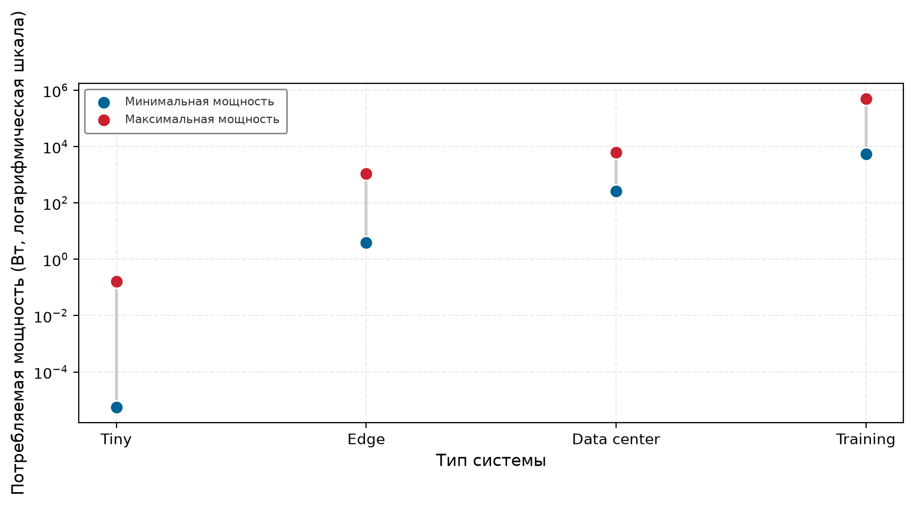

*Разница в энергопотреблении систем: потребление мощности охватывает более десяти порядков величины в разных типах систем ML, от микроватт в устройствах TinyML через ватты на краю сети до киловатт в дата-центровом выводе и сотен киловатт для кластеров обучения. Диапазоны репрезентативны и зависят от аппаратуры и нагрузки.*

Эти различия в развертывании создают практическую мотивацию для бенчмарков вывода: они оценивают узкие места, которые возникают, когда модели переходят от разработки к обслуживанию в эксплуатации. Мотивирующие факторы повторяют факторы для обучения (оптимизация аппаратуры, масштабируемость, стоимость, честное сравнение), но отличаются в деталях. Программные инструменты оптимизации применяют специфичные для вывода приемы, такие как слияние операторов (см. [«Сжатие моделей»](10_model_compression.md#sec-model-compression) и [«Аппаратное ускорение»](11_hw_acceleration.md#sec-hardware-acceleration)), калибровку точности и настройку ядер, и их влияние на задержку, пропускную способность и энергоэффективность нужно измерять в реалистичных условиях, чтобы убедиться, что они дают реальное улучшение без потери точности. Компиляторы с автонастройкой добавляют скрытую переменную: сам компилятор может требовать часов оптимизации на каждую пару модели и аппаратуры, так что результаты бенчмарка отражают бюджет настройки не меньше, чем возможности аппаратуры, и сравнение результатов разных заявок требует нормировать время оптимизации компилятора.

Меняется и характер масштабируемости. Обучение масштабируют добавлением GPU, чтобы сократить время до точности на фиксированной нагрузке, тогда как вывод должен масштабироваться динамически в ответ на колеблющийся спрос пользователей, справляясь со всплесками трафика без нарушения гарантий задержки. Производительность холодного старта, то есть время, за которое модель загружается и начинает обрабатывать запросы, становится самостоятельной проблемой вывода, у которой нет аналога в обучении. Приложения, которые загружают модели по требованию, например бессерверные развертывания ИИ, особенно чувствительны к этим накладным расходам.

Стоимость и энергетический профиль вывода резко отличаются от обучения. Обучение концентрирует стоимость в отдельных прогонах, которые могут повторяться по мере изменения данных, целей или моделей; стоимость вывода накапливается непрерывно вместе с продуктивным трафиком. Запуск неэффективной модели в масштабе может умножить расходы на облачные вычисления, а на устройствах с батареей излишние вычисления непосредственно сказываются на удобстве использования. Бенчмарки, которые измеряют стоимость на запрос вывода и эффективность на ватт, помогают организациям оптимизировать и производительность, и устойчивость на всех платформах развертывания.

MLPerf Inference переносит принципы стандартизированного сравнения, установленные для бенчмарков обучения, на сценарии развертывания, задавая критерии оценки для таких задач, как классификация изображений, детекция объектов и распознавание речи на разных аппаратных платформах. Это гарантирует, что сравнения производительности вывода остаются осмысленными и воспроизводимыми и при этом учитывают ограничения развертывания, такие как требования к задержке и энергоэффективность (Reddi et al., 2019).

### Метрики вывода

Например, голосовой помощник должен отвечать достаточно быстро, чтобы пользователи не замечали задержки, а система рекомендаций должна оценить достаточно кандидатов, чтобы не отставать от прокрутки пользователем. Эти ограничения (задержка и пропускная способность) задают рамку производительности, внутри которой должны работать все оптимизации обслуживания. Метрики вывода формализуют эти реальные требования в измеримые величины, и они отличаются от метрик обучения не степенью, а характером, потому что цель оптимизации смещается от скорости сходимости при обучении к предсказуемости задержки при обслуживании. Обучение оптимизирует пропускную способность и время до точности; вывод оптимизирует стабильность задержки, эффективность ресурсов и предсказуемость обслуживания, охватывая как облачные дата-центры, обрабатывающие миллионы запросов, так и краевые устройства, работающие при строгих ограничениях мощности.

#### Задержка и хвостовая задержка

Задержка (введена в [«Системах машинного обучения»](02_ml_systems.md#sec-ml-systems)) — это время, за которое система вывода обрабатывает вход и выдает предсказание. Средняя задержка полезна, но она не отражает высокоперцентильные задержки, которые ухудшают надежность в сценариях с высоким спросом.

Чтобы это учесть, бенчмарки часто измеряют хвостовую задержку,[^fn-tail-latency-percentile] которая описывает верхний хвост распределения задержки, а не худший случай. Эти значения обычно сообщают как задержку 95-го перцентиля (p95) или 99-го перцентиля (p99), то есть за заданное время завершаются 95 или 99 процентов выводов. Приложения с жесткими сроками требуют явного анализа пропусков сроков или худшего случая, помимо этих перцентилей.

[^fn-tail-latency-percentile]: **Хвостовая задержка**: время ответа на высоком перцентиле, например p95 или p99, определяет соответствие производственному SLO или SLA только тогда, когда цель или соглашение задает этот перцентиль. (Dean and Barroso, 2013) показали, что в архитектурах с веерной рассылкой (распространенных в системах рекомендаций) даже 1 процент медленных ответов накапливается: запрос, обращающийся к 100 backend-шардам, имеет примерно 63-процентный шанс, что хотя бы один шард попадет в свой 1-процентный хвост. Бенчмарки, которые сообщают только среднюю задержку, скрывают этот сбой.

Эти измерения составляют основу целевых уровней обслуживания (SLO) и соглашений об уровне обслуживания (SLA), которые формализуют ожидания по производительности.

> **SLO и SLA**
>
> ***SLO и SLA*** — это спецификации обязательств по производительности для производственных систем обслуживания ML: целевой уровень обслуживания (SLO) — это целевое значение или диапазон для индикатора качества сервиса, а SLA — договор, который задает целевые показатели обслуживания и последствия их невыполнения.
>
> 1.  **Значение**: SLO по задержке ограничивает член $L_{\text{lat}}$ железного закона, задавая цель для указанного показателя задержки. В типичной производственной установке внутренний SLO может быть жестче внешнего SLA, оставляя эксплуатационный запас на кратковременные всплески, окна обслуживания и каскадные сбои.
> 2.  **Отличие**: сам по себе SLO не влечет договорных последствий, тогда как несоблюдение целевого показателя SLA запускает последствия, указанные в соглашении, которые могут включать компенсации или штрафы. Команды часто задают внутренний SLO жестче внешнего соглашения, чтобы оставить эксплуатационный запас, но это практика, а не определяющее требование.
> 3.  **Типичная ошибка**: распространенное заблуждение состоит в том, что выполнение средней задержки удовлетворяет SLO на хвостовую задержку. SLO могут опираться на средние значения, перцентили, доли или другие показатели; когда цель задана на уровне p99 или p99,9, отличное среднее не доказывает соответствия.

Это различие важно на практике: инженерные команды оптимизируют под SLO, а бизнес берет на себя обязательства по SLA. Выбор не той метрики для оптимизации тратит инженерные усилия впустую или нарушает гарантии для клиентов.

Пригодная цель по задержке также фиксирует популяцию запросов и окно измерения. Иначе две команды могут сообщить один и тот же порог перцентиля на разных смесях трафика и прийти к несовместимым выводам о соответствии.

> **Выбор метрики**
>
> Метрика определяет оптимизацию.
>
> Перед тем как окончательно выбрать метрику, примените три правила:
>
> - Пропускная способность или задержка: решите, оптимизирует ли нагрузка стоимость или пользовательский опыт, затем назовите метрику, которую бенчмарк должен удерживать фиксированной.
> - Хвостовая задержка: укажите, что p99 показывает, а средняя задержка скрывает.
> - Сквозная задержка: перечислите этапы предобработки, выполнения модели и постобработки, которые входят в сообщаемую задержку.

Связь хвостовой задержки с пользовательским опытом в масштабе становится критичной в производственных системах, которые обслуживают миллионы пользователей. Даже небольшое ухудшение p99 создает накапливающийся эффект при большом объеме запросов: если 1 процент запросов получает задержку в 10 раз (например, 1000 мс вместо 100 мс), то на каждый миллион запросов это затрагивает 10 000, что может привести к ошибкам по таймауту, плохому пользовательскому опыту и оттоку клиентов. Поисковые системы и системы рекомендаций демонстрируют эту чувствительность: эксперименты Google с задержкой поиска показали измеримое снижение числа ежедневных поисков на пользователя после серверных задержек в 100–400 мс (Brutlag, 2009), поэтому интерактивные сервисы часто считают ответы быстрее 100 мс практической проектной целью.

Поэтому целевые уровни обслуживания (SLO) в производственных системах опираются на хвостовую задержку, а не на среднюю, чтобы обеспечить стабильный пользовательский опыт. Интерактивные сервисы часто задают цели по задержке в перцентилях, потому что редкие медленные ответы непропорционально сильно влияют на удовлетворенность пользователей. Крупные системы могут отслеживать еще более глубокие хвосты, например p99,9, когда всплески трафика и разброс инфраструктуры влияют на надежность.

Трудность выполнения этих целей по хвостовой задержке в том, что источник хвоста часто архитектурный, а не алгоритмический. Среда выполнения с автоматической сборкой мусора, общий драйвер ядра или ошибка инверсии приоритетов в стеке обслуживания могут вносить всплески задержки, которые никакая оптимизация модели не устранит.

> **Переписывание Read States в Discord (2019)**
>
> **Контекст**: Discord, платформа для чата в реальном времени с миллионами одновременных пользователей, изначально реализовала сервис Read States на Go; он отслеживал, какие каналы и сообщения прочитал каждый пользователь (Howarth, 2020).
>
> **Механизм**: проходы принудительной сборки мусора в Go сканировали LRU-кэш, содержавший десятки миллионов записей, и вызывали периодические остановки мира (stop-the-world) каждые две минуты независимо от настройки памяти.
>
> **Последствия**: хвостовая задержка ($P_{99}$) резко подскакивала каждые две минуты, ухудшая пользовательский опыт для миллионов активных соединений.
>
> **Исправление**: в 2019 году Discord переписал сервис Read States на Rust, устранив паузы сборки мусора, и сократил среднее время ответа до микросекунд.
>
> **Системный урок**: одна только средняя задержка не описывает пользовательский опыт, когда цель сервиса задана на хвосте. Выбор языка среды выполнения может задать нижнюю границу этого хвоста: хранилища признаков, которые отдают эмбеддинги в реальном времени для моделей рекомендаций, могут использовать управляемые среды выполнения, а паузы сборки мусора могут задерживать каждый последующий запрос вывода, ожидающий извлечения. Оптимизация модели не закроет разрыв, узкое место которого лежит в пути извлечения. Инцидент в Discord документирует этот механизм вне ML и показывает, почему весь стек обслуживания должен входить в производственный бенчмарк задержки.

#### Сквозная и компонентная задержка

Важное различие в бенчмаркинге вывода проходит между компонентной задержкой (время, затраченное на вычисления модели) и сквозной задержкой (полное время от поступления запроса до доставки ответа). Многие бенчмарки сообщают только время вывода модели, скрывая остальные накладные расходы, которые определяют реальный пользовательский опыт. Эти накладные расходы не маргинальны: сериализация, сетевые переходы и время ожидания в очереди могут доминировать в полном времени запроса, и оптимизации одной только модели дают убывающую отдачу.

> **Ловушка сериализации JSON**
>
> **Сценарий**: исследователи, оценивавшие систему обслуживания с низкой задержкой Clipper, разложили сквозную задержку запроса на сеть, сериализацию на CPU и выполнение модели (Crankshaw et al., 2017).
>
> **Диагностика**: для легких моделей десериализация JSON на CPU и копирование данных IPC занимают больше времени, чем выполнение нейросети на ускорителе.
>
> **Системный урок**: отчет об изолированной задержке вывода модели пропускает узкие места сквозного обслуживания. Промышленный бенчмаркинг должен учитывать разбор данных на CPU, сериализацию IPC и накладные расходы сетевого транспорта.

[«Разбивка задержки вывода»](12_benchmarking.md#tbl-latency-breakdown) дает иллюстративную разбивку задержки запроса вывода. Этап вычисления модели, который поставщики сообщают как свой «бенчмарк», занимает 5–100 мс, однако очередь, за которой он стоит, ожидает от 0 до более 1000 мс. Под нагрузкой один компонент, который измеряет бенчмарк, меркнет перед тем, который он не видит, и опубликованное число может быть лишь малой долей того, что реально испытывает пользователь.

| **Компонент**              | **Диапазон**      | **Примечания**             |
|:---------------------------|:-----------------:|:---------------------------|
| **Сетевой обход туда и обратно** |     10–100 мс     | Зависит от региона         |
| **Разбор запроса**         |      0,1–1 мс     | JSON/protobuf              |
| **Предобработка входа**    |      1–50 мс      | Токенизация, изменение размера изображения |
| **Время ожидания в очереди** |     0–1000+ мс    | Зависит от нагрузки        |
| **Вывод модели**           |      5–100 мс     | «Бенчмарк»                 |
| **Постобработка выхода**   |     0,5–10 мс     | Декодирование, форматирование |
| **Сериализация ответа**    |      0,1–1 мс     | JSON/protobuf              |

*Разбивка задержки вывода: разные этапы конвейера вносят вклад в сквозную задержку, а вывод модели (число, которое поставщики обычно сообщают) может составлять лишь часть полного времени запроса. Под нагрузкой основной вклад может давать время ожидания в очереди, поэтому для реалистичной оценки производительности необходимо сквозное измерение. Диапазоны иллюстративны, а не универсальны.*

Вклады отдельных компонентов объясняют, почему оптимизация любого отдельного этапа дает убывающую отдачу для сквозной производительности. Это *потолок оптимизации*, который формализует закон Амдала.

> **Закон Амдала: потолок оптимизации**
>
> **Задача**: конвейер компьютерного зрения тратит 8 мс на предобработку (декодирование JPEG, изменение размера, нормализацию) и 10 мс на вывод. Если ускорить только вывод в 5 раз, насколько на самом деле улучшится сквозная задержка?
>
> **Расчет**: оптимизация вывода с 10 мс до 2 мс сокращает полную задержку с 18 мс только до 10 мс, то есть улучшение в 1,8 раза вместо 5×. Закон Амдала формализует этот потолок: если предобработка занимает долю $f$ от полной задержки, то даже бесконечно быстрый вывод дает ускорение не больше $1/f$. Если предобработка составляет 44,4 процента полной задержки, доля $f = 0{,}444$ дает максимальное достижимое ускорение $1/f$, равное 2,25×, независимо от оптимизации модели.
>
> **Системный вывод**: агрессивная оптимизация модели дает разочаровывающие сквозные результаты всякий раз, когда доминирует немодельная часть. Любое ускорение компонента, заявленное в отрыве, уменьшается, как только рядом измеряют нетронутые этапы, и недобор растет по мере того, как эти этапы занимают большую долю конвейера. Полные бенчмарки должны либо включать предобработку в измерения, либо явно указывать, что заявленные ускорения относятся только к компоненту вывода.

Потолок Амдала показывает, почему важна строгая методика бенчмаркинга. Полный отчет о задержке требует указывать, какие компоненты включены, проводить измерения в реалистичных условиях нагрузки и различать компонентные и сквозные метрики. Прежде чем интерпретировать любой результат бенчмарка, проверьте, что сам подход к измерению корректен.

Пропускная способность и эффективность батчей показывают, может ли система обслуживания использовать имеющуюся аппаратуру, не нарушая ограничений по задержке. Пропускная способность считает, сколько запросов вывода система обрабатывает в секунду; обычно ее выражают в запросах в секунду (QPS) или кадрах в секунду (FPS). Системы с одним экземпляром обрабатывают каждый вход сразу по его поступлении; батчевые системы обрабатывают несколько входов параллельно, используя параллелизм аппаратуры для большей эффективности.

> **Методика бенчмаркинга**
>
> Плохие бенчмарки оптимизируют не то.
>
> Три практики отличают строгие бенчмарки от вводящих в заблуждение:
>
> - Репрезентативные данные: сравните распределение входных данных бенчмарка с распределением в эксплуатации.
> - Прогрев: укажите, сколько первых запусков отброшено до записи измерений.
> - Изоляция: опишите машину, конкурирующие нагрузки и конфигурацию среды выполнения, использованные при измерении.

Например, облачные сервисы, которые обрабатывают миллионы запросов в секунду, выигрывают от пакетного вывода, когда большие группы входов обрабатываются вместе, чтобы максимизировать вычислительную эффективность. Напротив, робототехнике, интерактивному ИИ и дополненной реальности нужен вывод с низкой задержкой на одном экземпляре, когда система должна немедленно отвечать на каждый новый вход. Бенчмарки должны учитывать и вывод на одном экземпляре, и **пакетную пропускную способность**, чтобы давать полное представление о производительности вывода в разных сценариях развертывания.

Одной скорости недостаточно, потому что оптимизации вывода могут менять поведение модели. Снижение численной точности может ускорить вычисления и одновременно сократить память и энергию, как показывает иллюстративная оценка энергии MobileNetV2 ([«Упрощенная оценка энергии INT8 для MobileNetV2»](12_benchmarking.md#tbl-benchmarking-mobilenet-int8-energy)), но вычисления в пониженной точности могут ухудшить точность. Поэтому бенчмарки вывода оценивают, как модели работают при разных численных настройках, например FP32, FP16 и INT8.[^fn-int8-quantized-benchmark] Многие современные ускорители ИИ поддерживают вывод в смешанной точности, позволяя системам выбирать численные представления под требования нагрузки. Методы сжатия моделей[^fn-model-compression-benchmarking] дополнительно повышают эффективность, но их влияние на точность зависит от задачи и набора данных. Бенчмарки помогают решить, жизнеспособны ли такие оптимизации для развертывания, и гарантируют, что выигрыш в эффективности не покупается неприемлемой потерей точности.

Объем памяти и время загрузки модели определяют, может ли модель запуститься, остаться в памяти и отвечать в рамках среды развертывания. В отличие от обучения, где модели могут занимать несколько ускорителей, вывод часто работает в жестких бюджетах памяти. Общий размер модели определяет требования к хранению, использование RAM отражает рабочую память во время выполнения, а пропускная способность памяти может стать узким местом при передаче данных между вычислительными блоками. Производительность холодного старта становится критичной, когда модели загружаются по требованию, а не держатся в памяти постоянно. В бессерверных средах ИИ,[^fn-serverless-ai-inference] где ресурсы масштабируются динамически вместе с входящими запросами, именно время от простоя до активного выполнения определяет, получат ли пользователи приемлемое время ответа.

[^fn-int8-quantized-benchmark]: **INT8 (8-битное целое)**: INT8 находится на агрессивном конце иерархии точности (базовый FP32, FP16 вдвое уменьшает объем весов, INT8 — в четыре раза), и каждый шаг требует все большей осторожности для сохранения точности. Квантование INT8 после обучения обычно использует репрезентативный калибровочный набор данных; точность зависит от модели, покрытия операторов, метода квантования и того, насколько калибровочные данные отражают входы развертывания. Бенчмарки INT8 должны указывать, используют ли они квантование после обучения или обучение с учетом квантования, и документировать процедуру калибровки.

[^fn-model-compression-benchmarking]: **Бенчмаркинг сжатия моделей**: влияние сжатия нужно измерять одновременно по четырем измерениям: деградация точности, ускорение вывода, уменьшение памяти и экономия энергии. Метод, который дает 10× уменьшение размера при потере точности 1 процент, все равно может не подойти, если задержка не улучшается пропорционально; например, неструктурированное прореживание сокращает число параметров, но редко ускоряет вывод на плотной аппаратуре, потому что разреженные операции плохо поддерживаются на большинстве GPU.

[^fn-serverless-ai-inference]: **Бессерверный ИИ**: модель развертывания, в котором модели масштабируются от нуля экземпляров по требованию. Время холодного старта зависит от модели, среды выполнения, пути хранения, выделения аппаратуры и поставщика. Бенчмарки для прерывистых нагрузок должны указывать, включены ли инициализация и загрузка модели, потому что задержка только на уже запущенном экземпляре может занижать задержку, которую видит пользователь.

Время загрузки модели — это длительность, которая нужна, чтобы загрузить обученную модель в память, прежде чем она сможет обрабатывать входы. В некоторых случаях, особенно на устройствах с ограниченными ресурсами, модели приходится часто перезагружать, чтобы освободить память для других приложений. Время первого запроса на вывод тоже важно, потому что оно отражает полную задержку, которую испытывает пользователь при работе с сервисом на базе ИИ. Бенчмарки помогают измерить эти задержки и убедиться, что системы вывода соответствуют требованиям к отзывчивости в реальном мире.

Метрики масштаба развертывания распространяют ту же логику с одного запроса на всю нагрузку. Облачные сервисы должны эффективно обслуживать миллионы одновременных пользователей, динамически выделяя ресурсы по мере колебаний спроса и не жертвуя задержкой; мобильные устройства должны управлять несколькими одновременными моделями ИИ, не перегружая систему. Масштабируемость показывает, насколько хорошо растет производительность вывода при добавлении вычислительных ресурсов. В некоторых случаях добавление GPU или TPU пропорционально увеличивает пропускную способность, но в других сценариях узкие места, такие как ограничение пропускной способности памяти или задержка сети, ограничивают эффективность масштабирования. Бенчмарки также оценивают, насколько хорошо система балансирует несколько одновременных моделей в реальном развертывании, где разные функции на базе ИИ могут работать одновременно без помех.

Энергопотребление замыкает цикл, потому что вывод работает в эксплуатации непрерывно. Мобильные и краевые устройства сталкиваются с самыми острыми ограничениями, где время работы батареи и тепловые пределы ограничивают вычислительные ресурсы. Даже в крупномасштабных облачных средах энергоэффективность напрямую влияет на эксплуатационные расходы и цели устойчивого развития. Энергию одного вывода часто измеряют в джоулях на вывод, что отражает, насколько эффективно система обрабатывает входы при минимальном энергопотреблении. В облачном выводе эффективность обычно выражают в запросах в секунду на ватт (QPS/Вт), чтобы количественно оценить баланс производительности и энергопотребления. Для мобильных приложений ИИ оптимизация энергопотребления вывода продлевает время работы батареи и позволяет моделям эффективно работать на устройствах с ограниченными ресурсами. Снижение энергозатрат также играет ключевую роль в том, чтобы крупномасштабные системы ИИ были экологически устойчивее, согласуя вычислительный прогресс с энергосберегающими стратегиями развертывания.

### Оценка производительности вывода

В обучении системы оптимизируют совокупную пропускную способность на крупных офлайн-батчах, распределяя перемещение параметров по сотням или тысячам узлов ускорителей. Вывод работает в противоположном режиме: нагрузки определяются спросом, приходят асинхронно от внешних клиентов и ограничены жесткими соглашениями об уровне обслуживания (SLA) по задержке, емкостью памяти устройства и бюджетами теплового рассеивания. Поэтому оценка системы вывода требует измерять, насколько эффективно она балансирует время ответа, объем обработки и потребление физических ресурсов при шаблонах поступления, представительных для развертывания.

[«Метрики производительности вывода»](12_benchmarking.md#tbl-inference-metrics) работают как фильтр развертывания: каждая метрика количественно описывает физическое или эксплуатационное ограничение, которое доминирует в конкретной среде обслуживания. Хвостовая задержка ограничивает медленные запросы в интерактивных сервисах, обращенных к пользователю, тогда как системы, критичные к безопасности, требуют детерминированных границ худшего случая или ограниченной вероятности пропуска сроков. С другой стороны, энергоэффективность (запросы в секунду на ватт) определяет краевые ускорители с батарейным питанием, где устойчивые вычисления ограничены емкостью батареи и пассивным теплоотводом, а не пиковой арифметической пропускной способностью.

| **Категория**                    | **Ключевые метрики**                                                  | **Пример применения бенчмарка**                          |
|:---------------------------------|:----------------------------------------------------------------------|:---------------------------------------------------------|
| **Задержка и хвостовая задержка** | Средняя задержка (мс на запрос); хвостовая задержка (p95, p99, p99,9) | Оценка интерактивной производительности и производительности мягкого реального времени |
| **Пропускная способность и эффективность** | Запросы в секунду (QPS); кадры в секунду (FPS); пакетная пропускная способность | Сравнение крупномасштабных облачных систем вывода |
| **Влияние численной точности**   | Деградация точности (FP32 и INT8); ускорение от сниженной точности    | Баланс между точностью и эффективностью оптимизированного вывода |
| **Объем памяти**                 | Размер модели (МБ/ГБ); использование RAM (МБ); загрузка пропускной способности памяти | Оценка осуществимости для краевых и мобильных развертываний |
| **Холодный старт и время загрузки** | Время загрузки модели (с); задержка первого вывода (с)                | Оценка отзывчивости в бессерверном ИИ                    |
| **Масштабируемость**             | Эффективность под нагрузкой; производительность обслуживания нескольких моделей | Оценка устойчивости систем с динамическим высоким спросом |
| **Мощность и энергоэффективность** | Потребляемая мощность (Вт); производительность на ватт (QPS/Вт)       | Оптимизация энергопотребления для мобильного и устойчивого ИИ |

*Метрики производительности вывода: метрики задержки, пропускной способности и использования ресурсов дают количественную основу для оптимизации развернутых систем машинного обучения и выбора подходящих аппаратных конфигураций, балансируя скорость, стоимость и точность в производственных приложениях.*

Эти метрики взаимодействуют через фундаментальные аппаратные компромиссы. Максимизация пропускной способности за счет объединения запросов в большие батчи повышает арифметическую интенсивность, амортизируя трафик памяти при загрузке весов на несколько входов. Однако запросы должны ждать в очередях, пока соберутся батчи, что увеличивает задержку ожидания на запрос и нарушает бюджеты задержки реального времени. Аналогично, снижение численной точности с FP32 до INT8 сокращает потребность в пропускной способности памяти до 75 процентов и вдвое или вчетверо увеличивает пиковую скорость арифметики на тензорных ядрах, но рискует ухудшить точность, если шум квантования искажает чувствительные слои. Физическая среда развертывания определяет, какие компромиссы допустимы: гипермасштабные облачные серверы оптимизируют стоимость запроса, работая с высокой пакетной пропускной способностью и высокой загрузкой памяти, тогда как краевые устройства ограничены фиксированной емкостью SRAM и DRAM, временем работы батареи и границами теплового рассеивания.

Поскольку физические ограничения различаются между средами, никакой единый порядок метрик не годится для всех систем. Бенчмаркинг требует установить иерархию приоритетов, которая выводится прямо из контракта развертывания. [«Иллюстративные приоритеты метрик по контексту развертывания»](12_benchmarking.md#tbl-metric-priorities) показывает, как приоритеты метрик меняются в пяти эксплуатационных контекстах, связывая аппаратные и эксплуатационные ограничения с целями оптимизации.

| **Контекст развертывания** | **Первичный приоритет** | **Вторичный приоритет** | **Третичный приоритет** | **Ключевое проектное ограничение**                |
|:---------------------------|:------------------------|:------------------------|:------------------------|:--------------------------------------------------|
| **Приложения реального времени** | Задержка          | Надежность              | Объем памяти            | Пользовательский опыт требует немедленного ответа |
| **Облачные сервисы в масштабе** | Пропускная способность (QPS) | Стоимость на единицу | Средняя задержка        | Коммерческая жизнеспособность требует огромного масштаба |
| **Краевые и мобильные устройства** | Энергопотребление | Объем памяти           | Задержка                | Время работы батареи и ресурсные лимиты доминируют |
| **Нагрузки обучения**      | Время обучения          | Загрузка GPU            | Эффективность памяти    | Скорость исследований определяет темп экспериментов |
| **Научные и медицинские**  | Точность                | Надежность              | Объяснимость            | Корректность нельзя жертвовать ради производительности |

*Иллюстративные приоритеты метрик производительности по контексту развертывания: пример порядка приоритетов показывает, как эксплуатационные ограничения меняют выбор бенчмарка и интерпретацию результатов; реальные пороги должны вытекать из спецификации развертывания.*

Метрика, которая определяет архитектурный успех в одном контексте развертывания, может быть нерелевантной в другом. Задержка занимает первое место в автономной робототехнике, где конвейеры обработки датчиков должны завершаться в жестких сроках, чтобы сохранять устойчивость автомобиля, тогда как облачные пакетные сервисы принимают более высокую задержку в очереди в обмен на меньшую эксплуатационную стоимость запроса. Аналогично модель, развернутая на краевом устройстве, которая повышает пропускную способность, но потребляет дополнительную мощность, снижает общую полезность системы, когда емкость батареи или тепловой троттлинг становятся связывающим ограничением. Напротив, конвейер медицинской диагностики может рационально пожертвовать скоростью выполнения ради более высокой проверенной точности. Прирост пропускной способности в 2 раза представляет существенную экономическую ценность в гипермасштабном облачном кластере, но почти не дает пользы на устройстве с батарейным питанием, где снижение мощности на 20 процентов продлевает время эксплуатации.

Когда бенчмарки подводят, обычно причина в том, что они измеряют средние значения установившегося режима, а не переходное или наихудшее поведение, которое определяет производственный вывод. Отчет о средней задержке скрывает всплески задержек в очередях, сборку мусора памяти, дрожание планирования потоков и хвостовую конкуренцию; производственные соглашения об уровне обслуживания зависят от хвостовых перцентилей ($p95$, $p99$ и $p99.9$). Система обслуживания с приемлемым средним временем ответа все равно может вызывать заметные для пользователя остановки, если ее хвостовая задержка нарушает SLA.

Даже бенчмарк, который учитывает хвостовую задержку при постоянной нагрузке, исказит картину для систем по требованию или бессерверных систем, если игнорирует накладные расходы инициализации. В бессерверном обслуживании рабочие экземпляры масштабируются до нуля в периоды простоя. **Задержка холодного старта**[^fn-cold-start-latency] измеряет полное время, нужное для выделения аппаратных ресурсов, загрузки весов модели из хранилища в память хоста и ускорителя, инициализации контекстов среды выполнения и выполнения первого запроса на вывод. Бенчмаркинг только прогретых экземпляров скрывает штраф по задержке, который испытывают конечные пользователи после периодов простоя.

[^fn-cold-start-latency]: **Задержка холодного старта**: время инициализации из состояния простоя включает чтение из хранилища, передачу с хоста на ускоритель и настройку фреймворка. Для модели с 7 млрд параметров в FP16 (около 14 ГБ), уже находящейся в памяти хоста, одна только передача по PCIe 4.0 при эффективной пропускной способности 25 ГБ/с занимает около 560 мс; хранилище и инициализация добавляют к этому. Такая нижняя граница делает смягчение холодного старта (кэширование моделей, упреждающую загрузку) требованием системного проектирования.

Помимо задержек инициализации, бенчмарки вывода вводят в заблуждение, когда операционные метрики приводятся без функциональной проверки.

Оптимизация численной точности порождает серьезную ловушку сопоставимости между платформами ускорителей. Ускорители обеспечивают значительно более высокую пропускную способность операций INT8[^fn-tops-throughput-unit], чем базовые частоты вычислений с плавающей точкой FP32, но эти пиковые значения осмысленны только тогда, когда бенчмарк проверяет сохранение точности при шуме квантования, подтверждает аппаратную поддержку всех операторов модели и обеспечивает одинаковые определения операций в разных архитектурах.

[^fn-tops-throughput-unit]: **TOPS (тера операций в секунду)**: мера сырой вычислительной пропускной способности (триллионов операций в секунду). H100 дает 1 979 TOPS в INT8, тогда как нейронный движок Apple M2 — 15,8 TOPS, а Edge TPU — 4 TOPS, но эти числа смешивают разные типы операций: умножение с накоплением, накопление и активацию. Сравнения TOPS между поставщиками осмысленны только тогда, когда определение операции, точность и предположения о разреженности совпадают, что в спецификациях поставщиков встречается редко.

Масштабирование аппаратуры вносит расходящиеся узкие места между обучением и выводом. Масштабирование распределенного обучения ограничено главным образом синхронизацией градиентов по межузловым межсоединениям, тогда как масштабирование вывода сталкивается с насыщением пропускной способности памяти при генерации токенов, задержкой коллективных коммуникаций при тензорном параллелизме и накладными расходами балансировщика нагрузки при маршрутизации запросов между распределенными репликами обслуживания. На краевых устройствах и плотных корпусах ускорителей устойчивые потоки запросов вызывают тепловой троттлинг и снижают рабочие тактовые частоты ниже номинальных пиковых значений ([«Аппаратное ускорение»](11_hw_acceleration.md#sec-hardware-acceleration)). Бенчмарк, оптимизированный исключительно под пиковую облачную пропускную способность, не учитывает эти тепловые и памятные ограничения, что подчеркивает: наборы оценки должны отражать реальные условия развертывания, а не идеализированные спецификации аппаратуры.

Чтобы учесть эти эксплуатационные реалии, нужны строгие статистические протоколы, а не изолированные циклы выполнения. Корректный бенчмаркинг вывода требует устойчивой длительности прогонов, реалистичных распределений поступления запросов и строгого учета перцентилей задержки. Стандартизированные консорциумы бенчмарков формализуют эти требования в отдельные сценарии развертывания: например, MLPerf Inference сообщает 90-й перцентиль задержки для краевых задач SingleStream, задает порог 99-го перцентиля задержки при максимизации пропускной способности запросов в сценариях Server и измеряет неограниченную пакетную мощность в режимах Offline (Reddi et al., 2019). Эти протоколы, специфичные для сценариев, дают структурированную основу, необходимую для оценки систем машинного обучения по их ограничивающим физическим пределам.

### Бенчмарки вывода MLPerf

Чтобы избежать этих ловушек, бенчмаркинг вывода нужно рассматривать как процесс балансировки нескольких приоритетов (задержки, пропускной способности, памяти, энергии и точности), а не оптимизации по одной метрике в отрыве. MLPerf Inference реализует этот баланс через специфичные для развертывания сценарии. MLPerf Inference важен, потому что контекст развертывания меняет смысл результата. Бенчмарк, разработанный MLCommons,[^fn-mlcommons-benchmark-suite] дает стандартизированную рамку для оценки производительности вывода машинного обучения в разных средах развертывания. MLPerf начинался с бенчмарков обучения в 2018 году; MLPerf Inference добавили позже, чтобы стандартизировать оценку на этапе развертывания по разным сценариям. По мере того как системы машинного обучения расширялись в разнообразные приложения, стало ясно, что универсальный бенчмарк вывода недостаточен. Получившееся семейство бенчмарков MLPerf Inference сопоставляет каждый бенчмарк с типом развертывания, так что результат можно интерпретировать относительно задержки, пропускной способности, памяти и ограничений по мощности, с которыми столкнется система.

[^fn-mlcommons-benchmark-suite]: **MLCommons**: запущен в 2020 году как некоммерческий консорциум, выросший из усилий MLPerf 2018 года; в его состав входят участники из промышленности и академической среды (MLCommons, 2026). Требование публиковать спецификации систем повышает сопоставимость результатов, но не мешает участникам выбирать, какие системы или нагрузки подавать. Опубликованные результаты показывают большие различия в производительности между поставщиками на одинаковых нагрузках, что делает MLCommons ближайшим в этой области аналогом сравнения аппаратуры в духе SPEC.

#### MLPerf Inference

MLPerf Inference (Reddi et al., 2019) служит базовым бенчмарком вывода, задавая стандартизированные сценарии для оценки на этапе развертывания в дата-центрах и на краю сети. Заявки делятся на два трека: **закрытый дивизион** требует строгой структуры модели и эквивалентности точности, чтобы обеспечить прямое сравнение аппаратуры с аппаратурой (apples-to-apples), тогда как **открытый дивизион** позволяет участникам менять архитектуру модели, алгоритмы квантования или переобучать модели, чтобы показать творческое алгоритмическое совместное проектирование. Бенчмарк оценивает производительность на таких нагрузках глубокого обучения, как классификация изображений, детекция объектов, обработка естественного языка и рекомендательные системы. Эта версия MLPerf широко используется как опорная точка для сравнения ускорителей ИИ, GPU, TPU и CPU, когда правила подачи и сценарий нагрузки соответствуют предполагаемой среде развертывания.

Крупные технологические компании регулярно ссылаются на результаты MLPerf при закупке аппаратуры. При выборе аппаратуры для инфраструктуры систем рекомендаций баллы MLPerf на нагрузках DLRM[^fn-dlrm-benchmark-recommendation] могут помочь выбрать между разными поколениями ускорителей. От поколения к поколению результаты бенчмарков часто показывают существенный прирост пропускной способности, хотя его величина зависит от нагрузки, программного стека и конфигурации системы. Это иллюстрирует, как стандартизированные бенчмарки могут превращаться в весомые инфраструктурные решения.

[^fn-dlrm-benchmark-recommendation]: **DLRM (модель глубокого обучения для рекомендаций)**: архитектура рекомендаций Facebook 2019 года сочетает таблицы эмбеддингов для категориальных признаков с многослойными перцептронами для непрерывных признаков (Naumov et al., 2019). DLRM нагружает бенчмарки иначе, чем модели зрения или языка: его таблицы эмбеддингов могут быть настолько большими, что емкость и пропускная способность памяти доминируют над вычислительной пропускной способностью. Поэтому DLRM — полезная рекомендательная нагрузка, ограниченная памятью, в оценке вывода в духе MLPerf; она выявляет ограничения аппаратуры, невидимые для бенчмарков, ограниченных вычислениями (Reddi et al., 2019).

Эти стандартизированные оценки дают ценные сравнения, но стоимость полного бенчмаркинга ограничивает, кто может участвовать и насколько тщательно оцениваются системы.

> **Стоимость полного бенчмаркинга**
>
> Подача результатов в MLPerf может требовать специальных инженерных усилий, доступа к аппаратуре, настройки, проверки и тщательной документации по всем нужным конфигурациям. Стоимость сильно зависит от нагрузки и охвата, но она достаточно высока, чтобы заявки определялись крупными технологическими компаниями и поставщиками аппаратуры, тогда как небольшие организации опираются на опубликованные результаты, а не проводят собственные полные оценки. Этот барьер мотивирует к более легким внутренним практикам бенчмаркинга, которые организации могут использовать для обоснованных решений без расходов на полноценный стандартизированный бенчмаркинг.

Остальное семейство MLPerf Inference сужает эту базу по контексту развертывания. MLPerf Mobile (MLCommons, 2024) оценивает, может ли модель оставаться отзывчивой в пределах мощности и памяти смартфона (Janapa Reddi and others, 2022), измеряя нагрузки классификации изображений, детекции объектов, сегментации изображений и обработки языка. MLPerf Client (MLCommons, 2026) решает задачу локальных вычислений: могут ли потребительские устройства выполнять ИИ-нагрузки непосредственно, а не полагаясь на облачный вывод. Его нынешний акцент на локальных генеративных и LLM-нагрузках делает центральные процессоры, дискретные GPU и интегрированные NPU частью оцениваемой системы, а не случайным аппаратным окружением. MLPerf Tiny (Banbury et al., 2021) проверяет крайний случай ограничений: встраиваемые системы ИИ со сверхнизким энергопотреблением, такие как устройства интернета вещей, носимые гаджеты и микроконтроллеры. Эти варианты сохраняют ту же дисциплину бенчмарка, но меняют определяющий ресурс: от пропускной способности дата-центра к отзывчивости клиента, мощности мобильного устройства или памяти микроконтроллера.

#### Сценарии выполнения MLPerf

Одно и то же оборудование может показывать сильно различающиеся результаты бенчмарка в зависимости от того, *как* поступают запросы, и это объясняет, почему заявления поставщиков часто не предсказывают производительность в эксплуатации. Классический MLPerf Inference определяет четыре сценария выполнения, которые характеризуют разные шаблоны трафика, и каждый требует своей стратегии оптимизации (Reddi et al., 2019). Нынешние клиентские варианты бенчмарка и варианты для генеративного ИИ также включают интерактивные измерения для чувствительных к задержке LLM-нагрузок, где главными становятся такие метрики, как время до первого токена и время на выходной токен (MLCommons, 2026).

##### SingleStream

SingleStream обрабатывает по одному запросу за раз и измеряет задержку последовательного вывода. Этот сценарий моделирует мобильные и встраиваемые приложения, где с устройством работает один пользователь: приложение камеры смартфона, классифицирующее изображения, голосовой помощник, обрабатывающий речь, или носимое устройство, распознающее жесты. Ключевая метрика — задержка на запрос, а батчинг не дает выгоды, потому что запросы поступают только после того, как предыдущий результат уже использован. Оптимизация сосредоточена на эффективности предобработки и энергопотреблении, а не на пропускной способности.

##### MultiStream

MultiStream обрабатывает одновременно несколько синхронизированных входных потоков и моделирует сценарии вроде автономных автомобилей с несколькими камерами, которые нужно обрабатывать вместе для пространственного слияния. В отличие от последовательных запросов SingleStream, MultiStream требует обработки кадров со всех датчиков в жестких сроках частоты видео. Главное отличие от режима Server в том, что входы MultiStream поступают синхронно, тогда как запросы Server приходят независимо и непредсказуемо. Ключевое ограничение — синхронизация: все потоки должны завершиться, прежде чем модуль планирования сможет действовать. Оптимизация сосредоточена на обработке дрожания и соблюдении жестких сроков, а не на средней пропускной способности.

##### Server

Server генерирует запросы по распределению Пуассона и моделирует трафик облачных API, где запросы приходят независимо и непредсказуемо. Этот сценарий описывает веб-сервисы, которые обслуживают миллионы запросов от разных пользователей. В отличие от гарантированного последовательного поступления в SingleStream, трафик Server создает динамику очередей, при которой несколько запросов конкурируют за ресурсы. Ключевые метрики — пропускная способность (запросы в секунду) и хвостовая задержка (p99), а динамический батчинг может повысить эффективность, объединяя запросы, пришедшие в пределах временного окна. Оптимизация балансирует пропускную способность с SLO по задержке.

##### Offline

Offline предоставляет все входы заранее и измеряет максимальную пропускную способность, когда ограничения по задержке сняты. Этот сценарий описывает конвейеры пакетной обработки: ночную обработку данных, научные вычисления или предварительный расчет рекомендаций. Без требований к задержке системы могут использовать максимальные размеры батчей, чтобы полностью загрузить аппаратуру. Ключевая метрика — чистая пропускная способность (образцов в секунду), а оптимизация полностью сосредоточена на эффективности аппаратуры.

[«Сценарии выполнения MLPerf»](12_benchmarking.md#tbl-mlperf-scenarios) сопоставляет классические сценарии выполнения и более новый интерактивный сценарий, ориентированный на LLM, с их контекстами развертывания и стратегиями оптимизации.

| **Сценарий**    | **Контекст**                         | **Стратегия**                        | **Фокус**                                  |
|:----------------|:-------------------------------------|:-------------------------------------|:-------------------------------------------|
| **SingleStream** | Мобильные приложения, встраиваемые устройства | Без батчинга (батч = 1)         | Предобработка, энергоэффективность         |
| **MultiStream** | Автономное вождение, видеоаналитика  | Синхронизированное слияние датчиков  | Обработка дрожания, гарантии сроков        |
| **Server**      | Облачные API, веб-сервисы            | Динамический батчинг с таймаутом     | Настройка компромисса пропускной способности и задержки |
| **Offline**     | Пакетная обработка, конвейеры данных | Максимальный размер батча            | Пропускная способность, загрузка аппаратуры |
| **Interactive** | Чат, агенты, локальный генеративный ИИ | Потоковая выдача токенов, управление KV-кэшем | Время до первого токена, время на выходной токен |

*Сценарии выполнения MLPerf: классические сценарии вывода MLPerf соответствуют разным контекстам развертывания, и каждый требует своей стратегии оптимизации; более новые интерактивные сценарии расширяют рамку на LLM-нагрузки, чувствительные к задержке. SingleStream и MultiStream задают приоритет задержке, Server балансирует пропускную способность и задержку, Offline максимизирует пропускную способность, а Interactive делает упор на отзывчивость на уровне токенов. Соответствие сценария контексту развертывания определяет, какие результаты бенчмарка релевантны.*

Каждый сценарий работает как контракт нагрузки: он фиксирует, какую форму задержки или пропускной способности должен сохранять корректный результат.

> **MobileNetV2 на EdgeTPU**
>
> Развивая маячный пример [«Проверка развертывания MobileNetV2»](12_benchmarking.md#lhs-benchmarking-mobilenet-deployment-validation), заявление об аппаратном ускорении из [«Аппаратного ускорения»](11_hw_acceleration.md#sec-hardware-acceleration) оценивается на иллюстративном краевом сценарии вывода в стиле SingleStream (Reddi et al., 2019); (Banbury et al., 2021).
>
> **Заявление об аппаратном ускорении**: в этом иллюстративном сценарии краевого ускорителя вывод MobileNetV2 в INT8 занимает около 2 мс на ускорителе, примерно в 7,5 раза быстрее, чем на CPU класса Cortex-M (около 15 мс). Реальные результаты зависят от покрытия операторов, тактовой частоты, теплового состояния и реализации.
>
> [«EdgeTPU против Cortex-M7: сценарий MobileNetV2»](12_benchmarking.md#tbl-benchmarking-edgetpu-validation) приводит допущения иллюстративного сценария в стиле SingleStream.
>
> | **Метрика**              |                **CPU (Cortex-M7)**                |                      **EdgeTPU**                      |                        **Прямой коэффициент**                       |                        **Системный коэффициент**                       |
> |:-------------------------|:-------------------------------------------------:|:-----------------------------------------------------:|:---------------------------------------------------------------:|:-------------------------------------------------------------------:|
> | **Задержка вывода**      | около 15 мс | около 2 мс | в 7,5 раза быстрее |                                  —                                  |
> | **Сквозная задержка**    |   около 18 мс   |   около 6 мс   |                                —                                |      около 3× быстрее     |
> | **Потребляемая мощность** |  около 120 мВт  |  около 500 мВт  |                                —                                |  около 4,2× выше |
> | **Энергия на вывод**     |  около 1,8 мДж |  около 1 мДж |                                —                                | около 1,8× эффективнее |
>
> 
>
> *EdgeTPU против Cortex-M7: сценарий MobileNetV2. Иллюстративные значения задержки вывода, сквозной задержки, мощности и энергии в стиле SingleStream показывают, как затраты на предобработку сужают заявленное ускорение ускорителя; это не контролируемые измерения.*
>
> **Что это показывает**: при этих допущениях ускорение вывода в 7,5 раза сужается до примерно 3× в сквозном измерении, потому что предобработка в обоих случаях выполняется на CPU. EdgeTPU тратит больше активной мощности, но завершает вывод быстрее, поэтому энергия вывода меньше. Для решения о развертывании нужны контролируемые измерения.
>
> Решение о развертывании зависит от нагрузки. Для устройств с батарейным питанием, которые работают редко, одного расчета активного вывода достаточно, чтобы предпочесть EdgeTPU, но полное влияние на батарею зависит от мощности сна, энергии пробуждения, накладных расходов на передачу данных с хоста и от того, добавляет ли ускоритель ток утечки в простое, пока система ждет. Для непрерывной видеоработы более вероятно, что доминировать будет меньшая энергия активного вывода на EdgeTPU.
>
> Результат SingleStream показывает, почему бенчмаркинг требует соотносить сценарий MLPerf с контекстом развертывания: SingleStream делает упор на задержку, тогда как бенчмарки Offline привели бы к другим выводам, оптимизированным под пропускную способность, а не под задержку.

Сценарии объясняют, почему одна и та же аппаратура может показывать сильно различающиеся результаты бенчмарка. В иллюстративном сравнении ускоритель с высокой пропускной способностью в режиме Offline может выдерживать заметно меньшую пропускную способность в режиме Server, когда учитываются ограничения p99 по задержке и накладные расходы очередей, потому что режим Server не всегда может использовать максимальные размеры батчей. Выбирая сценарий для конкретного приложения, гарантируют, что результаты бенчмарка предскажут производительность в эксплуатации. Результат MobileNetV2 делает выбор сценария требованием развертывания, а не вопросом формы отчета.

Бенчмарки обучения измеряют скорость обучения; бенчмарки вывода измеряют скорость обслуживания. Однако у обеих мер есть общее критическое слепое пятно: они ничего не говорят о том, *сколько энергии* система тратит на достижение этой скорости. Система, которая устанавливает рекорды пропускной способности при потреблении киловатт мощности, может быть экономически неустойчивой или физически непригодной для развертывания на краю сети. Чтобы завершить картину оценки, нужно измерять мощность: энергетическую цену производительности.

## Методы измерения мощности

Производитель чипов рекламирует «10 TOPS при 0,5 Вт», но при устойчивой нагрузке вывода тепловой троттлинг снижает фактическую пропускную способность до 3 TOPS при 2 Вт. Без стандартизированного измерения мощности этот разрыв в эффективности в 13,3 раза между паспортными данными и реальностью остается незамеченным до развертывания.

Это измерение эффективности критически важно, потому что в [«Аппаратном ускорении»](11_hw_acceleration.md#sec-hardware-acceleration) TOPS/Вт была установлена как главная цель проектирования наравне с сырыми TOPS. Бенчмарки мощности проверяют, дают ли ускорители, оптимизированные по эффективности, обещанную экономию энергии. Показатель TOPS/Вт особенно уязвим для подгонки, потому что это отношение двух отдельно заявляемых пиков: поставщик может снять числитель (операции) при размере батча и точности, максимизирующих пропускную способность, а знаменатель (ватты) — в почти простойном рабочем режиме, так что заявленная эффективность описывает состояние, которое чип никогда не занимает под реальной нагрузкой. Бенчмарки мощности закрывают эту лазейку, фиксируя нагрузку и окно измерения и заставляя числитель и знаменатель считываться в одной и той же рабочей точке.

*Мощность развертывания охватывает почти восемь порядков: от микроватт до киловатт.*

Измерение мощности принципиально отличается от измерения времени выполнения. Задержка — это один интервал, а мгновенная мощность ($P = V \cdot I$) непрерывно колеблется на протяжении микросекундных фаз выполнения и дрейфует на протяжении минут по мере нагрева кремния, что увеличивает ток утечки, зависящий от температуры. Кроме того, развертывания ML охватывают крайне широкий физический диапазон. Как каталогизировано в [«Спектре энергопотребления»](12_benchmarking.md#tbl-power), представительные системы занимают почти восемь порядков величины: от сопроцессоров распознавания ключевых слов в микроваттах до стоек дата-центров в киловаттах (Henderson et al., 2020).

| **Категория** | **Тип устройства**              | **Энергопотребление** |
|:--------------|:--------------------------------|:---------------------:|
| **Сверхмалые** | Нейропроцессор принятия решений (NDP) | 150 мкВт        |
| **Сверхмалые** | Микроконтроллер M7              | 25 мВт                |
| **Мобильные** | Raspberry Pi 4                  | 3,5 Вт                |
| **Мобильные** | Смартфон                        | 4 Вт                  |
| **Краевые**   | Умная камера                    | 10–15 Вт              |
| **Краевые**   | Краевой сервер                  | 65–95 Вт              |
| **Облачные**  | Узел ML-сервера                 | 300–500 Вт            |
| **Облачные**  | Стойка ML-сервера               | 4–10 кВт              |

*Спектр энергопотребления: представительные точки развертывания из этой таблицы охватывают почти восемь порядков величины в потребности мощности: от устройств TinyML уровня микроватт (150 мкВт) до стоек ML-серверов уровня киловатт (10 кВт). [«Разница в энергопотреблении систем»](12_benchmarking.md#fig-power-differentials) расширяет ту же картину до 5,6 мкВт на нижней границе TinyML и примерно до 498 кВт на верхней границе кластеров обучения, охватывая почти одиннадцать порядков величины. Этот огромный диапазон объясняет, почему ни одна техника измерения и ни одна метрика эффективности не применимы универсально: бенчмарк нейропроцессора в 150 мкВт требует принципиально иной инструментации, чем измерение стойки сервера в 10 кВт.*

Поскольку мощность меняется от микроватт до киловатт, ни один прибор и ни один протокол измерения не подходят везде. Бенчмарк постоянно включенного нейродатчика требует измерять токи в микроамперах на шинах в милливольтах, тогда как бенчмарк серверной стойки требует измерять высоковольтный трехфазный переменный ток на распределительном щите. Это расхождение заставляет стандарты бенчмарков задавать точные физические границы того, какая аппаратура входит в энергетический учет.

### Границы измерения мощности

То, где инженер проводит границу системы, определяет, что считается эффективным. Если бенчмарк измеряет только ядро ускорителя, он игнорирует центральный процессор хоста, который управляет шиной PCIe, внешнюю DRAM, хранящую веса, и вентиляторы охлаждения, которые отводят тепло. [«Границы измерения мощности»](12_benchmarking.md#fig-power-diagram) показывает, как MLPerf задает границы измерения на трех уровнях развертывания: компоненты внутри сплошных зеленых контуров попадают в энергетический учет, а компоненты с красными пунктирными контурами явно исключены (Tschand et al., 2024).

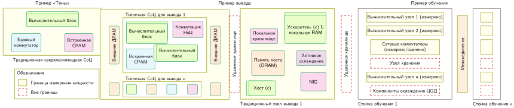

*Границы измерения мощности: MLPerf задает системные границы для измерения мощности, от однокристальных устройств до узлов дата-центра целиком, чтобы обеспечить честное сравнение энергоэффективности разной аппаратуры. Эти границы определяют, энергопотребление каких компонентов входит в опубликованные метрики, и влияют на интерпретацию результатов производительности. Источник: (Tschand et al., 2024).*

Три уровня на [«Границах измерения мощности»](12_benchmarking.md#fig-power-diagram) отражают разные аппаратные интерфейсы. В развертываниях TinyML весь маломощный системный кристалл (вычислительные ядра, внутреннюю SRAM и блоки управления питанием) попадает внутрь границы и измеряется непосредственно на шине постоянного тока. Выделенные узлы вывода расширяют этот периметр, включая центральные процессоры хоста, карты ускорителей, шины PCIe, локальное хранилище и активные вентиляторы в корпусе, но исключая удаленные сети хранения. Многостоечные развертывания для обучения измеряют вычислительные узлы и коммутаторы межсоединений верхнего уровня стойки, но исключают централизованные чиллеры дата-центра, распределительные щиты уровня объекта (PDU) и разнесенные кластеры хранения.

Граница измерения определяет, какие компоненты учитываются; состав нагрузки определяет, где тратится их энергия. На мобильных устройствах с TensorFlow Mobile перемещение данных составляет 57,3 процента полной энергии вывода (Boroumand et al., 2018), и это показывает, почему одного подсчета операций недостаточно для прогноза энергопотребления. Разобранный пример в блокноте [«Почему INT8 экономит энергию»](12_benchmarking.md#nbk-benchmarking-why-int8-saves-energy) раскладывает энергию вывода MobileNetV2 и показывает, как переход с FP32 на INT8 бьет одновременно по узкому месту перемещения памяти и по затратам на переключение арифметики.

> **Почему INT8 экономит энергию**
>
> **Задача**: при заданной модели энергии компонентов для 45 нм, насколько замена FP32 на INT8 снижает энергию чтения весов MobileNetV2 и арифметики?
>
> Напомним из [«Аппаратного ускорения»](11_hw_acceleration.md#sec-hardware-acceleration), что перемещение данных стоит гораздо дороже энергии, чем вычисления над ними (инвариант перемещения энергии, сформулированный в [«Инженерии данных»](04_data_engineering.md#sec-data-engineering) и подсчитанный по оценкам Horowitz (Horowitz, 2014)). Чтобы понять, *почему* квантование снижает энергопотребление, нужно разложить энергию на физические источники. Два доминирующих фактора определяют энергию вывода: вычислительные операции и обращения к памяти.
>
> Более узкие типы данных обычно требуют меньше энергии переключения и хранения на операцию, поэтому [«Энергия операции по точности»](12_benchmarking.md#tbl-benchmarking-energy-per-precision) показывает разрыв в 18 раз между стоимостью умножения FP32 и INT8:
>
> | **Точность**  |           **Энергия умножителя**           |            **Относительная стоимость**   |
> |:--------------|:------------------------------------------:|:----------------------------------------:|
> | **FP32**      | около 3,7 пДж/FLOP | 1× |
> | **FP16**      | около 1,1 пДж/FLOP | 0,3× |
> | **INT8**      | около 0,2 пДж/FLOP | 0,05× |
>
> 
>
> *Энергия операции по точности: стоимость энергии одного умножения в FP32, FP16 и INT8 с относительной стоимостью, нормированной к FP32. Показано, почему более узкие типы данных снижают энергию арифметики. Значения соответствуют оценкам для 45 нм из (Horowitz, 2014) и раздела «Числа, которые нужно знать» приложения «Основы машины».*
>
> 8-битный умножитель в этой компонентной модели для 45 нм тратит примерно в 18 раз меньше энергии, чем 32-битный умножитель с плавающей точкой, потому что более узкая арифметика уменьшает работу переключения и хранения (Horowitz, 2014). Раздел «Числа, которые нужно знать» приложения «Основы машины» собирает оценки на операцию, лежащие в основе этих отношений; абсолютные значения и отношения зависят от схемотехники и технологии производства.
>
> [«Энергия доступа к памяти по уровням»](12_benchmarking.md#tbl-benchmarking-energy-memory-tier) расширяет картину на доступ к памяти: стоимость энергии на байт на каждом уровне иерархии.
>
> | **Уровень памяти** |                     **Энергия на байт**                     |                 **Относительная стоимость**                 |
> |:-------------------|:-----------------------------------------------------------:|:-------------------------------------------------:|
> | **Регистр**        |          около 0,1 пДж/байт          |      1×      |
> | **Кэш L1**         |           около 1 пДж/байт          |       10×      |
> | **Кэш L2**         |           около 5 пДж/байт          |       50×      |
> | **DRAM**           | около 160 пДж/байт | 1 600× |
>
> 
>
> *Энергия доступа к памяти по уровням: стоимость энергии на байт по иерархии от регистров до DRAM с относительной стоимостью, нормированной к чтению из регистра. Показано, почему трафик памяти вне кристалла доминирует в бюджетах энергии вывода. Значения следуют той же канонической модели оценок энергии, что в (Horowitz, 2014) и разделе «Числа, которые нужно знать» приложения «Основы машины».*
>
> Доступ к памяти доминирует: чтение одного байта из DRAM стоит более чем в 1 600 раз дороже доступа к регистру.
>
> **Расчет**: энергия компонентов следует соотношениям $E_{\text{загрузка}}=\text{байты модели}\times\text{энергия DRAM на байт}$ и $E_{\text{вычисления}}=\text{FLOP}\times\text{энергия операции}$. Члены FP32 дают 2 243 мкДж + 2 220 мкДж = 4 463 мкДж; члены INT8 дают 561 мкДж + 120 мкДж = 681 мкДж. Отношение итогов дает снижение в 6,6 раза в этой упрощенной модели.
>
> [«Упрощенная оценка энергии INT8 для MobileNetV2»](12_benchmarking.md#tbl-benchmarking-mobilenet-int8-energy) объединяет два эффекта в намеренно упрощенной модели MobileNetV2. Она учитывает одно чтение DRAM на вес и относит каждый учтенный FLOP к энергии умножителя, исключая трафик активаций, поведение кэшей, сложение как отдельную стоимость, накладные расходы управления и статическую мощность:
>
> | **Компонент**                                                | **FP32 (14 МБ)** | **INT8 (3,5 МБ)** |                           **Экономия**                            |
> |:-------------------------------------------------------------|:-------------------------------------------------------:|:-------------------------------------------------------:|:----------------------------------------------------------------:|
> | **Одно чтение веса из DRAM**                                 |      2 243 мкДж     |      561 мкДж     |   4×    |
> | **Вычисления (600 MFLOP)** |    2 220 мкДж    |    120 мкДж    |  18,5×  |
> | **Итого**                                                    |   **4 463 мкДж**   |   **681 мкДж**   | **6,6×** |
>
> 
>
> *Упрощенная оценка энергии INT8 для MobileNetV2: одно чтение веса плюс энергия умножителя за каждый учтенный FLOP по компонентной модели энергии для 45 нм. Это не измерение вывода на всем устройстве.*
>
> **Системный вывод**: в этой упрощенной модели чтение весов и арифметика вносят сопоставимый вклад в энергию FP32 (2 243 мкДж и 2 220 мкДж), и INT8 снижает оба, сокращая итог с 4 463 мкДж до 681 мкДж. Это объясняет физический механизм возможной экономии, но утверждения о времени работы батареи или энергии на вывод требуют контролируемых измерений мощности всего устройства.

За пределами отдельных серверных узлов крупные развертывания вводят общую инфраструктуру, которая усложняет определение границ. В дата-центрах системы охлаждения и распределения питания составляют от 20 до 30 процентов полного потребления электроэнергии объекта (Barroso et al., 2019). Эти накладные расходы уровня объекта описывает коэффициент эффективности использования энергии (PUE):

$$\text{PUE} = \frac{\text{Полная энергия объекта}}{\text{Энергия ИТ-оборудования}}$$

Значения PUE варьируются примерно от 1,1 в гипермасштабных объектах с прямым жидкостным охлаждением чипов до более 2,0 в устаревших объектах, которые полагаются на прецизионные кондиционеры машинного зала (Barroso et al., 2019). Если оценка сообщает только энергию, потребленную из розетки сервера, она исключает этот множитель объекта. Кроме того, динамическое масштабирование напряжения и частоты (DVFS) непрерывно меняет мощность процессора и тепловыделение во время выполнения (Kim et al., 2008), создавая тепловые обратные связи, которые меняют сами накладные расходы охлаждения.

### Вычислительная эффективность и энергопотребление

Полная мощность в цифровых КМОП-схемах складывается из динамической мощности переключения и статической мощности утечки:

$$P = P_{\text{динамическая}} + P_{\text{утечка}} = \alpha C V^2 f + I_{\text{утечка}} V$$

Здесь $\alpha$ — коэффициент активности переключения затворов, $C$ — физическая емкость нагрузки, $V$ — напряжение питания, $f$ — тактовая частота, а $I_{\text{утечка}}$ — ток утечки, зависящий от температуры. Исторически число вычислений на киловатт-час удваивалось примерно каждые 1,5 года — долгосрочная тенденция роста эффективности, известная как закон Кумея (Koomey et al., 2011). Однако внутри одного поколения аппаратуры динамическая мощность ограничивает рост пропускной способности. Повышение тактовой частоты $f$ требует масштабировать напряжение питания $V$ примерно линейно, чтобы сохранить запас для переключения транзисторов, что дает кубический рост динамической мощности рассеяния:

$$P_{\text{динамическая}} \propto f^3$$

Удвоение тактовой частоты, чтобы вдвое увеличить скалярную пропускную способность, может обойтись восьмикратным штрафом по динамической мощности (Le Sueur and Heiser, 2010). Этот кубический штраф объясняет, почему современные ускорители ML предпочитают массивные параллельные массивы простых исполнительных блоков на умеренных частотах узким конвейерам на экстремальных частотах.

Поскольку масштабирование частоты быстро упирается в пределы TDP, проектировщики систем оптимизируют эффективность по осям Данных, Алгоритма и Машины. Со стороны алгоритма и данных арифметика целых чисел пониженной точности (INT8 или FP8) напрямую уменьшает емкость переключения $C$ в арифметико-логических блоках и сжимает трафик памяти по межсоединениям, сохраняя точность модели и снижая динамическую энергию (Jacob et al., 2018); (Wu et al., 2020); (Gholami et al., 2021). Со стороны машины системы работают вблизи минимума энергетико-временного произведения (EDP), а не на пиковой тактовой частоте. На мобильных устройствах с ограниченной батареей работа в точке пиковой эффективности сохраняет время работы от батареи; в дата-центрах она максимизирует пропускную способность на мегаватт выделенной мощности.

### Стандартизированное измерение мощности

Универсальные бенчмарки мощности, такие как SPECpower_ssj2008, измеряют мощность серверов на ступенчатых уровнях нагрузки (от 0 до 100 процентов с шагом 10 процентов), используя транзакционные нагрузки установившегося режима (Lange, 2009). ML-нагрузки, напротив, демонстрируют крайнюю временную изменчивость: мгновенная мощность быстро колеблется между вычислительно-ограниченными матричными умножениями (где систолические массивы или тензорные ядра потребляют пиковый ток) и ограниченными памятью простоями или передачами токенов (где исполнительные блоки ждут выборки из DRAM или межсоединения).

Для описания этих колебаний нужна откалиброванная физическая инструментация. Программные профилировщики могут читать встроенные счетчики энергии, такие как Intel RAPL или NVIDIA NVML, но у этих интерфейсов два недостатка: запросы выборки занимают такты хоста и искажают выполнение, а их внутренние модели редко можно прослеживить до откалиброванных лабораторных эталонов. Поэтому стандартизированные бенчмарки, такие как MLPerf Power, требуют внешних откалиброванных физических анализаторов мощности (например, анализаторов Yokogawa или Keithley), подключенных через встроенные токовые шунты или датчики Холла к сетевому питанию переменного тока или шинам постоянного тока (Tschand et al., 2024).

Чтобы не допустить наложения (алиасинга) кратковременных пиков на границах ядер длительностью в микросекунды, анализаторы мощности должны выбирать ток и напряжение с частотой в килогерцах и интегрировать мгновенную мощность в полную энергию:

$$E = \int_{t_{\text{старт}}}^{t_{\text{конец}}} P(t) \, dt$$

Чтобы артефакты холодного старта не искажали результаты, обвязка бенчмарка выполняет три этапа протокола:

1. Фаза прогрева выполняет неизмеряемые выводы, пока буферы инструкций, буферы весов и температуры переходов кремния не выйдут на установившееся тепловое равновесие.
2. Окно устойчивого измерения выполняет повторяющиеся выводы в течение минут, чтобы усреднить сдвиги микроархитектурных фаз и тепловой дрейф.
3. Синхронизация аппаратуры и программы сопоставляет метки времени мощности анализатора с метками отправки запросов от генератора нагрузки.

Структура нагрузки дополнительно меняет профиль мощности. В трансформерах фаза авторегрессивного декодирования ограничена пропускной способностью памяти и потребляет умеренную среднюю мощность, тогда как фаза предварительного заполнения промпта выполняет большие матричные умножения, которые дают резкие всплески мощности. Рекомендательные модели вроде DLRM, в которых доминируют разреженные выборки из таблиц эмбеддингов в DRAM, тратят больше энергии на передачи по шине памяти, чем на арифметическую логику. Размер батча создает еще один компромисс: большие батчи амортизируют чтение параметров на большее число входов и снижают энергию на вывод, но поднимают мгновенную мощность к тепловому пределу ускорителя. На краю сети результат определяют скважности работы: для прерывистого детектора ключевых слов, работающего со скважностью 1 процент, базовая мощность сна и утечки расходуют более 90 процентов емкости батареи, и эффективность активного вывода становится второстепенной по сравнению с управлением состоянием низкого энергопотребления.

### Разбор MLPerf по энергопотреблению

MLPerf Power (Tschand et al., 2024) переводит сырые электрические измерения в стандартизированные метрики эффективности: завершенные выводы в секунду на ватт при строго заданной границе системы. Этот протокол применяет единые принципы измерения в центрах обработки данных, на краю сети и в сверхмаломощных сценариях, где определяющее ограничение смещается от охлаждения стоек и эксплуатационных расходов к времени работы батареи и сбору энергии в микроваттах.

Стандартизация границы предотвращает вводящие в заблуждение сравнения между архитектурными семействами. Требуя внешних анализаторов мощности, откалиброванного журналирования и фиксированных порогов задержки, MLPerf Power гарантирует, что опубликованные числа эффективности отражают устойчивое выполнение, а не недостижимые кратковременные состояния.

За последовательные раунды подачи бенчмарков с 2021 по 2024 год стандартизированные измерения показали, как архитектурные улучшения, оптимизации компиляторов и арифметика пониженной точности переходят в реальный прирост эффективности в эксплуатации. Результаты дата-центров на [рисунке «Рост энергоэффективности дата-центров»](12_benchmarking.md#fig-power-trends) иллюстрируют эти нормированные траектории эффективности для разных ML-нагрузок.

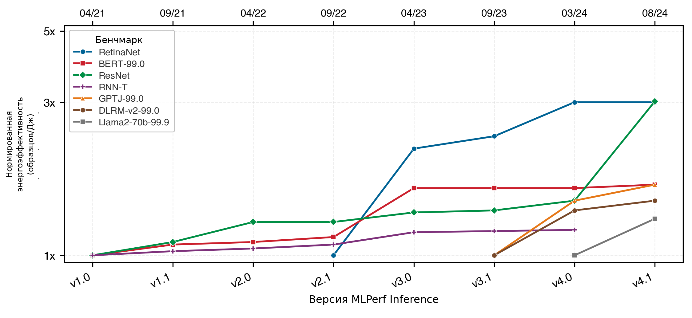

*Рост энергоэффективности дата-центров: каждая серия нормирована к своей первой построенной версии, поэтому сравнивайте улучшение внутри одной нагрузки, а не абсолютную эффективность между нагрузками. Источник: (Tschand et al., 2024).*

RetinaNet и ResNet показывают самый большой прирост на графике: каждая достигает 3× своей исходной нормированной эффективности. BERT и GPT-J достигают около 1,9×, DLRM-v2 — около 1,7×, Llama 2 — около 1,5×, а RNN-T — около 1,3×. Эти различия отражают арифметическую интенсивность каждой нагрузки. Сверточные сети со статическими формами и высокой операционной интенсивностью (RetinaNet и ResNet) сразу выиграли от зрелого выполнения INT8 на тензорных ядрах и слияния ядер. Напротив, большие языковые модели (GPT-J и Llama 2) и рекомендательные модели (DLRM-v2) остаются ограниченными пропускной способностью памяти при авторегрессивном декодировании и разреженных выборках эмбеддингов, и выигрыш эффективности там зависит от инноваций подсистемы памяти, а не от масштабирования сырых вычислений.

Протоколы тайминга и инструментация мощности дают сырые данные для бенчмаркинга. Однако сами по себе сырые данные не гарантируют обоснованных выводов. Чтобы превратить измерения в осмысленные сравнения, нужно понимать систематические источники ошибок, смещений и рассогласований, которые могут сделать даже тщательно собранные числа бенчмарка вводящими в заблуждение.

## Лучшие практики бенчмаркинга

Стек вывода, который проходит лабораторный прогон в установившемся режиме, все равно может не уложиться в целевые задержки, когда производственный трафик приходит всплесками или когда смесь входов смещается в сторону дорогих примеров. У обучения, вывода и энергоэффективности есть устоявшиеся протоколы измерения, проверенные через MLPerf, но знать, что измерять, недостаточно, без понимания того, чего бенчмарки не улавливают и почему этот разрыв приводит к нарушению целевых уровней обслуживания в эксплуатации.

Бенчмарки делают упрощающие допущения, которые позволяют стандартизированно сравнивать, но расходятся с реальностью эксплуатации. Наборы для обучения фиксируют данные и жестко задают случайность; производственные данные и условия переобучения меняются непрерывно. Наборы для вывода подчеркивают заданный сценарий установившегося режима; производственный трафик показывает всплесковые распределения поступления и переменные длины последовательностей. Бенчмарки мощности контролируют тепловую среду; развернутые ускорители сталкиваются с переменной температурой окружающей среды и устойчивыми тепловыми нагрузками. Четыре категории ограничений — статистические, связанные с развертыванием, системного проектирования и организационные — определяют, переносятся ли результаты бенчмарка в успешное развертывание.

### Статистические и методологические проблемы

Результаты бенчмарка надежны ровно настолько, насколько надежен статистический аппарат, который их получает. Три базовые методологические проблемы регулярно подрывают эту надежность.

Неполное покрытие задачи возникает, когда бенчмарк задействует лишь узкую рабочую точку системы. Контролируемые наборы данных, такие как CIFAR-10 (Krizhevsky, 2009), ограничивают входы однородными изображениями низкого разрешения ($32 \times 32$ пикселя), которые полностью помещаются в кэши на кристалле (L2/L3). Этот небольшой рабочий набор скрывает узкие места пропускной способности HBM и исключает динамическое выделение памяти, накладные расходы запуска ядер и несогласованные обращения к памяти, которые доминируют в производственных конвейерах компьютерного зрения. Модель, которая показывает высокую точность и пропускную способность на однородном уменьшенном бенчмарке, может встать в эксплуатации, когда столкнется с переменным разрешением изображений, произвольными соотношениями сторон и шумом датчиков, которые вынуждают часто перекомпилировать ядра или переходить на резервные пути выполнения.

Статистическая незначимость возникает, когда оценки опираются на слишком мало испытаний, чтобы отличить алгоритмические улучшения от шума измерения, особенно когда сама среда оценки вносит дисперсию. Оценка больших языковых моделей — хороший пример этой уязвимости: оценивают ли кандидатные генерации относительно эталона по человеческим оценкам предпочтения или по протоколу «LLM как судья», баллы сильно меняются в зависимости от формулировки промпта, согласованности модели-судьи и порядка ответов. Заявленное двухпунктовое преимущество может исчезнуть при другом шаблоне промпта или конфигурации судьи. Строгая оценка требует парных статистических тестов и бутстрап-доверительных интервалов по сотням независимых пар промптов. Опускание этих границ доверия скрывает, отражает ли заявленный отрыв подлинный архитектурный прогресс или стохастический шум оценки.

Воспроизводимость создает постоянное системное препятствие при разных программных средах. Результаты измерений заметно колеблются от незначительных изменений в компиляторах, численных средах выполнения или математических библиотеках. Например, замена библиотеки базовой линейной алгебры (BLAS) поставщика на компилятор ядер с автонастройкой меняет размеры плиток блоков потоков, распределение регистров и конфликты банков разделяемой памяти. Кроме того, неассоциативность арифметики с плавающей точкой означает, что параллельные редукции между блоками потоков дают расходящиеся побитовые результаты в зависимости от планирования потоков. MLPerf решает проблему воспроизводимости, предоставляя эталонные реализации, фиксированные зерновые значения генератора и проверенные правила подачи. Даже при строгих правилах отслеживание производительности на разных архитектурах ускорителей требует фиксировать версии библиотек, флаги компилятора и среды выполнения, чтобы не допустить незаметного дрейфа конфигурации.

### Разрывы между лабораторией и развертыванием

Статистическая строгость гарантирует, что измерения бенчмарка точны, но точные измерения неверного эксплуатационного режима все равно приводят к сбоям в эксплуатации. Наборы бенчмарков должны соответствовать физическим ограничениям развертывания.

Рассогласование с реальными целями возникает, когда бенчмарки изолируют отдельные скалярные метрики, тогда как производственная среда требует балансировать многокритериальные границы Парето. Стандартные бенчмарки вывода обычно оценивают офлайн-пропускную способность, насыщая ускоритель статическими батчами при нагрузке с замкнутым циклом. Производственные серверы, напротив, работают как открытые системы массового обслуживания с всплесковыми пуассоновскими или паретовскими шаблонами поступления. По мере приближения загрузки ускорителя к насыщению задержка в очереди растет нелинейно, и хвостовые задержки ($p99$ и $p99.9$) нарушают жесткие соглашения об уровне обслуживания, даже когда средняя задержка выглядит приемлемо. Кроме того, офлайн-бенчмарки оценивают изолированные модели с выделенным доступом к HBM ускорителя. В эксплуатации многопользовательские движки обслуживания, динамические выделения кэша ключей и значений (KV) для авторегрессивного декодирования и передачи данных между хостом и устройством по PCIe конкурируют за одну и ту же емкость памяти и пропускную способность шины, и эксплуатационная пропускная способность падает ниже лабораторных прогнозов.

### Проблемы проектирования систем

Статистическая методология и соответствие развертыванию определяют, как измеряется и на что нацелена производительность. Третья категория ограничений вытекает непосредственно из физической аппаратуры, которая выполняет нагрузку. Поведение ускорителя колеблется в зависимости от тепловых условий, конкуренции за ресурсы операционной системы и микроархитектурной топологии.

Условия среды и эксплуатации меняют результаты бенчмарка через физические механизмы аппаратуры. Ускорители работают при строгих пределах TDP и предельных температурах кремниевого перехода. Когда устойчивые вычисления рассеивают тепло быстрее, чем его может отвести система охлаждения, встроенные контроллеры включают динамическое масштабирование напряжения и частоты (DVFS), снижая тактовую частоту вычислительных блоков и арифметическую пропускную способность. Короткий бенчмарк на холодном, простаивающем ускорителе фиксирует переходные разогнанные частоты, тогда как непрерывное производственное выполнение работает на более низких стационарных частотах и теряет 15–25 процентов пропускной способности. Аналогично, неуправляемые фоновые потоки операционной системы, прерывания центрального процессора хоста и конкуренция за шину PCIe вносят дрожание задержки, которое искажает измерения хвостовой задержки, если среда выполнения не закрепляет потоки за ядрами процессора и не выделяет память отдельно.

«Лотерея аппаратуры»[^fn-hardware-lottery-hooker] (Hooker, 2021) усиливает эту физическую вариативность, связывая алгоритмическую жизнеспособность с поддержкой специализированной аппаратуры. Современные ускорители отдают подавляющую часть площади кристалла блокам плотного матричного умножения (таким как тензорные ядра или систолические массивы), которые опираются на широкие векторные блоки и иерархии памяти с высокой пропускной способностью. Алгоритмические архитектуры, например плотные трансформеры, достигают высокой арифметической интенсивности, переиспользуя веса для пакета токенов, и загружают значительную долю теоретического пика FLOP/s. Напротив, архитектуры, которые опираются на динамический поток управления, мелкозернистую разреженность или передачу сообщений в графе, страдают от несогласованных обращений к памяти и расхождения потоков и недогружают доступный вычислительный кремний. Алгоритмическая производительность на бенчмарке часто отражает не внутреннее математическое превосходство, а то, насколько естественно вычислительный граф модели ложится на доминирующие исполнительные блоки ускорителя.

[^fn-hardware-lottery-hooker]: **Лотерея аппаратуры**: термин введен (Hooker, 2021), чтобы описать, как успех алгоритма зависит от соответствия доступной аппаратуре и программному обеспечению. Нагрузки трансформеров выигрывают от плотных матричных операций, которые эффективно отображаются на современные ускорители, тогда как графовые нейронные сети и разреженные модели «смеси экспертов» труднее оценивать, если доступный кремний и программные стеки отдают предпочтение плотным ядрам. Поэтому аппаратно-специфичные таблицы лидеров благоприятствуют архитектурам, согласованным с измеряемой платформой, и могут скрывать альтернативы, которые показали бы иной результат при других аппаратных допущениях.

Зависимость от совместимости с аппаратурой вносит систематические смещения при оценке моделей на разных целевых устройствах. Архитектура, оптимизированная под выполнение на GPU, может показывать худшие результаты на встраиваемом CPU, DSP или специализированном краевом ускорителе с другой шириной векторов, иерархией кэшей и поддержкой квантования. [«Компромиссы задержки и точности, зависящие от аппаратуры»](12_benchmarking.md#fig-hw-lottery) делает эту зависимость от аппаратуры наглядной, сравнивая производительность моделей на разных платформах. На конфигурациях CPU `uint8` и GPU мультиаппаратные модели близко следуют за базовой линией «MobileNetV3 Large min», достигая примерно 77 процентов точности top-1 на ImageNet там, где базовая линия доходит примерно до 75 процентов. На EdgeTPU и DSP те же мультиаппаратные модели удерживают эти 77 процентов при заметно меньшей задержке, тогда как модель, настроенная только под CPU, потеряла бы эти выигрыши. Это показывает, что «лучшая» модель полностью зависит от целевого устройства развертывания, и такой вывод невозможно сделать по бенчмаркам одной платформы.

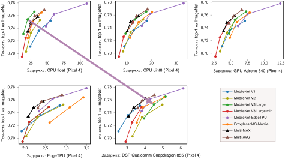

*Компромиссы задержки и точности, зависящие от аппаратуры: каждая панель показывает точность top-1 на ImageNet по вертикали и использует горизонтально шкалу задержки, специфичную для целевой платформы. Стрелка связывает MobileNetV3 Large при примерно одинаковой точности на CPU (float) и DSP, показывая сдвиг задержки, зависящий от аппаратуры. Источник: (Chu et al., 2021).*

Без бенчмаркинга на разнородных аппаратных конфигурациях проектировщики систем рискуют выбирать архитектуры только потому, что они соответствуют существующим иерархиям памяти и наборам инструкций ускорителей. Оценка моделей на разных исполнительных движках гарантирует, что архитектурные решения отражают фундаментальную вычислительную эффективность, а не артефакты совместного проектирования под конкретную платформу.

### Организационные и стратегические проблемы

Технические ограничения (статистический шум, рассогласование с развертыванием, вариативность среды и совместимость с аппаратурой) относятся к механике измерения. Отдельная категория сбоев возникает из человеческих стимулов. Коммерческие закупки и стимулы таблиц лидеров в академической среде создают систематические смещения в том, как проводятся и публикуются бенчмарки. Чтобы смягчить эту организационную динамику, нужны формальные механизмы управления и стандарты общественного аудита, которые сохраняют целостность бенчмарков.

#### Инженерия бенчмарков

Если лотерея аппаратуры — непреднамеренное следствие специализации аппаратуры, то инженерия бенчмарков — это целенаправленная практика подгонки моделей или систем под особенности конкретных обвязок бенчмарка. Эта практика дает завышенные метрики производительности, которые рушатся в эксплуатации.

Инженерия бенчмарков возникает, когда разработчики настраивают гиперпараметры, конвейеры предобработки или пути выполнения специально для максимизации баллов бенчмарка, а не обобщаемой производительности. Граница между законной оптимизацией системы и инженерией бенчмарков проходит там, где настройка жертвует устойчивостью вне распределения. Например, конвейер вывода может жестко задавать размеры входных тензоров и дополнять батчи специально под шаг памяти плиточной конфигурации GEMM ускорителя; тогда на фиксированных формах бенчмарка достигается пиковая пропускная способность, но на произвольных производственных входах запускаются дорогие откаты на резервные ядра и перераспределения памяти. Точно так же подгонка конвейера оценки под формат вывода автоматической модели оценки дает высокие места в таблице лидеров, которые рушатся при работе с неструктурированным человеческим диалогом.

Контракты на закупку и маркетинговые заявления создают сильные стимулы оптимизировать напрямую под публичные бенчмарки. Когда рейтинги бенчмарков определяют коммерческое внедрение, инженерные усилия концентрируются на оптимизации под тестовую обвязку в ущерб общей полезности: это тот самый сбой по закону Гудхарта, который введен в [«Рамке бенчмаркинга машинного обучения»](12_benchmarking.md#sec-benchmarking-machine-learning-benchmarking-framework-70b8) и проиллюстрирован примером с BLEU в [«Проблемах измерения в ML»](12_benchmarking.md#sec-benchmarking-ml-measurement-challenges-60ea).

#### Смещения и переоптимизация

Системные инженеры, оценивающие результаты бенчмарков, должны отличать законные архитектурные выигрыши от инженерии бенчмарков. Несколько технических практик выявляют этот разрыв. Прозрачность служит первой защитой: заявки, которые публикуют полные флаги компилятора, конфигурации ядер и трассы выполнения, позволяют независимым оценщикам отделить обобщаемые выигрыши эффективности от настройки под конкретную обвязку. Отчетность о парных метриках из контролируемых бенчмарков и нетронутых производственных трасс выявляет расхождения в распределениях задержки и использовании памяти. Кроме того, оценка на нескольких независимо поддерживаемых наборах бенчмарков повышает барьер против переобучения, потому что оптимизация, подогнанная под синтетические особенности одной обвязки, редко переносится на разнообразные тестовые наборы.

Стандартизация и независимая проверка обеспечивают подотчетность. Независимые аудиты проверяют, воспроизводятся ли заявленные ускорения на одинаковой аппаратуре, как показывает сверка «эталон против заявки» в MLPerf ([«Синтез MLPerf и игра с бенчмарками»](12_benchmarking.md#sec-benchmarking-gaming)). Стресс-тестирование под конкретное приложение оценивает эксплуатационные сбои, которые статические бенчмарки пропускают, например подвергая модели компьютерного зрения неблагоприятным условиям среды или подавая на движки вывода перекошенный трафик запросов. Наконец, бенчмаркинг на разной аппаратуре проверяет, происходят ли выигрыши в производительности из подлинного алгоритмического превосходства или из узкого соответствия иерархии памяти одного ускорителя.

#### Эволюция бенчмарков

Бенчмарки — не статичные стандарты; они должны эволюционировать вместе с архитектурами моделей и возможностями аппаратуры. Бенчмарк, который эффективно разделяет возможности систем в одном архитектурном поколении, устаревает, когда модели упираются в потолок его точности или когда аппаратные инновации смещают главное узкое место системы. Устаревшие бенчмарки стимулируют переоптимизацию старых вычислительных ядер вместо продвижения эффективности системы.

Этот эволюционный цикл характеризует историю бенчмарков машинного обучения. Ранние бенчмарки глубокого обучения оценивали классификацию изображений и детекцию объектов на сверточных сетях. По мере того как нейронные архитектуры расширялись до больших языковых моделей, рекомендательных систем и генеративного ИИ, статические бенчмарки зрения перестали улавливать внимание на длинном контексте, авторегрессивное декодирование и маршрутизацию разреженных экспертов. В ответ сообщества бенчмарков эволюционировали, чтобы измерять понимание языка (Wang et al., 2018); (Wang et al., 2019) и возможности фундаментальных моделей (Liang et al., 2022).

Эволюция бенчмарков также расширяет измерения. Если ранние бенчмарки сосредоточивались на пропускной способности и точности, то современные системы требуют многокритериальной оценки по энергоэффективности, объему памяти и хвостовой задержке при ресурсных ограничениях. [«Спектр производительности»](12_benchmarking.md#fig-sciml-graph) делает эти разнородные требования конкретными, наглядно отображая научные приложения по скорости потока данных и времени вычислений. В частности, датчики Большого адронного коллайдера должны обрабатывать данные со скоростью, приближающейся к $10^{14}$ байт в секунду, при вычислениях на масштабе наносекунд, тогда как мобильные приложения работают на уровне $10^{4}$ байт в секунду с более длинными окнами вычислений: разброс примерно в десять порядков по скорости данных и в шесть-семь порядков по времени вычислений. Такой диапазон требований делает необходимыми специализированные бенчмарки. Например, краевые приложения ИИ выигрывают от бенчмарков вроде MLPerf, которые оценивают производительность при ресурсных ограничениях, а научные области нуждаются в собственных бенчмарках «быстрого ML для науки» (Duarte et al., 2022).

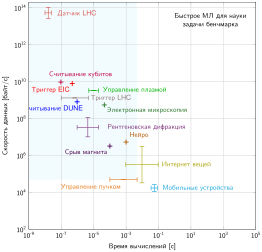

*Спектр производительности: научные и краевые приложения занимают сильно разнесенные рабочие точки по скорости данных и доступному времени вычислений, что делает необходимыми бенчмарки, привязанные к временным ограничениям и требованиям к перемещению данных каждого приложения. Источник: (Duarte et al., 2022).*

Управление эволюцией бенчмарков вводит фундаментальный компромисс между продольной стабильностью и архитектурной актуальностью. Бенчмарки должны оставаться неизменными достаточно долго, чтобы позволить строгие сравнения аппаратуры и программного обеспечения между поколениями. Если бенчмарки меняются слишком часто, отследить исторический прогресс становится невозможно. С другой стороны, бесконечная заморозка бенчмарка ведет к застою метрик и чрезмерной специализации. Современные консорциумы бенчмарков балансируют этот компромисс, работая по фиксированным циклам выпусков, которые вводят новые репрезентативные нагрузки и выводят устаревшие наборы.

### Синтез MLPerf и игра с бенчмарками

Игра с бенчмарками возникает, когда компилятор, среда выполнения или аппаратный стек оптимизируется специально под обвязку бенчмарка, а не под общую нагрузку, которую он представляет. В традиции Хеннесси и Паттерсона по количественной архитектуре компьютеров бенчмарки — это активные мишени, а не пассивные инструменты. Динамика Гудхарта, введенная в [«Рамке бенчмаркинга машинного обучения»](12_benchmarking.md#sec-benchmarking-machine-learning-benchmarking-framework-70b8), применяется напрямую: когда балл бенчмарка определяет контракты на закупку или маркетинговые заявления, инженерные усилия смещаются к эксплуатации особенностей тестовой обвязки. MLPerf противодействует игре с бенчмарками, сочетая эталонные реализации, строгий аудит заявок, правила точности для закрытого дивизиона и регулярный вывод из обращения устаревших нагрузок, которые иначе бы застоялись.

В количественной архитектуре компьютеров правила запуска должны запрещать три конкретных класса игры с бенчмарками:

1. Усечение точности без раскрытия: компилятор незаметно снижает численную точность (например, выполняет промежуточные активации в FP8 или INT8 вместо BF16), чтобы завысить арифметическую пропускную способность, не раскрывая сниженного динамического диапазона и не проверяя, ухудшает ли низкая точность численную устойчивость на производственных нагрузках.
2. Сокращение работы и устранение операторов: движок выполнения использует фиксированные тестовые наборы бенчмарка, чтобы пропускать операции, нужные для обычных производственных входов, например обходить удаление динамического дополнения, маскирование токенов за границами или пропуск проверки границ входа.
3. Отпечатки бенчмарка: среда выполнения проверяет размеры входных тензоров, хеш-отпечатки наборов данных или шаблоны раскладки памяти, чтобы определить тестовый набор, и запускает зашитые в код заранее настроенные графы выполнения и специальные конфигурации ядер, недоступные для произвольных пользовательских нагрузок.

MLPerf нейтрализует эти уловки структурным разделением заявок, проверкой эквивалентности эталону и рецензируемым аудитом кода. В закрытом дивизионе предобработка, постобработка и архитектура модели должны оставаться строго эквивалентны эталонной реализации, а заявки должны выполнять строгие целевые показатели качества (например, оставаться в пределах 99 процентов точности эталонного FP32). Хотя участникам предлагается внедрять инновации в средах выполнения, раскладках памяти (например, переводе NCHW в NHWC) и слиянии ядер, правила запуска строго запрещают отпечатки входов и необобщаемые уловки. Заявки, которые меняют граф модели или рецепт переобучения, выделяются в открытый дивизион, где изменения явно помечаются и проверяются.

Даже самые строгие системные бенчмарки проверяют только одно измерение готовности развертывания. Рекордная пропускная способность и энергоэффективность на нагрузке MLPerf подтверждают, что стек аппаратуры и среды выполнения обеспечивает высокую вычислительную эффективность, но не могут определить, обобщается ли развернутая модель на реальные распределения или представляет ли базовый набор данных эксплуатационную совокупность. В таксономии D·A·M аппаратная пропускная способность (Машина) — необходимое основание, но точность алгоритма (Алгоритм) и целостность данных (Данные) должны выполняться одновременно. Чтобы завершить стек проверки, нужна оценка по всем трем измерениям таксономии D·A·M: качество данных, возможности модели и эффективность аппаратуры должны согласовываться в условиях эксплуатации.

## Оценка модели и данных

Сжатая модель на ускоренной аппаратуре все еще может провалиться, если ее обучили на смещенных данных. Системные бенчмарки могут подтвердить, что аппаратура дает обещанную пропускную способность обучения, задержку вывода и энергоэффективность, но одна проверка аппаратуры не гарантирует успеха развертывания. Конвейер оптимизации из третьей части также включал сжатие моделей ([«Сжатие моделей»](10_model_compression.md#sec-model-compression)) и отбор данных ([«Отбор данных»](09_data_selection.md#sec-data-selection)), и каждый требует собственной проверки. Два оставшихся измерения рамки закрывают этот пробел: бенчмарки модели проверяют, сохранило ли сжатие точность и критичные свойства модели, а бенчмарки данных проверяют, позволяют ли обучающие данные устойчивое обобщение.

### Бенчмаркинг модели

Бенчмарки модели проверяют, сохранили ли методы сжатия из [«Сжатия моделей»](10_model_compression.md#sec-model-compression) свойства, важные для развертывания. Эта оценка выходит за рамки общей точности. Прореженная модель может сохранить точность на ImageNet, но потерять устойчивость к состязательным входам. Квантованная модель может сохранить производительность в среднем случае, но ухудшиться на редких, но критичных краевых случаях. Дистиллированная модель может повторить точность учителя, но потерять калибровку. Исторически бенчмарки сосредоточивались почти исключительно на точности, однако сжатие делает многомерную оценку необходимой.

ImageNet связывает бенчмаркинг модели с историей аппаратуры из рисунка [«Ошибка ImageNet и внедрение GPU»](12_benchmarking.md#fig-imagenet-gpus): частоты ошибок падали по мере того, как архитектуры с поддержкой GPU становились практичными. [«Прогресс соревнования ImageNet»](12_benchmarking.md#fig-imagenet-challenge) прослеживает этот путь от 28,2 процента ошибки в 2010 году до 3,57 процента в соревновании ImageNet Large Scale Visual Recognition Challenge (Russakovsky et al., 2015). Появление AlexNet[^fn-alexnet-benchmark-baseline] снизило частоту ошибок с 25,8 процента до 16,4 процента. Последующие модели, такие как ZFNet, VGGNet, GoogLeNet и ResNet[^fn-resnet-benchmark-baseline], продолжили эту тенденцию, и ResNet достиг 3,57 процента (He et al., 2016). Этот ряд задал базовые линии, с которыми сравниваются методы сжатия моделей: прореженная ResNet должна показать, сколько точности она жертвует ради заданного выигрыша эффективности.

[^fn-alexnet-benchmark-baseline]: **AlexNet**: восьмислойная сверточная сеть (60 млн параметров), которая в 2012 году снизила частоту ошибок top-5 на ImageNet с 25,8 до 16,4 процента. Обучалась на двух GPU GTX 580 с 3 ГБ памяти у каждого (Krizhevsky et al., 2012). AlexNet задала парадигму бенчмаркинга, которая до сих пор определяет оценку зрения: точность на фиксированном наборе данных как основная метрика, конфигурация аппаратуры как второстепенная спецификация. Последующие результаты ImageNet унаследовали эту структуру сравнения с базовой линией.

[^fn-resnet-benchmark-baseline]: **ResNet (остаточная сеть)**: введена (He et al., 2016). Остаточные связи позволили строить сети из более чем 152 слоев и достигли частоты ошибок top-5 на ImageNet 3,57 процента (ансамбль), что превзошло оценочную ошибку человека в контексте соревнования ImageNet (Russakovsky et al., 2015). ResNet-50 стала распространенной эталонной нагрузкой MLPerf Training, потому что ее умеренный размер (25,6 млн параметров) и хорошо изученный вычислительный профиль (8,2 GFLOP на изображение) делают ее чувствительной к оптимизациям и аппаратуры, и программного обеспечения, без необходимости в многоузловых установках (Mattson et al., 2020).

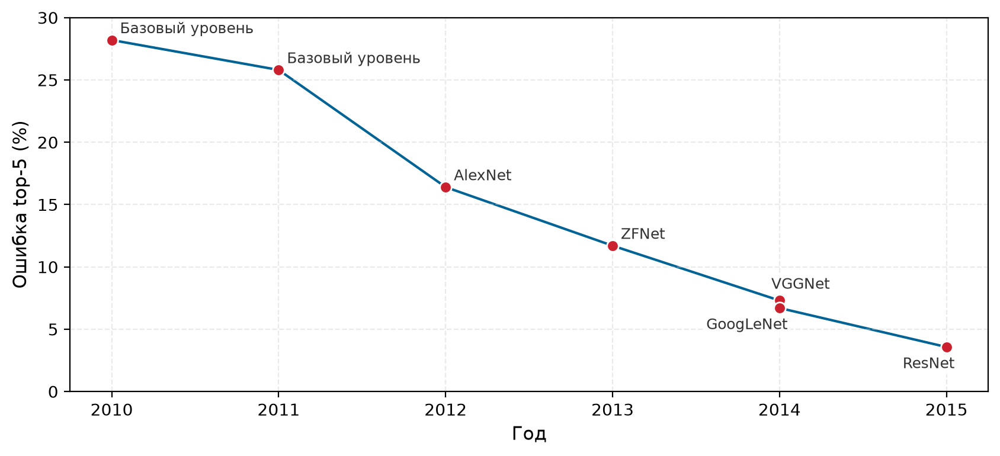

*Прогресс соревнования ImageNet: AlexNet отмечает наибольшее однолетнее снижение в ряду; ZFNet, VGGNet, GoogLeNet и ResNet продолжают это снижение, задавая траекторию точности, относительно которой оцениваются последующие компромиссы сжатия. Источники: (Russakovsky et al., 2015); (Krizhevsky et al., 2012); (He et al., 2016).*

#### Метрики точности и их слепые пятна

Самые распространенные метрики моделей (точность, precision, recall, F1) каждая показывает разные стороны поведения модели и скрывает другие, и понимание их слепых пятен необходимо для проверки сжатия. Точность top-$k$ измеряет, встречается ли верная метка среди $k$ наиболее вероятных предсказаний модели. Точность top-1 строга, top-5 мягка. Разрыв между ними показывает неуверенность модели: модель с точностью top-1 75 процентов и top-5 95 процентов «знает», что ответ среди нескольких кандидатов, но с трудом останавливается на одном. Для развертывания допустимый разрыв зависит от того, могут ли последующие системы использовать ранжированные предсказания или требуют одного ответа.

Precision и recall важны, когда классы несбалансированы или ошибки имеют асимметричную цену (Sokolova and Lapalme, 2009). Модель обнаружения мошенничества с точностью 99 процентов может иметь recall на реальном мошенничестве 10 процентов (ловит одну из десяти мошеннических транзакций), что неприемлемо, несмотря на высокую точность. Precision (доля верных среди предсказанных положительных) и recall (доля найденных среди реальных положительных) выявляют сбои, которые скрывает агрегированная точность.

Агрегированные метрики также скрывают сбои в подгруппах. Модель с общей точностью 95 процентов может давать 60 процентов на критичной демографической подгруппе. Проект Gender Shades (Buolamwini and Gebru, 2018) показал, что коммерческие системы классификации пола по лицу работают заметно хуже на женщинах с более темной кожей, чем на мужчинах со светлой, и это расхождение невидимо для агрегированных бенчмарков. Необходимы дезагрегированные оценки по подгруппам, значимым для развертывания; систематически вопросы справедливости рассмотрены в главе [«Ответственная инженерия»](15_responsible_engr.md#sec-responsible-engineering).

#### Калибровка: когда важны оценки уверенности

Во многих сценариях развертывания то, *насколько уверенна* модель, важно не меньше, того, *что* она предсказывает. Оценки уверенности хорошо откалиброванной[^fn-calibration-confidence-score] модели соответствуют реальной вероятности верного ответа: когда она говорит «уверенность 90 процентов», она должна быть права в 90 процентах случаев.

[^fn-calibration-confidence-score]: **Калибровка**: от арабского *qalib* (форма для отливки металла) через латинское *calibrare*, изначально описывавшего настройку измерительных приборов по известным эталонам. В ML калибровка обеспечивает соответствие предсказанных вероятностей эмпирическим частотам; (Guo et al., 2017) формализовали эту проблему для современных нейронных сетей и показали, что температурное масштабирование — простая и эффективная постобработка. Этимология уместна: как некалиброванный прибор дает точные, но неверные измерения, так и некалиброванная модель дает уверенные, но ненадежные предсказания, и последующие системы, которые пороговой обработкой опираются на оценки уверенности, принимают систематически неверные решения.

Сжатие может сдвигать калибровку даже при сохранении точности, и это критично при проверке методов квантования из [«Квантования и числовой точности»](10_model_compression.md#sec-model-compression-quantization-precision-cd46). Квантованная модель может сохранять заголовочную точность, но становиться чрезмерно уверенной на примерах, в которых она ошибается. Это важно, потому что постобработочные методы калибровки, например температурное масштабирование, могут исправить проблему только тогда, когда калибровка измерена явно (Guo et al., 2017).

Сбои калибровки создают проблемы дальше по конвейеру. Чрезмерно уверенная модель автоматизирует ошибки, которые ей стоило бы передать человеку (предсказывает уверенность 95 процентов, но ошибается в 30 процентах случаев). Недостаточно уверенная модель отправляет на проверку слишком много верных предсказаний вместо того, чтобы автоматизировать решения, с которыми она справится (предсказывает уверенность 70 процентов, но права в 95 процентах случаев). **Ожидаемая ошибка калибровки (ECE)** измеряет разрыв между уверенностью и точностью по корзинам уверенности; диаграммы надежности визуализируют это соответствие.

#### Проверка сжатия: граница эффективности и качества

Сжатие моделей ([«Сжатие моделей»](10_model_compression.md#sec-model-compression)) обменивает емкость модели на эффективность. Проверка должна определить, достигло ли сжатие приемлемого компромисса или повредило важные возможности.

Оценка по границе Парето[^fn-pareto-benchmark-tradeoff] показывает, представляет ли сжатая модель хороший компромисс. Построение точности против целевой метрики эффективности (задержки, размера модели, энергии) выявляет границу компромисса. Модели на границе Парето *не могут* улучшить одну метрику без ухудшения другой; модели ниже границы доминируются лучшими альтернативами.

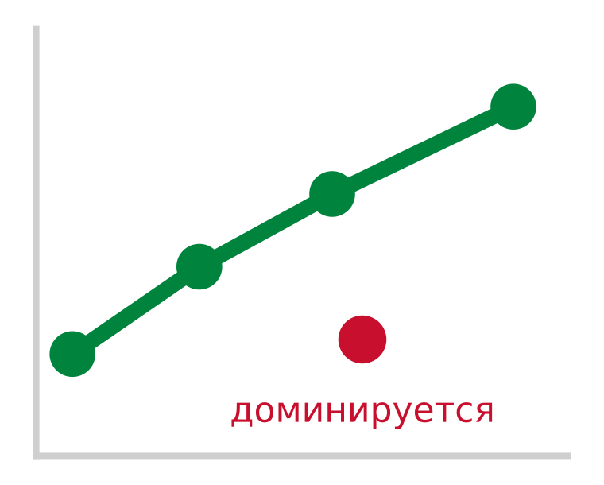

*Доминируемая модель проигрывает по обеим осям границы Парето.*

[^fn-pareto-benchmark-tradeoff]: **Граница Парето**: названа в честь экономиста (Pareto, 1896). Граница содержит все решения, в которых улучшение одной цели требует ухудшения другой. В бенчмаркинге сжатия форма границы несет диагностическую информацию: крутой участок означает, что выигрыши эффективности достаются дешево (прореживать здесь), а плоский участок означает, что дальнейшее сжатие стоит непропорционально дорогой точности (остановиться здесь). Точки ниже границы строго доминируются и представляют собой потраченную впустую емкость.

Разные методы сжатия дают разные компромиссы между эффективностью и качеством. Квантование снижает точность, часто сохраняя общую точность (Jacob et al., 2018). Прореживание создает разреженность, сохраняя разный уровень качества на тестовых наборах (Han et al., 2015); (Gale et al., 2019). Дистилляция переносит знания от более крупного учителя или ансамбля в меньшую модель (Hinton et al., 2015). Поскольку эти агрегированные результаты не доказывают сохранения калибровки или поведения на хвосте распределения, проверка должна оценивать эти свойства напрямую (Guo et al., 2017).

Оценка калибровки при сжатии требует стандартизированного протокола. Ожидаемая ошибка калибровки (ECE) сравнивает предсказанную уверенность с эмпирической точностью, но у нее нет универсальных пороговых значений. Метрика зависит от схемы разбиения на корзины, их числа, размера выборки и распределения предсказаний. Поэтому протокол бенчмарка должен зафиксировать оценщик и измерять деградацию относительно несжатой базовой линии при заданном допуске для задачи.

Оптимальность по Парето выделяет недоминируемые варианты, но не доказывает, что какой-либо вариант проходит абсолютный порог качества для развертывания. Допустимая деградация зависит от контекста развертывания: снижение точности на 2 процента может быть приемлемым для системы рекомендаций, где пользователи терпят неидеальные подсказки, но неприемлемым для медицинской диагностики, где каждый ложноотрицательный результат несет серьезные последствия. Производственные ворота приемки должны задать абсолютные пороги точности до сжатия и одновременно проверять агрегированную точность, стабильность калибровки и критичные для развертывания срезы. Маячный пример MobileNetV2 делает этот многомерный протокол проверки конкретным.

> **Сжатие MobileNetV2 в INT8**
>
> Возвращаясь к маячному примеру [«Проверка развертывания MobileNetV2»](12_benchmarking.md#lhs-benchmarking-mobilenet-deployment-validation), рассмотрим иллюстративный протокол проверки квантования в INT8, опирающийся на архитектуру MobileNetV2 (Sandler et al., 2018) и практику квантования после обучения (Jacob et al., 2018). Значения в [«Метриках MobileNetV2 INT8 после сжатия»](12_benchmarking.md#tbl-benchmarking-mobilenet-int8-validation) предполагаемые:
>
> **Базовая линия до сжатия**: MobileNetV2 достигает точности top-1 на ImageNet 71,8 процента при 3,5 млн параметров (14 МБ в FP32).
>
> В [«Метриках MobileNetV2 INT8 после сжатия»](12_benchmarking.md#tbl-benchmarking-mobilenet-int8-validation) после квантования в INT8 до 3,5 МБ агрегированная точность почти не меняется, но ошибка калибровки и точность на краевых случаях выявляют существенную деградацию. ECE модели в INT8 растет с 0,031 до 0,089; приемлема ли эта величина, зависит от допуска для конкретной задачи при фиксированном протоколе ECE.
>
> | **Метрика**            |                    **FP32**                    |                    **INT8**                    | **Приемлемо?**                                                                                |
> |:-----------------------|:----------------------------------------------:|:----------------------------------------------:|:-----------------------------------------------------------------------------------------------|
> | **Точность top-1**     | 71,8% | 70,9% | ✓ (снижение на 0,9 п.п.; ниже порога в 1 процентный пункт) |
> | **Точность top-5**     | 91% | 90,4% | ✓ |
> | **Калибровка ECE**     | 0,031 | 0,089 | Нет (ухудшение) |
> | **Точность на краевых случаях** | 68,2% | 61,4% | Нет (снижение на 6,8 п.п.) |
>
> 
>
> *Метрики MobileNetV2 INT8 после сжатия: иллюстративные значения FP32 и INT8 для точности top-1 и top-5, ошибки калибровки и точности на краевых случаях. Они показывают, как агрегированная точность может скрывать деградацию калибровки и хвостовых случаев.*
>
> **Определение краевых случаев**: изображения с окклюзией более 50 процентов, освещением менее 100 люкс или поворотом более 30° относительно обучающего распределения (примерно 5 процентов реальных входов).
>
> **Что это показывает**: при этих допущениях средняя точность выглядит приемлемо (снижение на 0,9 процентного пункта), но калибровка ухудшается, а точность на краевых случаях падает на 6,8 процентного пункта. Если развертывание использует пороги уверенности (например, «действовать, только если уверенность больше 85 процентов») или сталкивается с множеством краевых случаев (необычное освещение, частичные окклюзии), INT8-версия MobileNetV2 может подвести, несмотря на успешное прохождение агрегированных бенчмарков.
>
> **Исправление**: применить температурное масштабирование постфактум, чтобы улучшить калибровку (Guo et al., 2017). Температурное масштабирование обучает один скалярный параметр $T_{\text{cal}}$, на который делятся логиты перед softmax: $\text{softmax}(z_i/T_{\text{cal}})$. Параллельно добавьте в тестовый набор примеры краевых случаев, чтобы непрерывно отслеживать именно этот режим сбоя.

Гипотеза лотерейного билета ([«Гипотеза лотерейного билета»](10_model_compression.md#sec-model-compression-lottery-ticket-hypothesis-1b3d)) дает конкретные данные бенчмарка, которые иллюстрируют, как выглядит эффективное по Парето сжатие. Итеративным прореживанием (Frankle and Carbin, 2019) нашли разреженные подсети («выигрышные билеты») в полносвязных и сверточных сетях, которые при обучении в изоляции могут достичь тестовой точности исходной сети. Эти эмпирические результаты показывают нелинейную форму компромиссов сжатия: агрессивное прореживание сохраняет точность до критической степени разреженности, за которой качество резко падает. Проверка сжатия поэтому должна строить эмпирические кривые компромисса для каждой конкретной модели и архитектуры, определяя, где модель находится на границе Парето и дает ли дальнейшее прореживание аппаратную эффективность или только ухудшает точность.

#### Бенчмарки больших языковых моделей

Рамка оценки сжатия чисто применяется, когда у задачи есть стабильная метка, например точность классификации, mAP детекции или IoU сегментации. Большие языковые модели ломают этот шаблон. Команда может выбрать модель, потому что она хорошо показывает себя на публичном бенчмарке, а потом в эксплуатации выяснить, что модель распознает факты в вопросах с выбором ответа, но не может сгенерировать обоснованный ответ, отвечает слишком медленно для интерактивного продукта или выдает уверенный небезопасный текст, которого бенчмарк никогда не проверял. Бенчмаркинг LLM поэтому начинается с того, что называется сбой развертывания, который оценка должна исключить.

Таксономия метрик в [«Таксономии бенчмарков LLM, ориентированной на сбои»](12_benchmarking.md#tbl-llm-benchmark-failure-taxonomy) организует оценку вокруг этих режимов сбоя, а не вокруг рейтингов таблиц лидеров. Ее строки используют Massive Multitask Language Understanding (MMLU),[^fn-mmlu-knowledge-benchmark] HELM (Holistic Evaluation of Language Models)[^fn-helm-holistic-evaluation] и перплексию[^fn-perplexity-language-metric] как примеры оценок, которые отвечают на разные вопросы развертывания:

| **Сбой развертывания, который нужно исключить** | **Метрика или семейство бенчмарков** | **Что показывает оценка** | **Чего оценка не доказывает** |
|:-----------------------------------------------|:-------------------------------------------------------------|:-------------------------------------------------------------------------------------------------------------------------------------------------|:-------------------------------------------------------------------------------------------------------------------------------------------------------|
| **Модель плохо распознает факты** | MMLU (Massive Multitask Language Understanding) | Широкие фактические и предметные знания по пятидесяти семи предметам; оценки интерпретируются относительно уровня случайного выбора в вопросах с вариантами ответа | Может ли модель генерировать обоснованные ответы на открытые вопросы, а не выбирать из вариантов |
| **Модель способна, но небезопасна** | HELM (Holistic Evaluation of Language Models) | Точность вместе с калибровкой, устойчивостью, справедливостью, предвзятостью, токсичностью и эффективностью | Отражает ли один агрегированный балл риск развертывания; модель может быть сильна по точности и слаба по калибровке, безопасности, стоимости или устойчивости к формулировке промпта |
| **Модель хорошо предсказывает свой корпус** | Перплексия | Предсказание следующего токена на удержанных данных того же корпуса; перплексия 10 означает, что модель в среднем «путается между 10 вариантами» | Полезны, безопасны или обоснованы ли сгенерированные ответы за пределами этого корпуса |
| **Модель ощущается медленной в работе** | Задержка первого токена, задержка между токенами и пропускная способность по токенам | Задержка обработки промпта до начала генерации и скорость декодирования после ее начала | Скрывает ли одна цифра пропускной способности плохую интерактивную отзывчивость, особенно когда батчинг повышает пропускную способность, но ухудшает задержку первого токена |

*Таксономия бенчмарков LLM, ориентированная на сбои: метрики LLM полезны, когда каждый балл связан со сбоем развертывания, который он призван исключить. Распознавание, целостное поведение, предсказание корпуса и отзывчивость выявляют разные риски, поэтому ни одна отдельная метрика не доказывает готовности к эксплуатации.*

[^fn-mmlu-knowledge-benchmark]: **MMLU (Massive Multitask Language Understanding)**: введен (Hendrycks et al., 2020) и содержит 15 908 вопросов с вариантами ответа по пятидесяти семи предметам. Ограничение бенчмарка MMLU связано с его форматом: распознавание среди вариантов — не та же задача, что генерация открытого ответа, поэтому балл MMLU нельзя читать как прямое доказательство того, что модель в эксплуатации способна давать обоснованные свободные ответы.

[^fn-helm-holistic-evaluation]: **HELM (Holistic Evaluation of Language Models)**: рамка оценки Стэнфорда 2022 года проверила широкий набор моделей по семи измерениям (точность, калибровка, устойчивость, справедливость, предвзятость, токсичность, эффективность) (Liang et al., 2022). Вклад HELM методологический: оценивая модели, которые близки по точности, но расходятся по калибровке или токсичности, он показывает, что таблицы лидеров по одной метрике систематически скрывают режимы сбоя, важные для развертывания.

[^fn-perplexity-language-metric]: **Перплексия**: от латинского *perplexus* (запутанный); в теории информации равна $2^{H(p)}$, где $H$ — энтропия. Перплексия 10 означает, что модель в среднем «путается между 10 вариантами». Последствия для систем здесь интерпретационные, а не прямой учет памяти: перплексия измеряет предсказание следующего токена на удержанных данных корпуса, тогда как нагрузка на память при обслуживании определяется длиной контекста, размером батча, формой модели и состоянием декодирования; управление KV-кэшем — отдельная задача обслуживания (Kwon et al., 2023).

Строка про отзывчивость требует конкретной временной привязки, потому что бенчмарки LLM часто сообщают одно агрегированное число пропускной способности, хотя пользователи ощущают генерацию в разных фазах. Модель может достигать высокой агрегированной пропускной способности в токенах в секунду и при этом ощущаться вялой, если первый токен приходит поздно, либо может минимизировать задержку первого токена, но генерировать последующий текст слишком медленно для интерактивного чтения.

Пропускная способность по токенам переводит скорость генерации во время, которое ощущает пользователь: для ответа в 750 токенов при скорости 25 токенов/с нужно 30 секунд, а при 100 токенах/с ответ готов за 7,5 секунды. Поэтому задержку первого токена и задержку между токенами нужно сообщать вместе: первая характеризует начальную отзывчивость, вторая — устойчивую скорость выдачи. Это разделение задержки отражает разные вычислительные режимы: задержку первого токена определяет предварительное заполнение (prefill) промпта, которое обрабатывает токены параллельно и обычно ограничено вычислениями, тогда как задержку между токенами определяет авторегрессивное декодирование, где генерация каждого токена требует заново загрузить все веса модели и тензоры KV-кэша из памяти с высокой пропускной способностью, так что пропускная способность жестко привязана к пропускной способности памяти.

Еще один режим сбоя состоит в том, что балл бенчмарка может отражать запоминание обучающих данных, а не общую способность. Загрязнение бенчмарка — особый риск для LLM: модели, обученные на корпусах веб-масштаба, могут встретить вопросы бенчмарка во время предобучения и завысить баллы за счет запоминания, а не навыка (Xu et al., 2024). Обнаружение утечек превращает этот риск в то, что создатели бенчмарков могут проверить, а не просто подозревать. Временные отложенные выборки используют контент, опубликованный после границы обучения; динамические бенчмарки непрерывно генерируют новые экземпляры; а тесты на загрязнение проверяют, воспроизводит ли модель дословно формулировки бенчмарка. Эти приемы держат бенчмарк привязанным к вопросу развертывания, а не вознаграждают контакт с оценочным набором во время предобучения.

### Бенчмаркинг данных

Бенчмарки модели проверяют, сохранила ли модель качество после сжатия. Однако качество модели полностью зависит от данных, на которых ее обучали и оценивали, и эта зависимость создает самый коварный режим сбоя в развертывании ML. Идеально сохраненная модель, обученная на смещенных или нерепрезентативных данных, все равно провалится в эксплуатации. Бенчмарки данных проверяют, позволили ли стратегии эффективности из [«Отбора данных»](09_data_selection.md#sec-data-selection) (активное обучение, проектирование учебного плана, аугментацию данных и генерацию синтетических данных) получить обучающие наборы, которые обеспечивают надежное развертывание. Это часто последняя проверка, которая проваливается, и самая трудная для диагностики: модель с отличной точностью на удержанных тестовых данных может рухнуть на производственных входах, которые обучающие данные никогда адекватно не представляли.

В таксономии D·A·M оптимизация Алгоритма и Машины не компенсирует структурных дефектов Данных: кластер ускорителей, работающий на пиковой арифметической интенсивности, просто быстрее вычисляет неверные представления, если обучающее распределение дефектно. Поэтому бенчмарк данных начинается с операционного протокола, а не с агрегированного балла. Протокол задает срез развертывания, который должна обслуживать модель, резервирует устойчивую к утечкам отложенную выборку, проверяет разделение дубликатов и почти дубликатов между разбиениями, задает минимальное покрытие для редких классов и подгрупп, аудирует качество разметки и устанавливает пороги дрейфа, которые определяют, когда бенчмарк перестает представлять производство. Только после того как эти ворота явно заданы, агрегированные метрики становятся интерпретируемыми.

#### Метрики покрытия

Первый вопрос, на который должен ответить бенчмаркинг данных, — покрывает ли обучающее распределение операционную область, с которой модель столкнется в эксплуатации. Модель не может обобщаться на режимы входа, которых нет в обучающем распределении, а пути, по которым покрытие обучения ломается, часто незаметны.

Баланс классов — самый очевидный режим сбоя. В наборе данных для обнаружения мошенничества с 99 процентами легитимных транзакций и 1 процентом мошеннических модель, которая безусловно предсказывает большинство, достигает точности 99 процентов, но не выполняет операционной задачи. Для смягчения сильного дисбаланса классов нужны перевзвешивание потерь, целевая передискретизация или калибровка порога решения. Более коварен дисбаланс подгрупп внутри классов: набор может иметь сбалансированные положительные и отрицательные классы в целом, но брать отрицательные примеры непропорционально из определенной демографической группы или географического региона. Агрегированные метрики точности маскируют такие систематические локальные сбои. Когда системы взаимодействуют с людьми, необходим аудит представительности по демографическим измерениям (например, возрасту, географии или диалекту), хотя отсутствующие или шумные демографические метаданные часто осложняют обнаружение.

Покрытие признаков выходит за пределы дискретных меток классов в непрерывное пространство операционных вариаций. Баланс классов проверяется непосредственно по статистике меток, тогда как покрытие признаков требует сопоставить физические параметры среды развертывания. Конвейер компьютерного зрения, обученный только на дневных снимках, ломается при низкосветовом шуме датчика; конвейер обработки голоса, обученный на чистых студийных сигналах, деградирует при акустической реверберации и фоновом шуме. Эти вариации среды, включая разное аппаратное обеспечение датчиков, условия освещения и редкие краевые операционные случаи, выходят за пределы дискретных распределений меток. Бенчмаркинг покрытия признаков поэтому требует задать конкретные границы входного пространства вместе с экспертами предметной области до оценки работы модели.

#### Метрики качества

Даже когда обучающий набор охватывает операционную область, ошибки разметки искажают сигнал учителя. Распространенные ошибки меток, которые последовательно измеряются в пределах от 3 до 6 процентов в канонических наборах бенчмарков, включая ImageNet (Northcutt et al., 2021), не действуют как безобидный шум. Контролируемая оптимизация принимает неверные метки за истину. Если оценочный набор содержит испорченные метки, модель, которая выучивает истинное лежащее в основе распределение, будет наказана, а модель, которая запоминает артефакты разметки, получит завышенный балл.

Для небольших корпусов ручные аудиты по стратифицированным случайным выборкам дают базовые оценки ошибок. В масштабе уверенное обучение (confident learning) находит ошибки разметки алгоритмически: оно оценивает совместное распределение зашумленных аннотаций и истинных скрытых меток по предсказанным вероятностям на внеобучающей выборке. Если модель стабильно приписывает высокую уверенность классу, который противоречит назначенной метке, расхождение выделяет кандидатов в ошибки разметки из обычной неопределенности оптимизации. Пометка этих кандидатов позволяет целенаправленно переразмечать или фильтровать данные, обходя непомерную стоимость полного ручного просмотра.

Согласованность разметчиков измеряет единообразие аннотаторов до обучения модели. Каппа Коэна для двух оценщиков и каппа Флейсса для нескольких измеряют согласие сверх ожидаемого случайного уровня (Cohen, 1960); (Fleiss, 1971). Когда метрики согласия падают ниже установленных порогов для задач с объективной истиной, сбой указывает на неоднозначную таксономию меток, утомление разметчиков или несогласованные инструкции. Хотя качественные шкалы Лэндиса и Коха дают историческую опору (Landis and Koch, 1977), производственным конвейерам нужны пороги согласия, калиброванные непосредственно под допустимый риск конкретного приложения.

Структурная форма шума меток определяет его последствия для дальнейшего конвейера. Случайный шум меток размывает градиентный сигнал между классами, увеличивая сложность выборки, но редко учит связным ложным представлениям. Напротив, систематические ошибки, например постоянная неверная разметка недопредставленного подкласса или связывание метки с артефактом среды, вносят структурированное смещение в веса модели. Если фотографии волков на снегу последовательно помечаются как собаки, модель учится связывать снег с целевым классом. При наличии систематической ошибки разметки сбор большего объема обучающих данных по тому же протоколу разметки не исправляет смещение, а лишь закрепляет ложную ассоциацию с большей уверенностью параметров.

#### Выравнивание распределения

Бенчмаркинг данных в конечном счете должен оценивать, обобщается ли модель с условий обучения на среды развертывания. Стандартные протоколы оценки предполагают, что обучающая, валидационная и тестовая выборки независимы и одинаково распределены (i.i.d.). В производственных системах это допущение регулярно нарушается: временной дрейф меняет поведение потребителей, деградация датчиков сдвигает характеристики аппаратуры, а географическое расширение вводит неучтенные подгруппы. Когда допущение i.i.d. ломается, точность на удержанной выборке перестает предсказывать эксплуатационную производительность и систематически дает слишком оптимистичную оценку надежности модели.

Этот разрыв между обучением и эксплуатацией количественно измеряет систематический бенчмарк WILDS[^fn-wilds-distribution-shift] (Koh et al., 2021), который оценивает модели при сдвигах распределения между больничными системами, местами установки фотоловушек и спутниковыми пролетами. На Camelyon17-WILDS сообщаемая базовая линия ERM достигла средней точности 93,2 процента на внутреннем распределении и 70,3 процента на внешнем распределении для невиденных клинических площадок. Это падение качества происходит при неизменных архитектуре, гиперпараметрах и вычислительных затратах обучения, что подтверждает: деградация в развертывании вызвана именно сдвигом распределения, а не недостатком емкости модели.

[^fn-wilds-distribution-shift]: **WILDS**: бенчмарк Стэнфорда 2021 года из десяти наборов данных с реальными сдвигами распределения: изменения больниц (Camelyon17), сдвиги мест установки фотоловушек для дикой природы (iWildCam) и временной дрейф спутниковых снимков (PovertyMap). Для сообщаемой базовой линии ERM на Camelyon17-WILDS средняя точность упала с 93,2 процента на внутреннем распределении до 70,3 процента на внешнем, что показывает: стандартная оценка на удержанной выборке может завышать производительность, когда допущение i.i.d. не выполняется.

Чтобы сдвиг распределения не нарушал соглашения об уровне обслуживания, конвейеры обслуживания развертывают статистическое обнаружение сдвига в потоках входящих запросов. Двухвыборочные проверки гипотез, такие как критерий Колмогорова — Смирнова (Berger and Zhou, 2014) для одномерных признаков и maximum mean discrepancy (Gretton et al., 2012) для многомерных эмбеддингов, выявляют ковариатный сдвиг, то есть изменение маргинального распределения входов $P(X)$, даже когда условное распределение целевой переменной $P(Y \mid X)$ не наблюдается. Отслеживание энтропии предсказаний и распределений уверенности дополнительно показывает, когда входы выходят за пределы поддержки обучения, и тогда система может направить аномальные запросы на резервные модели или к проверке человеком до того, как ухудшится качество обслуживания.

Вызовы выравнивания распределения подчеркивают устойчивое напряжение в разработке ML между двумя парадигмами: *зафиксировать данные и итерировать модели* или *зафиксировать модель и итерировать данные*. [«Парадигмы разработки»](12_benchmarking.md#fig-model-vs-data) ставит эти две парадигмы рядом и показывает, где именно петля обратной связи различается. В модельно-центричной схеме цикл итераций нацелен на архитектуру, а данные остаются статичными; в данно-центричной схеме архитектура фиксирована, а цикл нацелен на качество данных. Два подхода дополняют друг друга, а не образуют общего рейтинга того, откуда придет улучшение.

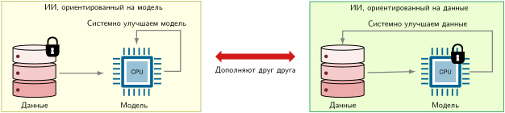

*Парадигмы разработки: модельно-центричный ИИ итерирует архитектуру при фиксированном наборе данных, тогда как данно-центричный ИИ итерирует разметку, разнообразие и смещения при фиксированной архитектуре. Двусторонняя стрелка показывает, что подходы дополняют друг друга.*

Данно-центричный ИИ отражает важный сдвиг в понимании, оспаривающий допущение «больше данных всегда лучше»: состав набора данных важен наряду с масштабом. Инициативы вроде DataPerf (Mazumder et al., 2023) и DataComp[^fn-datacomp-filtering-benchmark] появились, чтобы систематически оценивать, как построение набора данных влияет на качество модели. В вычислительно контролируемой постановке DataComp базовый вариант, сохранивший 30 процентов лучших кандидатов из общего пула по фильтрации на основе CLIP, превзошел базовый вариант без фильтрации на агрегированной последующей оценке (Gadre et al., 2023). Результат устанавливает ценность курирования для данного протокола, но не универсальную оптимальную долю.

[^fn-datacomp-filtering-benchmark]: **DataComp**: введен в 2023 году. DataComp фиксирует семейство моделей, код обучения и вычислительный бюджет, а участники меняют построение набора данных. Его трек фильтрации изолирует эффект выбора примеров из общего пула кандидатов, что делает стратегии курирования сопоставимыми без приписывания каждого выигрыша дополнительным вычислениям обучения.

#### Насыщение набора данных и динамические бенчмарки

Даже когда протоколы покрытия, качества и выравнивания распределения выполнены, статические бенчмарки сталкиваются с проблемой насыщения набора данных. Когда модели приближаются к эмпирическим верхним границам на фиксированных тестовых наборах, разрывы в таблице лидеров сжимаются, и становится трудно отличить подлинный прогресс возможностей от подгонки под артефакты конкретного бенчмарка. Как показывает хронология на [рисунке «Насыщение набора данных»](12_benchmarking.md#fig-dataset-saturation), широко отслеживаемые бенчмарки ИИ неоднократно пересекали заявленные человеческие базовые линии, исчерпывая свой запас как дискриминаторы (Maslej et al., 2024).

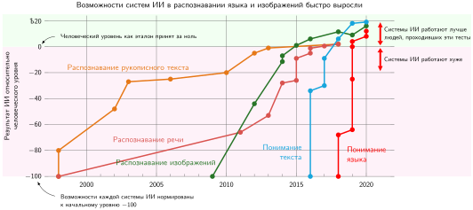

*Насыщение набора данных: нулевая линия обозначает заявленный уровень человеческой производительности; пересечение каждой кривой отмечает возможность, для которой статический бенчмарк имеет меньший оставшийся запас различения. Пересечения не отличают подлинный прирост возможностей от оптимизации под оценочный набор. Источники: (Maslej et al., 2024); (Kiela et al., 2021).*

Когда статический бенчмарк насыщается, высокая точность таблицы лидеров может маскировать хрупкие эвристики. Распознавание цифр MNIST (LeCun et al., 1998) рано показало, что модели могут эксплуатировать специфичные для набора артефакты съемки, а не инвариантные признаки; это в итоге привело к вопросу «Мы закончили с ImageNet?» (Beyer et al., 2020). Когда распределение оценки остается замороженным, итеративный выбор модели рискует подгонкой под своеобразные тестовые артефакты, а не улучшением обобщаемой способности решать задачу.

Фреймворки динамического бенчмаркинга, такие как Dynabench[^fn-dynabench-dynamic-benchmark] (Kiela et al., 2021), решают проблему насыщения, непрерывно развивая данные оценки. В этой парадигме human-аннотаторы создают состязательные входы, нацеленные на режимы сбоя текущих лучших моделей, так что бенчмарк продолжает проверять пределы представления. Однако динамические бенчмарки вносят фундаментальный системный компромисс: поскольку распределение оценки меняется между итерациями, продольные сравнения между поколениями моделей трудно калибровать. Статические и динамические бенчмарки поэтому играют взаимодополняющие роли: статические наборы обеспечивают продольную воспроизводимость на стандартизированных задачах, а динамические бенчмарки выявляют новые возникающие границы ошибок.
[^fn-dynabench-dynamic-benchmark]: **Dynabench**: платформа Facebook AI Research 2021 года для генерации динамических бенчмарков, где люди создают состязательные входы, обманывающие текущие лучшие модели. Dynabench решает проблему насыщения, когда очень высокая точность на статических бенчмарках может отражать знакомство с тестовым набором, а не устойчивую способность, но вносит собственный компромисс: динамические бенчмарки труднее сравнивать во времени, потому что оценочный набор меняется. Статические и динамические бенчмарки играют взаимодополняющие диагностические роли.

### Целостная оценка «система — модель — данные»

Успешного прохождения системного, модельного и информационного бенчмарков по отдельности недостаточно. Системный бенчмарк может подтвердить производительность аппаратуры, модельный бенчмарк может проверить, что сжатие сохранило качество, а информационный бенчмарк может оценить репрезентативность обучающего набора, однако развернутая система все равно может провалиться, потому что три измерения взаимодействуют. Реальная производительность ИИ возникает из этого взаимодействия, и оптимизация одного измерения может выявить слабости в другом.

Рассмотрим конкретную цепочку сбоев: команда достигает целевой пропускной способности в MLPerf Inference, развернув модель компьютерного зрения, квантованную в INT8, на специализированном ускорителе. Системные бенчмарки проходят. Однако поскольку коэффициенты масштаба и нулевые точки квантования калибровались строго на валидационных образцах ImageNet, развертывание модели на заводском производстве выявляет серьезную деградацию точности. Освещение цеха создает динамический диапазон, который превышает пороги отсечения калибровки и обрезает активации признаков. Целевой бенчмарк качества модели при разных уровнях экспозиции выявил бы эту численную чувствительность. Если проследить сбой вверх по конвейеру, видно, что обучающий конвейер не содержал промышленных изображений: это разрыв в распределении данных, который никакая оптимизация ускорителя или настройка ядер во время выполнения не устранит.

Сцепление измерений означает, что успешный бенчмарк в одной области может быть аннулирован неизмеренным сбоем в другой:

- **Успех системы + сбой модели**: аппаратура выдает обещанную пропускную способность, но агрессивное сжатие снижает точность ниже порогов развертывания.
- **Успех системы + сбой данных**: быстрый вывод выполняется на входах бенчмарка, но смещение обучающих данных вызывает серьезные различия точности между демографическими подгруппами.
- **Успех модели + сбой системы**: модель выдает точные предсказания, но дисперсия хвостовой задержки при параллельной нагрузке нарушает соглашения об уровне обслуживания.
- **Успех модели + сбой данных**: проверка дает высокую точность на удержанных тестовых наборах, но сдвиг производственного распределения вызывает незаметную деградацию.

Эти режимы сбоя напрямую соотносятся с таксономией D·A·M, введенной в [«Введении»](01_introduction.md#sec-introduction) ([«Ландшафт пересечения D·A·M»](01_introduction.md#fig-ai-triad)), хотя линзы бенчмарков не соответствуют трем физическим осям один к одному. Бенчмарки данных оценивают входное распределение и качество, поставляемые обучению; бенчмарки модели оценивают обученные алгоритмические представления и численную устойчивость; а системные бенчмарки выявляют выполнение на аппаратуре, эффективность ядер и трафик межсоединений памяти. Целостная оценка проверяет пересечения, в которых сходятся эти оси. Оптимизации по всему конвейеру третьей части (отбор данных → сжатие модели → аппаратное ускорение) вводят межосевые зависимости, которые изолированные измерения скрывают.

Таксономия D·A·M дает диагностическую рамку для систематического выяснения того, какая ось ограничивает производительность. Раздел «Сводка диагностики D·A·M» приложения «Таксономия D·A·M» сопоставляет каждую ось с ее связывающим физическим ограничением и путем оптимизации, который его снимает, и дает первый диагностический шаг, когда бенчмарк выявляет недогрузку. [«Матрица диагностики узких мест D·A·M»](12_benchmarking.md#tbl-dam-bottleneck) формализует этот подход, пересекая каждую ось D·A·M с тремя фундаментальными типами узких мест; раздел «Таксономия D·A·M» приложения содержит полное руководство по диагностике, включая утилиты профилирования и индикаторы скрининга эффективности.

| **Компонент** | **Ограничен вычислениями**                           | **Ограничен памятью**                                | **Ограничен вводом-выводом**                             |
|:--------------|:-----------------------------------------------------|:-----------------------------------------------------|:---------------------------------------------------------|
| **Данные**    | Предобработка слишком медленная (аугментация, токенизация) | Набор данных больше ОЗУ (уходит на диск)       | Хранилище не может кормить GPU (предел пропускной способности диска) |
| **Алгоритм**  | Модель слишком велика для аппаратуры (FLOP превышают емкость) | Активации превышают память (размер батча ограничен) | Синхронизация градиентов медленнее вычислений (распределенное обучение) |
| **Машина**    | Загрузка GPU насыщена (нужен более быстрый ускоритель) | Пропускная способность памяти насыщена (нужна большая пропускная способность HBM) | Пропускная способность сети/PCIe насыщена (нужны более быстрые линки) |

*Матрица диагностики узких мест D·A·M: каждая ячейка описывает симптом ограничения производительности, а строка указывает, какую ось D·A·M нужно исправлять. Когда производительность упирается, эта матрица превращает первый диагностический шаг в проверку по оси: Данные, Алгоритм или Машина.*

Применение этой матрицы выделяет корневую причину, когда телеметрия системы расходится с теоретическими пиками аппаратуры. Если ускоритель показывает загрузку GPU лишь 30 процентов при обучении, инженер может преждевременно обвинить архитектуру модели (строка «Алгоритм») и начать хирургическое вмешательство в модель. Профилирование часто показывает другое: рабочие процессы данных на хосте, которые загружают ядра CPU на аугментации изображений или токенизации, не успевают подавать батчи по PCIe (строка «Данные», столбец «Ограничен вычислениями»: «предобработка слишком медленная»). Ускоритель простаивает не из-за алгоритмической неэффективности, а из-за голодания конвейера входа. Обход матрицы предотвращает ошибочно направленные инженерные вмешательства, указывая прямо на связывающую физическую подсистему.

Валидация в контролируемых лабораторных условиях отличается от валидации в эксплуатации. В лаборатории распределения данных фиксированы, шаблоны запросов однородны, а системы работают изолированно. В эксплуатации все три допущения могут нарушиться одновременно: данные дрейфуют, трафик непредсказуемо всплескивает, а параллельные нагрузки конкурируют за общие аппаратные ресурсы. Последнее измерение бенчмаркинга задает вопрос, выдерживают ли лабораторные результаты эксплуатационные условия.

## Производственные соображения

Система, которая проходит все три категории бенчмарков, все равно может провалиться в эксплуатации. Трехмерная рамка проверила производительность аппаратуры, качество модели и репрезентативность данных при контролируемых условиях, но эксплуатационные развертывания непрерывно нарушают эти условия. Проверка ML-системы требует измерения ее поведения при динамических нагрузках, меняющихся распределениях данных и конкуренции за аппаратные ресурсы.

### От лаборатории к эксплуатации

Лабораторные бенчмарки устанавливают, на что система способна в идеальных условиях. Проверка в эксплуатации определяет, работает ли система правильно сейчас, в реальных условиях.

Этот разрыв возникает, потому что производственные нагрузки нарушают статические допущения, заложенные в лабораторные оценки:

Тихая деградация происходит, потому что модели выдают правдоподобные выходы, не порождая аппаратных исключений или программных кодов ошибок. Традиционное программное обеспечение падает, паникует или возвращает HTTP 500 при недопустимом состоянии. Модель ML, напротив, завершает свои матричные умножения и возвращает корректные тензоры с плавающей точкой, даже когда предсказания деградировали или перестали быть откалиброванными. Сервис рекомендаций, который возвращает неоптимальные ранжирования, не дает никакого аппаратного сигнала о том, что его предсказательная точность рухнула.

Динамические нагрузки вносят очереди и узкие места памяти, которые бенчмарки стационарного режима скрывают. Стек обслуживания, протестированный при стационарных 1 000 QPS, может рухнуть, когда всплески трафика поднимут нагрузку до 10 000 QPS, потому что лабораторные тесты с замкнутым циклом предполагают однородное поступление запросов с минимальным накоплением очереди. Когда частота поступления в эксплуатации превышает мгновенную емкость обслуживания, задержки в очередях растут нелинейно. Планировщики динамического батчинга пытаются поглотить всплеск, накапливая более крупные батчи запросов, но увеличенные батчи требуют дополнительной памяти ускорителя под тензоры активаций и кэши ключей и значений (KV). Если память исчерпана, движок падает с ошибкой нехватки памяти; даже если память держится, время ожидания в очереди выводит хвостовую задержку ($p99$) за пределы эксплуатационных соглашений об уровне обслуживания.

Сдвиг распределения данных усугубляет эти эксплуатационные проблемы, когда производственные данные уходят от обучающих и валидационных распределений. Модель компьютерного зрения, оцененная на отобранных изображениях бенчмарка, деградирует, когда живой вывод обрабатывает загрузки со смартфонов с артефактами объектива, искажениями сжатия и меняющимся освещением: точность падает, тогда как метрики пропускной способности и задержки выглядят совершенно не затронутыми.

Производственные ограничения также связывают измерения, которые лабораторные бенчмарки оценивают изолированно. В лаборатории точность, задержка, стоимость и утилизация ресурсов оптимизируются вдоль независимых кривых Парето. В развертывании эти ограничения сталкиваются напрямую на аппаратуре: соблюдение строгого SLA по хвостовой задержке во время всплесков трафика требует ограничивать размеры батчей или сбрасывать нагрузку, что снижает арифметическую интенсивность аппаратуры, понижает загрузку ускорителя и увеличивает стоимость обслуживания запроса.

### Переход от бенчмарка к развертыванию

Перед развертыванием проверьте выводы бенчмарка в условиях, представительных для эксплуатации. [«Чек-лист предразвертывания»](12_benchmarking.md#tbl-predeployment-checklist) называет допущение бенчмарка, производственную реальность, которая его нарушает, и шаг проверки, который закрывает разрыв; чек-лист, который следует за таблицей, превращает эти строки в действия по готовности к выпуску.

| **Допущение бенчмарка**        | **Производственная реальность** | **Подход к проверке**                  |
|:-------------------------------|:-----------------------------|:---------------------------------------|
| **Однородное поступление запросов** | Всплесковые шаблоны трафика | Нагрузочный тест с воспроизведением производственной трассы |
| **Чистые, предобработанные входы** | Входы переменного качества | Оценка на производственной выборке данных |
| **Прогретое состояние системы** | Холодные старты, промахи кэша | Измерение производительности холодного старта |
| **Изолированное выполнение**   | Конкуренция за ресурсы       | Бенчмарк при реалистичной системной нагрузке |
| **Фиксированная версия модели** | A/B-тестирование, постепенный выпуск | Установка базовой линии для сравнения |

*Чек-лист предразвертывания: каждая строка связывает допущение, заложенное в лабораторные бенчмарки, с производственной реальностью, которая его нарушает, и с шагом проверки, который закрывает разрыв. Система, которая проходит все лабораторные бенчмарки, все равно может провалиться в эксплуатации, если каждая строка этой таблицы не проверена независимо в репрезентативных эксплуатационных условиях.*

> **Чек-лист предразвертывания бенчмарка**
>
> Прежде чем развернуть модель на основе результатов бенчмарка:
>
> - Воспроизведите производственные трассы: используйте журналы запросов, чтобы проверить пропускную способность и задержку в реалистичных условиях.
> - Протестируйте на производственных данных: возьмите выборку недавних производственных входов (соблюдая конфиденциальность), чтобы убедиться, что точность сохраняется.
> - Стресс-тестируйте краевые случаи: найдите наихудшие входы и проверьте, что деградация остается управляемой.
> - Установите базовые линии мониторинга: задокументируйте ожидаемые диапазоны метрик для обнаружения аномалий.
> - Определите критерии отката: задайте количественные пороги для возврата к предыдущей версии модели.

### Мониторинг в эксплуатации как непрерывный бенчмаркинг

Мониторинг в эксплуатации расширяет бенчмаркинг от однократных ворот до непрерывного процесса. Применяются те же принципы (стандартизированные метрики, воспроизводимое измерение, статистическая строгость), но цель смещается от офлайн-квалификации к непрерывной эксплуатационной проверке.

Когда модель запущена, бенчмаркинг становится скользящим сравнением с только что установленными базовыми линиями. Непосредственные проверки остаются конкретными: остается ли входное распределение близким к распределению бенчмарка, остаются ли задержка и пропускная способность в измеренном коридоре, и не выходит ли качество модели за ожидаемый диапазон. Ответ на эти вопросы требует той же дисциплины измерения, что и офлайн-бенчмарк, но теперь измерения поступают непрерывно и на живом трафике.

Операционные среды обслуживания превращают этот цикл измерения в механизмы выпуска и восстановления (глава [«MLOps»](14_ml_ops.md#sec-ml-operations)): поэтапные выкаты, теневую оценку (запуск новой модели рядом с продуктивной без выдачи ее результатов), непрерывную проверку и автоматический откат. Бенчмаркинг задает базовый коридор производительности и пороги сбоя; мониторинг в эксплуатации непрерывно проверяет живую телеметрию относительно этих границ.

Разрыв между условиями бенчмарка и реальностью эксплуатации объясняет, почему команды снова и снова попадают в предсказуемые ловушки. Набор повторяющихся заблуждений показывает, как здравые метрики, примененные неверно, дают вводящие в заблуждение выводы.

## Заблуждения и ловушки

Бенчмаркинг создает ложную уверенность, когда стандартизированные измерения скрывают реалии развертывания. Команды полагают, что контролируемые оценки предсказывают производительность в эксплуатации, но реальные системы сталкиваются с изменчивостью, ресурсными ограничениями и многокритериальными компромиссами, которые бенчмарки не могут уловить, и тратят инженерные усилия на системы, оптимизированные под оценку, а не под развертывание.

> **Заблуждение и ловушка**
>
> **Заблуждение**: *производительность на бенчмарке напрямую переносится на производительность реального приложения.*
>
> Кажущаяся ясность рейтингов бенчмарков побуждает команды выбирать системы так, будто позиция в таблице лидеров предсказывает поведение в эксплуатации. Это редко так. Как показывает [«Проблемы измерения в ML»](12_benchmarking.md#sec-benchmarking-ml-measurement-challenges-60ea), ML-системы демонстрируют присущую им изменчивость из-за качества данных, сдвигов распределения и ресурсных ограничений, которых нет в контролируемой оценке. В типичном сценарии сбоя языковая модель с точностью на бенчмарке 92 процента падает до 78–82 процентов в эксплуатации, когда обрабатывает пользовательский текст с опечатками, разговорным языком и предметной терминологией. Система вывода со средней задержкой 15 мс на MLPerf в эксплуатации получает задержку p99 в 150–200 мс (ухудшение в 10–13,3 раза) из-за параллельной нагрузки, пауз сборки мусора и изменчивости сети. Команды, которые опираются только на рейтинги бенчмарков, систематически недооценивают сложность развертывания, что ведет к провальным запускам и дорогостоящей переделке.
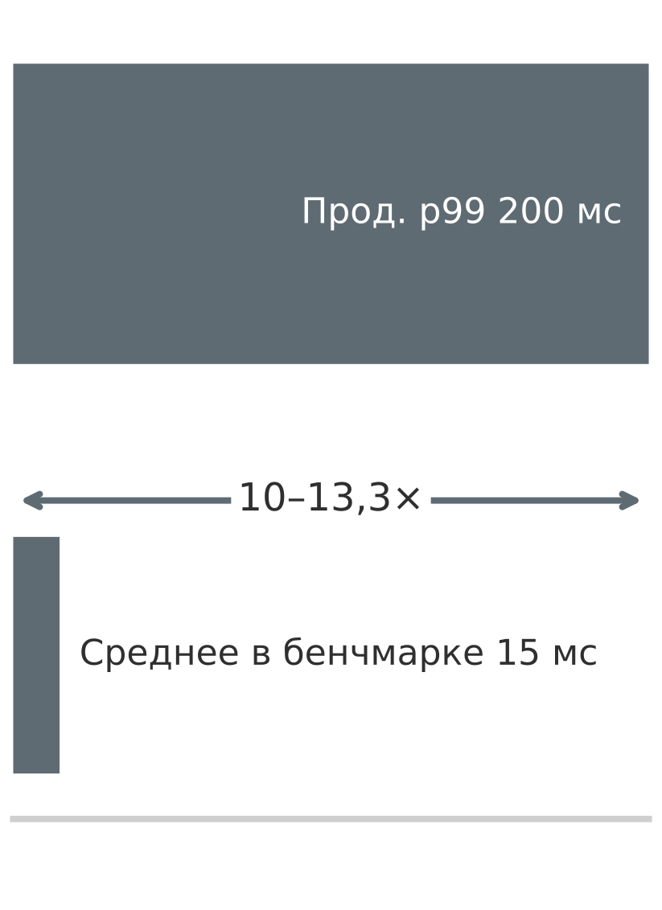

*Средняя задержка бенчмарка занижает производственный хвост примерно на порядок.*

> **Заблуждение и ловушка**
>
> **Ловушка**: *оптимизация исключительно под метрики бенчмарка без учета более широких требований системы.*
>
> Таблицы лидеров стимулируют агрессивную оптимизацию, но оптимизации, которые поднимают место в рейтинге, часто ухудшают как раз те свойства, которых требует эксплуатация. Это пример закона Гудхарта ([«Организационные и стратегические проблемы»](12_benchmarking.md#sec-benchmarking-organizational-strategic-issues-d25a)): когда баллы бенчмарка становятся целями оптимизации, они перестают быть осмысленной мерой качества системы. В одном иллюстративном сценарии команда снижает задержку вывода с 12 мс до 8 мс агрессивным квантованием, улучшая место в рейтинге MLPerf на 15 позиций, но ухудшая калибровку настолько, что оценки уверенности предсказаний становятся ненадежными для последующих решений. Другая команда повышает точность на ImageNet на 2,1 процента тщательной настройкой гиперпараметров, но оптимизированная модель потребляет на 40 процентов больше энергии и на 25 процентов хуже работает на изображениях вне распределения с производственных камер. Организации, которые вознаграждают рейтинги бенчмарков выше успеха развертывания, систематически создают системы, отлично проходящие оценку и проваливающиеся в эксплуатации.

> **Заблуждение и ловушка**
>
> **Заблуждение**: *оценки по одной метрике дают достаточное представление о производительности системы.*
>
> Утверждение в одно число выглядит привлекательно просто («точность 94 процента» или «1 200 QPS, быстро»). Но успех в эксплуатации требует балансировать несколько конкурирующих целей, которые любая отдельная метрика скрывает. Современные системы вывода требуют оценки по точности, задержке, пропускной способности, энергии и устойчивости ([«Метрики вывода»](12_benchmarking.md#sec-benchmarking-inference-metrics-78d4)). В одном иллюстративном компромиссе рекомендательная модель с точностью 94 процента и задержкой p99 180 мс не выполняет цели обслуживания, требующие p99 меньше 100 мс, несмотря на отличную точность. И наоборот, система, оптимизированная под пропускную способность 1 200 QPS, достигает этой скорости, потребляя 4,2 Вт, тогда как немного более медленная система при 1 000 QPS потребляет 1,8 Вт (разница в мощности в 2,3 раза). Для краевых устройств с батарейным питанием потеря пропускной способности в 17 процентов дает работу в 2,3 раза дольше. Разные заинтересованные стороны ставят разные метрики на первое место: инженеры ML сосредоточены на точности, команды инфраструктуры на пропускной способности и стоимости, менеджеры продукта на перцентилях задержки. Оптимизация по одной метрике систематически порождает системы, которые отлично работают по одному измерению и не выполняют требований развертывания по остальным.

> **Заблуждение и ловушка**
>
> **Ловушка**: *использование устаревших бенчмарков, которые больше не отражают задач и требований развертывания.*
>
> У бенчмарков есть инерция: команды продолжают отчитываться по устоявшимся бенчмаркам, когда результаты перестали давать полезное различение. Насыщение наступает, когда несколько подходов достигают почти одинаковых результатов, и сравнение теряет смысл. Частота ошибок классификации top-5 на ImageNet снизилась с 28,2 процента в 2010 году (Russakovsky et al., 2015) до 3,57 процента к 2015 году (He et al., 2016), резко сократив запас, который измеряла эта метрика. По мере сужения разрывов статистические доверительные интервалы, обсуждавшиеся в [«Статистических и методологических проблемах»](12_benchmarking.md#sec-benchmarking-statistical-methodological-issues-7aa5), и значимость результата для развертывания начинают важнее места в таблице лидеров. Меняющиеся контексты развертывания усугубляют проблему: бенчмарки, спроектированные для серверного оборудования, вводят в заблуждение применительно к краевым устройствам с памятью в 10 раз меньше и бюджетом мощности в 100 раз ниже. Эффективный бенчмаркинг требует вывода из употребления насыщенных бенчмарков и разработки рамок оценки, соответствующих реальности целевого развертывания.

> **Заблуждение и ловушка**
>
> **Заблуждение**: *исследовательские бенчмарки предсказывают поведение в эксплуатации при реальном трафике.*
>
> Исследовательские бенчмарки существуют, чтобы сравнивать алгоритмы в контролируемых условиях; производственные системы существуют, чтобы обслуживать пользователей в переменных условиях. Считать первые предсказанием производства часто значит получить оптимистичные результаты, потому что исследовательские бенчмарки могут не учитывать конкуренцию за ресурсы, изменчивость качества входов и режимы эксплуатационных сбоев. Неправильное выполнение добавляет отдельный источник ошибок: пропуск **прогревочных прогонов** может смешать однократную инициализацию, JIT-компиляцию, заполнение кэшей и выделение памяти с задержкой установившегося режима; неуказанное состояние кэша может превратить номинальный бенчмарк памяти либо в измерение повторного использования прогретого кэша, либо в доступ к холодной памяти; а если динамическое масштабирование напряжения и частоты (DVFS) меняется без отчетности о нем, небольшие различия трудно воспроизвести. Производственные системы сталкиваются с параллельной пользовательской нагрузкой, изменчивым качеством входов, сетевой задержкой и сбоями системы, которые ухудшают производительность ([«Разрывы между лабораторией и развертыванием»](12_benchmarking.md#sec-benchmarking-laboratorytodeployment-performance-gaps-16c8)). Система, которая в изолированных бенчмарках дает пропускную способность 800 QPS, при производственной нагрузке с загрузкой 90 процентов поддерживает лишь 400–500 QPS (снижение на 37,5–50 процентов) из-за конкуренции в очередях и пауз сборки мусора. Исследовательские бенчмарки сообщают время вывода модели (5–10 мс), тогда как сквозная задержка в эксплуатации включает накладные расходы предобработки, очередей и постобработки, в сумме 50–100 мс. Производственные системы требуют доступности 99,9 процента (43 минуты простоя в месяц) и плавной деградации при сбоях, а этих характеристик исследовательские бенчмарки часто не содержат. Эффективная производственная оценка требует операционных метрик: устойчивой пропускной способности под нагрузкой, времени восстановления после сбоев и полной разбивки задержки.

> **Заблуждение и ловушка**
>
> **Ловушка**: *использование исследовательских бенчмарков как производственных ворот выпуска.*
>
> Команды иногда продвигают модель потому, что она прошла исследовательский бенчмарк, и обнаруживают только после запуска, что бенчмарк никогда не проверял эксплуатационный путь. Ворота выпуска для системы обслуживания должны включать нагрузочные тесты, измерения хвостовой задержки, проверки качества данных, учения на сбои и критерии отката. Исследовательские бенчмарки остаются полезными для сравнения алгоритмов, но производственные ворота должны измерять развернутую систему в тех условиях трафика, аппаратуры и сбоев, с которыми она реально столкнется.

## Итоги

Бенчмаркинг завершает конвейер оптимизации третьей части, проверяя, какой выигрыш на практике дают отбор данных ([«Отбор данных»](09_data_selection.md#sec-data-selection)), сжатие моделей ([«Сжатие моделей»](10_model_compression.md#sec-model-compression)) и аппаратное ускорение ([«Аппаратное ускорение»](11_hw_acceleration.md#sec-hardware-acceleration)). Три линзы бенчмарков по отдельности изучают выполнение системы, поведение модели и репрезентативность данных, а затем проверяют, сохраняются ли их допущения, когда полная система работает в условиях развертывания.

Линзы выявляют разные режимы сбоя. Системные бенчмарки выявляют недобор пропускной способности, хвостовую задержку и тепловое поведение. Модельные бенчмарки проверяют точность, калибровку, устойчивость и другие свойства, которые оптимизация может изменить. Бенчмарки данных проверяют покрытие, качество разметки, утечки и соответствие развертыванию. Стандартизированные наборы, такие как MLPerf Training и Inference, дают сопоставимые системные свидетельства; протоколы для модели и данных дают доказательства качества и репрезентативности, которые результат на аппаратуре установить не может.

Подтверждать заявления об оптимизации нужно измерением физического выполнения, а не аналитическими прокси. Измерение времени по часам фиксирует насыщение пропускной способности DRAM, сериализацию запуска ядер и накладные расходы передачи между хостом и устройством, которые подсчет FLOP пропускает. Профилирование перцентилей при параллельной нагрузке выявляет очереди и тепловой троттлинг, которые скрывают средние значения. Оценка нагрузок на репрезентативных производственных данных показывает колебания динамических форм и выделения памяти, которые однородные синтетические входы никогда не вызывают.

> **Что важно измерять**
>
> - **Бенчмарки проверяют совместное проектирование**: системные, модельные и информационные бенчмарки выявляют недобор аппаратной производительности, потерю качества при сжатии и рассогласование распределений. Система, которая проходит проверку только по одной оси, все равно может провалиться, когда ограничения Данных, Алгоритма и Машины сходятся под производственной нагрузкой.
> - **Проксирующие числа нуждаются в границах**: стандартизированные правила запуска делают сравнения честными, но фиксированные нагрузки все равно остаются прокси. Размер батча, тепловое состояние, распределение входов, параллелизм и окна сроков обслуживания решают, переживет ли лабораторный результат разрыв между бенчмарком и эксплуатацией.
> - **Гранулярность обменивает диагностику на реализм**: микробенчмарки изолируют ядра, макробенчмарки выявляют стоимость на уровне модели, а сквозные бенчмарки отражают поведение, видимое пользователю. Эффективный стек измерений использует все три уровня, чтобы команды видели и симптом, и слой, который его вызвал.
> - **Хвостовая задержка и есть бенчмарк**: интерактивные системы выходят из строя на p95 и p99, прежде чем сдвинется среднее. Отчетность о перцентилях задержки при репрезентативной нагрузке не дает бенчмарку одобрить систему, у которой среднее проходит, а самые плохо обслуживаемые запросы нарушают SLO.
> - **Закон Амдала ограничивает каждое заявление об оптимизации**: более быстрая модель не может обогнать остальной конвейер; если предобработка занимает 50 процентов задержки, бесконечно быстрая модель дает лишь улучшение системы в 2 раза. Измеряйте весь путь запроса, прежде чем радоваться ускорению ядра.
> - **Эффективность по-прежнему требует доказательств качества**: INT8 может сократить объем весов в 4 раза; упрощенная компонентная модель оценивает снижение энергии примерно в 6,6 раза, но измерение всего устройства, калибровка, устойчивость к подгруппам и поведение на краевых случаях определяют, можно ли развернуть сжатую модель.

Каждая глава этой части обещала меньше FLOP, меньшую модель или более высокую пропускную способность. Бенчмаркинг проверяет эти обещания на полной системе. Разрыв между заявленным и измеренным улучшением показывает, где Данные, Алгоритм и Машина были собраны, а не согласованы. Закон Амдала показывает, почему бесконечно быстрая модель все равно может оставить конвейер ограниченным всем остальным, а хвостовая задержка показывает, почему среднее может пройти, когда самые плохо обслуженные запросы проваливаются. Это совместное проектирование, поставленное на подотчетность. Система ML создается инженерным трудом, а не декларируется, и только измерение на реальной нагрузке может отличить одно от другого.

> **От лаборатории к эксплуатации**
>
> Система, которая проходит каждый бенчмарк в контролируемой среде, все равно может провалиться при работе в эксплуатации. Статические бенчмарки не могут полностью уловить всплески трафика, дрейф данных или каскадные сбои под живой нагрузкой. Часть IV выходит из контролируемой среды бенчмарков в эксплуатацию, начиная с главы [«Обслуживание моделей»](13_model_serving.md#sec-model-serving).
