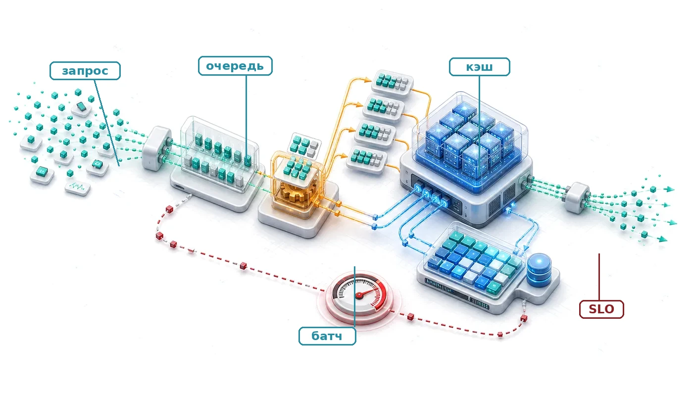
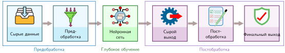
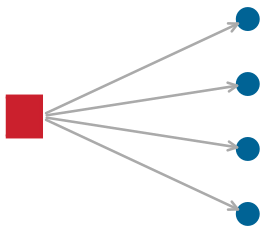
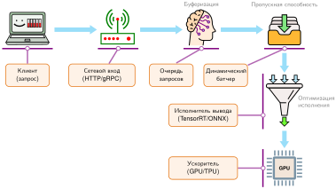
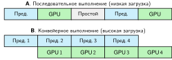
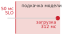
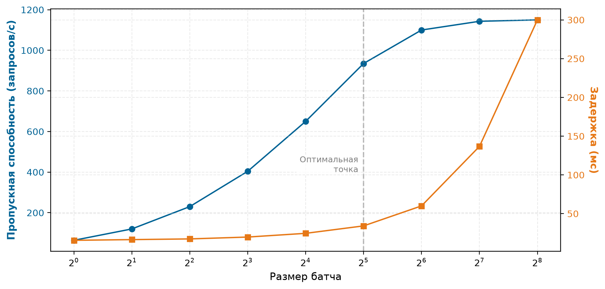
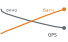
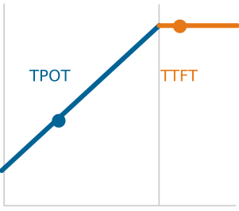

<a id="sec-model-serving"></a>

# Обслуживание моделей



## Назначение

_Почему обслуживание меняет приоритеты оптимизации, которые сделали обучение успешным?_

Обучение и обслуживание делают упор на разные эксплуатационные цели. Обучение обычно максимизирует пропускную способность на больших батчах и длинных запусках, а обслуживание должно отвечать на отдельные запросы в пределах целевых задержек. Обучение амортизирует стоимость аппаратуры на множестве примеров, а обслуживание платит налог за каждый запрос, и мелкие неэффективности накапливаются в операционный долг. Поэтому модели, которые эффективно обучаются, могут плохо обслуживаться. У работающей системы есть сквозной бюджет задержки, и очереди, предобработка, сетевая передача и постобработка способны съесть оптимизацию, которая касается только модели. Ориентированные на батчи архитектуры и оптимизации с высоким расходом памяти, призванные загрузить ускорители, могут не подходить для нерегулярного, чувствительного к задержке и дорогого в эксплуатации производственного трафика. Но обслуживание — это не только проблема задержки. Система обслуживания должна справляться с трафиком, который колеблется между пиком и спадом, держать запас на случай отказов, сбрасывать нагрузку или мягко деградировать при перегрузке и оставаться предсказуемой при изменении состава запросов и спроса. Модели, которые показали свою ценность при обучении и выдержали сжатие и бенчмаркинг, в конце концов попадают на уровень обслуживания — стадию развертывания и интеграции жизненного цикла ML. Вопрос смещается от того, работает ли модель, к тому, работает ли она надежно в масштабе и в производственных условиях. Инфраструктура обслуживания — место, где системы машинного обучения встречаются с пользователями, и поддержание этого взаимодействия требует иной инженерии, чем создание самой модели. Здесь же обученный алгоритм встречается с живыми данными в пределах бюджета задержки машины, и на каждом запросе сходятся все три ограничения D·A·M.

> **Цели обучения**
>
> - Объяснить инверсию обслуживания: переход от пропускной способности обучения к задержке отдельного запроса, запасу мощности и хвостовому поведению
> - Разложить задержку запроса на сериализацию, предобработку, вывод, очереди, постобработку и накладные расходы сети
> - Применить законы теории очередей и простые модели очередей для планирования мощности по перцентильным целевым задержкам
> - Диагностировать расхождение обучения и обслуживания и холодные старты, вызванные несовпадением предобработки, загрузки модели или поведением кэша
> - Выбрать стратегии батчинга, сброса нагрузки, автомасштабирования и среды выполнения под шаблоны трафика и бюджеты задержки
> - Оценить узкие места обслуживания LLM по задержке токенов, памяти KV-кэша и ограничениям непрерывного батчинга
> - Рассчитать стоимость одного вывода по точности, загрузке аппаратуры, числу реплик и пропускной способности среды выполнения

<a id="sec-model-serving-serving-paradigm-9634"></a>

## Парадигма обслуживания

Обслуживание модели **начинается там, где заканчивается бенчмаркинг**. Модель, оцененная в синтетических условиях тестовой обвязки, теперь должна генерировать предсказания под живым производственным трафиком. В офлайн-обучении системы максимизируют совокупную пропускную способность, собирая большие батчи, чтобы амортизировать передачу весов из высокоскоростной памяти (HBM) и загрузить матричные арифметические блоки. В онлайн-обслуживании запросы приходят стохастически от независимых клиентов и должны возвращаться в пределах жестких целей уровня обслуживания (SLO). Поэтому главный инженерный приоритет переворачивается: от долговременной пропускной способности к задержке отдельного запроса. Эта **инверсия обслуживания** перестраивает баланс членов железного закона систем машинного обучения ($T = \frac{D_{\text{vol}}}{\text{BW}} + \frac{O}{R_{\text{peak}} \cdot \eta_{\text{hw}}} + L_{\text{lat}}$). Когда приложение не может откладывать запросы ради сборки больших батчей, оно должно обрабатывать маленькие батчи или отдельные входы ($B=1$). Выполнение маленьких батчей обваливает арифметическую интенсивность и превращает матричные умножения, ограниченные вычислениями, в передачи, ограниченные пропускной способностью памяти ($D_{\text{vol}}/\text{BW}$). Одновременно член задержки $L_{\text{lat}}$ расширяется за пределы запусков ядер на ускорителе, длящихся микросекунды, и включает сетевую передачу, сериализацию запроса и оркестрацию на стороне хоста. Часто он становится связывающим ограничением для сквозного времени ответа.

Таксономия D·A·M показывает, как эта инверсия меняет каждый слой системы. На уровне данных ограничение смещается с общего объема набора данных на частоту поступления запросов, свежесть полезной нагрузки и переменные размерности последовательностей живых запросов. На уровне алгоритма выполнение становится строго однонаправленным: состояние обратного распространения и память оптимизатора исчезают с ускорителя, но динамические формы входа вносят изменчивость времени выполнения в ранее статические графы операторов. На уровне машины рабочая цель смещается от максимальной загрузки аппаратуры к **запасу** (headroom). Офлайн-обучение считает простаивающий ускоритель потраченным впустую мощностью, а онлайн-обслуживание считает работу почти на пределе эксплуатационным риском. Поскольку запросы приходят по стохастическим распределениям, длины очередей и времена ожидания растут нелинейно по мере приближения загрузки к 100 процентам. Поддержание достаточного запаса сохраняет свободную мощность, нужную для того, чтобы поглотить кратковременные всплески трафика, не нарушая перцентилей хвостовой задержки. Поэтому обслуживание оптимизирует завершенные запросы при жестком крайнем сроке задержки, а не устойчивую загрузку аппаратуры.

Соблюдение этого крайнего срока задержки определяет, как инженерные команды делят сквозной стек обслуживания. Бюджет задержки запроса включает три последовательных этапа: прием и предобработку на стороне хоста (завершение сети, десериализация полезной нагрузки, токенизация или преобразование признаков), выполнение ядер на ускорителе и последующую постобработку. Любая миллисекунда, потраченная на неоптимизированное получение признаков или задержки в очереди, напрямую вычитается из времени, выделенного самой нейронной сети. Поэтому центральная инженерная задача обслуживания моделей — решить, какие операции должны оставаться на синхронном пути запроса, какие задачи можно вынести в асинхронные фоновые конвейеры и сколько запаса система должна зарезервировать, прежде чем гарантии хвостовой задержки рухнут под нагрузкой.

<a id="sec-model-serving-load-latency-architecture-a4d8"></a>

## Нагрузка, задержка и архитектура обслуживания

<a id="exmp-model-serving-black-friday-traffic-spike"></a>

> **Пик трафика в «Черную пятницу»**
>
> **Сценарий**: Система обслуживания рекомендаций в интернет-магазине переживает всплеск трафика в 10 раз (10 000 QPS) во время распродаж в «Черную пятницу».
>
> **Диагностика**: Когда загрузка сервера приближается к 100 процентам, длины очередей растут нелинейно, задержка доходит до 10 с, и клиентские запросы истекают по таймауту.
>
> **Системный урок**: Высокая средняя пропускная способность не предотвращает коллапса очереди при всплесках трафика. В зависимости от сервиса сохранить цель по хвостовой задержке может помочь сброс нагрузки, мягкая деградация или автомасштабирование, и делать это нужно до того, как загрузка дойдет до точки излома очереди для данной нагрузки.

Системы онлайн-обслуживания обрабатывают переменные потоки запросов без батчинга и при этом работают под жесткими крайними сроками задержки. Когда всплески поступления исчерпывают зарезервированный запас, производительность деградирует нелинейно.

[«Взрывной рост хвостовой задержки»](13_model_serving.md#fig-tail-latency-explosion) показывает, что задержка остается управляемой при умеренной загрузке, а затем быстро растет по мере приближения системы к насыщению. Поэтому чувствительные к задержке системы резервируют запас, а не планируют постоянно насыщенный ускоритель. Раздел [«Распределения и длинный хвост»](appendix_data.md#sec-appdx-data-foundations-distributions-long-tail-901f) приложения «Основы данных» дает математическое описание распределений с длинным хвостом и объясняет, почему важна задержка на высоких перцентилях, когда SLO охватывает самые медленные запросы. Кривая — простое приближение теории очередей, предназначенное для понимания, а не для конкретной нагрузки.

<a id="fig-tail-latency-explosion"></a>


*Взрывной рост хвостовой задержки: задержка запроса в зависимости от загрузки сервиса $\rho_{\text{serv}}$. Средняя задержка (синяя) и приближение p99 (красная) растут нелинейно по мере приближения загрузки к насыщению; отметка 70 процентов — иллюстративный ориентир планирования, а не точка разрыва, выведенная из модели. Здесь использовано простое приближение M/M/1, введенное позже в разделе о теории очередей (p99 примерно в 4,6 раза больше среднего), поэтому кривая иллюстративна и не привязана к конкретной нагрузке.*

Помимо технических пределов задержки, экономика обслуживания тоже быстро изменилась. По мере того как модели становятся эффективнее, а аппаратура — специализированнее, стоимость одного вывода падает.[^fn-jevons-paradox-efficiency] Опыт Facebook в масштабе флота показывает, насколько велика эта проблема стоимости обслуживания.

[^fn-jevons-paradox-efficiency]: **Парадокс Джевонса**: Уильям Стэнли Джевонс отметил в 1865 году, что повышение эффективности паровых машин на угле увеличило общее потребление угля, поскольку паровая энергия стала экономически выгодной для применений, которые раньше были слишком дорогими (Jevons, 1865). То же может происходить и с выводом ИИ: каждое снижение стоимости в 10 раз открывает классы приложений, которые были экономически невозможны при прежней цене, и совокупный спрос растет сильнее, чем выигрыш в эффективности. Поэтому более дешевый вывод может увеличить, а не уменьшить общий спрос на парк GPU. В ИИ эффективность и спрос часто дополняют друг друга, а не заменяют.

<a id="exmp-model-serving-facebook-inference-tax"></a>

> **Налог на вывод в Facebook**
>
> **Сценарий**: Производственные системы ML-обслуживания в Meta выполняют десятки триллионов выводов в день в глобальных пользовательских сервисах (Hazelwood et al., 2018).
>
> **Диагностика**: Повторяющиеся затраты вычислений и энергии на обслуживание вывода многократно превышают первоначальные расходы на офлайн-обучение модели. Живые шаблоны поступления запросов и жесткие границы задержки ограничивают батчинг на GPU.
>
> **Системный урок**: Архитектуры, дешевые в обучении, могут оказаться неприемлемыми для обслуживания в масштабе флота. Производственная инфраструктура обслуживания требует совместного проектирования аппаратуры и программного обеспечения, чтобы сбалансировать хвостовую задержку, размер батча и совокупную стоимость владения, которая повторяется из месяца в месяц.

Та же экономическая нагрузка видна и в публичных ценах API. Логарифмическая траектория цен в [«Дефляции интеллекта»](13_model_serving.md#fig-intelligence-deflation) показывает скорость этого обвала стоимости: в ней отслеживаются представительные снимки публичных прайс-листов API как рыночный ориентир. Цены поставщиков часто меняются, поэтому эти точки стоит читать как историческое свидетельство тренда, а не как руководство по текущим закупкам (OpenAI, 2023a; OpenAI, 2023b; OpenAI Developer Community, 2024; OpenAI, 2024; Anthropic, 2024; Google Developers Blog, 2024; DeepSeek, 2024). Каждое падение на порядок меняет то, какие приложения осуществимы.

<a id="fig-intelligence-deflation"></a>


*Дефляция интеллекта: представительные публичные цены на входные токены API за 1 млн токенов (\$) во времени (логарифмическая шкала). Восемь точек, соответствующих версиям моделей, — снимки публичных страниц с ценами OpenAI, Anthropic, Google и DeepSeek за 2023–2025 годы; точка Legacy GPT-3.5 — иллюстративная отправная точка, а не задокументированный снимок версии модели. Ряд задуман как индикатор рыночного тренда, а не как контролируемое или актуальное сравнение цен. Цены на обработку API-токенов обрушились на несколько порядков, и это меняет экономику автоматизированных рабочих процессов ИИ.*

Две силы теперь формируют проблему обслуживания: хвостовая задержка, которая взрывается после прохождения точки излома очереди, и стоимость вывода, которая падает на порядки по мере роста эффективности. Вместе они заставляют дать формальное определение обслуживания, построенное вокруг задержки, а не пропускной способности.

<a id="dfn-model-serving-model-serving"></a>

> **Обслуживание моделей**
>
> ***Обслуживание моделей*** — это эксплуатационная фаза, которая предоставляет предсказания моделей конечным пользователям или нижестоящим системам при ограничениях по задержке, пропускной способности, доступности и стоимости.
>
> 1.  **Значение**: онлайн-обслуживание превращает приоритет пропускной способности при обучении ($\eta_{\text{hw}}$) в ограничение на задержку запроса $(L_{\text{lat}})$, что требует стека, спроектированного вокруг перцентиля, который задает его SLO.
> 2.  **Отличие**: в отличие от обучения модели, которое обычно обрабатывает запланированные батчи, обслуживание может обрабатывать стохастические онлайн-запросы, синхронизированные потоки или офлайн-батчи.
> 3.  **Типичная ошибка**: распространенное заблуждение состоит в том, что обслуживание — это «просто прямой проход». На самом деле это системная задача: выполнение модели — лишь один компонент стека, который может включать маршрутизацию запросов, балансировку нагрузки и преобразование данных.

SLO[^fn-slo-sla-serving] задает целевую задержку, которая формирует каждое архитектурное решение в стеке обслуживания и устанавливает жесткий временной бюджет, в пределах которого должна завершиться обработка каждого запроса. Когда сервер вывода получает запрос, выполнение модели составляет лишь один сегмент сквозного конвейера: сетевой прием, десериализация полезной нагрузки, преобразование признаков, планирование очереди и сериализация выхода занимают время до и после работы ускорителя. [«Конвейер вывода»](13_model_serving.md#fig-serving-inference-pipeline) показывает, что исходные входы проходят предобработку (классические вычисления), нейросетевой вывод (глубокое обучение) и постобработку (классические вычисления) до получения финальных выходов. Любой из этих этапов может стать узким местом задержки. [«Бюджет задержки»](13_model_serving.md#sec-model-serving-latency-budget-ef40) количественно показывает, куда уходит время, и выявляет неочевидный результат о том, какие этапы доминируют.

[^fn-slo-sla-serving]: **Целевой уровень обслуживания (SLO) и соглашение об уровне обслуживания (SLA)**: SLO — это *внутренняя* цель (например, «задержка p99 ниже 50 мс»), а SLA — *внешнее* договорное обязательство, нарушение которого может повлечь компенсации или штрафы. Команды часто задают SLO строже, чем SLA, чтобы сохранить запас безопасности. Для обслуживания ML на SLO могут влиять как качество задачи, так и задержка вывода, что создает многомерные цели: улучшение одного измерения (например, развертывание более крупной модели ради точности) может нарушить другое (задержку).

<a id="fig-serving-inference-pipeline"></a>



*Конвейер вывода: сервисы ML-обслуживания превращают сырые входы в финальные выходы через последовательные этапы: предобработку, вычисления нейронной сети и постобработку. Нейронная сеть — лишь один компонент; предобработка и постобработка делают сквозную задержку зависимой от большего, чем выполнение нейронной сети.*

Этот конвейер превращает обслуживание в задачу оркестрации: поскольку каждый этап расходует один и тот же бюджет задержки, оптимизация выполнения ядер на ускорителе дает убывающую отдачу, если преобразование данных или задержки в очередях доминируют. Прежде чем оптимизировать отдельный этап, система должна решить, вычисляются ли предсказания заранее или по запросу.

<a id="sec-model-serving-static-vs-dynamic-inference-e864"></a>

### Статический и динамический вывод

Решение о том, генерируются ли предсказания до пользовательского запроса или во время него, задает фундаментальный компромисс между офлайн-эффективностью аппаратуры и онлайн-гибкостью эксплуатации (Google, 2024). От этого выбора зависит, работает ли ускоритель в режиме, не ограниченном задержкой, или под жесткими крайними сроками задержки интерактивного цикла обслуживания.

<a id="sec-model-serving-static-inference-35f4"></a>

#### Статический вывод

Статический вывод (также называемый офлайн- или пакетным выводом) заранее вычисляет предсказания для ожидаемых входов и сохраняет их в хранилище выборки. Вынос выполнения модели целиком из пути пользовательского запроса меняет нижележащие аппаратные ограничения: поскольку у пакетных заданий нет дедлайнов на уровне миллисекунд, ускорители могут работать на максимальных размерах батча ($B \gg 1$). Большие батчи максимизируют арифметическую интенсивность, амортизируя передачу весов из HBM на тысячи примеров и не давая вычислительным ядрам простаивать. Когда клиент отправляет запрос (например, пользователь запрашивает ночью сгенерированный рейтинг рекомендаций), система обслуживания выполняет поиск «ключ — значение» с низкой задержкой, а не прямой проход на ускорителе. Основное эксплуатационное ограничение смещается с задержки ускорителя на емкость хранилища и свежесть данных: предвычисление предсказаний по всей области входов масштабируется комбинаторно ($O(|U| \times |I|)$ в рекомендательных системах), а устаревшие предсказания сохраняются до следующего обновления батча.

<a id="sec-model-serving-dynamic-inference-d2d5"></a>

#### Динамический вывод

Динамический вывод (также называемый онлайн- или реальным временем) вычисляет входы по запросу по мере их поступления. Выполнение по запросу обрабатывает произвольные, ранее не встречавшиеся входы в рамках схемы модели и сразу отражает новые развернутые веса без предвычисления. Однако выполнение модели непосредственно на пути пользовательского запроса подчиняет вывод строгому сквозному бюджету задержки (цели уровня обслуживания, или SLO). Поскольку пользовательские запросы приходят стохастически, среда выполнения обслуживания не может бесконечно откладывать выполнение, чтобы накопить большие батчи. Обслуживание запросов по одному или малыми батчами ($B=1$ до $B=4$) снижает арифметическую интенсивность и делает память узким местом: шина памяти должна передавать веса всех слоев из памяти в регистры ради лишь части вычислительной мощности аппаратуры, что напрямую повышает стоимость одного запроса. Это противоречие между интерактивным временем ответа и эффективностью аппаратуры делает динамическое обслуживание заметно дороже в расчете на запрос, чем офлайн-батчинг (пример [«Стоимость задержки»](13_model_serving.md#exmp-cost-latency)).

<a id="exmp-cost-latency"></a>

> **Стоимость задержки**
>
> Ограничения задержки напрямую определяют инфраструктурные расходы. Рассмотрим GPU-сервер, арендуемый за \$4 в час.
>
> Сценарий A (низкая задержка): батч размером 1.
>
> *   Задержка: 5 мс.
> *   Пропускная способность: 200 запр./с.
> *   Стоимость на миллион запросов: \$5,56.
>
> Сценарий B (высокая пропускная способность): батч размером 8.
>
> *   Задержка: 10 мс (вдвое больше из-за накладных расходов батчинга).
> *   Пропускная способность: 800 запр./с (вчетверо больше за счет параллельной эффективности).
> *   Стоимость на миллион запросов: \$1,39.
>
> **Системный вывод**: снижение задержки с 10 мс до 5 мс увеличивает счет за аппаратуру на 300 процентов. Инженеры должны оценить, создает ли это ускорение достаточную деловую ценность, чтобы оправдать рост стоимости в 4 раза.

Рассмотрим два сценария развертывания классификатора изображений ResNet-50. Статический подход подходит приложению для организации фотографий, которое ночью заранее классифицирует все изображения в библиотеке пользователя. При 10 000 фотографий и 5 мс на вывод пакетная обработка занимает около 50 с, а пользователи при просмотре получают классификацию мгновенно. Динамический подход подходит API модерации контента, которое должно классифицировать загруженные пользователями изображения в реальном времени, причем каждое изображение проходит полный конвейер предобработки, вывода и постобработки при бюджете задержки 100 мс. Производственная система классификации изображений может сочетать оба подхода: часто запрашиваемые изображения, например популярные товары или известные мемы, заранее классифицируются и кэшируются, а новые загрузки запускают динамический вывод.

Два режима поэтому оптимизируют разные режимы работы. Статический вывод максимизирует пропускную способность ускорителя и амортизирует затраты на выполнение во время офлайн-батчей, обменивая емкость хранилища на нулевую задержку вывода во время запроса. Динамический вывод минимизирует хвостовую задержку при стохастической конкурентной нагрузке, принимая меньшую загрузку ускорителя и более высокую стоимость запроса в обмен на обработку произвольных живых входов. Производственные архитектуры часто объединяют оба подхода в многоуровневую схему: статическое предвычисление кэширует частые или высоковероятные запросы, а динамический резерв обрабатывает новые или персонализированные запросы.

Обе модели стоимости, статическая и динамическая, традиционно предполагают фиксированный прямой проход: статический вычислительный граф выполняется один раз на запрос. Новые модели рассуждения меняют эту экономическую логику, сознательно тратя переменное количество вычислений на каждый запрос ради качества ответа.

<a id="psp-model-serving-looking-ahead-rise-inference-time-compute-system-2"></a>

> **Взгляд вперед: тратить больше вычислений на запрос**
>
> Традиционное обслуживание оптимизирует минимизацию задержки $(L_{\text{lat}} \to 0)$. Здесь цель оптимизации расширяется и включает качество ответа. Некоторые системы вычислений на этапе вывода сознательно тратят больше вычислительных циклов, чтобы повысить качество ответа. Генерация токенов часто ограничена пропускной способностью памяти при малых батчах, но большие батчи или длинные контексты могут сместить узкое место в сторону вычислений или трафика KV-кэша. Такие системы могут генерировать существенно больше токенов на запрос, включая промежуточные токены рассуждений или поиска, что увеличивает суммарные вычисления и энергию на один запрос.

Выполняет ли система один детерминированный прямой проход или расширенную траекторию рассуждений, решение о том, когда вычисляются предсказания, определяет только временное измерение обслуживания. Не менее важно пространственное измерение — где физически выполняется модель, — поскольку физическое размещение определяет ограничения иерархии памяти, сетевые границы и бюджет аппаратуры, доступный стеку обслуживания.

<a id="sec-model-serving-spectrum-serving-architectures-8966"></a>

### Спектр архитектур обслуживания

Хотя «обслуживание» часто подразумевает сетевой сервер, который обрабатывает API-запросы, архитектурный шаблон зависит от среды развертывания. [«Рамка парадигм развертывания»](02_ml_systems.md#sec-ml-systems-deployment-paradigm-framework-0d25) ввела четыре парадигмы развертывания (облако, периферию, мобильные устройства и TinyML) и физические ограничения (световой барьер, стену мощности и стену памяти), из которых они возникают. Архитектурно обслуживание охватывает непрерывный спектр: от **централизованных сетевых микросервисов** (которые объединяют ускорители, чтобы оптимизировать пропускную способность и стоимость запроса, ценой накладных расходов на сетевые обращения и задержки холодного старта) до **встроенного в приложение периферийного обслуживания** (которое запускает модели внутри клиентских процессов через прямые вызовы функций, устраняя сетевую задержку и сохраняя приватность, но ценой жестких ограничений памяти и энергопотребления устройства) и далее до **выполнения прошивки на голом железе** на микроконтроллерах. Эти ограничения не исчезают на этапе обслуживания: обслуживание добавляет к аппаратным пределам, которые обучение могло поглотить терпением, еще и задержки SLO и давление стоимости. Одна и та же модель может требовать разных стратегий обслуживания в зависимости от того, где она выполняется.

<a id="sec-model-serving-networked-serving-clouddatacenter-0328"></a>

#### Сетевое обслуживание (облако и центр обработки данных)

При сетевом обслуживании модель работает как отдельный сервис (микросервис). Так выглядит облачная парадигма, которую [«Облачное ML: вычислительная мощность»](02_ml_systems.md#sec-ml-systems-cloud-ml-maximizing-computational-power-a338) описывала как обмен задержки на большую объединенную вычислительную мощность. Основной интерфейс — сеть, по таким протоколам, как HTTP или gRPC, поэтому сетевая передача и сериализация наряду с выполнением модели могут стать связывающими ограничениями. Серверное оборудование, например GPU NVIDIA (V100, A100, H100), тензорные процессоры Google (TPU) и AWS Inferentia, поддерживает высокопроизводительный батчинг и конкурентность, но холодный старт все равно может растягиваться от секунд до минут, потому что запуск контейнера, загрузка модели и прогрев находятся вне пути установившегося вывода.

<a id="sec-model-serving-applicationembedded-serving-mobileedge-8bd1"></a>

#### Встроенное в приложение обслуживание (мобильные устройства и периферия)

При встроенном обслуживании модель работает внутри процесса пользовательского приложения (например, приложения на смартфоне, использующего CoreML или TensorFlow Lite), следуя встроенной парадигме, которую [«Периферийное ML: задержка и приватность»](02_ml_systems.md#sec-ml-systems-edge-ml-reducing-latency-privacy-risk-2625) и [«Мобильное ML: автономный интеллект»](02_ml_systems.md#sec-ml-systems-mobile-ml-personal-offline-intelligence-0983) разбирали с точки зрения задержки, приватности и автономной работы. Сервера здесь нет. Интерфейс — вызов функции, поэтому оптимизация сосредоточена на энергопотреблении и отзывчивости (SingleStream), а не на пропускной способности общего сервера.

Встроенное выполнение позволяет делать **вывод без копирования** (zero-copy inference). Когда данные проходят через систему, каждая копия расходует такты процессора и пропускную способность памяти. В облачном обслуживании раздельные физические пространства памяти вынуждают повторные передачи: кадр камеры проходит из буфера сетевого сокета в пользовательское пространство, затем через буфер предобработки в закрепленную оперативную память хоста и по PCIe — в память ускорителя. Мобильный конвейер может исключить эти промежуточные копии, если камера, процессор обработки изображений (ISP), CPU и NPU обмениваются дескрипторами общих буферов в единой системной памяти. В архитектурах system-on-chip (SoC) с единой памятью, таких как процессоры Apple серий A и M или Qualcomm Snapdragon, все вычислительные блоки используют один физический пул DRAM. Когда программа передает дескрипторы буферов вместо дублирования байтов, задержка вывода снижается, а мощность шины памяти падает, хотя преобразования формата все равно могут требовать участия CPU или ISP.

Типичная аппаратура включает мобильные NPU (Apple Neural Engine, Qualcomm Hexagon) и встроенные GPU (NVIDIA Jetson). Если модель уже находится в памяти и скомпилирована, запуск занимает миллисекунды; первый вывод длится дольше, если он вызывает страничные ошибки холодной памяти или компиляцию «на лету» (just-in-time). Тепловой и энергетический бюджет мобильных устройств жестко ограничен пассивным охлаждением (1–10 Вт). Длительный высокопроизводительный вывод насыщает тепловую емкость корпуса устройства, и системный термоконтроллер вынужден снижать тактовую частоту, ухудшая задержку вывода.

<a id="sec-model-serving-baremetal-serving-tinyml-28cf"></a>

#### Обслуживание на голом железе (TinyML)

При TinyML-обслуживании модель компилируется прямо в прошивку микроконтроллера. Это крайний конец спектра развертывания, который [«TinyML: повсеместное восприятие»](02_ml_systems.md#sec-ml-systems-tinyml-ubiquitous-sensing-scale-a67b) описывала как повсеместное сенсорное восприятие при бюджетах мощности в микроватты. Многие развертывания не имеют универсальной операционной системы или динамического распределителя памяти: обслуживание выполняется как плотный цикл на голом железе, который опрашивает датчики и вызывает статический интерпретатор. Поскольку статическая оперативная память (SRAM) ограничена сотнями килобайт, оптимизация сосредоточена на выполнении весов модели на месте из энергонезависимой флеш-памяти, а динамические буферы активаций размещаются в заранее выделенной Tensor Arena. Батчинг запросов невозможен при потоках от одиночных датчиков. Типичная аппаратура включает микроконтроллеры серии ARM Cortex-M, ESP32 и специализированные ускорители TinyML. Задержка запуска измеряется микросекундами, когда веса остаются в отображаемой в память флеш-памяти, а буферы выполнения выделены статически; работа укладывается в бюджет мощности от микроватт до милливатт, который обеспечивает работу от батареи в течение месяцев или лет.

Уровни развертывания различаются прежде всего рабочими диапазонами. [«Спектр архитектур обслуживания»](13_model_serving.md#tbl-serving-spectrum) сравнивает ограничения по задержке, размеру батча, памяти, мощности, обновлению, отказам и мониторингу, которые следуют из каждой среды.

| **Характеристика**   | **Облако / ЦОД**      | **Мобильные / периферия** | **TinyML**                  |
|:---------------------|:----------------------|:--------------------------|:----------------------------|
| **Целевая задержка** | 10–100 мс             | 20–50 мс                  | 1–100 мс                    |
| **Размер батча**     | 1–128 (динамический)  | 1 (фиксированный)         | 1 (фиксированный)           |
| **Память**           | 16–80 ГБ VRAM         | 2–8 ГБ общей памяти       | 256 КБ–2 МБ SRAM            |
| **Мощность**         | 300–700 Вт            | 1–10 Вт                   | 1–100 мВт                   |
| **Механизм обновления** | Развертывание контейнера | Обновление через магазин приложений | Беспроводное обновление прошивки (OTA) |
| **Режим отказа**     | Повтор / переключение на резерв | Мягкая деградация | Молчаливый сбой или перезагрузка |
| **Мониторинг**       | Полная телеметрия     | Ограниченная аналитика    | Только сигнал «жизни» (heartbeat) |

<a id="tbl-serving-spectrum"></a>

*Спектр архитектур обслуживания: типичные рабочие диапазоны для облачного, мобильного и TinyML-обслуживания. Диапазоны задержки, размера батча, памяти и мощности — это ориентиры проектирования, а не универсальные пределы; строки об обновлении, отказах и мониторинге описывают типичный режим работы в каждой среде.*

<a id="psp-resnet-serving"></a>

> **ResNet-50 на всем спектре обслуживания**
>
> **Системный вывод**: утверждение «та же модель» вводит в заблуждение. Облачный и мобильный уровни используют один граф ResNet-50, но разные точности и среды выполнения, а TinyML-уровень не может запустить ResNet-50 и подставляет архитектуру, спроектированную под его ограничения. Если считать их одной моделью, скрывается работа, которая делает каждое развертывание возможным.

Применяя эти диапазоны к одной задаче классификации изображений, [«Классификация изображений на всем спектре обслуживания»](13_model_serving.md#tbl-resnet-serving-spectrum) показывает, почему облако и мобильные устройства могут адаптировать ResNet-50, а TinyML должен заменить ее на MobileNetV2.

| **Измерение**           | **`Облако`**                                                 | **`Мобильное`**                                              | **`TinyML`**                                                 |
|:------------------------|:------------------------------------------------------------|:------------------------------------------------------------|:------------------------------------------------------------|
| **Формат модели**       | TensorRT, движок FP16 (51,2 МБ)                           | TensorFlow Lite, INT8 (25,6 МБ)                           | Не осуществимо (25,6 МБ); альтернатива: MobileNetV2, INT8 (3,5 МБ) |
| **Вывод (батч 1)**      | 1,4 мс (батч 16: 14 мс)                                 | 12 мс (NPU), 45 мс (CPU)                                | 120 мс                                                    |
| **Пропускная способность** | 1 143 изобр./с (с батчингом)                           | около 80 изобр./с (одиночный поток)                       | около 8 изобр./с                                          |
| **Память**              | 2 ГБ VRAM (батч 32)                                       | 150 МБ пикового объема (общая с приложением)              | 320 КБ арены (помещается в 512 КБ SRAM)                 |
| **Энергия на вывод**    | —                                                           | 0,8 мДж (NPU), 4,2 мДж (CPU)                            | 12 мДж                                                    |

<a id="tbl-resnet-serving-spectrum"></a>

*Классификация изображений на всем спектре обслуживания: иллюстративное сравнение облачного, мобильного и TinyML-обслуживания для одной и той же задачи классификации изображений. Видно, как формат модели, задержка, пропускная способность, объем памяти и энергетический бюджет различаются в разных контекстах развертывания.*

<a id="sec-model-serving-load-balancer-layer-9c4d"></a>

### Уровень балансировщика нагрузки

Когда трафик превышает возможности одной машины, облачные развертывания и развертывания в центрах обработки данных, которые запускают несколько реплик одной модели, требуют дополнительного инфраструктурного уровня: балансировщика нагрузки. Производственные системы обслуживания размещают балансировщики между клиентами и серверами моделей, обеспечивая три важные функции инфраструктуры обслуживания.

Балансировщик нагрузки для обслуживания выполняет три основные задачи. Во-первых, распределение запросов направляет входящий трафик доступным репликам модели по таким алгоритмам, как round-robin или наименьшее число соединений; отведение трафика от медленных или перегруженных реплик напрямую сдерживает хвостовую задержку. Во-вторых, мониторинг работоспособности проверяет готовность реплики, инспектируя как живость процесса, так и состояние инициализации модели. Он подтверждает, что веса загружены и прогревочные проходы завершены, прежде чем пропустить трафик. В-третьих, поддержка развертывания позволяет проводить поэтапные выкаты, постепенно переводя трафик между версиями модели, а не переключая его резко. Раздел [«Развертывание модели»](14_ml_ops.md#sec-ml-operations-model-deployment-b9b9) главы «MLOps» расширяет эти механизмы переключения трафика до полных стратегий проверки.

Для обслуживания на одной машине с несколькими экземплярами модели, например при запуске нескольких сессий ONNX Runtime, очередями запросов управляют фреймворк и операционная система. Полная сложность балансировки нагрузки становится необходимой при масштабировании до распределенных систем вывода, где несколько машин обслуживают одну модель. Детали алгоритмов распределения запросов и архитектур с множеством реплик относятся к этому распределенному контексту.

В планировании мощности для одной машины единица обслуживания соответствует пропускной способности модели на физическом узле. Динамика очередей, разобранная в [«Теория очередей»](13_model_serving.md#sec-model-serving-queuing-theory-tail-latency-29a6), определяет это базовое поведение и задает границы загрузки, при которых горизонтальное масштабирование становится обязательным.

Балансировщики нагрузки распределяют запросы *между репликами*, но предсказуемая задержка требует также контроля того, что происходит *внутри каждой машины*. Операционная среда вносит собственные источники изменчивости.

<a id="sec-model-serving-deterministic-latency-resource-isolation-4d1c"></a>

### Детерминированная задержка и изоляция ресурсов



*Один шумный сосед возмущает каждую нагрузку, которая делит с ним узел.*

Сервер вывода не работает в выделенной пустоте. На одном хосте операционная система мультиплексирует аппаратуру между фоновыми демонами телеметрии, агентами журналирования и рабочими потоками ядра. Когда эти неизолированные процессы конкурируют за ресурсы выполнения, они время от времени вытесняют конвейер вывода. Эти **шумные соседи** — основной источник **джиттера задержки** (latency jitter), при котором физическое время выполнения одинаковых прямых проходов непредсказуемо колеблется. Эта конкуренция раздувает хвостовую задержку на 99-м перцентиле (p99), даже когда средняя загрузка аппаратуры остается низкой. Конкуренция за ресурсы, таким образом, расширяет хвостовую задержку через разброс времени обслуживания. Это физическая деградация, отличная от накопления задержки в очереди, которое разбирается в [«Взрывном росте хвостовой задержки»](13_model_serving.md#fig-tail-latency-explosion).

Для детерминированной производительности нужно устранить помехи от эвристик разделения времени, которые операционная система использует по умолчанию. Системы обслуживания, такие как Clockwork, показывают, что время выполнения глубоких нейронных сетей (DNN) по своей природе предсказуемо вплоть до субмиллисекундных допусков, если аппаратная конкуренция систематически устранена (Gujarati et al., 2020). Привязка потоков к ядрам (CPU affinity, закрепление потоков) задает базовую границу вычислений: рабочие потоки вывода привязываются к назначенным физическим ядрам. Без закрепления планировщик ОС периодически переносит потоки между ядрами, инвалидируя приватные кэши L1 и L2, и выполнение останавливается, пока строки заново загружаются из общего кэша L3 или DRAM. В многосокетных архитектурах перенос потоков через границы неоднородного доступа к памяти (NUMA) наказывает еще сильнее: инструкциям приходится обращаться к памяти через межсокетные соединения, добавляя десятки наносекунд задержки на каждую транзакцию. Закрепление потоков за конкретными ядрами и привязка их выделений памяти к локальным узлам NUMA сохраняют присутствие данных в кэше и устраняют межсокетный трафик шины.

Даже при закрепленных ядрах CPU задержка доступа к памяти остается уязвимой для подсистемы виртуальной памяти. При нехватке памяти на хосте ядро может выгружать неактивные диапазоны адресов на диск. Когда CPU или движок прямого доступа к памяти (DMA) через PCIe обращается к выгруженному адресу, выполнение останавливается на миллисекунды, пока контроллер хранилища возвращает физическую страницу в DRAM. Блокировка памяти (`mlock`) заставляет ядро закрепить заданные диапазоны виртуальных адресов в физической оперативной памяти хоста. Это отключает вытеснение страниц и гарантирует немедленный доступ к весам, буферам подготовки входов и выгруженным блокам KV-кэша, которые находятся в памяти хоста. Такая гарантия меняет гибкость физической памяти хоста на детерминизм, поскольку закрепленные страницы не могут быть отобраны другими процессами. Поскольку `mlock` действует строго на таблицы страниц хоста, он не распространяется на HBM ускорителя, которая выделяется напрямую драйвером ускорителя.

Помимо запланированных процессов, асинхронные аппаратные прерывания создают еще один источник вытеснения длительностью в доли миллисекунды. Когда сетевая карта (NIC) получает пакетные всплески, она запускает запросы аппаратных прерываний (IRQ), которые заставляют обрабатывающее ядро CPU немедленно приостановить выполнение пользовательского пространства и обработать обработчики прерываний ядра. Если операционная система направляет эти прерывания на ядра, которые выполняют цикл отправки движка вывода, CPU приостанавливает отправку команд ускорителю. Поскольку GPU обрабатывает короткие слои вывода за микросекунды, даже кратковременные остановки отправки на CPU опустошают аппаратный кольцевой буфер команд ускорителя и вызывают пузыри в конвейере, когда вычислительные блоки простаивают в ожидании следующего дескриптора ядра. Экранирование прерываний (interrupt shielding) ограничивает привязку IRQ выделенными служебными ядрами, не давая входящему сетевому трафику и дисковой активности вытеснять поток отправки на GPU.

Изоляция физических ядер, блокировка памяти хоста и экранирование линий прерываний устраняют шум операционной системы и превращают неровные пути выполнения в предсказуемые детерминированные прямые проходы. Однако обеспечение детерминизма времени обслуживания на одном узле решает лишь половину задачи обслуживания. Аппаратная изоляция гарантирует, что ядро ускорителя выполняется без вмешательства хоста, но последовательная обработка одиночных запросов оставляет огромные тензорные вычислительные конвейеры сильно недогруженными. Чтобы достичь высокой пропускной способности в пределах крайних сроков задержки, внутренняя программная архитектура движка обслуживания должна координировать нерегулярные асинхронные потоки запросов в структурированные батчи, которые насыщают аппаратуру.

<a id="sec-model-serving-serving-system-architecture-4879"></a>

## Архитектура системы обслуживания

Пока изоляция хоста обеспечивает детерминированное выполнение отдельных ядер, производственное обслуживание сталкивается с рассогласованием на границе системы. Пользовательские запросы приходят стохастически: всплесками с интервалом в миллисекунды, затем секундами тишины. Вычислительные движки ускорителя, напротив, требуют непрерывных потоков однородных плотных батчей, чтобы насытить пропускную способность памяти и функциональные блоки. Чтобы закрыть этот разрыв, нужна специализированная архитектура обслуживания, которая отделяет сетевой прием от планирования выполнения, поглощает всплески поступления и упаковывает нерегулярные входы в плотные батчи, не нарушая SLO задержки.

<a id="sec-model-serving-anatomy-inference-server-f12e"></a>

### Внутренняя архитектура и поток запросов

Сервер вывода[^fn-inference-server-serving] (например, NVIDIA Triton или TensorFlow Serving) работает как специализированный планировщик среды выполнения, который управляет конкурентностью, памятью устройства и переносом данных между CPU хоста и ускорителями. Вместо того чтобы вызывать выполнение модели синхронно при поступлении запроса, сервер пропускает входящие запросы через выделенные подсистемы, которые изолируют сетевую обработку клиентов от вычислений ускорителя. Каждый запрос проходит многоэтапный конвейер, спроектированный так, чтобы максимизировать пропускную способность аппаратуры и ограничивать задержку в очереди. [«Анатомия сервера вывода»](13_model_serving.md#fig-server-anatomy) разделяет шесть этапов, так что роль каждого компонента в поглощении трафика, постановке в очередь, батчинге и выполнении на ускорителе становится явной.

[^fn-inference-server-serving]: **Сервер вывода**: TensorFlow Serving от Google (Olston et al., 2017) помог утвердить разделение логики модели и инфраструктуры обслуживания; Triton от NVIDIA (NVIDIA, 2024b) расширяет этот шаблон на несколько фреймворков моделей и бэкендов. Ключевая инженерная идея в том, что планировщик и динамический батчер превращают нерегулярный трафик одиночных запросов в выполнение, удобное для ускорителя, и повышают загрузку, когда бюджеты задержки допускают батчинг. Точный прирост загрузки зависит от модели, аппаратуры, интенсивности поступления и настроенного окна батчинга.

<a id="fig-server-anatomy"></a>



*Анатомия сервера вывода: современный сервер вывода отделяет сетевую обработку от выполнения на ускорителе через поэтапный конвейер. Каждый этап изолирует отдельную задачу, от поглощения всплесков трафика до формирования эффективных батчей, поэтому ускоритель остается сильно загруженным, несмотря на нерегулярные шаблоны поступления.*

Эта архитектура выполняет три основные функции.

Первая — управление конкурентностью. Движки обслуживания используют асинхронные циклы событий (такие как `epoll` или `kqueue`) и пулы рабочих потоков, чтобы обрабатывать тысячи одновременных клиентских TCP-соединений без блокировки потоков выполнения. Изоляция сетевого ввода-вывода клиентов гарантирует, что медленные или зависшие передачи по сети никогда не вызовут простоя вычислительного конвейера ускорителя.

Вторая — преобразование запросов. Сервер декодирует сериализованные сетевые полезные нагрузки в непрерывные выровненные буферы памяти, соответствующие раскладке тензора, которую требует базовый движок выполнения. Например, четырехмерные тензоры изображений могут использовать формат NCHW[^fn-nchw-nhwc-serving] или NHWC. На современных ускорителях блоки матричного умножения (тензорные ядра, Tensor Cores) загружают векторы каналов из 8 или 16 элементов объединенными (coalesced) транзакциями памяти, которые благоприятствуют раскладке «каналы последними» (NHWC). Если входящие полезные нагрузки приходят в NCHW, сервер или хост должен выполнить явное ядро транспонирования (`torch.permute` или собственное CUDA-транспонирование). Поскольку транспонирование тензора не выполняет никаких операций с плавающей точкой ($I \approx 0$ FLOP/байт), оно строго ограничено пропускной способностью памяти, расходует пропускную способность памяти хоста или PCIe и напрямую подтачивает бюджет задержки.

[^fn-nchw-nhwc-serving]: **NCHW и NHWC (раскладки тензоров в памяти)**: эти аббревиатуры кодируют порядок измерений четырехмерных тензоров изображений: N (батч), C (каналы), H (высота) и W (ширина). В непрерывном тензоре NCHW каждая плоскость канала непрерывна; в NHWC каналы для одной пространственной позиции расположены рядом. Оптимизированные ядра могут предпочитать любую раскладку, а семантическое несоответствие может перепутать значения, даже если число элементов правильное. Поэтому код обслуживания должен явно указывать и смысл измерений, и любое преобразование физической раскладки.

Третья — управление жизненным циклом модели. Среда выполнения распределяет память устройства (VRAM), закрепляет буферы памяти хоста для DMA, загружает контрольные точки параметров модели и выполняет прогревочные прямые проходы, чтобы скомпилировать графы выполнения и инициализировать контексты CUDA до пропуска живого клиентского трафика. Корпоративные реестры моделей, канареечные выпуски и политики отката относятся к главе [«MLOps»](14_ml_ops.md#sec-ml-operations). Движок обслуживания управляет локальным состоянием: проверяет, что активные экземпляры модели прогреты, находятся в памяти ускорителя и готовы к отправке.

Планировщик (**scheduler**) координирует переход между буферизацией запросов и выполнением на ускорителе, реализуя динамический батчинг ([«Оптимизация пропускной способности»](13_model_serving.md#sec-model-serving-throughput-optimization-18d1)). При размере батча $N=1$ вывод жестко ограничен пропускной способностью памяти: ускоритель должен перенести все параметры модели из HBM в SRAM на кристалле, чтобы выполнить один прямой проход, и вычислительные блоки простаивают. Объединение $B$ запросов в одновременный батч амортизирует побайтовые передачи при чтении весов модели на все $B$ входов и повышает арифметическую интенсивность ($I = \text{FLOP} / \text{переданные байты}$).

Чтобы сбалансировать задержку отдельного запроса с эффективностью батчевых вычислений, планировщик настраивает время пребывания в очереди через **окно батчинга** (или порог тайм-аута). Нулевое окно дает чистое выполнение FIFO без задержки в очереди, но подвергает ускоритель недозагрузке и ограничению по памяти при малом батче. Напротив, ограниченное окно (например, 2–5 мс) позволяет планировщику буферизовать поступающие запросы, пока очередь не достигнет целевого размера батча или не истечет тайм-аут. Этот механизм обменивает ограниченную задержку в очереди на более высокую арифметическую интенсивность, амортизируя трафик шины памяти и повышая устойчивую пропускную способность кластера.

<a id="sec-model-serving-interface-protocols-serialization-5510"></a>

### Протоколы взаимодействия и сериализация

По мере того как ядра ускорителя проходят агрессивную компиляцию (через TensorRT, TorchDynamo или собственные ядра), время выполнения на устройстве часто опускается ниже одной миллисекунды. По закону Амдала, когда время вычислений сокращается, накладные расходы хоста на прием, передачу и десериализацию полезной нагрузки становятся доминирующим членом сквозной задержки.

<a id="sec-model-serving-serialization-bottleneck-aaa0"></a>

#### Узкое место сериализации

Полезные нагрузки ML принципиально отличаются от полезных нагрузок обычных веб-API: они состоят из многомерных массивов чисел с плавающей точкой (таких как тензоры изображений, плотные векторы эмбеддингов или логиты последовательностей токенов). Хотя текстовый JSON повсеместен в веб-сервисах, сериализация плотных числовых массивов в текст несет серьезные штрафы по CPU и памяти. Накладные расходы сериализации возникают потому, что парсеры JSON должны последовательно просматривать каждый байт, проверять синтаксис, выделять узлы в куче и вызывать процедуры преобразования строки в число с плавающей точкой (такие как `strtod`). Каждое 32-битное число с плавающей точкой раздувается с 4 исходных байтов до 7–15 ASCII-символов с учетом знаков препинания. Кроме того, сырые двоичные данные (например, сжатый JPEG или сырые байты изображения) требуют кодирования Base64, чтобы передаваться внутри строк JSON, что добавляет 33 процента размера еще до начала разбора.

Двоичные форматы сериализации, такие как Protocol Buffers[^fn-protobuf-serialization-overhead] и FlatBuffers,[^fn-flatbuffers-zerocopy-deserialization] обходят эту налоговую нагрузку текстового преобразования. Массивы чисел с плавающей точкой передаются напрямую как упакованные потоки байтов IEEE 754 без ASCII-преобразования и без кадрирования Base64. Кроме того, FlatBuffers организует сериализованные записи с внутренними относительными смещениями, что обеспечивает десериализацию без копирования (zero-copy): приложение обслуживания читает размерности тензора, типы данных и байтовые смещения прямо из сетевого приемного буфера, не выделяя промежуточного объектного графа в куче.

[^fn-protobuf-serialization-overhead]: **Protocol Buffers (Protobuf)**: Protobuf использует заранее заданную схему (из файла `.proto`), чтобы кодировать структурированные данные в компактный двоичный формат (Protocol Buffers Authors, 2026). Поскольку схема несет имена и типы полей, полезная нагрузка на проводе не должна повторять их, как это делает JSON. Однако проводной формат все еще не совпадает с расположением объекта C++ в памяти, поэтому требуется шаг разбора, и он не дает такого же прямого доступа без копирования, на который нацелен FlatBuffers.

[^fn-flatbuffers-zerocopy-deserialization]: **FlatBuffers**: слово «flat» в названии описывает конструкцию: двоичный буфер может служить и сериализованным представлением, и читаемой структурой данных, избавляя от отдельной фазы разбора или распаковки для поддерживаемых шаблонов доступа (FlatBuffers Authors, 2026). Для ML-вывода это может дать доступ без копирования к метаданным тензора: система обслуживания читает формы тензоров и смещения прямо из буфера, а не выделяет второе объектное представление.

<a id="sec-model-serving-rest-vs-grpc-c7b7"></a>

#### REST и gRPC

Выбор транспортного протокола определяет жизненные циклы соединений и мультиплексирование сокетов. Традиционные REST API обычно используют HTTP/1.1 с полезными нагрузками JSON. При HTTP/1.1 конкурентные запросы требуют открытия нескольких параллельных TCP-соединений, и каждое из них несет трехстороннее рукопожатие, согласование TLS и разгон окна медленного старта TCP. Кроме того, HTTP/1.1 страдает от блокировки по головному элементу (head-of-line blocking) на транспортном уровне: запросы на одном соединении должны обслуживаться последовательно. Хотя REST API могут переходить на HTTP/2 или двоичные кодировки, сочетание HTTP/1.1 и JSON создает значительные накладные расходы на сокеты и конкуренцию за разбор на CPU при обслуживании высокопроизводительных тензорных нагрузок.

Напротив, gRPC (gRPC Remote Procedure Call)[^fn-grpc-inference-protocol] сочетает транспорт HTTP/2 с сериализацией Protocol Buffers. HTTP/2 устанавливает одно долгоживущее TCP-соединение и мультиплексирует сотни одновременных потоков запросов и ответов с помощью двоичного кадрирования. Эта архитектура устраняет установку соединения для каждого запроса и блокировку по головному элементу на транспортном уровне, а Protobuf обеспечивает строго типизированные контракты и эффективно сериализует двоичные тензорные полезные нагрузки. Поэтому gRPC — стандартный протокол для внутренней связи микросервисов в кластерах обслуживания моделей, где основными критериями проектирования являются низкая задержка, компактные проводные полезные нагрузки и двунаправленная потоковая передача токенов.

[^fn-grpc-inference-protocol]: **gRPC (gRPC Remote Procedure Call)**: gRPC сочетает транспорт HTTP/2 с языком описания интерфейсов и форматом сообщений, чаще всего Protocol Buffers (gRPC Authors, 2026). Важное преимущество для обслуживания — сочетание типизированных контрактов, постоянных мультиплексированных соединений, поддержки потоковой передачи и компактных двоичных сообщений. Выигрыш по размеру и задержке по сравнению с REST/JSON зависит от формы полезной нагрузки, реализации клиента и сервера, а также от того, является ли сериализация заметной долей сквозного бюджета задержки.

Конкретное сравнение полезных нагрузок показывает, как формат сериализации меняет размер на проводе и накладные расходы разбора на CPU хоста.

<a id="nbk-model-serving-json-vs-protobuf-serialization"></a>

> **Сериализация: JSON и Protobuf**
>
> Рассмотрим полезную нагрузку запроса, которая содержит 1 000 чисел с плавающей точкой (например, вектор эмбеддинга).
>
> *   **JSON**: занимает около 9 КБ в сети. Для разбора требуется около 50 мкс.
> *   **Protobuf**: занимает около 4 КБ в сети. Для разбора требуется около 5 мкс.
>
> **Расчет**: переход одного запроса на двоичную полезную нагрузку экономит 50 мкс − 5 мкс = 45 мкс времени разбора. Для этой иллюстративной системы, которая обрабатывает 10 000 запросов в секунду, экономия накапливается до 10 000 × 45 мкс = 0,45 с процессорного времени, высвобождаемого каждую секунду реального времени. Это 45 процентов одного ядра, освобожденного только от накладных расходов сериализации.
>
> **Системный вывод**: выигрыш в 10 раз по времени разбора делает gRPC/Protobuf, FlatBuffers или другой двоичный протокол сильным кандидатом для высокопроизводительных внутренних микросервисов, когда сериализация заметна в бюджете задержки.

Выбор архитектуры определяется системными ограничениями. REST поверх HTTP/1.1 остается практичным для публичных периферийных шлюзов, где широкая совместимость с клиентами и читаемость для отладки важнее сырой эффективности передачи. Внутри границ кластера gRPC поверх HTTP/2 с двоичной сериализацией становится обязательным, когда высокий объем запросов, мультиплексирование постоянных соединений или потоковая передача токенов грозят исчерпать такты CPU хоста на налог сериализации.

Выбор протокола и архитектура процессов задают структурный каркас сервера вывода. Однако для оценки реальной операционной производительности нужно проследить, как задержка накапливается, когда отдельные запросы проходят каждый этап этого конвейера выполнения.

<a id="sec-model-serving-request-lifecycle-d9c6"></a>

## Жизненный цикл запроса

Один HTTP-запрос с JPEG-изображением $224{\times}224$ поступает на сервер вывода. Между моментом, когда первый байт входит в сетевой стек, и моментом, когда полезная нагрузка с результатом классификации уходит обратно, запрос проходит шесть различных этапов конвейера. Каждый этап расходует часть сквозного бюджета задержки, поэтому для целенаправленной настройки производительности необходима детальная декомпозиция по фазам.

<a id="sec-model-serving-latency-budget-ef40"></a>

### Бюджет задержки

Для систем динамического вывода инверсия обслуживания, установленная в [«Парадигме обслуживания»](13_model_serving.md#sec-model-serving-serving-paradigm-9634), создает бюджет задержки, который определяет проектирование системы (Gujarati et al., 2020). Система обслуживания с задержкой на уровне секунд на запрос может не выполнить многие интерактивные SLO, даже если она обеспечивает отличную пропускную способность.

Значимые метрики расширяются от совокупной пропускной способности и средней задержки до распределения задержек. Среднее и p50 описывают центр распределения, а p95 и p99 выявляют медленный хвост. Если средняя задержка составляет 50 мс, а p99 — две секунды, порог p99 в 40 раз превышает среднюю задержку, поэтому около 1 процента запросов занимают не меньше двух секунд. Важно ли такое хвостовое поведение, зависит от сервиса и его пользователей, поэтому целевые перцентили должны выводиться из SLO, а не из традиции.[^fn-tail-latency-serving]

[^fn-tail-latency-serving]: **Хвостовая задержка**: в отличие от средних значений, перцентильные задержки выявляют влияние выбросов, характерных для обслуживания ML, например промахов кэша модели или пауз сборщика мусора. Эти редкие запросы с высокой задержкой могут непропорционально ухудшать удовлетворенность пользователей и бизнес-результаты. Поскольку величина зависит от нагрузки, сервисы проверяют целевые перцентили (p95, p99) по собственным пользователям и SLO.

Управление этими ограничениями на перцентили требует разложить полное допустимое время ответа на **бюджет задержки**, который распределяет время между каждой фазой обработки.

<a id="dfn-model-serving-latency-budget"></a>

> **Бюджет задержки**
>
> ***Бюджет задержки*** — это время, выделенное этапам запроса в рамках сквозного крайнего срока. SLO также задает требуемый квантиль завершения.
>
> 1.  **Значение**: бюджет работает как система ограничений с нулевой суммой: любая миллисекунда, потраченная на сериализацию или накладные расходы сети, напрямую уменьшает задержку $(L_{\text{lat}})$, доступную для вывода модели.
> 2.  **Отличие**: **SLO** задержки связывает крайний срок (например, $<50\text{ мс}$) с квантилем завершения ($\text{p99}$ или $\text{p99{,}9}$). Показатель уровня сервиса (**SLI**) — это измеренная величина, по которой оценивают цель. Пропуск внутреннего SLO расходует запас надежности; превышение внешнего порога **SLA** может запустить компенсации, определенные договором. Скачки хвостовой задержки могут возникать из-за очередей, формирования батчей, состояния кэша, взаимного влияния или перемещения данных.
> 3.  **Типичная ошибка**: распространенное заблуждение состоит в том, что у «модели» весь бюджет. В иллюстративной разбивке из [«Бюджет задержки ResNet-50»](13_model_serving.md#tbl-model-serving-resnet50-latency-budget) остаток расходуется на жизненный цикл запроса (DNS, TLS, балансировку нагрузки, сериализацию).

Каждый запрос обслуживания распадается на три фазы, каждая из которых расходует часть бюджета задержки. Предобработка преобразует сырой вход, например байты изображения или текстовые строки, в тензоры, готовые для модели. Вывод выполняет вычисления модели. Постобработка преобразует выходы модели в ответ для пользователя.

<a id="chk-model-serving-resnet-50-latency-analysis"></a>

> **Хвостовая задержка и бюджет**
>
> Обслуживание оптимизирует хвостовую задержку под нагрузкой. Используйте эту контрольную точку, чтобы отделить эффекты очередей и батчинга до выбора оптимизации.
>
> - **Поведение очереди**: используйте [«Взрывной рост хвостовой задержки»](13_model_serving.md#fig-tail-latency-explosion), чтобы описать, почему задержка растет нелинейно по мере приближения загрузки к насыщению.
> - **Хвост и среднее**: можете ли вы объяснить, почему средняя задержка не может подтвердить соблюдение SLO на уровне p99?
> - **Бюджет задержки**: при SLO на уровне p99 в 50 мс и 18 мс, потраченных на предобработку, передачу и постобработку, сколько остается на вывод?


*Вывод — лишь один сегмент бюджета задержки; предобработка сопоставима с ним по величине.*

Более быстрая аппаратура не означает автоматически более быстрого обслуживания. На практике предобработка и постобработка могут доминировать в общей задержке, когда вывод выполняется на оптимизированных ускорителях. Оптимизация исключительно фазы вывода дает убывающую отдачу, если окружающий конвейер остается узким местом из-за операций CPU.

<a id="sec-model-serving-latency-distribution-analysis-b0f8"></a>

### Анализ распределения задержки

Чтобы понять, где накапливается задержка, нужно независимо инструментировать каждый этап конвейера обслуживания. При классификации изображений сквозное время запроса смешивает декодирование изображения на хосте, передачи по шине PCIe, вычисления на ускорителе и разбор выхода на хосте. Измерение каждой фазы в отдельности показывает, где на самом деле расходуется бюджет задержки.

<a id="exmp-model-serving-resnet-50-latency-budget-breakdown"></a>

> **ResNet-50: разбивка бюджета задержки**
>
> [«Бюджет задержки ResNet-50»](13_model_serving.md#tbl-model-serving-resnet50-latency-budget) подробно описывает разбивку задержки по фазам для иллюстративного запроса обслуживания ResNet-50.
>
>
> | **Фаза**           | **Операция**               |                    **Время**                   |               **Доля**                     |
> |:-------------------|:---------------------------|:----------------------------------------------:|:------------------------------------------:|
> | **Предобработка**  | Декодирование JPEG         |   3 мс    |   30%   |
> | **Предобработка**  | Изменение размера до $224{\times}224$ |  1 мс   |  10%  |
> | **Предобработка**  | Нормализация (mean/std)    |   0,5 мс    |   5%   |
> | **Передача данных** | Копирование CPU→GPU       | 0,5 мс  | 5% |
> | **Вывод**          | Прямой проход ResNet-50    |    5 мс    |   50%    |
> | **Постобработка**  | Softmax + top-5            |   0,1 мс    |  ~1%   |
> | **Итого**          |                            | **10,1 мс** |                  **100%**                  |
>
> <a id="tbl-model-serving-resnet50-latency-budget"></a>
>
> ***Бюджет задержки ResNet-50**: иллюстративная разбивка по фазам одного запроса обслуживания. Предобработка и передача данных вместе сопоставимы по стоимости с самим прямым проходом ResNet-50. Проценты показывают, где инженерные усилия окупаются в этом сценарии. Доли по фазам округлены до целых и могут не давать в сумме ровно 100.*
>
>
> **Системный вывод**: в этом иллюстративном бюджете обслуживания ResNet-50 предобработка занимает 44,6 процента задержки, хотя вывод модели — самая вычислительно интенсивная фаза. Если TensorRT сократит вывод до предполагаемых 2 мс, предобработка будет доминировать с долей 63,4 процента.

Сценарий ResNet-50 представляет вывод, ограниченный вычислениями: плотная арифметика сверток доминирует в прямом проходе. Однако смена архитектуры модели может перенести связывающее ограничение с блоков арифметических вычислений на пропускную способность памяти. Этот фундаментальный сдвиг хорошо виден в рекомендательных системах.

<a id="lhs-model-serving-lighthouse-example-dlrm-serving"></a>

> **Маячный пример: обслуживание DLRM**
>
>
> **Сценарий**: обслуживание DLRM при бюджете задержки p99 в 10 мс.
>
> **Анализ**: в то время как этап модели ResNet-50 определяется вычислениями сверточной нейронной сети, основная стоимость этапа модели DLRM — обращения к памяти таблиц эмбеддингов. Узкие места сквозного обслуживания все равно требуют измерить весь путь: предобработку, вывод, постобработку и перемещение данных. [«Задержка обслуживания DLRM»](13_model_serving.md#tbl-model-serving-dlrm-latency-budget) разбивает запрос на рекомендацию по фазам.
>
> | **Фаза**             | **Операция**             |                     **Время**                    |  **Узкое место**  |
> |:---------------------|:-------------------------|:------------------------------------------------:|:----------------:|
> | **Разбор входа**     | Разбор запроса           |   0,5 мс   |       CPU        |
> | **Выборка эмбеддингов** | Выборка более 100 плотных векторов |   6 мс   | пропускная способность памяти |
> | **Вывод**            | Прямой проход MLP        |    1,5 мс    |     Вычисления   |
> | **Постобработка**    | Ранжирование и фильтрация |   1 мс    |       CPU        |
> | **Итого**            |                          | **9 мс** |                  |
>
> <a id="tbl-model-serving-dlrm-latency-budget"></a>
>
> ***Задержка обслуживания DLRM**: иллюстративная разбивка по фазам запроса рекомендации при бюджете p99 в 10 мс. Она противопоставляет выборки эмбеддингов DLRM, ограниченные пропускной способностью памяти, прямому проходу ResNet-50, ограниченному вычислениями. Добавление вычислений на этапе вывода не помогает, пока связывающим ограничением остается пропускная способность таблиц эмбеддингов.*
>
>
> **Системный вывод**: в DLRM этап «Вывод» (многослойный перцептрон, MLP) составляет лишь около 17 процентов задержки. Большая часть времени уходит на выборки эмбеддингов, то есть на извлечение 128-мерных векторов из таблиц размером в терабайты. Это нагрузка, ограниченная пропускной способностью и емкостью памяти, где добавление вычислений не помогает, пока таблицы эмбеддингов не начнут обслуживаться быстрее.

Вместе [«Бюджет задержки ResNet-50»](13_model_serving.md#tbl-model-serving-resnet50-latency-budget) и [«Задержка обслуживания DLRM»](13_model_serving.md#tbl-model-serving-dlrm-latency-budget) показывают один и тот же общий сбой: прямолинейные усилия по оптимизации направлены туда, где применима экспертиза в ML (квантование модели, прореживание), тогда как связывающее ограничение находится в другом месте (декодирование изображений на CPU для ResNet-50, пропускная способность памяти для таблиц эмбеддингов DLRM). Закономерность обобщается: в любой системе обслуживания, где модель составляет меньше половины общей задержки, оптимизации одной только модели дают убывающую отдачу, какими бы большими ни были ускорения отдельных частей. Закон Амдала задает потолок. Количественный подход к обслуживанию позволяет увидеть эти скрытые узкие места до того, как инженерные усилия будут распределены неправильно.

<a id="psp-model-serving-quantitative-approach-serving"></a>

> **Количественный подход к обслуживанию**
>
> **Анализ**: закон Амдала задает этот потолок (раздел [«Закон Амдала и закон Густафсона»](appendix_machine.md#sec-appdx-machine-foundations-amdahls-law-gustafsons-law-b741) приложения «Основы машины» содержит формальный вывод). Предобработка (4,5 мс) и передача данных (0,5 мс) занимают 49,5 процента общей задержки. Ускорение модели в 10 раз (5 мс → 0,5 мс) дает лишь сквозное ускорение в 1,8 раза (снижение задержки с 10,1 мс до 5,6 мс). Концентрация исключительно на оптимизациях модели, таких как квантование или прореживание, дает убывающую отдачу, когда во времени выполнения доминируют этапы вне модели.
>
> **Механизм**: специализированные ускорители (например, TPU и тензорные ядра) заменяют сложную управляющую логику плотными массивами умножения с накоплением, повышая достигаемую пропускную способность для совместимых ядер. Поэтому аппаратное ускорение становится экономическим требованием для многих сервисов обслуживания с высокой пропускной способностью или низкой задержкой.
>
> **Системный вывод**: профилируйте до оптимизации. Если доминирует предобработка, конвейеры с ускорением на GPU (NVIDIA DALI) могут оказаться эффективнее квантования модели.

Перенос предобработки ближе к ускорителю может сократить излишние передачи CPU→GPU, но сквозной выигрыш зависит от конкретного конвейера. Эффективная оптимизация начинается с самых больших потребителей времени.

<a id="sec-model-serving-serving-tax-bill-dc6c"></a>

#### Счет за налог на обслуживание

Помимо выполнения прямого прохода модели, каждый запрос платит инфраструктурный «налог» системе хоста и сетевому стеку. Когда поступает запрос на вывод, он проходит через сетевой интерфейс, переходит между пространством ядра и пространством пользователя, десериализуется из сетевых протоколов в буферы памяти, ставится в очередь на сборку батча и копируется по шине PCIe в память устройства-ускорителя. Аппаратное ускорение сжимает матричные вычисления на порядки, но эти операции на стороне хоста выполняются на универсальных CPU и шинах ввода-вывода. Поэтому по мере оптимизации моделей этот неинференционный налог обслуживания составляет все большую долю общей задержки.

<a id="sec-model-serving-killer-microseconds-problem-bc00"></a>

#### Проблема убийственных микросекунд

Барроуз, Паттерсон и коллеги выявили критический разрыв в том, как вычислительные системы обрабатывают задержку на разных временных масштабах (Barroso et al., 2017). Простои на наносекундном масштабе (например, промахи кэша) скрываются аппаратным параллелизмом на уровне инструкций, а задержки на миллисекундном масштабе (например, дисковый ввод-вывод или сетевые RPC) скрываются переключением контекста потоков операционной системой. Операции микросекундного диапазона (1–100 мкс) попадают в неудобный промежуток: они слишком длинны, чтобы ожидать в активном цикле на ядре CPU без траты вычислительных тактов и энергии, и слишком коротки, чтобы операционная система переключилась на другой поток, не заплатив накладными расходами планирования, которые превышают само ожидание.

Инфраструктура обслуживания работает прямо в этом режиме убийственных микросекунд. По представительным диапазонам из [«Счета за налог на обслуживание»](13_model_serving.md#tbl-serving-tax) сериализация (50–500 мкс), диспетчеризация (10–50 мкс) и копирование данных (100–500 мкс) по отдельности невелики, но для сервиса вывода с задержкой 5 мс эти накладные расходы в микросекундном масштабе вместе съедают от 3,2 до 21 процента бюджета задержки еще до учета сетевых задержек и задержек в очередях. Ни один накладной расход сам по себе не оправдывает оптимизацию, но вместе они определяют, выполняет ли система свой SLO.

| **Компонент налога** | **Типичная стоимость** | **Характер масштабирования** | **Как снизить налог**          |
|:---------------------|:----------------------:|:-----------------------------|:-------------------------------|
| **Сетевой ввод-вывод** | 1–5 мс               | Линейно от размера полезной нагрузки | Сжатие, размещение в одном регионе |
| **Сериализация**     | 50–500 мкс             | Линейно от размера полезной нагрузки | gRPC/Protobuf (вместо JSON)    |
| **Очередь**          | 0,1–10 мс              | Растет лавинообразно вблизи предела | Динамический батчинг, автомасштабирование |
| **Диспетчеризация**  | 10–50 мкс              | Постоянно на батч            | Слияние ядер (меньше запусков) |
| **Копирование данных** | 100–500 мкс            | Линейно от размера тензора   | Zero-Copy / общая память       |

<a id="tbl-serving-tax"></a>

*Счет за налог на обслуживание: типичная разбивка источников задержки, не связанных с выводом. Отдельные компоненты, такие как сериализация, могут быть меньше 1 мс, но они складываются. При верхних границах показанных диапазонов этот налог может сравняться с вызовом модели длительностью 5 мс. Цель инженера — измерить реальный путь запроса и снизить связывающие издержки с помощью двоичных полезных нагрузок, постоянных соединений и меньшего числа копий.*

Фреймворк бюджета задержки дает систематический подход к этой составной проблеме. Измерение идет первым. Без инструментирования по фазам инженеры не могут отличить узкое место предобработки от узкого места сериализации, и усилия по оптимизации уходят на самый заметный компонент (модель), а не на самый дорогой. Когда измерение показало реальное распределение времени, инженерные усилия должны распределяться пропорционально. Фаза, которая занимает 50 процентов задержки, заслуживает большего внимания, чем фаза в 5 процентов, независимо от того, какую из них легче оптимизировать. Архитектурные изменения, такие как предобработка на GPU или агрессивный батчинг, могут переносить работу между фазами целиком, иногда устраняя узкое место, а не просто уменьшая его.

<a id="sec-model-serving-resolution-input-size-tradeoffs-155d"></a>

### Компромиссы разрешения и размера входа

Разрешение входа влияет и на задержку предобработки, и на задержку вывода, но связь различается в зависимости от того, ограничена ли система вычислениями (арифметической пропускной способностью) или памятью (перемещением данных). Система, ограниченная вычислениями, замедляется по мере роста вычислений; система, ограниченная памятью, замедляется по мере роста переданных байтов. Одного соответствия емкости недостаточно, чтобы снять стоимость пропускной способности. Анализ Roofline в [«Модель Roofline»](11_hw_acceleration.md#sec-hardware-acceleration-roofline-model-42ff) раскрывает это различие подробно, что делает его необходимым для обоснованных решений о разрешении.

Для моделей, в которых доминируют свертки и которые ограничены вычислениями, [«Пропускная способность при разрешении»](13_model_serving.md#eq-resolution-throughput) дает приближение первого порядка, в котором пропускная способность обратно пропорциональна квадрату разрешения:

<a id="eq-resolution-throughput"></a>

$$\frac{\text{Пропускная способность}(r_2)}{\text{Пропускная способность}(r_1)} = \left(\frac{r_1}{r_2}\right)^2$$

Удвоение разрешения с 224 до 448 дает оценку масштабирования вычислений в 4 раза; иллюстративный сценарий дает замедление в 3,6 раза с учетом фиксированных накладных расходов. Более высокое разрешение может повышать арифметическую интенсивность сверток, потому что веса переиспользуются на большем числе пространственных позиций, но то, станет ли вся модель ограниченной вычислениями, зависит от байтов, которые переносят ее ядра.

[«Разрешение и модельная арифметическая интенсивность»](13_model_serving.md#tbl-resolution-bottleneck) показывает, как рост разрешения амортизирует фиксированный трафик весов в этой упрощенной модели и при этом оставляет нерешенным вопрос об узком месте исполняемого ядра.

| **Разрешение**       |            **Предполагаемый член активаций**       |                  **Модельная арифм. интенсивность**          | **Классификация узкого места** |
|:---------------------|:--------------------------------------------------:|:-------------------------------------------------------------:|:-----------------------------:|
| **$224{\times}224$** | 12,5 МБ | 64,4 FLOP/байт |        Не установлено        |
| **$384{\times}384$** | 36,7 МБ | 137 FLOP/байт |        Не установлено        |
| **$512{\times}512$** | 65,3 МБ | 183,9 FLOP/байт |        Не установлено        |
| **$640{\times}640$** | 102,0 МБ | 218,4 FLOP/байт |        Не установлено        |

<a id="tbl-resolution-bottleneck"></a>

*Разрешение и модельная арифметическая интенсивность: эта оценка делит FLOP на байты весов плюс одно предполагаемое чтение и запись масштабированного члена активаций. Она не учитывает совокупный трафик промежуточных тензоров, кэша и рабочей памяти, поэтому пересечение точки перехода V100 не устанавливает узкое место исполняемого ядра.*

<a id="sec-model-serving-deploymentspecific-resolution-decisions-1d76"></a>

#### Стратегии выбора разрешения в эксплуатации

Разные контексты развертывания задают различные требования к разрешению, которые определяются их доминирующими ограничениями. Мобильное приложение может принять более низкое разрешение ($224{\times}224$), когда задержка и время работы от батареи важнее небольшого выигрыша в точности. Некоторые задачи медицинской визуализации используют $512{\times}512$ или выше, когда диагностические детали оправдывают дополнительные вычисления. Конвейер восприятия может использовать низкое разрешение на широком поле и кадрировать высокое разрешение для мелкозернистого распознавания. Публичный API, напротив, может приводить произвольные загрузки к фиксированному контракту или выбирать среди проверенных профилей разрешения. Адаптивное разрешение полезно только тогда, когда политика выбора и каждый выбранный профиль сохраняют требования к качеству задачи.

<a id="sec-model-serving-adaptive-resolution-cb4e"></a>

#### Адаптивное разрешение

Адаптивное разрешение позволяет производственным системам динамически выбирать разрешение в зависимости от содержимого. Один подход запускает легковесный классификатор на $128{\times}128$, чтобы определить тип содержимого, а затем выбирает подходящее для задачи разрешение: документы — $512{\times}512$, пейзажи — $224{\times}224$, лица — $384{\times}384$. В этом иллюстративном сценарии политика дает пропускную способность, выросшую в 1,4 раза, при сохранении 99,2 процента точности по сравнению с фиксированным высоким разрешением. Такой шаблон меняет стоимость предобработки на работу легковесного классификатора ради экономии на выводе основной модели.

Анализ задержки до сих пор был посвящен последовательной обработке: один запрос завершается, прежде чем начнется следующий. Этапы предобработки, вывода и постобработки используют разные аппаратные ресурсы. Это разделение создает возможность обрабатывать несколько запросов одновременно.

<a id="sec-model-serving-utilization-request-pipelining-c61c"></a>

### Загрузка аппаратуры и конвейеризация запросов

Оптимизация каждого этапа запроса в отдельности упускает важную возможность: этапы используют разные аппаратные ресурсы. Анализ бюджета задержки в [«Бюджете задержки»](13_model_serving.md#sec-model-serving-latency-budget-ef40) показывает, что вывод модели — лишь один компонент жизненного цикла запроса. С точки зрения аппаратуры главная цель системы обслуживания — максимизировать **коэффициент загрузки** (duty cycle) ускорителя, то есть долю времени, в течение которой GPU выполняет полезные вычисления.

В последовательной системе обслуживания ускоритель простаивает во время сетевого ввода-вывода и предобработки на CPU. Системы обслуживания используют **конвейеризацию запросов** (request pipelining), чтобы совмещать эти этапы и обеспечивать GPU непрерывным потоком тензоров.

<a id="sec-model-serving-overlapping-io-compute-966c"></a>

#### Совмещение ввода-вывода и вычислений

Две временные диаграммы в [«Конвейеризации запросов»](13_model_serving.md#fig-serving-pipeline-timing) иллюстрируют эффект конвейеризации. В последовательном случае (A) каждый запрос должен завершить весь свой жизненный цикл (сеть $\rightarrow$ предобработка на CPU $\rightarrow$ вывод на GPU $\rightarrow$ постобработка), прежде чем начнется следующий, а серые простои оставляют GPU неиспользуемым более 50 процентов времени. В конвейерном случае (B) эти разрывы исчезают.

<a id="fig-serving-pipeline-timing"></a>



*Конвейеризация запросов: конвейеризация скрывает задержку, совмещая независимые операции на разных аппаратных ресурсах. В конвейерном исполнении (B) CPU обрабатывает данные следующего запроса, пока GPU выполняет вывод текущего. Это может повысить коэффициент загрузки ускорителя и пропускную способность без изменения модели.*

Конвейеризация опирается на неблокирующие аппаратные очереди и асинхронные потоки исполнения. Вместо того чтобы блокироваться до завершения ядра GPU, поток CPU на хосте ставит в очередь потока ускорителя передачи памяти и запуски ядер и сразу начинает предобработку следующего входящего запроса. DMA-движок ускорителя и вычислительные ядра выполняют эти операции из очереди независимо, совмещая предобработку на хосте с выполнением на устройстве.

<a id="sec-model-serving-systems-metric-hardware-duty-cycle-7530"></a>

#### Системная метрика: коэффициент загрузки аппаратуры

Системная эффективность показывает, насколько полно система обслуживания насыщает свой узкий ресурс, обычно вычислительные ядра GPU или пропускную способность памяти. [«Системная эффективность»](13_model_serving.md#eq-system-efficiency) определяет этот коэффициент загрузки аппаратуры.

<a id="eq-system-efficiency"></a>

$$\text{Системная эффективность} = \frac{\sum T_{\text{compute}}}{\text{Реальное время} \times \text{Число ресурсов}}$$

Если запрос ResNet-50 занимает в сумме 10 мс (5 мс на GPU, 5 мс на CPU), последовательная система достигает лишь 50 процентов эффективности. Конвейеризация всего двух запросов приближает эффективность к 100 процентам (при условии, что CPU успевает за GPU). Если CPU слишком медленный, чтобы кормить GPU, система становится ограниченной CPU, и дальнейшая оптимизация модели не дает прироста пропускной способности. Это закон Амдала из раздела [«Закон Амдала и закон Густафсона»](appendix_machine.md#sec-appdx-machine-foundations-amdahls-law-gustafsons-law-b741) приложения «Основы машины», примененный к обслуживанию: если предобработка занимает 50 процентов задержки, максимальное ускорение составляет 2 раза, как бы быстро ни работала модель. Аппаратная траектория делает этот потолок все жестче. Вычислительная производительность ускорителей (FLOP/s) растет гораздо быстрее, чем однопоточная производительность CPU в последовательных поколениях аппаратуры, поэтому часть вывода в конвейере сокращается, а часть предобработки, ограниченная CPU, не меняется. Система, которая была ограничена вычислениями на старом ускорителе, после обновления аппаратуры может стать ограниченной CPU. Причина не в том, что предобработка замедлилась, а в том, что модель стала намного быстрее, а CPU — нет.

<a id="sec-model-serving-postprocessing-3b24"></a>

### Постобработка

Жизненный цикл запроса завершается постобработкой, которая преобразует сырые выходные тензоры ускорителя в структурированные ответы приложения. Этот этап проходит через физическую границу между ускорителем и CPU хоста. Поскольку клиентские приложения не могут напрямую использовать буферы памяти устройства, выходные тензоры должны пересечь межсоединение (обычно шину PCIe), чтобы попасть в память хоста. От того, как движок обслуживания делит вычисления по этой границе, зависит, завершается ли постобработка за микросекунды или останавливает весь конвейер обслуживания.

<a id="sec-model-serving-logits-predictions-09df"></a>

#### От логитов к предсказаниям

Модели классификации выдают ненормализованные логиты по пространству меток. Чтобы превратить эти числовые оценки в практические предсказания, нужны редукция, фильтрация и калибровка. Простейшая редукция — выбор argmax, который извлекает индекс наибольшего логита. Пороговая фильтрация отбрасывает предсказания ниже эмпирического порога уверенности и возвращает предсказания только тогда, когда модель достигает целевой точности. Когда приложениям нужны ранжированные альтернативы, извлечение top-$k$ выбирает $k$ наибольших оценок вместе с индексами их классов. Калибровка вероятностей масштабирует сырые оценки (например, через температурное масштабирование), чтобы оценки уверенности на выходе отражали эмпирическую точность.

Системная эффективность требует, чтобы операции редукции выполнялись непосредственно на ускорителе, а не на CPU хоста. Выполнение softmax, argmax или выбора top-$k$ в памяти устройства сокращает полезную нагрузку до пересечения шины PCIe. Например, в классификации ResNet-50 запуск top-$k$ на GPU сокращает передаваемую полезную нагрузку с 1 000 логитов float32 (4 000 байт) до пяти значений и пяти целочисленных индексов. Для классификации изображений ResNet-50 [«Постобработка ResNet-50»](13_model_serving.md#lst-resnet-postprocessing) прослеживает этот путь исполнения от тензорных операций на GPU до поиска меток на CPU и форматирования ответа.

<a id="lst-resnet-postprocessing"></a>

**Постобработка ResNet-50**: нормализует сырые логиты в вероятности, извлекает предсказания top-$k$ и форматирует ответ API.

```python
# Нормализуем сырые логиты в вероятности
# Вход: тензор logits формы (1, 1000), по одному баллу на каждый класс ImageNet
probs = torch.softmax(logits, dim=-1)  # Нормализация к сумме 1 на GPU

# Извлекаем top-5 предсказаний для ответа с несколькими классами
# topk возвращает (значения, индексы), отсортированные по вероятности
top5_probs, top5_indices = probs.topk(5)  # операция на GPU
top5_probs = top5_probs.squeeze(0).tolist()
top5_indices = top5_indices.squeeze(0).tolist()

# Сопоставляем индексы классов с читаемыми метками
# imagenet_labels: список из 1000 имен классов из соответствия synset
labels = [imagenet_labels[i] for i in top5_indices]  # поиск на CPU

# Формируем ответ с предсказаниями и метаданными для контракта API
response = {
    "predictions": [
        {"label": label, "confidence": float(prob)}
        for label, prob in zip(labels, top5_probs)
    ],
    "model_version": "resnet50-v2.1",  # отслеживание версии на стороне клиента
    "inference_time_ms": 5.2,  # наблюдаемость для мониторинга задержки
}
```

В [«Постобработке ResNet-50»](13_model_serving.md#lst-resnet-postprocessing) общее время постобработки составляет около 0,1 мс, что несущественно по сравнению с предобработкой и выводом. GPU выполняет нормализацию и редукцию top-5, поэтому последующий вызов `.tolist()` передает через PCIe лишь десятки байт. Однако `.tolist()` вынуждает синхронное копирование с устройства на хост, блокируя поток хоста до завершения потока GPU. В конвейерных серверах высокой пропускной способности такие барьеры синхронизации нужно планировать аккуратно, чтобы не останавливать поток CPU, пока тот подает следующие запросы. Подгонка калибровочного отображения — офлайн-задача. Применение простого подобранного отображения онлайн обычно недорого, но оно ценно только тогда, когда последующие решения требуют оценок уверенности, эмпирический смысл которых проверен.

<a id="sec-model-serving-output-formatting-753f"></a>

#### Форматирование выхода

Производственные системы упаковывают предсказания так, чтобы они соответствовали контрактам API на уровне приложения. Эти контракты задают схемы сериализации JSON, форматирование чисел с плавающей точкой, коды ошибок и значения по умолчанию, когда пороговая фильтрация отклоняет всех кандидатов. В средах выполнения на Python повторяющаяся сериализация JSON и выделение строк могут расходовать неожиданно много тактов CPU хоста при высокой конкурентности, превращая шаг форматирования микросекундного масштаба в узкое место CPU. Серверы высокой пропускной способности решают это, делегируя сериализацию нативным средам выполнения на C++ или двоичным протоколам, таким как Protocol Buffers. Метаданные ответа, включая версию модели и время выполнения вывода, дополняют полезную нагрузку и позволяют вести последующий мониторинг.

Трассировка изолированного запроса показывает собственное время выполнения каждой фазы конвейера. В производстве, однако, несколько запросов приходят одновременно и конкурируют за общие ускорители, ядра CPU и шины памяти, а очереди вносят задержки, которые многократно превышают время самих вычислений.

<a id="sec-model-serving-queuing-theory-tail-latency-29a6"></a>

## Теория очередей

Когда потоки поступления колеблются, теория очередей формализует, как конкуренция за общие физические ресурсы (очереди выполнения на ускорителе, передачи PCIe от хоста к устройству и шины памяти) ухудшает распределения задержек. Ее законы объясняют, почему, казалось бы, хорошо обеспеченные сервисы вывода испытывают резкий нелинейный взрыв задержек по мере приближения загрузки к пределу мощности.

<a id="sec-model-serving-littles-law-9352"></a>

### Закон Литтла

Планирование мощности начинается с фундаментального вопроса о размере: при ожидаемой интенсивности поступления и измеренном среднем времени отклика сколько одновременных запросов находится в системе в любой момент? Ответ определяет, сколько памяти нужно зарезервировать под буферы запросов и состояния активаций, прежде чем решать, сколько ускорителей выделить. Закон Литтла (раздел [«Закон Литтла»](appendix_machine.md#sec-appdx-machine-foundations-littles-law-21a3) приложения «Основы машины») решает этот вопрос конкурентности, связывая среднюю популяцию в системе с пропускной способностью, а модели очередей предсказывают, как время отклика ухудшается по мере приближения к насыщению. Вместе они дают количественную основу планирования мощности.

<a id="psp-model-serving-notation-alert-l-vs-latency"></a>

> **Обозначения: L и задержка**
>
> В теории очередей $T_{\text{lat}}$ обозначает *время отклика*, или *время в системе на запрос*; только время ожидания в очереди — это $W_q$. Здесь $Q_{\text{req}}$ обозначает среднее число запросов в системе, $\lambda_{\text{arr}}$ — интенсивность поступления, а $\rho_{\text{serv}}=\lambda_{\text{arr}}/\mu$ — загрузку обслуживания. Индексы отличают обозначения очередей от параметра чувствительности $\lambda$ в уравнении деградации и не дают обозначению загрузки занимать голое $\rho$. В последующих уравнениях бюджета задержки (таких как [«Налог на батчинг»](13_model_serving.md#eq-batching-tax) и [«Задержка батчинга»](13_model_serving.md#eq-batching-latency)) описательные члены $L_{\text{lat,*}}$ называют компоненты бюджета, например ожидание и вычисления. В анализе батчинга, который следует ([«Компромиссы задержки и пропускной способности при динамическом батчинге»](13_model_serving.md#sec-model-serving-dynamic-batching-latencythroughput-tradeoffs-986d)), $L_{\text{lat,wait}}$ соответствует компоненту ожидания в очереди $W_q$, а $L_{\text{lat,compute}}$ включает время вывода.

Сформулированный Джоном Д. К. Литтлом, **закон Литтла**[^fn-littles-law-serving] устанавливает точное соотношение между тремя макроскопическими метриками в любой устойчивой системе очередей:

<a id="eq-littles-law"></a>

$$Q_{\text{req}} = \lambda_{\text{arr}} \cdot T_{\text{lat}}$$

где $Q_{\text{req}}$ — среднее число запросов, находящихся в системе, $\lambda_{\text{arr}}$ — интенсивность поступления (запросов в секунду), а $T_{\text{lat}}$ — среднее время, которое каждый запрос проводит от поступления до завершения.

Важно, что закон Литтла выполняется независимо от распределения поступлений, распределения времени обслуживания или дисциплины планирования: требуется лишь, чтобы система была устойчивой и чтобы запросы не создавались и не уничтожались внутри нее. Для сервиса вывода, рассчитанного на 1 000 QPS при среднем времени отклика 50 мс, закон Литтла задает среднюю популяцию запросов в полете, которую должны выдерживать буферы памяти хоста и рабочие потоки.

[^fn-littles-law-serving]: **Закон Литтла**: Джон Д. К. Литтл (1961) доказал, что $Q_{\text{req}} = \lambda_{\text{arr}} T_{\text{lat}}$ выполняется для устойчивых долгосрочных средних при согласованных границах системы независимо от распределения поступлений, распределения обслуживания и дисциплины планирования. Эта универсальность служит опорой для планирования мощности ML: формула не требует предположений о пуассоновских поступлениях или экспоненциальном обслуживании. Однако нужны корректно определенные долгосрочные средние и согласованные определения интенсивности поступления, времени в системе и популяции.

<a id="nbk-model-serving-littles-law-capacity-sizing"></a>

> **Закон Литтла: расчет мощности**
>
> **Задача**: сколько запросов в среднем находится в системе при 1 000 QPS?
>
> **Расчет**: закон Литтла дает $Q_{\text{req}} = \lambda_{\text{arr}} T_{\text{lat}}$, поэтому средняя популяция равна пропускной способности, умноженной на среднее время в системе (раздел [«Закон Литтла»](appendix_machine.md#sec-appdx-machine-foundations-littles-law-21a3) приложения «Основы машины» выводит закон).
>
> **Дано**:
>
> * **Целевая пропускная способность $(\lambda_{\text{arr}})$**: 1 000 QPS.
> * **Среднее время в системе $(T_{\text{lat}})$**: 50 мс (0,05 с).
>
> **Расчет**: $Q_{\text{req}}$ = 1 000 QPS $\times$ 0,05 с = в среднем 50 одновременных запросов
>
> **Системный вывод**: в среднем система держит 50 запросов в состоянии батча и очереди. Ограничение батча GPU в 32 само по себе не делает 1 000 QPS невозможным, поскольку запросы в очереди могут находиться в памяти хоста. Осуществимость определяют скорость обслуживания, поведение очереди и хвостовое распределение.

Поскольку [«закон Литтла»](13_model_serving.md#eq-littles-law) связывает три переменные, ограничение любых двух определяет третью. Если сервис вывода в среднем тратит 10 мс на запрос $(T_{\text{lat}} = 0{,}01 \text{ с})$ и держит в среднем 50 одновременных запросов $(Q_{\text{req}} = 50)$, устойчивая интенсивность поступления должна составлять $\lambda_{\text{arr}} = Q_{\text{req}} / T_{\text{lat}} = 5\,000$ запросов в секунду. И наоборот, если память хоста ограничивает конкурентность в среднем 10 запросами, а среднее время в системе остается 10 мс, система не может превысить пропускную способность в 1 000 запросов в секунду без сброса трафика.

<a id="sec-model-serving-batching-tax"></a>

### Налог на батчинг: граница «задержка — пропускная способность»

Закон Литтла связывает глубину очереди с пропускной способностью, но не учитывает **налог на батчинг**: намеренную задержку, которую вводят ради максимальной загрузки аппаратуры.

При размере батча $B=1$ вывод нейронной сети жестко ограничен пропускной способностью памяти. Ускорители должны передать гигабайты весов модели из HBM в SRAM на кристалле, чтобы выполнить матрично-векторные умножения, и достигают лишь доли своей пиковой производительности в FLOP/s. Батчинг $B$ входов превращает эти операции в общее матричное умножение (GEMM), переиспользуя веса на разных входах и повышая арифметическую интенсивность. Однако для сбора $B$ запросов более ранние поступления приходится держать во входной очереди.

Когда сервер вывода использует батчинг фиксированного размера, запускаемый запросами, он вводит два различных источника задержки. **Задержка формирования батча** $(L_{\text{lat,form}})$ — это время, которое каждый запрос ждет, пока батч заполнится: первый запрос ждет дольше всех, последний — не ждет вовсе. **Раздувание времени вывода** — рост времени вывода $T_{\text{inf}}(B)$, когда ускоритель обрабатывает $B$ образцов вместо одного. Получающийся фронт Парето «задержка — пропускная способность» задает рабочую область, в которой прирост пропускной способности требует платить налог задержкой ответа. При стационарных пуассоновских поступлениях [«Налог на батчинг»](13_model_serving.md#eq-batching-tax) приближает среднюю задержку на запрос для размера батча $B$ и интенсивности поступления $\lambda_{\text{arr}}$:

<a id="eq-batching-tax"></a>

$$ L_{\text{lat,total}} \approx \underbrace{ \frac{B-1}{2\lambda_{\text{arr}}} }_{\text{Задержка формирования}} + \underbrace{ T_{\text{inf}}(B) }_{\text{Время вывода}} $$

[«Налог на батчинг»](13_model_serving.md#eq-batching-tax) формализует компромисс между пропускной способностью ускорителя и задержкой отдельного запроса. Рост $B$ повышает арифметическую интенсивность и амортизирует пропускную способность памяти на входы, но раздувает задержку в очереди на каждый запрос. Конкретно: при 500 QPS переход от батча 1 к батчу 32 увеличивает время ожидания с 0 мс до 31 мс, что дает общий штраф по задержке в 23 раза (с 2 мс до 46 мс). Выбор $B$ поэтому является экономической оптимизацией: операторы выбирают наибольший размер батча, который максимизирует пропускную способность запросов и эффективность аппаратуры, не нарушая SLO задержки $(L_{\text{lat}})$.

<a id="sec-model-serving-utilizationlatency-relationship-a2f0"></a>

### Связь загрузки и задержки

Закон Литтла описывает среднюю загруженность системы в установившемся режиме, но не показывает, как ведет себя задержка, когда трафик приближается к емкости системы. Модель очереди M/M/1 количественно определяет запас, необходимый, чтобы предотвратить коллапс задержки (Harchol-Balter, 2013).[^fn-mm1-erlang-serving] Для системы с пуассоновскими поступлениями и экспоненциальным временем обслуживания [«Время в системе M/M/1»](13_model_serving.md#eq-mm1-wait) дает среднее время в системе:

<a id="eq-mm1-wait"></a>

$$T_{\text{lat}} = \frac{1}{\mu - \lambda_{\text{arr}}} = \frac{\text{время обслуживания}}{1 - \rho_{\text{serv}}}$$

где $\lambda_{\text{arr}}$ — интенсивность поступления, $\mu$ — интенсивность обслуживания (запросов в секунду, которые сервер способен обработать), а $\rho_{\text{serv}} = \lambda_{\text{arr}}/\mu$ — загрузка (доля времени, в течение которой сервер занят).

[^fn-mm1-erlang-serving]: **Очередь M/M/1**: теория очередей возникла из анализа Агнера Крарупа Эрланга в 1909 году для Копенгагенской телефонной станции, где поступления вызовов моделировались как не имеющие памяти (пуассоновские). Предположение M/M/1 об экспоненциальном времени обслуживания вносит больше дисперсии, чем показывают многие нагрузки ML-вывода фиксированной формы. При той же загрузке и среднем времени обслуживания ее среднее *ожидание в очереди* вдвое больше значения для M/D/1; отношение для полного времени отклика приближается к двум только при высокой загрузке. Поэтому модель — полезное консервативное приближение, а не универсальное описание трафика вывода.

Поскольку знаменатель содержит $1 - \rho_{\text{serv}}$, задержка растет нелинейно по мере приближения загрузки к единице.[^fn-queuing-delay-divergence] Небольшой прирост трафика вблизи насыщения вызывает сильное обратное давление и задержки в очередях.

[^fn-queuing-delay-divergence]: **Сверхлинейное расхождение задержки**: точка излома планирования часто появляется задолго до полного насыщения. В уравнении среднего времени отклика M/M/1 $E[T] = \frac{1/\mu}{1-\rho_{\text{serv}}}$, где $\rho_{\text{serv}} = \lambda_{\text{arr}}/\mu$ — загрузка. Член $(1-\rho_{\text{serv}})^{-1}$ расходится при $\rho_{\text{serv}} \to 1$: при $\rho_{\text{serv}} = 0{,}7$ среднее время отклика уже в 3,3 раза больше базового времени обслуживания, а при $\rho_{\text{serv}} = 0{,}9$ — в 10 раз. Точный рабочий предел — выбор политики и нагрузки, но попытка довести очередь, чувствительную к задержке, до насыщения создает непропорциональный рост задержки.

Стандартная формулировка M/M/1 предполагает экспоненциально распределенное время обслуживания. Для скомпилированных нейронных сетей, обрабатывающих батчи фиксированного размера и статические размерности тензоров, время выполнения почти постоянно, и очередь M/D/1 лучше описывает среднюю задержку в очереди. Здесь модель M/M/1 сохраняется, потому что дает решения в замкнутой форме и обеспечивает консервативный запас безопасности. В производственных условиях переменная длина входа, динамическое формирование батчей, предобработка на CPU и поиск в KV-кэше вносят вариативность времени выполнения, которая быстро нарушает детерминированные предположения.[^fn-kendall-notation-serving]

[^fn-kendall-notation-serving]: **Нотация Кендалла**: в обозначении A/S/c (поступление / обслуживание / серверы) «M» означает марковский (без памяти) процесс, а «D» — детерминированный. M/M/1 консервативна относительно M/D/1 для среднего времени ожидания в очереди, когда времена обслуживания почти детерминированы, но ни одна из моделей не заменяет измерение процесса поступления, дисперсии времени обслуживания или хвостового поведения реальной производственной нагрузки.

[«Связь загрузки и задержки»](13_model_serving.md#tbl-utilization-latency) количественно описывает эту связь и показывает, как среднее время в системе быстро умножается по мере приближения загрузки к 100 процентам.

| **Загрузка $(\rho_{\text{serv}})$** |                    **Кратность задержки**                    | **Пример (время обслуживания 5 мс)** |
|:---------------------------------------------|:----------------------------------------------------------:|:------------------------------------------------------------------:|
| **50%** | 2× |          10 мс           |
| **70%** | 3,3× |          17 мс           |
| **80%** | 5× |          25 мс           |
| **90%** | 10× |          50 мс           |
| **95%** | 20× |          100 мс           |

<a id="tbl-utilization-latency"></a>

*Связь загрузки и задержки: среднее время в системе (ожидание плюс обслуживание) как кратность времени обслуживания для очереди M/M/1. При загрузке 50 процентов время в системе вдвое превышает время обслуживания, при 90 процентах — в 10 раз. Этот нелинейный рост объясняет, почему системы, хорошо работающие при умеренной нагрузке, внезапно нарушают SLO при росте трафика: переход с 80 до 90 процентов загрузки удваивает задержку.*

<a id="sec-model-serving-multiserver-considerations-00fc"></a>

### Многосерверные соображения

Один узел обслуживания — базовый строительный блок инфраструктуры вывода. Динамика очереди на одном узле определяет насыщение ресурсов и задает базовые характеристики производительности, которые сохраняются при горизонтальной репликации по кластеру.

Оценка изолированного узла в предположениях M/M/1 задает запас, необходимый перед масштабированием, и проверяет, может ли один ускоритель выдержать пиковый трафик без нарушения целевых уровней обслуживания. Производственное профилирование должно проверить, происходят ли реальные узкие места из-за насыщения вычислений, порогов динамического батчинга, предобработки на хосте или задержек выделения памяти.

Когда трафик превышает возможности одного узла, архитектура масштабируется горизонтально: несколько независимых узлов обслуживания стоят за балансировщиком нагрузки, и каждый содержит полный одинаковый экземпляр модели. Модель M/M/c расширяет анализ одного сервера на $c$ параллельных рабочих потоков и показывает, как объединенная мощность поглощает всплески поступлений, когда запросы равномерно распределены. Улучшения хвостовой задержки на практике сильно зависят от алгоритмов диспетчеризации, дисперсии времени обслуживания для разнородных входов и запасов загрузки на каждой реплике. Важно, что горизонтальная репликация архитектурно отличается от параллелизма моделей (шардирования тензоров или конвейера): репликация дублирует модель на независимых узлах, чтобы конкурентно обслуживать разные запросы без синхронизации между устройствами, тогда как параллелизм моделей разбивает одну модель между несколькими ускорителями, связанными высокоскоростными межсоединениями (например, NVLink), чтобы совместно выполнить один запрос.

<a id="sec-model-serving-tail-latency-5376"></a>

### Хвостовая задержка

Производственные SLO обычно задают целевые перцентили (p95, p99), а не средние значения, потому что хвостовая задержка определяет пользовательский опыт для самых медленных запросов (Dean and Barroso, 2013). Для очереди M/M/1 задержка p99 выражается так:

<a id="eq-p99-latency"></a>

$$T_{\text{lat},\text{p99}} \approx \frac{\text{время обслуживания}}{1 - \rho_{\text{serv}}} \cdot \ln\left(\frac{1}{1 - 0{,}99}\right) \approx \frac{4{,}6 \cdot \text{время обслуживания}}{1 - \rho_{\text{serv}}}$$

Средняя задержка скрывает хвостовую конкуренцию: при загрузке 70 процентов средняя задержка составляет лишь 3,3 времени обслуживания, тогда как задержка p99 достигает 15,3 времени обслуживания $(4{,}6/0{,}3 \approx 15{,}3)$. Для моделей с детерминированным обслуживанием, таких как M/D/1, хвостовые значения требуют численного расчета, а не простого универсального множителя. Суть для систем остается та же: оценка кластера обслуживания по средней задержке скрывает сильную деградацию хвоста.

<a id="sec-model-serving-tail-scale-problem-958d"></a>

#### Проблема хвоста при масштабе

Анализ Дина и Барросо (Dean and Barroso, 2013) показывает, почему хвостовая задержка становится критичной, когда системы масштабируются за пределы одной машины. Когда запрос ветвится на $m$ параллельных бэкендов (например, при запросе к ансамблю моделей, поиске по шардированным индексам эмбеддингов или распараллеливании этапов конвейера), общий пользовательский запрос завершается только тогда, когда завершается самая медленная подзадача. Если у каждой подзадачи вероятность уложиться в порог задержки $T$ составляет 99 процентов, вероятность того, что все $m$ бэкендов уложатся в $T$, равна $(0{,}99)^m$. При ветвлении $m = 10$ в цель укладываются лишь $0{,}99^{10} \approx 90{,}4\%$ запросов; при $m = 100$ эта вероятность падает до $0{,}99^{100} \approx 36{,}6\%$, то есть почти две трети пользовательских запросов испытывают хвостовую задержку. Этот эффект «хвоста при масштабе» делает контроль дисперсии хвоста одного узла существенным для производительности всей системы.

Прежде чем изучать программные способы снижения задержки, такие как хеджирование, инженеры систем должны выделить достаточную мощность ускорителей, чтобы выполнять SLO хвостовой задержки при пиковой нагрузке. Применение модели хвостового времени отклика M/M/1 к развертыванию ResNet-50 делает процесс выделения мощности конкретным.

<a id="nbk-model-serving-resnet-50-capacity-planning"></a>

> **Планирование мощности ResNet-50**
>
> Рассмотрим проектирование системы обслуживания ResNet-50 с такими требованиями:
>
> - **Целевая задержка p99**: 50 мс
> - **Ожидаемый пиковый трафик**: 5 000 QPS
> - **Время обслуживания** (TensorRT FP16): 5 мс
>
> **Шаг 1**: найти безопасную загрузку.
> Из [«p99-задержки»](13_model_serving.md#eq-p99-latency) следует $T_{\text{lat},\text{p99}} \approx$ 4,6 $\times$ время обслуживания / $(1 - \rho_{\text{serv}})$. Требование $T_{\text{lat},\text{p99}} \leq 50$ мс при времени обслуживания 5 мс дает $\rho_{\text{serv}} \leq 1 - (4{,}6 \times 5\,\text{мс})/50\,\text{мс} = 0{,}54$ (максимальная загрузка 54 процента). Здесь используется консервативная граница p99 M/M/1 из показанного уравнения, а не корректировка среднего ожидания M/D/1, применяемая к SLO хвостовой задержки.
>
> **Шаг 2**: рассчитать требуемую интенсивность обслуживания.
> $\mu_{\text{требуемая}} = 5\,000\,\text{QPS} / 0{,}54 = 9\,259{,}3\,\text{запр.}/\text{с}$
>
> **Шаг 3**: определить число GPU.
> В этой модели M/M/1 интенсивность одного GPU составляет 200 запр./с.
>
> Нужно GPU = 9 259,3 запр./с / 200 запр./с = 46,3 → 47 GPU
>
> **Шаг 4**: добавить запас на дисперсию.
> Этот сценарий добавляет 30 процентов запаса на всплески трафика и дисперсию: итоговое число = 47 × 1,3 = 61,1, округлено вверх до 62.
>
> **Шаг 5**: проверить отказоустойчивость.
> Запас в 30 процентов учитывает дисперсию трафика, но производственным системам нужна и отказоустойчивость. При 62 GPU потеря одного оставляет 61 GPU для обработки 5 000 QPS. Загрузка после отказа равна 5 000 QPS / (200 запр./с × 61) = 41,0%.
>
> Это заметно ниже безопасного порога загрузки в 54 процента, что подтверждает выполнение резервирования N+1. При более строгих требованиях к отказоустойчивости резервирование N+2 (переносящее два одновременных отказа) потребовало бы 49 GPU при том же безопасном пороге загрузки или около 64 GPU, если запас 30 процентов должен сохраниться после двух одновременных отказов.
>
> **Результат**: выделить 62 GPU V100 для обслуживания 5 000 QPS при задержке p99 в 50 мс с отказоустойчивостью N+1.

Анализ очередей объясняет подход к планированию мощности, подробно описанный в [«Планировании мощности»](13_model_serving.md#sec-model-serving-capacity-planning-96a3), и напрямую связан со сценарием MLPerf Server. [«Сценарии выполнения MLPerf»](12_benchmarking.md#sec-benchmarking-mlperf-execution-scenarios-89f0) объясняет, что результат MLPerf Server действителен, только если прогон удовлетворяет ограничению по перцентильной задержке; в противном случае целевой QPS нужно снизить и прогон повторить.

<a id="sec-model-serving-tailtolerant-techniques-066e"></a>

### Методы, устойчивые к хвостовой задержке

Устранить все источники вариативности задержки часто непрактично. Вместо этого производственные системы применяют методы, которые терпят вариативность и при этом выполняют SLO (Dean and Barroso, 2013; Dean, 2012). Полезная организация — по режимам отказа: отстающей реплике нужна гонка, ветвлению — раннее обнаружение, перегрузке — контроль допуска или мягкая деградация, а лавине повторов — скоординированный сброс нагрузки.

Для отстающей реплики система может устроить гонку с медленным путем. При хеджировании, если запрос не завершился за ожидаемое время, система отправляет дубликат запроса на другой сервер.[^fn-hedging-tail-tolerance] Клиент использует тот ответ, который пришел первым, а второй отменяет. Для обслуживания ML это означает поддержку нескольких реплик модели и маршрутизацию медленных запросов на альтернативные реплики. При устойчивом распределении задержки порог, заданный на исторический 95-й перцентиль, запускает дубликаты примерно для 5 процентов запросов; коррелированные замедления могут повысить эту долю и сделать хеджирование источником усиления перегрузки вместо снижения хвоста.

[^fn-hedging-tail-tolerance]: **Хеджирование**: термин заимствован из финансов, где встречная ставка снижает риск. Здесь избыточный запрос — ставка против медленного сервера. Это не бесплатно: в ML-системах проигравший хеджированный запрос может по-прежнему занимать время ускорителя, если вывод уже начался, поскольку обычные ядра GPU нельзя дешево отменить на середине выполнения. Поэтому политика хеджирования должна учитывать дублирующую работу наравне с выигрышем по задержке.

Обычные уже запущенные ядра вывода нельзя дешево прервать на середине выполнения. Когда хеджированный запрос завершается, дубликат нужно отменить, но если вывод на GPU уже начался, варианты отмены включают проверку флага отмены перед запуском вывода, принятие потерянных вычислений для уже запущенного ядра или приоритизацию запросов, которая понижает приоритет дубликата. Поскольку хеджирование обычно применяется лишь к малой хвостовой доле запросов, накладные расходы от редких потерянных вычислений остаются управляемыми, когда порог срабатывания настроен консервативно.

**Связанные запросы** (tied requests) делают ту же гонку агрессивнее: запрос ставится сразу в несколько очередей серверов с координацией, которая отменяет остальные копии, как только один сервер начинает обработку. Это позволяет не ждать обнаружения медленного ответа перед хеджированием и может сократить задержку в очереди, когда доступно несколько готовых реплик. Но это создает дубликаты в очередях, поэтому механизм координации должен отменять проигравшие копии до того, как они займут дефицитное время ускорителя.

Системам с ветвлением нужна другая точка вмешательства, потому что один медленный бэкенд может остановить весь распределенный запрос. Канареечные запросы сначала отправляют запрос на небольшое подмножество из одного-двух серверов.[^fn-canary-traffic-fanout] Если они возвращаются в ожидаемый срок, система отправляет запрос остальным. Если канареечный запрос медлит, система может повторить его в другом месте или использовать кэшированные результаты, прежде чем запускать полное ветвление. Этот прием превращает потенциальную проблему усиления хвостовой задержки в сигнал раннего предупреждения.

[^fn-canary-traffic-fanout]: **Канарейка**: название происходит от практики угольных шахт (начало 1900-х — 1980-е) использовать птиц, у которых высокий метаболизм делал их чувствительными к ядовитым газам раньше, чем концентрация становилась смертельной для людей. В обслуживании ML канареечные запросы выполняют ту же функцию раннего предупреждения для запросов с ветвлением: проверяя 1–2 бэкенда до запуска полного ветвления, система обнаруживает медленные или отказывающие реплики до того, как один отстающий остановит весь распределенный запрос вывода. Это важная защита, когда ширина ветвления означает, что хвостовая задержка растет вместе с максимумом времен отклика всех бэкендов.

Когда проблема в перегрузке кластера, а не в одном отстающем узле, гонка между бэкендами только усугубляет глубину очереди, добавляя дублирующую работу. Система должна вместо этого защищать задержку принятых запросов через мягкую деградацию или контроль допуска. **Мягкая деградация** (graceful degradation) возвращает результаты меньшей точности, чтобы сохранить пропускную способность: конвейеры классификации переходят на кэшированные приближения, генеративные модели обрезают длину декодирования, а ансамбли моделей вычисляют только часть своих членов. Динамическое сокращение активных членов ансамбля уменьшает время обслуживания ($T_{\text{svc}}$), что повышает интенсивность обслуживания $\mu$ и снижает загрузку $\rho_{\text{serv}} = \lambda_{\text{arr}} / \mu$ обратно ниже точки излома очереди ([«Взрывной рост хвостовой задержки»](13_model_serving.md#fig-tail-latency-explosion)). Это обменивает контролируемое снижение точности на сохранение SLO вместо неконтролируемого коллапса задержки. **Контроль допуска** (admission control) задает еще более жесткую границу: когда входная очередь превышает заданный порог, сервер немедленно отклоняет лишние запросы с кодом HTTP 503, а не принимает работу, которая обречена нарушить крайний срок задержки.

Порог отказа нужно настраивать, балансируя занятость ускорителя и задержку в очереди. Практическая отправная эвристика — ограничить глубину очереди двумя-тремя квантами обслуживания на рабочий поток (для четырех рабочих потоков — лимит входной очереди 8–12 запросов). Адаптивный контроль допуска ужесточает этот лимит, когда наблюдаемая задержка p99 приближается к SLO, и расширяет его, когда запас позволяет. Скомпилированный вывод фиксированной формы дает относительно узкие распределения времени обслуживания, но переменная длина входа, динамическое формирование батчей и конкуренция за общую шину памяти вносят дисперсию, которая требует непрерывной эмпирической калибровки, а не жестких статических пределов.

Каскадный отказ возникает, когда все реплики одновременно испытывают перегрузку. Если верхние балансировщики нагрузки повторяют отклоненные запросы на других репликах, которые тоже перегружены, трафик повторов усиливает перегрузку. Скоординированный сброс нагрузки решает это, разделяя информацию о загрузке между репликами и позволяя принимать системные решения о том, какие запросы принимать. Когда глобальная нагрузка превышает емкость, реплики совместно отклоняют одну и ту же долю запросов, а не отклоняют их независимо и не вызывают повторы.

Эти методы становятся необходимыми в масштабе, когда усиление ветвлением делает задержку отдельного сервера видимой для пользователей. Однокомпьютерные системы обслуживания могут реализовать хеджированные и связанные запросы между потоками GPU или репликами модели. Хотя этот анализ очередей предполагает обработку «первым пришел — первым обслужен» (FIFO), производственные фреймворки обслуживания часто реализуют дисциплины приоритетов, такие как кратчайшая задача первой (shortest-job-first) или планирование с учетом дедлайнов, чтобы смягчить хвостовую задержку для разнородных распределений запросов (Harchol-Balter, 2013).

<a id="chk-model-serving-queuing-slo-headroom"></a>

> **Очереди и запас до SLO**
>
> SLO задержки обеспечиваются не одним только *быстрым выводом*, а *запасом*.
>
> - **Закон Литтла**: можете ли вы использовать $Q_{\text{req}} = \lambda_{\text{arr}} T_{\text{lat}}$, чтобы объяснить, почему рост глубины очереди означает рост задержки, даже если время вычислений на запрос не меняется?
> - **Обрыв загрузки**: можете ли вы объяснить, почему задержка растет нелинейно при приближении загрузки $\rho_{\text{serv}}$ к единице и почему производственные системы ориентируются на консервативную $\rho_{\text{serv}}$, а не на «100 процентов занятости»?
> - **Ожидание и вычисления**: при заданном сквозном бюджете задержки можете ли вы отделить $L_{\text{lat,compute}}$ от $L_{\text{lat,wait}}$ и объяснить, какое из них в первую очередь предсказывает теория очередей?
> - **Планирование мощности**: можете ли вы объяснить, почему цифра пропускной способности «настоящая» только тогда, когда запросы под нагрузкой еще укладываются в перцентильный SLO задержки?
> - **Оценка запаса**: чтобы удержать p99 ниже 50 мс при 2 000 запросах в секунду, оцените, какую среднюю популяцию запросов в полете $Q_{\text{req}} = \lambda_{\text{arr}} T_{\text{lat}}$ это подразумевает, и как быстро сокращается этот запас, когда $\rho_{\text{serv}}$ превышает 0,7.

Политики очередей и устойчивости к хвосту управляют установившейся обработкой запросов. Однако они предполагают, что экземпляры обслуживания уже инициализированы, а входящие данные соответствуют предположениям офлайн-обучения. Эти предпосылки часто нарушаются при холодных стартах, скачках автомасштабирования и тихой порче признаков.

<a id="sec-model-serving-model-lifecycle-management-ff2e"></a>

## Управление жизненным циклом модели

Оптимизации установившейся очереди мало что дают, когда кластер обслуживания не инициализируется должным образом или выдает искаженные предсказания. В типичном развертывании только что выделенная реплика простаивает 35 секунд, компилируя движок TensorRT, а тонкое расхождение предобработки между PIL и OpenCV незаметно съедает пять процентных пунктов точности классификации. Чтобы устранять эти сбои жизненного цикла, нужен систематический контроль по двум операционным фазам: паритет обучения и обслуживания и инициализация при холодном старте.

<a id="sec-model-serving-trainingserving-skew-7b99"></a>

### Перекос обучения и обслуживания

Модель, которая хорошо показала себя на валидации, может незаметно деградировать после развертывания. Это явление, известное как перекос обучения и обслуживания (training-serving skew), представляет один из самых тонких режимов отказа в производственном ML, поскольку его не видно ни в мониторинге задержки, ни в трекинге исключений (Sculley et al., 2015; Baylor et al., 2017).

<a id="dfn-model-serving-training-serving-skew"></a>

> **Перекос обучения и обслуживания**
>
> ***Перекос обучения и обслуживания*** — это расхождение распределений между средами обучения и вывода, которое вызвано несогласованной логикой или состоянием.
>
> 1.  **Значение**: он нарушает требование согласованности и может приводить к незаметной деградации точности, когда функции преобразования различаются $(f_{\text{train}}(x) \neq f_{\text{serve}}(x))$.
> 2.  **Отличие**: в отличие от дрейфа данных, который представляет собой внешний сдвиг среды, перекос обучения и обслуживания — внутренний сбой инженерного стека.
> 3.  **Типичная ошибка**: распространенное заблуждение состоит в том, что перекос «находят», высматривая ошибки. На самом деле он невидим для исключений: система работает безупречно, задержка низкая, но предсказания статистически неверны.

Раздел [«Хранилища признаков»](14_ml_ops.md#sec-ml-operations-feature-stores-c01c) главы «MLOps» разбирает диагностику перекоса, мониторинг и организационную профилактику. Его специфическое для обслуживания проявление — **расхождение предобработки**: конвейер вывода в реальном времени обрабатывает сырые данные иначе, чем пакетный конвейер обучения, что является типичным режимом отказа, когда обучение ведется на Python/Pandas, а обслуживание — на C++/Java или оптимизированных серверах вывода. В отличие от дрейфа данных, это расхождение вносится внутренне и часто предотвратимо через общие преобразования, тесты паритета и аккуратную инженерию.

<a id="exmp-model-serving-resnet-50-image-preprocessing-skew"></a>

> **ResNet-50: перекос предобработки изображений**
>
> **Сценарий**: сервисы обслуживания моделей компьютерного зрения ResNet-50 испытывают незаметную деградацию точности предсказаний между офлайн-обучением и онлайн-конвейерами обслуживания.
>
> **Диагностика**: конвейер обслуживания реализовывал предобработку на C++/OpenCV (`cv2.INTER_LINEAR`, порядок BGR), тогда как обучение использовало Python/PIL (`PIL.BILINEAR`, порядок RGB, другие константы нормализации).
>
> **Системный урок**: расхождение предобработки вызывает незаметный перекос обучения и обслуживания без исключений во время выполнения. Стандартизация конвейеров преобразования данных в средах обучения и обслуживания предотвращает порчу распределения входов.

<a id="sec-model-serving-model-loading-initialization-cc5a"></a>

### Холодный старт и динамика инициализации

Даже при гарантированном математическом паритете между конвейерами обучения и обслуживания только что выделенный экземпляр обслуживания не может обрабатывать запросы, пока его состояние не будет развернуто в иерархии памяти аппаратуры (Romero et al., 2021). Эта задержка инициализации, известная как холодный старт, определяет отзывчивость системы при развертываниях, событиях автомасштабирования и восстановлении после отказов.

<a id="dfn-model-serving-cold-start"></a>

> **Холодный старт**
>
> ***Холодный старт*** — это задержка инициализации, которая возникает при создании новой реплики модели.
>
> 1.  **Значение**: он представляет фиксированную стоимость наполнения состоянием (загрузки весов, компиляции графов), которая может занимать секунды или минуты и фактически блокирует способность системы эластично масштабироваться в ответ на всплески трафика.
> 2.  **Отличие**: в отличие от задержки вывода $(L_{\text{lat}})$, которая является стоимостью одного запроса, холодный старт — стоимость инициализации, которая платится при создании реплики или экземпляра модели, включая развертывание, масштабирование, восстановление и загрузку модели по требованию.
> 3.  **Типичная ошибка**: распространенное заблуждение состоит в том, что холодный старт — это «просто загрузка весов». На самом деле он включает компиляцию графа и выделение памяти, которые часто занимают больше времени, чем сама передача данных, ограниченная пропускной способностью $(D_{\text{vol}}/\text{BW})$.

Полная задержка холодного старта складывается из разных физических операций вдоль критического пути инициализации. Сначала загрузка весов передает сериализованные параметры из постоянного хранилища через сеть или подсистему ввода-вывода хоста в память хоста и, наконец, по шине PCIe в HBM GPU. Компиляция графа преобразует вычислительный граф фреймворка в машинный код, специфичный для устройства, выполняя слияние операторов и автонастройку ядер матричного умножения под архитектуру конкретного ускорителя. Выделение памяти резервирует арены памяти устройства для буферов активаций и промежуточных данных. Наконец, выполнение прогрева[^fn-warmup-cold-start] выдает синтетические выводы, чтобы заполнить кэши ядер, подготовить аллокаторы памяти фреймворка и принудительно выполнить отложенную инициализацию до прихода живого трафика.

[^fn-warmup-cold-start]: **Прогрев**: термин заимствован из компиляции «на лету» (just-in-time, JIT), где первые выполнения компилируют горячие пути в оптимизированный машинный код. Для обслуживания ML прогревочные выводы запускают компиляцию ядер CUDA, автонастройку алгоритмов cuDNN и выделение пулов памяти, которые фреймворки откладывают до первого использования. Без прогрева первый живой запрос несет всю эту настройку и может быть на порядки медленнее установившегося режима. При событиях автомасштабирования это означает, что новые реплики могут нарушать SLO в первые несколько секунд трафика.

Создание контекста CUDA[^fn-cuda-context-serving] составляет первую фиксированную стоимость на временной шкале инициализации устройства. Прежде чем запускать ядро GPU или выделять память устройства, среда выполнения должна создать контекст на уровне драйвера: внутреннюю управляющую структуру, которая управляет виртуальными адресными пространствами, загруженными бинарными файлами ядер и очередями аппаратных событий. Создание контекста требует синхронного обмена с драйвером режима ядра и выделяет десятки-сотни мегабайт памяти устройства под служебные данные. Диапазон 0,3–0,5 с в [«Временной шкале холодного старта ResNet-50»](13_model_serving.md#tbl-model-serving-resnet-coldstart) отражает типичную среду центра обработки данных. Ленивая загрузка CUDA откладывает загрузку модулей ядер, чтобы сократить эту первую паузу, но лишь переносит штраф задержки на первый выполненный вывод (NVIDIA, 2026a).

В многопроцессных развертываниях обслуживания, где несколько рабочих процессов делят один ускоритель, копирование отдельных контекстов CUDA тратит и емкость памяти, и время инициализации. Служба CUDA Multi-Process Service (MPS)[^fn-cuda-mps-serving] устраняет эту избыточность, направляя клиентские процессы через общий управляющий демон, который объединяет их операции в один аппаратный контекст. Это позволяет ядрам из разных процессов выполняться одновременно на потоковых мультипроцессорах без накладных расходов на переключение контекста при разделении времени (NVIDIA, 2026d). Системный компромисс — снижение изоляции отказов: поскольку клиентские процессы разделяют адресные пространства внутри сервера MPS, необработанное фатальное исключение в одной реплике может обрушить общий сервер и завершить все совместно размещенные экземпляры.

[^fn-cuda-context-serving]: **CUDA (compute unified device architecture)**: параллельная платформа вычислений NVIDIA (Nickolls et al., 2008), названная по цели объединить разнородные модели шейдеров GPU в единую архитектуру общего назначения. До CUDA программирование GPU требовало маскировать вычисления под графические операции. Контекст CUDA — структура данных, которая отслеживает выделения памяти, загруженные ядра и состояние устройства, — служит для среды выполнения шлюзом к ресурсам GPU для каждого процесса. В бессерверных или быстро масштабирующихся системах обслуживания создание контекста и ленивая загрузка модулей могут стать заметными частями задержки холодного старта (NVIDIA, 2026a).

[^fn-cuda-mps-serving]: **CUDA MPS (multi-process service)**: MPS создает управляющий демон, который позволяет работе CUDA из разных процессов перекрываться на GPU. Это может повысить загрузку и снизить накладные расходы на переключение контекста, когда отдельные процессы недоиспользуют ускоритель (NVIDIA, 2026d). Для обслуживания нескольких моделей MPS может помочь репликам эффективно делить потоковые мультипроцессоры GPU. Компромисс — изоляция отказов: клиенты разделяют состояние GPU, которым управляет MPS, поэтому аппаратное разбиение с помощью Multi-Instance GPU (MIG) дает более сильную изоляцию ценой фиксированной гранулярности разделов.

<a id="exmp-model-serving-resnet-50-cold-start-timeline"></a>

> **ResNet-50: временная шкала холодного старта**
>
> [«Временная шкала холодного старта ResNet-50»](13_model_serving.md#tbl-model-serving-resnet-coldstart) показывает длительность каждой фазы холодного старта ResNet-50:
>
>
> | **Фаза**                        |                    **Длительность**                    | **Примечания**                                      |
> |:--------------------------------|:--------------------------------------------------:|:----------------------------------------------------|
> | **Загрузка весов (SSD)**        |       0,5 с        | 98 МБ весов FP32 из локального хранилища            |
> | **Загрузка весов (S3)**         |         3–5 с         | Сетевая задержка доминирует для облачного хранилища |
> | **Контекст CUDA**               |        0,3–0,5 с        | Инициализация драйвера GPU и настройка памяти       |
> | **Компиляция TensorRT**         |      15–30 с       | Преобразует модель PyTorch в оптимизированный движок |
> | **Прогрев (10 выводов)**        |      0,2 с      | Запускает оставшуюся ленивую инициализацию          |
> | **Накладные расходы среды**     | 0,4 с | Запуск процесса, перехватчики фреймворка и настройка среды |
> | **Итого (локально, оптимизировано)** |    **~1,5 с**     | С предкомпилированным движком TensorRT, прогретый контейнер |
> | **Итого (облако, первое развертывание)** |    **~35 с**     | Включая компиляцию из холодного состояния           |
>
> <a id="tbl-model-serving-resnet-coldstart"></a>
>
> ***Временная шкала холодного старта ResNet-50**: иллюстративные длительности фаз загрузки весов, создания контекста CUDA, компиляции TensorRT и прогрева, с итогами для оптимизированного локального случая и случая первого развертывания в облаке. Видно, где находится доминирующая стоимость.*
>
>
> **Системный вывод**: предкомпиляция моделей и хранение оптимизированного движка устраняют 30-секундную фазу компиляции при последующих развертываниях.

Без прогрева первый живой запрос принимает на себя отложенную компиляцию JIT, выделение памяти драйвером и накладные расходы на запуск ядер. Запрос, у которого установившееся время выполнения составляет 5 мс, может простаивать 500 мс при неустраненном холодном старте и нарушать строгие SLO. Контроль этих накладных расходов инициализации требует систематического выбора между стратегиями загрузки из хранилища, памяти и среды выполнения.

<a id="sec-model-serving-loading-strategies-eb38"></a>

### Стратегии загрузки

Разные стратегии загрузки обменивают длительность холодного старта на производительность обслуживания и эффективность памяти. Самый простой подход, полная загрузка, читает всю модель в память до начала обслуживания. Это максимизирует скорость вывода, поскольку все веса сразу доступны, но удлиняет холодный старт и ограничивает размер модели доступной памятью. Подход уместен, когда задержка холодного старта допустима, а модели спокойно помещаются в память.

Отображение в память (memory mapping) предлагает альтернативу: файлы модели отображаются в адресное пространство процесса, а страницы подгружаются при обращении. Это может сократить лишнее копирование и уменьшить видимое время запуска, но плотная модель в конечном счете затрагивает почти все свои веса, поэтому отложенные страничные ошибки могут перенести задержку загрузки на первые запросы. Выгода больше для редко используемых компонентов или репозиториев моделей, которые загружают подмножества по требованию; сервисы с чувствительной к задержке обработкой все равно заранее подгружают или прогревают страницы, нужные на пути запроса.

Третья стратегия, ленивая инициализация, откладывает компиляцию и выделение памяти до первого использования. Это минимизирует время запуска, но переносит задержку на первый запрос. Производственные системы часто сочетают ленивую инициализацию с синтетическими прогревочными запросами, чтобы запустить инициализацию до прихода реального трафика.

<a id="sec-model-serving-model-caching-infrastructure-4f1a"></a>

### Инфраструктура кэширования моделей

Производственные системы кэшируют веса моделей на уровне инфраструктуры, чтобы сократить холодный старт в типичных сценариях развертывания. Один подход, встраивание весов в образ контейнера, упаковывает веса модели прямо в образ контейнера. Это дает один артефакт развертывания и устраняет сетевую загрузку при запуске, но создает большие образы (часто 10–50 ГБ), которые замедляют загрузку контейнеров и занимают место в реестре. Подход лучше всего работает для моделей, которые редко обновляются.

Для организаций с множеством моделей и частыми обновлениями более гибкой альтернативой служит общая файловая система (EFS, GCS FUSE) с версионированными весами моделей. Несколько реплик могут читать одни и те же артефакты, не встраивая каждую версию в контейнер. Обновления все равно требуют явного атомарного переключения версии и выката, поскольку изменение файлов под работающими репликами подорвало бы воспроизводимость. Компромисс в том, что сетевая задержка влияет на холодный старт, а доступность файловой системы становится критической зависимостью.

Когда задержка холодного старта критична для высоконагруженных моделей, локальное кэширование на SSD узла заранее заполняет локальные SSD узлов вывода часто используемыми моделями. Такой подход обеспечивает быструю загрузку с накопителей NVMe (Non-Volatile Memory Express) со скоростью 500 МБ/с и выше без зависимости от сети, но требует управления кэшем для обработки обновлений моделей и ограничений емкости. Редкие обновления благоприятствуют встраиванию в контейнер, частые обновления — общим файловым системам, а развертывания, критичные к производительности, выигрывают от локального кэширования с фоновым обновлением.

<a id="sec-model-serving-multimodel-serving-a9c1"></a>

### Обслуживание нескольких моделей

Производственные системы часто обслуживают несколько моделей с одной машины: разные версии моделей для A/B-тестирования, компоненты ансамбля или совершенно разные модели, которые делят инфраструктуру. Память GPU становится лимитирующим ресурсом, и требуются аккуратные стратегии управления.

Три стратегии решают задачу управления памятью при нескольких моделях. Разделение во времени загружает одну модель за раз и переключает их в зависимости от маршрутизации запросов: такой подход прост, но вносит задержку переключения. Совместное использование памяти разделяет память GPU между моделями, ограничивая число одновременно выполняемых экземпляров, но позволяя держать в памяти больше моделей. Виртуализация моделей, как в фреймворках вроде Triton, отделяет жизненный цикл модели от кода приложения через репозиторий моделей и управляющие API для загрузки, выгрузки и версионирования моделей (NVIDIA, 2024b; NVIDIA, 2026b; NVIDIA, 2026c). Выбор зависит от шаблонов запросов: если модели получают трафик равномерно, подходит одновременная загрузка; если трафик всплесками и зависит от модели, разделение во времени с явной предзагрузкой снижает среднюю задержку и одновременно максимизирует загрузку GPU.

<a id="sec-model-serving-multistream-execution-1b1f"></a>

#### Выполнение в нескольких потоках

Когда на одном GPU должно одновременно работать несколько моделей или несколько экземпляров одной модели, аппаратура должна разделить ресурсы между ними. Технология NVIDIA Multi-Instance GPU[^fn-mig-gpu-partitioning] обеспечивает аппаратную изоляцию, разделяя A100 на до семи независимых экземпляров GPU, каждый с выделенными памятью и вычислительными ресурсами (NVIDIA, 2026e). MIG доступен на A100, A30 (до четырех экземпляров), H100, H200 и новых дата-центровых GPU. Для более старых GPU, таких как V100 или T4, планирование потоков CUDA обеспечивает разделение во времени без аппаратной изоляции. Выбор зависит от того, что важнее: стабильная задержка с MIG или максимальная загрузка с общими потоками.

[^fn-mig-gpu-partitioning]: **MIG (multi-instance GPU)**: представленный вместе с архитектурой NVIDIA A100 (NVIDIA Corporation, 2020) и описанный для поддерживаемых дата-центровых GPU (NVIDIA, 2026e), MIG разбивает один физический GPU на независимые экземпляры, каждый с выделенными вычислительными ресурсами и памятью. В отличие от программного совместного использования (MPS или разделения времени), MIG обеспечивает аппаратную изоляцию между разделами. Компромисс — гранулярность: разделы должны следовать фиксированным профилям, поэтому ресурсы нельзя делить произвольно. Для обслуживания нескольких моделей MIG снижает риск влияния соседей на общем оборудовании, но гарантии SLO для каждой модели по-прежнему зависят от политики планировщика, нагрузки и выбранного профиля раздела.

<a id="sec-model-serving-model-swapping-host-memory-c54f"></a>

#### Подкачка моделей и память хоста

Когда совокупный размер всех моделей превышает емкость памяти GPU, система обслуживания должна подкачивать модели между оперативной памятью хоста (DRAM) и памятью устройства (VRAM) по требованию. Это вносит новую составляющую задержки, которую определяет пропускная способность шины PCIe.

Для модели объемом 10 ГБ по PCIe Gen4 x16 (теоретическая пропускная способность 32 ГБ/с) загрузка занимает не менее 312,5 мс до десериализации, настройки графа или прогрева. Как показывает рисунок ниже, эта сырая задержка передачи более чем в 6 раз превышает жесткие цели уровня обслуживания — например, крайний срок в 50 мс, — что делает подкачку моделей по требованию непригодной на интерактивном пути запроса.



*Загрузка модели намного выходит за пределы жесткого SLO обслуживания.*

Чтобы ускорить этот путь передачи, системы используют закрепленную память (pinned memory, page-locked оперативная память хоста). Движки DMA GPUDirect требуют, чтобы физические страницы памяти оставались на неизменных физических адресах на протяжении всей передачи. Стандартная память хоста, выделенная обычными аллокаторами кучи, является подкачиваемой (pageable): менеджер виртуальной памяти ОС может в любой момент переместить физические страницы или выгрузить их в резервное хранилище. Поэтому передача данных из подкачиваемого буфера заставляет драйвер CUDA выполнять двухэтапное копирование: CPU сначала синхронно копирует данные в промежуточный закрепленный буфер подготовки, а затем движок DMA передает этот буфер по PCIe в память GPU. Выделение весов модели непосредственно в закрепленной памяти хоста через `cudaHostAlloc` устраняет это копирование CPU, позволяя DMA-контроллеру GPU передавать веса по шине PCIe на полной пропускной способности канала. Физический компромисс — исчерпание памяти хоста: закрепленную память нельзя выгрузить или отобрать у ОС при нехватке памяти, и она навсегда закрепляет физическую оперативную память, которая недоступна другим процессам. Поэтому системы высокой пропускной способности закрепляют активные веса моделей и кольцевые буферы ввода-вывода, а резервные контрольные точки моделей оставляют в подкачиваемой памяти.

Когда модель загружена, прогрета и выдает предсказания, согласованные с обучением, следующим рычагом оптимизации становится группировка запросов. Динамический батчинг напрямую определяет баланс между эффективностью аппаратуры и хвостовой задержкой в формулировках теории очередей.

<a id="sec-model-serving-throughput-optimization-18d1"></a>

## Оптимизация пропускной способности

Рассмотрим типичный классификатор ResNet-50 на GPU V100 при размере батча один. Каждый прямой проход загружает все параметры модели из HBM, чтобы обработать один вход. Это дает низкую арифметическую интенсивность, а накладные расходы на запуск ядер доминируют в выполнении. GPU достигает лишь 15 процентов загрузки аппаратуры и 200 изображений в секунду. Обработка 32 изображений сразу дает 95 процентов загрузки и 1 280 изображений в секунду, то есть рост пропускной способности в 6,4 раза на той же аппаратуре. Причина в том, что загруженные веса переиспользуются для входов в кэше на кристалле, амортизируя и потребности в пропускной способности памяти, и накладные расходы на запуск ядер. **Батчинг**[^fn-batch-serving-tradeoff] — главный рычаг улучшения экономики обслуживания, но его операционные ограничения резко отличаются в обучении и в обслуживании (Crankshaw et al., 2017). *Обучение*-батчи максимизируют пропускную способность, объединяя сотни или тысячи образцов без ограничения задержки отдельного образца. *Обслуживание*-батчи должны балансировать насыщение ускорителя и крайние сроки отдельных запросов, не давая ни одному раннему входу слишком долго ждать формирования батча. Сервер вывода разрешает это противоречие через **динамический батчинг**: он подстраивает размер батча во время выполнения под поступающие запросы.

[^fn-batch-serving-tradeoff]: **Батч** (batch): от старофранцузского *bache* («количество, испеченное за один раз»). В вычислительной технике термин вошел в 1950-х годах для заданий, которые обрабатываются вместе без участия человека. Употребление в обслуживании ML сохраняет исходный компромисс: группировка запросов амортизирует фиксированные затраты (запуск ядра, перемещение весов) на несколько входов, но онлайн-запрос может ждать, пока батч сформируется. Обучение может использовать батчи из сотен или тысяч образцов, если позволяет память; размеры батчей обслуживания варьируются от одного до гораздо больших значений в зависимости от модели, интенсивности поступления и SLO задержки.

<a id="dfn-model-serving-dynamic-batching"></a>

> **Динамический батчинг**
>
> ***Динамический батчинг*** — это оптимизация обслуживания ML, которая обменивает задержку на пропускную способность при стохастических шаблонах поступления.
>
> 1.  **Значение**: буферизуя запросы в окне батчинга, планировщик амортизирует фиксированные накладные расходы $(L_{\text{lat}})$ на несколько входов и переводит систему от режима, ограниченного памятью $(\text{BW})$, к режиму, ограниченному вычислениями $(R_{\text{peak}})$.
> 2.  **Отличие**: в отличие от батчей обслуживания фиксированного размера, динамический батчинг подстраивает фактический размер батча во время вывода под поступающий трафик, тайм-аут и ограничение максимального размера батча.
> 3.  **Типичная ошибка**: распространенное заблуждение состоит в том, что батчинг «всегда помогает». На самом деле существует граница Парето «задержка — пропускная способность»: если окно батчинга слишком велико, возросшая задержка в очереди может нарушить SLO системы раньше, чем будет получен выигрыш в пропускной способности.

<a id="sec-model-serving-batching-helps-f1dc"></a>

### Почему батчинг помогает

Современные ускорители достигают пиковой эффективности только при достаточных размерах батча (Shen et al., 2019). Один запрос вывода оставляет большую часть вычислительных блоков простаивать, поскольку GPU спроектированы для параллельного выполнения на тысячах потоков. Батчинг амортизирует фиксированные затраты на несколько запросов и обеспечивает параллельное выполнение по измерению батча.

При малых размерах батча доминируют два фиксированных расхода. Накладные расходы на запуск ядра[^fn-kernel-launch-serving] — это время, которое CPU тратит на подготовку работы и отправку ее GPU. Каждый слой нейронной сети обычно требует отдельного запуска ядра: CPU должен собрать параметры ядра, скопировать их в память, доступную GPU, и подать GPU сигнал начать выполнение. Эти накладные расходы обычно составляют 5–20 мкс на ядро и не зависят от размера батча. У ResNet-50 около пятидесяти слоев, поэтому один только запуск ядер добавляет 250–1000 мкс на вывод. При батче 1 эти накладные расходы могут превышать фактическое время вычислений; при батче 32 те же накладные расходы амортизируются на тридцать два изображения. Загрузка весов читает параметры модели из памяти GPU (VRAM) в вычислительные блоки. При батче 1 GPU читает все веса, чтобы обработать одно изображение, что дает низкую арифметическую интенсивность и простой исполнительных блоков. При батче 32 то же чтение весов обрабатывает тридцать два изображения, и операционная интенсивность выше в 32 раза. Измерение эффективности батчинга на конкретной модели показывает, как эти фиксированные затраты амортизируются на практике.

[^fn-kernel-launch-serving]: **Ядро (GPU)**: CUDA заимствовала этот термин из операционных систем около 2007 года, поскольку функции GPU представляют вычислительное «ядро» параллельных алгоритмов. В отличие от ядер ОС, которые работают непрерывно, ядра GPU — дискретные единицы параллельной работы, которые запускает CPU. Каждый запуск несет 5–20 мкс накладных расходов, не зависящих от размера батча: это несущественно для больших батчей обучения, но доминирует при обслуживании с батчем 1, где 50-слойная модель накапливает 250–1000 мкс чистых накладных расходов запуска на вывод.

Большие батчи повышают эффективность аппаратуры, но увеличивают задержку на запрос. На практике оптимальный размер батча зависит и от SLO задержки, и от интенсивности поступления запросов. Инженерный вопрос количественный: найти наибольший размер батча, который еще укладывается в заданный SLO задержки. В сценарии ResNet-50, количественно описанном в [«Развертке батчинга ResNet-50»](13_model_serving.md#tbl-model-serving-batching-throughput-tradeoff), батч размером 8 с окном батчинга 5 мс имеет наихудшую пользовательскую задержку около 14 мс (5 мс ожидания плюс 9 мс вывода), что ниже бюджета SLO в 20 мс. Это дает пропускную способность обслуживания в 4,4 раза выше, чем обслуживание с батчем 1 на той же аппаратуре, при условии, что устойчивая нагрузка достаточна, чтобы заполнить окно батчинга. Построение этой зависимости в [«Точке излома пропускной способности и задержки»](13_model_serving.md#fig-throughput-latency-knee) показывает излом, после которого дополнительный батчинг перестает окупать свою задержку: пропускная способность уже выходит на плато, тогда как задержка начинает резко расти, поэтому батчинг за этой точкой обменивает скромный прирост емкости на задержку в очереди.

<a id="fig-throughput-latency-knee"></a>



*Точка излома пропускной способности и задержки: размер батча в сравнении с пропускной способностью (синяя) и задержкой (оранжевая). Пропускная способность растет с размером батча по мере улучшения загрузки аппаратуры, но в конце концов насыщается. Задержка остается относительно ровной до излома, после которого резко растет из-за очередей. Значения иллюстративны и зависят от модели и аппаратуры.*

Излом на [«Точке излома пропускной способности и задержки»](13_model_serving.md#fig-throughput-latency-knee) отмечает точку, где синяя кривая пропускной способности начинает выходить на плато, как раз когда оранжевая кривая задержки начинает резкий подъем. Это иллюстративный излом, а не универсальный оптимум: выбранная рабочая точка зависит от SLO задержки, процесса поступления и цели по стоимости. Числа представительны, но не привязаны к одному бенчмарку.

<a id="nbk-model-serving-resnet-50-batching-efficiency"></a>

> **Эффективность батчинга ResNet-50**
>
> [«Развертка батчинга ResNet-50»](13_model_serving.md#tbl-model-serving-batching-throughput-tradeoff) иллюстрирует компромисс «пропускная способность — задержка» для сценария ResNet-50 на V100 при размерах батча от одного до тридцати двух. Размеры батча, измеренные времена вывода и загрузка GPU — исходные данные сценария; столбцы вычислений и пропускной способности на изображение выводятся из них.
>
> **Расчет**: для строки с батчем 8 деление задержки батча на размер батча дает вычисления на изображение: 9,1 мс ÷ 8 изображений ≈ 1,1 мс на изображение. Деление размера батча на задержку батча дает пропускную способность: 8 изображений ÷ 9,1 мс ≈ 879 изобр./с. Эти два соотношения применимы к каждой производной строке.
>
>
> | **Размер батча**                                     |                 **Время вывода**                 |               **Вычисления на изображение**                |                       **Пропускная способность**                       |                 **Загрузка GPU**                  |
> |:-----------------------------------------------------|:--------------------------------------------------:|:--------------------------------------------------:|:----------------------------------------------------------:|:----------------------------------------------:|
> | **1** | 5 мс | 5 мс | 200 изобр./с | 15% |
> | **4** | 7,2 мс | 1,8 мс | 556 изобр./с | 42% |
> | **8** | 9,1 мс | 1,1 мс | 879 изобр./с | 65% |
> | **16** | 14 мс | 0,9 мс | 1 143 изобр./с | 85% |
> | **32** | 25 мс | 0,8 мс | 1 280 изобр./с | 95% |
>
> <a id="tbl-model-serving-batching-throughput-tradeoff"></a>
>
> ***Развертка батчинга ResNet-50**: иллюстративные вычисления на изображение, пропускная способность и загрузка GPU при размерах батча от одного до тридцати двух на V100. Пропускная способность вырастает в 6,4 раза от батча 1 до батча 32, а загрузка GPU поднимается с 15 процентов до 95 процентов, тогда как чистое время вывода растягивается с 5 мс до 25 мс.*
>
>
> Показанные времена — это чистое время вывода без ожидания в очереди. [«Шаблоны трафика и стратегия батчинга»](13_model_serving.md#sec-model-serving-traffic-patterns-batching-strategy-2e6b) разбирает, как воспринимаемая пользователем задержка включает ожидание в окне батчинга.
>
> **Системный вывод**: батч 32 дает в 6,4 раза большую пропускную способность, чем батч 1. Однако воспринимаемая пользователем задержка включает и ожидание в очереди, и время вывода. При окне батчинга 10 мс и выводе 25 мс общая задержка достигает 35 мс против 5 мс при батче 1.

Выигрыш эффективности от батчинга имеет цену: запросы должны ждать, пока батч сформируется. Буферизация создает прямое противоречие между оптимизацией пропускной способности (большие батчи) и минимизацией задержки (немедленная обработка). То, как системы обслуживания балансируют эти конкурирующие требования при колеблющемся трафике, определяет выбор стратегии батчинга.

<a id="sec-model-serving-static-vs-dynamic-batching-fd0a"></a>

### Статический и динамический батчинг

Статический батчинг фиксирует размерность батча на этапе компиляции и удерживает выполнение, пока в очереди не накопится ровно $B$ запросов. В офлайн-пакетной обработке и обучении статические формы позволяют компиляторам выделять статические буферы памяти и выдавать оптимизированные вычислительные ядра, которые максимизируют переиспользование весов и арифметическую интенсивность. В интерактивном обслуживании клиентские запросы, однако, приходят стохастически. При низкой или колеблющейся интенсивности поступления статический батчинг подвергает запросы неограниченной задержке в очереди, пока батч не заполнится. И наоборот, установка малого фиксированного размера батча, чтобы сократить задержку, оставляет вычислительные блоки ускорителя недозагруженными и не позволяет амортизировать передачи весов из памяти высокой пропускной способности при всплесках трафика.

Динамический батчинг отделяет формирование батча от детерминированности поступлений: входящие запросы буферизуются за планировщиком с двойным триггером (Olston et al., 2017; NVIDIA, 2024b). Вместо бесконечного ожидания фиксированной формы тензора среда обслуживания отправляет батч ускорителю, как только выполнено одно из двух условий: очередь накопила максимальный размер батча $B_{\max}$ или истекло окно тайм-аута $T_{\text{window}}$ относительно самого старого буферизованного запроса. При всплесках трафика очередь почти мгновенно заполняется до $B_{\max}$, что дает высокую арифметическую интенсивность при минимальной задержке в очереди. Когда интенсивность поступления падает, окно тайм-аута заставляет отправить недозаполненный батч ($B < B_{\max}$), ограничивая задержку в очереди ценой эффективности вычислений на запрос. Окно тайм-аута $T_{\text{window}}$ и максимальный размер батча $B_{\max}$ образуют главные операционные рычаги: короткие окна ставят задержку выше эффективности ускорителя, тогда как большие окна максимизируют пропускную способность системы, когда объем запросов это позволяет.

<a id="sec-model-serving-dynamic-batching-latencythroughput-tradeoffs-986d"></a>

### Компромиссы задержки и пропускной способности при динамическом батчинге

Динамический батчинг вводит количественно измеримое противоречие между оптимизацией пропускной способности и ограничениями задержки. При перегрузке механизмом становится рост очереди, а не замедление вывода, что позволяет принимать систематические решения о конфигурации вместо настройки методом проб и ошибок.

<a id="psp-model-serving-why-latency-spikes-under-load"></a>

> **Почему задержка растет под нагрузкой**
>
> Закон Литтла $(Q_{\text{req}} = \lambda_{\text{arr}} T_{\text{lat}})$ связывает долгосрочные средние только пока очередь устойчива ([«Закон Литтла»](13_model_serving.md#sec-model-serving-littles-law-9352)). По мере приближения интенсивности поступления к максимальной интенсивности обслуживания $\mu$ глубина устойчивой очереди и задержка быстро растут. Если $\lambda_{\text{arr}}$ превышает емкость на протяжении длительного интервала, конечного установившегося режима не существует: накопленная очередь растет, пока трафик не упадет, емкость не вырастет или работа не будет отклонена. Поэтому контроль допуска может сохранить задержку при перегрузке, а масштабирование или деградация обслуживания тоже помогают, когда они доступны.

[«Задержка батчинга»](13_model_serving.md#eq-batching-latency) раскладывает полную воспринимаемую пользователем задержку батчевого запроса на два компонента:

<a id="eq-batching-latency"></a>

$$L_{\text{lat}} = L_{\text{lat,wait}} + L_{\text{lat,compute}}(B)$$

где $L_{\text{lat,wait}}$ — время ожидания в очереди батчинга (соответствует $L_{\text{lat,queue}}$ в общем бюджете задержки), а $L_{\text{lat,compute}}(B)$ — время вывода для размера батча $B$ (включает $L_{\text{lat,infer}}$ и части $L_{\text{lat,pre}}$ и $L_{\text{lat,post}}$). Окно батчинга $T_{\text{window}}$ ограничивает время ожидания ($L_{\text{lat,wait}} \leq T_{\text{window}}$), а размер батча определяет время вычислений, амортизируя передачи весов из памяти и повышая арифметическую интенсивность на исполнительных блоках ускорителя.

<a id="sec-model-serving-queue-waiting-time-analysis-8d5c"></a>

#### Количественный анализ батчинга

Для фиксированных календарных окон при стационарных пуассоновских поступлениях моменты поступления запросов равномерно распределены внутри каждого окна. Запрос, пришедший в момент $t$, ждет $T_{\text{window}} - t$, пока окно закроется, поэтому [«Среднее ожидание»](13_model_serving.md#eq-avg-wait) дает среднее ожидание в половину окна:

<a id="eq-avg-wait"></a>

$$E[L_{\text{lat,wait}}] = \frac{T_{\text{window}}}{2}$$

Окно батчинга в 20 мс добавляет среднее ожидание 10 мс (до 20 мс для первого поступления в окне; более поздние поступления ждут меньше) независимо от достигнутого размера батча. При средней задержке SLO 50 мс и выводе 5 мс среднее ожидание расходует 20 процентов бюджета задержки еще до начала вычислений. Хвостовые SLO должны закладывать полное окно.

<a id="sec-model-serving-batch-size-distribution-b3d3"></a>

#### Распределение размера батча

Для фиксированных календарных окон число запросов, собранных за $T_{\text{window}}$, следует распределению Пуассона со средним $\lambda_{\text{arr}} T_{\text{window}}$. [«Распределение размера батча»](13_model_serving.md#eq-batch-distribution) формализует эту связь:

<a id="eq-batch-distribution"></a>

$$\Pr(\text{размер батча} = k) = \frac{(\lambda_{\text{arr}} T_{\text{window}})^k e^{-\lambda_{\text{arr}} T_{\text{window}}}}{k!}$$

Здесь $k$ — неотрицательное целое число поступлений в окне.

[«Вариативность размера батча»](13_model_serving.md#tbl-batch-variability) количественно описывает эту изменчивость и показывает, как размер батча колеблется при разных уровнях трафика с фиксированным окном 10 мс:

| **Интенсивность поступления**                  |              **Средний батч**           |              **Стандартное отклонение**               |       **$\Pr(\text{батч}=0)$**       | **$\Pr(\text{батч} \ge 2 \times \text{среднее})$** |
|:-----------------------------------------------|:---------------------------------------:|:--------------------------------------:|:-------------------------------------:|:------------------------------------------------:|
| **50 QPS** | 0,5 | 0,7 | 61% |     39%      |
| **200 QPS** | 2 | 1,4 | 14% |     14%      |
| **500 QPS** | 5 | 2,2 | 0,7% |     3%      |
| **1 000 QPS** | 10 | 3,2 | 0,005% |     0,3%      |

<a id="tbl-batch-variability"></a>

*Вариативность размера батча: при низком трафике фиксированные окна часто содержат ноль запросов, поэтому батч GPU не запускается. При умеренном трафике размеры батчей заметно колеблются вокруг среднего. Высокий трафик дает более стабильный батчинг, а вероятность того, что батчи достигают как минимум двойного среднего размера, падает с ростом трафика (с 39 процентов при 50 QPS до 0,3 процента при 1 000 QPS), что отражает закон больших чисел.*

<a id="sec-model-serving-throughput-maximization-strategy-27f5"></a>

#### Стратегия максимизации пропускной способности

Оптимизация пропускной способности требует отделить задержку отдельного запроса от насыщенной емкости обслуживания. Запрос ждет формирования батча, а затем платит время обслуживания сформированного батча. При устойчивой нагрузке, однако, формирование батча может перекрываться с выполнением предыдущего батча, поэтому емкость определяется временем обслуживания готового батча:

<a id="eq-batch-throughput"></a>

$$\mu_{\text{eff}}(B) \approx \frac{B}{T_{\text{svc}}(B)}, \qquad \text{пропускная способность} = \min(\lambda_{\text{arr}}, \mu_{\text{eff}}(B))$$

В [«Пропускной способности батча»](13_model_serving.md#eq-batch-throughput) $\lambda_{\text{arr}}$ — предлагаемая интенсивность поступления, а $\mu_{\text{eff}}(B)$ — насыщенная емкость обслуживания для размера батча $B$. Числитель растет линейно с размером батча, а время обслуживания часто растет сублинейно на полезном диапазоне, потому что более крупные батчи амортизируют фиксированные накладные расходы на запуск ядер и передачи весов из DRAM. Это смещает выполнение от матрично-векторных операций, ограниченных пропускной способностью памяти, к матрично-матричному умножению, ограниченному вычислениями. Окно батчинга по-прежнему входит в задержку запроса и в режимы низкого трафика, где ожидаемый размер батча ограничен поступлениями в течение окна, примерно $\lambda_{\text{arr}} T_{\text{window}}$.

Для ResNet-50 на GPU V100 время обслуживания приблизительно масштабируется как $T_{\text{svc}}(B) = 5 \text{ мс} + 0{,}6 B$ (фиксированные 5 мс накладных расходов плюс 0,6 мс на изображение в батче). Эта линейная аппроксимация передает главный тренд; фактические времена обслуживания могут немного отклоняться из-за эффектов иерархии памяти. При окне батчинга $T_{\text{window}} = 10 \text{ мс}$ [«Анализ пропускной способности батчинга»](13_model_serving.md#tbl-batching-throughput) расширяет развертку чистого вывода из [«Развертки батчинга ResNet-50»](13_model_serving.md#tbl-model-serving-batching-throughput-tradeoff): задержка включает полную верхнюю границу ожидания в окне, тогда как насыщенная пропускная способность учитывает только время обслуживания:

| **Размер батча** |                **Время обслуживания**               |                 **Полная задержка**                  |                        **Пропускная способность**                        | **Эффективность** |
|:--------------:|:---------------------------------------------:|:--------------------------------------------------:|:------------------------------------------------------------:|:--------------:|
|     **1**      |  5,6 мс | 15,6 мс  | 179 изобр./с  |      Низкая       |
|     **4**      |  7,4 мс |    17,4 мс    |     541 изобр./с      |    Умеренная    |
|     **8**      |  9,8 мс |    19,8 мс    |     816 изобр./с      |      Хорошая      |
|     **16**     | 14,6 мс |   24,6 мс    |     1 096 изобр./с     |      Высокая      |
|     **32**     | 24,2 мс | 34,2 мс | 1 322 изобр./с |    Максимальная    |

<a id="tbl-batching-throughput"></a>

*Анализ пропускной способности батчинга: сценарный анализ пропускной способности ResNet-50 на V100 при окне батчинга 10 мс. Пропускная способность растет в 7,4 раза от батча 1 до 32 (с 179 изобр./с до 1 322 изобр./с), но полная задержка более чем удваивается (с 15,6 мс до 34,2 мс). Оптимальная конфигурация зависит от того, какое ограничение связывает систему: SLO задержки или целевая пропускная способность.*

Выигрыши пропускной способности в [«Анализе пропускной способности батчинга»](13_model_serving.md#tbl-batching-throughput) напрямую восходят к члену с фиксированными накладными расходами в железном законе, установленном в [«Железном законе производительности обучения»](08_training.md#sec-model-training-iron-law-training-performance-a53f): батчинг амортизирует работу на несколько запросов.

<a id="exmp-model-serving-iron-law-batching-efficiency"></a>

> **Железный закон эффективности батчинга**
>
> **Контекст**:
> В обслуживании батчинг повышает пропускную способность, амортизируя фиксированную работу планирования и запуска ядер на батч. Он может также амортизировать трафик весов на несколько запросов, тогда как ожидание в очереди остается отдельной статьей задержки. Удерживая член перемещения данных вне этого иллюстративного сравнения двух членов, [«Время вычислений»](13_model_serving.md#eq-compute-time) выделяет вычисления и фиксированные накладные расходы:
>
> <a id="eq-compute-time"></a>
>
> $$ T = \frac{O}{R_{\text{peak}} \cdot \eta_{\text{hw}}} + L_{\text{lat}} $$
>
> **Анализ**:
>
> *   **Случай 1 (батч 1)**: накладные расходы (5 мс) $\gg$ вычисления (0,6 мс). Эффективность ≈ 10 процентов. GPU в основном ждет.
> *   **Случай 2 (батч 32)**: накладные расходы (5 мс) $\ll$ вычисления (19,2 мс). Эффективность ≈ 79 процентов. GPU занят вычислениями.
>
> **Системный вывод**: увеличивайте размер батча, пока фиксированные накладные расходы не станут пренебрежимо малыми (меньше 10 процентов общего времени) или пока SLO задержки не запретит дальнейшее ожидание. За этой точкой дополнительный батчинг дает минимальный прирост пропускной способности, но налагает линейный штраф за очередь.

Эти три результата складываются в одну рабочую модель динамического батчинга: окно задает среднее ожидание, равное половине его длины; пуассоновские поступления заставляют реализованный размер батча колебаться вокруг $\lambda_{\text{arr}} T_{\text{window}}$; а насыщенная емкость обслуживания $\mu_{\text{eff}}(B)$ растет с размером батча, пока фиксированные накладные расходы не амортизированы. Ни одна из этих связей пока не обеспечивает соблюдение SLO задержки. Чтобы обеспечить это ограничение, нужно идти от жесткого бюджета перцентилей назад и найти наибольший батч, который окно может безопасно сформировать.

<a id="sec-model-serving-latencyconstrained-optimization-8f66"></a>

#### Оптимизация при ограничении задержки

Когда SLO задержки задает связывающее ограничение, оптимизационная задача сводится к поиску наибольшего размера батча, который выполняет SLO. Для целевой задержки $L_{\text{lat,target}}$ и среднего времени ожидания $T_{\text{window}}/2$ [«Максимальный размер батча»](13_model_serving.md#eq-latency-constrained-batch) определяет наибольший допустимый размер батча с помощью приближения первого порядка для *средней* задержки:

<a id="eq-latency-constrained-batch"></a>

$$B_{\text{max}} = \max\left\{B : \frac{T_{\text{window}}}{2} + T_{\text{svc}}(B) \leq L_{\text{lat,target}}\right\}$$

В этом иллюстративном сценарии ResNet-50 с SLO задержки p95 в 50 мс сравнение консервативного окна батчинга с агрессивным показывает, как предполагаемые конфигурации обменивают время ожидания, бюджет вывода и насыщенную емкость. [«Иллюстративный компромисс окон батчинга»](13_model_serving.md#tbl-batching-windows) ставит две конфигурации рядом.

| **Показатель**                   | **Консервативное ($T_{\text{window}}$ = 5 мс)**                                                      | **Агрессивное ($T_{\text{window}}$ = 25 мс)** |
|:---------------------------------|:-----------------------------------------------------------------------------------------------------------------------------------------------|:----------------------------------------------------------------------------------------|
| **Среднее ожидание**             | 2,5 мс (максимальное ожидание = 5 мс для первого запроса в окне) | 12,5 мс                                          |
| **Бюджет задержки на вывод**     | 47,5 мс (планирование по средней задержке; хвостовые SLO должны закладывать полное окно)                              | 37,5 мс                                        |
| **Предел размера батча**         | 32 изображения                                                                                                   | 48                                            |
| **Предполагаемая насыщенная емкость** | ~1 140 изобр./с                                                                                   | ~1 280 изобр./с                            |

<a id="tbl-batching-windows"></a>

*Иллюстративный компромисс окон батчинга: как две предполагаемые конфигурации батчинга обменивают среднее ожидание, бюджет вывода, предел размера батча и насыщенную емкость.*

Агрессивная конфигурация предполагает на 12,3 процента большую насыщенную емкость, но увеличивает среднее ожидание батчинга на 10 мс, а вклад максимального ожидания в окне — на 20 мс. Последнее не является оценкой p99 задержки.

<a id="sec-model-serving-slo-violation-analysis-6ebf"></a>

#### Анализ нарушений SLO

Вариативность размера батча может вызывать нарушения SLO, даже когда средняя задержка выглядит безопасной. Запрос в фиксированном окне видит себя и остальные поступления, поэтому $B_{\text{req}}=1+\operatorname{Poisson}(\lambda_{\text{arr}}T_{\text{window}})$. Сочетание полного окна с p99 размера батча, который видит запрос, дает консервативную оценку в [«Консервативной оценке задержки»](13_model_serving.md#eq-p99-batch-latency):

<a id="eq-p99-batch-latency"></a>

$$L_{\text{lat,envelope}} = T_{\text{window}} + T_{\text{svc}}(B_{\text{req,p99}})$$

При $\lambda_{\text{arr}}$ = 500 QPS и $T_{\text{window}}$ = 10 мс средний размер батча, который видит запрос, равен 6, а его p99 — 12. Средняя задержка составляет 13,6 мс; консервативная оценка — 22,2 мс.

Оценка в 1,63 раза превышает среднюю задержку. Это не p99 задержки запроса, поскольку полное ожидание в окне и p99 размера батча не обязаны приходиться на один и тот же запрос.

<a id="psp-model-serving-practitioners-perspective-latency-throughput-trade-off"></a>

> **Компромисс «задержка — пропускная способность»**
>
> Единственная цифра «скорости вывода» не определена, пока не назван размер батча, потому что размер батча выбирает, в каком режиме и на каком узком месте работает система.
>
> *   **Режим батча 1**: ориентирован на задержку. Накладные расходы запуска или трафик памяти часто ограничивают путь запроса. Этот режим управляет интерактивными сценариями реального времени, например подсказками при вводе и робототехникой.
> *   **Режим батча N**: ориентирован на пропускную способность. Большие батчи амортизируют накладные расходы и трафик весов и могут сместить узкое место в сторону вычислений. Этот режим управляет офлайн-обработкой и сервисами с высоким трафиком.
>
> Два режима оптимизируют противоположные величины, поэтому модель, которая «быстра» при батче 1, может быть далека от пиковой пропускной способности, и наоборот. Поэтому любая цифра задержки или пропускной способности должна указывать, измерена ли она при задержке одного потока (батч 1) или при максимальной пропускной способности (батч N).

<a id="sec-model-serving-adaptive-batching-windows-c404"></a>

#### Адаптивные окна батчинга

Та же зависимость от размера батча определяет, как система обслуживания вообще формирует свои батчи. Фиксированные окна батчинга расходуют бюджет задержки впустую при высоком трафике, когда большие батчи формируются быстро. [«Адаптивное окно батчинга»](13_model_serving.md#lst-adaptive-batching) показывает, как адаптивные стратегии подстраивают окно под глубину очереди.

В иллюстративном сценарии, где трафик колеблется между 200 и 1000 QPS, фиксированное окно 10 мс дает среднюю задержку 15 мс при 650 изобр./с, а адаптивная эвристика — 11 мс при 680 изобр./с. Взаимодействие размера окна и пределов батча создает пространство возможных конфигураций, каждая из которых представляет собой свой баланс пропускной способности и задержки.

<a id="lst-adaptive-batching"></a>

**Адаптивное окно батчинга**: эвристически подстраивает тайм-аут батча в зависимости от глубины очереди, интенсивности поступления и оставшегося бюджета задержки.

```python
def adaptive_batching_window(
    queue_depth, arrival_rate, slo_ms, service_ms, fixed_overhead_ms
):
    """Вычисляет эвристическое окно батчинга.

    Основано на текущем состоянии системы.
    """
    target_batch_size = 16  # целевой размер батча, подобранный под развертывание

    # Быстрый путь: батч готов, закрываем немедленно, чтобы минимизировать задержку
    if queue_depth >= target_batch_size:
        return 0

    # Вычисляем максимально допустимое ожидание из оставшегося бюджета p99.
    max_wait_ms = max(0, slo_ms - service_ms - fixed_overhead_ms)

    # Оцениваем время накопления целевого батча при текущей
    # интенсивности поступления.
    # arrival_rate — число запросов в секунду, поэтому переводим
    # секунды в миллисекунды.
    if arrival_rate > 0:
        requests_needed = target_batch_size - queue_depth
        estimated_wait_ms = requests_needed / arrival_rate * 1000.0
        # Возвращаем минимум из оценки ожидания и SLO-ограниченного максимума
        return min(estimated_wait_ms, max_wait_ms)

    return max_wait_ms  # Низкий трафик: используем оставшийся бюджет для накопления батча
```

Недоминируемые конфигурации батчинга образуют фронт Парето, на котором рост пропускной способности требует принять более высокую задержку. В [«Иллюстративном фронте Парето батчинга»](13_model_serving.md#tbl-pareto-batching) показаны пять иллюстративных конфигураций:

| **Окно (мс)**                               |               **Макс. батч**                |             **Средняя задержка**             |             **Задержка p99**             |                **Пропускная способность**               | **Конфигурация**    |
|:--------------------------------------------|:------------------------------------------:|:---------------------------------------:|:---------------------------------------:|:-------------------------------------------:|:---------------------|
| **2** | 16 | 8 мс | 18 мс | 890 изобр./с | Сверхнизкая задержка    |
| **5** | 32 | 10 мс | 22 мс | 1 140 изобр./с | Сбалансированная             |
| **10** | 32 | 15 мс | 35 мс | 1 240 изобр./с | Умеренная задержка     |
| **20** | 64 | 23 мс | 52 мс | 1 310 изобр./с | Оптимизированная под пропускную способность |
| **50** | 128 | 38 мс | 98 мс | 1 350 изобр./с | Максимальная пропускная способность   |

<a id="tbl-pareto-batching"></a>

*Иллюстративный фронт Парето батчинга: пять предполагаемых конфигураций обменивают хвостовую задержку на пропускную способность. От первой к последней предполагаемая пропускная способность растет на 52 процента, а предполагаемая задержка p99 увеличивается в 5,4 раза по сравнению с исходной.*

<a id="sec-model-serving-practical-configuration-guidelines-9791"></a>

#### Практические рекомендации по настройке

Фронт Парето из [«Иллюстративного фронта Парето батчинга»](13_model_serving.md#tbl-pareto-batching) показывает, почему настройка должна идти назад от бюджета задержки: за точкой излома расширение окна дает все меньший прирост пропускной способности при резко растущей хвостовой задержке. В разобранном сценарии резервирование 30 процентов SLO под ожидание в батчинге дает $T_{\text{max}} = 0{,}3 \times L_{\text{lat,SLO}}$. Другая нагрузка может выделить иную долю после учета сети, предобработки, вывода и постобработки. Оценка трафика должна учитывать пики и длительность всплесков, а не полагаться только на среднее. Память GPU задает отдельный потолок размера батча через активации и рабочее пространство среды выполнения. Наконец, мониторинг реализованных распределений размера батча и времени ожидания показывает, выполняется ли предполагаемая модель поступлений и подходит ли фиксированное или адаптивное окно.

Для иллюстративной системы обслуживания ResNet-50 с SLO в 50 мс и трафиком 500 QPS расчет превращает допущения о SLO и интенсивности поступлений в два настраиваемых параметра: окно батчинга и максимальный размер батча. [«Практическая конфигурация батчинга»](13_model_serving.md#tbl-practical-batching-config) резюмирует итоговую конфигурацию и смоделированную рабочую точку.

| **Величина**                        | **Значение**                                                                                                                                           | **Инженерная роль**                                  |
|:------------------------------------|:----------------------------------------------------------------------------------------------------------------------------------------------------|:------------------------------------------------------|
| **Бюджет задержки на батчинг**      | 15 мс                                                                                               | Доля SLO, доступная для задержки в очереди.           |
| **Максимальное окно**               | 15 мс                                                                                                 | Верхняя граница, которую задает бюджет задержки.      |
| **Ожидаемый батч, который видит запрос** | 7                                                                                                | Средний батч, который видит поступающий запрос.       |
| **p99 батча, который видит запрос** | 13                                                                                                     | Хвостовой размер батча при пуассоновских поступлениях. |
| **Предполагаемый батч, ограниченный памятью** | 32                                                                                               | Ограничение сценария для памяти ускорителя.           |
| **Выбранная конфигурация**          | $T_{\text{window}}$ = 12 мс, $B_{\text{max}}$ = 32 | Практическая настройка для развертывания.             |
| **Консервативная хвостовая оценка** | 24,8 мс                                                                                              | Полное окно плюс время обслуживания батча p99, который видит запрос. |
| **Иллюстративная насыщенная емкость** | 1 176,9 изобр./с                                                                                | Оценка с предполагаемым коэффициентом эффективности 0,89. |
| **Обслуживаемая пропускная способность** | 500 изобр./с                                                                                                 | Нагрузка, ограниченная поступлениями, которую обрабатывает конфигурация. |

<a id="tbl-practical-batching-config"></a>

*Практическая конфигурация батчинга: распределение 30 процентов задает максимальное окно 15 мс; этот иллюстративный сценарий выбирает окно 12 мс ниже этой границы и предполагает предел батча 32. Указанная задержка — консервативная оценка, а не p99 задержки запроса.*

<a id="sec-model-serving-continuous-batching-8bb6"></a>

### Непрерывный батчинг

Авторегрессионные модели, такие как большие языковые модели, генерируют выход токен за токеном. Поскольку каждый новый токен зависит от накопленной истории последовательности, генерация идет последовательно. Стандартный динамический батчинг предполагает одинаковую длину выхода и фиксирует батч на весь цикл генерации. Когда длины последовательностей различаются, такая статическая фиксация снижает эффективность ускорителя. Если одна последовательность из восьми в батче заканчивается после десяти токенов, а другие требуют 100 токенов, то 90 процентов вычислений и пропускной способности памяти, выделенных слоту этой последовательности, тратятся впустую на токены-заполнители или маскированные фиктивные операции, пока не закончится самая медленная последовательность (Yu et al., 2022).

**Непрерывный батчинг**[^fn-continuous-batching-llm] (также называемый батчингом на уровне итераций) устраняет этот налог на простой слотов, пересматривая состав батча на каждой итерации декодирования (Yu et al., 2022; Kwon et al., 2023). Вместо фиксации статического батча, который сохраняется на протяжении сотен прямых проходов, движок обслуживания перепроверяет принадлежность к батчу на каждом шаге генерации токена. Когда последовательность выдает свой токен конца последовательности, планировщик немедленно освобождает этот слот исполнения и добавляет поступивший запрос в батч для следующего прямого прохода. Активные последовательности продолжают декодирование без прерывания, сохраняя высокую загрузку ускорителя при работе с нагрузкой переменной длины.

[^fn-continuous-batching-llm]: **Непрерывный батчинг**: также называемый «батчингом на уровне итераций» (Yu et al., 2022), а в NVIDIA TensorRT-LLM — «in-flight batching» (NVIDIA, 2026f). Различие в гранулярности планирования. Традиционный батчинг фиксирует батч на всю последовательность генерации (потенциально сотни итераций), тогда как непрерывный батчинг пересматривает его на каждом шаге генерации токена, что напоминает вытесняющее планирование процессов в ОС в отличие от исполнения до завершения. Такая более тонкая гранулярность сокращает потери от последовательностей переменной длины, где слот батча, занятый завершенной последовательностью, простаивает, пока не закончатся все остальные.

Серверные среды выполнения, такие как vLLM[^fn-vllm-page-table] и TensorRT-LLM, повышают пропускную способность двумя механизмами: возвращают впустую потраченные вычисления от завершенных последовательностей и сокращают время ожидания в очереди для новых поступлений (Kwon et al., 2023; NVIDIA, 2026f). Однако динамическое принятие новых запросов создает системное столкновение между предзаполнением промпта и декодированием токенов. Вычислительно тяжелое предзаполнение промпта на сотнях токенов имеет высокую арифметическую интенсивность и монополизирует потоковые мультипроцессоры GPU на десятки миллисекунд. Декодирование же токенов ограничено пропускной способностью памяти и выполняется по одному токену за раз. Когда движок выполняет предзаполнение в той же итерации, что и активное декодирование, потоки декодирования останавливаются, вызывая сильные всплески межтокенной задержки (inter-token latency, ITL). Sarathi-Serve устраняет эту интерференцию через разбиение предзаполнения на части и батчинг без простоев (Agrawal et al., 2024). Разбивая длинные промпты на фрагменты фиксированного размера (например, по 512 токенов) и совместно планируя один фрагмент рядом с активными запросами декодирования на каждом шаге, планировщик ограничивает время выполнения итерации и сохраняет устойчивый темп генерации токенов.

[^fn-vllm-page-table]: **vLLM (virtual large language model)**: открытая система обслуживания, которая реализует непрерывный батчинг через свой алгоритм PagedAttention (Kwon et al., 2023). Вдохновленный виртуальной памятью ОС, этот метод снижает сильную фрагментацию KV-кэша и потери на резервирование, которые ограничивают статический батчинг. Сохраняя потери KV-кэша низкими, vLLM может обслуживать большие эффективные батчи на той же аппаратуре.

Непрерывный батчинг смещает главное узкое место обслуживания в сторону управления памятью. Поскольку генерация трансформера добавляет состояния внимания на каждом шаге, KV-кэш каждого активного запроса динамически растет в HBM ускорителя. Когда последовательности разной длины делят память, непрерывное выделение порождает сильную внешнюю фрагментацию. Если завершенная последовательность из 100 токенов освобождает свой кэш, поступивший запрос на 150 токенов не может занять освобожденную память, потому что ему нужен больший непрерывный диапазон адресов. Со временем физическая память дробится на мелкие несвязные промежутки, и новые последовательности не могут стартовать, даже когда общая свободная емкость кажется достаточной. Эта фрагментация памяти может терять 40–50 процентов доступной памяти в наивных реализациях, сильно ограничивая одновременный размер батча, который определяет пропускную способность обслуживания.

<a id="sec-model-serving-pagedattention-b8d4"></a>

#### PagedAttention


*PagedAttention возвращает потери KV-кэша, которые возникают при непрерывном выделении.*

**PagedAttention**,[^fn-paged-attention-memory] представленный в vLLM, снимает эту стену памяти, применяя к памяти ускорителя страничную организацию виртуальной памяти операционной системы (Kwon et al., 2023). При статическом непрерывном выделении резервирование памяти под максимальную длину последовательности заранее порождает внутренние потери, а освобожденные области могут быть слишком малы или расположены так, что не удовлетворяют новому непрерывному резерву. Вместо выделения одной непрерывной области на каждую последовательность PagedAttention делит KV-кэш на блоки фиксированного размера, которые отображаются через таблицу блоков. Поэтому кэш последовательности может занимать несмежные физические блоки. Когда последовательность завершается, ее блоки возвращаются в общий пул свободных блоков для повторного использования. Вместо того чтобы копировать несмежные блоки во временный непрерывный буфер перед вычислением внимания, специальное CUDA-ядро PagedAttention обходит таблицу блоков напрямую и подгружает несмежные блоки в SRAM на кристалле во время умножения «запрос — ключ». Устраняя фрагментацию выделения, PagedAttention снижает потери KV-кэша до менее чем 4 процентов и позволяет существенно повысить одновременность батча на той же аппаратуре ускорителя (Kwon et al., 2023).

[^fn-paged-attention-memory]: **PagedAttention**: название прямо отсылает к страничной организации виртуальной памяти ОС, впервые реализованной на компьютере Atlas в Манчестере (1962) для решения того же класса задач выделения памяти: программам требовалось больше памяти, чем физически доступно, а непрерывное выделение расходовало место впустую (Kilburn et al., 1962). Представленный на SOSP 2023, PagedAttention применяет эту почти шестидесятилетнюю абстракцию к памяти KV-кэша GPU. До него системы обслуживания LLM теряли 60–80 процентов памяти KV-кэша из-за фрагментации и избыточного резервирования. PagedAttention сокращает потери до менее 4 процентов, что дает в 2–4 раза большую пропускную способность на той же аппаратуре (Kwon et al., 2023).

PagedAttention возвращает физическую емкость памяти, но обслуживание авторегрессионных моделей в масштабе выявляет дополнительные узкие места: задержку проверки токенов и потоковую передачу весов, ограниченную пропускной способностью памяти.

<a id="psp-model-serving-llm-serving-beyond-fundamentals"></a>

> **Обслуживание LLM: за пределами основ**
>
> KV-кэш, который хранит контекст внимания, масштабируется с длиной последовательности и размером батча и часто превосходит по потреблению памяти сами веса модели. Такие методы, как спекулятивное декодирование, используют небольшие черновые модели, которые предлагают несколько токенов, а целевая модель проверяет их параллельно. В оцененных нагрузках T5-XXL ускорение составило примерно 2–3 раза (Leviathan et al., 2023), но выигрыш варьируется. Квантование только весов (например, веса INT4 с активациями FP16) особенно важно для вывода LLM, ограниченного пропускной способностью памяти (Lin et al., 2024).
>
> Эти оптимизации LLM напрямую опираются на базовую механику обслуживания: модели очередей определяют тайм-ауты планирования, динамика батчинга задает кривые «пропускная способность — задержка», а пониженная точность ограничивает трафик памяти. Продвинутые разделы расширяют эту механику на совместное использование префиксов несколькими арендаторами во флоте и на многоузловое выполнение с тензорным параллелизмом.

Хотя непрерывный батчинг максимизирует пропускную способность при обслуживании языковых моделей для нескольких арендаторов, батчинг не является универсально оптимальным. Планировщики и динамические аллокаторы памяти вносят сложность координации и накладные расходы на синхронизацию, которые могут ухудшать производительность в средах, критичных к задержке, или при ограниченных ресурсах. В частности, три операционных ограничения делают предпочтительной обработку отдельных запросов. Во-первых, при сверхнизкой целевой задержке p99 даже короткая задержка на батчинг съедает недопустимую долю бюджета задержки. Во-вторых, если среды выполнения не поддерживают рваные тензоры или страничную память, батчинг входов переменной длины требует заполнения до длины самой длинной последовательности в батче, тогда как обработка отдельных запросов полностью устраняет потери на заполнение. Наконец, память становится ограничивающей, когда веса модели уже занимают большую часть физической памяти ускорителя: при почти полной загрузке одновременные активации батча и динамические выделения KV-кэша рискуют вызвать прерывания из-за нехватки памяти, что вынуждает среду выполнения обрабатывать запросы по одному.

<a id="sec-model-serving-session-affinity-constraints-8b1f"></a>

### Ограничения аффинности сессий

Аффинность сессий — маршрутизация последовательных запросов клиента на одну и ту же физическую реплику — возникает, когда состояние обслуживания находится в локальной памяти ускорителя, а не восстанавливается при каждом вызове. В диалоговых моделях это резидентное состояние определяется в основном KV-кэшем. Когда ход $k$ выполняется на реплике, высокоскоростная память этой реплики (HBM) сохраняет спроецированные ключи и значения для всех предыдущих токенов промпта и генерации. Маршрутизация хода $k+1$ на другую реплику отбрасывает этот локальный объем памяти и заставляет новый узел заново вычислять всю префиксную последовательность с нуля. Это избыточное предзаполнение расходует пропускную способность памяти и такты тензорных ядер, которые иначе продвигали бы активные итерации декодирования, и напрямую раздувает время до первого токена (time-to-first-token).

Параллельное физическое ограничение действует при персонализированном обслуживании с донастроенными модулями низкоранговой адаптации (LoRA). Пока веса базовой модели закреплены в HBM устройства, адаптеры отдельных пользователей должны динамически загружаться в память. Если входящие запросы одного пользователя разбросаны по нескольким репликам, каждый узел должен многократно передавать тензоры адаптеров по шине PCIe от хоста к устройству или получать их по сети, вытесняя другие активные рабочие наборы в памяти. Конвейеры предобработки с состоянием, такие как словари токенизатора и нормализация на уровне сессии, несут тот же штраф, требуя избыточных выделений памяти на CPU и перестроений кэшей каждый раз, когда выполнение переходит через границы узлов.

Строгая аффинность вступает в прямое противоречие с динамическим батчингом. Планировщики непрерывного батчинга максимизируют пропускную способность ускорителя, упаковывая одновременные запросы в объединенные матричные умножения и повышая операционную арифметическую интенсивность пропорционально размеру батча ($I \propto B$). Когда запросы закреплены за определенными репликами, пул кандидатов для батчинга у планировщика фрагментируется по кластеру. Реплика, назначенная простаивающей или малоактивной пользовательской сессии, должна либо обрабатывать недозаполненные батчи, что снова сводит арифметическую интенсивность к режиму, ограниченному пропускной способностью памяти, либо ждать токенов, соответствующих аффинности. Чтобы предотвратить этот обвал загрузки, производственные маршрутизаторы используют мягкую аффинность. При мягкой аффинности входной шлюз отдает приоритет реплике, держащей кэш, когда емкость позволяет, но перенаправляет запросы на другие узлы, когда локальные задержки в очереди превышают физическую задержку, необходимую для передачи весов адаптера или пересчета префиксных токенов.

<a id="sec-model-serving-traffic-patterns-batching-strategy-2e6b"></a>

### Шаблоны трафика и стратегия батчинга

Стратегия батчинга критически зависит от того, как поступают запросы. Разные контексты развертывания демонстрируют разные шаблоны поступления, а бенчмарк вывода MLPerf задает четыре стандартизированных сценария, которые приближают несколько распространенных случаев, как подробно объясняет [«Сценарии выполнения MLPerf»](12_benchmarking.md#sec-benchmarking-mlperf-execution-scenarios-89f0).

<a id="sec-model-serving-server-traffic-poisson-arrivals-5d26"></a>

#### Серверный трафик (пуассоновские поступления)

Сценарий MLPerf Server моделирует трафик вывода, похожий на облачный и API-трафик, с пуассоновскими поступлениями (Reddi et al., 2019).[^fn-poisson-arrival-process] В этой модели числа событий в непересекающихся интервалах независимы, а средняя интенсивность поступления постоянна. [«Ожидаемый размер батча»](13_model_serving.md#eq-poisson-batch) выражает ожидаемое число событий в фиксированном календарном окне с интенсивностью $\lambda_{\text{arr}}$ и шириной $T_{\text{window}}$:

<a id="eq-poisson-batch"></a>

$$E[\text{размер батча}] = \lambda_{\text{arr}} \cdot T_{\text{window}}$$

[^fn-poisson-arrival-process]: **Пуассоновский процесс**: назван в честь французского математика Симеона Дени Пуассона (1781–1840). Эта стохастическая модель описывает события, которые происходят непрерывно и независимо с постоянной средней частотой. В фиксированных календарных окнах дисперсия равна среднему, поэтому при $\lambda_{\text{arr}}=200$ запр./с и окне 10 мс ожидаемое число равно двум, и примерно 14 процентов окон пусты, хотя эффективный планировщик не запускает для них работу GPU. Таймер, запускаемый запросом, вместо этого начинается с одного запроса и считает только дополнительные поступления в течение окна.

Для фиксированных календарных окон дисперсия равна среднему, поэтому размеры батчей заметно колеблются при умеренном трафике. При $\lambda_{\text{arr}} = 200$ запросов в секунду и $T_{\text{window}} = 10$ мс ожидаемое число равно двум, но примерно 14 процентов окон не содержат запросов (и не запускают работу GPU), тогда как в других может оказаться четыре и более.

Полезная эвристика для окна батчинга уравновешивает стоимость ожидания и выигрыш пропускной способности. [«Оптимальное окно»](13_model_serving.md#eq-optimal-window) выражает одно такое правило:

<a id="eq-optimal-window"></a>

$$T_{\text{window}} \approx \min\left(L_{\text{lat,SLO}} - T_{\text{svc}}, \sqrt{\frac{T_{\text{svc}}}{\lambda_{\text{arr}}}}\right)$$

где $L_{\text{lat,SLO}}$ — задержка SLO, $T_{\text{svc}}$ — время обслуживания (в секундах), а $\lambda_{\text{arr}}$ — интенсивность поступления (в запросах в секунду), что делает второй член размерно согласованным в секундах. Форма с квадратным корнем — локальная эвристика модели стоимости: она уравновешивает фиксированный выигрыш на батч и стоимость ожидания, которая растет с интервалом между поступлениями. Это не аналитический оптимум именно для обслуживания ML; производственные системы калибруют окно эмпирически по наблюдаемому трафику. Из [«Оптимального окна»](13_model_serving.md#eq-optimal-window) следует контринтуитивный результат: при росте трафика оптимальное окно уменьшается, тогда как достижимые размеры батчей по-прежнему растут. [«Адаптивный к трафику батчинг»](13_model_serving.md#tbl-traffic-adaptive) демонстрирует это явление на четырех уровнях трафика.



*По мере роста QPS окно батчинга сокращается, а размер батча растет.*

| **Интенсивность поступления**                           |                     **Оптимальное окно**                    |                     **Средний размер батча**                    |                    **Примерная задержка**                     |
|:--------------------------------------------------------|:---------------------------------------------------------:|:---------------------------------------------------------:|:----------------------------------------------------------:|
| **100 QPS**  |  15,8 мс |  1,6 | 40,8 мс  |
| **500 QPS**  |  7,1 мс |  3,5 | 32,1 мс  |
| **1 000 QPS** | 5 мс | 5 | 30 мс |
| **5 000 QPS** | 2,24 мс | 11,2 | 27,2 мс |

<a id="tbl-traffic-adaptive"></a>

*Адаптивный к трафику батчинг: более высокий трафик допускает более короткие окна при одновременном получении более крупных средних батчей. Значения вычислены по [«Оптимальному окну»](13_model_serving.md#eq-optimal-window) при SLO 50 мс и допущении о времени обслуживания 25 мс, поэтому столбец задержки — приблизительный бюджет «обслуживание плюс окно», а не измеренный производственный p99.*

<a id="sec-model-serving-streaming-traffic-correlated-arrivals-32b6"></a>

#### Потоковый трафик (коррелированные поступления)

Автономные автомобили, видеоаналитика и робототехнические системы получают входы от нескольких синхронизированных сенсоров. Шестикамерный пример делает дедлайн синхронизации конкретным.

<a id="exmp-model-serving-multi-camera-autonomous-vehicle-serving"></a>

> **Обслуживание многокамерного автономного автомобиля**
>
> **Сценарий**: система машинного зрения автономного автомобиля обрабатывает видеопотоки с шести камер при жестком кадровом дедлайне реального времени 33 мс.
>
> **Диагностика**: джиттер поступления сенсоров вызывает переменные задержки сборки многокамерного батча, что угрожает пропуском кадрового дедлайна. Бюджет синхронизации 12 мс и правила запасного варианта (повторное использование предыдущих кадров по тайм-ауту) ограничивают задержку.
>
> **Системный урок**: синхронизированные потоки с несколькими сенсорами задают детерминированные дедлайны реального времени. Конвейеры обслуживания должны реализовывать явные политики тайм-аута синхронизации, чтобы джиттер сенсоров не нарушал бюджеты задержки.

Жесткие бюджеты задержки делают синхронизированную обработку многокамерных кадров трудной. [«Временная шкала многокамерного кадра»](13_model_serving.md#tbl-model-serving-multicamera-timeline) показывает поэтапную временную шкалу одного синхронизированного набора кадров с шести камер, работающих на 30 кадрах в секунду в пределах кадрового дедлайна 33 мс. Захват сенсоров и джиттер сетевых поступлений съедают 15 мс до начала вывода. Пакетная обработка всех шести потоков камер в одном вызове GPU завершается за 10 мс (при $T = 25$ мс), оставляя 7 мс на последующую постобработку, планирование и проверки безопасности. Если джиттер поступления сдвигает сборку батча за 15 мс, конвейер нарушает свой дедлайн реального времени.

| **Время**       | **Событие**                       |
|:----------------|:----------------------------------|
| **$T = 0$ мс**  | Камеры начинают захват кадра N    |
| **$T = 8$ мс**  | Кадр камеры 1 поступает           |
| **$T = 10$ мс** | Кадры камер 2–5 поступают         |
| **$T = 15$ мс** | Кадр камеры 6 поступает (джиттер) |
| **$T = 15$ мс** | Начинается пакетный вывод (6 изображений) |
| **$T = 25$ мс** | Вывод завершен                    |
| **$T = 32$ мс** | Результат готов для модуля планирования |

<a id="tbl-model-serving-multicamera-timeline"></a>

*Временная шкала многокамерного кадра: поэтапная шкала одного синхронизированного набора кадров с шести камер при 30 кадрах в секунду. Кадры поступают в течение 7 мс, вывод не может начаться, пока не придет последний кадр в 15 мс, а результат доходит до модуля планирования в 32 мс, оставляя 1 мс запаса внутри дедлайна 33 мс.*

<a id="sec-model-serving-singleuser-traffic-sequential-arrivals-78da"></a>

#### Трафик одного пользователя (последовательные поступления)

Потоковый трафик коррелирует поступления через синхронизацию сенсоров, фиксируя размер батча и дедлайн извне. На противоположном конце спектра интерактивные мобильные и периферийные приложения обрабатывают один поток запросов за раз, и возможности батчить независимые запросы не возникает. Сценарий MLPerf SingleStream отражает эту последовательную форму обслуживания. Здесь цель оптимизации смещается с бюджета синхронизации под кадровым дедлайном на задержку отдельного запроса и потребление энергии при жестком тепловом ограничении. Для смартфонного конвейера машинного зрения, смоделированного ниже, главная инженерная цель — не формирование батча, а минимизация задержки по фазам и рассеиваемой энергии.

<a id="sec-model-serving-mobile-serving-constraints-eb68"></a>

#### Ограничения мобильного обслуживания

Облачные сервисы часто делают акцент на стоимости флота и задержке; мобильное обслуживание добавляет три тесно связанных ограничения. Первое — энергетический бюджет, который пропускная способность сама по себе не отражает, поскольку каждый вывод расходует заряд батареи. В смоделированном конвейере 2,98 мДж при 22 кадрах в секунду дают около 66 мВт только на путь вывода, не считая камеры, дисплея, ISP и накладных расходов ОС, которые добавляются к этой сумме в полном фото-приложении. Тепловой троттлинг может усугублять это ограничение, когда устойчивая мощность системы достигает тепловой границы конкретного устройства. Ограничения памяти замыкают набор, поскольку модель делит оперативную память с приложением и операционной системой. Время перезагрузки зависит от хранилища устройства, среды выполнения и состояния модели; квантование и загрузка с отображением в память ([«Стратегии загрузки»](13_model_serving.md#sec-model-serving-loading-strategies-eb38)) могут сократить объем и работу при запуске, но не устраняют эти зависимости.

<a id="exmp-model-serving-resnet-50-mobile-serving"></a>

> **ResNet-50: мобильное обслуживание**
>
>
> [«Мобильный конвейер ResNet-50»](13_model_serving.md#tbl-model-serving-mobile-pipeline-breakdown) раскладывает задержку и энергию по фазам для одного мобильного вывода компьютерного зрения для одного пользователя:
>
> | **Фаза**               |                   **Длительность**                  |                    **Энергия**                   | **Примечания**                                 |
> |:-----------------------|:-----------------------------------------------:|:-----------------------------------------------:|:-----------------------------------------------|
> | **Чтение буфера камеры** |    8 мс    |    0,08 мДж    | Системный API                                  |
> | **Декодирование JPEG (CPU)**  |    15 мс   |    1,5 мДж   | Однопоточно                                    |
> | **Изменение размера и нормализация** |   5 мс  |   0,4 мДж  | Предобработка на CPU                           |
> | **Вывод на NPU**       |    12 мс    |    0,8 мДж    | Загрузка 82%                                   |
> | **Постобработка и интерфейс** |     5 мс    |     0,2 мДж    | Отрисовка результата                           |
> | **Итого**              | **45 мс** | **2,98 мДж** | устойчиво 22 FPS |
>
> <a id="tbl-model-serving-mobile-pipeline-breakdown"></a>
>
> ***Мобильный конвейер ResNet-50**: иллюстративные задержка и энергия по фазам для мобильного вывода компьютерного зрения одного пользователя. Видно, что декодирование JPEG на CPU доминирует в энергетическом бюджете, хотя этап вывода на NPU несет вычисления модели. Цели оптимизации смещаются от пропускной способности к энергии на вывод на периферии.*
>
>
> Узел мобильного обслуживания определяется четырьмя метриками:
>
> - **Энергия на вывод**: 2,98 мДж позволяют получить около 12,1 млн выводов на батарею 10 Вт·ч (типичный смартфон).
> - **Смоделированная мощность вывода**: 2,98 мДж / 45 мс = 66 мВт, без учета остальной части устройства, поэтому это не гарантия неограниченной работы.
> - **Компромисс NPU и CPU**: переход на CPU заменяет этап вывода на NPU длительностью 12 мс и 0,8 мДж этапом на CPU длительностью 45 мс и 4,2 мДж; полный конвейер вырос бы с 45 мс и 2,98 мДж примерно до 78 мс и 6,4 мДж до учета дополнительных накладных расходов системы.
> - **Объем памяти**: пиковые 150 МБ (модель и активации), которые конкурируют с памятью приложения.
>
> **Системный вывод**: в этом иллюстративном конвейере мобильный NPU достигает загрузки 82 процента при размере батча один, тогда как в примере дата-центра загрузка составляет 15 процентов. Контраст специфичен для нагрузки и аппаратуры, но он показывает, почему мобильный ускоритель, спроектированный под потоковое выполнение одного запроса, может работать эффективно без батчей, которые амортизируют большой серверный GPU.

Эти физические ограничения делают оптимизацию периферийного обслуживания принципиально иной, чем оптимизацию в дата-центре. Вместо максимизации совокупной пропускной способности батчей цель состоит в том, чтобы поддерживать выполнение в реальном времени в узких тепловых и энергетических рамках, не вызывая аппаратного троттлинга и не оставляя фоновые приложения без системной памяти.

<a id="sec-model-serving-traffic-pattern-summary"></a>

#### Сводка шаблонов трафика

Адаптивный к трафику батчинг подстраивает окно батчинга по мере изменения глубины очереди и интенсивности запросов. [«Шаблоны трафика и стратегии батчинга»](13_model_serving.md#tbl-traffic-patterns-summary) связывает четыре сценария MLPerf с типичными контекстами развертывания и распространенными стратегиями батчинга.

Эти сценарии — абстракции бенчмарка, а не предписания для развертывания. Рабочая политика батчинга по-прежнему должна следовать текущей конкурентности, дедлайнам и ограничениям мощности сервиса.

| **Сценарий**     | **Контекст**                        | **Стратегия**                 | **Фокус**                                |
|:-----------------|:------------------------------------|:------------------------------|:-----------------------------------------|
| **Server**       | Облачные API, веб-сервисы           | Динамический батчинг с тайм-аутом | Настройка окна, кривая «загрузка — задержка» |
| **MultiStream**  | Автономное вождение, видеоаналитика | Синхронизированное слияние сенсоров | Работа с джиттером, гарантии дедлайнов   |
| **SingleStream** | Мобильные приложения, встроенные устройства | Без батчинга ($B = 1$)        | Предобработка, энергоэффективность       |
| **Offline**      | Пакетная обработка, конвейеры данных | Максимальный размер батча     | Пропускная способность, загрузка аппаратуры |

<a id="tbl-traffic-patterns-summary"></a>

*Шаблоны трафика и стратегии батчинга: четыре сценария вывода MLPerf приближают разные контексты развертывания. Серверный трафик (облачные API) использует динамический батчинг с тайм-аутом; MultiStream приближает синхронизированные входы сенсоров; SingleStream обрабатывает запросы по одному; Offline использует большие батчи в пределах емкости памяти, чтобы максимизировать пропускную способность.*

Каждый из этих шаблонов развертывания — будь то обслуживание облачного API-трафика в сценарии Server, синхронизация слияния сенсоров в MultiStream или пакетные конвейеры с доминирующей пропускной способностью в офлайн-выводе — опирается на общее базовое допущение: каждый запрос дает один выход фиксированного размера, например одну метку класса, один ограничивающий прямоугольник или один вектор эмбеддинга. Это допущение определяет математику очередей, анализ фронта Парето и настройку адаптивного окна. Самая быстрорастущая категория нагрузок обслуживания, однако, полностью нарушает это допущение. Большие языковые модели генерируют выход токен за токеном, причем каждый токен зависит от всех предыдущих. Один запрос может породить сотни или тысячи токенов за секунды, но должен ощущаться отзывчивым с первого токена. Этот фундаментальный переход от *выхода фиксированного размера* к *потоковому выходу переменной длины* опирается на непрерывный батчинг и страничное управление KV-кэшем для авторегрессионной генерации. Он вводит метрики, разделенные на фазы предзаполнения и декодирования, стратегии декодирования, которые обменивают качество выхода на задержку на токен, и оптимизации памяти, такие как кэширование префиксов промпта и выгрузка, которые используют общий контекст между запросами.

<a id="chk-model-serving-batching-traffic-patterns"></a>

> **Батчинг и шаблоны трафика**
>
> Батчинг — главный рычаг экономики обслуживания, но оптимальная стратегия зависит от контекста.
>
> - **Компромисс «задержка — пропускная способность»**: можете ли вы объяснить, почему батч 32 дает в 6 раз большую пропускную способность, чем батч один, но производственная система с SLO 20 мс все равно может выбрать батч восемь?
> - **Динамический и статический батчинг**: можете ли вы описать, почему статический батчинг (ожидание полного батча) не работает при переменном трафике и как динамический батчинг с временным окном решает эту проблему?
> - **Соответствие шаблону трафика**: для заданного сценария развертывания (например, облачный API, автономный автомобиль, мобильное приложение) можете ли вы выбрать подходящий сценарий MLPerf и объяснить, почему эта стратегия батчинга подходит?
> - **Адаптивные окна**: можете ли вы объяснить, почему оптимальное окно батчинга *уменьшается*, когда трафик *растет*, даже если размеры батчей увеличиваются?

<a id="sec-model-serving-llm-serving-b8bf"></a>

## Обслуживание LLM

Большие языковые модели заметно усиливают три свойства, которых нет в обслуживании с фиксированным выходом: *авторегрессионная генерация*[^fn-autoregressive-decoding-serving] (каждый токен зависит от всех предыдущих, поэтому выход по своей природе последователен), *выход переменной длины* (длина ответа неизвестна в момент запроса, что осложняет предположения о фиксированном батче) и *состояние в памяти* (KV-кэш растет с каждым сгенерированным токеном и создает динамическое давление на память). Вместе эти свойства образуют качественно иную задачу обслуживания. Перцентили p50, p95 и p99, которые используются для обслуживания классификации, по-прежнему важны, но относятся к разным *фазам* запроса: начальной обработке промпта и последующей генерации токенов. Те же принципы теории очередей, компромиссы батчинга и бюджеты задержки остаются применимыми; обслуживание LLM добавляет поверх них специфичные для области методы.

[^fn-autoregressive-decoding-serving]: **Авторегрессионность**: от греческого *auto-* (сам) и латинского *regressus* (возврат). Выход «регрессирует» сам на себя. Джордж Удни Юл ввел авторегрессионные модели в 1927 году для анализа циклов солнечных пятен. В языковом моделировании каждый выходной токен обусловлен всеми ранее сгенерированными токенами, что создает последовательную зависимость и исключает параллелизм, который используется при обучении. Декодирование часто ограничено пропускной способностью весов при малых батчах; большие батчи амортизируют поток весов и могут сместить узкое место в сторону вычислений или трафика KV-кэша (Pope et al., 2023).

<a id="sec-model-serving-performance-metrics-ttft-tpot-b009"></a>

### Метрики производительности: TTFT и TPOT



*TTFT и TPOT находятся в разных режимах узких мест.*

Генеративные модели выдают поток токенов, а не один выходной тензор. Такой потоковый характер требует специальных метрик производительности LLM, которые отражают переход от *предзаполнения* (обработки промпта и заполнения его KV-кэша) к *декодированию* (генерации выхода). Две ключевые меры — **время до первого токена (time to first token, TTFT)** и **время на выходной токен (time per output token, TPOT)**: они описывают отзывчивость и средний темп генерации. Межтокенная задержка (inter-token latency, ITL) измеряет распределение пауз между отдельными потоковыми токенами; TPOT, напротив, усредняет интервал после первого токена по всему выходу.

<a id="dfn-model-serving-llm-performance-metrics"></a>

> **Метрики производительности LLM**
>
> ***Метрики производительности LLM*** отделяют начальную отзывчивость от темпа потоковой авторегрессионной генерации.
>
> 1.  **Значение**: они раскладывают воспринимаемую пользователем задержку на время до первого токена (TTFT), работа которого часто ограничена вычислениями, и время на выходной токен (TPOT), работа которого при малых батчах часто ограничена пропускной способностью.
> 2.  **Отличие**: в отличие от метрик фиксированного выхода (например, сквозной задержки), метрики LLM измеряют плавность генерации, учитывая, что опыт пользователя зависит от *ритма* поступления токенов.
> 3.  **Типичная ошибка**: распространенное заблуждение состоит в том, что «быстрая модель» имеет низкий TTFT. На самом деле модель может иметь быстрый TTFT, но медленный TPOT (если узким местом служит стена памяти $(\text{BW})$), что дает неприятный пользовательский опыт: ответ начинается быстро, а затем «заикается».

Эти метрики отражают разные аспекты пользовательского опыта, поэтому интерактивные сервисы часто задают отдельные цели для TTFT, TPOT или ITL и для совокупной пропускной способности.

<a id="psp-model-serving-llm-serving-latency-targets"></a>

> **Целевые показатели задержки обслуживания LLM**
>
> Интерактивным сервисам LLM обычно нужны отдельные SLO для отзывчивости, плавности генерации и пропускной способности флота. Приведенные значения — иллюстративные ориентиры, а не универсальные требования:
>
> - **TTFT**: менее 500 мс (для промпта из 1000 токенов)
> - **TPOT**: менее 50 мс (что эквивалентно примерно 20 токенам в секунду и быстрее скорости чтения человеком)
> - **Пропускная способность**: более 1000 токенов в секунду суммарно по активным репликам обслуживания
>
> Единая цифра «задержки» поэтому скрывает разделение на предзаполнение и декодирование. TTFT — это бюджет пустого экрана, TPOT — бюджет потока чтения, а совокупная пропускная способность сервиса, измеряемая как сумма токенов в секунду по активным репликам, определяет, выполняются ли эти цели под общей нагрузкой.

<a id="sec-model-serving-decoding-strategies-afe8"></a>

### Стратегии декодирования

Соблюдение этих целей по TPOT зависит не только от пропускной способности памяти: алгоритм выбора каждого токена тоже влияет на задержку на токен и качество выхода. Генеративным моделям нужны стратегии декодирования, которые балансируют качество, разнообразие и задержку. Выбор стратегии декодирования сильно влияет и на качество выхода, и на вычислительную стоимость.

Самый простой подход, жадное декодирование, выбирает на каждом шаге токен с наибольшей вероятностью ценой одного прохода модели на токен. Оно быстрое, но может давать повторяющийся выход, поскольку не может исправить ранние решения. Лучевой поиск (beam search) поддерживает несколько кандидатов последовательности и выбирает полную последовательность с высокой оценкой, увеличивая работу и состояние декодера по сравнению с жадным декодированием. Выборка с температурой, top-$k$ и top-$p$ (также называемая nucleus sampling) вносит контролируемую случайность ради разнообразия (Holtzman et al., 2020). Стоимость обслуживания любой стратегии зависит от ее реализации и от распределения длин выхода, которое должен поглотить непрерывный батчинг.

Интерактивные сервисы LLM обычно возвращают токены по мере их создания, а не ждут полной генерации. Такой потоковый ответ меняет пользовательский опыт: двухсекундная генерация воспринимается как отзывчивая, когда токены идут непрерывно, но кажется сломанной, когда пользователь смотрит на пустой экран две секунды. Потоковая передача требует поддержки инфраструктурой инкрементальных ответов и рендеринга на клиенте. Профиль задержки соответственно меняется: TTFT определяет, когда начинает появляться выход (отзывчивость), а TPOT определяет воспринимаемую скорость генерации (плавность). Когда генерация идет потоком токен за токеном, единица обслуживания меняется с одного предсказания фиксированного выхода на последовательность с состоянием, объем памяти которой растет на каждом шаге.

<a id="sec-model-serving-memory-kv-cache-d1ea"></a>

### Память и KV-кэш

Генеративный вывод требует управления KV-кэшем[^fn-kv-cache-serving] — состоянием в памяти, которое растет с длиной последовательности. Предзаполнение создает записи кэша для токенов промпта, и каждый декодированный токен добавляет еще одну запись. При одновременных последовательностях переменной длины это динамическое состояние может занять большую часть доступной памяти ускорителя и породить потери на выделение, если им не управлять явно.

[^fn-kv-cache-serving]: **KV-кэш (key-value cache)**: чтобы избежать избыточной работы, система кэширует векторы ключей и значений предыдущих токенов, которые остаются действительными на протяжении всей генерации. Именно этот проектный выбор вызывает описанный динамический рост памяти: размер кэша растет линейно с каждым сгенерированным токеном, что делает управление памятью главным ограничением. Для расчета из этого примера с группированным вниманием (GQA) для модели класса 70 миллиардов параметров KV-кэш FP16 составляет около 0,33 МБ на токен на последовательность. Группированное внимание (grouped-query attention, GQA), которое используется в семействе моделей Llama, например в Llama 3, делит головы ключей и значений между несколькими головами запросов и сокращает кэш по сравнению с полным многоголовым вниманием (Dubey et al., 2024). Батч из 32 запросов при контексте 8000 токенов поэтому требует примерно 80 ГБ только под KV-кэш, а без группированного или многозапросного внимания эта величина еще во много раз больше.

<a id="sec-model-serving-prefix-caching-offloading"></a>

#### Кэширование префиксов и выгрузка памяти

Техники непрерывного батчинга и PagedAttention, рассмотренные в [«Непрерывном батчинге»](13_model_serving.md#sec-model-serving-continuous-batching-8bb6), решают задачи планирования запросов и страничного управления кэшем. Оставшееся давление на память можно дополнительно снизить архитектурными стратегиями, которые используют шаблоны запросов. **Кэширование префиксов** (prefix caching) хранит состояния KV общих префиксов инструкций (например, системного промпта на 2000 токенов или общего контекста генерации с поиском, RAG), позволяя независимым запросам переиспользовать результат предзаполнения для одинакового префикса. Для $N$ запросов, которые делят префикс из $S_{\text{prefix}}$ токенов, сэкономленная работа предзаполнения составляет примерно $(N-1)S_{\text{prefix}}$ шагов по токенам при условии попаданий в кэш, вытеснения и накладных расходов реализации. Для многоходовых диалогов тот же принцип позволяет последующему ходу обрабатывать только новый суффикс, переиспользуя совместимое предыдущее состояние.

<a id="nbk-carbon-chat"></a>

> **Энергетическая стоимость чата**
>
> **Задача**: сколько энергии тратит чат-сервис на базе H100 на один сгенерированный токен и на ответ из 500 токенов?
>
> По мере масштабирования LLM джоули на токен становятся метрикой эксплуатации первого класса наряду с задержкой. Если H100 потребляет свою расчетную тепловую мощность (TDP) в 700 Вт, оценка для этого сценария следует из пропускной способности и мощности (Choquette, 2023):
>
> 1.  **Пропускная способность**: 114 одновременных запросов $\times$ 8 токенов/с на запрос ≈ 912 токенов/с.
> 2.  **Мощность**: 700 Вт (GPU) + 300 Вт (хост и накладные расходы) = 1000 Вт.
> 3.  **Энергия на токен**: 1000 Вт / 912 токенов/с ≈ 1,0965 Дж/токен.
>
>
> **Системный вывод**: при этих допущениях ответ из 500 токенов расходует ≈ 548,2 Дж.
>
> - Для сравнения, зарядка смартфона расходует ≈ 40 000 Дж.
> - Кипячение чашки воды расходует ≈ 100 000 Дж.
>
>
> Главный способ снизить Дж/токен — повысить загрузку аппаратуры и устранить избыточные вычисления. Если GPU работает при загрузке 10 процентов из-за плохого батчинга, он все равно потребляет около 300 Вт, а хост добавляет еще 300 Вт, и энергия на токен растет до 6,6 Дж/токен (примерно в 6 раз больше базового значения). Архитектурные оптимизации вроде кэширования префиксов также позволяют пропустить энергоемкую фазу предзаполнения для общего контекста, напрямую снижая энергетический след приложений поиска с генерацией (RAG) и чат-приложений. Урок для обслуживания в том, что эффективность — это не только метрика задержки или стоимости: она также определяет, сколько энергии расходует каждый полезный токен.

Когда совокупный KV-кэш превышает VRAM GPU, системы могут применить **выгрузку KV-кэша** (KV cache offloading). Эта стратегия переносит неактивные или низкоприоритетные окна контекста в оперативную память CPU хоста или на NVMe SSD, освобождая VRAM для активной генерации. Стоимость обратной загрузки снизу ограничена объемом перенесенных байтов, деленным на пропускную способность PCIe или NVMe, до добавления программных накладных расходов и очередей. Выгрузка поэтому предотвращает сбои из-за нехватки памяти и позволяет использовать большие окна контекста, но создает риски аффинности, инвалидации и задержки горячего декодирования, которые нужно явно закладывать в бюджет. Продвинутые методы, включая спекулятивное декодирование[^fn-speculative-decoding-verification] и распределенный параллелизм, при котором один запрос делится между несколькими устройствами или машинами, рассматриваются в специализированных разделах о крупномасштабных системах.

[^fn-speculative-decoding-verification]: **Спекулятивное декодирование**: маленькая «черновая» модель авторегрессионно генерирует $k$ кандидатов токенов, а большая целевая модель затем проверяет предложенный блок параллельно (Leviathan et al., 2023). Параллельная проверка возможна, потому что черновая модель заранее угадывает все $k$ токенов. Вместо последовательной генерации целевая модель оценивает весь $k$-токенный блок за один прямой проход с каузальным вниманием, действуя как мини-предзаполнение, ограниченное вычислениями, и заменяет $k$ матрично-векторных операций, ограниченных пропускной способностью памяти, одной параллельной оценкой «матрица — матрица». Когда предложения черновой модели принимаются с долей $\alpha$, эффективная пропускная способность может расти с числом принятых токенов за шаг проверки. Это ломает последовательное авторегрессионное узкое место на уровне среды выполнения, а не архитектуры.

<a id="chk-model-serving-llm-serving-fundamentals"></a>

> **Основы обслуживания LLM**
>
> Обслуживание LLM вводит ограничения, которых нет в традиционном обслуживании моделей.
>
> - **TTFT и TPOT**: можете ли вы объяснить, почему эти метрики отражают разный пользовательский опыт, почему предзаполнение часто ограничено вычислениями, а декодирование при малом батче — пропускной способностью, и перевести цель TPOT 50 мс в токены в секунду?
> - **Стена памяти**: можете ли вы объяснить, почему добавление вычислительных ядер почти не улучшает задержку, когда генерация токенов ограничена пропускной способностью, и почему более быстрая память, меньшие модели или батчинг могут изменить границу? (Пример Llama-3 в разделе [«Производственный пример: обслуживание Llama 3 с 8 млрд параметров»](13_model_serving.md#sec-model-serving-production-case-study-serving-llama38b-0499) количественно описывает эту связь.)
> - **Непрерывный батчинг**: можете ли вы объяснить, почему традиционный статический батчинг тратит вычисления впустую при разной длине последовательностей и как батчинг на уровне итераций решает эту проблему?
> - **PagedAttention**: можете ли вы объяснить проблему фрагментации памяти в управлении KV-кэшем и то, как блоки фиксированного размера, расположенные несмежно, сокращают потери на резервирование?
> - **Кэширование префиксов**: можете ли вы объяснить, как кэширование состояний KV общих префиксов инструкций сокращает избыточные вычисления и ускоряет приложения RAG и многоходовые диалоги?

Энергетический расчет чата делает загрузку частью бюджета обслуживания LLM: стоимость каждого сгенерированного токена зависит от того, как запросы делят машину. В отличие от вывода с фиксированным выходом, энергия LLM растет с длиной ответа. Каждый шаг декодирования один раз передает веса для активного батча, поэтому батчинг амортизирует этот трафик на несколько последовательностей. Учет выбросов углерода дополнительно требует коэффициента выбросов и определенной границы системы.

Энергоэффективность зависит от тех же механизмов батчинга, памяти и кэша префиксов, которые определяют задержку LLM, поэтому полезным итогом будет список ограничений, а не одна скалярная метрика.

<a id="sec-model-serving-inference-runtime-selection-5eef"></a>

## Выбор среды выполнения вывода

Динамический батчинг и планирование запросов определяют, как выводы группируются и ставятся в очередь, но базовый движок выполнения должен вычислить полученные тензорные операции на физической аппаратуре. Динамика генерации токенов, введенная в [«Обслуживании LLM»](13_model_serving.md#sec-model-serving-llm-serving-b8bf), и бюджеты задержки, установленные в [«Бюджете задержки»](13_model_serving.md#sec-model-serving-latency-budget-ef40), достижимы, только если среда выполнения эффективно отображает операции на исполнительные блоки ускорителя и иерархии памяти. **Среда выполнения вывода** (inference runtime) — программный слой, который оркестрирует тензорные операции и управляет аппаратными ресурсами, — может существенно изменить задержку и пропускную способность при неизменной архитектуре модели. Инженерия среды выполнения состоит из двух фаз: выбор определяет движок выполнения, а настройка подгоняет этот движок под целевую модель, аппаратуру, формы входов и распределение задержки.

<a id="sec-model-serving-frameworknative-serving-da62"></a>

### Экосистема сред выполнения и настройка

Выбор движка начинается с связывающего системного ограничения, а не с фреймворка, на котором обучалась модель. Когда важнее скорость развертывания и совместимость с фреймворком, модели PyTorch и TensorFlow могут обслуживаться напрямую через свои родные среды выполнения без промежуточного шага экспорта. Это сохраняет поддержку произвольного управления потоком Python и пользовательских операторов обучения, хотя нестандартные операции, отсутствующие аппаратные бэкенды и накладные расходы интерпретатора Python могут ограничивать производственную пропускную способность. Среды выполнения фреймворков ставят гибкость и широкое покрытие операторов на первое место, тогда как специализированные движки вывода меняют эту общность на целевые преобразования графа и меньшие накладные расходы выполнения.

`torch.export` и SavedModel из TensorFlow предоставляют сериализованные вычислительные графы для трансформации и оптимизации графа заранее (ahead-of-time), сохраняя совместимость с фреймворком. TorchScript остается устаревшим форматом для существующих развертываний.

<a id="sec-model-serving-generalpurpose-optimization-9ec2"></a>

#### Универсальная оптимизация

Когда ключевым ограничением становится переносимость между аппаратными платформами, ONNX Runtime[^fn-onnx-runtime-serving] предоставляет промежуточный аппаратно-независимый слой выполнения (Microsoft, 2024). Модели экспортируются в формат ONNX, после чего ONNX Runtime применяет не зависящие от цели оптимизации графа и делегирует подграфы аппаратно-специфичным провайдерам выполнения. Такая архитектура позволяет развертывать один формат на CPU, GPU и специализированных ускорителях (ASIC).

Переносимость все равно требует профилирования размещения операторов через границы выполнения. Если экспортированная модель содержит операцию, которая не поддерживается провайдером выполнения целевого ускорителя, среда выполнения переходит на провайдер выполнения CPU по умолчанию. Такой откат вынуждает синхронные копии данных через межсоединение «хост — ускоритель» (например, PCIe) и сериализует выполнение на CPU хоста. Это сохраняет численную корректность, но разрушает ожидаемое преимущество по задержке. Поэтому профилирование должно проверять назначение провайдеров и покрытие операторов по всему графу, а не только убеждаться, что экспортированный артефакт выполняется без ошибок.

[^fn-onnx-runtime-serving]: **ONNX Runtime**: движок вывода Microsoft, который работает как слой абстракции над аппаратурой: одна и та же модель ONNX может выполняться на CPU, GPU NVIDIA, GPU AMD или специализированных ускорителях через подключаемые провайдеры выполнения. ONNX Runtime применяет оптимизации графа, такие как свертка констант, устранение избыточных узлов и слияние операторов. Производительность относительно настроенного движка под конкретную цель, например TensorRT, зависит от нагрузки, провайдера выполнения и аппаратуры.

<a id="sec-model-serving-specialized-inference-engines-475f"></a>

#### Специализированные движки вывода

Когда бюджеты задержки или стоимость обслуживания связывают сильнее, чем переносимость, специализированные движки, такие как TensorRT[^fn-tensorrt-gpu-serving] для GPU NVIDIA и OpenVINO[^fn-openvino-cpu-inference] для аппаратуры Intel, оптимизируют графы под конкретные микроархитектуры (NVIDIA, 2024a; Intel Corporation, 2026; Chen et al., 2018). Вместо поддержки переносимых абстракций эти компиляторы специализируют ядра непосредственно под регистровые файлы, иерархии кэшей и блоки матричного выполнения аппаратуры.

[^fn-openvino-cpu-inference]: **OpenVINO (open visual inference and neural network optimization)**: инструментарий вывода для аппаратуры Intel, который конвертирует, оптимизирует и запускает модели на целевых устройствах Intel CPU, GPU и NPU (Intel Corporation, 2026). Специализация под прямое выполнение на аппаратуре отходит от переносимых гарантий выполнения универсальных фреймворков и позволяет компилятору выдавать векторные инструкции, настроенные под архитектуру (например, AVX-512 или AMX), и использовать исполнительные блоки низкоточных целочисленных вычислений. Хотя ускорение зависит от набора операторов и целевого процессора, такая специализация может сделать обслуживание на CPU или периферии экономически жизнеспособным для моделей, чувствительных к задержке.

[^fn-tensorrt-gpu-serving]: **TensorRT**: компилятор и среда выполнения вывода NVIDIA, которые оптимизируют модели заранее для конкретной микроархитектуры (например, Hopper или Blackwell) (NVIDIA, 2024a). Требование фазы сборки под конкретную цель позволяет компилятору генерировать слитые ядра, выбирать пути выполнения тензорных ядер, специфичные для микроархитектуры, и оптимизировать раскладку памяти (например, NC/32HW32). Получающийся непереносимый движок снижает задержку выполнения на запрос и минимизирует число ускорителей, нужных для целевой пропускной способности.

Слияние слоев[^fn-layer-fusion-serving] объединяет несколько последовательных операций в одно ядро GPU, чтобы устранить трафик внешней памяти. Рассмотрим стандартный блок компьютерного зрения: свертка $\to$ пакетная нормализация $\to$ активация ReLU (rectified linear unit). Выполненная наивно, эта последовательность требует трех отдельных запусков ядер и двух промежуточных циклов записи и чтения в глобальную память устройства (HBM). Поскольку пакетная нормализация и ReLU имеют низкую арифметическую интенсивность, передача этих промежуточных карт признаков по шине памяти насыщает пропускную способность памяти. На этапе компиляции компилятор обслуживания сначала сворачивает линейные параметры пакетной нормализации непосредственно в веса и смещение свертки ($W' = \frac{\gamma}{\sigma} W$ и $b' = \frac{\gamma}{\sigma}(b - \mu) + \beta$), полностью устраняя операцию нормализации. Затем компилятор сливает свертку и последующую ReLU в одно ядро: блоки потоков читают входную карту признаков из HBM один раз, вычисляют умножение с накоплением матриц в регистрах и разделяемой памяти, применяют активацию ReLU прямо в регистрах и записывают обратно в HBM только итоговый активированный результат.

[^fn-layer-fusion-serving]: **Слияние слоев**: аналогично слиянию циклов в оптимизации компиляторов, где соседние циклы по одному массиву объединяются, чтобы уменьшить трафик памяти. Слияние ядер применяет тот же принцип к операциям GPU: последовательные ядра, которые записывают промежуточные тензоры в HBM и читают их обратно, объединяются в одно ядро, которое может держать данные в регистрах.

Автонастройка ядер (kernel auto-tuning) измеряет варианты и выбирает оптимальный алгоритм для каждой операции на целевой микроархитектуре. Одну двумерную свертку можно выполнить прямой сверткой, преобразованием GEMM (im2col), минимальной фильтрацией Винограда (эффективной для малых фильтров $3 \times 3$) или быстрыми преобразованиями Фурье (эффективными для больших пространственных фильтров), а также десятками вариантов размера тайлов. Поскольку победившая стратегия зависит от размеров фильтра, размера батча и емкости регистров и разделяемой памяти ускорителя, компилятор замеряет кандидатов на целевой аппаратуре и кэширует ядро с наименьшей задержкой, обменивая время компиляции заранее на предсказуемую задержку обслуживания.

Эти оптимизации дают существенное ускорение относительно ненастроенного базового варианта фреймворка, но требуют явной компиляции графа и могут ограничивать динамические размерности тензоров. Иллюстративное сравнение сред выполнения, которое следует, количественно описывает один такой спектр оптимизаций.

<a id="exmp-model-serving-resnet-50-runtime-comparison"></a>

> **ResNet-50: сравнение сред выполнения**
>
> [«Иллюстративное сравнение сред выполнения вывода»](13_model_serving.md#tbl-model-serving-runtime-comparison) дает иллюстративный сценарий среды выполнения ResNet-50/V100 при батче один:
>
>
> | **Среда выполнения**  |                      **Задержка**                       |                           **Ускорение**                            | **Примечания**            |
> |:--------------------|:------------------------------------------------------:|:----------------------------------------------------------------:|:--------------------------|
> | **PyTorch (eager)** |   8,5 мс   |   1×   | База, без оптимизаций     |
> | **TorchScript**     | 6,2 мс | 1,4× | JIT-компиляция            |
> | **ONNX Runtime**    |    5,1 мс     |    1,7×     | Кроссплатформенная        |
> | **TensorRT FP32**   |  2,8 мс   |  3×   | Специфичная для NVIDIA    |
> | **TensorRT FP16**   |  1,4 мс   |  6,1×   | Ускорение на тензорных ядрах |
> | **TensorRT INT8**   |  0,9 мс   |  9,4×   | Требует калибровки        |
>
> <a id="tbl-model-serving-runtime-comparison"></a>
>
> ***Иллюстративное сравнение сред выполнения вывода**: предполагаемая задержка и производное ускорение для ResNet-50 при батче один в PyTorch eager, TorchScript, ONNX Runtime и TensorRT на V100.*
>
>
> **Системный вывод**: в этом иллюстративном сравнении TensorRT INT8 дает ускорение в 9,4 раза и требует данных для калибровки квантования и развертывания, специфичного для NVIDIA.

Этот компромисс между оптимизацией и совместимостью определяет выбор движка. Более высокая специализация дает лучшую эффективность аппаратуры, но усложняет развертывание, ограничивает динамическое управление потоком и может вносить численные отклонения от базовой линии обучения. Инженерный выбор зависит от бюджетов задержки, операционных ограничений и того, как часто меняются архитектуры моделей.

После выбора движка выполнения настройка подгоняет распределение ресурсов под аппаратный контур. Для вывода на CPU размер пула потоков должен соответствовать топологии физических ядер: недозагрузка оставляет исполнительные блоки простаивать, а перегрузка вызывает трэшинг кэша CPU, задержки планирования ОС и конкуренцию за блокировки между доменами NUMA. Для ускорителей статическое предварительное выделение памяти создает рабочие области активаций фиксированного размера при инициализации, убирая из критического пути запроса выделения памяти во время выполнения (`cudaMalloc`) и ошибки таблицы страниц. Приоритет провайдеров выполнения определяет, какой аппаратный бэкенд обрабатывает каждый подграф операторов, а уровни оптимизации графа балансируют время сборки и свертку констант с алгебраическим упрощением. Производственные развертывания должны тестировать эти конфигурации по всему распределению задержки ($p50$, $p99$), а не полагаться на значения фреймворка по умолчанию.

<a id="sec-model-serving-precision-selection-serving-55ba"></a>

### Выбор точности для обслуживания

На GPU NVIDIA V100 тензорные ядра ускоряют матричные операции FP16, тогда как вычисления INT8 выполняются на обычных целочисленных АЛУ (через векторные инструкции `DP4A`). В иллюстративном сценарии обслуживания перевод модели ResNet-50 с FP32 на INT8 утраивает пропускную способность вывода, теряя менее 0,4 процентного пункта точности top-1. Эта динамика связывает численную точность напрямую с экономикой инфраструктуры. Выбор точности опирается на методы квантования, разобранные в [«Квантовании и числовой точности»](10_model_compression.md#sec-model-compression-quantization-precision-cd46). Раздел [«Численные представления»](appendix_machine.md#sec-appdx-machine-foundations-numerical-representations-c889) приложения «Основы машины» сравнивает лежащие в основе числовые форматы (FP32, FP16, BF16, FP8, INT8) и их компромиссы между точностью и диапазоном, а раздел [«Целочисленное квантование»](appendix_machine.md#sec-appdx-machine-foundations-integer-quantization-5442) того же приложения подробно излагает математику симметричного и асимметричного целочисленного квантования. На уровне обслуживания инженерия точности вводит операционные ограничения: достоверность данных калибровки, чувствительность слоев к живым входам и динамическую диспетчеризацию точности.

<a id="sec-model-serving-precisionthroughput-relationship-b503"></a>

#### Связь точности и пропускной способности

Для операций, ограниченных пропускной способностью памяти, снижение точности повышает пропускную способность, уменьшая объем байтов, переданных по шине памяти. [«Пропускная способность при смене точности»](13_model_serving.md#eq-precision-throughput) дает верхнюю границу, которая учитывает только пропускную способность и получается при снижении точности:

<a id="eq-precision-throughput"></a>

$$
\frac{\text{Пропускная способность}_{\text{INT8}}}{\text{Пропускная способность}_{\text{FP32}}} = \frac{32}{8} = 4\times \text{ (теоретический максимум)}
$$

Фактическое ускорение зависит от соотношения вычислений и памяти, состава операторов, пропускной способности аппаратных инструкций и выравнивания матриц. Оно оказывается ниже границы, которая учитывает только пропускную способность, всякий раз, когда связывающим становится арифметическая пропускная способность или выравнивание памяти. Низкоточные ядра достигают пиковой арифметической эффективности, только когда размеры матриц совпадают с тайлами исполнения на уровне варпов ускорителя (например, кратны 8 или 16 элементам). Если размеры не совпадают с аппаратными тайлами, такие библиотеки, как cuBLAS и cuDNN, дополняют тензоры заполнением или переходят на более медленные пути выполнения. [«Тензорные ядра»](11_hw_acceleration.md#sec-hardware-acceleration-tensor-cores-771f) описывает архитектуры тензорных ядер и ограничения выравнивания, которые задают эти границы. Компромиссы точности для стандартной модели компьютерного зрения показывают, как эти теоретические пределы проявляются на практике.

<a id="exmp-model-serving-resnet-50-precision-trade-offs-v100"></a>

> **ResNet-50: компромиссы точности на V100**
>
> [«Иллюстративный компромисс точности на V100»](13_model_serving.md#tbl-model-serving-precision-tradeoffs) дает иллюстративные допущения о задержке, памяти и точности для ResNet-50 в FP32, FP16 и двух путях INT8, а также загрузку тензорных ядер там, где она поддерживается:
>
> | **Точность**   |                   **Задержка**                  |                      **Память**                     |                     **Точность модели**                     |               **Загрузка тензорных ядер**               | **Калибровка**     |
> |:---------------|:-----------------------------------------------:|:---------------------------------------------------:|:----------------------------------------------------:|:-------------------------------------------------:|:--------------------|
> | **FP32**       | 2,8 мс | 98 МБ |   76,13%   |                         0%                        | Нет                |
> | **FP16**       | 1,4 мс | 49 МБ |   76,13%   | 85% | Нет                |
> | **INT8 (PTQ)** | 0,9 мс | 25 МБ | 75,80% |                        Н/Д                        | 1 000 образцов       |
> | **INT8 (QAT)** | 0,9 мс | 25 МБ | 76,05% |                        Н/Д                        | Дополнительное обучение |
>
> <a id="tbl-model-serving-precision-tradeoffs"></a>
>
> ***Иллюстративный компромисс точности на V100**: предполагаемые задержка, объем памяти и точность ResNet-50 в FP32, FP16 и INT8 (PTQ и QAT), а также загрузка тензорных ядер там, где она поддерживается.*
>
> **Системный вывод**: в этом иллюстративном сценарии INT8 дает ускорение в 3,1 раза и теряет 0,33 процентного пункта точности при PTQ. QAT возвращает большую часть этой потери, но требует переобучения.

<a id="sec-model-serving-layer-sensitivity-6a31"></a>

#### Ограничения выбора точности

Выбор точности ограничен чувствительностью слоев, данными калибровки и политикой среды выполнения. Не все слои одинаково переносят пониженную точность. Для скалярного равномерного квантователя с $b$ битами по калиброванному диапазону $[\alpha,\beta]$ шаг и граница ошибки округления внутри диапазона из [«Ошибки квантования»](13_model_serving.md#eq-quant-error) равны

<a id="eq-quant-error"></a>

$$\Delta = \frac{\beta-\alpha}{2^b-1}, \qquad |\epsilon_{\text{quant}}| \leq \frac{\Delta}{2}$$

для значений, которые не были отсечены. Значения вне калиброванного диапазона отсекаются и вносят дополнительную ошибку насыщения. Ошибка выхода слоя или задачи зависит от распределения активаций и чувствительности последующих слоев, поэтому ее нужно измерять, а не выводить из универсального закона нормы. Этот механизм объясняет, почему первый сверточный слой и финальный слой классификации обычно сохраняют в FP16, тогда как промежуточные слои переносят INT8. Первые слои обрабатывают низкоразмерные сырые входы (например, 3 RGB-канала) до того, как представления расширяются в переполненные пространства признаков, способные поглотить шум квантования. Финальные слои классификации выдают сырые логиты, где небольшие численные возмущения напрямую сдвигают границы решений и меняют предсказания top-$1$.

Квантование после обучения создает зависимость от данных. Набор данных калибровки определяет пороги отсечения $[\alpha, \beta]$ и масштабные коэффициенты $\Delta$, которые используются для преобразования в INT8, поэтому он должен соответствовать статистическому профилю живого трафика обслуживания, а не произвольным обучающим или валидационным разбиениям. Несовпадение распределений калибровки и обслуживания вызывает избыточное отсечение или недополнение (underflow) и ухудшает сквозную точность задачи. Это операционная ловушка, разобранная в разделе [«Заблуждения и ловушки»](13_model_serving.md#sec-model-serving-fallacies-pitfalls-336b).

Производственные архитектуры обслуживания могут превращать точность из статической настройки компиляции в динамическую политику среды выполнения. Когда очереди запросов короткие и система имеет достаточный запас задержки относительно цели уровня обслуживания (SLO), движок может диспетчеризовать запросы в FP16, чтобы максимизировать точность задачи. Во время всплесков трафика, которые угрожают насыщению очереди, движок может динамически перейти на INT8, чтобы сохранить границы задержки. Аналогично запросы, которые дают низкую уверенность классификации при INT8, можно выборочно перепроверить в FP16. Такая динамическая диспетчеризация реализует адаптивные компромиссы «качество — задержка» при колеблющейся интенсивности поступления запросов.

Выбор точности имеет прямые последствия для размера инфраструктуры: при иллюстративном улучшении пропускной способности в 3 раза кластер из 30 GPU в FP32 обслуживает ту же нагрузку с 10 GPU в INT8, при сохранении задержки в очереди. Инженерия точности поэтому является дисциплиной определения размера инфраструктуры, напрямую связывая численное представление с капитальными затратами на кластер и энергопотреблением.

<a id="sec-model-serving-nodelevel-optimization-3d9d"></a>

## Оптимизация на уровне узла

Выбор среды выполнения и настройка точности работают на уровне модели: они определяют, *какие* вычисления выполняются и в *каком* числовом формате. Между моделью и кремнием, однако, лежит слой выполнения, который включает компиляцию графа, передачи по шине памяти и координацию CPU и ускорителя. Тогда как бенчмарки уровня модели оценивают изолированные прямые проходы на синтетических входах, оптимизация на уровне узла нацелена на сквозной путь запроса на конкретной физической машине. Реальные выигрыши по задержке и пропускной способности зависят от того, какая аппаратная граница связывает выполнение.

Когда классификатор изображений с бенчмарком модели менее миллисекунды демонстрирует неожиданную задержку в эксплуатации, измеренная трассировка выполнения обычно выявляет узкие места на четырех основных физических границах:

- **Граница «граф — ядро»**: перевод вычислительных графов в многочисленные мелкозернистые запуски ядер влечет накладные расходы сериализации драйвера и заставляет промежуточные тензоры проходить через HBM устройства. Компиляторы графов сливают соседние операции в составные ядра, которые сохраняют промежуточные активации в SRAM на кристалле или в регистровых файлах.
- **Граница «хост — ускоритель»**: ускорители простаивают, когда процессор хоста не ставит работу в очередь раньше, чем она понадобится исполнению. Копии без конвейеризации через межсоединение между хостом и устройством (например, PCIe) и блокирующие вызовы синхронизации останавливают вычислительные конвейеры ускорителя.
- **Граница выполнения на CPU**: конвейеры предобработки на хосте и вывод на CPU деградируют, когда выполняются через интерпретируемый скалярный код, а не через векторные блоки SIMD (single instruction, multiple data) и выделения памяти, локальной для узла NUMA.
- **Граница «хранилище — десериализация»**: инициализация реплик обслуживания требует потоковой загрузки тензоров весов из постоянного хранилища в память хоста. Форматы, требующие рекурсивной десериализации объектов, становятся узким местом для выполнения на CPU и создают всплески задержки холодного старта, которые мешают автомасштабированию.

Каждая граница представляет собой отдельное физическое ограничение, на котором выполнение останавливается из-за пропускной способности памяти, перемещения по шине или управляющих накладных расходов, а не из-за пиковой арифметической производительности.

<a id="sec-model-serving-runtime-graph-compilation-7a7e"></a>

### Компиляция графа во время выполнения

Специализированные движки вывода ([«Выбор среды выполнения вывода»](13_model_serving.md#sec-model-serving-inference-runtime-selection-5eef)) превосходят базовые варианты фреймворка в eager-режиме, потому что среды обслуживания предоставляют статические топологии выполнения и ограниченные профили форм входов. Когда последовательности операторов и размерности тензоров фиксированы до поступления входящих запросов, компиляторы переносят стоимость оптимизации из обработки запросов во время выполнения в офлайн-подготовку развертывания.

Основной арифметический выигрыш дает слияние операторов, которое развивает оптимизации уровня движка из [«Специализированных движков вывода»](13_model_serving.md#sec-model-serving-specialized-inference-engines-475f). В несливаемом графе выполнения последовательные поэлементные операции, например свертка, за которой следуют сложение смещения и функция активации, запускаются как изолированные ядра ускорителя. Каждое отдельное ядро должно загрузить входы из глобальной памяти устройства (HBM или GDDR) и записать промежуточный выход обратно по шине памяти. Поскольку поэлементные операции имеют низкую арифметическую интенсивность ($O(1)$ операций на переданный байт), насыщение шины памяти замедляет выполнение, а вычислительные блоки простаивают. Слияние операторов объединяет эти соседние узлы в одно составное ядро и сохраняет промежуточные активации в быстрых регистрах на кристалле или разделяемой памяти (SRAM). Устраняя избыточные обращения к глобальной памяти, слияние резко сокращает трафик памяти и амортизирует накладные расходы запусков ядер на более крупные вычислительные блоки.

Статические графы выполнения также позволяют свертку констант на этапе компиляции. В обслуживании модели параметры неизменяемы. Компиляторы вычисляют поддеревья выражений, которые целиком состоят из статических весов и констант, до развертывания. Например, параметры пакетной нормализации ($\gamma, \beta, \mu, \sigma$) можно алгебраически свернуть непосредственно в матрицу весов и вектор смещения предшествующего линейного или сверточного слоя. Это полностью устраняет запуски ядер слоя нормализации и связанный с ним трафик памяти, убирая вычислительную работу из каждого живого запроса без изменения математического результата.

Планирование памяти применяет структурную оптимизацию к раскладке памяти, а не к арифметике. Реактивное выделение во время обработки запроса запускает блокировки аллокатора фреймворка, поиски в куче и изменения таблиц страниц операционной системы. В статическом графе времена жизни тензоров детерминированно известны от входа до выхода. Компилятор среды выполнения заранее вычисляет точные смещения буферов, позволяя непересекающимся промежуточным тензорам переиспользовать одну и ту же физическую арену памяти. Такое заранее рассчитанное переиспользование буферов ограничивает совокупное потребление памяти, предотвращает фрагментацию памяти и устраняет простои на выделение во время выполнения.

<a id="psp-model-serving-jit-vs-aot-compilation"></a>

> **Компромисс по времени компиляции**
>
> Компиляция «на лету» (just-in-time) откладывает оптимизацию графа, пока среда выполнения не увидит конкретные формы входов и пути выполнения. Эта видимость во время выполнения позволяет агрессивно специализировать ядра для динамического управления потоком и переменных длин последовательностей, но вносит накладные расходы компиляции прямо в путь обслуживания, порождая многосекундные всплески задержки на первых запросах.
>
> Компиляция заранее (ahead-of-time) выполняет анализ графа, слияние ядер и автонастройку под аппаратуру до развертывания. Предварительная сборка артефакта выполнения гарантирует предсказуемое выполнение с низкой задержкой уже с первого запроса, но ограничивает движок заранее заданными профилями форм и требует явного дополнения или компиляции нескольких профилей для входов динамического размера.

Когда ограничения развертывания или профили нагрузки исключают выделенные ускорители, оптимизация смещается от ядер GPU к кремнию хоста, где скорость выполнения определяют векторизация и иерархия памяти.

<a id="sec-model-serving-cpu-inference-optimization-ae86"></a>

### Оптимизация вывода на CPU

Развертывание вывода на CPU остается практичным для легковесных моделей, разреженных или всплесковых потоков запросов, которые не могут насытить ускоритель, и приложений, где задержка передачи от хоста к устройству доминирует над общим временем вычислений. Современные серверные CPU[^fn-simd-cpu-serving] (например, Intel Xeon и AMD EPYC) включают широкие векторные регистры SIMD и матричные ускорители (включая AVX-512 и AMX). Универсальные интерпретаторы Python и скалярные реализации оставляют эти исполнительные блоки простаивать. Специализированные среды выполнения, такие как OpenVINO, отображают операторы нейронной сети на оптимизированные микроядра, которые разбивают матричные операции на тайлы по кэшам L1/L2 и используют упакованные инструкции fused multiply-add (FMA) (Intel Corporation, 2026).

[^fn-simd-cpu-serving]: **SIMD**: из таксономии архитектур вычислительных систем Майкла Флинна (1966). SIMD позволяет одной инструкции одновременно работать с несколькими элементами данных. AVX-512 Intel обрабатывает шестнадцать значений FP32 в 512-битном векторе, а AMX добавляет операции над матричными тайлами. Достижимая доля пика зависит от типа данных, формы матрицы, поведения памяти и реализации, но оптимизированные векторные ядра дают многократное ускорение относительно скалярного выполнения.

Многосокетные серверные архитектуры вводят ограничения NUMA[^fn-numa-cpu-serving]. Контроллеры памяти физически распределены по сокетам CPU и связаны когерентными межсоединениями (такими как Intel UPI или AMD Infinity Fabric). Доступ к памяти, подключенной к удаленному сокету, дает существенно более высокую задержку и меньшую пропускную способность, чем доступ к локальному каналу. Сервер вывода должен учитывать NUMA: рабочие потоки нужно закреплять за выделенными физическими ядрами, а тензоры весов и буферы запросов, которые эти потоки трогают, должны находиться в узлах памяти, локальных для этого сокета. Поскольку веса моделей (от сотен мегабайт до десятков гигабайт) регулярно превышают емкость L3-кэша одного сокета, каждый прямой проход стримит веса из основной оперативной памяти. Несогласованные размещения по сокетам заставляют постоянно стримить веса через более медленное межсокетное межсоединение, что порождает сильную деградацию хвостовой задержки.

[^fn-numa-cpu-serving]: **NUMA (non-uniform memory access, неоднородный доступ к памяти)**: в многосокетных серверах локальный доступ к памяти дает меньшую задержку и большую пропускную способность, чем доступ к памяти удаленного сокета через межсокетную структуру. Закрепление потоков вывода за выделенными ядрами без размещения выделений тензоров рядом приводит к тому, что трафик памяти идет через межсоединение, вызывая сильные штрафы задержки, когда прямые проходы, ограниченные памятью, превышают емкость L3-кэша CPU.

Для легковесных моделей, оцениваемых при размере батча один, CPU часто превосходит дискретный GPU. Когда ускоритель обрабатывает изолированный запрос, фиксированные накладные расходы на передачу входов по шине PCIe хоста (несколько микросекунд), сериализацию очереди драйвера и накладные расходы запуска ядра (5–15 мкс на ядро) легко превышают время арифметического выполнения. CPU обрабатывает запрос напрямую в локальном кэше без передач по шине и задержек очереди драйвера. Определение операционной границы перехода требует эмпирического измерения для архитектуры модели, арифметической интенсивности, размера батча и ограничений задержки.

<a id="sec-model-serving-fast-model-loading-1109"></a>

### Сериализация моделей и быстрая загрузка

Системы автомасштабирования работают как замкнутые контроллеры, которые выделяют или снимают реплики обслуживания в ответ на спрос трафика. Во время всплесков спроса задержка холодного старта ([«Холодный старт и динамика инициализации»](13_model_serving.md#sec-model-serving-model-loading-initialization-cc5a)) определяет, как быстро новые реплики становятся готовыми к приему трафика. Для моделей размером в несколько гигабайт длительность холодного старта в основном определяется потоковой загрузкой сериализованных весов модели из постоянного хранилища в память хоста. Архитектурный выбор формата сериализации определяет, ограничен ли этот этап пропускной способностью чтения хранилища или накладными расходами разбора на CPU.

Устаревшие контрольные точки PyTorch, загружаемые через `torch.load()`, упаковывают веса в zip-архив с метаданными объектов, закодированными в формате pickle. Десериализация pickle заставляет CPU последовательно интерпретировать поток опкодов сериализации, выделять отдельные объекты Python (словари, обертки метаданных и заголовки тензоров) и копировать байты тензоров из буферов распаковки в новую память. Даже при ограниченных режимах загрузки, призванных снизить риски выполнения произвольного кода, проход десериализации остается ограниченным CPU и несет значительные накладные расходы на копирование памяти.

Тензорно-ориентированный формат[^fn-safetensors-zerocopy-loading] обходит построение объектов под управлением интерпретатора. Safetensors организует контрольные точки с легковесным заголовком, содержащим метаданные тензоров, за которым следуют непрерывные несжатые буферы байтов тензоров, выровненные по границам памяти. Поскольку двоичная раскладка на диске повторяет раскладку массивов в памяти, среда выполнения использует отображение в память (`mmap(2)`, введенное в [«Стратегиях загрузки»](13_model_serving.md#sec-model-serving-loading-strategies-eb38)), чтобы отобразить блоки файла непосредственно в виртуальное адресное пространство процесса. Страницы виртуальной памяти подгружаются в RAM хоста по требованию или заранее читаются последовательно операционной системой, что устраняет пересоздание объектов Python и буферы копирования в пользовательском пространстве. В системах с дискретными ускорителями передача этих тензоров по PCIe или NVLink все равно требуется до начала вычислений, но загрузка на хост без копирования устраняет узкое место десериализации CPU из бюджета инициализации реплики.

[^fn-safetensors-zerocopy-loading]: **Safetensors**: название подчеркивает безопасность: в отличие от неограниченной десериализации pickle, этот формат не кодирует исполняемые объекты Python (Hugging Face, 2026). Он хранит тензоры как непрерывные сырые байты с небольшим заголовком и поддерживает загрузку с отображением в память. В локальном примере бенчмарка этот путь в 10 раз быстрее сравниваемого пути контрольной точки PyTorch; результат зависит от нагрузки и хранилища и не включает передачу на дискретный ускоритель.

<a id="exmp-model-serving-loading-speed-safetensors-vs-pickle"></a>

> **Скорость загрузки: Safetensors против Pickle**
>
> **Сценарий**: серверная реплика вывода загружает контрольную точку модели размером 5 ГБ во время событий масштабирования холодного старта.
>
> **Диагностика**: `torch.load()` (Pickle) в PyTorch требует пересоздания объектов на CPU и занимает 15 с на инициализацию. Отображение в память Safetensors обходит разбор на CPU и загружает веса за 1,5 с (в 10 раз быстрее).
>
> **Системный урок**: тензорно-ориентированные форматы с отображением в память могут сократить пересоздание на CPU и накладные расходы eager-копирования во время холодного старта. Пропускная способность хранилища, страничные ошибки, инициализация среды выполнения и передача на ускоритель по-прежнему входят в бюджет масштабирования.

<a id="sec-model-serving-profiling-serving-node-1e99"></a>

### Профилирование узла обслуживания

Оптимизация без эмпирических измерений вырождается в спекулятивный подбор методом проб и ошибок. Метрика системной эффективности, определенная в [«Системной эффективности»](13_model_serving.md#eq-system-efficiency), дает конкретную цель: максимизировать долю реального времени, в течение которой ускоритель выполняет полезные математические операции. Профилировщики временной шкалы, такие как PyTorch Profiler и NVIDIA Nsight Systems (`nsys`), делают эту цель практической, записывая параллельные потоки CPU, вызовы среды выполнения ОС, передачи памяти и аппаратные очереди GPU на синхронизированной временной шкале.

Эффективный анализ трассировки идет от узких мест аппаратной загрузки обратно к логике приложения:

- **Простои вычислений (пузыри)**: пустое пространство на дорожке выполнения GPU указывает на голодание аппаратуры. Вычислительные варпы простаивают, пока CPU хоста завершает предобработку запроса (например, токенизацию или декодирование изображения), страничные ошибки при подкачке весов по требованию или блокирующую синхронизацию между потоками.
- **Фрагментация запусков ядер**: плотная последовательность микроядер, каждое из которых выполняется меньше 5–10 мкс, указывает на узкие места сериализации драйвера. CPU не может ставить запуски ядер в командную очередь достаточно быстро, чтобы держать конвейер GPU заполненным, поэтому неслитые операторы становятся первыми кандидатами на компиляцию графа.
- **Простои передач на межсоединении**: синхронные `MemcpyHtoD` на основном потоке CUDA указывают на неконвейеризованное перемещение данных от хоста к устройству. Чтобы устранить этот простой, нужно выделить закрепленную (page-locked, pinned) память хоста и выполнять асинхронные передачи на выделенных потоках копирования, совмещая передачу по шине с параллельным выполнением на ускорителе для предыдущих запросов.

<a id="exmp-model-serving-profiling-loop"></a>

> **Цикл профилирования**
>
> **Сценарий**: узел вывода демонстрирует высокую хвостовую задержку p99 при низкой средней загрузке вычислений GPU.
>
> **Диагностика**: профилирование временной шкалы (Nsight Systems / PyTorch Profiler) выявляет большие простои между крошечными ядрами GPU, которые вызваны узкими местами предобработки на стороне хоста и накладными расходами запуска ядер.
>
> **Системный урок**: оптимизация узла обслуживания требует эмпирического профилирования временной шкалы. Итеративное выявление узких мест трассировки (накладных расходов запуска ядер, простоев копирования между хостом и устройством) направляет целевые оптимизации, такие как слияние операторов и закрепленная память.

[«Влияние оптимизаций на уровне узла»](13_model_serving.md#tbl-optimization-impact) резюмирует типичные методы оптимизации на уровне узла вместе с их основными целевыми метриками и инженерными затратами. Таблица служит матрицей решений, а не исчерпывающим списком: инженерные усилия следует направлять только на строку, которая устраняет связывающее узкое место, выявленное на измеренной трассировке выполнения.

| **Метод**             | **Целевая метрика**  | **Иллюстративный выигрыш** | **Стоимость внедрения** | **Лучше всего для**    |
|:----------------------|:---------------------|:---------------------:|:--------------------|:-----------------------|
| **Слияние операторов** | Задержка и пропускная способность |      в 2–5 раз        | Средняя (компилятор)   | Слои, ограниченные памятью    |
| **INT8-квантование**  | Пропускная способность |      в 3–4 раза       | Высокая (калибровка)  | Узлы с интенсивным выводом  |
| **Компиляция графа**  | Задержка             |     в 1,5–3 раза      | Низкая (одна строка)      | Модели со статическим графом |
| **Загрузка без копирования** | Время запуска      |     в 10–50 раз       | Низкая (формат файла)   | Автомасштабирование и холодный старт |
| **Закрепление на CPU** | Хвостовая задержка (p99) |    снижение на 20–50%   | Низкая (конфигурация)        | Приложения, критичные к задержке  |

<a id="tbl-optimization-impact"></a>

*Влияние оптимизаций на уровне узла: иллюстративные диапазоны для сопоставления методов с измеренными узкими местами. Реальные выигрыши и стоимость внедрения зависят от модели, среды выполнения, аппаратуры и нагрузки.*

Эта диагностическая иерархия гарантирует, что инженерные ресурсы устраняют структурные узкие места на всем пути запроса, а не применяют изолированные микрооптимизации. Четырехуровневая контрольная точка аудита структурирует эту приоритизацию от внешних границ сервиса до ядер устройства.

<a id="chk-model-serving-optimization-hierarchy"></a>

> **Иерархия оптимизации**
>
> Оптимизация вывода идет по пути запроса снаружи внутрь через четыре структурных уровня:
>
> - **Бюджет системы**: если сквозной SLO составляет 20 мс, а сетевая передача и сериализация съедают 6 мс, достаточен ли оставшийся бюджет в 14 мс для обработки приложением, выполнения модели и очередей, и какой инструмент трассировки подтвердит эту разбивку?
> - **Уровень приложения**: агрегирует ли система обслуживания одновременные запросы в динамические батчи, чтобы амортизировать накладные расходы фиксированного планирования и загрузки памяти?
> - **Уровень модели**: компилируется ли граф модели в оптимизированный статический движок среды выполнения (например, TensorRT или ONNX Runtime), чтобы устранить накладные расходы интерпретатора фреймворка?
> - **Уровень ядра**: сливаются ли операторы, ограниченные памятью, в составные ядра, чтобы минимизировать обращения к памяти высокой пропускной способности (HBM)?

<a id="sec-model-serving-economics-capacity-planning-3e7e"></a>

## Экономика и планирование

Батчинг, настройка точности, слияние операторов и компиляция графа могут сократить задержку, повысить емкость или снизить стоимость уже выполненного вывода. Однако развертывание в производстве требует ответа на вопрос уровня флота: сколько машин, какого типа и при какой совокупной стоимости. Команда, которая добивается 1 200 изображений в секунду на V100, все равно должна понять, дает ли 8 V100 по \$3 в час каждая или 24 T4 по \$0,53 в час каждая более низкую стоимость при цели 5 000 QPS и выполнении того же SLO. Стоимость инфраструктуры обслуживания растет с устойчивым объемом запросов (Zhang et al., 2019), тогда как стоимость обучения определяется собственным бюджетом данных, модели и оптимизации. Удешевление публичных API, показанное в [«Дефляции интеллекта»](13_model_serving.md#fig-intelligence-deflation), иллюстрирует это давление: по мере падения цены за токен эффективность инфраструктуры становится главным рычагом экономической жизнеспособности.

<a id="sec-model-serving-cost-per-inference-27fc"></a>

### Стоимость одного вывода

**Стоимость одного вывода** — это выделенная стоимость обслуживания, деленная на число завершенных выводов, которые удовлетворяют целевой характеристике сервиса. В числитель могут входить выделенное время CPU или ускорителя, емкость памяти, передача данных, хранение и оркестрация. При высокой загрузке полезная пропускная способность распределяет эту выделенную стоимость по многим запросам. При низкой загрузке оплаченная емкость простаивает, поэтому тот же часовой счет делится на меньшее число успешных выводов. Применение этой схемы к ResNet-50 показывает, как почасовая цена и устойчивая валидная пропускная способность складываются в удельную стоимость.

<a id="sec-model-serving-gpu-vs-cpu-economics-eb06"></a>

### Экономика GPU и CPU

В разобранном анализе стоимости AWS в [«Стоимости одного вывода»](13_model_serving.md#sec-model-serving-cost-per-inference-27fc) инстансы с GPU стоят больше в час, но дают гораздо более высокую параллельную пропускную способность. Точка перехода зависит от характеристик модели и требований к задержке.

Вывод на CPU имеет экономический смысл для небольших моделей с малым числом параметров и простыми операциями, когда требования к задержке ослаблены (допустимы сотни миллисекунд), когда объем запросов низок или сильно меняется (бронирование GPU тогда расточительно) или когда операции модели плохо распараллеливаются. Вывод на GPU привлекателен, когда модели велики и содержат удобные для параллелизма операции, требования к задержке строги (десятки миллисекунд), а объем запросов высок и достаточно стабилен, чтобы поддерживать загрузку, и когда батчинг может амортизировать накладные расходы запуска ядер GPU на каждый вывод.

Помимо установившихся стоимостей, на экономику масштабирования влияет время запуска. Запуск инстанса, загрузка образа, инициализация драйвера, загрузка модели, компиляция и прогрев могут делать реплики ускорителей готовыми медленнее, чем реплики CPU, хотя точные времена зависят от платформы и артефакта развертывания. Если трафик растет быстрее, чем полезная емкость может подключиться, SLO по задержке могут не выполняться, несмотря на достаточную емкость в конечном счете.

Когда реплики ускорителей имеют долгую задержку готовности, предиктивное масштабирование или пул прогретых реплик может быть надежнее чисто реактивного масштабирования. Для модели, которая приемлемо работает на обоих типах устройств, гибридная схема может держать постоянно включенную емкость ускорителей для базовой нагрузки и переполнение на CPU для всплесков, обменивая другой профиль удельной стоимости и задержки на более быструю резервную емкость. Эта гибридная схема GPU+CPU — один из экземпляров более широких шаблонов из раздела [«Гибридные архитектуры»](02_ml_systems.md#sec-ml-systems-hybrid-architectures-combining-paradigms-7cdd); работает ли она, зависит от совместимости модели и идентичной семантики выходов в средах выполнения.

<a id="exmp-model-serving-resnet-50-cost-analysis"></a>

> **ResNet-50: анализ стоимости**
>
> [«Иллюстративное сравнение стоимости вывода ResNet-50 в облаке»](13_model_serving.md#tbl-model-serving-resnet-cloud-cost) дает иллюстративный сценарий в духе AWS для почасовой стоимости, пропускной способности и стоимости на миллион изображений при обслуживании ResNet-50:
>
> | **Тип инстанса**          |                **Стоимость в час**                 |                        **Пропускная способность**                        |              **Стоимость на 1 млн изображений**             |
> |:--------------------------|:--------------------------------------------:|:------------------------------------------------------------:|:-----------------------------------------------:|
> | **c5.xlarge (CPU)**       | \$0,17  | 50 изобр./с  |  \$0,94 |
> | **g4dn.xlarge (T4 GPU)**  |  \$0,53  |  400 изобр./с  |  \$0,37  |
> | **p3.2xlarge (V100 GPU)** | \$3,06 | 1 200 изобр./с | \$0,71 |
>
> <a id="tbl-model-serving-resnet-cloud-cost"></a>
>
> ***Иллюстративное сравнение стоимости вывода ResNet-50 в облаке**: предполагаемая почасовая стоимость и насыщенная пропускная способность, с производной стоимостью на миллион изображений для инстансов CPU, T4 и V100.*
>
> **Системный вывод**: инстанс с GPU T4 имеет самую низкую удельную стоимость при этих допущениях. V100 не выигрывает у T4 по удельной стоимости при заявленных скоростях полной загрузки. Облачные цены различаются по регионам и меняются со временем; для производственного планирования сверяйтесь с актуальными ценами.

<a id="sec-model-serving-capacity-planning-96a3"></a>

### Планирование мощности

Решение «GPU или CPU» задает стоимость одного вывода, но для определения того, сколько инфраструктуры выделить, нужно сочетать анализ стоимости с основами теории очередей из [«Теории очередей»](13_model_serving.md#sec-model-serving-queuing-theory-tail-latency-29a6). **Планирование мощности** переводит три входа в спецификации инфраструктуры: шаблоны трафика (пиковая частота запросов, суточные и недельные циклы, прогнозы роста), задержки SLO (целевые p50, p95, p99) и характеристики модели (распределение времени вывода при разных размерах батча) (Harchol-Balter, 2013).

Разобранный пример в [«Теории очередей»](13_model_serving.md#sec-model-serving-queuing-theory-tail-latency-29a6) демонстрирует полный рабочий процесс: исходя из SLO p99 в 50 мс и цели 5 000 QPS, по [«p99-задержке»](13_model_serving.md#eq-p99-latency) выводится консервативный порог безопасной загрузки M/M/1 в 54 процента и определяется число GPU с запасом: 62 V100. Этот сценарий выделяет пиковую нагрузку плюс 30 процентов запаса; производственные запасы зависят от нагрузки и политики. Автомасштабирование может сокращать расходы в периоды низкого трафика, соблюдая цели задержки в пиках. Глава [«MLOps»](14_ml_ops.md#sec-ml-operations) развивает уровень операционной политики вокруг этих расчетов обслуживания. Цифры пропускной способности имеют смысл, только если они сопровождаются гарантиями задержки. Как показал учет валидного QPS в [«Теории очередей»](13_model_serving.md#sec-model-serving-queuing-theory-tail-latency-29a6), емкость нужно рассчитывать на запросы, которые действительно выполняют SLO, а не на сырой объем запросов.

<a id="sec-model-serving-production-case-study-serving-llama38b-0499"></a>

### Производственный пример: обслуживание Llama 3 с 8 млрд параметров

Помимо резидентных весов, память KV-кэша часто оказывается одной из самых больших статей емкости при обслуживании больших языковых моделей, и [«Взрыв KV-кэша»](13_model_serving.md#fig-kv-cache-growth) показывает почему. Построенный для модели масштаба 70 млрд параметров, чтобы усилить эффект, кэш растет линейно с длиной контекста и размером батча, пока длинные контексты не исчерпают память, оставшуюся после загрузки весов и рабочего пространства среды выполнения. Профиль Llama 3 с 8 млрд параметров, разобранный в остальной части этого раздела, подчиняется той же физике, но с большим запасом, поэтому инженер может разместить эту нагрузку на одном GPU и рассуждать о ней сквозь весь путь запроса.

<a id="sec-model-serving-workload-profile-a380"></a>

#### Профиль нагрузки

Следующие фиксированные допущения о нагрузке определяют эталонный случай, который используется во всех расчетах задержки, памяти и экономики в этом разделе; вместе они ограничивают последующий анализ:

*   **Модель**: Llama 3 с 8 млрд параметров (квантована до 4 бит с помощью учитывающего активации квантования весов (AWQ); о методах квантования см. [«Квантование и числовая точность»](10_model_compression.md#sec-model-compression-quantization-precision-cd46)) (Dubey et al., 2024; Lin et al., 2024).
*   **Аппаратура**: один GPU NVIDIA H100 SXM5 (80 ГБ HBM3, пропускная способность 3,35 ТБ/с) (Choquette, 2023).
*   **Характеристики запроса**: входной промпт из 1000 токенов (предзаполнение), генерируемый ответ из 256 токенов (декодирование).
*   **Целевые SLO**: TTFT $<$ 200 мс, TPOT $<$ 20 мс.

<a id="fig-kv-cache-growth"></a>


*Взрыв KV-кэша: использование FP16 KV-кэша в зависимости от длины контекста для модели класса 70 млрд параметров с GQA. На смоделированном A100 веса INT4 объемом 35,3 ГБ оставляют 50,6 ГБ под KV-кэш до накладных расходов среды выполнения. Батч 32 достигает этого бюджета кэша примерно на 4,8 тыс. токенов, что заставляет выбирать между размером батча и длиной контекста.*

Более длинные контексты поэтому требуют меньших одновременных батчей или большей памяти и снижают эффективность пропускной способности. Эти допущения делают кейс достаточно узким для расчета, сохраняя два ограничения обслуживания, которые важнее всего: бюджет предзаполнения для времени до первого токена и бюджет декодирования для каждого сгенерированного токена.

<a id="sec-model-serving-latency-deconstruction-217e"></a>

#### Декомпозиция задержки

Сквозная задержка запроса определяется двухфазной моделью выполнения авторегрессионных трансформеров, с применением метрик TTFT и TPOT, определенных в [«Метриках производительности: TTFT и TPOT»](13_model_serving.md#sec-model-serving-performance-metrics-ttft-tpot-b009). Предзаполнение определяет, быстро ли пользователь увидит ответ на промпт; декодирование определяет, продолжает ли сгенерированный поток двигаться после старта.

<a id="psp-model-serving-physics-token-generation"></a>

> **Физика генерации токенов**
>
> Вспомним инвариант энергии перемещения, количественно описанный в [«Энергия перемещения и вычисления над 32-битным значением»](04_data_engineering.md#tbl-energy-movement-cost): перемещение бита в 100–1 000 раз дороже вычисления над ним. На этапе декодирования этот закон определяет физическую «стоимость слова».
>
> **Физика**: при декодировании с батчем один и весами INT4 арифметическая интенсивность, определяемая весами, приблизительно равна $2$ FLOP на параметр, деленным на $0{,}5$ байта на параметр, то есть $4$ FLOP/байт. Это намного ниже точки излома H100, поэтому смоделированный шаг ограничен пропускной способностью памяти. Большие батчи декодирования переиспользуют поток весов между последовательностями и повышают арифметическую интенсивность (Pope et al., 2023). Нижняя граница пропускной способности при батче один задается уравнением [«Время генерации токена»](13_model_serving.md#eq-token-generation-time):
>
> <a id="eq-token-generation-time"></a>
>
> $$ T_{\text{token}} \approx \frac{D_{\text{vol}}}{\text{BW}_{\text{memory}}} $$
>
> **Следствие**: каждая генерация токена расходует энергию на перемещение весов модели из HBM в регистры вычислений. На A100 с 80 ГБ (2,04 ТБ/с, HBM2e) у той же модели теоретический нижний предел потоковой передачи весов составляет около 1,97 мс на токен. Пока декодирование ограничено пропускной способностью, добавление вычислительных ядер почти не улучшает задержку; более быстрая память, меньшие модели или лучший батчинг и управление кэшем меняют эту границу.

##### Фаза предзаполнения (время до первого токена)

Модель обрабатывает промпт из 1000 токенов параллельно. При заявленном в расчете допущении об эффективности вычислений 40 процентов оценка TTFT со стороны модели составляет 41,9 мс, что заметно укладывается в SLO 200 мс и оставляет остаток бюджета на сетевой прием, токенизацию и очередь.

##### Фаза декодирования (время на выходной токен)

Модель генерирует 256 токенов последовательно. При батче один эта фаза ограничена пропускной способностью памяти: каждый шаг передает тензор весов объемом 4 ГБ из VRAM. Батчевый шаг амортизирует этот поток на свои активные последовательности.

Деление тензора весов объемом 4 ГБ на пропускную способность 3,35 ТБ/с дает теоретический нижний предел: $T_{\text{token}} \approx$ 1,2 мс. С учетом налога на диспетчеризацию по слоям из расчета получается смоделированный TPOT 1,57 мс. Эти накладные расходы диспетчеризации отражают совокупную стоимость запуска 8–10 отдельных ядер GPU (RMSNorm, RoPE, проекции, внимание, многослойный перцептрон, MLP) на каждый из 32 слоев модели. При батче один запуск примерно 250–300 малых ядер добавляет несколько миллисекунд накладных расходов на отправку CPU—GPU и драйвер, которые движки обслуживания смягчают, записывая граф декодирования в единый CUDA Graph. Генерация всех 256 токенов поэтому занимает 256 токенов × 1,57 мс = 0,40 с.

<a id="sec-model-serving-memory-throughput-63dd"></a>

#### Память и пропускная способность

При 4-битных весах, занимающих 4 ГБ, остальные примерно 81,9 ГБ доступны под KV-кэш и рабочее пространство среды выполнения. Каждый токен требует примерно 0,131 МБ KV-кэша FP16 в конфигурации Llama 3 с 8 млрд параметров; хотя AWQ сжимает веса до 4 бит, KV-кэш остается в 16-битной точности. Этот объем на токен прямо следует из архитектуры: хранение 16-битных тензоров ключей и значений по $L=32$ слоям с $N_{\text{kv}}=8$ головами группированного внимания размерности $d_{\text{head}}=128$ требует $2 \times 32 \times 8 \times 128 \times 2\text{ байта} = 128\text{ КБ}$ на токен на последовательность, сокращая объем кэша до четверти от стандартного многоголового внимания с 32 головами. Деление резерва в 72 ГиБ (около 77 ГБ) на эту стоимость на токен дает емкость около 0,6 млн токенов, поэтому при 1256 токенах GPU может держать одновременный батч примерно из 469 запросов.

<a id="sec-model-serving-unit-economics-b685"></a>

#### Удельная экономика

Рассмотрим типичную стоимость аренды H100 SXM5 примерно в \$3 в час. Взяв минимум из емкости изолированного предзаполнения и емкости удержания KV-кэша, получаем оптимистичный потолок пропускной способности 45,2 млн токенов в час и нижнюю границу удельной стоимости \$0,066 за миллион токенов. Этот расчет не моделирует конкуренцию за ресурсы между предзаполнением и декодированием и не учитывает емкость батчевого декодирования.

Для больших языковых моделей емкость памяти (размер незанятой VRAM, выделенной под KV-кэш) определяет максимальное число одновременно удерживаемых запросов, тогда как вычисления предзаполнения и пропускная способность декодирования определяют реализованную пропускную способность токенов и стоимость при конкретном смеси трафика. Пропускная способность памяти ограничивает задержку декодирования при малых батчах; большие батчи амортизируют перемещение параметров и сдвигают предел в сторону вычислений или трафика KV-кэша.

Физические ограничения определяют экономику обслуживания на всем стеке: бюджеты задержки делятся на фазы предзаполнения и декодирования, теория очередей диктует размер батча и запас емкости, а пропускная способность памяти ограничивает пропускную способность декодирования. Неверное толкование этих взаимодействий ведет прямо к операционным заблуждениям и ловушкам, которые идут дальше.

<a id="sec-model-serving-fallacies-pitfalls-336b"></a>

## Заблуждения и ловушки

Обслуживание переворачивает приоритеты обучения способами, которые нарушают интуицию из пакетной обработки. Нелинейная связь между загрузкой и задержкой, скрытые затраты на предобработку и незаметные режимы отказа перекоса обучения и обслуживания приводят к нарушению SLO, потере усилий на оптимизацию и деградации точности, которую не видит стандартный мониторинг.

> **Заблуждение и ловушка**
>
> **Заблуждение:** *Снижение задержки вывода модели пропорционально снижает задержку, которую воспринимает пользователь.*
>
> Инженеры, которые оптимизируют вывод модели, ожидают пропорционального улучшения задержки, воспринимаемой пользователем, но системы обслуживания вносят источники задержки, которых нет в офлайн-бенчмарках. Под нагрузкой доминирует задержка в очереди: [«Время в системе M/M/1»](13_model_serving.md#eq-mm1-wait) показывает, что при загрузке 80 процентов и времени обслуживания 5 мс среднее ожидание составляет 20 мс еще до начала вывода. Сокращение вывода с 5 мс до 2 мс меняет время обслуживания, но также смещает загрузку с 80 до 32 процентов, снижая ожидание в очереди с 20 мс до 0,9 мс: улучшение очереди в 21,2 раза, которое затмевает выигрыш вывода в 3 мс. Эта нелинейная связь между скоростью вывода и поведением очереди означает, что ускорение *на уровне системы* (с 25 мс до 2,9 мс, то есть в 8,5 раза) намного превышает ускорение *на уровне модели* (с 5 мс до 2 мс, то есть в 2,5 раза). Даже снижение времени обслуживания на 20 процентов может дать заметное улучшение для пользователя при высокой загрузке, поскольку снижает и загрузку, и прямое время вычислений. Оптимизация обслуживания требует анализа полного бюджета задержки, включая сериализацию, очередь, предобработку и постобработку, в реалистичных условиях нагрузки, а не профилирования задержки вывода в отрыве.

> **Заблуждение и ловушка**
>
> **Ловушка:** *Эксплуатация инфраструктуры обслуживания при высокой загрузке ради максимальной экономической эффективности.*
>
> Команды стремятся к загрузке 90 процентов, чтобы минимизировать простаивающую емкость. В эксплуатации задержка нелинейно деградирует по мере приближения загрузки к емкости. [«Время в системе M/M/1»](13_model_serving.md#eq-mm1-wait) показывает, что при загрузке 90 процентов среднее время в системе в 10 раз превышает время обслуживания. Переход с 70 до 90 процентов загрузки сокращает смоделированную стоимость инфраструктуры на 22,2 процента, но утраивает среднюю задержку. Для сервиса вывода с временем обслуживания 5 мс смоделированная задержка p99 растет примерно с 76,7 мс до примерно 230 мс при допущениях M/M/1. В этом сценарии работа при загрузке 60–70 процентов сохраняет заметно больше запаса по задержке, чем 90 процентов. Производственную цель нужно выбирать по измеренному процессу поступлений, распределению времени обслуживания, SLO, резерву на отказы и цели по стоимости.

> **Заблуждение и ловушка**
>
> **Заблуждение:** *Точность при обучении гарантирует точность при обслуживании.*
>
> Инженеры полагают, что одинаковые веса модели сохраняют производительность на валидационном наборе. В эксплуатации различия предобработки могут сдвинуть входы за пределы обучающего распределения. [«Перекос обучения и обслуживания»](13_model_serving.md#sec-model-serving-trainingserving-skew-7b99) объясняет, как интерполяция при изменении размера, численная точность и время получения признаков могут создать перекос при одинаковых весах. Иллюстративный сценарий здесь снижается с 95 процентов до 90 процентов, то есть на 5 процентных пунктов; эти значения не являются сообщенным производственным инцидентом. Производственным системам нужны согласованная предобработка и мониторинг качества задачи, потому что проверки задержки и исключений не могут обнаружить этот сбой.

> **Заблуждение и ловушка**
>
> **Ловушка:** *Оценка производительности системы обслуживания по средней задержке.*
>
> Инженеры следят за средней задержкой, потому что она плавно меняется и ее просто вычислить. Однако среднее не показывает, нарушается ли перцентиль, заданный SLO. Как показывает [«Хвостовая задержка»](13_model_serving.md#sec-model-serving-tail-latency-5376), при загрузке 70 процентов и времени обслуживания 5 мс средняя задержка составляет 16,7 мс, но смоделированный p99 достигает 76,7 мс, то есть разрыв в 4,6 раза, невидимый мониторингу по среднему. Поэтому сервисы сообщают о соответствующем распределении задержки и перцентиле SLO, а не только о среднем.

> **Заблуждение и ловушка**
>
> **Заблуждение:** *Более крупные батчи обслуживания всегда повышают пропускную способность, не влияя на SLO задержки.*
>
> Инженеры максимизируют размер батча, полагая, что насыщение GPU улучшает экономику при производственной нагрузке. В системах обслуживания, однако, батчинг вводит компромисс «задержка — пропускная способность», которым управляет динамика очередей и которого нет в офлайн-бенчмарках. Накопление запросов в более крупные батчи увеличивает время ожидания для ранних поступлений: окно батчинга в 10 мс означает, что первый запрос ждет 10 мс до начала вывода, прямо добавляясь к задержке p99. В представительном сценарии ResNet-50/V100 из [«Шаблоны трафика и стратегия батчинга»](13_model_serving.md#sec-model-serving-traffic-patterns-batching-strategy-2e6b) увеличение размера батча с 16 до 32 повышает пропускную способность лишь на 12 процентов, но почти удваивает время вывода на батч: с 14 мс до 25 мс. Кроме того, переменные размеры входов внутри батча могут создать накладные расходы заполнения, которые расходуют вычисления на токены-заполнители. [«Компромиссы задержки и пропускной способности при динамическом батчинге»](13_model_serving.md#sec-model-serving-dynamic-batching-latencythroughput-tradeoffs-986d) показывает, почему при жестких целях p99 большие батчи могут нарушать SLO: когда задержка формирования батча плюс возросшее время вывода на батч превышают бюджет задержки. Оптимизация батчей обслуживания требует совместной настройки размера батча, тайм-аута батча и конкурентности относительно SLO задержки при реалистичных шаблонах трафика, а не максимизации пропускной способности в отрыве.

> **Заблуждение и ловушка**
>
> **Ловушка:** *Калибровка квантованных моделей на нерепрезентативных данных.*
>
> Команды могут калибровать модель на удобной выборке, даже когда она не представляет поддерживаемое распределение развертывания. Квантование после обучения определяет масштабные коэффициенты INT8 по диапазонам активаций в данных калибровки, поэтому репрезентативное покрытие важно. Иллюстративный сценарий здесь снижается с 76,1 процента до 72,9 процента, то есть на 3,2 процентного пункта; это не сообщенный производственный инцидент. Эффективное квантование требует калибровки и проверки на данных, представительных для входов, которые сервис должен обрабатывать.

> **Заблуждение и ловушка**
>
> **Заблуждение:** *Задержка холодного старта важна только для первого запроса.*
>
> Инженеры оптимизируют установившуюся задержку, полагая, что большинство запросов попадает в прогретые экземпляры. Холодные старты могут накапливаться во время всплесков трафика, развертываний и восстановления. В этом иллюстративном сценарии каждому из 10 экземпляров нужно 30 с компиляции, всего 300 секунд экземпляра; параллельный прогрев делает емкость полезной примерно через 30 с. Предполагаемая задержка холодного запроса составляет 500 мс против 5 мс в установившемся режиме.

> **Заблуждение и ловушка**
>
> **Ловушка:** *Масштабирование без бюджета на прогретый пул или поэтапную загрузку.*
>
> Политики автомасштабирования, которые учитывают только установившиеся реплики, занижают емкость, нужную во время всплесков трафика и развертываний. Системам обслуживания нужны прогретые пулы (заранее инициализированные резервные реплики), поэтапная загрузка моделей или контроль допуска, чтобы новые реплики становились полезными до того, как пользовательские запросы начнут на них опираться. Бюджет должен включать компиляцию, загрузку весов, инициализацию кэшей и время проверки работоспособности, потому что именно эти шаги определяют, добавляет ли горизонтальное масштабирование емкость или еще один источник хвостовой задержки.

<a id="sec-model-serving-summary-9635"></a>

## Итоги

Обслуживание переводит проверенную модель в эксплуатационную нагрузку. Онлайн-запросы добавляют к проблемам пропускной способности, знакомым по обучению, распределение задержек, очереди, вариативность трафика и резерв на отказы. Закон Литтла связывает устойчивую долгосрочную популяцию, интенсивность поступления и время отклика; модель M/M/1 дает намеренно простое описание нелинейного роста задержки вблизи насыщения. Ни одна из них не заменяет измерений, но вместе они превращают запас и емкость в явные гипотезы, которые может проверить нагрузочное тестирование.

Эффективная оптимизация обслуживания измеряет полный путь запроса, а не только вывод модели. Выбор протокола и сериализации важен, когда транспорт составляет заметную долю бюджета; предобработка важна, когда она слишком медленно кормит ускоритель; батчинг имеет смысл только тогда, когда поступления и SLO допускают ожидание. Перекос обучения и обслуживания добавляет другой режим отказа: сервис может оставаться быстрым и без ошибок, пока несогласованные преобразования незаметно меняют его предсказания.

Парадигма развертывания, выбранная в [«Рамке парадигм развертывания»](02_ml_systems.md#sec-ml-systems-deployment-paradigm-framework-0d25), меняет допустимый путь запроса. Облачный API может использовать динамический батчинг при измеренном процессе поступления, синхронизированные сенсоры задают кадровый дедлайн, а мобильная нагрузка одного потока может выбрать батч один ради отзывчивости и энергии. Сценарии MLPerf дают стандартизированные приближения этих форм; проектирование для производства все равно начинается с собственного трафика сервиса, его аппаратуры и цели.

> **Переворот приоритетов обучения**
>
> * **Обслуживание — это экономика задержки**: обучение вознаграждает пропускную способность на длинных запусках, а обслуживание распределяет фиксированный бюджет на каждый запрос между сериализацией, предобработкой, очередью, выводом, постобработкой и сетью. Оптимизация только задержки модели пропускает те этапы, которых на самом деле ждет пользователь.
> * **Загрузка превращается в ожидание**: в приближении M/M/1 из этой главы среднее время в системе растет с пятикратного времени обслуживания при загрузке 80 процентов до десятикратного при 90 процентах. Запас не дает умеренным всплескам трафика превратиться в нарушения SLO.
> * **Быстрые модели выявляют налоги конвейера**: когда вывод становится быстрым, декодирование изображений, токенизация и другая предобработка могут доминировать в общей задержке. Связывающей оптимизацией становится путь запроса, а не ядро нейронной сети.
> * **Батчинг определяется трафиком, а не привычкой**: веб-поступления, смоделированные пуассоновским процессом, могут использовать динамический батчинг, синхронизированным сенсорам нужны выровненные батчи, а мобильным нагрузкам одного потока почти не представляется возможностей батчинга. Полезное окно превращает доступный запас задержки в пропускную способность, не нарушая SLO.
> * **Перекос ломает точность без ошибок**: методы изменения размера, порядок нормализации, данные калибровки или определения признаков, которые различаются между обучением и обслуживанием, могут изменить эффективное распределение входов модели. Общие преобразования, тесты паритета и мониторинг производственных срезов снижают этот риск.
> * **Обслуживание LLM — это управление памятью**: декодирование часто читает веса из VRAM для каждого сгенерированного токена, поэтому задержка токена ограничена пропускной способностью, если батчинг не меняет это ограничение. Раскладка KV-кэша, PagedAttention, непрерывный батчинг, точность и выбор среды выполнения определяют и одновременность, и стоимость на токен.
> * **Выбор среды выполнения превращается в счета за инфраструктуру**: точность, компиляция графа, слияние операторов и среда выполнения обслуживания напрямую переводятся в число реплик и стоимость одного вывода. Квантование и специализированные среды выполнения могут заметно снизить требуемую емкость обслуживания, если сохраняют точность и подходят под целевую аппаратуру.

Оптимизация на уровне узла связывает операции модели с машиной, которая их выполняет. Профилирование показывает, действительно ли компиляция, слияние операторов, точность, локальность, сериализация или загрузка связывают путь запроса. Выигрыш важен, только если он переживает производственные формы входов, проверки точности и вариацию задержки. Планирование мощности переводит эту валидную пропускную способность в число реплик и удельную стоимость, как показывает пример Llama 3 в разделе [«Производственный пример: обслуживание Llama 3 с 8 млрд параметров»](13_model_serving.md#sec-model-serving-production-case-study-serving-llama38b-0499). Более быстрое ядро, которое не сокращает выделенную емкость и не улучшает SLO, не дает экономического выигрыша.

Обучение оценивается по полезной выполненной работе; онлайн-сервис — по тому, выполняют ли запросы свою цель по задержке. Каждый этап тратит один и тот же ресурс: сериализацию, предобработку, очередь, модель и ответ. Данные определяют размер входа и форму поступлений, алгоритм определяет вычисления и состояние, а машина определяет интенсивность обслуживания и стоимость перемещения данных. Очередь связывает все три нелинейно, поэтому система, укладывающаяся в бюджет при умеренном трафике, может его нарушить после небольшого всплеска. Инженерия обслуживания поэтому распределяет бюджет по пути запроса, сохраняет запас на вариативность и отказы и проверяет, что нужная доля запросов завершается до дедлайна.

> **От узла к фабрике**
>
> Один узел обслуживания хрупок: модели дрейфуют, обновления должны доходить до пользователей без прерывания, а реплики должны вести себя как единая надежная система. Глава [«MLOps»](14_ml_ops.md#sec-ml-operations) расширяет предмет заботы от запроса до производственной фабрики: CI/CD управляет артефактами; реестры моделей и хранилища признаков согласуют обслуживание с обучением; наблюдаемость выявляет дрейф задержки и точности; а откат не дает плохим релизам превратиться в постоянные сбои.
