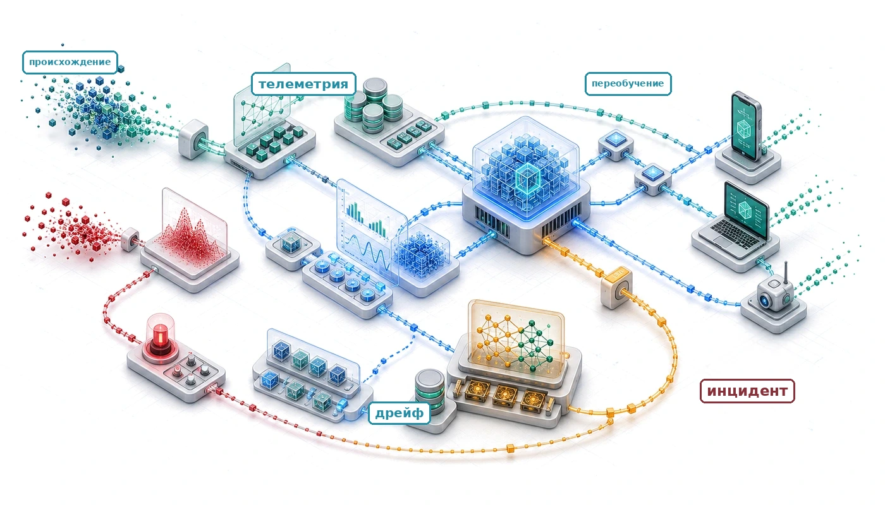
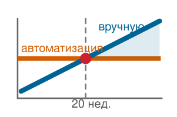
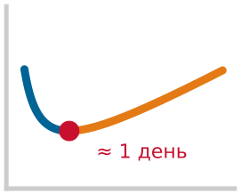
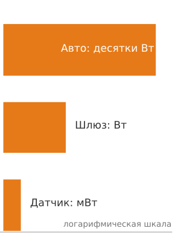
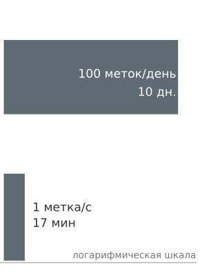

<a id="sec-ml-operations"></a>

# MLOps



## Назначение

_Почему ML-система может одновременно быть полностью доступной и полностью ошибочной?_

Обычный мониторинг часто быстро обнаруживает сбои, регрессии задержки и потери доступности, но семантические ошибки могут оставаться незамеченными в любой программной системе. ML-системы добавляют еще один скрытый режим отказа. Модель, которая испытывает дрейф данных, может продолжать выдавать внешне обычные предсказания, пока точность падает, и при этом не вызывать никаких тревог, потому что каждая проверка работоспособности (задержка, пропускная способность, доступность) остается в норме. Серверная инфраструктура доставляет модели в продакшен; эксплуатация помогает удерживать их корректность после того, как они там оказались. Качество модели может ухудшаться, потому что мир меняется: поведение клиентов сдвигается, появляются новые категории товаров, сезонные закономерности эволюционируют, а распределение, на котором училась модель, расходится с тем, с которым она сталкивается теперь. Дрейф не является неизбежностью, но для развернутых моделей это постоянный риск. В отличие от задержки или доступности, корректность может стать наблюдаемой только после появления меток или результатов последующих этапов, поэтому обнаружение деградации часто требует неидеальных сигналов и явного расследования, а не одного порога. Управление этим требует непрерывного мониторинга, который отслеживает качество предсказаний наряду с состоянием системы, сигналов дрейфа, которые запускают расследование, переобучения, когда результаты это подтверждают, и стратегий развертывания, которые проверяют новые версии моделей на производственном трафике до полного выката. Разрыв между разработкой и продакшеном — это не препятствие, которое преодолевают однажды, а состояние, которым управляют бессрочно. Операции машинного обучения (MLOps) существуют потому, что безотказная работа без измеренной точности все равно может давать неверные ответы в масштабе. Они делают совместное проектирование D·A·M непрерывным, потому что среда данных может оставаться движущейся мишенью долго после первоначального развертывания.

> **Цели обучения**
>
> - Объяснить, почему ML-системы могут оставаться доступными, пока качество предсказаний незаметно деградирует при сдвиге распределения
> - Диагностировать технический долг на границах «данные–модель», «модель–инфраструктура» и «мониторинг в продакшене»
> - Проектировать хранилища признаков, реестры и конвейеры CI/CD, которые сохраняют согласованность обучения и обслуживания и воспроизводимый откат
> - Применять модель устаревания при переобучении, чтобы выбирать учитывающие стоимость триггеры и интервалы переобучения
> - Внедрять многоуровневый мониторинг дрейфа, перекоса, деградации, бизнес-метрик и свежести данных
> - Сравнивать канареечное, сине-зеленое и теневое развертывание, а также откат с точки зрения риска выпуска модели в продакшен
> - Оценивать операционную зрелость и инвестиции, используя критичность модели, операционный риск и организационную готовность

<a id="sec-ml-operations-introduction-machine-learning-operations-04c6"></a>

## Обзор MLOps

После того как модель построена, оптимизирована, измерена и обслуживается, система все еще должна оставаться корректной. Бенчмарк фиксирует производительность в конкретный момент времени; инфраструктура обслуживания отвечает на запросы за миллисекунды. Команда развертывает систему в продакшене, и первая неделя выглядит отлично. Трудности начинаются на второй неделе.

Распределения данных смещаются, поведение пользователей меняется, и мир уходит от условий, в которых обучалась модель. ML-модели, которые успешны на этапе разработки, могут не добиться устойчивого использования в продакшене, если после развертывания нет ответственного владельца и мониторинга. Первопричина — операционное несоответствие: мониторинг, ориентированный на доступность, отслеживает время работы сервера, задержку запросов и долю успешных запросов, тогда как мониторинг ML должен также отслеживать статистическое состояние, включая точность во времени, сдвиг входного распределения и качество предсказаний по сегментам. Модель может сильно деградировать, не выбрасывая никаких исключений, не вызывая никаких инфраструктурных тревог и сохраняя полную доступность.

Дисциплина, которая делает эти невидимые отказы видимыми, — **операции машинного обучения (MLOps)**. MLOps объединяет мониторинг, автоматизацию и управление в производственные архитектуры, которые обнаруживают деградацию, запускают переобучение и поддерживают работоспособность системы на протяжении всего операционного срока жизни модели. Она унаследовала линию автоматизации и эксплуатации DevOps (Kreuzberger et al., 2023), но решает другой класс отказов. Обычные сервисы часто можно протестировать на детерминированных путях выполнения кода, тогда как ML-системы зависят от распределений обучающих данных, выученных параметров и условий среды, которые непрерывно смещаются.

Проблема второй недели принимает конкретную форму в иллюстративном сценарии развертывания. Представим систему прогнозирования спроса для сервиса совместных поездок. Первоначальные измерения показывают точность 94 процента, задержку p99 15 мс и сильные результаты на тестовых сегментах. К четвертой неделе точность упала до 88 процентов, но метрики инфраструктуры не показывают ничего плохого. К восьмой неделе менеджер продукта замечает, что диспетчеризация водителей неэффективна; расследование показывает, что модель не адаптировалась к новой акции конкурента, которая изменила поведение пользователей. Модель требовала переобучения шесть недель назад, но никакая система не следила за этой деградацией. MLOps предоставляет основу, чтобы обнаруживать такой дрейф, запускать переобучение и проверять новые модели до того, как пользователи почувствуют последствия.

Операционное несоответствие напрямую связано с аналитическими основами книги. Если бенчмаркинг дает *датчики* системы, то MLOps — это полноценная *система управления*. Она закрывает разрыв верификации из уравнения разрыва верификации ([«разрыв верификации»](01_introduction.md#eq-verification-gap)), непрерывно перекалибруя модель относительно меняющегося мира. MLOps может эксплуатировать локально подобранное уравнение деградации ([«деградация»](01_introduction.md#eq-degradation)), когда парные данные о дрейфе и результатах показывают, что изменение распределения предсказывает потерю точности; одна только расходимость не доказывает неизбежного распада. Кроме того, она формализует интерфейсы и обязанности между традиционно изолированными областями (наука о данных, инженерия машинного обучения и системная эксплуатация (Amershi et al., 2019)) с помощью непрерывного переобучения, A/B-оценки, поэтапного выката и стандартизированного отслеживания артефактов, которое поддерживает воспроизводимость и аудируемость.

Развертывание, мониторинг и сопровождение одной производственной ML-системы определяют базовую операционную единицу: **узел ML** — полную систему из конвейеров данных, вычисления признаков, обучения модели, инфраструктуры обслуживания и мониторинга для одного приложения машинного обучения. Эксплуатация платформы в большем масштабе (управление сотнями моделей, зависимостями между моделями, координацией нескольких регионов и инженерией ML-платформы в масштабе организации) — это продвинутые темы, которые опираются на эти основы для одной модели.

Сопровождение узла ML требует сохранения наблюдаемости на каждом интерфейсе. Технический долг накапливается, когда эти границы размываются; хранилища признаков, конвейеры CI/CD и отслеживание экспериментов обеспечивают воспроизводимость, необходимую для локализации сбоев. Когда воспроизводимые данные и артефакты на месте, непрерывный мониторинг, обнаружение дрейфа и канареечное развертывание защищают качество предсказаний от сдвига среды.

Операционная задача одной модели распадается на три различных интерфейса. **Интерфейс «данные–модель»** — это передача между инфраструктурой данных и обучением модели; его цель — согласованность признаков, чтобы конвейеры обучения и обслуживания вычисляли признаки одинаково. **Интерфейс «модель–инфраструктура»** — это переход от обученных весов к масштабируемому сервису; его задача — паритет окружений, потому что модель, которая работает в блокноте, может отказать в продакшене из-за несовпадения версий, зависимостей или среды выполнения. **Интерфейс «мониторинг в продакшене»** — это петля обратной связи, которая обеспечивает самокоррекцию и возвращает статистическую телеметрию[^fn-telemetry-mlops-pipeline] из продакшена в обучение, поскольку ML-системы могут деградировать через дрейф, не падая.

Эти интерфейсы определяют, как компоненты инфраструктуры распределяют ответственность. Хранилища признаков стабилизируют вычисление признаков на границе «данные–модель». Реестры моделей и конвейеры развертывания сохраняют передачу «модель–инфраструктура». Мониторы дрейфа, триггеры переобучения и политики управления замыкают петлю «мониторинг в продакшене» раньше, чем скрытая деградация станет бизнес-проблемой.

[^fn-telemetry-mlops-pipeline]: **Телеметрия**: путь обратной связи, который может сделать деградацию модели видимой до того, как она станет бизнес-проблемой. Сбои и коды ошибок выявляют некоторые программные отказы, но семантические ошибки могут оставаться незамеченными в любом приложении. ML-системы добавляют сдвиг распределения, который может остаться необнаруженным без статистической телеметрии, такой как распределения признаков, уверенность предсказаний и индикаторы дрейфа. Одни только метрики доступности не выявили бы эту деградацию.

Работа с этим путем обратной связи требует отличать MLOps от традиционного DevOps, устанавливать базовые принципы, которые управляют производственными решениями, и выделять паттерны долга, которые накапливаются, когда эти границы нарушаются.

<a id="sec-ml-operations-mlops-3ea3"></a>

## Принципы и основы

Производственный релиз ML выходит за рамки диффа кода: распределения данных, выученные параметры, срезы для оценки и петли мониторинговой обратной связи становятся объектами релиза, которые меняют поведение во время выполнения. MLOps опирается на DevOps, чтобы управлять этими зависящими от данных требованиями на этапах разработки и развертывания (Kreuzberger et al., 2023); (Amershi et al., 2019). Традиционные конвейеры CI/CD проверяют детерминированный исходный код, конфигурации, модульные тесты и манифесты инфраструктуры, тогда как операции ML должны управлять артефактами, статистическая валидность которых зависит от происхождения данных и среды выполнения, которые их породили.

DevOps автоматизирует интеграцию и поставку детерминированного программного обеспечения. MLOps распространяет эту дисциплину на статистические рабочие процессы, зависящие от данных, которые охватывают получение данных, предобработку, распределенное обучение, оценку, развертывание и непрерывный мониторинг через итеративную петлю, связывающую проектирование системы, разработку модели и работу в продакшене.

<a id="dfn-ml-ops-mlops"></a>

> **MLOps**
>
> ***Операции машинного обучения (MLOps)*** — это инженерная практика вывода ML-систем в продакшен через CI/CD, оркестрацию рабочих процессов, воспроизводимость, версионирование, совместную работу, непрерывное обучение и оценку, мониторинг и петли обратной связи (Kreuzberger et al., 2023).
>
> 1.  **Значение**: Цена незамкнутой петли проявляется в устаревших предсказаниях, незаметной деградации точности и затянувшемся восстановлении. Пороги дрейфа, триггеры переобучения и целевые значения среднего времени восстановления (MTTR) — это величины, специфичные для конкретного развертывания, калиброванные по ценности предсказаний, задержке меток, риску валидации и стоимости вычислений для переобучения. Центральная инженерная дисциплина — замкнутый контур управления: измерить сдвиг распределения, оценить стоимость устаревания, запускать переобучение только тогда, когда ожидаемый прирост точности превышает стоимость выполнения и риск выката, и проверять заменяющие модели до продвижения.
> 2.  **Отличие**: DevOps следит за функциональной корректностью, пропускной способностью системы и доступностью инфраструктуры. MLOps вводит статистический контроль *предсказательной корректности*, которая может незаметно деградировать, пока время работы сервера, задержка запросов и HTTP-коды остаются полностью здоровыми.
> 3.  **Типичная ошибка**: Распространенное заблуждение состоит в том, что переобучение на новых данных автоматически устраняет сдвиг распределения. Переобучение без диагностики того, какое распределение сдвинулось — входные признаки ($p(x)$), условные распределения меток ($p(y \mid x)$) или оба, — сохраняет исходные режимы отказа или усиливает смещение сбора данных. При ковариатном сдвиге и общей поддержке перевзвешивание выборок или стратифицированная повторная выборка восстанавливают калибровку; концептуальный дрейф требует свежих меток и адаптации модели.

Структуру бесконечной петли на [«Итеративном цикле MLOps»](14_ml_ops.md#fig-mlops-diagram) стоит проследить, чтобы увидеть, как операционная телеметрия возвращает эмпирические данные в проектирование и инженерию, формируя непрерывную форму работы дисциплины:

<a id="fig-mlops-diagram"></a>


***Итеративный цикл MLOps**: мониторинг и запуск триггеров возвращают производственные данные в проектирование и разработку модели, превращая требования, инженерию, тестирование и развертывание в непрерывный операционный цикл.*

Операционная сложность и финансовый риск внедрения машинного обучения без дисциплинированных операционных инструментов ясно проявляются в сервисе рекомендаций. Новая модель ранжирования сначала повышает конверсию, но постепенный дрейф данных понемногу ухудшает качество предсказаний. Поскольку традиционный мониторинг отслеживает время работы сервера, задержку запросов и долю успешных HTTP-запросов, а не точность вывода, потери остаются невидимыми до тех пор, пока через несколько месяцев обзор совокупной выручки их не выявит. MLOps предоставляет операционные средства контроля, которые выявляют эти скрытые статистические сбои до того, как они накопятся в значительный финансовый ущерб.

<a id="sec-ml-operations-foundational-principles-44e6"></a>

### Базовые принципы

Этот сбой в рекомендациях иллюстрирует системную закономерность: без дисциплинированного операционного контроля даже точные модели незаметно выходят из строя в продакшене. Диагностика такого инцидента требует структурированной последовательности операционных проверок. Когда выручка падает, первым приоритетом становится восстановление развернутого состояния модели, что требует воспроизводимости. Следующий приоритет — определить, сохраняют ли конвейеры данных, задания обучения, пути обслуживания и сервисы мониторинга четкие границы, позволяющие локализовать дефект, что требует разделения ответственности. Если признаки онлайн-обслуживания расходятся с признаками офлайн-обучения, согласованность обеспечивает инвариант, который предотвращает повторяющийся перекос. Если дрейф начинается раньше, чем жалуются пользователи, наблюдаемая деградация превращает скрытый сбой в действенный сигнал тревоги. Наконец, когда переобучение возможно, но вычислительно дорого, автоматизация с учетом стоимости оценивает, оправдывает ли вмешательство затраты вычислений и риск выката. Эти принципы определяют контроли в операционной последовательности, которую команда инженеров выполняет, чтобы локализовать и устранить сбои в продакшене.

<a id="sec-ml-operations-principle-1-reproducibility-d408"></a>

#### Воспроизводимость

Воспроизводимость требует, чтобы каждый артефакт[^fn-artifact-reproducibility-hashing], влияющий на поведение модели, был версионирован и прослеживаем. Этот принцип распространяется за пределы репозиториев кода и охватывает входные наборы данных, схемы признаков, конфигурации гиперпараметров и среды выполнения. [«Воспроизводимость модели»](14_ml_ops.md#eq-model-reproducibility) формально выражает эту зависимость:

<a id="eq-model-reproducibility"></a>

$$\text{Выход модели} = f(\text{Код}_v, \text{Данные}_v, \text{Конфигурация}_v, \text{Среда}_v; \xi)$$

где $v$ обозначает неизменяемый хеш версии, а $\xi$ фиксирует недетерминированность выполнения. Точное воспроизведение требует зафиксировать все четыре версионированных входа вместе со стартовыми значениями генератора случайных чисел (seed), порядком выборок загрузчика данных, детерминированными редукциями на GPU (которые исключают дрейф чисел с плавающей точкой из-за неассоциативных асинхронных атомарных сложений) и одинаковыми архитектурами аппаратного ускорителя.

[^fn-artifact-reproducibility-hashing]: **Артефакт**: веса модели — это реализованные результаты обучения; входные данные и случайность, которые их породили, в общем случае нельзя восстановить по параметрам. Поэтому версионирования одного только кода недостаточно, а даже версионирование кода, данных, конфигурации и среды может не гарантировать точного повторения, если ядра или обучение недетерминированы.

<a id="sec-ml-operations-principle-2-separation-concerns-6f84"></a>

#### Разделение ответственности

Разделение ответственности декомпозирует системы MLOps на отдельные функциональные слои, которые могут развиваться независимо, как показывает [«Разделение ответственности в MLOps»](14_ml_ops.md#tbl-mlops-layers):

| **Слой**             | **Ответственность**                                 | **Изменяется при**                  |
|:---------------------|:----------------------------------------------------|:------------------------------------|
| **Слой данных**      | Вычисление, хранение и обслуживание признаков        | Эволюции схемы данных               |
| **Слой обучения**    | Разработка модели, оптимизация гиперпараметров      | Развитии алгоритмов                 |
| **Слой обслуживания**| Вывод, масштабирование, управление задержкой         | Паттернах трафика                   |
| **Слой мониторинга** | Обнаружение дрейфа, отслеживание качества           | Бизнес-требованиях                  |

<a id="tbl-mlops-layers"></a>

***Разделение ответственности в MLOps**: каждый слой решает отдельную задачу и развивается со своей скоростью — слои данных, обучения, обслуживания и мониторинга. Такое разделение позволяет масштабировать и обновлять их независимо и уменьшает радиус поражения при необходимых изменениях.*

<a id="sec-ml-operations-principle-3-consistency-imperative-a292"></a>

#### Императив согласованности

Архитектурные границы в [«Разделении ответственности в MLOps»](14_ml_ops.md#tbl-mlops-layers) позволяют обновлять среды выполнения обслуживания без переобучения моделей, менять пороги оповещений без повторного развертывания и изменять конвейеры приема данных, сохраняя контракты интерфейсов. Эта архитектурная независимость безопасна только тогда, когда обучение и обслуживание обрабатывают признаки одинаково, поэтому паритет обучения и обслуживания становится императивом согласованности. Финансовые последствия этого расхождения описывает [уравнение стоимости перекоса](14_ml_ops.md#eq-skew-cost):

<a id="eq-skew-cost"></a>

$$\text{Стоимость перекоса} = \text{Доля}_{\text{перекоса}} \times Q \times C_{\text{ошибки}}$$

где $\text{Доля}_{\text{перекоса}}$ — доля запросов, затронутых перекосом обучения и обслуживания, $Q$ — общий объем запросов за расчетный период, а $C_{\text{ошибки}}$ — средняя бизнес-стоимость одного ошибочного предсказания.

Для системы, которая обслуживает 1 000 000 запросов в день, при этом 1 процент ошибок из-за перекоса стоит \$0,10 каждая, годовая стоимость перекоса достигает \$365 000. Это показывает, почему механизмы согласованности — инвестиции с измеримой финансовой отдачей. Общие хранилища признаков, унифицированные библиотеки извлечения признаков на C++ или Rust, которые вызываются одинаково при офлайн-обучении и онлайн-обслуживании, и автоматические тесты валидации схемы обеспечивают этот паритет непосредственно на границе системы.

<a id="sec-ml-operations-principle-4-observable-degradation-87a9"></a>

#### Наблюдаемая деградация

Наблюдаемая деградация требует, чтобы ML-системы делали скрытые сбои видимыми через непрерывные измерения. Точность модели деградирует вдоль непрерывного статистического спектра, а не отказывает как дискретное двоичное падение. Временная сигнатура наблюдаемого сбоя — внезапный спад, постепенный дрейф или локализованное угасание в конкретной когорте — определяет и механизм обнаружения, и операционный ответ.

<a id="sec-ml-operations-principle-5-costaware-automation-631e"></a>

#### Автоматизация с учетом стоимости

Автоматизация с учетом стоимости уравновешивает вычислительные затраты и выигрыш в точности. Пусть $\Delta\text{Точность}$ — ожидаемый прирост точности в процентных пунктах, $\text{Ценность пункта}$ — денежная ценность одного процентного пункта прироста за горизонт решения, $\text{Стоимость обучения}$ — стоимость вычислений и труда одного запуска переобучения, а $\text{Риск развертывания}$ — ожидаемая стоимость сбоя валидации и выката. [«Решение о переобучении»](14_ml_ops.md#eq-retrain-decision) описывает этот компромисс:

<a id="eq-retrain-decision"></a>

$$\text{Переобучать, если: } \Delta\text{Точность} \times \text{Ценность пункта} > \text{Стоимость обучения} + \text{Риск развертывания}$$

Неравенство работает как операционный барьер решения, а не как неограниченный триггер: автоматизированный конвейер должен запускать переобучение только тогда, когда эмпирические данные показывают, что ожидаемый прирост точности превышает стоимость выполнения и риск выката. Этот экономический компромисс управляет триггерами переобучения, порогами валидации и шлюзами выката; [«Конвейеры обучения»](14_ml_ops.md#sec-ml-operations-training-pipelines-2dcf) формализует эту модель для расчета оптимальных каденций переобучения.

Чтобы решить, когда вмешиваться, каждую сигнатуру отказа нужно сопоставить с подходящей телеметрией и операционной контрмерой, как показано в [«Типы деградации»](14_ml_ops.md#tbl-degradation-types):

| **Тип деградации**       | **Механизм обнаружения** | **Стратегия реакции**                  |
|:-------------------------|:-------------------------|:---------------------------------------|
| **Внезапное падение точности** | Пороговые оповещения | Диагностика; откат, если причина в выпуске |
| **Постепенный дрейф**    | Анализ трендов           | Диагностика, затем переобучение, если оправдано |
| **Деградация подгруппы** | Мониторинг когорт        | Целевой сбор данных                    |
| **Рост задержки**        | Отслеживание перцентилей | Масштабирование инфраструктуры         |

<a id="tbl-degradation-types"></a>

***Стратегии обнаружения деградации**: четыре сигнатуры отказа сопоставлены с детекторами и операционными реакциями. Внезапные падения требуют немедленной диагностики и могут потребовать отката, тогда как постепенная или подгрупповая деградация требует диагностики перед переобучением или целевым сбором данных.*

Каждый базовый принцип становится операционным, только будучи привязанным к конкретной измеримой метрике ([«Сводка принципов MLOps»](14_ml_ops.md#tbl-mlops-principles-summary)) — от хешей артефактов до чистой ценности переобучения:

| **Принцип**                | **Ключевая идея**           | **Основная метрика**   |
|:---------------------------|:----------------------------|:-----------------------|
| **Воспроизводимость**      | Версионировать все артефакты | Полный хеш артефакта   |
| **Разделение ответственности** | Независимая эволюция слоев | Показатель связанности слоев |
| **Согласованность**        | Обучение равно обслуживанию | Доля перекоса признаков |
| **Наблюдаемая деградация** | Делать сбои видимыми        | Время обнаружения      |
| **Автоматизация с учетом стоимости** | Оптимизировать полную стоимость | Чистая ценность переобучения |

<a id="tbl-mlops-principles-summary"></a>

***Сводка принципов MLOps**: краткий справочник по пяти базовым принципам, которые определяют все решения в инструментах и практике MLOps.*

Как эти принципы проявляются на практике, зависит от нагрузки. Рекомендательная система дрейфует ежедневно по мере смены предпочтений пользователей; модель TinyML, развернутая на встроенном оборудовании, может работать без изменений месяцами. Стратегия мониторинга должна соответствовать архетипу.

<a id="lhs-ml-ops-monitoring-strategy-by-archetype"></a>

> **Стратегия мониторинга по архетипам**
>
>
> Доминирующие режимы отказа и приоритеты мониторинга различаются у разных архетипов нагрузок. [«Стратегия мониторинга по архетипу нагрузки»](14_ml_ops.md#tbl-monitoring-archetype-strategy) сравнивает четыре репрезентативных архетипа по паттерну дрейфа, метрике мониторинга и примерному триггеру переобучения:
>
> | **Архетип**                   | **Доминирующий паттерн дрейфа**                                  | **Основная метрика мониторинга**                    | **Пример триггера переобучения**                                                    |
> |:------------------------------|:-----------------------------------------------------------------|:----------------------------------------------------|:------------------------------------------------------------------------------------|
> | **ResNet-50 (вычислительный зверь)** | Визуальный сдвиг распределения (освещение, камера, новые классы объектов) | Точность на отложенной выборке (эталонная истина доступна) | Точность падает более чем на 2% от базового уровня ($\sim$ежемесячно для стабильных областей) |
> | **GPT-2 (пожиратель полосы пропускания)** | Дрейф словаря, сдвиг тем, новые сущности | Перплексия на живом трафике (эталонная истина не нужна) | Перплексия растет более чем на 10%; обнаружен новый словарь ($\sim$еженедельно для новостных областей) |
> | **DLRM (разреженный разброс)** | Сдвиг поведения пользователей, обновление каталога, холодные товары | Разница CTR/CVR относительно исторических когорт | Вовлеченность падает более чем на 5%; обновление каталога ($\sim$ежедневно для e-commerce) |
> | **DS-CNN (жесткое ограничение)** | Изменение акустической среды (сдвиг уровня шума) | Коэффициент заполнения (пробуждения в час) + доля ложных срабатываний | Ложные пробуждения более 1%; разряд батареи выше спецификации ($\sim$ежеквартально, OTA-обновление) |
>
> <a id="tbl-monitoring-archetype-strategy"></a>
>
> ***Стратегия мониторинга по архетипам нагрузки**: иллюстративные отправные точки для стратегии мониторинга. Реальные пороги нужно калибровать по задержке меток, объему трафика, бизнес-риску и бюджету усталости от оповещений в конкретном развертывании.*
>
>
> **Системный вывод**: доступность эталонной разметки и физические узкие места определяют дизайн мониторинга. Модели компьютерного зрения, ограниченные вычислениями (ResNet-50), которые ограничены $O/(R_{\text{peak}} \cdot \eta_{\text{hw}})$, отслеживают точность на отложенной выборке; языковые и рекомендательные модели с интенсивным использованием памяти (GPT-2, DLRM), ограниченные $D_{\text{vol}}/\text{BW}$, могут опираться на перплексию или неявные клики; модели для микроконтроллеров (DS-CNN), ограниченные жесткой задержкой $L_{\text{lat}}$ и лимитами энергии, отслеживают коэффициент заполнения и частоту ложных пробуждений. Каденция переобучения ограничена задержкой меток, доступом к развертыванию, стоимостью валидации и скоростью наблюдаемых изменений.

Эти принципы отвечают на повторяющиеся эксплуатационные сбои: концептуальный дрейф,[^fn-drift-adversarial-shift] проблемы качества данных (Schelter et al., 2018) и скрытую деградацию после развертывания. Эти факторы порождают расхождение между MLOps и традиционным DevOps: состояние системы нельзя измерить одной только доступностью или задержкой. Операционная дисциплина требует мониторить статистические свойства распределений данных и выходов модели, перенося внимание с базовой доступности сервера на предсказательную корректность.

[^fn-drift-adversarial-shift]: **Концептуальный дрейф**: исследования дрейфа концепции и потоков данных формализовали проблему, в которой целевая зависимость модели может измениться после развертывания (Widmer and Kubat, 1996); (Gama et al., 2014). В состязательных областях, таких как обнаружение спама, мошенничества и злоупотреблений, распределение может активно адаптироваться к модели, поэтому непрерывный мониторинг и переобучение становятся структурным требованием, а не операционной роскошью.

MLOps координирует более широкую экосистему заинтересованных сторон и вводит специализированные практики, такие как версионирование данных,[^fn-dvc-data-versioning] версионирование моделей и непрерывный статистический мониторинг, которые выходят за рамки традиционной программной инженерии. Такой расширенный охват превращает эксплуатацию модели в непрерывную петлю обратной связи, а не в линейный конвейер выпуска, что сопоставлено по измерениям в таблице [«MLOps и DevOps»](14_ml_ops.md#tbl-mlops):

[^fn-dvc-data-versioning]: **DVC (Data Version Control)**: DVC приносит версионирование в стиле Git к наборам данных и артефактам моделей (Iterative, 2024), закрывая брешь в артефактах, которую формализует [«воспроизводимость модели»](14_ml_ops.md#eq-model-reproducibility): без версионирования данных член $\text{Данные}_v$ невосстановим, и никакая комбинация коммитов кода не может воссоздать развернутую модель.

| **Аспект**           | **DevOps**                                                                                                  | **MLOps**                                                                                                                    |
|:---------------------|:------------------------------------------------------------------------------------------------------------|:-----------------------------------------------------------------------------------------------------------------------------|
| **Цель**             | Оптимизация процессов разработки и эксплуатации программного обеспечения                                    | Оптимизация жизненного цикла моделей машинного обучения                                                                      |
| **Методология**      | Непрерывная интеграция и непрерывная поставка (CI/CD) для разработки ПО                                     | Похожа на CI/CD, но ориентирована на рабочие процессы машинного обучения                                                     |
| **Основные инструменты** | Системы контроля версий (Git), инструменты CI/CD (Jenkins, Travis CI), управление конфигурацией (Ansible, Puppet) | Инструменты версионирования данных, инструменты обучения и развертывания моделей, конвейеры CI/CD, адаптированные для ML |
| **Основные задачи**  | Интеграция кода, тестирование, управление выпусками, автоматизация, инфраструктура как код                  | Управление данными, версионирование моделей, отслеживание экспериментов, развертывание моделей, масштабируемость рабочих процессов ML |
| **Типичные результаты** | Более быстрые и надежные выпуски ПО, улучшенное взаимодействие команд разработки и эксплуатации          | Эффективное управление и развертывание моделей машинного обучения, улучшенное взаимодействие специалистов по данным и инженеров |

<a id="tbl-mlops"></a>

***MLOps и DevOps**: MLOps распространяет принципы DevOps на специфические требования систем машинного обучения, включая версионирование данных и моделей, а также непрерывный мониторинг качества модели и дрейфа данных. MLOps объединяет более широкий круг заинтересованных сторон и делает упор на воспроизводимость и масштабируемость за пределами традиционных процессов разработки ПО.*

<a id="chk-ml-ops-mlops-loop"></a>

> **Петля MLOps**
>
> MLOps не линейна, она циклична.
>
> **Петля обратной связи**
>
> - **Замыкание петли**: как производственные метрики (например, сигналы дрейфа) запускают новые циклы обучения?
> - **Триггер переобучения**: можно ли отличить сигнал дрейфа, который требует расследования, от данных о результатах, которые требуют переобучения?
>
> **Артефакты**
>
> - **Версионирование**: версионируете ли вы данные, код, модель и среду вместе?

Каждая итерация операционной петли может вводить зависимости данных, взаимодействия моделей и дрейф конфигурации, невидимые для стандартного тестирования ПО. Эти накапливающиеся издержки составляют технический долг: инженерная концепция, которая превращает скрытые статистические режимы сбоя в измеримые обязательства.

Если традиционный DevOps занимается пропускной способностью развертывания и масштабированием сервисов, MLOps должна выделять технический долг и обслуживать его, прежде чем он дестабилизирует систему обслуживания. Размывание границ показывает, почему модульный дизайн конвейера обязателен; каскады исправлений показывают, почему строгое версионирование артефактов и мгновенный откат необходимы; необъявленные потребители оправдывают обязательные схемы признаков и контрактные тесты. Эти паттерны долга дают диагностический словарь и конкретные режимы отказа, которые мотивируют специализированную инфраструктуру MLOps, рассматриваемую в остальной части книги.

<a id="sec-ml-operations-technical-debt-system-complexity-2762"></a>

## Технический долг

Скрытые режимы отказа в продакшене конкретно проявляются как технический долг (Sculley et al., 2015): сдвиги распределения вышестоящих данных, петли обратной связи и непроверенные зависимости конвейера вызывают деградацию точности, которая накапливается со временем. Эти сбои незаметно накапливаются на границах систем и требуют операционных архитектур, которые учитывают статистическое поведение и зависимости данных наряду с традиционными программными контрактами. Метафора технического долга, впервые предложенная в программной инженерии в 1990-х,[^fn-tech-debt-ml] сравнивает упрощения в реализации с финансовым долгом: краткосрочная скорость поставки обменивается на постоянные издержки сопровождения и системный риск (Cunningham, 1992). В ML-системах этот долг выходит за пределы исполняемого кода и включает статистические зависимости и непроверенные потоки данных. Систематические рубрики оценки, такие как ML Test Score (Breck et al., 2017), дают основу для количественной оценки этого долга и проверки готовности к продакшену на границах данных, моделей и инфраструктуры.

[^fn-tech-debt-ml]: **Технический долг**: опыт Уорда Каннингема WyCash 1992 года ввел метафору долга для поспешного кода и отложенной консолидации (Cunningham, 1992); в ML долг может незаметно накапливаться через зависимости данных и моделей, которые тесты и ревью, сосредоточенные на коде, могут не выявить. Конвейер может оставаться неизменным, в то время как мир, который он моделирует, меняется. Рубрика ML Test Score (Breck et al., 2017) делает этот долг явным через 28 тестов готовности к продакшену, сгруппированных в разделы данных, модели, инфраструктуры и мониторинга.

<a id="dfn-ml-ops-technical-debt-ml"></a>

> **Технический долг в ML**
>
> ***Технический долг в машинном обучении*** — это накапливающаяся стоимость сопровождения и изменений, которую создают неявные зависимости данных, спутанные признаки и необъявленные потребители в ML-системах; возникающие обязательства могут также проявляться как незаметная деградация точности.
>
> 1.  **Значение**: Анализ Google производственных ML-систем утверждает, что код модели — лишь малая часть окружающей системы; более крупная операционная поверхность включает сбор данных, извлечение признаков, конфигурацию, инфраструктуру обслуживания, мониторинг и управление процессами (Sculley et al., 2015). Специфические для ML драйверы долга усиливают это: изменение одного входного признака может незаметно сдвинуть выученное представление всех остальных признаков (запутывание), модель, обученная исправлять ошибки другой модели, создает хрупкую цепочку зависимостей (каскады исправлений), а нижестоящие системы, которые используют выходы модели без явных контрактов, становятся необъявленными потребителями, которые незаметно ломаются при обновлении модели.
> 2.  **Отличие**: ML-технический долг включает системные зависимости и зависимости на уровне данных, которые ревью кода и обычные тесты, сосредоточенные на коде, могут пропустить. Он может замедлять разработку и ухудшать качество предсказаний, даже когда метрики доступности остаются в норме.
> 3.  **Типичная ошибка**: Распространенное заблуждение состоит в том, что «лучший код» решает проблему технического долга в ML. На деле это проблема системной архитектуры: долг накапливается, когда предположения обучающего распределения (диапазоны признаков, смысл меток, свежесть данных) не закреплены как контракты времени выполнения на границе системы.

Расчет точки безубыточности делает динамику стоимости технического долга конкретной. Команды часто сопротивляются инвестициям в автоматизацию, потому что ручные процессы кажутся быстрее на ранней стадии разработки, но это преимущество исчезает, как только повторяющиеся ручные вмешательства превышают первоначальную стоимость автоматизации.



*Накопленная ручная работа догоняет разовую инвестицию в автоматизацию примерно на двадцатой неделе.*

Ручные операции быстро упираются в потолок производительности, потому что код модели составляет лишь небольшую долю реального развертывания. Как показано на [«Скрытой инфраструктуре ML-систем»](14_ml_ops.md#fig-technical-debt), операционная поверхность охватывает десять взаимосвязанных компонентов — от проверки данных до управления машинными ресурсами, каждый из которых способен накапливать скрытые обязательства. Хотя основной код ML занимает один блок, остальные девять требуют непрерывного операционного обслуживания.

<a id="fig-technical-debt"></a>


***Скрытая инфраструктура ML-систем**: код ML — один из десяти компонентов, расположенных вокруг ML-системы в центре, наряду со сбором данных, проверкой данных, извлечением признаков, конфигурацией, управлением машинными ресурсами, инфраструктурой обслуживания, мониторингом, инструментами анализа и инструментами управления процессами. Важно число: моделирование занимает один блок, а остальные девять составляют операционную поверхность, которую также должно нести развертывание. Источник: (Sculley et al., 2015).*

<a id="nbk-ml-ops-compound-cost-manual-operations"></a>

> **Совокупная стоимость ручных операций**
>
> **Задача**: зачем строить автоматизированные конвейеры, если ручное переобучение быстрее?
>
> **Механизм**: ручная работа накапливается со временем.
>
> *   Ручное переобучение: 4 часа инженерного времени в неделю.
> *   Построение конвейера: 80 инженерных часов (однократно).
>
> **Расчет**:
>
> *   **Результат**: 80 инженерных часов $\div$ 4 часа в неделю = 20 недель.
> *   **Ловушка**: это предполагает, что модель никогда не меняется.
> *   **Ограничение**: дополнительные признаки могут увеличить ручные усилия.
> *   **Последствия**: через 1 год ручная команда по-прежнему тратит 4 часа в неделю на сопровождение. В этом упрощенном расчете команда с конвейером несет 0 повторяющихся часов.
>
> **Контекст**: центральный закон системной инженерии состоит в том, что стоимость *сопровождения* системы на протяжении всей ее жизни может превышать стоимость ее *создания*. В ML технический долг особенно опасен, потому что он часто *управляется данными*, а не *кодом*: идеально написанный код все равно может отказать, если обрабатываемые им данные сместятся. Измерение — граница управления: без телеметрии команда не может сказать, сокращает ли работа по сопровождению долг или просто скрывает его.
>
> **Системный вывод**: автоматизация решает проблему ограничения емкости, а не только скорости. Ручная команда в конце концов достигает точки, когда сопровождение существующих моделей мешает ей развертывать новые. MLOps отвечает систематической наблюдаемостью и автоматизацией. Без инфраструктуры мониторинга, которая делает скрытые сбои видимыми, команда накапливает долг и строит систему, которой все труднее управлять.

Хотя автоматизация решает повторяющиеся операционные издержки ручного переобучения, она не может предотвратить архитектурное разложение. Развернутые системы накапливают скрытую сложность через системные режимы сбоя, которые возникают из статистических связей, а не из детерминированной логики. [«Таксономия технического долга ML»](14_ml_ops.md#fig-technical-debt-taxonomy) сопоставляет шесть паттернов долга в областях данных, моделей и инфраструктуры, фиксируя режимы сбоев, которые операционные архитектуры должны изолировать.

<a id="fig-technical-debt-taxonomy"></a>


***Таксономия технического долга ML**: шесть паттернов долга расходятся от скрытого технического долга: долг конфигурации, петли обратной связи, долг данных, долг конвейера, каскады исправлений и размывание границ. Окружающие подписи обозначают связанные с ними паттерны отказов.*

<a id="sec-ml-operations-boundary-erosion-8ef5"></a>

### Размывание границ

Растворение границ системы — основной режим отказа статистического программного обеспечения. В традиционном ПО модульная инкапсуляция дает четкую изоляцию: компоненты взаимодействуют через типизированные API, поэтому внутренние реализации могут меняться, а поведение системы остается детерминированным. ML-системы размывают эти границы, потому что поведение компонента зависит от эмпирического распределения входящих данных, а не от синтаксических определений интерфейсов. Изменение форматирования или нормализации на входе может пройти все модульные тесты и при этом незаметно сдвинуть распределения признаков и ухудшить точность нижестоящей модели. Такая неявная связанность через конвейеры данных создает незаметные для мониторинга зависимости между инженерией признаков, конвейерами обучения и конечными точками обслуживания.

Это размывание порождает **запутывание**: зависимости между признаками и компонентами становятся настолько переплетенными, что локальные изменения требуют глобальной координации. Этот режим отказа отражает принцип CACE: *Change Anything Changes Everything* (изменение чего угодно меняет все). Когда у систем нет строгих распределительных границ, корректировка одного кодирования признака или порога фильтрации данных меняет выученные веса во всей модели. Например, изменение стратегии разбиения непрерывного признака на интервалы сдвигает дисперсию и структуру ковариаций признака, из-за чего ранее откалиброванная модель начинает работать хуже и вынуждает к повторным калибровкам нижестоящих сервисов.

Защита от размывания границ требует архитектурной модульности, которая обеспечивается во время выполнения. Компонентам нужны явные контракты данных, которые фиксируют статистические инварианты: допустимые диапазоны признаков, допуски на пропуски и пороги дрейфа. Разделение приема данных, генерации признаков и логики вывода создает границы проверки, на которых распределения данных можно проверить до того, как они достигнут весов модели. Поскольку размывание границ остается незаметным на этапе прототипирования, явные контракты схем и проверки инвариантов — единственная надежная защита от ползучей статистической связанности.

<a id="sec-ml-operations-correction-cascades-e309"></a>

### Каскады исправлений

Если размывание границ не устранено, инженерные вмешательства часто запускают **каскад исправлений**: исправление конкретного дефекта модели вспомогательной заплаткой вносит вторичные ошибки в другом месте, и требуются новые компенсирующие исправления, которые дестабилизируют весь конвейер. В ML-системах такие каскады особенно опасны, потому что изменения распространяются через статистические зависимости, а не через детерминированные ветви кода. Переобучение модели, чтобы исправить конкретный кластер ложноположительных срабатываний, может ухудшить точность на ранее стабильных когортах. Добавление вспомогательной модели, которая переопределяет предсказания на граничных случаях, вводит некалиброванные остатки, искажающие работу нижестоящих потребителей. Каждая заплатка запускает последующие исправления, и затраты инженеров быстро превышают стоимость переобучения на чистых данных.

[«Каскады исправлений»](14_ml_ops.md#fig-correction-cascades-flowchart) делает структуру каскада видимой как цепочку зависимых моделей. Каждая модель обучена исправлять ошибки предыдущей: модель B компенсирует остаточные ошибки модели A, модель C компенсирует ошибки модели B и так далее по всей цепочке. Такая конструкция держится, пока не изменится модель выше по цепочке. Когда модель A переобучают, чтобы устранить один режим отказа, каждая нижестоящая модель, настроенная на ее прежнее поведение, сразу становится недействительной, и каждую нужно исправлять заново. Красные дуги прослеживают это распространение и показывают, как ремонт, который выглядел локальным, затрагивает всю цепочку. Изменение вверху вызывает наибольший объем переработки, тогда как изменение внизу почти ничего не стоит. Для операционной команды один запрос на изменение может запустить согласованное переобучение всей цепочки.

<a id="fig-correction-cascades-flowchart"></a>


***Каскады исправлений**: каждая модель обучена исправлять ошибки предыдущей, образуя цепочку зависимостей. Изменение верхней модели сразу делает недействительными все нижестоящие исправления, превращая локальный ремонт в каскадную переработку по всей цепочке, причем каждое последующее исправление требует собственного цикла переобучения.*

Это распространение превращает локальные ремонты моделей в зависимости инженерии на всем жизненном цикле. Частым источником выступает последовательная разработка моделей: тонкая настройка или повторное использование уже существующей модели ускоряет первоначальное развертывание, но связывает нижестоящую систему со скрытыми допущениями и смещениями представления исходной модели. Со временем унаследованные свойства превращаются в жесткие архитектурные ограничения, которые усложняют будущие обновления.

Например, дообучение существующей модели оттока клиентов для новой линейки продуктов наследует кодирование признаков и пороги калибровки базовой модели. Если новый продукт демонстрирует другие паттерны вовлеченности пользователей, заплатка в виде вспомогательных правил постобработки создает хрупкий многоступенчатый конвейер. Когда точность падает, инженерные команды обнаруживают, что корневой отказ находится на несколько слоев выше, в исходных соглашениях о разметке.

Смягчение каскадов исправлений требует баланса между повторным использованием компонентов и переработкой. Тонкая настройка снижает первоначальные затраты вычислений и сбора данных, тогда как обучение с нуля дает полный контроль над допущениями модели и устраняет зависимости от ошибок вышестоящей модели. Архитектурное решение зависит от сходства задач, согласованности ковариат и постоянной стоимости сопровождения цепочки моделей. Там, где зависимые модели неизбежны, системы должны разделять их с помощью артефактов моделей с закрепленными версиями и замороженных промежуточных представлений.

<a id="sec-ml-operations-interface-dependency-challenges-7711"></a>

### Проблемы интерфейсов и зависимостей

Размывание границ и каскады исправлений порождаются зависимостями интерфейсов, которые обходят формальные программные контракты. Традиционные зависимости ПО объявляются через инструкции импорта, менеджеры пакетов и схемы RPC, что позволяет инструментам статического анализа строить графы зависимостей. В системах машинного обучения зависимости прячутся внутри потоков данных. Когда выход модели A записывается в хранилище данных, а затем поступает как обучающий признак для модели B, связанность существует только в конвейере данных и невидима для статического анализа кода.

Скрытая связанность часто проявляется как **необъявленные потребители**: нижестоящие сервисы используют предсказания модели без формальной регистрации и соглашений об уровне обслуживания. Когда вышестоящую модель переобучают или распределение ее выходов сдвигается, эти незарегистрированные потребители молча ломаются. Например, кредитная оценка риска, которую использует автоматизированная маркетинговая система, может изменить пул заявителей и вернуть сдвинутые распределения в будущие запуски обучения, порождая неконтролируемое смещение отбора. Эту уязвимость усиливает **долг зависимостей данных**, который накапливается, когда ML-конвейеры принимают неверсионированные таблицы, нестабильные признаки из вышестоящих источников или сигналы с волатильными распределениями.

Устранение долга интерфейсов требует границ, которые обеспечивает инфраструктура: строгой аутентификации и регистрации для конечных точек предсказаний моделей, машиночитаемых контрактов схем для хранилищ признаков и автоматического отслеживания происхождения данных, которое регистрирует потребителей до предоставления доступа на чтение.

<a id="sec-ml-operations-system-evolution-challenges-ea51"></a>

### Проблемы эволюции системы

Даже хорошо спроектированные ML-системы с документированными интерфейсами сталкиваются с проблемами эволюции, которых нет в детерминированном программном обеспечении.

Самая коварная из этих динамик — петля обратной связи, в которой развернутая модель влияет на распределение данных, на которых обучаются ее преемники. Рекомендательные системы наглядно иллюстрируют этот паттерн: предлагаемый контент определяет вовлеченность пользователей, клики формируют последующие обучающие выборки, и модель усиливает собственные прошлые выборы, лишая невыбранный контент показов. В продакшене этот режим отказа часто проявляется как растущее расхождение качества между демографическими когортами: недопредставленные группы получают субоптимальные предсказания, порождая искаженные журналы вовлеченности, которые дальше ухудшают представленность когорт в последующих запусках переобучения. Чтобы обнаружить петли обратной связи, нужен мониторинг, стратифицированный по когортам, который отслеживает распределения ошибок по пользовательским сегментам, а не полагается на агрегированные метрики валидации.

За повторяющиеся циклы развертывания рабочие процессы накапливают **долг конвейера и конфигурации**, превращаясь в джунгли из импровизированных клеевых скриптов и расходящихся файлов гиперпараметров. Когда у конвейеров нет модульных интерфейсов, команды копируют существующие скрипты вместо рефакторинга хрупких загрузчиков данных, создавая избыточные конвейеры, которые обрабатывают одни и те же сырые входы с тонкими несоответствиями. Усугубляет ситуацию то, что быстрое прототипирование часто встраивает бизнес-логику прямо в скрипты подготовки признаков. Управление эволюцией конвейеров требует движков оркестрации рабочих процессов с неизменяемыми определениями ориентированных ациклических графов (DAG), строгой валидацией параметров и версионированием конфигураций, которое ведется в той же системе контроля версий, что и код модели.

<a id="sec-ml-operations-code-architecture-debt-9140"></a>

### Долг кода и архитектуры

Помимо статистической связанности и потоков данных, ML-системы накапливают технический долг на уровне кода, который парализует рефакторинг инфраструктуры (Sculley et al., 2015).

На уровне реализации **клеевой код** часто доминирует в производственных репозиториях. Для передачи тензоров и записей между универсальными ML-фреймворками, специализированными конвейерами признаков и движками обслуживания с низкой задержкой пишутся огромные обертки интеграции. В продакшене этот шаблонный код может занимать до 95 процентов кодовой базы, тогда как основная ML-логика составляет всего 5 процентов. Возникающая жесткая связь с API конкретных фреймворков создает серьезные издержки сопровождения: даже небольшие обновления фреймворка вынуждают переписывать обширную интеграционную обвязку. Изоляция сторонних библиотек за стабильными внутренними интерфейсами не дает внешней текучке API распространяться по всему стеку обслуживания.

Быстрые эксперименты дополнительно обременяют кодовые базы **мертвыми экспериментальными путями выполнения**. Исследовательские итерации оставляют устаревшие ветви, альтернативные преобразования признаков и отброшенную логику оценки. В отличие от традиционного мертвого кода, который статические анализаторы помечают, а компиляторы удаляют, экспериментальные ветви ML часто остаются исполняемыми во время работы, потому что их охраняют динамические флаги конфигурации. Эти спящие ветви расширяют матрицу тестов, усложняют регрессионную проверку и затемняют точный граф выполнения, работающий в продакшене. Соблюдение графиков устаревания и удаление выведенных из эксплуатации флагов признаков не дает экспериментальным остаткам дестабилизировать среду обслуживания.

В основе обоих паттернов лежит **долг абстракций**: традиционная программная инженерия опирается на зрелые абстракции, такие как объекты, интерфейсы и модули, тогда как инженерии машинного обучения не хватает универсальных абстракций для таких понятий, как признак, срез обучающей выборки или состояние жизненного цикла модели. Без стандартизированных примитивов команды часто заново изобретают самодельные абстракции или вовсе отказываются от инкапсуляции. Компоненты инфраструктуры, такие как хранилища признаков, реестры моделей и стандартизированные сервисы предсказаний, смягчают этот долг, предоставляя единые абстракции для преобразования признаков, происхождения артефактов и маршрутизации вывода.

Помимо этих структурных паттернов, (Sculley et al., 2015) выделяют системные запахи, которые сигнализируют о нарастающем долге: *Plain-Old-Data Type Smell* (передача непроверенных сырых чисел с плавающей точкой и массивов строк вместо предметных типов с проверкой инвариантов), *Multiple-Language Smell* (склейка Python, SQL, C++ и shell-скриптов на границе обучения и обслуживания) и *Prototype Smell* (перенос одноразовых исследовательских блокнотов прямо в продакшен-обслуживание без повторной инженерии). Рассмотрение погашения долга как обычной операционной дисциплины, а не как экстренного вмешательства, не дает этим запахам кода снизить эффективность кластера.

<a id="sec-ml-operations-realworld-technical-debt-examples-8480"></a>

### Технический долг на практике

Эти паттерны долга — не теоретические крайние случаи; они представляют собой доминирующие режимы отказа производственных ML-развертываний в масштабе. Когда статистические зависимости и потоки данных без контрактов взаимодействуют с реальными рабочими средами, неуправляемый технический долг непосредственно переходит в системные сбои и коммерческие провалы.

<a id="sec-ml-operations-production-debt-patterns-ffdc"></a>

#### Производственные паттерны долга

Первая пара примеров показывает связанность через поведение модели. Система рекомендаций YouTube иллюстрирует, как крупные рекомендательные системы учатся на шумных сигналах пользовательского поведения, а цели ранжирования, равный вес каждого пользователя и живая A/B-оценка становятся частью проектирования системы, а не деталями офлайн-оценки (Covington et al., 2016). Процесс оценки жилья и покупки недвижимости Zillow в ходе его проекта iBuying показал вариант каскада исправлений.[^fn-zillow-correction-cascade] Допущения об оценке и запасах распространились на решения о покупках; последующие исправления затем дестабилизировали решения о запасах и ценах, что вынудило повторно проверять модели и в конце концов привело к полному откату, когда в 2021 году компания свернула направление iBuying.

Вторая пара примеров показывает связанность через владение и конфигурацию. Системы автоматизации вождения, критичные к безопасности, иллюстрируют риск необъявленных потребителей с другой стороны: когда выходы автоматизированного управления, ожидания водителя и обязанности подсистем не описаны достаточно четко, операционные сбои могут пересекать границы компонентов, вместо того чтобы оставаться локальными (National Transportation Safety Board, 2017). Итерации ленты новостей Facebook показывают конфигурационную версию той же проблемы управления. Быстрые эксперименты и изменения ранжирования требуют прослеживаемых настроек и явных целей; иначе поведенческие изменения после развертывания трудно поддаются аудиту (Engineering, 2016); (Mosseri, 2018).

[^fn-zillow-correction-cascade]: **Провал iBuying у Zillow**: Zillow сообщила о плане свернуть Zillow Offers в ноябре 2021 года, включая списание запасов в третьем квартале и сокращение персонала (Zillow Group, 2021). Этот провал иллюстрирует долг каскада исправлений в масштабе: ошибки ценообразования, решения о закупках и обратная связь по запасам могут усиливать друг друга, создавая петлю, которую не сможет разорвать ни один отдельный цикл переобучения.

Эти инциденты — предсказуемые последствия развертывания вероятностных систем принятия решений без инфраструктуры, которая делает связанность видимой. YouTube, Zillow, системы автоматизации вождения, критичные к безопасности, и Facebook каждый демонстрирует свой паттерн долга: петли обратной связи, каскады исправлений, необъявленных потребителей и разрастание конфигурации.

Эти средства контроля — не изолированные точечные решения, а структурные границы. Смягчение технического долга требует сквозной инфраструктуры MLOps: реестров признаков, которые навязывают схемы во время выполнения, хранилищ метаданных, которые отслеживают происхождение моделей и данных, автоматизированных конвейеров CI/CD, которые проверяют статистические свойства, и платформ наблюдаемости, которые выявляют сдвиг распределения раньше, чем незаметные ошибки распространятся дальше по системе.

<a id="sec-ml-operations-development-infrastructure-automation-de41"></a>

## Инфраструктура разработки

Инфраструктура разработки превращает паттерны долга, диагностированные ранее, в точки принудительного исполнения. Схема признаков, которая дрейфует вверх по потоку, не исправляется одной лишь панелью мониторинга; ей нужны общий контракт, версионированный артефакт и путь развертывания, который отклоняет несовместимые изменения до того, как они достигнут продакшена. [«Инфраструктура MLOps как устранение долга»](14_ml_ops.md#tbl-mlops-infrastructure-debt) сопоставляет каждый компонент с базовым принципом ([«Базовые принципы»](14_ml_ops.md#sec-ml-operations-foundational-principles-44e6)) и конкретным режимом отказа.

| **Компонент инфраструктуры** | **Реализуемый принцип**            | **Решаемый паттерн долга**                  |
|:-----------------------------|:-----------------------------------|:--------------------------------------------|
| **Хранилища признаков**      | Императив согласованности          | Долг зависимостей данных, перекос обучения и обслуживания |
| **Системы версионирования**  | Воспроизводимость через версионирование | Долг конфигурации, каскады исправлений  |
| **Конвейеры CI/CD**          | Автоматизация с учетом стоимости   | Долг конвейера, размывание границ           |
| **Системы мониторинга**      | Наблюдаемая деградация             | Петли обратной связи, незаметные сбои       |

<a id="tbl-mlops-infrastructure-debt"></a>

***Инфраструктура MLOps как устранение долга**: каждый компонент инфраструктуры отвечает на класс технического долга, наблюдаемого в производственных ML-системах. Хранилища признаков могут уменьшать перекос обучения и обслуживания за счет повторного использования определений и значений признаков; системы версионирования обеспечивают воспроизводимость; конвейеры CI/CD автоматизируют средства контроля выката; системы мониторинга могут выявлять скрытую деградацию раньше, чем это заметят пользователи.*

Эти эксплуатационные компоненты охватывают границу между высокоуровневыми алгоритмическими абстракциями и низкоуровневым выполнением на машине. Как показано на [«Слоях стека MLOps»](14_ml_ops.md#fig-ops-layers), стек системы разделяет ответственность на пять уровней: ML-модели, фреймворки, оркестрация, инфраструктура и аппаратное обеспечение. Хотя модели и фреймворки выражают тензорные вычисления математически, они не знают о состоянии кластера, аппаратных сбоях или дрейфе входного распределения. Оркестрация моделей и инфраструктура закрывают этот разрыв: оркестрация управляет происхождением данных, вычислением признаков и обслуживанием моделей, а инфраструктура планирует ресурсы ускорителей, управляет уровнями хранения и собирает телеметрию времени выполнения, чтобы обеспечивать контракты устранения долга, выявленные в [«Инфраструктуре MLOps как устранении долга»](14_ml_ops.md#tbl-mlops-infrastructure-debt).

<a id="fig-ops-layers"></a>


***Слои стека MLOps**: пять колонок организуют стек ML-системы: ML-модели и приложения, ML-фреймворки и платформы, оркестрация моделей, инфраструктура и аппаратное обеспечение. MLOps охватывает задачи оркестрации от управления данными до обслуживания моделей и задачи инфраструктуры от планирования заданий до мониторинга, поддерживая автоматизацию, воспроизводимость и масштабируемое развертывание.*

<a id="sec-ml-operations-data-infrastructure-preparation-284a"></a>

### Инфраструктура и подготовка данных

В операционной системе машинного обучения данные — не статичный вход для компиляции, а активная физическая зависимость, которая непрерывно течет от внешнего приема до выполнения на ускорителе. От первоначального приема до онлайн-вывода инфраструктура данных должна гарантировать качество, математическую согласованность и сквозную прослеживаемость как при офлайн-обучении, так и при обслуживании в реальном времени. Эти эксплуатационные требования требуют систем, которые формализуют преобразование признаков и версионирование артефактов на протяжении всего жизненного цикла машинного обучения.

<a id="sec-ml-operations-data-management-93ed"></a>

#### Управление данными

Технический долг машинного обучения во многом проистекает из неуправляемых границ данных: неверсионированные наборы данных размывают границы системы, несогласованное вычисление признаков запускает каскады исправлений, а недокументированные зависимости данных создают скрытых нижестоящих потребителей. Опираясь на основы инженерии данных из [«Инженерия данных»](04_data_engineering.md#sec-data-engineering), сбор, предобработка и преобразование признаков становятся формализованными эксплуатационными контрактами. Там, где инженерия данных оптимизирует корректность одного конвейера и пропускную способность приема, управление данными в MLOps отвечает за согласованность между конвейерами и гарантирует, что офлайн-обучение и онлайн-обслуживание вычисляют математически идентичные признаки. Управление данными выходит за пределы первоначальной подготовки и охватывает непрерывный жизненный цикл артефактов данных.

Три принципа организуют инфраструктуру, которая устраняет эти первопричины: согласованность, свежесть и качество. Каждый принцип мотивирует конкретные инструменты, а не наоборот.

*Видео (DeepLearningAI): [Конвейеры данных](https://www.youtube.com/watch?v=gz-44N3MMOA&list=PLkDaE6sCZn6GMoA0wbpJLi3t34Gd8l0aK&index=33)*

Первое требование — согласованность данных: каждый артефакт, влияющий на поведение модели, от сырых наборов данных до инженерных признаков, должен быть версионирован и воспроизводим. Без версионирования команды не могут проследить, какие данные породили какую модель, и отладка или откат становятся невозможными. Реализация обычно сочетает версионирование кода, версионирование наборов данных и долговечное объектное хранилище. DVC (Data Version Control) (Iterative, 2024), Git (Torvalds and Hamano, 2024), Amazon S3 (Amazon Web Services, 2024) и Google Cloud Storage (Google Cloud, 2024) — примеры такого паттерна, но важен инвариант: сырые и обработанные артефакты должны оставаться адресуемыми по версии. [«Версионирование и происхождение»](14_ml_ops.md#sec-ml-operations-versioning-lineage-b1cf) разбирает детали реализации, включая интеграцию с Git, отслеживание метаданных и сохранение происхождения. На уровне признаков хранилище признаков может уменьшать перекос, централизуя определения признаков и пути обслуживания в обучающих и обслуживающих конвейерах, но паритет все равно требует проверки. Платформа Michelangelo компании Uber популяризовала этот паттерн в составе крупной производственной ML-платформы, а впоследствии Feast сделал его доступным как открытую инфраструктуру хранилищ признаков (Hermann and Del Balso, 2017); (Gojek and Google, 2019). [«Хранилища признаков»](14_ml_ops.md#sec-ml-operations-feature-stores-c01c) подробно описывает паттерны реализации для согласованности обучения и обслуживания.

Согласованности недостаточно, если базовые данные устарели. Свежесть данных гарантирует, что модели обучаются и обслуживаются на актуальных данных, а не на устаревших снимках. Автоматизированные конвейеры данных поддерживают свежесть, непрерывно преобразуя сырые данные в пригодные для анализа форматы через структурированные этапы: прием, валидацию схемы, дедупликацию, преобразование и загрузку. Оркестраторы рабочих процессов, такие как Apache Airflow (Apache Software Foundation, 2024) и Prefect (Prefect Technologies, Inc., 2024), вместе с фреймворком преобразования dbt (dbt Labs, 2024) делают эти этапы явными, планируемыми и проверяемыми как код. Когда конвейер управляется таким образом, потоки данных могут развиваться вместе с требованиями модели без потери версионирования, модульности или интеграции с CI/CD.

Третий принцип, качество данных, определяет, остаются ли входы, поступающие в модель, точными, полными и согласованно размеченными. В системах обучения с учителем качество разметки задает верхнюю границу производительности модели независимо от ее емкости. Платформы аннотирования, такие как Label Studio (HumanSignal, 2024), поддерживают командную разметку с встроенными журналами аудита и историей версий, обеспечивая проверку, которая нужна, когда онтологии разметки эволюционируют или требуют исправления в нескольких циклах обучения.

В системе предиктивного обслуживания промышленного оборудования эти три принципа работают согласованно. Непрерывный поток телеметрии принимается и соединяется с историческими журналами обслуживания через расписанный конвейер, управляемый в Airflow (свежесть). Полученные признаки, скользящие средние по окну и агрегаты частот вибрации, сохраняются в хранилище признаков как для офлайн-переобучения, так и для онлайн-вывода с низкой задержкой (согласованность). Валидация схемы, проверки диапазонов датчиков, тесты пропусков и аудит меток отбрасывают поврежденные записи телеметрии до того, как они попадут в обучающую выборку (качество), а версионирование наборов данных и интеграция с реестром моделей сохраняют прослеживаемость от сырых журналов датчиков до предсказаний развернутой модели. Организованное вокруг этих трех принципов, управление данными создает эксплуатационную основу для воспроизводимости модели и надежности в продакшене.

<a id="sec-ml-operations-feature-stores-c01c"></a>

#### Хранилища признаков

Долг зависимостей данных и перекос обучения и обслуживания, которые разобраны в [«Техническом долге»](14_ml_ops.md#sec-ml-operations-technical-debt-system-complexity-2762), имеют общую первопричину: несогласованное вычисление признаков на разных этапах конвейера. Без единого слоя признаков определения признаков обычно реализуются дважды: специалист по данным вычисляет `user_session_length` на Python с пакетной агрегацией по историческим журналам, а инженер систем переписывает расчет на Java или C++, чтобы уложиться в задержки онлайн-обслуживания. Возникают тонкие различия: один вариант использует календарное время между сырыми событиями, а другой учитывает время обработки на сервере и отфильтровывает простои. Модель обучается на одном определении, а обслуживается с другим, что приводит к незаметной деградации точности в продакшене. Хранилища признаков[^fn-feature-store-ops] устраняют это расхождение, создавая слой абстракции между инженерией данных и машинным обучением и реализуя императив согласованности через единый источник истины для преобразований признаков. В конвейерах без такой абстракции продублированная логика признаков в разных средах вносит перекос обучения и обслуживания, временную утечку данных и дрейф распределения.

[^fn-feature-store-ops]: **Хранилище признаков**: платформа Michelangelo компании Uber описала централизованное хранилище признаков для совместного использования и обслуживания признаков в продакшен-моделях (Hermann and Del Balso, 2017). В таком масштабе гарантия согласованности должна выполняться в рамках бюджета онлайн-задержки: отличие хранилища признаков от общей библиотеки кода признаков в том, что общий путь признаков также должен быстро отдавать свежие признаки для вывода в реальном времени.

Хранилища признаков разрешают фундаментальное системное противоречие между пропускной способностью пакетной обработки и задержкой онлайн-доступа, поддерживая два синхронизированных уровня хранения за единым API. Офлайн-обучению нужны высокопроизводительные последовательные чтения по терабайтам или петабайтам исторических журналов, которые оптимизированы для колоночных форматов хранения (например, Parquet) на распределенном объектном хранилище или в хранилищах данных. Напротив, онлайн-выводу нужны точечные выборки по ключу сущности (например, `user_id`) за доли миллисекунды, ограниченные жесткими целями уровня обслуживания (SLO) по хвостовой задержке. Онлайн-хранилище обслуживает такой паттерн доступа, используя хранилища «ключ — значение» в памяти или распределенные (например, Redis или Cassandra). Хотя физические движки различаются, чтобы соответствовать этим паттернам доступа, оба читают из одной и той же версионированной логики преобразований.

Извлечение исторических признаков должно строго соблюдать корректность на момент времени (предотвращая временную утечку данных или «путешествие во времени»). При генерации обучающих примеров для события, которое произошло в момент $t_{\text{event}}$, хранилище признаков должно восстановить значения признаков именно такими, какими они были в $t_{\text{event}}$, исключая обновления, которые поступили позже. Если обучающий запрос выполняет наивное соединение с последним снимком признаков, он вносит в исторические признаки будущее состояние. Модель выучивает ложные корреляции, которые физически недоступны при онлайн-выводе в реальном времени, и точность в продакшене обрушивается. Автоматизируя соединения на момент времени (as-of join) по журналам событий с временными метками, хранилище признаков обеспечивает временную причинность в обучающих выборках, сохраняя при этом единые определения признаков для офлайн- и онлайн-окружений.

Помимо согласованности, хранилища признаков поддерживают версионирование, управление метаданными и повторное использование признаков между моделями. Модель обнаружения мошенничества и модель кредитного скоринга часто зависят от пересекающихся признаков транзакций, которые можно централизованно поддерживать, проверять и разделять. Интеграция с конвейерами данных и реестрами моделей сохраняет происхождение: когда определение признака в вышестоящем источнике обновляется или выводится из эксплуатации, нижестоящие модели можно автоматически выявить и запланировать для переобучения.

<a id="sec-ml-operations-trainingserving-skew-diagnosis-prevention-9dc1"></a>

##### Перекос обучения и обслуживания: диагностика и профилактика

Перекос обучения и обслуживания (формально определенный в [«перекос обучения и обслуживания»](13_model_serving.md#sec-model-serving-trainingserving-skew-7b99)) проявляется эксплуатационно через несогласованности хранилища признаков и расхождение конвейеров. [«Категории перекоса обучения и обслуживания»](14_ml_ops.md#tbl-training-serving-skew) сводит типичные причины и методы их обнаружения:

| **Тип перекоса**            | **Пример**                                    | **Метод обнаружения**                           |
|:----------------------------|:----------------------------------------------|:------------------------------------------------|
| **Предобработка признаков** | Нормализация использует разные статистики     | Статистическое сравнение распределений признаков |
| **Обработка пропусков**     | Обучение заполняет пропуски средним, обслуживание — нулем | Валидация схемы с явной обработкой пустых значений |
| **Зависящие от времени признаки** | Признаки вычисляются с разными временными границами | Валидация временных меток в конвейерах признаков |
| **Дрейф версий библиотек**  | Различия версий NumPy или Pandas              | Сравнение хешей окружения                       |

<a id="tbl-training-serving-skew"></a>

***Категории перекоса обучения и обслуживания**: каждая категория требует своих методов обнаружения и профилактики. Перекос схемы и предобработки возникает из расхождения кода и требует проверки паритета; общая логика признаков, включая хранилище признаков там, где это уместно, может их уменьшить, тогда как перекос распределения данных требует статистического мониторинга относительно базовых обучающих значений. Перекос по времени требует тщательного анализа свежести признаков в контекстах обучения и обслуживания.*

<a id="sec-ml-operations-trainingserving-skew-case-study-4d24"></a>

##### Пример перекоса обучения и обслуживания

Производственная рекомендательная система показывает, как расхождение признаков проявляется в развертывании. Через месяц после выката модель демонстрирует снижение точности на 8 процентов, хотя код модели и ее веса не менялись. Сравнение распределений признаков показывает, что `user_session_length` имеет эмпирическое среднее 45 минут в обучающей выборке, но всего 12 минут при онлайн-выводе. Сбой восходит к перекосу определения признака: офлайн-конвейер обучения вычислял календарную длительность от первого события до последнего в сеансе, тогда как онлайн-путь обслуживания считал только время активной работы в приложении после фильтрации периодов простоя. Модель выучила границы решений на распределении признака, которое инфраструктура обслуживания никогда не выдает.

Хранилища признаков устраняют это расхождение, централизуя логику признаков в единое версионированное определение и опираясь на конвейеры данных из [«Инженерии данных»](04_data_engineering.md#sec-data-engineering). [«согласованность хранилища признаков»](14_ml_ops.md#lst-feature-store-consistency) демонстрирует архитектуру: обучение материализует исторические признаки с корректностью на момент времени, обслуживание выполняет точечные выборки в реальном времени, и оба конвейера привязаны к одному и тому же хешу версионированного определения, а не к независимым путям кода.

<a id="lst-feature-store-consistency"></a>

**Согласованность хранилища признаков**: единое извлечение снижает перекос обучения и обслуживания за счет общих версионированных определений признаков в обоих конвейерах.

```python
feature_definitions = registry.load(version="2026-06-01")

training_features = feature_definitions.materialize_historical(
    entities=training_entities,
    at_event_time=True,
    names=["user.session_length", "user.purchase_history"],
)

serving_features = feature_definitions.lookup_online(
    entities=[{"user_id": 12345}],
    names=["user.session_length", "user.purchase_history"],
)

assert training_features.schema == serving_features.schema
assert (
    training_features.definition_hash
    == serving_features.definition_hash
)
```

Благодаря централизованному определению `session_length` офлайн- и онлайн-конвейеры выполняют идентичную логику преобразования, хотя автоматизированные интеграционные тесты все равно должны проверять паритет значений. Централизованные реестры также записывают метаданные и происхождение, что позволяет быстро диагностировать проблемы, когда определения признаков эволюционируют (Hermann and Del Balso, 2017); (Gojek and Google, 2019).

Как количественно показано в [«Императиве согласованности»](14_ml_ops.md#sec-ml-operations-principle-3-consistency-imperative-a292), ошибки из-за перекоса в продакшен-масштабе могут приводить к убыткам в сотни тысяч долларов в год. Централизованные хранилища признаков распределяют инженерные затраты на эту инфраструктуру между несколькими моделями и сервисами, переводя архитектурную согласованность в измеримую эксплуатационную экономию.

<a id="exmp-ml-ops-uber-michelangelo-feature-store"></a>

> **Хранилище признаков Michelangelo компании Uber**
>
> **Сценарий**: платформа Michelangelo компании Uber обслуживала продакшен-модели, такие как расчетное время прибытия, и использовала общую инфраструктуру признаков для офлайн-обучения и онлайн-предсказаний (Hermann and Del Balso, 2017). Раздельные реализации одной и той же логики признаков создали бы перекос обучения и обслуживания.
>
> **Диагностика**: общий контракт признаков снижает вероятность того, что пакетный и онлайн-конвейеры будут по-разному интерпретировать признак, однако раздельные офлайн- и онлайн-хранилища по-прежнему требуют проверки корректности на момент времени и паритета.
>
> **Системный урок**: хранилища признаков устраняют один из основных источников перекоса обучения и обслуживания, централизуя версионированные определения признаков и пути доступа к ним. Они не устраняют перекос полностью: корректность на момент времени, свежесть и паритет офлайн- и онлайн-данных по-прежнему требуют явных тестов.

<a id="sec-ml-operations-skew-detection-cicd-e361"></a>

##### Обнаружение перекоса в CI/CD

Конвейеры непрерывной интеграции должны проверять согласованность признаков до развертывания. [«проверка перекоса»](14_ml_ops.md#lst-ops-validate-skew) задает шлюз, который сравнивает распределения офлайн-обучения с выборками онлайн-обслуживания с помощью двухвыборочного теста Колмогорова — Смирнова и блокирует развертывание, если какой-либо признак расходится сверх заранее заданного порога. Двухвыборочный тест Колмогорова — Смирнова измеряет максимальное вертикальное расстояние между эмпирическими функциями распределения (eCDF) обучающей и обслуживающей выборок: $D = \sup_x |F_{\text{train}}(x) - F_{\text{serve}}(x)|$. Порог $0{,}1$ означает, что накопленные вероятности не расходятся больше чем на 10 процентных пунктов ни в одной точке носителя признака; это дает беспараметрическую меру расхождения для непрерывных признаков без эмпирического разбиения на интервалы. Такой шлюз превращает расхождение распределений в автоматизированный провал теста перед выкатом в продакшен. Однако порог нужно калибровать относительно размера выборки и чувствительности признака; прохождение проверки распределения подтверждает статистическое согласие, но не может проверить семантический паритет или корректность на момент времени.

<a id="lst-ops-validate-skew"></a>

**Проверка перекоса признаков**: эта функция сравнивает распределения признаков при обучении и обслуживании с помощью теста Колмогорова — Смирнова и отклоняет развертывание, если какой-либо признак расходится сверх настраиваемого порога.

```python
def validate_no_skew(
    training_features, serving_features, threshold=0.1
):
    """Отклонить развертывание, если распределения признаков расходятся."""
    for feature in training_features.columns:
        ks_stat = ks_2samp(
            training_features[feature], serving_features[feature]
        )
        if ks_stat.statistic > threshold:
            raise SkewDetectedError(
                f"Перекос признака {feature}: KS={ks_stat.statistic:.3f}"
            )
```

<a id="sec-ml-operations-versioning-lineage-b1cf"></a>

#### Версионирование и происхождение

Отслеживание происхождения и версионирование реализуют принцип воспроизводимости, формализованный в [«Базовых принципах»](14_ml_ops.md#sec-ml-operations-foundational-principles-44e6). В традиционной программной инженерии бинарный исполняемый файл детерминированно компилируется из исходного кода и конфигураций сборки. В системах машинного обучения поведение модели является совместным продуктом кода, конфигурации гиперпараметров и снимка обучающего набора данных. Изменение любой отдельной зависимости порождает совершенно другой артефакт модели. Инфраструктура MLOps управляет этим многомерным пространством зависимостей, обеспечивая криптографическое версионирование каждого компонента конвейера.

Версионирование данных решает проблему изменчивости наборов данных, записывая адресуемые по содержимому хеши для снимков сырых данных и промежуточных таблиц признаков, чтобы любой исторический прогон обучения можно было точно воссоздать. Версионирование моделей регистрирует обученные веса как неизменяемые артефакты вместе с гиперпараметрами обучения, метриками оценки и манифестами зависимостей окружения. Реестры моделей[^fn-model-registry-ops] управляют состояниями жизненного цикла таких артефактов (например, «подготовка», «продакшен» или «выведена из эксплуатации») и предоставляют графы происхождения, которые прослеживают полную цепочку зависимостей от сырых принятых записей до развернутых конечных точек предсказаний (MLflow Project, 2026); (Google Cloud, 2024).

[^fn-model-registry-ops]: **Реестр моделей**: предотвращает «обход реестра» — режим отказа, при котором недокументированная продакшен-модель расходится с обученным артефактом из-за другой предобработки, устаревшего формата сериализации или ручных срочных правок, внесенных прямо в конечную точку обслуживания. Без реестра, который навязывает версионированные неизменяемые артефакты с запрашиваемыми метаданными и состоянием, откат во время инцидента требует поиска нужных весов в импровизированном хранилище артефактов под давлением обстоятельств.

Эти механизмы строят граф происхождения ML-системы. Граф задает журнал аудита, который необходим для диагностики сбоев в продакшене: нужно понять, отклонилось ли распределение входящих запросов от обучающих базовых значений, менялись ли вычисления признаков выше по конвейеру, или среда обслуживания загрузила непроверенную контрольную точку весов. Формализуя происхождение как явный архитектурный контракт, системная инженерия превращает разбор инцидентов из ручных эвристик в детерминированный анализ первопричин.

<a id="sec-ml-operations-continuous-pipelines-automation-27a4"></a>

### Непрерывные конвейеры и автоматизация

Хранилища признаков и системы версионирования решают проблему согласованности данных статически: они гарантируют, что признаки вычисляются корректно на момент времени. Автоматизация позволяет этим системам развиваться непрерывно, синхронизируя предобработку данных, обучение, оценку и выпуск в интегрированные рабочие процессы, которые реагируют на новые данные, меняющиеся цели и эксплуатационные ограничения (Orr et al., 2021); (Google Cloud, 2026).

<a id="sec-ml-operations-cicd-pipelines-a9de"></a>

#### Конвейеры CI/CD

Хранилища признаков и системы версионирования отвечают за *данные*-сторону согласованности; конвейеры CI/CD отвечают за *процессную* сторону, гарантируя, что изменения проходят через проверенные этапы, а не через импровизированные развертывания. Конвейеры ML CI/CD должны справляться со сложностью, которой нет в традиционном ПО: зависимостями данных, рабочими процессами обучения моделей и версионированием артефактов, которое связывает изменения кода с изменениями статистического поведения.

Типичный конвейер ML CI/CD состоит из согласованных этапов: получение обновленного кода, предобработка входных данных, обучение модели-кандидата, валидация качества, упаковка модели и развертывание в среде обслуживания. В некоторых случаях конвейеры также включают триггеры для автоматического переобучения по дрейфу данных или деградации качества. Кодифицируя эти шаги, конвейеры CI/CD[^fn-idempotency-ml-pipeline] сокращают ручное вмешательство, обеспечивают проверки качества и поддерживают непрерывное улучшение развернутых систем.

[^fn-idempotency-ml-pipeline]: **Идемпотентность**: это свойство гарантирует, что повторный запуск этапа конвейера не порождает дублирующихся видимых снаружи эффектов, конфликтующих регистраций или повторных действий по развертыванию. Получение одинаковых моделей из одинаковых входов — отдельное свойство, детерминированность и воспроизводимость, и этап `training` может его нарушать из-за случайности, например инициализации весов. Поэтому продакшен-системы сочетают стабильные идентификаторы запусков и атомарную публикацию для идемпотентности с фиксированными начальными значениями генераторов случайных чисел, детерминированными ядрами, фиксированными версиями библиотек и контролируемым порядком данных для воспроизводимости.

ML-ориентированный CI/CD использует два уровня инструментов по одной причине. Универсальный оркестратор CI/CD (Jenkins, CircleCI (CircleCI, 2024) или GitHub Actions (GitHub, Inc., 2024)) управляет событиями системы контроля версий и логикой выполнения, но ML-слой должен дополнительно версионировать данные, проверять метрики моделей по порогам и запускать переобучение. Поэтому команды добавляют ML-платформу или оркестратор рабочих процессов (Kubeflow (Authors, 2024), Metaflow (Netflix, 2024) или Prefect (Prefect Technologies, Inc., 2024)), которые предоставляют абстракции более высокого уровня для этих задач.

Без такой автоматизации развертывание модели вырождается в ручной процесс, склонный к ошибкам: инженер переобучает модель локально, копирует артефакты на промежуточный сервер и переводит их в продакшен без гарантии, что данные, код или гиперпараметры совпадают с тем, что было проверено. Стоимость таких импровизированных рабочих процессов растет вместе с размером команды и частотой развертываний, порождая дрейф конфигурации и незаметные регрессии, которые проявляются только тогда, когда модель уже выдала неверные предсказания.

[«Конвейер CI/CD для ML»](14_ml_ops.md#fig-ops-cicd) показывает, как типичный конвейер непрерывного обучения проходит от приема и валидации набора данных через преобразование, обучение и настройку, оценку, валидацию модели и регистрацию модели. Процесс запускает триггер переобучения, тогда как репозитории наборов данных, моделей, метаданных и артефактов сохраняют входы и выходы, необходимые для прослеживания происхождения.

<a id="fig-ops-cicd"></a>


***Конвейер CI/CD для ML**: читайте вложенные этапы в порядке выполнения. Триггер переобучения запускает новый прогон, а связанные репозитории сохраняют набор данных, модель, метаданные и артефакты, необходимые для воспроизведения и управления. Адаптировано по рекомендациям Google Cloud по конвейерам непрерывной поставки и автоматизации MLOps (Google Cloud, 2026).*

Рассмотрим модель классификации изображений, которая активно разрабатывается. Когда разработчик фиксирует изменения кода в репозитории GitHub (GitHub, Inc., 2024), конвейер Jenkins запускается: он получает указанную версию набора данных, выполняет предобработку признаков и запускает обучение модели. Эксперименты отслеживаются с помощью MLflow (Databricks, 2024), который записывает кривые потерь и регистрирует артефакты модели. После успешной автоматической офлайн-валидации модель упаковывается в контейнер и развертывается на промежуточном кластере под управлением Kubernetes (Cloud Native Computing Foundation, 2024). Если кандидат проходит промежуточную валидацию, конвейер выполняет канареечный выкат (подробно описанный в [«Валидации модели»](14_ml_ops.md#sec-ml-operations-model-validation-a891)), постепенно переводя продакшен-трафик запросов на новую модель и отслеживая задержку вывода и долю ошибок. Если обнаруживается регрессия качества, трафик автоматически откатывается к предыдущей контрольной точке модели.

CI/CD становится основополагающим, когда системы регулярно выпускают модели или несут значимый продакшен-риск, превращая импровизированные эксперименты в структурированное, повторяемое развертывание. Масштабирование за пределы одного конвейера требует переиспользуемых компонентов и явных контрактов артефактов.

<a id="exmp-ml-ops-google-tfx-production-ml-pipelines"></a>

> **Производственные ML-конвейеры Google TFX**
>
> **Сценарий**: производственный опыт Google послужил мотивом для TensorFlow Extended (TFX) — набора переиспользуемых компонентов для продакшен-конвейеров машинного обучения (Baylor et al., 2017). По мере роста числа конвейеров импровизированная передача данных между этапами затрудняет валидацию, отслеживание происхождения и воспроизводимость.
>
> **Диагностика**: каждый этап нуждается в явной валидации и метаданных, чтобы развернутую модель можно было проследить до данных, преобразований, кода и оценки, которые ее породили.
>
> **Системный урок**: одна только оркестрация направленного ациклического графа не обеспечивает воспроизводимость. Стандартизированные компоненты и ML Metadata (MLMD) сохраняют происхождение через записанные входы и преобразования.

<a id="sec-ml-operations-training-pipelines-2dcf"></a>

#### Конвейеры обучения

Конвейеры CI/CD оркестрируют общий рабочий процесс, но само обучение требует специализированной вычислительной инфраструктуры. Обучение модели опирается на примитивы распределенного выполнения, рассмотренные в [«Обучении моделей»](08_training.md#sec-model-training). В MLOps действия обучения становятся компонентами воспроизводимого конвейера, поддерживающего непрерывные эксперименты и развертывание в продакшен.

Такие фреймворки, как TensorFlow (Abadi et al., 2016), PyTorch (Paszke et al., 2019) и Keras (Chollet and others, 2024), предоставляют модульные компоненты для архитектур моделей и процедур оптимизации, перенося критерии выбора фреймворка из [«Фреймворков машинного обучения»](07_frameworks.md#sec-ml-frameworks) в продакшен. Эксплуатационная дисциплина определяет, какие исследовательские процедуры обучения становятся версионированными, протестированными заданиями переобучения и при каких триггерах выполнения.

Помимо масштабируемости, эксплуатационная целостность требует строгой воспроизводимости. Скрипты обучения и конфигурации окружения версионируются с помощью таких инструментов, как Git (Torvalds and Hamano, 2024), и хранятся на платформах вроде GitHub (GitHub, Inc., 2024). Интерактивные среды, например блокноты Jupyter (Project Jupyter, 2024), ускоряют первоначальное прототипирование, объединяя код, встроенные визуализации и состояние выполнения, однако запуск их без изменений в продакшен-конвейерах создает серьезные эксплуатационные риски.

<a id="sec-ml-operations-notebooks-production-7016"></a>

##### Блокноты в продакшене

Автоматизированные конвейеры CI/CD предполагают детерминированное и воспроизводимое выполнение кода, но блокноты Jupyter нарушают это предположение из-за постоянного состояния ядра. В интерактивной сессии ячейки можно выполнять не по порядку, создавая скрытые зависимости памяти, которые нельзя воспроизвести при чистом перезапуске интерпретатора. Типичный продакшен-сбой возникает, когда разработка опирается на ячейки, выполненные в последовательности 1-3-2, а запланированный пакетный исполнитель, который выполняет их сверху вниз (1-2-3), падает из-за неопределенных переменных или измененных промежуточных тензоров.

Трудности тестирования усугубляют эту уязвимость состояния. Стандартные средства модульного тестирования и фреймворки имитации плохо работают с интерактивными документами блокнотов. Проверки внутри ячеек редко параметризуются или подключаются к тестовым раннерам, поэтому блокноты оказываются значительно менее протестированными, чем модульный код на Python.

Эксплуатация блокнотов требует специальных инструментальных вмешательств. Papermill обеспечивает параметризацию и безголовое выполнение блокнотов, внедряя конфигурации времени выполнения и выполняя ячейки сверху вниз как отдельные этапы конвейера (Papermill Project, 2026). Аналогично nbconvert преобразует проверенные блокноты в статические исполняемые скрипты Python для продакшен-окружений (Project Jupyter, 2026), удаляя исследовательские черновые ячейки и открывая код для линтеров и CI-тестов.

<a id="nbk-ml-ops-cost-silent-failures"></a>

> **Стоимость незаметных сбоев**
>
> **Задача**: оправдано ли построение автоматизированной системы обнаружения дрейфа?
>
> **Сценарий**: рассмотрим механизм рекомендаций товаров, который приносит \$50 млн годовой выручки.
>
> **Режим отказа**: ошибка развертывания вызывает перекос обучения и обслуживания и снижает качество рекомендаций на 5 процентов. Это пропорционально снижает конверсию.
>
> **Анализ стоимости**:
>
> 1.  Ручные операции (ежемесячный обзор):
>     *   Время обнаружения: около 4 недель (28 дней).
>     *   Потери выручки: \$50 млн $\times$ 0,05 $\times$ 28 дней / 365 дней ≈ \$191 780,8.
> 2.  Автоматизированный MLOps (ежедневные проверки):
>     *   Время обнаружения: 1 день.
>     *   Потери выручки: \$50 млн $\times$ 0,05 $\times$ 1 день / 365 дней ≈ \$6 849,3.
>
> **Системный вывод**: один незаметный сбой без MLOps обходится на \$184 931,5 дороже. При четырех инцидентах в год, как в этом сценарии, сокращение времени обнаружения (TTD) позволяет избежать почти \$739 726 годовых потерь.

Расчет стоимости в [«Стоимость незаметных сбоев»](14_ml_ops.md#nbk-ml-ops-cost-silent-failures) количественно оценивает инженерный компромисс. Хотя извлечение кода из блокнотов в проверенные модули создает накладные расходы на рефакторинг, это не дает скрытым допущениям о состоянии вызвать перекос обучения и обслуживания в продакшене. Когда незаметные сбои стоят сотни тысяч долларов за инцидент, дисциплинированное выделение кода предобработки и обучения напрямую защищает выручку.

Когда логика обучения модуляризована, автоматизированные конвейеры могут выполнять систематический поиск по пространству проектирования моделей. Рабочие процессы включают распределенную оптимизацию гиперпараметров (Ranjit et al., 2019); (Li et al., 2017), поиск архитектуры нейронной сети (Elsken et al., 2019) и отбор признаков (scikit-learn developers, 2024), координируя несколько параллельных прогонов обучения на пулах ускорителей.

Масштабирование таких автоматизированных нагрузок требует значительных вычислительных мощностей, что отражено в спросе корпоративной облачной инфраструктуры (Gartner, 2024). Это связано с паттернами оркестрации рабочих процессов, рассмотренными в [«Рабочем процессе машинного обучения»](03_ml_workflow.md#sec-ml-workflow), которые координируют многоэтапные задания в распределенных кластерах. Облачные платформы предоставляют экземпляры с высокопроизводительными ускорителями по требованию, включая узлы GPU и Tensor Processing Unit (TPU).[^fn-cloud-training-economics] Команды либо строят собственные графы оркестрации, либо используют управляемые платформы, такие как Vertex AI Fine Tuning (Google Cloud, 2024), чтобы адаптировать базовые модели к предметным задачам. Кроме того, физическое выделение ускорителей и пропускная способность региональных межсоединений ограничивают места, где могут выполняться крупномасштабные конвейеры обучения (Lehdonvirta et al., 2025).

[^fn-cloud-training-economics]: **Экономика облачного обучения ML**: стоимость обучения GPT-3 оценивалась в миллионы долларов при расчете по часам работы GPU V100 (Li, 2020). Стоимость дообучения зависит от размера модели, провайдера, набора данных и числа шагов обучения. Прерываемые экземпляры, такие как AWS Spot Instances и Google Cloud Spot VMs, снижают цену экземпляров, но вносят компромисс: их могут прервать или вытеснить, поэтому для отказоустойчивого обучения нужна инфраструктура контрольных точек и возобновления (Amazon Web Services, 2026); (Google Cloud, 2026).

Когда конвейеры обучения автоматизированы и воспроизводимы, возникает инженерный компромисс: частота выполнения. Поскольку отправка заданий на кластеры с несколькими ускорителями несет значительные вычислительные издержки, триггеры конвейера не могут работать непрерывно без экономического обоснования.

<a id="sec-ml-operations-retraining-decision-framework-e33d"></a>

##### Схема решения о переобучении

Автоматизированные конвейеры обучения вводят критическое эксплуатационное решение: каденцию выполнения. Решение о том, когда переобучать модель, требует баланса между деградацией точности и расходами на вычисления. Существует три распространенные стратегии, каждая из которых несет свои системные компромиссы. [«Иллюстративные графики переобучения по областям»](14_ml_ops.md#tbl-retraining-schedules) приводит примерные графики для разных областей: от ежедневного переобучения для быстро меняющегося предсказания кликов по рекламе до ежеквартальных обновлений для стабильных приложений медицинской визуализации:

| **Область**             | **Иллюстративный график** | **Обоснование**                     |
|:------------------------|:--------------------------|:------------------------------------|
| **Предсказание кликов по рекламе** | Ежедневно        | Интересы пользователей быстро меняются |
| **Обнаружение мошенничества** | Еженедельно         | Схемы атак постоянно эволюционируют |
| **Прогнозирование спроса** | Ежемесячно           | Сезонные закономерности меняются медленно |
| **Медицинская визуализация** | Ежеквартально       | Клинические проявления заболеваний стабильны |

<a id="tbl-retraining-schedules"></a>

***Иллюстративные графики переобучения по областям**: это отправные точки; фактические частоты зависят от наблюдаемых темпов дрейфа и бизнес-влияния, и организации обычно калибруют их по эксплуатационному опыту.*

Эти графики — отправные точки, а не неизменяемые правила. В политике *переобучения по расписанию* запуск конвейера происходит с фиксированной календарной частотой — ежедневно, еженедельно или ежемесячно — независимо от поступающей телеметрии качества. Такую стратегию просто автоматизировать, и она гарантирует, что накопившиеся обучающие данные периодически включаются в модель. Однако она тратит машинные часы ускорителей в спокойные периоды и медленно реагирует, когда сдвиги распределения происходят между плановыми интервалами.

В политике *переобучения по триггеру* запуск конвейера инициируется, когда системы мониторинга обнаруживают статистический дрейф или деградацию качества выше заранее заданных порогов. Такой подход экономит вычисления, обучая модель только при необходимости, но он сильно зависит от потоков меток с низкой задержкой или точных прокси-метрик, чтобы не допускать запаздывающих реакций и ложных срабатываний переобучения.

В политике *непрерывного переобучения* веса модели обновляются постепенно по мере поступления размеченных записей, с помощью потоковых микропакетов или алгоритмов онлайн-обучения. Эта стратегия минимизирует запаздывание устаревания, но резко повышает риск валидации: испорченные, нерепрезентативные или состязательные данные могут быстро отравить параметры модели раньше, чем автоматические детекторы аномалий или инженеры успеют вмешаться.

Выбор стратегии зависит от четырех физических и эксплуатационных ограничений: стоимости вычислений на переобучение, задержки конвейера валидации, возможности автоматического отката и задержки поступления меток. Повторная оптимизация модели на узлах с несколькими ускорителями несет ощутимые энергетические и кластерные затраты; триггерные политики требуют статистически надежных прокси-сигналов, когда настоящие метки приходят с большой задержкой; а каждый конвейер непрерывного развертывания нуждается в надежных механизмах канареечного выката и отката. Политика переобучения — это инженерная оптимизация, которой управляют эксплуатационные компромиссы, а не произвольные эвристики.

Экономические и валидационные ограничения становятся исполняемыми в [листинге «Решение о переобучении по триггеру»](14_ml_ops.md#lst-ops-triggered-retraining): функция принятия решения запускает прогон, только когда оцененная выгода превышает риски переобучения, валидации и выката, а данные валидации свежие.

<a id="lst-ops-triggered-retraining"></a>

**Решение о переобучении по триггеру**: решение объединяет потерю качества, дрейф признаков, сдвиг предсказаний и стоимость переобучения, поэтому автоматическое переобучение срабатывает только тогда, когда ожидаемая польза превышает эксплуатационный риск.

```python
quality_loss = baseline_accuracy - current_accuracy
feature_drift = max(population_stability_index(features))
prediction_shift = distribution_distance(
    baseline_predictions, live_predictions
)

benefit = estimate_value_recovered(
    quality_loss=quality_loss,
    feature_drift=feature_drift,
    prediction_shift=prediction_shift,
)
risk = retraining_cost + validation_cost + rollout_risk

if benefit > risk and validation_data_is_fresh():
    schedule_retraining_run()
```

Шлюз разделяет обнаружение дрейфа и разрешение на переобучение: дрейф входит в оценку выгоды, тогда как свежие данные валидации и положительная чистая ценность определяют, будет ли автоматизация действовать. Для полного иллюстративного сценария, который рассматривается далее, параметры дают оптимальный интервал около одного дня.

<a id="sec-ml-operations-quantitative-retraining-economics-1579"></a>

##### Количественная экономика переобучения

Решение о переобучении модели уравновешивает стоимость устаревания точности и расходы на переобучение. Когда данные об исходах допускают локально экспоненциальную аппроксимацию, подобранная скорость деградации задает измеримый временной масштаб.[^fn-entropy-model-decay] Его **период полураспада**[^fn-half-life-model] описывает, когда подобранная точность падает до половины начального значения, однако он не определяет экономически оптимальный интервал переобучения. Вывод в [«оптимальном интервале переобучения»](14_ml_ops.md#eq-optimal-retrain) отличает подобранный период полураспада от экономически оптимального интервала переобучения.

[^fn-entropy-model-decay]: **Системная энтропия**: подобранная скорость деградации $\gamma$ может заметно различаться между развертываниями и должна оцениваться по данным об исходах. Более короткий временной масштаб деградации требует более чуткого мониторинга, но сам по себе не требует непрерывного обучения; задержка меток, риск валидации, стоимость переобучения и возможности отката определяют эксплуатационную каденцию.

[^fn-half-life-model]: **Период полураспада** (из ядерной физики, где он измеряет время распада половины радиоактивного образца): в эксплуатации ML это удобная метафора, а не универсальный закон. Для экспоненциальной аппроксимации из [«деградации точности»](14_ml_ops.md#eq-accuracy-decay) период полураспада равен $\ln(2)/\gamma$. Каденция переобучения также зависит от трафика, ценности, стоимости переобучения и риска; сезонные, резкие или состязательные изменения требуют более богатого процесса дрейфа.

<a id="nbk-ml-ops-half-life-model"></a>

> **Оптимальный интервал переобучения**
>
> **Задача**: как часто команде переобучать модель, чтобы максимизировать прибыль?
>
> **Механизм**: точность модели $\text{Точность}(t)$ убывает со скоростью $\gamma$ из-за дрейфа данных.
>
> *   $Q$: суточный объем запросов (трафик).
> *   $V$: денежная ценность запроса при единичном изменении доли точности. При этом соглашении $V = \$0{,}50$ означает, что 1 процентный пункт точности стоит $\$0{,}005$ за запрос.
> *   $C$: фиксированная стоимость одного прогона переобучения, включая вычисления и операционные накладные расходы.
>
> **Формула**: аппроксимация из [«оптимального интервала переобучения»](14_ml_ops.md#eq-optimal-retrain) дает оптимальный интервал переобучения $(T^*)$, который минимизирует сумму потерь от устаревания и затрат на обучение:
>
> <a id="eq-optimal-retrain"></a>
>
> $$ T^* \approx \sqrt{\frac{2 \cdot C}{Q \cdot V \cdot \text{Точность}_0 \cdot \gamma}} $$
>
> **Расчет**: рассмотрим модель-маяк для обнаружения мошенничества ($\text{Точность}_0 = 0{,}95$):
>
> *   **Трафик** $(Q)$: 1 000 000 транзакций в день.
> *   **Полезность** $(V)$: \$0,50 за запрос при единичном изменении точности.
> *   **Стоимость переобучения** $(C)$: \$5 000.
> *   **Скорость дрейфа** $(\gamma)$: 2 процента в день.
>
> $$ T^* \approx \sqrt{\frac{2 \times 5\,000}{1\,000\,000 \times 0{,}50 \times 0{,}95 \times 0{,}02}} \approx \mathbf{1\text{ день}} $$
>
> **Системный вывод**: если трафик высок, а точность ценна, команда не может позволить себе ждать. Конвейер нужно автоматизировать. Если $T^*$ меньше времени ручного развертывания команды, система находится в состоянии постоянного технического долга.

Формализация этой оптимизации требует вывести функцию полной стоимости из первых принципов, разложив расходы системы на потери от устаревания и накладные расходы на переобучение.

###### Функция стоимости устаревания

Точность модели может ухудшаться со временем, создавая стоимость устаревания. Для экономического планирования команда может аппроксимировать наблюдаемое влияние в устойчивом локальном режиме как экспоненциальный процесс деградации. Здесь $\gamma$ — временная скорость деградации при допущении, что измеренная деградация накапливается равномерно; она не определяется одной лишь расходимостью распределений. Экспоненциальная модель — это упрощение, которое позволяет провести аналитический экономический расчет. Пусть $\text{Точность}(t)$ — точность в момент $t$ после последнего обучения, а $\text{Точность}_0$ — начальная точность. [«Деградация точности»](14_ml_ops.md#eq-accuracy-decay) описывает эту аппроксимированную ситуацию, где скорость $\gamma$ зависит от волатильности области и наблюдаемых исходов:

<a id="eq-accuracy-decay"></a>

$$\text{Точность}(t) = \text{Точность}_0 \cdot e^{-\gamma t}$$

Стоимость устаревания накапливается в зависимости от объема запросов $Q$ за период и ценности $V$ единичного изменения доли точности. Интегрируя мгновенную потерю точности $(\text{Точность}_0 - \text{Точность}(t))$ по интервалу переобучения $T$, получаем [стоимость устаревания](14_ml_ops.md#eq-staleness-cost):

<a id="eq-staleness-cost"></a>

$$
\begin{array}{c}
\text{Стоимость устаревания}(T) = \int_0^T Q \cdot V \cdot (\text{Точность}_0 - \text{Точность}(t)) \, dt =
\\
Q \cdot V \cdot \text{Точность}_0 \cdot \left(T - \frac{1-e^{-\gamma T}}{\gamma}\right)
\end{array}$$

Интеграл накапливает стоимость по времени $t$ от 0 до $T$, а замкнутая форма получается подстановкой [«деградации точности»](14_ml_ops.md#eq-accuracy-decay) вместо $\text{Точность}(t)$.

###### Функция стоимости переобучения

Каждое переобучение несет фиксированные расходы: вычисления, валидацию и накладные расходы на развертывание. [«Стоимость переобучения»](14_ml_ops.md#eq-retrain-cost) раскладывает их на составляющие:

<a id="eq-retrain-cost"></a>

$$\text{Стоимость переобучения} = C_{\text{вычисления}} + C_{\text{валидации}} + C_{\text{развертывания}} + C_{\text{риска}}$$

где $C_{\text{вычисления}}$ — стоимость самого прогона обучения, $C_{\text{валидации}}$ — стоимость оценки новой модели перед выпуском, $C_{\text{развертывания}}$ — стоимость ее внедрения в продакшен, а $C_{\text{риска}}$ — ожидаемая стоимость возможной регрессии новой модели.



*Если растянуть переобучение слишком сильно, стоимость устаревания выходит из-под контроля.*

###### Оптимальный интервал переобучения

Оптимальный интервал переобучения $T^*$ минимизирует полную стоимость за единицу времени, как показывает [формула минимизации](14_ml_ops.md#eq-optimal-interval):

<a id="eq-optimal-interval"></a>

$$T^* = \operatorname{arg\,min}_T \frac{\text{Стоимость устаревания}(T) + \text{Стоимость переобучения}}{T}$$

При допущении $\gamma T \ll 1$ разложение экспоненты в ряд Тейлора дает аппроксимацию с квадратным корнем, которая использовалась в предыдущем приблизительном расчете. Точнее, разложение второго порядка $e^{-\gamma T} \approx 1 - \gamma T + \frac{1}{2}(\gamma T)^2$ сводит скобочный член устаревания $\left(T - \frac{1-e^{-\gamma T}}{\gamma}\right)$ к $\frac{1}{2}\gamma T^2$. Деля полную стоимость на $T$, получаем среднюю стоимость в единицу времени $\frac{1}{2} Q V \text{Точность}_0 \gamma T + \frac{C}{T}$; дифференцирование по $T$ и приравнивание производной к нулю уравновешивает предельные потери от устаревания и амортизированные затраты на настройку, непосредственно давая экономический интервал с квадратным корнем из [«оптимального интервала переобучения»](14_ml_ops.md#eq-optimal-retrain). С параметрами из [«Параметров решения о переобучении»](14_ml_ops.md#tbl-retraining-parameters) аппроксимация помещает экономический оптимум около одного дня; точный оптимум требует минимизации [формулы минимизации](14_ml_ops.md#eq-optimal-interval) без разложения.

| **Параметр**            | **Значение**         | **Описание**                                                           |
|:------------------------|:--------------------:|:-----------------------------------------------------------------------|
| **$Q$**                 | 1 000 000            | Транзакций в день                                                      |
| **$V$**                 | \$0,50 за запрос     | Ценность запроса при единичном изменении точности                      |
| **$\text{Точность}_0$** | 0,95                 | Начальная точность                                                     |
| **$\gamma$**            | 0,02                 | Суточная скорость деградации (2 процента в день)                       |
| **Стоимость переобучения** | \$5 000           | Полные расходы на переобучение                                         |

<a id="tbl-retraining-parameters"></a>

***Параметры решения о переобучении**: примерные значения для системы обнаружения мошенничества, которая обрабатывает 1 000 000 транзакций в день.*

###### Анализ чувствительности

При аппроксимации с квадратным корнем $T^*$ масштабируется как квадратный корень из этих параметров. [«Чувствительность интервала переобучения»](14_ml_ops.md#tbl-retraining-sensitivity) показывает, что четырехкратное изменение стоимости переобучения, объема запросов или скорости деградации сдвигает приближенный интервал в два раза.

| **Изменение**                 |        **Эффект для $T^*$** |
|:------------------------------|---------------------------:|
| **Стоимость переобучения выросла в 4 раза** |  интервал длиннее в 2 раза |
| **Объем запросов вырос в 4 раза**  | интервал короче в 2 раза |
| **Скорость деградации выросла в 4 раза** | интервал короче в 2 раза |

<a id="tbl-retraining-sensitivity"></a>

***Чувствительность интервала переобучения**: в аппроксимации с квадратным корнем четырехкратное изменение входа сдвигает интервал лишь в два раза, и направления различаются. Более дорогое переобучение удлиняет интервал, тогда как больший объем запросов или более быстрая деградация его сокращают.*

###### Ограничения модели

Эта замкнутая схема дает приближение первого порядка для эксплуатационного планирования, но ее полезность зависит от нескольких упрощающих допущений. Во-первых, формулировка с экспоненциальной деградацией предполагает постепенный дрейф с устойчивой скоростью $\gamma$; внезапные ковариатные сдвиги или острые сбои данных требуют немедленного статистического обнаружения точек изменения, а не гладких моделей деградации. Во-вторых, формулировка предполагает постоянную предельную ценность $V$ за пункт точности, тогда как реальная полезность часто имеет нелинейные пороги или асимметричные штрафы. В-третьих, модель рассматривает события переобучения как независимые, статические перезапуски, не учитывая перенос обучения между циклами переобучения. Наконец, инфраструктурные расходы моделируются как фиксированные суммы, тогда как рыночные цены на прерываемые облачные экземпляры, очереди и эластичная доступность вычислений вносят динамические колебания. Несмотря на эти границы, вывод привязывает каденцию переобучения к экономическим компромиссам, а не к произвольным календарным графикам. Параметры улучшаются за счет эмпирической калибровки по историческим данным телеметрии по мере накопления эксплуатационного опыта. Делая компромиссы между затратами и выгодой явными и измеримыми, эта схема реализует автоматизацию с учетом стоимости ([«Базовые принципы»](14_ml_ops.md#sec-ml-operations-foundational-principles-44e6)), обосновывая инфраструктурные инвестиции и пороги мониторинга, опирающиеся на измеримое бизнес-влияние.

<a id="sec-ml-operations-model-validation-a891"></a>

#### Валидация модели

Конвейеры обучения производят модели-кандидаты; валидация модели определяет, какие кандидаты заслуживают развертывания в продакшен. В отличие от исследовательской оценки, где модель, обогнавшая бенчмарк на статичном тестовом наборе, может считаться успешной, продакшен-валидация должна оценивать эксплуатационную готовность в репрезентативных условиях и задавать механизмы мониторинга и отката, которые понадобятся после того, как распределение изменится.

Процесс оценки начинается с тестирования производительности на отложенном тестовом наборе, выбранном из того же распределения, что и продакшен-данные. Основные метрики, такие как точность, площадь под кривой (AUC), precision, recall и F1-мера (Rainio et al., 2024), вычисляются и отслеживаются во времени, чтобы выявлять деградацию от дрейфа данных (IBM, 2024). Три согласованные панели на [«Влиянии дрейфа данных»](14_ml_ops.md#fig-data-drift) наглядно показывают этот паттерн деградации. Верхняя панель представляет поступающие данные во времени, окрашенные по типу. Средняя панель показывает связанное изменение: распределение признака (`sales_channel`) постепенно сдвигается от преимущественно онлайновых к преимущественно офлайновым транзакциям. Нижняя панель показывает, как точность модели снижается на том же интервале. Эта визуализация передает главную задачу валидации модели: нужно отслеживать *входы* вместе с *выходами*, чтобы понимать, почему меняется качество.

<a id="fig-data-drift"></a>


***Влияние дрейфа данных**: в этом иллюстративном сценарии поступающие выборки сдвигаются от преимущественно онлайновых к все более офлайновым продажам, а точность модели падает на том же интервале. Совместный мониторинг входов и результатов помогает понять, связан ли сдвиг распределения с потерей точности.*

Помимо статической оценки, продакшен-конвейеры используют контролируемые стратегии развертывания, которые открывают веса-кандидаты для живой среды обслуживания и одновременно ограничивают радиус поражения. Один из широко принятых методов — канареечное тестирование (Fowler, 2014), при котором новая модель получает небольшую долю продакшен-трафика. Во время такого ограниченного выката конвейеры телеметрии отслеживают задержку вывода, стабильность системы и распределения предсказаний. Например, платформа электронной коммерции направляет модель-кандидат рекомендаций на 5 процентов живого трафика запросов и отслеживает CTR, задержку p99 и дрейф предсказаний относительно базовой модели. Только после того, как кандидат покажет статистическую стабильность без регрессий задержки, его продвигают на весь продакшен-трафик.

Оценка кандидатов в одинаковых эксплуатационных условиях — предпосылка обоснованного решения о продвижении: кандидат, который показывает видимый прирост метрик лишь потому, что его оценивали на другом срезе трафика или в другом временном окне, смешивает качество модели с разбросом данных. Облачные ML-платформы поддерживают контролируемую оценку через повторное воспроизведение запросов, теневое обслуживание и синтетическое нагрузочное тестирование. Такие платформы, как Weights & Biases (Weights & Biases, Inc., 2024), фиксируют точные артефакты обучения, конфигурации гиперпараметров и метрики оценки, которые нужны, чтобы решения о продвижении были воспроизводимыми и аудируемыми на протяжении всего жизненного цикла модели.

Автоматизированные шлюзы валидации защищают от регрессий по основным агрегированным метрикам, но продакшен-валидация также требует аудита срезов и поведения на длинном хвосте. Автоматизированные наборы тестов часто скрывают тяжелые падения производительности на недопредставленных подгруппах или на критичных для безопасности граничных случаях. Продакшен-архитектуры сочетают автоматизированный шлюз с проверкой политик, особенно для моделей, которые развертываются в регулируемых областях. Эта многоступенчатая дисциплина валидации связывает офлайн-оценку с живым продакшен-мониторингом и гарантирует, что модели-кандидаты удовлетворяют инвариантам точности, задержки и безопасности, прежде чем получить неограниченный серверный трафик.

<a id="sec-ml-operations-infrastructure-integration-summary-cb2f"></a>

### Интеграция инфраструктуры

Инфраструктура разработки решает две из трех критических системных задач. Хранилища признаков и версионирование данных снижают рассогласованность на интерфейсе «данные–модель», централизуя и отслеживая доступ к признакам при обучении и обслуживании. Конвейеры CI/CD, реестры моделей и шлюзы валидации стабилизируют интерфейс «модель–инфраструктура», автоматизируя переход от обученных весов к контейнеризированным сервисам со способностью к откату.

Это лишь две трети эксплуатационной задачи. Модель, которая проходит все шлюзы валидации и чисто развертывается, все равно может незаметно отказать в продакшене, когда распределения входов сдвинутся. Третий критический интерфейс, мониторинг в продакшене, требует практик, направленных не на построение моделей, а на сохранение предсказательной корректности во времени.

<a id="sec-ml-operations-production-operations-b76d"></a>

## Эксплуатация в продакшене

*У развернутой модели есть операционный период полураспада.* Обычные программные бинарные файлы сохраняют детерминированную корректность, пока выполняются лежащие в основе инварианты аппаратного обеспечения, тогда как ML-модели связывают детерминированную матричную арифметику с внешним нестационарным распределением данных. Когда живые входные признаки отходят от обучающего многообразия, предсказания незаметно деградируют, даже если проверки здоровья кластера — от HTTP-кодов ответа до задержки хвоста ($p_{99}$) — остаются полностью зелеными. Эксплуатация в продакшене реализует интерфейс «мониторинг в продакшене», чтобы сделать это незаметное угасание видимым и пригодным для действий. Сочетая постепенную маршрутизацию трафика с обнаружением дрейфа во время выполнения, эксплуатационная инфраструктура изолирует сбойные версии моделей и запускает смягчение до того, как ошибочные выводы распространятся на нижестоящие системы.

<a id="sec-ml-operations-model-deployment-serving-63f2"></a>

### Развертывание и обслуживание моделей

Обученная и проверенная модель должна быть интегрирована в продакшен-среду, которая отдает предсказания в масштабе. Развертывание превращает статичную контрольную точку в версионированный воспроизводимый исполняемый артефакт; обслуживание выделяет память ускорителей, подготавливает входные батчи и планирует вычислительные ядра, чтобы удовлетворять целевые показатели задержки (SLO) при динамичной нагрузке запросов. Вместе эти системы вводят модель в эксплуатацию внутри продакшен-экосистемы ПО.

<a id="sec-ml-operations-model-deployment-b9b9"></a>

#### Развертывание модели

Рассмотрим модель обнаружения мошенничества, которая в среде разработки достигает точности (precision) 99,2 процента. Инженер экспортирует веса, копирует их на продакшен-сервер и обнаруживает, что модель помечает каждую транзакцию как легитимную: на продакшен-сервере стоит другая версия библиотеки извлечения признаков, и она выдает входы, которых модель никогда не видела. Этот сценарий показывает, почему развертывание — задача системной инженерии, а не простая передача файла. Упаковка, тестирование и отслеживание ML-моделей для надежного продакшен-развертывания требуют рассматривать веса модели, зависимости времени выполнения и конфигурацию предобработки как единую развертываемую единицу. Контейнеризация артефакта модели и среды обслуживания[^fn-containerization-ml-deploy] упаковывает пользовательские зависимости, библиотеки времени выполнения и переменные окружения в неизменяемый образ, обеспечивая паритет окружений между разработкой и узлами кластера.

[^fn-containerization-ml-deploy]: **Контейнеризация для развертывания ML**: Docker (Merkel, 2014) упаковывает код с зависимостями в переносимые единицы; Kubernetes (Burns et al., 2016) оркестрирует эти единицы в кластерах. Контейнеризация частично решает член $\text{Среда}_v$ из [«воспроизводимости модели»](14_ml_ops.md#eq-model-reproducibility), фиксируя пользовательские зависимости как версионированный артефакт; ядра хостов, драйверы и аппаратное обеспечение остаются внешними зависимостями.

Продакшен-развертыванию нужны фреймворки, которые управляют упаковкой моделей, версионированием и интеграцией с инфраструктурой обслуживания. Такие инструменты, как MLflow и реестры моделей, управляют этими артефактами развертывания (Chen et al., 2020), тогда как специализированные фреймворки обслуживания (подробно описанные в [«Обслуживании моделей»](13_model_serving.md#sec-model-serving)) отвечают за оптимизацию времени выполнения и требования к масштабированию. Перед полномасштабным выкатом команды развертывают обновленные модели в промежуточные или QA-среды[^fn-staging-validation-ops], чтобы тщательно проверить производительность.

[^fn-staging-validation-ops]: **Промежуточная валидация**: в ML промежуточная проверка добавляет вероятностные проверки адекватности к традиционной функциональной и эксплуатационной валидации. Модель может пройти модульные тесты и все равно отказать в продакшене, потому что тестовые данные не отражают распределение развертывания. Поэтому шлюзы выката должны сравнивать статистику предсказаний, срезы оценки и бизнес-ограничения с откалиброванными порогами, а не полагаться только на модульные тесты.

**Теневые развертывания**[^fn-shadow-deploy-ml] асинхронно дублируют живой продакшен-трафик на модель-кандидат, не возвращая ее выводы пользователям. Это позволяет сравнивать задержку и выходы без прямого воздействия на пользователей, но точность по-прежнему требует меток или другой эталонной истины. **Канареечные развертывания**[^fn-canary-deploy-ml] направляют небольшую, постепенно наращиваемую долю пользовательского трафика, чтобы выявлять регрессии под живой нагрузкой. **Сине-зеленые развертывания**[^fn-bluegreen-deploy-ml] поддерживают параллельные среды для переключения на уровне маршрутизатора и быстрого отката. Каждая стратегия снижает свой риск выпуска, но ни одна не устраняет необходимость в проверенных процедурах отката и продакшен-мониторинге.

[^fn-shadow-deploy-ml]: **Теневое развертывание**: экономически оправдано, когда ожидаемое снижение потерь при выкате превышает стоимость теневой инфраструктуры для дублированного вывода, результаты которого не отдаются в обслуживание.

[^fn-canary-deploy-ml]: **Канареечное развертывание**: направляет небольшую долю живого трафика на модель-кандидат, используя ее как сигнальный датчик состояния продакшена. Специфическая для ML трудность в том, что «отказ» — это статистическая деградация, а не детерминированный сбой: обнаружение малой разницы в точности с высокой уверенностью может потребовать тысяч выводов. Это создает напряжение между скоростью решения и статистической мощностью, которое и определяет минимальную длительность канарейки.

[^fn-bluegreen-deploy-ml]: **Сине-зеленое развертывание**: поддерживает две сопоставимые продакшен-среды, «синюю» (обслуживает текущий трафик) и «зеленую» (запускает модель-кандидат), а затем переключает трафик изменением маршрутизации, когда зеленая среда проходит валидацию. Поскольку откат — это переключение трафика, а не поэтапное опустошение, восстановление для сервисов без состояния может быть быстрее постепенной канарейки. Компромисс — дополнительная инфраструктура на время переключения, поэтому сине-зеленое развертывание выигрывает у канареечного, когда допустима краткосрочная дублирующая мощность, а статистическая валидация по сегментам дорога.

<a id="ws-ml-ops-knight-capital-error-2012"></a>

> **Ошибка Knight Capital (2012)**
>
> **Контекст**: Knight Capital Group была крупным маркет-мейкером на рынке акций США, на который приходилось более 17 процентов объема NYSE. В августе 2012 года операционное развертывание обновило программное обеспечение маршрутизации ордеров SMARS на семи из восьми продакшен-серверов, но пропустило восьмой (U.S. Securities and Exchange Commission, 2013).
>
> **Механизм**: развертывание переиспользовало двоичный флаг функции, который активировал устаревший код Power Peg на необновленном восьмом сервере. Устаревший сервер вошел в неограниченный цикл, передавая запросы родительских ордеров со скоростью $\sim 1\,400\text{ ордеров/с}$.
>
> **Последствия**: за 45 минут маршрутизатор выполнил более 4 миллионов несанкционированных сделок, охватывающих более 397 миллионов акций, и понес убыток в \$460 млн. Фирма уцелела только благодаря экстренному спасательному финансированию, привлеченному через несколько дней, а в течение нескольких месяцев утратила независимость в ходе поглощения.
>
> **Реакция**: инцидент обосновывает атомарную проверку развертывания на продакшен-узлах, явные механизмы управления жизненным циклом флагов функций и автоматические выключатели (circuit breakers), которые ограничивают ущерб, способный нанести неисправный выпуск.
>
> **Системный урок**: автоматизированное развертывание — это проблема физического контроля, в которой дрейф конфигурации между разнородными узлами приводит к отказу всей службы. Развертывания ML разделяют эту самую уязвимость: несоответствие версии в реестре моделей, несинхронизированные схемы признаков или частичная маршрутизация канарейки могут заполнить продакшен поврежденными запросами вывода раньше, чем сработают телеметрические оповещения.

Чтобы избежать сценария отказа Knight Capital, системы ML выкатываются постепенно, а не переключают трафик атомарно, однако поэтапное развертывание открывает поведение, зависящее от нагрузки. Когда канареечные развертывания выявляют аномалии при повышенных долях трафика — например, исчерпание памяти, переполнение очереди или рост задержки хвоста p99, которые появляются при 30 процентах трафика и оставались незаметными при 5 процентах, — изоляция требует систематической отладки по всему стеку. Эффективная диагностика требует сопоставления нескольких сигналов: метрик производительности из [«Бенчмаркинга»](12_benchmarking.md#sec-benchmarking), анализа распределения данных для выявления дрейфа и сдвигов важности признаков, которые могли бы объяснить деградацию. Команды поддерживают наборы инструментов отладки, включая фреймворки анализа A/B-тестов, инструменты атрибуции признаков и анализаторы срезов данных, которые выявляют, какие подгруппы страдают от деградации производительности.

Этот цикл диагностики должен напрямую соединяться с конвейером выпуска. Интеграция с CI/CD автоматизирует развертывание и откат, но только тогда, когда откат спроектирован как часть механизма выката, а не рассматривается как аварийный скрипт.

<a id="sec-ml-operations-rollback-strategies-safety-mechanisms-7707"></a>

##### Стратегии отката и механизмы безопасности

Возможность отката[^fn-rollback-ml-deploy] — это страховочная сеть, которая позволяет уверенно развертывать модели. Без надежного отката команды становятся неохотными к развертываниям и замедляют темп итераций. Эффективный откат требует планирования трех различных сценариев:

[^fn-rollback-ml-deploy]: **Откат (из управления транзакциями баз данных)**: это действие «отмены» для развертываний в ML осложняется зависящим от модели состоянием (например, кешированными эмбеддингами), которое может быть несовместимо между версиями модели. Такое несоответствие может затянуть восстановление и способствовать нежеланию развертывать и замедлению итераций.

Самый быстрый уровень — **немедленный откат** — устраняет критические сбои, обнаруженные сразу после развертывания: ошибки обслуживания, скачки задержки или очевидные сбои предсказаний. Он требует держать предыдущую версию модели загруженной и прогретой, чтобы трафик переключался без задержки холодного старта. **Быстрый откат** обрабатывает деградацию производительности, обнаруженную по метрикам канарейки вскоре после развертывания; для этого нужна интеграция с реестром моделей, который сохраняет предыдущие версии пригодными для развертывания с минимальными изменениями конфигурации. **Отложенный откат** решает тонкие проблемы, выявленные по бизнес-метрикам или отзывам пользователей после полного развертывания, когда откат должен учитывать зависящие от модели данные, такие как состояние персонализации или кешированные эмбеддинги, накопленные за время работы новой модели.

[«Паттерны отката по сценариям»](14_ml_ops.md#tbl-rollback-patterns) сводит шаблоны реализации для каждого типа отката:

| **Тип отката** | **Триггер**               | **Реализация**                   | **Работа с состоянием**         |
|:---------------|:--------------------------|:---------------------------------|:--------------------------------|
| **Немедленный** | Ошибки обслуживания, сбои | Горячий резерв с мгновенным переключением | Без состояния, особой обработки нет |
| **Быстрый**    | Деградация метрик канарейки | Повторное развертывание через реестр | Очистить кеши, перезапустить сессии |
| **Отложенный** | Снижение бизнес-метрик    | Полное повторное развертывание с миграцией | Мигрировать состояние, при необходимости переиграть |

<a id="tbl-rollback-patterns"></a>

***Паттерны отката по сценариям**: каждый тип отката требует своей инфраструктурной поддержки и стратегии работы с состоянием. Немедленный откат требует всегда прогретых резервов; отложенный откат может потребовать процедур миграции данных.*

###### Тестирование отката

Процедуры отката, которые никогда не тестировались, могут не сработать, когда они понадобятся, и такой пробел часто обнаруживается во время активного инцидента, когда когнитивная нагрузка и временное давление максимальны. Сбой может проистекать из зависимостей конфигурации, несовместимого состояния или неясной ответственности. Периодические учения по откату выявляют эти пробелы до того, как они станут важны. Автоматические критерии отката могут сократить время реакции, но пороги нужно калибровать под конкретный сервис и защищать от «флаппинга» (многократного переключения туда и обратно). Восстановленная модель также должна давать согласованное поведение, а не предсказания, испорченные устаревшими кешами или несовместимым состоянием признаков. Пошаговые регламенты (runbook) гарантируют, что реагирующему не обязательно быть тем человеком, который проектировал развертывание.

###### Откат с состоянием и без состояния

ML-системы различаются по наличию состояния, а это напрямую определяет сложность отката. Для рабочих нагрузок без состояния, таких как табличная классификация и статическая регрессия, откат требует только замены весов модели или возврата маршрутизации к предыдущему контейнеру, поскольку отдельные выводы не разделяют контекст выполнения. Напротив, модели с состоянием, включая последовательные рекомендательные системы, ранжировщики поиска на основе сессий и диалоговые системы, накапливают временное пользовательское состояние. Откат таких нагрузок может потребовать сброса сессий, прослоек совместимости схем для кешированных векторов контекста или явной миграции состояния. Сохранение версионированных контрольных точек на границах развертывания смягчает эту проблему, однако чистое восстановление остается архитектурным свойством, которое нужно проверять эмпирически, а не считать само собой разумеющимся. Например, двухбашенные рекомендательные и поисковые сервисы часто заранее вычисляют и хранят плотные эмбеддинги пользователей и товаров в быстрых кешах с низкой задержкой; если модель v2 меняет латентное векторное пространство или размерность эмбеддингов, эти кешированные векторы становятся математической бессмыслицей для откаченной модели v1. Поэтому откат с состоянием должен координировать атомарную инвалидацию кеша или переключение между пространствами имен разных версий вместе с повторным развертыванием весов, чтобы не допустить оценки запросов в несовместимых векторных пространствах. Самый сложный режим отказа возникает в системах с петлями обратной связи: когда плохие предсказания загрязняют журналы признаков или потоки кликов, которые используются для переобучения, в период деградации откат серверного двоичного файла оставляет загрязненные данные в корпусе переобучения, и их нужно удалить или изолировать до восстановления прежнего поведения.

<a id="sec-ml-operations-ab-testing-model-validation-e480"></a>

##### A/B-тестирование для валидации модели

A/B-тестирование обеспечивает статистическую основу для решений о развертывании, сравнивая версии модели в контролируемых условиях. В отличие от канареечных развертываний (которые проверяют эксплуатационную стабильность), A/B-тесты измеряют, улучшает ли новая модель бизнес-результаты с статистической уверенностью.

###### Настройка эксперимента и правила решения

Корректный A/B-тест устанавливает четыре контроля, которые обеспечивают статистическую обоснованность решений о развертывании:

Во-первых, **единица рандомизации** определяет, делится ли трафик по идентификатору пользователя или по отдельному запросу. Хеширование на уровне пользователя сохраняет согласованность между сессиями ценой больших требований к выборке, тогда как разбиение по запросам максимизирует пропускную способность выборки, но рискует показать одному пользователю попеременно разные варианты модели.

Во-вторых, рамка статистической мощности определяет объем трафика, необходимый для выявления значимых различий. При общем приближении нормального распределения с равной дисперсией пусть $n$ — требуемое число пользователей на вариант, $\delta$ — минимально обнаруживаемый эффект, $\sigma$ — стандартное отклонение исхода, а $z_{\alpha/2}$ и $z_{\beta}$ — положительные критические значения стандартного нормального распределения для выбранной двусторонней доверительной вероятности и мощности. В разобранном сценарии используются доверительная вероятность 95 процентов и мощность 80 процентов. [«Размер выборки A/B-теста»](14_ml_ops.md#eq-ab-sample-size) переводит эти проектные цели в требуемый трафик до запуска.

<a id="eq-ab-sample-size"></a>

$$n = \frac{2(z_{\alpha/2} + z_{\beta})^2 \sigma^2}{\delta^2}$$

При относительном приросте 2 процента от базовой конверсии 5 процентов (от 5 до 5,1 процента) и мощности 80 процентов эксперименту нужно примерно 745 644 пользователя на вариант. При 25 000 пользователей на вариант тест способен обнаружить лишь гораздо больший прирост, примерно 0,5 процентного пункта в абсолютном выражении.

В-третьих, **защитные метрики** (guardrail) задают эксплуатационные и поведенческие границы, которые не должны ухудшаться, даже если основная метрика растет. Модель рекомендаций, которая повышает CTR на 10 процентов, но при этом увеличивает задержку ответа p99 на 500 мс, нарушает системные защитные ограничения и рискует вызвать каскадные тайм-ауты в нижестоящих сервисах.

В-четвертых, фиксированный горизонт оценки требует проводить тест до достижения заранее зарегистрированного размера выборки и минимальной длительности, что захватывает циклическую недельную сезонность. Остановка эксперимента в момент, когда впервые появляется значимость, раздувает частоту ложноположительных результатов из-за повторных подглядываний; ранняя остановка требует заранее заданного последовательного плана с откалиброванными границами расходования альфа.

Эти средства контроля задают статистические рамки, однако ML-системы добавляют режимы отказа, которые обычные веб-эксперименты могут скрывать. События конверсии могут приходить через дни после предсказания, создавая отложенную обратную связь: рекомендация, показанная в понедельник, может привести к покупке в пятницу, поэтому окно атрибуции должно быть частью дизайна теста. Эффекты новизны также могут завышать ранние показатели, когда пользователи реагируют на свежие рекомендации, поэтому зрелые эксперименты включают период прогрева перед измерением.

Рекомендательные системы и системы ранжирования добавляют эффекты интерференции: показ товара одному пользователю может повлиять на то, что остается доступным или заметным для другого, нарушая допущение о независимости, на котором основан стандартный анализ A/B-тестов. Гетерогенность сегментов создает вторую проблему анализа: общий нейтральный результат может скрывать сильный положительный эффект для одной когорты и отрицательный для другой. Эти сложности не отменяют A/B-тестирование, но они делают защитные метрики, анализ сегментов и заранее зарегистрированные решения частью эксперимента, а не постфактум-интерпретацией.

[«Матрица решений A/B-теста»](14_ml_ops.md#tbl-ab-test-decisions) переводит эти ограничения в решение о развертывании:

| **Основная метрика**        | **Защитные метрики** | **Решение**                                                                                                              |
|:----------------------------|:---------------------|:-------------------------------------------------------------------------------------------------------------------------|
| **Значимое улучшение**      | Все пройдены         | Выкатить новую модель                                                                                                    |
| **Значимое улучшение**      | Часть не пройдена    | Исследовать компромиссы, возможно, нужна итерация модели                                                                 |
| **Нет значимого изменения** | Все пройдены         | Результат неубедительный; оставить текущую модель, если только заранее заданный тест эквивалентности или ненизшей эффективности не поддерживает изменение |
| **Значимое ухудшение**      | Не применимо         | Не выкатывать; исследовать первопричину                                                                                  |

<a id="tbl-ab-test-decisions"></a>

***Матрица решений A/B-теста**: решения о развертывании должны учитывать и основные метрики, и защитные метрики. Улучшения, которые достигаются ценой нарушения защитных ограничений, требуют тщательного анализа компромиссов, а не автоматического развертывания.*

Матрица решений надежна, только если методика оценки зарегистрирована заранее, до запуска. Команды должны установить ожидаемые размеры эффектов, единицу рандомизации, окна атрибуции, пороги защитных метрик и минимальную длительность работы до того, как увидят продакшен-трафик.

Промежуточная оценка требует такой же строгости. Методы снижения дисперсии, например CUPED (Controlled-experiment Using Pre-Experiment Data), уменьшают дисперсию метрик, корректируя результаты по ковариатам, измеренным до эксперимента, и ускоряют принятие решений без потери статистической мощности. Автоматизированные аналитические конвейеры защищают границу решения от ручных ошибок вычисления, а архивирование отрицательных результатов сохраняет эмпирические свидетельства против повторения непродуктивных архитектур.

Решение A/B-теста имеет значение, только если механизм выпуска может продвинуть, задержать или откатить именно тот артефакт, который был протестирован. Реестры моделей, такие как реестр моделей Vertex AI (Google Cloud, 2024), служат централизованными хранилищами для сохранения и управления обученными моделями и их версиями. Каталоги моделей выполняют иную роль: если реестры управляют внутренними версионированными артефактами развертывания, то каталоги, такие как Vertex AI Model Garden (Google Cloud, 2026), индексируют внешние семейства моделей и базовые модели (например, Llama 2 (Touvron et al., 2023)) для оценки, дообучения и первичного выбора.

Конечные точки вывода открывают проверенную модель для живого трафика. Легковесные сервисы часто используют REST API поверх HTTP/1.1 для оценки в реальном времени, тогда как высокопроизводительные системы применяют двоичные RPC-протоколы, такие как gRPC поверх HTTP/2, чтобы устранить узкие места JSON-сериализации и уменьшить нагрузку на разбор на CPU. В зависимости от требований к производительности системы обслуживания настраивают выделенные экземпляры ускорителей (например, GPU или TPU) либо используют бессерверный вывод[^fn-serverless-ml-tradeoff], который масштабирует вычислительные ресурсы до нуля в простое.

[^fn-serverless-ml-tradeoff]: **Бессерверный вывод ML**: экономичность этого варианта возникает из-за того, что вычислительные ресурсы выделяются только по запросу и масштабируются до нуля в простое, устраняя стоимость постоянной конечной точки. Это создает прямое напряжение с целями производительности: первый запрос после простоя несет штраф задержки «холодного старта», пока модель загружается в память. Для крупных моделей эта задержка может быть достаточно долгой, чтобы нарушить бюджеты задержки реального времени, если только сервис не держит прогретую мощность или не использует среду выполнения, предназначенную для быстрой загрузки.

Чтобы сохранять происхождение и аудируемость, команды отслеживают артефакты моделей, включая скрипты, веса, журналы и метрики, с помощью таких инструментов, как MLflow[^fn-mlflow-model-registry] (Databricks, 2024). Вместе реестры, конечные точки, отслеживание происхождения и распределенные фреймворки оркестрации, такие как Ray[^fn-ray-distributed-ml], превращают результаты A/B-тестов в контролируемые продакшен-изменения: протестированную модель можно продвинуть, наблюдать и откатить, не теряя происхождения.

[^fn-mlflow-model-registry]: **MLflow**: открытый фреймворк MLOps, который сочетает хранение артефактов (S3/GCS) с базами метаданных (PostgreSQL), чтобы записывать прогоны гиперпараметров, хеши бинарных моделей и переходы между стадиями развертывания. Компромисс: централизация отслеживания происхождения против узких мест соединений с базой данных при массовом параллельном переборе гиперпараметров.

[^fn-ray-distributed-ml]: **Ray**: распределенная вычислительная платформа из UC Berkeley (Moritz et al., 2018), которая предоставляет единый интерфейс задач и акторов с распределенным планировщиком и отказоустойчивым хранилищем. Более широкий урок MLOps в том, что фрагментированная инфраструктура создает точки трансляции, где логика предобработки, константы нормализации, версии токенизаторов или форматы артефактов могут незаметно расходиться. Общие абстракции выполнения могут снизить эту фрагментацию, но перекос обучения и обслуживания все равно требует явных проверок согласованности данных, признаков и кода обслуживания.

<a id="sec-ml-operations-model-format-optimization-c9d6"></a>

#### Оптимизация формата модели

Неоптимизированная модель PyTorch в eager-режиме отправляет операторы как отдельные запуски ядер через интерпретатор Python, многократно пересылая промежуточные тензоры активаций через память высокой пропускной способности (HBM) и неся накладные расходы на запуск, которые раздувают задержку p99 далеко за строгие SLO. Оптимизация формата компилирует динамический граф вычислений в статическое представление, настроенное под оборудование: оно объединяет соседние ядра, сворачивает константные веса и удаляет мертвый код. [«Выбор среды выполнения вывода»](13_model_serving.md#sec-model-serving-inference-runtime-selection-5eef) и [«Выбор точности для обслуживания»](13_model_serving.md#sec-model-serving-precision-selection-serving-55ba) подробно описывают лежащие в основе среды выполнения и выбор численной точности, однако эксплуатация этих форматов требует управления процессом конвертации и валидации.

Первая эксплуатационная граница — представление. Open Neural Network Exchange (ONNX) — широко используемый формат обмена для переносимости моделей, но выбор среды выполнения и провайдера исполнения определяет целевое оборудование, поддерживаемые операторы и доступные оптимизации. ONNX Runtime делает упор на общий API для нескольких бэкендов, а TensorRT специализирует выполнение для GPU NVIDIA; реальную производительность нужно измерять для конкретной модели и оборудования. Типичный процесс экспортирует модель PyTorch в ONNX, выполняет очистку графа (сворачивание констант и удаление мертвого кода), объединяет совместимые операторы, выбирает точность и на каждом шаге проверяет численное и прикладное поведение относительно исходной модели. Репрезентативные варианты из [«Фреймворков оптимизации моделей»](14_ml_ops.md#tbl-model-optimization-frameworks) различаются переносимостью, охватом оборудования и механизмами оптимизации.

| **Фреймворк**    | **Исходные форматы**                           | **Целевое оборудование**      | **Ключевые оптимизации**                                |
|:-----------------|:-----------------------------------------------|:------------------------------|:--------------------------------------------------------|
| **ONNX Runtime** | PyTorch, TF, Keras, scikit                     | CPU, GPU, NPU                 | Оптимизация графа, слияние операторов, квантование      |
| **TensorRT**     | ONNX, TF, PyTorch                              | Только GPU NVIDIA             | Автонастройка ядер, калибровка точности, слияние слоев  |
| **OpenVINO**     | ONNX, TensorFlow/TFLite, PyTorch, PaddlePaddle | CPU, GPU и NPU Intel          | Сжатие модели, асинхронное выполнение, кеширование      |
| **TF-TRT**       | TensorFlow                                     | GPU NVIDIA                    | Интеграция TensorRT внутри графа TensorFlow             |
| **Core ML**      | TensorFlow, PyTorch                            | Apple Neural Engine, GPU, CPU | Единый формат для устройств Apple, вывод на устройстве  |
| **TFLite**       | TensorFlow, Keras                              | CPU мобильных устройств, GPU, Edge TPU | Квантование, поддержка делегатов, сжатие модели |

<a id="tbl-model-optimization-frameworks"></a>

***Фреймворки оптимизации моделей**: шесть репрезентативных фреймворков различаются поддерживаемыми исходными форматами, целевым оборудованием и механизмами оптимизации. TensorRT и TF-TRT специфичны для NVIDIA, тогда как ONNX Runtime и OpenVINO охватывают несколько классов процессоров.*

Устойчивый архитектурный компромисс — это переносимость против пиковой производительности: каждый прирост пропускной способности ускорителя оплачивается обязательствами перед специализированной средой выполнения и ограничениями на операторы. Численная точность образует вторую эксплуатационную границу. Снижение точности через квантование (например, с FP32 или FP16 до INT8 или FP8) удваивает пропускную способность арифметики и снимает нагрузку на пропускную способность памяти тензорных ядер. С эксплуатационной точки зрения главное препятствие при квантовании — убедиться, что представления INT8 или FP8 сохраняют численную точность на живом нестационарном производственном трафике, а не только на статичных срезах калибровки. Механика посттренировочного квантования (PTQ), обучения с учетом квантования (QAT) и смешанной точности рассмотрена в [«Сжатии моделей»](10_model_compression.md#sec-model-compression), а выбор точности во время выполнения описан в [«Выборе точности для обслуживания»](13_model_serving.md#sec-model-serving-precision-selection-serving-55ba).

Развертывание оптимизированных моделей поэтому требует валидации, которая нацелена на режимы отказа, которые оптимизация может незаметно вносить. Рассмотрим команду, которая развертывает модель, квантованную в INT8, проверив только прирост пропускной способности: точность классификации падает на редких, но дорогих граничных случаях, и деградация остается незамеченной неделями, потому что агрегированные метрики остаются в пределах SLO. Первый слой валидации — численная эквивалентность: оптимизированные выходы сравниваются с исходной моделью на репрезентативном тестовом наборе с порогами расхождения, заданными для конкретного приложения. Эта проверка необходима, но недостаточна, потому что редкие входы, примеры вне распределения и случаи, специфичные для подгрупп, могут выявить артефакты квантования, которые скрывают агрегированные тестовые метрики.

Второй слой — эксплуатационная валидация. Объем памяти нужно измерять при пиковой загрузке среды выполнения, включая динамические выделения во время вывода, поскольку некоторые оптимизации обменивают рост памяти времени выполнения на скорость вычислений. Поведение прогрева зависит от среды выполнения: Accelerated Linear Algebra (XLA) может компилировать ядра JIT при первом запуске, тогда как TensorRT выбирает тактики и собирает движок до развертывания; загрузка такого движка все равно может добавлять задержку запуска. Совместимость версий среды выполнения замыкает цикл: конфигурации развертывания требуют явной фиксации версий, потому что даже незначительные изменения среды выполнения могут влиять и на характеристики производительности, и на численную корректность.

<a id="sec-ml-operations-inference-serving-3f9a"></a>

#### Обслуживание вывода

Сериализованный файл модели на диске приносит пользу, только если он сочетается с инфраструктурой выполнения, которая принимает сетевые запросы, подготавливает входы, планирует вычисления на ускорителе и возвращает предсказания в строгих границах задержки. Эксплуатация инфраструктуры обслуживания в гипермасштабе — например, десятки триллионов выводов в сутки, о которых сообщается для парков серверов (Hazelwood et al., 2018), — требует непрерывного управления жизненным циклом наряду с формальными SLO, описанными в [«Обслуживании моделей»](13_model_serving.md#sec-model-serving).

Промышленные фреймворки обслуживания, такие как TensorFlow Serving (Olston et al., 2017), NVIDIA Triton Inference Server (NVIDIA, 2024) и KServe (KServe Community, 2024), предоставляют стандартизированные механизмы для развертывания, версионирования и масштабирования моделей. С эксплуатационной точки зрения ключевое решение — какой фреймворк лучше всего подходит к контексту развертывания: TensorFlow Serving для рабочих процессов, нативных для TensorFlow, Triton для многофреймворкового обслуживания на GPU и KServe для нативных для Kubernetes сред, которым нужно масштабирование до нуля.

Какой бы парадигмой обслуживания ни пользовались (онлайновой, офлайновой или почти онлайновой, как описано в [«Спектре архитектур обслуживания»](13_model_serving.md#sec-model-serving-spectrum-serving-architectures-8966)), вывод модели часто составляет лишь долю общей сквозной задержки. Разложение бюджета задержки показывает, лежит ли эксплуатационное узкое место в модели или в другом месте пути запроса.

<a id="psp-ml-ops-latency-budget"></a>

> **Бюджет задержки**
>
>
> У сервиса SLO по p99 составляет 100 мс, бюджет вывода модели — 45 мс; оставшиеся 55 мс должны покрыть все остальные этапы пути запроса. [«Компоненты бюджета задержки»](14_ml_ops.md#tbl-latency-budget-components) распределяет бюджет по жизненному циклу запроса:
>
> | **Компонент**                                     |                   **Доля бюджета**                   |                 **Бюджет p99**                | **Рычаг оптимизации**                        |
> |:--------------------------------------------------|:----------------------------------------------------:|:---------------------------------------------:|:---------------------------------------------|
> | **Сетевой RTT**                                   |    15%    |    15 мс    | Пограничное развертывание, пул соединений    |
> | **Извлечение признаков**                          | 25% | 25 мс | Кеширование признаков, предвычисление        |
> | **Разбор запроса**                                | 5% | 5 мс | Бинарные протоколы (gRPC), оптимизация схемы |
> | **Вывод модели**                                  |   45%   |   45 мс   | Квантование, батчинг, дистилляция модели     |
> | **Постобработка**                                 |   5%   |   5 мс   | Асинхронная обработка, кеширование результатов |
> | **Сериализация ответа**                           | 5% | 5 мс | Эффективные форматы (Protobuf, MessagePack)  |
>
> <a id="tbl-latency-budget-components"></a>
>
> ***Компоненты бюджета задержки**: репрезентативное распределение SLO p99 в 100 мс по жизненному циклу запроса. Вывод модели составляет 45 процентов общей задержки, оставляя большую часть сети, извлечению признаков, разбору, постобработке и сериализации. Столбец рычагов оптимизации показывает, где можно уменьшить каждый компонент.*
>
>
> **Системный вывод**: оптимизация одной только модели часто дает меньше 50 процентов возможного выигрыша по задержке. Модель, которая работает в 2 раза быстрее, сокращает этот пример со 100 мс до 77,5 мс — сквозное улучшение лишь в 1,3 раза, потому что вывод занимает 45 процентов общей задержки.
>
> Системное мышление требует сквозного анализа. Применяйте таксономию D·A·M, чтобы диагностировать первопричину в разрезе Данных (накладные расходы на извлечение признаков, стоимость сериализации), Алгоритма (слишком много слоев, неоптимизированный граф) и Машины (насыщение пропускной способности памяти, тепловой троттлинг). Измеряйте сквозную производительность и оптимизируйте связывающее узкое место. Если извлечение признаков выходит за свой бюджет, никакая оптимизация модели не обеспечит SLO.

Помимо бюджета задержки, эксплуатация обслуживания требует выбора инфраструктурных техник под то ограничение, которое вскрыл бюджет. [«Техники систем обслуживания»](14_ml_ops.md#tbl-serving-techniques) сводит репрезентативные стратегии для инфраструктуры ML как сервиса; организующий вопрос — лежит ли узкое место в задержке очереди, емкости, маршрутизации, накладных расходах оркестрации или прогнозировании задержки.

| **Техника**                                                                        | **Описание**                                                        | **Пример системы**              |
|:-----------------------------------------------------------------------------------|:--------------------------------------------------------------------|:--------------------------------|
| **Планирование запросов и батчинг** | Группирует запросы вывода для повышения пропускной способности и снижения накладных расходов | Clipper (Crankshaw et al., 2017) |
| **Выбор экземпляра и маршрутизация** | Динамически назначает запросы вариантам модели по ограничениям | INFaaS (Romero et al., 2021)      |
| **Предиктивное автомасштабирование** | Добавляет мощность до всплесков спроса, чтобы выполнять SLO по задержке | MArk (Zhang et al., 2019)           |
| **Автомасштабирование** | Подстраивает число экземпляров модели под нагрузку | INFaaS                          |
| **Оркестрация моделей** | Координирует выполнение между компонентами модели или конвейерами | AlpaServe (Li et al., 2023)    |
| **Прогнозирование времени выполнения** | Прогнозирует задержку для оптимизации планирования запросов | Clockwork (Gujarati et al., 2020)       |

<a id="tbl-serving-techniques"></a>

***Техники систем обслуживания**: масштабируемая инфраструктура ML как сервиса опирается на техники вроде планирования запросов и выбора экземпляра, чтобы оптимизировать использование ресурсов и снижать задержку при высокой нагрузке. Основы теории очередей и стратегии батчинга см. в [«Обслуживании моделей»](13_model_serving.md#sec-model-serving).*

Эти стратегии составляют основу облачного обслуживания. Пограничное развертывание сохраняет ту же эксплуатационную цель, но меняет ограничения: откат, телеметрия и управление обновлениями должны работать на устройствах с ограниченной мощностью, памятью и связью.

<a id="sec-ml-operations-edge-ai-deployment-patterns-dc1d"></a>

#### Развертывание Edge AI

Рассмотрим датчик дыма с ML-моделью, которая отличает дым от готовки от дыма от пожара. Когда эта модель деградирует, инженер не может просто подключиться к устройству по SSH, откатить его к предыдущей версии и перезапустить. Устройство висит на чьем-то потолке с перебоями Wi-Fi, батарейкой-таблеткой и 256 КБ памяти. Каждое эксплуатационное допущение облачного MLOps (мгновенный откат, централизованное логирование, мониторинг в реальном времени) приходится переосмыслить.

Edge AI воплощает этот сдвиг: ML-вывод происходит у источника данных или рядом с ним, а не в централизованной облачной инфраструктуре (Reddi et al., 2019). Нагрузки, которые определяются жесткими сроками задержки, каналами с ограниченной пропускной способностью, гарантиями приватности данных или бюджетами мощности менее ватта, требуют выполнять вывод прямо на периферийном кремнии. Эта эксплуатационная парадигма вводит три взаимозависимых системных ограничения: лимиты ресурсов, иерархическое многоуровневое выполнение и отказоустойчивые механизмы обновления по воздуху (OTA).

Ограничения ресурсов определяют большинство решений о развертывании на периферии. Пограничным устройствам нужны агрессивные методы оптимизации моделей, описанные в [«Сжатии моделей»](10_model_compression.md#sec-model-compression) (квантование, прореживание, дистилляция знаний), чтобы уложиться в бюджеты памяти и мощности развертываний класса микроконтроллеров (Warden and Situnayake, 2020); (David et al., 2021). Бюджеты мощности охватывают четыре порядка величины: от милливатт для датчиков IoT до десятков ватт в автомобильных системах, что требует планирования вывода с учетом мощности и управления тепловым режимом. Некоторые жесткие приложения реального времени, критичные к безопасности, задают детерминированные временные требования, которые требуют анализа худшего времени выполнения (WCET) в неблагоприятных условиях, включая тепловой троттлинг и конкуренцию за память.



*Бюджеты мощности на периферии охватывают датчики, шлюзы и автомобили на несколько порядков.*

Эти ограничения формируют естественную иерархию развертывания из трех уровней. Обработка на уровне датчиков выполняет немедленную фильтрацию данных и извлечение признаков на устройствах класса микроконтроллеров, потребляющих 1&nbsp;–&nbsp;100&nbsp;мВт. Обработка на периферийном шлюзе выполняет промежуточный вывод на прикладных процессорах с бюджетами мощности 1&nbsp;–&nbsp;10&nbsp;Вт. Облачная координация управляет распространением моделей, агрегированным обучением и сложными рассуждениями, которые требуют ресурсов класса GPU. Эта иерархия позволяет оптимизировать систему целиком: вычислительно дорогие операции переносятся наверх, а решения, критичные к задержке, остаются локальными.

Два контекста развертывания заслуживают особого внимания. TinyML нацелен на вывод на микроконтроллерах при жестких ограничениях памяти и мощности порядка милливатт и требует специализированных движков, таких как TensorFlow Lite Micro и CMSIS-NN (David et al., 2021); (Lai et al., 2018). Архитектуры моделей должны проектироваться совместно с аппаратными ограничениями, отдавая предпочтение компактным операторам, квантованию и стратегиям прореживания, степень агрессивности которых зависит от устройства и целевой точности. Mobile AI распространяет пограничное развертывание на смартфоны с умеренной вычислительной мощностью, используя NPU и вычислительные шейдеры GPU, чтобы соблюдать ограничения интерактивной задержки и времени работы от батареи через планирование с учетом мощности.

Обновления и мониторинг завершают эксплуатационную картину для периферии. Обновления модели по воздуху (OTA) позволяют обслуживать физически недоступные системы. Конвейеры OTA нуждаются в безопасной доставке моделей, проверке артефактов и механизмах отката; дельта-обновления или дифференциальные обновления могут сократить объем передачи, когда устройствам не нужно получать полный артефакт модели. На микроконтроллерах и встраиваемых целях отказоустойчивый откат OTA физически опирается на двухбанковую флеш-память: операционная система загружается из банка A, пока кандидат модели и среда выполнения записываются в банк B. Активный аппаратный сторожевой таймер (watchdog) отслеживает первые выводы после обновления; если новая модель вызывает сбои памяти, зависания или нарушает бюджеты задержки, загрузчик автоматически возвращает выполнение к банку A, не давая физически недоступным устройствам превратиться в «кирпичи». Планирование обновлений должно учитывать режимы связи устройств, доступность питания и операционную критичность.

Мониторинг требует адаптации к средам с ограниченными ресурсами: легковесные системы телеметрии собирают ключевые метрики (задержку вывода, потребление энергии, индикаторы точности), минимизируя накладные расходы. Мониторинг здоровья отслеживает состояние устройства (тепловой режим, уровень батареи, качество связи), чтобы предсказывать потребность в обслуживании. Паттерны координации «периферия–облако» позволяют адаптивно переносить нагрузку между уровнями в зависимости от текущей загрузки, состояния сети и требований к задержке. Кеширование признаков на периферийных шлюзах сокращает избыточные вычисления, а федеративное обучение позволяет пограничным устройствам вносить вклад в обновления модели вместо передачи сырых обучающих записей. Сырые обновления параметров остаются уязвимыми для атак инверсии градиентов и восстановления данных, если их не дополнить дифференциальной приватностью или протоколами безопасной агрегации.

Плавная деградация (graceful degradation) — определяющий эксплуатационный паттерн для Edge AI. Когда тепловые пределы или разряд батареи ограничивают аппаратную мощность, среды выполнения на периферии должны динамически сбрасывать нагрузку: понижать частоту дискретизации входа, обходить спекулятивные ветви выполнения или переходить к простым эвристическим моделям, чтобы гарантировать непрерывную безопасную работу.

Вывод моделей в продакшен — лишь половина эксплуатационной задачи. Успешно развернутая модель может деградировать из-за сдвига распределения или поврежденных входных признаков, не вызывая ошибок времени выполнения; это и есть незаметные режимы отказа, характерные для систем машинного обучения. Надежный мониторинг, реагирование на инциденты и практики дежурств замыкают этот цикл.

<a id="sec-ml-operations-resource-management-performance-monitoring-afe7"></a>

### Управление ресурсами и мониторинг

Развертывание и обслуживание выводят модели в продакшен. Чтобы поддерживать их в рабочем состоянии, нужны две взаимодополняющие дисциплины: управление ресурсами (выделение и масштабирование вычислений, хранилища и сети) и мониторинг (наблюдение за поведением системы и выявление деградации до того, как ее заметят пользователи).

<a id="sec-ml-operations-infrastructure-management-bf8f"></a>

#### Управление инфраструктурой

Проиллюстрируем проблему тремя сбоями. Модель работает на промежуточном стенде, но падает в продакшене, потому что кто-то вручную выделил другой тип GPU. Задание обучения аварийно завершается, потому что эксперимент коллеги занял всю доступную память. Сервис вывода не может масштабироваться, потому что его квоты ресурсов задали неформальным сообщением полгода назад. У этих сбоев общая первопричина: инфраструктура управляется ручными процессами, а не кодом.

Масштабируемая и устойчивая инфраструктура — основа эксплуатации ML-систем, а **инфраструктура как код (IaC)** — практика, которая делает ее надежной. IaC рассматривает конфигурацию инфраструктуры как программное обеспечение (под контролем версий, проверяемое, тестируемое и исполняемое автоматически), а не настраиваемое вручную через графические интерфейсы или командную строку. Этот подход привносит дисциплину программной инженерии в управление ресурсами: изменения отслеживаются, конфигурации можно протестировать до развертывания, а окружения можно надежно воспроизвести.

Конкретный инструмент инфраструктуры важен меньше, чем контракт, который он навязывает. Terraform (HashiCorp, 2014), AWS CloudFormation (Amazon Web Services, 2024) и Ansible (Hatcher, 2024) — распространенные способы версионировать определения инфраструктуры рядом с кодом приложения. В настройках MLOps именно версионированное определение позволяет команде воспроизвести тип GPU, сетевую политику, права доступа к хранилищу и лимиты масштабирования, используемые в среде обучения или обслуживания, в AWS (Amazon Web Services, 2024), Google Cloud Platform (Google Cloud, 2024), Microsoft Azure (Microsoft, 2024) или локальной инфраструктуре.

Управление инфраструктурой охватывает весь жизненный цикл ML. Во время обучения скрипты IaC выделяют вычислительные экземпляры с ускорителями GPU или TPU, настраивают распределенное хранилище и развертывают контейнерные кластеры. Поскольку определения инфраструктуры хранятся как код, их можно аудировать, переиспользовать и встраивать в конвейеры CI/CD, обеспечивая согласованность окружений.

Контейнеризация дает ту же границу воспроизводимости для зависимостей времени выполнения. Docker (Merkel, 2014) упаковывает модель, библиотеки и код обслуживания в изолированную единицу, а системы оркестрации, такие как Kubernetes (Cloud Native Computing Foundation, 2024), управляют этими единицами в кластерах. Эксплуатационная ценность — не название контейнера, а возможность многократно развертывать один и тот же артефакт, при этом выделение ресурсов, масштабирование и управление здоровьем остаются явными.

Чтобы справляться с изменениями интенсивности нагрузки, включая всплески при подборе гиперпараметров и наплывы трафика предсказаний, команды опираются на эластичность облака и автомасштабирование.[^fn-autoscaling-ml-workloads] Облачные платформы поддерживают предоставление ресурсов по требованию и горизонтальное масштабирование. Механизмы автомасштабирования (Amazon Web Services, 2024) автоматически корректируют вычислительную мощность на основе метрик использования, позволяя командам оптимизировать одновременно производительность и экономическую эффективность.

[^fn-autoscaling-ml-workloads]: **Автомасштабирование для ML**: автомасштабирование корректирует мощность по сигналам спроса (Amazon Web Services, 2024), но обслуживание ML добавляет ограничения, которых нет у сервисов без состояния. Решения об автомасштабировании должны учитывать время загрузки модели (накладные расходы холодного старта), фрагментацию памяти GPU и поведение батчинга наряду с загрузкой CPU. Слишком медленное наращивание нарушает SLO по задержке; слишком агрессивное сокращение вызывает повторные холодные старты, которые ухудшают задержку p99.

Инфраструктура в MLOps не ограничивается облаком. Многие развертывания охватывают локальные, облачные и пограничные среды в зависимости от задержки, приватности или нормативных ограничений. Надежная стратегия управления инфраструктурой должна учитывать это разнообразие, предлагая гибкие целевые среды развертывания и единое управление конфигурацией во всех средах.

Инфраструктура как код решает, как воспроизводимо выделять ресурсы, однако операторам все равно нужно решить, когда и сколько мощности выделять. Нагрузки ML нарушают допущения обычного веб-предоставления ресурсов. Задания обучения требуют высококонкурентных всплесков по распределенным топологиям ускорителей, что создает трение между эффективностью использования кластера и временем до результата. Сервисы вывода требуют устойчивого базового выделения с быстрым эластичным расширением, чтобы поглощать всплески запросов при строгих SLO по хвостовой задержке.

<a id="sec-ml-operations-hardware-utilization-patterns-5c10"></a>

##### Паттерны загрузки аппаратуры

Выделение ресурсов ускорителей — лишь первая половина задачи; использовать их эффективно можно, только правильно интерпретируя аппаратные метрики, а не принимая их на веру. Стандартные метрики загрузки GPU могут вводить операторов в заблуждение, потому что приводимые проценты отражают временную занятость, а не активное выполнение. Такие инструменты, как `nvidia-smi`, сообщают долю времени, в течение которого хотя бы один варп был активен на любом потоковом мультипроцессоре (SM). Ядро, простаивающее сотни тактов в ожидании выборок из HBM или передач по PCIe от хоста к устройству, отображается как 100-процентно активное, маскируя серьезное насыщение пропускной способности памяти или голодание конвейера за внешне здоровой цифрой загрузки.

Чтобы отличить выполнение вычислений от простоев из-за памяти или конвейера, нужно оценивать эффективность выполнения SM наряду с пропускной способностью памяти и насыщением ввода-вывода. [«Паттерны загрузки GPU»](14_ml_ops.md#tbl-gpu-utilization-patterns) различает эти сигнатуры загрузки и указывает соответствующую стратегию оптимизации для каждой:

| **Паттерн**       |   **Загрузка GPU**   | **Загрузка пропускной способности памяти** | **Стратегия оптимизации**                           |
|:------------------|:----------------:|:--------------------------:|:----------------------------------------------------|
| **Ограничено вычислениями** |       >85%       |            <70%            | Большие размеры батчей, тензорный параллелизм внутри узла  |
| **Ограничено памятью**  |      50–85%      |            >85%            | Уменьшить размер модели, квантовать, оптимизировать доступ к памяти |
| **Ограничено вводом-выводом (I/O)** |       <50%       |            <50%            | Улучшить конвейер данных, предзагружать входы, использовать SSD    |
| **Недостаток батчей** | Переменная (пиками) | Переменная | Динамический батчинг, очередь запросов на одном сервере  |

<a id="tbl-gpu-utilization-patterns"></a>

***Паттерны загрузки GPU**: разные сигнатуры загрузки требуют разных оптимизаций. Высокая загрузка GPU при низкой пропускной способности памяти указывает на нагрузки, ограниченные вычислениями, которым выгоден параллелизм. Высокая пропускная способность памяти при умеренной загрузке GPU говорит о нагрузках, ограниченных памятью, которым нужна оптимизация модели.*

##### Целевые показатели загрузки по нагрузкам

Репрезентативные целевые показатели загрузки зависят от характеристик нагрузки и отражают различия в допустимой задержке и чувствительности к стоимости между режимами эксплуатации. Для пакетного обучения операторы стремятся к устойчивой загрузке GPU выше 80 процентов; более низкие значения обычно указывают на узкие места предвыборки данных, несогласованный доступ к памяти или слишком маленькие микробатчи. В отличие от этого, **онлайн-вывод** ориентируется на загрузку 50–70 процентов при медианной нагрузке, намеренно оставляя запас мощности 30–50 процентов, чтобы поглощать непредсказуемые всплески трафика без нарушения SLO по хвостовой задержке; работа оборудования вывода почти на пределе мощности каскадно превращает задержки очередей в тайм-ауты p99. Для **пакетного вывода**, где запросы выдерживают значительное ожидание в очереди и офлайн-планирование, целевые значения поднимаются выше 85 процентов, чтобы максимизировать пропускную способность и амортизировать стоимость ускорителя.

Эти цифры служат отправными точками для диагностики, а не универсальными порогами: одно и то же показание загрузки сигнализирует о здоровом запасе в пуле онлайн-обслуживания и о недопустимом простое мощности в пакетном конвейере.

##### Эффекты иерархии памяти

Производительность обслуживания моделей критически зависит от использования иерархии памяти GPU. Данные должны проходить через несколько уровней памяти с сильно различающейся пропускной способностью (раздел [«Иерархия памяти»](appendix_machine.md#sec-appdx-machine-foundations-memory-hierarchy-2278) приложения «Основы машины» показывает полную иерархию задержек по спектру хранения), что количественно описывает [«Иерархия памяти GPU и пропускная способность»](14_ml_ops.md#tbl-gpu-memory-hierarchy). Кеш L2 — это аппаратно управляемый кеш для небольшого активного рабочего набора, а не уровень размещения выбранных весов. Полные параметры модели обычно находятся в HBM; более крупные модели могут выгружать параметры или состояние в память хоста или хранилище, и тогда задержка передачи часто доминирует над временем вывода. Раздел [«Числа, которые нужно знать»](appendix_machine.md#sec-appdx-machine-foundations-numbers-know-b531) приложения «Основы машины» сводит текущие спецификации ускорителей и пропускные способности HBM, на которые опираются эти цифры обслуживания, поэтому емкости и пропускные способности интерфейсов в [«Иерархии памяти GPU и пропускной способности»](14_ml_ops.md#tbl-gpu-memory-hierarchy) восходят к документированным значениям для каждого поколения, тогда как пропускная способность кеша L2 на кристалле — приближенная величина, которую производители напрямую не публикуют:

| **Уровень памяти**           | **Пропускная способность** | **Типичное содержимое** |
|:-----------------------------|:-------------:|:---------------------|
| **L2-кеш (40 МБ на A100)**   |    ~3 ТБ/с    | Кешированный рабочий набор |
| **Память GPU HBM2e (80 ГБ)** |    ~2 ТБ/с    | Модель               |
| **PCIe Gen4 x16 к CPU**      |    ~32 ГБ/с   | Активации            |
| **Системная RAM (512 ГБ)**   |   ~200 ГБ/с   | Батчи входов         |
| **NVMe SSD**                 |    ~7 ГБ/с    | Подкачка модели      |

<a id="tbl-gpu-memory-hierarchy"></a>

***Иерархия памяти GPU и пропускная способность**: каждый уровень обменивает емкость на скорость. L2 кеширует небольшой активный рабочий набор, тогда как полные параметры модели обычно находятся в HBM. Выгрузка в память хоста или хранилище может поддерживать модели, которые превышают память GPU, но задержка передачи может доминировать во времени вывода.*

Для обслуживания больших языковых моделей (LLM) на одном GPU или сервере KV-кеш (хранящий ключи и значения внимания для каждого токена) часто становится узким местом памяти; дизайн PagedAttention в vLLM был мотивирован именно этим давлением на обслуживание (Kwon et al., 2023). Для модели в стиле Llama 2 с 70 миллиардами параметров и группированным вниманием (grouped-query attention) (Touvron et al., 2023), имеющей 80 слоев, 8 KV-голов, контекст 4 096 токенов и записи кеша в FP16, каждая активная последовательность хранит около 1,3 ГБ KV-кеша. Восемь одновременных последовательностей, таким образом, занимают около 10,7 ГБ до учета запаса планировщика, фрагментации или активаций, что ограничивает число запросов, которые один узел может объединить в батч. Мониторинг загрузки KV-кеша на каждом узле обслуживания позволяет планировать емкость. Вблизи предела памяти планировщик может ставить запросы в очередь или отклонять их, уменьшать размер батча или сокращать допустимый контекст, и каждый из этих шагов имеет свою цену для задержки или качества обслуживания.

##### Отслеживание стоимости одного вывода

Пусть $\text{Почасовая стоимость GPU}$ — выставленная стоимость обслуживающего GPU за один час, а $\text{Выводов в час}$ — его устойчивая пропускная способность за тот же интервал. [«Стоимость вывода»](14_ml_ops.md#eq-inference-cost) переводит эти аппаратные метрики в бизнес-значимую стоимость одного вывода:

<a id="eq-inference-cost"></a>

$$\text{Стоимость на 1 тыс. выводов} = \frac{\text{Почасовая стоимость GPU} \times 1000}{\text{Выводов в час}}$$

Для иллюстративного GPU, который стоит \$3 в час и обрабатывает 50 000 выводов в час, стоимость составляет \$0,06 за 1 тыс. выводов. Отслеживайте эту метрику во времени: изменения могут отражать ценообразование, состав нагрузки или эффективность.

<a id="sec-ml-operations-model-infrastructure-monitoring-3988"></a>

#### Мониторинг модели и инфраструктуры

Управление инфраструктурой выделяет ресурсы; мониторинг наблюдает за их поведением. Модульные тесты могут проверить детерминированные компоненты, но сами по себе не установят предсказательную производительность на уровне популяции, которую нужно оценивать статистически. Мониторинг реализует наблюдаемую деградацию ([«Базовые принципы»](14_ml_ops.md#sec-ml-operations-foundational-principles-44e6)), превращая это теоретическое ограничение в эксплуатационную практику. Как только мониторинг выявляет симптом (нарушение соглашения об уровне обслуживания (SLA) по задержке, пропускная способность ниже цели или постепенный рост памяти), раздел [«Диагностика узкого места»](appendix_dam.md#sec-appdx-dam-taxonomy-bottleneck-diagnostic-3fc9) приложения «Таксономия D·A·M» сопоставляет этот симптом с доминирующим членом D·A·M и подсказывает оператору, какие оптимизации сдвинут связывающее ограничение, а какие будут потрачены впустую на инфраструктуру обслуживания. Без непрерывного мониторинга и более глубокой **наблюдаемости** (observability), которую он обеспечивает (способности выводить внутреннее состояние по выходам), развернутая модель остается черным ящиком, медленно дрейфующим к неактуальности.

Эффективный мониторинг охватывает и состояние инфраструктуры, и статистическое поведение модели. Со стороны инфраструктуры метрики отслеживают насыщение оборудования, выделение памяти и распределения задержек. Со стороны модели команды отслеживают метрики оценки, такие как точность, precision, recall и сдвиги матрицы ошибок (scikit-learn developers, 2024), по потокам живых предсказаний.

Фундаментальное ограничение статистического мониторинга — **задержка обнаружения дрейфа**: как быстро статистический тест может подтвердить, что качество предсказаний деградировало. Скорость подтверждения определяется частотой поступления выборок и требованиями к статистической мощности. Сервисы с низким трафиком могут ждать дни или недели, пока накопится достаточно размеченных исходов, чтобы отличить реальное снижение качества от случайного шума. Этот разрыв во времени — не инженерный недостаток, который инструменты могут устранить; это прямое следствие конечной частоты выборок, столкнувшейся с мощностью проверки гипотез. Поэтому архитектуры мониторинга должны разделять сдвиги входного распределения (обнаруживаемые сразу по неразмеченным данным вывода) и сдвиги границы решения (обнаруживаемые только после прихода эталонных меток).



*Скорость обнаружения дрейфа ограничена частотой выборки.*

<a id="nbk-ml-ops-drift-detection-delay"></a>

> **Задержка обнаружения дрейфа**
>
> **Задача**: модель с точностью 95 процентов может упасть на 5 процентных пунктов. Политика мониторинга выделяет бюджет в 1 000 размеченных примеров; точное требование зависит от теста, мощности, шума меток и зависимости. Сколько времени займет сбор?
>
> **Расчет**:
>
> 1.  Бюджет доказательств: 1 000 размеченных примеров.
> 2.  Случай высокой частоты: при 1 размеченном исходе в секунду сбор займет 1 000 секунд ≈ 16,7 минуты.
> 3.  Случай низкой частоты: при 100 размеченных исходах в день сбор займет 10 дней.
>
> **Системный вывод**: обнаружение ограничено поступлением размеченных исходов, которое может сильно отставать от трафика. В доменах с малым объемом или задержанными метками может понадобиться дни или недели, поэтому системы с высокими ставками дополняют статистический мониторинг проактивными аудитами моделей.

Когда телеметрия сигнализирует о деградации, диагностика первопричины и выполнение отката требуют строгого **отслеживания происхождения** (lineage tracking) внутри реестра моделей. Там, где это практично, каждая зарегистрированная версия модели должна ссылаться на неизменяемые дайджесты кода обучения, снимка набора данных, гиперпараметров и сериализованных артефактов весов. Эта цепочка позволяет выполнять воспроизводимые откаты к проверенным контрольным точкам, но она не может гарантировать побитовую воспроизводимость, если версии драйверов, библиотеки CUDA или недетерминированные ядра редукции различаются по парку кластеров.

Деградация сама возникает по двум различным осям сдвига распределения[^fn-drift-types-ops], которые системы мониторинга должны разделять.

Концептуальный дрейф возникает, когда связь между признаками и целевыми значениями сдвигается (меняется $p(y \mid x)$), изменяя границу решения, даже если входные признаки выглядят нормально.

**Дрейф данных**[^fn-drift-covariate-shift] — это сдвиг распределения входных признаков (меняется $p(x)$), например сезонные изменения освещения или меняющиеся характеристики датчиков в автономном вождении.

[^fn-drift-types-ops]: **Задержка обнаружения дрейфа**: изменение $p(x)$ можно оценить по достаточному числу входных выборок без меток, хотя обнаружение не происходит мгновенно. Изменение $p(y \mid x)$, как правило, требует размеченных исходов, которые в областях с высокими ставками (медицинская диагностика, обнаружение мошенничества, юридические решения) могут занять дни, недели или месяцы. Прокси-метрики, такие как распределения уверенности предсказаний и энтропия выходов, могут дать несовершенные ранние предупреждения, которые обменивают частоту ложных тревог на скорость обнаружения.

[^fn-drift-covariate-shift]: **Ковариатный сдвиг**: поправки взвешивания по важности для ковариатного сдвига предполагают, что носитель обучающего распределения покрывает распределение развертывания: каждый входной пример развертывания мог появиться в обучении, просто с другой вероятностью. Когда развертывание содержит по-настоящему внераспределительные входы (новые категории товаров, новые демографические группы, состязательные входы), поправка может не сработать, и модель может давать уверенно неверные выходы без сигнала тревоги. Поэтому покрытие носителя — скрытое допущение, которое определяет, понадобится ли коррекция дрейфа или полное переобучение.

Обе формы дрейфа мотивируют формальное определение:

<a id="dfn-ml-ops-data-drift"></a>

> **Дрейф данных**
>
> ***Дрейф данных*** — это изменение входного распределения $p(x)$. Ковариатный сдвиг — частный случай, в котором $p(x)$ меняется, а $p(y \mid x)$ остается стабильным. Более широкая таксономия дрейфа из [«Обнаружения дрейфа данных и реакции на него»](04_data_engineering.md#sec-data-engineering-detecting-responding-data-drift-509a) также включает концептуальный дрейф, при котором меняется $p(y \mid x)$; оба измерения могут возникать вместе.
>
> 1.  **Значение**: это нарушает допущение об одинаковом распределении и может вызвать размывание точности по мере роста расхождения распределений $(\mathcal{D}(P_t \lVert P_0))$. При ковариатном сдвиге и допущениях о покрытии носителя взвешивание по важности или переобучение на текущих размеченных данных могут восстановить качество.
> 2.  **Отличие**: устаревание модели описывает наблюдаемое снижение качества со временем; код модели может не меняться. Дрейф данных — одна из возможных внешних причин наряду с концептуальным дрейфом и изменениями окружающего конвейера.
> 3.  **Типичная ошибка**: мониторинг одних только выходов модели может пропустить входной дрейф или принять безобидные изменения выходов за потерю качества. Статистика входных признаков ($\mathcal{D}(P_t \lVert P_0)$ через PSI, тесты KS или расстояние Вассерштейна, Earth Mover's Distance (EMD)) может дать более раннее предупреждение, чем оценка по размеченным данным, поскольку обратная связь с эталонной истиной часто запаздывает.

Из-за дрейфа развернутая модель ведет себя как *стареющий запас*, а не как *статичное программное обеспечение*. **Статистический риск дрейфа** формализует эту опасность: операторы моделируют падение точности через эмпирическую расходимость,

$$\text{Точность}(t) \approx \text{Точность}_0 - \lambda \cdot \mathcal{D}(P_t \lVert P_0)$$

где $\lambda$ подбирается для каждого развертывания по историческим данным о деградации. Хотя это не универсальный закон, отслеживание расхождения распределений $\mathcal{D}(P_t \lVert P_0)$ дает операционный опережающий индикатор деградации до того, как потери точности накопятся в бизнес-влияние.

[«Кривая стареющего актива»](14_ml_ops.md#fig-rotting-asset-curve) иллюстрирует этот эксплуатационный компромисс, сопоставляя две политики обслуживания. Плановая политика (оранжевая пилообразная линия) переобучает модель через фиксированные 90-дневные интервалы независимо от реального состояния модели: она попеременно тратит вычисления, когда качество стабильно, и обслуживает деградировавшие предсказания, когда дрейф ускоряется раньше графика. Напротив, триггерная политика (зеленая линия) запускает переобучение только тогда, когда отслеживаемое качество пересекает порог дрейфа, поддерживая нижнюю границу точности и избегая ненужных заданий обучения.

<a id="fig-rotting-asset-curve"></a>


***Кривая стареющего актива**: иллюстративный экспоненциальный спад точности при двух политиках обслуживания, обе нарисованы пилообразными линиями. Плановая политика сбрасывается каждые 90 дней независимо от точности и опускается ниже порога дрейфа перед каждым сбросом, тогда как триггерная политика сбрасывается только при пересечении этого порога и поэтому удерживает более высокий минимум. Ни один из ритмов не является универсальным.*

Обе кривые превращают дрейф из абстрактной статистической задачи в выбор эксплуатационной политики. Переобучение по расписанию легко планировать, но оно может происходить слишком рано или слишком поздно; переобучение по триггеру требует более сильной телеметрии, зато связывает вмешательство с наблюдаемой деградацией.

<a id="sec-ml-operations-quantifying-drift-physics-psi-8c11"></a>

### Многоуровневый мониторинг и количественная оценка дрейфа

Расхождение распределений может сопровождать падение точности, но чтобы определить направление и величину деградации, нужны эталонные метки, которые часто приходят с существенной задержкой. В продакшене сбои обслуживания относятся к двум принципиально разным физическим режимам: непосредственным аппаратным узким местам выполнения и постепенному дрейфу распределений. Чтобы разделить их, нужны два различных слоя телеметрии: метрики инфраструктуры, которые показывают, ограничена ли сама система обслуживания вычислениями, памятью или вводом-выводом, и метрики распределений и исходов, которые связывают движение данных с качеством модели.

Первый слой — мониторинг на уровне инфраструктуры, который отслеживает такие показатели, как загрузка CPU и GPU, пропускная способность памяти, потребление диска, сетевая задержка и доступность сервисов. Одного измерения загрузки GPU недостаточно: ускоритель, который показывает большое время выполнения, может по-прежнему простаивать в ожидании передач из DRAM или по PCIe, тогда как низкая загрузка часто сигнализирует о узком месте предобработки на хосте. Сопоставление времен выполнения ядер с загрузкой пропускной способности памяти и глубиной очередей входного конвейера позволяет отличить поведение, ограниченное вычислениями, памятью и вводом-выводом.

<a id="psp-ml-ops-iron-law-production-monitoring"></a>

> **Железный закон в продакшен-мониторинге**
>
> Эти паттерны загрузки напрямую соотносятся с железным законом ML-систем ([«Железный закон ML-систем»](01_introduction.md#sec-introduction-iron-law-ml-systems-c32a)). Мониторинг показывает, какой член доминирует:
>
> - **Ограничено вычислениями** (высокая загрузка GPU, низкая загрузка пропускной способности памяти): ограничено $O/(R_{\text{peak}} \cdot \eta_{\text{hw}})$. Оптимизируйте ядра, используйте тензорные ядра или обновите оборудование.
> - **Ограничено памятью** (умеренная загрузка GPU, высокая загрузка пропускной способности памяти): ограничено $D_{\text{vol}}/\text{BW}$. Оптимизируйте квантованием, прореживанием или батчингом.
> - **Ограничено вводом-выводом** (низкая загрузка GPU, низкая загрузка пропускной способности памяти): ограничено задержкой конвейера данных. Исправляйте DataLoader, а не модель.
>
> Железный закон одновременно служит диагностической схемой для продакшен-систем. Когда нарушаются SLO по задержке, панель мониторинга указывает, какой член нужно исследовать.

Метрики энергоэффективности (например, выводов на джоуль или FLOP/s на ватт, в зависимости от нагрузки) добавляют нормированный по стоимости взгляд, который позволяет планировать смешанные нагрузки. Мониторинг температуры аналогично влияет на эксплуатационное планирование, особенно при длительной высокой нагрузке, когда тепловой троттлинг понижает частоты аппаратуры и вызывает скачки хвостовой задержки, нарушающие SLO. Конвейер телеметрии MLOps включает метрики теплового запаса, чтобы направлять трафик на доступные ускорители до начала троттлинга. Движки временных рядов, такие как Prometheus[^fn-prometheus-mlops-monitoring] (Cloud Native Computing Foundation, 2024), Grafana (Labs, 2024) и Elastic (Elastic NV, 2024), собирают и визуализируют эти эксплуатационные метрики по всему парку серверов.

[^fn-prometheus-mlops-monitoring]: **Prometheus**: Prometheus периодически опрашивает цели и хранит временные ряды для агрегации. Интервалы опроса и вычисления правил вместе влияют на задержку оповещений и могут пропускать короткие отклонения. Мониторинг температуры по каждому ускорителю позволяет точно маршрутизировать нагрузку ценой больших объемов данных, тогда как агрегаты на уровне сервера могут маскировать троттлинг отдельных компонентов.

Сбор этих сигналов в продакшен-масштабе вводит серьезные ограничения сети и хранилища: захват несжатой телеметрии на каждый запрос может насытить ту самую сетевую инфраструктуру, которая обслуживает модель. Эти накладные расходы вынуждают сознательно выбирать между детализацией мониторинга и эксплуатационными расходами на инфраструктуру.

<a id="nbk-ml-ops-economics-observability"></a>

> **Экономика наблюдаемости**
>
> **Компромисс**: «измерить все» физически невозможно в масштабе. Пусть $N_{\text{series}}$ — расширенное число рядов, $f_{\text{sample}}$ — частота выборки на ряд, $B_{\text{sample}}$ — байты на выборку, а $T_{\text{retention}}$ — длительность хранения; $C_{\text{ingest/sample}}$ и $C_{\text{storage/byte-time}}$ — специфичные для провайдера цены приема и хранения. [«Стоимость наблюдаемости»](14_ml_ops.md#eq-observability-cost) объединяет эти члены в ставку эксплуатационных расходов:
>
> <a id="eq-observability-cost"></a>
>
> $$ \text{Ставка стоимости} \approx N_{\text{series}} f_{\text{sample}} \left(C_{\text{ingest/sample}} + B_{\text{sample}} T_{\text{retention}} C_{\text{storage/byte-time}}\right) $$
>
> Произведение — это ставка эксплуатационных расходов, а не разовая стоимость настройки.
>
> Оба объема данных следуют из одной и той же двухшаговой арифметики. При полной детализации телеметрия каждого запроса попадает в поток: 1 млн запросов в секунду $\times$ 1 КБ на запрос = 1 ГБ/с. Сохранение одной трассы из 60 запросов снижает средний объем приема до 16,7 МБ/с; пакетная отправка выбранных трасс каждые 60 с меняет время доставки, но не среднюю байтовую скорость. [«Выборка трасс и стоимость наблюдаемости»](14_ml_ops.md#tbl-observability-sampling-cost) сопоставляет оба режима с их влиянием на стоимость.
>
> | **Выборка**                                                         | **Гранулярность** | **Объем данных (1 млн запр./с)** | **Влияние на стоимость**          |
> |:--------------------------------------------------------------------|:----------------|:-------------------------------------------------------------------------------:|:----------------------------------|
> | **Все трассы**                                                      | Микровсплески   |               ~1 ГБ/с               | Высокое (нужен выделенный кластер) |
> | **1 из 60 трасс**                                                 | Тренды          |                ~16,7 МБ/с               | Ниже (зависит от политики)        |
>
> <a id="tbl-observability-sampling-cost"></a>
>
> ***Выборка трасс и стоимость наблюдаемости**: сохранение одной трассы из 60 запросов дает разницу в объеме данных в 60 раз при 1 млн запросов в секунду и 1 КБ на запрос. Интервалы пакетирования сами по себе сокращения не дают.*
>
> **Системный вывод**: сохраняйте 1 процент успешных запросов и 100 процентов ошибок. Агрегатные счетчики мониторьте каждую секунду, а высококардинальные скетчи — каждые 60 с; [«Мониторинг качества данных»](14_ml_ops.md#sec-ml-operations-data-quality-monitoring-c6b6) показывает, как рассчитать бюджет инфраструктуры.

Механизмы оповещений превращают эти эксплуатационные сигналы в упреждающее вмешательство раньше, чем незаметная деградация распространится дальше по системе. Устойчивое падение точности модели запускает расследование дрейфа; оповещения инфраструктуры сигнализируют о насыщении памяти, тепловом троттлинге или снижении пропускной способности сети. Задержка этих оповещений определяет окно необнаруженного сбоя. Оповещения должны фиксировать версию модели, затронутую подгруппу входов и окно агрегации, которое сработало, чтобы реагирующие могли изолировать и воспроизвести состояние сбоя.

<a id="exmp-ml-ops-recommender-monitoring-at-scale"></a>

> **Мониторинг рекомендаций в масштабе**
>
> **Сценарий**: рассмотрим высокопроизводительный потоковый сервис рекомендаций, задержка которого оставалась в пределах SLO, тогда как качество рекомендаций снижалось по мере изменения поведения пользователей.
>
> **Диагностика**: традиционные метрики инфраструктуры (загрузка CPU, доля HTTP-ошибок) оставались зелеными, тогда как CTR модели падал, потому что глобальные метрики маскировали локализованную деградацию подгрупп.
>
> **Системный урок**: одна только телеметрия инфраструктуры не может обнаружить статистический сбой модели. Высокопроизводительным системам рекомендаций нужны отслеживание подгрупп на уровне когорт и контрфактическая оценка, чтобы выявлять локализованный дрейф точности.

<a id="sec-ml-operations-data-quality-monitoring-c6b6"></a>

#### Мониторинг качества данных

Телеметрия инфраструктуры отслеживает доступность системы, но модели отказывают незаметно, когда получают поврежденные или сдвинутые данные. К тому времени, когда бизнес-метрики ниже по потоку ухудшаются, повреждение данных в вышестоящих источниках может длиться днями или неделями. Мониторинг качества данных выявляет эти дефекты входа до вывода, тогда как мониторинг выходов и результатов подтверждает, искажают ли сдвиги распределения точность предсказаний. Первый барьер на входе — исполняемая валидация: [листинг «Проверка схемы данных»](14_ml_ops.md#lst-ops-schema-validation) иллюстрирует ожидания к схеме, которые отвергают некорректные пачки до вывода и превращают неявные допущения о данных в исполняемые программные контракты.

<a id="lst-ops-schema-validation"></a>

**Валидация входных данных**: правила проверки схемы проверяют наличие столбцов, типы данных, пустые значения и статистические границы, чтобы поймать проблемы качества данных до того, как они распространятся на вывод модели.

```python
schema.require_column("user_id")
schema.require_type("timestamp", "datetime")
schema.require_non_null("feature_a")

schema.require_range("age", min_value=0, max_value=120)
schema.require_mean_between(
    "purchase_amount", min_value=10, max_value=1000
)
```

<a id="sec-ml-operations-input-data-validation-8471"></a>

##### Валидация входных данных

Валидация схемы[^fn-schema-validation-ml] выявляет структурные дефекты на этапе приема. Эти проверки обеспечивают наличие столбцов, строгую типизацию данных, ограничения на пустые значения и инварианты числовых границ.

[^fn-schema-validation-ml]: **Валидация схемы**: правила из [листинга «Проверка схемы данных»](14_ml_ops.md#lst-ops-schema-validation) предотвращают незаметные нарушения контракта данных, например когда столбец признака меняет тип с целого на вещественный. Без такого барьера на уровне входа мониторинг модели ниже по потоку не может отличить ошибку качества данных от настоящей регрессии качества, и это маскирует первопричину. Несоответствие схемы в критичном признаке может сделать недействительной в остальном корректную пачку предсказаний.

<a id="sec-ml-operations-feature-distribution-monitoring-b8a0"></a>

##### Мониторинг распределения признаков

Валидация схемы выявляет структурное повреждение (отсутствующие столбцы, неверные типы, пустые значения), но не может обнаружить более тонкий режим отказа, когда данные приходят в правильном формате, но из сдвинутого распределения. Признак, описывающий возраст пользователя, может пройти все проверки схемы, в то время как его среднее незаметно смещается с 32 до 45 лет за три месяца, когда маркетинг привлекает более взрослую аудиторию. Этот сдвиг распределения снижает точность модели задолго до того, как появится какая-либо структурная аномалия.

Постепенная долгосрочная деградация особенно коварна, потому что она обходит грубые пороги обнаружения: небольшие ежедневные изменения метрики качества накапливаются в существенную деградацию за год, не задевая ежемесячных оповещений. Сезонные закономерности усложняют картину: модель, обученная летом, может хорошо работать осенью, но отказать в зимних условиях, которых она никогда не наблюдала. Обнаружение такой постепенной деградации требует многомасштабного мониторинга: базовых показателей качества на нескольких временных горизонтах (ежедневном, еженедельном, ежеквартальном), сравнения по скользящим окнам, которое выявляет медленные тренды, и сезонных профилей, учитывающих циклические колебания.

Статистические меры расстояния количественно оценивают это расхождение, сравнивая распределения обслуживания с обучающими базовыми значениями. [«Пороги распределения признаков»](14_ml_ops.md#tbl-feature-distribution-thresholds) задает репрезентативные пороги оповещений для трех распространенных метрик: индекс стабильности популяции (PSI) подходит для категориальных и бинированных признаков, статистика Колмогорова — Смирнова (KS) — для непрерывных распределений, а дивергенция Дженсена — Шеннона дает симметричное и ограниченное сравнение вероятностных распределений.

| **Метрика**                  | **Порог оповещения** | **Область применения**           |
|:-----------------------------|:--------------------:|:---------------------------------|
| **PSI**                      |      PSI > 0,25      | Категориальные и бинированные признаки |
| **Статистика Колмогорова — Смирнова** |       KS > 0,1       | Непрерывные распределения признаков |
| **Дивергенция Дженсена — Шеннона** |       JS > 0,1       | Вероятностные распределения      |

<a id="tbl-feature-distribution-thresholds"></a>

***Пороги распределения признаков**: исходные точки для обнаружения дрейфа, которые на практике калибруются под чувствительность каждого признака и бизнес-влияние. Пороги PSI 0,1 и 0,25 — распространенные условные значения мониторинга скоринговых карт, тогда как пороги KS и JS нужно калибровать под признак, размер выборки и стоимость пропущенного дрейфа. Более высокие пороги снижают усталость от оповещений, но рискуют пропустить постепенный дрейф.*

PSI[^fn-psi-statistic-origin] количественно оценивает сдвиг распределения, сравнивая ожидаемые (обучающие) и фактические (обслуживающие) частоты по фиксированным бинам (раздел [«Измерение дрейфа (расхождение)»](appendix_data.md#sec-appdx-data-foundations-measuring-drift-divergence-a6dd) приложения «Основы данных» развивает математические основы дивергенции Кульбака — Лейблера, PSI и теории информации для мониторинга систем). Здесь $n$ — число фиксированных бинов, а $\text{ожидаемо}_i$ и $\text{фактически}_i$ — выровненные строго положительные доли бинов, которые в каждом распределении в сумме дают единицу. [PSI](14_ml_ops.md#eq-psi) формализует метрику:

<a id="eq-psi"></a>

$$ \text{PSI} = \sum_{i=1}^{n} (\text{фактически}_i - \text{ожидаемо}_i) \times \ln\left(\frac{\text{фактически}_i}{\text{ожидаемо}_i}\right) $$

Продакшен-мониторам нужна задокументированная политика для пустых бинов, например сглаживание Лапласа, потому что любой пустой бин в знаменателе дает неопределенный логарифм. Мониторы также должны сохранять фиксированные границы бинов между периодами сравнения; PSI — это сигнал дрейфа, а не автоматический триггер переобучения.

[^fn-psi-statistic-origin]: **PSI (индекс стабильности популяции)**: PSI широко используется в мониторинге кредитных скоринговых карт для сравнения ожидаемых и наблюдаемых популяций по бинам; Yurdakul and Naranjo анализируют его статистические свойства (Yurdakul and Naranjo, 2020). Общепринятые полосы 0,1 и 0,25 — полезные эксплуатационные условности, а не универсальные статистические законы. Операции ML приняли PSI, потому что он работает с бинированными категориальными или непрерывными признаками и дает интерпретируемый показатель дрейфа, который могут проверить и неспециалисты.

Для дискретных или бинированных распределений другим вариантом сравнения служит дивергенция КЛ. Пусть $p$ — отслеживаемое распределение обслуживания, а $q$ — эталонное обучающее распределение. [Дивергенция КЛ](14_ml_ops.md#eq-kl-divergence) задает локальное обозначение $\mathcal{D}_{\text{KL}}$, специфичное для КЛ; в других местах этой книги $\mathcal{D}(P_t \lVert P_0)$ обозначает общую статистическую дивергенцию в уравнении деградации:

<a id="eq-kl-divergence"></a>

$$ \mathcal{D}_{\text{KL}}(p \lVert q) = \sum_{x} p(x) \log\left(\frac{p(x)}{q(x)}\right) $$

Поскольку дивергенция КЛ асимметрична и становится бесконечной, когда $p(x)>0$ при $q(x)=0$, операционные мониторы должны сохранять направление и применять явную политику носителя, например сглаживать ранее не встречавшиеся бины. Алгебраически PSI совпадает с симметричной дивергенцией Кульбака — Лейблера (также известной как дивергенция Джеффриса), выражаемой как $\mathcal{D}_{\text{KL}}(\text{фактически} \parallel \text{ожидаемо}) + \mathcal{D}_{\text{KL}}(\text{ожидаемо} \parallel \text{фактически})$, что гарантирует положительный вклад в дрейф для сдвигов вероятности в любом направлении. Аналогично дивергенция Дженсена — Шеннона избегает бесконечного роста дивергенции КЛ на непересекающихся распределениях, оценивая расхождение относительно среднего распределения $M = \frac{1}{2}(p + q)$; она дает гладкое симметричное расстояние, строго ограниченное значениями от 0 до 1. На практике демографическая миграция может выглядеть незаметной на некалиброванной гистограмме, но порождает выраженную метрику дрейфа. В рекомендательной системе, которая отслеживает возраст пользователей, сдвиг в сторону более взрослых когорт дает поинтервальное разложение PSI, показанное в [таблице «Пример расчета PSI»](14_ml_ops.md#tbl-psi-age-example):

| **Возрастной бин** |                 **Обучение**                 |                 **Обслуживание**                 |               **Разность**               |          **ln(Обслуживание/Обучение)**         |               **Вклад**               |
|:-----------:|:--------------------------------------------:|:-------------------------------------------:|:------------------------------------------:|:-----------------------------------------:|:--------------------------------------------:|
|  **18–25**  | 15% | 12% | -0,03 | -0,223 | 0,0067 |
|  **26–35**  | 25% | 22% | -0,03 | -0,128 | 0,0038 |
|  **36–45**  | 20% | 18% | -0,02 | -0,105 | 0,0021 |
|  **46–55**  | 18% | 20% | +0,02 | +0,105 | 0,0021 |
|  **56–65**  | 12% | 15% | +0,03 | +0,223 | 0,0067 |
|   **66+**   | 10% | 13% | +0,03 | +0,262 | 0,0079 |

<a id="tbl-psi-age-example"></a>

***Пример расчета PSI**: распределение возраста пользователей при переходе от обучения к обслуживанию, разложенное по шести возрастным бинам. Суммарный PSI равен 0,029, что заметно ниже порога предупреждения 0,1, хотя несколько бинов сдвинулись на 3 процентных пункта. Суммарный PSI отражает совокупное движение по бинам; действие зависит от откалиброванного порога, размера выборки и бизнес-стоимости.*

Суммирование вкладов шести бинов дает суммарный PSI, равный 0,029 (стабильно). Колонки обучения и обслуживания показаны в процентах, а колонка разности выражена в долях, поэтому сдвиг на 3 процентных пункта выглядит как $\pm 0{,}03$. Хотя отдельные бины сдвинулись на 3 процентных пункта, совокупный дрейф заметно ниже порога предупреждения 0,1. Эксплуатационное действие зависит от откалиброванного порога, размера выборки и бизнес-стоимости.

<a id="sec-ml-operations-data-freshness-monitoring-cd9c"></a>

##### Мониторинг свежести данных

Хранилища признаков и конвейеры данных могут устареть, не вызывая явных ошибок. Мониторинг свежести данных ловит этот режим отказа, а [конфигурация оповещения о свежести](14_ml_ops.md#lst-ops-freshness-alert) показывает настройку, которая отслеживает свежесть признаков и запускает резервное поведение, когда данные устаревают.

<a id="lst-ops-freshness-alert"></a>

**Конфигурация оповещения о свежести данных**: эта конфигурация отслеживает признак `user_purchase_history` на предмет устаревания, оповещает команды эксплуатации через PagerDuty и Slack и подставляет значения по умолчанию, когда признак превышает допустимый возраст.

```{.yaml}
# Пример конфигурации оповещения о свежести
feature: user_purchase_history
max_staleness: 6h
alert_channels: [pagerduty, slack]
on_stale:
  action: fallback_to_default
  default_value: []
```

Политика свежести превращает устаревание из незаметного дефекта данных в явный резервный сценарий; тот же контракт «обнаружить и реагировать» должен охватывать каждый слой стека мониторинга.

<a id="chk-ml-ops-monitoring-stack"></a>

> **Стек мониторинга**
>
> Мониторинг ML многоуровневый, а не монолитный. Вопросы этого чек-листа проверяют, можно ли отследить каждый симптом до ответственного слоя.
>
> - **Загрузка инфраструктуры**: можно ли отличить отказ при 0 процентах загрузки GPU от отказа из-за очереди при 100 процентах?
> - **Пропускная способность трафика**: можно ли определить, указывает ли внезапное падение QPS на сбой маршрутизации выше по потоку или на изменение спроса на стороне клиента?
> - **Свежесть данных**: можно ли обнаружить устаревшие признаки до того, как правдоподобно выглядящие предсказания отразят вчерашний мир?
> - **Дрейф данных**: можно ли с помощью PSI или дивергенции KL решить, все еще ли продакшен-данные напоминают обучающее распределение?
> - **Точность модели**: можно ли учитывать задержанные эталонные метки при интерпретации оповещений о точности?
> - **Смещение когорт**: можно ли с помощью когортного анализа поймать сбои подгрупп, которые скрывает агрегированная точность?

Тот же стек должен мониторить вышестоящие зависимости, которые питают ML-систему: задержку репликации базы данных, водяные знаки приема в хранилище признаков и статус завершения конвейера. В одном репрезентативном инциденте сервис рекомендаций обнаружил существенный сдвиг признака `user_lifetime_value` в течение двух дней и проследил аномалию до миграции базы данных, которая незаметно изменила окно агрегации. Без мониторинга распределений на уровне входа такое повреждение вышестоящих данных ухудшает предсказания модели на протяжении недель, прежде чем метрики эталонных исходов обнажат сбой.

<a id="sec-ml-operations-monitoring-cost-model-7fe3"></a>

##### Модель стоимости мониторинга

Инфраструктура наблюдаемости несет расходы, которые растут вместе с детализацией мониторинга. Понимание этих расходов позволяет рационально решать вопрос о глубине мониторинга относительно бюджетных ограничений.

###### Составляющие стоимости

Расходы на мониторинг делятся на четыре категории, как раскладывает [«Стоимость мониторинга»](14_ml_ops.md#eq-monitoring-cost):

<a id="eq-monitoring-cost"></a>

$$\text{Стоимость мониторинга} = C_{\text{приема}} + C_{\text{хранения}} + C_{\text{вычислений}} + C_{\text{оповещений}}$$

Четыре члена $C_*$ — составляющие стоимости в одном и том же расчетном окне: прием данных, хранение, вычисления запросов или дашбордов и вычисление правил оповещений. Разделять их важно, потому что каждый масштабируется своей ручкой управления.

[«Составляющие стоимости мониторинга»](14_ml_ops.md#tbl-monitoring-cost-components) задает репрезентативные допущения о стоимости единицы для каждой составляющей. Перевод этих удельных стоимостей в конкретную оценку бюджета проясняет реальные расходы на мониторинг даже одной продакшен-модели:

| **Составляющая**     | **Иллюстративная удельная стоимость** | **Фактор масштабирования**                                   |
|:---------------------|:------------------------------------|:-------------------------------------------------------------|
| **Прием метрик**     | \$0,10–0,50 за миллион точек данных | $\text{Число метрик} \times \text{частота выборки}$          |
| **Хранение логов**   | \$0,50–2,00 за ГБ в месяц           | $\text{Подробность логов} \times \text{срок хранения}$       |
| **Вычисления запросов** | \$0,01–0,05 за запрос            | $\text{Частота обновления дашборда} \times \text{пользователи}$ |
| **Оценка оповещений** | \$0,001–0,01 за проверку           | $\text{Число правил оповещений} \times \text{частота проверки}$ |

<a id="tbl-monitoring-cost-components"></a>

***Составляющие стоимости мониторинга**: иллюстративные удельные стоимости, использованные в расчетном примере. Стоимость масштабируется по-разному для каждой составляющей: прием метрик растет с кардинальностью (числом уникальных рядов метрик), хранение — со сроком хранения, а расходы на запросы — с характером использования дашбордов.*

<a id="nbk-ml-ops-single-model-monitoring-budget"></a>

> **Бюджет мониторинга одной модели**
>
> **Задача**: какие месячные расходы на прием, хранение и запросы возникают при мониторинге одного ML-узла при этих допущениях?
>
> Переменные:
>
> - одна модель с 3 вариантами развертывания (продакшен, канарейка, промежуточная среда), каждый передает 50 метрик;
> - метрики выбираются каждые 15 секунд;
> - требование к хранению: 30 дней;
> - 2 дашборда (здоровье модели, инфраструктура), 3 члена команды, обновление каждые пять минут.
>
> Прием метрик:
>
> - точек данных в месяц: 3 $\times$ 50 $\times$ (4 выборки/мин $\times$ 60 $\times$ 24 $\times$ 30 дней) = 25,9 млн;
> - стоимость при \$0,30 за миллион: \$7,8 в месяц.
>
> Хранение:
>
> - при 8 байтах на точку после сжатия: 25,9 млн $\times$ 8 байт = 0,2 ГБ;
> - стоимость при \$1 за ГБ: \$0,21 в месяц.
>
> Вычисления запросов:
>
> - запросов в месяц: 2 дашборда $\times$ 3 пользователя $\times$ (12 запросов/час $\times$ 8 часов/день $\times$ 22 дня) = 12 672 запроса в месяц;
> - стоимость при \$0,02 за запрос: \$253,4 в месяц.
>
> **Итого**: около \$261,4 в месяц на один ML-узел. Оценка оповещений и накладные расходы платформы не учтены.
>
> **Системный вывод**: при этих допущениях стоимость растет линейно с числом одинаковых узлов; в масштабе платформы оптимизация стоимости запросов становится все важнее.

###### Стратегии оптимизации стоимости

Каждая составляющая стоимости из [«Стоимости мониторинга»](14_ml_ops.md#eq-monitoring-cost) соответствует своему архитектурному способу смягчения. Главный драйвер $C_{\text{приема}}$ и $C_{\text{хранения}}$ — кардинальность метрик: метки с высокой кардинальностью, такие как `user_id` или `request_id`, вызывают комбинаторный взрыв состояний в индексах временных рядов, который затмевает сырые расходы на вычисления. Отбрасывание или хеширование измерений с высокой кардинальностью до приема дает немедленную экономию на хранении и приеме. Второй драйвер стоимости хранения — временное разрешение: сохранять сырые метрики с шагом 15 секунд на протяжении 30 дней редко оправданно. Многоуровневая политика хранения (телеметрия высокого разрешения для отладки недавних инцидентов и агрегированные сводки с пониженной частотой для исторического анализа трендов) сохраняет диагностическую точность и заметно сокращает объем хранимых данных. Для $C_{\text{вычислений}}$ нагрузка от дашбордов накапливается через циклы автообновления в десятках неконтролируемых пользовательских сессий; консервативные интервалы обновления и автоматическая пауза неактивных сессий ограничивают нагрузку на запросы. Наконец, $C_{\text{оповещений}}$ растет с частотой вычисления правил: объединение перекрывающихся пороговых проверок в составные многоусловные правила минимизирует накладные расходы движка правил и одновременно устраняет усталость от оповещений.

###### Оценка затрат и выгод

Обосновывать инвестиции в мониторинг по сравнению со стоимостью инцидентов позволяет коэффициент выгоды и затрат мониторинга из [уравнения окупаемости мониторинга](14_ml_ops.md#eq-monitoring-roi):

<a id="eq-monitoring-roi"></a>

$$\text{Выгода/затраты мониторинга} = \frac{\text{Предотвращенные инциденты} \times \text{Средняя стоимость инцидента}}{\text{Годовая стоимость мониторинга}}$$

Если средняя стоимость инцидента составляет \$50 000 (простой, время инженеров и репутация), а мониторинг предотвращает 5 инцидентов в год при годовой стоимости мониторинга \$50 000:

$$
\text{Выгода/затраты} = \frac{5 \times \$50\,000}{\$50\,000} = 5
$$

Эта схема помогает обосновывать инвестиции в мониторинг и определять, какие метрики заслуживают детального наблюдения, а какие — грубой выборки. Сами системы мониторинга требуют планирования устойчивости, чтобы не создать эксплуатационных слепых зон. Когда основная инфраструктура мониторинга отказывает (Prometheus перестает работать или Grafana становится недоступной), команды рискуют работать вслепую в критические периоды. Поэтому продакшен-реализации MLOps поддерживают резервные пути мониторинга: вторичные сборщики метрик, которые активируются при отказе основной системы, локальное логирование, которое сохраняется, когда централизованные системы выходят из строя, и проверки сердцебиения (heartbeat), которые обнаруживают отключения системы мониторинга.

Надежные продакшен-развертывания внедряют перекрестный мониторинг, когда внешняя инфраструктура наблюдения (watchdog) следит за самими конвейерами телеметрии, так что сбои наблюдения вызывают немедленные оповещения по альтернативным каналам. Такая архитектура эшелонированной защиты предотвращает сценарий незаметного отказа, когда одновременно выходят из строя и модели, и их системы телеметрии. Автоматический выключатель (circuit breaker)[^fn-circuit-breaker-ops] добавляет еще один барьер: он автоматически уводит трафик от отказывающего сервиса, когда его доля ошибок превышает порог. Координация этих барьеров между множеством реплицированных сервисов, с консенсусными оповещениями и агрегацией метрик между регионами, — задача масштаба парка, которая возникает, когда модель реплицируется между регионами, и выходит за рамки одного узла, рассматриваемого здесь.

[^fn-circuit-breaker-ops]: **Паттерн автоматического выключателя (circuit breaker)**: автоматическое обнаружение отказов, которое «размыкается», когда доля ошибок превышает заданные пороги, и перенаправляет трафик с отказывающего сервиса. В ML-системах паттерн требует существенной адаптации: деградация точности предсказаний требует иных порогов, чем сбои доступности сервиса, потому что модель, которая возвращает правдоподобные, но неверные предсказания, не выдает сигнала об ошибке, и выключатель оказывается слеп к самому опасному режиму отказа.

<a id="sec-ml-operations-incident-response-operational-practices-6891"></a>

### Реагирование на инциденты и эксплуатационные практики

Мониторинг и обнаружение дрейфа выявляют аномалии; реагирование на инциденты, отладка и структурированные графики дежурств переводят эти статистические сигналы в своевременные инженерные действия, образуя эксплуатационную петлю обратной связи, которая поддерживает надежность продакшена.

<a id="sec-ml-operations-incident-response-ml-systems-c637"></a>

#### Реагирование на инциденты в ML-системах

В 2:00 ночи дежурный инженер получает оповещение: CTR рекомендаций упал на 12 процентов за последний час. Нет трассировки стека, нет журнала ошибок, нет упавшего процесса — только статистический сигнал о том, что что-то изменилось. Реагирующий должен различить четыре возможные первопричины: сбой вышестоящего конвейера данных, дрейф модели, сезонный паттерн трафика или статистический шум. Такая неоднозначность характерна для ML-инцидентов: симптомы могут проявляться как деградация метрик результатов или качества предсказаний, а не как явные ошибки, поэтому реагирование на инцидент должно учитывать статистическую неопределенность.

Классификация серьезности задает основу для приоритизации реакции в этой неоднозначной обстановке. [«Классификация серьезности инцидентов для ML-систем»](14_ml_ops.md#tbl-incident-severity) определяет четыре уровня приоритета со временем реакции: от P0 (полные отказы, требующие реакции за 15 минут) до P3 (незначительные аномалии, допускающие расследование в течение 24 часов).

После присвоения серьезности процесс реагирования на инцидент идет по структурированному чек-листу, порядок которого сужает поиск на каждом шаге:

1. Обнаружение определяет, какой сигнал мониторинга вызвал оповещение.
2. Оценка влияния определяет, какая доля трафика затронута.
3. Реагирующие просматривают недавние изменения, чтобы выяснить, развертывались ли какие-либо модели, признаки или конвейеры данных.
4. Оцениваются варианты смягчения: откат, включение резервного режима или снижение трафика.
5. Анализ первопричины определяет, связана ли проблема с моделью, данными или инфраструктурой.

| **Уровень** | **Критерий**                            | **Время реакции** | **Пример**                     |
|:-----------:|:----------------------------------------|:-----------------:|:-------------------------------|
|   **P0**    | Полный отказ модели, ошибки обслуживания |     15 минут      | Модель возвращает пустые предсказания |
|   **P1**    | Значимая деградация точности (более 10%) |      1 час        | CTR рекомендаций падает на 15% |
|   **P2**    | Умеренный дрейф, локальное влияние       |     4 часа        | У одного признака PSI > 0,3    |
|   **P3**    | Незначительные аномалии, без влияния на пользователей | 24 часа | Задержка обучающего конвейера  |

<a id="tbl-incident-severity"></a>

***Классификация серьезности инцидентов для ML-систем**: время реакции отражает срочность и потенциальное бизнес-влияние каждого уровня серьезности.*

Для инцидентов P0 и P1 требуется документирование разбора (postmortem). В разборе должны быть хронология, первопричина, влияние на пользователей и превентивные меры. Специфичные для ML элементы включают выяснение того, какой пробел мониторинга позволил проблеме дойти до продакшена, и какая валидация позволила бы поймать ее раньше.

<a id="sec-ml-operations-model-debugging-detection-diagnosis-4992"></a>

#### Отладка модели: от обнаружения к диагностике

Реагирование на инциденты сортирует и смягчает проблему; отладка модели выявляет первопричины. Мониторинг обнаруживает, что что-то не так; отладка определяет, *почему*. Отладка ML должна учитывать вероятностные и зависящие от данных отказы в дополнение к обычным программным дефектам. Неверное предсказание не вызывает исключения и не порождает трассировку стека, поэтому систематическая отладка необходима для эффективного устранения ML-инцидентов.

<a id="sec-ml-operations-debugging-decision-tree-5080"></a>

##### Дерево решений отладки

Когда качество модели падает, пройдите по этим диагностическим вопросам по порядку. Раздел [«Диагностика в эксплуатации»](appendix_dam.md#sec-appdx-dam-taxonomy-production-troubleshooting-02fb) приложения «Таксономия D·A·M» задает систематическую диагностическую матрицу, которая сопоставляет симптомы осям D·A·M (Данные · Алгоритм · Машина).


*Отладку продакшена начинают с оси данных D·A·M.*

1. **Дело в данных?** Проверьте сбои вышестоящих конвейеров данных, изменения схемы, пропущенные значения или сдвиги распределений. Данные часто оказываются первым местом для проверки, потому что многие продакшен-сбои ML возникают из-за меняющихся входов, меток или конвейеров признаков.
2. **Это перекос обучения и обслуживания?** Сравните значения признаков или выходы предобработки для совпадающих примеров на обучении и обслуживании. KS или PSI могут выявить расхождение распределений, но не могут установить его причину.
3. **Это конкретная подгруппа?** Разрежьте качество по ключевым измерениям (география, тип устройства, сегмент пользователей). Деградация, локализованная в одном срезе, указывает на проблему покрытия данных или разметки.
4. **Это временной эффект?** Постройте график качества во времени. Внезапные падения делают приоритетными проверки недавних развертываний и сбоев данных; постепенное снижение может согласовываться с дрейфом, но одно только время не устанавливает причину.
5. **Дело в модели?** После проверки причин в данных и конвейере изучите поведение модели через анализ предсказаний и атрибуцию признаков.

<a id="sec-ml-operations-slice-analysis-9fe6"></a>

##### Анализ срезов

Эта последовательность делает анализ срезов первым углубляющим шагом, как только обнаружена глобальная деградация, потому что он проверяет, сосредоточена ли кажущаяся системная проблема на самом деле в подгруппе. Метрики производительности, агрегированные по всему трафику, могут маскировать серьезные проблемы в подгруппах: **анализ срезов** раскрывает эту маскировку, а [«Пример анализа срезов»](14_ml_ops.md#tbl-slice-analysis-example) показывает, как общая точность может скрывать тяжелую деградацию в отдельных сегментах.

| **Сегмент пользователей** |                     **Доля трафика**                      |                          **Точность**                         | **Влияние**              |
|:---------------------|:------------------------------------------------------:|:-------------------------------------------------------------:|:-------------------------|
| **Пользователи десктопов** |                          45%                           |                              94%                              | Номинально               |
| **Мобильные (iOS)**  |                          30%                           |                              92%                              | Номинально               |
| **Мобильные (Android)** |                       20%                           |                              88%                              | Незначительная деградация |
| **Пользователи планшетов** |                        5%                            |                              62%                              | Серьезно, расследовать   |
| **Итого**            | **100%** | **91%** | **Маскирует проблему с планшетами** |

<a id="tbl-slice-analysis-example"></a>

***Пример анализа срезов**: общая точность 91 процент выглядит приемлемой, но пользователи планшетов (5 процентов трафика) получают точность 62 процента — серьезную деградацию, замаскированную агрегацией. Эффективная отладка требует систематического анализа срезов по ключевым измерениям.*

<a id="sec-ml-operations-feature-attribution-debugging-f4ab"></a>

##### Атрибуция признаков для отладки

Когда анализ срезов выявляет проблемный сегмент, методы атрибуции признаков помогают определить, на какие признаки модель опиралась в неверных предсказаниях. [Рабочий процесс отладки на основе SHAP](14_ml_ops.md#lst-ops-shap-debugging) демонстрирует, как использовать значения SHAP (оценки атрибуции признаков, которые показывают, насколько каждый входной признак повлиял на отдельное предсказание) для анализа ошибочных предсказаний внутри конкретного среза.

<a id="lst-ops-shap-debugging"></a>

**Рабочий процесс отладки на основе SHAP**: этот код отбирает ошибочные предсказания для планшетов, вычисляет значения SHAP для их выходов и строит атрибуции признаков для выбранных примеров.

```python
# Рабочий процесс отладки на основе SHAP
import shap

# Выбираем ошибочные предсказания из проблемного среза
errors = predictions[
    (predictions.actual != predictions.predicted)
    & (predictions.device_type == "tablet")
]

# Вычисляем значения SHAP для ошибочных случаев
explainer = shap.Explainer(model)
shap_values = explainer(errors[feature_columns])

# Строим атрибуции признаков для выбранных ошибок
shap.summary_plot(shap_values, errors[feature_columns])
```

График атрибуции показывает признаки, на которые модель опиралась в проблемном срезе, но не устанавливает, были ли эти признаки причиной ошибок. Диагностика устаревших признаков, пробелов в покрытии или семантического сдвига требует проверки происхождения признаков и продакшен-распределений.

<a id="psp-ml-ops-zombie-feature"></a>

> **Признаки-зомби**
>
> Долгоживущие продакшен-модели часто накапливают признаки, у которых угасли исходные владельцы, семантика или назначение. Признак может быть помечен как устаревший в коде приложения, но при этом продолжать поступать через хранилище признаков, обучающий набор данных или сериализованный контракт входов модели. Модель может научиться его игнорировать, распределить сигнал между дубликатом или зависеть от артефакта предобработки, которым уже никто не владеет. Поэтому удаление такого признака больше не является локальной уборкой: это изменение совместимости, которое может затронуть переобучение, обслуживание, мониторинг и последующий анализ.
>
> Признаки в ML-системах не исчезают лишь потому, что владельцы кода перестали о них думать. Неиспользуемый объем полезной нагрузки признаков $D_{\text{vol}}$ раздувает накладные расходы на сериализацию и расходует пропускную способность памяти $\text{BW}$, не повышая точность. Без явных политик устаревания и управления хранилищем признаков модели накапливают «мертвый код», который ухудшает $D_{\text{vol}}/\text{BW}$ и усложняет отладку (Sculley et al., 2015).

Признаки-зомби показывают, что атрибуция может выявить то, от чего модель больше не должна зависеть. Для отдельных ошибочных предсказаний контрфактический анализ добавляет дополняющий взгляд: минимальное изменение, которое переломило бы одно решение.

<a id="sec-ml-operations-counterfactual-analysis-39da"></a>

##### Контрфактический анализ

Для отдельных ошибочных предсказаний контрфактический анализ находит минимальное изменение, которое переломило бы предсказание: если бы `session_duration` составляла 45 секунд вместо 12, модель предсказала бы «вовлечен» вместо «ушел». Это показывает, какие границы признаков определяют решения и имеют ли эти границы смысл. Контрфакты, которые требуют неправдоподобных изменений («возраст пользователя должен был бы быть −5 лет»), часто указывают на проблемы инженерии признаков.

Эти методы (деревья решений, анализ срезов, атрибуция признаков и контрфакты) образуют набор инструментов для отладки. Чтобы применять их последовательно, команды кодифицируют процесс.

<a id="sec-ml-operations-debugging-checklist-8fbd"></a>

##### Чек-лист отладки

Систематическая отладка следует шестифазному чек-листу: воспроизвести, изолировать, провести бисекцию, атрибутировать, валидировать и предотвратить. Порядок намеренный, потому что каждая фаза сужает пространство поиска для следующей. Воспроизведение идет первым, потому что сбой ML, который нельзя воспроизвести на отложенных данных, часто зависит от данных, и это наблюдение перенаправляет расследование на уровень данных таксономии D·A·M. Как только сбой воспроизведен, изоляция выделяет минимальный набор входов, который его вызывает, превращая расплывчатую жалобу «модель ошибается» в конкретное, проверяемое условие.

Бисекция затем использует историю версий: если сбой коррелирует с недавним развертыванием, сравнение версий модели указывает, какое изменение внесло регрессию. Атрибуция признаков применяет эти методы интерпретируемости, чтобы выявить входные факторы, которые управляют ошибочным поведением. Валидация замыкает причинную петлю, подтверждая, что предполагаемая первопричина при исправлении действительно устраняет сбой и что это подлинное исправление, а не случайное улучшение.

Заключительная фаза, предотвращение, превращает каждый устраненный инцидент в правило мониторинга или проверку валидации, систематически закрывая разрыв между обнаружением и повторением. Такое накопительное укрепление со временем может сокращать повторяющиеся режимы отказа, потому что каждый инцидент усиливает инфраструктуру наблюдаемости.

Отладка ML-систем требует одновременно систематической методологии и предметной экспертизы. Самая результативная отладка часто исходит от инженеров, которые понимают и архитектуру модели, и бизнес-контекст ее предсказаний.

<a id="sec-ml-operations-oncall-practices-ml-systems-5191"></a>

#### Практики дежурства для ML-систем

Техники отладки из [«Отладки модели»](14_ml_ops.md#sec-ml-operations-model-debugging-detection-diagnosis-4992) работают, когда инженер активно расследует проблему в рабочее время. Однако продакшен-системы выходят из строя в 3:00 ночи по выходным, и отвечающий может быть не тем, кто построил модель. Отладка устраняет отдельные инциденты; практики дежурства поддерживают эксплуатационное здоровье во времени, обеспечивая, что кто-то с нужной экспертизой всегда доступен и подготовлен к реагированию. Дежурство для ML-систем требует специализированных практик сверх традиционной эксплуатации ПО, потому что ML-инциденты часто проявляются как постепенная деградация, а не как жесткие сбои. Традиционный инженер ПО, получивший оповещение, обычно может проследить трассировку стека до первопричины за несколько минут. ML-инженер, столкнувшийся с падением точности на 3 процента, должен сначала определить, представляет ли изменение статистический шум, законный концептуальный дрейф или критический сбой, требующий немедленного отката. Это различие требует статистического контекста, а не простого анализа журналов.

Эта неоднозначность усиливается задержкой видимости влияния. В отличие от скачков задержки, которые сразу появляются на дашбордах, деградация ML может проявиться в бизнес-метриках через часы или дни. Модель рекомендаций, которая начала выдавать немного худшие подсказки в понедельник, может не дать измеримого эффекта на выручку до пятницы, а к тому времени окно для простой диагностики уже закроется. Зависимости между системами дополнительно осложняют реагирование: ML-проблемы часто возникают в вышестоящих системах данных, которыми владеют разные команды, и требуют координации через организационные границы во время реагирования на инцидент. Самая глубокая трудность в том, что эффективное реагирование требует понимания поведения модели, а не только здоровья инфраструктуры. Администратор базы данных может перезапустить упавший сервис, не понимая его бизнес-логики, но ML-инженер не может осмысленно отлаживать деградацию точности, не понимая зависимостей модели от признаков и ожидаемых паттернов поведения.

Эти трудности мотивируют многоуровневые структуры эскалации, которые сопоставляют экспертизу со сложностью инцидента. [«Структура дежурства ML»](14_ml_ops.md#tbl-oncall-structure) показывает одну из возможных структур: первичные реагирующие справляются с рутинными проблемами по стандартизированным регламентам, а пути эскалации ведут к специалистам, способным на более глубокое расследование. Параллельная роль дежурного по данным может сократить время решения, когда первопричина лежит в вышестоящей системе данных.

| **Уровень**                 | **Ответственный**                 | **Обязанности**                                                       |
|:----------------------------|:----------------------------------|:----------------------------------------------------------------------|
| **Уровень 1 (первичный)**   | ML-инженер                        | Первичная сортировка, стандартные регламенты, решения об эскалации    |
| **Уровень 2 (эскалация)**   | Старший ML-инженер или специалист по данным | Сложная отладка, расследование между системами, проблемы конкретных моделей |
| **Уровень 3 (критический)** | Руководитель ML-платформы         | Архитектурные решения, крупные инциденты, эскалация к поставщикам     |
| **Дежурство по данным (параллельно)** | Инженер данных          | Проблемы конвейеров данных, проблемы хранилища признаков, вышестоящие зависимости |

<a id="tbl-oncall-structure"></a>

***Структура дежурства ML**: многоуровневая эскалация с параллельным дежурством по данным обеспечивает эффективное реагирование на инциденты. Уровень 1 решает рутинные проблемы по регламентам; уровень 2 занимается сложной отладкой; уровень 3 управляет критическими инцидентами, требующими архитектурных решений.*

Эффективное дежурство сильно зависит от качества регламентов. Каждая продакшен-модель ML должна иметь документацию, охватывающую назначение модели, владельца и бизнес-критичность, а также ее обычные рабочие параметры: ожидаемые диапазоны задержки, пропускной способности и точности, которые определяют здоровое поведение. Исторические инциденты и способы их решения служат шаблонами для типичных паттернов сбоев, а диагностические команды позволяют быстро оценить состояние: как проверить недавние предсказания, распределения признаков и оценки уверенности модели. Важно, что регламенты должны указывать критерии эскалации (когда будить уровень 2, а когда откатывать без согласования) и процедуры отката с пошаговыми инструкциями и ожидаемым временем восстановления. Регламенты, написанные в спокойный период, экономят критические минуты во время инцидентов в 3:00 ночи.

Даже хорошо спроектированный мониторинг может порождать избыточные оповещения, которые подрывают эффективность дежурства. Усталость от оповещений, склонность игнорировать или отклонять оповещения после слишком большого числа ложных срабатываний, представляет серьезный эксплуатационный риск. Команды борются с усталостью через консолидацию: связанные оповещения группируются, так что одновременный дрейф нескольких признаков порождает одно уведомление, а не десятки. Адаптивные пороги, которые учитывают недельные и сезонные паттерны, не дают предсказуемым колебаниям вызывать ненужные вызовы. Редко действенные оповещения следует выводить из эксплуатации или перекалибровывать. Когда временное отключение оповещений необходимо, механизмы подотчетности (требование создать последующую задачу перед тем, как отложить оповещение) не дают оповещениям быть навсегда проигнорированными.

Передача смены — еще одна критическая практика, которая отличает зрелые эксплуатационные процессы. Заступающим дежурным инженерам нужен контекст об активных инцидентах и их текущем статусе, о недавних развертываниях, которые могут вызвать отложенные проблемы, о предстоящих запланированных изменениях, таких как миграции данных или обновления моделей, и о любых подавленных оповещениях вместе с обоснованием. Без структурированной передачи контекст теряется между сменами, и заступающие инженеры тратят время на повторный поиск информации, которую их предшественники уже собрали.

Устойчивые практики дежурства должны также учитывать выгорание. Дежурство в ML несет особый стресс из-за неоднозначности инцидентов: неопределенность относительно того, представляет ли оповещение реальную проблему, требует постоянной бдительности. Организации смягчают выгорание, ограничивая число последовательных дней дежурства, предоставляя компенсационные выходные после инцидентов высокой серьезности, проводя регулярные обзоры ротации, чтобы выравнивать нагрузку между членами команды, и инвестируя в автоматизацию, которая снижает рутинную работу. Цель — сделать дежурство устойчивым на протяжении многих лет эксплуатации, а не укомплектовывать его как запоздалую мысль.

*Видео (DeepLearningAI): [Мониторинг моделей](https://www.youtube.com/watch?v=hq_XyP9y0xg&list=PLkDaE6sCZn6GMoA0wbpJLi3t34Gd8l0aK&index=7)*

Одних технических возможностей мониторинга недостаточно для эксплуатационного успеха. Самые продвинутые дашборды не работают, если никто не отвечает за реакцию на оповещения, а самые подробные регламенты пылятся, если структура команды не поддерживает их использование. Эксплуатация ML в продакшене требует организационной инфраструктуры, параллельной технической: четкого управления, определенных ролей и коммуникационных практик, которые обеспечивают межфункциональную координацию.

<a id="sec-ml-operations-model-governance-team-coordination-d86f"></a>

### Управление и координация команды

Регламенты дежурства решают задачи реального времени, но продакшен-системам ML также нужно проактивное управление, которое обеспечивает поведенческие и нормативные инварианты. Управление моделями задает критерии проверки, которым модели должны удовлетворять до получения живого трафика вывода. Непроверенные модели рискуют давать предвзятые выводы или необъяснимые решения, которые нарушают законодательные нормы и политики организации. В рамках операционного конвейера управление обеспечивает три конкретные цели: прозрачность через аудируемое происхождение обучающих данных и проверяемые веса моделей, справедливость через ограниченный паритет качества между защищенными подгруппами пользователей и соответствие через соблюдение требований к приватности, хранению и аудируемости. Хотя [«Ответственная инженерия»](15_responsible_engr.md#sec-responsible-engineering) подробно описывает статистические метрики и алгоритмы интерпретируемости, необходимые для этих свойств, MLOps предоставляет инфраструктуру автоматизированной проверки для их обеспечения на протяжении всего жизненного цикла развертывания.

Управление ML охватывает весь жизненный цикл артефакта. На этапе разработки автоматизированные конвейеры фиксируют схемы признаков, происхождение обучающих данных и конфигурации гиперпараметров. До развертывания шлюзы предрелизной валидации оценивают устойчивость к данным вне распределения и демографический паритет. Оказавшись в продакшене, системы мониторинга должны отслеживать дрейф справедливости (временные сдвиги в частоте ошибок по демографическим или арендаторским подгруппам) наряду с общей деградацией точности. Кодирование этих политик управления прямо в автоматизированных конвейерах CI/CD заменяет ad hoc ручную проверку программными проверками выпуска.

Конкретно, шлюз продвижения в реестре моделей требует подписанного контракта признаков, записанного хеша происхождения обучающих данных, метрик подгрупп выше политических порогов, SLO канарейки с критериями автоматического отката и назначенного владельца артефакта, прежде чем модель перейдет из промежуточной среды в продакшен. Этот шлюз превращает управление из организационного совещания по проверке в инвариант выпуска, который обеспечивает та же механика CI/CD, что и развертывает модель.

Политики управления определяют критерии выпуска, но эксплуатационная надежность зависит от исполнения через организационные границы. Поскольку системы машинного обучения охватывают инженерию данных, статистическое моделирование и распределенную инфраструктуру обслуживания, передачи ролей являются наиболее подверженными сбоям интерфейсами в эксплуатационном жизненном цикле. Версионированные хранилища экспериментов и централизованные реестры моделей обеспечивают общую основу, необходимую для воспроизводимых переходов между исследованиями и продакшен-инженерией. На уровне данных формальные спецификации схем и графы происхождения (DAG) гарантируют, что специалисты по данным и инженеры платформы разделяют одинаковые допущения о семантике признаков, обработке пустых значений по умолчанию и задержке поступления меток.

Названия и границы различаются в разных организациях, но одна распространенная декомпозиция использует пять ролей из [«Матрицы ролей в ML-команде»](14_ml_ops.md#tbl-ml-roles-matrix). Таблица сопоставляет каждую роль с основной обязанностью, не подразумевая, что каждой организации нужны пять отдельных должностей:

| **Роль**              | **Основной фокус**                                                | **Ключевые результаты**                                     | **Точки взаимодействия**                                                     |
|:----------------------|:------------------------------------------------------------------|:------------------------------------------------------------|:-----------------------------------------------------------------------------|
| **Специалист по данным** | Разработка моделей, эксперименты, выбор алгоритма              | Обученные модели, результаты экспериментов, эталонные показатели производительности | Передает ML-инженеру для продакшенизации |
| **ML-инженер**        | Продакшен-системы ML, конвейеры обучения, инфраструктура обслуживания | Развернутые модели, конвейеры обучения, системы обслуживания | Получает от специалиста по данным; работает с инженером платформы над инфраструктурой |
| **Инженер данных**    | Конвейеры данных, инженерия признаков, качество данных            | Конвейеры признаков, системы качества данных, хранилища признаков | Предоставляет данные специалисту по данным; поддерживает хранилище признаков для ML-инженера |
| **Инженер платформы** | Инфраструктура MLOps, инструменты, автоматизация                  | Конвейеры CI/CD, системы мониторинга, вычислительная инфраструктура | Обеспечивает работу ML-инженера; поддерживает общую инфраструктуру |
| **DevOps/SRE**        | Надежность, реагирование на инциденты, здоровье системы           | SLO/SLA, процедуры дежурства, регламенты                    | Поддерживает все роли; отвечает за здоровье продакшена                       |

<a id="tbl-ml-roles-matrix"></a>

***Матрица ролей в ML-команде**: четкие границы ролей предотвращают пробелы и пересечения. Специалисты по данным сосредоточены на качестве модели, а ML-инженеры занимаются продакшенизацией. Инженеры данных отвечают за конвейеры данных, а инженеры платформы — за инструменты MLOps. SRE обеспечивают общую надежность системы.*

Четкие определения ролей важнее всего в точках передачи, где артефакты переходят от одного специалиста к другому. Самый уязвимый переход происходит между специалистами по данным и ML-инженерами: исследовательский скрипт из блокнота часто не работает в продакшен-окружении из-за недокументированных шагов предобработки данных, жестко заданных локальных путей к файлам, скрытого порядка выполнения состояния или незафиксированных зависимостей библиотек. Аналогично передача от ML-инженеров к SRE (Beyer et al., 2016) требует проверенных дашбордов мониторинга, активных правил оповещений, документированных регламентов и протестированных процедур отката. Инженеры данных взаимодействуют с создателями моделей через контракты признаков — формальные спецификации схемы данных, SLO свежести и инварианты распределений, которые не дают изменениям вышестоящих конвейеров проявиться как незаметные сбои предсказаний спустя недели. Команды устраняют эти риски интерфейсов, требуя стандартизированных образов контейнеров, герметичных манифестов сборки и автоматических проверок воспроизводимости до перехода любого артефакта на следующий этап.

<a id="sec-ml-operations-stakeholder-communication-215c"></a>

#### Коммуникация с заинтересованными сторонами

Пока межфункциональные передачи регулируют внутреннее исполнение инженерных задач, коммуникация с заинтересованными сторонами устанавливает операционный контракт между техническими командами и организационными лицами, принимающими решения. В отличие от детерминированных программных сервисов со статичной семантикой отказов, системы машинного обучения демонстрируют вероятностные выходы, сложные компромиссы «задержка–точность» и непрерывный дрейф распределений. Когда заинтересованные стороны оценивают модели, опираясь на традиционные программные допущения, неизбежно возникает рассогласование в отношении ожидаемой надежности, бюджетов задержки и затрат на сопровождение.

Частая коммуникационная ошибка — ничем не ограниченный запрос «сделать модель точнее». Точность модели нельзя масштабировать независимо от стоимости системы: повышение точности валидации на два процентных пункта часто требует перехода к существенно большей архитектуре модели, более высоких вычислительных затрат FLOP на образец, роста требований к пропускной способности памяти и нарушения строгих SLO задержки вывода. Опираясь в обсуждениях улучшений на фронт Парето, команда вынуждена принимать явные решения между точностью модели, бюджетами задержки вывода, стоимостью вычислений на обучение и расходами на получение данных.

Перевод статистических метрик в операционное влияние требует связывания ошибок классификации с экономическими или эксплуатационными последствиями. Традиционные метрики оценки, такие как точность, ROC-AUC или F1-мера, оценивают ошибки геометрически или симметрично. В продакшене же ошибки классификации имеют крайне асимметричную стоимость: в конвейере автоматического обнаружения мошенничества ложноположительное срабатывание создает трение для пользователя при оплате, тогда как ложноотрицательное пропускает прямую, невосстановимую денежную кражу.

[«Кривая бизнес-стоимости»](14_ml_ops.md#fig-business-cost-curve) иллюстрирует эту асимметричную экономическую реальность. Когда ложноотрицательные ошибки стоят в пять раз дороже ложноположительных, оптимальная граница решения заметно сдвигается влево от симметричного порога классификации 0,50, принимая более высокий уровень ложных тревог ради минимизации катастрофических пропусков.

<a id="fig-business-cost-curve"></a>


***Кривая бизнес-стоимости**: иллюстративный индекс стоимости с равновзвешенными классами в зависимости от порога классификации. Технические метрики, такие как ROC-кривые, скрывают экономическую реальность: ошибки имеют разную цену. Здесь ложноотрицательная ошибка (пропущенное мошенничество) стоит \$500, а ложноположительная (заблокированный пользователь) — \$100. Система помечает транзакцию как мошенническую, когда ее оценка превышает порог, поэтому меньший порог помечает больше транзакций. Поскольку пропуск мошенничества в 5 раз дороже, оптимальный порог сдвигается левее центра: система становится агрессивнее в пометке подозрительных транзакций, принимая больше ложноположительных срабатываний, чтобы минимизировать дорогие пропуски. При равных стоимостях оптимум находился бы на пороге 0,50; асимметрия сдвигает его к порогу $\approx 0{,}34$. Ожидаемая стоимость по популяции также взвесила бы каждый член по распространенности класса. MLOps настраивает пороги по мере изменения стоимостей и распространенности.*

Эксплуатационные инциденты требуют структурированных коммуникационных протоколов, которые передают техническую серьезность без двусмысленности. Когда системы мониторинга обнаруживают дрейф распределения или регрессия вывода запускает автоматический откат, эксплуатационные отчеты о статусе должны прямо излагать эмпирические свидетельства: метрику статистической расходимости, конкретную демографическую или арендаторскую когорту, которую это затронуло, цель отката канарейки и оценку сроков восстановления. Отмахиваться от аномальных распределений выходов как от временного шума без статистической проверки гипотез — значит позволить незаметным семантическим сбоям проникнуть в продакшен-решения.

Обоснование выделения аппаратных ресурсов аналогично требует связывания возможностей оборудования со скоростью разработки и мощностью обслуживания. Запрос дополнительных узлов с ускорителями нужно формулировать в терминах масштабирования пропускной способности и скорости итераций: выделение узла с 8 GPU позволяет завершать распределенные прогоны обучения с параллелизмом данных за часы, а не за дни, что напрямую ускоряет циклы итераций и валидации моделей. Кроме того, инженерные графики должны отражать реальные продакшен-узкие места: извлечение данных, инженерия признаков и валидация конвейера обычно занимают гораздо больше календарного времени, чем оптимизация гиперпараметров.

Рассмотрим команду обнаружения мошенничества, которая оценивает предлагаемое обновление модели. Когда заинтересованные стороны запрашивают улучшение доли выявленных случаев, инженерная команда формулирует инициативу как конкретный системный компромисс: повышение доли выявленных мошеннических денег с 92 процентов до 94 процентов требует интеграции внешних конвейеров признаков, увеличения длительности обучения на две недели и принятия на 30 процентов более высоких инфраструктурных расходов. Взамен обновление, по оценкам, предотвращает \$2 млн годовых потерь от мошенничества, а при отдельном допущении о снижении на 20 процентов устраняет 50 000 ложноположительных оповещений в месяц.

Формулировка улучшений модели вокруг финансового эффекта, бюджетов задержки и расходов на вычисления закрепляет эксплуатационное управление в проверяемых инженерных компромиссах. Связывая автоматические инварианты выпуска CI/CD со структурированной коммуникацией о стоимости ошибок, инженерные команды обеспечивают, что продакшен-развертывания остаются одновременно технически надежными и экономически обоснованными.

*Видео (DeepLearningAI): [Проблемы развертывания](https://www.youtube.com/watch?v=UyEtTyeahus&list=PLkDaE6sCZn6GMoA0wbpJLi3t34Gd8l0aK&index=5)*

<a id="sec-ml-operations-assessing-technical-debt-ml-test-score-0099"></a>

### ML Test Score

Оценка готовности к выпуску требует явного каталога структурных паттернов долга, которые делают модель небезопасной для обслуживания даже тогда, когда метрики офлайн-валидации выглядят приемлемо. ML-системы выходят из строя в продакшене не только из-за алгоритмической деградации, но и из-за незаметного разложения интерфейсов, необъявленных потребителей и непроверенных зависимостей конвейера. [«Паттерны технического долга»](14_ml_ops.md#tbl-technical-debt-summary) классифицирует эти основные паттерны долга вместе с их первопричинами, симптомами сбоев и стратегиями смягчения, задавая режимы отказа, которые рубрика готовности к продакшену должна обнаруживать и предотвращать.

| **Паттерн долга**        | **Основная причина**                                   | **Ключевые симптомы**                                         | **Стратегии смягчения**                                              |
|:-------------------------|:-------------------------------------------------------|:--------------------------------------------------------------|:---------------------------------------------------------------------|
| **Размывание границ**    | Жестко связанные компоненты, неясные интерфейсы        | Изменения каскадируют непредсказуемо, нарушения принципа CACE | Навязывать модульные интерфейсы, проектировать инкапсуляцию          |
| **Каскады исправлений**  | Последовательные зависимости моделей, унаследованные допущения | Исправления в вышестоящей модели ломают нижестоящие системы, эскалирующие переделки | Осторожные компромиссы между повторным использованием и переработкой, четкое версионирование |
| **Необъявленные потребители** | Неформальный обмен выходами, незарегистрированные зависимости | Тихие поломки после обновлений модели, скрытые петли обратной связи | Строгий контроль доступа, формальные контракты интерфейсов, мониторинг использования |
| **Долг зависимостей данных** | Нестабильные или недоиспользуемые входы данных        | Сбои моделей из-за изменений данных, хрупкие конвейеры признаков | Версионирование данных, отслеживание происхождения, анализ «исключения одного» |
| **Петли обратной связи** | Выходы модели влияют на будущие обучающие данные       | Самоусиливающееся поведение, скрытая деградация качества      | Мониторинг по когортам, канареечные развертывания, архитектурная изоляция |
| **Долг конвейера**       | Ad hoc рабочие процессы, отсутствие стандартных интерфейсов | Хрупкое исполнение, дублирование, бремя сопровождения         | Модульный дизайн, инструменты оркестрации рабочих процессов, общие библиотеки |
| **Долг конфигурации**    | Фрагментированные настройки, слабое версионирование    | Невоспроизводимые результаты, тихие сбои, непрозрачность настройки | Контроль версий, валидация, структурированные форматы, автоматизация |
| **Долг прототипа**       | Ярлыки быстрого прототипирования, жесткая связь кода и логики | Негибкость при масштабировании систем, трудности совместной работы команды | Гибкие основы, намеренное отслеживание долга, плановый рефакторинг |

<a id="tbl-technical-debt-summary"></a>

***Паттерны технического долга**: ML-системы накапливают различные формы технического долга из зависимостей данных, взаимодействий моделей и меняющихся эксплуатационных контекстов. Основные паттерны долга, их причины, симптомы и рекомендуемые стратегии смягчения помогают практикам систематически распознавать эти проблемы и устранять их.*

Качественное понимание режимов отказа не предотвращает эксплуатационных сбоев; шлюзы развертывания требуют формальной рубрики оценки технического долга, которая превращает субъективные споры о готовности в измеримые инженерные ограничения. ML Test Score (Breck et al., 2017) структурирует эту оценку по четырем эксплуатационным категориям: тесты данных, тесты модели, тесты инфраструктуры и тесты мониторинга. Рубрика задает 28 бинарных или градуированных тестов — по семь на категорию, — каждый из которых оценивается от 0 (не протестировано) до 1 (автоматизировано и отслеживается). Вместо усреднения этих оценок в единый компенсирующий агрегат составной балл следует принципу самого слабого звена:

$$\text{ML Test Score} = \min(S_{\text{данные}}, S_{\text{модель}}, S_{\text{инфра}}, S_{\text{мон}})$$

где каждая оценка категории $S_{\text{кат}} \in [0, 7]$. Развертывание с исчерпывающей офлайн-валидацией модели ($S_{\text{модель}} = 7$), но без продакшен-телеметрии ($S_{\text{мон}} = 0$), получает общую оценку 0. Оператор минимума отражает реальность ML-систем: немониторируемый путь обслуживания незаметно выдает поврежденные предсказания независимо от точности офлайн-бенчмарка.

Оценка распределяет продакшен-риск по слоям Данных, Алгоритма и Машины системы. Набор тестов для данных проверяет, что распределения признаков соответствуют заявленным схемам, границы приватности не нарушаются и каждый признак оправдывает свою задержку вывода и занимаемую память. Набор для модели подтверждает, что архитектуры и конфигурации гиперпараметров находятся под контролем версий, границы устаревания соблюдаются и улучшения офлайн-бенчмарков переходят в рост живых метрик. Набор для инфраструктуры проверяет детерминированную воспроизводимость обучения при разных начальных значениях генератора случайных чисел (seed), паритет путей обслуживания между конвейерами обучения и вывода и механизмы автоматического отката. Набор для мониторинга проверяет, что изменения схем, нарушения инвариантов, перекос обучения и обслуживания и устаревшие веса порождают действенные оповещения раньше, чем деградировавшие предсказания повлияют на системы ниже по потоку. [«Чек-лист ML Test Score»](14_ml_ops.md#tbl-ml-test-score) сводит репрезентативные тесты по каждой категории:

| **Категория**            | **Тест**                                                   | **Пример реализации**                            |
|:-------------------------|:-----------------------------------------------------------|:-------------------------------------------------|
| **Тесты данных**         | Ожидания к признакам зафиксированы в схеме                 | Great Expectations, TFX Data Validation          |
|                          | Все признаки полезны (неиспользуемых нет)                  | Анализ важности признаков, абляционные исследования |
|                          | Стоимость признака не превышает его пользы                 | Анализ компромисса задержки и точности           |
|                          | Конвейер данных имеет подходящие средства контроля приватности | Обнаружение PII, журналирование доступа       |
| **Тесты модели**         | Спецификация модели проверена и внесена в систему контроля версий | Конфигурации моделей под контролем Git    |
|                          | Офлайн- и онлайн-метрики коррелируют                       | A/B-валидация офлайн-улучшений                   |
|                          | Все гиперпараметры настроены                               | Автоматический перебор гиперпараметров с записью результатов |
|                          | Устаревание модели измеряется и ограничено                 | Мониторинг деградации производительности         |
| **Тесты инфраструктуры** | Обучение воспроизводимо                                    | Фиксированные seed, версионированные данные, зафиксированные зависимости |
|                          | Модель можно откатить к предыдущей версии                  | Реестр моделей с версионированием                |
|                          | Пути кода обучения и обслуживания проверены на согласованность | Интеграционные тесты хранилища признаков     |
|                          | Качество модели валидируется до обслуживания               | Автоматические шлюзы валидации в CI/CD           |
| **Тесты мониторинга**    | Изменения зависимостей порождают оповещения                | Мониторинг схемы данных                          |
|                          | Инварианты данных выполняются при обучении и обслуживании  | Тесты сравнения распределений                    |
|                          | Признаки обучения и обслуживания не перекошены             | Обнаружение перекоса обучения и обслуживания     |
|                          | Устаревание модели запускает переобучение                  | Автоматические конвейеры переобучения            |

<a id="tbl-ml-test-score"></a>

***Чек-лист ML Test Score**: репрезентативные тесты готовности к продакшену из рубрики ML Test Score. Исходная рубрика содержит 28 тестов, сгруппированных в четыре раздела по семь тестов; оценки разделов показывают, связан ли продакшен-риск с валидацией данных, валидацией модели, инфраструктурой или мониторингом, а не скрывают слабость в едином общем итоге. По данным (Breck et al., 2017).*

Поскольку составной балл ограничен минимальной категорией, аудиты надежности должны в первую очередь заниматься узкой подсистемой, которая ограничивает общий балл. Вложение инженерных усилий в расширение набора тестов модели с 5 до 6 баллов при том, что покрытие мониторинга остается на уровне 1, не дает никакого прироста общей безопасности продакшена. Регулярные аудиты по этой рубрике систематически показывают, происходят ли риски надежности из непроверенных входных конвейеров, расхождения распределений офлайн и онлайн или неинструментированных путей обслуживания, и направляют усилия на рефакторинг структурного долга, который напрямую угрожает доступности продакшена.

<a id="sec-ml-operations-system-design-maturity-framework-9901"></a>

## Проектирование и рамка зрелости

Организация, которая развертывает свою первую ML-модель, может полагаться на блокнот Jupyter, запускаемый вручную, задание cron по расписанию и минимальный мониторинг. Зрелое предприятие запускает тысячи моделей через автоматизированные конвейеры с обнаружением дрейфа, канареечными развертываниями и непрерывной валидацией. Оба занимаются «MLOps», но разрыв между ними составляет порядки величины по надежности, экономической эффективности и скорости развертывания. Эмпирические обзоры продакшен-развертываний показывают, что сбои систем сосредоточены вокруг зависимостей данных, границ конвейеров и слепых зон мониторинга, а не вокруг базовых архитектур моделей (Paleyes et al., 2022). Эксплуатационная зрелость дает системную рамку для оценки этого пути: организации эволюционируют от ad hoc экспериментов к полностью автоматизированным операциям, и определение того, где система находится на этом континууме, управляет распределением ресурсов эффективнее, чем неразборчивое внедрение инструментов.

<a id="sec-ml-operations-maturity-levels-71f8"></a>

### Уровни зрелости

Пока ML Test Score оценивает отдельные технические практики, **эксплуатационная зрелость** измеряет их системную интеграцию. Инструменты жизненного цикла, такие как MLflow, решают задачи изолированных этапов конвейера (Zaharia et al., 2018), но зрелость отражает, насколько согласованно данные, алгоритмы и аппаратура выполнения взаимодействуют между обучением и обслуживанием. Хотя эксплуатационная зрелость существует как континуум, разбиение систем на отдельные уровни зрелости проясняет, как рабочие процессы переходят от исследовательских прототипов к инфраструктуре продакшен-класса.

На самом низком уровне рабочие процессы ad hoc: обучение запускается вручную на локальных рабочих станциях, извлечение признаков встроено в одноразовые скрипты, а развертывание опирается на ручную передачу файлов. По мере роста зрелости рабочие процессы становятся воспроизводимыми: команды вводят конвейеры под контролем версий, централизованные хранилища артефактов и плановые пакетные задания. На самом высоком уровне системы становятся масштабируемыми: декларативная инфраструктура как код, непрерывные конвейеры валидации и наблюдаемость в реальном времени отделяют итерацию модели от продакшен-обслуживания.

[«Прогрессия зрелости»](14_ml_ops.md#tbl-maturity-levels) сводит эту архитектурную прогрессию от разрозненного выполнения к единому управлению жизненным циклом.

| **Уровень зрелости** | **Характеристики системы**                                                              | **Типичные результаты**                                |
|:-------------------|:----------------------------------------------------------------------------------------|:-------------------------------------------------------|
| **Ad hoc**         | Ручная обработка данных, локальное обучение, нет контроля версий, неясное владение      | Хрупкие рабочие процессы, трудно воспроизвести или отладить |
| **Воспроизводимый** | Автоматизированные конвейеры обучения, базовый CI/CD, централизованное хранение моделей, некоторый мониторинг | Улучшенная воспроизводимость, ограниченная масштабируемость |
| **Масштабируемый** | Полностью автоматизированные рабочие процессы, интегрированная наблюдаемость, инфраструктура как код, управление | Высокая надежность, быстрая итерация, ML продакшен-класса |

<a id="tbl-maturity-levels"></a>

***Прогрессия зрелости**: эксплуатационные практики машинного обучения эволюционируют от ручных, хрупких рабочих процессов к полностью интегрированным автоматизированным системам, влияя на воспроизводимость и масштабируемость. Ключевые характеристики и результаты на каждом уровне зрелости подчеркивают архитектурную связность и интеграцию жизненного цикла для построения поддерживаемых систем обучения.*

Рассмотрим, как система обнаружения мошенничества эволюционирует по этим уровням зрелости:

- **Ad hoc**: специалист по данным обучает модель в блокноте Jupyter, экспортирует ее в файл pickle и передает инженеру, который развертывает ее на одном сервере. Когда точность падает, специалист по данным переобучает модель вручную, снова запуская блокнот со свежими данными. Отладка требует присутствия исходного специалиста по данным, потому что никто другой не понимает шагов предобработки.
- **Воспроизводимый**: скрипт обучения находится под контролем версий, плановое задание Jenkins переобучает модель ежемесячно. Признаки вычисляются в SQL-скрипте, который инженерия поддерживает отдельно. Модель развертывается через контейнер с базовым мониторингом точности. Когда SQL признаков меняется, специалист по данным должен вручную проверить, что модель все еще работает.
- **Масштабируемый**: обучение и обслуживание используют одно хранилище признаков, что снижает перекос. Конвейер CI/CD проверяет дрейф, когда PSI превышает 0,2, переобучает модель, если это подтверждают данные, валидирует новую модель относительно базовой и разворачивает ее через канареечный выпуск. Мониторинг отслеживает точность по каждому продавцу и запускает расследование, когда деградируют конкретные сегменты. Все происхождение от сырых данных до продакшен-предсказания поддается аудиту.

Переход между уровнями зрелости требует существенных инженерных инвестиций, однако снижение среднего времени восстановления (MTTR) и незаметных сбоев, которое при этом достигается, оправдывает стоимость для критически важных сервисов. Оценка организации по этому спектру выделяет конкретные архитектурные узкие места (например, ручную передачу данных или непроверенную логику предобработки) до того, как они накопятся в продакшен-простои.

<a id="sec-ml-operations-system-design-implications-05a1"></a>

### Следствия для проектирования системы

Организационная зрелость задает конкретные архитектурные ограничения. По мере того как команды продвигаются по уровням, лежащая в основе система переходит от монолитных скриптов к модульным, разделенным сервисам.

В средах с низкой зрелостью системы жестко связаны: преобразования данных встроены прямо в скрипты обучения моделей, конфигурации ведутся неформально, а обслуживание зависит от сериализованных артефактов с неявными зависимостями окружения. Хотя такие конструкции облегчают быстрое исследовательское прототипирование, у них нет четких границ отказов. На более высокой зрелости явные абстракции разделяют компоненты D·A·M: конвейеры признаков вычисляют преобразования независимо через версионированные схемы, модели предоставляют API вывода, управляемые контрактами, а среды обслуживания работают в изолированных контейнерах с воспроизводимыми аппаратными целями выполнения. Замкнутые петли обратной связи позволяют потокам данных, обновлениям алгоритмов и вычислительным ресурсам адаптироваться без ручного вмешательства.

[«Стек зависимостей доступности»](14_ml_ops.md#fig-uptime-iceberg) иллюстрирует структурный стек зависимостей, определяющий продакшен-системы ML. Видимая доступность сервиса представляет лишь верхний уровень эксплуатационного здоровья. Ниже ватерлинии лежат незаметные режимы отказа, которые ухудшают качество вывода, не вызывая традиционных инфраструктурных оповещений: ковариатный сдвиг, повреждение схемы в вышестоящих источниках и локализованная деградация сегментов. Надежная эксплуатационная рамка должна параллельно отслеживать все три области: здоровье данных, здоровье модели и здоровье сервиса.

<a id="fig-uptime-iceberg"></a>


***Стек зависимостей доступности**: ватерлиния отделяет видимую доступность сервиса от сбоев здоровья данных и модели, которые могут оставаться скрытыми, пока сервис доступен; окружающие подписи организуют поверхность мониторинга на здоровье данных, модели и сервиса.*

Три области мониторинга напрямую соответствуют различным механизмам системных сбоев:

- *Сбои здоровья данных* — например, дрейф схемы, всплески пустых значений и устаревание признаков — нарушают распределительные инварианты, принятые при обучении, не меняя бинарники обслуживания.
- *Сбои здоровья модели* — например, потеря точности, дрейф калибровки оценок и вырожденные петли обратной связи — происходят незаметно, потому что движок вывода продолжает возвращать синтаксически корректные тензоры с низкой задержкой.
- *Сбои здоровья сервиса* — например, фрагментация памяти, дрейф зависимостей и сбои оркестрации контейнеров — угрожают традиционной доступности и пропускной способности.

Поскольку сбои данных и модели оставляют стандартные HTTP-проверки здоровья и статус процесса зелеными, мониторинг одной только доступности не отражает истинного эксплуатационного состояния ML-системы.

<a id="sec-ml-operations-design-patterns-antipatterns-82ad"></a>

### Паттерны проектирования и антипаттерны

Самая совершенная инфраструктура выходит из строя без организационных паттернов, необходимых для ее эффективной эксплуатации. Хранилище признаков не может предотвратить перекос обучения и обслуживания, если никто не владеет определениями признаков; автоматизированный мониторинг не может поймать дрейф, если оповещения направляются не той команде. По мере роста сложности ML-систем организационные паттерны должны эволюционировать, чтобы соответствовать им.

В зрелых средах организационный дизайн делает упор на четкое владение и дисциплину интерфейсов. Команды платформы отвечают за общую инфраструктуру и конвейеры CI/CD, а доменные команды сосредоточены на разработке моделей и согласовании с бизнесом. Интерфейсы между командами (определения признаков, схемы данных и цели развертывания) формально специфицированы и версионированы.

Один из эффективных паттернов — централизованная команда MLOps, которая предоставляет общие сервисы нескольким группам разработки моделей. Такие структуры поддерживают согласованность и сокращают дублирование усилий. В качестве альтернативы некоторые организации выбирают федеративную модель, встраивая инженеров MLOps в продуктовые команды и поддерживая центральную архитектурную функцию для системной интеграции.

Антипаттерны возникают, когда ответственность раздроблена. Подход «сначала инструменты» (внедрение инфраструктурных инструментов без предварительного определения процессов и ролей) приводит к хрупким конвейерам и неясной передаче работы. Изолированные эксперименты, когда специалисты по данным работают обособленно от продакшен-инженеров, порождают модели, которые трудно развернуть или эффективно переобучить.

Организационный дрейф — еще один вызов. По мере роста команд незадокументированные рабочие процессы закрепляются, а издержки координации растут. Организационная зрелость должна развиваться вместе со сложностью системы через каналы коммуникации, определения ролей и структуры подотчетности, которые укрепляют модульность и наблюдаемость.

Организационным структурам нужны соответствующие технические архитектуры, чтобы поддерживать надежность системы. Если традиционные распределенные системы справляются с аппаратными сбоями или разделами сети, то ML-системы вводят зависимости с состоянием от меняющихся распределений данных и общих ресурсов ускорителей.

Обычные автоматические выключатели срабатывают, когда тайм-ауты RPC или доля ошибок HTTP 5xx превышают заданный порог. В контексте обслуживания ML выключатели должны отслеживать статистические инварианты: аномальные распределения входов (например, внезапные сдвиги границ признаков или рост доли пропущенных признаков) или коллапс распределения выходов. При срабатывании выключатель обходит модель и отдает предсказания из детерминированного эвристического резерва, кешированной таблицы поиска или более простой базовой модели, не давая поврежденным выводам каскадно распространиться на нижестоящие транзакционные системы.

Аналогично паттерны переборок (bulkhead)[^fn-bulkhead-ml-isolation] изолируют модели-кандидаты или канарейки от основных путей обслуживания. На многотенантном аппаратном обеспечении ускорителей неограниченная экспериментальная модель, страдающая от прерывания из-за нехватки памяти, утечки памяти или исчерпания пула потоков, может уронить общую среду обслуживания или заблокировать шину PCIe. Принудительное применение переборок через ограничения памяти контейнеров, изолированные очереди рабочих потоков и выделенные аппаратные разделы гарантирует, что экспериментальные нагрузки не смогут снизить основную продакшен-пропускную способность. Обычные ошибки предсказания модели — это семантические отказы, а не византийские сбои; отказоустойчивость по Византийскому протоколу[^fn-byzantine-fault-tolerance] дает лишь ограниченную аналогию для произвольных отказов компонентов.

[^fn-bulkhead-ml-isolation]: **Паттерн переборок (bulkhead)**: этот паттерн разделяет системные ресурсы, чтобы локализовать отказы в изолированных зонах. В обслуживании ML переборка выделяет фиксированную память ускорителя, оперативную память хоста и пулы рабочих потоков экспериментальным версиям модели, не позволяя прерыванию из-за нехватки памяти или утечке памяти в канарейке завершить общий процесс обслуживания.

[^fn-byzantine-fault-tolerance]: **Отказоустойчивость по Византийскому протоколу**: классическая византийская модель касается узлов, которые могут вести себя произвольно или посылать противоречивые сообщения. В синхронной неаутентифицированной постановке, или в модели устных сообщений, для устойчивости к $f$ византийским сбоям нужно не менее $3f+1$ участников (Lamport et al., 1982). Ансамбли ML являются лишь аналогией, потому что ошибки предсказаний могут коррелировать, а согласие не устанавливает семантическую корректность.

Алгоритмы консенсуса обеспечивают согласие между узлами; они не могут определить, верно ли предсказание модели, когда эталонная истина задержана или недоступна. Репликация модели на нескольких узлах или голосование между членами ансамбля дает избыточность против аварийных сбоев, но не может устранить незаметные семантические ошибки, если все реплики разделяют одни и те же индуктивные смещения или слепые зоны обучающего распределения. Тем не менее эти паттерны надежности помогают отличать устойчивые реализации MLOps от хрупких, когда их гарантии применяются в пределах своей области.

<a id="sec-ml-operations-contextualizing-mlops-194a"></a>

### Контекст MLOps

Стандартные эксплуатационные паттерны должны адаптироваться к физическим и организационным ограничениям. Каждая ML-система работает в конкретном контексте, который формирует реализацию: физические ограничения (граничные вычисления, бюджеты мощности), нормативные требования (здравоохранение, финансы) или организационный масштаб (размер команды, распределение навыков). Стандартный конвейер CI/CD может быть невыполним без прямого доступа к хосту; мониторинг может требовать косвенных сигналов или обнаружения аномалий на устройстве; сбор данных может ограничиваться правилами приватности. Эти адаптации — проявления зрелости в условиях ограничений, а не отступления от базовых принципов.

На самых высоких уровнях эксплуатационной зрелости практики для одной модели становятся строительными блоками для более широких платформенных возможностей. Организации, которые эксплуатируют много ML-узлов одновременно, объединяются в платформенные архитектуры, предоставляющие общую инфраструктуру, централизованное управление и эффект масштаба. Переход от отдельных ML-узлов к инфраструктуре платформенного масштаба вводит качественно иные задачи (распределение ресурсов между моделями, системная наблюдаемость и отказоустойчивость между взаимозависимыми конвейерами), которые выходят за рамки эксплуатации одного узла. Надежные практики ML-узла остаются обязательным условием успеха платформы, потому что пробелы в мониторинге, тестировании или развертывании одной модели умножаются по всему портфелю моделей.

<a id="sec-ml-operations-investment-return-investment-8571"></a>

### Экономика инвестиций в MLOps

Эксплуатационные выгоды MLOps становятся убедительными, только когда инвестиции соответствуют продакшен-ценности модели. Для одного ML-узла решение состоит в том, оправдывают ли скорость развертывания, сокращение инцидентов и покрытие мониторингом эксплуатационные расходы; для портфеля та же экономика складывается в инвестиции в платформу.

<a id="sec-ml-operations-singlemodel-mlops-investment-9026"></a>

#### Инвестиции в MLOps для одной модели

Для одной продакшен-ML-системы первый порог — годовая стоимость того, чтобы узел был наблюдаемым, развертываемым и восстанавливаемым. [«Инвестиции в MLOps для одной модели»](14_ml_ops.md#tbl-mlops-single-model-investment) сводит основные категории расходов:

| **Компонент**               | **Иллюстративное допущение** | **Обоснование**                             |
|:----------------------------|:---------------------------:|:--------------------------------------------|
| **Настройка конвейера CI/CD** |      \$10–30 тыс. единовременно | Сокращает время развертывания с дней до часов |
| **Мониторинг и оповещения** |         \$2–10 тыс. в год   | Выявляет деградацию до влияния на пользователей |
| **Хранилище признаков (базовое)** |     \$5–20 тыс. в год   | Устраняет один источник перекоса обучения и обслуживания |
| **Реестр моделей**          |         \$0–5 тыс. в год    | Обеспечивает откат и аудиторские журналы    |
| **Инженерное время**        |   1–2 человеко-месяца на настройку | Первичная автоматизация и интеграция        |

<a id="tbl-mlops-single-model-investment"></a>

***Инвестиции в MLOps для одной модели**: иллюстративные исходные данные для планирования эксплуатации одной продакшен-ML-системы. Инструменты с открытым кодом (MLflow, Feast) могут снизить программные расходы; управляемые облачные сервисы обменивают более высокую удельную стоимость на меньшие накладные расходы инженеров.*

<a id="sec-ml-operations-singlemodel-roi-calculation-e70f"></a>

#### Расчет окупаемости для одной модели

Порог окупаемости затем зависит от критичности модели: модель, приносящая выручку, может оправдать большие эксплуатационные расходы, потому что предотвращенные инциденты и экономия времени развертывания имеют измеримую ценность. [«Окупаемость MLOps»](14_ml_ops.md#eq-mlops-roi) формализует этот расчет для одного узла:

<a id="eq-mlops-roi"></a>

$$\text{Годовая выгода/затраты} = \frac{\text{Предотвращенные инциденты} \times \text{Средняя стоимость инцидента} + \text{Экономия времени} \times \text{Почасовая стоимость}}{\text{Годовые инвестиции в MLOps}}$$

где «предотвращенные инциденты» — число продакшен-сбоев, которые инструменты предотвращают за год, а «средняя стоимость инцидента» — потери на один сбой, поэтому их произведение задает ценность предотвращенных инцидентов; «экономия времени» — часы инженеров, которые автоматизация возвращает за год, а «почасовая стоимость» — полная ставка труда, поэтому их произведение задает ценность возвращенного труда; знаменатель — годовая стоимость самих инструментов. Коэффициент выражает каждый доллар инвестиций в вернувшиеся доллары.

Для модели, которая приносит \$1 млн годовой выручки при:

- 4 инцидентах в год, предотвращенных (по \$25 тыс. каждый), экономия \$100 тыс.;
- 20 часах в месяц экономии времени развертывания (по \$150 в час), экономия \$36 тыс.;
- инвестициях в MLOps \$30 тыс. в год:

$$
\text{Выгода/затраты} = \frac{\$100\,\text{тыс.} + \$36\,\text{тыс.}}{\$30\,\text{тыс.}} = 4{,}53
$$

<a id="sec-ml-operations-invest-14a2"></a>

#### Когда инвестировать больше

Коэффициент выгоды и затрат 4,53 означает, что инвестиции оправданы не элегантностью инструментов, а тем, что модель достаточно дорога, так что предотвращение инцидентов и сокращение развертываний перевешивают годовые расходы на платформу. Отдача от практик MLOps для одной модели складывается по мере того, как команды добавляют новые модели. Переход от эксплуатации нескольких независимых ML-узлов к построению централизованной платформы подчиняется совсем иной экономике, включающей амортизацию общей инфраструктуры, накладные расходы команды платформы и затраты на координацию между моделями.

Для эксплуатации одной модели инвестируйте в MLOps пропорционально критичности модели. Модель, которая приносит \$10 млн годовой выручки, оправдывает большую эксплуатационную строгость, чем внутренняя аналитическая модель. Мониторинг, происхождение и воспроизводимое развертывание часто становятся первыми инвестициями. Добавляйте хранилище признаков, когда общие определения признаков и паритет офлайн- и онлайн-данных становятся существенной проблемой, а автоматизацию переобучения включайте только тогда, когда данные подтверждают триггер и цикл валидации может локализовать плохое обновление.

Эти экономические компромиссы и принципы архитектурной зрелости проявляются в самых разных реальных развертываниях. В [«Примерах из практики»](14_ml_ops.md#sec-ml-operations-case-studies-641d) продакшен-кейсы показывают, как организации балансируют воспроизводимость, наблюдаемость и автоматизированное переобучение с конкретными ограничениями задержки и пропускной способности.

<a id="sec-ml-operations-case-studies-641d"></a>

## Примеры из практики

Эксплуатационные ограничения ML-систем определяются физическими рамками аппаратуры обслуживания и последствиями отказов для приложения. Носимое устройство с питанием от батареи работает в бюджетах мощности в милливаттах, с ограниченной памятью SRAM на устройстве и узкой полосой телеметрии по Bluetooth Low Energy. Напротив, клиническое ПО работает под законодательными требованиями аудируемости, границами ошибок, критичных к безопасности, и контролем регуляторных изменений в рамках руководств FDA по жизненному циклу (U.S. Food and Drug Administration, 2025). Эти несхожие среды диктуют, как инженерные команды управляют конвейерами данных, артефактами моделей и аппаратным выполнением на протяжении всего жизненного цикла. Граничные архитектуры тратят инженерный бюджет на преодоление аппаратной асимметрии между высокопроизводительными облачными кластерами обучения и микроконтроллерами, тогда как клинические системы тратят этот бюджет на отслеживание происхождения, мониторинг когорт и валидационные шлюзы с участием человека в контуре.

Пример, вдохновленный Oura, в [«Граничном дизайне, вдохновленном Oura»](14_ml_ops.md#sec-ml-operations-oura-ring-case-study-2444) моделирует эти граничные ограничения на опубликованных данных офлайн-оценки и служит архитектурным исследованием, а не аудитом проприетарных продакшен-конвейеров обновления по воздуху. В этом граничном рабочем процессе эталонные метки сна происходят из полисомнографии (PSG), то есть многоканальных физиологических записей лабораторного уровня. Несмотря на контрастные режимы эксплуатации, и граничные, и клинические развертывания должны удовлетворять одним и тем же базовым дисциплинам MLOps. [«Принципы MLOps по примерам из практики»](14_ml_ops.md#tbl-ml-ops-principle-mapping) сопоставляет эти базовые принципы в двух средах и показывает, как физические ограничения аппаратуры и регуляторные требования меняют механизмы реализации, не меняя базовых эксплуатационных требований.

| **Принцип**               | **Граничный дизайн, вдохновленный Oura**                                               | **ClinAIOps**                                                                               |
|:---------------------------|:---------------------------------------------------------------------------------------|:--------------------------------------------------------------------------------------------|
| **Воспроизводимость**      | Версионированные синхронизированные наборы данных носимого устройства и PSG             | Журналы аудита, происхождение решений                                                       |
| **Разделение ответственности** | Независимые слои данных, обучения и обслуживания с граничным конвейером развертывания | Отдельные этапы клинической валидации и выкладки с изоляцией соответствия нормативам     |
| **Согласованность**        | Предобработка, выровненная по PSG, при обучении и на устройстве                        | Стандартизированные клинические конвейеры данных, обеспечивающие паритет обучения и обслуживания |
| **Наблюдаемая деградация** | Обнаружение аномалий на устройстве, ограниченная телеметрия                            | Мониторинг, специфичный для когорт, отслеживание исходов                                    |
| **Автоматизация с учетом стоимости** | Триггеры переобучения с учетом батареи, CI/CD для граничных систем, балансирующих точность и стоимость ресурсов | Автоматические обновления моделей со шлюзами с участием человека, балансирующие стоимость обновления и риск для пациента |

<a id="tbl-ml-ops-principle-mapping"></a>

***Принципы MLOps по примерам из практики**: сопоставление пяти базовых принципов MLOps с гипотетическим граничным дизайном, вдохновленным Oura, и рамкой ClinAIOps, показывающее, как предметные ограничения меняют реализацию, не меняя того, какие принципы применимы.*

<a id="sec-ml-operations-oura-ring-case-study-2444"></a>

### Граничный дизайн, вдохновленный Oura

Кольцо Oura дает эмпирическую основу для этого примера граничного MLOps. Опубликованное клиническое исследование подтверждает сбор данных и оценку стадий сна по нескольким датчикам (Altini and Kinnunen, 2021), тогда как версионирование, телеметрия, обновление по воздуху и контроль жизненного цикла представляют гипотетическую архитектуру, а не отчет о проприетарной продакшен-системе Oura. Работа в рамках милливаттного бюджета мощности и жестких ограничений памяти носимого кольца делает каждый эксплуатационный компромисс видимым так, как системы масштаба облака его скрывают.

<a id="sec-ml-operations-context-motivation-df0a"></a>

#### Контекст и мотивация

Как миниатюрное потребительское носимое устройство, кольцо непрерывно регистрирует физиологические сигналы: акселерометрию для движения, оптическую фотоплетизмографию (PPG) для частоты пульса и вариабельности сердечного ритма и термисторы с отрицательным температурным коэффициентом для температуры кожи. По этим сырым потокам датчиков встроенные модели классифицируют четыре стадии сна (бодрствование, легкий сон, глубокий сон и сон с быстрыми движениями глаз, REM) и выдают ежедневные оценки восстановления. Поскольку миниатюрная батарея емкостью 15–22 мАч не может выдерживать непрерывную потоковую передачу по Bluetooth Low Energy (BLE) без разрядки за несколько часов, архитектура разделяет вычисления на три уровня: извлечение признаков на кольце, вывод модели на сопутствующем телефоне и историческую агрегацию в облачном масштабе.

Центральной целью было повысить точность классификации стадий сна до уровня полисомнографии (PSG),[^fn-psg-ground-truth] клинического золотого стандарта. Модели только по акселерометру давали точность четырехстадийной классификации сна 57 процентов, поскольку сигналы движения сами по себе не отличают тихое бодрствование от легкого сна или REM-сна. Поскольку эксперты-оценщики PSG согласуются друг с другом примерно на 82–83 процентах, разрыв в качестве между сенсорикой движения одного типа и клиническим консенсусом выявил физические пределы акселерометрии. Добавление сигналов вегетативной нервной системы (частота сердечных сокращений и вариабельность сердечного ритма) наряду с циркадными признаками температуры подняло точность классификации до 79 процентов. Полученный прирост в 22 процентных пункта закрывает примерно 84,6–88 процента разрыва между базовым уровнем и согласием людей, хотя согласие между оценщиками отражает неоднозначность меток, а не строгий теоретический предел относительно арбитрированного эталона.

[^fn-psg-ground-truth]: **Полисомнография (PSG)**: многопараметрическое исследование сна, которое дает клинические эталонные данные для этой задачи классификации. Эта «истина» по своей природе шумна: эксперты, интерпретирующие одни и те же записи PSG, согласуются друг с другом примерно на 82–83 процентах (Altini and Kinnunen, 2021). Согласие между оценщиками показывает неопределенность меток, но не накладывает предела точности относительно фиксированного или арбитрированного эталона.

Построение этого многодатчикового конвейера потребовало привязать телеметрию носимого устройства к клиническим стандартам через исследование с участием 106 участников с трех континентов (Altini and Kinnunen, 2021). Каждый участник носил кольцо Oura и одновременно проходил лабораторную PSG, что дало 440 ночей данных и 3 444 часа синхронизированных записей, которые сопоставили сырые потоки носимых датчиков с валидированными аннотациями сна. Масштаб и демографическое разнообразие выборки охватывали физиологические различия по возрасту, полу и базовому здоровью, а также поведенческие различия, необходимые для обобщения на реальную популяцию пользователей.

Консолидация синхронизированных данных акселерометра, температуры, оптической PPG и клинических записей сна позволила согласовать временное выравнивание и спецификации инженерии признаков. Продакшен-граничный рабочий процесс требует строгого версионирования наборов данных и отслеживания происхождения через ревизии аппаратуры датчиков, частоты дискретизации и процедуры цифровой фильтрации, чтобы не допустить перекоса обучения и обслуживания между конвейерами разработки на Python и встроенным выводом на C.

Когда синхронизированные клинические данные были готовы, офлайн-исследование моделей количественно оценило вклад каждой дополнительной модальности измерения. Оценка четырех конфигураций признаков при 5-кратной кросс-валидации подтвердила, что сочетание температуры, вариабельности сердечного ритма и циркадной периодичности поднимает точность четырехстадийной классификации до 79 процентов, с базового уровня 57 процентов для одного акселерометра (Altini and Kinnunen, 2021). Хотя эти офлайн-приросты демонстрируют ценность слияния многих датчиков, их развертывание на встроенном устройстве вводит эксплуатационные требования, выходящие за рамки исходного исследования: воспроизводимое квантование модели, валидацию численной конвертации и строгие бюджеты энергии времени выполнения.

После офлайн-валидации основная системная задача смещается от статистической точности к безопасности развертывания и эффективности времени выполнения. Граничная архитектура должна разделить выполнение по границам аппаратуры: облегченная фильтрация и классификация движения работают непрерывно в SRAM микроконтроллера, тогда как более тяжелые многоступенчатые модели последовательностей выполняются во время синхронизации с телефоном. Чтобы сохранять целостность конвейера на тысячах физических устройств, инструментарий MLOps требует автоматизированных конвейеров квантования (например, преобразования весов float32 в int8 с откалиброванными масштабными коэффициентами), криптографически подписанных артефактов моделей и отказоустойчивой доставки OTA[^fn-ota-edge-deploy].

[^fn-ota-edge-deploy]: **Обновления по воздуху (OTA)**: механизм, которым оптимизированные модели развертываются на устройствах, уже находящихся в поле, без физического доступа. Минимизация объема артефакта через квантование и прореживание напрямую сокращает энергию передачи по Bluetooth и время радиопередачи. Атомарная подготовка обновления и процедуры отката гарантируют, что прерванная беспроводная передача или несовпадение контрольной суммы не могут повредить флеш-память устройства или оставить его в невосстанавливаемом состоянии.

Граничный MLOps работает в физических ограничениях, отличных от серверных конвейеров: точность модели должна проектироваться совместно со строгим сроком службы батареи, ограниченной полосой радиосвязи, границами памяти на устройстве и почти полным отсутствием меток истины в реальном времени. В архетипе DS-CNN (жесткое ограничение) из [«Стратегии мониторинга по архетипам нагрузки»](14_ml_ops.md#tbl-monitoring-archetype-strategy) здоровье отслеживается по эксплуатационным прокси (коэффициентам заполнения датчиков, аномалиям задержки вывода и распределениям уверенности классификации), а не по проверенным исходам. Чтобы в поле удержать скачок от 57-процентной точности акселерометра до 79-процентной точности при нескольких датчиках, требуется строгое управление конфигурацией, охватывающее версии прошивки датчиков, процедуры DSP-предобработки и квантованные веса сети.

Эти физические ограничения напрямую соответствуют пяти базовым принципам MLOps, представленным в [«Принципах MLOps по примерам из практики»](14_ml_ops.md#tbl-ml-ops-principle-mapping). Версионированные наборы данных носимых устройств и PSG обеспечивают воспроизводимость, связывая каждый развернутый артефакт модели с точными лабораторными записями и калибровками прошивки датчиков, на которых он обучался. Многоуровневая программная архитектура обеспечивает разделение ответственности, изолируя драйверы встроенных датчиков от движков вывода и агрегаторов на телефоне, так что схемы квантования, топологии моделей и резервные режимы экономии батареи можно обновлять независимо. Общие ядра извлечения признаков обеспечивают согласованность между офлайн-обучением и выполнением на устройстве, устраняя перекос обучения и обслуживания, вызванный разными численными библиотеками или округлением чисел с плавающей точкой. Телеметрия с сохранением приватности поддерживает наблюдаемую деградацию, передавая агрегированные эксплуатационные диагностики (ежедневный коэффициент заполнения датчиков, разряд батареи, количество исключений вывода и энтропию классификации) без потоковой передачи сырых чувствительных биометрических данных с устройства пользователя. Наконец, развертывание по воздуху задает границу для автоматизации с учетом стоимости: каждое обновление должно показать, что его прирост точности перевешивает стоимость батареи на радиоприем, циклы перезаписи флеш-памяти и эксплуатационный риск изменения программного обеспечения на носимом устройстве, работающем непрерывно на пользователе.

Носимый граничный случай показывает, как физические пределы ресурсов (милливатты, килобайты и полоса радиосвязи) определяют дизайн MLOps. Когда машинное обучение переходит из персонального велнеса в регулируемое здравоохранение, главное инженерное ограничение смещается от физики аппаратуры к безопасности пациента, клинической валидации и алгоритмической подотчетности — эксплуатационной области ClinAIOps.

<a id="sec-ml-operations-clinaiops-case-study-5d5d"></a>

### Пример ClinAIOps

В потребительском носимом оборудовании инженерные рамки ограничены милливаттами, объемом памяти и полосой радиосвязи. Когда машинное обучение переходит от фитнес-трекинга к регулируемой медицинской помощи, определяющим ограничением становятся уже не физика аппаратуры, а безопасность пациента и клиническая ответственность. При непрерывном терапевтическом мониторинге (CTM)[^fn-ctm-clinical-ops] носимые датчики передают физиологическую телеметрию, чтобы направлять персонализированные медицинские вмешательства. Универсальные фреймворки MLOps обеспечивают автоматизацию жизненного цикла: оркестрацию конвейеров, отслеживание артефактов и мониторинг доступности. Однако стандартные эксплуатационные конвейеры предполагают, что предсказания можно оценивать по статистическим прокси-метрикам и развертывать автономно. В клинической среде автоматизированные предсказания напрямую влияют на здоровье человека, поэтому автономное исполнение недопустимо.

[^fn-ctm-clinical-ops]: **Непрерывный терапевтический мониторинг (CTM)**: подход здравоохранения, в котором носимые датчики собирают физиологические данные в реальном времени и позволяют персонализировать корректировку лечения. CTM заставляет MLOps столкнуться с ограничениями, которых нет в типичных развертываниях: петли обратной связи должны включать одобрение человеком в контуре для решений, критичных к безопасности, переобучение требует меток, подтвержденных клиницистом, а не неявных сигналов, а обновления моделей должны соответствовать нормативным требованиям до развертывания. Эти ограничения перестраивают каждый принцип MLOps, превращая CTM в стресс-тест для эксплуатационной зрелости.

ClinAIOps (Chen et al., 2023) адаптирует принципы MLOps к этим ограничениям, формализуя границы между алгоритмическим выводом и клинической ответственностью. Вместо того чтобы рассматривать человеческий надзор как внешнее препятствие, ClinAIOps встраивает петли обратной связи многих заинтересованных сторон прямо в архитектуру обслуживания. Рамка распределяет эксплуатационный контроль между тремя участниками (пациентами, клиницистами и инженерами машинного обучения), каждый из которых работает в своем временном масштабе и через явные шлюзы безопасности.

<a id="sec-ml-operations-feedback-loops-3cdd"></a>

#### Петли обратной связи

Три взаимосвязанные петли обратной связи обеспечивают безопасную адаптивную интеграцию машинного обучения в клиническую практику. [«Петли обратной связи ClinAIOps»](14_ml_ops.md#fig-clinaiops) показывает их как круговой поток между тремя заинтересованными сторонами. Пациенты передают данные непрерывного мониторинга с носимых датчиков и получают ограниченные рекомендации, поддержанные ИИ. Клиницисты получают сводки, оповещения и рекомендации, сгенерированные ИИ, а затем применяют клиническое суждение, задавая схемы терапии и лимиты одобрения. Разработчики ИИ получают непрерывную обратную связь от пациентов и клиницистов и используют сигналы реальной эффективности и рабочих процессов, чтобы улучшать модели и процессы развертывания. Внешняя петля, связывающая все три стороны, представляет полный цикл управления.

<a id="fig-clinaiops"></a>


***Петли обратной связи ClinAIOps**: циклическая схема координирует пациентов, клиницистов и разработчиков ИИ, поддерживая непрерывное улучшение модели и безопасную клиническую интеграцию. Пациенты и клиницисты используют выходы ИИ в процессах ухода, а разработчики ИИ получают обратную связь от обеих групп, чтобы уточнять модели и процессы. Источник: (Chen et al., 2023).*

Каждая петля обратной связи работает в своем временном масштабе, балансируя оперативность и клиническую проверку. **Петля лечения пациента** выполняется непрерывно в реальном времени: она фиксирует телеметрию датчиков и передает ограниченные корректировки для самостоятельного управления состоянием пациентом. В асинхронном надзорном ритме **петля клинического надзора** просматривает агрегированные тренды, задает эксплуатационные границы и проверяет рекомендации по лечению до вмешательства. Наконец, **петля обратной связи разработчика** передает телеметрию и паттерны отмен клиницистов обратно инженерным командам, запуская офлайн-переобучение и калибровку интерфейсов.

<a id="sec-ml-operations-patientai-loop-09c1"></a>

##### Петля лечения пациента

Петля лечения пациента выполняет локальный вывод над высокочастотными физиологическими потоками, которые фиксируют носимые устройства, например непрерывные мониторы глюкозы или оптические датчики пульса. Граничная среда обслуживания сопоставляет поступающие векторы признаков с недавней историей пациента из электронных медицинских карт.

Чтобы сохранить безопасность пациента, рекомендации следуют многоуровневой модели исполнения. Незначительные корректировки, которые строго укладываются в границы, заданные клиницистом, сразу показываются пациенту. Существенные изменения, а также рекомендации, созданные, когда неопределенность модели превышает допустимый запас, блокируются от автоматической доставки и передаются клиницисту. Такая структура обеспечивает быструю адаптацию к динамическим физиологическим состояниям и гарантирует, что автономное исполнение никогда не выйдет за пороги, разрешенные клиницистом.

<a id="sec-ml-operations-clinicianai-loop-8d56"></a>

##### Петля клинического надзора

Петля клинического надзора обеспечивает надзорный контроль над автоматизированным выводом. Вместо того чтобы нагружать медицинский персонал непрерывной сырой телеметрией датчиков, пакетные конвейеры агрегации сжимают временные ряды в продольные сводки: циркадную дисперсию, многодневные тренды и метрики качества сигнала.

Когда система формирует рекомендацию по лечению, например корректирует дозу антигипертензивного препарата для пациента с устойчивыми гипотоническими показаниями, клиницист оценивает предложение вместе с диагностическими факторами, которых носимая модель не наблюдает. Клиницист может одобрить, изменить или отклонить рекомендацию. Это решение записывается в аудируемый журнал событий и выполняет двойную эксплуатационную роль: оно обеспечивает клиническую ответственность в точке оказания помощи и создает проверенные, размеченные экспертом надзорные данные для последующей тонкой настройки модели. Клиницисты также обновляют эксплуатационные пороги, которыми управляется петля лечения пациента, перекалибровывая границу между автоматизированными рекомендациями и обязательной проверкой.

<a id="sec-ml-operations-patientclinician-loop-3f3a"></a>

##### Обратная связь для разработчиков и координация пациента с клиницистом

Петля обратной связи разработчика связывает клиническую практику с инженерной инфраструктурой. Когда непрерывное журналирование данных и выявление низкоуровневых трендов переходят к конвейеру ИИ, консультации пациента с клиницистом смещаются от рутинного сбора измерений к целевой клинической оценке и постановке целей.

Эксплуатационная телеметрия, которая формируется в ходе этих взаимодействий, дает инженерным командам прямую видимость продакшен-поведения. Отмены решений, частота отказов и сообщения о нежелательных событиях выявляют ковариатный сдвиг в конкретных демографических срезах или деградацию датчиков на разных ревизиях аппаратуры. Инженеры используют эту обратную связь, чтобы запускать целевые конвейеры переобучения, уточнять схемы валидации данных и устранять проблемы удобства использования, которые вызывают усталость от оповещений у клинического персонала.

<a id="sec-ml-operations-hypertension-case-example-7b1f"></a>

#### Пример: гипертония

Лечение гипертонии показывает, как эти три эксплуатационные петли координируют помощь на практике. Артериальное давление непрерывно колеблется под действием нагрузки, стресса и циркадных циклов, что требует индивидуальной долгосрочной фармакологической коррекции, которая выигрывает от непрерывного терапевтического мониторинга.

<a id="sec-ml-operations-data-infrastructure-b481"></a>

##### Инфраструктура данных

Исследовательские системы оценивают систолическое давление косвенно по ЭКГ, фотоплетизмографии (PPG),[^fn-ppg-signal-quality] времени прохождения пульсовой волны и признакам частоты сердечных сокращений (Zhang et al., 2017). В продакшен-рабочих процессах эти сигналы дополняются потоками акселерометра, которые выявляют артефакты движения, и самоотчетными журналами приема лекарств. Точность требует строгой калибровки и регуляторного разрешения; заявления о датчиках потребительского класса нельзя считать клинически надежными без формальной проспективной валидации. Когда поток данных должным образом валидирован для целевой когорты, он объединяется с электронными медицинскими картами, чтобы дать контекст признаков для вывода.

[^fn-ppg-signal-quality]: **Фотоплетизмография (PPG)**: оптический метод, который по изменениям зарегистрированного света после освещения ткани выводит изменения объема крови. Для эксплуатации ML PPG создает проблему качества данных, которой нет в контролируемых условиях: артефакты движения от движения запястья портят сигнал, порождая паттерн дрейфа данных, при котором одно и то же физиологическое состояние дает разные входные распределения в зависимости от активности пользователя. Модели должны либо отфильтровывать испорченные окна до вывода, либо учиться устойчивости к шуму движения, а мониторинг должен отличать реальные физиологические изменения от сдвига распределения, вызванного артефактами.

<a id="sec-ml-operations-loop-implementation-2556"></a>

##### Реализация петель

[«Петли управления гипертонией»](14_ml_ops.md#fig-interactive-loop) показывает две из трех петель обратной связи в верхней части и координацию «пациент–клиницист» внизу. Левая верхняя панель иллюстрирует петлю лечения пациента: пациент следит за артериальным давлением и получает ограниченные рекомендации по титрованию, которые система ИИ может выдавать в пределах порогов безопасности, заданных клиницистом; существенные изменения требуют явного одобрения. Правая верхняя панель изображает петлю клинического надзора: продольные сводки трендов поступают от системы ИИ к клиницисту, который задает лимиты одобрения и получает оповещения о клинически значимых рисках, таких как устойчивая гипотония или гипертонический криз. Нижняя панель отражает координацию «пациент–клиницист», которая возникает, когда рутинный сбор данных переходит к петле ИИ: приемы смещаются к разговорам более высокого уровня о факторах образа жизни и совместном принятии решений. Третья петля (обратная связь разработчика) на рисунке не показана; она описана в [«Петлях обратной связи»](14_ml_ops.md#sec-ml-operations-feedback-loops-3cdd) как канал, по которому сигналы реальных рабочих процессов от пациентов и клиницистов улучшают модели и интерфейсы.

<a id="fig-interactive-loop"></a>


***Петли управления гипертонией**: три панели, подписанные «пациент–ИИ», «клиницист–ИИ» и «пациент–клиницист», каждая содержит двусторонний обмен. ИИ выдает ограниченные корректировки доз в пределах лимитов, которые задает клиницист, и эскалирует тяжелые показания; это выводит ситуацию на панель «пациент–клиницист» для просмотра трендов, проверки нежелательных событий и решений о лечении. Петля обратной связи разработчика ClinAIOps на этих панелях не отображена и обсуждается в тексте. Источник: (Chen et al., 2023).*

Три панели задают инженерную границу клинической автоматизации: рутинный мониторинг и небольшие корректировки выполняются автоматически в пределах порогов, заданных клиницистом, тогда как острые эскалации, нежелательные события и изменения схем лечения требуют явного разрешения человека. Эта граница — точка, в которой обычные практики MLOps требуют дополнительной клинической координации, кратко описанной далее.

<a id="sec-ml-operations-mlops-vs-clinaiops-comparison-94be"></a>

#### Сравнение MLOps и ClinAIOps

Случай с гипертонией иллюстрирует эксплуатационные различия между стандартными программными конвейерами и развертываниями в здравоохранении. Универсальный MLOps обеспечивает технические средства контроля жизненного цикла: автоматизированное тестирование, непрерывную интеграцию, реестры моделей и мониторинг дрейфа. ClinAIOps распространяет эту основу на регулируемые социотехнические среды, где выходы напрямую влияют на медицинские вмешательства. [«Клинические эксплуатационные практики ИИ»](14_ml_ops.md#tbl-clinical_ops) сравнивает оба подхода по восьми эксплуатационным измерениям.

|                         | **Акцент универсального MLOps**                  | **Расширение ClinAIOps**                                |
|:------------------------|:-------------------------------------------------|:--------------------------------------------------------|
| **Фокус**               | Технический жизненный цикл модели                | Принятие решений человеком и ИИ                         |
| **Заинтересованные стороны** | Команды ML, данных, платформы и эксплуатации | Добавляет пациентов, клиницистов и клиническое управление |
| **Петли обратной связи** | Мониторинг, переобучение и выпуск                | Добавляет обратную связь по лечению, клиницисту и разработчику |
| **Цель**                | Надежные, управляемые эксплуатационные процессы ML | Безопасная, эффективная и подотчетная поддержка ухода |
| **Процессы**            | Автоматизированные конвейеры и эксплуатационные средства контроля | Интегрирует клинические рабочие процессы и человеческие шлюзы |
| **Соображения по данным** | Происхождение, качество, свежесть и контроль доступа | Добавляет согласие, клиническое происхождение и защищенные данные |
| **Валидация модели**    | Предиктивные, эксплуатационные метрики и метрики срезов | Добавляет клиническую полезность, безопасность и исходы когорт |
| **Реализация**          | Техническая интеграция и эксплуатационное владение | Добавляет клиническую ответственность и стимулы заинтересованных сторон |

<a id="tbl-clinical_ops"></a>

***Клинические эксплуатационные практики ИИ**: универсальный MLOps предоставляет технические средства контроля жизненного цикла; ClinAIOps расширяет их клиническими рабочими процессами, доказательствами, надзором человека и подотчетностью.*

Главное различие таблицы в том, что клиническое развертывание меняет распределение риска. Статистическая точность — необходимое условие, но она не защищает от ответственности, когда ошибочное предсказание определяет медицинское вмешательство. Поэтому рамка ClinAIOps меняет определяющее ограничение: с эффективности устройства на клиническую ответственность. Модель участвует в оказании помощи, но не может владеть клиническими решениями. Каждая рекомендация и последующее действие клинициста должны быть прослеживаемы до исходных сенсорных входов, версии модели и метаданных вывода; иначе система не сможет поддержать регуляторный аудит или ретроспективный анализ инцидентов. Разделение ответственности перестает быть архитектурным предпочтением и становится инвариантом безопасности: прием данных с датчиков, оценка вывода, клиническая диагностика и обновление параметров должны быть разделены явными программными контрактами и шлюзами одобрения человеком.

То же требование подотчетности меняет мониторинг. Стандартизированные клинические конвейеры данных поддерживают паритет обучения и обслуживания, но клиническая валидация требует оценивать рекомендации модели относительно стандарта ухода и эффектов, специфичных для когорт. Наблюдаемая деградация выходит за рамки статистических потерь и задержки и включает клинические метрики: доли достижения контроля артериального давления, нежелательные события, отмены решений клиницистом и различия между подгруппами. В этом режиме многоуровневые петли обратной связи — не нежелательная эксплуатационная задержка; это намеренные архитектурные средства контроля, которые балансируют автоматическую адаптацию на периферии с юридической и этической подотчетностью. Экономия с учетом стоимости строго работает внутри этих шлюзов: модели обновляются, только когда подтвержденная клиническая польза перевешивает стоимость валидации и риски для пациентов, а предсказания с низкой уверенностью запускают детерминированный откат к клинической проверке человеком.

<a id="sec-ml-operations-case-study-synthesis"></a>

### Обобщение примеров из практики

Граничный дизайн, вдохновленный Oura, и пример ClinAIOps отделяют устойчивые принципы MLOps от ограничений развертывания, которые меняют их реализацию. Гипотетический жизненный цикл кольца — это случай ресурсного контура: эксплуатационная система должна сохранять воспроизводимость, согласованность и наблюдаемую деградацию, тогда как батарея, телеметрия и слабая эталонная истина ограничивают то, что можно измерить и обновить на устройстве. ClinAIOps — это случай контура подотчетности: те же принципы применяются, но доминируют валидация, аудиторские журналы и человеческие шлюзы, потому что модель влияет на клинические действия.

Общий инженерный урок в том, что зрелость MLOps — это не накопление инструментов. Это умение выявить определяющее ограничение, выбрать эксплуатационные средства контроля, которые ему соответствуют, и сохранить доказательства при изменении модели. Продакшен-системы ML выходят из строя, когда команды применяют эксплуатационную интуицию, ориентированную на код, не учитывая статистическое поведение и смещение распределений, что выявляет распространенные заблуждения и эксплуатационные ловушки.

<a id="sec-ml-operations-fallacies-pitfalls-e4e0"></a>

## Заблуждения и ловушки

Эксплуатация продакшен-систем машинного обучения при традиционных программных допущениях порождает особые режимы отказа. Следующие заблуждения и ловушки показывают, где стандартная интуиция программной инженерии расходится со статистической реальностью развернутых моделей.

> **Заблуждение и ловушка**
>
> **Заблуждение:** *MLOps — это просто применение традиционных практик DevOps к моделям машинного обучения.*
>
> Инженеры часто полагают, что стандартные конвейеры CI/CD переносятся на машинное обучение без изменений. Традиционный DevOps автоматизирует компиляцию кода, модульное тестирование и развертывание артефактов при инварианте, что одинаковый исходный код дает одинаковое поведение бинарного файла. В ML-системе код — лишь одна из осей триады D·A·M. Выполнение модели зависит совместно от кода, больших развивающихся наборов данных и вычислительного бюджета ускорителей. Как подробно описано в [«Конвейерах CI/CD»](14_ml_ops.md#sec-ml-operations-cicd-pipelines-a9de), ML-конвейеры вводят переобучение с состоянием, шлюзы валидации по нескольким метрикам и неизменяемую регистрацию артефактов. Стандартные движки CI/CD не умеют нативно отслеживать происхождение данных, оркестрировать хранилища признаков или обнаруживать дрейф распределений. Когда команды применяют DevOps без ML-специфичных адаптаций, они максимизируют вычислительную доступность кластера обслуживания, оставляя статистическое поведение без мониторинга. Система достигает высокой доступности и низкой задержки, но незаметно выдает деградировавшие предсказания из-за непроверенных сдвигов данных и перекоса обучения и обслуживания.

> **Заблуждение и ловушка**
>
> **Ловушка:** *рассматривать развертывание модели как разовое событие, а не как непрерывный процесс.*
>
> Рассмотрение развертывания как финальной вехи предполагает, что развернутые веса навсегда остаются согласованными с распределением продакшен-входов. В отличие от скомпилированных бинарных файлов, семантика выполнения которых остается фиксированной, качество модели деградирует по мере того, как реальные распределения смещаются. Мониторинг статистических индикаторов, таких как PSI ([«Мониторинг качества данных»](14_ml_ops.md#sec-ml-operations-data-quality-monitoring-c6b6)), дает раннее предупреждение о дрейфе признаков и отличает безобидную дисперсию от изменения распределения, требующего действий. Пересечение порога предупреждения требует эксплуатационной диагностики, а не непроверенного переобучения. Как установлено в [«Конвейерах обучения»](14_ml_ops.md#sec-ml-operations-training-pipelines-2dcf), планирование обновлений — это экономическая задача балансировки: оптимальный интервал переобучения $T^* \approx \sqrt{\frac{2C}{Q \cdot V \cdot \text{Точность}_0 \cdot \gamma}}$ взвешивает фиксированные вычислительные и инженерные затраты $C$ против бизнес-потерь, накопленных из-за объема запросов $Q$, ценности единицы точности $V$ и скорости устаревания $\gamma$. Эксплуатация продакшен-модели требует рассматривать развертывание как непрерывный контур управления, который балансирует сигналы мониторинга и экономику переобучения.

> **Заблуждение и ловушка**
>
> **Заблуждение:** *автоматическое переобучение обеспечивает оптимальную производительность модели без надзора человека.*
>
> Автоматизация исполнения конвейера не устраняет необходимости в эксплуатационном управлении. Замкнутые конвейеры переобучения работают без семантического понимания; если прием данных из вышестоящих источников сталкивается с аномалиями схемы, испорченными метками или внезапным дрейфом датчика, автоматическое переобучение встраивает эти ошибки прямо в обновленные веса модели. Кроме того, автоматические шлюзы валидации обычно оценивают совокупные потери на отложенной тестовой выборке, что легко скрывает серьезные регрессии качества на критичных срезах или редких граничных случаях. Например, переобучение модели ранжирования на трафике выходных может ухудшить качество для чувствительных к задержке будних нагрузок, где распределения пользовательских запросов расходятся. Устойчивые архитектуры MLOps отделяют автоматическое исполнение конвейера от автоматического продвижения в продакшен, применяя канареечные развертывания, шлюзы регрессии по срезам и подпись человека, когда метрики валидации отклоняются от ожидаемых исторических границ.

> **Заблуждение и ловушка**
>
> **Ловушка:** *сосредоточиться на технической инфраструктуре, пренебрегая согласованием организации и процессов.*
>
> Инвестиции в инструменты MLOps без определения организационных интерфейсов ведут к разрозненному эксплуатационному владению. Системы машинного обучения соединяют две разные инженерные культуры: разработчиков моделей, оптимизирующих офлайн-метрики точности, и инженеров платформы, которые управляют бюджетами задержки на уровне хоста, емкости памяти и пропускной способности. Когда организации рассматривают развертывание как передачу работы между изолированными командами, сортировка первопричин останавливается во время продакшен-инцидентов. Инженеры инфраструктуры проверяют здоровье контейнеров и загрузку GPU, не видя распределений предсказаний модели, а авторы моделей смотрят на офлайн-кривые обучения, не понимая ограничений времени выполнения при обслуживании. Такие инструменты, как хранилища признаков и реестры, обеспечивают техническую основу, но надежность требует организационного согласования: единых SLO, охватывающих статистическую точность и задержку обслуживания, совместных регламентов дежурства и общей подотчетности за регрессии в продакшене.

> **Заблуждение и ловушка**
>
> **Заблуждение:** *обучение и обслуживание автоматически остаются согласованными, как только конвейеры созданы.*
>
> Создание первоначального сквозного конвейера не гарантирует постоянного паритета обучения и обслуживания. Перекос обучения и обслуживания возникает из фундаментальных архитектурных расхождений между офлайн- и онлайн-путями выполнения. Обучение обычно выполняется как офлайн-пакетный рабочий процесс (например, распределенные SQL-запросы или конвейеры Spark), оптимизированный для высокопроизводительного сканирования исторических журналов, тогда как онлайн-обслуживание работает в микросервисах с низкой задержкой и ограничениями в миллисекундах. Поддержание двух реализаций преобразований признаков в этих средах неизбежно вносит численные расхождения, различия в семантике пропущенных значений или смещение заглядывания вперед (lookahead bias) в исторических соединениях. Как показано в разделе [«Хранилища признаков»](14_ml_ops.md#sec-ml-operations-feature-stores-c01c), хранилища признаков снижают это расхождение, унифицируя логику преобразований и синхронизируя пакетные хранилища и хранилища точечных выборок. Однако одни только программные конвейеры не гарантируют согласованности; эксплуатационная проверка требует непрерывных проверок паритета распределений и утверждений о схемах между офлайн-журналами признаков и входами онлайн-вывода, чтобы поймать расхождение до того, как оно ухудшит нижестоящие решения.

> **Заблуждение и ловушка**
>
> **Ловушка:** *предполагать, что всеобъемлющий мониторинг предотвращает все продакшен-инциденты.*
>
> Дашборды и пороги оповещений не могут предотвратить продакшен-простои, вызванные незаметными сбоями данных. Мониторинг по своей природе пассивен: он обнаруживает деградацию только после того, как испорченное состояние распространится по системе. Кроме того, отслеживание одних только выходных метрик оставляет критичные слепые зоны вдоль конвейера данных. Как показано в [«Мониторинге качества данных»](14_ml_ops.md#sec-ml-operations-data-quality-monitoring-c6b6), измерение задержки сервиса и распределений предсказаний не выявляет входные аномалии, такие как устаревание признаков. Сервис вывода может сохранять номинальное время ответа $p99$ и нормальные диапазоны предсказаний, потребляя устаревшие эмбеддинги пользователей из-за задержки репликации вышестоящей базы данных или сбоев вытеснения кеша. К тому времени, когда бизнес-метрики ниже по потоку ухудшаются, испорченные предсказания уже повлияли на пользователей. Надежность продакшена требует оборонительных граничных средств контроля наряду с пассивной наблюдаемостью: строгого соблюдения схемы входа, проверок свежести признаков и автоматических выключателей, которые переходят на детерминированные эвристики, когда качество входа опускается ниже эксплуатационных допусков.

> **Заблуждение и ловушка**
>
> **Заблуждение:** *точность — первый продакшен-сигнал, который стоит отслеживать.*
>
> Команды часто настраивают дашборды точности как главный эксплуатационный сигнал, предполагая, что деградация проявится там первой. На практике точность по эталонной истине почти всегда запаздывающий индикатор. В продакшен-средах, таких как обнаружение мошенничества, конверсия рекламы или кредитный андеррайтинг, эталонные метки приходят с существенной задержкой; их накопление через возвраты платежей или историю погашений часто занимает недели или месяцы. Опора только на дашборды точности оставляет систему работать вслепую на протяжении всего окна задержки меток. Более того, агрегированная точность может оставаться обманчиво стабильной, даже когда входные распределения расходятся в критичных подгруппах. Как подробно описано в [«Мониторинге качества данных»](14_ml_ops.md#sec-ml-operations-data-quality-monitoring-c6b6), мониторинг распределений входных признаков с помощью метрик вроде PSI или дивергенции Кульбака — Лейблера (KL) дает немедленные опережающие индикаторы без меток. Эти статистические сигналы обнаруживают сдвиги распределений в реальном времени, позволяя провести инженерную диагностику до того, как деградация точности проявится в бизнес-результатах.

> **Заблуждение и ловушка**
>
> **Ловушка:** *направлять опережающие оповещения в другой канал, чем оповещения о точности.*
>
> Отделение опережающих оповещений от основных каналов реагирования на инциденты нейтрализует их эксплуатационную ценность. Когда инженерные команды направляют предупреждения о дрейфе распределений и свежести данных на информационные дашборды или каналы низкого приоритета, оставляя вызовы дежурных исключительно для падений точности ниже по потоку, ранние предупреждения игнорируются. Оповещения о дрейфе накапливаются незамеченными, пока точность не обрушится и не заставит провести экстренное реагирование. Опережающий индикатор полезен эксплуатационно только тогда, когда он связан с активным, закрепленным за кем-то путем реагирования с откалиброванными уровнями серьезности и явными диагностическими регламентами. Эксплуатационная цель — использовать опережающие статистические сигналы, чтобы запускать диагностику первопричины: проверку целостности конвейера признаков и валидацию входных схем, — так чтобы метрики точности подтверждали эксплуатационное здоровье, а не объявляли о неуправляемом сбое.

Наблюдаемость в продакшен-машинном обучении выходит далеко за рамки пассивной телеметрии дашбордов. Она требует замкнутых эксплуатационных контуров по всей архитектуре D·A·M: соблюдения целостности входных данных и стабильности признаков, ограничения поведения модели автоматизированными шлюзами валидации и прямой передачи опережающих индикаторов инженерам, наделенным диагностическими регламентами, до того как незаметная статистическая деградация повредит продакшен-системы.

<a id="sec-ml-operations-summary-ac43"></a>

## Итоги

MLOps существует потому, что системы машинного обучения вводят режимы отказа, принципиально отсутствующие в детерминированном программном обеспечении. Упавший сервер или сетевой тайм-аут сразу окрашивают дашборды доступности в красный цвет и побуждают операторов к корректирующим действиям. Деградировавшая модель создает незаметный статистический режим отказа: инфраструктура обслуживания возвращает ответы 200 OK в пределах сроков задержки, но точность предсказаний незаметно и неуклонно снижается. Эксплуатационные практики, построенные только для времени работы сервера, не способны наблюдать этот статистический распад. Операции машинного обучения закрывают этот разрыв, рассматривая качество модели как динамическую переменную времени выполнения, а не как статичный артефакт развертывания.

Пять базовых принципов ([«Базовые принципы»](14_ml_ops.md#sec-ml-operations-foundational-principles-44e6)) задают рамку оценки, которая применима независимо от масштаба и предметной области. Воспроизводимость через версионирование устраняет первопричину многих продакшен-инцидентов: непрослеживаемые артефакты, включая версии данных, сдвиги конфигурации и дрейф окружения, делают отладку невозможной, а откаты ненадежными. Разделение ответственности сдерживает радиус поражения при изменениях, не давая размыванию границ и каскадам исправлений превращать локальные исправления в системные регрессии. Императив согласованности нацелен на перекос обучения и обслуживания — незаметную эрозию точности, которая возникает, когда вычисление признаков расходится между офлайн-конвейерами обучения и онлайн-системами обслуживания; хранилища признаков централизуют определения признаков и пути обслуживания, однако паритет по-прежнему требует непрерывной валидации. Наблюдаемая деградация превращает абстрактную проблему незаметного сбоя в действенные оповещения через многоуровневый мониторинг, который отслеживает свежесть данных, распределения признаков, выходы модели и бизнес-метрики. Наконец, автоматизация с учетом стоимости заменяет произвольные графики переобучения подобранной моделью стоимости устаревания $(T^* \approx \sqrt{\frac{2C}{Q \cdot V \cdot \text{Точность}_0 \cdot \gamma}})$, практическое применение которой зависит от ее базовых допущений.

Компоненты инфраструктуры реализуют эти принципы на трех критических эксплуатационных границах. Хранилища признаков и версионирование данных управляют интерфейсом «данные–модель», снижая несогласованность обучения и обслуживания. Конвейеры CI/CD и реестры моделей управляют интерфейсом «модель–инфраструктура», обеспечивая воспроизводимость и возможность отката. Системы мониторинга, рамки реагирования на инциденты и практики дежурств управляют интерфейсом «мониторинг в продакшене», делая деградацию наблюдаемой и пригодной для действий. Фреймворк решения о переобучении обеспечивает автоматизацию с учетом стоимости, связывая измеренную деградацию с экономическими порогами. Предметные ограничения меняют *как* реализуются эти принципы, не меняя *какие* принципы важны: граничный дизайн, вдохновленный Oura, использует улучшение офлайн-точности исследования с 57 до 79 процентов, чтобы обосновать средства контроля валидации и обновлений с учетом ресурсов, а не заявлять о непроверенном продакшен-жизненном цикле. Аналогично ClinAIOps показывает, почему клинические развертывания с высокими ставками требуют средств контроля плавной деградации и надзора человека, а три петли обратной связи работают как архитектурные паттерны, а не как эксплуатационные накладные расходы.

> **Идеально доступна, идеально неверна**
>
> * **ML-системы незаметно отказывают без мониторинга исходов**: качество модели деградирует по мере роста расхождения распределений $\mathcal{D}(P_t \lVert P_0)$, хотя одна лишь расходимость не определяет потерю точности. Поскольку узел обслуживания может сохранять идеальную доступность, пока предсказания перестают быть верными, отслеживание эталонных исходов необходимо, а не опора только на проверки здоровья сервера.
> * **Перекос обучения и обслуживания искажает вывод без сбоев**: хранилища признаков снижают перекос, унифицируя определения и преобразования признаков в разных средах, но поддержание паритета по-прежнему требует непрерывной валидации онлайн- и офлайн-конвейеров данных.
> * **Переобучение — это инженерная оптимизация, а не догадка**: подобранная модель стоимости устаревания $(T^* \approx \sqrt{2C/(Q \cdot V \cdot \text{Точность}_0 \cdot \gamma)})$ балансирует вычислительные затраты переобучения против падения качества предсказаний, связывая частоту обновлений с количественной экономикой при заявленных допущениях.
> * **Выкатывайте через поэтапный выпуск с заранее проверенным откатом**: канареечные, сине-зеленые и теневые развертывания распределяют риск выпуска по продакшен-трафику, опираясь на многоуровневые процедуры отката, которые нужно проверять регулярными эксплуатационными учениями.
> * **Распределяйте инвестиции в инфраструктуру по системному риску**: инструментирование и непрерывное развертывание формируют исходную эксплуатационную базу. Системы с высокими последствиями оправдывают большую эксплуатационную строгость; хранилища признаков и автоматизированное переобучение следует добавлять по мере роста перекоса и масштаба.
> * **Пять принципов переносимы между областями**: воспроизводимость, разделение ответственности, согласованность, наблюдаемая деградация и автоматизация с учетом стоимости остаются инвариантами для разных приложений; предметные ограничения меняют только их конкретные механизмы и реализации инструментов.
> * **Эксплуатационная зрелость организационная в той же мере, что и архитектурная**: управление одной моделью качественно отличается от управления парком продакшен-систем. Базовые принципы масштабируются, но эксплуатационная сложность растет вместе с размером парка, поэтому общие стимулы и совместные графики дежурств так же важны, как инструменты.

Эта эксплуатационная дисциплина отличает инженерию продакшен-ML от экспериментов на этапе разработки. Когда развернутая модель деградирует, систематическое инструментирование позволяет практикам локализовать режим отказа: выявить дрейф данных по расхождению распределений, перекос обучения и обслуживания по аудитам паритета предобработки, долг конфигурации по происхождению артефактов и петли обратной связи по временному отслеживанию выходов. Рассмотрение продакшен-ML как упражнения «развернул и забыл» игнорирует эти различные динамики и позволяет моделям выдавать недействительные выводы месяцами, пока дашборды инфраструктуры остаются зелеными.

Эта эксплуатационная реальность укореняет инженерию ML в таксономии D·A·M. В традиционном ПО код на кремнии выполняется детерминированно; в ML-системе код модели и аппаратура ускорителя остаются побайтово идентичными, тогда как ось данных непрерывно смещается под ними. Соответствие между моделью и миром — не инженерное состояние, достигаемое однажды при развертывании, а постоянная плата, которую вносят непрерывно через телеметрию, шлюзы валидации и переобучение, откалиброванное по стоимости. Поэтому надежность системы должна измеряться исходами предсказаний, а не одним лишь временем работы сервера, ведь самый опасный режим отказа в продакшене — зеленый дашборд, маскирующий дрейфующую модель.

> **От надежности к ответственности**
>
> ML-система может быть эффективной, масштабируемой и надежной и при этом наносить вред, усиливая смещения или утекая данные. Даже 99,9 процента времени безотказной работы и задержка менее 10 мс не доказывают, что ее решения ответственны. [«Ответственная инженерия»](15_responsible_engr.md#sec-responsible-engineering) рассматривает последнее ограничение: согласование технической оптимизации с человеческими ценностями, чтобы развернутые системы служили людям, на которых они влияют.
