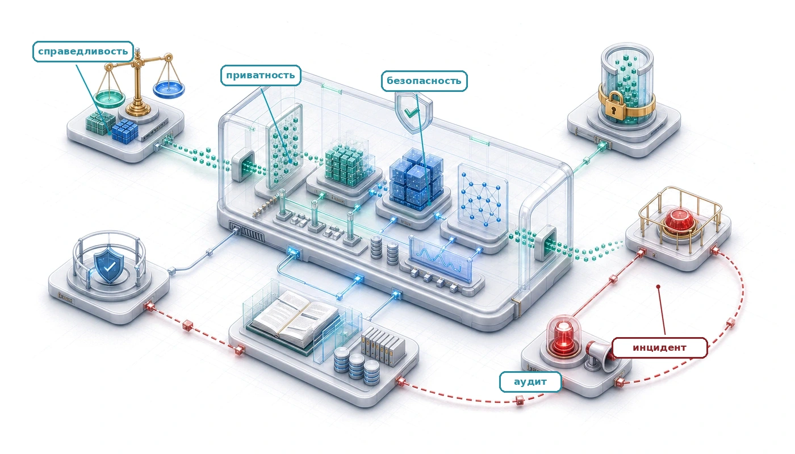
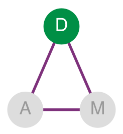
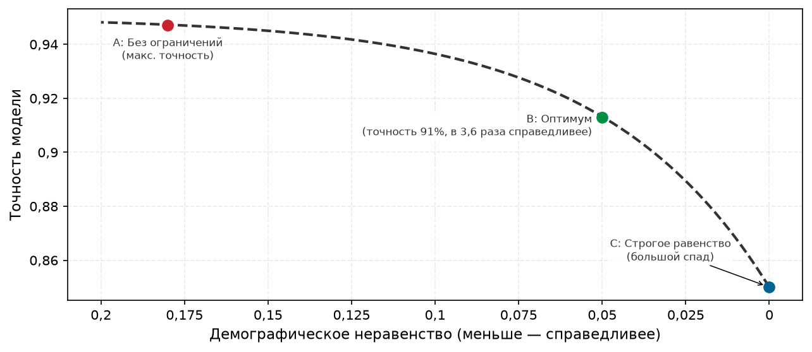
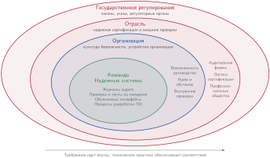
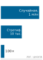
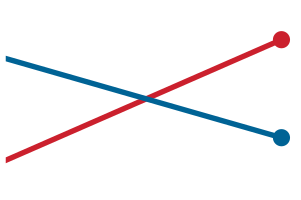
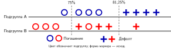
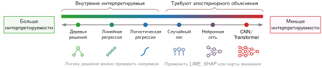
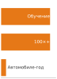
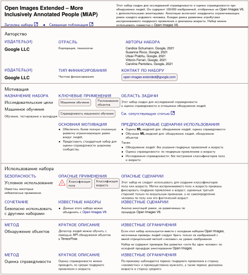

<a id="sec-responsible-engineering"></a>

# Ответственная инженерия



## Назначение

_Почему система, которая делает ровно то, что ей велели, все равно может причинять вред?_

Эксплуатация ставит цели низкой задержки, высокой доступности и устойчивого качества предсказаний. Ответственная инженерия спрашивает, описывают ли эти цели правильное поведение, кому служит система и какие издержки спецификация оставляет неизмеренными. ML-система может выполнять требования по задержке, пропускной способности и совокупной точности и при этом воспроизводить историческую дискриминацию, поощрять вредное вовлечение, расходовать энергию без оправдания или использовать данные без достаточных средств защиты конфиденциальности и подотчетности. Такая система не сломалась: она эффективно оптимизирует неполную спецификацию. Пропущенные ограничения проявляются в неравномерных результатах для разных групп населения, в совокупной стоимости и выбросах за весь срок службы, в решениях, которые люди не могут понять или оспорить, и в свидетельствах, которые нельзя восстановить после причинения вреда. Если эти последствия не определены как требования до развертывания и не отслеживаются после него, обычные проверки работоспособности могут оставаться зелеными, пока вред накапливается. Ответственная инженерия рассматривает их как сбои системы, которые нужно диагностировать, измерять и смягчать с той же строгостью, что и регрессии задержки или точности. Для этого широкие обязательства нужно перевести в проверяемые границы, задокументированные допущения, прослеживаемые данные и пути реагирования, которые остаются выполнимыми в продакшене. В терминах D·A·M ответственность расширяет определение корректности: данные нужно проверять на закодированный вред и законность использования, алгоритмы должны быть ограничены обоснованными требованиями к результатам и эффективности, а машинная инфраструктура должна отслеживать, документировать и обеспечивать соблюдение этих границ на протяжении всего жизненного цикла системы.

> **Цели обучения**
>
> - Объяснить, как оптимизированные ML-системы могут усиливать вред через прокси-переменные, петли обратной связи и сдвиг распределения
> - Применить диагностику «данные–алгоритм–машина», чтобы локализовать сбои ответственности в данных, целях алгоритма или инфраструктуре мониторинга
> - Вычислять метрики справедливости по матрицам ошибок и сравнивать компромиссы на фронте Парето «справедливость–точность»
> - Проектировать оценку по подгруппам, стресс-тестирование и мониторинг, которые выявляют сбои, специфичные для подгрупп, до развертывания
> - Анализировать совокупную стоимость, доминирование вывода и углеродный след как измеримые ограничения ответственности
> - Строить карточки моделей, паспорта данных, записи о происхождении данных и журналы аудита для подотчетности
> - Оценивать решения по конфиденциальности, контролю доступа и соответствию требованиям с точки зрения нормативных требований и человеческого контроля

<a id="sec-responsible-engineering-responsibility-systems-engineering-5cfd"></a>

## Ответственность как системная инженерия

В 2014 году Amazon создала инструмент для подбора персонала на основе ИИ[^fn-amazon-recruiting-scale]. Он занижал оценки резюме, в которых встречалось слово «women's» (как в словосочетании «капитан шахматного клуба для женщин»), и понижал кандидатов, окончивших женские колледжи. Система точно оптимизировала заявленную цель: находить кандидатов, похожих на тех, кого уже нанимали. У нее не было ни сбоя выполнения, ни ошибки оптимизации; исторические практики найма закодировали гендерное смещение, которое градиентный спуск систематически воспроизводил в масштабе.

[^fn-amazon-recruiting-scale]: **Инструмент подбора персонала Amazon**: разработка началась в 2014 году в инженерной команде Amazon в Эдинбурге. Система оценивала кандидатов по шкале от 1 до 5 и обучалась примерно на десяти годах резюме, в основном мужских, что отражало гендерное соотношение в технологическом секторе. К 2015 году гендерное смещение было выявлено, а к 2017 году проект закрыли после неоднократных попыток исправления (Dastin, 2018). Главной ценой была не вычислительная мощность, а упущенная возможность: многолетний проект подбора персонала провалился, потому что цель закодировала историческое смещение. Это задокументированный сбой спецификации в ML-инструментах.

Если MLOps — это контур управления для *надежности*, то **ответственная инженерия** — контур управления для *безопасности*. MLOps следит за состоянием системы в работе и запускает переобучение, когда прогностическая пропускная способность падает. Ответственная инженерия отслеживает распределения результатов и запускает вмешательство, когда система порождает вред. В терминах системной инженерии модель может пройти *верификацию* (точно соответствовать заданной цели обучения), но провалить *валидацию* (не удовлетворять эксплуатационным, безопасностным или правовым требованиям) (National Aeronautics and Space Administration, 2016). Сбой вызван неполной спецификацией, а не ошибкой в исполнении компилятора или численной оптимизации.

Традиционная программная инженерия изолирует дефекты внутри модулей, хотя общие зависимости по-прежнему могут распространять ошибки. Системы машинного обучения вводят зависимость от данных: данные проходят через общие представления, поэтому испорченные или смещенные входы меняют плотные матрицы параметров, которые обслуживают каждый последующий вывод. Смещенный обучающий набор не вызывает ошибку компиляции или аварийное завершение во время выполнения; он незаметно сдвигает границы решений по всей системе. «Таксономия D·A·M» из приложения формализует диагностическую схему, которая локализует, на какой из трех осей D·A·M возникает сбой: нерепрезентативные или смещенные входы (данные), несогласованные формулировки функции потерь (алгоритм) или слепые зоны телеметрии в инфраструктуре обслуживания (машина). Благодаря этому ответственность становится архитектурным инвариантом, а не исправлением, которое делают после развертывания.

Ответственная инженерия расширяет определение корректности для систем машинного обучения. Традиционная корректность (численная устойчивость, ограниченная задержка и высокая доступность сервиса) остается необходимой, но недостаточной. Продакшен-система должна удовлетворять более широким эксплуатационным границам: ограниченным различиям ошибок между демографическими срезами, обоснованным затратам энергии и проверяемой родословной данных. Такое расширенное понятие корректности применяет инженерную дисциплину к режимам отказа, которые агрегированные метрики качества игнорируют. Всплеск p99-задержки запускает автоматические оповещения на операционной панели, а регрессия справедливости по демографическим группам остается невидимой для агрегированных метрик потерь, пока не причинит реальный вред (принцип [«Модель смещения обратной связи»](part_deploy.md#pri-bias-feedback)). Оба случая требуют строгой телеметрии и автоматического регрессионного тестирования.

Соблюдение расширенной корректности требует аппаратной и инфраструктурной поддержки данных, способной измерять то, что скрывают агрегированные бенчмарки. Бюджеты энергии и занимаемые ускорителями площади, которые количественно описаны в этой книге, напрямую переводятся в выбросы углерода, и поэтому оптимизация эффективности становится физическим ограничением ответственности наравне с задержкой обслуживания. Инфраструктура управления данными, включая политики контроля доступа, отслеживание родословной данных и неизменяемые журналы аудита, делает эти эксплуатационные границы обязательными в продакшене. Однако прежде чем строить эти средства контроля, архитекторы систем должны выделить, где и почему математическая сходимость расходится с безопасностью системы: структурный разрыв между минимизацией скалярной функции потерь и реальными результатами.

<a id="sec-responsible-engineering-engineering-responsibility-gap-6f6f"></a>

## Инженерный разрыв ответственности

Модель кредитования, которая одобряет 95 процентов квалифицированных заявителей из группы большинства, но отказывает 40 процентам одинаково квалифицированных заявителей из группы меньшинства, может при этом иметь низкие агрегированные потери. **Разрыв ответственности** между этой *технической корректностью* и *ответственными результатами* — центральная проблема инженерии систем машинного обучения, к которой существующие методы тестирования не были приспособлены. Разрыв проявляется через конкретные механизмы: прокси-переменные, петли обратной связи и сдвиг распределения. Каждый из них причиняет вред по своему пути, который обычный мониторинг оставляет невидимым.

<a id="sec-responsible-engineering-optimization-succeeds-systems-fail-1a22"></a>

### Когда оптимизация удается, а системы терпят неудачу

Провал инструмента подбора персонала Amazon иллюстрирует этот разрыв на оси данных таксономии D·A·M (см. выносной локатор на полях). Сбой вызван историческим обучающим сигналом, а не дефектом алгоритма или программного обеспечения. Модель, обученная на десятилетии исторических данных о найме, добросовестно оптимизировала заданную цель, но эти исторические паттерны закодировали гендерное смещение, которое система воспроизводила в оценках кандидатов (Dastin, 2018).



*Провал Amazon — сбой по оси данных: смещенный исторический сигнал.*

В рамках эмпирической минимизации риска модель минимизировала функцию классификационных потерь, выявляя корреляции на уровне токенов в корпусе резюме. Поскольку исторически технические сотрудники были в основном мужчинами, токены, связанные с женскими колледжами, организациями или активностями, имели отрицательные статистические корреляции с положительными метками найма. Алгоритм оптимизации точно извлек эмпирическое распределение обучающих данных, но это распределение отражало исторические практики найма, а не компетентность кандидатов. Многомерные текстовые представления кодируют и усиливают эти статистические закономерности, встраивая социальные смещения непосредственно в последующие векторные представления (Bolukbasi et al., 2016).

Amazon попыталась исправить ситуацию, удалив из конвейера обучения явные признаки пола и гендерно окрашенные термины. Это вмешательство не обеспечило непредвзятости рекомендаций: в многомерных пространствах признаков сохраняются **прокси-переменные**, которые несут демографический сигнал.[^fn-proxy-variable-bias] Удаление отдельных атрибутов не затрагивает коррелирующие признаки: почтовые индексы коррелируют с расой через жилую сегрегацию, имена заявителей — с этнической принадлежностью, а использование медицинских услуг — с социально-экономическим положением. В конвейере резюме Amazon даже после удаления явных гендерных терминов оставшаяся лексика, включая учебу в определенных колледжах или участие в отдельных студенческих организациях, продолжала кодировать паттерны, коррелирующие с полом (Dastin, 2018). Поэтому удаление защищенных атрибутов из обучающих данных недостаточно, чтобы гарантировать справедливость.

[^fn-proxy-variable-bias]: **Прокси-переменная**: удаление одного прокси может мало что изменить, если другие коррелирующие признаки сохраняют похожий сигнал. И наоборот, сама корреляция не доказывает дискриминацию и не указывает на нужное вмешательство. Удаление защищенных атрибутов, оценка по подгруппам, контрфактические тесты, причинный анализ и проверка всего процесса принятия решений дают взаимодополняющие доказательства; ни одна диагностика не является полной защитой.

Эффективное исправление требует архитектурных вмешательств на протяжении всего жизненного цикла системы, а не поверхностного фильтра данных. На уровне оценки тестирование по демографическим подгруппам количественно показывает различия в распределении оценок до развертывания. На уровне алгоритма состязательное устранение смещения, при котором вспомогательная сеть пытается предсказать защищенные атрибуты по промежуточным представлениям, а основная модель штрафуется за сохранение этого сигнала, может подавить чувствительные признаки, но все равно требует постоянной проверки по подгруппам. На операционном уровне ручная проверка пограничных оценок защищает только тогда, когда проверяющие обучены, наделены полномочиями и подлежат аудиту, а не используются для формального одобрения выводов модели. Наконец, на уровне мониторинга отслеживание итоговых решений о найме во времени выявляет непропорциональное воздействие, которое скрывают офлайн-метрики потерь. Поскольку встроить эти защиты в существующий конвейер оказалось технически невыполнимо, Amazon закрыла проект (Dastin, 2018).

<a id="ws-responsible-engr-compas-recidivism-algorithm-audit"></a>

> **Аудит алгоритма рецидивизма COMPAS (2016)**
>
> **Контекст**: COMPAS — инструмент оценки рисков, который используется в американских судах для прогноза повторных правонарушений при решениях о залоге и приговоре (Angwin et al., 2016).
>
> **Механизм**: оптимизация калибровки между популяциями с разными базовыми уровнями рецидивизма вынуждала к математическим компромиссам между предиктивным паритетом и балансом ошибок между расовыми группами.
>
> **Последствия**: чернокожие обвиняемые, которые не совершили повторного правонарушения, ошибочно помечались как высокорисковые почти вдвое чаще, чем белые обвиняемые (44,9 процента против 23,5 процента), тогда как белые рецидивисты гораздо чаще ошибочно получали низкий риск.
>
> **Реакция**: аудит показал, почему одной калибровки недостаточно, чтобы решить, приемлемо ли распределение ошибок. Любой юрисдикции, которая использует такие оценки, нужны явная политика о том, какие критерии справедливости важны, независимая проверка по группам и анализ того, как оценка входит в процесс принятия решений.
>
> **Системный урок**: оценки были примерно откалиброваны по расе, но нарушали равенство шансов, потому что доли ложноположительных и ложноотрицательных результатов не совпадали между группами. Формальные результаты показывают, что калибровка и паритет ошибок конфликтуют при разных базовых частотах, поэтому ответственная инженерия требует явного выбора того, какое ограничение справедливости важно.

Инструмент подбора персонала Amazon и система оценки рисков COMPAS[^fn-compas-recidivism-score] иллюстрируют главный тезис этого раздела: успех оптимизации может сосуществовать с катастрофическим сбоем системы. Ни одна из моделей не страдала от программной ошибки или сбоя оборудования. В обоих случаях алгоритм оптимизации работал правильно относительно заданной цели. Сбой был архитектурным: неполной постановкой задачи. Когда *техническая цель* (минимизация эмпирической ошибки предсказания или достижение статистической калибровки) расходится с *спецификацией системы* (справедливые и обоснованные результаты для пользовательских популяций), высокая математическая точность относительно функции потерь напрямую усиливает вред.

[^fn-compas-recidivism-score]: **COMPAS (Correctional Offender Management Profiling for Alternative Sanctions)**: в проанализированных данных оценки COMPAS были примерно откалиброваны по расе, то есть одна и та же оценка соответствовала сходной наблюдаемой вероятности повторного правонарушения в разных группах. Поскольку распространенность рецидивизма различалась между популяциями, калибровка сосуществовала с неравными долями ошибок (Chouldechova, 2017; Kleinberg et al., 2017). Поэтому одного тестирования калибровки было недостаточно, чтобы установить паритет долей ошибок или определить, приемлемо ли распределение ошибок.

Стандартная продакшен-телеметрия не способна обнаружить сбои спецификации. Конвейеры мониторинга отслеживают эксплуатационные инварианты (задержку вывода, использование памяти, пропускную способность и агрегированные потери на валидации), и все они остаются в норме, пока модель систематически неравномерно распределяет ошибки между подгруппами. Конвейер может удовлетворять техническую верификацию (строго соответствовать своему коду и функции потерь), но полностью провалить валидацию системы (нарушая эксплуатационные и общественные требования). Чтобы предотвратить тихие сбои спецификации, метрики ответственности должны стать частью основного тестового контура: нужно проверять, служит ли функция потерь обоснованным прокси для истинной цели системы, и обеспечивать паритет долей ошибок по подгруппам до развертывания.

<a id="chk-responsible-engr-responsible-design"></a>

> **Ответственный дизайн**
>
> Ответственность — это свойство системы, а не свойство модели.
>
> **Режимы отказа**
>
> - **Согласованность целей**: проверьте, является ли функция потерь обоснованным прокси для истинной цели системы.
> - **Непропорциональное воздействие**: сравнивайте доли ошибок по подгруппам, а не полагайтесь на агрегированную точность.
>
>
> **Проверка**
>
> - **Пре-мортем**: до развертывания спросите: «Если эта система вызовет скандал через шесть месяцев, что, вероятно, пошло не так?»

<a id="sec-responsible-engineering-silent-failure-modes-e219"></a>

### Тихие режимы отказа


*Одно изменение выше по потоку; многие затронуты незаметно.*

Рассмотрим модель сепсиса в больнице, которая начинает рекомендовать агрессивное лечение пациентам с низким риском после того, как изменение рабочего процесса электронной медицинской карты (EHR) повлияло на то, как регистрируются витальные показатели. Как показано на полях, единственное изменение выше по потоку распространяется по радиусу поражения системы без всякого оповещения: уверенность модели остается высокой, задержка вывода укладывается в соглашение об уровне обслуживания, а все проверки работоспособности показывают норму. Сбой незаметен: распределение входных данных сместилось, но конвейер эксплуатационного мониторинга не имеет механизма для обнаружения дрейфа распределения.

<a id="dfn-responsible-engr-distribution-shift"></a>

> **Сдвиг распределения**
>
> ***Сдвиг распределения***, введенный в [«Введение»](01_introduction.md#sec-introduction) и переведенный в практику обнаружения дрейфа в [«MLOps»](14_ml_ops.md#sec-ml-operations), возникает, когда распределение при развертывании отличается от распределения, на котором модель разрабатывали или оценивали. Стандартная минимизация эмпирического риска обычно предполагает, что обучающее и эксплуатационное распределения совпадают. Ковариатный сдвиг меняет $p(x)$ при стабильном $p(y \mid x)$; сдвиг меток меняет $p(y)$ при стабильном $p(x \mid y)$; концептуальный дрейф меняет $p(y \mid x)$.
>
> 1.  **Значение**: статистики расхождения, например дивергенция Йенсена–Шеннона $\mathcal{D}_{\text{JS}}(P_t \lVert P_0)$, измеряют изменение распределения, а не деградацию точности. Полезные пороги оповещений нужно калибровать эмпирически для каждой задачи, представления, процесса разметки и среды развертывания, а затем соотносить с наблюдаемыми результатами, когда метки доступны. Значение $\mathcal{D}_{\text{JS}}$, равное 0,1, может быть безвредным для одного пространства признаков и серьезным для другого, а мониторинг расхождения входов может пропустить концептуальный дрейф.
> 2.  **Различие**: сдвиг распределения описывает изменение между условиями разработки и развертывания. Он не означает, что выученное отображение было верным в момент обучения, и не каждый сдвиг снижает качество.
> 3.  **Распространенная ловушка**: сдвиг распределения — зонтичный термин с несколькими перекрывающимися таксономиями. Мониторинг одного только $p(x)$ может обнаружить некоторые ковариатные изменения, но не может установить, остается ли $p(y \mid x)$ стабильным; обнаружение концептуального дрейфа обычно требует размеченных результатов или обоснованных прокси.

Этот сценарий с сепсисом иллюстрирует класс сбоев, который мониторинг, сосредоточенный на доступности, обнаружить не может. В традиционных программных системах катастрофические сбои обычно громкие: исключение нулевого указателя прерывает выполнение, ошибка сегментации останавливает процесс, а исчерпанный пул сокетов возвращает сетевой таймаут. Системы машинного обучения вводят статистические режимы отказа, при которых испорченные или деградировавшие выходы неотличимы от корректных предсказаний. Тензоры с плавающей точкой продолжают проходить через ядра матричного умножения, выполнение на ускорителе укладывается в бюджеты задержки, а последующие сервисы получают структурно корректные ответы.

Сдвиг распределения — первый крупный механизм этой тихой деградации (операционные методы обнаружения и мониторинга дрейфа подробно описаны в [«MLOps»](14_ml_ops.md#sec-ml-operations)). Сбой носит внешний характер: физическое распределение входов изменилось после обучения, но у модели нет внутренней телеметрии, чтобы заметить расхождение. Переобучение на свежих данных может частично восстановить точность при сдвиге распределения. Однако переобучение не устраняет второй, более фундаментальный механизм тихого сбоя, который сохраняется даже тогда, когда распределение данных абсолютно стационарно: рассогласование метрик.

Рассогласование метрик возникает, когда функция цели оптимизирует наблюдаемую прокси-метрику, которая расходится с ненаблюдаемым результатом, который система должна обеспечивать. Как показано на полях, это расхождение описывает закон Гудхарта: как только прокси-метрика становится целью оптимизации, она перестает быть надежной мерой истинной цели.


*За точкой излома прокси отрывается от цели.*

<a id="psp-responsible-engr-alignment-gap"></a>

> **Разрыв согласованности**
>
> Модель оптимизирует прокси-метрику (клики), потому что истинная метрика (удовлетворенность пользователя) не наблюдаема, и эти две метрики могут резко расходиться. Закон Гудхарта предупреждает, что оптимизация меры может ослабить ее связь с исходной целью. В иллюстративной системе $\text{Correlation}(\text{Clicks}, \text{Satisfaction})$ может начинаться с 0,8; как только ранжирование максимизирует клики, оно может найти кликбейт с высоким числом кликов и низкой удовлетворенностью, и корреляция может упасть до 0,2.
>
> Концептуально, если считать метрики нормированными на общей шкале, [«разрыв согласованности»](15_responsible_engr.md#eq-alignment-gap) описывается так:
> <a id="eq-alignment-gap"></a>
>
> $$ \text{Разрыв} = \mathbb{E}[\text{Прокси}] - \mathbb{E}[\text{Истина}] $$
>
> Если модель повышает клики на 20 процентов, но снижает удовлетворенность на 5 процентов, знаковый разрыв согласованности растет.
>
> **Системный вывод**: инженеры не могут напрямую оптимизировать ненаблюдаемую цель. Им нужна обоснованная валидация прокси; рандомизированные контрольные выборки (holdout) могут оценить причинные эффекты только тогда, когда их результаты измеряют цель или обоснованный суррогат.

Разрыв согласованности иллюстрирует сбой, возникающий по оси алгоритма: функция потерь оптимизирует неверно заданную цель, поэтому даже модель, которая обобщает с нулевой ошибкой на тесте, порождает результаты, противоречащие целям организации или общества. Сдвиг распределения, напротив, возникает по оси данных: логика модели остается неизменной, но распределение входов уходит от обучающего. Оба сбоя тихие, но требуют противоположных инженерных ответов: переработки функции потерь в одном случае и мониторинга входов с переобучением в другом. Их смешение тратит инженерные ресурсы на неэффективные исправления. Чтобы выделить первопричину тихих сбоев, инженеры системы применяют таксономию D·A·M, введенную в [«Введение»](01_introduction.md#sec-introduction) и формализованную в «Таксономии D·A·M» из приложения.

<a id="psp-responsible-engr-d-m-taxonomy"></a>

> **Таксономия D·A·M**
>
> Когда система причиняет вред, используйте таксономию D·A·M, чтобы найти первопричину. Сбои ответственности редко бывают «ошибками алгоритма»; это структурные дефекты по одной из трех осей:
>
> *   **Данные (информация)**: отражают ли обучающие данные исторические смещения? (например, инструмент подбора персонала Amazon, который учился на смещенной истории). Сбой находится в *топливе*.
> *   **Алгоритм (логика)**: оптимизирует ли функция цели прокси для вреда? (например, оптимизация «вовлеченности» усиливает поляризацию). Сбой находится в *чертеже*.
> *   **Машина (физика)**: оправдывает ли энергетическая стоимость общественную пользу? (например, обучение огромной модели для тривиальной задачи). Сбой находится в *двигателе*.
>
> Определение доминирующего сбоя в таксономии указывает первое исправление, которое стоит проверить: более качественную курацию (данные), более безопасные цели (алгоритм) или более эффективную инфраструктуру (машина). Реальные сбои могут затрагивать несколько осей, поэтому вмешательство все равно нужно оценивать сквозным образом.

Пока таксономия D·A·M выделяет *где* возникают сбои, инженерия эксплуатации требует понимать, *когда* и *как* различные режимы отказа проявляются в продакшен-телеметрии. [«Иллюстративная таксономия режимов отказа ML-системы»](15_responsible_engr.md#tbl-failure-modes) классифицирует сбои ML-систем по задержке обнаружения, пространственному радиусу поражения и мерам восстановления. Если традиционные падения инфраструктуры и узкие места пропускной способности сразу вызывают оповещения, статистические сбои действуют тихо: они сохраняются днями или месяцами, пока технические проверки работоспособности остаются зелеными.

| **Тип сбоя**                | **Иллюстративное время обнаружения** | **Иллюстративный охват** | **Возможная реакция**               | **Пример**                                   |
|:----------------------------|:-------------------------------------|:-------------------------|:------------------------------------|:---------------------------------------------|
| **Аварийное завершение**    | Немедленно                           | Полный                   | Перезапуск после устранения причины | Ошибка нехватки памяти                       |
| **Деградация производительности** | Минуты                         | Полный                   | Снятие конкуренции за ресурсы       | Всплеск задержки из-за конкуренции за ресурсы |
| **Качество данных**         | Часы–дни                             | Частичный                | Может понадобиться исправление данных | Испорченные входы из вышестоящей системы   |
| **Сдвиг распределения**     | Дни–недели                           | Частичный или полный     | Может потребоваться адаптация       | Изменение популяции из-за нового пользовательского сегмента |
| **Нарушение справедливости** | Недели–месяцы                       | Подгруппа                | Может потребоваться переработка     | Усиление смещения в исторических паттернах   |

<a id="tbl-failure-modes"></a>

***Иллюстративная таксономия режимов отказа ML-системы**: время обнаружения, охват и реакция зависят от приложения; в таблице приведены типичные случаи. Тихие сбои, такие как проблемы качества данных, сдвиг распределения и нарушения справедливости, могут требовать проактивного мониторинга, потому что не обязательно вызывают традиционные оповещения.*

Петля обратной связи YouTube (рассмотренная как паттерн технического долга в [«Производственные паттерны долга»](14_ml_ops.md#sec-ml-operations-production-debt-patterns-ffdc)) иллюстрирует этот паттерн в масштабе: Ribeiro et al. (2020) проанализировали пути радикализации на YouTube и обнаружили переход от умеренных категорий каналов к более экстремальным, а также досягаемость этих категорий через рекомендации.[^fn-goodhart-law-proxy] Более широкий системный урок в том, что петли обратной связи могут работать точно так, как спроектированы, и при этом порождать результаты, противоречащие общественным ценностям. Поэтому цели рекомендаций нужно проверять на последствиях для пользователей и общества, а не только на прокси вовлеченности.

[^fn-goodhart-law-proxy]: **Закон Гудхарта**: «Когда мера становится целью, она перестает быть хорошей мерой» (обобщение Стратерна наблюдения Гудхарта 1975 года о денежно-кредитной политике) (Strathern, 1997; Goodhart, 1984). Петли обратной связи в рекомендациях — канонический ML-пример: градиентный спуск оптимизирует прокси времени просмотра с такой скоростью, с какой не справится ни один человек-куратор, а выходы системы сами меняют обучающее распределение. Пользователи, которые потребляют экстремальный контент, порождают данные, которые усиливают экстремальность, и отрывают прокси от благополучия пользователей на порядки быстрее, чем могли бы ручные редакционные процессы.

Перестройка ленты новостей Facebook дает поучительный контраст с петлей обратной связи YouTube: инженерная команда намеренно пожертвовала краткосрочными метриками вовлеченности, чтобы остановить отрыв прокси и защитить долгосрочное удержание пользователей (Mosseri, 2018).

<a id="exmp-responsible-engr-news-feed-proxy-shift"></a>

> **Смещение прокси в ленте новостей**
>
> **Сценарий**: Facebook перевела цели ранжирования ленты новостей с краткосрочных прокси вовлеченности (клики, время просмотра) на метрики содержательного социального взаимодействия (Mosseri, 2018).
>
> **Диагностика**: оптимизация только по краткосрочным прокси вовлеченности отрывала выходы ранжирования от долгосрочного благополучия пользователей и усиливала кликбейт и пассивное потребление.
>
> **Системный урок**: метрики вовлеченности — это прокси ценности, а не сама ценность. Алгоритмы рекомендаций требуют многоцелевой оптимизации с явными ограничениями безопасности, чтобы предотвратить коллапс прокси.

Когда рассогласование прокси пересекается с демографической неоднородностью, тихие сбои проявляются как структурная дискриминация. Сдвиг распределения часто выглядит как несоответствие когорт: модели, оцененные на агрегированных бенчмарках, ненадежно работают на конкретных демографических подгруппах, и при этом не срабатывает тревога по агрегированной ошибке. Когда цель обучения оптимизирует прокси, отражающий исторические неравенства, модель кодирует эти различия в своих границах решений. Именно этот механизм заставил экспериментальный инструмент подбора персонала Amazon понижать резюме со словом «women's», а затем проявился с опасными для жизни последствиями в клинической сортировке пациентов.

<a id="ws-responsible-engr-proxy-variable-trap"></a>

> **Ловушка прокси-переменной (2019)**
>
> **Контекст**: в 2019 году Зиад Обермейер (Ziad Obermeyer) и его коллеги из Калифорнийского университета в Беркли проанализировали коммерческий алгоритм Optum, который системы здравоохранения использовали, чтобы включать пациентов со сложными потребностями в программы управления помощью для пациентов группы высокого риска. Они изучили примерно пятьдесят тысяч пациентов одной крупной университетской больницы (Obermeyer et al., 2019).
>
> **Механизм**: модель предсказывала «будущие расходы на здравоохранение» как прокси «будущей потребности в медицинской помощи». Поскольку система здравоохранения США тратит на чернокожих пациентов меньше, чем на белых пациентов с тем же уровнем заболевания, алгоритм выучил этот паттерн и присваивал чернокожим пациентам более низкие оценки риска.
>
> **Последствия**: при любом заданном уровне оценки риска чернокожие пациенты имели значительно больше хронических заболеваний, чем белые пациенты, поэтому доля чернокожих пациентов, зачисляемых в специализированную помощь, снижалась.
>
> **Реакция**: исследование показало, что замена расходов прямой мерой медицинской потребности повысила бы долю чернокожих пациентов, выявляемых для дополнительной помощи, с 17,7 процента до 46,5 процента при анализируемом пороге.
>
> **Системный урок**: оптимизация по прокси наследует смещения системы, которая этот прокси породила. Связь «прокси–цель» нужно проверять по каждой демографической подгруппе, которую обслуживает система.

Тихие режимы отказа принципиально меняют системный контракт между программной инженерией и эксплуатационной верификацией. Традиционная программная верификация опирается на детерминированные утверждения: модульный тест проверяет, что выход совпадает с точным значением, проверки границ памяти утверждают, что выделение буферов не переполняется, а сторожевые таймеры следят, чтобы задержки RPC не нарушали соглашения об уровне обслуживания. В ML-системе корректность нельзя подтвердить одними только детерминированными инвариантами. Матричные умножения с плавающей точкой выполняются чисто, использование памяти остается стабильным, а проверки задержки остаются зелеными, даже когда модель выдает смещенные, некалиброванные или вредные предсказания. Чтобы перевести цели ответственности в структурированную инженерную практику, нужна операционализация статистической верификации: непрерывный мониторинг ковариатного сдвига по демографическим срезам, аудит соответствия «прокси–цель» и ограничение замкнутых петель обратной связи до того, как тихие ошибки распространятся по продакшену.

<a id="sec-responsible-engineering-responsible-engineering-succeeds-29e0"></a>

### Когда ответственная инженерия работает

Каждый задокументированный успех имеет один и тот же структурный ход: расплывчатая цель ответственности становится инженерным ограничением, которое можно задать, проверить, сообщить и, при необходимости, использовать для остановки развертывания. Следуя выводам Gender Shades, аудита 2018 года, который выявил серьезные различия в доле ошибок при коммерческой классификации пола (Buolamwini and Gebru, 2018), Microsoft инвестировала в улучшение классификации пола по демографическим группам. Целевой сбор данных, изменения модели и систематическая оценка по подгруппам дали команде явную целевую долю ошибок и снизили аудированную долю ошибок для людей с более темной кожей ниже 2 процентов (Raji and Buolamwini, 2019). Публикация этих раздельных бенчмарков создала проверяемую основу и превратила внешние выводы аудита в эксплуатационный барьер выпуска.

Автоматическая обрезка изображений в Twitter показывает ту же дисциплину при другом ограничении. В 2020 году пользователи выразили обеспокоенность расовым и гендерным смещением в предпросмотре миниатюр. Twitter провела аудит системы, опубликовала измеренные различия и ограничения и перешла к предпросмотру без обрезки, который дал пользователям больше контроля (Yee et al., 2021). В этом случае ответственная инженерия изменила дизайн продукта, а не ограничилась постепенной настройкой порога автоматического ранжирования.

Дифференциальная приватность формализует этот паттерн: требование приватности становится математической гарантией, а не политическим намерением (Dwork, 2008).[^fn-differential-privacy-tradeoff] Системы с дифференциальной приватностью калибруют добавляемый шум так, чтобы сбалансировать полезность и потерю приватности, отслеживают совокупный расход приватности в повторных анализах с помощью бухгалтера приватности (privacy accountant) и документируют выбранные параметры.

[^fn-differential-privacy-tradeoff]: **Дифференциальная приватность**: понятие введено в работе (Dwork et al., 2006). Рандомизированный механизм $\mathcal{M}$ удовлетворяет $(\epsilon, \delta)$-дифференциальной приватности, если для всех соседних наборов данных $D, D'$, различающихся одной записью, и всех множеств выходов $\mathcal{S}$ выполняется $\mathbb{P}[\mathcal{M}(D) \in \mathcal{S}] \leq e^\epsilon \cdot \mathbb{P}[\mathcal{M}(D') \in \mathcal{S}] + \delta$. Здесь $\epsilon$ ограничивает потерю приватности, а $\delta$ допускает малую вероятность превышения этой границы; приемлемые значения зависят от модели угроз и политики. Инженерный компромисс связан с полезностью, а не только со сложностью реализации: более сильная приватность часто требует больше шума или более жесткой выборки, а потери приватности складываются при повторных запросах или шагах обучения. Поэтому инженеры должны отслеживать совокупную потерю приватности с помощью корректного бухгалтера и сообщать допущения, на которых основан выбранный бюджет.

Эти успехи показывают, что ответственная инженерия работает только тогда, когда высокоуровневые принципы переводятся в применимые системные ограничения по всему стеку D·A·M: курация распределений обучающих данных, ограничение функций потерь алгоритма или учет бюджетов приватности в среде выполнения. Соблюдение этих ограничений требует операционных полномочий приостанавливать развертывание или выводить из эксплуатации компоненты, которые нарушают заданные границы. Каждое успешное вмешательство опирается на непрерывную оценку, однако проверка этих статистических ограничений принципиально отличается от традиционной программной верификации.

<a id="sec-responsible-engineering-testing-challenge-77b0"></a>

### Проблема тестирования

Традиционное программное тестирование оценивает поведение по однозначным спецификациям: арифметическая функция должна возвращать точную сумму своих операндов, а реляционная база данных должна сохранять целостность внешних ключей. Такие детерминированные свойства непосредственно сопоставляются с исполняемыми утверждениями.

Свойства ответственного машинного обучения плохо поддаются простой формализации. У **справедливости** есть несколько математических определений, которые могут противоречить друг другу в таких условиях, как неравные базовые частоты и несовершенное предсказание (Chouldechova, 2017; Kleinberg et al., 2017). Что считать справедливым, зависит от контекста, ценностей и компромиссов, которые технические системы сами по себе разрешить не могут. Индивидуальная справедливость требует, чтобы похожие люди получали похожее отношение, а групповая справедливость требует равноправных результатов для демографических категорий. Эти критерии могут конфликтовать, и выбор между ними требует ценностных суждений, которые выходят за рамки оптимизации.

Ограничения справедливости и точность предсказания могут находиться в компромиссе, но характер этой связи зависит от приложения. Фронт Парето описывает конфигурации, при которых нельзя улучшить одну из отображаемых целей, не ухудшив другую. [«Иллюстративный фронт Парето «справедливость–точность»»](15_responsible_engr.md#fig-fairness-frontier) показывает один гипотетический фронт «справедливость–точность». Три его точки иллюстрируют возможные решения о политике; они не означают, что обучение без ограничений всегда максимизирует точность при высоком неравенстве, что нулевое неравенство обязательно снижает точность или что у каждого приложения есть точка оптимального баланса.

<a id="fig-fairness-frontier"></a>



***Иллюстративный фронт Парето «справедливость–точность»**: гипотетическая связь между точностью модели и демографическим неравенством. Ось x перевернута, поэтому меньшее неравенство находится справа. Точки A, B и C иллюстрируют три возможных рабочих выбора вдоль этой построенной кривой; кривая не является эмпирическим или универсальным законом.*

Фронт говорит инженерам, между какими компромиссами им, возможно, придется выбирать, но построить его нельзя, пока не измерена эффективность по подгруппам. Ответственные свойства становятся проверяемыми, когда инженеры вместе с заинтересованными сторонами определяют критерии, подходящие для конкретного приложения. Проект Gender Shades[^fn-gender-shades-audit] показал, как **раздельная оценка** по демографическим категориям выявляет различия, невидимые в агрегированных метриках (Buolamwini and Gebru, 2018), и тем самым вскрывает сбои подгрупп, которые мониторинг ответственности должен ловить до развертывания. В [«Частотах ошибок Gender Shades для Face++»](15_responsible_engr.md#tbl-gender-shades-results) видны резкие различия в частоте ошибок, которые коммерческие системы классификации пола давали для разных демографических групп. Конкретно: тестовый набор из 10 000 примеров, которого достаточно для группы большинства, дает всего 100 примеров для подгруппы меньшинства, составляющей 1 процент населения. То есть для уверенной валидации на ней требуется примерно в 100 раз больше данных, чем для группы большинства.

[^fn-gender-shades-audit]: **Gender Shades**: исследование 2018 года, в котором Джой Буоламвини (MIT Media Lab) и Тимнит Гебру (Microsoft Research) проверили коммерческие системы классификации пола от Microsoft, IBM и Face++ с помощью шкалы типов кожи Фицпатрика. Эта шкала изначально была дерматологической классификацией, которую Томас Фицпатрик разработал в 1975 году для оценки чувствительности к ультрафиолету и которая позднее была подтверждена для клинического применения (Fitzpatrick, 1988). Здесь ее использовали как демографический эталон для алгоритмического аудита. Исследование показало ценность раздельной оценки: в результатах Face++, воспроизведенных в [«Частотах ошибок Gender Shades для Face++»](15_responsible_engr.md#tbl-gender-shades-results), частота ошибок для темнокожих женщин в 43,1 раза выше, чем для светлокожих мужчин. Последующие сообщения Microsoft о снижении ошибок показывают, как публичные результаты аудита могут стимулировать измеримое исправление (Raji and Buolamwini, 2019).

| **Демографическая группа** | **Частота ошибок (%)** | **Относительно светлокожих мужчин** |
|:---------------------------|:----------------------:|:-----------------------------------:|
| **Светлокожие мужчины**    | 0,8%                 | Базовая (1,0$\times$)               |
| **Светлокожие женщины**    | 9,8%                 | 12,2×                             |
| **Темнокожие мужчины**     | 0,7%                 | 0,9×                              |
| **Темнокожие женщины**     | 34,5%                | 43,1×                             |

<a id="tbl-gender-shades-results"></a>

***Частоты ошибок Gender Shades для Face++**: частота ошибок для темнокожих женщин в 43,1 раза выше, чем для светлокожих мужчин. Источник: (Buolamwini and Gebru, 2018).*

Как видно в [«Частотах ошибок Gender Shades для Face++»](15_responsible_engr.md#tbl-gender-shades-results), раздельная оценка выявила то, что скрывала агрегированная оценка. Face++ сообщала частоту ошибок 0,8 процента для светлокожих мужчин и 34,5 процента для темнокожих женщин (точность 99,2 процента и 65,5 процента соответственно). Агрегированная метрика не давала никаких признаков того, что частота ошибок для темнокожих женщин в 43,1 раза выше, чем для светлокожих мужчин.

Универсального порога допустимого неравенства не существует, но командам стоит установить явные, обоснованные границы до развертывания. Команда может принять в качестве политики выпуска, специфичной для приложения, отношение частот ошибок ниже 1,25$\times$ или разницу доли ложноположительных результатов менее 5 процентных пунктов. В трудовом праве США доктрина непропорционального воздействия (disparate impact)[^fn-disparate-impact-law] определяет регуляторный надзор, а правило четырех пятых[^fn-four-fifths-threshold] дает отдельную, не решающую диагностику коэффициента отбора. Ключевая инженерная дисциплина заключается в том, чтобы задавать критерии, соответствующие приложению и применимому праву, а не переносить порог одной предметной области на другую.

[^fn-disparate-impact-law]: **Непропорциональное воздействие (disparate impact)**: в деле *Griggs v. Duke Power Co.* (1971) Верховный суд США постановил на основании Раздела VII, что трудовая практика может быть незаконной из-за своего воздействия даже при отсутствии дискриминационного умысла (Supreme Court of the United States, 1971). Непропорциональное воздействие — правовой иск с элементами, которые определяются законом и конкретным контекстом; это не синоним любого статистического неравенства. Результаты модели и прокси могут служить релевантными доказательствами, но одни только метрики не устанавливают ответственность.

[^fn-four-fifths-threshold]: **Правило четырех пятых**: Единые руководящие принципы отбора сотрудников 1978 года используют правило четырех пятых как практический диагностический инструмент для отбора на работу (Equal Employment Opportunity Commission et al., 1978). Коэффициент отбора ниже 80 процентов от коэффициента группы с наибольшим показателем обычно рассматривается как свидетельство неблагоприятного воздействия. Однако руководящие принципы также признают, что меньшие различия могут иметь значение и что этот коэффициент не является решающим.

Чтобы выявить скрытые сбои ответственности до развертывания, тестирование нужно расширить за пределы единых валидационных наборов и охватить три различных режима проверки.

Оценка по срезам разбивает данные оценки на демографические и операционные когорты и вычисляет метрики для каждого среза отдельно. Модель может достигать 95 процентов общей точности и при этом падать до 78 процентов для заявителей с низким доходом или для сельских когорт. Это серьезное неравенство в качестве, которое не видно в агрегированной отчетности.

Тестирование инвариантности проверяет, остаются ли решения модели стабильными при семантически нерелевантных заменах признаков. Замена имен кандидатов, например «John» и «Jamal», в заявке на кредит не должна менять вероятность одобрения, если демографические признаки юридически и технически не относятся к кредитоспособности. Фреймворки поведенческого тестирования, такие как CheckList, реализуют этот принцип, организуя наборы валидации вокруг поведенческих возможностей и инвариантностей к возмущениям, а не вокруг статической валидационной потери (Ribeiro et al., 2020).

Тестирование границ и стресс-тестирование исследуют режимы входных данных, где эмпирических валидационных данных мало или они нерепрезентативны. Оценка границ описывает поведение на краях распределения: экстремальные возрастные распределения, редкие суммы транзакций или разреженные географические категории, где дисперсия предсказаний резко возрастает. Стресс-тестирование выводит эти границы в состязательные условия: испорченные конвейеры признаков, внезапный ковариатный сдвиг и синтетические пограничные случаи, которые проверяют запас безопасности при деградации. Красное тестирование с участием заинтересованных сторон дополняет автоматические наборы: оно вводит состязательные проверки из предметной области, предложенные затронутыми сообществами, и выявляет режимы отказа, которые статистические бенчмарки упускают.

Стратегии ответственного тестирования дополняют традиционное программное тестирование, а не заменяют его. Каждая из них требует совместного суждения при выборе, настройке и интерпретации. Юристы не могут в одиночку определить, какие демографические срезы важны для медицинского алгоритма, а менеджеры продукта не могут в одиночку подобрать подходящие тесты инвариантности для кредитной модели. Специалисты предметной области, затронутые стороны, политические эксперты и инженеры должны вместе определить релевантный вред; затем инженеры кодируют эти требования в виде измеримых тестов и производственных средств контроля. Поэтому ответственность требует четкого владения внутри инженерной команды, а также независимого надзора извне.

<a id="sec-responsible-engineering-engineering-leadership-responsibility-e03c"></a>

### Инженерное руководство ответственностью

К моменту, когда Amazon отказалась от инструмента подбора персонала, попытки исправления не дали уверенности, что он перестанет выдавать дискриминационные рекомендации (Dastin, 2018). Более ранние проектные решения могут сузить набор доступных исправлений. Инженерию ответственного ИИ нельзя полностью передавать этическим комитетам или юридическим отделам. Эти группы обеспечивают необходимый надзор, но у них нет технического доступа, который нужен для раннего выявления проблем в ходе разработки.

Юридическая или этическая экспертиза может выявить проблему ближе к развертыванию, но она не может вернуть проектные варианты, которые система уже исключила. Если команда обучила модель без ограничений справедливости, выбрала архитектуру, которая не поддерживает требований интерпретируемости, или построила конвейер данных без демографических атрибутов, необходимых для мониторинга, экспертиза может только принять, отклонить или потребовать дорогостоящей переработки. Поэтому инженеры занимают критически важное положение в жизненном цикле разработки ML, потому что их решения определяют пространство решений для всех последующих вмешательств: архитектура определяет, какие ограничения справедливости применимы, цель оптимизации определяет, какие паттерны выучит система, а конвейер данных определяет, возможна ли раздельная оценка.

<a id="dfn-responsible-engr-responsible-ai-engineering"></a>

> **Инженерия ответственного ИИ**
>
> ***Инженерия ответственного ИИ*** — это инженерная дисциплина проектирования, развертывания и сопровождения систем с вероятностными выходами, которая переводит общественные и регуляторные требования в проверяемые ограничения по осям D·A·M: допустимое содержание данных, их происхождение и состав; допустимое поведение модели и свойства устойчивости; а также инфраструктурные границы, такие как задержка, энергия, вычислительный бюджет, выбросы углерода и хранение журналов аудита.
>
> 1.  **Значение**: каждая ось D·A·M получает конкретные ограничения управления. Ось данных ограничена нормами конфиденциальности, например Общим регламентом по защите данных (GDPR), который определяет, какие записи, поля и признаки можно собирать. Ось алгоритма ограничена метриками справедливости и устойчивости (например, демографический паритет в пределах $\varepsilon = 5\%$ между защищенными группами, то есть доли положительных предсказаний не должны различаться больше чем на 5 процентных пунктов, или снижение точности менее чем на 2 процента при состязательном возмущении $\|\delta\|_\infty \leq 0{,}01$, то есть наихудшее изменение входа ограничено 0,01 на нормированный признак в норме $\ell_\infty$). Ось машины ограничена бюджетами ресурсов и инфраструктуры: задержкой, энергией на вывод, выбросами углерода и хранением журналов аудита. Нарушение этих границ — это сбой системы, а не недостаток исследования.
> 2.  **Отличие**: в отличие от этики ИИ, которая формулирует желаемые ценности, инженерия ответственного ИИ переводит эти ценности в измеримые, проверяемые инварианты, которые можно подтверждать автоматическим тестированием и непрерывным мониторингом с помощью тех же практик жизненного цикла, что и для задержки SLO.
> 3.  **Типичная ошибка**: распространено заблуждение, что ответственность «добавляется» в конце разработки. Ограничения на то, какие данные можно собирать, влияют на то, чему можно научиться и что можно проверить, а инфраструктурные решения определяют, какие доказательства можно сохранить. Исправление на поздних этапах может оставаться возможным, но оно часто более узкое, медленное и дорогое.

Ориентация на инженерию не уменьшает важности разнообразных точек зрения при выявлении потенциального вреда. Менеджеры продукта, исследователи пользователей, затронутые сообщества и эксперты по политике вносят существенные знания о том, как системы социально терпят неудачу, несмотря на технический успех. Инженеры переводят эти опасения в измеримые требования и проверяемые свойства, которые можно подтверждать на протяжении всего цикла разработки. Эффективная ответственность требует инженеров, которые и слушают опасения заинтересованных сторон, и обладают техническими возможностями для внедрения подходящих защит.

Инженерные команды не работают изолированно. Как ясно показано на [«Слоях управления ответственным ИИ»](15_responsible_engr.md#fig-governance-layers), инженерные практики вложены в более широкие организационные, отраслевые и нормативные структуры управления, и каждый слой накладывает ограничения на внутренние. Техническое совершенство на внутреннем слое делает возможным соблюдение требований, идущих извне, но не заменяет его.

<a id="fig-governance-layers"></a>



***Слои управления ответственным ИИ**: четыре вложенных овала ставят защитные меры уровня команды в центр, окруженные организационной культурой безопасности, отраслевой сертификацией и экспертизой, а также государственным регулированием. Вложенность отличает реализацию в центре от надзора снаружи; надпись показывает, что требования идут внутрь, а технические практики обеспечивают соответствие. Адаптировано по (Shneiderman, 2022).*

Эти слои управления определяют, кто отвечает за ответственность, но они еще не учитывают издержки, которые обычные метрики производительности не отражают.

Помимо этических императивов, ответственная инженерия может приносить деловую ценность через три взаимно усиливающих механизма. Самый непосредственный — снижение рисков: сбои ML-систем создают юридическую и финансовую уязвимость, которую систематические практики ответственности могут уменьшить. Amazon отказалась от внутренней модели подбора персонала после того, как обнаружила связанные с полом различия в своих рекомендациях. Организации, которые внедряют раздельную оценку, документацию и мониторинг, могут снизить вероятность дорогостоящих сбоев и сохранить доказательства своего инженерного процесса, если проблемы все же возникнут.

Второй механизм — соответствие нормативным требованиям, которое задается юридическими нормами, различающимися по юрисдикциям и уровню риска приложения. Например, Закон ЕС об ИИ (EU AI Act) классифицирует высокорисковые применения ИИ и предписывает технические требования, включая оценку рисков, управление данными, прозрачность и человеческий надзор. Организации, которые встраивают ответственность в инженерную практику, могут подтверждать соответствие с помощью существующей документации и мониторинга, а не дорогостоящей достройки задним числом. Инженерный урок здесь в том, что проактивные средства контроля обычно дешевле, чем восстановление доказательств после развертывания.

<a id="psp-responsible-engr-full-cost-iron-law"></a>

> **Полная цена железного закона**
>
> Железный закон систем машинного обучения (принцип [«Железный закон систем машинного обучения»](part_build.md#pri-iron-law)), сформулированный в [«Железном законе систем машинного обучения»](01_introduction.md#sec-introduction-iron-law-ml-systems-c32a), утверждает, что производительность системы зависит от взаимодействия данных, вычислений и системных накладных расходов. Предыдущие главы оптимизировали каждый член: сжимали модели ([«Сжатие моделей»](10_model_compression.md#sec-model-compression)), ускоряли аппаратуру ([«Аппаратное ускорение»](11_hw_acceleration.md#sec-hardware-acceleration)) и автоматизировали эксплуатацию ([«MLOps»](14_ml_ops.md#sec-ml-operations)). Однако любая оптимизация может создать или переместить издержки, которых нет в ее бенчмарке.
>
> Модель, квантованная для периферийного развертывания, потребляет меньше энергии, но ее выходы могут различаться между демографическими группами. Система рекомендаций, оптимизированная под вовлеченность, максимизирует бизнес-метрику, но может усиливать вредный контент. Ответственная инженерия расширяет этот учет, включая более широкие последствия: углеродную стоимость вычислений, цену для справедливости выбора оптимизации и общественную цену развертывания в масштабе. Железный закон определяет, *насколько быстро* работают системы; ответственная инженерия определяет, *насколько хорошо* они служат людям.

Конкурентная дифференциация завершает деловое обоснование. Доверие может определять решения корпоративных покупателей о покупке сервисов на основе ML, и организации, которые могут продемонстрировать систематические практики ответственности через карточки моделей, журналы аудита и опубликованные результаты оценки, могут получить доступ к развертываниям, недоступным конкурентам. Позиционирование Apple в вопросах приватности, принципы ответственного ИИ Microsoft и исследования безопасности Anthropic иллюстрируют ответственность как стратегическую инвестицию, а не чисто оборонительную статью расходов.

Методы квантования из [«Сжатия моделей»](10_model_compression.md#sec-model-compression) могут снизить энергию вывода, если развернутая среда выполнения и аппаратура используют это представление и измеренная энергия рабочей нагрузки действительно падает. Инфраструктура мониторинга из [«MLOps»](14_ml_ops.md#sec-ml-operations) может поддержать раздельную оценку справедливости, если система законно собирает необходимые данные о результатах и подгруппах. Ответственная инженерия объединяет эти возможности в дисциплинированную практику через структурированные процессы, которые переводят принципы в операционные процедуры.

Систематические процессы, примененные на раннем этапе, могли бы снизить вероятность или тяжесть сбоев, рассмотренных в разделе [«Ответственность как системная инженерия»](15_responsible_engr.md#sec-responsible-engineering-responsibility-systems-engineering-5cfd). Контрольные списки, стандарты документации, протоколы тестирования и инфраструктура мониторинга переводят принципы ответственности в повторяемые инженерные процессы, но не гарантируют предотвращения сбоев.

<a id="sec-responsible-engineering-responsible-engineering-checklist-a038"></a>

## Контрольный список ответственной инженерии

Структурированная проверка перед развертыванием могла бы выявить связанные с полом сигналы, которые выучил инструмент подбора персонала Amazon, а раздельное тестирование выявило бы неравенство в частоте ошибок для COMPAS. У обоих сбоев была общая причина: ответственность рассматривали как отдельный этап проверки, а не как часть процесса разработки. Контрольный список ответственной инженерии встраивает оценку туда, где инженерные решения создают устойчивый риск: до развертывания, в документации, при оценке для конкретных популяций, на границах объяснимости и соответствия требованиям, а после запуска через мониторинг. Этапы опираются друг на друга: оценка определяет, что измерять, документация сохраняет допущения, оценка справедливости проверяет, сохраняется ли качество для всех групп, объяснимость и соответствие требованиям превращают решения в обязательства, а мониторинг связывает выявленные нарушения с вмешательством.

<a id="sec-responsible-engineering-predeployment-assessment-2324"></a>

### Оценка перед развертыванием

Прежде чем модель одобрения кредитов попадет в продакшен, команда должна установить происхождение обучающих данных, определить, кто в них представлен и кто отсутствует, предвидеть режимы отказа и определить возможность обжалования для затронутых пользователей. [«Структура оценки перед развертыванием»](15_responsible_engr.md#tbl-predeployment-assessment) организует эту оценку в пять фаз, отделяя блокирующие пункты критического пути от приоритетных пунктов, которые могут продолжаться при документированном принятии риска.

| **Фаза**       | **Приоритет**     | **Ключевые вопросы**                                                                                                  | **Требуемая документация**                                                                              |
|:---------------|:------------------|:----------------------------------------------------------------------------------------------------------------------|:--------------------------------------------------------------------------------------------------------|
| **Данные**     | Критический путь  | Откуда эти данные? Кто представлен? Кто отсутствует? Какие исторические смещения могут быть закодированы?           | Записи о происхождении данных, анализ демографического состава, описание методологии сбора              |
| **Обучение**   | Высокий приоритет | Что оптимизирует система? Что неявно штрафует функция потерь? Как выбор архитектуры влияет на результаты?          | Спецификация функции цели, выбор регуляризации, обоснование выбора гиперпараметров                      |
| **Оценка**     | Критический путь  | Сохраняется ли качество для разных пользовательских групп? Какие пограничные случаи существуют? Как построены тестовые наборы? | Метрики по демографическим группам, результаты тестирования пограничных случаев, анализ состава тестового набора |
| **Развертывание** | Критический путь | Кого затронет система? Что произойдет при сбое? Какие возможности обжалования есть у затронутых пользователей?       | Оценка воздействия, определение заинтересованных сторон, процедуры отката, протоколы уведомления пользователей |
| **Мониторинг** | Высокий приоритет | Как обнаруживаются аномалии? Кто проверяет поведение системы? Что запускает вмешательство?                           | Спецификации панели мониторинга, пороги оповещений, графики проверок, процедуры эскалации               |

<a id="tbl-predeployment-assessment"></a>

***Структура оценки перед развертыванием**: пункты критического пути блокируют развертывание, пока на них не получен ответ. Пункты высокого приоритета нужно выполнить до запуска или вскоре после него. Систематическое покрытие вопросов ответственности на всем жизненном цикле ML снижает риск того, что опасности будут упущены.*

Пункты критического пути — это блокировщики развертывания: система не должна попасть в продакшен, пока эти вопросы не получили ответа. Пункты высокого приоритета нужно решить, но можно продолжать работу с документированным принятием риска и графиком устранения. Это различие позволяет командам выпускать системы ответственно, не требуя совершенства по всем измерениям до первичного развертывания.

Строка «Оценка» в [«Структуре оценки перед развертыванием»](15_responsible_engr.md#tbl-predeployment-assessment) ставит критический вопрос: сохраняется ли качество для разных пользовательских групп. Ответ на него требует статистически корректных тестовых наборов для каждой группы, что при неравномерном представительстве может создать неожиданно жесткие требования к данным.



*Случайная выборка почти не захватывает малые подгруппы.*

<a id="nbk-responsible-engr-statistics-representation"></a>

> **Статистика представленности**
>
> **Задача**: инженерной команде нужно проверить, что модель распознавания лица работает для группы меньшинства, которая составляет 1 процент пользовательской базы. Наихудшая биномиальная погрешность около 1 процентного пункта при 95-процентной доверительной вероятности требует примерно 10 000 изображений для этой группы.
>
> **Случайная выборка**: чтобы получить 10 000 изображений группы в 1 процент с помощью случайной выборки, команда должна собрать и разметить: $D_{\text{оценка,всего}} = 10\,000 / 0{,}01 = 1\,000\,000$ изображений.
>
> **Стратифицированная выборка**: целенаправленный сбор данных для этой группы (например, через активное обучение или работу с сообществами) требует всего 10 000 изображений.
>
> **Системный вывод**: опора на «естественное распределение» данных для справедливости при случайной выборке непозволительно дорога. Валидация группы меньшинства эффективно требует в 100 раз больше данных, чем для группы большинства. Справедливость требует намеренной инженерии данных, а не просто большего количества данных.

Намеренная инженерия данных определяет, *что* модель видит при оценке, но даже идеально репрезентативный набор данных не предотвратит вред при развертывании, если у системы недостаточен человеческий надзор. Стоимость представленности, выведенная в прикидочных расчетах в [«Статистике представленности»](15_responsible_engr.md#nbk-responsible-engr-statistics-representation), — это предварительный шлюз развертывания; следующий вопрос в том, что происходит, когда модель уже работает и принимает решения, которые влияют на людей.

<a id="ws-responsible-engr-automation-paradox"></a>

> **Парадокс автоматизации (2018)**
>
> **Контекст**: группа передовых технологий Uber (ATG) тестировала беспилотные автомобили в Аризоне, полагаясь на то, что человек-оператор безопасности вмешается, если автономная система восприятия выйдет из строя (National Transportation Safety Board, 2019).
>
> **Механизм**: система восприятия обнаружила пешехода, переходящего дорогу, но многократно переключала его классификацию между «транспортное средство», «велосипед» и «неизвестный объект», сбрасывая прогноз траектории, в то время как автоматическое экстренное торможение было намеренно отключено.
>
> **Последствия**: оператор безопасности отвлекся на личный телефон и не принял управление, что привело к смертельному столкновению.
>
> **Исправление**: Uber оснастила автомобили камерами контроля водителя, снова включила автоматическое экстренное торможение и ввела двух операторов на время тестирования на дорогах.
>
> **Системный урок**: добавление человека-резерва создает новую систему со своими режимами отказа. Высокая надежность автоматизации может порождать самоуспокоенность и снижать бдительность, поэтому эффективный резерв требует проектирования рабочей нагрузки, мониторинга внимания и обоснования безопасности для объединенной системы «человек–машина».



*Без эффективного контроля надежная автоматизация может подтачивать бдительность.*

Для приложений с высокими ставками фаза развертывания должна определять, где требуется человеческий надзор. Системы с участием человека в контуре (HITL) направляют неоднозначные, последствия которых велики, или помеченные решения проверяющим людям, а не действуют автономно. Эффективный дизайн HITL должен задавать четыре требования: объем проверки (какие решения требуют проверки человеком), пороги уверенности, которые запускают эскалацию, обучение проверяющих и механизмы контроля их работы. HITL — не универсальное решение: проверяющие могут формально одобрять автоматические решения, привносить собственные смещения или оказаться перегружены объемом оповещений. Эффективный дизайн HITL требует калибровки границы «человек–машина» под конкретные риски приложения и возможности проверяющих.

Оценочная структура перед развертыванием напоминает предполетные контрольные списки в авиации, которые стандартизируют критические проверки в условиях нехватки времени. Продакшен-развертывания ML требуют такой же дисциплины и строгой проверки. Контрольный список подсказывает командам, какие вопросы задать, но не доказывает, что система безопасна; стандарты документации сохраняют ответы и позволяют им сопровождать модель.

<a id="sec-responsible-engineering-model-documentation-standards-bef6"></a>

### Стандарты документирования моделей

Представьте, что вы унаследовали продакшен-модель без метаданных: она достигает 94 процентов точности на назначенном тестовом наборе, но происхождение этого тестового набора, состав обучающих данных и демографические или средовые срезы, по которым проводилась оценка, не зафиксированы. Без этих опорных точек обновление или повторное развертывание модели рискует привести к неизмеренной регрессии при сдвиге распределения. **Карточки моделей** (model cards) задают стандартизированную спецификацию интерфейса для обученных моделей[^fn-model-card-transparency] (Mitchell et al., 2019). По аналогии с паспортами компонентов в компьютерной инженерии карточки моделей документируют эксплуатационные границы, условия оценки и предполагаемые режимы работы вместе с артефактом модели.

[^fn-model-card-transparency]: **Карточки моделей**: основной режим отказа, который они призваны предотвращать, — расползание области применения: постепенное расширение от «это работало для случая А» до «попробуем для случая Б» без повторной валидации предполагаемого использования. На практике карточки часто пишут уже после принятия решений о развертывании, и тогда они фиксируют наблюдаемое поведение вместо того, чтобы его ограничивать. Сопутствующая работа «Datasheets for Datasets» (Gebru et al., 2021) применяет тот же принцип к обучающим данным. Без обоих документов карточка становится исторической записью, а не инженерным ограничителем.

Полная карточка модели охватывает семь основных разделов, которые вместе формализуют эксплуатационные рамки модели. Она начинается с технических сведений (архитектуры, процедур обучения и гиперпараметров), которые обеспечивают воспроизводимость и аудит. Она задает *предполагаемое использование* вместе с явно исключенными областями применения, предотвращая расползание области применения, когда модель, обученная для индексации фотографий потребителей, перепрофилируется для наблюдения с высокими ставками. Далее карточка описывает, какие *факторы* (демографические группы, условия среды или вариации сенсоров) влияют на качество, и это направляет и срезы оценки, и мониторинг в продакшене.

Оставшиеся разделы количественно описывают и ограничивают эмпирическое поведение. Метрики качества должны содержать раздельные результаты по эксплуатационным факторам, указанным в разделе [«Проблема тестирования»](15_responsible_engr.md#sec-responsible-engineering-testing-challenge-77b0), потому что агрегированная точность скрывает систематические различия между подпопуляциями. Документирование обучающих и оценочных наборов данных выявляет возможные смещения выборки и определяет распределение, на котором выполняются приведенные метрики. Наконец, этические соображения, оговорки и рекомендации делают явными компромиссы развертывания, фиксируя известные режимы отказа, неучтенные пограничные случаи и эксплуатационные меры смягчения.

Применение этой схемы к MobileNetV2 показывает, как эти категории переходят в конкретные ограничения развертывания; [«Иллюстративная карточка модели»](15_responsible_engr.md#tbl-model-card-example) суммирует получившуюся карточку для сервиса классификации на периферии.

| **Раздел**                 | **Содержание**                                                                                                                                                                                                                                       |
|:---------------------------|:-----------------------------------------------------------------------------------------------------------------------------------------------------------------------------------------------------------------------------------------------------|
| **Сведения о модели**      | Архитектура MobileNetV2 с 3,5 млн параметров, обученная на ImageNet с использованием раздельных по глубине сверток. Квантована до INT8 для развертывания на периферии.                                                                               |
| **Предполагаемое использование** | Классификация изображений в реальном времени на мобильных устройствах с требованием задержки менее 50 мс. Подходит для потребительских приложений, включая упорядочивание фотографий и функции доступности.                                       |
| **Факторы**                | Качество зависит от качества изображения (размытие, освещение), размера объекта в кадре и категорий, выходящих за распределение ImageNet.                                                                                                              |
| **Метрики**                | 71,8% top-1 точности на валидации ImageNet (полная точность: 72,0%). Точность зависит от категории: 85% для распространенных объектов и 45% для тонких различий.                                                                              |
| **Этические соображения**  | Обучающие данные отражают смещения ImageNet в географическом и демографическом представительстве. Не валидирована для приложений с высокими ставками (медицинская диагностика, охранный контроль). Качество может снижаться на изображениях из недостаточно представленных регионов. |

<a id="tbl-model-card-example"></a>

***Иллюстративная карточка модели: MobileNetV2 для периферийного развертывания**: абстрактные категории карточки модели переходят в практическую документацию, которая направляет решения об ответственном развертывании. Числовые значения — допущения сценария, а не опубликованные результаты бенчмарков.*

Паспорта данных (datasheets for datasets) дополняют документацию для уровня данных (Gebru et al., 2021). В терминах D·A·M карточка модели задает границы алгоритма и машины, включая точность квантования и бюджеты задержки вывода, а паспорт данных фиксирует происхождение данных, методологию сбора, фильтры курации и демографический состав. Вместе эти стандарты документации задают эксплуатационный контракт системы: документация определяет, что система рассчитана выдерживать, а эмпирическое тестирование проверяет, работает ли она справедливо для популяций, которым служит.

<a id="sec-responsible-engineering-testing-across-populations-9f20"></a>

### Тестирование по популяциям

Раздельная оценка, которая выявила различия в проекте Gender Shades ([«Проблема тестирования»](15_responsible_engr.md#sec-responsible-engineering-testing-challenge-77b0)), теперь становится эксплуатационной задачей шлюза выпуска: выбрать срезы, метрики и пороги, которые определяют, разрешено ли развертывание. Агрегированные метрики качества скрывают различия между пользовательскими популяциями, это и есть **ошибка средних** (Savage, 2009). Ответственное тестирование требует раздельной оценки, которая проверяет качество для каждой значимой подгруппы.

<a id="psp-responsible-engr-flaw-averages"></a>

> **Ошибка средних**
>
> Системная инженерия редко проектирует под «средний» случай; надежные системы создают с расчетом на хвостовые события и граничные условия. Мост, который «безопасен в среднем», но рушится под тяжелым грузовиком, — это инженерный провал. Аналогично ML-система, которая «точна в среднем», но ошибается для конкретной демографической когорты, представляет собой инженерный провал. Та же дисциплина, которая требует измерять хвостовую задержку (p99) для надежности системы, применима и к равноправному качеству: раздельная оценка должна измерять качество по демографическим когортам. Если смотреть только на агрегированную точность, операторы не увидят системных сбоев, которые возникают на периферии. Ответственная инженерия делает эти хвосты видимыми с помощью детальных измерений для конкретных популяций.

Ошибка средних задает базовый принцип тестирования: агрегированные метрики скрывают хвостовые сбои. Чтобы перевести этот принцип в инженерный процесс, нужно определить, какие срезы популяций и режимы отказа выделять. Поскольку классификатор изображений ломается иначе, чем рекомендательный движок или детектор ключевого слова в аудио, метрики справедливости и срезы оценки должны отражать предметную область приложения. В диагностике здоровья определения срезов задают демографические когорты, такие как возраст и биологический пол. В модерации контента доминируют диалект и языковой контекст. В андеррайтинге кредитов регуляторные нормы требуют аудита защищенных законом категорий.

Для таких оценок инфраструктура тестирования должна обеспечивать четыре базовых возможности. Во-первых, стратифицированная оценка вычисляет метрики отдельно для каждой когорты, чтобы выявлять различия в доле ошибок между популяциями. Во-вторых, пересекающийся анализ (intersectional analysis) оценивает сочетания атрибутов и выявляет накапливающиеся режимы отказа, которые невидимы в срезах по одному фактору. В-третьих, доверительные интервалы количественно описывают статистическую неопределенность, когда малые выборки подгрупп дают шумные точечные оценки. В-четвертых, временной мониторинг непрерывно отслеживает качество когорт в ходе развертывания и обнаруживает дрейф распределения, который ухудшает срезы меньшинств раньше, чем это скажется на агрегированных проверках работоспособности.

Выбор инструментов важен только после того, как инженерная команда задала метрики, срезы подгрупп и пороги оповещений. Открытые пакеты оценки, такие как Fairlearn (Bird et al., 2020), AI Fairness 360 (Bellamy et al., 2019) и What-If Tool от Google (Wexler et al., 2020), упрощают вычисление стратифицированных и пересекающихся метрик, но программные библиотеки не могут заменить предметное суждение. Они вычисляют ту метрику, которую запросил инженер; они не могут решить, какие демографические границы важны, откалибровать пороги вызова дежурного инженера или выбрать подходящее правовое ограничение справедливости.

Эксплуатационный шлюз выпуска должен отличать отсутствие доказательств от доказательств паритета. Если в срезе недостаточно размеченных валидационных данных, чтобы ограничить долю ошибок с статистической уверенностью, шлюз CI/CD должен сообщать о недостатке данных, а не выдавать ложное прохождение. Это запускает целевой сбор данных или ограничивает область развертывания. Таким образом, тестирование по популяциям задает трехзначный эксплуатационный контракт: прохождение, провал или недостаточность доказательств.

<a id="lhs-responsible-engr-fairness-concerns-by-archetype"></a>

> **Риски справедливости по архетипам**
>
> Риски справедливости различаются между архетипами нагрузок из [«Систем машинного обучения»](02_ml_systems.md#sec-ml-systems). [«Риск справедливости по архетипам ML»](15_responsible_engr.md#tbl-fairness-archetype) сопоставляет каждый архетип с основным риском и метрикой.
>
> Одна только архитектура не определяет справедливость; каждая строка указывает риск конкретного развертывания, который стоит проверить в первую очередь, а не универсальное свойство семейства моделей.
>
>
> | **Архетип**                    | **Основной риск справедливости**                                                                 | **Ключевая метрика оценки**                                                         | **Пример из практики**                                                                                                     |
> |:-------------------------------|:-------------------------------------------------------------------------------------------------|:-----------------------------------------------------------------------------------|:---------------------------------------------------------------------------------------------------------------------------|
> | **ResNet-50 («вычислительный зверь»)** | Смещение обучающих данных (недостаточное представительство групп, важных для развертывания) | Точность по демографическим группам                                                | Оцените развернутый классификатор на срезах, специфичных для приложения; значения Gender Shades не измеряют ResNet-50 |
> | **GPT-2 («пожиратель полосы пропускания»)** | Смещение корпуса (избыточное представительство мнений большинства в веб-тексте)       | Доля токсичных продолжений по демографическому контексту запроса; оценка стереотипов | Языковые модели порождают более токсичные продолжения для запросов, упоминающих группы меньшинств                          |
> | **DLRM («разреженный разброс»)** | Усиление через петлю обратной связи (популярные объекты получают больше данных)               | Доля рекомендательных показов по категории объекта и группе поставщиков или авторов    | Информационные пузыри: система рекомендует похожий контент похожим пользователям и снижает открытие нишевых авторов      |
> | **DS-CNN («жесткое ограничение»)** | Несоответствие контекста развертывания (обучение на чистом звуке, развертывание в шумной реальной среде) | Доля ложноположительных срабатываний по акустической среде и акценту говорящего | Голосовые ассистенты хуже понимают речь с акцентом; слово пробуждения срабатывает на звук телевизора на некоторых языках |
>
> <a id="tbl-fairness-archetype"></a>
>
> ***Риск справедливости по архетипам ML**: риски справедливости зависят от источника данных архетипа и контекста развертывания.*
>
>
> **Системный вывод**: оценка справедливости должна соответствовать режиму отказа каждого архетипа. Модели компьютерного зрения требуют стратифицированной демографической точности; большие языковые модели (LLM) — проверок токсичности и стереотипов; рекомендательные системы — аудита экспозиции; TinyML — тестов по акустической среде. Маячная система распознавания ключевых слов (KWS), введенная в [«Системах машинного обучения»](02_ml_systems.md#sec-ml-systems) как маяк «жесткого ограничения», сталкивается именно с этой проблемой для своей DS-CNN, сверточной нейронной сети с раздельными по глубине свертками (CNN): обученная на чистом студийном звуке, она должна работать одинаково справедливо для разных акцентов, уровней фонового шума и демографических групп говорящих в реальных домах (задача управления, которая рассмотрена в [«Управлении данными и соответствии требованиям»](15_responsible_engr.md#sec-responsible-engineering-data-governance-compliance-bd1a)).

<a id="sec-responsible-engineering-worked-example-fairness-analysis-loan-approval-2c72"></a>

#### Разбор примера: анализ справедливости при одобрении кредита

Модель одобрения кредита показывает 85 процентов точности для группы большинства и 82,5 процента общей точности по оцениваемым заявителям. Эти цифры могут устроить грубую агрегированную панель. Раздельная оценка модели по демографическим когортам показывает, как агрегированные метрики скрывают серьезные различия. В [«Матрице ошибок для группы A (большинство)»](15_responsible_engr.md#tbl-confusion-group-a) подробно описаны результаты для когорты большинства (группа A):

|                        |          **Одобрено (прогноз)**          |          **Отклонено (прогноз)**          |
|:-----------------------|:-------------------------------------:|:-------------------------------------:|
| **Погашено (факт)**    | 4 500 (TP) | 500 (FN) |
| **Дефолт (факт)**      | 1 000 (FP) | 4 000 (TN) |

<a id="tbl-confusion-group-a"></a>

***Матрица ошибок для группы A (большинство)**: в этом построенном сценарии результаты одобрения кредитов для 10 000 заявителей из демографической группы большинства. Доля истинно положительных результатов 90 процентов (4 500 одобрено из 5 000 квалифицированных) и доля ложноположительных 20 процентов задают базовую линию для сравнения справедливости.*

[«Матрица ошибок для группы A (большинство)»](15_responsible_engr.md#tbl-confusion-group-a) задает базовую линию для группы большинства, относительно которой оцениваются три стандартных критерия равного отношения, каждый из которых отражает свою эксплуатационную цель:[^fn-fairness-metric-incompatibility]

[^fn-fairness-metric-incompatibility]: **Несовместимость метрик справедливости**: измеренные различия в этом разборе показывают, как один и тот же набор матриц ошибок может нарушать демографический паритет, равные возможности и равенство шансов. Отдельный результат о невозможности показывает, что при неравных базовых частотах групп и несовершенном предсказании несколько желательных критериев, включая калибровочный предиктивный паритет и баланс долей ошибок, в общем случае нельзя выполнить одновременно (Chouldechova, 2017). В таких условиях оптимизация одного критерия может ухудшать другой. Поэтому проектировщик системы должен явно делать компромисс, а не исходить из того, что все гарантии достижимы одновременно.

**Демографический паритет** требует равных долей положительных решений между группами независимо от реальной квалификации ($P(\hat{Y}=1 \mid A=a) = P(\hat{Y}=1 \mid A=b)$). Группа A получает одобрение в $(4\,500 + 1\,000) / 10\,000 = 55\%$ случаев, а группа B — в $(600 + 200) / 2\,000 = 40\%$. Разница в 15 процентных пунктов показывает неравные результаты отбора между когортами.

**Равные возможности** требуют равных долей истинно положительных результатов среди квалифицированных заявителей ($P(\hat{Y}=1 \mid Y=1, A=a) = P(\hat{Y}=1 \mid Y=1, A=b)$). Группа A достигает TPR $4\,500 / (4\,500 + 500) = 90\%$, то есть 90 процентов платежеспособных заявителей получают кредиты. Группа B достигает лишь $600 / (600 + 400) = 60\%$. Это расхождение в 30 процентных пунктов показывает, что квалифицированные заявители группы B отклоняются непропорционально часто по сравнению с равно квалифицированными заявителями группы A.

**Равенство шансов** ужесточает ограничение, требуя равенства и доли истинно положительных, и доли ложноположительных результатов ($P(\hat{Y}=1 \mid Y=y, A=a) = P(\hat{Y}=1 \mid Y=y, A=b)$ для $y \in \{0,1\}$).[^fn-equalized-odds-postprocessing] Группа A имеет долю ложноположительных $1\,000 / (1\,000 + 4\,000) = 20\%$, а группа B — $200 / (200 + 800) = 20\%$. Хотя доли ложноположительных результатов совпадают, существенный дефицит истинно положительных нарушает равенство шансов. Поскольку неравные базовые частоты групп и несовершенное предсказание делают несколько критериев справедливости взаимно несовместимыми, эксплуатационную гарантию нужно выбирать и обосновывать явно, а не выводить из агрегированной точности.

Оценка той же модели на демографической когорте меньшинства в [«Матрице ошибок для группы B (меньшинство)»](15_responsible_engr.md#tbl-confusion-group-b) показывает, как эти критерии расходятся при неравном распределении ошибок:

|                        |          **Одобрено (прогноз)**          |          **Отклонено (прогноз)**          |
|:-----------------------|:-------------------------------------:|:-------------------------------------:|
| **Погашено (факт)**    | 600 (TP) | 400 (FN) |
| **Дефолт (факт)**      | 200 (FP) | 800 (TN) |

<a id="tbl-confusion-group-b"></a>

***Матрица ошибок для группы B (меньшинство)**: в том же построенном сценарии результаты одобрения кредитов для 2 000 заявителей из демографической группы меньшинства. Доля истинно положительных результатов 60 процентов (600 одобрено из 1 000 квалифицированных) показывает разрыв в 30 процентных пунктов по сравнению с группой A. Сами матрицы ошибок не определяют причину.*

[^fn-equalized-odds-postprocessing]: **Равенство шансов**: сформулировано в работе (Hardt et al., 2016) и требует, чтобы TPR и FPR были равны между защищенными группами; более слабое «равенство возможностей» ограничивает TPR только. Постобработка для равенства шансов может требовать рандомизированных решений, зависящих от группы, а не только детерминированных порогов. Она также требует информации о защищенных группах в момент принятия решения и должна оцениваться с учетом применимого права. Например, регулирование кредитования в США обычно запрещает использовать защищенные признаки для оценки кредитоспособности.

Эти метрики расходятся, потому что они кодируют разные политические выборы о том, какие частоты ошибок важнее. В данном сценарии модель отклоняет квалифицированных заявителей из группы B гораздо чаще (доля ложноотрицательных результатов 40 процентов против 10 процентов), сохраняя при этом схожие доли ложноположительных. Эти матрицы ошибок устанавливают эксплуатационное неравенство, но не то, возникло ли оно из-за порогов классификации, смещения разметки, пропущенных признаков, перекоса выборки или исторической дискриминации.

Там, где сбор и использование защищенных атрибутов законны и обоснованы, производственные системы могут автоматизировать эти расчеты и запускать проверку, когда неравенство превышает заранее заданные пороги. [«Код метрик справедливости»](15_responsible_engr.md#lst-fairness-metrics-code) делает явным контракт обработки ошибок: неопределенные доли по группам сообщаются как недостаток данных, а не сравниваются с порогом.

<a id="lst-fairness-metrics-code"></a>

**Автоматизированный мониторинг справедливости**: базовый шаблон вычисляет метрики по группам из матриц ошибок и выдает оповещение, когда неравенство превышает пороги, специфичные для приложения. Использование в продакшене требует достаточных данных и законной, обоснованной обработки атрибутов групп.

```python
def compute_fairness_metrics(confusion_matrix):
    tp, fp, tn, fn = (
        confusion_matrix[k] for k in ["TP", "FP", "TN", "FN"]
    )
    total = tp + fp + tn + fn
    return {
        # Демографический паритет
        "approval_rate": (tp + fp) / total if total else None,
        # Равные возможности
        "tpr": tp / (tp + fn) if (tp + fn) else None,
        # Равенство шансов (вместе с TPR)
        "fpr": fp / (fp + tn) if (fp + tn) else None,
    }

# Сравниваем группы и отмечаем различия, которые превышают порог
for metric in ["approval_rate", "tpr", "fpr"]:
    if metrics_a[metric] is None or metrics_b[metric] is None:
        report_insufficient_data(metric)
        continue
    disparity = abs(metrics_a[metric] - metrics_b[metric])
    # например, 0.05 для приложений с высокими ставками
    if disparity > FAIRNESS_THRESHOLD:
        trigger_alert(metric, disparity)
```

Автоматизированный мониторинг достигает того, чего не может ручной аудит в масштабе: непрерывного отслеживания метрик справедливости с немедленным оповещением, когда возникают различия. Разница TPR в 30 процентных пунктов значительно превышает порог выпуска в 5 процентных пунктов для этого сценария, что указывает на необходимость вмешательства в справедливость до развертывания. [«Сводка метрик справедливости»](15_responsible_engr.md#tbl-fairness-metrics-summary) суммирует вычисленные метрики и получившиеся различия для обеих когорт.

| **Метрика**                    |                **Группа A**                 |                **Группа B**                 | **Разрыв**                                    |
|:-------------------------------|:-------------------------------------------:|:-------------------------------------------:|:----------------------------------------------|
| **Доля одобрений**             | 55% | 40% | 15 п. п. |
| **Доля истинно положительных (TPR)** |   90%    |   60%    | 30 п. п. |
| **Доля ложноположительных (FPR)** |   20%    |   20%    | 0 п. п.  |

<a id="tbl-fairness-metrics-summary"></a>

***Сводка метрик справедливости**: в этом построенном кредитном сценарии доля одобрений и доля истинно положительных результатов различаются между группами, тогда как доли ложноположительных совпадают. Таблица устанавливает наличие неравенства, но не его причину.*

Общие пороги классификации, примененные к различным распределениям оценок, показывают, как агрегированная точность скрывает серьезную расходимость подгрупп (Barocas and Selbst, 2016), как показано на схеме [«Эффекты порогов для исходов подгрупп»](15_responsible_engr.md#fig-fairness-threshold). Одна только агрегированная точность не может определить, являются ли эти исходы справедливыми для какой-либо из когорт.

<a id="fig-fairness-threshold"></a>



***Эффекты порогов для исходов подгрупп**: два кандидатных порога классификации пересекают разные распределения оценок для подгрупп A и B. Кружки обозначают положительные исходы (погашение кредита), плюсы — отрицательные (дефолт); цвет различает подгруппы; каждая граница одобряет маркеры слева от себя. Каждая пунктирная линия показывает общую точность, которую дает эта граница, а не порог оценки. Переход к границе с более высокой точностью повышает общую точность с 75 до 81,25 процента, но весь прирост приходится на подгруппу A, которая становится полностью разделенной, тогда как в подгруппе B число ошибок классификации растет с одной до трех.*

Снижение этих различий требует вмешательства по всему конвейеру D·A·M, и каждый этап накладывает свои системные компромиссы:

Постобработка через корректировку порога развязывает границу решения между группами: порог одобрения для группы B снижается, чтобы выровнять TPR. Эксплуатационный компромисс — рост ложноположительных результатов в этой когорте, то есть одобрение заявителей, которые впоследствии могут допустить дефолт.

Предобработка через перевзвешивание выборок масштабирует штраф функции потерь для примеров группы B во время обучения, усиливая градиентный сигнал для недостаточно представленных когорт без отбрасывания данных.[^fn-reweighting-sample-bias] Компромисс проявляется на всей поверхности функции потерь, где перевзвешивание может ухудшить точность на срезах группы большинства.

Внутриобработка через состязательное устранение смещения вводит вспомогательную классификационную головку, которая пытается восстановить защищенные атрибуты из внутренних представлений и штрафует кодировщик, когда демографический сигнал утекает.[^fn-adversarial-debiasing-cost] Полученные представления выполняют выбранные инварианты справедливости ценой нестабильности обучения, чувствительности к гиперпараметрам и дополнительных вычислений.

Выбор между этими вмешательствами требует согласования с заинтересованными сторонами относительно приемлемых компромиссов для конкретной предметной области развертывания. Системные инженеры делают эти компромиссы действенными, явно описывая их и выражая количественно.

[^fn-reweighting-sample-bias]: **Перевзвешивание**: метод предобработки, основанный на идее важностного сэмплирования из статистики. Примеры недостаточно представленной группы получают более высокие веса функции потерь во время обучения, что усиливает их влияние на градиентные обновления без удаления каких-либо данных. (Kamiran and Calders, 2012) показали, что соответствующим образом подобранные веса могут снизить непропорциональное воздействие, возникающее из обучающих данных. Системный компромисс зависит от приложения: перевзвешивание меняет ландшафт функции потерь и может снизить качество на других срезах, поэтому его стоимость нужно оценивать относительно фронта Парето для приложения.

[^fn-adversarial-debiasing-cost]: **Состязательное устранение смещения**: ключевое отличительное свойство — давление на представление. Состязательная часть препятствует тому, чтобы основная модель кодировала информацию о защищенных атрибутах; это может снизить утечку защищенных атрибутов и помочь выполнить выбранные критерии справедливости на оцениваемом распределении (Zhang et al., 2018). Однако это не дает общей гарантии справедливости при произвольном сдвиге развертывания: гарантии зависят от допущений об инвариантности, метках, причинной структуре и типе сдвига. Методы постобработки, например корректировка порога, также могут подходить при других допущениях, но их нужно перепроверять, когда меняются демографический состав развертывания или процессы разметки. Стоимость складывается из дополнительного обучения, подбора гиперпараметров и валидации по срезам, а не из универсального процентного накладного расхода.

<a id="chk-responsible-engr-fairness-criteria"></a>

> **Критерии справедливости**
>
> Справедливость — это не одна метрика; это ограниченный проектный выбор.
>
> - **Определения метрик**: можете ли вы различить демографический паритет, равные возможности, равенство шансов и калибровку по тому, какие доли должны совпадать между группами?
> - **Компромисс невозможности**: можете ли вы объяснить (на высоком уровне), почему различия базовых частот делают невозможным одновременное выполнение всех критериев справедливости?
> - **Системная интерпретация**: по матрицам ошибок из [«Матрицы ошибок для группы A (большинство)»](15_responsible_engr.md#tbl-confusion-group-a) и [«Матрицы ошибок для группы B (меньшинство)»](15_responsible_engr.md#tbl-confusion-group-b) определите, какое различие важно эксплуатационно (TPR, FPR или доля одобрений) и какой вред оно представляет?
> - **Инженерное решение**: для конкретной предметной области с высокими ставками (кредитование, найм, уголовное правосудие) обоснуйте, какое ограничение справедливости вы бы выбрали в приоритете и почему.

<a id="sec-responsible-engineering-quantifying-fairnessaccuracy-tradeoff-ce4a"></a>

#### Количественная оценка компромисса «справедливость–точность»

Теорема о невозможности в работе (Kleinberg et al., 2017) доказывает, что взаимно исключающие критерии справедливости вынуждают к инженерным компромиссам; это формализует фронт Парето, введенный в [«Иллюстративном фронте Парето «справедливость–точность»»](15_responsible_engr.md#fig-fairness-frontier). Однако знания о существовании компромисса недостаточно: системные инженеры должны количественно оценить точную полезностную цену применения ограничения справедливости, чтобы принимать эксплуатационные решения. Автоматизированный конвейер найма делает этот экономический компромисс конкретным.

<a id="nbk-responsible-engr-price-fairness"></a>

> **Цена справедливости**
>
> **Задача**: заинтересованные стороны требуют устранить разрыв в доле истинно положительных результатов (TPR) в 20 процентных пунктов в модели найма. Какова «цена справедливости» в терминах качества найма?
>
> **Физика**: TPR можно выровнять, сдвинув порог классификации $(\gamma_{\text{cls}})$ для группы, которой не повезло.
>
> - **Исходное состояние**: группа A ($\text{TPR} =$ 90 процентов), группа B ($\text{TPR} =$ 70 процентов). Общая точность — 85 процентов.
> - **Вмешательство**: снижать $\gamma_{\text{cls},g=B}$, пока $\text{TPR}_{g=B} =$ 90 процентов.
> - **Цена**: снижение порога увеличивает ложноположительные результаты (найм кандидатов, которые не проходят планку).
>
>
> **Расчет**:
>
> 1.  При предполагаемом в сценарии отклике порога закрытие разрыва TPR в 20 процентных пунктов дает рост ложноположительных результатов для группы, которой не повезло, на 15 процентных пунктов.
> 2.  Если базовая частота положительных исходов составляет 20 процентов, ценность успешного найма равна \$100 000, а цена неудачного найма — \$50 000, то нужно учесть обе стороны вмешательства:
>     - $\Delta\text{Полезность} = \Delta\text{TPR} \times \text{Базовая частота} \times \text{Ценность найма} - \Delta\text{FPR} \times (1 - \text{Базовая частота}) \times \text{Цена неудачного найма}$.
>     - Добавочная ценность истинно положительных результатов составляет \$4 000 на одного заявителя группы B, а добавочная цена ложноположительных — \$6 000, что дает чистый убыток \$2 000.
>     - Это 20 процентов базовой полезности группы B. При доле группы B в 30 процентов заявителей средний по популяции убыток составляет \$600 на заявителя; для процентной оценки по всей популяции нужна также базовая полезность другой группы.
>
>
> **Системный вывод**: «цена справедливости» в этом сценарии — это убыток полезности внутри группы в 20 процентов, а не выводимая агрегированная процентная величина. Убыток не возникает автоматически: если разрыв TPR отражает неверно откалиброванный порог, его закрытие может повысить чистую полезность. Убыток появляется, когда базовый порог близок к оптимуму полезности, а предельные решения о приеме смещаются в сторону неквалифицированных кандидатов. Инженерные команды обязаны предъявить заинтересованным сторонам и фронт Парето, и эксплуатационные допущения, которые его породили.

Расчет дает заинтересованным сторонам способ выбрать точку на фронте «справедливость–точность», но он по-прежнему не объясняет конкретное решение. Когда заявитель на кредит получает отказ, сообщение о том, что «истинно положительная доля модели для этой демографической группы составляет 60 процентов против 90 процентов в других группах», не дает ничего действенного. Заявителю нужно знать, *почему* заявка отклонена и *что* можно изменить. На эти вопросы отвечает объяснимость: способность указать, какие входные признаки определили конкретное предсказание.

<a id="sec-responsible-engineering-explainability-requirements-0b67"></a>

### Требования к объяснимости

Заявитель на кредит, которому алгоритмическая система отказала, может иметь право по применимому закону на объяснение причин или конкретных неблагоприятных факторов, а не только на агрегированную статистику. **Объяснимость**[^fn-explainability-interpretability-tradeoff] поддерживает эту возможность: она позволяет людям осуществлять надзор за автоматизированными решениями, помогает в отладке при возникновении проблем и может выполнять применимые требования к прозрачности решений.

[^fn-explainability-interpretability-tradeoff]: **Объяснимость и интерпретируемость**: *интерпретируемость* обычно описывает, насколько легко человек может понять модель или ее поведение, часто благодаря ограниченной структуре, например короткому списку правил или разреженной линейной модели. *Объяснимость* шире и включает апостериорные методы, например LIME и SHAP. Ни одно из этих свойств не возникает автоматически: линейная модель с непрозрачными признаками может быть трудной для интерпретации, а атрибуция признака не является причинным объяснением решения. Для системы это значит, что внутренние ограничения влияют на выбор модели, тогда как апостериорные методы добавляют вычислительный и валидационный путь, стоимость которого зависит от метода, модели и рабочего процесса обслуживания. Положения GDPR о доступе и автоматизированных решениях используют формулировку «содержательная информация о задействованной логике» для охватываемой обработки (European Parliament and Council of the European Union, 2016), поэтому подходящий технический подход зависит от решения и применимого права.

Требуемый уровень объяснимости зависит от контекста приложения и регуляторной среды. [«Объяснимость по предметным областям»](15_responsible_engr.md#tbl-explainability-requirements) сопоставляет типичные сценарии развертывания с их потребностями в объяснимости.

| **Предметная область** | **Уровень объяснимости**             | **Типичные требования**                                         |
|:-----------------------|:-------------------------------------|:----------------------------------------------------------------|
| **Кредитные решения**  | Конкретные причины для охватываемых действий | Основные причины, возможно, придется раскрыть заявителю     |
| **Медицинская диагностика** | Поддержка решений               | Поддерживать клинический анализ и применимую документацию       |
| **Модерация контента** | Зависит от контекста                 | Поддерживать уведомления или апелляции там, где это требуется   |
| **Рекомендации**       | Зависит от контекста                 | Обеспечить прозрачность, соответствующую использованию и применимым правилам |
| **Выявление мошенничества** | Контролируемое раскрытие        | Сбалансировать обязанности по уведомлению с риском манипуляции системой |

<a id="tbl-explainability-requirements"></a>

***Объяснимость по предметным областям**: требования различаются в зависимости от решения, субъекта, юрисдикции и применимых правил. Инженерная задача — сопоставить механизмы объяснения применимым требованиям, управляя такими рисками, как манипуляция системой.*

Выбор стратегии объяснимости требует баланса между точностью объяснения, задержкой обслуживания и архитектурной гибкостью в трех различных парадигмах проектирования:

Апостериорные методы объяснения, включая SHapley Additive exPlanations (SHAP) и Local Interpretable Model-agnostic Explanations (LIME), генерируют оценки важности признаков для отдельных предсказаний без изменения внутренних частей модели.[^fn-lime-shap-cost] Поскольку они оценивают возмущения вокруг точки запроса, они отделяют объяснение от архитектуры модели, но вносят задержку на пути обслуживания и погрешности от сэмплирования.

Внутренне интерпретируемые модели обеспечивают прозрачность за счет структурных ограничений: используются неглубокие деревья решений, разреженные линейные модели или обобщенные аддитивные модели, где каждый параметр напрямую соответствует границе решения. Эта внутренняя ясность часто жертвует выразительной способностью на многомерных входах. Важно, что внутренние представления, такие как веса внимания, не являются достоверными апостериорными объяснениями причинной логики решения.

Концептуальные объяснения переводят внутренние активации в понятные человеку семантические концепты, а не в сырые координаты входа. Проецируя латентные векторы на векторы направлений концептов, они соединяют низкоуровневые признаки сенсоров с операционным аудитом высокого уровня, но для калибровки проекций требуют размеченных наборов концептов.

<a id="exmp-responsible-engr-hospital-shortcut"></a>

> **Больничный обходной путь**
>
> **Сценарий**: модели компьютерного зрения для выявления пневмонии, обученные в Mount Sinai, достигали высокой внутренней точности, но проваливались на внешних наборах данных из других больниц (Zech et al., 2018).
>
> **Диагностика**: нейронная сеть выучила обходные признаки (артефакты конкретных сканеров больницы и текстовые метки), а не истинную биологическую патологию легких.
>
> **Системный урок**: модели используют путь наименьшего сопротивления в пространствах признаков. Внешняя валидация необходима, чтобы обнаружить шорткат-обучение; карты значимости могут служить подтверждающими доказательствами, но не доказывают, что модель выучила нужный механизм.

[^fn-lime-shap-cost]: **LIME (local interpretable model-agnostic explanations) и SHAP (SHapley additive explanations)**: LIME (Ribeiro et al., 2016) подбирает локальный интерпретируемый суррогат вокруг каждого предсказания; SHAP (Lundberg and Lee, 2017) адаптирует значения Шепли из теории кооперативных игр для вычисления вкладов признаков в единой аддитивной рамке. Точное вычисление Шепли требует оценки предельного вклада признака по всем возможным подмножествам признаков и растет экспоненциально с числом признаков ($O(2^M)$), поэтому практические продакшен-развертывания опираются на полиномиальные алгоритмы для конкретных моделей (например, TreeSHAP для деревьев решений) или на сэмплирующие приближения (например, KernelSHAP), чтобы избежать недопустимой задержки обслуживания. Системный компромисс в том, что точность объяснения, задержку и сложность реализации нужно явно закладывать в бюджет, а не считать бесплатными.

Больничный обходной путь показывает, почему интерпретируемость — это системное требование, а не украшение презентации: команды должны видеть достаточно, чтобы исследовать шорткаты до развертывания. [«Спектр интерпретируемости моделей»](15_responsible_engr.md#fig-interpretability-spectrum) располагает эти компромиссы вдоль одной оси. Слева подходящим образом ограниченные деревья решений и линейные модели могут обеспечивать прямую аудируемость, хотя проектирование признаков и размер модели по-прежнему важны. Справа глубокие нейронные сети и сверточные архитектуры дают больше возможностей для сложных задач, но сопротивляются прямой проверке человеком, что мотивирует апостериорные сводки, такие как LIME или SHAP, которые сами требуют валидации.

<a id="fig-interpretability-spectrum"></a>



***Спектр интерпретируемости моделей**: горизонтальный континуум относит деревья решений, линейную регрессию и логистическую регрессию к внутренне интерпретируемым моделям, тогда как случайные леса, нейронные сети и CNN/трансформеры требуют апостериорного объяснения. Такая группировка рассматривает выбор модели как компромисс аудируемости, а не как универсальный рейтинг качества моделей.*

Выбор зависит от требований подотчетности приложения. Законы о неблагоприятных действиях требуют точных и конкретных причин для охватываемых кредитных решений, но не предписывают определенную архитектуру модели. Другие приложения могут сталкиваться с иными обязанностями по прозрачности, безопасности или возможности оспорить решение. Спектр не означает, что «простое всегда лучше»: высокоинтерпретируемая модель, которая делает неточные предсказания, тоже может причинять вред. Инженерная задача — выбрать модель и процесс объяснения, которые удовлетворяют предсказательным и подотчетным требованиям приложения.

Некоторые требования к объяснимости и прозрачности имеют силу закона. Закон ЕС об ИИ (EU AI Act), вступивший в силу 1 августа 2024 года и применяемый поэтапно, накладывает обязательства по документации, прозрачности, человеческому надзору и управлению рисками для охватываемых высокорисковых систем (European Parliament and Council of the European Union, 2024). Регламент B (Regulation B) требует указывать конкретные основные причины для охватываемых неблагоприятных действий, а его официальное толкование утверждает, что раскрываемые причины должны точно описывать факторы, которые действительно учитывались или оценивались ([12 C.F.R. § 1002.9](https://www.consumerfinance.gov/rules-policy/regulations/1002/9/); [официальное толкование](https://www.consumerfinance.gov/rules-policy/regulations/1002/interp-9/)). Применимый технический механизм зависит от системы, решения, юрисдикции и правовой обязанности.

<a id="sec-responsible-engineering-regulatory-landscape-1ec1"></a>

### Регуляторный ландшафт

Регулирование переводит ответственную инженерию из аргумента о лучших практиках в архитектурные ограничения. Представьте, что кредитная модель отказывает заявителю, заявитель спрашивает почему, оспаривает решение и позже запрашивает доступ к данным, которые о ней использовались. Система должна сделать больше, чем сообщить показатель точности. Она должна выдать объяснение, привязанное к конкретному решению, сохранить родословную модели и данных, которая привела к этому результату, направить спор на содержательный путь проверки человеком, сохранить журналы аудита и поддерживать процессы удаления или доступа там, где действуют права на данные. Ответственная инженерия теперь работает внутри явных регуляторных рамок, которые превращают прозрачность, надзор и подотчетность в технические требования.

Регулирование впервые входит в архитектуру через классификацию рисков. Закон ЕС об ИИ создает всеобъемлющую рамку: он классифицирует системы ИИ по уровню риска и предписывает соответствующие требования.[^fn-eu-ai-act] Закон вступил в силу 1 августа 2024 года и применяется поэтапно: правила о запрещенных практиках начали действовать в 2025 году, а обязанности для высокорисковых систем и других операторов вводятся по категориям систем и по мере появления руководств по применению. Статья 99 устанавливает максимальные штрафы в размере 35 млн евро или 7 процентов мирового оборота за запрещенные практики ИИ, тогда как многие другие обязанности операторов ограничены суммой 15 млн евро или 3 процентами (European Parliament and Council of the European Union, 2024).

Для системных инженеров соответствие зависит от архитектурных возможностей, а не от графиков штрафов. Охватываемые высокорисковые системы[^fn-high-risk-ai] должны внедрять управление рисками, управление данными, техническую документацию, прозрачность, человеческий надзор, а также требования к точности, устойчивости и безопасности. Поэтому охватываемой системе принятия кредитных решений нужна аудируемость с самого начала: версии моделей, происхождение обучающих данных, доказательства валидации, дизайн человеческого надзора, логирование и мониторинг после развертывания должны быть частью архитектуры, а не документами, собранными после запуска.

[^fn-eu-ai-act]: **Закон ЕС об ИИ (Регламент 2024/1689)**: первая всеобъемлющая правовая рамка для ИИ. Она определяет четыре уровня риска с штрафами, которые зависят от категории нарушения. Нарушения запрещенных практик ИИ могут достигать 35 млн евро или 7 процентов мирового оборота; многие другие обязанности, включая многие обязанности операторов высокорисковых систем, ограничены суммой 15 млн евро или 3 процентами. Закон имеет экстерриториальное действие: организации вне ЕС могут подпадать под требования, если выводят системы на рынок ЕС или если результаты систем используются в ЕС. Для системной инженерии это означает конкретные вещи: высокорисковому ИИ нужна инфраструктура логирования для журналов аудита, механизмы человеческого надзора, встроенные в архитектуру, и маркировка CE. Все эти возможности нужно закладывать с самого начала, а не достраивать после развертывания.

[^fn-high-risk-ai]: **Высокорисковый ИИ (Приложение III к Закону ЕС об ИИ)**: Приложение III перечисляет конкретные случаи использования в таких областях, как биометрия, критическая инфраструктура, образование, занятость, основные услуги, правоприменение, миграция и правосудие. Классификация зависит от предполагаемого использования и критериев статьи 6, включая исключения для некоторых систем, которые существенно не влияют на решения или не создают значительного риска; системы профилирования внутри Приложения III остаются высокорисковыми. Одна лишь архитектура модели классификацию не определяет.

Оспоримость добавляет второе архитектурное требование. GDPR переносит тот же рабочий процесс заявителя в плоскость прав субъекта данных. Статья 22 предоставляет субъектам данных ЕС право не подпадать под решения, основанные исключительно на автоматизированной обработке, которые порождают юридические или сходным образом существенные последствия, с оговорками специальных исключений и гарантий.[^fn-gdpr-automated-decisions] Статья 15(1)(h) отдельно предоставляет субъектам данных доступ к содержательной информации о логике автоматизированного принятия решений, о котором говорится в статье 22. Инженерным командам нужно определить, какие решения охватываются, и соответственно спроектировать необходимые возможности объяснения и проверки человеком. Если требуется содержательный путь проверки, он должен быть укомплектован операторами и поддержан сводками, данными о происхождении и инструментами аудита.

[^fn-gdpr-automated-decisions]: **GDPR (Общий регламент защиты данных), статьи 15 и 22**: статья 22 ограничивает некоторые исключительно автоматизированные решения, которые порождают юридические или сходным образом существенные последствия, и для определенных исключений требует гарантий, включая человеческое вмешательство, возможность выразить свою точку зрения и возможность оспорить решение. Статья 15(1)(h) содержит право доступа к содержательной информации о логике такого автоматизированного принятия решений (European Parliament and Council of the European Union, 2016). Руководство Европейского совета по защите данных подчеркивает, что требуемый человеческий надзор должен быть содержательным, а не формальным «одобрением без проверки» (European Data Protection Board, 2018). Если 0,1 процента из 1 млн ежедневных решений обжалуются или эскалируются, система должна обрабатывать 1 000 случаев в день. Это допущение о нагрузке, а не частота ошибок модели.

Законодательство отдельных секторов США приходит к похожим возможностям через требования к доказательствам, специфичные для предметной области. Эти регуляции менее единообразны, чем Закон ЕС об ИИ, но они могут накладывать сопоставимые инженерные обязанности. В примере с кредитом Закон о равных возможностях кредитования (Equal Credit Opportunity Act, ECOA) и его реализация в Регламенте B требуют указывать конкретные основные причины для охватываемых неблагоприятных действий, и эти причины должны точно описывать факторы, которые действительно учитывались или оценивались ([12 C.F.R. § 1002.9](https://www.consumerfinance.gov/rules-policy/regulations/1002/9/); [официальное толкование](https://www.consumerfinance.gov/rules-policy/regulations/1002/interp-9/)). Если на решение влияют сведения из кредитных отчетов или кредитные рейтинги, Закон о справедливой кредитной отчетности (Fair Credit Reporting Act, FCRA) добавляет обязанности по уведомлению; если та же скоринговая машинерия используется для жилищного кредитования, Закон о справедливом жилищном обеспечении (Fair Housing Act, FHA) добавляет ограничение на дискриминацию. Технические последствия практичны, а не абстрактны: охватываемым системам нужны доказательства и средства контроля, которые поддерживают применимые основания, уведомления, проверку и обязанности по недискриминации.

<a id="chk-responsible-engr-ethical-deployment"></a>

> **Этичное развертывание**
>
> Развертывание — это место, где защитные меры должны стать эксплуатационными.
>
> **Страховочная сеть**
>
> - **Откат**: проверьте, что предыдущую модель можно восстановить в пределах целевого времени реагирования на инцидент.
> - **Человек в контуре**: проверьте, что существует эксплуатационный маршрут для проверки человеком предсказаний с низкой уверенностью.
>
> **План мониторинга**
>
> - **Тихий сбой**: задайте метрики подгрупп, которые выявят смещение после развертывания.

Здравоохранительные регуляции, включая Закон о переносимости и подотчетности медицинского страхования (HIPAA)[^fn-hipaa-ml-constraints] и рекомендации Управления по контролю за продуктами и лекарствами США (FDA), накладывают ту же модель с другими артефактами: контроль защищенной медицинской информации, записи валидации, журналы аудита и реагирование на инциденты. Системы найма также требуют доказательств того, что автоматизированный отбор не воспроизводит дискриминационные практики найма. Во всех областях задача — перевести каждую обязанность в конкретную возможность: объяснение, проверку человеком, родословную, контроль доступа, удаление, мониторинг или реагирование на инциденты. Поэтому контрольная точка развертывания — не чек-лист регуляторов США, а общий продакшен-контракт, который следует из регуляторного ландшафта.

[^fn-hipaa-ml-constraints]: **HIPAA (Закон о переносимости и подотчетности медицинского страхования)**: принят в 1996 году; требования Правила о конфиденциальности и Правила о безопасности устанавливают стандарты для защищенной медицинской информации (United States Congress, 1996); (U.S. Department of Health and Human Services, 2003; 2005). Защищенная медицинская информация (PHI) может использоваться для обучения при наличии применимого разрешения или другого разрешенного пути, например одобрения этического комитета (IRB) или Совета по конфиденциальности; обезличенные данные и ограниченные наборы данных при наличии соглашений об использовании данных дают дополнительные пути. Выходы модели могут оставаться PHI, если они идентифицируют людей или могут разумно их идентифицировать, а требования Правила о безопасности к хранению документации должны отражаться в дизайне аудита и доказательств. Размеры гражданских денежных штрафов градуируются и корректируются с учетом инфляции в соответствии с регламентом (U.S. Department of Health and Human Services, 2026).

Инженерный ответ на эти регуляторные требования — проактивное архитектурное проектирование. Команды, которые с самого начала встраивают в системы документацию, мониторинг, объяснимость и человеческий надзор, эффективно демонстрируют соответствие. Командам, которым приходится достраивать эти возможности, грозит дорогостоящая переработка конвейеров или блокировка развертывания. Однако регуляторная готовность покрывает только запланированный путь: даже хорошо спроектированные системы могут выходить из строя в продакшене, поэтому подготовка к реагированию на инциденты необходима.

<a id="sec-responsible-engineering-monitoring-incident-response-54f4"></a>

### Мониторинг и реагирование на инциденты

Zillow сообщила о списании запасов сегмента Homes за третий квартал 2021 года на \$304 млн[^fn-zillow-dam-failure] после покупки домов по ценам выше пересмотренных оценок будущих цен продажи (Zillow Group, 2021). Системная диагностика трактует этот сбой как сочетание неопределенности прогноза, сдвига распределения, ограничений операционной мощности и недостаточных автоматических выключателей (circuit breakers). Эксплуатационная безопасность требует установить реагирование на инциденты и мониторинг до того, как модель получит продакшен-трафик, а не диагностировать сбои после накопления финансового или социального вреда. [«Структура реагирования на инциденты»](15_responsible_engr.md#tbl-incident-response) адаптирует классификацию серьезности инцидентов из [«Реагирования на инциденты в ML-системах»](14_ml_ops.md#sec-ml-operations-incident-response-ml-systems-c637) к ответственному развертыванию, где обнаружение должно выявлять нарушения справедливости и деградацию демографических срезов наряду с отказами сервисов. Пять компонентов следуют стандартному жизненному циклу реагирования на инциденты, но эксплуатационная защита заключена в столбце проверки перед развертыванием. Столбец требований задает, что должен делать каждый компонент; столбец проверки определяет, что нужно продемонстрировать до запуска: порог оповещения, проверенный на исторических повторах, автоматический путь отката, отработанный под нагрузкой, и дежурное расписание с документированными путями эскалации. Требование без проверенного средства контроля — это намерение, а не защита, поэтому этот шлюз проверки — обязательное условие развертывания.

[^fn-zillow-dam-failure]: **Сбой D·A·M у Zillow (данные · алгоритм · машина)**: списание Zillow в 2021 году — полезный системный пример, потому что задокументированный коммерческий сбой сочетал неопределенность прогноза с операционной реализацией (Zillow Group, 2021). Диагностика D·A·M трактует ось данных как несоответствие между историческими данными о продажах жилья и волатильностью цен в пандемию, ось алгоритма — как трудность ценообразования домов с надежными оценками неопределенности, а ось машины — как автоматизированный конвейер iBuying, которому требовались более жесткие ограничения мощности и автоматические выключатели. Это инженерная интерпретация публичного раскрытия информации Zillow, а не утверждение, что Zillow определила одну техническую первопричину.

| **Компонент**     | **Требования**                                                                              | **Проверка перед развертыванием**                                                  |
|:------------------|:--------------------------------------------------------------------------------------------|:-----------------------------------------------------------------------------------|
| **Обнаружение**   | Системы мониторинга, которые выявляют аномалии, деградацию качества и нарушения справедливости | Пороги оповещений проверены, дежурное расписание установлено, пути эскалации задокументированы |
| **Оценка**        | Процедуры оценки масштаба и серьезности инцидента                                           | Классификация серьезности определена, подготовлены шаблоны оценки воздействия      |
| **Смягчение**     | Технические возможности для снижения вреда, пока идет расследование                         | Процедуры отката проверены, резервные системы работают, аварийные выключатели функционируют |
| **Коммуникация**  | Протоколы уведомления заинтересованных сторон                                               | Контактные списки актуальны, подготовлены шаблоны сообщений, определены цепочки согласования |
| **Устранение**    | Процессы постоянных исправлений и улучшений системы                                         | Процедуры анализа первопричин, интеграция с управлением изменениями                |

<a id="tbl-incident-response"></a>

***Структура реагирования на инциденты**: систематическая подготовка к сбоям ML-систем требует пяти различных компонентов. Обнаружение выявляет аномалии с помощью специализированного мониторинга; оценка определяет масштаб по классификациям серьезности; смягчение снижает вред по проверенным процедурам отката; коммуникация информирует заинтересованных сторон по заранее согласованным каналам; устранение внедряет постоянные исправления через анализ первопричин. Каждый компонент требует и эксплуатационных требований, и проверки перед развертыванием.*

В традиционной программной эксплуатации мониторинг сосредоточен на бинарных сбоях сервиса: падении процессов, ошибках нехватки памяти, сетевых таймаутах и HTTP-ответах 5xx. ML-системы же накапливают технический долг, который проявляется как тихая деградация (Sculley et al., 2015). Сервис вывода может поддерживать субмиллисекундную p99-задержку без исключений процесса, обслуживая предсказания, вычисленные по испорченным схемам входов или некалиброванным весам. Более того, петли обратной связи могут усиливать ранние ошибочные предсказания, превращая небольшие начальные сдвиги в каскадные ошибки по всей популяции пользователей. Планирование реагирования на инциденты должно учитывать эти тихие, специфичные для ML режимы отказа, разворачивая непрерывную телеметрию, которая обнаруживает статистический дрейф и нарушения справедливости до ухудшения качества предсказаний. Инфраструктура мониторинга из [«MLOps»](14_ml_ops.md#sec-ml-operations) служит основой для этой эксплуатационной дисциплины, расширяя традиционные системные метрики, чтобы проверять распределения данных, поведение модели и последующие результаты.

Ответственный продакшен-мониторинг объединяет пять эксплуатационных сигналов в непрерывную поверхность телеметрии:

Отслеживание стабильности качества обнаруживает постепенный предиктивный дрейф, который ускользает от обычных проверок работоспособности инфраструктуры. Сигналы сервисного уровня срабатывают на всплески задержки или падения процессов, тогда как качество предсказаний может постепенно ухудшаться в течение недель по мере того, как реальные распределения меняются, портя решения без исключений во время выполнения.

Мониторинг паритета подгрупп оценивает распределения ошибок по демографическим и операционным срезам во времени. Агрегированные метрики точности скрывают локальные регрессии; отслеживание доли ложноотрицательных и ложноположительных результатов по разделенным когортам выявляет возникающие различия до того, как искаженные предсказания накопятся в системный вред.

Мониторинг распределения входов оценивает статистическую дивергенцию по потокам сырых признаков до выполнения вывода модели. Поскольку истинные метки часто приходят с существенной задержкой, расчет метрик дивергенции относительно обучающих базовых линий ловит восходящий ковариатный сдвиг, порчу схемы и отказы сенсоров до того, как испорченные входы дадут неверные предсказания.

Мониторинг результатов сверяет последствия решений с записанными предсказаниями по мере появления истинных меток. Сравнение наблюдаемых событий (например, погашения кредита или успеха клинического вмешательства) с предсказанными вероятностями подтверждает, что калибровка оценок остается стабильной, и выявляет петли обратной связи, в которых автоматические решения искажают последующие состояния среды.

Каналы обратной связи от пользователей фиксируют качественные жалобы, оспаривания и апелляции. Поскольку статистическое усреднение по миллионам запросов неизбежно сглаживает редкие аномалии, телеметрия споров, инициированных пользователями, выявляет хвостовые режимы отказа и неизмеренный вред, которые ускользают от автоматических пороговых метрик.

Вместе эти измерения связывают метрики уровня модели, сдвиги на уровне данных, реальные результаты и человеческие сообщения в одну поверхность мониторинга.

Телеметрия защищает только тогда, когда она сопровождается дисциплинированной эксплуатационной реакцией. Автоматические панели требуют определенных графиков просмотра, четкого владения дежурством и явных процедур эскалации, чтобы возникающие аномалии вызывали инженерное корректирующее действие, а не пассивное наблюдение.

Справедливая производительность по демографическим когортам — лишь одно измерение ответственной инженерии. Эксплуатационные расходы и физическое потребление энергии составляют не менее важное ограничение. Каждый цикл обучения, запрос вывода и конвейер мониторинга потребляет электроэнергию, которая превращается в выбросы углерода и операционные расходы. ML-конвейер может демонстрировать демографический паритет, потребляя при этом на порядки больше вычислений, чем требует задача, — создавая неконтролируемый экологический след и раздувая операционные издержки. Ответственная инженерия должна управлять и тем, кому служит система, и физическими ресурсами, которые на это служение расходуются.

<a id="sec-responsible-engineering-environmental-cost-awareness-0f3e"></a>

## Экологическая и стоимостная осведомленность

В 2019 году исследователи оценили, что обучение и поиск архитектуры большой модели обработки естественного языка (NLP) в масштабе разработки могут выбросить столько углерода, сколько выбрасывают пять автомобилей за весь срок своей службы (Strubell et al., 2019). Последующий анализ показал, что самая цитируемая оценка поиска архитектуры очень чувствительна к допущениям о прокси-задаче, оборудовании, эффективности дата-центра и углеродоемкости электросети (Patterson et al., 2021). Эта поправка скорее усилила, чем ослабила аргумент ответственной инженерии: обучение потребляет мегаватт-часы электричества, вывод в масштабе умножает неэффективность каждого запроса до измеримого воздействия на среду, а ресурсоемкие модели исключают организации, у которых нет крупных вычислительных бюджетов. Методы оптимизации, разработанные в [«Сжатии моделей»](10_model_compression.md#sec-model-compression), [«Аппаратном ускорении»](11_hw_acceleration.md#sec-hardware-acceleration) и [«Бенчмаркинге»](12_benchmarking.md#sec-benchmarking), поэтому выполняют двойную функцию как инструменты ответственной инженерии: они связывают вычислительную эффективность с экологической устойчивостью, экономической доступностью и долгосрочной масштабируемостью.

<a id="sec-responsible-engineering-efficiency-responsibility-fb99"></a>

### Эффективность как ответственность

Обучение одной большой языковой модели потребляет тысячи часов работы GPU и энергию, измеряемую в мегаватт-часах. Однако значительная часть этих затрат не присуща самой учебной задаче, а представляет собой *случайную сложность*: обучение с нуля там, где хватило бы дообучения, развертывание архитектур крупнее, чем требуют задачи, и поиск гиперпараметров, который перебирает избыточные конфигурации. Вычислительная стоимость зависит от инженерных решений так же, как и от физики модели. «Зеленый ИИ» (Green AI) рассматривает эту эффективность как главную метрику, а не как второстепенное соображение.[^fn-green-ai-efficiency]

[^fn-green-ai-efficiency]: **Зеленый ИИ (Green AI)**: (Schwartz et al., 2020) противопоставили «красный ИИ» (производительность любой ценой) и «зеленый ИИ» (эффективность как главная метрика). Ориентир роста вычислений взят из анализа трендов 2012–2018 годов в работе AI and Compute, где сообщалось о росте вычислений, использованных в крупнейших запусках обучения ИИ, в 300 000 раз (Amodei and Hernandez, 2018). Предложение о зеленом ИИ, то есть сообщать FLOPs вместе с точностью для каждого опубликованного результата, переводит эффективность из инженерного предпочтения в научное обязательство отчетности. Это делает ресурсную стоимость маргинального прироста точности видимой и сравнимой между исследовательскими группами.

На уровне оборудования экологическое воздействие масштабируется вместе с общим потреблением электроэнергии за весь жизненный цикл машины, которое зависит от загрузки ускорителей, накладных расходов охлаждения дата-центра (коэффициент эффективности использования энергии, PUE) и углеродоемкости местной электросети. Внутри корпуса ускорителя энергетические потери определяются перемещением данных по иерархии памяти, а не арифметическими операциями: перенос операндов из внешней высокоскоростной памяти (HBM) или DRAM требует на порядки больше энергии, чем выполнение операции умножения-сложения в локальной SRAM или регистровых файлах. Алгоритмические и исполнительные оптимизации снижают экологическую нагрузку только тогда, когда они уменьшают измеренные ватт-часы для проверенного целевого качества при продакшен-нагрузке, то есть уменьшают эти физические потери на уровне кремния.

Физические требования к ресурсам определяют и доступность развертывания. Избыточно параметризованные модели, для размещения которых нужны узлы с несколькими ускорителями, соединенными высокоскоростными интерконнектами (например, NVLink), ограничивают эксплуатационный контроль централизованными облачными площадками. Сжатие моделей так, чтобы их рабочие наборы помещались в обычную DRAM или в унифицированную память периферийных процессоров, расширяет область развертывания. Локальное исполнение устраняет зависимость от постоянного высокоскоростного сетевого соединения и повторяющихся расходов на облачный API и позволяет выполнять вывод с низкой задержкой и с сохранением приватности прямо на клиентских устройствах, где возникают данные.

В продакшене, где системы обслуживания обрабатывают миллионы запросов в день, неэффективность отдельного запроса быстро накапливается по парку ускорителей. По железному закону ML-систем ($T_{\text{выполн}} = D_{\text{объем}} / \text{BW} + O / (R_{\text{пик}} \cdot \eta_{\text{аппар}}) + L_{\text{задерж}}$) задержка выполнения одного запроса определяет пропускную способность, которую отдельный ускоритель может поддерживать, не нарушая целей задержки сервиса. Сокращение времени выполнения позволяет меньшему по мощности кластеру обслуживать тот же суммарный трафик. Важно, что эти эксплуатационные выгоды переходят в снижение энергопотребления и инфраструктурных затрат только тогда, когда планирование мощностей уменьшает активный парк. Если емкость кластера остается прежней, улучшение задержки лишь увеличивает время простоя ускорителей: оборудование продолжает потреблять базовую статическую мощность утечки, не выполняя полезной работы.

Оптимизации достигают этих целей, воздействуя на конкретные члены уравнений выполнения и энергии на уровнях D, A и M. Квантование снижает численную точность с 16-битных представлений с плавающей точкой до INT8 или FP4, уменьшая трафик памяти $D_{\text{объем}}$ по шине, повышая арифметическую интенсивность и направляя вычисления на высокопроизводительные тензорные блоки с меньшей энергией переключения. Прореживание удаляет неактивные веса и структурированные каналы, уменьшая общее число операций $O$ и объем памяти. Дистилляция знаний переносит выученные представления избыточно параметризованного учителя в компактную архитектуру ученика, одновременно сокращая число операций и объем памяти. На уровне машины аппаратное ускорение и слияние ядер устраняют обращения к внешней памяти, оставляя промежуточные тензоры активаций в SRAM на кристалле, чтобы максимизировать аппаратную эффективность $\eta_{\text{аппар}}$.

Ответственная инженерия рассматривает эти оптимизации как архитектурные ограничения проектирования, которые задаются до обучения и развертывания, а не как постфактум-исправления слишком большой модели. Системные требования задают явные верхние границы задержки, объема памяти и энергопотребления наряду с целевым качеством предсказаний. Инженерная задача — найти самую компактную архитектуру и стратегию исполнения, которые удовлетворяют этим ограничениям.

<a id="sec-responsible-engineering-efficiency-engineering-practice-d6c9"></a>

### Инженерия эффективности на практике

Перевод требований эффективности в практику начинается с установления ограниченных машинных рамок (проектная тепловая мощность, емкость батареи и пиковая задержка) до выбора или обучения архитектуры. Вместо того чтобы развертывать избыточно большую сеть и полагаться на постфактум-сжатие, ответственная системная инженерия рассматривает аппаратные пределы как первичные архитектурные ограничения проектирования. Выбор модели отдает приоритет самой компактной архитектуре, которая удовлетворяет требованиям качества предсказаний, затем применяются целевые оптимизации, такие как квантование или слияние операторов, чтобы минимизировать трафик памяти и энергопотребление.

Сценарии периферийного развертывания делают эти физические пределы непосредственными: пассивный теплоотвод и емкость батареи задают границы, которые нельзя обойти переговорами. Рассмотрим иллюстративное носимое устройство с бюджетом мощности 500 мВт, которое должно непрерывно выполнять вывод 24 часа от компактной батареи. [«Иллюстративные ограничения периферийного развертывания»](15_responsible_engr.md#tbl-edge-deployment-constraints) сравнивает допущенные ограничения в четырех контекстах развертывания: от смартфонов с бюджетом 5 Вт до датчиков IoT, работающих на 100 мВт.

| **Контекст развертывания** |                 **Бюджет мощности**                |                                  **Требование задержки**                                  | **Типичные сценарии**                       |
|:---------------------------|:--------------------------------------------------:|:-----------------------------------------------------------------------------------------:|:--------------------------------------------|
| **Смартфон**               | 5 Вт                                             | 100 мс                                                                                  | Улучшение фотографий, голосовые ассистенты  |
| **Датчик IoT**             | 100 мВт                                          | 1 секунда                                                                               | Обнаружение аномалий, мониторинг среды      |
| **Встроенная камера**      | 1 Вт                                             | 30 FPS (33 мс)                                                                        | Обнаружение объектов в реальном времени, наблюдение |
| **Носимое устройство**     | 500 мВт                                          | 500 мс                                                                                  | Мониторинг здоровья, распознавание активности |

<a id="tbl-edge-deployment-constraints"></a>

***Иллюстративные ограничения периферийного развертывания**: значения мощности и задержки — допущения сценария для сравнения контекстов развертывания; реальные бюджеты зависят от аппаратуры, нагрузки и требований продукта.*

Оценка кандидатных архитектур относительно этих эксплуатационных рамок показывает, помещается ли алгоритм в целевую машину, не превышая ее тепловыделения или пределов задержки. В [«Сравнении эффективности моделей»](15_responsible_engr.md#tbl-model-efficiency-comparison) профилируются четыре модели компьютерного зрения по числу параметров, активной мощности вывода и задержке относительно бюджетов смартфона и IoT, заданных в [«Иллюстративных ограничениях периферийного развертывания»](15_responsible_engr.md#tbl-edge-deployment-constraints).

| **Модель**          |                  **Параметры**                 |               **Мощность вывода**               |                  **Задержка**                   |                **Помещается в смартфон?**               |                  **Помещается в IoT?**                  |
|:--------------------|:-----------------------------------------------:|:-----------------------------------------------:|:----------------------------------------------:|:-------------------------------------------------:|:-----------------------------------------------:|
| **MobileNetV2**     |  3,5 млн |  1,2 Вт  | 40 мс  |  `Да` |  `Нет` |
| **EfficientNet-B0** |  5,3 млн |  1,8 Вт  | 65 мс  |  `Да` |  `Нет` |
| **ResNet-50**       | 25,6 млн |  4,5 Вт | 180 мс | `Нет` | `Нет` |
| **Модель TinyML**   | 200 тыс. | 50 мВт | 200 мс | `Нет` | `Да` |

<a id="tbl-model-efficiency-comparison"></a>

***Сравнение эффективности моделей**: иллюстративные профили моделей при заявленных допущениях о развертывании. Выбор модели должен учитывать точность, задержку, мощность, память, поддержку среды исполнения и влияние на весь жизненный цикл; одно лишь число параметров не определяет ни стоимость, ни экологическое воздействие.*

Для бюджета носимого устройства из [«Иллюстративных ограничений периферийного развертывания»](15_responsible_engr.md#tbl-edge-deployment-constraints) модель TinyML оставляет запас по мощности в 10 раз, тогда как MobileNetV2 превышает тот же бюджет мощности в 2,4 раза еще до учета устойчивого нагрева. Укладываться в рамки устройства необходимо, но энергия на один вывод при развертывании в масштабе накапливается в совокупные выбросы и эксплуатационные расходы. Методы, которые снижают измеренную энергию на вывод, уменьшают экологическое воздействие только тогда, когда они не переносят вычислительные затраты выше по потоку, в обучение или в неизмеренную предобработку. Финансовая экономия в облаке и кластере напрямую зависит от планирования ресурсов и загрузки оборудования.

<a id="sec-responsible-engineering-total-cost-ownership-35c1"></a>

### Совокупная стоимость владения

Команда тратит \$3 200 на обучение модели рекомендаций и радуется скромной стоимости. Через полгода выясняется, что на ее обслуживание уходит \$500 000 в год. Этот сюрприз показывает, как совокупная стоимость владения (TCO)[^fn-tco-inference-dominance] может определяться регулярным выводом при высоком трафике. В других системах доминировать могут обучение, данные, персонал или простаивающие мощности, поэтому именно измерение определяет, где нужно сосредоточить оптимизацию.


*В продакшен-масштабе регулярный вывод может доминировать в стоимости за весь срок службы.*

[^fn-tco-inference-dominance]: **TCO (совокупная стоимость владения)**: TCO ML-системы включает разметку, мониторинг, переобучение, устранение проблем, энергию, аудиты и соответствие требованиям. При достаточном трафике регулярный вывод может доминировать над разовым счетом за обучение; баланс определяют загрузка и частота обновлений.

Рассмотрим конкретный пример системы рекомендаций, которая обслуживает 10 млн пользователей ежедневно. Затраты на обучение выглядят значительными: подготовка данных занимает 100 часов GPU по цене около \$4 в час (\$400), подбор гиперпараметров по нескольким конфигурациям требует 500 часов GPU (\$2 000), а финальный запуск обучения — 200 часов GPU (\$800). Общая стоимость обучения достигает примерно \$3 200.

В этом сценарии доминирует вывод. При 10 млн пользователей, каждый из которых получает 20 рекомендаций в день, система выполняет 200 млн выводов ежедневно. Если считать 10 миллисекунд на вывод как выделенную потребность в GPU без батчинга и перекрытия, получается примерно 23,1 GPU, работающих непрерывно. При \$2,50 за час GPU годовая стоимость GPU в этом сценарии достигает \$506 944.

За трехлетний период эксплуатации ежеквартальное переобучение дает общую стоимость обучения около \$38 400, тогда как стоимость вывода за тот же период составляет \$1,5 млн. Соотношение 40:1 специфично для этих допущений, но оно показывает, где усилия по оптимизации дадут наибольшую отдачу: в задержке вывода и эффективности обслуживания.

Оптимизация на уровне запроса становится важной, когда система обслуживает миллиарды запросов. Сокращение потребности в ускорителе на запрос на пятую часть может уменьшить требуемое оборудование, если остальные допущения о нагрузке остаются неизменными. Выбор оборудования между CPU, GPU и тензорными процессорами (TPU) меняет стоимость и углеродный след в зависимости от нагрузки и условий развертывания. Сжатие модели квантованием и прореживанием может снизить стоимость вывода большого объема, если оно уменьшает измеренную потребность в обслуживании без неприемлемой потери качества.

Совокупная стоимость владения (TCO) включает и измерения, выходящие за рамки вычислений. Эксплуатационные расходы охватывают мониторинг, обслуживание, переобучение и реагирование на инциденты; все они растут вместе со сложностью системы и скоростью сдвига распределения в предметной области. Альтернативные издержки отражают то, что ресурсы, которые потребляют ML-системы, нельзя использовать для других целей. Расточительное потребление ресурсов в одном проекте ограничивает то, что могут попробовать другие проекты.

Инженерам стоит оценивать окупаемость инвестиций (ROI): оправдывает ли ценность, которую приносит ML-система, потребление ее ресурсов. Система рекомендаций, которая увеличивает вовлеченность на 1 процент, может не оправдывать миллионов долларов вычислительных затрат, тогда как система медицинской диагностики, которая спасает жизни, оправдывает. Явные компромиссы позволяют ответственно распределять ресурсы.[^fn-ml-roi-heuristic]

[^fn-ml-roi-heuristic]: **ROI ML (окупаемость инвестиций)**: соотношения стоимости развертывания и обучения варьируются в зависимости от трафика, загрузки, оборудования, частоты обновлений, персонала и нагрузки от инцидентов. Подходящий выбор модели зависит от измеренной стоимости жизненного цикла и ценности задачи, а не от фиксированного соотношения.

<a id="sec-responsible-engineering-tco-calculation-methodology-7cb0"></a>

#### Методология расчета TCO

Количественная оценка операционного углеродного воздействия требует измеренного или оцененного потребления энергии, накладных расходов площадки и применимой углеродоемкости сети. Инженеры могут оценить совокупную стоимость владения за три года структурированным подходом, который разделяет затраты на обучение, вывод и эксплуатацию по отдельным учетным книгам. Обучение обычно представляет собой периодические капитальные расходы, вывод повторяется непрерывно с каждым запросом пользователя, а эксплуатация накапливается через телеметрию, циклы переобучения и реагирование на инциденты. Методология учетных книг формализует этот учет для обучающей, обслуживающей и эксплуатационной инфраструктуры.

<a id="nbk-responsible-engr-carbon-cost-compute"></a>

> **Углеродная стоимость вычислений**
>
> **Задача**: учетные книги TCO должны перевести «часы вычислений» в «кг CO₂экв.». Какой углеродный коэффициент приходится на один час работы GPU при базовом сценарии?
>
> **Переменные**:
>
> *   **Мощность**: 400 Вт на GPU (базовое значение сценария).
> *   **Интенсивность**: 0,4 кг/кВт·ч CO₂экв. (округленное базовое значение сети).
>
> **Расчет**: [«углеродный след»](15_responsible_engr.md#eq-carbon-footprint) задает стандартное преобразование:
> <a id="eq-carbon-footprint"></a>
>
> $$ \text{Углерод} = \text{Энергия (кВт}\cdot\text{ч)} \times \text{Углеродоемкость (кг/кВт}\cdot\text{ч)} $$
>
> Применяя базовые допущения:
>
> $$ \left(0{,}4 \text{ кВт} \times 1 \text{ ч}\right) \times 0{,}4 \text{ кг/кВт}\cdot\text{ч} = 0{,}16 \text{ кг CO}_2\text{экв. на час работы GPU} $$
>
> **Системный вывод**: этот коэффициент пересчета позволяет учетным книгам отслеживать «углеродную стоимость» наряду с «денежной стоимостью», делая выбросы инженерной метрикой первого класса во всех последующих таблицах TCO.

<a id="sec-responsible-engineering-training-costs-e0a4"></a>

##### Затраты на обучение

Затраты на обучение включают и первичную разработку, и текущее переобучение. [«Расчет стоимости обучения»](15_responsible_engr.md#tbl-tco-training) разбивает эти затраты и показывает, как ежеквартальные циклы переобучения накапливаются за трехлетний период эксплуатации.

| **Статья затрат**               |           **Расчет**                 |             **Финансовая стоимость**      |                  **Углерод (кг CO₂)**                  |
|:--------------------------------|:------------------------------------:|:-----------------------------------------:|:--------------------------------------------------------:|
| **Первичная подготовка данных** |         часы $\times$ ставка         |  `100 ч GPU × $4 = $400`         |       16 кг       |
| **Подбор гиперпараметров**      | эксперименты $\times$ стоимость эксперимента |    `50 × $40 = $2 000`      |        80 кг         |
| **Финальное обучение**          |         часы $\times$ ставка         |    `200 ч GPU × $4 = $800`      |         32 кг         |
| **Итог за цикл обучения**       |                                      | **\$3 200** |     **128 кг**      |
| **Частота переобучения**        |      циклов в год $\times$ годы      |    `4 в год × 3 года = 12`   | тот же множитель (12 циклов) |
| **Общая стоимость обучения**    |       итог $\times$ циклы            |   **\$38 400**  |       **1 536 кг**       |

<a id="tbl-tco-training"></a>

***Расчет стоимости обучения**: затраты на обучение складываются из первичной разработки (\$3 200 за цикл) и ежеквартального переобучения в течение трехлетнего периода эксплуатации. Подготовка данных, подбор гиперпараметров и финальное обучение потребляют часы GPU по ставке \$4 в час и в сумме дают \$38 400 за 12 циклов обучения. Несмотря на заметный вид, обучение составляет лишь 1,9 процента от общей совокупной стоимости владения.*

<a id="sec-responsible-engineering-inference-costs-3278"></a>

##### Затраты на вывод

[«Иллюстративный расчет стоимости вывода»](15_responsible_engr.md#tbl-tco-inference) проходит цепочку преобразований, которая превращает трафик в стоимость: ежедневные запросы становятся GPU-секундами, GPU-секунды — GPU-часами, а GPU-часы переводятся и в доллары, и в углерод. Углерод учитывается только тогда, когда нагрузка выражена в GPU-часах, поэтому строки с запросами и GPU-секундами намеренно оставляют графу углерода пустой, а не пропускают данные. Следование цепочке до нижней строки дает слагаемое вывода для сравнения полной стоимости в [«Сводке совокупной стоимости владения»](15_responsible_engr.md#tbl-tco-summary); доминирование проявляется только тогда, когда это слагаемое сравнивают с обучением и эксплуатацией.

| **Статья затрат**          |         **Расчет**               |           **Финансовая стоимость**       |           **Углерод (кг CO₂)**          |
|:---------------------------|:--------------------------------:|:----------------------------------------:|:-----------------------------------------:|
| **Ежедневные запросы**     |   пользователи $\times$ запросы на пользователя | `10 млн × 20 = 200 млн` |                     -                     |
| **GPU-секунды в день**     | запросы $\times$ потребность в сервисе | `200 млн × 0,01 с = 2 млн с` |                 -                     |
| **GPU-часы в день**        |      секунды ÷ SEC_PER_HOUR      |  556 GPU-часов                             |  88,9 кг                                |
| **Годовая стоимость GPU**  | часы $\times$ 365 $\times$ ставка |  `556 × 365 × $2,50 = $507 тыс.` | 32 444,4 кг                 |
| **Стоимость вывода за 3 года** |        годовая $\times$ 3   | **\$1,52 млн**                         |   **97 333,3 кг**                       |

<a id="tbl-tco-inference"></a>

***Иллюстративный расчет стоимости вывода**: в этой модели обслуживания без батчинга и перекрытия 200 млн ежедневных запросов при 10 мс выделенного времени ускорителя требуют 556 GPU-часов в день, что в сумме дает \$507 тыс. в год и \$1,52 млн за три года. Реальные загрузка, батчинг и параллелизм меняют это преобразование.*

<a id="sec-responsible-engineering-operational-costs-1d5f"></a>

##### Эксплуатационные затраты

Эксплуатационные затраты охватывают инфраструктуру, персонал и реагирование на инциденты. ML-системы создают эксплуатационную нагрузку, которой нет у традиционного программного обеспечения: «реагирование на инциденты» часто означает отладку тихих сбоев (дрейф данных, порчу признаков или сдвиги распределения), а не бинарных отключений сервиса, а «инфраструктура мониторинга» должна непрерывно отслеживать статистические аномалии предсказаний по демографическим срезам, а не только доступность сервиса. [«Расчет эксплуатационных затрат»](15_responsible_engr.md#tbl-tco-operations) перечисляет эти постоянные расходы, которые часто удивляют команды, сосредоточенные в первую очередь на вычислительных затратах.

| **Статья затрат**                 |             **Оценка за год**                |            **Итог за 3 года**           |
|:----------------------------------|:--------------------------------------------:|:--------------------------------------:|
| **Инфраструктура мониторинга**    | \$50 тыс.  |  \$150 тыс.  |
| **Дежурная инженерия (0,5 ставки)** |  \$100 тыс.  |  \$300 тыс.   |
| **Реагирование на инциденты (оценка)** | \$20 тыс. | \$60 тыс.  |
| **Итого эксплуатация**            |                                              | **\$510 тыс.** |

<a id="tbl-tco-operations"></a>

***Расчет эксплуатационных затрат**: иллюстративные эксплуатационные затраты включают инфраструктуру мониторинга (\$50 тыс. в год), дежурную инженерию на уровне 0,5 ставки (\$100 тыс. в год) и резерв на реагирование на инциденты (\$20 тыс. в год). Итог \$510 тыс. за три года составляет 24,6 процента от совокупной стоимости владения в этом сценарии. Реальные затраты на персонал и инциденты зависят от масштаба системы, рисков, организационной структуры и модели поддержки.*

Наглядная структура затрат в [«Сводке совокупной стоимости владения»](15_responsible_engr.md#tbl-tco-summary) показывает, куда уходят деньги: вывод — 73,5 процента, эксплуатация — 24,6 процента, а обучение — лишь 1,9 процента.

| **Категория**   |           **Стоимость за 3 года**     |           **Доля**                 |               **Смоделированный углерод ускорителей**       |
|:----------------|:------------------------------------:|:----------------------------------:|:----------------------------------------------------------:|
| **Обучение**    | \$38 тыс. | 1,9% |          1,5 т           |
| **Вывод**    |  \$1,52 млн  |  73,5%  |             97,3 т              |
| **Эксплуатация** |  \$510 тыс.  |  24,6%  |                       Не оценивалось                        |
| **Итог TCO**    | **\$2,07 млн** | **100%** | **~98,9 т смоделированный подитог** |

<a id="tbl-tco-summary"></a>

***Сводка совокупной стоимости владения**: в этом иллюстративном сценарии спроса на обслуживание соотношение стоимости вывода к стоимости обучения составляет 40:1. Снижение спроса ускорителя на запрос на 20 процентов сэкономило бы около \$304 тыс. и 19 т смоделированного CO₂ ускорителей при тех же допущениях. Углеродный подитог не включает эксплуатацию, накладные расходы площадки и воплощенное воздействие.*

Эти пропорции превращают эффективность из предпочтения в настройке в проверку ответственности.

<a id="chk-responsible-engr-efficiency-as-responsibility"></a>

> **Эффективность как ответственность**
>
> Совокупная стоимость владения показывает, где ответственная оптимизация дает наибольший эффект.
>
> - **Доминирование вывода**: при допущениях этого сценария объясните, почему снижение спроса ускорителя на услугу на 20 процентов дает больше экономии, чем сокращение времени обучения на 50 процентов.
> - **Учет углерода**: можете ли вы пересчитать часы GPU в кг CO₂экв. по мощности и углеродоемкости и объяснить, как конструкция нагрузки, оборудование, планирование и регион влияют на результат?
> - **Проверка достаточности**: для конкретной ML-системы можете ли вы обосновать, что размер модели соответствует задаче, или указать, где более простая модель дала бы сопоставимую точность за долю стоимости?

<a id="sec-responsible-engineering-environmental-impact-0292"></a>

#### Экологическое воздействие

Анализ TCO в предыдущем разделе учитывает расходы, которые появляются в счетах, но вычислительные ресурсы несут издержки, которых не видно ни в одном счете. Операционные выбросы зависят от измеренной энергии, коэффициента эффективности использования энергии площадки (PUE) и углеродоемкости региональной сети ($\text{гCO}_2\text{экв}/\text{кВт}\cdot\text{ч}$); воплощенное воздействие производства требует отдельного учета. Оценка первого порядка для операционных выбросов: $\text{Энергия}_{\text{аппар}} \times \text{PUE} \times \text{Углеродоемкость}$. Операционный углерод измеряет выбросы от электричества, потребленного при активном выполнении модели, тогда как воплощенный углерод охватывает парниковые газы, выделенные в цепочке поставок оборудования: изготовление кремниевых пластин, упаковку, транспортировку и строительство площадки до того, как чип выполнит первый цикл. По мере того как сети дата-центров все больше переходят на возобновляемую энергию, воплощенный углерод часто составляет больше половины пожизненного углеродного следа ускорителя. Поэтому преждевременная замена старых серверов ради небольшого прироста операционной эффективности может парадоксальным образом увеличить чистые выбросы за весь срок службы. Энергия на запрос измеряется в джоулях на вывод, тогда как джоули на FLOP характеризуют эффективность работы оборудования. Оптимизация, которая снижает TCO, может не снизить энергию или выбросы, если она меняет загрузку, оборудование или размещение нагрузки. Электропотребление дата-центров делает дизайн нагрузки, оборудование, облачный регион и время запуска частью ответственной инженерии (Henderson et al., 2020). Масштаб становится яснее в расчете для обучения большой базовой модели.



*Этот сценарий обучения превышает 100 автомобиле-лет выбросов.*

Оптимизация эффективности и экологическая ответственность совпадают, когда измеренная энергия и выбросы за весь жизненный цикл снижаются для требуемой нагрузки и целевого качества. Более детальные методологии учета углерода опираются на эту основу: оценка жизненного цикла отслеживает воздействие на протяжении всего срока жизни системы, выбросы областей охвата 1, 2 и 3 (scope 1/2/3) разделяют прямые выбросы, закупленное электричество и выбросы цепочки поставок или фазы использования, а планирование с учетом углерода переносит работу на времена или регионы с меньшей углеродоемкостью.

Те же физические величины, которые определяют производительность, влияют и на ответственность. Перемещение данных и вычисления вносят вклад в энергопотребление на уровне чипа, тогда как выбросы дата-центров дополнительно зависят от загрузки, накладных расходов площадки, интенсивности сети и воплощенного воздействия. Анализ Парето применим и к целям «справедливость–точность», и к целям «точность–задержка», но перевзвешивание цели может улучшить сразу несколько метрик, если текущее решение доминируется. *Ответственная инженерия расширяет задачу ограниченной оптимизации, которой учит эта книга, на цели, включающие общественное воздействие наряду с пропускной способностью и задержкой.*

<a id="nbk-responsible-engr-carbon-cost-scale"></a>

> **Углеродная стоимость масштаба**
>
> **Задача**: базовую модель обучают в масштабе GPT-3, которая потребляет 1 287 МВт·ч электроэнергии (Patterson et al., 2021). Каково операционное воздействие на углерод при заявленном допущении о углеродоемкости сети?
>
> **Расчет**:
>
> 1.  **Потребление энергии**: 1 287 МВт·ч = 1 287 000 кВт·ч.
> 2.  **Углеродоемкость**: в этом сценарии используется $\approx$ 429 г/кВт}\cdot\text{ч CO₂ (0,429 кг/кВт}\cdot\text{ч) (Patterson et al., 2021).
> 3.  **Суммарные выбросы**: 1 287 000 кВт}\cdot\text{ч $\times$ 0,429 кг/кВт}\cdot\text{ч = 552 123 кг CO₂ (552 т).
> 4.  **Сравнение**: сценарий допускает 4,6 т CO₂ на один год работы легкового автомобиля.
>
> **Системный вывод**: в этом сценарии обучения операционные выбросы равны допущенным годовым выбросам 120 легковых автомобилей. Снижение общей энергии обучения на 1 процент при той же структуре сети исключило бы из расчета эквивалент примерно 1,2 автомобиля, снятых с дороги на год.

Проверки, метрики справедливости, механизмы объяснимости и анализы эффективности, разобранные в предыдущих разделах, говорят инженерным командам *что измерять* и *как действовать*. Естественный следующий вопрос — *какая* инфраструктура фиксирует эти ответы, поддерживает аудит и направляет нарушения к соответствующему вмешательству, а не полагается на человеческую память. Ответ лежит в **управлении данными**: инженерной дисциплине, которая превращает политические намерения в применимые технические средства контроля.

<a id="sec-responsible-engineering-data-governance-compliance-bd1a"></a>

## Управление данными и соответствие требованиям

Модели рекомендаций и таргетинга непрерывно принимают пользовательскую телеметрию в масштабе кластера, поэтому сбой управления в конвейере данных становится немедленным сбоем инфраструктуры приема и валидации ML-системы. Управление — это уровень принуждения, который делает подотчетность эксплуатационной: метрики справедливости, карточки моделей и оценки воздействия имеют практическую силу только тогда, когда система может доказать, какие данные она приняла, какие субъекты к ним обращались, какое правовое основание разрешило обработку и были ли выполнены применимые запросы на удаление или оспаривание.

Решения регулятора по Meta в Ирландии делают ограничение управления конкретным: система должна установить правовое основание для обработки, а также защищать сами данные. В январе 2023 года Ирландская комиссия по защите данных наложила на Meta Ireland отдельные штрафы в 210 млн евро и 180 млн евро (всего 390 млн евро). Решения касались незаконной опоры на договорную необходимость для персонализированной рекламы в сочетании с нарушениями прозрачности и справедливости, а не утечки данных из-за атаки на безопасность (Data Protection Commission, 2023).

Архитектуры хранения, рассмотренные в [«Инженерии данных»](04_data_engineering.md#sec-data-engineering), служат механизмами принуждения управления: они определяют, какие субъекты получают доступ к данным, как отслеживаются запросы и выполняют ли конвейеры требования закона. Каждое архитектурное решение, от стратегий приема через конвейеры извлечения, преобразования и загрузки (ETL) до организации постоянного хранилища, несет последствия для управления, которые проявляются при регуляторных аудитах, расследованиях в сфере конфиденциальности или отзыве моделей. Управление данными переводит абстрактную политику в конкретную инженерию систем через аутентифицированный контроль доступа к обучающим разделам, неизменяемую инфраструктуру аудита, фиксирующую обращения к наборам данных, преобразования с сохранением приватности при извлечении признаков и детерминированные системы родословной, которые связывают снимки обучения с развернутыми контрольными точками моделей. Поскольку эти обязательства связаны с технической архитектурой, а не с организационной бумажной работой, они образуют собственный инженерный принцип, локальный для этой главы, а не вводный принцип части, который задает рамку всей книги.

> **Соответствие как инженерное ограничение**
>
> **Инвариант**: обязанности в области управления данными — это инженерные требования, а не необязательные политические надстройки.
>
> **Следствие**: системы, которые обрабатывают регулируемые данные, должны сопоставлять применимые обязанности с техническими и организационными средствами контроля. Контроль доступа, стирание, возможность оспорить решение, аудит и родословная могут требоваться или быть полезными в зависимости от юрисдикции, данных, субъекта и сценария использования. Общий регламент защиты данных (GDPR), Калифорнийский закон о защите прав потребителей (CCPA), Общий закон Бразилии о защите данных (LGPD, *Lei Geral de Proteção de Dados*) и Закон Китая о защите персональной информации (PIPL) различаются по охвату и обязанностям, поэтому никакой единый контрольный список не обеспечивает соответствие всем им сразу.

Управление данными операционализирует безопасность, приватность, соответствие требованиям и родословную как взаимозависимые инженерные ограничения в четырех функциональных областях.

Инфраструктура безопасности защищает сырые признаки, обучающие разделы и артефакты моделей с помощью взаимной аутентификации, ролевой авторизации, шифрования при хранении и при передаче и управления ключами на основе аппаратного корня доверия на всем жизненном цикле приема.

Механизмы приватности регулируют раскрытие информации даже для аутентифицированных потребителей. Такие методы, как дифференциальная приватность, k-анонимность и автоматическое редактирование признаков, защищают субъектов отдельных записей, сохраняя статистический сигнал для последующего обучения модели.

Системы соответствия требованиям переводят законы конкретных юрисдикций (например, GDPR, CCPA и LGPD) в жесткие архитектурные ограничения, которые регулируют сроки хранения в конвейерах, проверку согласия и трансграничную репликацию данных.

Системы родословной и аудита строят криптографические следы, которые делают весь жизненный цикл данных проверяемым. Без детерминированной родословной, связывающей развернутые веса с обучающими снимками и журналами сырого приема, утверждения о безопасности и регуляторные заявления остаются непроверяемыми.

Система KWS, введенная в [«Системах машинного обучения»](02_ml_systems.md#sec-ml-systems) как маяк «жесткого ограничения», показывает, как риски справедливости, выявленные в [«Риске справедливости по архетипам ML»](15_responsible_engr.md#tbl-fairness-archetype), усиливаются на уровне управления. Развернутый голосовой ассистент непрерывно захватывает окружающие акустические кадры в частных пространствах, хранит профили зарегистрированных говорящих и периодически синхронизируется с облачными конвейерами, которые обучаются на аудиокорпусах всей популяции. Эти эксплуатационные возможности создают обязанности управления в области согласия, минимизации данных, аудита доступа и прав на удаление.

В архитектуре KWS эти четыре области напрямую соответствуют точкам принуждения в аппаратуре и конвейерах. Безопасность защищает данные на границе «периферия–облако»: аппаратные хранилища ключей на периферийных микроконтроллерах защищают сохраненные шаблоны говорящих, взаимный TLS аутентифицирует телеметрию при передаче, а ролевой контроль доступа ограничивает доступ к централизованному обучающему аудио в облачном хранилище. Приватность управляет буферами памяти и телеметрией: круговые буферы SRAM непрерывно перезаписывают окружающий звук, пока на устройстве не сработает ключевое слово, гарантируя, что речь без срабатывания никогда не записывается в постоянную флеш-память и не уходит в сеть, а дифференциальная приватность ограничивает утечку информации при переобучении акустической модели на всем парке устройств. Соответствие автоматизирует юридические обязанности: когда пользователь отзывает согласие или пользуется правом на стирание, автоматизированные конвейеры удаления очищают его голосовые профили и акустические обучающие разделы во всех облачных уровнях и холодных резервных копиях. Родословная и аудит устанавливают криптографическое происхождение: хеши содержимого и подписанные манифесты связывают каждый развернутый бинарный файл сверточной нейронной сети с раздельными по глубине свертками (DS-CNN) с конкретными обучающими разбиениями и затравками акустической аугментации, а затем с исходными сырыми записями.

[«Структура управления данными»](15_responsible_engr.md#fig-data-governance-pillars) показывает более широкую операционную модель, которая поддерживает эти области и координирует организационные политики, каталоги данных, протоколы закупки, метрики качества и общие определения схем с техническими средствами контроля. Технические механизмы и организационные процессы должны работать как взаимно усиливающие подсистемы: зашифрованное хранилище без контроля доступа, привязанного к личностям, остается уязвимым для несанкционированной выгрузки, а соответствующее требованиям хранилище без проверяемых журналов аудита не выдержит регуляторной проверки. В терминах D·A·M управление данными образует операционную плоскость контроля оси **данных**: оно обеспечивает законное происхождение, границы приватности и целостность жизненного цикла данных, которые питают **алгоритм** и выполняются на **машине**.

<a id="fig-data-governance-pillars"></a>


***Структура управления данными**: восемь операционных элементов окружают управление данными как центральный узел: политики, организация, безопасность, эксплуатация, качество данных и мастер-данные, закупка, каталоги и общие аналитические определения. Круговое расположение представляет управление как скоординированную операционную модель, а не как одно средство контроля: оно охватывает организационные функции, такие как каталоги, закупка и аналитические определения, наряду с четырьмя техническими областями (безопасность, приватность, соответствие и родословная). Адаптировано из стандартных корпоративных фреймворков управления данными.*

<a id="sec-responsible-engineering-security-access-control-architecture-982a"></a>

### Архитектура безопасности и контроля доступа

Представьте специалиста по данным, который запрашивает хранилище признаков для получения обучающих данных. Этот специалист может читать агрегированные голосовые признаки, но не может получить доступ к сырым аудиозаписям, из которых они получены. Конвейер обслуживания может читать онлайн-признаки для вывода, но не может записывать в обучающий набор. Ни один из них не может изменять исходные данные. Такое разделение намеренно: оно отражает многоуровневую архитектуру безопасности, в которой требования управления переходят в применимые технические средства контроля на каждом этапе конвейера. Хранилища признаков реализуют ролевой контроль доступа (RBAC), сопоставляя организационные политики с аутентифицированными идентичностями и правами баз данных. Эти средства работают на разных уровнях хранения: объектное хранилище применяет политики доступа на уровне корзин, хранилища данных реализуют безопасность на уровне столбцов и динамическое маскирование чувствительных полей, а хранилища признаков поддерживают изолированные пути чтения и записи, которые разделяют низкоуровневые поиски «ключ–значение» для онлайн-вывода и высокопроизводительные пакетные выборки для офлайн-обучения.

Механизмы контроля доступа остаются неполными без шифрования, которое защищает данные при хранении и при передаче, но не предотвращает злоупотребления после расшифровки или авторизованного доступа. Обучающие корпуса, хранимые в озерах данных, опираются на серверное конвертное шифрование с ключами, которыми управляют выделенные сервисы управления ключами (например, AWS KMS или Google Cloud KMS). Хранилища признаков применяют симметричное шифрование (например, AES-256) для таблиц при хранении и TLS 1.3 для передачи между сервисами. Периферийные устройства KWS сочетают шифрование транспорта для конфиденциальности полезной нагрузки с асимметричной подписью кода для проверки целостности обновлений модели; оба средства требуют безопасного управления ключами и авторизации обновлений. Чтобы защищать данные в использовании во время обучения и вывода, системы опираются на конфиденциальные вычисления через аппаратные защищенные анклавы (доверенные среды исполнения, например AMD SEV-SNP, Intel TDX или конфиденциальные GPU). Анклавы центрального процессора изолируют и шифруют страницы системной DRAM от недоверенных гипервизоров, но многоускорительные системы должны защищать и физический интерконнект. Архитектуры конфиденциальных ускорителей распространяют аппаратный корень доверия на шину PCIe с помощью PCIe IDE (Integrity and Data Encryption) и шифруют HBM встроенными криптографическими блоками. Веса, активации и чувствительные пользовательские входы в открытом виде остаются внутри кремния процессора, гарантируя, что ни привилегированные хост-системы, ни гипервизоры, ни операторы облака не могут просматривать или изменять память исполнения.

Сериализованные веса, экспорты ONNX (Open Neural Network Exchange) и контрольные точки требуют той же защиты, что и обучающие данные. Веса модели — это проприетарная интеллектуальная собственность, и они создают критические поверхности уязвимостей на осях данных, алгоритма и машины (D·A·M). На уровне машины десериализация непроверенных файлов контрольных точек (например, архивов Python `pickle`) открывает уязвимости выполнения произвольного кода на узлах обучения и рабочих процессах вывода. Продакшен-конвейеры устраняют эту уязвимость, используя ограниченные форматы сериализации (например, Safetensors), шлюзы продвижения, защищенные от записи, и криптографические подписи (например, Ed25519), которые проверяют целостность артефакта до того, как инфраструктура обслуживания загрузит параметры в память ускорителя. На уровнях данных и алгоритма конвейеры должны защищаться от состязательных угроз на протяжении всего жизненного цикла. При атаках отравления данных состязательно сконструированные примеры, вставленные в обучающий корпус, вызывают целевое неверное поведение или закладки на этапе вывода. Если противник получает доступ к API предсказаний или к сырым весам, атака на принадлежность (membership inference) проверяет, присутствовали ли конкретные записи пациентов или пользователей в обучающем наборе (Shokri et al., 2017), а атаки извлечения модели крадут ее функциональность через систематический опрос запросами (Tramèr et al., 2016). На этапе вывода атаки уклонения создают наихудшие, незаметные для человека возмущения ($\delta$), ограниченные $\ell_p$-шаром нормы ($\|\delta\|_p \le \epsilon$), для входных признаков и вызывают уверенные ошибочные классификации без изменения весов или обучающих данных. Защита сервисной инфраструктуры от уклонения требует либо устойчивой оптимизации во время обучения, например состязательного обучения, которое на каждом шаге вычисляет наихудшие возмущения через градиенты входа и заметно повышает арифметическую интенсивность и требования к FLOP обратного прохода, либо защит во время выполнения, таких как санитизация входов и рандомизированное сглаживание.

Контроль доступа и криптографические анклавы определяют, *кто* может добраться до данных и *как* они защищены при хранении, передаче и исполнении. Контроль доступа — лишь половина задачи: даже авторизованные пользователи могут нарушить приватность отдельных людей, если сами данные защищены недостаточно.

<a id="sec-responsible-engineering-technical-privacy-protection-methods-4a74"></a>

### Технические методы защиты приватности

Специалисту по данным, у которого есть законный доступ к обучающим данным, не нужны и не должны показываться отдельные записи пользователей, если хватает агрегированных статистик. Методы, сохраняющие приватность,[^fn-privacy-techniques-hierarchy] закрывают этот разрыв, определяя, какую информацию системы раскрывают даже авторизованным пользователям, и добавляя второй уровень защиты поверх контроля доступа. Дифференциальная приватность задает формальную математическую границу максимального влияния любой отдельной записи на распределение экспортируемого выхода. В системах машинного обучения дифференциальная приватность обеспечивается во время обучения через дифференциально приватный стохастический градиентный спуск (DP-SGD). Стандартное обратное распространение агрегирует градиенты по всему батчу размера $B$ внутри оптимизированных ядер матричного умножения, никогда не материализуя производные для отдельных примеров. DP-SGD нарушает эту модель исполнения: система должна ограничить чувствительность каждой записи, обрезая норму $\ell_2$ градиента каждого отдельного примера до порога $C$ перед суммированием, после чего добавляется калиброванный шум, взятый из гауссова распределения $\mathcal{N}(0, \sigma^2 C^2 \mathbf{I})$. На аппаратных ускорителях обрезка по отдельным примерам мешает стандартным тензорным операциям на уровне батча. Вычисление градиентов отдельных примеров по микробатчам сводит арифметическую интенсивность к минимуму и перегружает очереди запуска ядер, а векторизация градиентов по батчу увеличивает объем памяти промежуточных активаций и градиентов в $B$ раз, быстро исчерпывая HBM ускорителя. Кроме того, каждый шаг по мини-батчу раскрывает измеримое количество информации, поэтому нужен бухгалтер приватности, который отслеживает совокупный бюджет эпсилон по составным шагам обучения и останавливает оптимизацию до исчерпания бюджета приватности.

Эмпирические методы проверки, такие как атаки на принадлежность, могут дополнять эти формальные проверки, измеряя, может ли внешний наблюдатель установить, присутствовала ли конкретная запись в обучающем наборе. Однако эмпирическая атака не может математически доказать, что граница $(\epsilon, \delta)$ выполняется.[^fn-membership-inference-privacy] Атаки на принадлежность нужно отличать от атак обращения модели (model inversion), когда противник использует непрерывные выходы уверенности модели, чтобы напрямую восстановить лежащие в основе закрытые значения признаков или внешность субъектов обучения (Fredrikson et al., 2015). Если атака на принадлежность отвечает на бинарный вопрос о присутствии («был ли этот человек в обучающем наборе?»), то обращение использует распределения вероятностей выхода, чтобы синтезировать сами чувствительные данные. Защита от обращения требует маскировать или квантовать непрерывные оценки уверенности на API обслуживания предсказаний, усекать распределения выходов до top-$k$ классов и ограничивать запоминание параметров через дифференциальную приватность во время обучения.

[^fn-privacy-techniques-hierarchy]: **Методы, сохраняющие приватность**: k-анонимность (Sweeney, 2002) гарантирует, что каждая запись неотличима по крайней мере от $k-1$ других записей по выбранным квазиидентификаторам; l-разнообразие добавляет разнообразие атрибутов внутри классов эквивалентности (Machanavajjhala et al., 2007); t-близость ограничивает расстояние между распределениями (Li et al., 2007). Эти синтаксические гарантии решают иные угрозы, чем дифференциальная приватность, и сами по себе не защищают от всех специфичных для ML утечек: модель, обученная на деидентифицированных данных, при некоторых условиях все равно может запоминать примеры или раскрывать сигнал принадлежности (Shokri et al., 2017). Дифференциальная приватность, напротив, ограничивает влияние одной записи в заданном механизме и при заданном бюджете приватности, предлагая семантическую гарантию, которая остается значимой при наличии побочной информации. Поэтому эти методы не образуют простой иерархии силы, а подходящая защита зависит от публикации, модели угроз и требований к полезности.

[^fn-membership-inference-privacy]: **Атака на принадлежность**: атака использует поведение модели, чтобы вывести, появлялась ли запись в обучении; переобучение может усиливать этот сигнал (Shokri et al., 2017). На практике более высокая уверенность на обучающих примерах может помочь отличить членов обучающего набора от нечленов. Измеренная успешность атаки зависит от доступа к модели, распределения данных и допущений о защите. Успешная эмпирическая атака показывает практическую утечку, но сама по себе не доказывает нарушения заявленной границы $(\epsilon, \delta)$. Формальная дифференциальная приватность следует из механизма и его учета.

Хотя дифференциальная приватность ограничивает утечку информации из выходов модели, сбор непрерывных сырых потоков сенсоров создает немедленную уязвимость, если сырые данные покидают устройство захвата. Архитектуры периферии с постоянным прослушиванием, такие как маячная система KWS, работают в жестких ограничениях приватности, потому что непрерывная выборка окружающего звука с микрофона должна сосуществовать со строгими границами минимизации и хранения. Чтобы исключить риск передачи, система полностью ограничивает извлечение акустических признаков и проверку слова пробуждения локальными маломощными микроконтроллерами или цифровыми сигнальными процессорами (DSP). Входящие аудиоотсчеты проходят через небольшой энергозависимый круговой буфер в SRAM на кристалле, где старые кадры непрерывно перезаписываются новыми данными импульсно-кодовой модуляции (PCM). Сырое аудио никогда не покидает локальную энергозависимую память и не сохраняется во флеш-памяти, если только акустическая модель на устройстве не подтвердит явное ключевое слово-триггер.

Ограничение сырого аудио локальной памятью периферии обеспечивает минимизацию данных, но не позволяет централизованным конвейерам обучения собирать разнообразные акустические вариации, чтобы со временем повышать точность модели. Федеративное обучение снимает это противоречие, выполняя обучение модели непосредственно на клиентских устройствах и агрегируя обновления весов модели вместо объединения сырого пользовательского аудио.[^fn-federated-learning-minimization] В каждом раунде обучения отобранные периферийные устройства вычисляют локальные градиенты на недавно сработавших высказываниях и передают дельты параметров центральному координатору. Такой архитектурный сдвиг меняет риски централизации данных на серьезные узкие места физических систем. Пропускная способность беспроводного восходящего канала сильно ограничивает передачу миллионов параметров за раунд по сотовым или Wi-Fi каналам. Питающиеся от батарей клиентские устройства часто отключаются в середине раунда как отстающие из-за тепловых ограничений или нестабильной связи, а неоднородные (non-IID, неодинаково распределенные) данные на разных устройствах заставляют локальные градиенты расходиться и угрожают сходимости модели. Кроме того, сырые обновления градиентов остаются уязвимыми для атак инверсии и восстановления градиентов (Zhu et al., 2019), поэтому продакшен-конвейеры федеративного обучения должны сочетать сжатие и разрежение градиентов с безопасной многосторонней агрегацией и внедрением шума локальной дифференциальной приватности.

Когда записи срабатываний аудио или агрегированные контрольные точки модели должны храниться на централизованной инфраструктуре для проверки или последующего обучения, защита приватности переходит к автоматизированному управлению жизненным циклом. Автоматизированные конвейеры хранения и криптографического стирания применяют строгие политики времени жизни к основным хранилищам больших объектов, кэшам признаков и распределенным обучающим разделам. Проверяемые протоколы криптографического стирания гарантируют, что по достижении срока хранения ключи шифрования уничтожаются, а блоки хранения перезаписываются, не позволяя удаленным аудиопотокам сохраняться в репликах баз данных или холодных резервных копиях.

[^fn-federated-learning-minimization]: **Федеративное обучение**: (McMahan et al., 2017) ввели федеративное усреднение (FedAvg), при котором каждое устройство обучается локально и передает обновления модели, а не сырые записи. Эта архитектура может ограничить регулярную передачу сырых данных, но это не гарантия приватности: обновления модели могут утекать информацию об обучении через атаки восстановления (Zhu et al., 2019). Поэтому федеративное обучение может сочетаться с безопасной агрегацией, дифференциальной приватностью и средствами контроля хранения в эшелонированной защите, гарантии которой зависят от всего протокола.

<a id="sec-responsible-engineering-architecting-regulatory-compliance-eb56"></a>

### Архитектура соответствия нормативным требованиям

Когда пользователь из Европы использует применимое право на стирание по GDPR, голосовой ассистент должен определить, какие персональные данные и последующие артефакты входят в объем запроса, и выполнить соответствующий процесс в пределах сроков ответа, установленных регламентом (European Parliament and Council of the European Union, 2016). Требования соответствия превращают правовые обязанности в архитектурные ограничения, которые определяют дизайн конвейеров, выбор хранилищ и эксплуатационные процедуры. Принцип минимизации данных GDPR требует ограничивать сбор и хранение тем, что необходимо для заявленных целей. Права доступа по статье 15 охватывают персональные данные, которые проходят обработку, и определенные сведения об этой обработке, а не каждый артефакт, который просто связан с пользователем.

Голосовые ассистенты, работающие по всему миру, сталкиваются с перекрывающимися режимами регулирования, потому что требования различаются по юрисдикциям и по-разному применяются в зависимости от возраста пользователя и чувствительности данных. Правила GDPR о трансграничной передаче допускают передачи через решения о адекватности, надлежащие гарантии или ограниченные исключения, а не вводят категорическую локализацию данных. Эти правила все равно могут определять региональный выбор хранилищ, репликации и обработки. Карточки данных (Pushkarna et al., 2022) фиксируют происхождение, предполагаемое использование и риски как операционные метаданные, как показано в [«Документации управления данными»](15_responsible_engr.md#fig-data-card), но действующая карточка сама по себе не делает набор данных или модель соответствующими требованиям.

<a id="fig-data-card"></a>



***Документация управления данными**: заполненная карточка Open Images Extended — More Inclusively Annotated People организует авторство, мотивацию, предполагаемые и небезопасные варианты использования, сочетанное использование и оговорки метода в одном артефакте. Фиксация разрешенного и запрещенного использования делает карточку проверяемым свидетельством управления, хотя сама по себе она не подтверждает соответствие. Адаптировано из карточки данных Open Images Extended — MIAP в (Pushkarna et al., 2022).*

<a id="sec-responsible-engineering-building-data-lineage-infrastructure-3128"></a>

### Построение инфраструктуры родословной данных

Поля карточки данных становятся эксплуатационными проверками, когда попадают в конвейер: метаданные о происхождении, предполагаемом использовании, рисках и хранении определяют, какие наборы данных могут обучать какие модели и какие артефакты должны прослеживаться при аудите. Обязательства по соответствию настолько же достоверны, насколько инфраструктура, которая их демонстрирует. Когда регулятор спрашивает «какие обучающие данные породили эту модель?» или пользователь пользуется применимым правом на стирание, организация должна ответить с инженерной точностью, а не ручным расследованием. Родословная данных обеспечивает эту возможность, формализуя связи конвейера как направленный ациклический граф (DAG) версий артефактов и задач преобразования, что превращает статическую документацию в инфраструктуру, которую можно запрашивать. Системы родословной, такие как Apache Atlas и DataHub,[^fn-data-lineage-compliance] интегрируются с оркестраторами конвейеров, такими как Airflow и Kubeflow, чтобы автоматически фиксировать связи. Когда DAG Airflow читает аудиофайлы из объектного хранилища и преобразует их в спектрограммы, система родословной записывает каждый шаг и прослеживает каждый тензор признаков до исходного аудиофайла. Отслеживание родословной также позволяет проводить последующий анализ воздействия. Когда приходит запрос на стирание, обход графа родословной определяет все производные артефакты (кэшированные спектрограммы, эмбеддинги признаков и веса контрольных точек), которые требуют аннулирования, переобучения или юридической проверки.

[^fn-data-lineage-compliance]: **Системы родословной данных**: Apache Atlas и DataHub собирают метаданные о потоках данных из выполнения конвейеров, создавая графы, в которых узлы — наборы данных, а ребра — преобразования. Статья 30 GDPR требует вести записи о деятельности по обработке (European Parliament and Council of the European Union, 2016), а не автоматической родословной на уровне моделей как таковой. Тем не менее родословная помогает определить кандидатов на производные артефакты для удаления, ограничения, переобучения или юридической проверки, когда поступает применимый запрос.

Продакшен-система KWS реализует отслеживание родословной на протяжении всего жизненного цикла инженерии данных. Прием исходного аудио создает записи родословной, связывающие каждый аудиофайл с методом получения, что поддерживает проверку требований согласия. Выполнение конвейера обработки расширяет графы родословной по мере того, как аудио превращается в признаки и эмбеддинги, и каждое преобразование фиксирует версии кода и гиперпараметры. Задания обучения создают ребра родословной от коллекций признаков к артефактам моделей, записывая, какие версии данных обучили какие версии моделей. Когда голосовое устройство загружает обновление модели, отслеживание родословной фиксирует развертывание, что поддерживает отзыв, если позднее выяснится, что обучающие данные имеют проблемы с качеством или соответствием. Родословная фиксирует происхождение, но подотчетная эксплуатация также требует истории доступа: кто обращался к данным, когда и на каком основании.

<a id="sec-responsible-engineering-audit-infrastructure-accountability-669d"></a>

### Инфраструктура аудита и подотчетность


*Сохраненные события аудита превращают подотчетность в растущую нагрузку на хранилище.*

Журналы подотчетности фиксируют события доступа, чтобы выполнять законодательные обязанности, такие как HIPAA и Закон Сарбейнса–Оксли (SOX). В продакшен-системах машинного обучения, однако, фиксация каждого события доступа создает острое узкое место усиления записи. Размер основных наборов данных растет линейно с пользовательской базой или длительностью сбора, тогда как объем аудита масштабируется как произведение обращений к наборам данных, запросов сервиса и этапов конвейера. Логирование полных полезных нагрузок признаков и промежуточных тензоров активаций в высокопроизводительных конвейерах обслуживания заставляет сохраненную телеметрию аудита расти выпукло относительно хранилища основных данных. Такое усиление записи быстро насыщает пропускную способность приема и емкость вторичного хранилища, вынуждая системы разделять метаданные аудита и основные полезные данные.

Продакшен-архитектуры распознавания ключевых слов разрешают этот компромисс через многоуровневую топологию аудита, которая согласует полноту фиксации с накладными расходами хранения и ограничениями пропускной способности периферии.

На уровне периферии микроконтроллеры, работающие в жестких бюджетах SRAM, записывают локальные переходы состояний, метки времени пробуждения и состояния питания в энергозависимые круговые буферы. Чтобы экономить энергию радиоканала и восходящую пропускную способность, устройства не передают несжатую телеметрию непрерывно; они отправляют компактные пакетные сводки в центральное хранилище по защищенному транспорту только в плановые окна обслуживания или циклы зарядки.

Как только телеметрия попадает в центральную инфраструктуру, аудит переходит от периферийных устройств с ограниченной пропускной способностью к высокопроизводительным хранилищам признаков. На уровне признаков офлайн- и онлайн-хранилища признаков записывают события аудита только для добавления (append-only) для каждой транзакции чтения и записи. Вместо дублирования многомерных векторов признаков эти события фиксируют идентификаторы запрашивающих сервисов, псевдонимы авторизованных субъектов, хеши групп признаков и метки времени чтения. Такая стратегия логирования только метаданных позволяет проверять доступ с высокой детализацией и при этом сохраняет объем журнала пропорциональным числу транзакций доступа, а не размеру полезных данных.

Из хранилищ признаков данные поступают в конвейеры обучения, которые работают на кластерах ускорителей. На уровне обучения планировщики кластеров записывают детерминированные манифесты, которые напрямую связывают задания обучения с неизменяемыми хешами разделов данных, SHA коммитов git и конфигурациями гиперпараметров. Хотя эти манифесты подтверждают целостность и воспроизводимость конвейера, они выявляют внутреннюю границу системы: журналы доступа подтверждают, какие записи обрабатывались, но не могут показать, сохраняются ли удаленные пользовательские данные внутри выученных весов модели. Поэтому выполнение требования стирания требует запуска автоматизированных процессов переобучения или проверяемой верификации «разучивания» (unlearning), а не опоры только на журналы аудита базы данных.

Регуляторные требования расширяют ответственность аудита от доступа к данным до поведения во время вывода. Восстановление того, почему конкретному заявителю отказали в кредите в [«Разборе примера»](15_responsible_engr.md#sec-responsible-engineering-worked-example-fairness-analysis-loan-approval-2c72), или почему голосовой ассистент на периферии сработал на ложное слово пробуждения, требует аудита точного эксплуатационного состояния во время вывода. Без логирования на этапе вывода журнал аудита может подтвердить доступ к базе данных, но не зафиксирует, какая контрольная точка модели, порог решения и признаки времени выполнения породили данное решение. Архивирование сырых входных тензоров для каждого запроса вывода создавало бы неустойчивую нагрузку на запись; поэтому продакшен-системы обслуживания вместо этого записывают компактные, ограниченные по назначению манифесты решений. Эти манифесты фиксируют хеш активной версии модели, порог решения времени выполнения, выходные оценки уверенности или коды причин и криптографические хеши входных признаков, превращая восстановление каждого решения в индексированный запрос к базе данных.

[^fn-audit-trail-scale]: **Журнал аудита**: целостность аудита требует контроля от несанкционированного изменения, но обязанности по хранению и удалению различаются по типам записей и законам. Хранилище объектов только для добавления с политиками хранения или цепочки криптографических хешей могут обеспечить доказательство несанкционированного изменения, не создавая универсального правила, что записи никогда не удаляются. Крупная платформа может записывать миллиарды событий в день; правило безопасности HIPAA также накладывает многолетние обязанности хранения документации для обязательных политик и процедур (U.S. Department of Health and Human Services, 2005). Планирование хранения должно различать записи, которые нужно сохранить, и персональные данные, которые нужно минимизировать или удалить.

Вместе четыре области управления (безопасность, приватность, соответствие требованиям и аудит)[^fn-audit-trail-scale] образуют уровень принуждения на уровне машины в таксономии D·A·M. Они обеспечивают физическую телеметрию и принуждение границ, необходимые для проверки алгоритмических ограничений, отслеживания происхождения данных и сохранения подотчетности на протяжении жизненного цикла модели. Однако даже когда системы внедряют всеобъемлющую инфраструктуру управления, инженерные команды часто попадают в тонкие ловушки: рассматривают журналы аудита как пассивную бумажную работу соответствия, считают, что агрегированные метрики гарантируют справедливость для подгрупп, или полагают, что ответственные ограничения можно достроить после развертывания.

<a id="sec-responsible-engineering-fallacies-pitfalls-61b9"></a>

## Заблуждения и ловушки

Команды могут потерпеть неудачу и после того, как соберут оценочные структуры, метрики справедливости, механизмы объяснимости, анализы эффективности и инфраструктуру управления. Команда может добавлять справедливость задним числом после успеха на бенчмарках, доверять агрегированной точности или считать доказательства соответствия бумажной работой, а не поведением системы, опираясь на интуицию традиционной программной инженерии, где ошибки локальны, а тестирование детерминировано. Распознать эти паттерны сбоев на ранней стадии, до того как заблуждение повлияет на проектное решение, гораздо дешевле, чем обнаружить его после развертывания.

> **Заблуждение и ловушка**
>
> **Заблуждение:** *Ответственность можно учесть после того, как система достигла технических целей.*
>
> Команды полагают, что ограничения справедливости можно добавить задним числом, когда модели покажут сильные результаты на бенчмарках. В продакшене ранние архитектурные решения ограничивают, какие вмешательства остаются возможными. Инструмент подбора персонала Amazon (см. [«Когда оптимизация удается, а системы терпят неудачу»](15_responsible_engr.md#sec-responsible-engineering-optimization-succeeds-systems-fail-1a22)) иллюстрирует эту ловушку: попытки исправления не дали уверенности, что система перестанет выдавать дискриминационные рекомендации, и Amazon закрыла проект (Dastin, 2018). Организации, которые откладывают ответственность, могут столкнуться с переработкой, развертыванием с документированными рисками или отменой. Встраивание ограничений справедливости на раннем этапе может обойтись дешевле, чем их добавление задним числом, когда контракты данных, мониторинг и шлюзы выпуска уже зафиксированы.

> **Заблуждение и ловушка**
>
> **Ловушка:** *опора на агрегированные метрики при оценке справедливости.*
>
> Инженеры полагают, что высокая общая точность означает, что система хорошо работает для всех пользователей. Ошибка средних ([«Тестирование по популяциям»](15_responsible_engr.md#sec-responsible-engineering-testing-across-populations-9f20)) показывает, что эта интуиция не работает: агрегированные метрики могут скрывать большие различия между подгруппами ([«Проблема тестирования»](15_responsible_engr.md#sec-responsible-engineering-testing-challenge-77b0)). Анализ одобрения кредитов в [«Разборе примера»](15_responsible_engr.md#sec-responsible-engineering-worked-example-fairness-analysis-loan-approval-2c72) выявил разрыв TPR в 30 процентных пунктов: квалифицированных заявителей из группы меньшинства отклоняли в 4 раза чаще, чем из группы большинства. Такие различия могут оставаться незамеченными, если стандартный мониторинг отслеживает только агрегаты. Продакшен-системам нужна раздельная оценка с порогами, специфичными для приложения, например отношение долей ошибок 1,25$\times$ или разница TPR в 5 процентных пунктов, которые использованы в этом примере.

> **Заблуждение и ловушка**
>
> **Заблуждение:** *удаление чувствительных атрибутов из обучающих данных устраняет смещение.*
>
> Команды удаляют пол, расу и защищенные атрибуты, ожидая, что это обеспечит справедливость. Другие признаки могут выступать как прокси-переменные, если коррелируют с чувствительными характеристиками. Почтовые индексы, паттерны покупок, история просмотров, названия колледжей и выбор языка могут нести косвенный демографический сигнал. Система Amazon (см. [«Когда оптимизация удается, а системы терпят неудачу»](15_responsible_engr.md#sec-responsible-engineering-optimization-succeeds-systems-fail-1a22)) понижала оценки для таких терминов, как «women's», и для выпускниц двух женских колледжей (Dastin, 2018). Исследование в области здравоохранения показало, что исправление прокси, основанного на стоимости, увеличило бы долю чернокожих пациентов, получающих дополнительную помощь, с 17,7 процента до 46,5 процента (Obermeyer et al., 2019). Удаление защищенных атрибутов само по себе не обеспечивает справедливость.

> **Заблуждение и ловушка**
>
> **Ловушка:** *считать документацию достаточной подотчетностью.*
>
> Команды тратят силы на карточки моделей и после этого считают требования ответственности выполненными. Документация обеспечивает прозрачность ([«Стандарты документирования моделей»](15_responsible_engr.md#sec-responsible-engineering-model-documentation-standards-bef6)), но не принуждение. Карточка модели с пометкой «не валидирована для решений с высокими ставками» не действует, когда систему перепрофилируют для одобрения кредитов без технических ограничений. Подотчетность требует эксплуатационной интеграции: панелей мониторинга, документированных порогов оповещений о неравенстве между подгруппами, процедур реагирования на инциденты и средств контроля доступа, которые не дают развернуть систему за пределами валидированных сценариев использования.

> **Заблуждение и ловушка**
>
> **Заблуждение:** *ответственный ИИ — это в первую очередь вопрос юридического соответствия.*
>
> Команды рассматривают ответственность как внешний надзор, а не как инженерную практику. Инженерные решения, принятые за месяцы до юридической проверки, ограничивают пространство решений сильнее любой оценки соответствия. Выбор архитектуры определяет, какие вмешательства в справедливость осуществимы, а проект конвейера данных определяет, возможна ли вообще раздельная оценка. Как показано в [«Инженерном руководстве ответственностью»](15_responsible_engr.md#sec-responsible-engineering-engineering-leadership-responsibility-e03c), системы, спроектированные с ответственностью как инженерной целью, позволяют эффективно валидировать их, тогда как системы, в которые ответственность добавляют на поздней стадии проверки, сталкиваются с переработкой или развертыванием с документированными рисками.

> **Заблуждение и ловушка**
>
> **Ловушка:** *измерять экологическое воздействие обучения, но не вывода.*
>
> Публичные дискуссии сосредоточены на углероде отдельных запусков обучения, и инженеры часто следуют этой рамке при оценке экологической ответственности. Иллюстративный анализ TCO в разделе [«Совокупная стоимость владения»](15_responsible_engr.md#sec-responsible-engineering-total-cost-ownership-35c1) показывает, почему такой фокус неполон: при допущениях о потребности в обслуживании без батчинга соотношение стоимости вывода к стоимости обучения составляет около 40:1. Модель, которую периодически обучают, но которая обслуживает миллионы запросов в день, может иметь жизненный след, в котором доминирует вывод, а не обучение. Для системы рекомендаций, разобранной в [«Сводке совокупной стоимости владения»](15_responsible_engr.md#tbl-tco-summary), обучение составляет 1,9 процента трехлетней стоимости, а вывод — 73,5 процента. В этом примере вывод выделяет примерно в 63 раза больше CO₂, чем обучение. Инженеры, которые оптимизируют эффективность обучения и игнорируют потребность в выводе на запрос, могут не рассмотреть более крупное слагаемое в этом сценарии. Эти значения зависят от сценария, но они показывают, почему учет жизненного цикла должен включать оба слагаемых.

> **Заблуждение и ловушка**
>
> **Заблуждение:** *веса модели освобождены от управления данными и запросов на удаление.*
>
> Команды часто полагают, что после того как обучающие данные вошли в веса модели, данные больше не существуют и обязанности по соответствию не распространяются на артефакт. Модели могут запоминать обучающие данные, а атаки на принадлежность могут раскрыть, появлялась ли запись в обучении (Shokri et al., 2017). Являются ли конкретные веса персональными данными или требуют действий после запроса на стирание, решается в каждом случае отдельно. Инженерные команды должны отслеживать родословную от данных к модели и при запросе, который может затронуть развернутые артефакты, оценивать удаление, ограничение, переобучение, машинное «разучивание» (machine unlearning) или компенсирующие средства контроля вместе со специалистами по праву и приватности (Cao and Yang, 2015); (Bourtoule et al., 2021).

Во всех этих сбоях повторяется одна ошибка: ответственность рассматривается как документ, метрика или проверка на поздней стадии, а не как свойство системы. Измеримые ограничения, непрерывный мониторинг и обеспечиваемое управление переносят ответственность через весь жизненный цикл.

<a id="sec-responsible-engineering-summary-45cf"></a>

## Итоги

Ответственная инженерия — это инженерия ML-систем, доведенная до конца, а не отдельная дисциплина. Глава прошла путь от диагностики сбоев через их предотвращение к принуждению, начиная с разрыва ответственности (расстояния между технической производительностью и ответственными результатами) и показывая, как прокси-переменные, петли обратной связи и сдвиг распределения могут причинять вред пользователям, в то время как обычные метрики остаются приемлемыми. Инженерный ответ включает контрольные списки, которые систематизируют оценку перед развертыванием, метрики справедливости, которые делают различия измеримыми, механизмы объяснения, выбранные под требования заинтересованных сторон и регуляторов, и инфраструктуру мониторинга, которая способна выявлять тихие сбои и связывать сигналы с реагированием.

Перевод проблем ответственности в измеримые свойства делает их поддающимися инженерной работе. Обоснованная, специфичная для приложения граница неравенства проверяема; требование «будь справедливым» — нет. Этот перевод выходит за рамки справедливости: в иллюстративном сценарии TCO из главы снижение спроса ускорителя на услугу на 20 процентов экономит \$304 тыс. и, как ожидается, позволяет избежать 19 т CO₂ при заявленных допущениях. Документация превращается в карточки моделей с явным предполагаемым использованием и известными ограничениями. Управление превращается в контроль доступа, отслеживание родословной и инфраструктуру аудита, которые делают доказательства соответствия доступными, а не только желаемыми. Во всех этих случаях абстрактные этические обязательства становятся конкретными инженерными требованиями, которые можно задать, проверить, отслеживать и обеспечивать.

Практики ответственной инженерии, разобранные в этой главе, — неотъемлемые компоненты полноценной инженерии, а не внешние ограничения, наложенные на техническую работу. Системы, которые игнорируют справедливость, эффективность, прозрачность или управление, технически неполны. Та же строгость, которая применяется к бюджетам задержки и ограничениям памяти, должна распространяться на критерии справедливости, экологическое воздействие и применимые регуляторные требования. Интеграция этих соображений с момента создания системы делает обязательства проверяемыми, раньше выявляет компромиссы и облегчает диагностику и управление сбоями в продакшене.

> **Надежно для кого?**
>
> - **Агрегированная корректность скрывает вред**: модель может выглядеть точной в целом, в то время как частота ошибок одной подгруппы в 43,1 раза выше, чем у другой, как в аудите Gender Shades для Face++. Ответственная оценка поэтому начинается с раздельных и пересекающихся срезов, а не с одной агрегированной точности.
> - **Ответственность становится проверяемой через пороги**: требование «будь справедливым» не проверяемо, а ограниченное неравенство, задокументированное предполагаемое использование и требования объяснимости проверяемы. Перевод ценностей в измеримые ограничения позволяет командам обсуждать компромиссы между справедливостью, точностью, задержкой и стоимостью.
> - **Эффективность — это социальное ограничение**: эффективная модель может снижать энергопотребление и стоимость и расширять круг тех, кто может ее развернуть. В иллюстративном сценарии главы соотношение стоимости вывода к стоимости обучения составляет 40:1, поэтому оптимизация на уровне запроса — это ответственная инженерия.
> - **Мониторинг должен следить за результатами**: сбои, связанные со смещением и приватностью, могут продолжаться при зеленых панелях доступности, потому что вредные предсказания выглядят эксплуатационно нормальными. Продакшен-мониторинг должен отслеживать результаты по подгруппам, родословную данных, петли обратной связи и пути реагирования на инциденты с той же строгостью, что и регрессии задержки.
> - **Управление должно быть встроено**: карточки моделей, паспорта данных, средства контроля доступа, процессы стирания, пути человеческой проверки и журналы аудита — это техническая инфраструктура, а не необязательные политические надстройки. Такие регуляции, как GDPR, требуют возможностей, которые должны быть заложены в конвейер; последующее исправление может оставаться возможным, но оно может быть более узким и дорогим, когда система уже принимает решения.

Система, которая делает ровно то, что ей велели, опасна именно потому, что указание никогда не бывает полным. Каждая цель, которую получает модель, — это спецификация с пробелами, а оптимизатор — машина, которая эти пробелы находит. Он может воспроизвести смещение, заложенное в данных, гнаться за прокси вместо цели и назвать результат успехом, потому что в цели не было ничего, что сказало бы обратное. Ответственная инженерия — это дисциплина, которая вписывает обратно то, что спецификация упустила. Ограничения и мониторинг снижают риск того, что оптимизация усилит вред, закодированный в данных. Это то же ограничение, которое остальная книга накладывала на задержку и память, только здесь оно защищает людей, которых цель не назвала. Модель, которая быстра и точна, но ошибается в том, кому служит, подвела не меньше, чем модель, которая падает, — просто тише.

> **От техники к философии**
>
> Эта глава замыкает круг, начатый с железного закона систем машинного обучения (принцип [«Железный закон систем машинного обучения»](part_build.md#pri-iron-law)). Оптимизации, разобранные в [«Сжатии моделей»](10_model_compression.md#sec-model-compression), [«Аппаратном ускорении»](11_hw_acceleration.md#sec-hardware-acceleration) и [«MLOps»](14_ml_ops.md#sec-ml-operations), мотивировались производительностью, но они могут поддерживать и ответственность. Эффективность снижает энергопотребление и выбросы, сжатие уменьшает требования к ресурсам развертывания, а мониторинг результатов выявляет смещение. Инженерные техники пересекаются, но взгляд через ответственность меняет то, какие результаты измеряются. Глава [«Заключение»](16_conclusion.md#sec-conclusion) связывает эти части в целостную философию инженерного мастерства.
