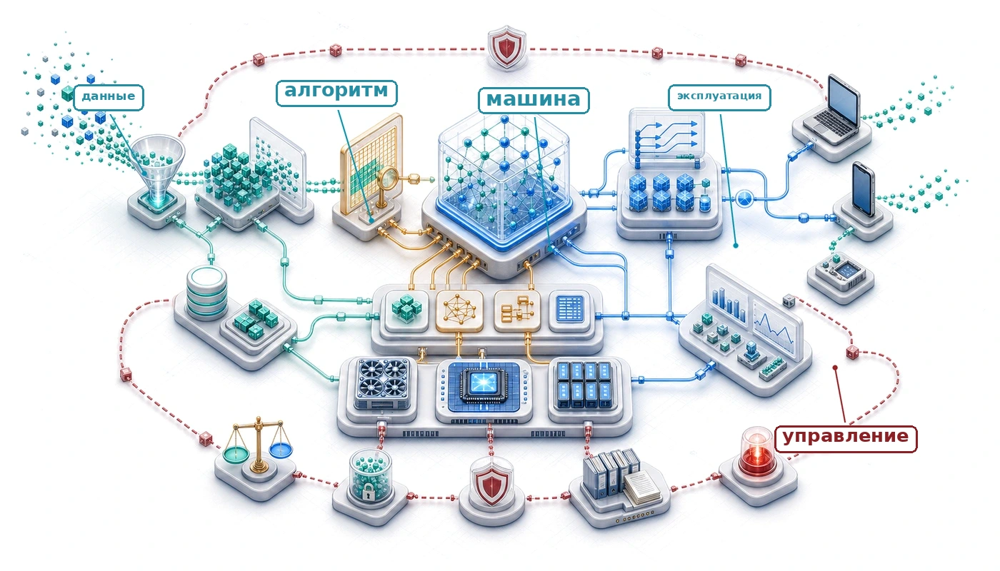
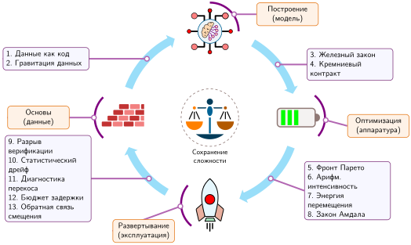
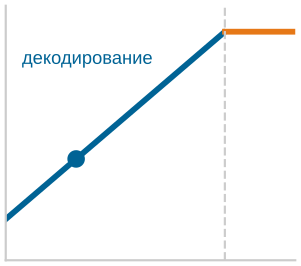
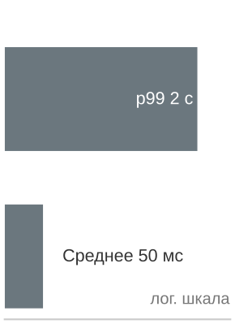
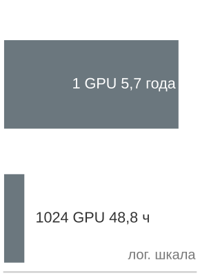

# Заключение

## Назначение

_Что дает владение всем стеком, чего не дает экспертиза в одном слое?_

Одно продакшен-решение проходит через весь стек. Конвейер данных определяет, какие события считаются обучающим сигналом. Этот сигнал формирует архитектуру, а та задает объем памяти и арифметическую интенсивность. Эти свойства ограничивают выбор аппаратуры, стратегию квантования, задержку обслуживания, мониторинг дрейфа и обязательства по управлению. Освоенный по отдельности, каждый слой — ценный навык. Освоенные вместе, слои дают способность рассуждать на стыках. Инженер, который понимает только сжатие, может уменьшить модель, но не может предсказать, важна ли потеря точности для контекста развертывания. Инженер, который понимает только обслуживание, может оптимизировать задержку, но не может проследить регрессию производительности до изменения конвейера данных тремя этапами выше по потоку. Дисциплина инженерии ML-систем — это умение видеть эти связи там, где оптимизация одной команды становится ограничением для другой. Принципы, управляющие этими взаимодействиями — распространение ограничений, стена памяти, перекос обучения и обслуживания, накладные расходы диспетчеризации, стоимость коммуникации и жизненные циклы эксплуатации, — не привязаны ни к конкретному фреймворку, ни к поколению аппаратуры, ни к семейству моделей. Технологии меняются, а лежащие в основе физические ограничения и компромиссы сохраняются. В терминах D·A·M сохраняется способность взглянуть на систему, которой еще не существует, и рассуждать о том, как ограничения ее данных, алгоритма и машины будут взаимодействовать, где возникнут узкие места и какие проектные решения окажутся необратимыми. Мышление системами, а не отдельными компонентами, отличает инженера, который может построить деталь, от того, кто может построить целое.

> **Цели обучения**
>
> - Синтезировать основные принципы ML-систем в рамку для рассуждений об ограничениях данных, алгоритма и машины
> - Проследить, как решения о данных, архитектуре, сжатии, аппаратуре, обслуживании, эксплуатации и управлении распространяют ограничения через ML-систему
> - Применять рассуждения на маячных моделях для диагностики узких мест в облачных, мобильных, периферийных, рекомендательных и TinyML-развертываниях
> - Оценивать компромиссы развертывания, используя бюджеты задержки, перемещение памяти, дрейф, ответственность и ограничения устойчивости
> - Проектировать системный подход к новым контекстам, прежде чем стоимость координации в масштабе парка станет доминирующей

## Синтез ML-систем

Развертывание модели классификации изображений на парке мобильных устройств показывает, как межслойные взаимодействия возникают в эксплуатации. Команда архитектуры выбрала раздельные по глубине свертки, чтобы отделить пространственную фильтрацию от проекции по каналам и сократить число арифметических операций. Команда сжатия квантовала веса и активации в INT8, чтобы уменьшить трафик памяти и уложиться в SRAM на кристалле. Команда обслуживания выполнила целевую p99-задержку 50 мс. Каждая команда добилась успеха по своей локальной метрике, однако через несколько недель точность упала на четыре процентных пункта на отдельных когортах прошивок и устройств. Причиной стало непредвиденное взаимодействие между отсечением динамического диапазона в схеме квантования и подпрограммой интерполяции в специфическом для прошивки пути предобработки изображений. Ни один компонент не отказал сам по себе: конвейер данных, архитектура, схема сжатия, исполняющая среда ускорителя и инфраструктура мониторинга оказались связаны в эксплуатации.

Ответственная инженерия управляет всем жизненным циклом системы — спецификацией, тестированием, мониторингом во время работы и аудитом по подгруппам, — а не выступает внешним этапом постобработки. ML-системы принципиально отличаются от традиционного программного обеспечения, потому что статистическая производительность физически неотделима от конвейеров и аппаратуры, которые обучают, обслуживают и отслеживают модель.

В центре этой дисциплины стоит железный закон систем машинного обучения (принцип «[Железный закон систем машинного обучения](part_build.md#pri-iron-law)»). Его три члена — перемещение данных, вычисления и накладные расходы — служат основными инженерными рычагами для количественного анализа. Построение интеллекта требует как статистических алгоритмов, так и соблюдения кремниевого контракта (принцип «[Кремниевый контракт](part_build.md#pri-silicon-contract)») — физического соглашения между моделью и машиной, на которой она исполняется. Арифметическая интенсивность и моделирование Roofline превращают качественные интуитивные представления о производительности в точные инженерные границы (Williams et al., 2009).

Системные возможности возникают из совместного проектирования триады данных, алгоритма и машины (D·A·M), а не из изолированных алгоритмических прорывов. Машинное обучение принадлежит традиции системной инженерии, в которой надежное исполнение возникает из координации взаимозависимых компонентов при физических ограничениях. Архитектура трансформеров ввела семейство моделей на основе внимания (Vaswani et al., 2017), а крупные языковые модели, такие как GPT-3 и Llama 2, показали, как это семейство выросло в центральную нагрузку современных ML-систем (Brown et al., 2020; Touvron et al., 2023). Одного математического замысла недостаточно, чтобы объяснить практическую полезность. Для ее получения пришлось совместно спроектировать механизм внимания с топологиями распределенных коммуникаций, тайлинг иерархии памяти для обхода узких мест пропускной способности памяти и исполнительные блоки низкой точности.

Интеграция имеет конкретные последствия. Программная инженерия часто рассматривает «модель» как контрольную точку весов: блоб из 500 МБ вещественных чисел. В эксплуатации, однако, веса — лишь один компонент истинной модели, и часто не самый хрупкий. Модель с высокой точностью на бенчмарке выходит из строя, если получает поврежденные признаки, а модель, которая аккуратно сходится при обучении, выходит из строя, если не укладывается в ограничения задержки развертывания. *Истинная модель* — это сумма конвейера данных, определяющего, что видит обучаемый, инфраструктуры обучения, управляющей оптимизацией, системы обслуживания, которая посредничает при выводе, и операционного контура, отслеживающего статистический дрейф. Оптимизируйте систему — и модель улучшится. Пренебрегите системой — и модель деградирует. Системная инженерия — это физическое воплощение машинного обучения: *система и есть модель.*

> **Системное мышление**
>
> Зависимости системы, петли обратной связи и путь запроса делают ее границы проверяемыми.
>
> **Интеграция**
>
> - Зависимости: можете ли вы проследить изменение конвейера данных через обучение и обслуживание до его влияния на задержку?
> - Петли обратной связи: поняли ли вы, как предсказания модели влияют на ее будущие обучающие данные?
>
> **Целостность**
>
> - Сквозная проверка: можете ли вы проследить путь пользовательского запроса от интерфейса через сеть, предобработку, модель и постобработку обратно к интерфейсу?

Сквозная трассировка запроса показывает ту же мысль структурно: границы системы определяют возможности модели, потому что каждый слой ML-стека накладывает физические и статистические ограничения на следующий. Вычислительная основа начинается с данных: курирование ([«Инженерия данных»](04_data_engineering.md#sec-data-engineering)) и отбор ([«Отбор данных»](09_data_selection.md#sec-data-selection)) ограничивают информацию, доступную обучаемому, а нейронные представления ([«Вычисления в нейронных сетях»](05_nn_computation.md#sec-neural-computation)) и архитектуры сетей ([«Архитектуры нейронных сетей»](06_nn_architectures.md#sec-network-architectures)) переводят статистические априорные предположения в конкретные тензорные графы. Системы обучения ([«Обучение моделей»](08_training.md#sec-model-training)) и фреймворки исполнения ([«Фреймворки машинного обучения»](07_frameworks.md#sec-ml-frameworks)) переносят эти графы на физическое оборудование, превращая математическую оптимизацию в запланированные вызовы ядер и выделения памяти.

На уровне кремния инженерная задача смещается к перенастройке физических границ. Сжатие моделей ([«Сжатие моделей»](10_model_compression.md#sec-model-compression)) перестраивает фронт Парето по точности, объему памяти и задержке; аппаратные ускорители ([«Аппаратное ускорение»](11_hw_acceleration.md#sec-hardware-acceleration)) проверяют, способны ли пропускная способность памяти и арифметические блоки поддерживать расписание исполнения; а строгий бенчмаркинг ([«Бенчмаркинг»](12_benchmarking.md#sec-benchmarking)) отделяет реальные аппаратные ускорения от артефактов измерения. В эксплуатации инфраструктура обслуживания ([«Обслуживание моделей»](13_model_serving.md#sec-model-serving)) должна укладываться в бюджеты хвостовой задержки при пакетном трафике, операционный мониторинг ([«MLOps»](14_ml_ops.md#sec-ml-operations)) обнаруживает статистический дрейф, а ответственная инженерия ([«Ответственная инженерия»](15_responsible_engr.md#sec-responsible-engineering)) проверяет справедливость по подгруппам там, где совокупные метрики скрывают локальную деградацию. Эти области образуют непрерывный, связанный конвейер: от инженерии данных через системы обучения и инфраструктуру развертывания к операциям во время работы и управлению.

Главный урок — связанность ограничений: решения никогда не остаются локальными. Выбор архитектуры открывает стратегию сжатия, которая ограничивает понижение уровня до ускорителя, задает задержку обслуживания и определяет требования к операционному мониторингу. Раздельные по глубине свертки MobileNetV2 были нацелены на эффективный мобильный вывод для зрения (Sandler et al., 2018), а квантование с целочисленной арифметикой сделало развертывание в INT8 практичным путем вывода (Jacob et al., 2018). Это сочетание позволяет исполнять модель на мобильных NPU, задает ограничение p99-задержки 50 мс и требует отслеживать дрейф на разнородном сенсорном оборудовании и прошивках устройств. Решения распространяются вниз по потоку. Инженер, который оптимизирует один слой изолированно, не может предсказать, как вмешательства расходятся по системе.

*Архитектурные решения каскадно влияют на сжатие, обслуживание, дрейф и управление.*

Диагностика этих каскадных взаимодействий требует конкретных карт ограничений. Опора на репрезентативные нагрузки показывает, как физические границы определяют архитектурные решения, расписания исполнения и операционные компромиссы по всему стеку.

### Маячные модели: распространение ограничений

Пять маячных моделей ([«Железный закон систем машинного обучения»](01_introduction.md#sec-introduction-iron-law-ml-systems-c32a)) задают распространение ограничений на конкретных профилях исполнения:

Каждая нагрузка раскрывает собственное физическое узкое место на всем спектре исполнения:

- **ResNet-50**: размер батча превращает вывод для изображений из работы, ограниченной перемещением весов, в матричную пропускную способность, ограниченную вычислениями. Одни и те же веса фильтров используются для нескольких входов, и стоимость переноса памяти амортизируется, пока арифметическая интенсивность не пересечет точку перехода (ridge point) аппаратуры.
- **GPT-2/Llama**: авторегрессивное декодирование при малом батче упирается в пропускную способность памяти из-за низкого повторного использования весов; батчинг, планирование предзаполнения и параллелизм моделей сдвигают лимитирующее ограничение.
- **MobileNetV2**: раздельные по глубине свертки и квантование INT8 обменивают емкость представления на развертывание на мобильном NPU в тепловых рамках милливаттного диапазона.
- **DLRM**: таблицы вложений терабайтного масштаба делают емкость памяти лимитирующим ограничением наравне с пропускной способностью памяти, вынуждая системы проектироваться вокруг уровней памяти и разреженных паттернов доступа.
- **Распознавание ключевых слов (KWS)/Wake Vision**: модели для микроконтроллеров объемом менее мегабайта с постоянным выводом при бюджетах мощности в милливатты не допускают лишнего трафика памяти и накладных расходов диспетчеризации.

Вместе эти пять нагрузок охватывают спектр развертывания от дата-центров масштаба склада до микроконтроллеров и раскрывают узкие места, которые диагностируют количественные принципы. Прослеживание этих нагрузок через архитектуру, обучение, оптимизацию и обслуживание формирует целостный взгляд, отличающий инженерию ML-систем от изолированной разработки алгоритмов.

[«Путь маячной модели (MobileNetV2)»](16_conclusion.md#tbl-lighthouse-journey-mobilenet) прослеживает эту последовательность для MobileNetV2 и показывает, как межслойные ограничения сходятся в одном инженерном артефакте. На семи этапах — от базовых ограничений через архитектуру, обучение, сжатие, ускорение, обслуживание и эксплуатацию во время работы — каждое инженерное решение определяет варианты, доступные дальше по потоку.

| **Этап пути**                                 | **Системный ракурс**           | **Реализация MobileNetV2**                                                                                                                                                                                                                                                           |
|:----------------------------------------------|:-------------------------------|:-------------------------------------------------------------------------------------------------------------------------------------------------------------------------------------------------------------------------------------------------------------------------------------|
| **Основы ([«Введение»](01_introduction.md#sec-introduction))**                          | Триада ИИ                      | Ограничено свойствами машины (батарея, тепло)                                                                                                                                                                                                                                        |
| **Архитектура ([«Архитектуры нейронных сетей»](06_nn_architectures.md#sec-network-architectures))** | Алгоритмическая эффективность  | Раздельные по глубине свертки: в типичном слое 3×3 с 256 выходными каналами — в 8,7 раза меньше FLOP, а в масштабе ImageNet — в 13,7 раза меньше операций, чем у ResNet-50                                                                                                       |
| **Обучение ([«Обучение моделей»](08_training.md#sec-model-training))**                   | Пропускная способность и задержка | Оптимизирована под задержку одного запроса на мобильном устройстве; аугментация данных может повысить устойчивость                                                                                                                                                                  |
| **Сжатие ([«Сжатие моделей»](10_model_compression.md#sec-model-compression))**          | Навигация по фронту Парето     | Квантование INT8: FP32 занимает в 4 раза, а FP16 — в 2 раза больше памяти на значение, чем INT8; точность перепроверяется для каждого развертывания                                                                                                                                      |
| **Ускорение ([«Аппаратное ускорение»](11_hw_acceleration.md#sec-hardware-acceleration))** | Соблюдение кремниевого контракта | Размещение ядер на мобильных NPU (например, Apple Neural Engine) для максимальной загрузки аппаратуры                                                                                                                                                                              |
| **Обслуживание ([«Обслуживание моделей»](13_model_serving.md#sec-model-serving))**     | Соблюдение бюджета задержки    | Ограничение $\text{p99} < 50$ мс; оптимизация предобработки (изменение размера, нормализация) для устранения узких мест CPU                                                                                                                                                       |
| **Эксплуатация ([«MLOps»](14_ml_ops.md#sec-ml-operations))**                           | Управление энтропией системы   | Мониторинг дрейфа: обнаружение сдвигов распределения и отслеживание точности по когортам в разнородных парках устройств и при разном освещении                                                                                                                                       |

***Путь маячной модели (MobileNetV2)**: проследив одну модель через семь этапов стека систем, видно, как решения в одной области (например, в архитектуре) переносят ограничения и возможности в смежные области (например, в ускорение и мониторинг).*

Решения в одной строке определяют варианты в следующей: выбор архитектуры (раздельные по глубине свертки) открывает стратегии сжатия (квантование INT8), которые, в свою очередь, делают возможным ускорение на мобильных NPU. Это распространение ограничений универсально для нагрузок машинного обучения. Формализация этих компромиссов требует количественных принципов — от точных физических границ через эмпирические разложения до диагностик, зависящих от допущений.

## Тринадцать количественных принципов

Рассуждения о поведении ML-систем требуют количественных инструментов. Эти **тринадцать количественных принципов** намеренно сочетают точные математические границы, инженерные разложения, подогнанные эмпирические модели, политические ограничения и эвристики проектирования. [«Тринадцать количественных принципов»](16_conclusion.md#tbl-thirteen-principles) сводит все тринадцать принципов по четырем этапам системного цикла. Их полезность зависит от строгого применения в заявленных допущениях, а не от восприятия каждого соотношения как неизменного физического закона.

| **Принцип**                     | **Краткое название**             | **Часть**      | **Ключевое соотношение или утверждение**                                                                                                                     | **Что предсказывает**                                   |
|:--------------------------------|:---------------------------------|:---------------|:-------------------------------------------------------------------------------------------------------------------------------------------------------------|:--------------------------------------------------------|
| [«Данные как код»](part_foundations.md#pri-data-as-code)                 | Принцип «данные как код»         | I: Основы      | Поведение $=f$(данные, алгоритм, код, случайность)                                                                                                             | Данные меняют поведение; важны и другие входы           |
| [«Гравитация данных»](part_foundations.md#pri-data-gravity)               | Принцип гравитации данных        | I: Основы      | Переносить вычисления к данным, когда повторные передачи стоят дороже размещения                                                                              | Зависит от объема, повторного использования, сети и мобильности вычислений |
| [«Железный закон систем машинного обучения»](part_build.md#pri-iron-law) | Железный закон систем машинного обучения | II: Построение | $T_{\text{seq}}=D_{\text{vol}}/\text{BW}+O/(R_{\text{peak}}\eta_{\text{hw}})+L_{\text{lat}}$; перекрытие этапов меняется от максимума до суммы            | Этапы могут складываться или перекрываться              |
| [«Кремниевый контракт»](part_build.md#pri-silicon-contract)              | Кремниевый контракт              | II: Построение | $I_{\text{ridge}}=R_{\text{peak}}/\text{BW}$; сравнить $I_{\text{model}}$ с $I_{\text{ridge}}$                                                              | Диагностирует работу, ограниченную пропускной способностью или вычислениями |
| [«Фронт Парето»](part_optimize.md#pri-pareto-frontier)                   | Фронт Парето                     | III: Оптимизация | $\nexists c'\ne c:\,[\forall k\,M_k(c')\ge M_k(c)]\land[\exists j\,M_j(c')>M_j(c)]$                                                                          | Никакая отличная конфигурация не доминирует точку фронта |
| [«Закон арифметической интенсивности»](part_optimize.md#pri-arithmetic-intensity) | Закон арифметической интенсивности | III: Оптимизация | $R_{\text{attain}} \le \min(R_{\text{peak}},\; I \times \text{BW})$                                                                                           | Больше вычислений не поднимает потолок пропускной способности |
| [«Инвариант энергии перемещения»](part_optimize.md#pri-energy-movement) | Инвариант энергии перемещения    | III: Оптимизация | $E_{\text{total}}=\sum_j N_jE_j$; отношение стоимости DRAM к FLOP: 173–582                                                                               | Полная энергия зависит от числа событий и их стоимости  |
| [«Закон Амдала»](part_optimize.md#pri-amdahl)                            | Закон Амдала                     | III: Оптимизация | $\text{Ускорение} = \frac{1}{(1-f_{\text{parallel}}) + \frac{f_{\text{parallel}}}{S_{\text{parallel}}}}$                                                        | Последовательная доля ограничивает все выигрыши от параллелизма |
| [«Разрыв верификации»](part_deploy.md#pri-verification-gap)              | Разрыв верификации               | IV: Развертывание | $\Pr_{(X,Y)\sim P_{\text{deploy}}}[d(f(X),Y)\le\tau]\ge1-\epsilon$                                                                                           | Указать расстояние, допуск, популяцию и доверительную вероятность |
| [«Диагностика статистического дрейфа»](part_deploy.md#pri-statistical-drift) | Диагностика статистического дрейфа | IV: Развертывание | $\text{Точность}(t)\approx\text{Точность}_0-\lambda\mathcal{D}(P_t\Vert P_0)$                                                                                | Локальная подгонка; дрейф не обязан снижать качество    |
| [«Диагностика перекоса обучения и обслуживания»](part_deploy.md#pri-training-serving-skew) | Диагностика перекоса обучения и обслуживания | IV: Развертывание | $S_{\text{skew}}=\mathbb{E}_{X\sim P_{\text{deploy}}}[d(f_{\text{serve}}(X),f_{\text{train}}(X))]$                                                           | Расхождение выходов сигнализирует о риске, а не о потере точности |
| [«Принцип бюджета задержки»](part_deploy.md#pri-latency-budget)          | Принцип бюджета задержки         | IV: Развертывание | $T_q\le L_{\text{budget}}$                                                                                                                                   | SLO продукта выбирает $q$ и его бюджет                  |
| [«Модель смещения обратной связи»](part_deploy.md#pri-bias-feedback)     | Модель смещения обратной связи   | IV: Развертывание | $\Delta_g(k)\approx\Delta_g(0)\alpha_{\text{fb}}^k$ с подогнанным $\alpha_{\text{fb}}$                                                                       | Обратная связь может усиливать вред; измеряйте и вмешивайтесь |

***Тринадцать количественных принципов**: каждый инструмент появляется в части, где его управляющее ограничение или диагностическое применение становится видимым впервые. Набор сочетает границы, разложения, подогнанные модели, политические требования и эвристики. Каждая строка полезна только в заявленных допущениях; вместе они дают общий аналитический словарь для проектирования, оптимизации и развертывания, а не набор универсальных инвариантов.*

Тринадцать принципов не являются независимыми аксиомами. Они образуют целостную рамку, связанную одним метапринципом — эвристикой сохранения сложности.[^fn-conservation-complexity-heuristic] Сложность, убранная из одного интерфейса, часто возникает в другой части системы, однако это не физический закон сохранения и не означает, что каждое упрощение имеет равную компенсирующую цену. Ее ценность диагностическая: после упрощения одного компонента проверьте, где изменились валидация, состояние, координация или эксплуатационная нагрузка. Критерий проверки — объясняют ли принципы одни и те же маячные узкие места с точки зрения данных, модели, аппаратуры и развертывания, не противореча друг другу.

[^fn-conservation-complexity-heuristic]: **Эвристика сохранения сложности**: закон Тесслера — проектный афоризм о том, что неустранимая сложность приложения должна быть обработана где-то во взаимодействии пользователя, приложения и платформы (Tesler, 1984). Распространение его на всю сложность ML-систем — аналогия, а не физический закон. Квантование может добавить бремя валидации, а абстракция может перенести детали реализации за интерфейс, но хорошее проектирование способно и полностью убрать случайную сложность. Конвейеры приложений на основе больших языковых моделей иллюстрируют возможный сдвиг: упрощение пользовательского интерфейса более короткими или расплывчатыми запросами может перенести работу в системные подсказки, поиск или проверку вывода. Используйте эвристику, чтобы искать вытесненные издержки, а не предполагать, что обязательно существует равная компенсирующая цена.

### Основы: откуда берется сложность (принципы 1–2)

Принцип «данных как кода» ([«Данные как код»](part_foundations.md#pri-data-as-code)) и эвристика гравитации данных (принцип [«Гравитация данных»](part_foundations.md#pri-data-gravity)), разобранные в [«Инженерии данных»](04_data_engineering.md#sec-data-engineering), устанавливают данные как первичную логическую программу и физический якорь. Поведение во время работы отражает данные, алгоритм и реализацию вместе, а размещение вычислений у данных уравновешивает объем передачи, частоту повторного использования, пропускную способность сети и мобильность вычислений. Поведение модели и архитектура напрямую наследуют ограничения этой основы данных.

Маячные модели иллюстрируют оба принципа. ResNet-50 и GPT-2 получают свои возможности от архитектуры, связанной с массивными обучающими корпусами. Таблицы вложений DLRM терабайтного масштаба делают емкость памяти главным проектным ограничением, требуя, чтобы система исполнения проектировалась вокруг того, где физически находятся данные. Размещение вычислений у данных повторяется в разных средах развертывания именно потому, что перенос больших наборов данных с малым повторным использованием перегружает межсоединения.

### Построение: как сложность становится вычислением (принципы 3–4)

Железный закон (принцип [«Железный закон систем машинного обучения»](part_build.md#pri-iron-law)) и кремниевый контракт (принцип [«Кремниевый контракт»](part_build.md#pri-silicon-contract)) управляют эффективностью исполнения. Разложение железного закона на три члена ([«Железный закон систем машинного обучения»](01_introduction.md#sec-introduction-iron-law-ml-systems-c32a)) выделяет перемещение данных, вычисления и накладные расходы; кремниевый контракт показывает, какой член ограничивает производительность для данной пары «архитектура–аппаратура». Нагрузки занимают разные режимы: пакетный вывод ResNet-50 загружает вычислительные блоки, декодирование Llama при малом батче упирается в пропускную способность памяти, DLRM исчерпывает емкость памяти, а MobileNetV2 перестраивает тензорные операции так, чтобы исполняться в пределах возможностей мобильного NPU. Как показано в разделе [«Диагностика узких мест»](appendix_dam.md#sec-appdx-dam-taxonomy-bottleneck-diagnostic-3fc9) приложения «Таксономия D·A·M», диагностика того, является ли путь исполнения ограниченным вычислениями, пропускной способностью или емкостью, определяет, какие оптимизации дают ускорение, а какие тратят инженерные усилия впустую. Задержка обучения падает быстрее всего, когда инженеры воздействуют на лимитирующий член напрямую, а не распределяют усилия равномерно ([«Обучение моделей»](08_training.md#sec-model-training)).

### Оптимизация: как ограничения определяют компромиссы (принципы 5–8)

Четыре принципа оптимизации образуют тесно связанную цепочку диагностики. Фронт Парето (принцип [«Фронт Парето»](part_optimize.md#pri-pareto-frontier)) выделяет недоминируемые компромиссы после нормализации направлений целевых функций: квантование обменивает точность на трафик памяти, прореживание — емкость на скорость, дистилляция — вычисления обучения на эффективность вывода. Закон арифметической интенсивности (принцип [«Закон арифметической интенсивности»](part_optimize.md#pri-arithmetic-intensity)) диагностирует, вычисления или пропускная способность задают идеальный потолок. Инвариант энергии перемещения (принцип [«Инвариант энергии перемещения»](part_optimize.md#pri-energy-movement)) сочетает стоимость отдельного события с числом событий: при эталонных аппаратных константах одно обращение к DRAM стоит примерно в 173–582 раза больше, чем одна арифметическая операция FP32/FP16, но доминирование в полной стоимости нагрузки зависит от того, сколько операций каждого вида выполняется. Закон Амдала (принцип [«Закон Амдала»](part_optimize.md#pri-amdahl)) задает потолок любого выигрыша от параллелизма, объясняя, почему загрузка данных и предобработка могут стать узкими местами в сильно оптимизированных системах.

MobileNetV2 ([«Архитектуры нейронных сетей»](06_nn_architectures.md#sec-network-architectures)) уравновешивает все четыре принципа одновременно. Раздельные по глубине свертки перестраивают фронт Парето (Sandler et al., 2018). Квантование INT8 использует закон арифметической интенсивности, повышая арифметическую интенсивность за счет сокращения трафика памяти (Jacob et al., 2018). Полученная экономия энергии соответствует инварианту энергии перемещения, а закон Амдала ограничивает сквозное ускорение, когда предобработка на стороне хоста остается неускоренной. Нагрузки на микроконтроллерах, такие как KWS, усиливают эти компромиссы еще сильнее: они работают с памятью менее одного мегабайта и почти без запаса на лишние операции.

### Развертывание: как реальность опровергает допущения (принципы 9–13)

Принципы развертывания касаются сбоев, которые тестирование на стенде не может исключить: система может работать корректно на стенде и незаметно отказывать в эксплуатации. Разрыв верификации (принцип [«Разрыв верификации»](part_deploy.md#pri-verification-gap)) означает, что статистическая верификация действительна только для заявленной популяции развертывания, расстояния задачи, допуска, целевой ошибки и процедуры доверительного оценивания на конечной выборке; тестирование оценивает поведение, но не доказывает корректность для каждого будущего входа. Диагностика статистического дрейфа (принцип [«Диагностика статистического дрейфа»](part_deploy.md#pri-statistical-drift)) обнаруживает изменение распределения, но не определяет, ухудшается ли точность, остается ли постоянной или растет; поэтому кривая локальной деградации валидна, только если подогнана по исходам. Диагностика перекоса обучения и обслуживания (принцип [«Диагностика перекоса обучения и обслуживания»](part_deploy.md#pri-training-serving-skew)) также служит индикатором риска, а не универсальным уравнением потери точности, хотя различия предобработки или численные расхождения все же могут менять качество. Бюджет задержки (принцип [«Принцип бюджета задержки»](part_deploy.md#pri-latency-budget)) ограничивает обслуживание квантилью, выбранной требованием продукта, — это может быть p95, p99 или другая мера хвоста. Наконец, модель смещения обратной связи (принцип [«Модель смещения обратной связи»](part_deploy.md#pri-bias-feedback)) может описывать усиление неравенства, но экспоненциальная рекуррентность требует измеренного, примерно постоянного коэффициента обратной связи и отсутствия эффективного вмешательства.

Пять принципов развертывания управляют инструментами эксплуатации, рассмотренными в главе [«MLOps»](14_ml_ops.md#sec-ml-operations): инфраструктура мониторинга, обнаружение дрейфа, хранилища признаков и метрики с разбивкой по подгруппам существуют, чтобы выявлять незаметные сбои и запускать корректирующие действия. Система рекомендаций, которая достигает высокой точности офлайн, все равно нуждается в проверках паритета, когда перекос обучения и обслуживания портит конвейеры признаков (принцип [«Диагностика перекоса обучения и обслуживания»](part_deploy.md#pri-training-serving-skew)), и в аудите исходов, когда поведение пользователей меняется по сезонам (принцип [«Диагностика статистического дрейфа»](part_deploy.md#pri-statistical-drift)). Обслуживание больших языковых моделей должно ограничивать хвостовую задержку непрерывным батчингом и спекулятивным декодированием ([«Обслуживание моделей»](13_model_serving.md#sec-model-serving)), чтобы не нарушать SLO продукта. Аналогично автоматизированная кредитная модель может удовлетворять целям по пропускной способности и сходимости и при этом систематически накапливать неравенство для недообслуживаемых групп, поэтому нужен мониторинг с разбивкой по подгруппам, чтобы перехватывать петли обратной связи (принцип [«Модель смещения обратной связи»](part_deploy.md#pri-bias-feedback)).

### Интегрированная рамка

Тринадцать принципов — не контрольный список для последовательного применения. Они образуют сеть взаимных ограничений. Эвристика сохранения сложности побуждает инженеров искать, куда локальное упрощение переносит издержки.

Квантование модели из FP16 в INT8 показывает, как эти взаимные ограничения работают на практике. Это единственное вмешательство проходит по фронту Парето (принцип [«Фронт Парето»](part_optimize.md#pri-pareto-frontier)), обменивая численную точность на трафик памяти. Последствия расходятся по всему стеку: квантование меняет кремниевый контракт модели (принцип [«Кремниевый контракт»](part_build.md#pri-silicon-contract)), сдвигая ее рабочую точку на кривой арифметической интенсивности (принцип [«Закон арифметической интенсивности»](part_optimize.md#pri-arithmetic-intensity)), и меняет ее энергетический профиль (принцип [«Инвариант энергии перемещения»](part_optimize.md#pri-energy-movement)). В эксплуатации бюджет задержки (принцип [«Принцип бюджета задержки»](part_deploy.md#pri-latency-budget)) определяет, отвечает ли полученное ускорение целевому уровню обслуживания (SLO), а разрыв верификации (принцип [«Разрыв верификации»](part_deploy.md#pri-verification-gap)) требует проверить, что понизившийся по уровню граф обслуживания сохраняет точность, измеренную при тестировании сжатия.

Эта трассировка не требует, чтобы все принципы действовали одновременно. Она показывает, как релевантные принципы становятся активными по мере того, как решение переходит от представления модели к исполнению на аппаратуре и затем к валидации в производстве. Размещение данных влияет на то, где модель может работать; закон Амдала ограничивает, насколько более быстрое ядро улучшит весь путь запроса; верификация ограничивает возникающую потерю точности; а мониторинг исходов проверяет, сохраняется ли валидированное поведение после развертывания. Задача инженера — проследить вытесненные издержки по всему стеку, а не считать, что сложность просто исчезает.

Оценка предложения о развертывании делает эту сеть ограничений конкретной.

> **Применение принципов**
>
> Коллега предлагает квантовать вашу модель из FP32 в INT8, чтобы снизить стоимость обслуживания.
>
> **Проследите принципы**
>
> - **Фронт Парето** (принцип [«Фронт Парето»](part_optimize.md#pri-pareto-frontier)): какую точность вы обмениваете на выигрыш по пропускной способности?
> - **Кремниевый контракт** (принцип [«Кремниевый контракт»](part_build.md#pri-silicon-contract)): эффективно ли целевая аппаратура ускоряет нужные операторы INT8?
> - **Разрыв верификации** (принцип [«Разрыв верификации»](part_deploy.md#pri-verification-gap)): сохраняет ли квантованный артефакт обслуживания поведение, принятое при тестировании сжатия?
> - **Бюджет задержки** (принцип [«Принцип бюджета задержки»](part_deploy.md#pri-latency-budget)): укладывает ли ускорение вас в SLO или создает запас для батчинга?

[«Цикл систем машинного обучения (13 принципов)»](16_conclusion.md#fig-invariants-cycle) отображает этот цикл взаимных ограничений. Четыре этапа — основы, построение, оптимизация и развертывание — окружают центральный узел, представляющий эвристику сохранения сложности. Стрелки показывают, как инженерные решения распространяются вниз по потоку: ограничения построения определяют стратегии оптимизации, а сигналы во время работы — статистический дрейф, перекос признаков и регрессии исходов — возвращаются в основы. Управление этим циклом требует направлять вытесненную сложность в слои, которые способны справиться с ней эффективно.

Петля обратной связи от развертывания к основам центральна для инженерии в эксплуатации. Принципы 9–13 выявляют сигналы, которые запускают точечные исправления: откаты канареечного развертывания, резервные эвристики, дополнение датасета, переобучение модели или перенастройку ядер. При аномалиях инженеры диагностируют первопричины, а не запускают некалиброванные откаты. Этот цикл определяет проектирование одной системы: цель не в том, чтобы каталогизировать каждую будущую архитектуру, а в том, чтобы сделать петли обратной связи наблюдаемыми до того, как эксплуатационные сбои начнут накапливаться.

***Цикл систем машинного обучения (13 принципов)**: четырехэтапный жизненный цикл системной инженерии, организованный вокруг эвристики сохранения сложности. Этапы связаны петлей обратной связи, а тринадцать принципов сгруппированы вдоль переходов как границы, разложения, подогнанные модели, политические требования и эвристики проектирования, допущения которых нужно проверять.*

Трассировка предложения о квантовании через четыре принципа — это один диагностический проход; та же привычка применима и тогда, когда узкое место — не предложение оптимизации, а стоимость обслуживания одного сгенерированного токена.

> **Стоимость токена**
>
> **Задача**: применив железный закон (принцип [«Железный закон систем машинного обучения»](part_build.md#pri-iron-law)) и закон арифметической интенсивности (принцип [«Закон арифметической интенсивности»](part_optimize.md#pri-arithmetic-intensity)) к обслуживанию одного токена модели Llama 2 70B с 70 миллиардами параметров, веса которой в FP16 равномерно разделены между двумя NVIDIA H100, определите, какая идеализированная нижняя граница больше: перенос памяти или пиковые вычисления? Характеристики H100 приведены в разделе [«Шпаргалка по аппаратуре ИИ (современный справочник)»](appendix_machine.md#sec-appdx-machine-foundations-ai-hardware-cheat-sheet-modern-reference-4dc1) приложения «Основы машины». Этот расчет не учитывает трафик KV-кэша, активации, зависящие от контекста операции внимания по KV, коммуникацию между ускорителями и накладные расходы диспетчеризации.
>
> **Физика**:
>
> - **Объем перемещаемых байтов весов модели** $(D_{\text{vol}})$: 70 миллиардов параметров × 2 байта (FP16) = 140 ГБ.
> - **Вычисления** $(O)$: $O \approx 2 \times P = 140$ GFLOP на токен, где $P$ — число параметров.
> - **Аппаратура**: два H100 с совокупной пропускной способностью $\text{BW} = 6{,}70$ ТБ/с и $R_{\text{peak}} \approx 1978$ TFLOP/s для FP16.
>
> **Расчет**:
>
> - **Время перемещения данных**: $T_{\text{mem}} = \frac{140 \text{ ГБ}}{6700 \text{ ГБ/с}} \approx 20{,}9 \text{ мс}$
> - **Время вычислений**: $T_{\text{comp}} = \frac{140 \times 10^9 \text{ FLOP}}{1978 \times 10^{12} \text{ FLOP/s}} \approx 0{,}07 \text{ мс}$
>
> **Системный вывод**:
>
> Идеализированная нижняя граница переноса памяти $T_{\text{mem}}$ в 295,2 раза больше нижней границы пиковых вычислений $T_{\text{comp}}$. При такой модели с батчем из одного запроса декодирование сильно ограничено пропускной способностью: арифметическая интенсивность составляет примерно 1 FLOP на байт. Каждый 2-байтовый вес FP16 извлекается из памяти высокой пропускной способности, чтобы выполнить одно умножение с накоплением ($2\text{ FLOP}$) с активацией текущего токена, поэтому арифметическая интенсивность равна $\frac{2\text{ FLOP}}{2\text{ байта}} = 1\text{ FLOP/байт}$. Это намного ниже точки перехода двух H100, которая составляет около 295 FLOP на байт. Тензорные ядра проводят более 99 процентов тактов в ожидании данных. Батчинг может повысить повторное использование, а квантование — снизить трафик весов. Оптимизация одного лишь исполнения вычислений может сократить реальное время вычислений к нижней границе 0,07 мс, но не уменьшит нижнюю границу переноса памяти в 20,9 мс.

*При этой модели нижней границы для батча из одного запроса декодирование лежит слева от точки перехода Roofline, в режиме, ограниченном пропускной способностью.*

Эта оценка Roofline показывает, как физические границы работают как диагностические инструменты, а не как абстрактные таксономии. В трех основных инженерных областях — построении основ, инженерии для масштаба и навигации по реальности эксплуатации — эти границы, эмпирические модели и эвристики определяют проектирование системы и устойчивость ее работы.

## Принципы на практике

Команда, которая запомнила все тринадцать принципов, но не может определить их допущения или применить их к реальному решению о развертывании, ничего не усвоила. Проверка одинакова для трех областей, охватывающих жизненный цикл ML: построение технических основ, инженерия для масштаба и навигация по реальности эксплуатации. Системное мышление связывает то, что не под силу анализу изолированных компонентов.

### Построение технических основ

Принцип «данные как код» ([«Данные как код»](part_foundations.md#pri-data-as-code)) делает операционным факт, что наборы данных и конвейеры данных действуют как исполняемые программы ([«Инженерия данных»](04_data_engineering.md#sec-data-engineering)). Это перекликается с формулировкой Software 2.0 Карпаты (Karpathy, 2017), хотя логика обслуживания и состояние алгоритма тоже определяют поведение. Примитивы нейронных вычислений ([«Вычисления в нейронных сетях»](05_nn_computation.md#sec-neural-computation)) задают арифметическую интенсивность матричных умножений, и их положение относительно точки перехода аппаратуры определяет, ограничено ли исполнение пропускной способностью или вычислениями. Выбор фреймворка ([«Фреймворки машинного обучения»](07_frameworks.md#sec-ml-frameworks)) напрямую задает кремниевый контракт: каждый исполняющий движок ограничивает оптимизацию графа, размещение в памяти, поддержку целевых бэкендов и дальнейшие пути развертывания. Выбор фреймворка без оценки этих границ исполнения рискует закрыть путь к высокопроизводительному выводу.

Фундаментальные решения (какие данные курировать, на какие вычислительные примитивы опираться, какой фреймворк принять) распространяются на последующие инженерные решения. Это распространение становится особенно заметным, когда система должна масштабироваться за пределы одной машины, а три члена железного закона расширяются от величин уровня микросхемы до ограничений уровня кластера.

### Инженерия для масштаба

Распределенные системы обучения демонстрируют железный закон в действии ([«Обучение моделей»](08_training.md#sec-model-training)): параллелизм данных масштабирует пропускную способность вычислений по ускорителям ценой коллективных коммуникаций, смешанная точность вдвое сокращает перемещение памяти за счет представления тензоров в FP16 или BF16, а контрольные точки активаций обменивают перевычисления на емкость памяти. Каждая техника воздействует на конкретный член железного закона. Аналогично сжатие моделей ([«Сжатие моделей»](10_model_compression.md#sec-model-compression)) напрямую исследует фронт Парето: квантование INT8 для MobileNetV2 и прореживание вложений для DLRM обменивают численную точность или емкость параметров на экономию пропускной способности, а закон арифметической интенсивности определяет, даст ли это снижение реальное ускорение на целевой аппаратуре.

Однако построение и оптимизация модели — лишь половина инженерной задачи. Вторая половина начинается в тот момент, когда модель покидает обучающий кластер и попадает в эксплуатацию, где статистические требования, подогнанные диагностики и политики SLO определяют поведение, а оптимизации, которые работали на стенде, должны пережить непредсказуемость реального трафика.

### Навигация по реальности эксплуатации

Переход от *обучения* к *выводу* часто меняет цели оптимизации: там, где обучение максимизирует пропускную способность в течение дней, интерактивный вывод может оптимизировать выбранную квантиль хвоста задержки в миллисекундах. Иллюстративный сценарий использует среднюю задержку 50 мс и p99 2000 мс, поэтому выбранный хвост в 40 раз больше среднего; другой продукт может задавать p95, p99,9 или отдельные сроки по классам запросов. Анализ хвостовой задержки показывает, почему средняя задержка может скрывать запросы, которые определяют пользовательский опыт (Dean and Barroso, 2013). В обслуживании ML всплески хвоста могут возникать из-за пауз сборщика мусора в фреймворках вывода на Python, из-за динамического батчинга, который при неравномерном трафике формируется неоптимально, или из-за авторегрессионной генерации, в которой длинный промпт или длинный вывод требуют гораздо больше работы, чем типичный короткий ответ.

*Средняя задержка скрывает хвост; выбранная квантиль хвоста определяет SLO.*

Технические границы производительности описывают лишь часть эксплуатационной рамки; проектирование системы охватывает и общественное влияние ([«Ответственная инженерия»](15_responsible_engr.md#sec-responsible-engineering)). Верификация требует непрерывного аудита на нарушения справедливости наравне с пропускной способностью: отслеживания распределений предсказаний по демографическим когортам, обнаружения усиления смещения во времени (принцип [«Модель смещения обратной связи»](part_deploy.md#pri-bias-feedback)) и оповещений о неравенстве между подгруппами. Мониторинг дрейфа по подгруппам необходим, потому что точность может резко падать для недостаточно представленных групп, даже когда совокупные метрики остаются стабильными. Ответственная инженерия — это эксплуатационное требование, а не внешняя этическая экспертиза: это ограничение проектирования первого класса, которое подчиняется той же дисциплине измерений, что и задержка и пропускная способность.

Эти три области делают тринадцать принципов прагматичными инструментами, а не жесткими аксиомами. Вопрос в том, *где* их допущения начнут работать дальше, по мере того как ML-системы выходят на разнородные цели развертывания, сталкиваются с враждебными условиями и строят все более сложные композиции.

## Будущие направления

Рамка наиболее полезна, когда она прогнозирует, где ограничения могут начать работать дальше. Три области усиливают давление той же физики: развертывание в разнообразных контекстах, устойчивость к враждебным условиям (Goodfellow et al., 2015) и общественные приложения, сбои которых имеют общественные последствия. Четвертый горизонт — системы, которые компонуют несколько моделей, инструментов и верификаторов или выходящие за пределы одной машины, — расширяет ту же оптику, а не заменяет ее.

### Применение принципов к новым контекстам развертывания

Разнообразие развертываний проверяет, способна ли одна количественная рамка объяснить системы с контрастными ресурсными режимами. Облако предлагает изобилие энергии и централизованную аппаратуру, периферийные и мобильные устройства работают в рамках бюджетов задержки и батареи, а TinyML и встраиваемые системы сжимают ту же проектную задачу до килобайт и милливатт. Генеративный ИИ — не пятая среда развертывания; это класс нагрузок, который нагружает все четыре.

В облачном режиме решающий вопрос в том, как превратить изобилие аппаратуры в полезную пропускную способность, не позволяя перемещению данных, емкости или стоимости доминировать. Плотные нагрузки, такие как ResNet-50, стремятся к загрузке GPU за счет слияния ядер, обучения со смешанной точностью и сжатия градиентов, тогда как системы рекомендаций в духе DLRM должны дополнительно управлять емкостью, размещением и разреженными паттернами доступа к таблицам вложений. Эти методы сочетают сжатие моделей ([«Сжатие моделей»](10_model_compression.md#sec-model-compression)) и распределенное исполнение ([«Обучение моделей»](08_training.md#sec-model-training)), чтобы поддерживать высокую арифметическую интенсивность и балансировать эксплуатационные расходы в масштабе.

Мобильные и периферийные устройства, напротив, работают при строгих границах по мощности, теплу и памяти, и это требует совместного проектирования аппаратуры и программ. Эффективные архитектуры сетей ([«Архитектуры нейронных сетей»](06_nn_architectures.md#sec-network-architectures)) в сочетании со сжатием моделей ([«Сжатие моделей»](10_model_compression.md#sec-model-compression)) позволяют развертывание на платформах, где эталонное мобильное устройство имеет примерно в 10 раз меньшую емкость памяти и примерно в 140 раз меньший энергобюджет, чем ускоритель класса H100. Периферийное развертывание обязательно, когда задержка, приватность, нестабильное соединение или пропускная способность исходящего трафика делают централизованный облачный вывод невозможным. В этих режимах эффективность определяет осуществимость, а не незначительную оптимизацию стоимости.[^fn-ai-democratization-accessibility]

[^fn-ai-democratization-accessibility]: **Демократизация ИИ**: сделать ИИ доступным за пределами небольшого числа хорошо обеспеченных организаций с помощью эффективной инженерии систем. Оптимизированные для мобильных устройств модели и облачные API могут расширить доступ, но делать это устойчиво можно только при систематической оптимизации аппаратуры, алгоритмов и инфраструктуры, чтобы поддерживать качество в масштабе.

Авторегрессионные генеративные модели, иллюстрируемые семейством маячных моделей GPT-2/Llama, нагружают границы иерархии памяти во время генерации токенов. Декодирование при малом батче для плотных авторегрессионных моделей упирается в пропускную способность памяти, потому что на каждом шаге веса модели используются только один раз. Большие батчи повышают арифметическую интенсивность, тогда как предзаполнение промпта исполняется как матричное умножение, ограниченное вычислениями. Разбиение модели по устройствам — расширение тензорного и конвейерного параллелизма ([«Обучение моделей»](08_training.md#sec-model-training)) — перераспределяет объем памяти ценой коллективных коммуникаций. Спекулятивное декодирование ([«Обслуживание моделей»](13_model_serving.md#sec-model-serving)) тратит избыточные вычисления на черновую модель, чтобы обойти последовательное узкое место задержки целевой модели. Вместе эти механизмы показывают, как железный закон адаптируется к сложным структурам нагрузок.

На противоположном краю TinyML и встраиваемые системы — область маячной модели KWS/Wake Vision — работают в рамках бюджетов SRAM в килобайты, мощности в милливатты и многолетних эксплуатационных циклов. Работа в таких крайностях требует строгой системной дисциплины: тщательное профилирование выявляет узкие места трафика памяти, специализированное понижение уровня операторов устраняет накладные расходы времени исполнения, а детерминированное исполнение предотвращает переполнение буферов. Жесточайшие ресурсные ограничения исторически стимулировали появление эффективных семейств архитектур, таких как MobileNets (Howard et al., 2017; Sandler et al., 2018) и EfficientNets (Tan and Le, 2019), что показывает: физические ограничения машины активно порождают алгоритмические инновации.

Смежный рубеж — *физический ИИ* (Physical AI) и воплощенная робототехника, где модели работают внутри замкнутых сенсомоторных циклов управления. В этом режиме бюджет задержки ($L_{\text{budget}}$) становится жестким ограничением безопасности реального времени: всплеск хвостовой задержки может привести к механической нестабильности или столкновению, а непрерывный поток сенсорных данных высокой пропускной способности конкурирует с трафиком весов модели за ограниченные шины памяти на устройстве.

Одни и те же физические границы применимы во всех этих парадигмах, тогда как подогнанные статистические модели и политики SLO остаются специфичными для каждого развертывания. Успех зависит от проверки этих различий и от совместного применения принципов, а не от погони за изолированными оптимизациями. Чем больше контекстов развертывания охватывает система, тем больше поверхностей отказа она создает. Поэтому на следующем рубеже устойчивость, а не только широта охвата, становится ограничением, которое нельзя обойти.

### Построение устойчивых систем ИИ

ML-системы могут уверенно и ошибочно отвечать, пока обычные проверки доступности остаются зелеными, и никто может не заметить этого неделями. Сдвиги распределения способны менять точность без изменения кода, состязательные входы могут эксплуатировать уязвимости, невидимые для стандартного тестирования, а крайние случаи способны выявить ограничения обучающих данных, которые одна лишь отладка не исправит. Это правдоподобные эксплуатационные риски, а не исходы, гарантированные одной метрикой расхождения.

Конечное тестирование оценивает поведение на заданной популяции с неопределенностью; оно не может доказать корректность для каждого будущего входа. Сигналы дрейфа показывают, мог ли измениться состав этой популяции, а размеченные исходы определяют, изменилось ли качество. Вместе они обосновывают непрерывный мониторинг как требование проектирования, наряду с резервными политиками и периодической повторной валидацией, но без утверждения, что каждый сдвиг распределения ведет к деградации. Эксплуатационный вопрос в том, будет ли сбой обнаружен и диагностирован до того, как его последствия распространятся.

Устойчивость поэтому требует проектирования с расчетом на мягкую деградацию, а не только на предотвращение. На уровне одной системы эта дисциплина проявляется в резервных путях, порогах неопределенности, политиках отката для конкретных версий и точках мониторинга. Откат устраняет плохой релиз; внешний дрейф может вместо этого потребовать оповещения, снижения трафика, переключения на резерв, сбора данных или переобучения после того, как данные об исходах подтвердят вред. В больших масштабах та же логика распространяется на аппаратное резервирование и разнообразие в духе ансамблей. По мере того как системы ИИ берут на себя все более автономные роли в здравоохранении, транспорте и финансах, разрыв между «работает в лаборатории» и «работает в реальном мире» становится критической инженерной задачей. Устойчивость становится важнее по мере добавления компонентов, потому что каждый интерфейс создает еще один таймаут, устаревший вход, несогласованное состояние или путь восстановления, за которым нужно наблюдать.

### ИИ на благо общества

Устойчивые системы — предварительное условие развертывания ИИ в областях, где технические сбои имеют общественные последствия. Медицинский ИИ, который непредсказуемо ошибается, нельзя доверить уходу за пациентами. Образовательная система, которая деградирует под нагрузкой, не сможет служить тем студентам, которым она нужнее всего. Климатическая модель, которая выдает уверенные, но неоткалиброванные прогнозы, может направить политические решения, затрагивающие миллионы жизней. В каждой области тринадцать принципов задают общие вопросы и границы, а данные из конкретной области определяют, какая политика допустима.

Каждая область нагружает свое управляющее ограничение, прежде чем принести общественную пользу:

- **Научные открытия**: сворачивание белков, моделирование взаимодействия лекарств и материаловедение могут требовать значительной пропускной способности обучения или вывода, которой управляют железный закон (принцип [«Железный закон систем машинного обучения»](part_build.md#pri-iron-law)) и кремниевый контракт (принцип [«Кремниевый контракт»](part_build.md#pri-silicon-contract)); когда работа распределена, координация добавляет еще одну системную стоимость.
- **Медицинский ИИ**: клинический анализ, калиброванная неопределенность, внешняя валидация и непрерывный мониторинг могут стать критичными для безопасности, потому что диагностическая модель, обученная на популяции одной больницы, может деградировать при развертывании в другой — с иной демографией, распространенностью заболеваний или медицинским оборудованием.
- **Персонализированное образование**: защита чувствительных данных о взаимодействии студентов, используемых для персонализации в глобальном масштабе, нагружает управление данными и принцип «данные как код» (принцип [«Данные как код»](part_foundations.md#pri-data-as-code)); интерактивные сервисы также должны укладываться в выбранные бюджеты задержки.

Все три применения показывают, что одна лишь техническая оптимизация недостаточна. Таксономия D·A·M, тринадцать количественных принципов и анализ Roofline задают *основу* системной инженерии, но для ее операционализации нужна проверка, специфичная для области, которую никакой общий набор системных инструментов не предоставляет.

Ограниченность этих применений и делает их системные ограничения разрешимыми: диагностическая медицинская модель классифицирует состояния в заданном наборе меток, а климатическая модель проецирует климатическую статистику в рамках физических ограничений. Следующий рубеж спрашивает, могут ли те же принципы направлять системы, которые делегируют работу нескольким компонентам, сохраняя сквозные требования.

### Композиция систем как стресс-тест

Самые амбициозные стресс-тесты для этих принципов — системы, границы задач которых заранее не фиксированы. Универсальный ассистент или многокомпонентный ML-сервис может направить один запрос через поиск, планирование, исполнение инструментов, генерацию и верификацию. Управляющая задача здесь в такой же мере системная, как и алгоритмическая: окружающая система должна ограничивать задержку, надежность, стоимость, безопасность и наблюдаемость по мере того, как работа расходится по компонентам.

Композиция систем одновременно активизирует несколько ключевых принципов:

- **Железный закон**: вычисления, которые выполняет каждый компонент, должны закладываться в бюджет по мере того, как работа расходится по поиску, планированию, исполнению инструментов, генерации и верификации.
- **Кремниевый контракт**: система должна соблюдать ограничения конкретной аппаратуры на CPU, GPU класса NVIDIA H100, тензорных процессорах (TPU) и заказных ускорителях.
- **Фронт Парето**: поверхность компромиссов расширяется от двух-трех метрик, таких как точность, задержка и память, до более широкой поверхности, которая включает также безопасность, справедливость, фактологичность, приватность и стоимость.
- **Статистический дрейф**: дрейф относится не только к финальному выходу, но и к найденным документам, ответам инструментов и промежуточным решениям.

Составная система не может опираться на одну оценку качества модели; ей нужны интерфейсы, поведение которых можно измерить, потому что каждый интерфейс — то место, где предположения одного компонента о другом становятся проверяемыми (Lampson, 1983). Составные системы меняют монолитную простоту на явную координацию. Компонент поиска находит релевантную информацию, компонент рассуждения ее обрабатывает, вызов инструмента может обращаться к внешней системе, а верификатор проверяет вывод. Каждый шаг можно независимо обновлять, отслеживать и отлаживать, но каждый также создает еще один контракт интерфейса. Декомпозиция обменивает задержку и архитектурную сложность на управляемость и наблюдаемость — это пример компромисса по Парето и возможного сдвига сложности, а не закон сохранения.

Системная стоимость видна уже в одном запросе. Если ассистент разветвляется на поиск, планировщик, два инструмента, генератор и верификатор, его реальная задержка определяется критическим путем запроса: параллельные вызовы инструментов вносят свой максимум, а не сумму, плюс накладные расходы на оркестрацию. Анализ надежности должен учитывать и каждый компонент: каждый дополнительный компонент создает еще один таймаут, несоответствие схемы, устаревший индекс или ложноотрицательный результат верификатора, за которым нужно следить. Обычные микросервисы уже сталкиваются с отказами контрактов во время выполнения на границах процессов. Составные ML-системы добавляют вероятностные интерфейсы, в которых планировщик на основе большой языковой модели может выдумать имя инструмента или выдать JSON, отклоняющийся от заявленной схемы, что требует защитного разбора, логики повторов и валидации вывода на каждой границе интерфейса. Возможности могут расти за счет добавления структуры системы, но эта структура должна подчиняться тем же требованиям к задержке, надежности и наблюдаемости, что и любая эксплуатируемая ML-система.

Композиция систем напрямую согласуется с фундаментальными принципами системной инженерии. Модульные подкомпоненты можно независимо сжимать ([«Сжатие моделей»](10_model_compression.md#sec-model-compression)) и ускорять на целевых бэкендах ([«Аппаратное ускорение»](11_hw_acceleration.md#sec-hardware-acceleration)). Каждый компонент выставляет собственный кремниевый контракт (принцип [«Кремниевый контракт»](part_build.md#pri-silicon-contract)) и профиль арифметической интенсивности, открывая пути для гетерогенной специализации. Интерфейсы между компонентами задают явные точки наблюдения для обнаружения дрейфа, перекоса и численной деградации. Надежная оркестрация нескольких моделей, динамическая маршрутизация запросов по специализированной аппаратуре и транзакционная согласованность разделяемых состояний памяти требуют сквозной совместной работы над проектом: от приема данных через планирование ускорителей до операционной обратной связи.

> **Новая золотая эра**
>
> Хеннесси и Паттерсон (Hennessy and Patterson, 2019) провозгласили «Новую золотую эру архитектуры компьютеров», вызванную концом масштабирования Деннарда, замедлением закона Мура и новыми возможностями, которые дают проблемно-ориентированные архитектуры, открытые наборы инструкций и гибкая разработка микросхем. Крупномасштабные нагрузки ИИ — одна из областей, где эти давления видны особенно явно. Создание более способных ИИ-сервисов будет не только вопросом написания лучшей функции потерь; это задача системной инженерии, включающая энергоэффективность, высокоскоростные межсоединения, проектирование иерархии памяти и программные стеки, которые делают гетерогенную аппаратуру полезной, а не простаивающей. Тринадцать принципов дают количественный словарь для навигации в этом режиме, сохраняя различие между физическими границами и допущениями, специфичными для развертывания.

Эта эпоха требует конкретных инженерных продвижений. Достижение устойчивой производительности экзафлопсного уровня $(\geq 10^{18} \text{ FLOP/s})$ и выше требует новых подходов к подаче энергии, охлаждению, межсоединениям и программной координации, а не только более быстрых чипов. Эти аналитические инструменты помогают инженерам ориентироваться в этом режиме, масштабируясь от однокристальных ускорителей до экзафлопсных кластеров.

## Дальнейший путь

Работа на таком масштабе требует дисциплинированной системной инженерии в триаде данных, алгоритмов и машин. Управление стохастическими данными через отслеживание происхождения и статистическую валидацию при соблюдении границ исполнения — через физические пределы аппаратуры и целевые уровни обслуживания — связывает детерминированное программное обеспечение с вероятностным машинным обучением. Вынесение скрытых допущений под измерение и наблюдение за режимами отказа вплоть до аппаратного интерфейса дают ту строгость, которая нужна, чтобы обученные системы были надежными.

*Интеллект — это свойство системы.* Он возникает из совместного проектирования конвейеров данных, архитектур моделей, аппаратуры ускорителей, исполняющего программного обеспечения и операционного управления, а не из какого-либо изолированного алгоритмического прорыва. Главный урок системной инженерии — не готовый рецепт для одного семейства моделей или одного поколения аппаратуры. Это дисциплина: выносить скрытые зависимости под измерение, количественно оценивать компромиссы относительно физических пределов аппаратуры и требовать от эксплуатируемых развертываний отчетности перед реальными эксплуатационными ограничениями.

### Инженерная ответственность

Перспектива системной интеграции показывает, почему этические соображения нельзя отделить от физического и алгоритмического проектирования. Требования к аппаратуре определяют доступ: модель, для вывода которой нужен массив дорогих ускорителей центра обработки данных, исключает организации, не способные закупить специализированное оборудование. Исходные обучающие данные кодируют исторические перекосы выборки, которые искажают предсказания нижестоящих моделей. Устойчивое энергопотребление ускорителей напрямую определяет тепловыделение объекта и углеродный след региональной энергосети. Проектные решения системы — от арифметической точности до курирования данных — распределяют эксплуатационные расходы и общественные последствия далеко за пределы инженерной команды.

Системная инженерия выходит за рамки максимизации голой способности: она включает ответственную эксплуатацию развертываний в рамках общественных и физических границ. Эксплуатируемые системы должны достигать арифметической эффективности, нужной для работы на доступной аппаратуре, сохранять отказоустойчивость перед аппаратными аномалиями, работать в строгих тепловых и энергетических рамках и обеспечивать справедливую статистическую точность для демографических групп. Реализация таких применений, как планетарный мониторинг климата и клинические диагностические помощники, требует строгой системной дисциплины, руководствующейся критериями управления, заданными в главе [«Ответственная инженерия»](15_responsible_engr.md#sec-responsible-engineering), как физическими и эксплуатационными ограничениями первого класса.

Принципы, изложенные здесь, дают согласованную оптику для отдельных ML-систем. Более крупные системы не отменяют эту оптику; они выявляют те же ограничения на другой границе.

### Заметка о горизонте: от узла к парку

Когда нагрузки выходят за пределы одного узла, граница ресурса смещается наружу, но логика рассуждения об узких местах сохраняется. Ограничения локальной емкости памяти уступают место пределам пропускной способности бисекции, локальная обработка исключений расширяется до отказоустойчивости парка, а пропускная способность обучения становится задачей распределенной координации. Как показано на рисунке ниже, при независимой, одинаковой модели с постоянной частотой отказов, в которой отказ любого GPU останавливает пул, эталонное среднее время до отказа компонента (MTTF) в 5,7 года сжимается до среднего времени между отказами кластера (MTBF) около 48,8 часа на пуле из 1024 GPU, без учета коррелированных сбоев сети или питания. Многонедельный запуск обучения почти наверняка столкнется с отказами узлов. Совместное проектирование стратегии отказоустойчивости — сочетание асинхронного неблокирующего сохранения контрольных точек с локализованным восстановлением состояния — становится эксплуатационным условием сходимости обучения. На уровне парка анализ не отказывается от принципов одного узла, а расширяет их границу: определить лимитирующее ограничение, количественно оценить управляющие члены стоимости в железном законе и проследить, куда распространяется вытесненная задержка. Там, где эта книга обосновывала ограничения в пределах одной машины, системы уровня парка поднимают оптику до более широкого кластера. Масштабирование вводит новые распределенные задачи, которые возникают, когда модели превышают память одного устройства: трехмерный параллелизм (данных, тензорный, конвейерный), топологии коллективных коммуникаций, планирование в центре обработки данных и устойчивое к отказам обучение на тысячах соединенных между собой ускорителей.

*Масштаб парка превращает редкие отказы компонентов в рутинные системные события.*

Системная инженерия требует постоянного скепсиса: оптимизация компонентов в изоляции регулярно порождает системные режимы отказа, создавая архитектурные ловушки и распространенные заблуждения, которые возникают при переносе локальных побед на бенчмарках в эксплуатацию.

## Заблуждения и ловушки

Заблуждения и ловушки в ML-системах возникают из общего источника: попытки считать систему разложимой на независимые части. Каждое заблуждение предполагает, что оптимизации одного измерения, одной метрики или одного этапа достаточно; каждая ловушка показывает последствия, когда это предположение сталкивается с реальностью эксплуатации.

> **Заблуждение:** *сложность системной инженерии исчезает с появлением лучших инструментов и абстракций.*
>
> Инструменты абстрагируют сложность, но не отменяют физических ограничений. Высокоуровневый фреймворк, который скрывает управление памятью, все равно потребляет память. Система AutoML, которая настраивает гиперпараметры, все равно упирается в фронт Парето. Упрощение одного интерфейса может перенести нагрузку на другой, хотя хорошее проектирование способно и убрать случайную сложность. Инженер, который верит, что инструменты устраняют фундаментальные ограничения, будет удивлен, когда эти ограничения вернутся в масштабе, часто в формах, которые труднее диагностировать, чем исходную проблему.

> **Ловушка:** *оптимизация одной метрики без трассировки вытесненных издержек.*
>
> Когда оптимизация снижает задержку на 50 процентов, спросите, что изменилось в другом месте. Квантование может добавить бремя валидации. Кэширование может обменять емкость памяти на скорость обслуживания. Одни упрощения убирают случайную сложность, другие переносят издержки. Инженеры, которые радуются выигрышу по одной метрике, не прослеживая эти эффекты, могут построить системы, которые выходят из строя неожиданным образом. Измерение показывает, что именно произошло.

> **Заблуждение:** *освоение отдельных компонентов равно освоению системы.*
>
> Экспертиза в компонентах необходима, но недостаточна. Инженер, который понимает конвейеры данных, обучение, обслуживание и эксплуатацию как изолированные области, все равно будет испытывать трудности с системами, где изменение схемы данных каскадно проходит через обучение, ломает допущения квантования и вызывает незаметную деградацию точности в эксплуатации. Интеграция может создавать больше сложности, чем видно у компонентов по отдельности, потому что интерфейсы умножают режимы отказа. Системное мышление означает понимание того, как компоненты взаимодействуют, а не только того, как работает каждый из них.

> **Ловушка:** *масштабирование сбора данных без измерения предельной информационной ценности.*
>
> Предположение, что больше данных равномерно улучшает качество модели, на практике не выполняется. Как показано в разделе [«Отбор данных»](09_data_selection.md#sec-data-selection), убывающая отдача наступает, когда набор данных достигает покрытия представлений: за этой точкой перегиба удвоение объема данных дает ничтожный прирост точности, тогда как стоимость хранения, предобработки и разметки растет линейно или сверхлинейно. Принцип гравитации данных ([«Гравитация данных»](part_foundations.md#pri-data-gravity)) требует измерять эксплуатационные расходы ниже по потоку, включая то, превышает ли повторный перенос или сканирование большего набора стоимость переноса вычислений к нему. Масштабирование объема данных без количественной оценки предельной информационной ценности образца оптимизирует дорогой прокси.

> **Заблуждение:** *одна метрика точности отражает качество модели.*
>
> Модель, которую оценивают только по общей точности, игнорирует эксплуатационную реальность. Анализ Парето (принцип [«Фронт Парето»](part_optimize.md#pri-pareto-frontier)) требует одновременно оценивать задержку, пропускную способность, объем памяти, энергию, справедливость и стоимость обслуживания. При SLO хвостовой задержки 100 мс модель с точностью 95 процентов, работающая за 500 мс, невыполнима, тогда как модель с точностью 93 процента, которая завершается за 50 мс, удовлетворяет производственным критериям. Кроме того, совокупная точность регулярно скрывает серьезные различия ошибок между когортами подгрупп ([«Ответственная инженерия»](15_responsible_engr.md#sec-responsible-engineering)). Всесторонняя оценка охватывает многомерную поверхность Парето, а не одно скалярное значение.

> **Ловушка:** *считать каждый сигнал тревоги о дрейфе автоматическим триггером отката.*
>
> Обнаружение статистического дрейфа должно запускать диагностированную реакцию, а не безусловный автоматический откат. Откат уместен, когда регрессия прослеживается до дефектного бинарного файла или развертывания конвейера. Однако внешний ковариатный дрейф не исправляется повторным развертыванием более старой, но столь же устаревшей контрольной точки. Безопасные эксплуатационные реакции включают сброс канареечного трафика, резервные эвристики, карантин предсказаний или плановое переобучение после того, как размеченные эталонные метки подтвердят деградацию. Эксплуатационный мониторинг должен связывать обнаружение аномалий с устранением конкретной причины ([«MLOps»](14_ml_ops.md#sec-ml-operations)), вмешиваясь в соответствии с проверенным механизмом отказа, а не по сырому сигналу статистического расхождения.

> **Заблуждение:** *одна оптимизированная стадия конвейера делает систему быстрой.*
>
> Закон Амдала (принцип [«Закон Амдала»](part_optimize.md#pri-amdahl)) применим напрямую к сквозным ML-конвейерам. Ускорение вывода на ускорителе в 10 раз дает лишь ускорение системы в 1,1 раза, если предобработка, ограниченная CPU, составляет 90 процентов сквозной задержки. Такие последовательные доли могут возникать из-за аугментации изображений на стороне хоста, синхронных запросов к хранилищу признаков или токенизации, которая в некоторых реализациях остается ограниченной хостом. Железный закон систем машинного обучения (принцип [«Железный закон систем машинного обучения»](part_build.md#pri-iron-law)) раскладывает время исполнения на члены перемещения данных, вычислений и накладных расходов именно для того, чтобы инженеры могли определить доминирующий член до вложения усилий в оптимизацию. Строгое профилирование выделяет, где реально уходит время исполнения ([«Бенчмаркинг»](12_benchmarking.md#sec-benchmarking)). Оптимизация без профилирования равносильна гаданию, а закон Амдала строго ограничивает ускорение, когда вмешательства направлены на недоминирующие стадии.

> **Ловушка:** *профилирование только той стадии, которая кажется самой простой для оптимизации.*
>
> Команды часто профилируют ядро модели, потому что оно видимо, инструментировано и принадлежит команде ML, тогда как окружающий путь данных разделен между хранилищем, предобработкой, сетью и прикладным кодом. Такой локальный взгляд может сделать ускорение ядра в 10 раз срочным, даже если оно мало меняет путь, видимый пользователю. Сквозное профилирование сохраняет честность цели оптимизации: улучшать нужно ту стадию, которая ограничивает систему, а не ту, у которой самый чистый бенчмарк.

Эти заблуждения и ловушки имеют общий корень: попытку изолировать компоненты от системы, которая их исполняет. Оптимизируем ли мы одну метрику, ускоряем ли изолированную стадию или оцениваем точность без ограничений задержки, локальная оптимизация терпит неудачу, когда игнорирует связанность системы. Рассуждение через физические и эксплуатационные границы остается центральной дисциплиной инженерии ML-систем.

## Итоги

Инженерия ML-систем отличается от оптимизации изолированных компонентов тем, что рассуждает через границы. Тринадцать принципов, эвристика сохранения сложности и рамка пути маячных моделей дают аналитические инструменты для рассуждения о системах как о целом. Заявленные допущения отделяют точные границы от подогнанных моделей, политик SLO и эвристик проектирования, позволяя инструментам оставаться полезными при смене фреймворков, поколений аппаратуры и семейств моделей.

> **Рассуждение через границы**
>
> - **Допущения важны для любых реализаций**: тринадцать принципов превращают ремесло, привязанное к конкретному фреймворку, в измеримое рассуждение, сочетая физические границы, разложения, подогнанные модели, требования и эвристики. Применяйте каждый только в заявленной области.
> - **Отслеживайте вытесненные издержки, не предполагая сохранения**: сжатие, батчинг, мониторинг и управление могут переносить нагрузку между данными, алгоритмом и машиной, а хорошее проектирование способно и полностью убрать случайную сложность. Измерение отличает эти случаи.
> - **Границы показывают узкое место**: в идеализированной модели с батчем из одного запроса и двумя H100 нижняя граница переноса памяти для токена Llama 2 70B примерно в 295,2 раза превышает нижнюю границу пиковых вычислений, а иллюстративная p99-задержка в 40 раз больше средней. Системное мышление означает измерение того, где физика, трафик и пользователи задают ограничения.
> - **Масштаб меняет лимитирующий член**: следующий рубеж — масштаб, где пул из тысячи GPU превращает многолетнее среднее время до отказа компонента в среднее время между отказами кластера, измеряемое днями. Физика остается прежней, но ограничение переходит на уровень парков.

Книга Хеннесси и Паттерсона *Computer Architecture: A Quantitative Approach* установила общую аналитическую дисциплину для сравнения CPI, тактовых частот и числа инструкций (Hennessy and Patterson, 2011; Hennessy and Patterson, 2017). Эти тринадцать принципов дают эквивалентную количественную основу для систем машинного обучения, не утверждая, что каждая диагностика — неизменный физический закон. Они задают общую аналитическую базу для оценки компромиссов между данными, алгоритмами и машинами.

Что остается — интеллектуальная позиция, которую воплощают эти принципы: рассуждать из эмпирических данных и физических границ, а не реагировать на симптомы; количественно оценивать компромиссы, а не следовать тенденциям; рассматривать проектирование системы как задачу оптимизации при ограничениях. Это инженерное следствие «горького урока», вынесенного из семи десятилетий исследований в вычислительной технике ([«Введение»](01_introduction.md#sec-introduction)): поскольку общие методы, которые масштабируются с вычислениями, снова и снова опережают ручную экспертизу, устойчивое преимущество принадлежит системной инженерии, которая способна освоить эти вычисления, а не какой-либо отдельной умной архитектуре (Sutton, 2019). Конкретные фреймворки будут появляться и исчезать, поколения аппаратуры — сменяться, а архитектуры моделей — вытесняться. Дисциплинированное рассуждение о данных, вычислениях и физических ограничениях останется.

На следующем рубеже масштаба некоторые модели перестают помещаться на одной машине, отказы становятся почти неизбежными во всем парке, а сетевые каналы могут стать лимитирующими наравне с локальными шинами памяти. Физика не меняется; меняется масштаб, на котором она начинает ограничивать.

*Мир спешит строить системы ИИ. Наша задача — создавать их инженерными методами.*

*Проф. Vijay Janapa Reddi, Гарвардский университет*
