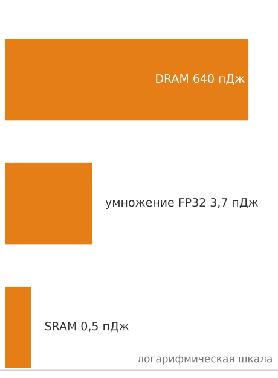
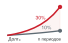
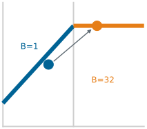
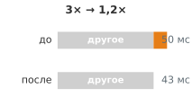

# О книге

## Для кого эта книга {#sec-book-book-74a2 .unlisted}

Эта книга для всех, кто хочет понять, *как* на самом деле работают системы машинного обучения: от математики, которая определяет нейронную сеть, до аппаратуры, которая ее исполняет, и инженерных решений, благодаря которым она работает эффективно.

Большинство читателей не станут архитекторами ML-аппаратуры или инженерами компиляторов. Но каждый практик, который строит, обучает, оптимизирует или развертывает модель, принимает решения, которые зависят от понимания системы под кодом. Книга дает эту системную основу студентам, впервые сталкивающимся с системами ML, практикующим инженерам, которые укрепляют свои знания, и исследователям, которым нужно рассуждать о производительности и развертывании.

## Зачем нужен учебник по системам {#sec-book-systems-textbook-76ff .unlisted}

В 1968 году конференция НАТО в Гармиш-Партенкирхене (Германия) помогла утвердить *программную инженерию* как самостоятельную дисциплину на фоне опасений, что программные системы стали слишком сложными для кустарного программирования (Naur and Randell, 1969). Надежное программное обеспечение требовало собственных принципов, методов и строгости. Спустя десятилетия Хеннесси и Паттерсон сделали количественный анализ центральным в обучении архитектуре компьютеров, систематизировав то, как инженеры измеряют, предсказывают и оптимизируют производительность процессоров (Hennessy and Patterson, 2017). Оба примера показывают, как общие методы делают сложную инженерную работу систематической и пригодной для обучения.

У машинного обучения есть свой момент Гармиша.

Последнее десятилетие исследования ML доминировало мышление, *ориентированное на модель*, сосредоточенное на поиске новых алгоритмов и архитектур. Этот фокус важен, но модель — не система. Нейронная сеть, которая хорошо работает в исследовательском блокноте, бесполезна, если не может уложиться в ограничения задержки, если ее конвейер данных не справляется с нужным объемом или если ее энергетическая стоимость превышает экономическую ценность. Разрыв между работающей моделью и производственной системой — не просто пробел в реализации; это пробел в фундаментальных инженерных принципах.

Эта книга рассматривает инженерию систем ML не как набор инструментов, таких как Kubernetes, PyTorch и CUDA, а как дисциплину, опирающуюся на количественные границы, модели и принципы проектирования. Как инженеры-строители опираются на фундаментальную физику и принципы конструкций, инженеры ИИ должны явно формулировать управляющие принципы, лежащие в основе модели каждой системы:

*   **Железный закон систем ML**: декомпозиция на перемещение, вычисления и накладные расходы, где перекрытие учитывается по критическому пути.
*   **Гравитация данных**: давление размещения, которое создают большие объемы данных и ограниченные сети.
*   **Учет энергии**: стоимость отдельных событий и их число определяют, что доминирует, перемещение или вычисления.
*   **Закон Амдала**: последовательная доля конвейера ограничивает общее системное ускорение.

Информатика изучает то, что вычислимо. Исследования ML изучают то, что обучаемо. Инженерия ИИ изучает то, что можно построить, учитывая физику реальной аппаратуры и реальных данных.

Я написал эту книгу, чтобы помочь заложить такой фундамент и сделать для систем ИИ то, что Хеннесси и Паттерсон сделали для архитектуры компьютеров: заменить интуицию измерением, а искусство — инженерией. Цель — учить системному рассуждению до реализации, рассматривая данные, алгоритмы и аппаратуру не как отдельные изолированные части, а как единую связанную задачу оптимизации.

Представьте коробку с кубиками LEGO. Одни и те же соединяемые детали строят космический корабль, замок или целый город. Наборы меняются, кубики — нет. С системами ML то же самое. Сверточная сеть для классификации изображений, трансформер для генерации текста и агент обучения с подкреплением для робототехники — очень разные приложения, но под ними лежат одни и те же строительные блоки: вычислительные графы, иерархии памяти, конвейеры данных, циклы оптимизации и компромиссы между задержкой, пропускной способностью и энергией. Владение этими блоками делает незнакомые системы понятными.

Поэтому книга учит устойчивым принципам, а не нынешним инструментам. Доминирующие фреймворки за десятилетие сменились с Theano на TensorFlow и затем на PyTorch. Аппаратура эволюционировала от переиспользованных графических процессоров к специально созданным тензорным ускорителям, и новые архитектуры появляются каждый год. Любой учебник, который учит нынешним инструментам, устареет до следующего издания. Строительные блоки остаются.

## Что охватывает книга {#sec-book-book-covers-180b .unlisted}

Книга сосредоточена на *одном вычислительном узле*: одном хосте с одним-восемью ускорителями, обычно с отдельной памятью устройств, соединенной межсоединением. Она также вводит многоускорительное обучение и эксплуатационные операции там, где они проясняют проектирование на уровне узла; рассмотрение масштаба парка выходит за ее рамки.

Содержание организовано в четыре части, каждая из которых играет свою роль в системном рассуждении:

- **Часть I: Основы систем ML** развивает словарь, ментальные модели и сквозной рабочий процесс, которые направляют любой ML-проект, от характеристик, отличающих системы ML от традиционного программного обеспечения, до конвейеров инженерии данных, которые их питают.
- **Часть II: Разработка и обучение** связывает математические основы с работающими системами через вычисления глубокого обучения, нейронные архитектуры, фреймворки и процедуры обучения.
- **Часть III: Оптимизация и ускорение** рассматривает эффективность данных, сжатие моделей, аппаратное ускорение и методологию бенчмаркинга, необходимую для строгого измерения прогресса.
- **Часть IV: Развертывание и эксплуатация** охватывает инфраструктуру обслуживания, эксплуатационные практики и ответственную инженерию для систем, которые должны быть справедливыми, прозрачными и заслуживающими доверия в продакшене.

Эти четыре части прокладывают путь через стек систем ML — слоистую абстракцию, построенную по образцу классического стека компьютерных систем. Каждый слой предоставляет абстракцию слою над собой и использует слой под собой: от аппаратуры внизу через фреймворки, модели, обучение и обслуживание к эксплуатации и приложениям наверху. Данные проходят через все слои как сквозная связь, подобно шине данных в архитектуре компьютера.

В печатной версии книги на поле каждой главы стоит небольшой рисунок, который показывает, какие слои затрагивает глава, и служит повторяющейся картой стека; в этом электронном издании он не воспроизводится.

Данные рядом со стеком — не просто украшение. Их равномерная заливка отражает, насколько данные важны для задач каждой главы: это отдельное измерение, независимое от интенсивности слоев. Соединительные линии между каждым слоем и полосой данных показывают, какие слои взаимодействуют с данными в контексте главы. Три главы показывают, как меняется взгляд.

В главе [«Аппаратное ускорение»](11_hw_acceleration.md#sec-hardware-acceleration) интенсивность слоев сосредоточена в нижней части стека, а полоса данных бледная: глава о кремнии, а не о данных. В главе [«Обучение моделей»](08_training.md#sec-model-training) средние слои светятся, а полоса данных умеренно освещена: обучение потребляет данные, но в основе своей это оптимизация. В главе [«Ответственная инженерия»](15_responsible_engr.md#sec-responsible-engineering) доминируют верхние слои, а полоса данных имеет умеренный оттенок, потому что смещение в обучающих данных проявляется в смещении приложений, хотя между ними лежат несколько слоев. Один и тот же стек рассказывает три разные истории, а данные остаются самостоятельным измерением.

Рядом с текстом стоят также небольшие визуальные подсказки в тех местах, где связь легче всего понять глазами. Это не пронумерованные рисунки, на которые нужно ссылаться; это вспомогательные средства чтения. Лестница показывает разрыв масштабов, эскиз тренда — направление, миниатюра Roofline указывает режим узкого места, а полоса доминирования показывает, какой член управляет суммой. Если миниатюра использует логарифмическую шкалу, это сказано прямо на изображении.

Каждая часть опирается на предыдущую. Тех, кто впервые знакомится с областью, рекомендуется читать последовательно, а следующие индивидуальные маршруты помогают под конкретные профессиональные цели:

## Рекомендуемые маршруты чтения {#sec-book-suggested-reading-paths-773b .unlisted}

Читатели с разным опытом и целями могут выбрать индивидуальные маршруты:

- **Полный маршрут** (все главы по порядку): для студентов и читателей, новых в системах ML. Начните с части I, затем переходите к частям II, III и IV. Этот маршрут развивает каждое понятие с первых принципов.
- **Маршрут инженера ML** (системная глубина для практиков): для инженеров, которые уже обучают и развертывают модели, но хотят понять системы под ними. Бегло просмотрите часть I ради словаря, затем сосредоточьтесь на главах [«Фреймворки машинного обучения»](07_frameworks.md#sec-ml-frameworks), [«Обучение моделей»](08_training.md#sec-model-training), [«Аппаратное ускорение»](11_hw_acceleration.md#sec-hardware-acceleration), [«Бенчмаркинг»](12_benchmarking.md#sec-benchmarking) и [«Обслуживание моделей»](13_model_serving.md#sec-model-serving).
- **Маршрут оптимизации** (ориентированный на эффективность): для инженеров, которые работают над эффективностью моделей, периферийным развертыванием или системами с ограниченными ресурсами. После части I переходите сразу к главам [«Отбор данных»](09_data_selection.md#sec-data-selection), [«Сжатие моделей»](10_model_compression.md#sec-model-compression), [«Аппаратное ускорение»](11_hw_acceleration.md#sec-hardware-acceleration) и [«Бенчмаркинг»](12_benchmarking.md#sec-benchmarking).

## Условные обозначения {#sec-about-conventions-1a2b .unlisted}

В этой книге используется небольшой набор типографских соглашений, которые показывают, что делает каждый фрагмент текста.

### Жирным выделяются первые определения {#sec-about-bold-3c4d}

Термин **жирным** в основном тексте — его формальное первое введение в томе. Каждый термин получает такое выделение ровно один раз. Последующие упоминания идут без выделения: к этому моменту термин уже входит в рабочий словарь, который глава переносит дальше.

> Каждая система машинного обучения несет **двойную задачу**: она должна одновременно управлять статистической неопределенностью и физическими ограничениями.

Жирный шрифт — обязательство запомнить термин, потому что он будет повторяться. Соответствующая запись указателя в конце книги ведет к определяющему упоминанию (в подразделе «определение»), так что к нему можно вернуться. Ключевые технические термины также собраны в глоссарии.

Жирный шрифт выполняет и вторую, структурную роль: как функциональная метка в начале пункта внутри выделенного блока или маркированного итога, например **Рекомендация**, **Компромисс** или **Результат**. В этом контексте жирный шрифт — опорная конструкция, а не первое определение.

### Курсив выполняет конкретные риторические задачи {#sec-about-italics-5e6f}

Курсив не используется для общего выделения. Каждый курсивный фрагмент книги выполняет одну из немногих конкретных задач:

- **Прямое противопоставление**: *обучение* и *вывод*, *логическое* и *физическое*.
- **Невозможность, сформулированная как физический, математический или логический закон**: «системы с задержкой менее 10 мс *не могут* использовать удаленную облачную инфраструктуру — этого не позволяет физика».
- **Слово как слово**: «термин *градиент* обозначает вектор частных производных».
- **Названия произведений**: *Computer Architecture: A Quantitative Approach*.
- **Тезис-вывод**: одно курсивное предложение, которое передает управляющее понимание раздела, например *Данные — это исходный код.*

Курсивное слово выполняет одну из этих задач. Слово без курсива не несет скрытого выделения.

### У выделенных блоков есть визуальная идентичность, соответствующая их задаче {#sec-about-callouts-7a8b}

Выделенные блоки — не украшение. Каждый тип сигнализирует о конкретном виде содержания, поэтому визуальная идентичность сообщает, что внутри, еще до того, как читатель начнет его разбирать.

| Блок                      | Содержание                                                                                                                                                       |
|:--------------------------|:-----------------------------------------------------------------------------------------------------------------------------------------------------------------|
| **Определение**           | Формальное определение ключевого термина с его значением, отличием от ближайшего соседнего понятия и типичной ошибкой                                             |
| **Пример**                | Исторический случай или конкретный сценарий: контекст, понимание и системный урок                                                                                |
| **Системная перспектива** | Аналитическое наблюдение или математическая тонкость, обогащающие окружающую аргументацию                                                                        |
| **Расчет на салфетке**    | Разобранный пошагово расчет, где значения вычисляются по константам книги; промежуточные таблицы и уравнения и есть математика                                    |
| **Проверка**              | Контрольные вопросы для проверки понимания предыдущего раздела                                                                                                   |
| **История из практики**   | Задокументированный инженерный инцидент с описанным режимом отказа: контекст, отказ, последствия и урок                                                           |
| **Маячная модель**        | Повторяющиеся нагрузки, описанные профилем (параметры, FLOP, доминирующее ограничение), которые используются как опорные кейсы в нескольких главах                  |
| **Принцип**               | Канонический принцип или инвариант книги, на который ссылаются последующие главы                                                                                  |
| **Теорема**               | Формальный результат или граница, подкрепленные уравнениями, с указанием условий и применением в последующем количественном анализе                               |
| **Итоги**                 | Четыре-семь важнейших результатов главы в сжатом виде                                                                                                            |
| **Цели обучения**         | Навыки и понятия, которые читатель должен уметь объяснить или применить после главы                                                                              |
| **Что дальше**            | Мост от только что законченной главы к начинающейся, с указанием открытого вопроса, который решает следующая глава                                              |

Когда блок содержит таблицу, рисунок или уравнение, этот артефакт — часть педагогической единицы блока, а не украшение. Профиль маячной модели *и есть* ее характеристика; промежуточные таблицы блока «Расчет на салфетке» *и есть* разобранная математика. Если читать эти артефакты отдельно, теряется дуга изложения. Самостоятельные справочные таблицы, напротив, стоят между абзацами как пронумерованные артефакты, к которым читатель возвращается по перекрестным ссылкам. Обе формы допустимы; визуальный признак (блок или отдельная таблица) показывает читателю, с чем он имеет дело.

Какой бы маршрут ни выбрал читатель, текст предназначен для связи с поддерживающими материалами за пределами самих глав.

## Учебная платформа {#sec-about-platform .unlisted}

Эта книга — одна из частей более широкой образовательной экосистемы. Полный текст, интерактивные блокноты, лекционные слайды, упражнения, практические лабораторные работы и дополнительные материалы для каждой главы свободно доступны на [mlsysbook.ai](https://mlsysbook.ai).

## Открытый учебник {#sec-about-open-source .unlisted}

Эта книга имеет открытый исходный код. Полный текст, рисунки и система сборки доступны на [mlsysbook.ai/git](https://mlsysbook.ai/git), и я приглашаю каждого читателя участвовать в работе. Эта открытость продуманная. Если инженерия ИИ должна стать общей дисциплиной, а не набором изолированных практик, ее базовые тексты должны быть доступны каждому. Область систем ML формируют практики из промышленности, академической среды и сообщества открытого исходного кода по всему миру. Учебник по этой области должен отражать такое разнообразие и быть доступным всем, независимо от географии и институциональной принадлежности.

Вклад читателей — исправление ошибки, предложение более ясного объяснения, добавление рабочего примера или предложение нового материала — существенно улучшил каждую главу. Задачи и запросы на слияние служат механизмом такой совместной работы. Книга становится лучше, потому что ее читатели участвуют в ее создании.

## Предварительные требования {#sec-book-prerequisites-1a4b .unlisted}

Читателю понадобятся две вещи:

- **Программирование**: уверенное владение Python, включая функции, классы и базовую обработку данных с NumPy.
- **Математика**: знакомство с линейной алгеброй, базовым математическим анализом и теорией вероятностей на уровне бакалавриата.

Две дополнительные области полезны, но не обязательны:

- **Компьютерные системы**: знакомство с иерархиями памяти и основами архитектуры компьютеров углубляет главы об оптимизации и аппаратуре.
- **Основы машинного обучения**: предварительное знакомство с понятиями обучения с учителем дает полезный контекст, но часть II выстраивает необходимые основы с первых принципов.

## За пределами книги {#sec-book-beyond-book-c426 .unlisted}

Эта книга развивает фундамент для одного узла, одновременно вводя распределенное исполнение, эксплуатацию в продакшене и управление там, где они влияют на сквозную систему. Сложные многоузловые топологии, коллективные алгоритмы в масштабе парка и устойчивость кластеров выходят за рамки текста в распределенные системы большого масштаба. Освоение этой книги готовит читателя к навигации по более широкому инженерному ландшафту.

## Использование книги в курсе {#sec-book-using-book-course-f71c .unlisted}

Эта книга выросла из курса CS249r в Гарвардском университете и программы профессионального сертификата [TinyML на edX](https://www.edx.org/professional-certificate/harvardx-tiny-machine-learning). Курс TinyML учил системам ML на самом ограниченном конце спектра: микроконтроллеры, работающие на милливаттах с килобайтами памяти. Эта работа показала, что физические ограничения, управляющие встраиваемыми устройствами (пропускная способность памяти, плотность вычислений и энергия на операцию), — те же ограничения, которые управляют графическими процессорами центров обработки данных. *Физика масштабируется; меняются только числа.* Это понимание сформировало книгу: владение основами систем на самом малом масштабе готовит инженеров к любому масштабу.

В учебных курсах книга рассчитана на семестровую последовательность, охватывающую весь стек систем ML. Преподаватели также могут выбрать отдельные части для коротких модулей:

- **Части I–II** образуют вводный полусеместровый курс об основах систем ML и о том, как такие системы строятся и обучаются.
- **Части III–IV** образуют прикладной полусеместровый курс об их оптимизации, развертывании и эксплуатации.

Для обзорных курсов и программ для руководителей одни только введения к четырем частям дают сжатый обзор количественных принципов, управляющих системами ML.

Лекционные слайды, задания и материалы для преподавателей доступны на [mlsysbook.ai](https://mlsysbook.ai).
