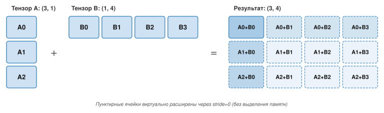
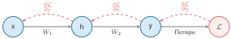

# Основы алгоритмов

Профиль с низкой загрузкой часто ошибочно принимают за аппаратное ограничение, хотя причина алгоритмическая: форма умножения матриц, которая расточает тензорные ядра, раскладка, нарушающая непрерывность, или активации, которые удерживаются в памяти ради обратного распространения. Это приложение собирает модели вычислительной сложности и выводы об объеме занимаемой памяти, на которые опираются главы о производительности, и позволяет читателю оценивать алгоритмические компромиссы до того, как код будет передан ускорителям. Предполагается знакомство с линейной алгеброй и с железным законом, введенным в начале книги.

## Как пользоваться этим приложением

Приложение задумано как справочник. Обращайтесь к нему, когда нужно перевести симптом профилировщика («медленное умножение матриц», «несовпадение форм», «нехватка памяти во время обучения») в конкретную причину: вычислительную или связанную с памятью.

Обозначения здесь следуют общекнижным соглашениям (например, $B$ зарезервировано за размером батча, а $\text{BW}$ обозначает пропускную способность).

- **Когда ядра обобщенного матричного умножения (GEMM) медленные**: используйте раздел [«Обобщенное матричное умножение (GEMM)»](appendix_algorithm.md#sec-appdx-algorithm-foundations-general-matrix-multiply-gemm-b55d) и сравните интенсивность с точкой перехода аппаратуры.
- **Когда память взрывается при обучении**: используйте раздел [«Истинная стоимость памяти обучения»](appendix_algorithm.md#sec-appdx-algorithm-foundations-true-cost-training-memory-e54e) и разложение памяти обучения.
- **Когда тензорный код «должен работать», но не работает**: используйте разделы [«Формы и страйды»](appendix_algorithm.md#sec-appdx-algorithm-foundations-shapes-strides-1aea) и [«Broadcasting»](appendix_algorithm.md#sec-appdx-algorithm-foundations-broadcasting-ec16).
- **Когда разреженность предлагают как исправление**: используйте раздел [«Форматы разреженных матриц»](appendix_algorithm.md#sec-appdx-algorithm-foundations-sparse-matrix-formats-0bd0), чтобы проверить плотность и накладные расходы метаданных.
- **Когда нужно доказать границы вычислений градиента**: используйте теорему Баура–Штрассена о сложности автоматического дифференцирования в обратном режиме (AD) из раздела [«Теорема Баура–Штрассена о сложности обратного режима AD»](appendix_algorithm.md#sec-appdx-algorithm-baur-strassen).
- **Когда анализируется узкое место по длине последовательности**: используйте раздел [«Доказательство тайлинга FlashAttention и рекуррентности online softmax»](appendix_algorithm.md#sec-appdx-algorithm-flash-attention) — рекуррентность online softmax и сокращение обращений к памяти с высокой пропускной способностью (HBM) в FlashAttention.
- **Когда распределяют вычисления между параметрами и токенами**: используйте раздел [«Вывод закона масштабирования Каплана и Chinchilla с оптимальным расходом вычислений»](appendix_algorithm.md#sec-appdx-algorithm-chinchilla-derivation).

Нейронные сети превращают линейную алгебру в выученное поведение: матрицы преобразуют активации, раскладки тензоров определяют, как данные перемещаются по памяти, а обратное распространение проводит сигналы ошибки через получившиеся вычисления. Эти основы поддерживают трактовку глубокого обучения в главе [«Вычисления в нейронных сетях»](05_nn_computation.md#sec-neural-computation), внутреннее устройство фреймворков в главе [«Фреймворки машинного обучения»](07_frameworks.md#sec-ml-frameworks) и стратегии обучения в главе [«Обучение моделей»](08_training.md#sec-model-training). Архитектуры меняются, но лежащий в основе математический аппарат остается неизменным.

## Линейная алгебра

Системы глубокого обучения по своей сути — машины для преобразования огромных матриц. Фреймворки вроде PyTorch скрывают сырую математику, но инженерия производительности по-прежнему зависит от лежащей в основе линейной алгебры. Раздел [«Численные представления»](appendix_machine.md#sec-appdx-machine-foundations-numerical-representations-c889) описал, как числа хранятся; этот раздел посвящен тому, как с ними работают.

> **Почему это важно**
>
> Многие плотные нейронные сети, особенно трансформеры и большие сверточные сети, тратят большую часть вычислений на матричные умножения или ядра, похожие на GEMM. Блок самовнимания выполняет GEMM для проекций Q, K, V и выхода плюс два матричных умножения внимания: одно для оценок внимания и одно для значений, взвешенных вниманием. Блок прямого распространения слоя добавляет еще GEMM. Понимание характеристик производительности GEMM объясняет, почему размер батча влияет на пропускную способность, почему одни размеры слоев «лучше» других и как читать вывод профилировщика. Рассуждение о размерах матриц и арифметической интенсивности предсказывает, будет ли плотная нагрузка ограничена вычислениями или памятью, *еще до* того, как запускается какая-либо трасса профилировщика.

### Тензорные операции и обозначения

Нотация суммирования Эйнштейна[^fn-einsum-tensor-contraction] делает сложные операции явными на протяжении всей книги (реализована как `torch.einsum` в PyTorch и `np.einsum` в NumPy). Матричное умножение $\mathbf{C} = \mathbf{A}\mathbf{B}$ записывается так:
$$ C_{ij} = \sum_k A_{ik} B_{kj} $$

[^fn-einsum-tensor-contraction]: **Соглашение о суммировании Эйнштейна**: повторяющиеся индексы в произведении неявно суммируются, поэтому явные знаки суммирования не нужны. Фреймворки машинного обучения приняли это соглашение, потому что оно кратко выражает произвольные свертки тензоров одной строкой.

В нотации einsum это записывается как `ik,kj->ij`. Нотация естественно распространяется на многомерные операции в механизмах внимания. Например, батчевое многоголовое внимание записывается как `bhid,bhjd->bhij` (батч $b$, голова $h$, индекс запроса $i$, индекс ключа $j$ и размерность головы $d$).

### Раскладки памяти и производительность

Раскладка данных в памяти (построчная или поколоночная) напрямую влияет на эффективность кэша. При обходе матрицы доступ к непрерывным ячейкам памяти заметно быстрее, чем доступ с шагом.

Типичный прием — однократно материализовать транспонированный тензор перед серией операций, чтобы обеспечить непрерывный доступ в горячем цикле. Одноразовая стоимость копирования распределяется на множество последующих операций.

### Скалярное произведение как мера сходства

Скалярное произведение $\mathbf{a} \cdot \mathbf{b} = \sum a_i b_i$ геометрически эквивалентно $\|\mathbf{a}\| \|\mathbf{b}\| \cos \phi$, что делает его естественной мерой сходства двух векторов: для ненулевых векторов знак различает острые, прямые и тупые углы, а величина зависит и от норм обоих векторов.

Эта геометрическая интерпретация объясняет, почему скалярные произведения встречаются повсюду в современных архитектурах. В механизмах внимания векторы запроса ($Q$) и ключа ($K$) перемножаются скалярно, чтобы получить оценку сходства, которая определяет, насколько каждый токен обращает внимание на каждый другой. Полученные веса внимания затем образуют взвешенную комбинацию векторов значений ($V$) — так скалярное произведение становится основой способности трансформера моделировать дальние зависимости.

### Обобщенное матричное умножение (GEMM)

GEMM[^fn-gemm-blas-routines] — рабочая лошадка глубокого обучения. Для матриц размера $M{\times}K$ и $K{\times}N$ GEMM выполняет $2MNK$ операций с плавающей запятой (операция «умножить и накопить» считается как две операции).

[^fn-gemm-blas-routines]: **Обобщенное матричное умножение (GEMM)**: семейство BLAS (Basic Linear Algebra Subprograms) началось с векторных подпрограмм, стандартизованных в 1979 году (Lawson et al., 1979); GEMM позднее была стандартизована как подпрограмма уровня 3 (Dongarra et al., 1988). Приставка «GE» означает «general» — в противоположность симметричным или треугольным формам. GEMM вычисляет $\mathbf{C} = \alpha \mathbf{A}\mathbf{B} + \beta \mathbf{C}$ и является критичной для производительности подпрограммой в глубоком обучении. [«Матричные операции»](08_training.md#sec-model-training-matrix-operations-1f21) объясняет, как формы GEMM определяют пропускную способность обучения.

Арифметическая интенсивность GEMM линейно растет с размером матрицы. Для квадратных матриц $n{\times}n$ в FP16 (2 байта на элемент) идеальная граница при $\beta=0$ читает $\mathbf{A}$ и $\mathbf{B}$ один раз и записывает $\mathbf{C}$ один раз:
$$\text{Интенсивность} = \frac{O}{D_{\text{vol}}} = \frac{2n^3}{3n^2 \times 2} = \frac{n}{3}\text{ FLOP/байт}$$

Чтение старой $\mathbf{C}$ при $\beta \ne 0$ меняет интенсивность на $n/4$ FLOP/байт. Исполнение GEMM определяют три системных следствия:

- **Большие батчи могут повысить эффективность**: батчинг увеличивает эффективные размеры матриц, когда формирует более крупные GEMM или позволяет повторное использование; простая постановка в очередь независимых мелких GEMM интенсивность не повышает.
- **Выровненные размеры помогают**: тензорные ядра аппаратуры оптимизированы под кратные плитки, специфичные для точности и архитектуры. Размеры, выровненные по этим кратным, избегают накладных расходов на дополнение и улучшают эффективность ядра, но не обязаны быть степенями двойки.
- **Малые матрицы неэффективны**: квадратный GEMM с $n =$ 64 имеет интенсивность 64/3 ≈ 21,3 FLOP/байт, что заметно ниже точки перехода (153,0 FLOP/байт). Его потолок Roofline составляет около 13,9 процента пика; накладные расходы запуска и тайлинга могут снизить реально достижимую пропускную способность.

### Форматы разреженных матриц

Когда большинство элементов матрицы равны нулю, специализированные форматы хранения не тратят память на нули и позволяют вычисления, которые полностью их пропускают. Формат **сжатого разреженного строчного хранения (CSR)** использует три массива:

- `Values`: ненулевые элементы, хранящиеся по строкам
- `Col_Idx`: индекс столбца каждого ненулевого элемента
- `Row_Ptr`: начальная позиция в `Values` для каждой строки (длина = число строк + 1)

CSR полезен для разреженных матриц признаков в конвейерах рекомендаций и для прореженных весов моделей. Для матрицы с $N$ элементами, $R$ строками и $K$ ненулевыми элементами CSR использует $\mathcal{O}(K + R)$ памяти вместо $\mathcal{O}(N)$; когда $K$ велико относительно $R$, это часто суммируют как $\mathcal{O}(K)$.

Чтобы конкретно увидеть компромисс, рассмотрим матрицу эмбеддингов словаря со 100 000 строк и 10 000 столбцов (1 млрд параметров):

*   **Плотная (FP32)**: 1 млрд параметров $\times$ 4 байта каждый = 4 ГБ.
*   **Разреженная** (плотность 1 процент): CSR хранит примерно 10 млн записей $\times$ (4-байтовое значение + 4-байтовый индекс столбца), плюс один указатель строки на строку и финальный указатель, итого ≈ 80,4 МБ.
*   *Результат*: снижение объема памяти в 50 раз, что позволяет разместить модель, которая иначе вызвала бы нехватку памяти (OOM).

Линейная алгебра говорит нам, *что* вычислять; следующий вопрос — *как* выразить эти вычисления в коде. Примитивы тензорного программирования — формы, страйды и broadcasting — соединяют математическую нотацию с операциями над массивами, которые реально исполняются на аппаратуре.

## Примитивы тензорного программирования

Падение из-за несовпадения форм, молча неверный broadcast, ядро, работающее на 5 процентах пика из-за прерывистого (non-contiguous) тензора, — все эти распространенные сбои инженерии ML восходят к одному и тому же слою абстракции. *Тензорное программирование* переводит абстрактную математику линейной алгебры в конкретные манипуляции с массивами, которые исполняются на аппаратуре.

### Шпаргалка по вычислительной сложности

[«Базовые тензорные примитивы глубокого обучения»](appendix_algorithm.md#tbl-tensor-op-ref) дает количественный справочник по самым распространенным строительным блокам. Используйте эти формулы для прикидочной оценки размера модели и требований к вычислениям *до* того, как будет выделена аппаратура. Зная размеры слоев и формы входов, формулы дают первоприближенные оценки параметров и вычислений. Строка внимания содержит ключевое предупреждение: длина последовательности добавляет член $S^2$, а скрытая размерность — работу проекций $d^2$, поэтому модели с длинным контекстом могут сместить доминирующую стоимость без изменения числа параметров.

| **Тип слоя**                  |        **Форма выхода**       |                                       **Параметры ($P$)**                                       |                              **FLOP (на прямой проход)**                              |
|:------------------------------|:-----------------------------:|:------------------------------------------------------------------------------------------------:|:--------------------------------------------------------------------------------------:|
| **Linear**                    |     $(B, N_{\text{out}})$     |            $N_{\text{in}} \times N_{\text{out}} + N_{\text{out}}$, если включено смещение             |                $2 \times B \times N_{\text{in}} \times N_{\text{out}}$                 |
| **Conv2D**                    | $(B, C_{\text{out}}, H', W')$ |       $K^2 \times C_{\text{in}} \times C_{\text{out}} + C_{\text{out}}$, если включено смещение       | $2 \times B \times H' \times W' \times K^2 \times C_{\text{in}} \times C_{\text{out}}$ |
| **Многоголовое самовнимание** |   $(B, S, d_{\text{model}})$  | $4 \times d_{\text{model}}^2$, плюс $4 \times d_{\text{model}}$, если включены смещения проекций |              $B \times (4 S^2 d_{\text{model}} + 8 S d_{\text{model}}^2)$              |
| **LayerNorm**                 |   $(B, S, d_{\text{model}})$  |                 $2 \times d_{\text{model}}$, если включены масштаб и смещение                  |                   $\mathcal{O}(B \times S \times d_{\text{model}})$                    |

***Базовые тензорные примитивы глубокого обучения**: сводка форм, параметров и числа FLOP. Обозначения: $B$ — размер батча, $S$ — длина последовательности, $K$ — размер ядра. Вычисления внимания включают проекции QKV и взаимодействия оценок. Член $S^2$ относится к обучению на полной последовательности и предзаполнению, тогда как генерация с KV-кэшем линейна по кэшированному контексту на каждый токен; при больших скрытых размерностях доминирует работа проекций $d^2$.*

### Формы и страйды

Тензор — это представление поверх буфера хранения, описываемое метаданными формы, страйда, типа данных и смещения. Только непрерывные (contiguous) тензоры располагают свои логические элементы одним смежным блоком.

*   **Форма**: размерности тензора (например, `(3, 4)`).
*   **Страйд**: число элементов, которое нужно пропустить в памяти, чтобы перейти к следующему элементу по данной размерности.

Операции вроде `transpose()` или `view()` часто меняют только *страйды*, а не данные в памяти. Это быстро ($\mathcal{O}(1)$), но приводит к прерывистым тензорам, которые падают в ядрах, требующих непрерывных данных. В таких случаях вызов `contiguous()` принудительно копирует память за $\mathcal{O}(N)$, и это может доминировать во времени исполнения, если повторно вызывается внутри цикла.

### Broadcasting

Broadcasting позволяет выполнять арифметические операции над тензорами разных форм. Сравнивайте размерности от последней к первой. Две размерности совместимы, когда:

1.  они равны;
2.  одна из них равна 1.

Размерность единичного размера «растягивается», чтобы совпасть с другой, как показано на рисунке [«Правила broadcasting тензоров»](appendix_algorithm.md#fig-broadcasting-rules). Это растяжение виртуальное: данные в памяти не копируются. Вместо этого страйд для такой размерности задается равным 0, так что аппаратура многократно читает одно и то же значение с накладными расходами памяти $\mathcal{O}(1)$.

***Правила broadcasting тензоров**: столбец (3,1) и строка (1,4) растягиваются по взаимодополняющим размерностям и дают попарные суммы в результате формы (3,4).*

Рассмотрим конкретный случай: тензор A имеет форму `(32, 1, 64)`, а тензор B — форму `(1, 128, 64)`. Сравнивая размерности справа налево, видим: 64 совпадает с 64, затем 1 растягивается до 128, затем 1 растягивается до 32, и получается форма результата `(32, 128, 64)`. Визуализация такого расширения предотвращает незаметные логические ошибки, которые случайно выделяют большой тензор (например, матрицу `(Batch, Batch)` вместо поэлементного вектора `(Batch)`).

Формы, страйды и broadcasting управляют тем, как тензоры проходят через прямой проход модели. Обучение добавляет второе требование: *учиться на ошибках*. Обратное распространение делает такое обучение возможным и накладывает стоимость памяти, которую разберем ниже.

## Механика обучения

Корректные тензорные программы делают возможными циклы обучения. Обратное распространение организует эти тензоры, чтобы вычислить градиенты и превратить прямое предсказание в обратный сигнал обучения.

> **Почему это важно**
>
> Когда обучение отказывает — функция потерь уходит в NaN, градиенты взрываются или заканчивается память, — понимание того, что на самом деле делает обратное распространение, необходимо для диагностики. Обратный граф дает ментальную модель для рассуждения о потоке градиентов и использовании памяти во время обучения.

### Правило цепочки и автоматическое дифференцирование

Для составной функции $y = f(g(x))$ производная равна $\frac{dy}{dx} = \frac{dy}{dg} \cdot \frac{dg}{dx}$. В нейронной сети $f$ и $g$ — слои, а композиция может быть многоуровневой. Для трехслойной сети $y = f_3(f_2(f_1(x)))$ правило цепочки дает:
$$ \frac{\partial y}{\partial x} = \frac{\partial f_3}{\partial f_2} \cdot \frac{\partial f_2}{\partial f_1} \cdot \frac{\partial f_1}{\partial x} $$

Каждый множитель этого произведения — *локальная* производная, вычисленная на одном слое только по входам и выходам этого слоя. Именно эта локальность делает алгоритм практичным: всю сеть не нужно дифференцировать как монолитную функцию. Вместо этого каждый слой на обратном проходе вычисляет свою локальную производную и умножает ее на градиент, пришедший от слоя выше.

Современные фреймворки используют автоматическое дифференцирование в обратном режиме, которое вычисляет градиенты для всех $P$ параметров за один обратный проход. Ключевая идея: начиная с выхода и двигаясь назад (обратный режим), требуется один проход независимо от числа параметров, тогда как начиная с каждого входа и двигаясь вперед (прямой режим), понадобилось бы $P$ проходов — по одному на параметр. Поэтому шаг обучения — это небольшое постоянное кратное вывода: обычно примерно в 2–3 раза дороже прямого прохода для плотных сетей, а не $P$ проходов.

### Алгоритм обратного распространения

Обратное распространение[^fn-backprop-chain-rule] эффективно реализует правило цепочки в два прохода: прямой — для вычисления выходов, обратный — для вычисления градиентов. [«Вычислительный граф обратного распространения»](appendix_algorithm.md#fig-backprop-graph) иллюстрирует этот процесс для простой двуслойной сети: прямой проход (серые стрелки) вычисляет выходы, а обратный (красные пунктирные стрелки) распространяет градиенты.

[^fn-backprop-chain-rule]: **Обратное распространение**: сокращение от «обратное распространение ошибки». Алгоритм независимо открывали несколько раз: Вербос (Werbos, 1974) и Линнаинмаа (Linnainmaa, 1970) — для дифференцирования в обратном режиме, а Румельхарт и соавторы (Rumelhart et al., 1986) — для обучения нейронных сетей. Его ключевая идея: вычисление градиентов для *всех* параметров требует одного обратного прохода по графу, а не одного прохода на параметр. [«Теорема Баура–Штрассена о сложности AD в обратном режиме»](appendix_algorithm.md#sec-appdx-algorithm-baur-strassen) выводит границу работы с постоянным коэффициентом и типичную стоимость плотного слоя.

***Вычислительный граф обратного распространения**: сплошные серые стрелки несут прямые вычисления от входа $x$ к функции потерь $\mathcal{L}$, а пунктирные красные стрелки несут градиенты назад по тем же зависимостям.*

Градиентные ребра повторяют прямые зависимости, поэтому каждый обратный шаг требует значений, сохраненных от соответствующей прямой операции.

#### Прямой проход

Используя активации в виде строковых векторов, опуская смещения и сохраняя промежуточные активации для обратного прохода, начнем с $x$ — входа. Умножим его на $W_1$, чтобы получить скрытую активацию $h$. Сохраним $h$, потому что обратный проход понадобится позже. Умножим $h$ на $W_2$, чтобы получить выход $y$. Сохраним $y$. Сравним $y$ с целевой меткой, чтобы вычислить функцию потерь $\mathcal{L}$.

К этому моменту потери вычислены, и в памяти содержатся вход $x$, сохраненная активация $h$, сохраненный выход $y$ и потери $\mathcal{L}$. Для большой модели эти сохраненные активации могут доминировать в использовании памяти.

#### Обратный проход

Теперь пойдем назад от $\mathcal{L}$. Функция потерь дает $\frac{\partial \mathcal{L}}{\partial y}$ — градиент потерь по предсказанию. Здесь в сеть входит сигнал ошибки.

Поскольку $y = h \cdot W_2$, правило цепочки дает два градиента на этом слое:
$$ \frac{\partial \mathcal{L}}{\partial W_2} = h^T \cdot \frac{\partial \mathcal{L}}{\partial y} \qquad \text{(градиент весов — для обновления } W_2\text{)} $$
$$ \frac{\partial \mathcal{L}}{\partial h} = \frac{\partial \mathcal{L}}{\partial y} \cdot W_2^T \qquad \text{(градиент входа — передается назад предыдущему слою)} $$

Вычисление $\frac{\partial \mathcal{L}}{\partial W_2}$ требует сохраненной активации $h$ из прямого прохода. Активации должны оставаться доступными на обратном проходе, потому что градиент весов каждого слоя зависит от входа этого слоя.

Теперь продолжим назад к первому слою. Поскольку $h = x \cdot W_1$, тот же паттерн дает:
$$ \frac{\partial \mathcal{L}}{\partial W_1} = x^T \cdot \frac{\partial \mathcal{L}}{\partial h} $$

Каждый шаг назад требует две вещи: градиент, пришедший сверху $\left(\frac{\partial \mathcal{L}}{\partial h}\right)$, и вход этого слоя ($x$), который должен быть доступен на обратном проходе. Поэтому обратный проход стоит примерно в 2 раза больше прямого по вычислениям: на каждом слое он выполняет два матричных умножения (одно для градиента весов, одно для градиента входа) против одного на прямом проходе.

### Истинная стоимость памяти обучения

Распространенная ошибка — считать, что память обучения равна размеру модели. Это предположение ведет к немедленным ошибкам нехватки памяти (OOM), потому что веса — лишь один из четырех компонентов. Память обучения включает веса, градиенты, состояние оптимизатора и сохраненные активации:
$$ M_{\text{total}} = M_{\text{weights}} + M_{\text{gradients}} + M_{\text{optimizer}} + M_{\text{activations}} $$

Для стандартного оптимизатора Adaptive Moment Estimation (Adam) (Kingma and Ba, 2015) в смешанной точности (Micikevicius et al., 2017):

*   **Веса**: 2 байта (FP16/BF16) или 4 байта (FP32).
*   **Градиенты**: того же размера, что и веса.
*   **Состояние оптимизатора**: моменты Adam требуют 8 байт на параметр; мастер-копия в FP32 добавляет еще 4 байта, итого 8–12 байт на параметр.
*   **Активации**: главный «гигант». Оценка, дружественная к пересчету или тайловому вниманию, масштабируется как $\mathcal{O}(B \times S \times N_L \times d)$; полная реализация внимания без пересчета дополнительно материализует тензоры оценок внимания, которые масштабируются с $S^2$.

Чтобы увидеть, как эти компоненты взаимодействуют на практике, рассмотрим конкретную модель.

> **Разобранный пример: память обучения GPT-2 (1,5 млрд)**
>
> **Модель**: GPT-2 XL имеет $P = 1{,}5 \times 10^{9}$ параметров, 48 слоев и скрытую размерность $d = 1600$.
>
> **Состояние модели (фиксировано на шаг)**:
>
> - Веса (BF16): $1{,}5 \times 10^{9}$ $\times$ 2 байта = 3 ГБ
> - Градиенты (BF16): $1{,}5 \times 10^{9}$ $\times$ 2 байта = 3 ГБ
> - Оптимизатор (мастер FP32 + моменты + дисперсия): $1{,}5 \times 10^{9}$ $\times$ 12 байт = 18 ГБ
> - **Итого состояние модели**: 24 ГБ — помещается на ускорителе класса 80 ГБ A100/H100 (85,9 ГБ в десятичных единицах), но оставляет лишь 61,9 ГБ под активации.
>
> **Активации (масштабируются с батчем)**:
>
> Сохраняемые активации слоя для этой быстрой оценки примерно равны $12 \times B \times S \times d$ элементам BF16, то есть $12 \times B \times S \times d \times 2$ байт, где $B$ — размер батча, а $S$ — длина последовательности. Множитель двенадцать учитывает основные промежуточные тензоры, сохраняемые для обратного распространения: входные активации, проекции QKV ($3d$), выход внимания, промежуточный слой FFN ($4d$) и маски layer norm/dropout. Оценка предполагает, что реализация не сохраняет полный тензор оценок внимания $B \times N_{\text{heads}} \times S^2$, как в учете, дружественном к пересчету или тайловому вниманию. При 48 слоях, размере батча 8 и длине последовательности 1024:
>
> $$48 \times 12 \times 8 \times 1024 \times 1600 \times 2\text{ байт } \approx 15{,}1 \text{ ГБ}$$
>
> **Системный вывод**: около 39,1 ГБ при этом соглашении учета активаций, что помещается на одном ускорителе 85,9 ГБ. Однако если увеличить батч до 64, активации вырастут примерно до 120,8 ГБ, что превышает оставшуюся емкость. Это порог, за которым становится необходимой контрольная точка градиента или другой метод экономии памяти; ее выигрыш и накладные расходы на пересчет зависят от размещения контрольных точек и реализации.

#### Взрыв активаций

Пока веса фиксированы ($\mathcal{O}(P)$), активации растут линейно с размером батча и как минимум линейно с длиной последовательности; реализации, которые материализуют оценки внимания, добавляют компонент $\mathcal{O}(S^2)$. Как показывает разобранный пример, память активаций может быстро превысить запас, оставшийся после состояния модели. Контрольная точка градиента[^fn-gradient-checkpointing-memory] снижает это давление, сохраняя лишь выбранные активации и пересчитывая остальные на обратном проходе (Chen et al., 2016); такие приемы, как FlashAttention, устраняют связанные узкие места памяти внимания тайлингом, сокращая обращения к памяти (Dao et al., 2022).

[^fn-gradient-checkpointing-memory]: **Контрольная точка градиента**: обменивает вычисления на память. Вместо хранения всех активаций сохраняется только подмножество (контрольные точки), а недостающие пересчитываются на обратном проходе. Это снижает использование памяти примерно с хранения активаций каждого слоя до порядка квадратного корня из числа слоев ценой около 33 процентов дополнительных вычислений (Chen et al., 2016).

Та же декомпозиция дает быструю проверку осуществимости: сложите состояние модели по параметрам, добавьте член активаций, подразумеваемый размером батча и длиной последовательности, и сравните итог с емкостью ускорителя.

### Вычислительные графы и оптимизация

Структура зависимостей, которую раскрывает обратное распространение, дает компиляторам что оптимизировать. Компиляторы машинного обучения представляют модели ориентированными ациклическими графами (DAG), и это представление позволяет аппаратно-независимые преобразования.

#### Статическое единственное присваивание

Компиляторы преобразуют графы в форму статического единственного присваивания (SSA), где каждой переменной присваивается значение ровно один раз. Это делает зависимости по данным явными и позволяет безопасные оптимизации — главным образом *слияние операторов* (operator fusion).

#### Слияние операторов

Без слияния каждая операция в цепочке вроде `MatMul → Add (смещение) → ReLU` порождает промежуточный тензор, который записывается в HBM и затем читается обратно для следующей операции. Для поэлементных операций вроде `Add` и `ReLU` вычисления тривиальны (один FLOP на элемент), но трафик памяти — нет (прочитать тензор и записать обратно). Поэтому арифметическая интенсивность несливаемых поэлементных операций близка к нулю — они глубоко ограничены памятью.

Слияние объединяет последовательные операции в одно ядро, которое читает вход один раз, применяет все операции в регистрах или общей памяти и записывает конечный результат один раз. Для последовательности из $k$ поэлементных операций над тензором размером $N$ байт слияние сокращает трафик памяти с $2kN$ байт (каждая операция читает и записывает) до $2N$ байт (одно чтение, одна запись) — сокращение в $k$ раз.

FlashAttention — тайловый алгоритм внимания, учитывающий ввод-вывод: он вычисляет стадии оценок, softmax и произведения на значения в тайлах SRAM, не материализуя полную матрицу внимания в HBM, и снижает трафик HBM и вспомогательную память внимания с $\mathcal{O}(S^2)$ до $\mathcal{O}(S)$. В исходной работе сообщается об ускорении реального времени до 3 раз на оцениваемых нагрузках (Dao et al., 2022); реальный выигрыш зависит от форм и аппаратуры (пошаговый вывод см. в разделе [«Доказательство тайлинга FlashAttention и рекуррентности online softmax»](appendix_algorithm.md#sec-appdx-algorithm-flash-attention)). Вместе основы линейной алгебры, механика тензорного программирования и модель памяти обучения, разобранные в этом приложении, образуют алгоритмический субстрат, на котором строятся все ML-системы.

## Теорема Баура–Штрассена о сложности AD в обратном режиме

Современное глубокое обучение масштабируется до сотен миллиардов параметров потому, что вычисление полного вектора градиента $\nabla f(x)$ скалярной функции потерь $f: \mathbb{R}^N \to \mathbb{R}$ требует вычислений, пропорциональных вычислению самой $f(x)$, с границей, которая имеет постоянный коэффициент и не зависит от входной размерности $N$. Баур и Штрассен доказали этот результат о сложности в 1983 году (Baur and Strassen, 1983).

### Математическая постановка и формулировка теоремы

Пусть $f: \mathbb{R}^N \to \mathbb{R}$ — многомерная скалярная функция, представленная вычислительным графом $G = (V, E)$, состоящим из $W(f)$ элементарных операций (сложения, вычитания, умножения, деления и унарных функций вроде $\exp, \ln, \sin, \sqrt{\cdot}$).

> **Теорема сложности Баура–Штрассена**
>
> Если скалярную функцию $f: \mathbb{R}^N \to \mathbb{R}$ можно вычислить за $W(f)$ элементарных операций, то полный вектор градиента $\nabla f(x) = \left(\frac{\partial f}{\partial x_1}, \frac{\partial f}{\partial x_2}, \dots, \frac{\partial f}{\partial x_N}\right)^T \in \mathbb{R}^N$ можно вычислить суммарной работой $\text{Work}_{\text{Reverse}}(f, \nabla f)$, удовлетворяющей условию:
> $$ \text{Work}_{\text{Reverse}}(f, \nabla f) \le C \cdot W(f) $$
> где $C \le 5$ — универсальная константа, не зависящая от входной размерности $N$. Кроме того, один лишь обратный проход требует работы $\text{Work}_{\text{Backward}}(\nabla f) \le 4 \cdot W(f)$.

### Пошаговое доказательство распространения сопряженных величин по правилу цепочки

Пусть граф $G = (V, E)$ топологически упорядочен, узлы $v_{1-N}, \dots, v_0, v_1$, $v_2, \dots, v_W$, где входные переменные — $x_i = v_{i-N}$ при $i \in \{1, \dots, N\}$, а конечный выход — $f(x) = v_W$. Каждый промежуточный узел $v_j$ вычисляется примитивной операцией:
$$ v_j = \phi_j\left( \{ v_k \mid k \in \text{Parents}(j) \} \right) $$

Определим *сопряженную переменную* $\bar{v}_i$ для каждого узла $v_i$ как частную производную скалярного выхода $v_W$ по $v_i$:
$$ \bar{v}_i \triangleq \frac{\partial f}{\partial v_i} = \frac{\partial v_W}{\partial v_i} $$

По многомерному правилу цепочки сопряженная величина $\bar{v}_i$ — сумма частных производных, распространенных от всех последующих узлов (потомков), которые используют $v_i$:
$$ \bar{v}_i = \sum_{j \in \text{Children}(i)} \bar{v}_j \cdot \frac{\partial v_j}{\partial v_i} $$

Автоматическое дифференцирование в обратном режиме задает $\bar{v}_W = 1$ и $\bar{v}_i = 0$ для всех $i < W$, затем проходит узлы в обратном топологическом порядке от $v_W$ до $v_1$. Для каждого примитивного узла $v_j$ полностью накопленная сопряженная величина $\bar{v}_j$ передает сигналы ошибки родительским узлам $v_k$ ($k \in \text{Parents}(j)$):
$$ \bar{v}_k \gets \bar{v}_k + \bar{v}_j \cdot \frac{\partial v_j}{\partial v_k} $$

Теперь выполним пооперационный учет микростоимости для всех примитивных узлов, чтобы ограничить работу обратного прохода:

1. **Сложение/вычитание ($v_j = v_i \pm v_k$)**:
   - Локальные производные: $\frac{\partial v_j}{\partial v_i} = 1$, $\frac{\partial v_j}{\partial v_k} = \pm 1$.
   - Обратные обновления: $\bar{v}_i \gets \bar{v}_i + \bar{v}_j$ и $\bar{v}_k \gets \bar{v}_k \pm \bar{v}_j$.
   - Стоимость: 2 сложения на обратном проходе на 1 прямую операцию. Отношение работы: $\text{Fwd}(1) + \text{Bwd}(2) = 3 \text{ операции} \le 5 \cdot 1$.
2. **Умножение ($v_j = v_i \cdot v_k$)**:
   - Локальные производные: $\frac{\partial v_j}{\partial v_i} = v_k$, $\frac{\partial v_j}{\partial v_k} = v_i$.
   - Обратные обновления: $\bar{v}_i \gets \bar{v}_i + \bar{v}_j \cdot v_k$ и $\bar{v}_k \gets \bar{v}_k + \bar{v}_j \cdot v_i$.
   - Стоимость: 2 умножения + 2 сложения = 4 операции на обратном проходе на 1 прямую операцию. Отношение работы: $\text{Fwd}(1) + \text{Bwd}(4) = 5 \text{ операций} \le 5 \cdot 1$.
3. **Деление ($v_j = v_i/v_k$)**:
   - Локальные производные: $\frac{\partial v_j}{\partial v_i} = \frac{1}{v_k}$, $\frac{\partial v_j}{\partial v_k} = -\frac{v_i}{v_k^2} = -\frac{v_j}{v_k}$.
   - Обратные обновления: $\bar{v}_i \gets \bar{v}_i + \frac{\bar{v}_j}{v_k}$ и $\bar{v}_k \gets \bar{v}_k - \frac{\bar{v}_j \cdot v_j}{v_k}$.
   - Стоимость: 2 умножения/деления + 2 сложения = 4 операции на обратном проходе на 1 прямую операцию. Отношение работы: $\text{Fwd}(1) + \text{Bwd}(4) = 5 \text{ операций} \le 5 \cdot 1$.
4. **Унарные трансцендентные операции ($v_j = \phi(v_i)$)**:
   - Локальная производная: $\frac{\partial v_j}{\partial v_i} = \phi'(v_i)$.
   - Обратное обновление: $\bar{v}_i \gets \bar{v}_i + \bar{v}_j \cdot \phi'(v_i)$.
   - Для $v_j = \exp(v_i)$ имеем $\phi'(v_i) = v_j$, что требует 1 умножения + 1 сложения = 2 операции.
   - Для $v_j = \ln(v_i)$ имеем $\phi'(v_i) = 1/v_i$, что требует 1 деления + 1 сложения = 2 операции.

Суммируя по всем примитивным узлам $G$, каждая прямая операция порождает не более 4 обратных операций:
$$ \text{Work}_{\text{Backward}}(\nabla f) \le 4 \cdot W(f) $$

Добавив работу прямого прохода $W(f)$, получаем полную границу работы:
$$ \text{Work}_{\text{Reverse}}(f, \nabla f) = W(f) + \text{Work}_{\text{Backward}}(\nabla f) \le 5 \cdot W(f) \qquad\blacksquare$$

> **Почему можно обучать большие языковые модели на 175 млрд параметров**
>
> Независимость $C \le 5$ от входной размерности $N$ — математическая причина, по которой глубокое обучение работает. Рассмотрим обучение трансформера с $P = 175 \times 10^9$ параметров:
>
> * **Прямой проход**: матричные умножения $Y = X W$ требуют $2P$ FLOP на токен.
> * **Обратный проход в обратном режиме**: вычисляются градиенты весов $\frac{\partial \mathcal{L}}{\partial W} = X^T \frac{\partial \mathcal{L}}{\partial Y}$ ($2P$ FLOP) и градиенты входных активаций $\frac{\partial \mathcal{L}}{\partial X} = \frac{\partial \mathcal{L}}{\partial Y} W^T$ ($2P$ FLOP), итого $4P$ FLOP на токен.
> * **Полная работа обучения**: $2P$ (прямой) $+ 4P$ (обратный) $= 6P$ FLOP на токен. Коэффициент вычислений обратного прохода равен ровно $\frac{4P}{2P} = 2$, что заметно ниже теоретической границы Баура–Штрассена $C \le 5$.
>
> Если бы для вычисления $\nabla f \in \mathbb{R}^P$ использовали прямой режим AD или конечные разности, каждую частную производную пришлось бы вычислять отдельно, и понадобилось бы $P$ прямых проходов: $\text{Work}_{\text{ForwardMode}}(\nabla f) = \mathcal{O}(P \cdot W) = \mathcal{O}(P^2)$ FLOP. При $P = 175 \times 10^9$ такой метод потребовал бы около $2 \times (175 \times 10^9)^2 \approx 6{,}1 \times 10^{22}$ FLOP на токен — в $P$ раз больше работы прямого прохода и, следовательно, непомерно дорого в таком масштабе. Автоматическое дифференцирование в обратном режиме сводит этот множитель $\mathcal{O}(P)$ к постоянному коэффициенту 2 для учета плотных слоев выше.

## Доказательство тайлинга FlashAttention и рекуррентности online softmax

Стандартное самовнимание в трансформерах требует материализовать матрицу оценок внимания $N \times N$ в HBM, что создает узкое место пропускной способности памяти $\mathcal{O}(N^2)$. FlashAttention (Dao et al., 2022) устраняет это узкое место: он разбивает матрицы запросов, ключей и значений на тайлы и пересчитывает внимание с помощью рекуррентности online softmax, не записывая промежуточные оценки в HBM.

### Узкое место ввода-вывода HBM у стандартного softmax

Пусть даны запросы $\mathbf{Q} \in \mathbb{R}^{N \times d}$, ключи $\mathbf{K} \in \mathbb{R}^{N \times d}$ и значения $\mathbf{V} \in \mathbb{R}^{N \times d}$ при длине последовательности $N$ и размерности головы $d$. Стандартное внимание вычисляет:
$$ \mathbf{S} = \mathbf{Q} \mathbf{K}^T \in \mathbb{R}^{N \times N}, \qquad \mathbf{A} = \text{softmax}(\mathbf{S}) \in \mathbb{R}^{N \times N}, \qquad \mathbf{O} = \mathbf{A} \mathbf{V} \in \mathbb{R}^{N \times d} $$

Чтобы избежать численного переполнения, построчный softmax вычитает максимум строки $m_i = \max_{1 \le j \le N} S_{ij}$:
$$ A_{ij} = \frac{\exp(S_{ij} - m_i)}{\sum_{k=1}^N \exp(S_{ik} - m_i)} $$

Стандартные реализации на GPU выполняют это в три отдельных запуска ядер:

1. Вычислить $\mathbf{S} = \mathbf{Q}\mathbf{K}^T$ в SRAM, затем записать $\mathbf{S} \in \mathbb{R}^{N \times N}$ в HBM ($\Theta(N^2)$ записей).
2. Прочитать $\mathbf{S}$ из HBM, вычислить максимум строки $m$ и сумму строки $d$, вычислить $\mathbf{A} = \text{softmax}(\mathbf{S})$, записать $\mathbf{A} \in \mathbb{R}^{N \times N}$ в HBM ($\Theta(N^2)$ чтений и записей).
3. Прочитать $\mathbf{A}$ и $\mathbf{V}$ из HBM, вычислить $\mathbf{O} = \mathbf{A}\mathbf{V}$, записать $\mathbf{O} \in \mathbb{R}^{N \times d}$ в HBM ($\Theta(N^2 + Nd)$ чтений и записей).

Полный трафик памяти HBM составляет $\Theta(N^2 + Nd)$ элементов. Для $N = 8192$, $d = 128$ в FP16 матрица $\mathbf{S}$ требует $8192^2 \times 2 \text{ Б} = 134 \text{ МБ}$ на голову на слой. Поскольку современные GPU обладают огромной вычислительной пропускной способностью по сравнению с пропускной способностью HBM, многократное чтение и запись промежуточных матриц $\mathbf{S}$ и $\mathbf{A}$ оставляет исполнительные блоки GPU ограниченными памятью.

### Доказательство рекуррентности online softmax

Тайлинг softmax труден, потому что вычисление $d_i = \sum_{k=1}^N \exp(S_{ik} - m_i)$ требует глобального максимума $m_i$ по всем $N$ ключам. Рекуррентность online softmax решает эту задачу, инкрементально обновляя статистики нормировки по мере поступления подблоков.

> **Теорема о рекуррентности online softmax**
>
> Пусть вектор $x \in \mathbb{R}^N$ разбит на два подвектора $x^{(1)} \in \mathbb{R}^{N_1}$ и $x^{(2)} \in \mathbb{R}^{N_2}$, $N = N_1 + N_2$. Локальные статистики блока 1:
> $$ m^{(1)} = \max_{1 \le j \le N_1} x_j^{(1)}, \qquad d^{(1)} = \sum_{j=1}^{N_1} \exp\left(x_j^{(1)} - m^{(1)}\right) $$
> и блока 2:
> $$ m^{(2)} = \max_{1 \le j \le N_2} x_j^{(2)}, \qquad d^{(2)} = \sum_{j=1}^{N_2} \exp\left(x_j^{(2)} - m^{(2)}\right) $$
>
> Тогда объединенный максимум $m^{\text{new}}$, сумма нормировки $d^{\text{new}}$ и накопленный выходной вектор $\mathbf{O}^{\text{new}}$ удовлетворяют точным соотношениям рекуррентности:
> $$ m^{\text{new}} = \max\left(m^{(1)}, m^{(2)}\right) $$
> $$ d^{\text{new}} = d^{(1)} e^{m^{(1)} - m^{\text{new}}} + d^{(2)} e^{m^{(2)} - m^{\text{new}}} $$
> $$ \mathbf{O}^{\text{new}} = \frac{d^{(1)} e^{m^{(1)} - m^{\text{new}}}}{d^{\text{new}}} \mathbf{O}^{(1)} + \frac{e^{m^{(2)} - m^{\text{new}}}}{d^{\text{new}}} \sum_{j=1}^{N_2} e^{x_j^{(2)} - m^{(2)}} \mathbf{V}_j^{(2)} $$
> где $\mathbf{O}^{(1)} = \frac{1}{d^{(1)}} \sum_{j=1}^{N_1} e^{x_j^{(1)} - m^{(1)}} \mathbf{V}_j^{(1)}$ — частичный выход, накопленный из блока 1.

#### Вывод рекуррентности знаменателя

Раскроем объединенную сумму $d^{\text{new}} = \sum_{j=1}^N e^{x_j - m^{\text{new}}}$:
$$ \begin{aligned} d^{\text{new}} &= \sum_{j=1}^{N_1} e^{x_j^{(1)} - m^{\text{new}}} + \sum_{j=1}^{N_2} e^{x_j^{(2)} - m^{\text{new}}} \\ &= \sum_{j=1}^{N_1} e^{\left(x_j^{(1)} - m^{(1)}\right) + \left(m^{(1)} - m^{\text{new}}\right)} + \sum_{j=1}^{N_2} e^{\left(x_j^{(2)} - m^{(2)}\right) + \left(m^{(2)} - m^{\text{new}}\right)} \\ &= e^{m^{(1)} - m^{\text{new}}} \underbrace{\sum_{j=1}^{N_1} e^{x_j^{(1)} - m^{(1)}}}_{d^{(1)}} + e^{m^{(2)} - m^{\text{new}}} \underbrace{\sum_{j=1}^{N_2} e^{x_j^{(2)} - m^{(2)}}}_{d^{(2)}} \\ &= d^{(1)} e^{m^{(1)} - m^{\text{new}}} + d^{(2)} e^{m^{(2)} - m^{\text{new}}}. \quad \blacksquare \end{aligned} $$

#### Вывод рекуррентности перемасштабирования выхода

Истинный нормированный выход по объединенной последовательности равен $\mathbf{O}^{\text{new}} = \frac{1}{d^{\text{new}}} \sum_{j=1}^N e^{x_j - m^{\text{new}}} \mathbf{V}_j$:
$$ \begin{aligned} \mathbf{O}^{\text{new}} &= \frac{1}{d^{\text{new}}} \left[ \sum_{j=1}^{N_1} e^{x_j^{(1)} - m^{\text{new}}} \mathbf{V}_j^{(1)} + \sum_{j=1}^{N_2} e^{x_j^{(2)} - m^{\text{new}}} \mathbf{V}_j^{(2)} \right] \\ &= \frac{1}{d^{\text{new}}} \left[ e^{m^{(1)} - m^{\text{new}}} \sum_{j=1}^{N_1} e^{x_j^{(1)} - m^{(1)}} \mathbf{V}_j^{(1)} + e^{m^{(2)} - m^{\text{new}}} \sum_{j=1}^{N_2} e^{x_j^{(2)} - m^{(2)}} \mathbf{V}_j^{(2)} \right] \end{aligned} $$

Поскольку $d^{(1)} \mathbf{O}^{(1)} = \sum_{j=1}^{N_1} e^{x_j^{(1)} - m^{(1)}} \mathbf{V}_j^{(1)}$, подставляем это напрямую:
$$ \mathbf{O}^{\text{new}} = \frac{d^{(1)} e^{m^{(1)} - m^{\text{new}}}}{d^{\text{new}}} \mathbf{O}^{(1)} + \frac{e^{m^{(2)} - m^{\text{new}}}}{d^{\text{new}}} \sum_{j=1}^{N_2} e^{x_j^{(2)} - m^{(2)}} \mathbf{V}_j^{(2)}. \quad \blacksquare $$

### Формальное доказательство сложности обращений к HBM

Пусть $M$ — емкость быстрой памяти SRAM (в словах). Следуя алгоритму 1 из работы Dao et al. (2022), FlashAttention задает $B_c = \lfloor M/(4d) \rfloor$ и $B_r = \min(\lfloor M/(4d) \rfloor,d)$. Доказательство отвлекается от постоянных множителей и повторного использования буферов, используя $B_c=\Theta(M/d)$, $B_r=\Theta(\min(M/d,d))$ и $B_rB_c=O(M)$ для рабочего набора на кристалле.

Алгоритм выполняет два вложенных цикла:

* Разбить $\mathbf{Q}$ на $T_r = \lceil N/B_r \rceil$ блоков размера $B_r \times d$.
* Разбить $\mathbf{K}, \mathbf{V}$ на $T_c = \lceil N/B_c \rceil$ блоков размера $B_c \times d$.
* **Внешний цикл** по $j = 1, \dots, T_c$: загрузить $\mathbf{K}_j$ и $\mathbf{V}_j$ в SRAM.
* **Внутренний цикл** по $i = 1, \dots, T_r$: загрузить $\mathbf{Q}_i$, $\mathbf{O}_i$ и его статистики softmax; вычислить $\mathbf{S}_{ij} = \mathbf{Q}_i \mathbf{K}_j^T$ в SRAM; затем обновить и записать $\mathbf{O}_i$ и статистики, не материализуя $\mathbf{S}_{ij}$ в HBM.

Именно этот порядок циклов дает сокращение ввода-вывода. Тайл «ключ–значение» остается в памяти, пока алгоритм обходит все тайлы запросов, поэтому каждый элемент $\mathbf{K}$ и $\mathbf{V}$ пересекает границу HBM один раз. Тайлы запросов и выходов приходится перечитывать для каждого блока ключей и значений, но тайл оценок $B_r\times B_c$ потребляется на кристалле и отбрасывается. Стандартное внимание, напротив, записывает и заново читает полные матрицы оценок и вероятностей размера $N\times N$.

#### Учет полного обращения к памяти

1. **Чтения ключей и значений**: каждый элемент $\mathbf{K}$ и $\mathbf{V}$ загружается один раз, давая $2Nd$ обращений.
2. **Проходы по запросам, выходам и статистикам**: каждый из $T_c$ блоков столбцов читает весь $\mathbf{Q}$, читает и записывает $\mathbf{O}$ и обновляет $O(N)$ статистик softmax. Матрицы доминируют над статистиками при размерности головы $d\geq 1$, поэтому каждый проход дает $\Theta(Nd)$ обращений, а все проходы — $\Theta(NdT_c)$.

Поскольку $T_c=\lceil N/B_c\rceil=\Theta(Nd/M)$, полный объем равен
$$ \text{HBM}_{\text{Flash}} = \Theta\left(Nd + NdT_c\right) = \Theta\left(Nd + \frac{N^2d^2}{M}\right) = \Theta\left(\frac{N^2d^2}{M}\right), $$
где последнее равенство выполняется при $d \leq M \leq Nd$.

Граница учитывает коммуникацию, а не арифметику. FlashAttention по-прежнему вычисляет те же плотные блоки оценок и может пересчитывать промежуточные величины при обратном распространении; его преимущество возникает из-за того, что эти промежуточные величины не выходят за пределы HBM.

#### Коэффициент сокращения ввода-вывода

Сравнивая ввод-вывод стандартного внимания и FlashAttention:
$$ \frac{\text{HBM}_{\text{Standard}}}{\text{HBM}_{\text{Flash}}} = \frac{\Theta(N^2 + Nd)}{\Theta\left(Nd + \frac{N^2 d^2}{M}\right)} = \Theta\left(\frac{M}{d^2}\right) \quad \text{для } N \gg \max\left(d,\frac{M}{d}\right) $$

> **Сокращение ввода-вывода на A100**
>
> Асимптотическое отношение $M/d^2$ предсказывает, как большая емкость SRAM может снизить трафик HBM, но скрытые константы и детали ядер не позволяют использовать его как точный подсчет переносов. В измерении на NVIDIA A100 Dao et al. (2022) приводят эффект для нагрузки внимания в прямом и обратном проходах с длиной последовательности 1024, размерностью головы 64, 16 головами, размером батча 64, маской заполнения ключей и без dropout:
>
> * **Стандартное внимание**: 35,3 ГБ чтений и записей HBM; время выполнения 35,1 мс.
> * **FlashAttention**: 4,4 ГБ чтений и записей HBM; время выполнения 11,7 мс.
>
> Измерения показывают системное следствие ограничения по вводу-выводу: существенно меньший трафик HBM совпадает с меньшим временем выполнения, хотя FlashAttention выполняет дополнительный пересчет. Они не означают, что каждая конфигурация становится ограниченной вычислениями; реальный режим определяют размер тайла, длина последовательности и реализация ядра.

## Вывод законов масштабирования Каплана и Chinchilla с оптимальным расходом вычислений

Определение оптимального по вычислениям распределения между параметрами модели $N$ и обучающими токенами набора данных $D$ при заданном бюджете операций с плавающей запятой $C$ — центральное решение при проектировании систем больших языковых моделей. Этот раздел дает строгий математический вывод законов масштабирования с оптимальным расходом вычислений методом множителей Лагранжа и сопоставляет первоначальные результаты Kaplan et al. (2020) с поправками Hoffmann et al. (2022).

### Постановка параметрической поверхности потерь

Перекрестная энтропия $\mathcal{L}(N, D)$ на оценочной выборке для авторегрессионной трансформерной языковой модели, обученной с $N$ параметрами без учета эмбеддингов на $D$ токенах, моделируется степенной зависимостью:
$$ \mathcal{L}(N, D) = E + \frac{A}{N^\alpha} + \frac{B}{D^\beta} $$
где:

* $E$: неустранимая потеря, отражающая энтропию данных естественного языка.
* $\frac{A}{N^\alpha}$: потеря из-за узкого места емкости, возникающая из-за конечного числа параметров $N$.
* $\frac{B}{D^\beta}$: потеря из-за узкого места размера набора данных, возникающая из-за конечного числа обучающих токенов $D$.
* $A, B > 0$: эмпирические константы масштабирования.
* $\alpha, \beta > 0$: показатели степенного масштабирования для размера модели и размера набора данных соответственно.

### Условная оптимизация методом множителей Лагранжа

Полное число операций с плавающей запятой, необходимых для обучения трансформера с $N$ параметрами без учета эмбеддингов на $D$ токенах, задается формулой:
$$ C = 6 N D \text{ FLOP} $$

где $2 N D$ учитывает прямой проход, а $4 N D$ — обратный.

При заданном бюджете обучения $C_0$ сформулируем задачу условной оптимизации: минимизировать устранимую потерю $\hat{\mathcal{L}}(N, D) = \frac{A}{N^\alpha} + \frac{B}{D^\beta}$:
$$ \min_{N, D} \left( \frac{A}{N^\alpha} + \frac{B}{D^\beta} \right) \quad \text{при условии} \quad g(N, D) = 6 N D - C_0 = 0 $$

Построим функцию Лагранжа $\mathcal{L}_{\text{Lagrange}}(N, D, \lambda)$:
$$ \mathcal{L}_{\text{Lagrange}}(N, D, \lambda) = \frac{A}{N^\alpha} + \frac{B}{D^\beta} + \lambda (6 N D - C_0) $$

Берем частные производные по $N$, $D$ и $\lambda$ и приравниваем их нулю:
$$ \frac{\partial \mathcal{L}_{\text{Lagrange}}}{\partial N} = -\alpha A N^{-\alpha - 1} + 6 \lambda D = 0 \implies \alpha A N^{-\alpha - 1} = 6 \lambda D \tag{1} $$
$$ \frac{\partial \mathcal{L}_{\text{Lagrange}}}{\partial D} = -\beta B D^{-\beta - 1} + 6 \lambda N = 0 \implies \beta B D^{-\beta - 1} = 6 \lambda N \tag{2} $$
$$ \frac{\partial \mathcal{L}_{\text{Lagrange}}}{\partial \lambda} = 6 N D - C_0 = 0 \tag{3} $$

Умножим уравнение (1) на $N$, а уравнение (2) на $D$:
$$ \alpha A N^{-\alpha} = 6 \lambda N D $$
$$ \beta B D^{-\beta} = 6 \lambda N D $$

Приравнивая эти выражения, получаем фундаментальное условие оптимальности степенного типа:
$$ \alpha A N^{-\alpha} = \beta B D^{-\beta} $$

Это условие показывает, что в точке оптимального по вычислениям распределения предельное снижение потерь на относительный прирост числа параметров должно равняться предельному снижению потерь на относительный прирост числа токенов набора данных.

### Аналитический вывод оптимальных по вычислениям показателей

Из $\alpha A N^{-\alpha} = \beta B D^{-\beta}$ выражаем $D$ через $N$:
$$ D^\beta = \left(\frac{\beta B}{\alpha A}\right) N^\alpha \implies D = \left(\frac{\beta B}{\alpha A}\right)^{1/\beta} N^{\alpha/\beta} $$

Подставляем $D$ в ограничение по вычислениям $C = 6 N D$:
$$ C = 6 N \left(\frac{\beta B}{\alpha A}\right)^{1/\beta} N^{\alpha/\beta} = 6 \left(\frac{\beta B}{\alpha A}\right)^{1/\beta} N^{\frac{\alpha + \beta}{\beta}} $$

Явно выражаем оптимальное по вычислениям число параметров $N^*(C)$:
$$ N^*(C) = \left( \frac{\alpha A}{\beta B} \right)^{\frac{1}{\alpha + \beta}} \left( \frac{C}{6} \right)^{\frac{\beta}{\alpha + \beta}} \propto C^{\frac{\beta}{\alpha + \beta}} $$

По симметрии находим оптимальное по вычислениям число токенов $D^*(C)$:
$$ D^*(C) = \left( \frac{\beta B}{\alpha A} \right)^{\frac{1}{\alpha + \beta}} \left( \frac{C}{6} \right)^{\frac{\alpha}{\alpha + \beta}} \propto C^{\frac{\alpha}{\alpha + \beta}} $$

#### Эмпирические показатели и правило D/N ≈ 20

Подгоняя параметрическую поверхность потерь под более чем 400 экспериментальных запусков, Hoffmann et al. (2022) оценили $\alpha \approx 0{,}34$ и $\beta \approx 0{,}28$. Подстановка этих значений дает показатели, близкие к результату параметрической модели в статье:

$$ \frac{\beta}{\alpha + \beta} \approx 0{,}45, \qquad \frac{\alpha}{\alpha + \beta} \approx 0{,}55 $$

Таким образом, параметрическая модель предсказывает:
$$ N^*(C) \propto C^{0{,}45}, \qquad D^*(C) \propto C^{0{,}55} $$

Два прямых эмпирических подхода в статье дают почти сбалансированные показатели $(0{,}50;\ 0{,}50)$ и $(0{,}49;\ 0{,}51)$, на которых основано распространенное сокращение через квадратный корень. Однако при параметрической подгонке отношение $D^*/N^*$ растет медленно с вычислениями, а не остается строго постоянным. В изученном режиме примерно 20 обучающих токенов на параметр — полезная эвристика Chinchilla, а не универсальный инвариант.

> **Масштабирование Каплана и Chinchilla**
>
> Различие между Kaplan et al. (2020) и Hoffmann et al. (2022) показывает, как выбор гиперпараметров в эмпирическом бенчмаркинге может менять выводы о проектировании систем:
>
> * **Kaplan et al. (2020)** оценили $\alpha \approx 0{,}057$ и $\beta \approx 0{,}28$, предсказав $N \propto C^{0{,}73}$ и $D \propto C^{0{,}27}$. Это подтолкнуло область к агрессивному росту размеров моделей при относительно небольших наборах обучающих данных (например, GPT-3 с 175 млрд параметров обучили на 300 млрд токенов, что дает $D/N = 1{,}71$).
> * **Методологическое различие**: Kaplan et al. (2020) использовали фиксированный бюджет токенов и расписание скорости обучения для всех моделей. Hoffmann et al. (2022) подобрали расписание под каждый горизонт обучения и обнаружили, что прежняя постановка занижала ценность обучения меньших моделей на большем объеме данных.
> * **Hoffmann et al. (2022)** обнаружили почти сбалансированное масштабирование параметров и токенов: их три подхода дают пары показателей $(0{,}50;\ 0{,}50)$, $(0{,}49;\ 0{,}51)$ и $(0{,}46;\ 0{,}54)$, а не одно точное универсальное отношение.
> * **Практическое влияние**: Chinchilla (70 млрд параметров, обученных на 1,4 трлн токенов, $D/N = 20$) превзошла GPT-3 (175 млрд параметров, обученных на 300 млрд токенов) на последующих бенчмарках, требуя при выводе в 2,5 раза меньше вычислений и при той же точности — в 2,5 раза меньше памяти весов (Hoffmann et al., 2022).

## Итоги

Алгоритм становится системной нагрузкой через свои формы, граф операций, зависимости по данным и численное представление. Примитивы линейной алгебры, раскладки памяти, broadcasting и разреженные форматы определяют работу, трафик, локальность и доступный параллелизм. Автоматическое дифференцирование и обратное распространение добавляют сохраненные активации и вычисления обратного прохода; вычислительные графы затем открывают возможности слияния и пересчета. Результат Баура–Штрассена ограничивает накладные расходы обратного режима, а FlashAttention показывает, как тайлинг и рекуррентность online позволяют сокращать трафик HBM без изменения семантики внимания.

Тот же учет связывает ядра с решениями о масштабировании. Масштабирование с оптимальным расходом вычислений превращает фиксированный бюджет в распределение между моделью и данными, но подогнанные показатели остаются эмпирическими, а не универсальными. Для всех этих моделей повторно используемый метод — выявить операции, байты, сохраненное состояние, зависимости и асимптотические ограничения, прежде чем выбирать оптимизацию.
